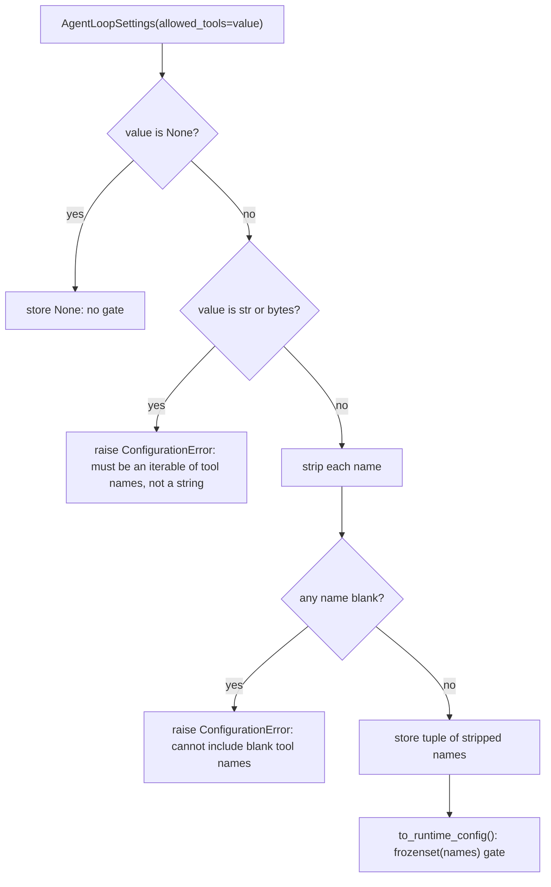

# Validate AgentLoopSettings.allowed_tools like ToolSettings.denied_tools

## Summary

`AgentLoopSettings.allowed_tools` was stored exactly as given. Python's one-tuple typo
`allowed_tools=("search")` is really the string `"search"`, so the runtime gate became
`frozenset("search")`, a set of single letters, and the one tool the developer meant to allow
was denied on every call with no warning. A padded name such as `" search"` also denied `search`.
The sibling `ToolSettings.denied_tools` already rejects a bare string, strips each name, and
rejects blank names. This change gives `allowed_tools` the same checks at construction, so the
mistake fails loudly where it is made instead of silently disabling a tool at run time.

## Flow chart



## Usage example

```python
from vidbyte.agents.settings import AgentLoopSettings
from vidbyte.lib.errors import ConfigurationError

AgentLoopSettings(allowed_tools=(" search ",)).allowed_tools   # ("search",)
AgentLoopSettings(allowed_tools=["search", "fetch"]).allowed_tools  # ("search", "fetch")

try:
    AgentLoopSettings(allowed_tools=("search"))  # missing trailing comma: a string
except ConfigurationError as error:
    print(error)  # AgentLoopSettings.allowed_tools must be an iterable of tool names, not a string.
```

## How it works

`AgentLoopSettings.__init__` keeps `None` as `None` (no gate) and otherwise builds a new frozen,
slotted dataclass, `AllowedToolNames`, in `vidbyte/lib/dataclasses/agents.py`, storing its
`names`. Lint rule C001 requires plain `*Settings` classes to delegate such checks to a validated
dataclass, and `vidbyte/lib/` sits below `vidbyte/agents/`, so there is no import cycle.
`AllowedToolNames.__post_init__` raises `ConfigurationError` for a `str` or `bytes`, converts
every other entry with `str(value).strip()`, and raises `ConfigurationError` for a blank entry.
The result is a `tuple[str, ...]`, keeping the public type and order. An empty iterable stays an
empty tuple, so its current meaning is unchanged. The sibling `ToolSettings._normalize_tool_names`
is not reused because it names `ToolSettings` in its messages and returns a `frozenset`.

Every path that builds the settings goes through the constructor: direct construction, YAML
loading (`vidbyte/lib/dataclasses/config.py` already turns the list into a tuple), state restore
in `vidbyte/agents/base.py`, the agent `fork()` path, and the fork tool's `loop_settings`
override. None needs a change.

## Files changed

- `vidbyte/lib/dataclasses/agents.py`: `AllowedToolNames`, with an `@intent` comment.
- `vidbyte/agents/settings/loop.py`: build `AllowedToolNames` in `__init__`.
- `tests/features/sdk_loop_settings/test_contract.py`: regression tests.
- `tests/features/sdk_loop_settings/README.md`: one log line.

## Risks and open questions

- Code that passed a bare string on purpose now fails at construction. Such code never worked:
  it allowed single characters only.
- Names are not de-duplicated, matching today's behavior (the runtime gate is a set anyway).

## Verification

- New tests: bare string and bytes raise; padded names are stripped and allow the tool at run
  time; blank names raise; a normal tuple or list behaves as today; `None` stays `None`.
- `python lint/run.py` and `python scripts/run_ci.py`, then remote CI.
- Bug-hunt probes a316, a294, a295, a296 and a302.
