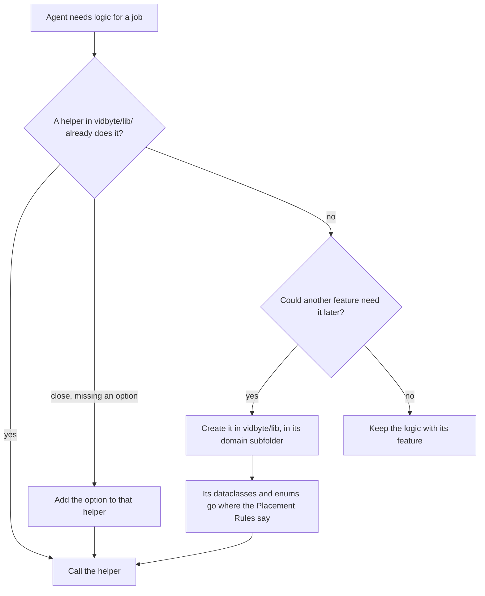

# Canonical `lib/` Helpers Principle

## Summary

This change adds a fifth principle to the General Coding Style Guidelines in `AGENTS.md`. The principle says: when a job can be done in more than one way and is likely to come up again, write the logic once as a canonical helper class or function in `vidbyte/lib/`, and have every caller use it. Agents read `AGENTS.md` before every change, so the rule reaches them there, and that stops the same timeout, retry, or parsing logic from being written again in each agent, tool, or provider adapter. The same principle lands in vidbyte and vidbyte-cli in sibling pull requests, each naming that repository's own paths.

## Flow chart



## Usage example

Code that calls an HTTP API uses the canonical `HttpTransport`. The transport already owns the timeout, the retries, and the backoff, so the caller does not write its own loop:

```python
from vidbyte.lib.http.transport import HttpResponse, HttpTransport


async def list_models(api_key: str) -> HttpResponse:
    # HttpTransport owns the timeout, the retries, and the backoff; this makes one call.
    return await HttpTransport().request(
        method="GET",
        url="https://api.example.com/v1/models",
        headers={"Authorization": f"Bearer {api_key}"},
        timeout_seconds=30.0,
        retry_count=2,
    )
```

## How it works

This is a documentation-only change. A new `### 5. Write Shared Logic Once, as a Canonical Helper in lib/` section follows principle 4, and the section intro changes from "four principles" to "five principles". The first paragraph states the rule and uses the API-request example. Its in-repo model is `HttpTransport` in `vidbyte/lib/http/transport.py`, whose `request()` takes `timeout_seconds`, `retry_count`, and backoff options, and refuses to retry an unsafe method without an idempotency key. The second paragraph says where helpers go and how to treat existing ones. First, look in `vidbyte/lib/` for a helper, and extend a close one instead of copying it. Put a new helper in its domain subfolder of `vidbyte/lib/`, and put its dataclasses and enums where the Placement Rules already say. Because `vidbyte/lib/` is the bottom layer in principle 3, a helper never imports from above it. Logic that only one feature will ever need stays with that feature.

## Files changed

- `AGENTS.md`: the new principle 5 and the "five principles" intro.
- `docs/design/canonical-lib-helpers.md`: this doc.

## Risks and open questions

- No lint rule enforces the principle. It is guidance for agents and reviewers.
- The Placement Rules section is unchanged. The new principle points to it for records and enums, so the two do not conflict.

## Verification

- `python scripts/run_ci.py` in the worktree, with `PYTHONPATH` unset, passes.
- `ci.yml` and `static-policy.yml` dispatched on the branch, with results read from the check-runs API, since automatic PR triggers are disabled.
