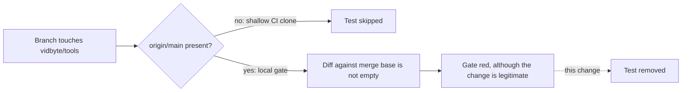

# Drop the harness-threads branch guard

## Summary

`test_branch_leaves_the_tools_and_configs_packages_as_main_has_them` was written for the #1036 feature branch. It asserts that the checkout changes no file under `vidbyte/tools` or `vidbyte/lib/configs` compared with `git merge-base origin/main HEAD`. On that branch, the check proved the feature left those packages alone. After #1036 merged, it does nothing on `main`, where the merge base is `HEAD` itself, and it fails on every later branch that touches `vidbyte/tools`, in a local gate only, because GitHub's shallow clone has no `origin/main` and skips it. Every release bump touches `vidbyte/tools/mcp/client.py`, the MCP `clientInfo` version, so every release PR's local gate fails: the 0.4.1 release branch failed `python scripts/run_ci.py` with exactly this test, 1 failed, 8220 passed. This change deletes the test and its now-unused `merge_base()` helper.

## Flow chart



## Usage example

```bash
git switch release/0.4.1
python scripts/run_ci.py   # previously: 1 failed (the branch guard); now: CI passed.
```

## Files

- `tests/features/harness_threads/test_harness_threads_surface.py`: the test, `merge_base()`, the now-unused `pytest` import, and `INV-21` in the header's purpose line are removed.

## Risks

None for the product. The removed check guarded one already-merged branch. The remaining git checks in the suite, `optional_merge_base()` for the export lists, are unchanged.

## Verification

- `tests/features/harness_threads/`: 1065 passed, 146 skipped.
- `python scripts/run_ci.py` passes on this branch, and on the release branch rebased on it.
