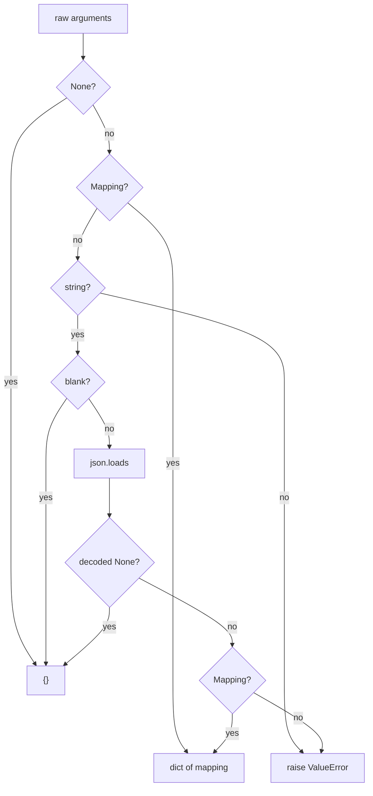

# JSON "null" string tool arguments

## Summary

PR #709 made `ToolsFormatter._parse_arguments` treat an explicit `None` argument payload as `{}`. OpenAI-compatible tool calls carry `arguments` as a JSON-encoded string, so the usual wire form of null arguments is the string `"null"`. `json.loads("null")` returns `None`, which is not a mapping, so the parser still raised `ValueError` and the whole run aborted with `AgentExecutionError`. This change treats a decoded `None` like the explicit `None` and blank-string cases: no arguments. The tool then validates its own required parameters and returns a recoverable `invalid_arguments` tool error the model can fix.

## Flow chart



## Usage example

```python
from vidbyte.lib.tools.formatter import ToolsFormatter

call = ToolsFormatter.parse_openai_tool_call(
    {"id": "call_1", "function": {"name": "ping", "arguments": "null"}}
)
assert call.arguments == {}
```

## How it works

After `json.loads`, a decoded `None` returns `{}`. Every other non-object decode (list, number, boolean, string, including double-encoded JSON) still raises exactly as before. The existing `@intent null-tool-arguments-mean-no-arguments` comment is extended rather than adding a new intent.

## Files

- `vidbyte/lib/tools/formatter.py`: one branch and one comment line in `_parse_arguments`.
- `tests/test_tool_core.py`: assert `"null"` and `" null "` parse to `{}` in the existing null-arguments test.

## Risks

A model that deliberately sends `"null"` to a tool with required parameters now gets a tool error instead of a run abort. That is the intended, recoverable behavior, matching the blank-string case.

## Verification

`python lint/run.py`, `python scripts/run_ci.py`, and the bug-hunt probes a61 (`[null args]` no longer raises) and a314 (`BAD total 0`).
