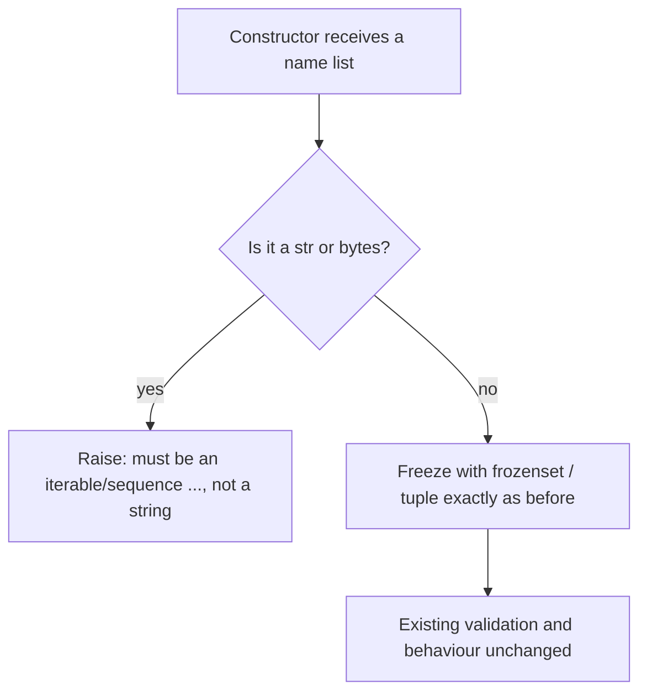

# Reject bare strings in name-list constructors

## Summary

`ToolPolicyMiddleware`, `HoneypotToolMiddleware`, and `AgentFallbackSettings` freeze a
collection of names with `frozenset(x)` or `tuple(x)`. Python's one-tuple typo, `("name")`,
is a `str`, so each constructor silently turned one name into a collection of single
characters. `deny_tools=("wipe_db")` denied `{'w', 'i', ...}` and let `wipe_db` run; the
`admin_shell` honeypot never fired; a fallback chain became one-character "models". Two of
these are security controls that failed open. Each constructor now rejects a bare `str` or
`bytes` up front with a clear error, the same guard `ToolSettings._normalize_tool_names`
already applies to `denied_tools`.

## Flow chart



## Usage example

```python
from vidbyte.middleware.builtins import HoneypotToolMiddleware, ToolPolicyMiddleware
from vidbyte.agents.settings import AgentFallbackSettings

ToolPolicyMiddleware(deny_tools=("wipe_db",))           # ok: one denied tool
ToolPolicyMiddleware(deny_tools=("wipe_db"))            # ValueError: ToolPolicyMiddleware.deny_tools
                                                        #   must be an iterable of tool names, not a string.
HoneypotToolMiddleware(trap_tool_names=("admin_shell")) # ValueError: ... trap_tool_names ..., not a string.
AgentFallbackSettings(models=("deepseek-reasoner"))     # ConfigurationError: AgentFallbackSettings.models
                                                        #   must be a sequence of models, not a string.
```

## How it works

- `tool_policy.py`: a module helper `_require_tool_name_iterable(values, field_name)` raises
  `ValueError` (the convention of the neighbouring builtin middleware constructors) for a
  `str`/`bytes`, and is applied to `allow_tools` (only when not `None`, so `None` still means
  "no allow-list") and `deny_tools`.
- `honeypot_tool.py`: the same check inline before the existing non-empty check, raising
  `ValueError` like that check does.
- `settings/fallback.py`: a module helper `_require_model_sequence(models)` raises
  `ConfigurationError`, matching the module's other validation.
- Each site carries `@intent name-lists-reject-bare-strings`.

Lists, tuples, sets, and generators behave exactly as before; no other validation is added.

## Files changed

- `vidbyte/middleware/builtins/tool_policy.py`
- `vidbyte/middleware/builtins/honeypot_tool.py`
- `vidbyte/agents/settings/fallback.py`
- `tests/test_middleware_builtins.py`, `tests/test_security_middleware.py`,
  `tests/test_agent_settings_validation.py`: a bare string raises; a 1-tuple or list works as today.

## Risks

A caller who deliberately passed a string to get a set of characters breaks. That usage is a
bug in every case seen, and the sibling `ToolSettings` already rejects it. `AgentLoopSettings.allowed_tools`
has the same trap and is fixed separately.

## Verification

`python lint/run.py`, `python scripts/run_ci.py`, remote CI, and probe `a317_name_list_string_trap.py`
reporting `BAD total 0`.
