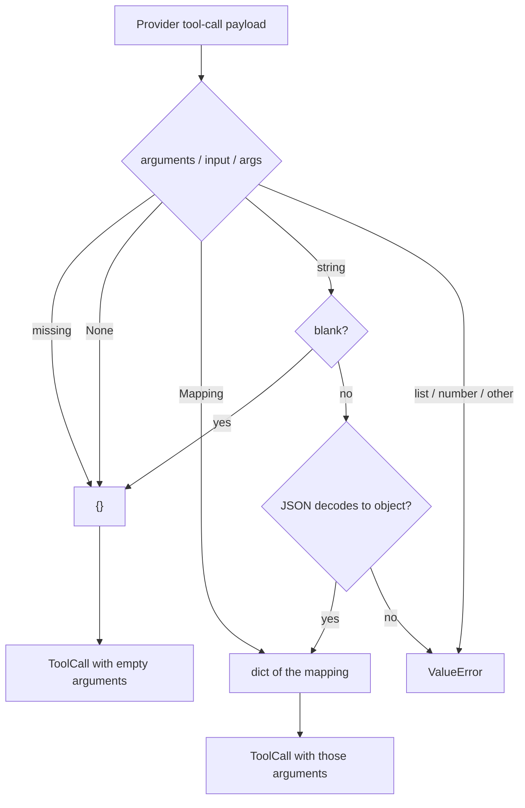

# Null tool-call arguments mean no arguments

## Summary

Some OpenAI-compatible servers encode a call to a zero-parameter function as
`"arguments": null`. `ToolsFormatter._parse_arguments` already treats a missing
key and an empty string as `{}`, but an explicit `null` fell through to
`ValueError("Tool call arguments must decode to an object")`, which failed the
whole agent run (`AgentExecutionError`). The Anthropic (`input: null`) and
Gemini (`args: null`) parsers had the same gap. This change treats an explicit
`None` exactly like the missing key: `{}`. The SDK's own outbound path already
does this (`vidbyte/providers/openai.py` rebuilds history with
`function.get("arguments") or "{}"`).

## Flow chart



## Usage example

```python
from vidbyte.tools import ToolCall, ToolsFormatter

call = ToolsFormatter.parse_openai_tool_call(
    {"id": "call_r1", "function": {"name": "refresh_board", "arguments": None}}
)
assert call == ToolCall("refresh_board", {}, call_id="call_r1")

assert ToolsFormatter.parse_anthropic_tool_call({"name": "ping", "input": None}).arguments == {}
assert ToolsFormatter.parse_gemini_tool_call({"functionCall": {"name": "ping", "args": None}}).arguments == {}
```

## How it works

- `_parse_arguments` returns `{}` early when `raw_arguments is None`.
- `parse_anthropic_tool_call` and `parse_gemini_tool_call` replace a `None`
  `input` / `args` with `{}` before the existing Mapping check.
- Every other non-object value (list, number, JSON string that decodes to a
  non-object) still raises `ValueError`, unchanged.

## Files changed

- `vidbyte/lib/tools/formatter.py`: the three `None` checks plus an
  `@intent null-tool-arguments-mean-no-arguments` comment.
- `tests/test_tool_core.py`: regression tests in `ToolCoreTests`.

## Risks and open questions

- A provider that sends `null` for a tool that does require arguments now
  reaches tool validation with `{}` and gets the existing
  `invalid_arguments` tool error instead of failing the run. That matches how
  `""` and a missing key already behave.
- The JSON string `"null"` is out of scope and still raises.

## Verification

- New unit tests: each parser returns a `ToolCall` with `{}` for `None`; a list
  payload still raises `ValueError`.
- `python lint/run.py` and `python scripts/run_ci.py`.
- Probe `sdk-bug-hunt/a314_null_tool_arguments.py` prints `BAD total 0`.
