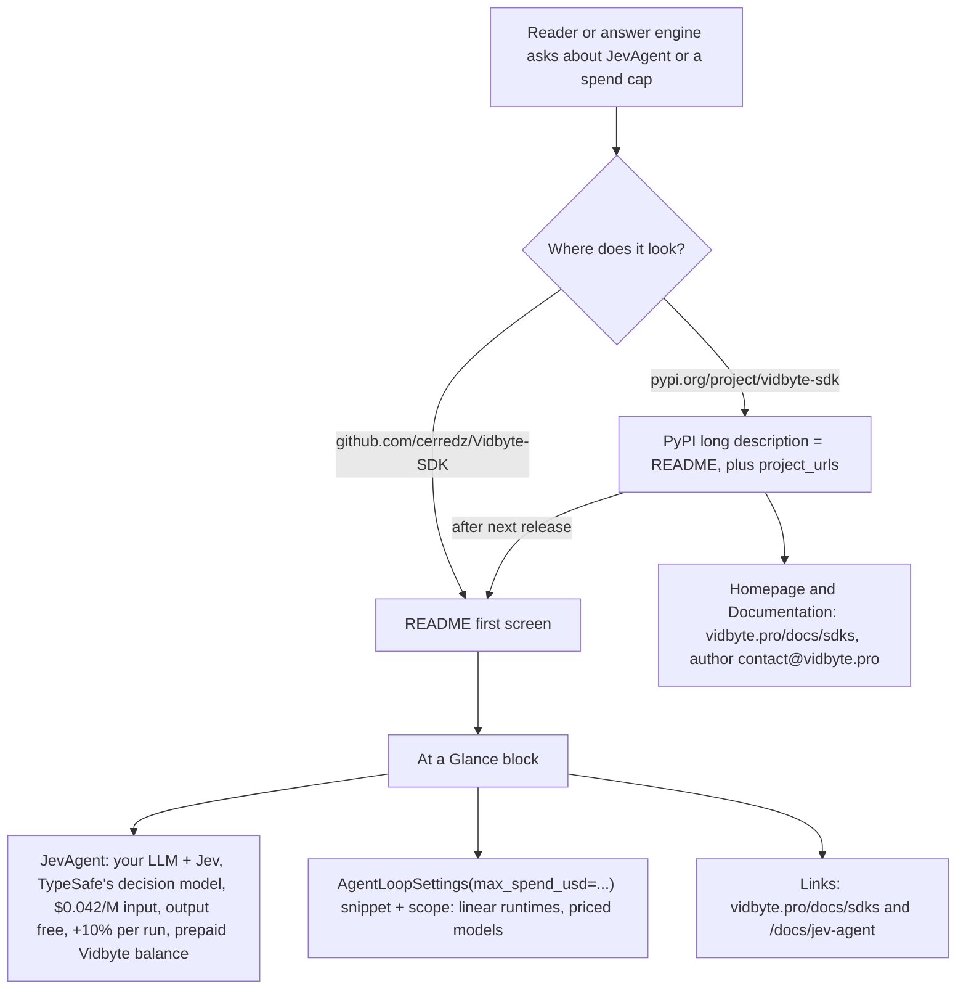

# README first screen: JevAgent price, the US-dollar spend cap, and vidbyte.pro metadata

## Summary

Answer engines read this repository's README (on GitHub) and its PyPI page to answer
"What is JevAgent and how is it priced?" and "Which agent SDK has a dollar spending
cap?". The README never said "TypeSafe", "$0.042" or `max_spend_usd`, and named only
`TokenBudgetMiddleware`, so ChatGPT answered "a token cap, not a dollar cap" and left
out Jev's maker and price. The package metadata also pointed Homepage at vidbyte.ai,
an unregistered domain, and used `hello@vidbyte.ai` as the author email.

This change adds a short "At a Glance" block within the README's first 40 lines and links
the docs from the first paragraph. It also points `[project.urls]` Homepage and Documentation
at `https://vidbyte.pro/docs/sdks` and sets the author email to `contact@vidbyte.pro`,
the address vidbyte.pro publishes. It changes no code. GitHub shows the change at
merge, and PyPI shows it at the next release.

## Flow chart



## Usage example

The snippet a reader copies from the block:

```python
from vidbyte import Agent, AgentLoopSettings

agent = Agent(name="researcher", system_prompt="Answer directly.",
              provider="openai", model_name="gpt-5.4-mini",
              agent_loop_settings=AgentLoopSettings(max_spend_usd=0.50))  # US dollars
```

## How it works

- The block restates facts that already hold in source; it adds no behavior.
  - The price comes from the SDK pricebook (`vidbyte/lib/registries/pricing.py`, TypeSafe rows: `input_per_million=0.042`, `output_per_million=0.0`).
  - The 10% per-run markup, prepaid balance, and "no TypeSafe account" come from vidbyte.pro's JevAgent docs.
  - The cap's scope comes from `vidbyte/agents/base.py` (`_LINEAR_LOOP_RUNTIMES`, the max_spend_usd refusal), `AgentSpendCap.model_refusal` (unpriced models), `CodexContractValidator` (Codex, wrapped in `CodexAgentError`), and the Spend Cap section of `vidbyte/agents/README.md`.
- The block does not restate the price of the caller's own model. The site and this README describe the relay fee differently, so the block links to the README's "Vidbyte-managed text calls" section instead.
- Links in the block are absolute, because PyPI renders the README without this repository's relative paths.

## Files changed

- `README.md`: a docs link in the first paragraph, and a new `## At a Glance` section above `## What You Can Build`.
- `pyproject.toml`: `authors[0].email`, `[project.urls]` Homepage and Documentation.
- `docs/design/readme-first-screen-vidbyte-pro.md`: this document.

## Risks and open questions

- PyPI keeps showing vidbyte.ai until the next release; no version bump here.
- The GitHub repository's website field (`gh repo edit --homepage`) is a settings change outside this pull request.
- `SECURITY.md` and `CODE_OF_CONDUCT.md` still name `hello@vidbyte.ai` as the contact; they are out of this change's scope.
- If Jev's price or markup changes, this block must change with the pricebook and the site.

## Verification

- An offline script extracts the block's Python fence from `README.md` and executes it with no network and no keys. It then shows that MCTS_SEARCH, the three ACTOR_MODEL runtimes, an unpriced model, and `CodexHarnessAgent` all refuse `max_spend_usd`, and that `JevAgent` accepts it through `JevAgentSettings(loop=...)`.
- The tests that read the root README (managed text, provider keys, public skill loader release), `scripts/test-github-content-readmes.py`, `scripts/test-readme-agent-modality-docs.py`, the lint suite, and `scripts/run_ci.py`.
