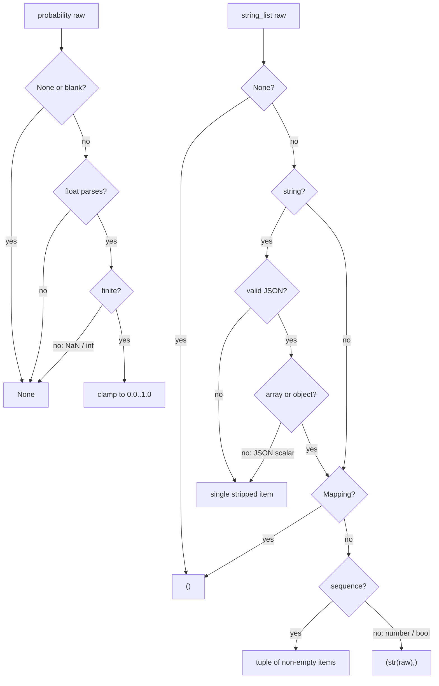

# Reasoning Parser: Non-Finite Probabilities and Single JSON Scalars

## Summary

`ReasoningToolInput` in `vidbyte/tools/builtins/reasoning/_parsing.py` normalizes
model-sent arguments for the reasoning strategy tools. It has two parsing bugs:

1. `probability()` accepts `"NaN"`, `"inf"` and `"-inf"`. `min(1.0, nan)` returns
   `1.0`, so `bayesian_update(prior="NaN")` is recorded as `Prior: 1.000`
   (certainty) instead of being refused as "Must be a number from 0.0 to 1.0".
   The sibling `CotEventParser.parse_confidence` already rejects non-finite values.
2. `string_list()` documents "JSON array, JSON string, or single value", but a
   single value that happens to parse as a JSON scalar (`"2024"`, `"true"`) or a
   raw number (`2024`) is dropped to `()`. `fermi_estimate(decomposition="2024")`
   is refused as "Missing or empty required field" while
   `"estimate 2024 households"` is accepted.

The fix makes `probability()` return `None` for non-finite numbers, so every
caller's existing "unparsable" handling applies, and makes `string_list()` keep
a single scalar value as one item.

## Flow chart



## Usage example

```python
from vidbyte.tools.builtins.reasoning._parsing import ReasoningToolInput

ReasoningToolInput.probability("NaN")   # None  (was 1.0)
ReasoningToolInput.probability("-inf")  # None  (was 0.0)
ReasoningToolInput.probability(0.3)     # 0.3   (unchanged)

ReasoningToolInput.string_list("2024")        # ("2024",)  (was ())
ReasoningToolInput.string_list(2024)          # ("2024",)  (was ())
ReasoningToolInput.string_list('["a", "b"]')  # ("a", "b") (unchanged)
ReasoningToolInput.string_list("plain text")  # ("plain text",) (unchanged)
ReasoningToolInput.string_list({"k": "v"})    # ()         (unchanged)
```

## How it works

- `probability()`: after `float()` succeeds, `math.isfinite()` gates the value;
  non-finite returns `None`. Finite values are clamped exactly as before.
- `string_list()`: for a string that decodes as JSON, only an array or object
  replaces the raw value; any other decoded scalar keeps the original stripped
  string as the single item. A raw number or boolean (not a mapping or
  sequence) becomes `(str(raw),)`. Arrays, objects and `None` are unchanged.

Each change carries an `@intent` comment.

## Files changed

- `vidbyte/tools/builtins/reasoning/_parsing.py` — the two parser fixes.
- `tests/test_context_algorithm_tools.py` — regression tests for
  `ReasoningToolInput`, beside the existing reasoning tool tests.

## Risks and open questions

- A JSON-quoted string such as `'"x"'` is kept verbatim as `'"x"'` (the original
  stripped text), matching the plain-text path; it is no longer dropped.
- Optional probability fields that receive `"NaN"` now read as absent rather
  than `1.0`, which is the documented "unparsable" behaviour.

## Verification

- New unit tests for both parsers.
- `python lint/run.py` and `python scripts/run_ci.py`.
- The external probe `a312_reasoning_parser_edges.py` reports `BAD total 0`.
