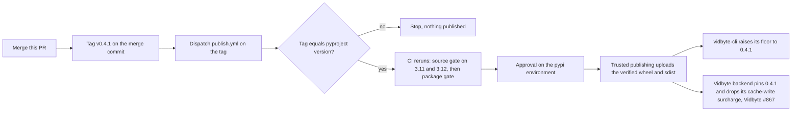

# Release 0.4.1: billing fixes from the 2026-10-27 readiness run

## Summary

`vidbyte-sdk` 0.4.0, the latest release on PyPI, predates the 13 pull requests that the 2026-10-27 billing readiness run merged on `main` (#1195 to #1207). Two of them decide whether Claude agents work at all: without #1204 and #1207, an `InfiniteMemoryAgent` or a `JevAgent` swarm on a Claude thinking model fails with a 400 on its second call, and vidbyte-cli inherits that failure because it resolves `vidbyte-sdk[codex]>=0.4.0,<0.5`. The rest make metered spend match what providers bill. This release ships them as 0.4.1, a patch release: no root export is added or removed, and no default or dependency changes.

## Flow chart



## Usage example

```bash
pip install --upgrade "vidbyte-sdk==0.4.1"
python -c "import vidbyte; print(vidbyte.__version__)"   # 0.4.1
```

## What 0.4.1 changes

From `git log --first-parent v0.4.0..main`:

- **Claude thinking models replay correctly (#1204, #1207).** #1204 keeps the loop limits in the system prompt static, so a signed thinking block stays valid across calls. #1207 removes a thinking block whose system prompt, tools, or earlier messages changed since Anthropic signed it, which `InfiniteMemoryAgent`'s map step and `JevAgent`'s SWARM mode do mid-run. Live, 23 calls across both agents on the gateway and `DIRECT` returned no 400.
- **Pricing (#1196, #1197, #1199, #1202).** Anthropic fast mode and US data residency are billed from the usage the provider returns (#1196). An unlisted minor version, such as `claude-opus-5-6`, is unpriced instead of billed as its major (#1197). Anthropic server-side web search bills $0.01 per search (#1199). OpenAI and Codex cache writes bill at the cache-write rate (#1202), which the Vidbyte backend must ship together with removing its own `_cache_write_surcharge_nanousd` (Vidbyte #867), or cache writes are billed twice.
- **Spend that cannot be measured stops a capped run (#1200, #1205, #1206).** A `DIRECT` call that times out in flight (#1200), and an actor-model call lost in flight (#1205), leave the run's spend unmeasured, so `max_spend_usd` fails closed. A capped run checks its cap before a middleware retry, so a blind or reached ledger sends no further paid request (#1206).
- **Tools and agents (#1198, #1201, #1203).** A priced search or fetch tool with no client is an unbilled error, not a phantom charge (#1198). Grader trials spend only on the agent's own `api_keys`, and the default grader is the agent's priced model (#1201). `MultiAgent`'s manager schema is one that Anthropic and OpenAI strict mode accept (#1203).
- **README (#1195).** States `JevAgent`'s price and the USD spend cap up front, and points the package metadata at vidbyte.pro.

`PRICING_AS_OF` moved from 2026-10-25 to 2026-10-27 in these changes, so the backend's pricebook identity, `vidbyte-sdk-models-{PRICING_AS_OF}`, changes when it upgrades from 0.3.0.

## How the release is made

Every literal that names the version moves together, as in the 0.2.1, 0.3.0, and 0.4.0 releases: `pyproject.toml`, `vidbyte/__init__.py`, the CLI fallback, the MCP server default, the MCP `clientInfo`, `README.md`, `llms.txt`, the bug template, and the regenerated `contracts/sdk-public-api.json`. The contract still lists 736 exports; only its version and source commit change. `tests/features/public_skill_loader/test_public_skill_loader_release.py` already pins all eight literals to `pyproject.toml`'s version, so it covers this change.

To release after merge, push the tag `v0.4.1` on the merge commit and dispatch `publish.yml` on that tag. The workflow validates the tag, reruns CI, and waits for approval on the `pypi` environment before uploading through trusted publishing. This repository is public, so its workflows run on GitHub-hosted runners at no charge and are not stopped by the account billing block that pauses the private repositories' Actions.

## Files

- `docs/design/release-0-4-1.md` (this doc)
- `pyproject.toml`, `vidbyte/__init__.py`, `vidbyte/cli/__init__.py`, `vidbyte/mcp_server/server/core.py`, `vidbyte/tools/mcp/client.py`, `README.md`, `llms.txt`, `.github/ISSUE_TEMPLATE/bug_report.yml`: 0.4.0 becomes 0.4.1
- `contracts/sdk-public-api.json`: regenerated with `scripts/generate-sdk-public-api.py`

## Risks

- Behavior changes ship in a patch release: an unlisted Claude minor version now fails as unpriced instead of billing as its major (#1197), and the default grader model changes (#1201). Both are fixes the readiness run verified live, and the SDK is alpha.
- The backend must not take 0.4.1 without removing its cache-write surcharge in the same change (Vidbyte #867).

## Verification

- `python scripts/run_ci.py` (source and package stages) passes on this branch.
- `python scripts/generate-sdk-public-api.py --check` reports the contract current at 0.4.1 with 736 exports.
- Before tagging, vidbyte-cli's `scripts/run_ci.py` passes against a wheel built from this branch, installed in place of 0.4.0.
- After publishing, a clean virtual environment installs `vidbyte-sdk==0.4.1` from PyPI and imports it at that version.
