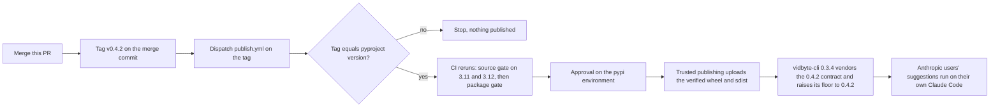

# Release 0.4.2: the Claude Code harness agent for bring-your-own-key suggestions

## Summary

`vidbyte-sdk` 0.4.1, the latest release on PyPI, predates #1210, which adds `ClaudeCodeHarnessAgent`: an agent object that is one Claude Code conversation on the user's own machine, run through the user's own `claude` under the user's own Claude login or API key. vidbyte-cli 0.3.4 needs it so that its suggestion agent can run an Anthropic user's generator and critic turns on that user's Claude Code, with Anthropic billing the user directly and Vidbyte charging 1 cent per suggestion, the same way the CLI already runs Codex turns through `CodexHarnessAgent`. The CLI accepts root imports only (its lint rule C028), so it cannot use the agent until a release carries the nine new root exports. This release ships them as 0.4.2, a patch release: the change is additive and backward compatible, with nine root exports added, none removed or renamed, and no existing behavior, default, or dependency changed.

## Flow chart



## Usage example

```bash
pip install --upgrade "vidbyte-sdk==0.4.2"
python -c "import vidbyte; print(vidbyte.__version__)"   # 0.4.2
claude --version                                         # Claude Code installed and signed in
```

```python
import asyncio

from vidbyte import ClaudeCodeAgentError, ClaudeCodeHarnessAgent, ClaudeCodeHarnessAgentSettings, ClaudeCodeRunInput

agent = ClaudeCodeHarnessAgent(
    ClaudeCodeHarnessAgentSettings(
        name="suggestion-generator",
        instructions="You are a product strategist. Answer only through the structured output.",
        model="sonnet",  # None keeps Claude Code's built-in default
        output_schema={"type": "object", "properties": {"ideas": {"type": "array", "items": {"type": "string"}}}, "required": ["ideas"]},
    )
)


async def main() -> None:
    try:
        first = await agent.arun(ClaudeCodeRunInput(prompt="Suggest three growth ideas for a CLI tool."))
        second = await agent.arun("Rank the ideas you gave by effort.")  # same object, same conversation
    except ClaudeCodeAgentError as error:
        print(error.kind, error.next_step)  # for example NOT_AUTHENTICATED: run `claude auth login`
        return
    finally:
        agent.close()
    print(first.output["ideas"], second.output, first.session_id == second.session_id)
    print(first.cost_usd + second.cost_usd, second.model)  # each run's own cost, as Claude Code reports it


asyncio.run(main())
```

## What 0.4.2 changes

From `git log --first-parent v0.4.1..origin/main`, one pull request:

- **`ClaudeCodeHarnessAgent` (#1210).** A new agent in `vidbyte.agents.claude_code`, re-exported from `vidbyte.agents` and the root `vidbyte` package. What a caller gets:
  - **Print mode on the user's own login.** Each turn is one `claude --print` process from the user's installation, under their Claude login, `ANTHROPIC_API_KEY`, or Bedrock/Vertex setup, so the user's Anthropic account pays for the turn. The SDK never reads, stores, or prints the credential. `--bare` is deliberately not used, because it ignores the Claude login.
  - **Isolation from the user's own Claude Code setup.** `--safe-mode`, `--setting-sources=`, `--strict-mcp-config`, and `--disable-slash-commands` load none of the user's hooks, plugins, CLAUDE.md files, auto-memory, settings, MCP servers, or skills. Every built-in tool is off unless `allowed_tools` names it. A session whose start shows a tool or MCP server the settings did not allow is refused. The instructions go through a private `--system-prompt-file` that is removed after every run, so 50 KB instructions fit the Windows command line. The child process drops the variables a parent Claude Code session sets, because the CLI is often run from inside one.
  - **Structured output.** `output_schema` is sent as `--json-schema`, and the answer arrives in `result.output` as a dict. A missing structured object fails as `SCHEMA_VIOLATION` instead of returning empty output.
  - **One object, one conversation.** The first `arun` starts a session under a fresh id, and every later `arun` on the same object resumes it, so the model remembers earlier turns. A failed run never changes `agent.session_id`, so a failed first run starts cleanly and a failed resume can be retried. `session_id` plus `workspace` in the settings resumes a saved session. `run()` is the synchronous twin, and `close()` removes the agent's temporary folder.
  - **Per-run usage and cost.** `ClaudeCodeRunResult` carries this run's token usage, Claude Code's own report of this run's cost (`cost_usd`), and the model that wrote the answer, plus the session's cumulative `session_cost_usd`. Summing `cost_usd` over runs gives the session total.
  - **Images.** png, jpeg, gif, and webp attachments go to Claude Code as base64 image blocks. Any other attachment is refused before a process starts.
  - **Typed failures.** Every runtime failure is one `ClaudeCodeAgentError`, an `AgentExecutionError`, with a `ClaudeCodeFailureKind` (`NOT_INSTALLED`, `NOT_AUTHENTICATED`, `TIMEOUT`, `EXIT_NONZERO`, `SCHEMA_VIOLATION`, `UNSUPPORTED_INPUT`, `MALFORMED_OUTPUT`), the session id, the exit code, a likely cause, and a next step. Claude Code's own words are quoted with credentials scrubbed. A timeout stops the whole process tree, and cancellation is never wrapped. Bad settings raise `ConfigurationError` at construction. On Windows, an npm `claude.cmd` launcher is refused as `NOT_INSTALLED`, and the native `claude.exe` is required. An older Claude Code that lacks one of the flags fails as `EXIT_NONZERO` with a message telling the user to run `claude update`.

  It was built against the wire shape observed live on Claude Code 2.1.314. 82 offline tests run a fake `claude` that replays those shapes, and an opt-in live test (`VIDBYTE_LIVE_CLAUDE_CODE=1`) passed before merge. No Python package is added.

Outside the feature, #1210 also exempts `ClaudeCodeHarnessAgentSettings.model` from lint rule C012, because Claude Code resolves its own model names, and drops a test-only branch guard in `tests/features/harness_threads/test_harness_threads_surface.py` that failed any branch adding a root export.

## Why this is a patch release

The change is additive and backward compatible. The root package gains nine exports (`ClaudeCodeHarnessAgent`, `ClaudeCodeHarnessAgentSettings`, `ClaudeCodeRunInput`, `ClaudeCodeImage`, `ClaudeCodeRunResult`, `ClaudeCodeUsage`, `ClaudeCodeEffort`, `ClaudeCodeFailureKind`, `ClaudeCodeAgentError`), and the contract goes from 736 to 745 exports with none removed or renamed. #1210 deletes no line under `vidbyte/`, leaves `pyproject.toml` and its dependencies unchanged, and moves no existing default; the only lines it removes are the contract's source commit and the test-only guard above. `import vidbyte` now also imports `vidbyte.agents.claude_code`, which starts no process.

In this repository's 0.x versioning, the minor number is the compatibility boundary ("APIs may change between minor versions", README), and dependents pin below the next minor. vidbyte-cli resolves `vidbyte-sdk[codex]>=0.4.1,<0.5`, so 0.4.2 stays inside the CLI's range, while a 0.5.0 would fall outside it and force a CLI pin change for an additive feature.

## How the release is made

Every literal that names the version moves together, as in the 0.2.1, 0.3.0, 0.4.0, and 0.4.1 releases: `pyproject.toml`, `vidbyte/__init__.py`, the CLI fallback, the MCP server default, the MCP `clientInfo`, `README.md`, `llms.txt`, the bug template, and the regenerated `contracts/sdk-public-api.json`. The contract lists 745 exports both before and after this change; only its version and source commit change. `tests/features/public_skill_loader/test_public_skill_loader_release.py` already pins all eight literals to `pyproject.toml`'s version, and rule C016 checks the contract, so both cover this change.

To release after merge, push the tag `v0.4.2` on the merge commit and dispatch `publish.yml` on that tag. The workflow validates the tag, reruns CI, and waits for approval on the `pypi` environment before uploading through trusted publishing. This repository is public, so its workflows run on GitHub-hosted runners at no charge.

## Files

- `docs/design/release-0-4-2.md` (this doc)
- `pyproject.toml`, `vidbyte/__init__.py`, `vidbyte/cli/__init__.py`, `vidbyte/mcp_server/server/core.py`, `vidbyte/tools/mcp/client.py`, `README.md`, `llms.txt`, `.github/ISSUE_TEMPLATE/bug_report.yml`: 0.4.1 becomes 0.4.2
- `contracts/sdk-public-api.json`: regenerated with `scripts/generate-sdk-public-api.py`

## Risks

- vidbyte-cli 0.3.4 must raise its floor to `vidbyte-sdk[codex]>=0.4.2,<0.5`. Its current `>=0.4.1` admits 0.4.2 but also an already-installed 0.4.1, which has no `ClaudeCodeHarnessAgent`, so a root import would fail at run time. Rule C029 checks only that the pin admits the vendored contract's version, so it would not catch this.
- The CLI's vendored `lint/contracts/sdk-public-api.json` now says `0.4.1` while listing the nine Claude Code names, which 0.4.1 on PyPI lacks. It should be re-vendored from this release's contract, which says `0.4.2`.
- The agent depends on Claude Code's command-line flags and stream-json events, which Anthropic can change in a later Claude Code build. A missing flag fails as `EXIT_NONZERO` with a `claude update` hint, and an unrecognized event shape fails as `MALFORMED_OUTPUT` instead of returning a wrong answer. The opt-in live test is how a new Claude Code build is checked.

## Verification

- `python scripts/run_ci.py` (source and package stages) passes on this branch.
- `python scripts/generate-sdk-public-api.py --check` reports the contract current at 0.4.2 with 745 exports.
- Before tagging, vidbyte-cli's `scripts/run_ci.py` passes against a wheel built from this branch, installed in place of 0.4.1.
- After publishing, a clean virtual environment installs `vidbyte-sdk==0.4.2` from PyPI, imports it at that version, and imports `ClaudeCodeHarnessAgent` from the root package.
