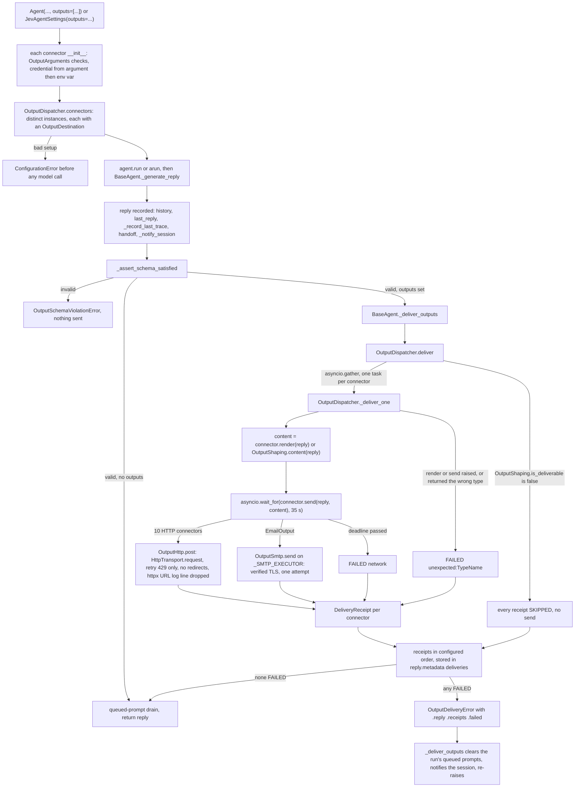

feat(outputs): agents deliver each finished reply to Slack, email, issue trackers, Notion, and webhooks
## Summary
An agent can now send each finished reply to eleven destinations: Slack, Discord, Microsoft Teams, Google Chat, Telegram, email over SMTP (Gmail, Microsoft 365, SendGrid, SES, any SMTP server), GitHub Issues, Linear, Jira Cloud, Notion, and any HTTPS webhook (Make, n8n, Pipedream, Zapier, Power Automate). The developer passes connectors as `outputs=[...]` to `Agent`, `BaseAgent`, or `CodingAgent`, or as `JevAgentSettings.outputs`, and each connector takes one pasted credential: the argument first, then its environment variable, otherwise a `ConfigurationError` that names the variable. The decision that matters most: delivery is plain SDK code that runs once, after the reply passes the output-schema check and is recorded, so the model never sees a key or picks a destination, and a blank or stopped run sends nothing. All connectors send at once under a 35 s deadline, only HTTP 429 is retried, each destination gets one receipt in `reply.metadata["deliveries"]`, and any failure raises `OutputDeliveryError` after every send has finished. The contract and dispatcher live in `vidbyte/agents/output/` and the provider classes in `vidbyte/lib/outputs/`, with no new dependency, no OAuth, and no MCP (spec: `docs/spec/agent-output-connectors/spec.md`, r8).

## How to use what this PR introduces
```python
from pydantic import BaseModel

from vidbyte import Agent, GitHubIssueOutput, OutputDeliveryError, SlackOutput


class BugReport(BaseModel):
    title: str
    body: str


agent = Agent(
    name="checkout-scout",
    system_prompt="Find the worst bug in the checkout flow.",
    provider="openai",
    model_name="gpt-4.1",
    output_schema=BugReport,
    outputs=[
        SlackOutput(),                                         # reads SLACK_WEBHOOK_URL
        GitHubIssueOutput(repo="acme/shop", labels=("bug",)),  # reads GITHUB_TOKEN
    ],
)

try:
    reply = agent.run("Scan checkout")
except OutputDeliveryError as err:
    reply = err.reply
    for receipt in err.failed:
        print("failed:", receipt.destination.value, receipt.error_code)

for receipt in reply.metadata["deliveries"]:
    print(receipt.destination.value, receipt.status.value, receipt.url)
```
This is the spec §4 snippet unchanged; it runs as written. I ran it offline: the model returned a fixed `BugReport`, and HTTP was scripted (Slack `200 ok`, GitHub `201` with `html_url`), so no real request was made. The output was byte-equal to the spec:
```text
slack sent None
github_issue sent https://github.com/acme/shop/issues/412
```
Slack got `{"text": "Coupon total wrong\n\nTotals ignore coupons."}` and GitHub got `{"title": "Coupon total wrong", "body": "Totals ignore coupons.", "labels": ["bug"]}`. The developer no longer writes HTTP or SMTP code, decides when to send, handles rate limits, or keeps webhook URLs out of logs.

**Credentials and the platform list.** `vidbyte/lib/outputs/README.md` shows, for each destination, how to get the credential, the least privilege it needs, its body cap, and its official docs (retrieved 2026-10-11). Spec §9.2 table (b) lists 45 more platforms that were checked and not built, each with its reason. Sixteen of them qualify but fell below the cut (GitLab, Asana, Webex, Matrix, and others). The rest need OAuth (Gmail API, Microsoft Graph, Google Sheets and Drive, Dropbox, X, LinkedIn), need a body format or request signing that `HttpTransport` does not do (Twilio, the Mailgun HTTP API, Amazon S3), or fail another check: no bot API (Signal), shutting down (Opsgenie), or every post pages on-call or goes out publicly (PagerDuty, Mastodon).

## Flow

Configuration is checked when the connector and the agent are built, so a missing key or a bad URL fails before the model runs. State changes as it does today (history, `last_reply`, the session turn) before delivery starts; delivery adds only the `deliveries` key on the reply. Each connector turns its own HTTP or SMTP failure into a FAILED receipt, so one bad destination never stops the others. The dispatcher turns any other exception into `unexpected:<Type>`, lets cancellation pass through unchanged, and raises `OutputDeliveryError` only after every connector has finished.

## What changed
| File | Change |
|---|---|
| `vidbyte/agents/base.py` | `outputs=` on `__init__` and `restore`. After the schema check, `if self.outputs: await self._deliver_outputs(...)`. Three last-trace lines moved into `_record_last_trace` so `_generate_reply` stays within lint S008 (+29/−4). |
| `vidbyte/agents/fork.py` | Forks pass `outputs=()`, so `as_tool()` children, MultiAgent workers, and fresh-fork stages never post. |
| `vidbyte/agents/jev/settings.py` | New `JevAgentSettings.outputs` field, checked with `OutputDispatcher.connectors`. |
| `vidbyte/agents/jev/agent.py` | Passes `settings.outputs` to `BaseAgent`; header notes Jev's internal agents never get outputs. |
| `vidbyte/agents/output/connector.py` | New. `OutputConnector` protocol, plus `OutputShaping`: the skip rule and the default title and body. |
| `vidbyte/agents/output/dispatcher.py` | New. `OutputDispatcher`: validates `outputs`, sends to every connector at once under the deadline, records receipts, and raises on failure. |
| `vidbyte/agents/output/__init__.py` | New. Public names, including `OutputDispatcher` for resending failed outputs. |
| `vidbyte/agents/output/README.md` | New. When delivery runs, skip rules, forks and sub-agents, failure behavior, the resend recipe, and which failure codes to check before resending. |
| `vidbyte/lib/outputs/base.py` | New. `BaseOutput` (masked `repr`, optional `render`) and `OutputArguments` (credential lookup and argument checks; `non_empty` makes an empty list name its own parameter). |
| `vidbyte/lib/outputs/delivery.py` | New. `OutputHttp.post` (one JSON POST, 429-only retry, no redirects, link check, httpx log filter) and `OutputSmtp.send` (one verified-TLS session). |
| `vidbyte/lib/outputs/text.py` | New. `OutputText`: first line, chat text, truncation with a marker, one-line titles. |
| `vidbyte/lib/outputs/slack.py` | New. Incoming-webhook message; escapes `&`, `<`, `>` so `<!channel>` cannot ping. |
| `vidbyte/lib/outputs/discord.py` | New. Channel-webhook message with `allowed_mentions.parse = []`. |
| `vidbyte/lib/outputs/teams.py` | New. Workflows webhook with one Adaptive Card `TextBlock`. |
| `vidbyte/lib/outputs/google_chat.py` | New. Space-webhook message; neutralizes `<users/`. |
| `vidbyte/lib/outputs/telegram.py` | New. Bot `sendMessage` with no `parse_mode`. |
| `vidbyte/lib/outputs/email.py` | New. `EmailOutput` over stdlib `smtplib` on its own `_SMTP_EXECUTOR` thread pool; `to=[]` fails naming `to`. |
| `vidbyte/lib/outputs/github.py` | New. One issue per reply in a fixed repo, with fixed labels; receipt URL is `html_url`. |
| `vidbyte/lib/outputs/linear.py` | New. GraphQL `issueCreate`; success requires the returned issue URL. |
| `vidbyte/lib/outputs/jira.py` | New. Jira Cloud issue with an ADF description; the link is built from the returned key. |
| `vidbyte/lib/outputs/notion.py` | New. Page under a fixed parent using the `markdown` body; neutralizes `<mention-`. |
| `vidbyte/lib/outputs/webhook.py` | New. JSON `{agent, title, body, structured}` to any HTTPS receiver. |
| `vidbyte/lib/outputs/__init__.py` | New. Exports the connectors and provider helpers. |
| `vidbyte/lib/outputs/README.md` | New. Provider reference (credential, least privilege, cap, official link, retrieved 2026-10-11), email providers, footguns. |
| `vidbyte/lib/constants/outputs.py` | New. Timeouts, deadline, retry set, caps, error codes, env-var names, endpoints, and API versions. |
| `vidbyte/lib/dataclasses/outputs.py` | New. `OutputContent`, `DeliveryReceipt`, `OutputRequest`, `SmtpSettings`, each validated in `__post_init__`. |
| `vidbyte/lib/enums/outputs.py` | New. `OutputDestination` (11 members) and `DeliveryStatus`. |
| `vidbyte/lib/enums/__init__.py` | Exports the two enums. |
| `vidbyte/lib/errors/base.py` | New `OutputDeliveryError(AgentExecutionError)` with `.reply`, `.receipts`, `.failed`, and the diagnostic packet. Its resend hint gives the working recipe (zip `agent.outputs` with `err.receipts`) and the failure codes that may already have been delivered. |
| `vidbyte/lib/errors/__init__.py` | Exports `OutputDeliveryError`. |
| `vidbyte/__init__.py` | 17 new root exports: the contract, the 11 connectors, records, enums, and the error. |
| `contracts/sdk-public-api.json` | Regenerated for the 17 exports (623 total). |
| `vidbyte/agents/README.md` | New "Output Connectors" section with the usage snippet. |
| `vidbyte/agents/jev/README.md` | Documents `JevAgentSettings.outputs` and specialist behavior. |
| `vidbyte/lib/README.md` | Lists `outputs/`. |
| `REPO_MAP.md` | Entries for `vidbyte/agents/output/` and `vidbyte/lib/outputs/`. |
| `tests/features/agent_output_connectors/` (13 files) | Feature test pack: FEATURE.md, README, `conftest.py` and `factories.py`, and 9 test modules (acceptance, wiring, configuration, contract, dispatch, email, HTTP failures, security, wire contract); 92 test functions, 341 cases. |
| `docs/spec/agent-output-connectors/` | Request, spec r8, test plan, review, verify log, code map, stage reports, and this PR body. |

## Acceptance criteria → proof
All test names are in `tests/features/agent_output_connectors/`.
| AC | What it checks (plain words) | Proven by |
|---|---|---|
| AC-1 | The §4 snippet prints the two receipt lines and raises nothing. | `test_output_connectors_acceptance.py::test_spec_snippet_delivers_one_validated_reply_to_slack_and_a_github_issue_and_prints_both_receipts` |
| AC-2 | The env-var credential is stripped, an explicit argument wins, and a missing one names the parameter and the variable. | `test_output_connectors_configuration.py::test_slack_credential_from_the_environment_is_stripped`, `::test_slack_credential_prefers_a_non_blank_explicit_argument_over_the_environment`, `::test_slack_credential_missing_everywhere_raises_the_documented_message` |
| AC-3 | No `repr`, error, receipt, metadata, or exported state shows the credential. | `test_output_connectors_security.py::test_no_surface_shows_the_credential_even_when_the_destination_echoes_it` |
| AC-4 | A reply that fails its schema raises and sends nothing. | `test_output_connectors_acceptance.py::test_reply_that_fails_its_output_schema_raises_and_sends_nothing` |
| AC-5 | One failed destination: the others are still tried, and the error carries the recorded reply and all receipts. | `test_output_connectors_acceptance.py::test_partial_failure_attempts_every_output_then_raises_with_the_recorded_reply_and_one_receipt_each` |
| AC-6 | Only 429 is retried; 500 and network errors are not; a silent destination fails at the deadline without holding the others. | `test_output_connectors_http_failures.py::test_slack_answer_maps_to_one_receipt_and_only_a_429_is_retried`, `test_output_connectors_dispatch.py::test_destination_that_never_answers_is_failed_network_at_the_deadline_without_holding_back_the_others` |
| AC-7 | Mixed failures get their codes in configured order, and no URL leaks. | `test_output_connectors_http_failures.py::test_mixed_failures_give_their_codes_in_configured_order_and_no_url_leaks` |
| AC-8 | A blank reply or a stopped run is SKIPPED everywhere, with no request. | `test_output_connectors_dispatch.py::test_stopped_or_blank_reply_is_skipped_for_every_output_with_no_request_and_no_error`, `test_output_connectors_agent_wiring.py::test_run_stopped_by_max_iterations_is_skipped_for_every_output_and_returns_normally` |
| AC-9 | Channel-wide mentions cannot ping in Slack, Discord, Google Chat, Telegram, or Notion. | `test_output_connectors_wire_contract.py::test_channel_wide_mentions_are_neutralized_for_each_chat_destination`, `::test_notion_mention_tags_in_the_markdown_body_are_neutralized` |
| AC-10 | Long bodies are capped with a marker; long titles become one 250-character line. | `test_output_connectors_wire_contract.py::test_long_reply_is_capped_for_discord_and_its_long_first_line_becomes_a_250_character_one_line_title`, `::test_long_first_line_becomes_a_250_character_one_line_title_at_every_titled_destination` |
| AC-11 | Default title and body shaping; `render` overrides it; a bad `render` or `send` result fails only its connector. | `test_output_connectors_dispatch.py::test_default_shaping_turns_each_reply_into_one_title_and_one_body`, `::test_render_replaces_the_shaping_rule_for_its_own_connector_only`, `::test_render_that_returns_anything_but_output_content_fails_only_its_connector`, `::test_send_that_returns_anything_but_a_delivery_receipt_fails_only_its_connector` |
| AC-12 | Forks and `AgentTool` children never post. | `test_output_connectors_agent_wiring.py::test_fork_and_agent_tool_children_never_deliver_the_parents_outputs` |
| AC-13 | `export_state` never saves outputs; `restore` posts only to what the caller passes. | `test_output_connectors_agent_wiring.py::test_export_and_restore_never_serialize_outputs_and_reattach_only_what_the_caller_passes` |
| AC-14 | `JevAgent` takes outputs from its settings and delivers; a bare string is rejected. | `test_output_connectors_agent_wiring.py::test_jev_agent_takes_outputs_from_its_settings_and_delivers_the_finished_reply`, `::test_jev_agent_settings_reject_a_bare_string_outputs_value` |
| AC-15 | `CodingAgent` accepts `outputs=` with no signature change. | `test_output_connectors_agent_wiring.py::test_coding_agent_accepts_outputs_through_its_base_options_and_delivers`; `tests/features/coding_agent/test_coding_agent_contract.py` unmodified |
| AC-16 | SMTP: STARTTLS on 587, implicit TLS on 465, each failure maps to its code, `sender` required when the username has no `@`. | `test_output_connectors_email.py::test_default_port_uses_starttls_then_login_then_one_plain_text_message_off_the_event_loop`, `::test_port_465_uses_implicit_tls_with_a_verified_context_and_no_starttls`, `::test_smtp_failure_maps_to_its_code_after_one_connection_and_stops_at_that_step`, `::test_partial_refusal_returned_by_send_message_is_failed_recipients_refused`, `::test_username_without_an_at_sign_and_no_sender_is_rejected_naming_sender` |
| AC-17 | Each HTTP connector sends exactly its documented request; a 2xx with no usable link is FAILED. | `test_output_connectors_wire_contract.py::test_each_http_connector_sends_its_documented_request`, `::test_created_object_link_that_is_missing_or_unsafe_makes_a_2xx_response_failed_invalid_response` |
| AC-18 | Cancellation passes through unwrapped and drops the run's queued prompts. | `test_output_connectors_agent_wiring.py::test_cancellation_during_delivery_propagates_unwrapped_and_clears_the_runs_queued_prompts` |
| AC-19 | Sends run at the same time; receipts keep configured order. | `test_output_connectors_dispatch.py::test_sends_run_concurrently_and_receipts_keep_configured_order_not_finish_order` |
| AC-20 | Every invalid `outputs` value or connector argument fails at construction, naming the parameter and never the secret. | `test_output_connectors_configuration.py::test_invalid_connector_argument_is_rejected_at_construction_naming_the_parameter_and_no_secret` (including `[email-empty-to]`), `::test_invalid_outputs_value_is_rejected_when_the_agent_is_built` |
| AC-21 | An agent without outputs behaves exactly as before. | `test_output_connectors_acceptance.py::test_agent_without_outputs_runs_exactly_as_before_and_writes_no_deliveries_key`; full suite in `run_ci` (below) |
| AC-22 | Lint, CI, contract, and Semgrep pass; no dependency added. | Verification table below; `git diff origin/main...HEAD -- pyproject.toml` is empty |
| AC-23 | A session records the turn and captures the delivery failure once, via `session.run` and via a direct `agent.run`. | `test_output_connectors_acceptance.py::test_session_records_the_turn_and_captures_the_delivery_failure_before_it_reaches_the_caller`, `::test_agent_bound_to_a_session_reports_its_own_delivery_failure_when_run_directly` |
| AC-24 | Resending only the failed connectors makes one new request. | `test_output_connectors_dispatch.py::test_resending_only_the_failed_connectors_makes_one_new_request_to_that_destination` |
| AC-25 | A redirect is not followed, so the token never reaches another host. | `test_output_connectors_http_failures.py::test_redirect_is_not_followed_so_the_token_never_reaches_the_location_host` |
| AC-26 | Docs: one dated provider row per destination, `outputs=` documented, REPO_MAP entries, READMEs under 40,000 characters. | `test_output_connectors_contract.py::test_docs_provider_reference_has_one_dated_row_with_an_official_link_per_destination`, `::test_docs_describe_outputs_in_the_agent_readme_and_both_folders_in_the_repo_map`, `::test_docs_new_folder_readmes_stay_within_40000_characters` |

## Verification
Code last changed at `563efc51`; every later commit changes only `docs/spec/agent-output-connectors/`. The local gates below ran on that code (verify-log iteration 3); I re-ran the feature pack and the §4 snippet at `1f5338da`.
| Gate | Command | Result |
|---|---|---|
| Feature pack | `PYTHONPATH=$(pwd) python -m pytest -q tests/features/agent_output_connectors` | `341 passed in 3.88s` |
| Lint | `python lint/run.py` | `S009 RATCHETED: 350 known finding(s).` · `S051 IMPROVED 259 -> 258` · `SDK-LINT: PASS` (no rule regressed) |
| Source stage | `PYTHONPATH=$(pwd) python scripts/run_ci.py --stage source` | `3824 passed, 13 skipped in 32.31s` · `CI passed.` |
| Full local gate | `python scripts/run_ci.py` (PYTHONPATH unset; source and package stages) | `3824 passed, 13 skipped in 32.78s` · `No broken requirements found.` · `Installed vidbyte-sdk 0.2.1 passed smoke checks.` · `CI passed.` |
| Public API contract | `python scripts/generate-sdk-public-api.py --check` | `contracts/sdk-public-api.json is current at 839e8e33… (vidbyte-sdk 0.2.1, 623 exports).` |
| Semgrep 1.170.1 | `semgrep --test …typed-mapping-boundary-policy…` · `semgrep scan --error --config .semgrep/typed-mapping-boundary-policy.yml vidbyte` | `1/1: ✓ All tests passed` · `Ran 1 rule on 911 files: 0 findings.` |
| Remote `ci.yml` | dispatch pending on this commit | pending |
| Remote `static-policy.yml` | dispatch pending on this commit | pending |

Remote CI on this repo runs only when it is dispatched, so `gh pr checks` lists nothing; the run IDs above are the checks. They cover the last code-bearing commit `563efc51` plus every docs commit up to the one dispatched. The next commit only writes these run IDs into this file, so it was not dispatched again.

The branch is 5 commits behind `main` (#856, #891, #892, #893, #894). `git merge-tree` shows a clean merge. Catch up at merge time. #891 edits `vidbyte/agents/base.py` (it wraps `generate_reply`, not `_generate_reply`), so re-measure lint S008 on `_generate_reply` after the merge: it sits exactly at its limit (10 / 9 / 50).

## Adversarial review
15 findings confirmed by an independent verifier across three lenses (spec conformance, repo conventions, engineering), 14 fixed, 1 waived. R-13 (reject non-ASCII credentials) adds scope, so it became optional question Q-11 and was not built. Two later conformance re-reviews both returned SOUND; the history table below lists every later finding and its fix. Full record: `docs/spec/agent-output-connectors/review.md`.
| ID | Finding | Fixed in |
|---|---|---|
| R-1 (Blocker) | httpx logged `HTTP Request: POST <full URL>` at INFO; for six connectors that URL is the credential. | `228c0fdc`: a `ContextVar` flag around each output POST plus a filter on the `httpx` logger drops only those lines; the caller's own httpx requests still log. |
| R-2 (Major) | A caller-written connector with a `str` destination passed construction and broke delivery after the run; a `send` returning `None` gave an odd code. | `b0b403f8`: `connectors()` rejects a non-enum destination; `_deliver_one` checks the `send` result is a `DeliveryReceipt`. |
| R-3 (Major) | Sync `run()` with email waited past the deadline, because Python 3.11's `asyncio.run` joins the default executor with no timeout. | `e6ae0fa2`: SMTP runs on a dedicated `_SMTP_EXECUTOR` via `run_in_executor`. |
| R-4 (Major) | The email-address rule was written twice. | `f73ae753`: one `OUTPUT_EMAIL_ADDRESS_PATTERN` constant used by both checks. |

Minors fixed: R-6 `0cb2dbc8`, R-7 `540b8501`, R-8 `a432dcde`, R-9 `e41c535f`, R-10 `ad96036f`, R-11 `a9230d46`, R-12 `50eb32c9`, R-15 `fa4a67bb`; R-5 in spec r6 (`a270e6ed`); R-14 by added tests (`45ba29cc`).

Review history after that first round:
| Round | Result | Fixed in |
|---|---|---|
| Re-review 1 (conformance) | SOUND. 2 Minor: R-C1 (the Telegram deviation was not recorded in the spec) and R-C2 (one missing blank line). | `0ca19568`, `ad4ed50a` |
| S6 PR author | 2 Minor. S6-1: `EmailOutput(to=[])` named the record field `recipients`, not `to`. S6-2: the `OutputDeliveryError` resend hint passed receipts where connectors are needed. | sent to repair 2 |
| Repair 2 | Merged `main` (`d4100704`, 8 commits, no conflicts). S6-1 fixed with `OutputArguments.non_empty`, so the error reads "to must list at least one value."; its test case `[email-empty-to]` was added first (`4b063c28`). S6-2 fixed: the hint gives the working zip recipe. | S6-1 `5b437f24`, S6-2 `2334385b` |
| Re-review 2 (conformance) | SOUND. 0 Blocker, 0 Major, 2 Minor: RR2-C1 and RR2-C2. | the next two rows |
| Repair 3 | RR2-C1 fixed. The resend caution named only `network`; it now also names `invalid_response`, `smtp_error`, `smtp_recipients_refused`, and codes starting with `http_5`, because each can follow a post the destination already stored. | `563efc51` |
| S6 refresh | RR2-C2 fixed. This PR body still called S6-1 and S6-2 open, and its Telegram rationale no longer matched spec §17. | this refresh |

## Deviations from the spec
- **Delivery sits in a helper, not inline (S3-1).** Spec r3 put the delivery `try` block inline in `BaseAgent._generate_reply`. That function was already at the lint S008 limit (complexity 10, 50 statements), so the code calls a private `_deliver_outputs` and moves three existing last-trace lines into `_record_last_trace`. The function still measures 10 / 9 / 50. Spec r5 adopted this, so the current spec (r8) matches the code.
- **`OutputArguments.optional_callable`** types its parameter as the `render` callable, not `object` (§8.5), so mypy needs no `cast`. The runtime check is the same.
- **`OutputArguments.identifier`** returns the canonical lowercase, dashed UUID, so `team_id` and `parent_page_id` always go out in one form. The spec was silent on this.
- **`OutputShaping.content`** falls back to the agent name whenever no title is found, including a body like `"###"` whose first line is empty after the heading marks are removed.
- **`OutputRequest`** rejects a header name that is not lowercase. This enforces the spec's "keys lowercase" rule at the record boundary.
- **`vidbyte/lib/errors/__init__.py`** keeps its existing unsorted-import finding. The new name was added in place, not re-sorted, so lint S051 does not regress.
- **`TelegramOutput.__init__`** checks the `chat_id` type inline. It is the only connector constructor that raises by itself (§12.4 says none do). It stays inline even though `OutputArguments` has since gained `non_empty`: `non_empty` exists because `EmailOutput` needs the error to name its own parameter (`to`) rather than a record field, while Telegram's int-or-string check has one caller.

All seven are recorded in spec §17. None changes the public API or a tested behavior.

The spec was also corrected after review, so none of these is an open deviation:
- **`OutputArguments.non_empty`** (S6-1) is named in spec r7 (§8.5, §12.3 rows 5 and 13).
- **The resend caution** (RR2-C1) lists the same failure codes in spec r8 (§9.2, AC-24, EC-42) as in the code's hint and both READMEs.
- **EC-46** was a spec error, not a code change. For `EmailOutput(port=2465)` it predicted FAILED `network`. smtplib raises the greeting timeout as `SMTPServerDisconnected`, so the code gives FAILED `smtp_error`, and spec r8 now says so.

## Follow-ups
- **Optional additions, not built (spec Q-8 to Q-11; each defaults to No).** Q-8: reject a Jev specialist whose agent has its own outputs, to prevent double posts. Q-9: an `implicit_tls` flag on `EmailOutput` for ports other than 465 (for example SES 2465). Q-10: neutralize per-user `@mentions` in GitHub and Telegram text. Q-11: reject non-ASCII or control characters in credentials at construction.
- **Known limitations, documented in the READMEs.** A 429 retry ignores `Retry-After`. A FAILED receipt whose code is `network` (including a send past the deadline), `invalid_response`, `smtp_error`, `smtp_recipients_refused`, or `http_5…` may already have been delivered, so check the destination before resending. Receipts are not saved in session checkpoints (Q-6). GitHub `@user` and Telegram `@username` in model text notify that person.
- **Catch up with `main` at merge time.** The branch is 5 behind (#891, #856, #892–#894) and `git merge-tree` is clean. After the merge, re-measure lint S008 on `_generate_reply`.
- **Next destinations.** GitLab Issues has the same shape as `GitHubIssueOutput`; spec §9.2 (b) lists the other "qualifies, below the cut" rows.

🤖 Generated with [Claude Code](https://claude.com/claude-code)
