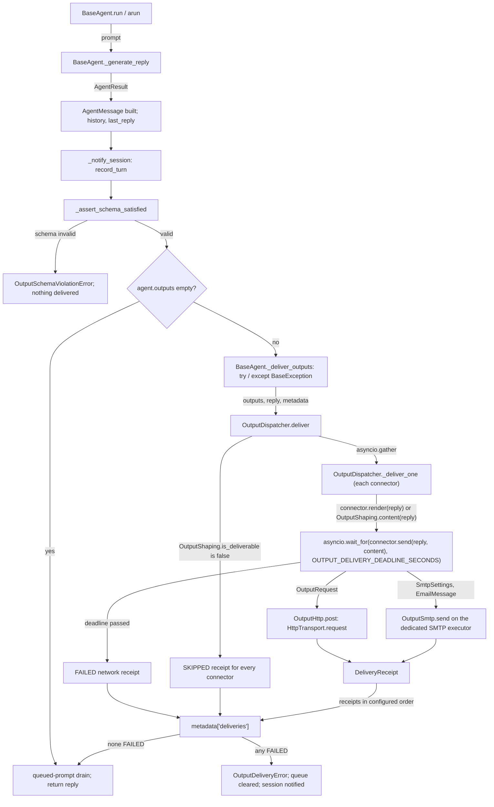
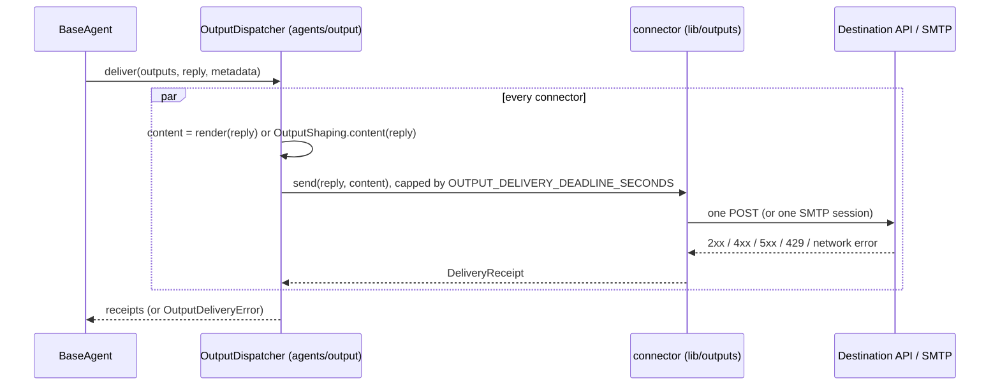

# Spec: Agent output connectors

> **TL;DR** — A developer adds `outputs=[SlackOutput(), GitHubIssueOutput(repo="acme/shop")]` to `BaseAgent`, `CodingAgent`, or `JevAgentSettings`. After each finished, validated reply, the SDK sends it to every configured destination. The model never holds the credential and never picks the destination. Eleven credential-only destinations ship: Slack, Discord, Microsoft Teams, Google Chat, Telegram, email over SMTP (which covers Gmail), GitHub issues, Linear, Jira, Notion, and a generic webhook. The layout follows the three placement clauses of Prompt 4. "This abstraction to live inside of the vidbyte-sdk/vidbyte/agents/output folder": the `OutputConnector` contract is a `typing.Protocol` in `vidbyte/agents/output/`. "Our output folder [is] responsible for the core logic kind of linking the provider and agent logic": the rules for when a reply is sent and how it becomes a title and body, and the dispatcher that calls each connector, also live there. "The provider specific logic ... in the lib folder": each platform is one class in `vidbyte/lib/outputs/` that only knows how to send a title and body to its destination. The lib classes satisfy the Protocol structurally, so `lib/` never imports `agents/` (AGENTS.md Style 3).

## §0 User prompts

### 0.1 Invoking request (verbatim)

/spec-pipeline Great, i want you to start with creating a spec and implementing this feature inside of the vidbyte-sdk/ repo. i think that I want this abstraction to live inside of the vidbyte-sdk/vidbyte/agents/output folder, and for all of the provider specific logic they can either go in the lib folder of the repo or the provider folder of the repo, and then our output folder and be responsible for the core logic kind of linking the provider and agent logic, and then of course we bolt the parameter on our BaseAgent (and I think we can bolt it only our JevAgent and CodingAgent as well). What i also want you to do in the spec is come up with a list of popular platforms that we implement like the example above  (without an oauth token) to also integrate with this output connector features (platforms like microsoft teams, gmail, slack, discord, notion, etc come to mind. But double check these and find more examples where we can store agent outputs), want implementation to not be overengineers, clean, modular, and elegant.  best of luck to you kid (will be comparing your output with gpt 6.1 astra)

### 0.2 User replies during the run

_None yet. The orchestrator appends any reply the user sends during the run here verbatim, labeled with the revision it produced._

---

## Part A — Framing

## §1 Goal

Today an SDK user who wants an agent's result in Slack, a GitHub issue, or an inbox writes the HTTP or SMTP code by hand after `agent.run(...)`. The other option is to give the model an MCP tool and hope it posts once, to the right place, after it finishes. Neither is "1 line using a key" (Prompt 1). The MCP route has a second problem: delivery happens inside the loop, before `BaseAgent._assert_schema_satisfied` (`vidbyte/agents/base.py:931`) validates the output. On top of that, the SDK's own messaging MCP presets point at packages that no longer exist (request.md §C, "Rejected alternatives").

| ID | Goal (outcome) | How we will know | Source |
|---|---|---|---|
| G-1 | A developer sends an agent's finished reply to a third-party destination by adding one entry to `outputs=[...]` and supplying one credential (constructor argument or environment variable), writing no delivery code. | The §4 snippet is the whole integration; AC-1 passes. | Prompt 1 "very easily be able to connect the output of their agent to a 3rd party provider", "bolt on this ability to their agent in 1 line using a key" |
| G-2 | Delivery is deterministic. Each configured destination receives each finished, validated reply at most once. The model never sees the credential and never chooses where the reply goes. | INV-1, INV-2, INV-3 hold; AC-4 and AC-12 pass. | Prompt 1 "determinstically pass teh structured output of the agent"; request.md §C "Deterministic delivery" |
| G-3 | Users get a researched, cited catalog of popular destinations that need no OAuth. This PR implements the qualifying ones across chat, email, issue trackers, docs, and generic webhooks, and every platform the user named appears as implemented or excluded with a verified reason. | §9.2 tables (a) and (b); `vidbyte/lib/outputs/README.md` provider table (AC-26). | Prompt 1 "what are a list of all platforms"; Prompt 4 "double check these and find more examples where we can store agent outputs"; Prompt 2 "lets assume no aoath token" |
| G-4 | A failed delivery is never silent. The caller gets the reply, one receipt per destination, and an exception that names which destinations failed and why, in a form that contains no secrets. | AC-5, AC-7, AC-23 pass. | request.md §B ledger "Needs you 2" default; §C "Failure behavior" |

## §2 Objective

When this PR merges, `BaseAgent` (and therefore `Agent` and `CodingAgent`) accepts `outputs: Sequence[OutputConnector] = ()`. `JevAgentSettings` gains a validated `outputs` field that `JevAgent` passes through, and `BaseAgent.restore(...)` accepts `outputs=`.

A new `vidbyte/agents/output/` package holds the agent side, where the user placed it:
- **`OutputConnector`:** the contract, a runtime-checkable `typing.Protocol` with `destination`, `render`, and `async send(reply, content) -> DeliveryReceipt`.
- **`OutputShaping`:** the rules for when a reply is a finished answer worth sending, and how it becomes an `OutputContent` title and body.
- **`OutputDispatcher`:** after the schema check and before the queued-prompt drain, it decides whether to deliver, builds each connector's content (its `render`, or `OutputShaping.content`), calls every connector's `send` concurrently, each capped at `OUTPUT_DELIVERY_DEADLINE_SECONDS`, and records the receipts in `reply.metadata["deliveries"]`. If any delivery failed, it raises `OutputDeliveryError`, and only after the turn has been recorded. `BaseAgent._generate_reply` calls it through one private helper, `BaseAgent._deliver_outputs`, which holds the `try` / `except BaseException` block. A second private helper, `_record_last_trace`, takes three existing lines out of `_generate_reply`, because lint rule S008 leaves that function no room to grow (D-4, S3-1).

A new `vidbyte/lib/outputs/` package holds provider work only. That means eleven connector classes, each a subclass of the small `BaseOutput` base:
- `SlackOutput`
- `DiscordOutput`
- `TeamsOutput`
- `GoogleChatOutput`
- `TelegramOutput`
- `EmailOutput`
- `GitHubIssueOutput`
- `LinearIssueOutput`
- `JiraIssueOutput`
- `NotionPageOutput`
- `WebhookOutput`

It also holds argument checks (`OutputArguments`), pure text helpers (`OutputText`), and send-and-map helpers (`OutputHttp`, `OutputSmtp`). Each connector resolves its credential when it is constructed. Its `send` delivers a title and body through `HttpTransport` (or, for email, through the standard library's `smtplib`, off the event loop) and returns a `DeliveryReceipt`. The lib classes satisfy the agent-side Protocol structurally and never import `vidbyte.agents`.

New records, enums, and constants live in `vidbyte/lib/dataclasses/outputs.py`, `vidbyte/lib/enums/outputs.py`, and `vidbyte/lib/constants/outputs.py`. The public names are exported from the package root, and the public-API contract is regenerated. The PR also carries the platform catalog (§9.2) and a provider reference README. This PR is the whole feature: no later slice is planned, and anything left out is listed in §3.

## §3 Non-goals

- **NG-1** — OAuth-based destinations and OAuth flows: the Gmail API, Microsoft Graph (Outlook, OneDrive, SharePoint), Google Sheets, Drive and Docs, Dropbox, X, LinkedIn, and Teams flows that use tenant authentication. — *Why not:* Prompt 2, "lets assume no aoath token". They appear in §9.2 table (b).
- **NG-2** — Model-driven or MCP-driven delivery, and any use of `vidbyte/lib/config/mcp_presets.py` or `vidbyte/tools/mcp/presets.py`. — *Why not:* rejected in the conversation (request.md §C). Model-driven delivery is nondeterministic, runs before schema validation, and hands a write token to a model that reads untrusted input.
- **NG-3** — Reading the vidbyte-cli keyring, hosted credential storage, a `Secret` wrapper class, and SDK CLI commands. — *Why not:* request.md §C credentials decision; the owner's rule against CLI commands in the SDK (field guide `prebuilt-agents.md`, "An SDK agent runs from Python only").
- **NG-4** — Declarative or YAML configuration of `outputs`. — *Why not:* `AgentSettings` deliberately leaves out non-serializable construction inputs (`vidbyte/lib/dataclasses/config.py:25-28`), `_ALLOWED_FIELDS` rejects unknown keys, and no rule or test forces parity (code-map §4 item 14). The question is carried as Q-7.
- **NG-5** — An `outputs` option on `CodexHarnessAgent`, `MultiAgent`, or `AggregateAgent`. Also out: any delivery from agents the SDK builds internally, and stripping or rejecting `outputs` on user-supplied sub-agents. The internal agents are forks, `as_tool()` children, MultiAgent workers, workflow `AgentStage(fresh_fork=True)` runs, the Jev bulk-work, clone, swarm, and fresh-continuation agents, and session rebuilds. — *Why not:* Prompt 4 names only BaseAgent, JevAgent, and CodingAgent. `CodexHarnessAgent` builds its own reply outside `BaseAgent._generate_reply` (`vidbyte/agents/codex/agent.py:100-178`). `MultiAgent` and `AggregateAgent` have explicit constructors and override `generate_reply` (`vidbyte/agents/multi/agent.py:49`, `vidbyte/agents/aggregation.py:198`). The fork rule is D-7. A user-built agent that carries its own outputs still delivers when it runs (EC-44, EC-45). These are carried as Q-1, Q-2, and Q-8.
- **NG-6** — Retrying anything other than HTTP 429. Also out: a resend helper, an outbox or queue, and persisting receipts into session checkpoints. — *Why not:* request.md §C retry decision, which holds that duplicates are worse than a reported failure. `OutputDispatcher.deliver` already lets a caller resend the failed connectors (AC-24). Persistence is carried as Q-6.
- **NG-7** — Signed (HMAC) webhooks. — *Why not:* the conversation proposed an optional HMAC secret but never settled it, and none of the automation receivers in §9.2 checks a custom HMAC without user-written code. It is carried as Q-3, default no.
- **NG-8** — Rich formatting and extra message features: Slack blocks, Adaptive Card layouts beyond one TextBlock, Telegram `parse_mode` or `sendRichMessage`, Notion block trees, Jira markdown-to-ADF conversion, attachments, threads, replies, and editing or deleting earlier posts. — *Why not:* plain text cannot be misread as mentions or markup (D-18). Every extra format adds a converter per destination, which runs against "not be overengineers".
- **NG-9** — Splitting a long body into several messages. — *Why not:* D-14. A split post means several sends, any of which can fail on its own.
- **NG-10** — Connectors for destinations in §9.2 table (b), including the ones that qualify but fall below the cut, such as GitLab, Asana, and Webex. — *Why not:* each was researched and set aside for the reason in its row (D-17).
- **NG-11** — Splitting `vidbyte/agents/base.py`, which is 1,694 lines, already above AGENTS.md Style 3's "well below 1,000". — *Why not:* AGENTS.md, "Do not rewrite untouched code just to make it conform; that belongs in its own pull request." This PR adds at most 35 lines there (NFR-3) and puts the delivery logic in the dispatcher.
- **NG-12** — GitHub Enterprise Server, Jira Data Center, Jira scoped API tokens (which go through `api.atlassian.com/ex/jira/{cloudId}`), SMTP implicit TLS on ports other than 465 (for example Amazon SES 2465), and self-hosted endpoints other than the generic webhook. — *Why not:* each would need another addressing or transport knob. The briefing limits knobs to what addresses the target, plus `render=`. SES 2465 is carried as Q-9.

## §4 Developer usage

```python
from pydantic import BaseModel

from vidbyte import Agent, GitHubIssueOutput, OutputDeliveryError, SlackOutput


class BugReport(BaseModel):
    title: str
    body: str


agent = Agent(
    name="checkout-scout",
    system_prompt="Find the worst bug in the checkout flow.",
    provider="openai",
    model_name="gpt-4.1",
    output_schema=BugReport,
    outputs=[
        SlackOutput(),                                         # reads SLACK_WEBHOOK_URL
        GitHubIssueOutput(repo="acme/shop", labels=("bug",)),  # reads GITHUB_TOKEN
    ],
)

try:
    reply = agent.run("Scan checkout")
except OutputDeliveryError as err:
    reply = err.reply
    for receipt in err.failed:
        print("failed:", receipt.destination.value, receipt.error_code)

for receipt in reply.metadata["deliveries"]:
    print(receipt.destination.value, receipt.status.value, receipt.url)
```

When both deliveries succeed, the snippet prints exactly:

```text
slack sent None
github_issue sent https://github.com/acme/shop/issues/412
```

The developer does not write HTTP or SMTP code, decide when to send, handle rate limits, or keep secrets out of logs. The model fills in `title` and `body`. After the reply passes schema validation, the SDK posts `"<title>\n\n<body>"` to the Slack channel and opens an issue with that title and body.

## §5 Flow diagram





**Validation before the run.** The constructors validate configuration and resolve credentials: `OutputArguments` and each connector's `__init__` for connectors, and `OutputDispatcher.connectors` for the `outputs` list. A bad setup therefore fails before any model call.

**State changes.** `_generate_reply` changes state as it does today: it appends the reply to history, sets `last_reply`, and records the turn in the bound session. After all of that, delivery writes one new metadata key.

**The agent side** (`vidbyte/agents/output/`).
- `OutputDispatcher.deliver` first asks `OutputShaping.is_deliverable` whether the reply is a finished answer. If it is not, every receipt is SKIPPED and no connector is called.
- Otherwise `_deliver_one` runs once per connector: it builds the content, checks that it is an `OutputContent`, and awaits `connector.send` under `asyncio.wait_for`. A send still running after `OUTPUT_DELIVERY_DEADLINE_SECONDS` becomes FAILED `network`.

**The provider side** (`vidbyte/lib/outputs/`). Each connector's `send`, through `OutputHttp.post` or `OutputSmtp.send`, turns expected failures (an HTTP status, a network error, an SMTP error) into a FAILED receipt, so one destination never stops another.

**Back on the agent side.** `OutputDispatcher.deliver` turns any other `Exception` into a FAILED `unexpected:<Type>` receipt and re-raises cancellation unchanged. It raises `OutputDeliveryError` only after it has collected every receipt.

---

## Part B — Behavior (this is the spec; everything else is framing)

## §6 Behavior

### 6.1 Invariants

**Lifecycle**
- **INV-1** — Delivery never starts until `_assert_schema_satisfied(result)` has returned. A reply that fails its declared `output_schema` raises `OutputSchemaViolationError`, calls no connector, and writes no `"deliveries"` key.
- **INV-2** — For each reply produced by `_generate_reply`, every configured connector's `send` is called at most once, and exactly once unless the reply is skipped (INV-9) or that connector's content cannot be built. A `render` that raises, or that returns anything other than an `OutputContent`, makes zero sends for its connector, and that connector's receipt is FAILED `unexpected:<ExceptionTypeName>`; a wrong return type gives FAILED `unexpected:ConfigurationError` (AC-11 (e), EC-16). Each drained follow-up reply is a separate reply, delivered on its own pass through `_generate_reply`.
- **INV-3** — The connector's constructor arguments and the environment at construction time are the only sources of a destination, URL, recipient, repo, team, page, chat, or credential. Nothing in the model's output, a tool call, or `reply.metadata` can change where a reply goes or which credential is used.

**Credentials**
- **INV-4** — A resolved credential appears only in the request that goes to its own destination. That means a URL, an `Authorization` header, an `api_token`, a bot token, or an SMTP password. It never appears in any of these:
  - the `repr()` or `str()` of a connector, `OutputRequest`, `SmtpSettings`, `JevAgentSettings`, or `agent.outputs`;
  - any `DeliveryReceipt`;
  - any `error_code`;
  - the message, `details`, or diagnostic fields of `OutputDeliveryError` or `ConfigurationError`;
  - `reply.metadata`, `export_state()`, `RunState`, session checkpoints, or traces;
  - any log record. While `OutputHttp.post` runs, a filter on the `httpx` logger drops the `HTTP Request: POST <url>` record that httpx writes at INFO, because for six connectors that URL is the credential (§12.3 row 7, EC-41). The user's own httpx requests are still logged.

  Redirects are never followed (`follow_redirects=False`), so a credential header is never forwarded to a second host.
- **INV-5** — A credential is resolved once, in the connector's constructor, in this order:
  1. the explicit argument, if it is non-blank after `strip()`, stripped;
  2. the destination's environment variable (§9.3), if it is non-blank after `strip()`, stripped;
  3. otherwise, `ConfigurationError` naming both the parameter and the variable, never any value.

**Delivery**
- **INV-6** — Every configured connector is attempted, whatever happens to the others. `reply.metadata["deliveries"]` is a `tuple[DeliveryReceipt, ...]` with exactly one receipt per connector, in the configured order, whatever order the sends finish in.
- **INV-7** — If any receipt is FAILED, `OutputDeliveryError` is raised after every connector has finished. By then the reply is already in `agent.history`, `agent.last_reply`, and the bound session. The error carries `.reply` (the same object), `.receipts` (the same tuple), and `.failed`. Before the error leaves `_generate_reply`, the `except BaseException` block in `BaseAgent._deliver_outputs` clears `_queued_prompts` and calls `_notify_session_exception`. Inside a run, `_queued_prompts` is the list the run claimed at its start (`vidbyte/agents/base.py:392-395`, `792-795`), so clearing it means that run's follow-ups never run later. This holds for every exception the block catches, cancellation included.
- **INV-8** — If every receipt is SENT or SKIPPED, `run`, `arun`, and `generate_reply` return the reply normally.
- **INV-9** — A reply is skipped in either of these cases:
  - **(a)** its `content` is blank after `strip()`;
  - **(b)** `reply.metadata` has a `stop_reason` that is not in `OUTPUT_DELIVERABLE_STOP_REASONS` (`"final_response"`, `"is_done"`).

  Case (b) covers `"middleware_abort"`, every budget or guard stop (`max_iterations`, `max_tokens`, `max_tool_calls`, `timeout`, …), and the rejected-answer stops `contract_unsatisfied`, `finish_review_rejected`, `tool_settings_denied`, and `error` (`vidbyte/lib/dataclasses/agents.py:51-70`). Such a run did not finish with an accepted answer, and its content is often an SDK-written notice such as "Agent runtime stopped after reaching max_iterations." (`vidbyte/agents/runtime.py:_stopped_result`). A reply with no `stop_reason` key is delivered. The example is the JevAgent clarification stop (`JevResponse.stopped`, `vidbyte/agents/jev/response.py:134-137`). Normal Jev finishes carry the inner runtime's `final_response` or `is_done`, because `JevRuntime` subclasses `AgentRuntime` (`vidbyte/agents/jev/runtime.py:40`; `runtime.py:1911`). When a reply is skipped, the dispatcher records a SKIPPED receipt for every connector and calls no connector.
- **INV-10** — An HTTP request is retried only after a 429 response, and at most `OUTPUT_RATE_LIMIT_RETRIES` times. Timeouts, network errors, 5xx responses, other statuses, and every SMTP failure are never retried.
- **INV-11** — Every `error_code` matches exactly one of these forms:
  - `http_<status>`
  - `http_<status>:<token>`, where `<token>` is the whole stripped response body and fully matches `OUTPUT_ERROR_TOKEN_PATTERN`
  - `network`
  - `invalid_response`
  - `smtp_<code>`
  - `smtp_recipients_refused`
  - `smtp_error`
  - `unexpected:<ExceptionTypeName>`

  No code contains a URL, header, credential, exception message, or any other response text.

**Content**
- **INV-12** — No delivered text can trigger a channel-wide or mass mention:
  - **Slack:** `&`, `<`, and `>` are escaped to `&amp;`, `&lt;`, and `&gt;`.
  - **Discord:** every payload carries `"allowed_mentions": {"parse": []}`.
  - **Google Chat:** every `<users/` is replaced with `＜users/` (U+FF1C).
  - **Notion:** every `<mention-` in the `markdown` body is replaced with `＜mention-` (U+FF1C). Notion's `markdown` parameter takes enhanced markdown, and its mention tags notify workspace members.
  - **Teams and Telegram:** the text is sent as plain text (a TextBlock, or no `parse_mode`).
  - **Not covered:** a per-user mention still notifies the named person on GitHub (`@user`, `@org/team` in an issue body) and Telegram (`@username` in group text). This is an accepted limitation (T-2); neutralizing `@` there is Q-10, not built.
- **INV-13** — `OutputShaping.content(reply)` shapes content when the connector has no `render`:
  - **body:** the structured `body` field if it is a non-blank `str`, otherwise `reply.content`.
  - **title, in order of preference:** the structured `title` field if it is a non-blank `str`; when `reply.structured is None`, the body's first non-empty line with leading `#` and whitespace removed; otherwise `reply.sender` (the agent's name).
  - **render:** a connector's `render` callable replaces this rule entirely. `OutputDispatcher` calls it, and its return value must be an `OutputContent`.
- **INV-14** — A body longer than its destination's cap is cut so the result, including `OUTPUT_TRUNCATION_MARKER`, is exactly the cap. It is still sent as one request and never split. Destinations with no documented cap get the full body.
- **INV-15** — A title sent as an email subject or as an issue or page title becomes one line: every run of whitespace, including CR and LF, becomes one space. It is then cut to at most `OUTPUT_TITLE_MAX_CHARS` with no marker. `OutputText.single_line` never calls `truncate`, whose marker contains newlines.

**Composition and state**
- **INV-16** — Agents the SDK builds internally never deliver; each has `outputs == ()`:
  - `fork()` children, and therefore `as_tool()` children, MultiAgent workers, and workflow `AgentStage(fresh_fork=True)` runs;
  - Jev bulk-work workers;
  - Jev compute clone and swarm agents;
  - the Jev fresh-continuation agent;
  - agents rebuilt by `Session.fork_from` and `Session.resume`.

  A user-built agent that carries its own `outputs` delivers whenever it runs, wherever it runs (EC-44, EC-45).
- **INV-17** — Outputs are never serialized. `export_state()` and `RunState` keep their current field set, and `BaseAgent.restore(state, outputs=...)` is the only way to re-attach outputs to a restored agent.
- **INV-18** — Email always travels over verified TLS: implicit TLS on port 465 via `SMTP_SSL`, otherwise `starttls(context=ssl.create_default_context())`. If STARTTLS is unavailable, the send fails. It never falls back to plaintext.
- **INV-19** — No blocking I/O runs on the event loop. The whole SMTP session runs on a dedicated module-level `ThreadPoolExecutor` in `vidbyte/lib/outputs/email.py`, through `loop.run_in_executor`, and never through `asyncio.to_thread`. The reason: on Python 3.11, `asyncio.run` joins the loop's default executor, which `asyncio.to_thread` uses, with no timeout (`asyncio.runners.Runner.close`), so a slow SMTP server would hold sync `run()` past `OUTPUT_DELIVERY_DEADLINE_SECONDS` (NFR-2, EC-47). `asyncio.run` does not join a dedicated executor. A timed-out email may therefore still be delivered after `run()` has raised with FAILED `network`; that risk is already accepted under EC-19 and EC-47. Interpreter exit still waits for the worker thread, because `concurrent.futures` joins its workers at shutdown.
- **INV-20** — A `BaseException` that is not an `Exception`, such as `asyncio.CancelledError` or `KeyboardInterrupt`, raised during delivery propagates unchanged. It is never turned into a receipt or an `OutputDeliveryError`, and the queued prompts are still cleared.
- **INV-21** — Invalid configuration raises `ConfigurationError` while the connector, the `Agent`, or `JevAgentSettings` is being constructed, before any model call. Invalid configuration includes:
  - a bare string, mapping, or single connector passed as `outputs`;
  - an item that is a class rather than an instance, that does not satisfy `OutputConnector`, whose `destination` is not an `OutputDestination`, or that is the same connector instance listed twice;
  - a missing credential, a URL that is not `https://`, or a URL that `urlsplit` cannot parse or whose port is not a number in range (the error never echoes the value);
  - a malformed repo, UUID, site, or address;
  - a port out of range;
  - a `render` that is not callable.

**Must not regress:**
- **INV-22** — An agent built without `outputs` behaves exactly as it does today. `_generate_reply` adds no await and writes no `"deliveries"` key (`vidbyte/agents/base.py:_generate_reply`, lines 896–934).
- **INV-23** — The signature `JevAgent.__init__(self, settings, runtime_settings=None)` is unchanged (`tests/test_jev_agent.py:504-509`).
- **INV-24** — `CodingAgent`'s signature and its "overrides no BaseAgent method" contract are unchanged (`tests/features/coding_agent/test_coding_agent_contract.py`).
- **INV-25** — `BaseAgent.restore(..., output_schema=...)` round trips, and `Session.resume` and `Session.fork_from`, behave exactly as today (`tests/test_restore_output_schema.py`; `vidbyte/sessions/session.py:459`).
- **INV-26** — The handoff block (`base.py:920-927`), `_notify_session` (928), `_assert_schema_satisfied` (931), and `_drain_queued_prompts` (932–933) keep their order and behavior. Delivery sits between 931 and 932.
- **INV-27** — `pyproject.toml` runtime dependencies are byte-identical. No new runtime dependency.
- **INV-28** — No lint rule REGRESSES against `lint/baseline.json`, including S009 (mypy), and the Semgrep typed-mapping policy passes.

### 6.2 Acceptance criteria

| ID | Given | When | Then | Priority | Proof |
|---|---|---|---|---|---|
| AC-1 | A clean checkout of this branch. `SLACK_WEBHOOK_URL` and `GITHUB_TOKEN` are set. The model returns a valid `BugReport` with stop reason `final_response`. Slack answers 200 `ok` and GitHub answers 201 with `html_url` `https://github.com/acme/shop/issues/412`. | The §4 snippet runs. | It prints exactly the two lines shown in §4 and raises nothing. | P0 | `test_output_connectors_acceptance.py::test_spec_snippet_delivers_one_validated_reply_to_slack_and_a_github_issue_and_prints_both_receipts` |
| AC-2 | `SLACK_WEBHOOK_URL` is `" https://hooks.slack.com/services/T/B/X\n"`. | `SlackOutput()` is built and a reply is delivered. | The POST goes to the stripped URL. With both an explicit `webhook_url` and the variable set, the explicit value wins. With neither set, construction raises `ConfigurationError` whose message contains `webhook_url` and `SLACK_WEBHOOK_URL` and does not contain any URL. | P0 | `test_output_connectors_configuration.py::test_slack_credential_from_the_environment_is_stripped`<br>`test_output_connectors_configuration.py::test_slack_credential_prefers_a_non_blank_explicit_argument_over_the_environment`<br>`test_output_connectors_configuration.py::test_slack_credential_missing_everywhere_raises_the_documented_message` |
| AC-3 | Any connector built with credential value `S`, an agent using it, and a delivery that fails. | These are rendered: `repr()` and `str()` of the connector and of `agent.outputs`; a `JevAgentSettings` holding it; every receipt; `str(err)` and `err.details`; `reply.metadata`; `agent.export_state()`. | None of them contains `S`. | P0 | `test_output_connectors_security.py::test_no_surface_shows_the_credential_even_when_the_destination_echoes_it` |
| AC-4 | An agent with `output_schema` and outputs, and a scripted model that returns the same invalid output on every call. (The runtime re-prompts the model to repair invalid structured output, so one invalid answer is not enough.) | `run` is called. | `OutputSchemaViolationError` is raised, no outbound request is made, and the reply metadata has no `"deliveries"` key. | P0 | `test_output_connectors_acceptance.py::test_reply_that_fails_its_output_schema_raises_and_sends_nothing` |
| AC-5 | `outputs=[SlackOutput(...), GitHubIssueOutput(...)]`. Slack answers 404 with body `no_service`, and GitHub answers 201. | `run` is called. | Both requests are made, and `OutputDeliveryError` is raised. `err.reply is agent.last_reply`, and that reply is the last entry of `agent.history`. `err.receipts` is (FAILED `slack` `http_404:no_service`, SENT `github_issue` with its URL). `err.failed` is the Slack receipt alone. `err.reply.metadata["deliveries"] == err.receipts`. | P0 | `test_output_connectors_acceptance.py::test_partial_failure_attempts_every_output_then_raises_with_the_recorded_reply_and_one_receipt_each` |
| AC-6 | A Slack connector. | The endpoint answers (a) 429 then 200; (b) 429 three times; (c) 500; (d) a transport `ProviderRequestError`; (e) no response before `OUTPUT_DELIVERY_DEADLINE_SECONDS` passes (patched small). | (a) SENT after exactly 2 requests. (b) FAILED `http_429` after exactly 3. (c) FAILED `http_500` after exactly 1. (d) FAILED `network` after exactly 1. (e) FAILED `network`, and any other connector's receipt is unaffected. | P0 | `test_output_connectors_http_failures.py::test_slack_answer_maps_to_one_receipt_and_only_a_429_is_retried`<br>`test_output_connectors_dispatch.py::test_destination_that_never_answers_is_failed_network_at_the_deadline_without_holding_back_the_others` |
| AC-7 | A webhook connector whose transport raises `ProviderRequestError` with an excerpt containing the full webhook URL. A Slack 404 with body `channel_not_found`. A Discord 400 with a JSON body. | Delivery runs. | The error codes are, in order, `network`, `http_404:channel_not_found`, and `http_400`. The URL appears in no receipt and in neither `str(err)` nor `err.details`. | P0 | `test_output_connectors_http_failures.py::test_mixed_failures_give_their_codes_in_configured_order_and_no_url_leaks` |
| AC-8 | Three replies: (a) one whose content is whitespace; (b) one whose metadata `stop_reason` is `"middleware_abort"`, with non-empty content; (c) one whose metadata `stop_reason` is `"max_iterations"`, with content `"Agent runtime stopped after reaching max_iterations."`. | Delivery runs. | Every receipt is SKIPPED, no outbound request is made, and nothing is raised. | P0 | `test_output_connectors_dispatch.py::test_stopped_or_blank_reply_is_skipped_for_every_output_with_no_request_and_no_error`<br>`test_output_connectors_agent_wiring.py::test_run_stopped_by_max_iterations_is_skipped_for_every_output_and_returns_normally` |
| AC-9 | (a) Reply text `"<!channel> & @everyone <users/all>"`. (b) Body `"<mention-user url=\"user://u\"/> done"`. | (a) is delivered to Slack, Discord, Google Chat, and Telegram. (b) is delivered to Notion. | (a) Slack sends `"&lt;!channel&gt; &amp; @everyone &lt;users/all&gt;"`. Discord sends `allowed_mentions == {"parse": []}`. Google Chat's text contains `＜users/all>` and does not contain `<users/`. The Telegram body has no `parse_mode` key. (b) Notion's `markdown` contains `＜mention-user` and does not contain `<mention-`. | P0 | `test_output_connectors_wire_contract.py::test_channel_wide_mentions_are_neutralized_for_each_chat_destination`<br>`test_output_connectors_wire_contract.py::test_notion_mention_tags_in_the_markdown_body_are_neutralized` |
| AC-10 | A 5,000-character body sent to Discord. A plain-text reply whose first line is a 400-character paragraph, sent to GitHub and to email. | Delivery runs. | Discord's `content` is exactly 2,000 characters and ends with `OUTPUT_TRUNCATION_MARKER`, and exactly one request is made. The GitHub `title` and the email `Subject` are each exactly 250 characters, contain no CR or LF, and do not contain `[truncated]`. | P1 | `test_output_connectors_wire_contract.py::test_long_reply_is_capped_for_discord_and_its_long_first_line_becomes_a_250_character_one_line_title`<br>`test_output_connectors_wire_contract.py::test_long_first_line_becomes_a_250_character_one_line_title_at_every_titled_destination` |
| AC-11 | (a) Structured `BugReport(title="T", body="B")`. (b) Plain content `"# Heading\nrest"`. (c) Structured output with no `title` field. (d) `render` returns `OutputContent("X", "Y")`. (e) `render` returns a `str`. (f) A caller-written connector, listed beside them, whose `send` returns `None`. | Delivery runs to GitHub and Slack. | (a) GitHub `{title: "T", body: "B"}`, Slack text `"T\n\nB"`. (b) Title `"Heading"`, and the Slack text equals the content unchanged. (c) Title equals the agent's name. (d) GitHub `{title: "X", body: "Y"}`. (e) That connector's receipt is FAILED `unexpected:ConfigurationError`, and the other connectors are still attempted. (f) As in (e): that connector's receipt is FAILED `unexpected:ConfigurationError`, `OutputDeliveryError` is chained from that `ConfigurationError`, and the other connectors are still attempted. | P0 | `test_output_connectors_dispatch.py::test_default_shaping_turns_each_reply_into_one_title_and_one_body`<br>`test_output_connectors_dispatch.py::test_render_replaces_the_shaping_rule_for_its_own_connector_only`<br>`test_output_connectors_dispatch.py::test_render_that_returns_anything_but_output_content_fails_only_its_connector`<br>`test_output_connectors_dispatch.py::test_send_that_returns_anything_but_a_delivery_receipt_fails_only_its_connector` |
| AC-12 | A named agent with outputs, for example built with `agent_metadata=AgentMetadata(name="scout", ...)`. (`AgentTool` needs a non-empty tool name, so an unnamed agent fails with `ToolSpec.name cannot be empty`.) | `agent.fork()` is built, and `AgentTool(agent)` is executed. | `fork().outputs == ()`, and executing the tool makes no delivery request. | P0 | `test_output_connectors_agent_wiring.py::test_fork_and_agent_tool_children_never_deliver_the_parents_outputs` |
| AC-13 | An agent with outputs. | `export_state()` is called, then `BaseAgent.restore(state)` and `BaseAgent.restore(state, outputs=[c])`. | The `RunState` fields are unchanged. The first restore has `outputs == ()`, and the second delivers through `c`. | P1 | `test_output_connectors_agent_wiring.py::test_export_and_restore_never_serialize_outputs_and_reattach_only_what_the_caller_passes` |
| AC-14 | `JevAgentSettings(..., outputs=(SlackOutput(...),))` with a scripted model. | `JevAgent(settings)` runs. | `agent.outputs == settings.outputs`, the reply is delivered, and `inspect.signature(JevAgent.__init__)` is unchanged. `JevAgentSettings(..., outputs="slack")` raises `ConfigurationError`. | P0 | `test_output_connectors_agent_wiring.py::test_jev_agent_takes_outputs_from_its_settings_and_delivers_the_finished_reply`<br>`test_output_connectors_agent_wiring.py::test_jev_agent_settings_reject_a_bare_string_outputs_value` |
| AC-15 | `CodingAgent(root_dir=..., outputs=[c])`. | It is constructed and run. | `agent.outputs == (c,)`, the reply is delivered, and the coding-agent contract test passes unmodified. | P0 | `test_output_connectors_agent_wiring.py::test_coding_agent_accepts_outputs_through_its_base_options_and_delivers`<br>existing tests/features/coding_agent/test_coding_agent_contract.py (unmodified) |
| AC-16 | `EmailOutput(to="ops@acme.com", host="smtp.gmail.com", username="bot@acme.com")` with `SMTP_PASSWORD` set. | Delivery runs with: (a) port 587; (b) port 465; (c) `SMTPAuthenticationError(535)`; (d) a partial-refusal dict returned; (e) `SMTPNotSupportedError` on STARTTLS; (f) `TimeoutError`. Separately, a connector is built with `username="apikey"` and no `sender`. | (a) `smtplib.SMTP(host, 587, timeout=OUTPUT_TIMEOUT_SECONDS)`, then `starttls` with a context, then `login(username, password)`, then `send_message`. The message has `From` = username, `To` = the address, a single-line `Subject` of at most 250 characters, and a `text/plain` body. (b) `smtplib.SMTP_SSL(..., context=...)` with no `starttls`. (c) FAILED `smtp_535`. (d) FAILED `smtp_recipients_refused`. (e) FAILED `smtp_error`. (f) FAILED `network`. The `apikey` connector raises `ConfigurationError` naming `sender`. | P0 | `test_output_connectors_email.py::test_default_port_uses_starttls_then_login_then_one_plain_text_message_off_the_event_loop`<br>`test_output_connectors_email.py::test_port_465_uses_implicit_tls_with_a_verified_context_and_no_starttls`<br>`test_output_connectors_email.py::test_smtp_failure_maps_to_its_code_after_one_connection_and_stops_at_that_step`<br>`test_output_connectors_email.py::test_partial_refusal_returned_by_send_message_is_failed_recipients_refused`<br>`test_output_connectors_email.py::test_username_without_an_at_sign_and_no_sender_is_rejected_naming_sender` |
| AC-17 | Each HTTP connector, with a fake endpoint returning the documented success response. | Delivery runs. | Each sends exactly one request matching its §9.2 wire-contract row (method, URL, auth header name and form, version header, body keys). The receipt URL is GitHub `html_url`, Linear `data.issueCreate.issue.url`, `https://{site}/browse/{key}` for Jira (the `key` such as `PROJ-1` passes, because `link_prefix` is added before the `https://` check, D-21), Notion `url`, and `None` for the others. A Linear 200 response whose `issue.url` is missing gives FAILED `invalid_response`. | P0 | `test_output_connectors_wire_contract.py::test_each_http_connector_sends_its_documented_request`<br>`test_output_connectors_wire_contract.py::test_created_object_link_that_is_missing_or_unsafe_makes_a_2xx_response_failed_invalid_response` |
| AC-18 | A connector whose `send` raises `asyncio.CancelledError`, on an agent with queued prompts. | `arun` is called. | `CancelledError` propagates (no `OutputDeliveryError`). The queued-prompt list the run claimed at its start is cleared, so its follow-ups never run later. (Checking `agent._queued_prompts` after the run proves nothing, because every run leaves a fresh list there.) | P1 | `test_output_connectors_agent_wiring.py::test_cancellation_during_delivery_propagates_unwrapped_and_clears_the_runs_queued_prompts` |
| AC-19 | Two connectors, where the first connector's `send` cannot finish until the second connector's `send` has run, so the second finishes first. | Delivery runs. | Both are SENT, which only concurrent sends allow (a sequential dispatcher would leave the first blocked until the deadline). The receipts are in configured order (first, then second), not finish order. No wall-clock bound is asserted. | P1 | `test_output_connectors_dispatch.py::test_sends_run_concurrently_and_receipts_keep_configured_order_not_finish_order (structural, no wall clock; see test-plan.md)` |
| AC-20 | Any one of these invalid inputs: <br>• `outputs="x"`, `outputs=SlackOutput(...)`, `outputs=[SlackOutput]` (the class), `outputs=[object()]`, a caller-written connector whose `destination` is the `str` `"pagerduty"`, or the same instance twice <br>• `webhook_url="http://..."`, `webhook_url="https://[::1/x"` (unparseable), or `webhook_url="https://hooks.slack.com:abc/x"` (non-numeric port) <br>• `repo="acme"` or `labels="bug"` <br>• `team_id="ENG"` <br>• `parent_page_id="x"` <br>• `site="https://acme.atlassian.net"` or `email="jira-bot"` <br>• `to="not-an-address"` <br>• `port=0` <br>• `render=1` | The object is constructed. | `ConfigurationError` names the offending parameter; for every `outputs` case, the message contains `outputs`. A credential value never appears in the message. A single connector is rejected by the same not-iterable `outputs` check as any other non-iterable value; no separate check or message is required. | P0 | `test_output_connectors_configuration.py::test_invalid_connector_argument_is_rejected_at_construction_naming_the_parameter_and_no_secret`<br>`test_output_connectors_configuration.py::test_invalid_outputs_value_is_rejected_when_the_agent_is_built`<br>`test_output_connectors_configuration.py::test_invalid_outputs_value_is_rejected_when_the_agent_is_built[destination-not-an-enum]`<br>`test_output_connectors_configuration.py::test_invalid_connector_argument_is_rejected_at_construction_naming_the_parameter_and_no_secret[slack-unparseable-ipv6-host]`<br>`test_output_connectors_configuration.py::test_invalid_connector_argument_is_rejected_at_construction_naming_the_parameter_and_no_secret[slack-non-numeric-port]` |
| AC-21 | An agent without outputs, none of whose sub-agents has outputs (a JevAgent's delegated reply copies its specialist's metadata, EC-44). | It runs. | The reply metadata has no `"deliveries"` key, and the existing test suite passes unchanged. | P0 | `test_output_connectors_acceptance.py::test_agent_without_outputs_runs_exactly_as_before_and_writes_no_deliveries_key`<br>the full existing suite (python -m pytest) |
| AC-22 | The branch is complete. | The gates run. | `python lint/run.py` ends `SDK-LINT: PASS`, with no rule REGRESSED, including S009 (mypy, baseline 350). `python scripts/run_ci.py` passes. `python scripts/generate-sdk-public-api.py --check` passes. The Semgrep scan in §11 passes. The `pyproject.toml` dependencies are unchanged. | P0 | gate commands, not pytest: python lint/run.py; python scripts/run_ci.py; python scripts/generate-sdk-public-api.py --check; the §11 Semgrep scan |
| AC-23 | An agent bound to a `Session`, and an output that fails. | (a) `session.run(...)` is called. (b) `agent.run(...)` is called directly on the session-bound agent. | (a) The session has recorded the turn (its head checkpoint holds the reply), `session.failures` captured the `OutputDeliveryError` once, and the error reaches the caller. (b) The same holds when the agent is run directly. `Session.run` notifies the session itself, so only case (b) shows that `_deliver_outputs` calls `_notify_session_exception` (INV-7). | P1 | `test_output_connectors_acceptance.py::test_session_records_the_turn_and_captures_the_delivery_failure_before_it_reaches_the_caller`<br>`test_output_connectors_acceptance.py::test_agent_bound_to_a_session_reports_its_own_delivery_failure_when_run_directly` |
| AC-24 | An `OutputDeliveryError` whose first receipt failed. | The caller selects the failed connectors with `zip(agent.outputs, err.receipts, strict=True)` and awaits `OutputDispatcher.deliver(failed, err.reply, {})`. | Exactly one new request is made, to that destination only, and the call returns a one-receipt tuple, or raises `OutputDeliveryError` again if the destination fails again. Caution: if a failed receipt's `error_code` is `network` (which includes a send that passed the deadline), `invalid_response`, `smtp_error`, or `smtp_recipients_refused`, or starts with `http_5`, that output may already have been delivered, so the caller checks its destination first (EC-4, EC-5, EC-24, EC-47; D-21). | P2 | `test_output_connectors_dispatch.py::test_resending_only_the_failed_connectors_makes_one_new_request_to_that_destination` |
| AC-25 | A destination that answers 302 with a `Location` header. | Delivery runs. | FAILED `http_302` after one request, and no request is made to the `Location` target. | P1 | `test_output_connectors_http_failures.py::test_redirect_is_not_followed_so_the_token_never_reaches_the_location_host` |
| AC-26 | The merged docs. | They are read. | `vidbyte/lib/outputs/README.md` has one row per `OutputDestination`, each with its official doc link, how to get the credential, the least-privilege scope, and "Retrieved 2026-10-11". `vidbyte/agents/README.md` documents `outputs=`. `REPO_MAP.md` has entries for `vidbyte/agents/output/` and `vidbyte/lib/outputs/`. Every README is at most 40,000 characters. | P1 | `test_output_connectors_contract.py::test_docs_provider_reference_has_one_dated_row_with_an_official_link_per_destination`<br>`test_output_connectors_contract.py::test_docs_describe_outputs_in_the_agent_readme_and_both_folders_in_the_repo_map`<br>`test_output_connectors_contract.py::test_docs_new_folder_readmes_stay_within_40000_characters` |

### 6.3 Edge cases and failure modes

| ID | Trigger (input + state) | System behavior | User sees | Guarded by (INV-/D-) |
|---|---|---|---|---|
| EC-1 | A Slack webhook was revoked. POST returns 404 `no_service`. A GitHub output is also configured. | Slack gets FAILED `http_404:no_service`, GitHub still gets SENT, and then `OutputDeliveryError` is raised. | An exception naming `slack` and the code, with `err.reply` intact. Without the guard, a scheduled agent stays silently broken for weeks. | INV-6, INV-7, D-4 |
| EC-2 | Slack returns 429 once, then 200. | One retry after `HttpTransport`'s 0.5 s backoff, then SENT. | A normal reply. | INV-10, D-5 |
| EC-3 | Discord returns 429 with `retry_after` 5.0 three times in a row. | Three attempts (the backoff ignores `Retry-After`), then FAILED `http_429`. | `OutputDeliveryError`. Accepted: the transport has no `Retry-After` support, and adding it is out of scope. | INV-10; accepted |
| EC-4 | A read timeout after the destination may already have stored the post. | `ProviderRequestError` gives FAILED `network`, never retried. | A failure that may still have posted once. Without the guard, a retry would post twice. | INV-10, D-5 |
| EC-5 | GitHub returns 502 after creating the issue. | FAILED `http_502`, not retried. | A failure. At most one issue exists. | INV-10, D-5 |
| EC-6 | A prompt-injected reply contains `@everyone`, `<!channel>`, `<users/all>`, or `<mention-user …/>`. | Mentions are neutralized for each destination. | Literal text, and no channel-wide or mass ping. Without the guard, a whole server, space, or workspace member gets a notification. A per-user `@name` still notifies on GitHub and Telegram (T-2). | INV-12 |
| EC-7 | A 5,000-character reply goes to Discord. | It is truncated to 2,000 including the marker. | The post ends with `[truncated]`. Without the guard, Discord rejects every long reply with a 400. | INV-14, D-14 |
| EC-8 | `output_schema` is set and the model returns invalid JSON. | `OutputSchemaViolationError`. Nothing is sent. | The existing schema error. Without the guard, an unvalidated post would go out. | INV-1, D-3 |
| EC-9 | `before_run` middleware aborts. The content is `"Agent runtime stopped by middleware: …"`, and `stop_reason` is `"middleware_abort"`. | The dispatcher records SKIPPED for every connector. | No post. Without the guard, the abort notice would be posted to the channel. | INV-9, D-22 |
| EC-10 | The reply content is `""` or whitespace. | SKIPPED. | No post. Without the guard, Slack returns 400 `no_text`, which becomes a false failure. | INV-9 |
| EC-11 | `SlackOutput()` with `SLACK_WEBHOOK_URL` unset. | `ConfigurationError("Missing credential for slack output. Pass webhook_url or set SLACK_WEBHOOK_URL.")` at construction. | Fails before the run starts, not after an hour of agent work. | INV-5, INV-21 |
| EC-12 | The environment variable holds a pasted value with a trailing newline, or is whitespace only. | The value is stripped, and a blank value counts as missing. | It works, or EC-11 applies. | INV-5 |
| EC-13 | `webhook_url="http://hooks.slack.com/…"`, a URL with no scheme, a URL that `urlsplit` cannot parse (`https://[::1/…`), or a non-numeric port (`https://hooks.slack.com:abc/…`). | `ConfigurationError` naming `webhook_url`. `OutputArguments.https_url` re-raises a `urlsplit` or `.port` `ValueError` as `ConfigurationError` `from None`. The value is not echoed. | A clear error, and the secret is not printed. | INV-21, T-1 |
| EC-14 | `outputs=SlackOutput()` (not a list), `outputs="slack"`, `outputs=[SlackOutput]` (the class, not an instance), or a caller-written connector whose `destination` is not an `OutputDestination` (for example the `str` `"pagerduty"`). | `ConfigurationError` at `Agent` construction. The message contains `outputs`. | A clear error, where the alternative would be iterating characters, failing with a `TypeError` deep in the code, calling an unbound `send` at delivery time, or losing every receipt after the model run. | INV-21 |
| EC-15 | The same `SlackOutput` instance is listed twice. | `ConfigurationError`. Two different instances for the same destination (two channels) are allowed. | A clear error. Without the guard, every reply would be posted twice. | INV-21, INV-2 |
| EC-16 | `render` raises `KeyError`, or returns a `str`; or a caller-written connector's `send` returns `None` or anything else that is not a `DeliveryReceipt`. | That connector's receipt is FAILED `unexpected:KeyError` or `unexpected:ConfigurationError`; `_deliver_one` checks the awaited `send` value the same way it checks `render`'s. The others are still sent. `OutputDeliveryError` is chained `from` the first such exception. | An error with a traceback cause. | INV-6, INV-7 |
| EC-17 | A schema `{summary, severity}` has no `title` or `body` fields. | The title is the agent's name and the body is the reply's JSON content. | An issue titled `checkout-scout` whose body is JSON. Accepted default. `render` reshapes it. | INV-13, D-10 |
| EC-18 | A model-written title contains `"\nBcc: x@evil.com"`, or a plain-text reply opens with a 300-character paragraph. | Either title is collapsed to one line and cut to 250 characters, with no marker, before it becomes the `Subject` or an issue title. | One subject line. Without the guard, the result is header injection, an `EmailMessage` `ValueError`, or a Jira 400 on a multi-line summary. | INV-15, T-2 |
| EC-19 | The task is cancelled, or Ctrl-C is pressed, during delivery. | `CancelledError` or `KeyboardInterrupt` propagates, and the queue is cleared. An SMTP worker thread that has already started keeps running to completion and may still send. | Cancellation. Accepted: Python cannot cancel a thread. | INV-20, INV-19 |
| EC-20 | A drained follow-up reply fails delivery. | `_drain_queued_prompts` catches it and stores `repr(exc)` in the first reply's `metadata["queued_prompt_error"]` (existing contract at `base.py:1073-1107`). | The first `run` returns normally, and the failure shows only in metadata. Accepted: this is the drain's existing contract, and the repr carries no secret (INV-11). | INV-2, INV-11; accepted |
| EC-21 | An agent with outputs is forked, used through `as_tool()`, run as a MultiAgent worker, or run by a workflow `AgentStage(fresh_fork=True)`. | Every one of these runs a fork, which has `outputs == ()`, so nothing is delivered from it. | Only an agent the caller runs itself delivers. Without the guard, one user run would fan out N posts. | INV-16, D-7 |
| EC-22 | Linear returns 200 with `errors[]` (for example a bad `teamId`) and no issue. | `link_path` is missing, so the receipt is FAILED `invalid_response`. | A failure. Without the guard, a failed create would be reported as SENT. | D-21 |
| EC-23 | Linear's rate limit returns HTTP 400 `RATELIMITED`. | FAILED `http_400`, not retried. | A failure. Accepted: a 400 cannot be told apart from a validation error without parsing the body. | INV-10; accepted |
| EC-24 | SMTP accepts one of two recipients. | `send_message` returns the refused dict, so the receipt is FAILED `smtp_recipients_refused`, not retried. | A failure even though one person got the email. A retry would send them a duplicate. | INV-10, D-12 |
| EC-25 | Gmail is used with the account password, not an app password. | 535, so FAILED `smtp_535`. | The README tells users to use an app password. | D-12 |
| EC-26 | The SMTP server does not offer STARTTLS. | `SMTPNotSupportedError`, so FAILED `smtp_error`. Never sent in plaintext. | A failure. Without the guard, the password and message would travel in cleartext. | INV-18 |
| EC-27 | Two `arun` calls on the same agent run concurrently. | Each reply is delivered on its own. Connectors hold no per-send state. | Two posts, one per reply. | INV-2, D-6 |
| EC-28 | A session-bound agent with outputs runs more than one turn. | `record_turn` persists the turn before delivery, so that checkpoint has no `"deliveries"`. From the next turn on, every checkpoint, and every `export_state()`, serializes the earlier replies' receipts as `{"__dropped__": "DeliveryReceipt"}` (`SessionSerializer.message_to_dict`, then `_scrub_metadata`, then `_safe`: `vidbyte/sessions/serialization.py:111-119, 188-215`; `export_state` at `base.py:533`). | Marker entries in persisted history. Receipts live only in memory. Harmless; accepted (D-15; Q-6). | D-15; accepted |
| EC-29 | A GitHub token without push access, with `labels=("bug",)`. | GitHub creates the issue and silently drops the labels, so the receipt is SENT. | An issue without labels. Accepted. Documented in the README, with the scope needed. | accepted |
| EC-30 | The Teams flow uses "Any user in my tenant", or the flow fails after accepting the request. | (a) 401 or 403, so FAILED. (b) 202, so SENT, even though nothing was posted. | (a) A failure, and the README says to choose "Anyone". (b) A false SENT. Accepted: Teams returns no message id (A-2). | D-17; accepted |
| EC-31 | Telegram gets a wrong `chat_id`, or the bot is not in the chat. | 400 or 403, so FAILED `http_400` or `http_403`. | A failure. | INV-11 |
| EC-32 | The Notion page is not shared with the integration. | 404, so FAILED `http_404`. | The README explains sharing. | INV-11 |
| EC-33 | The Jira project requires extra fields, or `issue_type` does not exist in it. | 400, so FAILED `http_400`. | A failure. `issue_type=` addresses the type. | INV-11 |
| EC-34 | A compromised endpoint returns a 50 MB body. | The `max_response_bytes=OUTPUT_MAX_RESPONSE_BYTES` ceiling raises `ProviderRequestError`, so FAILED `network`. | A failure, with memory bounded. | T-5 |
| EC-35 | The endpoint answers 301 or 302. | The redirect is not followed, so FAILED `http_302`. | A failure. The credential header is not sent to the `Location` host. | INV-4, AC-25 |
| EC-36 | A connector bug raises `TypeError` inside `send`. | FAILED `unexpected:TypeError`, the others are still sent, and `OutputDeliveryError` is chained from it. | A failure with its cause. | INV-6, D-6 |
| EC-37 | The credential is rotated in the environment after construction. | The connector keeps the value it resolved at construction. | Building a new connector picks up the new value. Accepted: resolution happens once (INV-5). | INV-5; accepted |
| EC-38 | The JevAgent clarification preflight stops the run, and the reply content is the clarifying questions. | The clarification result (`JevResponse.stopped`, `vidbyte/agents/jev/response.py:134-137`) carries no `stop_reason`, so the reply is delivered like any other. | The channel receives the questions. Accepted. `render` can reshape the text. Q-5 covers skipping. | INV-9, INV-13; accepted |
| EC-39 | `run_sequentially([...])`, and the first message's delivery fails. | `OutputDeliveryError` stops the sequence, and the later messages do not run. | The same behavior as a schema failure today. Accepted. | INV-7; accepted |
| EC-40 | A webhook payload's `structured` value is a dict containing a non-JSON value (only possible with a custom runner). | `json.dumps` raises `TypeError`, so FAILED `unexpected:TypeError`. | A failure. | INV-6; accepted |
| EC-41 | A credential carried in a URL query (Google Chat `key` and `token`, an IFTTT key) or path (the Telegram bot token). | Never logged. While `OutputHttp.post` runs, the filter on the `httpx` logger drops the `HTTP Request: POST <url>` record that httpx writes at INFO (§12.3 row 7). The S4 verifier found no other logger printing the URL, even at DEBUG. The user's own httpx requests are still logged. On a network error, the error code is `network`. | No leak. | INV-4, INV-11, T-1 |
| EC-42 | The user calls `agent.run` again after an `OutputDeliveryError`. | Every output is sent again, including the ones that succeeded. | Possible duplicates. To avoid them, the caller resends only the failed connectors with `OutputDispatcher.deliver(failed, err.reply, {})` (AC-24). If a failed receipt's `error_code` is `network` (which includes a send that passed the deadline), `invalid_response`, `smtp_error`, or `smtp_recipients_refused`, or starts with `http_5`, that output may already have been delivered, so check its destination first (EC-4, EC-5, EC-24, EC-47; D-21). | D-4; accepted |
| EC-43 | An agent with no `output_schema` hits `max_iterations` (or `max_tokens`, `max_tool_calls`, `timeout`). Its content is `"Agent runtime stopped after reaching max_iterations."`. | `stop_reason` is outside `OUTPUT_DELIVERABLE_STOP_REASONS`, so the dispatcher records SKIPPED for every connector. | No post, and `run` returns normally. Without the guard, every capped run would open an issue and send an email titled with the notice. | INV-9, D-22 |
| EC-44 | A user agent with its own `outputs` is used as a `JevSpecialist` agent, or as an `AggregateAgent` proposer or aggregator. These run un-forked: `vidbyte/agents/jev/runtime.py:187`; `vidbyte/agents/aggregation.py:113-114, 144`. | The sub-agent delivers its own reply on its own run, and an outer agent with outputs delivers its own reply too. Then: <br>(a) Under JevAgent, a specialist's `OutputDeliveryError` is raised inside JevAgent's runtime call and surfaces as `AgentExecutionError`, with the original as `__cause__` (`base.py:879-890`). <br>(b) A successful delegation copies the specialist's whole `reply.metadata`, including `"deliveries"`, into the JevAgent's reply (`JevResponse.delegated`, `vidbyte/agents/jev/response.py:128-132`). A JevAgent without outputs therefore returns the specialist's receipts; a JevAgent with outputs replaces them with its own. <br>(c) An AggregateAgent proposer whose delivery fails raises, so it counts as a failed proposer and its draft is dropped. If fewer than `min_successful` proposers remain, the aggregate raises `AggregateExecutionError` (`vidbyte/agents/aggregation.py:89`, `116-132`). | Two posts per run when both agents carry outputs. `except OutputDeliveryError` around `jev.arun()` does not catch a specialist's failure. A Jev reply can carry receipts the JevAgent did not make. A revoked proposer webhook can fail the whole aggregate. Accepted. The README documents it. Rejecting such specialists is Q-8, not built. | INV-16, D-7; accepted |
| EC-45 | A user agent with outputs is a pipeline stage (`vidbyte/pipelines/base.py:67`), a workflow `AgentStage` without `fresh_fork` (`vidbyte/workflows/stages.py:109`, `:121`), or an MCP-served agent (`vidbyte/mcp_server/handlers.py:149`). | Each stage run or tool call runs the user's own agent, which delivers once per run. | One post per stage run or tool call. Accepted and documented in the README. | INV-16, D-7; accepted |
| EC-46 | `EmailOutput(port=2465)`, which is Amazon SES's second implicit-TLS port. | Any port other than 465 uses STARTTLS. The client opens a plain connection to a TLS listener, and its read of the greeting times out after `OUTPUT_TIMEOUT_SECONDS`. smtplib raises that read timeout as `SMTPServerDisconnected`, an `SMTPException`, which `OutputSmtp.send` catches before `OSError`, so the receipt is FAILED `smtp_error`. | A failure with no hint. The README says to use 465 or 587 with SES. Accepted; an `implicit_tls` flag is Q-9, not built. | INV-18; accepted |
| EC-47 | A destination accepts the request and then sends its response one byte at a time, each byte inside the httpx read timeout (a compromised receiver), or an SMTP server stalls between replies. | `asyncio.wait_for` in `OutputDispatcher._deliver_one` stops waiting after `OUTPUT_DELIVERY_DEADLINE_SECONDS`, which cancels the HTTP request, and the receipt is FAILED `network`. Email is bounded the same way for `arun()` and sync `run()`, because the SMTP session runs on a dedicated executor that `asyncio.run` does not join (INV-19). Its worker thread keeps running to completion, so a timed-out email may still be delivered later (as in EC-19). | A failure within the deadline. Without the guard, one trickling endpoint could hold `run()` for hours with no receipt, and every other connector's receipt would wait with it. | NFR-2, T-5, D-6, INV-19 |
| EC-48 | The SMTP server accepts the message (`send_message` returns) and then answers QUIT with a code other than 221 (for example 250 or 421), or drops the connection at QUIT. | The receipt is decided once `send_message` has returned. Closing the session runs under `contextlib.suppress(smtplib.SMTPException, OSError)`, so the receipt stays SENT, or FAILED `smtp_recipients_refused` when `refused` is non-empty. | A normal reply. The email was delivered; without the rule its receipt would be FAILED `smtp_250` or `smtp_421`, and a resend would send it twice. | INV-11, FR-17 |
| EC-49 | A credential with a non-ASCII character (for example a pasted U+200B) that is sent as-is in an HTTP header. | Construction accepts it, because INV-5 checks only blankness. Every delivery fails as FAILED `unexpected:UnicodeEncodeError`. The value can appear in `repr(err.__cause__)`, but not in `str(err)`, `details`, or the formatted traceback. | `OutputDeliveryError` on every run. A stated limitation: rejecting such credentials at construction is Q-11, not built. | INV-4, INV-5; accepted |

**Rollback of the user action:** The SDK cannot unsend anything. Each destination keeps what it accepted. The user deletes a Slack or Teams message in the client, closes or deletes the GitHub, Linear, or Jira issue, or archives the Notion page. Receipt URLs (GitHub, Linear, Jira, Notion) point to the object to undo. Removing a connector from `outputs` stops future deliveries. Nothing in the SDK's own state needs rolling back, because outputs are never persisted (INV-17).

## §7 Requirements

**Functional**
| ID | Requirement | Priority | Source (request.md / G-) |
|---|---|---|---|
| FR-1 | `BaseAgent.__init__` takes the keyword `outputs: Sequence[OutputConnector] = ()`, validated by `OutputDispatcher.connectors` and stored as `agent.outputs: tuple[OutputConnector, ...]`. `Agent` (the alias) and `CodingAgent` (through `**kwargs`) accept it unchanged. It is accepted for every `AgentRuntimeType`. | P0 | Prompt 4 "bolt the parameter on our BaseAgent"; G-1 |
| FR-2 | `JevAgentSettings.outputs: tuple[OutputConnector, ...] = ()` is validated in `__post_init__`, and `JevAgent` passes it to `BaseAgent.__init__`. | P0 | Prompt 4 "JevAgent and CodingAgent"; AGENTS.md "New JEV code" |
| FR-3 | `BaseAgent.restore(..., outputs: Sequence[OutputConnector] = ())` attaches outputs to the restored agent. | P1 | request.md §C "Composition edges" |
| FR-4 | `AgentForker.fork` builds the child with `outputs=()`. | P0 | request.md §C "forks do not inherit outputs"; D-7 |
| FR-5 | The agent-side contract `OutputConnector` is a runtime-checkable `typing.Protocol` in `vidbyte.agents.output`. Its members are `destination: OutputDestination`, a read-only `render`, and `async send(reply, content) -> DeliveryReceipt`. Built-in connectors subclass `BaseOutput` in `vidbyte.lib.outputs`, which stores `render`, masks `__repr__`, and declares the abstract `send`. | P0 | Prompt 4 "this abstraction to live inside of the vidbyte-sdk/vidbyte/agents/output folder"; request.md §C "Implementation hints"; G-1 |
| FR-6 | Eleven connectors, with the constructors and wire contracts in §8.5 and §9.2: `SlackOutput`, `DiscordOutput`, `TeamsOutput`, `GoogleChatOutput`, `TelegramOutput`, `EmailOutput`, `GitHubIssueOutput`, `LinearIssueOutput`, `JiraIssueOutput`, `NotionPageOutput`, and `WebhookOutput`. | P0 | Prompt 4 platform list; G-3 |
| FR-7 | Credential resolution follows INV-5 via `OutputArguments.credential`, using the environment variables in §9.3. | P0 | request.md §C "Credentials live on the connector"; Prompt 2 |
| FR-8 | Content is shaped per INV-13, either by `OutputShaping.content` or by the connector's `render`, called by `OutputDispatcher`, with an `OutputContent` result. | P0 | request.md §C "Content shaping rule"; Prompt 1 "determinstically pass teh structured output"; Prompt 4 "responsible for the core logic kind of linking the provider and agent logic" |
| FR-9 | Delivery runs after `_assert_schema_satisfied` and before the queued-prompt drain. Connectors run concurrently, and the receipts are stored in `reply.metadata[OUTPUT_DELIVERIES_METADATA_KEY]` in configured order. | P0 | request.md §C "Lifecycle position", "Concurrent delivery", "Receipts" |
| FR-10 | When any receipt is FAILED, `OutputDeliveryError(AgentExecutionError)` is raised after the turn is recorded, carrying `reply`, `receipts`, and `failed`. | P0 | request.md §B ledger 2; §C "Failure behavior" |
| FR-11 | Retries follow INV-10: `OUTPUT_RETRY_STATUS_CODES == (429,)` and `OUTPUT_RATE_LIMIT_RETRIES == 2`. | P0 | request.md §C "Retries only where a duplicate is impossible" |
| FR-12 | Skips follow INV-9, through `OutputShaping.is_deliverable` and `OUTPUT_DELIVERABLE_STOP_REASONS`. | P0 | request.md §C "Skips" |
| FR-13 | Channel-wide and mass mentions are suppressed per INV-12. | P0 | request.md §C "Safety of delivered content" |
| FR-14 | Bodies are truncated per INV-14, using the caps in §9.2 (a). | P1 | request.md §C research facts (Discord 2,000; Telegram 4,096; GitHub 65,536) |
| FR-15 | The receipt URL is the created object's web link where the destination returns one: GitHub, Linear, Jira, and Notion. | P1 | request.md §C "Receipts" (`url=`) |
| FR-16 | Error codes follow the grammar in INV-11. | P0 | request.md §C "Receipts" ("never the request URL, never exception text") |
| FR-17 | Email uses verified TLS (INV-18) and runs the stdlib SMTP session on a dedicated worker thread (a module-level `ThreadPoolExecutor`, through `loop.run_in_executor`; INV-19). | P0 | request.md §C "Constraints" ("Email over SMTP may use the standard library (`smtplib`, run off the event loop)") |
| FR-18 | The public names in §9.2 are exported from `vidbyte` and from `vidbyte.agents.output`, and `contracts/sdk-public-api.json` is regenerated. | P0 | Prompt 4 placement; C016 / S015 (code-map §1) |
| FR-19 | The platform catalog: §9.2 tables (a) and (b) in this spec, and a provider reference table in `vidbyte/lib/outputs/README.md` (official link, credential, scope, "Retrieved" date). | P0 | Prompt 1 "list of all platforms"; Prompt 4 "double check these" |
| FR-20 | The docs are updated: the `vidbyte/agents/README.md` usage section and Key Modules row, a `vidbyte/agents/output/README.md`, a paragraph in `vidbyte/agents/jev/README.md`, a `vidbyte/lib/README.md` Key Modules row, and two `REPO_MAP.md` entries. | P1 | AGENTS.md "Repository Map" (READMEs and map) |

**Non-functional**
| ID | Requirement | Priority | Target |
|---|---|---|---|
| NFR-1 | No new runtime dependency. | P0 | `[project].dependencies` in `pyproject.toml` is byte-identical; email uses only `smtplib`, `ssl`, `email.message`, and `concurrent.futures`. |
| NFR-2 | Bounded added latency. | P0 | Agents without outputs add zero awaits. With outputs, the added time is the slowest connector's time, not the sum. One HTTP connector makes at most `1 + OUTPUT_RATE_LIMIT_RETRIES` attempts, each with `OUTPUT_TIMEOUT_SECONDS` per httpx phase, plus at most 1.5 s of backoff. Each SMTP socket operation is limited to `OUTPUT_TIMEOUT_SECONDS`. Because httpx applies its read timeout per read, the hard bound is `OUTPUT_DELIVERY_DEADLINE_SECONDS` (35 s): `OutputDispatcher._deliver_one` stops waiting for any connector's `send` after it, and the receipt is FAILED `network` (EC-47). The bound holds for sync `run()` with email too, because the SMTP session runs on a dedicated executor that `asyncio.run` does not join (INV-19). |
| NFR-3 | Not over-engineered, clean, modular, elegant (Prompt 4). | P0 | Each destination is one class in one module, with only `__init__` and `send`; `WebhookOutput` adds one leaf helper. Target 80 lines per connector module, and no connector module over 150. There are no per-destination payload dataclasses, no registry, no plugin entry points, and no URL-template DSL. At most 35 lines are added to `vidbyte/agents/base.py`, counting the three existing last-trace lines that S008 forces into `_record_last_trace` (S3-1). Every new file is under 300 lines. Call chains are one level deep (AGENTS.md Style 1). Counts stay within §8.4. |
| NFR-4 | Credential confidentiality. | P0 | Zero occurrences of a credential in the surfaces INV-4 lists (AC-3). |
| NFR-5 | Repository gates pass. | P0 | AC-22. |
| NFR-6 | One-line integration. | P0 | Adding a destination takes one `outputs=[...]` entry plus one credential. No other user code is needed (AC-1). |
| NFR-7 | Layering follows the user's placement and AGENTS.md Style 3. | P0 | The agent-side contract, shaping, and dispatch live in `vidbyte/agents/output/`; provider work lives in `vidbyte/lib/outputs/`. No module under `vidbyte/lib/` imports `vidbyte.agents`, `context`, `middleware`, `tools`, `pipelines`, `workflows`, `harnesses`, `trace`, `evals`, `paradigms`, `client`, `config`, `cli`, or `mcp_server` at runtime, at module level or inside a function. `vidbyte/agents/output/` imports only the standard library, `vidbyte.lib`, and its own modules (`vidbyte.agents.output.*`). The A006 count is unchanged. |
| NFR-8 | Researched provider documentation. | P1 | AC-26. Every implemented destination has an official doc link and the date it was retrieved. |

**Traceability (FR → INV / AC)**
- FR-1 → INV-21, INV-22, INV-24; AC-1, AC-15, AC-20, AC-21
- FR-2 → INV-23; AC-14
- FR-3 → INV-17; AC-13
- FR-4 → INV-16; AC-12
- FR-5 → INV-13, INV-21; AC-11, AC-20, AC-24
- FR-6 → INV-12, INV-14; AC-16, AC-17
- FR-7 → INV-4, INV-5; AC-2, AC-3
- FR-8 → INV-13, INV-15; AC-10, AC-11
- FR-9 → INV-1, INV-2, INV-6; AC-4, AC-5, AC-19
- FR-10 → INV-7, INV-8, INV-20; AC-5, AC-18, AC-23
- FR-11 → INV-10; AC-6
- FR-12 → INV-9; AC-8
- FR-13 → INV-12; AC-9
- FR-14 → INV-14; AC-10
- FR-15 → AC-17
- FR-16 → INV-11; AC-7, AC-25
- FR-17 → INV-18, INV-19; AC-16
- FR-18 → AC-1, AC-22
- FR-19, FR-20 → AC-26

**Weighted words (request.md §D) → where each is enforced**
| Weighted words | Enforced by |
|---|---|
| "I want users to very easily be able to connect the output of their agent to a 3rd party provider" | G-1, NFR-6, AC-1 |
| "bolt on this ability to their agent in 1 line using a key and we implement the under-the-hood functionality" | FR-1, FR-7, INV-5, NFR-6, AC-1, AC-2 |
| "what are a list of all platforms that we can do this for" | G-3, FR-19, §9.2 tables (a) and (b), AC-26 |
| "determinstically pass teh structured output of the agent" | INV-1, INV-2, INV-3, INV-13, FR-8, AC-4, AC-11 |
| "for all of the provider specific logic they can either go in the lib folder of the repo or the provider folder of the repo" | D-1, D-2, NFR-7 |
| "of course we bolt the parameter on our BaseAgent" | FR-1, FR-2, AC-14, AC-15 |
| "come up with a list of popular platforms that we implement like the example above  (without an oauth token)" | FR-6, NG-1, D-17, §9.2 (a) |
| "But double check these and find more examples where we can store agent outputs" | FR-19, §9.2 (a) and (b) (every row cites its official doc), NFR-8 |
| "want implementation to not be overengineers, clean, modular, and elegant" | NFR-3, D-1, D-2, D-10, §8.3, §8.4 |
| "lets assume no aoath token" | NG-1, INV-5, FR-7, D-17 |

---

## Part C — Design

## §8 Architecture and decisions

The design has three parts:
- **The agent side (`vidbyte.agents.output`).** It holds the `OutputConnector` contract (a `typing.Protocol`), the reply-shaping and skip rules (`OutputShaping`), and a stateless `OutputDispatcher`, which links each reply to each connector.
- **The provider side (`vidbyte.lib.outputs`).** It holds one class per destination over a small `BaseOutput` base, plus three static helpers: argument checks, text formatting, and send-and-map.
- **A small hook in `BaseAgent`** that calls the dispatcher.

Records, enums, and constants sit in their placement-rule modules.

### 8.1 Decisions
| ID | Decision | Deciding reason | Runner-up | Flips if |
|---|---|---|---|---|
| D-1 | Provider-specific logic goes in a new `vidbyte.lib.outputs` package, one module and one class per destination, not in `vidbyte.providers`. | `vidbyte/providers/` is mainly the model-vendor layer (REPO_MAP: "the folder to extend when adding support for a new model vendor"). Its `tracing/` subfolder is the closest precedent for the runner-up: provider-backed trace adapters (`langfuse`, `langsmith`, `phoenix`) that send agent data to a third-party platform with a pasted credential and implement a lib contract, `TracerBase` (`vidbyte/providers/README.md:46`; `vidbyte/lib/tracing/base.py:16`). Two reasons decide for lib: `lib/outputs/` sits beside `lib/http/`, whose `HttpTransport` every HTTP connector uses, and it keeps destination classes out of the model-vendor namespace. Both folders sit below the agent layer under AGENTS.md Style 3, so layering does not separate them. | `vidbyte/providers/outputs/`, following `vidbyte/providers/tracing/` | The user prefers the provider folder (Prompt 4 clause 2 offered either), or `vidbyte/providers/` becomes a general third-party integration layer. |
| D-2 | The split follows the three clauses of Prompt 4: (1) "this abstraction to live inside of the vidbyte-sdk/vidbyte/agents/output folder"; (2) "for all of the provider specific logic they can either go in the lib folder of the repo or the provider folder of the repo"; (3) "our output folder and be responsible for the core logic kind of linking the provider and agent logic". <br>• **`vidbyte.agents.output`** holds the `OutputConnector` Protocol, `OutputShaping` (skip rule; title, body, and structured-field rules), and `OutputDispatcher`. Per connector, the dispatcher runs render-or-shape, checks the type, and calls `send`. <br>• **`vidbyte.lib.outputs`** holds provider work only: `BaseOutput` (render storage, masked repr, abstract `send`), the eleven connectors (constructor, credential, `send`), `OutputArguments`, `OutputText` (pure string helpers), `OutputHttp`, and `OutputSmtp`. | The user's placement decision. The rule that binds layering is AGENTS.md Style 3: "nothing in `vidbyte/lib/` may import from a layer above it". The lib connectors satisfy the agent-side Protocol structurally, with no import, so each platform stays one class. The repo agrees: REPO_MAP.md:161 says "Anything that can legitimately live in the agent layer instead should be moved there", and field guide `class-bound-helpers.md` says "Separate shared abstraction translation from provider serialization". The repo also has a precedent for a runtime-checkable Protocol as a pluggable contract: `vidbyte/sessions/store.py:29-30` `SessionStore`. | The r1 cut: the abstract base, the `deliver` template, and the shaping rules in lib, with only the dispatcher in `agents/output`. Rejected in review R-1. It inverts clause 1 and moves most of clause 3 into lib. Its A006 rationale was also overstated: A006 does not treat package `__init__.py` files as graph nodes (`lint/rules/a006_directed_dependency_graph.py:67`). | Never (user decision). |
| D-3 | `_generate_reply` calls `await self._deliver_outputs(reply, metadata)` right after `self._assert_schema_satisfied(result)` and before the drain, only when `self.outputs` is non-empty. The `if self.outputs:` guard stays in `_generate_reply`, so an agent without outputs adds no await (INV-22). `_deliver_outputs` wraps `await OutputDispatcher.deliver(self.outputs, reply, metadata)` in its `try` / `except BaseException`. | Every `BaseAgent` reply passes through here (code-map §4 "Delivery choke point"). It is the first point where the reply is both validated and recorded. The `try` at `base.py:831` wraps only the runtime call (its handlers end at 891–895), so an error raised here reaches the caller unwrapped. | An `after_run` middleware. Rejected in the conversation: `MiddlewareContext` has no result, and `_finish_result` runs before validation. | `after_run` starts receiving the final validated `AgentMessage`. |
| D-4 | Attempt every output, then raise `OutputDeliveryError(AgentExecutionError)` if any failed. The `except BaseException` block in the private `BaseAgent._deliver_outputs` clears `_queued_prompts` and calls `_notify_session_exception` before re-raising. This mirrors `_assert_schema_satisfied` (`base.py:947-963`, which calls `_notify_session_exception` at 962) and the handoff block (`base.py:920-927`). The helper exists because lint rule S008 (Ruff C901 ≤ 10, PLR0912 ≤ 12, PLR0915 ≤ 50 statements; ratcheted at 19) leaves `_generate_reply` no headroom. On the base commit it already sits at complexity 10 and 50 statements, and the inline block that review R-13 asked for takes it to 12 and 57 (S3-1). The chain `_generate_reply` → `_deliver_outputs` → `_notify_session_exception` is two hops, the same shape as `_assert_schema_satisfied`. AGENTS.md Style 1 is the shape to aim for and S008 is an enforced gate, so the gate wins. | Ledger default the user did not object to. A revoked webhook on a scheduled agent must not fail quietly (request.md §C). | Record failures only in metadata and never raise. | The user prefers quiet failures (raise only with a flag). That would be a new knob, so the user would have to ask for it. |
| D-5 | Retry only on 429, at most `OUTPUT_RATE_LIMIT_RETRIES` (2) extra attempts. Each send passes `idempotency_key=uuid4().hex`, which is only `HttpTransport`'s local POST-retry guard and is never sent. No connector uses provider idempotency for full retries. | A 429 means the request was not processed, so retrying it cannot duplicate. None of the eleven destinations offers a documented replay-safe key. Slack, Discord, Teams, Telegram, GitHub, Jira, and Notion have none (§9.2 research). Linear's `IssueCreateInput.id` deduplicates by rejecting a repeat, not replaying it, and what happens on a duplicate is undocumented. Google Chat's `requestId` is unverified for webhooks. | The transport default retry set (408, 409, 425, 5xx), which can duplicate posts. | A destination with a documented replay-safe `Idempotency-Key` is added (for example the Resend HTTP API or Mastodon). |
| D-6 | Delivery is concurrent: `asyncio.gather(*(OutputDispatcher._deliver_one(c, reply) for c in outputs), return_exceptions=True)`. Receipts are rebuilt in configured order with `zip(outputs, results, strict=True)`. A non-`Exception` `BaseException` result is re-raised. An `Exception` becomes FAILED `unexpected:<Type>`. Each `_deliver_one` awaits `send` under `asyncio.wait_for(..., OUTPUT_DELIVERY_DEADLINE_SECONDS)`, and a `TimeoutError` from the wait becomes FAILED `network`. | request.md §C "Concurrent delivery" and "a per-connector timeout constant (about 10 s) bounds the added latency". The latency cost is the slowest connector, not the sum, and the deadline bounds that connector even when an endpoint trickles its response (NFR-2, review R-18). S063 requires the BaseException check, and S003 requires `strict=`. | Sequential delivery, where latency is the sum. | Never. |
| D-7 | Agents the SDK builds internally never carry outputs. `AgentForker.fork` passes `outputs=()` explicitly. As a result, `as_tool()` children, MultiAgent workers (`binding.fork()`), and workflow `AgentStage(fresh_fork=True)` runs never deliver. The Jev bulk-work, clone, swarm, and fresh-continuation agents and session rebuilds are already built without `outputs` (`jev/bulk_work.py:49`, `jev/compute/clone.py`, `jev/compute/swarm.py`, `jev/agent.py:62-76`, `session.py:459`). A user-built agent that carries outputs delivers whenever it runs, including un-forked as a Jev specialist, an AggregateAgent proposer or aggregator, a pipeline stage, a workflow stage without `fresh_fork`, or an MCP-served agent (EC-44, EC-45). This settles the request's contradiction in favor of "forks do not inherit outputs". | `AgentTool.execute` runs on `self._agent.fork()` (`vidbyte/tools/agent_tool.py:59`). Delivering from forks would turn one user run into N posts from sub-agents the caller never configured. For agents the user built and configured, delivering on their own runs is what they asked for, and stripping it silently would be surprising. Both request lines were proposals by the assistant, not decisions by the user (briefing). | Also strip or reject outputs on user-supplied sub-agents: Q-8 for Jev specialists, default not built. | The user answers Q-2 or Q-8 "yes". |
| D-8 | JevAgent receives outputs through `JevAgentSettings.outputs`, not a constructor keyword. | AGENTS.md: "A new JevAgent capability is a named, validated field on `JevAgentSettings`". `tests/test_jev_agent.py:504-509` pins the constructor. | A `JevAgent(..., outputs=)` keyword, which breaks the pinned test. | Never while the pin stands. |
| D-9 | `CodingAgent` gets no code change. `outputs=` reaches `BaseAgent` through `**kwargs`. | `vidbyte/agents/coding.py` forwards `**kwargs`. Its contract test forbids extra keywords and overrides. | An explicit `outputs` keyword on `CodingAgent`, which breaks `EXPECTED_SIGNATURE`. | Never. |
| D-10 | One content record, `OutputContent(title, body)`, plus a default rule (`OutputShaping.content`) and the `render` override. Connector configuration (labels, recipients, repo) never comes from the reply. | Every one of the eleven destinations needs only a title and a body per reply. The conversation's per-kind payloads (chat text; email subject and body; issue title, body, and labels) all reduce to title and body: chat uses `OutputText.chat_text(content)`, and labels are per-connector configuration in the approved snippet (`labels=("bug",)`). One record replaces 3–11 payload types. | Per-kind payload dataclasses (`ChatPayload`, `EmailPayload`, `IssuePayload`), as in request.md §C. | A destination needs a per-reply field other than title and body (for example per-reply labels or severity). |
| D-11 | `OutputArguments.credential(destination, explicit, parameter=...)` copies the order of `ProviderModelRegistry.resolve_api_key` (`vidbyte/lib/registries/models.py:151-161`). The credential is stored in a private attribute. `BaseOutput.__repr__` prints only `"<ClassName>(credential='***')"`. | This is the repo's credential pattern, and it is what the user approved (Prompt 3 answer). | A `Secret` wrapper class, rejected in the conversation. | Never. |
| D-12 | One `EmailOutput` over stdlib `smtplib`. Gmail, Google Workspace, Microsoft 365, Resend, SendGrid, Postmark, Amazon SES, and Mailgun are configurations of it, documented in the README, not classes. | The user named Gmail. Without OAuth, Gmail is reachable only by SMTP with an app password (§9.2). One SMTP connector covers every SMTP provider with no dependency, so a `GmailOutput` class would be a second class with one caller. | A thin `GmailOutput` with preset host and port, or an HTTP connector for Resend. | Users ask for a Gmail-named shortcut, or for provider-specific features such as tags or idempotency headers. |
| D-13 | `WebhookOutput` is unsigned in v1. | Scope rule 9: the HMAC secret was proposed but never settled. Make, n8n, Pipedream, Zapier, and Power Automate do not verify a custom HMAC without user-written steps (§9.2). | An optional `secret=` HMAC-SHA256 signature header. | Q-3 is answered "yes". |
| D-14 | A body over its cap is truncated with `OUTPUT_TRUNCATION_MARKER` and never split. | One reply becomes one request. A split post can half-fail, and duplicates show up on retry. | Splitting into ordered chunks. | Users report truncation as a real problem for a specific destination. |
| D-15 | Receipts live only on the in-memory reply. They are not re-recorded into the session. | `record_turn` persists at call time (`vidbyte/sessions/session.py:182-188`), before delivery runs. Persisting receipts would need a second checkpoint write per turn, and a pydantic-safe receipt shape, because `_safe` drops dataclasses (EC-28). | Re-record the turn after delivery. | Q-6 is answered "yes". |
| D-16 | Public names go in the root `vidbyte` exports and in `vidbyte.agents.output`. `vidbyte/agents/__init__.py` is unchanged. | The root precedent: user-facing classes are imported there from their subpackages (for example `from vidbyte.agents.pricing import ProviderUsage`). `vidbyte.agents.output` is the user-chosen home. | Exporting only from `vidbyte.agents.output`. | Never. |
| D-17 | A destination is implemented when all six hold: <br>(a) the user pastes a credential, with no OAuth or token exchange; <br>(b) delivery is one HTTPS JSON request through `HttpTransport`, or one stdlib SMTP send; <br>(c) there is no request signing beyond static headers; <br>(d) it is popular (user-named, or top of its category); <br>(e) it has a documented success response; <br>(f) **it makes the cut**: every platform the user named, plus the destinations the author judged most widely used by software teams in each category the user asked about, within the §8.4 budget. The extra picks are Google Chat and Telegram for chat, GitHub Issues, Jira, and Linear for issue trackers, and the generic webhook. The adoption judgement is the author's and is not measured. <br>Every other researched destination goes in §9.2 (b) with its reason. Rows that meet (a)–(e) but not (f) are marked "Qualifies; below the cut". | These are the briefing's selection criteria and the settled no-OAuth and no-dependency decisions. Criterion (f) keeps the PR to the size the user called "not over-engineered". Each extra destination costs one module, one class, one enum member, and one environment variable. | A broader set (17+). | The user asks for a specific row from table (b). |
| D-18 | Text is plain, or the destination's own markdown, everywhere: <br>• Slack `text`; Discord `content`; one Adaptive Card `TextBlock`; Google Chat `text`; <br>• Telegram `sendMessage` with no `parse_mode`; <br>• GitHub, Linear, and webhook bodies as given; <br>• Notion's `markdown` parameter, which takes enhanced markdown, with mention tags neutralized (INV-12); <br>• Jira ADF paragraphs, one per non-empty line. | Plain text cannot be misparsed into mentions or markup (INV-12). GitHub, Linear, and Notion render markdown natively. No converter code. | Slack `markdown` blocks (webhook support undocumented); Telegram `sendRichMessage` (Bot API 10.1, June 2026). | A destination's plain-text path is deprecated. |
| D-19 | Webhook URLs are checked only for an `https://` scheme and a host, never against a fixed host. Jira `site` must be a bare host ending in `.atlassian.net`. | The Teams Workflows host changed twice in eight months (`logic.azure.com` stopped working on 2025-11-30, and a `/direct/cu/` path appeared on 2026-06-02). A host allowlist would break working URLs. Jira takes Basic credentials and a `site` that builds its URL, so the suffix check stops a typo from sending credentials to another host. | Per-destination host allowlists. | A destination publishes a stable host contract. |
| D-20 | `OutputDeliveryError` lives in `vidbyte/lib/errors/base.py` and carries the full A003 diagnostic packet, following `CodexAgentError`. | REPO_MAP: "A new failure mode should usually reuse an existing error type". No existing type carries a reply and receipts. `OutputSchemaViolationError` is the sibling for "raise after the turn is recorded". | Reusing `AgentExecutionError` with details, which loses `.reply` and `.failed`. | Never. |
| D-21 | `OutputRequest.link_path` names the JSON path of the created object's link. On a 2xx response with a non-empty `link_path`, `OutputHttp._link` runs these steps in order: <br>1. parse the body as JSON; <br>2. walk `link_path`; <br>3. require a non-blank `str`; <br>4. prepend `link_prefix`; <br>5. require the result to start with `https://`. <br>If any step fails, the receipt is FAILED `invalid_response`. Jira's `key` (`PROJ-123`) passes because the prefix is added before the check. | Linear can return HTTP 200 with `errors[]` and no issue. Without this check that failure would be reported as SENT. Checking `https://` before the prefix would mark every Jira success FAILED (review R-5). | Parsing a GraphQL `errors[]` body per destination. | Never. |
| D-22 | A reply is delivered only when its `stop_reason` is absent or is one of `OUTPUT_DELIVERABLE_STOP_REASONS` (`final_response`, `is_done`). | A run stopped by middleware, a budget, or a guard, or whose answer an output contract or finish review rejected (`contract_unsatisfied`, `finish_review_rejected`), did not finish with an accepted answer. Its content is an SDK notice or an unfinished answer (`runtime.py:_stopped_result`), not something to post. The repo already treats these two reasons as the normal stops: `vidbyte/evals/behavior/stop.py:32` `NORMAL_STOP_REASONS`. | Deliver stop notices too, which posts "Agent runtime stopped after reaching max_iterations." to every destination. | The user wants stop notices delivered (for example to an alerting channel). |

### 8.2 Patterns inherited
- **Credential resolution: explicit argument, then environment variable, then a `ConfigurationError` naming the variable.** It matches the repo's model-key behavior. Taken from `vidbyte/lib/registries/models.py:ProviderModelRegistry.resolve_api_key`.
- **A pluggable contract as a runtime-checkable `typing.Protocol`, satisfied structurally by implementations in another layer.** It is the shape of `OutputConnector`. Taken from `vidbyte/sessions/store.py:SessionStore`.
- **A credentialed non-model HTTP client.** The client goes through `HttpTransport`, builds a per-call idempotency guard key, and never echoes the response body. It is the only precedent in the repo. Taken from `vidbyte/tools/builtins/operations/clients/_base.py:WebOperationClient.request_json` and `_require_ok`.
- **A post-reply side effect that writes reply metadata and clears queued prompts on failure.** Delivery has the same shape as the handoff. Taken from `vidbyte/agents/base.py:BaseAgent._run_auto_handoff` and the handoff block at lines 920–927.
- **Raise after the turn is recorded, and notify the session first.** Same position on the reply path. Taken from `vidbyte/agents/base.py:BaseAgent._assert_schema_satisfied`.
- **"Normal" stop reasons as an explicit set of `AgentStopReason` values.** It is the shape of `OUTPUT_DELIVERABLE_STOP_REASONS`. Taken from `vidbyte/evals/behavior/stop.py:32` `NORMAL_STOP_REASONS`.
- **Masked repr and `field(repr=False)`.** Keeps secrets out of `repr`. Taken from `vidbyte/lib/dataclasses/agents.py:FallbackModel.__repr__` and `vidbyte/agents/jev/settings.py:JevAgentSettings.api_key`.
- **Name lists that reject bare strings, with tuple normalization in `__post_init__`.** Applies to `outputs`, `labels`, and `to`. Taken from `vidbyte/agents/jev/settings.py:JevAgentSettings._validate_agents` and `vidbyte/middleware/builtins/audit.py:AuditLogMiddleware`.
- **A diagnostic error packet.** A003 requires it. Taken from `vidbyte/lib/errors/base.py:CodexAgentError`.
- **A per-call deadline with `asyncio.wait_for`.** It bounds each connector's whole send. Taken from `vidbyte/agents/aggregation.py:114` (`_run_one_proposer`, which bounds each proposer the same way).
- **Moving blocking I/O off the loop.** S046 and S052 require it. The general pattern is `asyncio.to_thread` at `vidbyte/tools/builtins/operations/fetch.py:223`. SMTP instead uses a dedicated module-level `concurrent.futures.ThreadPoolExecutor` through `loop.run_in_executor`, because on Python 3.11 `asyncio.run` joins the default executor that `to_thread` uses with no timeout, which would hold sync `run()` past the deadline (INV-19, S4 R-3). `vidbyte/` has no `ThreadPoolExecutor` precedent; this is the standard-library API.
- **A module-level `ContextVar` flag that code further down the same task reads.** It marks an output send for the `httpx` log filter. Taken from `vidbyte/lib/usage_ledger.py:39` (`_ACTIVE_LEDGER`). The filter itself has no precedent, since `vidbyte/` has no `addFilter` or `logging.Filter` (S4 R-1). It uses the standard `logging.Logger.addFilter`, which accepts a callable.
- **A provider reference README with first-party links and a "Retrieved" date.** It is the template for `vidbyte/lib/outputs/README.md`. Taken from `vidbyte/tools/builtins/operations/clients/README.md`.
- **Class-bound static helpers instead of free functions.** Applies to `OutputArguments`, `OutputText`, `OutputHttp`, `OutputSmtp`, `OutputShaping`, and `OutputDispatcher`. Taken from the field guide's `class-bound-helpers.md`.
- **A constants module with an A001 header and `__all__`.** Taken from `vidbyte/lib/constants/speed.py`.

### 8.3 Smaller design rejected
- **Slack and a generic webhook only (two connectors).** This fails FR-6 and G-3. The user asked for "a list of popular platforms that we implement", named Teams, Gmail, Slack, Discord, and Notion, and asked for more places where outputs can be stored.
- **One generic `WebhookOutput` plus per-platform URL and body templates (a preset dict).** This fails INV-12 and INV-14. Mention suppression, body caps, auth header forms (`Bearer`, a raw `Authorization` with no `Bearer`, Basic, a token in the path), link extraction, and the GraphQL envelope differ for each destination. The result would be a template language, which is worse than eleven 60-line classes.
- **A delivery loop inline in `BaseAgent`, with no dispatcher.** This fails D-2 and NFR-3. `vidbyte/agents/base.py` is already 1,694 lines. It also fails the user's placement decision that "our output folder [is] responsible for the core logic kind of linking the provider and agent logic".
- **No `OutputContent` record (each connector reads `reply` directly).** This fails INV-13: eleven copies of the shaping rule would drift. It also fails AGENTS.md Style 4, which asks for typed records between layers, and it would pull agent-reply rules into lib (D-2).
- **No shared `BaseOutput` (each connector stores `render` and writes its own masked `__repr__`).** One forgotten repr leaks a credential (INV-4). One 30-line base is cheaper and safer than eleven copies. `BaseOutput` holds no agent logic: no skip rule, no shaping, no render call.
- **A per-connector `*Settings` dataclass, following the field guide's `strict-config-dataclasses.md` "constructor is a thin adapter".** This adds ten records holding one to three fields each. The checks are already single-sourced in `OutputArguments`, which every connector calls, so no check is duplicated inline. Only email has enough fields to need a record (`SmtpSettings`), and `OutputSmtp.send` uses it as its validated input.

### 8.4 Complexity budget
| Item | Count | Justification for each |
|---|---|---|
| New files | 23 | Twenty-one `.py` files and two READMEs, listed in §12.3 rows 1–23. <br>• Placement modules (3): `lib/enums/outputs.py`, `lib/constants/outputs.py`, and `lib/dataclasses/outputs.py`, which AGENTS.md requires. <br>• `lib/outputs/` (15 `.py` + README): `__init__`, `base` (the provider base plus argument checks), `text` (pure string helpers), `delivery` (HTTP and SMTP send plus error codes), and 11 destination modules. The README is the provider reference required by FR-19. <br>• `agents/output/` (3 `.py` + README): `__init__`, `connector` (the Protocol plus shaping rules, the agent-side contract), and `dispatcher` (the linking). This is one module more than r1, because R-1 moved the contract and shaping here. The README is the user-named home. |
| New classes/modules | 26 classes in 19 modules (18 new modules plus the existing `vidbyte/lib/errors/base.py`) | • Provider side (16): `BaseOutput`, `OutputArguments`, `OutputText`, `OutputHttp`, `OutputSmtp`, and 11 connectors. <br>• Agent side (3): `OutputConnector` (Protocol), `OutputShaping`, `OutputDispatcher`. <br>• Records (4): `OutputContent`, `DeliveryReceipt`, `OutputRequest`, `SmtpSettings`. <br>• Enums (2): `OutputDestination`, `DeliveryStatus`. <br>• Error (1): `OutputDeliveryError`. <br>Every class has more than one caller except `OutputSmtp`, which is the SMTP half of the send-and-map layer and is kept apart so `EmailOutput.send` stays one level deep. |
| New dependencies | 0 | NFR-1. |
| New config keys | 14 | • 11 environment variables (§9.3), one per destination credential, as the conversation agreed. <br>• `BaseAgent(outputs=)`. <br>• `BaseAgent.restore(outputs=)`. <br>• `JevAgentSettings.outputs`. |
| New collections/tables | 0 | Nothing is persisted (D-15). |
| New public endpoints/commands | 0 commands. 17 root exports, and the `vidbyte.agents.output` package (18 names, adding `OutputDispatcher`). | FR-18. There are no CLI commands (NG-3). `BaseOutput`, `OutputShaping`, and the lib helpers are not root exports. |

_The implementer may not exceed this budget without stopping and reporting BLOCKED._

### 8.5 Key interfaces

```python
# vidbyte/lib/enums/outputs.py
class OutputDestination(str, Enum):
    SLACK = "slack"
    DISCORD = "discord"
    TEAMS = "teams"
    GOOGLE_CHAT = "google_chat"
    TELEGRAM = "telegram"
    EMAIL = "email"
    GITHUB_ISSUE = "github_issue"
    LINEAR_ISSUE = "linear_issue"
    JIRA_ISSUE = "jira_issue"
    NOTION_PAGE = "notion_page"
    WEBHOOK = "webhook"

class DeliveryStatus(str, Enum):
    SENT = "sent"
    FAILED = "failed"
    SKIPPED = "skipped"

# vidbyte/lib/dataclasses/outputs.py  (all frozen=True, slots=True; __post_init__ raises ConfigurationError)
class OutputContent:          # title: str (non-blank); body: str (non-blank)
    title: str
    body: str

class DeliveryReceipt:        # error_code set iff FAILED; url only when SENT and starts with "https://"
    destination: OutputDestination
    status: DeliveryStatus
    url: str | None = None
    error_code: str | None = None

class OutputRequest:          # url/headers/json_body are field(repr=False); url must start with "https://"
    url: str
    headers: Mapping[str, str]
    json_body: Mapping[str, object]
    link_path: tuple[str, ...] = ()
    link_prefix: str = ""

class SmtpSettings:           # password is field(repr=False); SMTP_PORT_MIN <= port <= SMTP_PORT_MAX
    host: str
    port: int
    username: str
    password: str
    sender: str
    recipients: tuple[str, ...]

# vidbyte/lib/errors/base.py
class OutputDeliveryError(AgentExecutionError):
    DIAGNOSTIC_FIELDS = ("error_kind", "expected", "actual", "safe_runtime_details",
                         "likely_causes", "repair_approaches", "related_docs", "relevant_tests")
    def __init__(self, message: str, *, reply: AgentMessage, receipts: tuple[DeliveryReceipt, ...]) -> None: ...
    reply: AgentMessage
    receipts: tuple[DeliveryReceipt, ...]
    @property
    def failed(self) -> tuple[DeliveryReceipt, ...]: ...   # receipts whose status is DeliveryStatus.FAILED

# ---------- provider side: vidbyte/lib/outputs/ ----------
# vidbyte/lib/outputs/base.py
class BaseOutput(ABC):        # provider base only: no skip rule, no shaping, no render call
    destination: OutputDestination                         # each subclass assigns its member
    def __init__(self, *, render: Callable[[AgentMessage], OutputContent] | None = None) -> None: ...
    @property
    def render(self) -> Callable[[AgentMessage], OutputContent] | None: ...
    @abstractmethod
    async def send(self, reply: AgentMessage, content: OutputContent) -> DeliveryReceipt: ...
    def __repr__(self) -> str: ...                          # f"{type(self).__name__}(credential='***')"

class OutputArguments:        # static validators; each raises ConfigurationError naming `parameter`
    @staticmethod
    def credential(destination: OutputDestination, explicit: str | None, *, parameter: str) -> str: ...
    @staticmethod
    def https_url(value: str, *, parameter: str) -> str: ...
    @staticmethod
    def text(value: object, *, parameter: str) -> str: ...
    @staticmethod
    def texts(value: object, *, parameter: str) -> tuple[str, ...]: ...   # rejects a bare str
    @staticmethod
    def non_empty(values: tuple[str, ...], *, parameter: str) -> tuple[str, ...]: ...   # at least one item; EmailOutput's to=
    @staticmethod
    def identifier(value: object, *, parameter: str) -> str: ...          # a UUID, dashed or 32-hex
    @staticmethod
    def optional_callable(value: object, *, parameter: str) -> Callable[[AgentMessage], OutputContent] | None: ...
    @staticmethod
    def matching(value: object, pattern: str, *, parameter: str) -> str: ...   # a str that re.fullmatch()es pattern
    @staticmethod
    def address(value: object, *, parameter: str) -> str: ...  # re.fullmatch(OUTPUT_EMAIL_ADDRESS_PATTERN, value)

# vidbyte/lib/outputs/text.py
class OutputText:             # pure string helpers; know nothing about agents or replies
    @staticmethod
    def first_line(text: str) -> str: ...                 # first non-empty line, leading '#' and spaces removed
    @staticmethod
    def chat_text(content: OutputContent) -> str: ...
    @staticmethod
    def truncate(text: str, limit: int) -> str: ...       # cut to `limit` including OUTPUT_TRUNCATION_MARKER
    @staticmethod
    def single_line(text: str, limit: int) -> str: ...    # " ".join(text.split())[:limit]; never calls truncate

# vidbyte/lib/outputs/delivery.py
class OutputHttp:
    @staticmethod
    async def post(destination: OutputDestination, request: OutputRequest) -> DeliveryReceipt: ...
class OutputSmtp:
    @staticmethod
    def send(settings: SmtpSettings, message: EmailMessage) -> DeliveryReceipt: ...   # blocking; EmailOutput runs it on _SMTP_EXECUTOR

# vidbyte/lib/outputs/<destination>.py  (each subclasses BaseOutput; every connector also takes
#   render: Callable[[AgentMessage], OutputContent] | None = None, keyword-only)
SlackOutput(*, webhook_url: str | None = None, render=...)
DiscordOutput(*, webhook_url: str | None = None, render=...)
TeamsOutput(*, webhook_url: str | None = None, render=...)
GoogleChatOutput(*, webhook_url: str | None = None, render=...)
TelegramOutput(*, chat_id: int | str, bot_token: str | None = None, render=...)
EmailOutput(*, to: str | Sequence[str], host: str, username: str, password: str | None = None,
            sender: str | None = None, port: int = SMTP_STARTTLS_PORT, render=...)
GitHubIssueOutput(*, repo: str, labels: Sequence[str] = (), token: str | None = None, render=...)
LinearIssueOutput(*, team_id: str, api_key: str | None = None, render=...)
JiraIssueOutput(*, site: str, project: str, email: str, issue_type: str = JIRA_DEFAULT_ISSUE_TYPE,
                api_token: str | None = None, render=...)
NotionPageOutput(*, parent_page_id: str, api_key: str | None = None, render=...)
WebhookOutput(*, url: str | None = None, render=...)
    # WebhookOutput._structured_json(structured: object) -> object   (leaf: BaseModel -> model_dump(mode="json"); JSON value as-is; else None)

# ---------- agent side: vidbyte/agents/output/ ----------
# vidbyte/agents/output/connector.py
@runtime_checkable
class OutputConnector(Protocol):
    destination: OutputDestination
    @property
    def render(self) -> Callable[[AgentMessage], OutputContent] | None: ...
    async def send(self, reply: AgentMessage, content: OutputContent) -> DeliveryReceipt: ...

class OutputShaping:
    @staticmethod
    def is_deliverable(reply: AgentMessage) -> bool: ...                  # INV-9
    @staticmethod
    def content(reply: AgentMessage) -> OutputContent: ...               # INV-13
    @staticmethod
    def structured_field(structured: object, name: str) -> str | None: ...

# vidbyte/agents/output/dispatcher.py
class OutputDispatcher:
    @staticmethod
    def connectors(outputs: Sequence[OutputConnector]) -> tuple[OutputConnector, ...]: ...
    @staticmethod
    async def deliver(outputs: Sequence[OutputConnector], reply: AgentMessage,
                      metadata: MutableMapping[str, object]) -> tuple[DeliveryReceipt, ...]: ...
    @staticmethod
    async def _deliver_one(connector: OutputConnector, reply: AgentMessage) -> DeliveryReceipt: ...
    @staticmethod
    def _receipt(connector: OutputConnector, result: DeliveryReceipt | BaseException) -> DeliveryReceipt: ...

# vidbyte/agents/base.py
class BaseAgent:
    def __init__(self, *, ..., fallback=None, outputs: Sequence[OutputConnector] = ()) -> None: ...
    outputs: tuple[OutputConnector, ...]
    @classmethod
    def restore(cls, state, *, tools=(), middleware=(), tracer=None, trace=None, output_schema=None,
                outputs: Sequence[OutputConnector] = ()) -> BaseAgent: ...
    async def _deliver_outputs(self, reply: AgentMessage, metadata: dict[str, Any]) -> None: ...  # try / except BaseException around OutputDispatcher.deliver
    def _record_last_trace(self, metadata: dict[str, Any]) -> None: ...  # three existing last-trace lines, moved (S008)

# vidbyte/agents/jev/settings.py
class JevAgentSettings:       # existing frozen dataclass; new last field
    outputs: tuple[OutputConnector, ...] = ()
```

**Main functions, narrated in order.**
- **`OutputDispatcher.deliver`** is the agent-side main function:
  1. If `OutputShaping.is_deliverable(reply)` is false, build a SKIPPED receipt for every connector.
  2. Otherwise gather `_deliver_one` for every connector with `return_exceptions=True`. Re-raise any non-`Exception` result. Turn each result into a receipt with `_receipt`, pairing with `zip(outputs, results, strict=True)`.
  3. Store the receipts in `metadata[OUTPUT_DELIVERIES_METADATA_KEY]`.
  4. Raise `OutputDeliveryError` if any receipt is FAILED. Otherwise return the receipts.
- **`_deliver_one`:**
  1. Take `render = connector.render`.
  2. Build `content = render(reply) if render is not None else OutputShaping.content(reply)`.
  3. Raise `ConfigurationError` unless `content` is an `OutputContent`.
  4. Await `asyncio.wait_for(connector.send(reply, content), OUTPUT_DELIVERY_DEADLINE_SECONDS)`. If the wait raises `TimeoutError`, return a FAILED `network` receipt for that connector.
  5. Raise `ConfigurationError` unless the awaited value is a `DeliveryReceipt`, mirroring step 3. Otherwise return it.
- **Each connector's `send`:**
  - HTTP connectors build one `OutputRequest` inline and return `await OutputHttp.post(self.destination, request)`.
  - `EmailOutput.send` builds one `EmailMessage` and returns `await asyncio.get_running_loop().run_in_executor(_SMTP_EXECUTOR, OutputSmtp.send, self._settings, message)`. `_SMTP_EXECUTOR` is a module-level `ThreadPoolExecutor` in `email.py` (INV-19).

## §9 Data, API, configuration, migration

### 9.1 Data model

Nothing is persisted. The records are in-memory, frozen, slotted dataclasses in `vidbyte.lib.dataclasses.outputs`, and `__post_init__` raises `ConfigurationError` naming the field and, for non-secret fields only, the bad value.

| Record | Field | Type | Required / default | Validation |
|---|---|---|---|---|
| `OutputContent` | `title` | `str` | required | `str`, non-blank after `strip()` |
| | `body` | `str` | required | `str`, non-blank after `strip()` |
| `DeliveryReceipt` | `destination` | `OutputDestination` | required | an enum instance |
| | `status` | `DeliveryStatus` | required | an enum instance |
| | `url` | `str \| None` | `None` | `None`, or a `str` starting with `https://`, allowed only when `status is SENT` |
| | `error_code` | `str \| None` | `None` | non-blank `str` exactly when `status is FAILED`, otherwise `None` |
| `OutputRequest` | `url` | `str` | required, `repr=False` | starts with `https://` |
| | `headers` | `Mapping[str, str]` | required, `repr=False` | a mapping of `str` to `str`; keys lowercase (see §12.4) |
| | `json_body` | `Mapping[str, object]` | required, `repr=False` | a mapping |
| | `link_path` | `tuple[str, ...]` | `()` | a tuple of non-blank `str` |
| | `link_prefix` | `str` | `""` | a `str` |
| `SmtpSettings` | `host` | `str` | required | non-blank, no whitespace |
| | `port` | `int` | required | an `int` (not `bool`) in `SMTP_PORT_MIN..SMTP_PORT_MAX` |
| | `username` | `str` | required | non-blank |
| | `password` | `str` | required, `repr=False` | non-blank |
| | `sender` | `str` | required | contains `@`, no whitespace, CR, LF, or comma |
| | `recipients` | `tuple[str, ...]` | required | at least one; each contains `@`, no whitespace, CR, LF, or comma |

**Lifecycle.**
- A `DeliveryReceipt` is created once per connector per reply and is never mutated. Its states are terminal: SENT, FAILED, or SKIPPED, with no transitions between them.
- The `reply.metadata["deliveries"]` tuple has exactly `len(agent.outputs)` entries, which is fixed at construction. No array grows at runtime.

**Volume.** One tuple per reply, held only as long as the caller keeps the reply or as long as the agent's existing `history` holds it.

### 9.2 API and interface surface

**Public Python surface.**
- **Root `vidbyte` exports (17):**
  - Shared types: `OutputConnector`, `OutputContent`, `DeliveryReceipt`, `DeliveryStatus`, `OutputDestination`, `OutputDeliveryError`.
  - Connectors: `SlackOutput`, `DiscordOutput`, `TeamsOutput`, `GoogleChatOutput`, `TelegramOutput`, `EmailOutput`, `GitHubIssueOutput`, `LinearIssueOutput`, `JiraIssueOutput`, `NotionPageOutput`, `WebhookOutput`.
- **`vidbyte.agents.output` exports:** the same 17 names plus `OutputDispatcher`.
- **New parameters and fields:** `BaseAgent(outputs=)`, `BaseAgent.restore(outputs=)`, and `JevAgentSettings.outputs`.
- **Validation at the boundary:** INV-21. **Errors:** `ConfigurationError` at construction; `OutputDeliveryError` at delivery.
- **Resending only the failed destinations** uses the dispatcher's entry point (no helper is added):

```python
except OutputDeliveryError as err:
    failed = tuple(
        connector
        for connector, receipt in zip(agent.outputs, err.receipts, strict=True)
        if receipt.status is DeliveryStatus.FAILED
    )
    receipts = await OutputDispatcher.deliver(failed, err.reply, {})
```

If a failed receipt's `error_code` is `network` (which includes a send that passed the deadline), `invalid_response`, `smtp_error`, or `smtp_recipients_refused`, or starts with `http_5`, that output may already have been delivered, so check its destination first (EC-4, EC-5, EC-24, EC-47; D-21).

**Wire contract per destination** (the implementer mirrors these exactly; field guide `provider-api-contracts.md`, "Mirror the vendor's API reference page exactly")

The following hold for every row:
- Every request is a `POST` with a JSON body.
- Every request uses `timeout_seconds=OUTPUT_TIMEOUT_SECONDS`, `retry_count=OUTPUT_RATE_LIMIT_RETRIES`, `retry_status_codes=OUTPUT_RETRY_STATUS_CODES`, `max_response_bytes=OUTPUT_MAX_RESPONSE_BYTES`, `idempotency_key=uuid4().hex`, and `follow_redirects=False`.
- Success means any status from `OUTPUT_HTTP_SUCCESS_MIN` to `OUTPUT_HTTP_SUCCESS_MAX` (200–299), plus the link check in D-21.

| Connector | URL | Auth (header, or where the secret sits) | Body (exact keys) | Body cap (chars) | Receipt `url` |
|---|---|---|---|---|---|
| `SlackOutput` | `webhook_url` | the secret is the URL | `{"text": escape(truncate(chat_text))}` | `SLACK_TEXT_MAX_CHARS` 40,000 (Slack truncates longer text itself) | `None` (Slack returns plain `ok`) |
| `DiscordOutput` | `webhook_url` | the secret is the URL | `{"content": truncate(chat_text), "allowed_mentions": {"parse": []}}` | `DISCORD_CONTENT_MAX_CHARS` 2,000 | `None` (204 by default) |
| `TeamsOutput` | `webhook_url` (a Workflows "When a Teams webhook request is received" flow, "Anyone" auth) | the URL carries a SAS `sig` | `{"type": "message", "attachments": [{"contentType": "application/vnd.microsoft.card.adaptive", "contentUrl": null, "content": {"type": "AdaptiveCard", "version": TEAMS_ADAPTIVE_CARD_VERSION, "body": [{"type": "TextBlock", "text": truncate(chat_text), "wrap": true}]}}]}` | `TEAMS_TEXT_MAX_CHARS` 7,000 (A-4) | `None` |
| `GoogleChatOutput` | `webhook_url` (`https://chat.googleapis.com/v1/spaces/…/messages?key=…&token=…`) | `key` and `token` in the query | `{"text": neutralize(truncate(chat_text))}` | `GOOGLE_CHAT_TEXT_MAX_CHARS` 8,000 (the 32,000-byte limit divided by 4 bytes per UTF-8 character) | `None` |
| `TelegramOutput` | `f"{TELEGRAM_API_URL}/bot{bot_token}/sendMessage"` | the token is in the path | `{"chat_id": chat_id, "text": truncate(chat_text)}` (no `parse_mode`) | `TELEGRAM_TEXT_MAX_CHARS` 4,096 | `None` |
| `GitHubIssueOutput` | `f"{GITHUB_API_URL}/repos/{repo}/issues"` | `authorization: Bearer <token>`, `accept: application/vnd.github+json`, `x-github-api-version: GITHUB_API_VERSION` | `{"title": single_line(title), "body": truncate(body), "labels": list(labels)}` | `GITHUB_BODY_MAX_CHARS` 65,536 (A-1) | `html_url` |
| `LinearIssueOutput` | `LINEAR_GRAPHQL_URL` | `authorization: <api_key>` (no `Bearer`) | `{"query": LINEAR_ISSUE_CREATE_MUTATION, "variables": {"input": {"teamId": team_id, "title": single_line(title), "description": body}}}` | none documented (A-8) | `data.issueCreate.issue.url` |
| `JiraIssueOutput` | `f"https://{site}{JIRA_ISSUE_PATH}"` (`JIRA_ISSUE_PATH = "/rest/api/3/issue"`) | `authorization: Basic base64(email:api_token)` | `{"fields": {"project": {"key": project}, "issuetype": {"name": issue_type}, "summary": single_line(title), "description": {"type": "doc", "version": JIRA_ADF_VERSION, "content": [{"type": "paragraph", "content": [{"type": "text", "text": line}]} for each non-blank line of truncate(body)]}}}` | `JIRA_TEXT_MAX_CHARS` 32,767 (A-7) | `f"https://{site}{JIRA_BROWSE_PATH}" + key` (`JIRA_BROWSE_PATH = "/browse/"`; prefix added before the `https://` check, D-21) |
| `NotionPageOutput` | `NOTION_PAGES_URL` | `authorization: Bearer <api_key>`, `notion-version: NOTION_API_VERSION` | `{"parent": {"type": "page_id", "page_id": parent_page_id}, "properties": {"title": {"title": [{"text": {"content": single_line(title)}}]}}, "markdown": neutralize_notion(body)}` | none documented for `markdown` (A-6) | `url` |
| `WebhookOutput` | `url` | the secret is the URL (or none) | `{"agent": reply.sender, "title": title, "body": body, "structured": WebhookOutput._structured_json(reply.structured)}` | none (the receiver decides) | `None` |
| `EmailOutput` | SMTP `host:port` (implicit TLS when `port == SMTP_IMPLICIT_TLS_PORT`, STARTTLS otherwise) | `login(username, password)` | `EmailMessage`: `From`=sender, `To`=", ".join(recipients), `Subject`=single_line(title), `text/plain` body | none | `None` |

Where `chat_text` is `OutputText.chat_text(content)`:
- **Default:** the title, then a blank line, then the body.
- **Exception:** when the body's first line (after `OutputText.first_line`) equals the title, the result is the body alone.

The helpers in the table are these:
- `truncate` = `OutputText.truncate(..., cap)`.
- `single_line` = `OutputText.single_line(..., OUTPUT_TITLE_MAX_CHARS)`, with no marker and no call to `truncate` (INV-15).
- `escape` replaces `&`, `<`, and `>` (in that order) after truncation.
- `neutralize` replaces `GOOGLE_CHAT_MENTION_PREFIX` with `GOOGLE_CHAT_MENTION_REPLACEMENT`.
- `neutralize_notion` replaces `NOTION_MENTION_PREFIX` with `NOTION_MENTION_REPLACEMENT`.

**Platform catalog (a) — destinations implemented in this PR** (verified against the official docs on 2026-10-11)

| # | Platform | Connector | Credential the user pastes (environment variable) | How the user gets it; least privilege | Verified facts that shaped the design | Official doc(s) |
|---|---|---|---|---|---|---|
| 1 | **Slack** (user-named) | `SlackOutput` | Incoming webhook URL (`SLACK_WEBHOOK_URL`) | App settings, then Incoming Webhooks, then Add New Webhook, then choose a channel. The URL can post only to that channel. | 200 with a plain-text `ok` body. Errors come back as plain-text tokens (`no_service`, `channel_not_found`, `invalid_payload`, …). The channel, username, and icon cannot be overridden. `<!channel>`, `<!here>`, and `<!everyone>` ping, so the connector escapes `&`, `<`, `>`. Text over 40,000 characters is truncated by Slack. | https://docs.slack.dev/messaging/sending-messages-using-incoming-webhooks/ · https://docs.slack.dev/messaging/formatting-message-text/ |
| 2 | **Discord** (user-named) | `DiscordOutput` | Channel webhook URL (`DISCORD_WEBHOOK_URL`) | Channel settings, then Integrations, then Webhooks. Posts only to that channel. | `content` is at most 2,000 characters. The default response is 204 with no link. A 429 body carries `retry_after` in seconds. `allowed_mentions.parse=[]` suppresses @everyone, @here, and role pings. | https://docs.discord.com/developers/resources/webhook |
| 3 | **Microsoft Teams** (user-named) | `TeamsOutput` | Workflows webhook URL (`TEAMS_WEBHOOK_URL`) | In the channel, open Workflows and choose "Send webhook alerts to a channel", with the trigger's "Who can trigger" set to **Anyone**. Flows that require tenant auth need an Entra OAuth token and are excluded. | Office 365 connector webhooks stopped working in May 2026. Workflows URLs take an Adaptive Card envelope. `logic.azure.com` URLs stopped working on 2025-11-30, so the connector does not check the host (D-19). A 202 response means accepted, not posted (A-2). | https://learn.microsoft.com/en-us/connectors/teams/ · https://learn.microsoft.com/en-us/power-automate/oauth-authentication · https://devblogs.microsoft.com/microsoft365dev/retirement-of-office-365-connectors-within-microsoft-teams/ |
| 4 | **Google Chat** | `GoogleChatOutput` | Space webhook URL (`GOOGLE_CHAT_WEBHOOK_URL`) | Space, then Apps & integrations, then Add webhooks. Google Workspace Business or Enterprise only. | Messages are limited to 32,000 bytes, and writes to 1 per second per space. `<users/all>` mentions the whole space. The response carries no web link. | https://developers.google.com/workspace/chat/quickstart/webhooks · https://developers.google.com/workspace/chat/format-messages · https://developers.google.com/workspace/chat/limits |
| 5 | **Telegram** | `TelegramOutput` | Bot token (`TELEGRAM_BOT_TOKEN`) plus `chat_id` | Create the bot with @BotFather, then add it to the chat. | The token sits in the URL path. A JSON body is accepted. Text is at most 4,096 characters. Errors look like `{"ok":false,"error_code",…}`. Plain text is sent with no `parse_mode`. | https://core.telegram.org/bots/api |
| 6 | **Email over SMTP: Gmail** (user-named), Google Workspace, Microsoft 365, Resend, SendGrid, Postmark, Amazon SES, Mailgun | `EmailOutput` | SMTP password (`SMTP_PASSWORD`); `host`, `username`, and `to` are passed explicitly | **Gmail:** `smtp.gmail.com`, port 465 or 587, with an **app password**, which needs 2-Step Verification and is unavailable when security keys are enforced. **Workspace:** 2,000 messages a day; app passwords only if the admin allows them. **Microsoft 365:** SMTP AUTH works until December 2026, then is off by default. **Resend:** user `resend`. **SendGrid:** user `apikey`. **Postmark:** STARTTLS only (25, 2525, 587). **SES:** a region-specific SMTP password; use 465 or 587 (SES's implicit-TLS port 2465 is not supported, EC-46). **Mailgun:** per-domain SMTP credentials. | `SMTPRecipientsRefused` has no `smtp_code`, and is raised only when every recipient is refused. A partial refusal comes back as a dict. `SMTPException` subclasses `OSError`. A timeout raises `TimeoutError`. A username with no `@` (SendGrid, Resend) needs `sender`. | https://support.google.com/accounts/answer/185833 · https://knowledge.workspace.google.com/admin/gmail/gmail-sending-limits-in-google-workspace · https://learn.microsoft.com/en-us/exchange/clients-and-mobile-in-exchange-online/authenticated-client-smtp-submission · https://resend.com/docs/send-with-smtp · https://www.twilio.com/docs/sendgrid/for-developers/sending-email/integrating-with-the-smtp-api · https://postmarkapp.com/developer/user-guide/send-email-with-smtp · https://docs.aws.amazon.com/ses/latest/dg/smtp-credentials.html · https://documentation.mailgun.com/docs/mailgun/user-manual/sending-messages/send-smtp · https://docs.python.org/3/library/smtplib.html |
| 7 | **GitHub Issues** | `GitHubIssueOutput` | Token (`GITHUB_TOKEN`) | Use a fine-grained PAT with the repository permission Issues set to write, or, in Actions, `GITHUB_TOKEN` with `permissions: issues: write`. | Success is 201 with `html_url`. Labels are silently dropped unless the caller has push access. The newest API version is `2026-03-10`; with no header the API uses `2022-11-28`, which is supported until 2028-03-10. The secondary rate limit is 80 content-creating requests a minute. | https://docs.github.com/en/rest/issues/issues#create-an-issue · https://docs.github.com/en/rest/about-the-rest-api/api-versions |
| 8 | **Linear** | `LinearIssueOutput` | Personal API key (`LINEAR_API_KEY`) plus the `team_id` UUID | Settings, then Account, then Security & Access. The key can be limited to "Create issues" on specific teams. | `Authorization: <key>` with **no** `Bearer`. The response can be HTTP 200 with `errors[]`, and the rate limit returns HTTP 400 `RATELIMITED`. The link is `data.issueCreate.issue.url`. | https://linear.app/developers/graphql · https://linear.app/developers/rate-limiting |
| 9 | **Jira Cloud** | `JiraIssueOutput` | API token (`JIRA_API_TOKEN`) plus `site`, `project`, and `email` | Create it at id.atlassian.com, under API tokens. Tokens expire in at most 365 days. The account needs Browse projects and Create issues. | Basic `email:token` auth on `{site}.atlassian.net`. The v3 `description` must be ADF. Success is 201 `{id, key, self}` with no web URL, so the connector builds `/browse/{key}`. Scoped tokens need `api.atlassian.com/ex/jira/{cloudId}`, which is out of scope (NG-12). | https://developer.atlassian.com/cloud/jira/platform/basic-auth-for-rest-apis/ · https://developer.atlassian.com/cloud/jira/platform/swagger-v3.v3.json · https://support.atlassian.com/atlassian-account/docs/manage-api-tokens-for-your-atlassian-account/ |
| 10 | **Notion** (user-named) | `NotionPageOutput` | Integration token or personal access token (`NOTION_API_KEY`) plus `parent_page_id` | **Internal integration:** share the parent page with it (•••, then Add connections). **Personal access token:** acts as the user, and no sharing is needed. | `Notion-Version` is required, and the latest is `2026-03-11`. The `markdown` body parameter ("Mutually exclusive with content/children"; `markdown_version` defaults to `v1`) removes any need for block conversion. It takes enhanced markdown, whose mention tags (`<mention-user …/>`) notify people, so the connector neutralizes `<mention-`. A page parent allows only the `title` property. 200 returns `url`. Over 5,000 blocks returns `validation_error`. | https://developers.notion.com/reference/post-page · https://developers.notion.com/reference/versioning · https://developers.notion.com/reference/request-limits |
| 11 | **Generic webhook**, reaching Make, n8n, Pipedream, Zapier, and Power Automate | `WebhookOutput` | Receiver URL (`VIDBYTE_OUTPUT_WEBHOOK_URL`) | Each automation tool creates a URL. **Make:** free; 200 "Accepted". **n8n:** optional header auth (not supported here; use an unguessable URL). **Pipedream:** 512 KB default. **Zapier Catch Hook:** paid plans only. **Power Automate:** "Anyone" mode only. | JSON POST. The receiver decides what happens next. The request is unsigned (D-13, Q-3). | https://help.make.com/webhooks · https://docs.n8n.io/integrations/builtin/core-nodes/n8n-nodes-base.webhook/ · https://pipedream.com/docs/workflows/building-workflows/triggers · https://help.zapier.com/hc/en-us/articles/8496288690317-Trigger-Zaps-from-webhooks · https://learn.microsoft.com/en-us/power-automate/oauth-authentication |

**Platform catalog (b) — destinations researched and excluded** (verified on 2026-10-11)

| Platform | Category | Verified reason it is not implemented | Official doc |
|---|---|---|---|
| Gmail API (send as user) | Email | It requires OAuth 2.0 user authorization; the samples use the `gmail.send` scope. Gmail is served by `EmailOutput` with an app password (row a-6). | https://developers.google.com/workspace/gmail/api/guides/sending |
| Outlook.com (personal) SMTP | Email | "Basic Authentication no longer available to access any Outlook account" since 2024-09-16. SMTP requires OAuth2 or Modern Auth. | https://support.microsoft.com/en-us/office/pop-imap-and-smtp-settings-for-outlook-com-d088b986-291d-42b8-9564-9c414e2aa040 |
| Microsoft Graph (Outlook mail, OneDrive, SharePoint) | Email, files | It needs an Entra app registration and an identity-platform token, with no static key. | https://learn.microsoft.com/en-us/graph/auth/auth-concepts |
| Microsoft Teams with tenant-auth flows | Chat | "Any user in my tenant" and "Specific users" triggers need an Entra bearer token (OAuth), and new HTTP-trigger flows default to tenant auth. Only "Anyone" flows are supported (row a-3). | https://learn.microsoft.com/en-us/power-automate/oauth-authentication |
| Google Sheets | Spreadsheet | It needs the OAuth scope `spreadsheets`, `drive`, or `drive.file`. API keys give anonymous access only, and service accounts need JWT signing. | https://developers.google.com/workspace/sheets/api/reference/rest/v4/spreadsheets.values/append |
| Google Drive / Docs | Docs, files | OAuth only (`drive`, `drive.appdata`, `drive.file`). | https://developers.google.com/workspace/drive/api/reference/rest/v3/files/create |
| Dropbox | Files | Long-lived tokens were retired on 2021-09-30, so offline use needs an OAuth refresh token. The upload body is raw bytes. | https://dropbox.tech/developers/migrating-app-permissions-and-access-tokens |
| X (Twitter) | Social | `POST /2/tweets` lists only the OAuth2 user-token and OAuth user-context schemes, with no app-only bearer token. | https://docs.x.com/x-api/posts/create-post |
| LinkedIn | Social | Sharing needs the 3-legged OAuth 2.0 `w_member_social` permission. | https://learn.microsoft.com/en-us/linkedin/consumer/integrations/self-serve/share-on-linkedin |
| Amazon S3 | Storage | Requests must be SigV4-signed, a new mechanism. The body is raw bytes, and a presigned URL lasts at most 7 days for one fixed key. | https://docs.aws.amazon.com/AmazonS3/latest/API/API_PutObject.html |
| Azure Blob Storage | Storage | `Put Blob` takes raw bytes, not JSON, and needs `x-ms-blob-type` and `x-ms-version` headers. | https://learn.microsoft.com/en-us/rest/api/storageservices/put-blob |
| Bluesky | Social | It takes two requests (`createSession`, then `createRecord`) with a short-lived session JWT, not a pasted credential used once. | https://atproto.com/guides/sdk-auth |
| Twilio SMS | SMS | It expects `application/x-www-form-urlencoded`, and `HttpTransport` sends JSON only. | https://www.twilio.com/docs/usage/requests-to-twilio |
| Mailgun HTTP API | Email | It is documented only as `multipart/form-data`. Mailgun SMTP is covered by `EmailOutput` (row a-6). | https://documentation.mailgun.com/docs/mailgun/api-reference/send/mailgun/messages |
| Zulip REST API | Chat | The REST send is form-encoded. Zulip's Slack-compatible incoming webhook qualifies but falls below the cut (below). | https://zulip.com/api/send-message |
| WhatsApp Cloud API | Chat | "When the window closes, you can only send pre-approved template messages", and recipients must opt in. | https://developers.facebook.com/docs/whatsapp/cloud-api/guides/send-messages |
| Signal | Chat | It has no bot or messaging API, only protocol specs and libsignal. | https://signal.org/docs/ |
| Opsgenie | Alerting | It is being shut down: end of sale was 2025-06-04, and end of support is 2027-04-05. | https://www.atlassian.com/licensing/opsgenie |
| PagerDuty Events v2 | Alerting | Meets (a)–(e) (routing key in the body, 202). Excluded as a product decision: every reply would trigger or group an incident and page on-call, and it needs a severity and `dedup_key` mapping that the conversation never discussed. | https://docs.pagerduty.com/developer/send-alert-event |
| Mattermost incoming webhook | Chat | Meets (a)–(c), but a plain `@channel`, `@all`, or `@here` in `text` notifies everyone. The only documented switch, `silent`, mutes every notification, so safe mention handling would need a Mattermost-specific escaper. Below the cut. | https://docs.mattermost.com/developers/integrate/webhooks/incoming |
| Rocket.Chat incoming webhook | Chat | The default success body and message size are undocumented, so it cannot meet criterion (e) of D-17. | https://docs.rocket.chat/docs/integrations |
| Mastodon | Social | Meets (a)–(e) (Bearer token, JSON, `Idempotency-Key`), but every post is a public broadcast, and any `@user@domain` in model text notifies that user with no suppression flag. | https://docs.joinmastodon.org/methods/statuses/ |
| Confluence Cloud | Docs | The body must be storage XHTML, ADF, or wiki markup (no markdown), so a converter is needed. It also needs a `spaceId` lookup. | https://developer.atlassian.com/cloud/confluence/openapi-v2.v3.json |
| Airtable | Database | It needs the user's own field names: a field-mapping knob the conversation did not include. | https://airtable.com/developers/web/api/create-records |
| Coda (Superhuman Docs) | Docs, database | Writes are asynchronous (202) with no row link, and they need column mapping. | https://docs.superhuman.com/developers/apis/v1 |
| Supabase | Database | It needs a user-defined table schema, and secret keys bypass row-level security, a footgun for an output sink. | https://supabase.com/docs/guides/api |
| HubSpot (notes) | CRM | A note needs a CRM record association to be visible, and there is no title field. | https://developers.hubspot.com/docs/api-reference/crm-notes-v3/guide |
| monday.com | Tracker | A long-text column holds only 2,000 characters, so longer bodies need a second request. | https://developer.monday.com/api-reference/reference/long-text |
| GitLab Issues | Tracker | **Qualifies; below the cut (D-17 f).** `PRIVATE-TOKEN` header, JSON, 201 with `web_url`. It is the same shape as `GitHubIssueOutput` and an easy follow-up. | https://docs.gitlab.com/api/issues/#new-issue |
| GitHub Gists | Files | **Qualifies; below the cut (D-17 f).** Actions `GITHUB_TOKEN` cannot create gists, and it overlaps GitHub Issues. | https://docs.github.com/en/rest/gists/gists#create-a-gist |
| Asana | Tracker | **Qualifies; below the cut (D-17 f).** There is no markdown; rich text is a limited HTML (`html_notes`). | https://developers.asana.com/reference/createtask |
| ClickUp | Tracker | **Qualifies; below the cut (D-17 f).** The docs contradict themselves on the description field name (`markdown_content` vs `markdown_description`). | https://developer.clickup.com/reference/createtask |
| Todoist | Tracker | **Qualifies; below the cut (D-17 f).** A task's `content` is a single line, a weak fit for long output, and v1 returns no `url`. | https://developer.todoist.com/api/v1/ |
| Trello | Tracker | **Qualifies; below the cut (D-17 f).** Credentials need a Power-Up key plus a user token that the user grants. | https://developer.atlassian.com/cloud/trello/rest/api-group-cards/#api-cards-post |
| Webex | Chat | **Qualifies; below the cut (D-17 f).** Bearer bot token. The limit is 7,439 bytes, and `<@all>` pings. | https://developer.webex.com/docs/api/v1/messages/create-a-message |
| Matrix | Chat | **Qualifies; below the cut (D-17 f).** It uses `PUT` with a transaction id and needs a homeserver URL, room id, and access token. | https://spec.matrix.org/latest/client-server-api/ |
| Pushover | Push | **Qualifies; below the cut (D-17 f).** Messages are limited to 1,024 characters: a notification, not a place to store output. | https://pushover.net/api |
| ntfy | Push | **Qualifies; below the cut (D-17 f).** The limit is 4,096 bytes: a notification, not a place to store output. | https://docs.ntfy.sh/publish/ |
| Datadog Events | Observability | **Qualifies; below the cut (D-17 f).** It needs a site-specific host choice, and text is limited to 4,000 characters. | https://docs.datadoghq.com/api/latest/events/ |
| Splunk HEC | Observability | **Qualifies; below the cut (D-17 f).** It is often self-hosted with non-public TLS certificates (unverified). | https://help.splunk.com/en/splunk-enterprise/get-started/get-data-in/10.4/get-data-with-http-event-collector/format-events-for-http-event-collector |
| Feishu / Lark custom bot | Chat | **Qualifies; below the cut (D-17 f)** (unless signing is turned on, which needs a per-request HMAC). | https://open.feishu.cn/document/client-docs/bot-v3/add-custom-bot |
| DingTalk custom robot | Chat | **Qualifies; below the cut (D-17 f).** Keyword or IP mode is required; signing mode needs a per-request HMAC. | https://help.dingtalk.io/zh/open/development/custom-robots-send-group-messages.md |
| WeCom group robot | Chat | **Qualifies; below the cut (D-17 f).** Text is limited to 2,048 bytes. | https://developer.work.weixin.qq.com/document/path/91770 |
| Zulip Slack-compatible webhook | Chat | **Qualifies; below the cut (D-17 f).** It accepts Slack JSON, so it could reuse `SlackOutput`'s body later. | https://zulip.com/integrations/slack_incoming |
| Resend / SendGrid / Postmark / SES HTTP APIs | Email | **Near-duplicates.** Their SMTP endpoints are covered by `EmailOutput` (D-12). Resend's HTTP API also needs a `User-Agent` header or it returns 403. | https://resend.com/docs/api-reference/emails/send-email |

### 9.3 Configuration and flags
| Variable / key | Required | Default | Purpose | Lives in |
|---|---|---|---|---|
| `SLACK_WEBHOOK_URL` | when `SlackOutput(webhook_url=None)` | none | Slack incoming webhook URL | process environment; read in `OutputArguments.credential` through `OUTPUT_CREDENTIAL_ENV_VARS` |
| `DISCORD_WEBHOOK_URL` | when `DiscordOutput(webhook_url=None)` | none | Discord channel webhook URL | same |
| `TEAMS_WEBHOOK_URL` | when `TeamsOutput(webhook_url=None)` | none | Teams Workflows webhook URL ("Anyone" trigger) | same |
| `GOOGLE_CHAT_WEBHOOK_URL` | when `GoogleChatOutput(webhook_url=None)` | none | Google Chat space webhook URL | same |
| `TELEGRAM_BOT_TOKEN` | when `TelegramOutput(bot_token=None)` | none | Telegram bot token | same |
| `SMTP_PASSWORD` | when `EmailOutput(password=None)` | none | SMTP password or app password | same |
| `GITHUB_TOKEN` | when `GitHubIssueOutput(token=None)` | none | GitHub token with Issues write access | same |
| `LINEAR_API_KEY` | when `LinearIssueOutput(api_key=None)` | none | Linear personal API key | same |
| `JIRA_API_TOKEN` | when `JiraIssueOutput(api_token=None)` | none | Atlassian API token (unscoped) | same |
| `NOTION_API_KEY` | when `NotionPageOutput(api_key=None)` | none | Notion integration token or personal access token | same |
| `VIDBYTE_OUTPUT_WEBHOOK_URL` | when `WebhookOutput(url=None)` | none | Generic webhook receiver URL | same |
| `BaseAgent(outputs=)` | no | `()` | Connectors to deliver each validated reply to | `vidbyte/agents/base.py` |
| `BaseAgent.restore(outputs=)` | no | `()` | Re-attach connectors to a restored agent | `vidbyte/agents/base.py` |
| `JevAgentSettings.outputs` | no | `()` | Connectors for JevAgent | `vidbyte/agents/jev/settings.py` |

Operational constants (not user knobs) live in `vidbyte/lib/constants/outputs.py`: `OUTPUT_TIMEOUT_SECONDS = 10.0`, `OUTPUT_RATE_LIMIT_RETRIES = 2`, `OUTPUT_RETRY_STATUS_CODES = (429,)`, `OUTPUT_MAX_RESPONSE_BYTES = 1_000_000`, `OUTPUT_DELIVERY_DEADLINE_SECONDS = 35.0`, and the rest are listed in §12.3 row 2. The SDK does not load `.env` files, so users load them themselves (request.md §C).

### 9.4 Migrations and compatibility

Every change is additive:
- `outputs` defaults to `()` everywhere.
- `JevAgentSettings` gains a trailing field with a default, so positional construction is unaffected.
- `restore` gains a trailing keyword with a default.

The public contract `contracts/sdk-public-api.json` gains 17 names and is regenerated per C016. Nothing is deprecated or removed, there is no stored data to migrate, and no deprecation path is needed.

## §10 Security and tenancy

| ID | Attacker | Shortest path to harm | Control | Where the control sits |
|---|---|---|---|---|
| T-1 | Careless user | Pastes a webhook URL or token into code and logs `repr(agent)` or `agent.outputs`, prints an exception, or commits a checkpoint. Or passes an `http://` URL that sends the secret in cleartext. Or turns on INFO logging, where httpx prints each request's full URL. | Environment-variable resolution, so the secret need not be in code (INV-5). Masked `__repr__` and `field(repr=False)` (INV-4). Error codes carry no URL or text (INV-11). `ConfigurationError` never echoes a credential. `https://` is required (INV-21). Outputs are never serialized (INV-17). While `OutputHttp.post` runs, a filter on the `httpx` logger drops httpx's `HTTP Request: POST <url>` INFO record, so a URL that carries the secret is never logged (EC-41). | SDK code: `BaseOutput.__repr__`, `OutputArguments`, `OutputHttp.post` and its `httpx` log filter, and the `vidbyte.lib.dataclasses.outputs` records. It does not rely on the model or the user. |
| T-2 | Hostile user, through prompt injection in content the agent reads | Makes the agent's output ping @everyone or a Notion workspace member, add a `Bcc:` header, post to another channel or repo, or reveal the credential. | The destination and credential are fixed at construction and never reach the model's context (INV-3). Channel-wide and mass mentions are suppressed per destination, including Notion mention tags (INV-12). Titles are collapsed to one line and `EmailMessage` refuses CR or LF in headers (INV-15). Text is plain or the destination's own markdown, with no extra parsing (D-18). **Accepted limitation:** the delivered text itself is model output and can be misleading. On GitHub (`@user` or `@org/team` in an issue body) and Telegram (`@username` in group text), a per-user mention notifies the named person; neutralizing `@` there is Q-10, not built. | SDK code: each connector's `send`, `OutputText`, `OutputShaping`, and `OutputDispatcher` (no model-visible tool exists). |
| T-3 | Compromised teammate or leaked credential | Anyone holding the webhook URL or token can post to the destination, and a broad token could do more. | The README tells users to give each credential only the scope it needs: a Slack webhook for one channel; a fine-grained GitHub PAT with Issues write on one repo, or `GITHUB_TOKEN` with `issues: write`; a Linear key limited to "Create issues" on one team; a Notion integration shared with one page; a Jira account with Create issues only. `follow_redirects=False` keeps the credential from being forwarded (INV-4). The credential goes only to its destination and never to Vidbyte (INV-4). Revocation happens at the provider; the SDK cannot revoke. | SDK code (`OutputHttp.post` transport arguments) plus the README guidance. |
| T-4 | Another tenant | N/A: the SDK runs in the developer's own process and has no multi-tenant server, query, or shared store. Within one process, two agents with different connectors never share a credential, because each connector instance holds its own and `OutputDispatcher` is stateless (EC-27). | Per-instance credential storage and a stateless dispatcher. | SDK code: connector instances (`BaseOutput` subclasses) and `OutputDispatcher`. |
| T-5 | Hostile or compromised destination endpoint | Returns a huge body to exhaust memory, trickles its response to hold the run, redirects to collect credentials, or echoes secrets in an error body that ends up in logs. | `max_response_bytes=OUTPUT_MAX_RESPONSE_BYTES` (EC-34). `OUTPUT_DELIVERY_DEADLINE_SECONDS` caps each connector's whole send (EC-47). Redirects are not followed (EC-35). The error code keeps at most one token that fully matches `OUTPUT_ERROR_TOKEN_PATTERN` (INV-11). | SDK code: `OutputHttp.post`, its `_error_code` helper, and `OutputDispatcher._deliver_one`. |

There are no new endpoints or commands. Secrets follow the repo's existing conventions: environment variables named like the model keys (`ProviderModelRegistry.API_KEY_ENV_VARS`), `field(repr=False)` as in `JevAgentSettings.api_key`, and a masked repr as in `FallbackModel.__repr__`. Session serialization already drops non-pydantic objects in metadata (`SessionSerializer._safe`) and scrubs secret-looking keys (`_SECRET_TOKENS`). Receipts carry no secret either way.

## §11 Codebase grounding

- **Rules read:** these bind the change.
  - **AGENTS.md:**
    - "Repository Map": read folder READMEs to the end; A009 limits READMEs to 40,000 characters; `docs/` is opaque; the full gate is `python scripts/run_ci.py`.
    - "General Coding Style Guidelines" 1–4: call chains one level deep; narrated main functions; layered single-purpose classes with `lib/` at the bottom ("nothing in `vidbyte/lib/` may import from a layer above it", the rule that binds this layout) and files well under 1,000 lines; validated frozen dataclasses.
    - "Placement Rules": dataclasses go in `lib/dataclasses/<domain>.py`; enums go in `lib/enums/<domain>.py` and are exported from `__init__`; "New JEV code" makes a capability a `JevAgentSettings` field; "Existing code" is not precedent.
  - **REPO_MAP.md:**
    - the `vidbyte/` layering;
    - `vidbyte/lib/` (line 157: "The shared substrate that every other layer of the package depends on"; line 161: "Anything that can legitimately live in the agent layer instead should be moved there");
    - `vidbyte/lib/http/` ("Nothing else in the package should reach for an HTTP client directly");
    - `vidbyte/providers/` (model vendors).
  - **Folder READMEs:** `vidbyte/agents/README.md`, `vidbyte/lib/README.md`, `vidbyte/agents/jev/README.md`, `vidbyte/tools/builtins/operations/clients/README.md`.
  - **CLAUDE.md:** it is `@AGENTS.md`.
- **Field-guide entries applied** (`C:/Users/422mi/vidbyte-repos/field-guide/vidbyte-sdk/`):
  - `comment-format.md`: comment blocks wrap at 72 columns, with `# @intent <name>` on its own first line directly above the code.
  - `class-bound-helpers.md`: related helpers are `@staticmethod`s on one class, and `__all__` exports the class. Shared abstraction translation stays separate from provider serialization.
  - `strict-config-dataclasses.md`: bounds go in `lib/constants`, and credential fields are `repr=False`. The per-connector settings records were weighed and rejected in §8.3.
  - `blocking-lint-invariants.md`:
    - A003 needs the full packet.
    - No `dict[str, Any]` encoder in lib records (S060), and TypedDict is banned (S039).
    - S012 flags any helper named `request`.
    - C002 derives flags instead of storing bools.
    - A006 checks concrete-module import edges, including function-local ones. Package `__init__.py` targets are not graph nodes (`lint/rules/a006_directed_dependency_graph.py:67`), so A006 is not the whole layering rule; AGENTS.md Style 3 is.
  - `provider-api-contracts.md`: mirror the vendor's reference exactly, and never catch `BaseException` around a provider call.
  - `local-ci-verification.md`:
    - Run the source stage with `PYTHONPATH` and the package stage without it.
    - Run `git add` before Semgrep.
    - Check S051 with ruff over the whole `vidbyte` tree.
  - `jev-capability-layout.md:63`: JevAgent takes two settings objects.
  - `prebuilt-agents.md`: no `vidbyte-sdk` CLI command.
  - `agents-md-map.md`: map entries describe intent and name no files.
  - `review-scope.md`: leave main's files byte-identical outside this feature.
- **Stack (from manifests):**
  - Python `>=3.11`.
  - Runtime: `pydantic>=2,<3` and `httpx>=0.27` (`pyproject.toml`).
  - Dev: pytest 8.3.5, pytest-asyncio 1.3.0, ruff 0.16.4, mypy 2.3.1, build, twine.
  - No database.
- **Commands (exact, from `context/code-map.md` §1 and §3, plus the lint mypy runner):**
  - Install: `python -m pip install -e ".[dev]"`
  - Lint: `python lint/run.py` (the last line is `SDK-LINT: PASS` or `SDK-LINT: FAIL`). One rule: `python lint/run.py --rule S012`. Import order: `python -m ruff check vidbyte --config lint/ruff.toml --select I001 --no-cache`. It already reports 222 findings on the base (three of them in `vidbyte/agents/base.py`), so filter its output to the touched paths; the S051 ratchet's baseline is 259.
  - Typecheck: `python lint/run.py --rule S009`. It runs `python -m mypy --config-file lint/mypy.ini vidbyte` (`lint/core/mypy.py:56`) and ratchets the error count against the baseline of 350. `lint/mypy.ini` sets `check_untyped_defs = True` and `disallow_any_generics = True`. `python lint/run.py` runs it as part of the full lint, and therefore inside `scripts/run_ci.py`. Direct run: `python -m mypy --config-file lint/mypy.ini vidbyte`.
  - Test (focused): `PYTHONPATH=$(pwd) python -m pytest -q tests/test_jev_agent.py` (any file); area: `PYTHONPATH=$(pwd) python -m pytest -q tests/features/coding_agent`
  - Test (full): `python -m pytest`
  - Full local gate: source stage `PYTHONPATH=$(pwd) python scripts/run_ci.py --stage source`, then `python scripts/run_ci.py` with `PYTHONPATH` unset (its package stage breaks with `PYTHONPATH` set).
  - Public API contract: `python scripts/generate-sdk-public-api.py --check`, and regenerate with `python scripts/generate-sdk-public-api.py` only after the root `vidbyte/__init__.py` change is committed.
  - Remote-only checks:
    - Semgrep (`.github/workflows/static-policy.yml`, `pip install semgrep==1.170.1`, in its own venv; run `git add -A` first): `semgrep --test --config .semgrep/typed-mapping-boundary-policy.yml .semgrep/typed-mapping-boundary-policy.py` and `semgrep scan --error --config .semgrep/typed-mapping-boundary-policy.yml vidbyte`.
    - CI workflows are `workflow_dispatch` only.
- **Baseline on clean `origin/main`:** not run at S1, because this stage edits no code. The lint baseline counts in `lint/baseline.json` are:
  - A001 643, A002 703, A003 36, A006 34, A007 255
  - S002 0, S003 9, S008 19, S009 350, S011 0, S012 0, S015 13, S019 5, S024 25, S046 0, S051 259, S052 0, S063 4
  - C016 0, A009 0
  
  Any increase means REGRESSED. The first gate run belongs to the next stage.
- **Directory layout relevant to this change:**
  ```text
  vidbyte/
    __init__.py                      # root exports (MODIFY)
    agents/
      base.py                        # BaseAgent (MODIFY)
      fork.py                        # AgentForker (MODIFY)
      coding.py                      # CodingAgent (unchanged; **kwargs)
      README.md                      # (MODIFY)
      jev/{agent.py, settings.py, README.md}   # (MODIFY)
      output/                        # NEW: __init__.py, connector.py, dispatcher.py, README.md
    lib/
      README.md                      # (MODIFY)
      constants/outputs.py           # NEW
      dataclasses/outputs.py         # NEW
      enums/{__init__.py, outputs.py}          # outputs.py NEW, __init__ MODIFY
      errors/{base.py, __init__.py}            # (MODIFY)
      http/transport.py              # HttpTransport (used, unchanged)
      registries/models.py           # ProviderModelRegistry.resolve_api_key (pattern only)
      outputs/                       # NEW: __init__, base, text, delivery, 11 connectors, README.md
    sessions/store.py                # SessionStore Protocol (pattern only)
    tools/agent_tool.py              # AgentTool.execute forks (unchanged; D-7)
  contracts/sdk-public-api.json      # regenerated
  REPO_MAP.md                        # (MODIFY)
  ```
- **Nearest sibling feature (the template to copy):** `vidbyte/tools/builtins/operations/clients/` (`_base.py`, `brave.py`, `README.md`). Copy these pieces:
  - transport use and the per-call idempotency guard key (`WebOperationClient.request_json`);
  - never echoing the response body (`_require_ok`);
  - keeping the key private and building headers per call (`BraveClient._headers`);
  - the README provider table with links and a retrieved date.

  Do not copy its "Context Protocol Header" style, which fails A001, or its local `RetryPolicy` dataclass, which predates the placement rules.
- **Reusable pieces:**
  - `vidbyte/lib/http/transport.py:HttpTransport.request`: every HTTP send. JSON only; returns HTTP errors as responses; raises `ProviderRequestError` on network errors; uses `_require_idempotency_guard` for POST retries.
  - `vidbyte/lib/registries/models.py:ProviderModelRegistry.resolve_api_key`: the resolution order to copy. Not called.
  - `vidbyte/lib/dataclasses/agents.py:AgentMessage`: the reply (`sender`, `content`, `metadata`, `structured`).
  - `vidbyte/lib/dataclasses/agents.py:AgentStopReason`: `FINAL_RESPONSE` (`"final_response"`) and `IS_DONE` (`"is_done"`) build `OUTPUT_DELIVERABLE_STOP_REASONS`. The runtime writes `stop_reason.value` into metadata (`vidbyte/agents/runtime.py:_runtime_metadata`).
  - `vidbyte/lib/errors/base.py`: `ConfigurationError`, `AgentExecutionError`, `ProviderRequestError`.
  - `vidbyte/agents/base.py`: `BaseAgent._notify_session_exception` and `_queued_prompts`, both reused by `BaseAgent._deliver_outputs`.
- **Code-style exemplar** (`vidbyte/lib/registries/models.py:151-161`, the credential order this feature copies):
  ```python
      @classmethod
      def resolve_api_key(cls, provider: ModelProvider | str, explicit_key: str | None) -> str:
          # Resolves and returns the explicit key or resolves the env-var key if missing.
          if explicit_key and explicit_key.strip():
              return explicit_key.strip()
          env_var = cls.get_api_key_env_var(provider)
          env_value = os.environ.get(env_var)
          if env_value and env_value.strip():
              return env_value.strip()
          p_name = provider.value if isinstance(provider, ModelProvider) else provider
          raise ConfigurationError(f"Missing API key for provider {p_name}. Pass api_key or set {env_var}.")
  ```
  This is the header format that passes A001 (`vidbyte/lib/constants/speed.py:1-10`):
  ```python
  """FILE: vidbyte/lib/constants/speed.py

  PURPOSE: Defines named operational limits and numeric conventions for speed metrics.
  ROLE IN CODEBASE: Keeps speed aggregation thresholds centralized and discoverable.
  ARCHITECTURE NOTE: This module contains immutable constants only; tracker behavior lives elsewhere.
  COMMON MODIFICATION PATTERNS: Add a named constant here before introducing another speed policy literal.
  KNOWN EDGE CASES: Percentile fractions are shared by current and historical rollups.
  RELATED DOCS: docs/design/agent-speed-stats-expansion.md
  TESTS: Covered by the agent speed tracker tests and scripts/run_ci.py.
  """
  ```
- **Domain glossary:**
  - **Output connector:** any object that satisfies the `OutputConnector` Protocol. The built-in ones subclass `BaseOutput` and send a finished reply to one destination.
  - **Destination:** an `OutputDestination` member.
  - **Receipt:** a `DeliveryReceipt` (SENT, FAILED, or SKIPPED).
  - **Render:** a user callable from `AgentMessage` to `OutputContent`, stored on the connector and called by the dispatcher.
  - **Shaping:** `OutputShaping` turning a reply into an `OutputContent` when there is no render.
  - **Finished reply:** one whose `stop_reason` is absent, `final_response`, or `is_done`.
  - **Authoring vs delivery:** the model writes the content; SDK code sends it.
  - **Drain:** `BaseAgent` running prompts queued mid-run after the reply.
  - **Fork:** a fresh `BaseAgent` built by `AgentForker.fork`.
- **Prior specs / design docs / ADRs that constrain this:** none named by the orchestrator. `docs/` is opaque per AGENTS.md.
- **Conflicts between house style and AGENTS.md:**
  1. **File size.** AGENTS.md Style 3 says to split a file heading toward four digits before adding more, and `vidbyte/agents/base.py` is 1,694 lines. AGENTS.md also says not to rewrite untouched code in an unrelated PR. Resolution: add at most 35 lines and keep the logic in `OutputDispatcher` (NG-11).
  2. **New constructor parameter.** REPO_MAP's `vidbyte/agents/settings/` entry prefers "a setting here rather than another constructor parameter". The user explicitly chose a parameter (Prompt 4, "bolt the parameter on our BaseAgent"), so the user decision wins.
  3. **Error codes.** House style wants error codes as enums. The receipt's `error_code` embeds a dynamic HTTP or SMTP status and provider token, so it stays a `str`, with its fixed parts as named constants (the conversation decided this shape).

## §12 Work breakdown — everything this PR has to do

### 12.1 Feature list
| ID | Feature (capability this PR adds) | Serves | Visible to |
|---|---|---|---|
| W-1 | Records, enums, constants, and `OutputDeliveryError` | FR-9, FR-10, FR-16; AC-5, AC-7 | developer |
| W-2 | The provider base (`BaseOutput`), credential and argument validation, and pure text helpers | FR-5, FR-7, FR-14; AC-2, AC-3, AC-10, AC-20 | developer |
| W-3 | HTTP and SMTP send-and-map helpers, the retry policy, and error codes | FR-11, FR-16, FR-17; AC-6, AC-7, AC-25 | developer |
| W-4 | Chat connectors: Slack, Discord, Teams, Google Chat, Telegram | FR-6, FR-13, FR-14; AC-9, AC-10, AC-17 | developer / end user (channel members) |
| W-5 | The email connector (Gmail and every SMTP provider) | FR-6, FR-17; AC-16 | developer / end user (recipients) |
| W-6 | Tracker and doc connectors: GitHub issue, Linear issue, Jira issue, Notion page | FR-6, FR-13, FR-14, FR-15; AC-9, AC-10, AC-17 | developer / end user |
| W-7 | The generic webhook connector | FR-6; AC-17 | developer / operator |
| W-8 | The agent side: the `OutputConnector` Protocol, `OutputShaping` (skip and shaping rules), and `OutputDispatcher` (render call, concurrent delivery, receipts, failure raising) | FR-5, FR-8, FR-9, FR-10, FR-12; AC-5, AC-8, AC-11, AC-18, AC-19, AC-24 | developer |
| W-9 | BaseAgent wiring: the `outputs=` keyword, `_deliver_outputs` (with the S008-forced `_record_last_trace`), `restore(outputs=)`, and forks without outputs | FR-1, FR-3, FR-4, FR-9, FR-10; AC-1, AC-4, AC-12, AC-13, AC-21, AC-23 | developer |
| W-10 | JevAgent and CodingAgent support | FR-2; AC-14, AC-15 | developer |
| W-11 | Public exports and the regenerated contract | FR-18; AC-1, AC-22 | developer |
| W-12 | Docs: provider reference README, folder READMEs, REPO_MAP, and this catalog | FR-19, FR-20; AC-26 | developer |

### 12.2 Folder and module map

| Folder | Kind of code (per repo rules) | New? | README / header obligation | May import from |
|---|---|---|---|---|
| `vidbyte/agents/output/` | The agent side: the `OutputConnector` contract, reply shaping and skip rules, and the dispatcher that links agents to providers (user decision, Prompt 4 clauses 1 and 3; D-2) | yes | New `README.md`. A001 header on every `.py`. | The standard library, `vidbyte.lib.*`, and its own modules (`vidbyte.agents.output.*`, for example `dispatcher.py` importing `OutputConnector` from `connector.py`) only. It must **not** import `vidbyte.agents.base`, names from the `vidbyte.agents` package itself, or any other agents module, because `base.py` imports it and the result would be a cycle. |
| `vidbyte/lib/outputs/` | Provider-specific delivery only: one class per platform, the provider base, argument checks, text helpers, send-and-map (Prompt 4 clause 2; D-1) | yes | New `README.md`. A001 header on every `.py`. | `vidbyte.lib.*` (http, errors, dataclasses, enums, constants), the standard library, `pydantic`. **Never** `vidbyte.agents` or any orchestration or application layer, at module level or inside a function (AGENTS.md Style 3). It never imports `OutputConnector`: the classes satisfy it structurally. |
| `vidbyte/lib/dataclasses/` | Records (Placement Rules) | no | A001 header in the new `outputs.py` | `vidbyte.lib.enums`, `vidbyte.lib.errors`, `vidbyte.lib.constants`, stdlib. `AgentMessage` is not needed. |
| `vidbyte/lib/enums/` | Enums (Placement Rules) | no | A001 header in the new module; add the exports to `__init__` | stdlib `enum` only |
| `vidbyte/lib/constants/` | Constants (strict-config-dataclasses: bounds in constants) | no | A001 header, plus `__all__` (as in `speed.py`). Not added to `vidbyte/lib/constants/__init__.py`. | `vidbyte.lib.enums.outputs` (for the env-var map), `vidbyte.lib.dataclasses.agents` (for `AgentStopReason`), stdlib |
| `vidbyte/lib/errors/` | Error types | no | A003 packet; update `__init__` exports | runtime: `vidbyte.lib.enums.outputs`. Under `TYPE_CHECKING` only: `AgentMessage` and `DeliveryReceipt`, because `lib/dataclasses/agents.py` imports `lib.errors` at runtime and a runtime import back would be a cycle. |
| `vidbyte/agents/` (`base.py`, `fork.py`) | Agent actors | no | Existing headers are kept (`base.py` uses the pre-A001 style, already in the baseline) | `vidbyte.agents.output` |
| `vidbyte/agents/jev/` | The Jev agent and its settings | no | Its README gets a paragraph | `vidbyte.agents.output` (for the type and validation) |
| `vidbyte/` (root) | Public surface | no | Its header lists the new exports; S015 `__all__` integrity | `vidbyte.agents.output` |

### 12.3 File-by-file actions

| # | Action | Path | Kind of code | What exactly changes (symbols, signatures, exports, registrations) | Governing standard (AGENTS.md § / placement rule / field-guide file / lint rule ID) | Serves | Phase |
|---|---|---|---|---|---|---|---|
| 1 | CREATE | `vidbyte/lib/enums/outputs.py` | enum | `class OutputDestination(str, Enum)` with the 11 members in §8.5. `class DeliveryStatus(str, Enum)` with SENT, FAILED, SKIPPED. `__all__`. | AGENTS.md Placement Rules "Enums go in `vidbyte/lib/enums/`"; A001 | W-1; FR-6, FR-9 | P1 |
| 2 | CREATE | `vidbyte/lib/constants/outputs.py` | constants | **Operation:** `OUTPUT_TIMEOUT_SECONDS = 10.0`, `OUTPUT_RATE_LIMIT_RETRIES = 2`, `OUTPUT_RETRY_STATUS_CODES = (429,)`, `OUTPUT_MAX_RESPONSE_BYTES = 1_000_000`, `OUTPUT_DELIVERY_DEADLINE_SECONDS = 35.0` (above the 429 path: three attempts of about `OUTPUT_TIMEOUT_SECONDS` plus 1.5 s of backoff), `OUTPUT_HTTP_SUCCESS_MIN = 200`, `OUTPUT_HTTP_SUCCESS_MAX = 299`, `OUTPUT_DELIVERIES_METADATA_KEY = "deliveries"`, `OUTPUT_TRUNCATION_MARKER = "\n\n[truncated]"`, `OUTPUT_TITLE_MAX_CHARS = 250`, `OUTPUT_DELIVERABLE_STOP_REASONS: frozenset[str] = frozenset({AgentStopReason.FINAL_RESPONSE.value, AgentStopReason.IS_DONE.value})`. <br>**Error codes:** `OUTPUT_ERROR_NETWORK = "network"`, `OUTPUT_ERROR_INVALID_RESPONSE = "invalid_response"`, `OUTPUT_ERROR_SMTP = "smtp_error"`, `OUTPUT_ERROR_SMTP_REFUSED = "smtp_recipients_refused"`, `OUTPUT_ERROR_HTTP_PREFIX = "http_"`, `OUTPUT_ERROR_SMTP_PREFIX = "smtp_"`, `OUTPUT_ERROR_UNEXPECTED_PREFIX = "unexpected:"`, `OUTPUT_ERROR_TOKEN_MAX_CHARS = 64`, `OUTPUT_ERROR_TOKEN_PATTERN = rf"[a-z][a-z0-9_]{{0,{OUTPUT_ERROR_TOKEN_MAX_CHARS - 1}}}"` (value `[a-z][a-z0-9_]{0,63}`, built from the bound). <br>**Credentials:** `OUTPUT_CREDENTIAL_ENV_VARS: Mapping[OutputDestination, str]` (a `MappingProxyType` of the 11 names in §9.3). <br>**Validation:** `OUTPUT_EMAIL_ADDRESS_PATTERN = r"[^\s,]*@[^\s,]*"` (contains `@`, no whitespace, CR, LF, or comma). It is the one owner of the address rule: `_is_address` in row 3 and `OutputArguments.address` in row 5 both use `re.fullmatch` on it, each with its own message. `OUTPUT_HTTPS_PREFIX = "https://"` is shared by the record checks in row 3, `OutputArguments.https_url`, and `OutputHttp._link`. Only the literal is shared; the checks stay different on purpose: `https_url` also requires a host (D-19), while the records and `_link` check the prefix only (§9.1, D-21). <br>**SMTP:** `SMTP_STARTTLS_PORT = 587`, `SMTP_IMPLICIT_TLS_PORT = 465`, `SMTP_PORT_MIN = 1`, `SMTP_PORT_MAX = 65_535`. <br>**Body caps:** `SLACK_TEXT_MAX_CHARS = 40_000`, `DISCORD_CONTENT_MAX_CHARS = 2_000`, `TEAMS_TEXT_MAX_CHARS = 7_000`, `GOOGLE_CHAT_TEXT_MAX_CHARS = 8_000`, `TELEGRAM_TEXT_MAX_CHARS = 4_096`, `GITHUB_BODY_MAX_CHARS = 65_536`, `JIRA_TEXT_MAX_CHARS = 32_767`. <br>**Mentions:** `GOOGLE_CHAT_MENTION_PREFIX = "<users/"`, `GOOGLE_CHAT_MENTION_REPLACEMENT = "＜users/"`, `NOTION_MENTION_PREFIX = "<mention-"`, `NOTION_MENTION_REPLACEMENT = "＜mention-"`. <br>**Endpoints and versions:** `TEAMS_ADAPTIVE_CARD_VERSION = "1.2"`, `TELEGRAM_API_URL = "https://api.telegram.org"`, `GITHUB_API_URL = "https://api.github.com"`, `GITHUB_API_VERSION = "2026-03-10"`, `GITHUB_REPO_PATTERN = r"[A-Za-z0-9_.-]+/[A-Za-z0-9_.-]+"`, `LINEAR_GRAPHQL_URL = "https://api.linear.app/graphql"`, `LINEAR_ISSUE_CREATE_MUTATION` (`mutation($input: IssueCreateInput!) { issueCreate(input: $input) { success issue { url } } }`), `JIRA_SITE_PATTERN = r"[A-Za-z0-9-]+\.atlassian\.net"`, `JIRA_DEFAULT_ISSUE_TYPE = "Task"`, `JIRA_ISSUE_PATH = "/rest/api/3/issue"`, `JIRA_BROWSE_PATH = "/browse/"`, `JIRA_ADF_VERSION = 1`, `NOTION_PAGES_URL = "https://api.notion.com/v1/pages"`, `NOTION_API_VERSION = "2026-03-11"`. <br>`__all__` lists all of them. Do not add this module to `vidbyte/lib/constants/__init__.py`. | Field guide `strict-config-dataclasses.md` "Keep reusable validation bounds in the shared constants package"; A007 (numeric literals near timeout, retry, status, limit, byte, char, truncate); A001; sibling `vidbyte/lib/constants/speed.py`; precedent `vidbyte/evals/behavior/stop.py:32`; review S4 R-4 (one owner for the address rule) and R-9 (the Jira paths named like every other endpoint); S054 / S105 (no string constant whose name has a `_TOKEN_` segment, hence `*_MENTION_PREFIX` and the numeric `OUTPUT_ERROR_TOKEN_MAX_CHARS`) | W-1, W-3, W-8; FR-11, FR-12, FR-14 | P1 |
| 3 | CREATE | `vidbyte/lib/dataclasses/outputs.py` | dataclass | `OutputContent`, `DeliveryReceipt`, `OutputRequest`, `SmtpSettings`: all `@dataclass(frozen=True, slots=True)`, with fields and checks exactly as in §9.1. The `sender` and `recipients` check (`_is_address`) is `re.fullmatch(OUTPUT_EMAIL_ADDRESS_PATTERN, value)`, and the `https://` prefix checks use `OUTPUT_HTTPS_PREFIX`. Every `__post_init__` raises `ConfigurationError` naming the field. Secret fields are `repr=False`. `__all__`. | AGENTS.md Style 4 and Placement Rules "Dataclasses go in `vidbyte/lib/dataclasses/`"; field guide `blocking-lint-invariants.md` (S060: no `dict[str, Any]` encoder; S039: no TypedDict; C002: no stored status bool); A001 | W-1; FR-8, FR-9, FR-17 | P1 |
| 4 | CREATE | `vidbyte/lib/outputs/__init__.py` | package exports | Re-exports `BaseOutput`, `OutputArguments`, `OutputText`, `OutputHttp`, `OutputSmtp`, and the 11 connector classes. `__all__`. In P2 it exports the base names; P3 adds the connectors. | A001 (applies to `__init__.py`) | W-2; FR-5, FR-6 | P2, P3 |
| 5 | CREATE | `vidbyte/lib/outputs/base.py` | provider base + validators | `class BaseOutput(ABC)` per §8.5: `destination: OutputDestination` (each subclass assigns its member), `__init__(*, render=None)` storing `OutputArguments.optional_callable(render, parameter="render")` in `self._render`, a read-only `render` property, abstract `async def send(reply, content) -> DeliveryReceipt`, and `__repr__` returning `f"{type(self).__name__}(credential='***')"`. It holds no skip rule, no shaping, and no render call. <br>`class OutputArguments` with the static methods `credential`, `https_url`, `text`, `texts`, `non_empty`, `identifier`, `optional_callable`, `matching`, `address`. `matching(value, pattern, *, parameter)` requires a `str` that `re.fullmatch`es `pattern`. `non_empty(values, *, parameter)` returns a non-empty tuple unchanged and otherwise raises `ConfigurationError(f"{parameter} must list at least one value.")`; `texts` itself still accepts an empty sequence, because GitHub's `labels=()` default goes through it (S6-1). `address(value, *, parameter)` requires a `str` that `re.fullmatch`es `OUTPUT_EMAIL_ADDRESS_PATTERN` (contains `@`, no whitespace, CR, LF, or comma), the constant `_is_address` uses in row 3. Each error names `parameter`. `credential` follows INV-5 using `OUTPUT_CREDENTIAL_ENV_VARS`, with the message `f"Missing credential for {destination.value} output. Pass {parameter} or set {env_var}."`. `https_url` requires the `https://` scheme (`OUTPUT_HTTPS_PREFIX`) and a non-empty host, and reads `urlsplit(value).port` inside a `try`. A `ValueError` from `urlsplit` or `.port` (an unclosed IPv6 bracket such as `https://[::1/x`, or a non-numeric or out-of-range port) is re-raised as `ConfigurationError(...) from None` naming `parameter` (EC-13). Its error never contains the value. `identifier` parses with `uuid.UUID` and re-raises as `ConfigurationError(...) from None`. | AGENTS.md Styles 1–4; D-2 (provider side only); field guide `class-bound-helpers.md`; D-11 sibling `ProviderModelRegistry.resolve_api_key`; A002 `# @intent` on `BaseOutput.send`; S002 (`raise … from` inside `except`); A001 | W-2; FR-5, FR-7 | P2 |
| 6 | CREATE | `vidbyte/lib/outputs/text.py` | pure string helpers | `class OutputText` with the static methods in §8.5. All are leaves except `chat_text`, which calls `first_line` (one hop). <br>• `first_line` returns the first non-empty line with leading `#` and whitespace removed. <br>• `chat_text` implements the rule in §9.2. <br>• `truncate(text, limit)` returns `text` when `len(text) <= limit`, else `text[: limit - len(OUTPUT_TRUNCATION_MARKER)] + OUTPUT_TRUNCATION_MARKER`. <br>• `single_line(text, limit)` returns `" ".join(text.split())[:limit]`. It adds **no** marker and **never** calls `truncate` (INV-15). <br>No agent logic: no `AgentMessage`, no stop reasons, no structured fields. | AGENTS.md Style 1; D-2; review R-4; A001 | W-2; FR-8, FR-14 | P2 |
| 7 | CREATE | `vidbyte/lib/outputs/delivery.py` | service (send + map) | **`class OutputHttp`:** `post(destination, request)` is the main function, narrated. It runs one `try` around `HttpTransport().request(method="POST", url=request.url, headers=request.headers, json_body=request.json_body, timeout_seconds=OUTPUT_TIMEOUT_SECONDS, retry_count=OUTPUT_RATE_LIMIT_RETRIES, retry_status_codes=OUTPUT_RETRY_STATUS_CODES, max_response_bytes=OUTPUT_MAX_RESPONSE_BYTES, idempotency_key=uuid4().hex, follow_redirects=False)`. `ProviderRequestError` gives FAILED `network`. A status outside 200–299 gives FAILED with `_error_code(response)`. A missing link gives FAILED `invalid_response` (D-21). Otherwise the result is SENT with the link. <br>**Log guard (S4 R-1).** httpx writes `HTTP Request: POST <full url>` at INFO on the `httpx` logger, and for six connectors that URL is the credential. So the module defines `_OUTPUT_POST_ACTIVE: ContextVar[bool] = ContextVar("vidbyte_output_post_active", default=False)` (precedent `vidbyte/lib/usage_ledger.py:39`). `post` sets it to `True` just before `HttpTransport().request(...)` and resets it in a `finally`. The static method `OutputHttp._keep_log_record(record: logging.LogRecord) -> bool` returns `False` when the flag is set and `record.getMessage()` starts with `HTTP Request:`, and `True` otherwise. A module-level statement after the class, `logging.getLogger("httpx").addFilter(OutputHttp._keep_log_record)`, registers it once, at import. The user's own httpx requests, which run outside `post`, are still logged. The module still never does `import httpx` (the logger is looked up by name; NFR-7, §12.4), never touches `vidbyte/lib/http/transport.py`, and never changes the `httpx` logger's level. <br>Its two leaf helpers: <br>• `_error_code(response) -> str` applies the INV-11 grammar using `re.fullmatch(OUTPUT_ERROR_TOKEN_PATTERN, response.body.strip())`. <br>• `_link(response, request) -> str \| None` follows D-21's order exactly: `json.loads` (returning `None` on `ValueError`); walk `request.link_path` with positive `isinstance(node, Mapping)` branches; require a non-blank `str`; prepend `request.link_prefix`; return it only if it starts with `OUTPUT_HTTPS_PREFIX`. <br>**`class OutputSmtp`:** `send(settings, message)`, blocking. Its docstring says to run it on a dedicated worker thread (`EmailOutput`'s `_SMTP_EXECUTOR`, row 13), not with `asyncio.to_thread`. The module does `import smtplib` (a module import, never `from smtplib import …`) and calls `smtplib.SMTP` and `smtplib.SMTP_SSL` through it. Its leaf `_client(settings)` returns `smtplib.SMTP_SSL(host, port, timeout=OUTPUT_TIMEOUT_SECONDS, context=ssl.create_default_context())` when `port == SMTP_IMPLICIT_TLS_PORT`, else `smtplib.SMTP(host, port, timeout=OUTPUT_TIMEOUT_SECONDS)`. `send` runs the session on the client: `starttls(context=ssl.create_default_context())` unless implicit TLS, then `login`, then `refused = send_message(message)`. The receipt is decided once `send_message` has returned. Closing the session (QUIT) runs under `contextlib.suppress(smtplib.SMTPException, OSError)`, so a non-221 QUIT reply or a connection dropped at QUIT never changes the receipt, and the socket is always closed (EC-48, S4 R-12). The `except` order is `SMTPRecipientsRefused` (refused), then `SMTPResponseException` (`smtp_<smtp_code>`), then `SMTPException` (`smtp_error`), then `OSError` (`network`). A non-empty `refused` gives FAILED refused; otherwise SENT. | Field guide `provider-api-contracts.md` "One guarded try per provider call … Never catch BaseException"; REPO_MAP `vidbyte/lib/http/` (only `HttpTransport` reaches HTTP); S011 (no raw httpx import here); S012 (the call passes `timeout_seconds`, and no helper may be named `request`); A007 (no numeric literals; use constants); A002 `# @intent` on `post`, `_link` (reads `request`), and `send`, plus one on `_keep_log_record` because it is the log-redaction policy (no token forces it); S024 nesting ≤ 3; Semgrep `no-untyped-mapping-fallback`; sibling `operations/clients/_base.py:WebOperationClient`; precedent `vidbyte/lib/usage_ledger.py:39` (module-level `ContextVar`); review S4 R-1 (log guard) and R-12 (receipt decided at acceptance); A001 | W-3; FR-11, FR-15, FR-16, FR-17 | P2 |
| 8 | CREATE | `vidbyte/lib/outputs/slack.py` | connector | `class SlackOutput(BaseOutput)`, `destination = OutputDestination.SLACK`. `__init__(*, webhook_url=None, render=None)` calls `super().__init__(render=render)` and stores `self._webhook_url = OutputArguments.https_url(OutputArguments.credential(SLACK, webhook_url, parameter="webhook_url"), parameter="webhook_url")`. `send` builds the escaped, truncated text (§9.2) and returns `await OutputHttp.post(...)` with `{"content-type": "application/json"}`. | AGENTS.md Styles 1–3; A002 `# @intent` on `send`; INV-12; A001 | W-4; FR-6, FR-13, FR-14 | P3 |
| 9 | CREATE | `vidbyte/lib/outputs/discord.py` | connector | `class DiscordOutput(BaseOutput)`, `DISCORD`, `webhook_url` resolved as in row 8. `send` sends `content` and `allowed_mentions` (§9.2). | same as row 8 | W-4; FR-6, FR-13, FR-14 | P3 |
| 10 | CREATE | `vidbyte/lib/outputs/teams.py` | connector | `class TeamsOutput(BaseOutput)`, `TEAMS`, `webhook_url` as in row 8 (no host check, D-19). `send` builds the Adaptive Card envelope inline (§9.2). | same as row 8 | W-4; FR-6, FR-13, FR-14 | P3 |
| 11 | CREATE | `vidbyte/lib/outputs/google_chat.py` | connector | `class GoogleChatOutput(BaseOutput)`, `GOOGLE_CHAT`, `webhook_url` as in row 8. `send` sends `text` with `<users/` neutralized (§9.2) and the header `{"content-type": "application/json; charset=UTF-8"}`. | same as row 8 | W-4; FR-6, FR-13, FR-14 | P3 |
| 12 | CREATE | `vidbyte/lib/outputs/telegram.py` | connector | `class TelegramOutput(BaseOutput)`, `TELEGRAM`. `__init__(*, chat_id, bot_token=None, render=None)`: `chat_id` is an `int` (not `bool`), or is validated with `OutputArguments.text`. `bot_token` goes through `OutputArguments.credential`. `send` sends `{"chat_id", "text"}` to the path-token URL (§9.2). | same as row 8; INV-4 (the URL carries the token) | W-4; FR-6, FR-13, FR-14 | P3 |
| 13 | CREATE | `vidbyte/lib/outputs/email.py` | connector | `class EmailOutput(BaseOutput)`, `EMAIL`. `__init__(*, to, host, username, password=None, sender=None, port=SMTP_STARTTLS_PORT, render=None)`: `to` becomes `(to,)` when it is a `str`, goes through `OutputArguments.texts(..., parameter="to")` and then `OutputArguments.non_empty(..., parameter="to")`, so an empty list names `to` rather than the record field `recipients` (S6-1), and then each item goes through `OutputArguments.address(item, parameter="to")`. `host` and `username` go through `OutputArguments.text`. The sender is `OutputArguments.address(sender if sender is not None else username, parameter="sender")`, so a username such as `apikey` with no `sender` names `sender` (AC-16). The password goes through `credential`. `self._settings = SmtpSettings(host, port, username, password, sender, recipients)`; `SmtpSettings` keeps its own checks as record validation, and its `port` field shares the parameter's name (AC-20). `send` builds an `EmailMessage()` with `From`, `To`, `Subject=OutputText.single_line(content.title, OUTPUT_TITLE_MAX_CHARS)`, and `set_content(content.body)`, then returns `await asyncio.get_running_loop().run_in_executor(_SMTP_EXECUTOR, OutputSmtp.send, self._settings, message)`. `_SMTP_EXECUTOR = ThreadPoolExecutor()` is a module-level executor with the default worker count. It is never the loop's default executor and never `asyncio.to_thread`: on Python 3.11, `asyncio.run` joins the default executor with no timeout, so a slow SMTP server would hold sync `run()` past the 35 s deadline (NFR-2, EC-47). A timed-out email may still be delivered later (EC-19, EC-47). | INV-15, INV-18, INV-19; S046 and S052 (blocking I/O off the loop; neither flags `run_in_executor`, per S4 R-3); `asyncio.runners.Runner.close` on Python 3.11 joins only the default executor; review S4 R-3; A002 `# @intent` on `send`; A001 | W-5; FR-6, FR-17 | P3 |
| 14 | CREATE | `vidbyte/lib/outputs/github.py` | connector | `class GitHubIssueOutput(BaseOutput)`, `GITHUB_ISSUE`. `__init__(*, repo, labels=(), token=None, render=None)`: `repo` goes through `OutputArguments.matching(repo, GITHUB_REPO_PATTERN, parameter="repo")`: `owner/name`, with exactly one `/` and both parts non-blank, made of `[A-Za-z0-9_.-]`. `labels` goes through `OutputArguments.texts`. `send` follows §9.2, with `link_path=("html_url",)`. | same as row 8; FR-15 | W-6; FR-6, FR-14, FR-15 | P3 |
| 15 | CREATE | `vidbyte/lib/outputs/linear.py` | connector | `class LinearIssueOutput(BaseOutput)`, `LINEAR_ISSUE`. `__init__(*, team_id, api_key=None, render=None)`: `team_id` goes through `OutputArguments.identifier`. `send` follows §9.2, with `link_path=("data", "issueCreate", "issue", "url")`. | same as row 8; D-21 | W-6; FR-6, FR-15 | P3 |
| 16 | CREATE | `vidbyte/lib/outputs/jira.py` | connector | `class JiraIssueOutput(BaseOutput)`, `JIRA_ISSUE`. `__init__(*, site, project, email, issue_type=JIRA_DEFAULT_ISSUE_TYPE, api_token=None, render=None)`: `site` goes through `OutputArguments.matching(site, JIRA_SITE_PATTERN, parameter="site")`: a bare host (no scheme, `/`, `:`, or whitespace) ending in `.atlassian.net` (D-19). `email` goes through `OutputArguments.address(email, parameter="email")`. `project` and `issue_type` go through `OutputArguments.text`. `send` builds the Basic header with `base64` per call, the ADF body with `"version": JIRA_ADF_VERSION`, `link_path=("key",)`, and `link_prefix=f"https://{site}{JIRA_BROWSE_PATH}"`. The request URL is `f"https://{site}{JIRA_ISSUE_PATH}"`. | same as row 8; D-19, D-21; A007 (`JIRA_ADF_VERSION`, never a literal `1`); review S4 R-9 (`JIRA_ISSUE_PATH`, `JIRA_BROWSE_PATH`) | W-6; FR-6, FR-14, FR-15 | P3 |
| 17 | CREATE | `vidbyte/lib/outputs/notion.py` | connector | `class NotionPageOutput(BaseOutput)`, `NOTION_PAGE`. `__init__(*, parent_page_id, api_key=None, render=None)`: `parent_page_id` goes through `OutputArguments.identifier`. `send` follows §9.2, with the body's `<mention-` neutralized and `link_path=("url",)`. | same as row 8; INV-12 | W-6; FR-6, FR-13, FR-15 | P3 |
| 18 | CREATE | `vidbyte/lib/outputs/webhook.py` | connector | `class WebhookOutput(BaseOutput)`, `WEBHOOK`, `url` resolved like `webhook_url` in row 8. `send` sends `{agent, title, body, structured}` (§9.2). Leaf helper `_structured_json(structured: object) -> object` uses positive `isinstance` branches only: a pydantic `BaseModel` gives `model_dump(mode="json")`; a `dict`, `list`, `str`, `int`, `float`, or `bool` passes through as-is; anything else gives `None`. | same as row 8; Semgrep `no-untyped-mapping-fallback` (never open with `if not isinstance(x, …): return`) | W-7; FR-6 | P3 |
| 19 | CREATE | `vidbyte/lib/outputs/README.md` | doc | Sections: <br>• **intent:** provider work only; the contract and shaping live in `vidbyte/agents/output/` (D-2); <br>• **non-goals:** OAuth, MCP, YAML; <br>• `## Modules`, one line per file (do **not** title it `## File Index`, so S020's exact-children rule does not apply); <br>• **provider reference table:** one row per `OutputDestination` with the official link, how to get the credential, least-privilege scope, environment variable, body cap, and "Retrieved 2026-10-11"; <br>• **how to add a destination:** one module, one `BaseOutput` subclass with `__init__` and `send`, an env-var entry, an enum member; <br>• **footguns:** <br>  – Teams "Anyone" mode and the 202 response; <br>  – Gmail app password and 2-Step Verification; <br>  – GitHub labels need push access; <br>  – Notion page sharing; <br>  – Jira token expiry and scoped tokens being unsupported; <br>  – Slack webhooks cannot be deleted; <br>  – SES region-specific passwords, and SES port 2465 is unsupported (use 465 or 587); <br>  – Postmark STARTTLS only; <br>  – the SDK does not load `.env`; <br>  – runs stopped by a budget or middleware are skipped; <br>  – a user agent with outputs used as a Jev specialist, an AggregateAgent proposer or aggregator, a pipeline or workflow stage, or an MCP-served agent delivers on its own runs (EC-44, EC-45); <br>  – a JevAgent's delegated reply carries the specialist's `deliveries`, and an AggregateAgent proposer whose delivery fails counts as a failed proposer (EC-44); <br>  – GitHub `@user` / `@org/team` and Telegram `@username` in the delivered text notify the named person (T-2; Q-10); <br>  – a destination that has not answered within `OUTPUT_DELIVERY_DEADLINE_SECONDS` is FAILED `network`, and an SMTP send may still finish later (EC-47); <br>  – `Session.resume` and `fork_from` return agents with `outputs=()` (Q-4). | AGENTS.md "Repository Map" (folder READMEs); A009 (≤ 40,000 characters); sibling `operations/clients/README.md` | W-12; FR-19 | P5 |
| 20 | CREATE | `vidbyte/agents/output/__init__.py` | package exports | Re-exports `OutputConnector` and `OutputDispatcher` from this package, plus the 16 other public names from `vidbyte.lib.outputs`, `vidbyte.lib.dataclasses.outputs`, `vidbyte.lib.enums.outputs`, and `vidbyte.lib.errors`. `__all__` (18 names). `OutputShaping` is not exported. | A001; user placement decision (Prompt 4) | W-8, W-11; FR-18 | P4 |
| 21 | CREATE | `vidbyte/agents/output/connector.py` | agent-side contract | `@runtime_checkable class OutputConnector(Protocol)` per §8.5: `destination: OutputDestination`, a read-only `render` property, `async def send(reply, content) -> DeliveryReceipt`. <br>`class OutputShaping` with three static methods: <br>• `is_deliverable(reply)` implements INV-9: `reply.content.strip()` is non-blank, and `reply.metadata.get("stop_reason")` is `None` or in `OUTPUT_DELIVERABLE_STOP_REASONS`. <br>• `content(reply)` implements INV-13 and calls `structured_field` and `OutputText.first_line` (one hop). <br>• `structured_field(structured, name)` uses positive branches only: `structured.get(name)` for a `Mapping`, else `getattr(structured, name, None)`. It returns a non-blank stripped `str` or `None`. <br>Imports only `vidbyte.lib.*` and stdlib. | D-2; AGENTS.md Styles 1, 3, 4; precedent `vidbyte/sessions/store.py:SessionStore`; Semgrep `no-untyped-mapping-fallback`; A001 | W-8; FR-5, FR-8, FR-12 | P4 |
| 22 | CREATE | `vidbyte/agents/output/dispatcher.py` | service (linking) | `class OutputDispatcher`. <br>**`connectors(outputs)`** is a leaf. It raises `ConfigurationError` when: <br>• `outputs` is a `str`, `bytes`, or `Mapping`; <br>• `outputs` is not iterable (`raise … from exc`). This also rejects a single connector, because a connector is not iterable; no dedicated single-connector check or message is needed; <br>• an item is a class (`isinstance(item, type)`); <br>• an item does not satisfy `isinstance(item, OutputConnector)` (the message names the index and type); <br>• an item's `destination` is not an `OutputDestination`. The Protocol check tests only that the attribute exists, so this is checked separately, with the message `f"outputs[{index}].destination must be an OutputDestination, got {type(item.destination).__name__}"`, which contains `outputs` (AC-20, EC-14, S4 R-2); <br>• an item appears twice by identity. <br>It returns a tuple. <br>**`async deliver(outputs, reply, metadata)`** is the main function, narrated, with the steps in §8.5. Its message is `f"{n} of {m} outputs failed: " + ", ".join(f"{r.destination.value} ({r.error_code})" for r in failed)`, and it raises `OutputDeliveryError(message, reply=reply, receipts=receipts) from first_exception`. <br>**`_deliver_one(connector, reply)`** performs render-or-shape, the `OutputContent` type check (`ConfigurationError` naming the connector class and the returned type), `await asyncio.wait_for(connector.send(reply, content), OUTPUT_DELIVERY_DEADLINE_SECONDS)`, and then the `DeliveryReceipt` type check on the awaited value, mirroring the render check. Anything else, `None` included, raises `ConfigurationError` naming the connector class and the returned type; it becomes FAILED `unexpected:ConfigurationError`, and `OutputDeliveryError` is chained from it (AC-11 (f), EC-16, S4 R-2). A `TimeoutError` from the wait returns FAILED `network` for that connector (D-6; precedent `vidbyte/agents/aggregation.py:114`). The module imports the constant by name (`from vidbyte.lib.constants.outputs import OUTPUT_DELIVERY_DEADLINE_SECONDS`), and `_deliver_one` reads that module global at call time, never as a default argument value. <br>**`_receipt(connector, result)`** is a leaf: it passes a receipt through, or turns an `Exception` into FAILED `f"{OUTPUT_ERROR_UNEXPECTED_PREFIX}{type(exc).__name__}"`. | D-2, D-6; AGENTS.md Styles 1–2; S063 (check `gather(return_exceptions=True)` results against `BaseException`); S003 (`zip(..., strict=True)`); S002; S019 (re-raise); A002 `# @intent` on `_deliver_one` (calls `send`); field guide `provider-api-contracts.md` (cancellation propagates); `comment-format.md`; A001 | W-8; FR-8, FR-9, FR-10, FR-12 | P4 |
| 23 | CREATE | `vidbyte/agents/output/README.md` | doc | Covers: <br>• what this layer owns: the `OutputConnector` contract, the skip and shaping rules, and the dispatcher; why provider classes live in `vidbyte/lib/outputs/` (Prompt 4 clause 2; AGENTS.md Style 3); <br>• when delivery runs (after the schema check, before the drain), which replies are skipped, and the per-connector deadline; <br>• the fork rule (D-7) and the un-forked sub-agent footguns (EC-44 a–c, EC-45); <br>• failure behavior and the resend example; <br>• a pointer to `vidbyte/lib/outputs/README.md` for providers. <br>About 60 lines. | AGENTS.md "Repository Map" (folder READMEs); A009 | W-12; FR-20 | P5 |
| 24 | MODIFY | `vidbyte/lib/enums/__init__.py` | package exports | Add `from vidbyte.lib.enums.outputs import DeliveryStatus, OutputDestination` and both names to `__all__`. | AGENTS.md "every public enum is added to the export list in `vidbyte/lib/enums/__init__.py`"; the file's own "Update the sibling enum and this export list together" | W-1; FR-18 | P1 |
| 25 | MODIFY | `vidbyte/lib/errors/base.py` | error | Add `class OutputDeliveryError(AgentExecutionError)` per §8.5, with the full packet: <br>• `error_kind = "output_delivery_failed"`; <br>• `expected = "every configured output delivered or skipped"`; <br>• `actual = message`; <br>• `safe_runtime_details = {"failed": [[r.destination.value, r.error_code] for r in failed], "receipt_count": len(receipts)}`; <br>• `likely_causes` (revoked or mistyped credential; destination rejected or rate-limited; network or SMTP unreachable); <br>• `repair_approaches` (read each failed receipt's `error_code`; fix the credential or target; resend only the failed connectors, selected as in §9.2 by zipping `agent.outputs` with `err.receipts` (not `err.failed`, which holds receipts), with `await OutputDispatcher.deliver(failed_connectors, err.reply, {})`, and the caution that if a failed receipt's `error_code` is `network`, `invalid_response`, `smtp_error`, or `smtp_recipients_refused`, or starts with `http_5`, that output may already have been delivered, so its destination is checked first; S6-2, RR2-C1); <br>• `related_docs = ("vidbyte/lib/outputs/README.md", "vidbyte/agents/output/README.md")`; <br>• `relevant_tests = ("python scripts/run_ci.py",)`. <br>Every field is set as an attribute and passed in `details`. `self.reply` and `self.receipts` are set too. `failed` is a property filtering `DeliveryStatus.FAILED`. `DeliveryStatus` is imported at runtime from `vidbyte.lib.enums.outputs`. `AgentMessage` and `DeliveryReceipt` are imported only under `TYPE_CHECKING`. | A003 (the full `DIAGNOSTIC_FIELDS` packet; field guide `blocking-lint-invariants.md`); exemplar `CodexAgentError`; REPO_MAP `vidbyte/lib/errors/`; AGENTS.md Style 3 (lib to lib only) | W-1; FR-10 | P1 |
| 26 | MODIFY | `vidbyte/lib/errors/__init__.py` | package exports | Import `OutputDeliveryError` and add it to `__all__` in alphabetical family order. | The file's "Add a new base error to both the import tuple and `__all__` in alphabetical family order" | W-1; FR-10 | P1 |
| 27 | MODIFY | `vidbyte/agents/base.py` | agent | Changes, ≤ 35 added lines in total as counted by `git diff`, including the three existing last-trace lines that move into `_record_last_trace`: <br>• Imports: `from vidbyte.agents.output.connector import OutputConnector` and `from vidbyte.agents.output.dispatcher import OutputDispatcher`. Add them without re-sorting the existing import block, which already has I001 findings (NG-11). <br>• `__init__`: add the trailing keyword `outputs: Sequence[OutputConnector] = ()` after `fallback`, and store `self.outputs = OutputDispatcher.connectors(outputs)` next to `self.middleware` (line 231). <br>• `restore`: add `outputs: Sequence[OutputConnector] = ()` and pass `outputs=outputs` to `cls(...)`. <br>• `_generate_reply`: after `self._assert_schema_satisfied(result)` (line 931), add `if self.outputs:` then `await self._deliver_outputs(reply, metadata)`, under a one-line narration comment. The guard stays here so an agent without outputs adds no await (INV-22). Replace the three last-trace lines (917–919, from `if self._trace_option is not None and self._trace_option.enabled:` to `self.last_trace = …`) with `self._record_last_trace(metadata)`. Nothing else in `_generate_reply` changes. <br>• New `async def _deliver_outputs(self, reply: AgentMessage, metadata: dict[str, Any]) -> None`: `try: await OutputDispatcher.deliver(self.outputs, reply, metadata)`, then `except BaseException as exc:` with `# @intent failed-run-leaves-no-queued-prompts`, `self._queued_prompts.clear()`, `self._notify_session_exception(exc)`, and `raise`. <br>• New `def _record_last_trace(self, metadata: dict[str, Any]) -> None`: the three moved lines, with unchanged behavior. This is a gate-forced change to existing lines (S008; S3-1). <br>• **Gate check.** With this shape, Ruff measures `_generate_reply` at complexity 10, branches 9, and 50 statements, the same as the base commit (measured on a copy). So S008 stays at its baseline of 19. Calling `_deliver_outputs` without the guard would measure 9 / 8 / 49, but it would add an await for agents without outputs. <br>`export_state` is unchanged (INV-17). | S008 (`lint/rules/s008_bounded_function_complexity.py`; never raise its baseline) forces both helpers (S3-1); AGENTS.md Style 1 (the two-hop `_generate_reply` → `_deliver_outputs` → `_notify_session_exception` is gate-forced and has the same shape as `_assert_schema_satisfied`); AGENTS.md Style 2 (narrate the new step); sibling handoff block (`base.py:920-927`) and `_assert_schema_satisfied`; S019 (re-raise); NG-11 (no split); `comment-format.md` | W-9; FR-1, FR-3, FR-9, FR-10 | P4 |
| 28 | MODIFY | `vidbyte/agents/fork.py` | agent | In `AgentForker.fork`'s `BaseAgent(...)` call (lines 53–81), add `outputs=()` with a two-line `# @intent forks-never-deliver` block above it. | D-7; `comment-format.md` | W-9; FR-4 | P4 |
| 29 | MODIFY | `vidbyte/agents/jev/settings.py` | settings | `JevAgentSettings`: add the last field `outputs: tuple[OutputConnector, ...] = ()`. In `__post_init__`, add `object.__setattr__(self, "outputs", OutputDispatcher.connectors(self.outputs))`. Import `OutputConnector` from `vidbyte.agents.output.connector` and `OutputDispatcher` from `vidbyte.agents.output.dispatcher`. | AGENTS.md "A new JevAgent capability is a named, validated field on `JevAgentSettings`"; field guide `jev-capability-layout.md`; pattern `_validate_agents` | W-10; FR-2 | P4 |
| 30 | MODIFY | `vidbyte/agents/jev/agent.py` | agent | In the `super().__init__(...)` call (lines 90–102), add `outputs=settings.outputs`. Add one line to the header's `COMMON MODIFICATION PATTERNS` or to the docstring noting that outputs come from settings. The bulk-work, clone, swarm, and fresh-continuation construction sites stay unchanged; they build agents without outputs (INV-16). | AGENTS.md "New JEV code"; INV-23 (signature pinned) | W-10; FR-2 | P4 |
| 31 | MODIFY | `vidbyte/__init__.py` | public surface | Import the 17 public names from `vidbyte.agents.output`, add them to `__all__`, and add one line to the module header describing the output connectors. Commit this before row 32. | S015 (root `__all__` integrity); C016 order; D-16 | W-11; FR-18 | P5 |
| 32 | MODIFY | `contracts/sdk-public-api.json` | config (generated) | Regenerate with `python scripts/generate-sdk-public-api.py` after row 31 is committed. Never hand-edit. | C016 (the generator refuses to write while `vidbyte/__init__.py` has uncommitted changes) | W-11; FR-18 | P5 |
| 33 | MODIFY | `vidbyte/agents/README.md` | doc | Add a `## Output Connectors` section before `## Key Modules`, about 25 lines: a short snippet (the §4 shape), the delivery timing and skip rule, the sub-agent footgun (EC-44), and a pointer to `output/README.md` and `vidbyte/lib/outputs/README.md`. Add `- \`output/\`: the \`OutputConnector\` contract, reply shaping, and \`OutputDispatcher\`, which delivers each finished reply to the configured \`outputs\`.` under Key Modules. | AGENTS.md "Repository Map" (folder READMEs document the folder); A009 (the file is 11,329 characters now) | W-12; FR-20 | P5 |
| 34 | MODIFY | `vidbyte/agents/jev/README.md` | doc | One paragraph: "Deliver the finished reply with `JevAgentSettings.outputs` …". It covers: <br>• delivery runs after the run; <br>• Jev's own bulk-work, clone, swarm, and continuation agents never deliver; <br>• a specialist agent that carries its own outputs delivers on its own run as well; its delivery failure surfaces as `AgentExecutionError`, and a successful delegation copies its `deliveries` into the JevAgent's reply, where the JevAgent's own receipts replace them if it has outputs (EC-44); <br>• normal Jev finishes carry `final_response` or `is_done` and are delivered; the clarification stop carries no stop reason and is delivered as text. | AGENTS.md "Repository Map"; A009 (15,278 characters now) | W-12; FR-20 | P5 |
| 35 | MODIFY | `vidbyte/lib/README.md` | doc | Add `- \`outputs/\`: provider classes that send a finished agent reply's title and body to Slack, email, issue trackers, docs, and webhooks.` under Key Modules. | AGENTS.md "Repository Map" | W-12; FR-20 | P5 |
| 36 | MODIFY | `REPO_MAP.md` | doc | Add `##### \`vidbyte/agents/output/\`` under `vidbyte/agents/` and `##### \`vidbyte/lib/outputs/\`` under `vidbyte/lib/`. Each is a 4–5 sentence intent description with no file names, subfolders, or commands, in alphabetical position. | Field guide `agents-md-map.md` ("Keep Map folder entries as general intent, never file, subfolder, or command references"); AGENTS.md "Repository Map" | W-12; FR-20 | P5 |

New-file count: rows 1–23, which is 23 files (21 `.py` and 2 READMEs). That matches the §8.4 budget. `vidbyte/agents/coding.py` and `vidbyte/agents/__init__.py` are deliberately **unchanged** (D-9, D-16).

### 12.4 Standards checklist for this change

**Placement and layering**
- [ ] Both new enums are in `vidbyte/lib/enums/outputs.py` and exported from `vidbyte/lib/enums/__init__.py`. — *source:* AGENTS.md Placement Rules (enums)
- [ ] All four new records are in `vidbyte/lib/dataclasses/outputs.py`. No `types.py`, `records.py`, `models.py`, or `schemas.py` is created. They are not added to `vidbyte/lib/dataclasses/__init__.py`; consumers import the domain module. — *source:* AGENTS.md Placement Rules (dataclasses)
- [ ] Every numeric bound, timeout, retry count, status range, cap, version, endpoint, and stop-reason set is a named constant in `vidbyte/lib/constants/outputs.py`. `vidbyte/lib/constants/__init__.py` is not changed. — *source:* field guide `strict-config-dataclasses.md`; A007
- [ ] The agent-side contract (`OutputConnector`), the skip and shaping rules (`OutputShaping`), and the render call live in `vidbyte/agents/output/`. Nothing under `vidbyte/lib/outputs/` reads `stop_reason`, structured fields, or calls `render`. — *source:* D-2; Prompt 4; review R-1
- [ ] No module under `vidbyte/lib/` imports `vidbyte.agents` or any higher layer at runtime, at module level or inside a function. Only `TYPE_CHECKING` imports are allowed. `python lint/run.py --rule A006` stays at its baseline, but A006 skips package `__init__` targets, so this rule is checked by reading imports too. — *source:* AGENTS.md Style 3; A006
- [ ] `vidbyte/agents/output/` imports only the standard library, `vidbyte.lib.*`, and its own `vidbyte.agents.output.*` modules. Nothing there imports `vidbyte.agents.base` or any other agents module (no cycle with `base.py`). — *source:* AGENTS.md Style 3 ("no two modules depend on each other in a cycle")
- [ ] All outbound HTTP goes through `HttpTransport.request`, and nothing under `vidbyte/lib/outputs/` imports `httpx`, `requests`, `aiohttp`, `http.client`, or `urllib.request`. `logging.getLogger("httpx")` in `delivery.py` looks the logger up by name and is not an import. — *source:* REPO_MAP `vidbyte/lib/http/`; S011

**File structure and comments**
- [ ] Every new `.py` file opens with an A001 module docstring with non-empty `PURPOSE:`, `ROLE IN CODEBASE:`, `ARCHITECTURE NOTE:`, `COMMON MODIFICATION PATTERNS:`, `KNOWN EDGE CASES:`, `RELATED DOCS:`, `TESTS:`, copied from the `vidbyte/lib/constants/speed.py` format. Never use the "Context Protocol Header" style. — *source:* A001
- [ ] Each main function carries plain-English step comments: `OutputDispatcher.deliver`, `OutputDispatcher._deliver_one`, `OutputHttp.post`, `OutputSmtp.send`, `OutputShaping.content`, every connector `send`, and `BaseAgent._deliver_outputs`. — *source:* AGENTS.md Style 2
- [ ] Call chains are at most one hop of same-class delegation, with no nested functions. `OutputText.single_line` does not call `truncate`. One gate-forced exception: `_generate_reply` → `_deliver_outputs` → `_notify_session_exception` is two hops, because S008 leaves `_generate_reply` no room for the block (S3-1). It has the same shape as the existing `_assert_schema_satisfied`. — *source:* AGENTS.md Style 1; S008
- [ ] S008 is not REGRESSED (baseline 19). `_generate_reply` stays within complexity 10, 12 branches, and 50 statements; the row-27 shape measures 10 / 9 / 50. Never raise the baseline. — *source:* S008 (`lint/rules/s008_bounded_function_complexity.py`)
- [ ] Every comment block wraps at 72 columns, and `# @intent <name>` sits on its own first line. The check `awk 'length($0) > 72' <file> | grep -E '^\s*#'` prints nothing for the touched files. — *source:* field guide `comment-format.md`
- [ ] A function needs `# @intent <name>` within 4 lines before or 20 lines after its `def` when its **name, or any name or attribute used in its body**, contains a policy token: send, request, transport, provider, fetch, secret, retry, attempt, backoff, fallback, persist, checkpoint, permission, mcp, … Known sites are: <br>• `BaseOutput.send` and every connector `send`; <br>• `OutputHttp.post`; <br>• `OutputHttp._link` (reads `request.link_path`); <br>• `OutputSmtp.send`; <br>• `OutputDispatcher._deliver_one` (calls `connector.send`). — *source:* A002 (`lint/rules/a002_intent_comments.py:25-48, 69-75`)
- [ ] No function is longer than about 40–50 lines, and no file exceeds 300 lines (connector modules target 80). — *source:* house style; NFR-3
- [ ] Related helpers are `@staticmethod`s on one named class, and `__all__` exports the class. — *source:* field guide `class-bound-helpers.md`

**Records, typing, and validation**
- [ ] Every record is `@dataclass(frozen=True, slots=True)`, and `__post_init__` raises `ConfigurationError` naming the field and, for non-secret fields, the value. — *source:* AGENTS.md Style 4
- [ ] Connector constructors contain no `raise` themselves. Every check lives in `OutputArguments` or in a record's `__post_init__`. Pattern and address checks use `OutputArguments.matching` and `OutputArguments.address`, so each error names the constructor parameter (`repo`, `site`, `email`, `to`, `sender`), not a record field. — *source:* field guide `strict-config-dataclasses.md`; AC-20
- [ ] No lib record exposes a `dict[str, Any]` field or encoder, and nothing uses `TypedDict`. Use `Mapping[str, object]`. — *source:* S060, S039; field guide `blocking-lint-invariants.md`
- [ ] No record stores a status bool. Use `status: DeliveryStatus`, and derive `failed` from it. — *source:* C002
- [ ] `OutputDeliveryError` declares the literal 8-field `DIAGNOSTIC_FIELDS`, sets each as an attribute, and passes them all in `details`. — *source:* A003
- [ ] Every new annotation is fully parameterized, with no bare `Mapping`, `MutableMapping`, `Sequence`, `tuple`, `Callable`, `dict`, or `frozenset`. `render` is typed `Callable[[AgentMessage], OutputContent] | None` everywhere it appears. `python lint/run.py --rule S009` does not report REGRESSED (baseline 350). — *source:* S009; `lint/mypy.ini` (`disallow_any_generics`, `check_untyped_defs`)
- [ ] There is no numeric literal in new `vidbyte/lib/outputs/` or `vidbyte/agents/output/` code, including `0` and `1`. Use named constants (Jira's ADF version is `JIRA_ADF_VERSION`) and truthiness instead of `> 0`. A007 flags literals near names containing `truncate`, `limit`, `status`, `token`, `char`, `byte`, `timeout`, or `retry`. — *source:* A007 (`lint/rules/a007_operational_constants.py:23-38`)

**Credentials**
- [ ] Credential attributes are private (`self._webhook_url`, `self._token`, …). `BaseOutput.__repr__` never formats an instance attribute. `OutputRequest.url`, `.headers`, and `.json_body` and `SmtpSettings.password` are `field(repr=False)`. — *source:* INV-4; precedent `JevAgentSettings.api_key`, `FallbackModel.__repr__`
- [ ] `OutputHttp.post` sets `_OUTPUT_POST_ACTIVE` just before `HttpTransport().request(...)` and resets it in a `finally`. `OutputHttp._keep_log_record` is added to the `httpx` logger once, when `delivery.py` is imported, and drops only `HTTP Request:` records while the flag is set. `vidbyte/lib/http/transport.py` is unchanged, and the `httpx` logger's level is never changed. — *source:* INV-4, EC-41; review S4 R-1; precedent `vidbyte/lib/usage_ledger.py:39`

**Async and error handling**
- [ ] `asyncio.gather(..., return_exceptions=True)` results are checked against `BaseException`, and non-`Exception` results are re-raised. — *source:* S063
- [ ] Every `zip` call passes `strict=True`. — *source:* S003 (B905, baseline 9)
- [ ] Every `raise` inside an `except` block chains with `from exc` or `from None`. Known sites are the not-iterable check in `OutputDispatcher.connectors` (`from exc`), the UUID parse in `OutputArguments.identifier` (`from None`), and the `urlsplit` / `.port` parse in `OutputArguments.https_url` (`from None`). — *source:* S002 (B904, baseline 0)
- [ ] `BaseAgent._deliver_outputs` re-raises after `except BaseException`. No other new code catches `BaseException`. — *source:* S019; field guide `provider-api-contracts.md`
- [ ] SMTP runs only on `email.py`'s module-level `_SMTP_EXECUTOR` (a `ThreadPoolExecutor`) through `loop.run_in_executor`, never on the loop's default executor and never through `asyncio.to_thread`. No blocking call sits in an `async def`. — *source:* S046, S052; INV-19; review S4 R-3
- [ ] `OutputDispatcher._deliver_one` awaits `send` under `asyncio.wait_for(..., OUTPUT_DELIVERY_DEADLINE_SECONDS)` and maps the wait's `TimeoutError` to FAILED `network`. — *source:* NFR-2; D-6; precedent `vidbyte/agents/aggregation.py:114`
- [ ] No helper or method is named `request`. The record is `OutputRequest`, and its parameter is `request` only in `OutputHttp.post` and `_link`, which are not calls. — *source:* S012; field guide `blocking-lint-invariants.md`
- [ ] Control-flow nesting is at most 3. — *source:* S024
- [ ] No function with an `object` or `Any` parameter begins with `if not isinstance(x, Mapping|dict): return …`. Use positive branches. — *source:* Semgrep `no-untyped-mapping-fallback` (`.semgrep/typed-mapping-boundary-policy.yml`)

**HTTP details**
- [ ] Header keys passed to `HttpTransport` are lowercase (`"content-type"`, `"authorization"`, …). `HttpTransport._send_once` calls `setdefault("content-type", …)` on a plain dict, so a `Content-Type` key would sit beside its own default. — *source:* `vidbyte/lib/http/transport.py:59-66`
- [ ] Each connector's wire request matches its §9.2 row field for field (method, URL, auth form, version header, body keys). `_link` adds `link_prefix` before the `https://` check. — *source:* field guide `provider-api-contracts.md`; D-21

**Exports, docs, and gates**
- [ ] The root `vidbyte/__init__.py` lists every newly imported public name in `__all__`. The contract is regenerated only after that change is committed. — *source:* S015; C016
- [ ] Every README stays at or under 40,000 characters. A new README avoids the `## File Index` heading unless it lists every tracked direct child. — *source:* A009; S020
- [ ] `REPO_MAP.md` entries describe intent only (no files, subfolders, or commands). — *source:* field guide `agents-md-map.md`
- [ ] New files are `git add`-ed before running lint or Semgrep, which discover files with `git ls-files`. — *source:* code-map §1; field guide `local-ci-verification.md`
- [ ] S051 is not REGRESSED (baseline 259). The output of `python -m ruff check vidbyte --config lint/ruff.toml --select I001 --no-cache`, filtered to the new files and to `vidbyte/agents/jev/settings.py`, `vidbyte/lib/errors/base.py`, `vidbyte/lib/errors/__init__.py`, and `vidbyte/lib/enums/__init__.py`, is empty. In `vidbyte/agents/base.py`, add the two imports without re-sorting the existing block, which already has three I001 findings. Never run `--fix` over an untouched import block. — *source:* S051; field guide `local-ci-verification.md`; field guide `review-scope.md`
- [ ] Every new test file (written by the test author) also carries an A001 header. — *source:* A001 (`all_python_files()` covers tests)

### 12.5 Non-code actions
- Create `vidbyte/lib/outputs/README.md`, the provider reference and catalog summary (row 19). — *source:* FR-19; AGENTS.md "Repository Map"
- Create `vidbyte/agents/output/README.md` (row 23). — *source:* AGENTS.md "Repository Map"
- Add the `## Output Connectors` section and the Key Modules row to `vidbyte/agents/README.md` (row 33). — *source:* AGENTS.md "Repository Map"
- Add the `JevAgentSettings.outputs` paragraph to `vidbyte/agents/jev/README.md` (row 34). — *source:* AGENTS.md "Repository Map"
- Add the `outputs/` Key Modules row to `vidbyte/lib/README.md` (row 35). — *source:* AGENTS.md "Repository Map"
- Add two folder entries to `REPO_MAP.md` (row 36). — *source:* AGENTS.md "Read it before you create a file"; field guide `agents-md-map.md`
- Add the export registrations: `vidbyte/lib/enums/__init__.py` (row 24), `vidbyte/lib/errors/__init__.py` (row 26), the root `vidbyte/__init__.py` (row 31), `vidbyte/lib/outputs/__init__.py` (row 4), and `vidbyte/agents/output/__init__.py` (row 20). — *source:* Placement Rules; the errors `__init__` instructions; S015
- Regenerate `contracts/sdk-public-api.json` in its own commit after row 31 (row 32). — *source:* C016
- Do not edit `llms.txt` or `artifacts/file_index.md`; they are regenerated only at release time. — *source:* S0 recon
- There is no `.env.example` or `CHANGELOG` in the repo, so nothing to add. — *source:* repo root listing
- No lint-baseline ratchet unless a rule reports IMPROVED for a real reason (`python lint/run.py --rule X --update-baseline` only then). Never raise a baseline. — *source:* code-map §1

### 12.6 Phases and dependency order

**P1 — Records and contracts** (rows 1, 2, 3, 24, 25, 26). Ships importable enums, constants, records, and `OutputDeliveryError`. Nothing uses them yet, and the app builds and all tests pass.

**P2 — Provider core** (rows 4, base exports only; 5, 6, 7). Ships `BaseOutput`, argument validation, text helpers, and the HTTP and SMTP send helpers.

**P3 — Connectors** (rows 8–18; row 4 gains the connector exports). Ships all eleven connectors, usable directly with `await connector.send(reply, OutputContent(...))`.

**P4 — Agent side and wiring** (rows 21, 22, 20, 27, 28, 29, 30). Ships the `OutputConnector` Protocol, `OutputShaping`, `OutputDispatcher`, and `outputs=` on BaseAgent, CodingAgent, and JevAgentSettings, with forks and restore handled. `vidbyte.agents.output` is importable.

**P5 — Public surface and docs** (rows 31, then 32 in a separate commit; 19, 23, 33, 34, 35, 36). Ships root exports, the regenerated contract, and the docs.

**Dependency order.**
- Within phases: 1 → 2 → 3, then 24 → 25 → 26 (row 25 imports `vidbyte.lib.enums.outputs`); 5 → 6 → 7 → 4; then 8–18; 21 → 22 → 20 → 27 → 28; 29 → 30; 31 → commit → 32.
- Across phases: P1 → P2 → P3 → P4 → P5.

**Independent.**
- Rows 8–18 are independent of each other.
- Docs rows 19, 23, 33–36 are independent of each other and of rows 31–32.
- Row 28 is independent of rows 29–30.

## §13 Test seams (facts for the test author — no tests here)

- **Framework:** pytest 8.3.5 with pytest-asyncio 1.3.0 (`pyproject.toml`). The options are `--strict-config --strict-markers` and `asyncio_default_fixture_loop_scope = "function"`. Async tests use `@pytest.mark.asyncio`. Some files use `unittest.IsolatedAsyncioTestCase`.
- **Layout and naming:**
  - Flat `tests/test_*.py` files, plus feature packs under `tests/features/<feature>/` (for example `tests/features/coding_agent/`, `tests/features/sdk_operation_costs/`), each with `FEATURE.md`, `README.md`, `test_*.py`, and optionally `conftest.py`.
  - There is no `tests/conftest.py`.
  - Every new test file needs an A001 header. The accepted test exemplar is `tests/features/coding_agent/conftest.py`.
  - Lint sees a test file only after it is `git add`-ed. Test files are type-checked only if they sit under `vidbyte/`; S009 runs mypy on `vidbyte` only.
- **Prior art to copy:**
  - `tests/test_web_operation_client_retry.py` patches `HttpTransport._send_once` and `transport_module.asyncio.sleep` to script HTTP statuses and count attempts.
  - `tests/test_restore_output_schema.py` scripts structured model runs and the `restore(..., output_schema=)` round trip.
  - `tests/agent_test_support.py` provides `build_test_agent(..., runner=...)`, `bind_test_runner`, and `OfflineTestAgent`, which run agents with no model.
- **Fixtures / factories:**
  - `tests/agent_test_support.py`, which warns: do not monkeypatch `BaseAgent.__init__`.
  - The `tests/features/coding_agent/conftest.py` fixtures `script_model` (`ScriptedToolRunner`, chat-completions shape) and `fake_provider_http`. The latter's header notes that "responders must use statuses the transport never retries (200, 401)", which matters here because 429 *is* retried.
- **Real seams (do not mock):**
  - **HTTP:** connectors build a fresh `HttpTransport()` per send and accept no transport argument (knob rule, D-17). A class-level patch of `vidbyte.lib.http.transport.HttpTransport._send_once` therefore reaches every connector, and it sees the `url`, `headers`, `json_body`, `timeout_seconds`, and `max_response_bytes` each send passes. Patch `vidbyte.lib.http.transport.asyncio.sleep` to skip the 429 backoff. That patch does not reach everything. `follow_redirects` is applied when `HttpTransport.request` builds the `httpx.AsyncClient`. `retry_count`, `retry_status_codes`, and `idempotency_key` are consumed by the retry loop above `_send_once`, so the 429 tests observe them only as attempt counts. The response-size ceiling is enforced inside `_send_once` (`_send_bounded`). So AC-25 (redirect) and the size-ceiling case (EC-34) instead replace `vidbyte.lib.http.transport.httpx.AsyncClient` with a factory that builds the real client with `transport=httpx.MockTransport(handler)`.
  - **SMTP:** `vidbyte/lib/outputs/delivery.py` imports `smtplib` as a module, so patching `smtplib.SMTP` and `smtplib.SMTP_SSL` on that module object reaches `OutputSmtp._client`. `EmailOutput.send` runs `OutputSmtp.send` on the real `_SMTP_EXECUTOR` worker thread (a module-level `ThreadPoolExecutor` in `email.py`), not on the loop's default executor, so `asyncio.run` does not wait for it.
  - **Logs:** the `httpx` log filter is added to `logging.getLogger("httpx")` when `vidbyte/lib/outputs/delivery.py` is imported. It sits on that logger itself, so a dropped record never reaches any handler, including pytest's `caplog`. A class-level patch of `_send_once` never reaches httpx, so it cannot show the record; the S4 review's pattern is the real `_send_once` with an `httpx.MockTransport` under `caplog.set_level(logging.INFO, logger="httpx")`.
  - **Credentials:** use `monkeypatch.setenv` and `monkeypatch.delenv` for the §9.3 variables.
  - **Two levels of entry:** a connector can be exercised alone with `await connector.send(reply, OutputContent(...))`, which skips the skip rule and shaping. The agent path runs through `OutputDispatcher.deliver` (or `agent.run`), which applies `OutputShaping` and `render`.
  - **Stop reasons:** a reply's skip behavior is driven by `reply.metadata["stop_reason"]`. Scripted runs that end normally carry `"final_response"` or `"is_done"` (`vidbyte/agents/runtime.py:539, 608`).
  - **Deadline:** `vidbyte/agents/output/dispatcher.py` imports `OUTPUT_DELIVERY_DEADLINE_SECONDS` by name, so setting that attribute on the dispatcher module shortens the deadline for a test.
  - **Do not mock:** `OutputText`, `OutputArguments`, `OutputShaping`, `OutputDispatcher`, `BaseAgent.__init__`, or the record classes. These are the logic under test.
  - **No real network:** no test may reach a real destination or SMTP server.
- **Pinned contracts that must keep passing unmodified:**
  - `tests/test_jev_agent.py:504-509` (the `JevAgent.__init__` parameters).
  - `tests/features/coding_agent/test_coding_agent_contract.py` (`EXPECTED_SIGNATURE`, no overrides, `PARITY_KEYWORDS`; `outputs` is not a `RunState` field, so it is not a parity keyword).
  - `tests/test_restore_output_schema.py`.
  - `tests/test_agent_fork_isolation.py`, which covers fork field copying (contents unverified by S1).
  - `tests/test_agent_tool.py`.
  - `tests/test_custom_exception_constructors.py`, which does not iterate error classes (verified in review), so the keyword-only constructor is safe.
  - `tests/test_readme_size_limit.py` (A009).
  - `python scripts/generate-sdk-public-api.py --check`.
- **Per-area config:** none beyond `pyproject.toml`. CI workflows are `workflow_dispatch` only, so local runs are the gate.
- **Run one file:** `PYTHONPATH=$(pwd) python -m pytest -q tests/<file>.py` · **Run all:** `python -m pytest`, then `python scripts/run_ci.py` with `PYTHONPATH` unset.

## §14 Agent boundaries
- **Always:**
  - Work only inside the worktree `C:/Users/422mi/vidbyte-repos/worktrees/vidbyte-sdk-agent-output-connectors`.
  - Build the §12.3 rows in §12.6 phase order, and after each phase run the new tests plus `python lint/run.py`.
  - `git add` new files before lint or Semgrep.
  - Cite `W-`, `FR-`, and `AC-` IDs in commit messages.
  - Run `PYTHONPATH=$(pwd) python scripts/run_ci.py --stage source`, then `python scripts/run_ci.py` with `PYTHONPATH` unset, before declaring done, and quote the final lines.
  - Commit the root `__init__` change before regenerating the contract.
- **Ask first (stop and report BLOCKED):**
  - Never modify an existing test file. If an existing test breaks, stop and report it.
  - Exceeding the §8.4 budget (files, classes, config keys).
  - Any new dependency.
  - Touching a file not in §12.3, including `vidbyte/agents/coding.py`, `vidbyte/agents/__init__.py`, `vidbyte/lib/http/transport.py`, `vidbyte/agents/codex/*`, `vidbyte/agents/jev/runtime.py`, `vidbyte/agents/aggregation.py`, `vidbyte/sessions/*`, and `vidbyte/tools/agent_tool.py`.
  - Changing a public name or signature from §4 or §8.5.
  - Changing `RunState` or `export_state`.
  - A destination's documented API differing from §9.2 at implementation time.
  - A lint rule that cannot pass without a suppression or baseline change.
- **Never:**
  - Commit secrets, tokens, webhook URLs, or real email addresses. Tests use placeholder values such as `https://hooks.slack.com/services/T000/B000/XXXX`.
  - Delete, skip, xfail, or weaken a failing test or check.
  - Raise a lint baseline or add a `# noqa` or other suppression.
  - Add retries beyond INV-10, knobs beyond §8.5, OAuth, YAML support, CLI commands, keyring access, or MCP-based delivery.
  - Build Q-8, Q-9, or Q-10 (scope-adding, default not built).
  - Use `vidbyte/lib/config/mcp_presets.py`.
  - Read files under `docs/` other than this spec folder.
  - Use bare `git stash`.
  - Push to `main`.
  - Implement anything not in §12.

## §15 Assumptions and open questions

**Assumptions** (they stand unless the user corrects them):
- **A-1** — GitHub accepts issue bodies up to 65,536 characters, and titles of at least 250 characters. Neither limit is in GitHub's docs or OpenAPI description; both were observed in practice. — *If wrong:* change `GITHUB_BODY_MAX_CHARS`. A too-high cap shows up as FAILED `http_422`.
- **A-2** — A Teams Workflows trigger answers 202 once it accepts the request, even if the flow fails later. Only community reports support this. — *If wrong:* SENT on Teams becomes more reliable. No code change.
- **A-3** — Plain TextBlock text in an Adaptive Card cannot mention anyone, because mentions need `<at>` plus `msteams.entities`. This is inferred from Microsoft's card docs. — *If wrong:* add Teams neutralization in the style of INV-12, which changes one connector.
- **A-4** — The 28 KB Teams card limit applies to Workflows posts, so `TEAMS_TEXT_MAX_CHARS = 7_000` (28 KB / 4 bytes) is safe. — *If wrong:* adjust the constant.
- **A-5** — In Google Chat only `<users/all>` (and `<users/…>`) mentions people. A plain "@all" typed as text does not. — *If wrong:* extend the neutralizer constant.
- **A-6** — Notion's `markdown` parameter under `Notion-Version: 2026-03-11`, with the default `markdown_version` (`v1`), accepts typical LLM markdown. Its enhanced-markdown mention tags all begin with `<mention-` (review R-9 web check). A body over 5,000 blocks returns `validation_error` (HTTP 400), which becomes FAILED `http_400`. — *If wrong:* for mentions, extend `NOTION_MENTION_PREFIX`. For markdown handling, switch to the block route with 2,000-character and 100-block chunking; that is a larger change and would be a new spec revision.
- **A-7** — Jira Cloud still accepts unscoped API tokens over Basic auth at `{site}.atlassian.net`. The text-field limit of 32,767 characters comes from an Atlassian support article, and the 255-character summary limit is not officially documented. Our title cap of 250 stays under it. — *If wrong:* unscoped tokens ending would need the `api.atlassian.com/ex/jira/{cloudId}` route (NG-12) and a new revision.
- **A-8** — Linear documents no title or description length limit that a typical reply would hit, so no body cap is applied. — *If wrong:* add `LINEAR_BODY_MAX_CHARS`.
- **A-9** — Telegram's 4,096 limit and Discord's 2,000 limit are close enough to Python's code-point `len()`. Text heavy in astral characters (emoji), counted as UTF-16 pairs, may exceed the cap and give FAILED `http_400`. — *If wrong:* truncate by UTF-16 length, a one-helper change.
- **A-10** — SMTP submission servers (Gmail, SES, Postmark, SendGrid, Resend, Microsoft 365) add the `Date` and `Message-ID` headers when the client omits them. — *If wrong:* add `email.utils.formatdate` and `make_msgid(domain=…)` in `EmailOutput.send`.
- **A-11** — GitHub API version `2026-03-10` keeps `title`, `body`, `labels`, and `html_url` unchanged for create-issue. The change log notes only that the singular `assignee` was removed. — *If wrong:* pin `2022-11-28`, which is supported until 2028-03-10.
- **A-12** — For a `BaseAgent` reply with an `output_schema`, `reply.content` is the model's non-blank JSON text, so the blank-content skip (INV-9) never drops a valid structured reply. — *If wrong:* change the skip rule to also require `reply.structured is None`.
- **A-13** — Every `AgentRuntimeType`, including MCTS and actor runtimes, produces its reply through `BaseAgent._generate_reply` (code-map §4, "Delivery choke point"; confirmed in review). So `outputs` works on all runtimes. — *If wrong:* reject `outputs` for the runtimes that bypass it, as the existing rejections at `base.py:128-162` do for other options.
- **A-14** — _Withdrawn in r2._ Review R-10 verified the checkpoint behavior; it is now stated as fact in EC-28.
- **A-15** — No runtime marks a finished answer with a `stop_reason` other than `final_response` or `is_done`. The linear runtime sets those two at `runtime.py:539` and `:608`, and the Reflexion algorithm forwards its inner run's reason, defaulting to `final_response` when the inner run set none (`vidbyte/agents/algorithms/reflexion.py:160`; `vidbyte/context/algorithms/reflexion.py:125-131`). — *If wrong:* that runtime's finished replies are SKIPPED (visible in the receipts, nothing posted). Add its reason to `OUTPUT_DELIVERABLE_STOP_REASONS`.
- **A-16** — A healthy destination finishes a send, including the 429 path, within `OUTPUT_DELIVERY_DEADLINE_SECONDS` (35 s). — *If wrong:* a slow but healthy destination reports FAILED `network` and may still post once (EC-4). Raise the constant.

**Open questions** (all non-blocking; the default is used if unanswered):
| ID | Question | Blocking? | Default if unanswered |
|---|---|---|---|
| Q-1 | Add `outputs` to `CodexHarnessAgent` (through `CodexHarnessAgentSettings` and its own `arun`)? | non-blocking | **No.** Prompt 4 names only BaseAgent, JevAgent, and CodingAgent. |
| Q-2 | Should an agent used through `as_tool()` or as a sub-agent deliver on each call? | non-blocking | **No** (D-7: forks never deliver). |
| Q-3 | Add an optional HMAC-SHA256 signature header to `WebhookOutput`? | non-blocking | **No** (D-13). |
| Q-4 | Add `outputs=` to `Session.resume` and `Session.fork_from`? | non-blocking | **No.** Use `BaseAgent.restore(state, outputs=...)`. |
| Q-5 | Let `render` return `None` to skip a destination for one reply? | non-blocking | **No.** Returning anything other than `OutputContent` is a FAILED `unexpected:ConfigurationError`. |
| Q-6 | Persist receipts in session checkpoints (a second write after delivery)? | non-blocking | **No** (D-15). |
| Q-7 | Accept `outputs` in declarative YAML agent config? | non-blocking | **No** (NG-4). |
| Q-8 | [scope-adding, review R-3] Have `JevAgentSettings` validation reject a `JevSpecialist` whose agent has `outputs`, to prevent double posts? | non-blocking | **Not built.** EC-44 documents the behavior. |
| Q-9 | [scope-adding, review R-11] Add an `implicit_tls` flag to `EmailOutput` for implicit-TLS ports other than 465 (for example SES 2465)? | non-blocking | **Not built.** The README says to use 465 or 587 (EC-46). |
| Q-10 | [scope-adding, review R-14] Neutralize per-user `@` mentions in GitHub issue bodies and Telegram text? | non-blocking | **Not built.** INV-12 covers channel-wide and mass mentions only; T-2 records the limitation. |
| Q-11 | [scope-adding, review S4 R-13] Reject credentials with non-ASCII or control characters at construction? | non-blocking | **No. Not built.** INV-5 checks only blankness; EC-49 states the limitation. |

## §16 Review log
| Round | ID | Severity | Section | Finding (one line) | Disposition | Change made / reason |
|---|---|---|---|---|---|---|
| 1 | R-1 | Blocker | §8.1 D-2 | The abstraction and linking logic sat in lib, inverting Prompt 4; the A006 rationale was overstated | Accepted | Re-cut at the provider boundary. `vidbyte/agents/output/` now holds the `OutputConnector` Protocol, `OutputShaping`, and `OutputDispatcher._deliver_one` (render-or-shape, type check, `send`). `vidbyte/lib/outputs/` keeps `BaseOutput`, the connectors (`send`), `OutputArguments`, `OutputText`, `OutputHttp`, and `OutputSmtp`. Rewritten: TL;DR, §2, §5, D-1, D-2 (quotes all three clauses; cites AGENTS.md Style 3), D-6, D-10, D-11, §8.3, §8.4 (23 files, 26 classes), §8.5, §12.1–§12.6, AC-24, EC-42, the README rows, and the T-rows. |
| 1 | R-2 | Major | §6.1 INV-9 | Budget-stop notices would be posted as answers | Accepted | INV-9 skips any `stop_reason` outside `OUTPUT_DELIVERABLE_STOP_REASONS`. Added D-22, AC-8 (c), EC-43, and A-15. EC-9 and EC-38 reworded. |
| 1 | R-3 | Major | §6.1 INV-16 | Un-forked user sub-agents (Jev specialists, Aggregate proposers) deliver on their own | Accepted | INV-16, NG-5, D-7, and EC-21 now cover only agents the SDK builds. Added EC-44 and EC-45, and README footguns (rows 19, 23, 33, 34). Q-8 [scope-adding], default not built. |
| 1 | R-4 | Major | §12.3 row 6 | `single_line` called `truncate`, whose marker adds newlines to titles | Accepted | `single_line` is now `" ".join(text.split())[:limit]`, with no marker and no call to `truncate`. INV-15, AC-10, and EC-18 updated. |
| 1 | R-5 | Major | §8.1 D-21 | The `https://` check ran before `link_prefix`, so every Jira success would be FAILED | Accepted | D-21 and row 7 state the order: parse, walk, non-blank str, prefix, then `https://`. AC-17 and the Jira wire row note it. |
| 1 | R-6 | Major | §11 | "Typecheck: N/A" was false; S009 runs package-wide mypy | Accepted | §11 now gives the S009 command and its baseline of 350. Added a §12.4 typing line, typed `render` in §8.5, and AC-22 and INV-28 mention S009. |
| 1 | R-7 | Minor | §12.3 rows 5, 7, 16, 21 | Missing A002 sites, plus S003, S002, and A007 details | Accepted | §12.4 A002 reworded to cover body names, with a list of known sites (`_link`, `_deliver_one`). Added §12.4 lines for `zip(strict=True)`, `raise … from`, and no numeric literals. Added `JIRA_ADF_VERSION` (row 2, row 16). |
| 1 | R-8 | Minor | §8.1 D-17 | The five criteria did not explain the 16 "qualifies, deferred" rows | Accepted | D-17 gains criterion (f), the cut, stated as the author's unmeasured adoption judgement. Table (b) rows relabeled "Qualifies; below the cut (D-17 f)". |
| 1 | R-9 | Minor | §8.1 D-18 | Notion enhanced markdown allows mention tags | Accepted | `NOTION_MENTION_TOKEN` and `NOTION_MENTION_REPLACEMENT` added, and the Notion body is neutralized. INV-12, D-18, T-2, AC-9 (b), EC-6, catalog row a-10, and A-6 updated. |
| 1 | R-10 | Minor | §6.3 EC-28 | Dropped receipt markers appear in every later checkpoint | Accepted | EC-28 reworded to cover every later checkpoint and `export_state()`. A-14 withdrawn. |
| 1 | R-11 | Minor | §12.3 row 7 | SES implicit-TLS port 2465 would be treated as STARTTLS | Accepted (docs only) | README footgun (row 19), catalog row a-6, NG-12, and EC-46. Q-9 [scope-adding], default not built. |
| 2 | R-12 | Major | §8.5 `OutputArguments` | No validator home for `repo`, `site`, `email`; `to` errors would name `recipients` | Accepted | Added `OutputArguments.matching` and `.address` (§8.5, row 5) and `GITHUB_REPO_PATTERN`, `JIRA_SITE_PATTERN` (row 2). Rows 13, 14, and 16 call them with the constructor parameter names. AC-20 adds `email="jira-bot"`; §12.4 records the rule. Class count unchanged. |
| 2 | R-13 | Major | §12.3 row 27 | `_deliver_outputs` → `_notify_session_exception` was a two-hop chain (AGENTS.md Style 1) | Accepted; reversed in r5 (S3-1) | `_deliver_outputs` removed. Delivery is an inline `try` / `except BaseException` block in `_generate_reply`, mirroring `base.py:920-927`. Updated §2, §5, INV-7, D-3, D-4, §8.5, §11, W-9, row 27, and §12.4. |
| 2 | R-14 | Minor | §6.1 INV-12 | "No mention can be triggered" overclaimed; GitHub and Telegram per-user mentions notify | Accepted | INV-12 and FR-13 now cover channel-wide and mass mentions, with a "Not covered" bullet. EC-6, T-2, and the row-19 footguns name GitHub `@user` / `@org/team` and Telegram `@username`. Q-10 [scope-adding], default not built. |
| 2 | R-15 | Minor | §6.1 INV-9, EC-38, EC-44 | Jev and Aggregate sub-agent paths were partly misdescribed | Accepted | INV-9 and EC-38 cite `JevResponse.stopped` as the only Jev reply with no `stop_reason`. EC-44 adds (b) delegated replies copy the specialist's `deliveries` and (c) a proposer whose delivery fails is a failed proposer. AC-21's Given excludes sub-agents with outputs. Rows 19, 23, and 34 updated. |
| 2 | R-16 | Minor | §8.1 D-1 | The providers README claim was false, and `providers/tracing/` was unweighed | Accepted | D-1 names `vidbyte/providers/tracing/` as the runner-up's precedent and decides on `lib/http/` adjacency and the model-vendor namespace. The eager-import reason is dropped. Choice unchanged. |
| 2 | R-17 | Minor | §12.4 | The I001 command already fails on the base (222 findings) | Accepted | §12.4 now says S051 is not REGRESSED and the I001 output filtered to touched paths is empty; base.py's imports are added without re-sorting. §11 adds S051 259 and the note. Row 27 repeats it. |
| 2 | R-18 | Minor | §7 NFR-2 | A trickling endpoint could hold `run()` far past the conversation's ~10 s bound | Accepted (option a) | `OutputDispatcher._deliver_one` wraps `send` in `asyncio.wait_for(..., OUTPUT_DELIVERY_DEADLINE_SECONDS)` (35 s) and maps `TimeoutError` to FAILED `network`. Added the constant (row 2), D-6, NFR-2, T-5, AC-6 (e), EC-47, A-16, §8.2, §12.4, and §13. The conversation set the bound, so this adds no control. |
| S2 | S2-1 | Defect | §6.2 AC-18; §6.1 INV-7 | "`agent._queued_prompts` is empty" is vacuous: every run leaves a fresh list | Accepted | AC-18's Then and INV-7 now say the list the run claimed at its start is cleared, so its follow-ups never run later, on cancellation and on every exception the inline block catches. |
| S2 | S2-2 | Defect | §6.2 AC-19 | The "under 0.35 s" wall-clock bound is not deterministic | Accepted | AC-19 now states the event-gated intent: the first send cannot finish until the second has run, both are SENT, and receipts keep configured order. |
| S2 | S2-3 | Defect | §13 | Patching `_send_once` does not reach `follow_redirects`, the retry arguments, `idempotency_key`, or the size ceiling | Accepted | §13 says where each is applied and that AC-25 and EC-34 use an `httpx.MockTransport` that replaces `transport_module.httpx.AsyncClient`. |
| S2 | S2-4 | Defect | §6.2 AC-4 | The runtime re-prompts on invalid structured output | Accepted | AC-4's Given: the scripted model returns the same invalid output on every call. |
| S2 | S2-5 | Defect | §6.2 AC-12 | `AgentTool(agent)` needs a named agent | Accepted | AC-12's Given: a named agent, for example with `agent_metadata=AgentMetadata(name=...)`. |
| S2 | S2-6 | Defect | §6.2 AC-23; §6.1 INV-7 | `Session.run` notifies the session itself, hiding the inline notify | Accepted | AC-23 split into (a) `session.run` and (b) a direct `agent.run` on a session-bound agent, which is the case that proves the inline `_notify_session_exception`. |
| S2 | S2-7 | Defect | §6.2 AC-20; §12.3 row 22 | A single connector cannot be told apart from the not-iterable rejection | Accepted | Row 22 drops the dedicated single-connector bullet; the not-iterable check covers it. AC-20 says no separate check or message is required. INV-21 and EC-14 (behavior) unchanged. |
| S2 | (h) | Check | §12.2; NFR-7; §12.4 | The layering wording forbade the package's own intra-package imports and omitted `aiohttp` | Accepted | `vidbyte/agents/output/` may import stdlib, `vidbyte.lib.*`, and its own `vidbyte.agents.output.*` modules; the forbidden HTTP client list adds `aiohttp`. Design unchanged. |
| S2 | (e), (f) | Check | §12.3 rows 7, 22 | Module-level `import smtplib` and the deadline read as a module global were stated only in §13 | Accepted | Rows 7 and 22 now state both. Items (a)–(d) and (g) were already stated (row 5, row 22, §8.5, row 7, §9.2). |
| S3 | S3-1 | Blocker | §12.3 row 27; D-3; D-4 | The inline delivery block regresses lint rule S008. On the base commit, `_generate_reply` already sits at C901 10 and PLR0915 50 statements (limits 10 and 50; S008 ratcheted at 19). The inline block takes it to 12 and 57, so `python lint/run.py` prints `S008 … 21 19 REGRESSED` and `SDK-LINT: FAIL`. A single unguarded helper call still reaches 51 statements. Raising a lint baseline is forbidden. | Orchestrator decision, gate-forced | R-13 reversed. Delivery moves into a private `BaseAgent._deliver_outputs(reply, metadata)`, called once under `if self.outputs:` at the same point. The three existing last-trace lines move, with unchanged behavior, into a private `_record_last_trace(metadata)`. The two-hop chain is accepted as gate-forced, the same shape as `_assert_schema_satisfied` → `_notify_session_exception` (base.py:962). Measured on a copy: 10 / 9 / 50, equal to the base, so there is no new finding. Updated §2, §5, INV-7 (location only), AC-23 Then, NG-11, NFR-3, §11, D-3, D-4, §8.5, W-9, row 27, and §12.4. INV-1, INV-7, INV-20, INV-22, and INV-26 hold as written. |
| S3 | S3-2 | Lint | §12.3 row 2; §9.2; A-6 | S054 / S105 flag string constants whose name has a `_TOKEN_` segment as hard-coded secrets | Accepted (lint-forced) | `GOOGLE_CHAT_MENTION_TOKEN` → `GOOGLE_CHAT_MENTION_PREFIX` and `NOTION_MENTION_TOKEN` → `NOTION_MENTION_PREFIX`. `OUTPUT_ERROR_TOKEN_PATTERN` keeps its name and value and is now built from the new `OUTPUT_ERROR_TOKEN_MAX_CHARS = 64`. |
| S4 | S4-R1 | Blocker | §6.1 INV-4; §6.3 EC-41; §10 T-1; §12.3 row 7 | httpx logs `HTTP Request: POST <full url>` at INFO, and for six connectors the URL is the credential | Accepted | Row 7: a module-level `ContextVar` flag set around `HttpTransport().request` in `OutputHttp.post`, and `OutputHttp._keep_log_record` added to the `httpx` logger once at import, dropping `HTTP Request:` records while the flag is set. The user's own httpx requests are still logged; no `import httpx`; `transport.py` untouched. INV-4, EC-41, T-1, §8.2, §12.4, and §13 updated. |
| S4 | S4-R2 | Major | §6.1 INV-21; §6.2 AC-11, AC-20; §6.3 EC-14, EC-16; §12.3 row 22 | A connector with a non-enum `destination` passed construction; a `send` returning `None` gave `unexpected:NoneType` | Accepted | `connectors()` rejects a non-`OutputDestination` `destination` with a message containing `outputs`; `_deliver_one` checks the awaited value is a `DeliveryReceipt`, giving FAILED `unexpected:ConfigurationError` (AC-11 (f)). |
| S4 | S4-R3 | Major | §6.1 INV-19; §7 FR-17, NFR-1, NFR-2; §5; §8.2; §8.5; §12.3 rows 7, 13; §12.4; §13; EC-47 | On Python 3.11 `asyncio.run` joins the default executor with no timeout, so email held sync `run()` past the deadline | Accepted | SMTP runs on a module-level `_SMTP_EXECUTOR` (`ThreadPoolExecutor`) through `loop.run_in_executor`. Every `asyncio.to_thread` mention is replaced. A timed-out email may still be delivered later, as already accepted under EC-19 and EC-47. |
| S4 | S4-R4 | Major | §12.3 rows 2, 3, 5, 7; §8.5 | The email-address rule was written twice | Accepted | `OUTPUT_EMAIL_ADDRESS_PATTERN = r"[^\s,]*@[^\s,]*"` in row 2; `_is_address` and `OutputArguments.address` both `re.fullmatch` it. The optional `OUTPUT_HTTPS_PREFIX` is added; the https checks stay different (D-19 vs §9.1 and D-21). |
| S4 | S4-R5 | Minor | §6.1 INV-2 | INV-2 contradicted AC-11 (e) and EC-16 | Accepted | INV-2 now says a `render` that raises or returns a non-`OutputContent` makes zero sends, and its receipt is FAILED (`unexpected:ConfigurationError` for a wrong type). |
| S4 | S4-R9 | Minor | §12.3 rows 2, 16; §9.2 | The Jira issue path and browse prefix were inline literals | Accepted | `JIRA_ISSUE_PATH` and `JIRA_BROWSE_PATH` named in row 2 and used in row 16 and the Jira wire row. |
| S4 | S4-R11 | Minor | §9.2; AC-24; EC-42 | The resend recipe resends `network` failures that may already have posted | Accepted (wording only) | One caution sentence in each place: check the destination before resending a FAILED `network` receipt or an email that passed the deadline. |
| S4 | S4-R12 | Minor | §12.3 row 7 | A non-221 QUIT after acceptance turned a delivered email into FAILED | Accepted | The receipt is decided once `send_message` returns; QUIT runs under `contextlib.suppress(smtplib.SMTPException, OSError)`. New EC-48. |
| S4 | S4-R13 | Minor [scope-adding] | §6.1 INV-5 | A non-ASCII header credential fails every delivery as `unexpected:UnicodeEncodeError` | Not built (rule 9) | Recorded as optional Q-11 (default: No). EC-49 states the limitation, including where the value can and cannot appear. |
| S4 | S4-R15 | Minor | §12.3 row 5; INV-21; AC-20; EC-13 | `https_url` let `urlsplit`'s `ValueError` escape, and a non-numeric port passed construction | Accepted | `https_url` reads `.port` in a `try` and re-raises `ValueError` as `ConfigurationError` `from None`, never echoing the value. §12.4 S002 sites updated. |
| S4 | S4-R6, S4-R7, S4-R8, S4-R10, S4-R14 | Minor | code, READMEs, tests | Intent placement, module headers, a Telegram message, a README section, and title-test coverage | No spec change | Left to the repair agent and the test author, as the orchestrator directed. |
| S6 | S6-1 | Minor | §8.5; §12.3 rows 5, 13; §17 deviations | `EmailOutput(to=[])` named the record field `recipients`, not the parameter `to` (AC-20, INV-21) | Fixed in code (5b437f24); spec aligned in r7 | `OutputArguments.non_empty(values, *, parameter)` is named in §8.5 and row 5, and row 13's `to` path is `texts`, then `non_empty`, then `address`. `texts` still accepts an empty sequence (GitHub `labels=()`), and `SmtpSettings` keeps its own check. The TelegramOutput deviation bullet is reworded to stay true. |
| S6 | S6-2 | Minor | §12.3 row 25 | The `OutputDeliveryError` resend hint passed `failed`, easily read as `err.failed` (receipts), to `deliver` | Fixed in code (2334385b); spec aligned in r7 | Row 25's `repair_approaches` paraphrase now gives the §9.2 / AC-24 zip recipe with `failed_connectors` and the network caution. §9.2, AC-24, and EC-42 already gave the working recipe and are unchanged. |
| RR2 | RR2-C1 | Minor | §9.2; §6.2 AC-24; §6.3 EC-42; §12.3 row 25 | The resend caution named only `network`, but `http_5xx` (EC-5), `invalid_response` (D-21), `smtp_error`, and `smtp_recipients_refused` (EC-24) can also follow a post that landed | Fixed in code (563efc51); spec aligned in r8 | All four places now carry the code's caution list: `network`, `invalid_response`, `smtp_error`, `smtp_recipients_refused`, or a code that starts with `http_5`. The zip recipe is unchanged. |
| S5 | EC-46 fix | Spec error | §6.3 EC-46 | EC-46 predicted FAILED `network` for port 2465, but smtplib raises the greeting read timeout as `SMTPServerDisconnected` (an `SMTPException`), so the code gives `smtp_error` (repair-3 probe) | Accepted; spec corrected, the code is right | EC-46 now expects FAILED `smtp_error`. No test pins the code: `grep -rn 2465 tests/features/agent_output_connectors` finds only FEATURE.md's list of accepted behaviors. |

**Symbols moved or renamed in r2** (public names and the 17 root exports are unchanged):

| Old (r1) | New (r2) | Kind of change |
|---|---|---|
| `OutputConnector`, an ABC in `vidbyte/lib/outputs/base.py` | `OutputConnector`, a `@runtime_checkable typing.Protocol` in `vidbyte/agents/output/connector.py` | Moved and re-typed. Same name, same root export. |
| `OutputConnector.deliver(reply)` | Removed. Its steps now run in `OutputDispatcher.deliver` (skip) and `OutputDispatcher._deliver_one` (render or shape, type check, `send`). | Moved |
| `OutputConnector._send(reply, content)` | `send(reply, content)` on every connector, declared abstract on `BaseOutput` | Renamed; now public |
| _(none)_ | `BaseOutput` in `vidbyte/lib/outputs/base.py`: render storage, masked `__repr__`, abstract `send`. It is the old ABC minus the agent logic. | New |
| `OutputText.is_deliverable`, `OutputText.content`, `OutputText.structured_field` | `OutputShaping.is_deliverable`, `OutputShaping.content`, `OutputShaping.structured_field` in `vidbyte/agents/output/connector.py` | Moved to the agent side |
| `OutputText.structured_json` | `WebhookOutput._structured_json` (its only caller) | Moved |
| `vidbyte/lib/outputs/content.py` | `vidbyte/lib/outputs/text.py`. `OutputText` keeps `first_line`, `chat_text`, `truncate`, and `single_line`. | Renamed |
| _(none)_ | `OutputArguments.optional_callable` | New. The `render` check that r1 described but never named. |
| _(none)_ | Constants `OUTPUT_DELIVERABLE_STOP_REASONS`, `JIRA_ADF_VERSION`, `NOTION_MENTION_TOKEN`, `NOTION_MENTION_REPLACEMENT` | New |
| AC-24 and EC-42 resend via `connector.deliver(err.reply)` | Resend via `OutputDispatcher.deliver(failed, err.reply, {})` | Changed |
| §12.3 rows 20–35 | Rows 20–36. A new row 21, `agents/output/connector.py`, shifts every later row by one. | Renumbered |

**Symbols moved or renamed in r3** (public names, the 17 root exports, the file budget, and the class count are unchanged):

| Old (r2) | New (r3) | Kind of change |
|---|---|---|
| `BaseAgent._deliver_outputs(reply, metadata)` | Removed. An inline `try` / `except BaseException` block in `BaseAgent._generate_reply` | Removed (R-13) |
| `JIRA_SITE_SUFFIX` | `JIRA_SITE_PATTERN` | Renamed (R-12) |
| _(none)_ | `OutputArguments.matching`, `OutputArguments.address` | New (R-12) |
| _(none)_ | Constants `GITHUB_REPO_PATTERN`, `OUTPUT_DELIVERY_DEADLINE_SECONDS` | New (R-12, R-18) |

**Symbols moved or renamed in r5** (public names, the 17 root exports, the file budget, and the class count are unchanged):

| Old (r4) | New (r5) | Kind of change |
|---|---|---|
| Inline `try` / `except BaseException` block in `BaseAgent._generate_reply` | Private `BaseAgent._deliver_outputs(reply, metadata)`, called under `if self.outputs:` | Restored (S3-1; reverses R-13) |
| Last-trace lines 917–919 inside `BaseAgent._generate_reply` | Private `BaseAgent._record_last_trace(metadata)` | Moved, behavior unchanged (S3-1, S008) |
| `GOOGLE_CHAT_MENTION_TOKEN`, `NOTION_MENTION_TOKEN` | `GOOGLE_CHAT_MENTION_PREFIX`, `NOTION_MENTION_PREFIX` | Renamed (S3-2, S054 / S105) |
| _(none)_ | `OUTPUT_ERROR_TOKEN_MAX_CHARS = 64`, which builds the unchanged `OUTPUT_ERROR_TOKEN_PATTERN` | New (S3-2) |

**Symbols moved or renamed in r6** (public names, the 17 root exports, the file budget, and the class count are unchanged):

| Old (r5) | New (r6) | Kind of change |
|---|---|---|
| `await asyncio.to_thread(OutputSmtp.send, ...)` in `EmailOutput.send` | `await asyncio.get_running_loop().run_in_executor(_SMTP_EXECUTOR, OutputSmtp.send, ...)`, with a module-level `_SMTP_EXECUTOR = ThreadPoolExecutor()` in `email.py` | Changed (S4-R3) |
| _(none)_ | `_OUTPUT_POST_ACTIVE` (a module-level `ContextVar[bool]`) and `OutputHttp._keep_log_record` in `delivery.py` | New, private (S4-R1) |
| _(none)_ | Constants `OUTPUT_EMAIL_ADDRESS_PATTERN`, `OUTPUT_HTTPS_PREFIX`, `JIRA_ISSUE_PATH`, `JIRA_BROWSE_PATH` | New (S4-R4, S4-R9) |

## §17 Revision history
| Revision | Date | Stage | Summary |
|---|---|---|---|
| r1 | 2026-10-11 | S1 spec | Initial spec. 11 connectors in `vidbyte/lib/outputs/`, dispatcher in `vidbyte/agents/output/`, `outputs=` on BaseAgent, CodingAgent, and JevAgentSettings, and a researched platform catalog (11 implemented, 45 excluded or below the cut). |
| r2 | 2026-10-11 | S1 review round 1 | Applied R-1 to R-11. The contract (a `typing.Protocol`), the skip and shaping rules, and the render call moved to `vidbyte/agents/output/`; `vidbyte/lib/outputs/` keeps provider work only. Other fixes: budget stops are skipped; un-forked user sub-agents are documented as delivering; titles never carry a newline marker; the Jira link check runs after the prefix; the S009 mypy gate is stated; Notion mentions are neutralized; D-17 states the cut. Budget is now 23 new files and 26 classes. Q-8 and Q-9 were added as scope-adding questions, not built. |
| r3 | 2026-10-11 | S1 review round 2 (final); approved | Applied R-12 to R-18. `OutputArguments` gains `matching` and `address` so every AC-20 error names its parameter; `_deliver_outputs` is replaced by an inline block in `_generate_reply`; INV-12 covers channel-wide and mass mentions only (Q-10, not built); the Jev and Aggregate sub-agent paths are described correctly; D-1 weighs `providers/tracing/`; the I001 check is filtered to touched paths; each connector's send is capped by `OUTPUT_DELIVERY_DEADLINE_SECONDS`. Budget unchanged: 23 new files, 26 classes. Status set to approved. |
| r4 | 2026-10-11 | S2 test-author feedback | Aligned with seven defects the test author found (S2-1 to S2-7): AC-4, AC-12, AC-18, AC-19, AC-20, AC-23, INV-7, §13, and §12.3 row 22. Stated `import smtplib` and the module-global deadline in rows 7 and 22, and fixed the `vidbyte/agents/output/` layering wording (§12.2, NFR-7, §12.4). No contract name, feature, field, or control changed; status stays approved. |
| r5 | 2026-10-11 | S3 blocker (orchestrator decision) | S3-1: reversed R-13 because lint rule S008 leaves `_generate_reply` no headroom. Delivery is in a private `BaseAgent._deliver_outputs`, called under `if self.outputs:`, and the existing last-trace lines move into `_record_last_trace`. The base.py budget is now 35 added lines, and the measured counts are 10 / 9 / 50. S3-2: the lint-forced renames `*_MENTION_TOKEN` → `*_MENTION_PREFIX` and the new `OUTPUT_ERROR_TOKEN_MAX_CHARS`. No public name, feature, or control changed; status stays `tests-written`. |
| r5 | 2026-10-11 | S3 implement | All 36 §12.3 rows built as specified (row 27 in the r5 shape: `_generate_reply` measures 10 / 9 / 50, S008 stays at 19); 313/313 feature tests, `python lint/run.py`, `python scripts/run_ci.py`, and the §11 Semgrep scan pass; draft PR #882. |
| r6 | 2026-10-11 | S4 verified review (orchestrator-directed alignment) | Aligned with review.md before repair. R-1: httpx log guard (a `ContextVar` flag plus a filter on the `httpx` logger in `delivery.py`; INV-4, EC-41, T-1, row 7). R-2: a non-enum `destination` is rejected at construction, and a non-receipt `send` result is FAILED `unexpected:ConfigurationError` (INV-21, AC-11 (f), AC-20, EC-14, EC-16, row 22). R-3: SMTP runs on a dedicated `ThreadPoolExecutor` through `run_in_executor` (INV-19, FR-17, NFR-1, NFR-2, §5, §8.2, §8.5, rows 7 and 13, §12.4, §13, EC-47). R-4: `OUTPUT_EMAIL_ADDRESS_PATTERN` and `OUTPUT_HTTPS_PREFIX`. R-5: INV-2. R-9: `JIRA_ISSUE_PATH`, `JIRA_BROWSE_PATH`. R-11: resend caution (§9.2, AC-24, EC-42). R-12: EC-48. R-13: Q-11 and EC-49, not built. R-15: `https_url` maps `ValueError` (INV-21, AC-20, EC-13, row 5). R-6, R-7, R-8, R-10, and R-14 need no spec change. No test, Proof cell, or code changed; status stays `reviewed`. |
| r6 | 2026-10-12 | S6 PR | Finalized for review. The PR body (`pr-body.md`) is written from the code; §5 still matches the code, so it is unchanged. Status set to `pr-open`. |
| r7 | 2026-10-12 | S6 follow-ups (orchestrator-directed alignment) | Named `OutputArguments.non_empty` (S6-1, 5b437f24) in §8.5 and §12.3 rows 5 and 13, and reworded the TelegramOutput deviation bullet so it stays true. Aligned row 25's paraphrase of the `OutputDeliveryError` resend hint with the §9.2 zip recipe (S6-2, 2334385b). Added §16 rows S6-1 and S6-2. No test, Proof cell, or code changed; status stays `pr-open`. |
| r8 | 2026-10-12 | Re-review 2 and repair 3 follow-ups (orchestrator-directed alignment) | RR2-C1 (563efc51): the resend caution in §9.2, AC-24, EC-42, and row 25 now names `network`, `invalid_response`, `smtp_error`, `smtp_recipients_refused`, and codes starting with `http_5`, as the code's hint does. EC-46 now expects FAILED `smtp_error`, which the code gives, instead of `network`. Added §16 rows RR2-C1 and the EC-46 fix. No test, Proof cell, or code changed; status stays `pr-open`. |

**Implementation deviations** (S3; none changes the public API or a tested behavior):

- `OutputArguments.optional_callable` types its parameter `Callable[[AgentMessage], OutputContent] | None` instead of `object` (§8.5). This avoids a `cast` under mypy's `disallow_any_generics`; the runtime `callable` check is unchanged.
- `OutputArguments.identifier` returns the canonical lowercase, dashed UUID (`str(uuid.UUID(str(value)))`), so `team_id` and `parent_page_id` are sent in one normal form. The spec was silent on normalization.
- `OutputShaping.content` returns `OutputContent(title or reply.sender, body)`. The agent name is the fallback title whenever no title is found, which also covers a plain-text body with no line left after `OutputText.first_line` removes heading marks (for example a body of just `"###"`), where an empty title would otherwise fail `OutputContent` validation.
- `OutputRequest.__post_init__` rejects a header key that is not lowercase, enforcing §9.1's "keys lowercase" and the §12.4 `HttpTransport` header rule at the record boundary.
- `vidbyte/lib/errors/__init__.py` keeps the I001 (unsorted import block) it already had on the base commit. `OutputDeliveryError` was added at its alphabetical position without re-sorting the untouched block, so S051 is not regressed (it reports 258 against a baseline of 259).
- `TelegramOutput.__init__` checks the type of `chat_id` inline and raises `ConfigurationError("chat_id must be an int or a non-blank string, got …")` for any value that is neither an `int` (not `bool`) nor a `str` (S5 R-8). It is the single exception to the §12.4 line "Connector constructors contain no `raise` themselves". A string still goes through `OutputArguments.text` (row 12). It stays inline even though `OutputArguments` has since gained a ninth method, `non_empty` (S6-1). `non_empty` exists because its caller needs the error to name the caller's parameter (`to`) rather than a record field, while Telegram's int-or-string check stays a one-caller inline exception.
