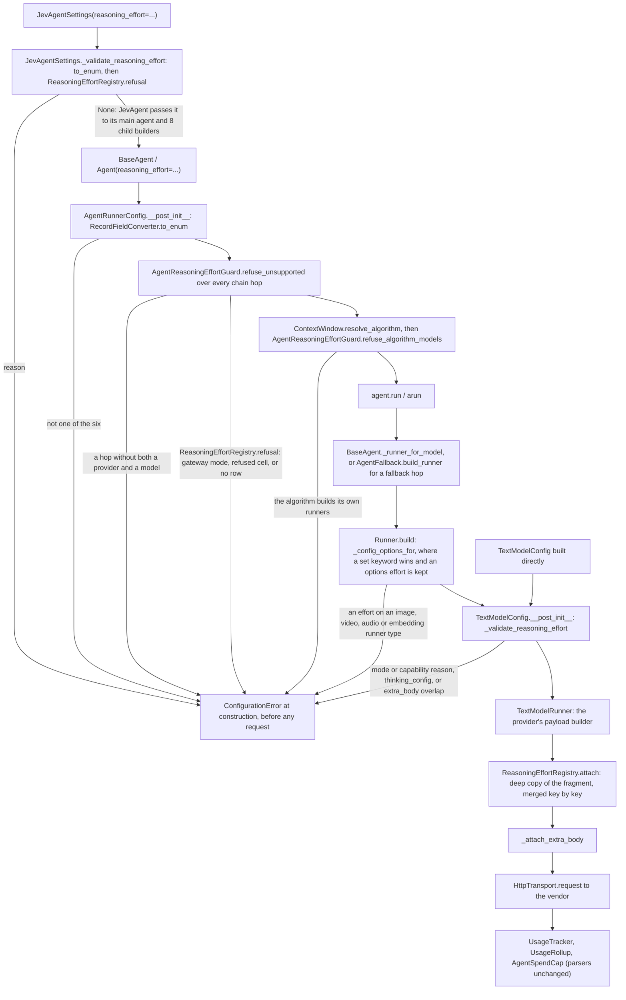

feat(agents): add a provider-neutral reasoning effort for direct text calls
## Summary
`reasoning_effort`, a new `ReasoningEffort` value (`none`, `minimal`, `low`, `medium`, `high` or `xhigh`), can now be set on `BaseAgent`, `JevAgentSettings` and `TextModelConfig`. On a `TextModelMode.DIRECT` call, each of the four text payload builders (OpenAI Responses, Anthropic Messages, Gemini, and the chat-completions builder that serves DeepSeek, xAI, GLM and Meta) merges that provider's documented wire form into the request body, just before `extra_body`. The wire forms, and the values each exact model id accepts, live in one dated table, `vidbyte/lib/configs/reasoning_effort.py`, which `ReasoningEffortRegistry` reads. The decision that matters most is that a set effort is either sent or refused, never silently ignored: construction raises `ConfigurationError`, before any request, in a gateway mode, for a model and value the table does not list (on every fallback hop), for an id with no row, beside `thinking_config` or an overlapping `extra_body`, on a non-text runner, and on an agent whose context-window algorithm builds its own runners. Unset sends nothing, so every existing request is unchanged. The PR also makes `ReasoningEffort`, `DecisionModelConfig` and `DecisionModelMode` root names (733 → 736 exports). Spec: `docs/spec/agent-reasoning-effort/spec.md` (r4).

## How to use what this PR introduces
```python
import os

from vidbyte import Agent, ConfigurationError, JevAgent, JevAgentSettings, ReasoningEffort, TextModelMode

planner = Agent(
    name="planner",
    system_prompt="Plan database migrations.",
    provider="openai",
    model_name="gpt-5.6-sol",
    api_keys=[os.environ["OPENAI_API_KEY"]],
    model_mode=TextModelMode.DIRECT,
    reasoning_effort=ReasoningEffort.HIGH,
)
reply = planner.run("Plan a zero-downtime rename of users.email.")  # body carries "reasoning": {"effort": "high"}

try:
    Agent(name="fast", system_prompt="Answer briefly.", provider="gemini", model_name="gemini-3.5-flash",
          api_keys=[os.environ["GEMINI_API_KEY"]], model_mode=TextModelMode.DIRECT, reasoning_effort=ReasoningEffort.XHIGH)
except ConfigurationError as error:
    print(error)

jev = JevAgent(JevAgentSettings(name="jev", system_prompt="Work carefully.", provider="anthropic", model_name="claude-opus-5-5",
                                api_keys=[os.environ["ANTHROPIC_API_KEY"]], model_mode=TextModelMode.DIRECT, reasoning_effort=ReasoningEffort.LOW))
```
This is spec §4 unchanged. It ran as written on this branch in a fresh `py -3.11` interpreter. Every `*API_KEY*` variable was removed first, the three keys the snippet reads were set to placeholders built at run time, and `HttpTransport.request` was replaced by a recorder that answers in each vendor's reply shape. It printed exactly one line, equal to the spec's:
```text
Agent fast sets reasoning_effort, but gemini:gemini-3.5-flash has no documented form for reasoning effort 'xhigh' (it supports minimal, low, medium, high).
```
`planner.run` sent one request, to `https://api.openai.com/v1/responses`, whose body carried `"reasoning": {"effort": "high"}`. No request went to Gemini. Running `jev` once sent one request, to `https://api.anthropic.com/v1/messages`, whose body carried `"output_config": {"effort": "low"}`. The developer no longer hand-builds `extra_body` or `thinking_config` for each vendor, and no longer learns from a vendor 400, or from a silent remap after a paid call, that a level is unsupported.

Who uses this next: vidbyte-cli C5 maps `--reasoning-effort` onto `JevAgentSettings.reasoning_effort`, following the "Caller contract for vidbyte-cli C5" in spec §9.2, and vidbyte-cli C4 (`agents jev run`) builds `DecisionModelConfig(mode=DecisionModelMode.VIDBYTE_MANAGED, ...)` from the new root names.

## Flow

Validation runs at construction. `BaseAgent.__init__` calls `refuse_unsupported` right after R3's spend-cap refusal, reading each hop the way its runner will (`Runner._normalize_provider_and_model`), and calls `refuse_algorithm_models` right after `ContextWindow.resolve_algorithm`. `TextModelConfig` checks itself again when the runner builds it, so a config built by hand is covered too. The payload builder is `_create_text_payload` on OpenAI and `_create_payload` on the other three; `attach` raises the same capability text as a backstop, which no carrier reaches, because construction refuses first. Nothing is stored except a checkpoint's `runtime_config["reasoning_effort"]`, written only when the effort is set. The spec's r4 §5 diagram left out the identity, `to_enum` and `Runner` exits; S6 redrew it to this chart (spec §17 "Recorded at S6").

## What changed
| File | Change |
|---|---|
| `vidbyte/lib/enums/text_model.py` (+18/−7) | `ReasoningEffort`, a `StrEnum` with the six values in order; header updated. |
| `vidbyte/lib/enums/__init__.py` (+2/−1) | Exports `ReasoningEffort`. |
| `vidbyte/lib/configs/reasoning_effort.py` (new, +170) | `REASONING_EFFORT_AS_OF = "2026-10-20"`, `GEMINI_THINKING_BUDGET_OFF`, `REASONING_EFFORT_FORMS` (one fragment per provider and value) and `REASONING_EFFORT_SUPPORT` (exact lower-case ids to their documented values, in enum order). A value a vendor remaps to another level has no cell. |
| `vidbyte/lib/configs/__init__.py` (+10) | Exports the four names. |
| `vidbyte/lib/registries/reasoning_effort.py` (new, +115) | `ReasoningEffortRegistry`: `supported` (normalized id lookup), `refusal` (mode reason first, then the capability or no-row reason), `attach` (merges a deep copy of the fragment key by key). |
| `vidbyte/lib/registries/__init__.py` (+5) | Exports the registry and three of the tables. |
| `vidbyte/lib/dataclasses/model_configs.py` (+51/−4) | `TextModelConfig.reasoning_effort`, checked last in `__post_init__`: `to_enum`, the registry refusal, `thinking_config`, then the `extra_body` overlap. |
| `vidbyte/lib/dataclasses/agents.py` (+12/−4) | `AgentRunnerConfig.reasoning_effort`, converted with `to_enum` only; the model check is the guard's. |
| `vidbyte/lib/runners/utility.py` (+14/−2) | `Runner(reasoning_effort=...)`. `_config_options_for` lets a set keyword win, keeps `options["reasoning_effort"]` when the keyword is unset, and refuses an effort on a non-text runner type. |
| `vidbyte/providers/openai.py` (+6) | One `ReasoningEffortRegistry.attach` call in `_create_text_payload`, just before `_attach_extra_body`. |
| `vidbyte/providers/anthropic.py` (+7) | The same call in `_create_payload`, after `output_config.format` is set, so both keys stay. |
| `vidbyte/providers/gemini.py` (+7) | The same call in `_create_payload`; `generationConfig` keeps its sampling and schema keys beside `thinkingConfig`. |
| `vidbyte/providers/compatible.py` (+6) | The same call in `_create_payload`, for DeepSeek, xAI, GLM and Meta. |
| `vidbyte/agents/reasoning_effort.py` (new, +93) | `AgentReasoningEffortGuard.refuse_unsupported` (mode, identity, every chain hop; reasons de-duplicated in chain order) and `refuse_algorithm_models` (the three algorithms that build their own runners, named by fixed key). |
| `vidbyte/agents/base.py` (+14/−2) | The keyword, the two guard calls, `_runner_for_model` passing the effort only when set, the checkpoint key written only when set, and `restore` reading it back. |
| `vidbyte/agents/fallback.py` (+10/−4) | `AgentFallback(reasoning_effort=...)`; `build_runner` hands it to every hop's `Runner`. |
| `vidbyte/agents/settings/fallback.py` (+5/−3) | `AgentFallbackSettings.to_fallback(reasoning_effort=...)`. |
| `vidbyte/agents/fork.py` (+4/−1) | A fork child keeps the parent's effort; its own construction re-checks it against the child's model. |
| `vidbyte/agents/continual_trace.py` (+1) | Copies the source agent's effort. |
| `vidbyte/agents/handoff.py` (+1) | Copies the source agent's effort. |
| `vidbyte/agents/jev/settings.py` (+22/−2) | `JevAgentSettings.reasoning_effort` and `_validate_reasoning_effort` (`to_enum`, then the registry refusal against its own provider, model and mode). |
| `vidbyte/agents/jev/agent.py` (+2) | Passes the effort to the main agent and the fresh-continuation agent. |
| `vidbyte/agents/jev/bulk_work.py` (+1) | Bulk workers get the effort. |
| `vidbyte/agents/jev/compute/clone.py` (+1) | Clones get the effort. |
| `vidbyte/agents/jev/compute/swarm.py` (+1) | Swarm helpers get the effort. |
| `vidbyte/agents/jev/done/handoff.py` (+1) | `JevHandoff` gets the effort. |
| `vidbyte/agents/jev/done/reviewer.py` (+1) | `JevReviewer` gets the effort. |
| `vidbyte/agents/jev/done/run_state.py` (+1) | `JevRunState` (and `JevRunStateRelation`, its subclass) get the effort. |
| `vidbyte/agents/jev/gate/clarification.py` (+1) | `JevClarificationAgent` gets the effort. |
| `vidbyte/__init__.py` (+7/−1) | Root imports and `__all__` entries for `ReasoningEffort`, `DecisionModelConfig` and `DecisionModelMode`; the "Agent setting exports" header bullet names them. |
| `contracts/sdk-public-api.json` (+4/−1) | Regenerated: 736 exports. |
| `vidbyte/agents/README.md` (+36) | New "Reasoning Effort" section and a Key Modules bullet. |
| `vidbyte/agents/jev/README.md` (+2) | Which Jev agents get the effort, and which do not. |
| `vidbyte/lib/registries/README.md` (+30) | "Reasoning Effort Sources": each provider's wire form and its raw vendor pages; which remapped values are refused. |
| `vidbyte/providers/README.md` (+3) | Contract Invariant 6: the effort is attached through the registry, never hand-built. |
| `vidbyte/lib/README.md` (+1/−1) | Names `ReasoningEffortRegistry` in the registries line. |
| `REPO_MAP.md` (+1/−1) | The `vidbyte/lib/configs/` entry now describes capability data in general. |
| `skills/usage/create_agent.md` (+2/−1) | The signature line and the Model clause name `reasoning_effort`. |
| `docs/design/release-0-4-0.md` (+2/−2) | The 0.4.0 "Later changes" sentence, with `(#1193)`, and the tally: 736 exports, 97 added. |
| `docs/spec/agent-reasoning-effort/**` | The pipeline record: request, code map, spec r4, test plan, review, verify log, stage reports, and this body. |
| `tests/features/agent_reasoning_effort/` (new: `FEATURE.md`, `README.md`, fixtures, 9 test files) | The feature test pack, 700 cases. |
| `tests/features/sdk_managed_text/test_managed_text_selection.py` (+1/−1) | Appends `"reasoning_effort"` last to the pinned `TextModelConfig` field layout. |
| `tests/features/sdk_provider_keys/test_provider_keys_contract.py` (+2/−2) | Appends `"reasoning_effort"` last to the pinned `AgentRunnerConfig` and `JevAgentSettings` layouts. |

**Compatibility.** The change is additive. Three root names are added (contract 733 → 736). No `FailureCode` member, default, dependency or version changes; the package stays at the unpublished 0.4.0. The new record fields are appended last, and the new parameters are keyword-only, so positional layouts and the pinned signatures hold. With the effort unset, every request body, URL and header set, every checkpoint and every existing error message is the same as on `main`. A checkpoint written with an effort carries `runtime_config["reasoning_effort"]`; an older SDK ignores that key and runs at the provider default.

## Acceptance criteria → proof
Every test below is in `tests/features/agent_reasoning_effort/`, and every name was checked with `git grep` on this branch.

| AC | What it checks (plain words) | Proven by |
|---|---|---|
| AC-1 | The §4 snippet runs as written: `high` on the OpenAI body, exactly one printed line, `low` on Jev's Messages body | `test_agent_reasoning_effort_acceptance.py::test_the_developer_snippet_sends_high_prints_one_refusal_and_builds_jev` |
| AC-2 | An agent's body differs from the unset body by exactly the table's fragment; URL and headers do not change | `test_agent_reasoning_effort_wire.py::test_an_agent_sends_its_own_providers_fragment_and_nothing_else`, `::test_each_sent_cell_adds_exactly_its_fragment_to_the_vendor_body` |
| AC-3 | Every "sent" cell puts its exact key path and spelling on the wire (Gemini's upper-case level included) | `test_agent_reasoning_effort_wire.py::test_each_sent_cell_adds_exactly_its_fragment_to_the_vendor_body`; `test_agent_reasoning_effort_registry.py::test_each_sent_value_has_the_section_9_2_wire_form` |
| AC-4 | Every "refused" cell, and every id with no row, is refused with the right text and sends nothing | `test_agent_reasoning_effort_refusals.py::test_every_refused_cell_is_refused_on_every_carrier_before_any_request`, `::test_an_id_with_no_row_is_refused_with_the_no_row_text`; `test_agent_reasoning_effort_registry.py::test_supported_returns_each_section_9_2_line_in_enum_order`, `::test_an_id_with_no_row_supports_nothing` |
| AC-5 | A gateway mode (the default `AUTO` included) is refused with a text naming `TextModelMode.DIRECT`; existing gateway refusals keep their text | `test_agent_reasoning_effort_refusals.py::test_a_gateway_mode_is_refused_with_the_text_naming_direct`, `::test_the_mode_reason_comes_once_and_before_any_chain_entrys_capability`, `::test_text_model_config_keeps_its_earlier_refusal_for_what_the_gateway_cannot_serve`, `::test_text_model_config_keeps_its_custom_endpoint_refusal_in_a_gateway_mode` |
| AC-6 | A bad hop anywhere in a fallback chain refuses the agent; a capable chain sends each hop's own form | `test_agent_reasoning_effort_refusals.py::test_every_chain_entry_is_checked_in_either_order`; `test_agent_reasoning_effort_wire.py::test_a_chain_that_can_take_the_value_sends_each_hops_own_form` |
| AC-7 | `thinking_config` or an overlapping `extra_body` beside the effort is refused; a disjoint `extra_body` is sent with it | `test_agent_reasoning_effort_refusals.py::test_effort_beside_thinking_config_or_an_overlapping_extra_body_is_refused`, `::test_the_capability_and_mode_reasons_come_before_thinking_config`; `test_agent_reasoning_effort_wire.py::test_a_disjoint_extra_body_is_sent_beside_the_fragment` |
| AC-8 | Unset changes no body and writes no checkpoint key | `test_agent_reasoning_effort_unset.py::test_an_unset_effort_sends_the_request_the_omitted_argument_sends`, `::test_an_unset_checkpoint_has_no_effort_key`, `::test_a_config_whose_effort_is_replaced_by_none_is_the_never_set_config`, `::test_an_explicitly_unset_jev_agent_sends_what_the_default_one_sends` |
| AC-9 | Jev's main agent and children send the effort; the brief writer, specialists and decisions do not | `test_agent_reasoning_effort_jev.py::test_each_agent_on_jevs_model_sends_the_effort`, `::test_the_run_brief_writer_keeps_its_own_settings`, `::test_jev_decision_calls_never_carry_the_effort`, `::test_a_specialist_runs_at_its_own_setting` |
| AC-10 | A value outside the six is refused; a plain string or another enum's member with one of the six values is stored as the member | `test_agent_reasoning_effort_refusals.py::test_a_value_outside_the_six_is_refused_on_every_carrier`, `::test_a_plain_string_or_another_enums_member_is_stored_as_the_member` |
| AC-11 | A checkpoint keeps the effort and the restored agent sends it; an old checkpoint restores unset | `test_agent_reasoning_effort_copy_paths.py::test_a_checkpoint_carries_the_effort_and_the_restored_agent_sends_it`, `::test_an_old_checkpoint_without_the_key_restores_with_no_effort`, `::test_restoring_a_value_the_table_no_longer_allows_is_refused` (and `::test_a_restored_chain_sends_the_kept_effort_in_each_hops_own_form`) |
| AC-12 | A fork keeps the effort; a fork to a model that cannot take it is refused, and the fork tool returns that as an error result | `test_agent_reasoning_effort_copy_paths.py::test_a_plain_fork_carries_the_effort_onto_the_wire`, `::test_a_fork_to_a_model_that_can_take_the_effort_sends_it`, `::test_a_fork_to_a_model_that_cannot_take_the_effort_is_refused`, `::test_the_fork_tool_turns_the_refusal_into_an_error_result_and_offers_no_effort` |
| AC-13 | The three root names are the defining objects, the contract lists them, and the header has one bullet naming them | `test_agent_reasoning_effort_contract.py::test_each_root_name_is_the_defining_object_and_listed_once`, `::test_a_fresh_interpreter_imports_the_three_root_names`, `::test_the_public_api_contract_lists_the_three_names_at_the_package_version`, `::test_the_root_header_has_one_agent_setting_exports_bullet_naming_the_three` |
| AC-14 | Anthropic structured output keeps `output_config.format` beside `output_config.effort` | `test_agent_reasoning_effort_wire.py::test_anthropic_structured_output_keeps_its_format_beside_the_effort` |
| AC-15 | Gemini keeps `temperature` and the schema beside `thinkingConfig` | `test_agent_reasoning_effort_wire.py::test_gemini_keeps_temperature_and_schema_beside_the_thinking_config` |
| AC-16 | `Runner` refuses an effort on a non-text runner and hands it to a text config | `test_agent_reasoning_effort_refusals.py::test_a_non_text_runner_refuses_the_effort_instead_of_dropping_it`; `test_agent_reasoning_effort_wire.py::test_runner_build_hands_the_effort_to_the_text_config` |
| AC-17 | Billed reasoning tokens reach `UsageRollup` with the same output tokens and cost as the unset run | `test_agent_reasoning_effort_usage.py::test_billed_reasoning_tokens_reach_the_usage_rollup` |
| AC-18 | Prefixed, aliased, padded or upper-case ids get their normalized row, and the message names the id as passed | `test_agent_reasoning_effort_registry.py::test_supported_normalizes_the_prefix_the_alias_padding_and_case`, `::test_refusal_names_the_model_as_given_but_stripped`; `test_agent_reasoning_effort_refusals.py::test_a_padded_upper_case_id_is_named_as_given_but_stripped`; `test_agent_reasoning_effort_wire.py::test_a_normalized_model_id_is_sent_with_its_rows_form` |
| AC-19 | The release record carries the sentence and the 736 / 97 tally | Not testable (tests may not read `docs/`): sentence and tally in `e2de2026`; `(#1193)` and "3 from #1193" added in this PR's S6 commit `docs(spec): finalize agent-reasoning-effort for PR` |
| AC-20 | No body carries `max`, a remapped level, a key, or another provider's reasoning field | `test_agent_reasoning_effort_wire.py::test_each_sent_cell_adds_exactly_its_fragment_to_the_vendor_body`, `::test_an_agent_sends_its_own_providers_fragment_and_nothing_else`; `test_agent_reasoning_effort_registry.py::test_refusal_gives_the_section_8_5_reason_mode_first` |
| AC-21 | `multi_provider_agentic_grader`, in any form, is refused with the algorithm text and sends nothing | `test_agent_reasoning_effort_refusals.py::test_an_algorithm_that_builds_its_own_runners_refuses_the_effort` `[AC-21:preset_name]`, `[AC-21:preset_object]`, `[AC-21:named_with_provider_models]`, `[AC-21:named_without_provider_models]` |
| AC-22 | `independent_critic` with its own reviewer is refused, even when the reviewer's model could take the value | the same test, `[AC-22:reviewer_on_a_refused_cell]`, `[AC-22:reviewer_on_a_sent_cell]` |
| AC-23 | `prosecutor_defender_judge` with one stage model is refused, for each stage | the same test, `[AC-23:prosecutor_model]`, `[AC-23:defender_model]`, `[AC-23:judge_model]` |
| AC-24 | A critic without a reviewer, or a debate without stage models, is allowed and every call carries the effort | `test_agent_reasoning_effort_wire.py::test_an_algorithm_on_the_agents_own_runner_sends_the_effort_on_every_call` |
| AC-25 | With the effort unset, every algorithm configuration above constructs and runs as before | `test_agent_reasoning_effort_unset.py::test_an_unset_effort_keeps_every_algorithm_configuration_running_as_before` (11 cases) |
| AC-26 | `Runner(options={"reasoning_effort": "high"})` reaches the config and the wire | `test_agent_reasoning_effort_wire.py::test_an_options_effort_reaches_the_text_config_and_the_wire` |
| AC-27 | An options effort the text config cannot send is refused like the keyword | `test_agent_reasoning_effort_refusals.py::test_an_options_effort_the_text_config_cannot_send_is_refused_like_the_keyword` (`[default_auto]`, `[refused_cell]`, `[no_row]`) |
| AC-28 | An options effort on an image, video, audio or embedding model is refused, never dropped | `test_agent_reasoning_effort_refusals.py::test_a_non_text_runner_refuses_the_effort_instead_of_dropping_it` `[image-options]`, `[audio-options]`, `[embedding-options]`, `[video-options]` |
| AC-29 | When the keyword and `options` disagree, the keyword wins | `test_agent_reasoning_effort_wire.py::test_the_keyword_effort_wins_over_an_options_effort` |

## Verification
Gate results are quoted from the last verify-log iteration (S5 iteration 1, after the code commit `f45f63ac`). Every commit after the last remote run's head, `f42bb505`, changes only `docs/`.

| Gate | Command | Result |
|---|---|---|
| Pack, pins and modality | `PYTHONDONTWRITEBYTECODE=1 PYTHONPATH=$(pwd) py -3.11 -m pytest -q -p no:cacheprovider tests/features/agent_reasoning_effort tests/features/sdk_managed_text/test_managed_text_selection.py tests/features/sdk_provider_keys/test_provider_keys_contract.py tests/test_agent_modality_routing.py` | `748 passed in 3.36s` |
| Pack, rerun by S6 after the docs edits | `PYTHONDONTWRITEBYTECODE=1 PYTHONPATH=$(pwd) py -3.11 -m pytest -q -p no:cacheprovider tests/features/agent_reasoning_effort` | `700 passed in 3.64s` |
| Area suite | the pack line plus the managed-text, provider-keys, spend-cap, root-exports, Gemini, compatible, DeepSeek, pricing, Jev, critic, grader and middleware-abort suites | `1213 passed in 9.48s` |
| Source stage (AGENTS.md full gate) | `PYTHONIOENCODING=utf-8 PYTHONPATH=$(pwd) py -3.11 scripts/run_ci.py --stage source` | `2 failed, 8385 passed, 18 skipped in 314.52s (0:05:14)`: the two inherited local-only failures explained below |
| Package stage | `env -u PYTHONPATH py -3.11 scripts/run_ci.py --stage package` | `Installed vidbyte-sdk 0.4.0 passed smoke checks.` / `CI passed.` |
| Lint | `PYTHONIOENCODING=utf-8 PYTHONPATH=$(pwd) py -3.11 lint/run.py` | `SDK-LINT: PASS`, 0 regressed; every zero-slack rule equals base (`S062 ... 889 889 RATCHETED`); `lint/baseline.json` unchanged |
| Whole-tree I001 | `py -3.11 -m ruff check vidbyte --config lint/ruff.toml --select I001 --no-cache`, per file against base | `TOTAL 223 FILES 217` on both / `I001 per-file identical` |
| Semgrep (Static policy) | `semgrep scan --error --config .semgrep/typed-mapping-boundary-policy.yml vidbyte` | `Ran 1 rule on 1034 files: 0 findings.` |
| Public API contract | `PYTHONPATH=$(pwd) py -3.11 scripts/generate-sdk-public-api.py --check` | `contracts/sdk-public-api.json is current at 654deee6… (vidbyte-sdk 0.4.0, 736 exports).` |
| §4 snippet | spec §4 run verbatim in a fresh interpreter, keys removed, `HttpTransport.request` recorded | the one spec line printed; `reasoning.effort = high` on Responses; `output_config.effort = low` on Messages |
| Remote: CI | dispatched run [39550863801](https://github.com/cerredz/Vidbyte-SDK/actions/runs/39550863801) on `f42bb505` | `success`: Source / Python 3.11, Source / Python 3.12, Package |
| Remote: Static policy | dispatched run [39550865942](https://github.com/cerredz/Vidbyte-SDK/actions/runs/39550865942) on `f42bb505` | `success` |
| `gh pr checks 1193` | `gh pr checks https://github.com/cerredz/Vidbyte-SDK/pull/1193` | No checks attached. Both workflows run only on dispatch here, and a dispatched run does not attach to a PR. |

The source stage's two failures are inherited and appear only locally. Both tests in `tests/features/harness_threads/test_harness_threads_surface.py` compare the branch with `origin/main`: the `__all__` merge-base clause at `:309` is red on any branch that adds a root export, and `:270-278` is red because this PR changes `vidbyte/lib/configs/`. CI has no `origin/main` ref, so both skip there, CI passed, and both clear once the PR is merged.

- [x] Existing repository checks pass (above).
- [x] New or changed package assets are present in the built wheel: no new non-Python assets; the package stage's installed-wheel smoke check passed.
- [x] Documentation and examples reflect the change: five folder READMEs, `REPO_MAP.md`, `skills/usage/create_agent.md` and the release record.
- [x] No credentials, private data, generated bytecode, build output, or unrelated changes are included: every test key is assembled at run time.

## Adversarial review
3 findings confirmed by an independent verifier across three lenses (spec conformance, repo conventions, engineering), 3 fixed, 0 waived. The verifier refuted none and downgraded one Major (R-4) to a Minor. A conformance re-review of the repair found it SOUND, with 2 Minors in the docs ledger, both closed in this PR's S6 commit: the R-7 status cell (R-C1) and the empty Proof cells of AC-21 to AC-29 (R-C2). Full record: `docs/spec/agent-reasoning-effort/review.md`.

| ID | Finding | Fixed in |
|---|---|---|
| R-1 (Blocker) | `multi_provider_agentic_grader`, `independent_critic` with a reviewer, and `prosecutor_defender_judge` with a stage model build their own runners through `ModalityDetector.create_runner`, so a set effort was silently dropped on their calls. | `5da7f7fb` (`refuse_algorithm_models` and its `base.py` call) and `f45f63ac` (agents README); tests `20b49e0c` (AC-21 to AC-25). Forwarding the effort instead is Q-11, left at No. |
| R-2 (Major) | The non-text refusal was pinned only for image models, so a refusal narrowed to image would have passed. | `20b49e0c`: the test covers image, audio, embedding and video, by keyword and by `options`. The code already refused every type. |
| R-3 (Major) | `Runner(options={"reasoning_effort": ...})` was overwritten with `None`, so the option was dropped, and on a non-text model it was never refused. | `a324ac08`; tests `20b49e0c` (AC-26 to AC-29, EC-35, EC-36) |

The Minors were R-4 (a chained restore test, `20b49e0c`), R-5 (three module headers, `3725feb4`), R-6 (the grok-4.5 and grok-4.3 `xhigh` refusals in the registries README, `f9989cb9`), R-7 (spec wording, spec r4 `346f8c3e`) and R-9 (the `Runner` text no longer computes "a image", `afb9e134`). R-8 and R-10 are stated here:
- **R-8.** Lint rule A002 reports 602 findings on this branch against 608 on `main`. That drop is a side effect of the rule's window (`lint/rules/a002_intent_comments.py:23,77-81`): it credits a function when an `@intent` marker appears within 20 lines after the function's first line, and six provider `_config` and `_build_text_config` helpers now sit just above the new `@intent` blocks in the payload builders. No new intent was documented, so it is not an improvement, and the A002 baseline in `lint/baseline.json` stays at 703; this PR does not lower it.
- **R-10.** The phase commits P3 to P6 (`8dd96a39` … `745f861d`) fail `tests/test_agent_modality_routing.py::AgentModalityRoutingTests::test_model_identity_routes_to_image_runner` until `e4e7bee4`, which passes the effort to `Runner.from_model` only when it is set (re-checked by S6: `1 failed, 18 passed` at `745f861d`, `19 passed` at `e4e7bee4`). `main` squash-merges, so this affects only bisecting this branch.

## Deviations from the spec
- **`_runner_for_model` passes the effort only when it is set** (row 12(d)). `tests/test_agent_modality_routing.py:74` pins the exact `Runner.from_model` keywords of an agent without the effort. `Runner` defaults the effort to `None`, so the request is the same.
- **The sources table labels providers by vendor name** (row 29), not by enum value, because `tests/features/sdk_provider_keys/test_provider_keys_contract.py:341` reads every README line that starts `| meta |` as its own table.
- **`skills/usage/create_agent.md`** (row 33): the new signature line carries a trailing comment like its neighbours, and the Model clause names `reasoning_effort` too.
- **Where the spec is silent** (row 3): `attach`'s backstop `ConfigurationError` carries `details` `field`, `provider`, `model` and `reasoning_effort`; and `supported` resolves the provider with `ProviderModelRegistry._require_provider`, the private helper `normalize_model` itself calls, so an unknown provider fails with the registry's own text.
- **Spec §5 was redrawn at S6.** The r4 diagram had no exit for the identity, `to_enum` or `Runner` refusals, drew `JevAgentSettings` through `AgentRunnerConfig`, and named every builder `_create_payload`. The flow above is the code's; behavior is as the spec states.

## Follow-ups
**Known limitations, stated in the spec and not fixed here:**
- **DIRECT only (D-2).** A gateway mode (`AUTO`, `VIDBYTE_MANAGED`) refuses an effort, because the gateway answers 422 to body fields outside its allow-list. Extending that allow-list is a backend change.
- **A dated, exact-id table (D-3, EC-10, EC-11).** The table was checked against vendor docs on `REASONING_EFFORT_AS_OF` (2026-10-20). An id with no row, such as a dated snapshot or a model added later, is refused with a text that names that date; it is never mapped to a nearby row or level.
- **One agent-wide effort (D-6).** There is no per-hop value. A checkpoint stores fallback hops as `provider/model` strings, so a per-hop value could not survive restore; the agent's own effort is kept, and every rebuilt hop sends it in its own form.
- **EC-34.** Assigning `agent.algorithm` after construction is not re-checked, so an own-runner algorithm assigned later drops the effort on its own calls. Pass the algorithm to the constructor.
- **A hand-built `AgentRuntime`** with its own `RunnerHandle` never runs `BaseAgent.__init__`, so it bypasses the guard. That path is outside the spec's §9.2 "Every agent" contract.
- **Jev exclusions (D-9, NG-4, NG-5).** Jev specialists keep their own setting, the run-brief writer uses `JevRunBriefSettings`, and Jev decision calls never carry the effort.
- **A-4.** The `grok-4.6` and `grok-4.5` cells assume xAI serves both on chat completions; `grok-4.5` is the SDK's default xAI model.
- **EC-12.** An Anthropic DIRECT call with no `max_output_tokens` keeps its 1024-token default, and thinking counts toward it, so `high` or `xhigh` can cut a reply short. This is pre-existing at the vendor's default effort.

**Next changes:**
- A test pinning AC-21 to AC-23 for `ReasoningEffort.NONE`. The re-review's mutant MX2, which lets `none` through `refuse_algorithm_models`, survived, although the code refuses it correctly.
- The release-record sentence (`docs/design/release-0-4-0.md:17`, row 34(a)) does not mention the r4 algorithm refusal; its wording was left as written.
- `[scope-adding]` Q-11: forward the effort into the runners those three algorithms build, instead of refusing the agent.
- `[scope-adding]` Backend: add the reasoning keys to the gateway allow-list, so `AUTO` and `VIDBYTE_MANAGED` could carry an effort.
- Publishing SDK 0.4.0 to PyPI needs the maintainer's explicit approval, which has not been given.
- The next program PRs: vidbyte-cli C4 (`agents jev run` / `answer`), C3 `--max-spend`, and C5 `--reasoning-effort`.

🤖 Generated with [Claude Code](https://claude.com/claude-code)
