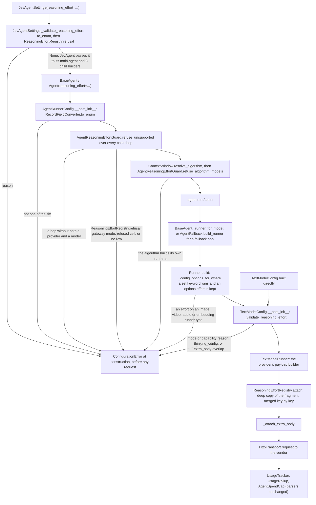

# Spec: A reasoning effort for an agent's generative model

> **TL;DR** — One provider-neutral setting, `reasoning_effort: ReasoningEffort | None`, goes on `BaseAgent` and `JevAgentSettings`. It has six values (`none`, `minimal`, `low`, `medium`, `high`, `xhigh`). The agent's own text runner carries it onto every generative call, and each provider adapter sends it in that vendor's documented wire form. `vidbyte/lib/configs/reasoning_effort.py` holds one explicit table, and `ReasoningEffortRegistry` in `vidbyte/lib/registries/reasoning_effort.py` resolves it. The table has a row for each documented model id in the provider catalog, and every cell cites a quote from a raw-fetched vendor doc.
>
> The decision that matters most is that the effort is never silently ignored. Construction refuses it with `ConfigurationError` in four cases: on a gateway mode (AUTO, VIDBYTE_MANAGED), beside `thinking_config`, for a (model, value) with no documented form (a model the table does not list included), and for a value the vendor documents only as a remap to another level. Unset sends nothing.
>
> The same PR root-exports `ReasoningEffort`, `DecisionModelConfig` and `DecisionModelMode` for vidbyte-cli C4/C5.

## §0 User prompts

The verbatim record lives in `docs/spec/agent-reasoning-effort/request.md` (§A has every prompt, §C the structured notes). The prompt that invoked the pipeline is below. This run's slice comes from the user's answer to alignment question 10 in Prompt 3 (request.md §A): "JevAgent should have a reasoning effort, this can be a pr into vidbyte-sdk/ and then update cli with this".

### 0.1 Invoking request (verbatim)
/spec-pipeline I like this and I agree with the setup, can you start building it into the vidbyte-cli/.

### 0.2 User replies during the run
_None yet. The orchestrator appends any reply the user sends during the run here verbatim, labeled with the revision it produced._

---

## Part A — Framing

## §1 Goal

Today the SDK has no effort setting that works the same way on every provider:
- `TextModelConfig.thinking_config` is a raw mapping that only the Anthropic and Gemini adapters forward.
- No agent path can set it.
- `Runner` drops any option that is not a `TextModelConfig` field.

vidbyte-cli already publishes `--reasoning-effort` with the copy "Sets how much reasoning each turn asks your model to spend: none, minimal, low, medium, high, or xhigh. Leave it empty to keep the provider's default. Higher effort spends more tokens on every turn." (request.md §C). Until this PR, the CLI has nothing to map that flag to.

| ID | Goal (outcome) | How we will know | Source |
|---|---|---|---|
| G-1 | A developer sets one reasoning effort on any `BaseAgent` (and on `JevAgentSettings`). Every generative call the agent makes in `TextModelMode.DIRECT` then carries it in the provider's documented wire form. | AC-1, AC-2, AC-3, AC-9 | request.md §A Prompt 3 Q10; §C "What to build"; D-P9 |
| G-2 | The effort is never silently ignored, dropped or remapped. A value the agent's models cannot take fails at construction, before any spend, with a message that names the supported values. | AC-4, AC-5, AC-6, AC-7, AC-10 | request.md §C Q1, Q2, Q3; D-P9 ("must not silently ignore") |
| G-3 | vidbyte-cli C5 can import the enum, and C4 can import `DecisionModelConfig`, under CLI lint C028 (root names only). | AC-13 | request.md §C "Second slice"; "If the reasoning effort needs a new public enum, it is a root export too" |
| G-4 | Reasoning spend stays visible to usage tracking and to R3's `max_spend_usd` cap. | AC-17 | request.md §C Q4; §D "i want every agent to be tracking usage" |
| G-5 | Nothing changes for a caller who leaves the effort unset. | AC-8 | request.md §C "Unset means the SDK sends nothing, so the provider's default applies" |

## §2 Objective

When this PR merges, vidbyte-sdk 0.4.0 (unreleased, version unchanged) contains these items:
- A root-exported `ReasoningEffort` StrEnum.
- A `reasoning_effort` keyword on `BaseAgent`, and the same keyword on `Runner`, `AgentFallback` and `AgentFallbackSettings.to_fallback`.
- A `reasoning_effort` field on `TextModelConfig`, `AgentRunnerConfig` and `JevAgentSettings`.
- A dependency-light capability table in `vidbyte/lib/configs/reasoning_effort.py`, and a lib-layer registry, `ReasoningEffortRegistry`, which resolves it and owns the refusal texts.
- An agent-layer construction guard, `AgentReasoningEffortGuard`, modeled on R3's `AgentSpendCap`.
- One attach call in each of the four text payload builders: OpenAI, Anthropic, Gemini, and the OpenAI-compatible builder that serves xAI, DeepSeek, GLM and Meta.
- The copy paths that already carry `temperature`, which now carry the effort too: fork, ContinualTrace, Handoff, checkpoint and restore, and JevAgent's main agent plus its 8 child builders.
- Root exports of `DecisionModelConfig` and `DecisionModelMode`.
- A regenerated public-API contract with 736 exports.
- The release-note sentence, and the README and skill-doc updates.

This is PR R2 of the 8-PR "JevAgent in vidbyte-cli" program. The CLI flag mapping is C5, a later slice in another repo (NG-1).

## §3 Non-goals

- **NG-1** — Any vidbyte-cli change, including the jev `--reasoning-effort` mapping. — *Why not:* that is C5 (request.md §C "Not in this run").
- **NG-2** — Sending the effort through the Vidbyte gateway (`AUTO`, `VIDBYTE_MANAGED`). — *Why not:* the gateway answers 422 to body fields outside its allow-list, and that allow-list has no reasoning key. Extending it is a backend change (orchestrator ruling, pipeline.md 2026-10-20). → Q-2.
- **NG-3** — The harness efforts (`CodexReasoningEffort`, `GrokReasoningEffort`, `MuseReasoningEffort`). — *Why not:* request.md §C "Not in this run". They are separate CLIs with their own value sets.
- **NG-4** — Reasoning for the Jev decision model (`DecisionModelRunner`, TypeSafe). — *Why not:* request.md §C Q3 and "Not in this run".
- **NG-5** — Inheritance by Jev specialists and by the run-brief writer. — *Why not:* request.md §C Q3 says they "keep their own settings … State that last point as a limitation; inheritance is not added."
- **NG-6** — Mapping an unsupported value to the nearest supported level. — *Why not:* D-P9. This would be `[scope-adding]` → Q-1, default No.
- **NG-7** — Any value beyond the six, such as a vendor's `max`. — *Why not:* the value set is fixed to the published six (pipeline.md 2026-10-20; request.md §C).
- **NG-8** — A per-hop effort on `FallbackModel`, an override on `AgentForkSettings`, or a model-supplied effort in the fork tool. — *Why not:* the conversation asks for one agent-wide setting. → Q-4.
- **NG-9** — Changing how history echoes reasoning: OpenAI reasoning items, DeepSeek `reasoning_content` on final turns. — *Why not:* request.md §C Q5 sets the default "no parser change". The gaps are pre-existing and are recorded as limitations (EC-15, EC-16). → Q-5.
- **NG-10** — A `reasoning_effort` key for YAML agent configs, `InfiniteMemoryAgentSettings`, `AggregateAgent`, `MultiAgent` or `CodexHarnessAgent`. — *Why not:* D-P9 names `BaseAgent` and `JevAgentSettings` only. The YAML loader already refuses unknown keys loudly (`AgentSettings._ALLOWED_FIELDS`). → Q-8.
- **NG-11** — A new `UsageRollup` reasoning field, or any usage-parsing change. — *Why not:* every adapter's billed output already includes reasoning (§9.2 "Billing"). The briefing forbids a field unless an adapter drops billed tokens.
- **NG-12** — Bumping the version, tagging, or publishing. — *Why not:* D-P2 keeps 0.4.0, which is unpublished. "updates the version" in Prompt 3 Q2 is overridden by D-P2.
- **NG-13** — Refusing `temperature` together with an effort, or raising Anthropic's DIRECT `max_tokens` default of 1024. — *Why not:* both risks exist today at the vendors' default efforts and have no control in the conversation. They are stated as limitations EC-12 and EC-13. → Q-6, Q-7.
- **NG-14** — Rows for model ids beyond the provider catalog's exact text ids, and any change to that catalog. — *Why not:* a scope choice. The table covers the ids that `MODEL_PROVIDER_RUNNER_TYPE_MAP` (`vidbyte/lib/constants/runners.py:47`) lists by exact id with the text type, which is the catalog `ProviderModelRegistry` publishes (`vidbyte/lib/registries/models.py:316-325`). The runner's prefix map (`MODEL_PREFIX_RUNNER_TYPE_MAP`, read at `vidbyte/lib/runners/utility.py:71`) also builds other ids, such as pricebook ids and dated snapshots (`claude-opus-4-7`, `gpt-5.5-2026-04-23`, `gemini-3.5-flash-001`). Those ids have no row and are refused with the §8.5 no-row text (EC-10), an accepted limitation. → Q-10.
- **NG-15** — Editing `EMITTED_KEYS`, the gateway wire contract, `FailureCode`, any test file, or any lint baseline. — *Why not:* orchestrator ruling; the hard rules in §14.

## §4 Developer usage

```python
import os

from vidbyte import Agent, ConfigurationError, JevAgent, JevAgentSettings, ReasoningEffort, TextModelMode

planner = Agent(
    name="planner",
    system_prompt="Plan database migrations.",
    provider="openai",
    model_name="gpt-5.6-sol",
    api_keys=[os.environ["OPENAI_API_KEY"]],
    model_mode=TextModelMode.DIRECT,
    reasoning_effort=ReasoningEffort.HIGH,
)
reply = planner.run("Plan a zero-downtime rename of users.email.")  # body carries "reasoning": {"effort": "high"}

try:
    Agent(name="fast", system_prompt="Answer briefly.", provider="gemini", model_name="gemini-3.5-flash",
          api_keys=[os.environ["GEMINI_API_KEY"]], model_mode=TextModelMode.DIRECT, reasoning_effort=ReasoningEffort.XHIGH)
except ConfigurationError as error:
    print(error)

jev = JevAgent(JevAgentSettings(name="jev", system_prompt="Work carefully.", provider="anthropic", model_name="claude-opus-5-5",
                                api_keys=[os.environ["ANTHROPIC_API_KEY"]], model_mode=TextModelMode.DIRECT, reasoning_effort=ReasoningEffort.LOW))
```

Printed output (exactly one line):

```text
Agent fast sets reasoning_effort, but gemini:gemini-3.5-flash has no documented form for reasoning effort 'xhigh' (it supports minimal, low, medium, high).
```

Each `POST https://api.openai.com/v1/responses` that `planner.run` sends carries `"reasoning": {"effort": "high"}`, and the rest of the body is unchanged. The `fast` agent is refused at construction, before any request or spend. Each `POST https://api.anthropic.com/v1/messages` that `jev` sends for its main model, and for the Jev children listed in §9.2, carries `"output_config": {"effort": "low"}`.

The developer no longer hand-builds `extra_body` or `thinking_config` per vendor. They no longer discover an unsupported level from a vendor 400, or from a silent remap, after paying for the call.

## §5 Flow diagram



1. The constructor converts the value to the enum: `AgentRunnerConfig` for `BaseAgent`, and the class's own `__post_init__` for `JevAgentSettings`, which also asks the registry about its own provider, model and mode before JevAgent builds any agent.
2. Before any call, `AgentReasoningEffortGuard` asks the registry about the mode and about every (provider, model) in the chain, primary first. The first non-None reason, or the de-duplicated set of reasons, becomes one `ConfigurationError`. Then, once the context-window algorithm is resolved, `refuse_algorithm_models` refuses the effort when that algorithm calls models through runners it builds itself (D-19).
3. At run time, the agent's runner passes the value into `TextModelConfig`, which validates itself again. `Runner._config_options_for` lets a set keyword win, keeps an `options["reasoning_effort"]` when the keyword is unset, and refuses an effort on a non-text runner type. `TextModelConfig` covers callers that build a config directly. It also refuses `thinking_config` beside the effort, and an `extra_body` that overlaps the effort's keys.
4. The adapter builds its usual payload. Just before `extra_body` is applied, the registry deep-merges a copy of the documented fragment.
5. Usage parsing is unchanged, so billed reasoning reaches `UsageRollup` and the spend cap through each usage class's output tokens.

No state is written except the checkpoint's `runtime_config["reasoning_effort"]`, and only when the effort is set.

---

## Part B — Behavior (this is the spec; everything else is framing)

## §6 Behavior

### 6.1 Invariants

- **INV-1** — When `reasoning_effort` is unset (`None`), which is the default everywhere, these stay byte-identical to `base_commit` for every provider and every `TextModelMode`: every request body, every request URL and header set, every `runtime_config` that `export_state` writes, and every existing error message. Unset sends nothing, so the provider's default applies.
- **INV-2** — When the effort is set and accepted, every generative request the agent's own text runners send carries exactly the §9.2 mapping-table fragment for (provider, model, effort). This covers the primary model and each fallback hop, in that hop's own provider form. The fragment is deep-merged into the adapter's payload, so no key the adapter set is lost. Examples are Anthropic `output_config.format` and Gemini `generationConfig.temperature`.
- **INV-3** — A set effort is never silently ignored. It is either sent exactly as the table says, or refused with `ConfigurationError`. It is never dropped by `Runner`, whether it comes from the keyword or from `options["reasoning_effort"]`. It is never dropped by a runner that a context-window algorithm builds itself, because the agent is refused instead (D-19). It is never sent on a call the table does not cover, and never sent where the vendor documents that it maps the value to a different level.
- **INV-4** — Every refusal happens at construction: in `BaseAgent.__init__`, `JevAgentSettings.__post_init__`, `TextModelConfig.__post_init__`, `Runner.build` (for a non-text runner) or `AgentForker.fork`. It always comes before any HTTP request, and before any key is read beyond the key matching that already runs.
- **INV-5** — A set effort with `model_mode`/`mode` other than `TextModelMode.DIRECT` is always refused. The message names `TextModelMode.DIRECT`.
- **INV-6** — Every entry of a fallback chain is checked. One entry without a documented form refuses the agent, wherever it sits in the chain (primary in front of a good fallback, or the reverse).
- **INV-7** — `thinking_config` and `reasoning_effort` set together are always refused. An `extra_body` whose top-level keys overlap the effort fragment's top-level keys is always refused, because `payload.update` would overwrite the fragment.
- **INV-8** — The value set is exactly `none`, `minimal`, `low`, `medium`, `high`, `xhigh`. Any other value is refused with a message that lists the six in that order: `max`, `""`, `"HIGH"`, or a non-string such as `3`. A str-valued member of another enum whose value is one of the six (for example `GrokReasoningEffort.HIGH`) is accepted by value, as `RecordFieldConverter.to_enum` does for every enum field in the SDK (`vidbyte/lib/dataclasses/validation.py:221-230`). A set effort is converted to the `ReasoningEffort` member once, at the first record that receives it.
- **INV-9** — Setting the effort never changes which key is sent, which endpoint is called, which provider or model serves the call, or the agent's permission policy. (request.md §D: "I dont want them to be able to use a key outside of this".)
- **INV-10** — Billed reasoning tokens reach `UsageRollup` through each usage class's `output_tokens` and `cost_usd`, as they do today. No usage parser changes. (request.md §D: "i want every agent to be tracking usage"; Q7 "max_spend".)
- **INV-11** — A refusal message is one sentence, worded exactly as §8.5 gives it; §8.5 is the contract. A capability or no-row refusal names `reasoning_effort` (through its carrier's prefix), the `provider:model`, the rejected value, and either the supported values in enum order or, for an id with no row, the `REASONING_EFFORT_AS_OF` date the table was checked on and where its sources are listed. A mode refusal names the mode. The other §8.5 texts name only what their conflict needs: the both-set and `extra_body` overlap texts name the conflicting setting, the `Runner` text names the model and its runner type, the no-identity text names the agent, and the algorithm text names the agent and the algorithm's fixed key. No refusal contains a key, a prompt or `extra_body` values. (request.md §D: "raise an error with a message explaining".) r4 (review R-7): r3 said every refusal names the field, `provider:model` and value, which the §8.5 both-set, overlap, `Runner` and no-identity texts never did.
- **INV-12** — `vidbyte.ReasoningEffort`, `vidbyte.DecisionModelConfig` and `vidbyte.DecisionModelMode` are the same objects as `vidbyte.lib.enums.ReasoningEffort`, `vidbyte.lib.dataclasses.model_configs.DecisionModelConfig` and `vidbyte.lib.enums.DecisionModelMode`.
- **INV-13** — `ReasoningEffortRegistry.attach` never mutates or aliases the module tables. Each payload receives its own deep copy of the fragment.
- **INV-14** — A checkpoint taken from an agent with an effort restores to an agent with the same effort. A checkpoint without the key restores with `None`. `SESSION_SCHEMA_VERSION` is unchanged.
- **INV-15** — The JevAgent main agent, the fresh-continuation agent, bulk workers, clones, swarm helpers, `JevRunState`/`JevRunStateRelation`, `JevHandoff`, `JevReviewer` and `JevClarificationAgent` always run with `JevAgentSettings.reasoning_effort`. `JevRunBriefWriter`, specialists and Jev decision calls never receive it.

**Must not regress:**
- **INV-16** — `EMITTED_KEYS` and the managed-text wire contract (`tests/features/sdk_managed_text/test_managed_text_wire_contract.py`) are unchanged, and pass unedited.
- **INV-17** — `thinking_config` behavior with no effort set is unchanged: Anthropic forwards it when truthy (`vidbyte/providers/anthropic.py:112`), Gemini when not `None` (`vidbyte/providers/gemini.py:194`).
- **INV-18** — R3's spend-cap refusals keep their text and run first. The effort guard runs after them (`vidbyte/agents/base.py:250-257`).
- **INV-19** — Existing keyword-only signature pins for these methods keep passing: `Runner.__init__`, `BaseAgent.__init__`, `AgentFallback.__init__` and `AgentFallbackSettings.to_fallback`. They live in `tests/features/sdk_provider_keys/test_provider_keys_contract.py:200-219`. `JevAgent.__init__` stays `(self, settings, runtime_settings)`, pinned in `tests/features/agent_output_connectors/test_output_connectors_agent_wiring.py:112`.
- **INV-20** — `REASONING_EFFORT_SUPPORT` holds exactly the §9.2 model ids whose line has at least one "sent" cell. Each id maps to a non-empty tuple of exactly that line's "sent" values, in enum order. So for every §9.2 line, `ReasoningEffortRegistry.supported(provider, id)` returns those values, and it returns `()` for a "refused (all)" line and for any id that §9.2 does not list. A refusal for an id with a row uses the §8.5 capability text, and every other refusal uses the no-row text. (Review round 2: this was only a §8.5 comment and a checklist item.)

### 6.2 Acceptance criteria

| ID | Given | When | Then | Priority | Proof |
|---|---|---|---|---|---|
| AC-1 | a clean checkout of this branch, the three provider keys set (built at run time), and the HTTP seam scripted | the §4 snippet runs | `planner`'s Responses body carries `"reasoning": {"effort": "high"}`; exactly the shown line prints; `jev` constructs, and its main-model Messages body carries `"output_config": {"effort": "low"}` | P0 | `tests/features/agent_reasoning_effort/test_agent_reasoning_effort_acceptance.py::test_the_developer_snippet_sends_high_prints_one_refusal_and_builds_jev` |
| AC-2 | a DIRECT agent on any provider and model the §9.2 table marks "sent" for a value | the agent runs one model call with that value, and the same call is made with the effort unset | the two request bodies differ by exactly the table's fragment, deep-merged; URL and headers are identical | P0 | `tests/features/agent_reasoning_effort/test_agent_reasoning_effort_wire.py::test_an_agent_sends_its_own_providers_fragment_and_nothing_else`, `::test_each_sent_cell_adds_exactly_its_fragment_to_the_vendor_body` |
| AC-3 | each "sent" cell of the §9.2 mapping table | a `TextModelConfig(mode=DIRECT, reasoning_effort=v)` for that model runs through its adapter | the body contains the cell's fragment verbatim (key path and value spelling, including Gemini's upper-case level) | P0 | `tests/features/agent_reasoning_effort/test_agent_reasoning_effort_wire.py::test_each_sent_cell_adds_exactly_its_fragment_to_the_vendor_body`; `tests/features/agent_reasoning_effort/test_agent_reasoning_effort_registry.py::test_each_sent_value_has_the_section_9_2_wire_form` |
| AC-4 | each "refused" cell of the §9.2 table, plus any model id with no row | an agent or `JevAgentSettings` is constructed with that value | `ConfigurationError` is raised with the §8.5 capability text when the id's §9.2 line has at least one "sent" cell (that is, the id has a `REASONING_EFFORT_SUPPORT` row). Any other id gets the §8.5 no-row text, including a "refused (all)" line such as `o3` or `gemini-2.5-pro` (INV-20). The HTTP seam records zero requests | P0 | `tests/features/agent_reasoning_effort/test_agent_reasoning_effort_refusals.py::test_every_refused_cell_is_refused_on_every_carrier_before_any_request`, `::test_an_id_with_no_row_is_refused_with_the_no_row_text`; `tests/features/agent_reasoning_effort/test_agent_reasoning_effort_registry.py::test_supported_returns_each_section_9_2_line_in_enum_order`, `::test_an_id_with_no_row_supports_nothing` |
| AC-5 | an effort set with `model_mode=TextModelMode.AUTO` or `VIDBYTE_MANAGED`, including the default AUTO | `BaseAgent`, `JevAgentSettings` or `TextModelConfig` is constructed | `ConfigurationError` names `TextModelMode.DIRECT`; zero requests; no key read beyond matching. For `TextModelConfig` only, a provider the gateway does not serve (GLM, Meta) or a custom `endpoint` keeps its existing earlier refusal from `_require_gateway_shape` (`model_configs.py:95-96`, `:193-208`): `UnsupportedProviderError`, or the endpoint `ConfigurationError`, both of which name `TextModelMode.DIRECT`. The effort text applies to gateway-served providers | P0 | `tests/features/agent_reasoning_effort/test_agent_reasoning_effort_refusals.py::test_a_gateway_mode_is_refused_with_the_text_naming_direct`, `::test_the_mode_reason_comes_once_and_before_any_chain_entrys_capability`, `::test_text_model_config_keeps_its_earlier_refusal_for_what_the_gateway_cannot_serve`, `::test_text_model_config_keeps_its_custom_endpoint_refusal_in_a_gateway_mode` |
| AC-6 | a fallback chain with a primary that cannot take the value in front of a backup that can, and the reverse | the agent is constructed | it is refused in both orders. A chain where every entry can take the value runs, and each hop's request carries its own provider's form | P0 | `tests/features/agent_reasoning_effort/test_agent_reasoning_effort_refusals.py::test_every_chain_entry_is_checked_in_either_order`; `tests/features/agent_reasoning_effort/test_agent_reasoning_effort_wire.py::test_a_chain_that_can_take_the_value_sends_each_hops_own_form` |
| AC-7 | a `TextModelConfig` with an effort plus `thinking_config`, or plus an `extra_body` that shares a top-level key with the fragment | it is constructed | `ConfigurationError` with the §8.5 text. An `extra_body` with disjoint keys is accepted, and both appear in the body | P0 | `tests/features/agent_reasoning_effort/test_agent_reasoning_effort_refusals.py::test_effort_beside_thinking_config_or_an_overlapping_extra_body_is_refused`, `::test_the_capability_and_mode_reasons_come_before_thinking_config`; `tests/features/agent_reasoning_effort/test_agent_reasoning_effort_wire.py::test_a_disjoint_extra_body_is_sent_beside_the_fragment` |
| AC-8 | every provider and mode with the effort unset | any request is built and any checkpoint exported | the bodies equal `base_commit`'s, and `runtime_config` has no `"reasoning_effort"` key | P0 | `tests/features/agent_reasoning_effort/test_agent_reasoning_effort_unset.py::test_an_unset_effort_sends_the_request_the_omitted_argument_sends`, `::test_an_unset_checkpoint_has_no_effort_key`, `::test_a_config_whose_effort_is_replaced_by_none_is_the_never_set_config`, `::test_an_explicitly_unset_jev_agent_sends_what_the_default_one_sends` |
| AC-9 | `JevAgentSettings(reasoning_effort=v, model_mode=DIRECT)` on a supported model | the JevAgent and each child in INV-15 build their runners | each child's text requests carry the fragment. The brief writer, specialists and decision calls do not | P0 | `tests/features/agent_reasoning_effort/test_agent_reasoning_effort_jev.py::test_each_agent_on_jevs_model_sends_the_effort`, `::test_the_run_brief_writer_keeps_its_own_settings`, `::test_jev_decision_calls_never_carry_the_effort`, `::test_a_specialist_runs_at_its_own_setting` |
| AC-10 | `reasoning_effort` given as `"max"`, `""`, `"HIGH"` or `3` | `BaseAgent`, `JevAgentSettings` or `TextModelConfig` is constructed | `ConfigurationError` "<Field> must be one of none, minimal, low, medium, high, xhigh; got <repr>." (for example `got 'max'.`, as §8.5 gives it). A plain string such as `"high"`, or a str-valued member of another enum with one of the six values such as `GrokReasoningEffort.HIGH`, is accepted and stored as the `ReasoningEffort` member | P0 | `tests/features/agent_reasoning_effort/test_agent_reasoning_effort_refusals.py::test_a_value_outside_the_six_is_refused_on_every_carrier`, `::test_a_plain_string_or_another_enums_member_is_stored_as_the_member` |
| AC-11 | an agent with an effort | `export_state()` then `BaseAgent.restore(state, api_keys=…)` | the restored agent's `runner_config.reasoning_effort` equals the original, and its requests carry the same fragment | P1 | `tests/features/agent_reasoning_effort/test_agent_reasoning_effort_copy_paths.py::test_a_checkpoint_carries_the_effort_and_the_restored_agent_sends_it`, `::test_an_old_checkpoint_without_the_key_restores_with_no_effort`, `::test_restoring_a_value_the_table_no_longer_allows_is_refused` |
| AC-12 | an agent with an effort | `agent.fork()`, and `fork(AgentForkSettings(provider=…, model_name=…))` to a model that cannot take it | the plain fork carries the effort; the switched fork raises `ConfigurationError` (the fork tool turns it into a `ToolResult.error`) | P1 | `tests/features/agent_reasoning_effort/test_agent_reasoning_effort_copy_paths.py::test_a_plain_fork_carries_the_effort_onto_the_wire`, `::test_a_fork_to_a_model_that_can_take_the_effort_sends_it`, `::test_a_fork_to_a_model_that_cannot_take_the_effort_is_refused`, `::test_the_fork_tool_turns_the_refusal_into_an_error_result_and_offers_no_effort` |
| AC-13 | a fresh interpreter | `from vidbyte import ReasoningEffort, DecisionModelConfig, DecisionModelMode` | the identities of INV-12 hold; `contracts/sdk-public-api.json` lists the three names and is current (C016); the root header has one "- Agent setting exports:" bullet that names all three | P0 | `tests/features/agent_reasoning_effort/test_agent_reasoning_effort_contract.py::test_each_root_name_is_the_defining_object_and_listed_once`, `::test_a_fresh_interpreter_imports_the_three_root_names`, `::test_the_public_api_contract_lists_the_three_names_at_the_package_version`, `::test_the_root_header_has_one_agent_setting_exports_bullet_naming_the_three` |
| AC-14 | a DIRECT Anthropic agent with an `output_schema` and an effort | a structured-output call is built | `output_config` contains both `format` and `effort` | P0 | `tests/features/agent_reasoning_effort/test_agent_reasoning_effort_wire.py::test_anthropic_structured_output_keeps_its_format_beside_the_effort` |
| AC-15 | a DIRECT Gemini 3.x agent with `temperature` and an effort | the call is built | `generationConfig` contains `temperature` and `thinkingConfig.thinkingLevel` | P0 | `tests/features/agent_reasoning_effort/test_agent_reasoning_effort_wire.py::test_gemini_keeps_temperature_and_schema_beside_the_thinking_config` |
| AC-16 | `Runner(provider, model_name, reasoning_effort=v)` resolving to a non-text runner type | `build()` runs | `ConfigurationError`; the effort is never dropped | P1 | `tests/features/agent_reasoning_effort/test_agent_reasoning_effort_refusals.py::test_a_non_text_runner_refuses_the_effort_instead_of_dropping_it`; `tests/features/agent_reasoning_effort/test_agent_reasoning_effort_wire.py::test_runner_build_hands_the_effort_to_the_text_config` |
| AC-17 | a DIRECT agent with an effort, whose scripted reply reports reasoning tokens in the vendor's documented usage shape | the call is recorded | `UsageRollup` output tokens and `cost_usd` equal those of the same reply recorded with no effort | P1 | `tests/features/agent_reasoning_effort/test_agent_reasoning_effort_usage.py::test_billed_reasoning_tokens_reach_the_usage_rollup` |
| AC-18 | the model given as `"openai/gpt-5.6"`, `"gpt-5.6"` (alias), `" GPT-5.5 "` or `"anthropic/claude-sonnet-5"` | the effort is checked | support is that of the normalized id (`gpt-5.6-sol`, `gpt-5.5`, `claude-sonnet-5`). The message names the model as its carrier passes it to the registry, stripped of padding. `TextModelConfig` and `JevAgentSettings` pass it as given (`openai:openai/gpt-5.6`). The `BaseAgent` guard passes the id `Runner._normalize_provider_and_model` returns, with a vendor prefix split off (`openai:gpt-5.6`, D-5). No carrier applies the alias or changes case in the message (`gpt-5.6`, `GPT-5.5`). r4 (review R-7): r3 said "as given" for every carrier | P1 | `tests/features/agent_reasoning_effort/test_agent_reasoning_effort_registry.py::test_supported_normalizes_the_prefix_the_alias_padding_and_case`, `::test_refusal_names_the_model_as_given_but_stripped`; `tests/features/agent_reasoning_effort/test_agent_reasoning_effort_refusals.py::test_a_padded_upper_case_id_is_named_as_given_but_stripped`; `tests/features/agent_reasoning_effort/test_agent_reasoning_effort_wire.py::test_a_normalized_model_id_is_sent_with_its_rows_form` |
| AC-19 | the release record | `docs/design/release-0-4-0.md` is read | the §12.5 sentence follows the #1192 sentence on line 17, and line 19 says 736 exports, 97 added | P2 | not tested: tests may not read `docs/`; implemented in e2de2026 (row 34, both before texts checked verbatim); S4 review checks `docs/design/release-0-4-0.md` lines 17 and 19 |
| AC-20 | the effort set (negative) | any call is built | the body never contains `max`, a remapped level, a key, or a reasoning field for a provider other than the call's own | P0 | `tests/features/agent_reasoning_effort/test_agent_reasoning_effort_wire.py::test_each_sent_cell_adds_exactly_its_fragment_to_the_vendor_body`, `::test_an_agent_sends_its_own_providers_fragment_and_nothing_else`; `tests/features/agent_reasoning_effort/test_agent_reasoning_effort_registry.py::test_refusal_gives_the_section_8_5_reason_mode_first` |
| AC-21 | a DIRECT agent whose own model the table sends the value for, with a `multi_provider_agentic_grader` algorithm in any configuration: `algorithm="multi_provider_agentic_grader"`, `ContextWindow.preset.multi_provider_agentic_grader`, or a `ContextWindowAlgorithm` with any `name` (such as `"my-grader"`) and any `MultiProviderAgenticGraderAlgorithm`, including `provider_models=None` | `BaseAgent` is constructed | `ConfigurationError` with the §8.5 algorithm text, where `{algorithm}` is `multi_provider_agentic_grader` whatever the algorithm's `name`, and `details` is `{"agent": <name>, "field": "reasoning_effort", "reasoning_effort": <value>, "algorithm": "multi_provider_agentic_grader"}`; the HTTP seam records zero requests | P0 | `tests/features/agent_reasoning_effort/test_agent_reasoning_effort_refusals.py::test_an_algorithm_that_builds_its_own_runners_refuses_the_effort[AC-21:preset_name]`, `[AC-21:preset_object]`, `[AC-21:named_with_provider_models]`, `[AC-21:named_without_provider_models]` |
| AC-22 | as AC-21, but the algorithm is `independent_critic` with `reviewer_provider` and `reviewer_model` set (for example `anthropic` and `claude-haiku-4-5`) | `BaseAgent` is constructed | the same refusal, with `independent_critic` as `{algorithm}` and in `details`. It is raised even when the table sends the value for the reviewer's model, because the reviewer's runner never receives the effort | P0 | `tests/features/agent_reasoning_effort/test_agent_reasoning_effort_refusals.py::test_an_algorithm_that_builds_its_own_runners_refuses_the_effort[AC-22:reviewer_on_a_refused_cell]`, `[AC-22:reviewer_on_a_sent_cell]` |
| AC-23 | as AC-21, but the algorithm is `prosecutor_defender_judge` in which exactly one stage sets both `provider` and `model`, and the other two set neither; one case for each of `prosecutor`, `defender` and `judge` | `BaseAgent` is constructed | the same refusal, with `prosecutor_defender_judge` as `{algorithm}` and in `details` | P0 | `tests/features/agent_reasoning_effort/test_agent_reasoning_effort_refusals.py::test_an_algorithm_that_builds_its_own_runners_refuses_the_effort[AC-23:prosecutor_model]`, `[AC-23:defender_model]`, `[AC-23:judge_model]` |
| AC-24 | (positive control) as AC-21, but the algorithm is `independent_critic` with no reviewer, or `prosecutor_defender_judge` whose three stages set neither `provider` nor `model` | the agent is constructed and runs once on the scripted HTTP seam | no refusal. Every model request of the run carries the agent's own fragment: the producer's and the reviewer's requests, or each stage's request. These calls reuse the agent's own `RunnerHandle` | P0 | `tests/features/agent_reasoning_effort/test_agent_reasoning_effort_wire.py::test_an_algorithm_on_the_agents_own_runner_sends_the_effort_on_every_call` (`[AC-24:critic_without_reviewer]`, `[AC-24:debate_without_stage_models]`) |
| AC-25 | the effort unset, with each algorithm configuration of AC-21 to AC-24 | `BaseAgent` is constructed | `refuse_algorithm_models` returns without effect: the agent constructs as it does at `base_commit`, and no request body carries a reasoning field (INV-1) | P0 | `tests/features/agent_reasoning_effort/test_agent_reasoning_effort_unset.py::test_an_unset_effort_keeps_every_algorithm_configuration_running_as_before` (11 cases: the 9 of AC-21 to AC-23 and the 2 of AC-24) |
| AC-26 | `Runner(provider="openai", model_name="gpt-5.5", model_mode=TextModelMode.DIRECT, options={"reasoning_effort": "high"})` with no `reasoning_effort` keyword | `build()` runs, and the runner is called once | the built `TextModelConfig` holds `ReasoningEffort.HIGH`, and the request body carries `"reasoning": {"effort": "high"}` | P0 | `tests/features/agent_reasoning_effort/test_agent_reasoning_effort_wire.py::test_an_options_effort_reaches_the_text_config_and_the_wire` |
| AC-27 | `options={"reasoning_effort": v}` with no keyword, on a text model in `TextModelMode.AUTO` (the default), or on a §9.2 "refused" cell in DIRECT | `build()` runs | `TextModelConfig` refuses it with its existing §8.5 text (mode, capability or no-row), and the HTTP seam records zero requests | P0 | `tests/features/agent_reasoning_effort/test_agent_reasoning_effort_refusals.py::test_an_options_effort_the_text_config_cannot_send_is_refused_like_the_keyword` (`[default_auto]`, `[refused_cell]`, `[no_row]`) |
| AC-28 | `options={"reasoning_effort": "high"}` with no keyword, on a model of each non-text runner type (`image`, `video`, `audio`, `embedding`) | `build()` runs | `ConfigurationError` with the §8.5 `Runner` text and its `details`; the effort is never dropped by the field filter | P0 | `tests/features/agent_reasoning_effort/test_agent_reasoning_effort_refusals.py::test_a_non_text_runner_refuses_the_effort_instead_of_dropping_it[image-options]`, `[audio-options]`, `[embedding-options]`, `[video-options]` |
| AC-29 | both set to different values: keyword `reasoning_effort=ReasoningEffort.LOW` and `options={"reasoning_effort": "high"}`, DIRECT, on a model the table sends both values for (such as `openai`/`gpt-5.5`) | `build()` runs, and the runner is called once | the keyword wins: the config holds `LOW`, and the body carries `"reasoning": {"effort": "low"}` only | P1 | `tests/features/agent_reasoning_effort/test_agent_reasoning_effort_wire.py::test_the_keyword_effort_wins_over_an_options_effort` |

### 6.3 Edge cases and failure modes

| ID | Trigger (input + state) | System behavior | User sees | Guarded by (INV-/D-) |
|---|---|---|---|---|
| EC-1 | `Agent(..., reasoning_effort=HIGH)` with the default `model_mode=AUTO` | Without a guard, the gateway would answer 422 on the unknown field after admission, or the effort would be dropped. Instead the agent is refused at construction | `ConfigurationError` naming `TextModelMode.DIRECT` | INV-5, D-2 |
| EC-2 | `xhigh` on `gemini-3.5-flash` | Without a guard, the request would carry a level Gemini's enum lacks and fail with 400 after the call. Instead it is refused | the §4 message | INV-3, D-3 |
| EC-3 | `medium` on `deepseek-v4-pro` | DeepSeek documents that `medium` "maps to high" (DS-6). Sending it would silently run `high`. Instead it is refused | capability message listing none, low, high | INV-3, D-4 |
| EC-4 | `none` on any `muse-spark-*` | Meta returns HTTP 400 (MS-3, MS-5). Refused | capability message | D-3 |
| EC-5 | primary `gemini-3.5-flash` + backup `gpt-5.5`, effort `xhigh` | Without the chain check, every primary call would 400 (`ProviderRequestError` ∈ `DEFAULT_FALLBACK_ERRORS`) and the run would silently move to the backup, paying for a failed call each turn. Refused at construction | capability message for the primary | INV-6, D-5 |
| EC-6 | Anthropic agent with `output_schema` and an effort | `_attach_response_format` assigns `payload["output_config"]` whole (`anthropic.py:69-70`). A fragment attached earlier, or via `extra_body`, would be erased. The fragment is deep-merged after it | both keys present | INV-2, D-7 |
| EC-7 | `TextModelConfig(extra_body={"reasoning": {...}}, reasoning_effort=LOW)` | `payload.update(extra_body)` would overwrite the fragment silently. Refused | overlap message | INV-7 |
| EC-8 | `thinking_config={"type": "enabled", ...}` plus an effort | The request would be ambiguous: Anthropic would get two thinking controls, Gemini two `thinkingConfig` sources. Refused | both-set message | INV-7 |
| EC-9 | `Runner(...image model..., reasoning_effort=HIGH).build()` | `_config_options_for` would drop the option, because `ImageModelConfig` has no such field. Refused | `ConfigurationError` | INV-3, D-1 |
| EC-10 | a model id with no row: a new vendor model, a pricebook id or dated snapshot the runner's prefix map builds (`claude-opus-4-7`, `gpt-5.5-2026-04-23`, `gemini-3.5-flash-001`), `openrouter/*`, `kimi`, `mistral`, `minimax`, or a bare-only id | Refused. The table lists only the provider catalog's exact text ids that the docs cover (NG-14), although the runner can build these ids | the no-row message, which names `REASONING_EFFORT_AS_OF` and the README sources section, so the user can tell the table may be behind the vendor | D-3; accepted limitation: a new or uncatalogued model needs a table row (Q-10) |
| EC-11 | Vendor docs change after `REASONING_EFFORT_AS_OF` | Two cases. A newly supported value is still refused, which is loud. A newly withdrawn value is sent; the vendor returns 400, which surfaces as `ProviderRequestError` (and moves to a fallback when one is configured) | vendor 400 or refusal | accepted limitation; the no-row text names `REASONING_EFFORT_AS_OF` and the README sources section, so the table's age is visible where the user meets it |
| EC-12 | Anthropic DIRECT with no `max_output_tokens` and a `high`/`xhigh` effort | `max_tokens` defaults to 1024 (`anthropic.py:56`), and thinking counts toward it (A3). The answer can be cut short. This is pre-existing: adaptive thinking is on by default on the 5.x models (A59) | truncated reply | accepted limitation (NG-13, Q-6) |
| EC-13 | `temperature` set with an effort on OpenAI, Anthropic, DeepSeek or Gemini | Anthropic 5.x already returns 400 for non-default temperature on every request (A26). gpt-6-astra wants it removed when the effort is not `none` (O15). DeepSeek ignores it in thinking mode (DS-20). Gemini ignores it (G27). Most of this is pre-existing at the vendors' default efforts | vendor 400 or ignored temperature | accepted limitation (NG-13, Q-7) |
| EC-14 | a forced `tool_choice` in thinking mode | 400 on Anthropic 5.5/Fable 5.1/Mythos 5.1 (A31) and DeepSeek (DS-22). Meta (MS-17) and GLM (GL-18) accept only auto. This is pre-existing, because thinking is on by default | vendor 400 | accepted limitation |
| EC-15 | DeepSeek with tools, when history holds a final assistant turn without `reasoning_content` (multi-turn chat, a Jev same-context continuation, or an OpenAI → DeepSeek fallback hop) | DS-28 says the API returns 400. The SDK's final turns are `{"role": "assistant", "content": output}` (`runtime.py:2236-2237`). Pre-existing: thinking is on by default (DS-34). `low`/`high` change nothing, and `none` avoids it | vendor 400 | accepted limitation (NG-9, Q-5) |
| EC-16 | OpenAI reasoning models in a tool loop | `formatter.py:359-381` drops reasoning items, and `openai.py:276` never echoes item ids, so the requests are accepted. The vendor still "highly recommend[s]" passing reasoning items back (O22). Pre-existing at the default effort | lower quality or more tokens | accepted limitation (NG-9, Q-5) |
| EC-17 | a chat-completions hop (DeepSeek, xAI, GLM, Meta) followed by an OpenAI hop, carrying the transcript (`fallback.py:154-167`) | `_responses_items` rebuilds a tool-call turn as `{"role": "assistant", "content": ...}` plus `function_call` items and drops every other key (`openai.py:274-288`). Final turns carry no `reasoning_content`. So a chat hop's reasoning never reaches OpenAI | nothing | D-15 |
| EC-18 | restore of a checkpoint on an SDK whose table no longer supports the stored (model, value) | `restore` re-runs the guard, which refuses | `ConfigurationError` on restore | INV-3; accepted (loud) |
| EC-19 | fork, or `AgentForkSettings(provider/model_name)`, to a model that cannot take the effort | The child's `BaseAgent.__init__` refuses. The fork tool catches every exception and returns `ToolResult.error(..., metadata={"error_type": "ConfigurationError"})` (`vidbyte/tools/builtins/fork/fork.py:114-132`) | the model sees the reason | INV-3, D-16 |
| EC-20 | a specialist's own `BaseAgent` without an effort, under a JevAgent with one | The specialist runs at its own setting (the provider default) | — | accepted limitation (NG-5) |
| EC-21 | `model_name="anthropic/claude-sonnet-5"` with `provider=None` | The guard derives the pair with `Runner._normalize_provider_and_model`, exactly as the runner does | normal behavior | D-5 |
| EC-22 | effort set, but the agent has no provider or no model name | The agent could never run (`Runner.build` requires both). Refused, so nothing is silently unused | identity message | INV-3 |
| EC-23 | `deepseek-chat` / `deepseek-reasoner` | These names "will be discontinued … (2026-07-24)" (DS-19). No row, so refused | the no-row message | D-3 |
| EC-24 | `claude-mythos-preview` | Deprecated. Its end-of-life date conflicts between the API reference (A92: June 30, 2026) and the deprecations page (A96). Refused | the no-row message | D-3, Q-9 |
| EC-25 | `none` on `claude-opus-5` or `claude-haiku-5-5` | The SDK sends only `thinking: {"type": "disabled"}`, at the model's default effort (A56: high on Opus 5, medium on Haiku 5.5). The table says this works "at `high` effort or below" (A86, A81, A94) | thinking off | D-8 |
| EC-26 | the effort on `claude-opus-4-8`, which does not think when the `thinking` field is omitted (A87) | `output_config.effort` is sent alone. It shapes token spend "whether or not thinking is enabled" (A33). The SDK does not turn adaptive thinking on | effort applies to output tokens | A-11; accepted |
| EC-27 | concurrent agents in one process sharing the registry | `attach` deep-copies, so two payloads never share a fragment object | — | INV-13 |
| EC-28 | a value equal to the vendor default (for example `medium` on `gpt-5.5`) | Sent explicitly. Anthropic says this "produces exactly the same behavior as omitting" (A57) | — | INV-2 |
| EC-29 | a checkpoint taken by this SDK, restored by an older SDK that has no such key | The older `restore` ignores the unknown key, so the restored agent runs at the provider default | — | accepted (downgrade path) |
| EC-30 | an effort with `independent_critic` and no reviewer, or `prosecutor_defender_judge` with no stage model | Not refused. These calls reuse the agent's own `RunnerHandle` (`vidbyte/agents/algorithms/independent_critic.py:212-213`, `prosecutor_defender_judge.py:248-249`), so they carry the effort. A half-set pair (`reviewer_provider` without `reviewer_model`, or a stage `provider` without `model`) fails earlier with its own `ConfigurationError`, because both pairs are all-or-nothing at construction (`vidbyte/context/algorithms/independent_critic.py:147-148`, `prosecutor_defender_judge.py:160-161`) | the effort is sent (AC-24) | INV-3, D-19 |
| EC-31 | an own-runner algorithm, and also a gateway mode, a refused cell, an id with no row, or a missing provider or model | `refuse_unsupported` runs first, because its call precedes the algorithm line in `BaseAgent.__init__`. So the mode, capability, no-row or no-identity text is raised. The algorithm text appears only when every chain hop can send the effort | the earlier §8.5 text | INV-18, D-19 |
| EC-32 | a non-linear runtime with any non-default algorithm | Refused earlier by the existing runtime check (`vidbyte/agents/base.py:161-166` at ce751768), before either guard method runs | the existing "does not support in-context learning algorithms" text | existing check |
| EC-33 | the algorithm given as a preset name, or as a `ContextWindowAlgorithm` whose `name` the user chose | The guard reads the resolved `self.algorithm`'s sub-algorithm fields, never `name`. At most one sub-algorithm can be set (`vidbyte/context/algorithms/tool_results.py:61-63`), so the text names that one fixed key | the algorithm text with the fixed key | D-19 |
| EC-34 | `agent.algorithm` assigned after construction | Not re-checked: an own-runner algorithm assigned later drops the effort on its own calls | — | accepted limitation: pass the algorithm to the constructor |
| EC-35 | `Runner(options={"reasoning_effort": None})` with no keyword | Treated as unset: nothing is sent, and a non-text runner is not refused | — | INV-1 |
| EC-36 | `Runner(options={"reasoning_effort": "max"})` (or `"HIGH"`) on a text model, with no keyword | `TextModelConfig` converts the option and refuses it with the `RecordFieldConverter.to_enum` text for `TextModelConfig.reasoning_effort` | `TextModelConfig.reasoning_effort must be one of none, minimal, low, medium, high, xhigh; got 'max'.` | INV-8 |

**Rollback of the user action:** the developer deletes `reasoning_effort=…` and the next construction sends nothing (INV-1). A checkpoint written with the effort keeps `runtime_config["reasoning_effort"]`. Restoring it re-applies the effort. To drop it, restore and then fork with a fresh agent, or edit the stored key. The registry and the guard keep no other state.

## §7 Requirements

**Functional**
| ID | Requirement | Priority | Source (request.md / G-) |
|---|---|---|---|
| FR-1 | `ReasoningEffort` is a `StrEnum` with exactly `NONE="none"`, `MINIMAL="minimal"`, `LOW="low"`, `MEDIUM="medium"`, `HIGH="high"`, `XHIGH="xhigh"`, in that order. It is defined in `vidbyte/lib/enums/text_model.py`, exported from `vidbyte.lib.enums`, and root-exported. | P0 | §C "The value set is already published"; G-3 |
| FR-2 | `TextModelConfig.reasoning_effort: ReasoningEffort \| None = None` is appended as the last field. Construction converts it and refuses per INV-5, INV-7, INV-8 and the table. | P0 | §C "Every agent, through the shared path"; Q1, Q2; G-1, G-2 |
| FR-3 | The §9.2 mapping (`REASONING_EFFORT_FORMS`, `REASONING_EFFORT_SUPPORT`, `REASONING_EFFORT_AS_OF`) lives in `vidbyte/lib/configs/reasoning_effort.py`. `ReasoningEffortRegistry` resolves it and exposes `supported`, `refusal` and `attach` with the §8.5 texts. | P0 | §C "Provider facts must come from the providers' own documentation"; G-1, G-2 |
| FR-4 | The four text payload builders (OpenAI `_create_text_payload`; Anthropic, Gemini and OpenAI-compatible `_create_payload`) call `ReasoningEffortRegistry.attach` immediately before `_attach_extra_body`. | P0 | §C "each provider adapter sends it in that provider's own wire form"; G-1 |
| FR-5 | `Runner` takes `reasoning_effort` as a keyword-only parameter or as `options["reasoning_effort"]`, and the keyword wins when both are set. It passes the effort to text configs and refuses it for any other runner type, whichever way it was given. | P0 | INV-3; G-2 |
| FR-6 | `BaseAgent` takes `reasoning_effort` (keyword-only, after `temperature`). It stores the value on `AgentRunnerConfig.reasoning_effort` (appended field) and passes it to every runner it builds: `_runner_for_model` and each fallback hop. | P0 | D-P9; §C Q3; G-1 |
| FR-7 | `AgentReasoningEffortGuard.refuse_unsupported` runs in `BaseAgent.__init__` right after the spend-cap refusal. It refuses a gateway mode, any chain entry without a form, and a missing provider or model. `AgentReasoningEffortGuard.refuse_algorithm_models` runs right after the algorithm is resolved. It refuses a set effort when the context-window algorithm calls models through runners it builds itself (D-19). | P0 | §C Q1, Q3 ("a bad primary in front of a good fallback must be tested"); G-2 |
| FR-8 | The paths that copy `temperature` today copy the effort too: `AgentForker.fork`, `ContinualTraceAgent.from_source_agent`, `HandoffAgent.from_source_agent`, `_export_runtime_config` (only when set) and `restore`. | P0 | §C Q3 "Which calls"; G-1 |
| FR-9 | `JevAgentSettings.reasoning_effort: ReasoningEffort \| None = None` is appended as the last field and validated in `__post_init__`. `JevAgent` passes it to its main agent and to the 8 child builders that copy `temperature`. The brief writer, specialists and decisions are unchanged. | P0 | Q10 "JevAgent should have a reasoning effort"; §C Q3; G-1 |
| FR-10 | Root-export `ReasoningEffort`, `DecisionModelConfig` and `DecisionModelMode`: the header bullet, eager imports, `__all__`, and the regenerated contract with 736 exports. | P0 | §C "Second slice"; G-3 |
| FR-11 | `AgentFallback.__init__` and `AgentFallbackSettings.to_fallback` take `reasoning_effort` (keyword-only, default `None`). `from_spec` passes the agent's value, and `build_runner` hands it to every hop's `Runner`. | P0 | §C Q3; INV-6 |
| FR-12 | Record the change in `docs/design/release-0-4-0.md` (line 17 sentence and line 19 tally) and update the READMEs and the skill doc in §12.5. | P1 | §C "Version (D-P2)"; AGENTS.md folder-README rule |

**Non-functional**
| ID | Requirement | Priority | Target |
|---|---|---|---|
| NFR-1 | Zero behavior change when unset (request.md §D "just run the jev agent with no parameters ... whatever these defaults are they will run") | P0 | AC-8: identical bodies and checkpoints; existing tests pass except the three layout pins S2 appends to (§13) |
| NFR-2 | A refusal costs no I/O | P0 | 0 HTTP requests and 0 environment reads beyond today's key matching; the check is O(chain length) dictionary lookups |
| NFR-3 | Lint stays at or below the base on every rule | P0 | zero new findings per rule versus `base_commit`, compared per rule rather than by totals (request.md "ratchet slack"): A001, A002, A007, A009, C008, C016, S008, S009, S015, S060; no baseline edit and no suppression |
| NFR-4 | Every wire cell is traceable | P0 | each "sent" or "refused" cell cites a §9.2 quote ID with URL and UTC fetch time; the table module (`vidbyte/lib/configs/reasoning_effort.py`) comments name the vendor URL per provider; the registries README has a sources section |
| NFR-5 | Reasoning spend is tracked for every agent that sets it (request.md §D "i want every agent to be tracking usage", "make "max_spend" a universal command") | P0 | AC-17; no change to `vidbyte/agents/pricing/*` |
| NFR-6 | The refusal is one sentence that names the supported values (request.md §D "you can raise an error with a message explaining …") | P0 | §8.5 templates, character for character |
| NFR-7 | Size and placement | P1 | `vidbyte/agents/base.py` grows by at most 12 lines; `vidbyte/agents/runtime.py`, `_generate_reply` and `_process_tool_call` are not touched; each new module stays under 400 lines |

**Weighted words (request.md §D) → where each lands:**
| Weighted word | Lands as |
|---|---|
| "JevAgent should have a reasoning effort" | FR-9, INV-15, AC-1, AC-9 |
| "all the setting/things that are possible to be tweaked/customized through the jevAgent I want to add to the vidbyte-cli/" | FR-9, FR-10, AC-13 (a named `JevAgentSettings` field and root names the CLI can import) |
| "i want every agent to be tracking usage" | INV-10, NFR-5, AC-17 |
| "make "max_spend" a universal command in the cli" | INV-10, NFR-5 (reasoning spend reaches R3's cap); the CLI part is C3, not this slice |
| "you can raise an error with a message explaining that they need 1 of these 7 api providers" | INV-11, NFR-6 (the same explain-the-fix standard for this refusal); the provider gate itself is C1, not this slice |
| "a helper class that runs before the core logic runs" | INV-4, FR-7 (`AgentReasoningEffortGuard` runs at construction, before any call); the CLI gate is C1, not this slice |
| "I want to make sure that the user has one of the 7 provider keys." | §9.2 table covers exactly the 7 CLI providers; the key gate is C1, not this slice |
| "I dont want them to be able to use a key outside of this" | INV-9 |
| "just run the jev agent with no parameters ... whatever these defaults are they will run." | INV-1, NFR-1, AC-8 |
| "I dont want writes to be denied." | INV-9 (the effort never touches `permission_policy`); the CLI default is C4, not this slice |
| "if there are clarifying questions the JevAgent will stop, stream these questions back …" | INV-15 (`JevClarificationAgent` runs on the main model with its effort); the protocol is C4, not this slice |
| "Can you give me a checklist of all the basic/required commands" | not this slice (answered in request.md §C.0) |
| "you can just auto merge that applies this change and updates the version" | auto-merge happens at S6, not this slice; "updates the version" is overridden by D-P2 (FR-12 records the change instead) |

---

## Part C — Design

## §8 Architecture and decisions

### 8.1 Decisions
| ID | Decision | Deciding reason | Runner-up | Flips if |
|---|---|---|---|---|
| D-1 | The effort is a typed field on the provider-neutral request record (`TextModelConfig`). A lib registry turns (provider, model, effort) into the wire fragment, and each adapter attaches it with one call. | `TextModelConfig` is the one record every text call goes through (both runner builders, the streaming builders and direct callers). One registry keeps the 7 vendor formats in one audited table instead of 4 adapters. | A per-adapter `_attach_reasoning_effort` method holding its provider's forms | a vendor's form needs response-side handling (a parser change), which belongs in its adapter |
| D-2 | The effort is sent only in `TextModelMode.DIRECT`. Any other mode with an effort is refused at construction. | The gateway refuses unknown body fields with 422, and `EMITTED_KEYS` has no reasoning keys (orchestrator ruling). D-P9 forbids a silent drop. C4 runs JevAgent DIRECT on the user's key. | Strip the effort in gateway modes | the backend allow-list gains the keys (Q-2) |
| D-3 | Support is declared per exact model id after `ProviderModelRegistry.normalize_model` (prefix strip, alias). An id with no row supports nothing. Each row lists only values a raw vendor doc names for that model. | Vendors differ per model: gpt-6.1-sol has no `none` (O11), gemini-3.8-flash errors on `minimal` (G10), grok-4.3 has `none` and grok-4.7 does not. A per-provider rule would send 400s or remaps. | Per-provider value sets | vendors publish a machine-readable capability list the SDK can read at run time |
| D-4 | A value the vendor documents as accepted but mapped to a different level is refused: DeepSeek `minimal`/`medium`/`xhigh`; GLM-5.2 `minimal`/`low`/`medium`/`xhigh`; Meta `xhigh`; grok-4.5 `xhigh`. | D-P9 "must not silently ignore". Sending `medium` and running `high` is a silent remap the caller pays for. | Send the value and let the vendor remap | Q-1 is answered Yes |
| D-5 | The construction refusal lives in a focused agent-layer module, `AgentReasoningEffortGuard` (`vidbyte/agents/reasoning_effort.py`). `BaseAgent.__init__` calls it once, with no new branch, after R3's spend-cap refusal. r4: the class gains `refuse_algorithm_models`, called once after the algorithm is resolved (D-19). `refuse_unsupported`'s parameters stay `agent_name, runner_config, fallback`, as `test_agent_reasoning_effort_contract.py:275` pins them. It checks the mode and then every chain entry: `fallback.models` when a chain exists, else the primary from `Runner._normalize_provider_and_model`. | It mirrors the sibling `AgentSpendCap.model_refusal` (`spend_cap.py`), keeps `base.py` (1,830+ lines) thin, and refuses before the first call. `TextModelConfig` alone would refuse only at the first `arun`, and only for the hop in use, which fails INV-4 and INV-6 (a fallback config is built only on a switch, `base.py:1375`). | A refusal only in `TextModelConfig.__post_init__` | — |
| D-6 | One agent-wide value, sent on every fallback hop in that hop's own provider form. Each hop is validated at construction. | The conversation asks for one setting. A per-hop value would be lost on restore anyway, because hops are stored as identity strings (`base.py:652`). | `FallbackModel.reasoning_effort` | Q-4 is answered Yes |
| D-7 | `attach` runs immediately before `_attach_extra_body` and deep-merges a deep copy of the fragment. `TextModelConfig` refuses an `extra_body` whose top-level keys overlap the fragment's. | Anthropic's `_attach_response_format` assigns `output_config` whole (`anthropic.py:69-70`), and Gemini assembles `generationConfig` in `_attach_generation_config` (`gemini.py:179-197`). Attaching after both keeps their keys, and attaching before `extra_body` keeps the documented escape hatch last. | Route the fragment through `extra_body` | — |
| D-8 | The `none` forms. OpenAI, DeepSeek and xAI send the effort value `"none"`. Anthropic sends `{"thinking": {"type": "disabled"}}`. Gemini 2.5 Flash and Flash-Lite send `thinkingBudget: 0`. GLM-5.2 sends `{"thinking": {"type": "disabled"}}`. Anywhere a vendor documents no off form, `none` is refused. | Each vendor documents its own off switch (O2, A12, G15, GL-11, DS-6, XA-13). The request defines `none` as "reasoning is explicitly off where the provider can express that". | Refuse `none` everywhere except effort-valued vendors | — |
| D-9 | The Jev children follow the `temperature` precedent. The main agent and its 8 SDK-built children that copy `settings.temperature` also copy the effort. The brief writer (its own `JevRunBriefSettings.temperature`), specialists and decisions are not touched. | All of these children run on the same provider, model and key, so one check covers them. CLI's published copy is "how much reasoning each turn asks your model to spend". The briefing calls the temperature precedent "a fair reading". | Inherit only in run-scope copies (clones, swarm, bulk, fresh continuation) | Q-3 is answered Yes |
| D-10 | Root-export `ReasoningEffort`, `DecisionModelConfig` and `DecisionModelMode`. `ModelProvider` stays non-root. | `DecisionModelConfig(provider: ModelProvider \| str = TYPESAFE, …, mode: DecisionModelMode = TYPESAFE)` takes a string provider, but C4 needs `DecisionModelMode.VIDBYTE_MANAGED` to pass `JevRuntimeSettings`' check (`jev/settings.py:385`). This follows #1190 ("ModelProvider stays non-root"). | Also root-export `ModelProvider` | C4 needs a provider other than the default TypeSafe |
| D-11 | `ReasoningEffort` is a `StrEnum`. | The sibling effort enums `GrokReasoningEffort` and `MuseReasoningEffort` are `StrEnum`. `str(member)` and f-strings give the value (`vidbyte/lib/enums/native_threads.py:5`), which matters in messages and on the wire. | `(str, Enum)` like `TextModelMode` | — |
| D-12 | Every carrier types the field `ReasoningEffort \| None`. Strings are accepted at run time through `RecordFieldConverter.to_enum`, the grain `model_mode` and `GrokThreadConfig.reasoning_effort` (`native_threads.py:452-459`) already follow. | `None` is structurally required, because unset must differ from every level (field guide strict-config-dataclasses allows such a union). One type everywhere keeps S009 (mypy) from gaining findings. | `ReasoningEffort \| str \| None` on the agent signatures | — |
| D-13 | Checkpoints store `runtime_config["reasoning_effort"] = value` only when the effort is set. `restore` reads it with `.get`. | INV-1 keeps unset checkpoints byte-identical, and an old checkpoint restores as `None` with no schema bump. | Always store the key | — |
| D-14 | Every refusal is `ConfigurationError`, with no new `FailureCode` member. | This is the R3 precedent. Appending a `FailureCode` member fails the surface test everywhere (pipeline.md "FailureCode trap"). | A dedicated error class | — |
| D-15 | No parser or echo change. A chat hop's `reasoning_content` never reaches an OpenAI hop. | request.md Q5 default. `openai.py:274-288` rebuilds tool-call turns without extra keys, and final turns carry none. | Strip `reasoning_content` on hops | Q-5 is answered Yes |
| D-16 | The fork tool (`vidbyte/tools/builtins/fork/fork.py`) is not edited. A fork child inherits the effort. A model-supplied switch to an incapable model returns the tool's existing error result. | No conversation control asks for a model-set effort. Editing `vidbyte/tools/` adds an inherited local red (`test_harness_threads_surface.py:270-278`). | Add an effort parameter to the tool schema | Q-4 is answered Yes |
| D-17 | The capability tables live in `vidbyte/lib/configs/reasoning_effort.py`, a dependency-light data module (it imports only `vidbyte.lib.enums` and `typing`), exported from `vidbyte/lib/configs/__init__.py`. `ReasoningEffortRegistry` lives in `vidbyte/lib/registries/reasoning_effort.py`, imports them, and is exported with three of them from `vidbyte/lib/registries/__init__.py`. | The field guide's rule names this case: "Capability declarations live in dependency-light config data; registries resolve and explain them", when "Adding per-provider or per-model capability tables whose values are consumed by a registry and provider adapters" (`declarative-config-resolution.md:38-43`). Precedent: `vidbyte/lib/configs/structured_output.py` with `vidbyte/lib/registries/structured_output.py`, both package-exported (`registries/__init__.py:26`). The cost is a local-only red, `test_harness_threads_surface.py:270-278`, which skips without `origin/main` (`:139-143`) and is inherited like `:309` (§11, §13). | Tables inside the registry module, as `provider_keys.py` and `models.py` keep theirs (r1's choice) | — |
| D-18 | The version stays 0.4.0, and the change is recorded in `docs/design/release-0-4-0.md`. | D-P2 | — | — |
| D-19 | An agent that sets an effort, and whose context-window algorithm calls models through runners it builds itself, is refused at construction by `AgentReasoningEffortGuard.refuse_algorithm_models`. That method is called once, right after the algorithm is resolved. There are three cases: `multi_provider_agentic_grader` in any configuration, `independent_critic` with `reviewer_provider` set, and `prosecutor_defender_judge` with a stage that sets both `provider` and `model`. | INV-3 and D-P9. Those runners come from `ModalityDetector.create_runner(...)` and never receive the effort (`vidbyte/agents/algorithms/multi_provider_agentic_grader.py:96,152`, `independent_critic.py:214-220`, `prosecutor_defender_judge.py:250`). So r3 constructed the agent and dropped the effort without a word (review R-1). Refusing at construction is the shape INV-4 and D-2 prescribe. A separate method keeps `refuse_unsupported`'s pinned parameters. | Forward the effort into those runners (Q-11, `[scope-adding]`). Or add an `algorithm` parameter to `refuse_unsupported`, which fails `test_agent_reasoning_effort_contract.py:275` | Q-11 is answered Yes |

### 8.2 Patterns inherited
- **Construction-time refusal over the model chain.** It refuses before the first paid call and checks every chain entry. Precedent: `vidbyte/agents/spend_cap.py:AgentSpendCap.model_refusal`, called at `vidbyte/agents/base.py:255-257`.
- **Enum field converted in `__post_init__` with `RecordFieldConverter.to_enum`.** One canonical converter, owned by `validation.py` (C008). Precedent: `vidbyte/lib/dataclasses/native_threads.py:GrokThreadConfig.__post_init__` (`:458-459`).
- **Lookup registry with documented sources.** Vendor facts are kept as data with citations. Precedents: `vidbyte/lib/registries/provider_keys.py:ProviderKeyMatcher` (KEY_FORMATS with sources in the registries README), `vidbyte/lib/registries/models.py:ProviderModelRegistry`.
- **Capability data in `vidbyte/lib/configs/`, resolved by a registry.** The tables are dependency-light data, and the registry owns lookup and explanation. Precedent: `vidbyte/lib/configs/structured_output.py` with `vidbyte/lib/registries/structured_output.py` (field guide `declarative-config-resolution.md:38-43`).
- **Copy-path threading of a runner field.** The effort rides the same lines as `temperature`. Precedents: `vidbyte/agents/fork.py:72`, `continual_trace.py:66`, `handoff.py:70`, `base.py:561,606,1685`, `fallback.py:142,210`, and the Jev builders listed in §12.3.
- **Root export of an agent setting** (R1, #1190): one header bullet, an eager import, an `__all__` entry, and the contract regenerated by `scripts/generate-sdk-public-api.py`. Precedent: `vidbyte/__init__.py:13`, `:1127-1128`.
- **Strict mapping table with first-party citations.** This is the boring industry pattern of an explicit capability matrix, instead of heuristics.

### 8.3 Smaller design rejected

**Option A, the smallest:** carry the effort as a per-vendor dictionary in `extra_body` (or `thinking_config`), built by `BaseAgent` from a small table. No new `TextModelConfig` field, and no adapter edits. It fails on four counts:
- `Runner._config_options_for` keeps only fields of the target config (`utility.py:134`), and no agent path passes `extra_body` today, so a new pass-through would be needed anyway.
- Every adapter applies `extra_body` with `payload.update` (`openai.py:340-343`, `anthropic.py:121-124`, `gemini.py:216-221`, `compatible.py:131-134`). On Anthropic, `{"output_config": {"effort": …}}` would erase `output_config.format`. That breaks every structured-output agent: the Jev machinery, ContinualTrace and Handoff. On Gemini, `{"generationConfig": …}` would erase temperature, `maxOutputTokens` and `responseSchema`. This fails INV-2 and AC-14/AC-15.
- `thinking_config` is ignored by OpenAI and the compatible adapters, which fails INV-3.
- It cannot be checked against `thinking_config` or `extra_body` collisions in one place, which fails INV-7.

**Option B:** validate in `TextModelConfig` only, with no agent guard. It refuses only at the first `arun`, and only for the model in use. A bad primary in front of a good fallback is found only after a paid failed call, which fails INV-4 and INV-6.

### 8.4 Complexity budget
| Item | Count | Justification for each |
|---|---|---|
| New files | 3 | `vidbyte/lib/configs/reasoning_effort.py`: the capability tables, where the field guide puts capability data (D-17). `vidbyte/lib/registries/reasoning_effort.py`: the lib-layer lookups and refusal texts. The adapters and `TextModelConfig` (lib) must import the registry, so it cannot live in `agents/`. `vidbyte/agents/reasoning_effort.py`: the guard reads `AgentFallback` (agents layer), which lib may not import (AGENTS.md §3), and `base.py` is over its size bound. |
| New classes/modules | 3 | `ReasoningEffort` (enum, AGENTS.md placement), `ReasoningEffortRegistry` (FR-3), `AgentReasoningEffortGuard` (FR-7, sibling shape). r4 adds no class: the guard has two static methods, `refuse_unsupported` and `refuse_algorithm_models`. |
| New dependencies | 0 | — |
| New config keys | 0 | The tables and constants in `vidbyte/lib/configs/reasoning_effort.py` are fixed data, not user-settable configuration keys. |
| New collections/tables | 0 | — |
| New public endpoints/commands | 3 root names | `ReasoningEffort`, `DecisionModelConfig`, `DecisionModelMode`. Also 7 new keyword parameters or fields: `BaseAgent`, `Runner`, `AgentFallback`, `AgentFallbackSettings.to_fallback`, `TextModelConfig`, `AgentRunnerConfig`, `JevAgentSettings`. |

_The implementer may not exceed this budget without stopping and reporting BLOCKED._

### 8.5 Key interfaces

```python
# vidbyte/lib/enums/text_model.py
class ReasoningEffort(StrEnum):
    NONE = "none"; MINIMAL = "minimal"; LOW = "low"; MEDIUM = "medium"; HIGH = "high"; XHIGH = "xhigh"

# vidbyte/lib/configs/reasoning_effort.py (exported from vidbyte.lib.configs; the registry imports and re-exports the other three, never GEMINI_THINKING_BUDGET_OFF)
REASONING_EFFORT_AS_OF: str = "2026-10-20"           # the date every table row was checked against the vendor docs
GEMINI_THINKING_BUDGET_OFF: int = 0                  # Gemini 2.5 "disable thinking" budget (G15); named for A007
REASONING_EFFORT_FORMS: dict[ModelProvider, dict[ReasoningEffort, dict[str, Any]]]     # §9.2 "Wire form" rows
REASONING_EFFORT_SUPPORT: dict[ModelProvider, dict[str, tuple[ReasoningEffort, ...]]]  # lower-case model id -> values, enum order; never an empty tuple

# vidbyte/lib/registries/reasoning_effort.py (exported from vidbyte.lib.registries)
class ReasoningEffortRegistry:
    @classmethod
    def supported(cls, provider: ModelProvider | str, model: str) -> tuple[ReasoningEffort, ...]: ...
    # () for a (provider, model) with no row (no row is empty, so () always means no row);
    # ConfigurationError for an unknown provider or blank model
    @classmethod
    def refusal(cls, *, provider: ModelProvider | str, model: str, effort: ReasoningEffort, mode: TextModelMode) -> str | None: ...
    # mode reason first, then the capability or no-row reason; None when the call may be sent
    @classmethod
    def attach(cls, payload: dict[str, Any], *, provider: ModelProvider | str, model: str, effort: ReasoningEffort | None) -> None: ...
    # no-op for None; deep-merges a deep copy of the fragment; ConfigurationError (the text refusal gives) when unsupported

# vidbyte/agents/reasoning_effort.py
class AgentReasoningEffortGuard:
    @staticmethod
    def refuse_unsupported(*, agent_name: str, runner_config: AgentRunnerConfig, fallback: AgentFallback | None) -> None: ...
    @staticmethod
    def refuse_algorithm_models(*, agent_name: str, runner_config: AgentRunnerConfig, algorithm: ContextWindowAlgorithm) -> None: ...
    # r4: returns when runner_config.reasoning_effort is None; else raises the algorithm text
    # when the resolved algorithm builds its own runners (D-19)

# carriers (all keyword-only parameters, all default None; record fields appended last)
TextModelConfig.reasoning_effort: ReasoningEffort | None = None
AgentRunnerConfig.reasoning_effort: ReasoningEffort | None = None
JevAgentSettings.reasoning_effort: ReasoningEffort | None = None
TextModelConfig._validate_reasoning_effort(self) -> None    # private; the last call in __post_init__
JevAgentSettings._validate_reasoning_effort(self) -> None   # private; called right after _validate_timeout()
BaseAgent.__init__(..., temperature: float | None = None, reasoning_effort: ReasoningEffort | None = None, ...)
Runner.__init__(..., temperature: float | None = None, reasoning_effort: ReasoningEffort | None = None, options=...)
AgentFallback.__init__(models, *, ..., model_mode=TextModelMode.AUTO, reasoning_effort: ReasoningEffort | None = None)
AgentFallbackSettings.to_fallback(*, primary, ..., model_mode=TextModelMode.AUTO, reasoning_effort: ReasoningEffort | None = None)
```

**Refusal texts (contract; `{…}` are substitutions; the registry returns its reasons without a trailing period):**

| Site | Text |
|---|---|
| registry, capability | `{provider.value}:{model.strip()} has no documented form for reasoning effort '{effort.value}' (it supports {", ".join(v.value for v in supported)})`. Used only when the id has a row, so the list is never empty. |
| registry, no row | `{provider.value}:{model.strip()} is not in the SDK's reasoning-effort table, so reasoning effort '{effort.value}' cannot be sent to it; the table was checked against vendor docs on {REASONING_EFFORT_AS_OF} (see "Reasoning Effort Sources" in vidbyte/lib/registries/README.md)`. Used when `supported` returns `()`: an id with no row, or a provider with no wire form. It states only what the SDK knows, so a model the vendor added later is not called incapable. |
| registry, mode | `TextModelMode.{mode.name} sends calls through the Vidbyte gateway, which does not accept a reasoning effort; only TextModelMode.DIRECT sends it` |
| `BaseAgent` (guard) | `Agent {agent_name} sets reasoning_effort, but {"; ".join(unique reasons in chain order)}.`, with `details={"agent": agent_name, "field": "reasoning_effort", "reasoning_effort": effort.value}` |
| `BaseAgent` (guard), no identity | `Agent {agent_name} sets reasoning_effort, but it does not name both a provider and a model_name, so the effort cannot be checked against a model.`, same details |
| `BaseAgent` (guard), algorithm | `Agent {agent_name} sets reasoning_effort, but its {algorithm} algorithm calls models through runners it builds itself, which never send the effort; unset reasoning_effort, or configure an algorithm that runs only on the agent's own model.`, with `details={"agent": agent_name, "field": "reasoning_effort", "reasoning_effort": effort.value, "algorithm": algorithm}`. `{algorithm}` is the fixed key of the sub-algorithm that builds the runners: `multi_provider_agentic_grader`, `independent_critic` or `prosecutor_defender_judge`. It is never `ContextWindowAlgorithm.name`, which the user chooses. One f-string, not adjacent literals (S062). New in r4 (review R-1). |
| `JevAgentSettings` | `JevAgentSettings sets reasoning_effort, but {reason}.`, with `details={"field": "JevAgentSettings.reasoning_effort", "reasoning_effort": effort.value}` |
| `TextModelConfig`, mode or capability | `TextModelConfig sets reasoning_effort, but {reason}.`, with `details={"field": "TextModelConfig.reasoning_effort", "provider": provider.value, "model": model, "reasoning_effort": effort.value, "mode": mode.value}` |
| `TextModelConfig`, both set | `TextModelConfig sets both reasoning_effort and thinking_config; set only one of them.` with `details={"field": "TextModelConfig.reasoning_effort"}` |
| `TextModelConfig`, `extra_body` overlap | `TextModelConfig sets reasoning_effort, but extra_body also sets {", ".join(sorted(keys))}, which the effort's wire form uses; remove them from extra_body or unset reasoning_effort.` with `details={"field": "TextModelConfig.reasoning_effort"}` |
| `Runner`, non-text runner | `Runner sets reasoning_effort, but model '{model_name}' resolves to runner type '{runner_type}', which has no reasoning effort.` with `details={"provider": provider, "model": model_name, "runner_type": runner_type}`. It is raised for an effort from the keyword or from `options["reasoning_effort"]`. r4 (review R-9): the runner type is quoted as a value, so no article is computed; r3's "resolves to a {runner_type} runner" read "a image", "a audio" and "a embedding". |
| bad value (any carrier) | the existing `RecordFieldConverter.to_enum` text, with field names `AgentRunnerConfig.reasoning_effort`, `TextModelConfig.reasoning_effort` and `JevAgentSettings.reasoning_effort`: `<field> must be one of none, minimal, low, medium, high, xhigh; got <repr>.` |

Which reason comes first:
- `refusal` returns the mode reason whenever `mode is not TextModelMode.DIRECT`. Otherwise it returns the capability reason, or `None`.
- In `TextModelConfig`, the conversion runs first. Then come the mode or capability check, then `thinking_config`, then the `extra_body` overlap.

## §9 Data, API, configuration, migration

### 9.1 Data model

These records gain one optional field. None of them is persisted except the checkpoint key:

| Record | Field | Type | Default | Validation |
|---|---|---|---|---|
| `TextModelConfig` (frozen, slots) | `reasoning_effort` (appended after `vidbyte_api_key`) | `ReasoningEffort \| None` | `None` | to_enum, then the registry refusal, then `thinking_config` exclusivity, then the `extra_body` overlap |
| `AgentRunnerConfig` (frozen, slots) | `reasoning_effort` (appended after `model_mode`) | `ReasoningEffort \| None` | `None` | to_enum only. The model check is the guard's, because this record also holds agents with no model. |
| `JevAgentSettings` (frozen, slots) | `reasoning_effort` (appended after `system_prompt_presets`) | `ReasoningEffort \| None` | `None` | to_enum, then the registry refusal against (`provider`, `model_name`, `model_mode`) |
| `RunState.runtime_config` (existing free-form mapping) | key `"reasoning_effort"` | `str`, the enum value | absent | written only when set (D-13) |

There are no indexes, collections or growth. The lifecycle is: the value is set at construction, immutable afterwards, and copied to child agents.

### 9.2 API and interface surface

#### Caller contract for vidbyte-cli C5 (named contract)

1. **The field and the enum.** Import `ReasoningEffort`, `JevAgentSettings` and `TextModelMode` from root `vidbyte`. To set the effort, pass `JevAgentSettings(..., model_mode=TextModelMode.DIRECT, reasoning_effort=ReasoningEffort(<cli value>))`. The CLI's empty value means "omit the argument" (`None`). The SDK's six member values equal the CLI's `AgentReasoningEffort` values one for one.
2. **Which calls it reaches.** The calls are listed in the "Every agent" table below. For JevAgent, it reaches every generative call of the main agent and of the children in INV-15, in DIRECT mode only. It never reaches Jev decision calls, the run-brief writer, or specialists.
3. **What each provider receives.** This is the mapping table below, one fragment per "sent" cell, merged into the vendor body. Nothing is sent when the value is unset.
4. **What is refused, and how.** Construction raises `vidbyte.ConfigurationError` with the §8.5 text in these cases:
   - in any mode other than `TextModelMode.DIRECT` (including the default `AUTO`);
   - for every "refused" cell. The text is the capability text when that id's §9.2 line has at least one "sent" cell, and the no-row text otherwise (INV-20);
   - for any model id without a row, with the no-row text. It names the table's `REASONING_EFFORT_AS_OF` date, so the CLI user can tell the table may be stale;
   - for a value outside the six.

   A `BaseAgent` is also refused when its context-window algorithm builds its own runners (§8.5 algorithm text, D-19). JevAgent has no algorithm field, so that refusal cannot reach C5, and r4 does not change this contract.

   No request is sent. The CLI wraps the error once and carries the SDK text as the cause (CLI C021).
5. **Spend.** Billed reasoning tokens are inside the usage the SDK records ("Billing" table), so `UsageRollup` and R3's `max_spend_usd` see them.
6. **Version.** This ships in 0.4.0 (unpublished). The CLI's 0.4 pin (C4) brings it in.

#### "Every agent": which calls carry the effort

| Agent or call | Carries the effort | Where (at `base_commit`) |
|---|---|---|
| `BaseAgent` (`Agent`) main-loop text calls | yes | `vidbyte/agents/base.py:1676-1691` `_runner_for_model` |
| each fallback hop, in its own provider's form | yes; every hop is checked at construction | `vidbyte/agents/fallback.py:193-215` `build_runner` |
| context-window and algorithm side calls that reuse the agent's own `RunnerHandle`: every algorithm except the three in the next row, plus `independent_critic` with no reviewer and every `prosecutor_defender_judge` stage that sets neither `provider` nor `model` | yes (same runner) | `vidbyte/agents/runtime.py:1054-1061`; `vidbyte/agents/algorithms/independent_critic.py:212-213`, `prosecutor_defender_judge.py:248-249` |
| runners a context-window algorithm builds itself with `ModalityDetector.create_runner(ModelModality.TEXT, ...)`: every `multi_provider_agentic_grader` trial and its grader, the `independent_critic` reviewer when `reviewer_provider` is set, and a `prosecutor_defender_judge` stage that sets both `provider` and `model` | no. Such a runner never receives the effort, so an agent that sets one is refused at construction (§8.5 algorithm text, D-19, AC-21 to AC-23) | `vidbyte/agents/algorithms/multi_provider_agentic_grader.py:96,152`, `independent_critic.py:214-220`, `prosecutor_defender_judge.py:250` |
| `agent.fork()` children (`AgentForker.fork`) | yes; refused if the child's model cannot take it | `vidbyte/agents/fork.py:56-95` |
| `ContinualTraceAgent.from_source_agent`, `HandoffAgent.from_source_agent` | yes | `continual_trace.py:58-71`, `handoff.py:57-75` |
| `BaseAgent.restore` | yes (from `runtime_config`) | `base.py:584-631` |
| `CodingAgent` (passes `**kwargs` to `BaseAgent`) | yes | `vidbyte/agents/coding` (no edit) |
| JevAgent main agent | yes | `vidbyte/agents/jev/agent.py:92-107` |
| Jev fresh-continuation, bulk workers, clones, swarm, `JevRunState`/`JevRunStateRelation`, `JevHandoff`, `JevReviewer`, `JevClarificationAgent` | yes (temperature precedent, D-9) | `jev/agent.py:63-72`, `bulk_work.py:49-56`, `compute/clone.py:32-39`, `compute/swarm.py:44-51`, `done/run_state.py:278-286` (Relation subclasses it, `done/relation.py:22`), `done/handoff.py:158-166`, `done/reviewer.py:34-42`, `gate/clarification.py:51-59` |
| `JevRunBriefWriter` | no (uses `JevRunBriefSettings.temperature`) | `jev/brief/writer.py:57-65` |
| Jev specialists (developer-built `BaseAgent`s) | their own setting only | `vidbyte/lib/dataclasses/jev.py:660-683` |
| Jev decision calls (`DecisionModelRunner`, TypeSafe) | no | NG-4 |
| `Runner` for an image, video, audio or embedding model | no; `Runner` refuses the effort, from the keyword or from `options`, for a non-text runner type (§8.5 `Runner` text, AC-16, AC-28). A text runner that an algorithm builds is the row above | `vidbyte/lib/runners/utility.py:118-134` |
| a direct `TextModelConfig` / `TextModelRunner` / `StreamingTextModelRunner` user | yes, when the field is set; the stream builders reuse the payload builders | `openai.py:123`, `anthropic.py:129` |
| `AggregateAgent`, `MultiAgent`, `InfiniteMemoryAgent`, `CodexHarnessAgent`, YAML-loaded agents | not supported. `AggregateAgent`'s explicit signature raises `TypeError` (`aggregation.py:225`); YAML refuses the unknown key (`config.py:341-346`) | NG-10 |

#### Mapping table (provider × model × value)

How to read it:
- "sent" means the call carries the provider's fragment from the "Wire form" row.
- "refused" means `ConfigurationError` at construction.
- Each cell's bracket names the §9.2 quote IDs that prove it. The quotes are listed at the end of this section.
- A model id not listed in a provider's block is refused.
- Lookup uses the lower-cased id after `ProviderModelRegistry.normalize_model`: the `"{provider}/"` prefix is stripped and `MODEL_ALIASES` is applied.
- Only the provider catalog's exact text ids (`MODEL_PROVIDER_RUNNER_TYPE_MAP`, `vidbyte/lib/constants/runners.py:47`) get a row. The runner's prefix map builds other ids too; they have no row and get the no-row text (NG-14, EC-10).
- A "refused (all)" line records why an id has no row in `REASONING_EFFORT_SUPPORT`, and such an id gets the no-row text. Every line with no "sent" cell is marked "refused (all)". So the capability text appears only for a "refused" cell on a line that also has a "sent" cell (INV-20).

**OpenAI** (`POST {endpoint}/responses`, `vidbyte/providers/openai.py:37`). Wire form for every value: `{"reasoning": {"effort": "<value>"}}` [O1, O3, O2, O5].

| Model id | none | minimal | low | medium | high | xhigh | Sources |
|---|---|---|---|---|---|---|---|
| `gpt-5.6-sol` | sent | refused | sent | sent | sent | sent | O7 |
| `gpt-5.6` (alias → `gpt-5.6-sol`) | sent | refused | sent | sent | sent | sent | O40, O41 |
| `gpt-5.6-terra` | sent | refused | sent | sent | sent | sent | O42 |
| `gpt-5.6-luna` | sent | refused | sent | sent | sent | sent | O43 |
| `gpt-6-sol` | sent | refused | sent | sent | sent | sent | O8 |
| `gpt-6-luna` | sent | refused | sent | sent | sent | sent | O44 |
| `gpt-6.1-sol` | refused | refused | sent | sent | sent | sent | O45, O11 |
| `gpt-6-astra` | refused | refused | sent | sent | sent | sent | O37, O12 |
| `gpt-5.5` | sent | refused | sent | sent | sent | sent | O6 |
| `gpt-5.5-pro` | refused | refused | refused | sent | sent | sent | O48 |
| `gpt-5.4` | sent | refused | sent | sent | sent | sent | O46 |
| `gpt-5.4-mini` | sent | refused | sent | sent | sent | sent | O9 |
| `gpt-5.4-nano` | sent | refused | sent | sent | sent | sent | O47 |
| `gpt-5.4-pro` | refused | refused | refused | sent | sent | sent | O49 |
| `gpt-5.3-codex` | refused | refused | sent | sent | sent | sent | O50 |
| `gpt-5` | refused | sent | sent | sent | sent | refused | O10 |
| `o1`, `o3`, `o4-mini`, `gpt-5-mini`, `gpt-5-nano`, `gpt-4o` | refused (all; unverified) | | | | | | unverified: the fetched model page lists no effort values [OA-1 … OA-6] |
| `gpt-4.1` | refused (all) | | | | | | O14 ("non-reasoning") |
| `gpt-4`, `gpt-4o-mini`, `gpt-4.1-mini`, `gpt-4.1-nano`, any other id | refused (all) | | | | | | no source |

**Anthropic** (`POST {endpoint}/messages`).
- `low`, `medium`, `high`, `xhigh` → `{"output_config": {"effort": "<value>"}}` [A1, A2].
- `none` → `{"thinking": {"type": "disabled"}}` [A12, A67].
- `minimal` has no form, because the documented values are low, medium, high, xhigh and max [A2].

The `none` column is read from the per-model `"disabled"` cell of Anthropic's thinking table. "at `high` effort or below" means the call works at `low`, `medium` and `high` and returns 400 at `xhigh` [A94, A98]. The SDK sends only the `thinking` field for `none`, so the call runs at the model's default effort, which is `high` or `medium` [A56].

| Model id | none | minimal | low | medium | high | xhigh | Sources |
|---|---|---|---|---|---|---|---|
| `claude-opus-5-5` | refused [A20] | refused | sent | sent | sent | sent | A7, A69f, A90, A95 |
| `claude-sonnet-5-5` | refused [A80] | refused | sent | sent | sent | sent | A70, A69i, A95 |
| `claude-fable-5-1` | refused [A82] | refused | sent | sent | sent | sent | A71, A69a, A95 |
| `claude-mythos-5-1` | refused [A83] | refused | sent | sent | sent | sent | A71, A72, A5, A69b |
| `claude-fable-5` | refused [A84] | refused | sent | sent | sent | sent | A73, A5, A69c |
| `claude-mythos-5` | refused [A85] | refused | sent | sent | sent | sent | A73, A74, A5, A69d |
| `claude-opus-5` | sent [A86, A12] | refused | sent | sent | sent | sent | A75, A69g |
| `claude-haiku-5-5` | sent [A81, A12] | refused | sent | sent | sent | sent | A76, A69k, A95 |
| `claude-sonnet-5` | sent [A17, A12] | refused | sent | sent | sent | sent | A58b, A61, A77, A62, A69j, A24 |
| `claude-opus-4-8` | sent [A87] | refused | sent | sent | sent | sent | A78, A79, A5, A69h |
| `claude-haiku-4-5`, `claude-haiku-4-5-20251001` | sent [A18] | refused | refused | refused | refused | refused | A9, A8, A25, A91 |
| `claude-mythos-preview` | refused (all; deprecated, end-of-life dates conflict) | | | | | | A92, A96 |
| `claude-3-5-sonnet-latest` | refused (all; retired) | | | | | | A93, A97 |

**Gemini** (`POST {endpoint}/models/{model}:generateContent`).
- `minimal`, `low`, `medium`, `high` → `{"generationConfig": {"thinkingConfig": {"thinkingLevel": "MINIMAL" | "LOW" | "MEDIUM" | "HIGH"}}}` [G8, G59, G4, G64, G65, G5].
- `none` → `{"generationConfig": {"thinkingConfig": {"thinkingBudget": 0}}}` [G7, G15].
- `xhigh` has no form, because the `ThinkingLevel` enum has none [G4, G64, G65, G5].

The level tables come from the generateContent docs, which the SDK's adapter calls. An Interactions-API table that lists levels for 2.5 models (G100) conflicts with G16 and does not govern.

| Model id | none | minimal | low | medium | high | xhigh | Sources |
|---|---|---|---|---|---|---|---|
| `gemini-3.8-flash` | refused [G10] | refused [G10] | sent | sent | sent | refused | G9, G11, G12, G13, G86 |
| `gemini-3.6-flash` | refused [G10] | sent | sent | sent | sent | refused | G9, G10, G11, G12, G13, G22 |
| `gemini-3.5-flash` | refused [G10] | sent | sent | sent | sent | refused | G18, G19, G94, G95, G96, G23 |
| `gemini-3.5-flash-lite` | refused [G14a, G14b] | sent | sent | sent | sent | refused | G9, G10, G11, G12, G13, G21, G24 |
| `gemini-3.1-flash-lite` | refused [G14a, G14b] | sent | sent | sent | sent | refused | G9, G10, G11, G12, G13, G18, G19, G94, G95, G96, G98 |
| `gemini-3-flash-preview` | refused [G14a, G14b] | sent | sent | sent | sent | refused | G18, G19, G94, G95, G96, G97, G99 |
| `gemini-3.1-pro-preview` | refused | refused [G19] | sent | sent | sent | refused | G18, G94, G95, G96, G20 |
| `gemini-2.5-flash` | sent | refused | refused | refused | refused | refused | G15, G16, G17 |
| `gemini-2.5-flash-lite` | sent | refused | refused | refused | refused | refused | G15, G16, G87 |
| `gemini-2.5-pro` | refused (all; no `thinkingLevel` on 2.5 [G16], and thinking cannot be turned off [G88]) | | | | | | G16, G88 |

No fetched page documents a thinking-off form for any Gemini 3.x model. `thinking_budget` is still accepted on 3.5 Flash "for backward compatibility" [G101, G102], but no page says a budget of 0 turns thinking off there. `minimal` "does not guarantee that thinking is off" [G10], and 3 Flash and Flash-Lite "do not support full thinking-off" [G14a, G14b]. So `none` is refused on every 3.x row.

**DeepSeek** (`POST https://api.deepseek.com/v1/chat/completions`, `vidbyte/lib/registries/models.py:99`). Wire form: `{"reasoning_effort": "<value>"}` [DS-37, DS-5, DS-6].

| Model id | none | minimal | low | medium | high | xhigh | Sources |
|---|---|---|---|---|---|---|---|
| `deepseek-v4-pro`, `deepseek-flash`, `deepseek-v4-flash` | sent [DS-6] | refused (maps to low) [DS-6, DS-8] | sent | refused (maps to high) [DS-6, DS-9] | sent | refused (maps to high) [DS-6, DS-10] | DS-5, DS-15, DS-16, DS-18 |
| `deepseek-chat`, `deepseek-reasoner` | refused (all; being discontinued) | | | | | | DS-19 |

**xAI** (`POST https://api.x.ai/v1/chat/completions`, a legacy endpoint [XA-0a]). Wire form: `{"reasoning_effort": "<value>"}` [XA-1, XA-2].

| Model id | none | minimal | low | medium | high | xhigh | Sources |
|---|---|---|---|---|---|---|---|
| `grok-4.7` | refused [XA-5] | refused | sent | sent | sent | sent | XA-9, XA-2, XA-38, XA-37 |
| `grok-4.6` | refused [XA-5] | refused | sent | sent | sent | sent | XA-10, XA-2, XA-7 |
| `grok-4.5` | refused [XA-5] | refused | sent | sent | sent | refused (docs conflict: "treated as high" [XA-7] vs supported [XA-11]) | XA-8, XA-12, XA-2 |
| `grok-4.3` | sent | refused | sent | sent | sent | refused (docs conflict: [XA-7], [XA-14] vs [XA-13]) | XA-13, XA-14, XA-15 |
| `grok-4.5-latest`, `grok-4`, `grok-3`, `grok-4-fast-reasoning`, `grok-4-fast-non-reasoning`, `grok-code-fast-1`, `grok-build-latest` | refused (all; no per-id source, and aliases may differ [XA-4]) | | | | | | XA-4 |

The `grok-4.6` and `grok-4.5` "sent" cells rest on assumption A-4 (§15). No fetched page shows either model called on chat completions; the reasoning page lists both only in the Responses form [XA-39, XA-8]. `grok-4.5` is the SDK's default xAI model (`vidbyte/lib/registries/models.py:77`).

**GLM** (`POST https://open.bigmodel.cn/api/paas/v4/chat/completions` [GL-0], `vidbyte/lib/registries/models.py:100`).
- `none` → `{"thinking": {"type": "disabled"}}` [GL-11, GL-91].
- `low`, `high` → `{"thinking": {"type": "enabled"}, "reasoning_effort": "<value>"}` [GL-19, GL-90, GL-12].

| Model id | none | minimal | low | medium | high | xhigh | Sources |
|---|---|---|---|---|---|---|---|
| `glm-5.2` | sent [GL-11] | refused (skips thinking, a remap) [GL-7, GL-9] | refused (maps to high) [GL-7, GL-9] | refused (maps to high) [GL-7, GL-9] | sent [GL-7, GL-9] | refused (maps to max) [GL-7, GL-9] | GL-12 |
| `glm-5.3`, `glm-5.3-flash`, `glm-5.3-flashx` | refused [GL-5] | refused [GL-6, GL-8] | sent | refused [GL-6, GL-8] | sent | refused [GL-6, GL-8] | GL-6, GL-8, GL-13 |
| `glm-5.1`, `glm-5-turbo`, `glm-4.7`, `glm-4.7-flash`, `glm-4.7-flashx`, `glm-4.6`, `glm-4` | refused (all; effort is 5.2+ only, and disabling is documented only for 5.2) | | | | | | GL-12, GL-11, GL-30 |

**Meta / Muse** (`POST https://api.meta.ai/v1/chat/completions` [MS-30], `vidbyte/lib/registries/models.py:103`; the CLI's "muse" is `ModelProvider.META`). Wire form: `{"reasoning_effort": "<value>"}` [MS-1, MS-5].

| Model id | none | minimal | low | medium | high | xhigh | Sources |
|---|---|---|---|---|---|---|---|
| `muse-spark-1.1`, `muse-spark-1.2`, `muse-spark-1.2-contributor`, `muse-spark-1.3`, `muse-spark-1.3-contributor` | refused (HTTP 400) [MS-3, MS-4, MS-5] | sent | sent | sent | sent | refused (docs conflict: "maps to … high" [MS-11] vs "Deeper reasoning" [MS-10]) | MS-5, MS-6, MS-7, MS-8, MS-9, MS-12, MS-13, MS-31, MS-32, MS-33 |

#### Billing: do billed reasoning tokens reach `UsageRollup`? (request.md Q4)

| Provider | Vendor fact | SDK parsing (unchanged) | Reaches the cap? |
|---|---|---|---|
| OpenAI | output usage "includes all tokens generated by the model" as `output_tokens` [O19, O20] | `vidbyte/agents/pricing/openai.py:39-49` prices `output_tokens` and records `reasoning_tokens` separately | yes |
| Anthropic | thinking tokens "are billed as output tokens" [A35]; `output_tokens` is "the inclusive, authoritative total used for billing" [A36] | `vidbyte/agents/pricing/anthropic.py:47-58` prices `output_tokens` | yes |
| Gemini | "response pricing is the sum of output tokens and thinking tokens" [G31]; `totalTokenCount` includes thoughts [G34] | `vidbyte/agents/pricing/gemini.py:59-63` sums candidates and thoughts | yes |
| DeepSeek | total is "prompt + completion" [DS-24]; reasoning tokens sit in the completion breakdown [DS-25, DS-26]; billing on input and output [DS-27] | `vidbyte/agents/pricing/compatible.py:61-71` `_billed_output` keeps `completion_tokens` | yes |
| xAI | reasoning "billed as part of your total consumption" [XA-22]; example `prompt_tokens: 32`, `completion_tokens: 9`, `total_tokens: 135`, `reasoning_tokens: 94` [XA-25a … XA-25d] | `_billed_output` adds reasoning when total = prompt + completion + reasoning (`compatible.py:61-71`) | yes |
| Meta | "`reasoning_tokens` are part of `completion_tokens`" [MS-20] | `completion_tokens` | yes |
| GLM | usage shows "Number of output tokens" and "Total number of tokens" with no reasoning field [GL-20, GL-21]; the thinking example has 239 + 8 = 247 [GL-22a … GL-22c] | `completion_tokens` | yes, under A-3 |

Result: no adapter drops billed reasoning tokens. `UsageRollup` needs no field (NG-11), and R3's `max_spend_usd` sees reasoning spend.

#### Echo requirements in a stateless tool loop (request.md Q5)

| Provider | Vendor rule | SDK today (unchanged) | Consequence |
|---|---|---|---|
| OpenAI | "we highly recommend you pass back any reasoning items" [O22, O23] | `formatter.py:359-381` drops reasoning items; `openai.py:276` never echoes item ids, so requests are accepted | quality or token efficiency only; EC-16 |
| Anthropic | "you must pass the thinking blocks … back to the API, complete and unmodified" [A39] | full content list kept (`formatter.py:388-396`) | compliant |
| Gemini | omitting the first `functionCall`'s `thought_signature` returns 400 [G38] | `dict(content)` kept (`formatter.py:399-415`) | compliant |
| DeepSeek | with tools, `reasoning_content` "must be fully passed back … even for turns where the model did not perform a tool call" or 400 [DS-28]; without tools it is ignored [DS-30] | tool-call turns keep it (`{**message}`, `formatter.py:347`); final turns are `{"role": "assistant", "content": output}` (`runtime.py:2236-2237`) | pre-existing risk at the default effort (thinking is on by default [DS-34]); EC-15 |
| GLM | thinking blocks "should be explicitly preserved and returned together with the tool results" [GL-24, GL-27] | tool-call turns keep `reasoning_content` | compliant within a run |
| xAI | chat accepts assistant reasoning content [XA-29]; the API is stateless [XA-31] | tool-call turns keep it | compliant |
| Meta | reasoning content "is redacted to empty", so "there is nothing to replay" [MS-22] | — | nothing to echo |
| chat hop → OpenAI hop | — | `openai.py:274-288` rebuilds tool-call turns without extra keys | a chat hop's `reasoning_content` never reaches OpenAI (D-15, EC-17) |

#### Source catalog (verbatim quotes, raw-fetched 2026-10-20)

Each line is `ID — "verbatim quote" — URL — fetched <UTC>`, with an optional `(at <locator>)` after the quote when the quoted line needs its place in the file to be read correctly. Each quote is verbatim in the raw download; for an HTML page it is verbatim page text with the tags removed, and a table row is shown as `| cell | cell`. An independent script checked every line against the raw files (see the S1 report). "OA-n" lines record a fetched page that names no effort values; that absence is what makes the cell "unverified → refused".

<!-- QUOTE-CATALOG:BEGIN (generated by s1-build-catalog.py; do not hand-edit) -->

**OpenAI**

- **O1** — "The `reasoning.effort` parameter guides the model on how much to think when performing a task." — https://developers.openai.com/api/docs/guides/reasoning.md — fetched 2026-10-20T15:25:57Z
- **O2** — "Supported values are model-dependent and can include `none`, `minimal`, `low`, `medium`, `high`, `xhigh`, and `max`." — https://developers.openai.com/api/docs/guides/reasoning.md — fetched 2026-10-20T15:25:57Z
- **O3** — "- `reasoning: optional Reasoning or null`" — https://developers.openai.com/api/reference/resources/responses/methods/create.md — fetched 2026-10-20T15:26:24Z
- **O5** — "Some models support only a subset of these values, so check the relevant [model page](https://developers.openai.com/api/docs/models) before choosing a setting." — https://developers.openai.com/api/docs/guides/reasoning.md — fetched 2026-10-20T15:25:57Z
- **O6** — "Reasoning.effort supports: none, low, medium (default), high and xhigh." — https://developers.openai.com/api/docs/models/gpt-5.5.md — fetched 2026-10-20T15:26:34Z
- **O7** — "Reasoning.effort supports: none, low, medium (default), high, xhigh, and max." — https://developers.openai.com/api/docs/models/gpt-5.6-sol.md — fetched 2026-10-20T15:26:34Z
- **O8** — "`reasoning.effort` supports `none`, `low`, `medium` (default), `high`, `xhigh`, and `max`." — https://developers.openai.com/api/docs/models/gpt-6-sol.md — fetched 2026-10-20T15:26:34Z
- **O9** — "Reasoning.effort supports: none (default), low, medium, high and xhigh." — https://developers.openai.com/api/docs/models/gpt-5.4-mini.md — fetched 2026-10-20T15:26:34Z
- **O10** — "Reasoning.effort supports: minimal, low, medium, and high." — https://developers.openai.com/api/docs/models/gpt-5.md — fetched 2026-10-20T15:27:22Z
- **O11** — "The `none` and `minimal` reasoning efforts are not supported." — https://developers.openai.com/api/docs/models/gpt-6.1-sol.md — fetched 2026-10-20T15:26:35Z
- **O12** — "does not support `none` reasoning" — https://developers.openai.com/api/docs/guides/reasoning.md — fetched 2026-10-20T15:25:57Z
- **O14** — "> Smartest non-reasoning model" — https://developers.openai.com/api/docs/models/gpt-4.1.md — fetched 2026-10-20T15:26:36Z
- **O15** — "**Unsupported parameters:** When reasoning effort is not `none`, remove `temperature`, `top_p`, and `top_logprobs`." — https://developers.openai.com/api/docs/guides/latest-model/gpt-6-astra.md — fetched 2026-10-20T15:27:22Z
- **O19** — "Reported output token usage includes all tokens generated by the model, not only the text visible in a response. The Responses API reports this total as `output_tokens`, while the Chat Completions API reports it as `completion_tokens`." — https://developers.openai.com/api/docs/guides/token-counting.md — fetched 2026-10-20T15:26:24Z
- **O20** — "The exact number of reasoning tokens used is visible in the [usage object of the response object](https://developers.openai.com/api/reference/resources/responses), under `output_tokens_details`:" — https://developers.openai.com/api/docs/guides/reasoning.md — fetched 2026-10-20T15:25:57Z
- **O22** — "we highly recommend you pass back any reasoning items returned with the last function call (in addition to the output of your function). If the model calls multiple functions consecutively, you should pass back all reasoning items, function call items, and function call output items, since the last `user` message. This allows the model to continue its reasoning process to produce better results in the most token-efficient manner." — https://developers.openai.com/api/docs/guides/reasoning.md — fetched 2026-10-20T15:25:57Z
- **O23** — "just ensure all items between the last user message and your function call output are passed into the next response untouched." — https://developers.openai.com/api/docs/guides/reasoning.md — fetched 2026-10-20T15:25:57Z
- **O37** — "`reasoning.effort` supports `low`, `medium`, `high`, `xhigh`, and `max`." — https://developers.openai.com/api/docs/models/gpt-6-astra.md — fetched 2026-10-20T15:26:34Z
- **O40** — "The `gpt-5.6` alias routes requests to `gpt-5.6-sol`, the model for flagship capability." — https://developers.openai.com/api/docs/guides/latest-model/gpt-5.6.md — fetched 2026-10-20T15:27:22Z
- **O41** — "Set `reasoning.effort` intentionally. GPT-5.6 supports `none`, `low`, `medium`, `high`, `xhigh`, and `max`." — https://developers.openai.com/api/docs/guides/latest-model/gpt-5.6.md — fetched 2026-10-20T15:27:22Z
- **O42** — "Reasoning.effort supports: none, low, medium (default), high, xhigh, and max." — https://developers.openai.com/api/docs/models/gpt-5.6-terra.md — fetched 2026-10-20T15:26:35Z
- **O43** — "Reasoning.effort supports: none, low, medium (default), high, xhigh, and max." — https://developers.openai.com/api/docs/models/gpt-5.6-luna.md — fetched 2026-10-20T15:26:35Z
- **O44** — "`reasoning.effort` supports `none`, `low`, `medium` (default), `high`, `xhigh`, and `max`." — https://developers.openai.com/api/docs/models/gpt-6-luna.md — fetched 2026-10-20T15:26:35Z
- **O45** — "`reasoning.effort` supports `low`, `medium` (default), `high`, `xhigh`, and" — https://developers.openai.com/api/docs/models/gpt-6.1-sol.md — fetched 2026-10-20T15:26:35Z
- **O46** — "Reasoning.effort supports: none (default), low, medium, high and xhigh." — https://developers.openai.com/api/docs/models/gpt-5.4.md — fetched 2026-10-20T15:26:35Z
- **O47** — "Reasoning.effort supports: none (default), low, medium, high and xhigh." — https://developers.openai.com/api/docs/models/gpt-5.4-nano.md — fetched 2026-10-20T15:47:37Z
- **O48** — "Reasoning.effort supports: medium, high (default) and xhigh." — https://developers.openai.com/api/docs/models/gpt-5.5-pro.md — fetched 2026-10-20T15:47:37Z
- **O49** — "Reasoning.effort supports: medium (default), high and xhigh." — https://developers.openai.com/api/docs/models/gpt-5.4-pro.md — fetched 2026-10-20T15:47:38Z
- **O50** — "GPT-5.3-Codex supports `low`, `medium`, `high`, and `xhigh` reasoning effort settings." — https://developers.openai.com/api/docs/models/gpt-5.3-codex.md — fetched 2026-10-20T16:12:47Z
- **OA-1** — absent: the page never contains "effort" — https://developers.openai.com/api/docs/models/o1.md — fetched 2026-10-20T16:12:47Z
- **OA-2** — absent: the page never contains "effort" — https://developers.openai.com/api/docs/models/o3.md — fetched 2026-10-20T16:12:46Z
- **OA-3** — absent: the page never contains "effort" — https://developers.openai.com/api/docs/models/o4-mini.md — fetched 2026-10-20T16:12:47Z
- **OA-4** — absent: the page never contains "effort" — https://developers.openai.com/api/docs/models/gpt-5-mini.md — fetched 2026-10-20T15:27:23Z
- **OA-5** — absent: the page never contains "effort" — https://developers.openai.com/api/docs/models/gpt-5-nano.md — fetched 2026-10-20T16:12:47Z
- **OA-6** — absent: the page never contains "effort" — https://developers.openai.com/api/docs/models/gpt-4o.md — fetched 2026-10-20T16:12:47Z

**Anthropic**

- **A1** — "Set `output_config.effort` on the request." — https://platform.claude.com/docs/en/build-with-claude/effort.md — fetched 2026-10-20T15:25:59Z
- **A2** — "Valid values are `low`, `medium`, `high`, `xhigh`, or `max`." — https://platform.claude.com/docs/en/api/messages/create.md — fetched 2026-10-20T15:28:06Z
- **A3** — "With `{"type": "adaptive"}`, Claude decides when and how much to think. With `{"type": "enabled"}` (manual extended thinking), you set a `budget_tokens` of at least 1,024. Thinking tokens count toward your `max_tokens` limit." — https://platform.claude.com/docs/en/api/messages/create.md — fetched 2026-10-20T15:28:06Z
- **A5** — "| `xhigh`  | Extended capability for long-horizon work. Available on Claude Fable 5.1, Claude Mythos 5.1, Claude Fable 5, Claude Mythos 5, Claude Opus 5.5, Claude Opus 5, Claude Opus 4.8, Claude Opus 4.7, Claude Sonnet 5.5, Claude Sonnet 5, and Claude Haiku 5.5.                                                                                    | Long-running agentic and coding tasks (over 30 minutes) with token budgets in the millions |" — https://platform.claude.com/docs/en/build-with-claude/effort.md — fetched 2026-10-20T15:25:59Z
- **A7** — "Claude Opus 5.5 supports all five effort levels, and `medium` is the default" — https://platform.claude.com/docs/en/build-with-claude/effort.md — fetched 2026-10-20T15:25:59Z
- **A8** — "Models without a value don’t support the parameter." — https://platform.claude.com/docs/en/models/haiku-4-5/overview.md — fetched 2026-10-20T15:29:18Z
- **A9** — "| [Default effort](https://platform.claude.com/docs/en/build-with-claude/effort)          | Not supported          |" — https://platform.claude.com/docs/en/models/haiku-4-5/overview.md — fetched 2026-10-20T15:29:18Z
- **A12** — "Models marked `Always on` cannot turn thinking off. Models marked `On` default to thinking. Claude Opus 5, Claude Sonnet 5, and Claude Haiku 5.5 accept `thinking: {type: "disabled"}`." — https://platform.claude.com/docs/en/build-with-claude/thinking-troubleshooting.md — fetched 2026-10-20T15:28:05Z
- **A17** — "| Claude Sonnet 5       | Adaptive thinking   | Adaptive thinking | 400 error                        | 400 error                                       | Thinking off                           |" — https://platform.claude.com/docs/en/build-with-claude/thinking.md — fetched 2026-10-20T15:28:05Z
- **A18** — "| Claude Haiku 4.5      | Thinking off        | 400 error         | Extended thinking                | 400 error                                       | Thinking off                           |" — https://platform.claude.com/docs/en/build-with-claude/thinking.md — fetched 2026-10-20T15:28:05Z
- **A20** — "| Claude Opus 5.5       | Adaptive thinking   | Adaptive thinking | 400 error                        | 400 error                                       | 400 error                              |" — https://platform.claude.com/docs/en/build-with-claude/thinking.md — fetched 2026-10-20T15:28:05Z
- **A24** — "Model ID: `claude-sonnet-5`" — https://platform.claude.com/docs/en/models/sonnet-5/overview.md — fetched 2026-10-20T15:29:18Z
- **A25** — "* `claude-haiku-4-5` is a convenience alias that resolves to the pinned snapshot `claude-haiku-4-5-20251001`." — https://platform.claude.com/docs/en/models/haiku-4-5/overview.md — fetched 2026-10-20T15:29:18Z
- **A26** — "On Claude Fable 5.1, Claude Mythos 5.1, Claude Fable 5, Claude Mythos 5, Claude Mythos Preview, Claude Opus 5.5, Claude Opus 5, Claude Opus 4.8, Claude Opus 4.7, Claude Sonnet 5.5, Claude Sonnet 5, and Claude Haiku 5.5, non-default `temperature`, `top_p`, or `top_k` values return a 400 error on every request, regardless of whether thinking is used." — https://platform.claude.com/docs/en/build-with-claude/thinking.md — fetched 2026-10-20T15:28:05Z
- **A31** — "The exceptions are Claude Opus 5.5, Claude Sonnet 5.5, Claude Fable 5.1, and Claude Mythos 5.1, which reject forced tool use on every request with a 400 error." — https://platform.claude.com/docs/en/build-with-claude/thinking.md — fetched 2026-10-20T15:28:05Z
- **A33** — "Because effort applies to every output token, it works whether or not thinking is enabled." — https://platform.claude.com/docs/en/build-with-claude/effort.md — fetched 2026-10-20T15:25:59Z
- **A35** — "Thinking has a cost: the tokens Claude spends reasoning are billed as output tokens, even when the thinking text isn't returned to you, and they count toward `max_tokens` alongside the response text." — https://platform.claude.com/docs/en/build-with-claude/thinking.md — fetched 2026-10-20T15:28:05Z
- **A36** — "`output_tokens` remains the inclusive, authoritative total used for billing." — https://platform.claude.com/docs/en/api/messages/create.md — fetched 2026-10-20T15:28:06Z
- **A39** — "**Preserving thinking blocks:** when you return tool results, you must pass the thinking blocks from the assistant message back to the API, complete and unmodified." — https://platform.claude.com/docs/en/build-with-claude/thinking.md — fetched 2026-10-20T15:28:05Z
- **A56** — "Most Claude models default to high effort, spending as many tokens as needed for excellent results; Claude Opus 5.5 and Claude Haiku 5.5 default to medium." — https://platform.claude.com/docs/en/build-with-claude/effort.md — fetched 2026-10-20T15:25:59Z
- **A57** — "Setting `effort` to the model's default (`"medium"` on Claude Opus 5.5 and Claude Haiku 5.5, `"high"` on other models) produces exactly the same behavior as omitting the `effort` parameter entirely." — https://platform.claude.com/docs/en/build-with-claude/effort.md — fetched 2026-10-20T15:25:59Z
- **A58b** — "Claude Sonnet 5 defaults to `high` effort on the Claude API and Claude Code." — https://platform.claude.com/docs/en/build-with-claude/effort.md — fetched 2026-10-20T15:25:59Z
- **A59** — "On Claude Opus 5.5, Claude Opus 5, Claude Sonnet 5.5, Claude Sonnet 5, Claude Fable 5.1, Claude Mythos 5.1, Claude Fable 5, Claude Mythos 5, Claude Mythos Preview, and Claude Haiku 5.5, thinking is already on and needs no configuration." — https://platform.claude.com/docs/en/build-with-claude/thinking.md — fetched 2026-10-20T15:28:05Z
- **A61** — "* **Low effort:** For high-volume or latency-sensitive workloads. Suitable for chat and non-coding use cases where faster turnaround is prioritized." — https://platform.claude.com/docs/en/build-with-claude/effort.md — fetched 2026-10-20T15:25:59Z
- **A62** — "* **Xhigh effort:** For the hardest coding and agentic tasks." — https://platform.claude.com/docs/en/build-with-claude/effort.md — fetched 2026-10-20T15:25:59Z
- **A67** — "| Model                 | No `thinking` field | `"adaptive"`      | `"enabled"` with `budget_tokens` | `"between_tools"`                               | `"disabled"`                           |" — https://platform.claude.com/docs/en/build-with-claude/thinking.md — fetched 2026-10-20T15:28:05Z
- **A69a** — "- claude-fable-5-1" — https://platform.claude.com/docs/en/build-with-claude/effort.md — fetched 2026-10-20T15:25:59Z
- **A69b** — "- claude-mythos-5-1" — https://platform.claude.com/docs/en/build-with-claude/effort.md — fetched 2026-10-20T15:25:59Z
- **A69c** — "- claude-fable-5" — https://platform.claude.com/docs/en/build-with-claude/effort.md — fetched 2026-10-20T15:25:59Z
- **A69d** — "- claude-mythos-5" — https://platform.claude.com/docs/en/build-with-claude/effort.md — fetched 2026-10-20T15:25:59Z
- **A69e** — "- claude-mythos-preview" — https://platform.claude.com/docs/en/build-with-claude/effort.md — fetched 2026-10-20T15:25:59Z
- **A69f** — "- claude-opus-5-5" — https://platform.claude.com/docs/en/build-with-claude/effort.md — fetched 2026-10-20T15:25:59Z
- **A69g** — "- claude-opus-5" — https://platform.claude.com/docs/en/build-with-claude/effort.md — fetched 2026-10-20T15:25:59Z
- **A69h** — "- claude-opus-4-8" — https://platform.claude.com/docs/en/build-with-claude/effort.md — fetched 2026-10-20T15:25:59Z
- **A69i** — "- claude-sonnet-5-5" — https://platform.claude.com/docs/en/build-with-claude/effort.md — fetched 2026-10-20T15:25:59Z
- **A69j** — "- claude-sonnet-5" — https://platform.claude.com/docs/en/build-with-claude/effort.md — fetched 2026-10-20T15:25:59Z
- **A69k** — "- claude-haiku-5-5" — https://platform.claude.com/docs/en/build-with-claude/effort.md — fetched 2026-10-20T15:25:59Z
- **A70** — "Claude Sonnet 5.5 supports all five effort levels, and `high` is the default on the Claude API." — https://platform.claude.com/docs/en/build-with-claude/effort.md — fetched 2026-10-20T15:25:59Z
- **A71** — "Claude Fable 5.1 supports all five effort levels. **Start with `high`, the default.** Step up to `xhigh` or `max` for the most capability-sensitive agentic and coding work, and step down to `medium` or `low` for routine or latency-sensitive work" — https://platform.claude.com/docs/en/build-with-claude/effort.md — fetched 2026-10-20T15:25:59Z
- **A72** — "The same recommendations apply to Claude Mythos 5.1." — https://platform.claude.com/docs/en/build-with-claude/effort.md — fetched 2026-10-20T15:25:59Z
- **A73** — "Effort is the primary control for trading off intelligence, latency, and cost on Claude Fable 5. **Start with `high`, the default, for most tasks**, use `xhigh` for the most capability-sensitive workloads, and step down to `medium` or `low` for routine work." — https://platform.claude.com/docs/en/build-with-claude/effort.md — fetched 2026-10-20T15:25:59Z
- **A74** — "Reduce effort if a task completes but takes longer than necessary, or if you want a faster, more interactive working style. The same recommendations apply to Claude Mythos 5." — https://platform.claude.com/docs/en/build-with-claude/effort.md — fetched 2026-10-20T15:25:59Z
- **A75** — "Claude Opus 5 supports all five effort levels." — https://platform.claude.com/docs/en/build-with-claude/effort.md — fetched 2026-10-20T15:25:59Z
- **A76** — "Claude Haiku 5.5 supports all five effort levels, and `medium` is the default." — https://platform.claude.com/docs/en/build-with-claude/effort.md — fetched 2026-10-20T15:25:59Z
- **A77** — "* **Medium effort:** Cost-saving step-down from the default. Comparable to Claude Sonnet 4.6 at high effort." — https://platform.claude.com/docs/en/build-with-claude/effort.md — fetched 2026-10-20T15:25:59Z
- **A78** — "The guidance for Claude Opus 4.7 also applies to Claude Opus 4.8. **Start with `xhigh` for coding and agentic use cases**, use `high` for most other intelligence-sensitive workloads, and step down to `medium` or `low` only when you've measured that the lower level holds quality on your evals." — https://platform.claude.com/docs/en/build-with-claude/effort.md — fetched 2026-10-20T15:25:59Z
- **A79** — "step down to `medium` or `low` only when you've measured that the lower level holds quality on your evals." — https://platform.claude.com/docs/en/build-with-claude/effort.md — fetched 2026-10-20T15:25:59Z
- **A80** — "| Claude Sonnet 5.5     | Adaptive thinking   | Adaptive thinking | 400 error                        | Up-front thinking off at `high` effort or below | 400 error                              |" — https://platform.claude.com/docs/en/build-with-claude/thinking.md — fetched 2026-10-20T15:28:05Z
- **A81** — "| Claude Haiku 5.5      | Adaptive thinking   | Adaptive thinking | 400 error                        | 400 error                                       | Thinking off at `high` effort or below |" — https://platform.claude.com/docs/en/build-with-claude/thinking.md — fetched 2026-10-20T15:28:05Z
- **A82** — "| Claude Fable 5.1      | Adaptive thinking   | Adaptive thinking | 400 error                        | 400 error                                       | 400 error                              |" — https://platform.claude.com/docs/en/build-with-claude/thinking.md — fetched 2026-10-20T15:28:05Z
- **A83** — "| Claude Mythos 5.1     | Adaptive thinking   | Adaptive thinking | 400 error                        | 400 error                                       | 400 error                              |" — https://platform.claude.com/docs/en/build-with-claude/thinking.md — fetched 2026-10-20T15:28:05Z
- **A84** — "| Claude Fable 5        | Adaptive thinking   | Adaptive thinking | 400 error                        | 400 error                                       | 400 error                              |" — https://platform.claude.com/docs/en/build-with-claude/thinking.md — fetched 2026-10-20T15:28:05Z
- **A85** — "| Claude Mythos 5       | Adaptive thinking   | Adaptive thinking | 400 error                        | 400 error                                       | 400 error                              |" — https://platform.claude.com/docs/en/build-with-claude/thinking.md — fetched 2026-10-20T15:28:05Z
- **A86** — "| Claude Opus 5         | Adaptive thinking   | Adaptive thinking | 400 error                        | 400 error                                       | Thinking off at `high` effort or below |" — https://platform.claude.com/docs/en/build-with-claude/thinking.md — fetched 2026-10-20T15:28:05Z
- **A87** — "| Claude Opus 4.8       | Thinking off        | Adaptive thinking | 400 error                        | 400 error                                       | Thinking off                           |" — https://platform.claude.com/docs/en/build-with-claude/thinking.md — fetched 2026-10-20T15:28:05Z
- **A90** — "Model ID: `claude-opus-5-5`" — https://platform.claude.com/docs/en/models/opus-5-5/overview.md — fetched 2026-10-20T15:29:18Z
- **A91** — "Model ID: `claude-haiku-4-5-20251001`" — https://platform.claude.com/docs/en/models/haiku-4-5/overview.md — fetched 2026-10-20T15:29:18Z
- **A92** — "**Deprecated**: Will reach end-of-life on June 30, 2026. Please migrate to claude-mythos-5." — https://platform.claude.com/docs/en/api/messages/create.md — fetched 2026-10-20T15:28:06Z
- **A93** — "These models were retired October 28, 2025." — https://platform.claude.com/docs/en/about-claude/model-deprecations.md — fetched 2026-10-20T15:29:19Z
- **A94** — "In the table, "at `high` effort or below" means the request works at `low`, `medium`, and `high` effort and returns a 400 error at `xhigh` or `max`." — https://platform.claude.com/docs/en/build-with-claude/thinking.md — fetched 2026-10-20T15:28:05Z
- **A95** — "| Claude API ID                                                                                             | `claude-fable-5-1`                                                                | `claude-opus-5-5`                                                               | `claude-sonnet-5-5`                                                                 | `claude-haiku-5-5`                                                                       |" — https://platform.claude.com/docs/en/models/overview.md — fetched 2026-10-20T15:28:06Z
- **A96** — "| claude-mythos-preview      | Deprecated    | June 9, 2026       | To be announced                    |" — https://platform.claude.com/docs/en/about-claude/model-deprecations.md — fetched 2026-10-20T15:29:19Z
- **A97** — "| October 28, 2025 | `claude-3-5-sonnet-20241022` | `claude-sonnet-5-5`     |" — https://platform.claude.com/docs/en/about-claude/model-deprecations.md — fetched 2026-10-20T15:29:19Z
- **A98** — "You can also send `thinking: {"type": "disabled"}` at `high` effort or below. At `xhigh` or `max`, it returns a 400 error" — https://platform.claude.com/docs/en/build-with-claude/effort.md — fetched 2026-10-20T15:25:59Z

**Gemini**

- **G1** — ""thinkingLevel": "low"" — https://ai.google.dev/gemini-api/docs/generate-content/thinking.md.txt — fetched 2026-10-20T15:30:09Z
- **G4** — "| `MINIMAL` | Little to no thinking. |" — https://ai.google.dev/api/generate-content.md.txt — fetched 2026-10-20T15:30:12Z
- **G5** — "| `HIGH` | High thinking level. |" — https://ai.google.dev/api/generate-content.md.txt — fetched 2026-10-20T15:30:12Z
- **G7** — "`thinkingBudget` `integer` The number of thoughts tokens that the model should generate." — https://ai.google.dev/api/generate-content.md.txt — fetched 2026-10-20T15:30:12Z
- **G8** — "Optional. Config for thinking features. An error will be returned if this field is set for models that don't support thinking." — https://ai.google.dev/api/generate-content.md.txt — fetched 2026-10-20T15:30:12Z
- **G9** — "| Thinking Level | Gemini 3.8 Flash | Gemini 3.6 Flash | Gemini 4 Argon | Gemini 3.5 \& 3.1 Flash-Lite | Gemini 3.1 Flash-Lite Image | Gemini 3 Flash | Gemini Robotics ER 2 | Description |" — https://ai.google.dev/gemini-api/docs/generate-content/thinking.md.txt — fetched 2026-10-20T15:30:09Z
- **G10** — "| **`minimal`** | Not supported (error) | Supported | Not supported (error) | Supported (Default) | Supported (Default) | Supported | Supported | Matches the "no thinking" setting for most queries. Note, `minimal` does not guarantee that thinking is off, the model may reason very minimally for complex tasks. |" — https://ai.google.dev/gemini-api/docs/generate-content/thinking.md.txt — fetched 2026-10-20T15:30:09Z
- **G11** — "| **`low`** | Supported | Supported | Supported | Supported | Not Supported | Supported | Supported | Minimizes latency and cost. |" — https://ai.google.dev/gemini-api/docs/generate-content/thinking.md.txt — fetched 2026-10-20T15:30:09Z
- **G12** — "| **`medium`** | Supported (Default) | Supported (Default) | Supported (Default) | Supported | Not supported | Supported | Supported | Balanced thinking for most tasks. |" — https://ai.google.dev/gemini-api/docs/generate-content/thinking.md.txt — fetched 2026-10-20T15:30:09Z
- **G13** — "| **`high`** | Supported (Dynamic) | Supported (Dynamic) | Supported (Dynamic) | Supported (Dynamic) | Supported (Dynamic) | Supported (Default, Dynamic) | Supported (Default, Dynamic) |" — https://ai.google.dev/gemini-api/docs/generate-content/thinking.md.txt — fetched 2026-10-20T15:30:09Z
- **G14a** — "You cannot disable thinking for Gemini 4 Argon. Gemini 3 Flash and Flash-Lite" — https://ai.google.dev/gemini-api/docs/generate-content/thinking.md.txt — fetched 2026-10-20T15:30:09Z
- **G14b** — "also do not support full thinking-off." — https://ai.google.dev/gemini-api/docs/generate-content/thinking.md.txt — fetched 2026-10-20T15:30:09Z
- **G15** — "You can disable thinking by setting `thinkingBudget` to 0." — https://ai.google.dev/gemini-api/docs/generate-content/thinking.md.txt — fetched 2026-10-20T15:30:09Z
- **G16** — "Gemini 2.5 series models don't support `thinkingLevel`; use `thinkingBudget`" — https://ai.google.dev/gemini-api/docs/generate-content/thinking.md.txt — fetched 2026-10-20T15:30:09Z
- **G17** — "| **2.5 Flash** | Dynamic thinking | `0` to `24576` | `thinkingBudget = 0` | `thinkingBudget = -1` (Default) |" — https://ai.google.dev/gemini-api/docs/generate-content/thinking.md.txt — fetched 2026-10-20T15:30:09Z
- **G18** — "| Thinking Level | Gemini 3.5 Flash | Gemini 3.1 Pro | Gemini 3.1 Flash-Lite | Gemini 3 Flash | Description |" — https://ai.google.dev/gemini-api/docs/generate-content/whats-new-gemini-3.5.md.txt — fetched 2026-10-20T15:30:10Z
- **G19** — "| **`minimal`** | Supported | Not supported | Supported (Default) | Supported |" — https://ai.google.dev/gemini-api/docs/generate-content/whats-new-gemini-3.5.md.txt — fetched 2026-10-20T15:30:10Z
- **G20** — "| gemini-3.1-pro-preview | On (high) | low, medium, high |" — https://ai.google.dev/gemini-api/docs/thinking.md.txt — fetched 2026-10-20T15:26:00Z
- **G21** — "| gemini-3.5-flash-lite | On (minimal) | minimal, low, medium, high |" — https://ai.google.dev/gemini-api/docs/thinking.md.txt — fetched 2026-10-20T15:26:00Z
- **G22** — "| gemini-3.6-flash | On (medium) | minimal, low, medium, high |" — https://ai.google.dev/gemini-api/docs/thinking.md.txt — fetched 2026-10-20T15:26:00Z
- **G23** — "API requests to `gemini-3.5-flash` are automatically routed to `gemini-3.6-flash`." — https://ai.google.dev/gemini-api/docs/models/gemini-3.5-flash.md.txt — fetched 2026-10-20T15:30:11Z
- **G24** — "| Gemini 3.5 Flash-Lite | `gemini-3.5-flash-lite` | `minimal` |" — https://ai.google.dev/gemini-api/docs/generate-content/whats-new-gemini-3.6.md.txt — fetched 2026-10-20T15:31:32Z
- **G27** — "`temperature`, `top_p`, and `top_k` are deprecated. The API ignores these parameters and returns an error in future model generations." — https://ai.google.dev/gemini-api/docs/generate-content/whats-new-gemini-3.6.md.txt — fetched 2026-10-20T15:31:32Z
- **G31** — "When you turn on thinking, response pricing is the sum of output tokens and thinking tokens. You can retrieve the total number of generated thinking tokens from the `thoughtsTokenCount` field (or SDK equivalent)." — https://ai.google.dev/gemini-api/docs/generate-content/tokens.md.txt — fetched 2026-10-20T15:30:11Z
- **G34** — "`totalTokenCount` `integer` Total token count for the generation request (prompt + tool-use prompt + thoughts + response candidates)." — https://ai.google.dev/api/generate-content.md.txt — fetched 2026-10-20T15:30:12Z
- **G38** — "If you omit a `thought_signature` for the first `functionCall` part in any step of the current turn, the request will fail with a 400 error." — https://ai.google.dev/gemini-api/docs/generate-content/thought-signatures.md.txt — fetched 2026-10-20T15:30:09Z
- **G59** — ""thinkingLevel": "HIGH"" — https://ai.google.dev/gemini-api/docs/generate-content/whats-new-gemini-3.5.md.txt — fetched 2026-10-20T15:30:10Z
- **G64** — "| `LOW` | Low thinking level. |" — https://ai.google.dev/api/generate-content.md.txt — fetched 2026-10-20T15:30:12Z
- **G65** — "| `MEDIUM` | Medium thinking level. |" — https://ai.google.dev/api/generate-content.md.txt — fetched 2026-10-20T15:30:12Z
- **G86** — "| gemini-3.8-flash | On (medium) | low, medium, high |" — https://ai.google.dev/gemini-api/docs/thinking.md.txt — fetched 2026-10-20T15:26:00Z
- **G87** — "| **2.5 Flash Lite** | Model does not think | `512` to `24576` | `thinkingBudget = 0` | `thinkingBudget = -1` |" — https://ai.google.dev/gemini-api/docs/generate-content/thinking.md.txt — fetched 2026-10-20T15:30:09Z
- **G88** — "| **2.5 Pro** | Dynamic thinking | `128` to `32768` | N/A: Cannot disable thinking | `thinkingBudget = -1` (Default) |" — https://ai.google.dev/gemini-api/docs/generate-content/thinking.md.txt — fetched 2026-10-20T15:30:09Z
- **G94** — "| **`low`** | Supported | Supported | Supported | Supported | Minimizes latency and cost. |" — https://ai.google.dev/gemini-api/docs/generate-content/whats-new-gemini-3.5.md.txt — fetched 2026-10-20T15:30:10Z
- **G95** — "| **`medium`** | Supported (Default) | Supported | Supported | Supported | Balanced thinking for most tasks. |" — https://ai.google.dev/gemini-api/docs/generate-content/whats-new-gemini-3.5.md.txt — fetched 2026-10-20T15:30:10Z
- **G96** — "| **`high`** | Supported (Dynamic) | Supported (Default, Dynamic) | Supported (Dynamic) | Supported (Default, Dynamic) | Maximizes reasoning depth. |" — https://ai.google.dev/gemini-api/docs/generate-content/whats-new-gemini-3.5.md.txt — fetched 2026-10-20T15:30:10Z
- **G97** — "| gemini-3-flash-preview | On (high) | minimal, low, medium, high |" — https://ai.google.dev/gemini-api/docs/thinking.md.txt — fetched 2026-10-20T15:26:00Z
- **G98** — "| [Gemini 3.1 Flash-Lite](https://ai.google.dev/gemini-api/docs/models/gemini-3.1-flash-lite) | ``` gemini-3.1-flash-lite ``` |" — https://ai.google.dev/gemini-api/docs/models.md.txt — fetched 2026-10-20T15:30:12Z
- **G99** — "| [Gemini 3 Flash](https://ai.google.dev/gemini-api/docs/models/gemini-3-flash-preview) | ``` gemini-3-flash-preview ``` |" — https://ai.google.dev/gemini-api/docs/models.md.txt — fetched 2026-10-20T15:30:12Z
- **G100** — "| gemini-2.5-flash | On | low, medium, high |" — https://ai.google.dev/gemini-api/docs/thinking.md.txt — fetched 2026-10-20T15:26:00Z
- **G101** — "3. **Will my old `thinking_budget` code still work?** Yes, `thinking_budget`" — https://ai.google.dev/gemini-api/docs/generate-content/whats-new-gemini-3.5.md.txt — fetched 2026-10-20T15:30:10Z
- **G102** — "is still supported for backward compatibility, but we recommend migrating to" — https://ai.google.dev/gemini-api/docs/generate-content/whats-new-gemini-3.5.md.txt — fetched 2026-10-20T15:30:10Z
- **G103** — ""THINKING_LEVEL_UNSPECIFIED"," (at the thinkingLevel enum of the ThinkingConfig schema, followed by MINIMAL, LOW, MEDIUM, HIGH; raw line 6343) — https://generativelanguage.googleapis.com/$discovery/rest?version=v1beta — fetched 2026-10-20T15:30:13Z

**DeepSeek**

- **DS-5** — "Possible values: [none, low, high, max]" — https://api-docs.deepseek.com/api/create-chat-completion/ — fetched 2026-10-20T15:28:41Z
- **DS-6** — "Controls the thinking mode toggle and the thinking effort. none disables thinking mode; low / high / max enable thinking mode. The default effort is high. For compatibility with existing software, minimal is accepted and mapped to low, and medium / xhigh are accepted and mapped to high." — https://api-docs.deepseek.com/api/create-chat-completion/ — fetched 2026-10-20T15:28:41Z
- **DS-7** — "When using Chat Completion with the OpenAI SDK to set the thinking parameter, you need to pass the thinking parameter within extra_body:" — https://api-docs.deepseek.com/guides/thinking_mode/ — fetched 2026-10-20T15:26:31Z
- **DS-8** — "| minimal | low" — https://api-docs.deepseek.com/guides/thinking_mode/ — fetched 2026-10-20T15:26:31Z
- **DS-9** — "| medium | high" — https://api-docs.deepseek.com/guides/thinking_mode/ — fetched 2026-10-20T15:26:31Z
- **DS-10** — "| xhigh | high" — https://api-docs.deepseek.com/guides/thinking_mode/ — fetched 2026-10-20T15:26:31Z
- **DS-15** — "The thinking modes of V4-Pro and V4-Flash now support three thinking effort levels: low / high / max." — https://api-docs.deepseek.com/updates/ — fetched 2026-10-20T15:29:37Z
- **DS-16** — "Possible values: [deepseek-flash, deepseek-v4-pro]" — https://api-docs.deepseek.com/api/create-chat-completion/ — fetched 2026-10-20T15:28:41Z
- **DS-18** — "(1) Use deepseek-flash as the model name. The legacy names deepseek-v4-flash and deepseek-v4-flash-vision-exp are still accepted, but the corresponding models have been retired, their requests are served by the DeepSeek-V4.1-Flash-1017 model and billed at the Flash price." — https://api-docs.deepseek.com/quick_start/pricing/ — fetched 2026-10-20T15:29:35Z
- **DS-19** — "The two legacy API model names, deepseek-chat and deepseek-reasoner, will be discontinued in three months (2026-07-24)." — https://api-docs.deepseek.com/updates/ — fetched 2026-10-20T15:29:37Z
- **DS-20** — "Thinking mode does not support the temperature, presence_penalty, or frequency_penalty parameters. Please note that, for compatibility with existing software, setting these parameters will not trigger an error but will also have no effect." — https://api-docs.deepseek.com/guides/thinking_mode/ — fetched 2026-10-20T15:26:31Z
- **DS-22** — "required and named tool choices are not supported in thinking mode; the API returns a 400 error. Disable thinking mode first to use them." — https://api-docs.deepseek.com/api/create-chat-completion/ — fetched 2026-10-20T15:28:41Z
- **DS-24** — "Total number of tokens used in the request (prompt + completion)." — https://api-docs.deepseek.com/api/create-chat-completion/ — fetched 2026-10-20T15:28:41Z
- **DS-25** — "Breakdown of tokens used in a completion." — https://api-docs.deepseek.com/api/create-chat-completion/ — fetched 2026-10-20T15:28:41Z
- **DS-26** — "Tokens generated by the model for reasoning." — https://api-docs.deepseek.com/api/create-chat-completion/ — fetched 2026-10-20T15:28:41Z
- **DS-27** — "We bill model usage based on the total number of input and output tokens by the model." — https://api-docs.deepseek.com/quick_start/pricing/ — fetched 2026-10-20T15:29:35Z
- **DS-28** — "Please note that for requests carrying the tools parameter, the reasoning_content must be fully passed back to the API in all subsequent requests — even for turns where the model did not perform a tool call. If your code does not correctly pass back reasoning_content, the API will return a 400 error." — https://api-docs.deepseek.com/guides/thinking_mode/ — fetched 2026-10-20T15:26:31Z
- **DS-30** — "If the request does not carry the tools parameter: reasoning_content does not need to be passed back; even if passed to the API, it will be ignored and will not be concatenated into the context. See Multi-turn Conversation for details." — https://api-docs.deepseek.com/guides/thinking_mode/ — fetched 2026-10-20T15:26:31Z
- **DS-34** — "(1) Thinking mode is enabled by default, with the default effort being high" — https://api-docs.deepseek.com/guides/thinking_mode/ — fetched 2026-10-20T15:26:31Z
- **DS-37** — "reasoning_effort string" — https://api-docs.deepseek.com/api/create-chat-completion/ — fetched 2026-10-20T15:28:41Z

**xAI**

- **XA-0a** — "Chat Completions is offered as a legacy endpoint." — https://docs.x.ai/developers/model-capabilities/legacy/chat-completions.md — fetched 2026-10-20T15:26:54Z
- **XA-1** — "`reasoning_effort` (string | null) — Constrains how hard a reasoning model thinks before responding. Higher efforts use more reasoning tokens for deeper thinking. The supported values and the default depend on the model." — https://docs.x.ai/developers/rest-api-reference/inference/chat-completions.md — fetched 2026-10-20T15:26:53Z
- **XA-2** — "`grok-4.7`, `grok-4.6`, and `grok-4.5` support the `reasoning_effort` parameter, which controls how much effort the model spends thinking before responding." — https://docs.x.ai/developers/model-capabilities/text/reasoning.md — fetched 2026-10-20T15:26:53Z
- **XA-4** — "Model-wide default when effort is omitted; aliases may have their own defaults." — https://docs.x.ai/openapi.json — fetched 2026-10-20T15:27:42Z
- **XA-5** — "If not specified, `reasoning_effort` defaults to `"high"`. Reasoning cannot be disabled." — https://docs.x.ai/developers/model-capabilities/text/reasoning.md — fetched 2026-10-20T15:26:53Z
- **XA-7** — "`"xhigh"` is available on `grok-4.6` and later. On models that do not support it, such as `grok-4.5`, requests with `"xhigh"` are treated as `"high"`." — https://docs.x.ai/developers/model-capabilities/text/reasoning.md — fetched 2026-10-20T15:26:53Z
- **XA-8** — "| `grok-4.5` | `reasoning.effort`: `"low"` / `"medium"` / `"high"` (default) | Controls reasoning depth (cannot be disabled) |" — https://docs.x.ai/developers/model-capabilities/text/reasoning.md — fetched 2026-10-20T15:26:53Z
- **XA-9** — "- **Reasoning efforts (supported):** `low`, `medium`, `high`, `xhigh`" — https://docs.x.ai/developers/models/grok-4.7.md — fetched 2026-10-20T15:27:29Z
- **XA-10** — "- **Reasoning efforts (supported):** `low`, `medium`, `high`, `xhigh`" — https://docs.x.ai/developers/models/grok-4.6.md — fetched 2026-10-20T15:27:29Z
- **XA-11** — "- **Reasoning efforts (supported):** `low`, `medium`, `high`, `xhigh`" — https://docs.x.ai/developers/models/grok-4.5.md — fetched 2026-10-20T15:27:29Z
- **XA-12** — "configurable reasoning effort (low, medium, or high; default high)" — https://docs.x.ai/developers/release-notes.md — fetched 2026-10-20T15:26:54Z
- **XA-13** — "- **Reasoning efforts (supported):** `none`, `low`, `medium`, `high`, `xhigh`" — https://docs.x.ai/developers/models/grok-4.3.md — fetched 2026-10-20T15:27:28Z
- **XA-14** — "* 4 [reasoning effort](/developers/model-capabilities/text/reasoning#the-reasoning_effort-parameter) levels (none, low, medium, and high)" — https://docs.x.ai/developers/migration/may-15-retirement.md — fetched 2026-10-20T15:26:55Z
- **XA-15** — "* Requests to any **non-reasoning** model in the list above will be served by **`grok-4.3` with `none` reasoning effort**." — https://docs.x.ai/developers/migration/may-15-retirement.md — fetched 2026-10-20T15:26:55Z
- **XA-22** — "When you use a reasoning model, the reasoning tokens are billed as part of your total consumption." — https://docs.x.ai/developers/model-capabilities/text/reasoning.md — fetched 2026-10-20T15:26:53Z
- **XA-25a** — ""prompt_tokens": 32," — https://docs.x.ai/developers/rest-api-reference/inference/chat-completions.md — fetched 2026-10-20T15:26:53Z
- **XA-25b** — ""completion_tokens": 9," — https://docs.x.ai/developers/rest-api-reference/inference/chat-completions.md — fetched 2026-10-20T15:26:53Z
- **XA-25c** — ""total_tokens": 135," — https://docs.x.ai/developers/rest-api-reference/inference/chat-completions.md — fetched 2026-10-20T15:26:53Z
- **XA-25d** — ""reasoning_tokens": 94," — https://docs.x.ai/developers/rest-api-reference/inference/chat-completions.md — fetched 2026-10-20T15:26:53Z
- **XA-29** — ""description":"Assistant reasoning content."" (at JSON path components.schemas.Message.oneOf.3.properties.reasoning_content) — https://docs.x.ai/openapi.json — fetched 2026-10-20T15:27:42Z
- **XA-31** — "The xAI API is stateless and does not process a new request with the context of your previous request history." — https://docs.x.ai/developers/model-capabilities/legacy/chat-completions.md — fetched 2026-10-20T15:26:54Z
- **XA-37** — "| APIs | [Responses API](/developers/rest-api-reference/inference/responses#create-new-response) |" — https://docs.x.ai/developers/grok-4-7.md — fetched 2026-10-20T15:26:54Z
- **XA-38** — "model="grok-4.7"," (at the client.chat.completions.create( example, base_url https://api.x.ai/v1; raw line 51) — https://docs.x.ai/developers/model-capabilities/legacy/chat-completions.md — fetched 2026-10-20T15:26:54Z
- **XA-39** — "| `grok-4.6` | `reasoning.effort`: `"low"` / `"medium"` / `"high"` (default) / `"xhigh"` | Controls reasoning depth (cannot be disabled) |" — https://docs.x.ai/developers/model-capabilities/text/reasoning.md — fetched 2026-10-20T15:26:53Z

**GLM (Z.ai / BigModel)**

- **GL-0** — "| OpenAI Chat Completion 协议 | `https://open.bigmodel.cn/api/paas/v4` |" — https://docs.bigmodel.cn/cn/guide/models/text/glm-5.3.md — fetched 2026-10-20T15:32:16Z
- **GL-5** — "Note: GLM-5.3 and GLM-5.3-FLASH no longer support disabling thinking (an error will occur if the `thinking.type` parameter in the API request is set to `disabled`). Please ensure that thinking is enabled." — https://docs.z.ai/guides/capabilities/thinking.md — fetched 2026-10-20T15:31:15Z
- **GL-6** — "For GLM-5.3 and GLM-5.3-FLASH, only `max`, `high` and `low` are supported. Any other input will result in an error." — https://docs.z.ai/guides/capabilities/thinking.md — fetched 2026-10-20T15:31:15Z
- **GL-7** — "For GLM-5.2, the supported options are `max` (default and recommended, for deep inference), `xhigh`, `high` (enhanced inference), `medium`, `low`, `minimal`, and `none`. Among them, `none` or `minimal` indicate that the model stops thinking; `low`/`medium` are mapped to `high`; `xhigh` is mapped to `max`." — https://docs.z.ai/guides/capabilities/thinking.md — fetched 2026-10-20T15:31:15Z
- **GL-8** — "针对 `GLM-5.3` `GLM-5.3-FLASH` `GLM-5.3-FLASHX`，仅支持 `max`、`high`、`low`，其余输入将报错；" — https://docs.bigmodel.cn/cn/guide/capabilities/thinking.md — fetched 2026-10-20T15:32:14Z
- **GL-9** — "针对 `GLM-5.2`，支持 `max`（默认且推荐，深度推理）、`xhigh`、`high`（增强推理）、`medium`、`low`、`minimal`、`none`，其中 `none` 或 `minimal` 代表模型放弃思考；`low` / `medium` 映射为 `high`；`xhigh` 映射为 `max`" — https://docs.bigmodel.cn/cn/guide/capabilities/thinking.md — fetched 2026-10-20T15:32:14Z
- **GL-11** — "**Disable deep thinking (GLM-5.3 is no longer supported, only GLM-5.2 supports it)**" — https://docs.z.ai/guides/capabilities/thinking.md — fetched 2026-10-20T15:31:15Z
- **GL-12** — "* **`reasoning_effort`**: Controls the degree of reasoning within the thought chain, and is only supported by `GLM-5.2` and above." — https://docs.z.ai/guides/capabilities/thinking.md — fetched 2026-10-20T15:31:15Z
- **GL-13** — "> If you want to disable thinking, use the following (note that `GLM-5.3` and `GLM-5.3-FLASH` use forced thinking and cannot be disabled):" — https://docs.z.ai/guides/capabilities/thinking-mode.md — fetched 2026-10-20T15:31:16Z
- **GL-18** — "default value is auto, and only auto is supported." (at the `tool_choice` string description in the request schemas, a folded YAML scalar whose last line this is; raw lines 439 and 651) — https://docs.z.ai/api-reference/llm/chat-completion.md — fetched 2026-10-20T15:31:16Z
- **GL-19** — "* This parameter only takes effect when `thinking.type` is set to `enabled`." — https://docs.z.ai/guides/overview/concept-param.md — fetched 2026-10-20T15:31:17Z
- **GL-20** — "description: Number of output tokens" (at YAML path components.schemas.ChatCompletionResponse.properties.usage.properties.completion_tokens; raw line 718) — https://docs.z.ai/api-reference/llm/chat-completion.md — fetched 2026-10-20T15:31:16Z
- **GL-21** — "description: Total number of tokens" (at YAML path components.schemas.ChatCompletionResponse.properties.usage.properties.total_tokens; raw line 727) — https://docs.z.ai/api-reference/llm/chat-completion.md — fetched 2026-10-20T15:31:16Z
- **GL-22a** — ""completion_tokens": 239," — https://docs.z.ai/guides/capabilities/thinking.md — fetched 2026-10-20T15:31:15Z
- **GL-22b** — ""prompt_tokens": 8," — https://docs.z.ai/guides/capabilities/thinking.md — fetched 2026-10-20T15:31:15Z
- **GL-22c** — ""total_tokens": 247" — https://docs.z.ai/guides/capabilities/thinking.md — fetched 2026-10-20T15:31:15Z
- **GL-24** — "When using interleaved thinking with tools, **thinking blocks should be explicitly preserved and returned together with the tool results.**" — https://docs.z.ai/guides/capabilities/thinking-mode.md — fetched 2026-10-20T15:31:16Z
- **GL-27** — "This applies to both **Interleaved Thinking** and **Preserved Thinking**—no manual differentiation is required. **Remember to return the historical** `reasoning_content`**to keep the reasoning coherent.**" — https://docs.z.ai/guides/capabilities/thinking-mode.md — fetched 2026-10-20T15:31:16Z
- **GL-30** — "Thinking is activated by default in GLM-5.3 GLM-5.3-FLASH GLM-5.2 GLM-5.1 GLM-5 GLM-4.7 series, different from the default hybrid thinking in GLM-4.6." — https://docs.z.ai/guides/capabilities/thinking-mode.md — fetched 2026-10-20T15:31:16Z
- **GL-90** — ""reasoning_effort": "max"" — https://docs.bigmodel.cn/cn/guide/models/text/glm-5.2.md — fetched 2026-10-20T15:32:15Z
- **GL-91** — "* `disabled`: Disable deep thinking, provide direct answers" — https://docs.z.ai/guides/capabilities/thinking.md — fetched 2026-10-20T15:31:15Z

**Meta**

- **MS-1** — "On [Chat Completions](https://dev.meta.ai/docs/protocols/chat-completions), use the top-level `reasoning_effort` parameter." — https://dev.meta.ai/docs/reasoning.md — fetched 2026-10-20T15:33:29Z
- **MS-3** — "| `"none"`    | Disables reasoning. **Not supported by Muse Wonder or Muse Spark**: returns `HTTP 400`." — https://dev.meta.ai/docs/reasoning.md — fetched 2026-10-20T15:33:29Z
- **MS-4** — "Muse Spark always reasons, so `reasoning_effort: "none"` returns `HTTP 400`." — https://dev.meta.ai/docs/protocols/chat-completions.md — fetched 2026-10-20T15:33:30Z
- **MS-5** — "Accepted values: `"none"`, `"minimal"`, `"low"`, `"medium"`, `"high"`, `"xhigh"`. When omitted, the model reasons by default; set this parameter to control how much. `"none"` (disable reasoning) is **not supported by Muse Spark** and returns `HTTP 400`." — https://dev.meta.ai/docs/protocols/chat-completions.md — fetched 2026-10-20T15:33:30Z
- **MS-6** — "| `"minimal"` | Shortest reasoning pass." — https://dev.meta.ai/docs/reasoning.md — fetched 2026-10-20T15:33:29Z
- **MS-7** — "| `"low"`     | Light reasoning." — https://dev.meta.ai/docs/reasoning.md — fetched 2026-10-20T15:33:29Z
- **MS-8** — "| `"medium"`  | Moderate depth." — https://dev.meta.ai/docs/reasoning.md — fetched 2026-10-20T15:33:29Z
- **MS-9** — "| `"high"`    | Deep reasoning." — https://dev.meta.ai/docs/reasoning.md — fetched 2026-10-20T15:33:29Z
- **MS-10** — "| `"xhigh"`   | Deeper reasoning." — https://dev.meta.ai/docs/reasoning.md — fetched 2026-10-20T15:33:29Z
- **MS-11** — "(`xhigh` is accepted, but it maps to the same reasoning strength as `high`, so `high` is effectively the maximum.)" — https://dev.meta.ai/docs/cookbook/reasoning-thinking-tokens.md — fetched 2026-10-20T15:33:31Z
- **MS-12** — "Supports all [reasoning effort](https://dev.meta.ai/docs/reasoning) levels, including the `"max"` level for extended reasoning (not available with `muse-spark-1.3-contributor`)." — https://dev.meta.ai/docs/models.md — fetched 2026-10-20T15:33:29Z
- **MS-13** — "- **Muse Spark 1.1** (`muse-spark-1.1`): the original version." — https://dev.meta.ai/docs/models.md — fetched 2026-10-20T15:33:29Z
- **MS-17** — "Only `"auto"` (the default) is supported on both Chat Completions and the [Responses API](https://dev.meta.ai/docs/protocols/responses); `"none"`, `"required"`, and named function choices return `HTTP 400`" — https://dev.meta.ai/docs/tool-calling.md — fetched 2026-10-20T15:33:31Z
- **MS-20** — "`reasoning_tokens` are part of `completion_tokens`: you pay for them as output and they count against your output-token budget, even though they never appear in the response text." — https://dev.meta.ai/docs/cookbook/reasoning-thinking-tokens.md — fetched 2026-10-20T15:33:31Z
- **MS-22** — "Chat Completions cannot carry reasoning across turns for external API keys. Assistant messages expose a `reasoning_content` field, but it holds the model's **private** chain of thought and is **redacted to empty** before the response reaches an external caller, so there is nothing to replay and each turn reasons from scratch." — https://dev.meta.ai/docs/reasoning.md — fetched 2026-10-20T15:33:29Z
- **MS-30** — "1. **Base URL**: `https://api.meta.ai/v1`." — https://dev.meta.ai/docs/agent-frameworks.md — fetched 2026-10-20T15:33:34Z
- **MS-31** — "- **Muse Spark 1.2** (`muse-spark-1.2`): the previous version." — https://dev.meta.ai/docs/models.md — fetched 2026-10-20T15:33:29Z
- **MS-32** — "| Muse Spark 1.3 Contributor (`muse-spark-1.3-contributor`) | Contributor mode          | Pay-as-you-go and [every plan](https://dev.meta.ai/docs/muse-code/subscriptions#about) |" — https://dev.meta.ai/docs/models.md — fetched 2026-10-20T15:33:29Z
- **MS-33** — "| Muse Spark 1.2 Contributor (`muse-spark-1.2-contributor`) | Contributor mode          | Pay-as-you-go and [every plan](https://dev.meta.ai/docs/muse-code/subscriptions#about) |" — https://dev.meta.ai/docs/models.md — fetched 2026-10-20T15:33:29Z

<!-- QUOTE-CATALOG:END -->

### 9.3 Configuration and flags
| Variable / key | Required | Default | Purpose | Lives in |
|---|---|---|---|---|
| `reasoning_effort` (constructor or field) | no | `None` (send nothing) | the agent's provider-neutral effort | `BaseAgent`, `JevAgentSettings`, `TextModelConfig`, `Runner` |
| `REASONING_EFFORT_AS_OF` | n/a (module constant) | `"2026-10-20"` | the date the tables were checked against the vendor docs; the no-row refusal names it | `vidbyte/lib/configs/reasoning_effort.py` |

No environment variable and no YAML key are added (NG-10).

### 9.4 Migrations and compatibility
- **Public contracts that change.** These changes are additive:
  - Three root names. The contract goes from 733 to 736 exports.
  - Seven new optional keyword parameters or appended fields.
  - One optional checkpoint key.

  Positional layouts are preserved, because every new field is appended last.
- **No deprecation.** Nothing is removed or renamed. `thinking_config` keeps its meaning (INV-17).
- **Checkpoints.** Old checkpoints restore with `None` (INV-14). New checkpoints restored by an older SDK drop the effort (EC-29). `SESSION_SCHEMA_VERSION` stays 1.
- **Data migration.** N/A — no store or backfill.

## §10 Security and tenancy
| ID | Attacker | Shortest path to harm | Control | Where the control sits |
|---|---|---|---|---|
| T-1 | Careless user | They set `xhigh` on a model that remaps it or rejects it. They pay for failed calls, or for a level they did not ask for, on every turn and every fallback hop. | Server side: each vendor validates the body and answers 400 to a value its model does not accept (for example MS-3, G10), which surfaces as `ProviderRequestError`. That backstop cannot catch a remap, and it costs a call, so the SDK adds `AgentReasoningEffortGuard.refuse_unsupported`, which refuses at construction before any request (INV-3, INV-4, INV-6). | Vendor API (server); in the SDK process before `HttpTransport.request` |
| T-2 | Hostile user (or a model driving the fork tool) | A model-chosen fork switches to a provider with a different wire form, to send an unsupported effort or to make a key travel to another vendor. | Server side: a vendor accepts only its own keys, so a key sent to the wrong vendor is refused there. In the SDK, keys stay bound to their provider by `ProviderKeyMatcher` (INV-9), the child agent is refused by its own guard (EC-19), and the fork tool cannot set an effort (D-16). | Vendor auth (server); `BaseAgent.__init__` of the child; `ProviderKeys.key_for` |
| T-3 | Compromised teammate / leaked credential | They try to read a key from an error, a log or the checkpoint. | Server side: the key owner revokes the key at the vendor, which stops all use; nothing in this feature can extend a key's life. In the SDK, refusal texts contain only provider:model, mode and values (INV-11), `details` holds no key, and the checkpoint stores only the enum value. | Vendor key management (server); `ReasoningEffortRegistry.refusal`; `RecordFieldConverter.to_enum` |
| T-4 | Another tenant | Through the gateway, one tenant's body field reaches a shared backend. | Server side: the Vidbyte gateway answers 422 to any body field outside its allow-list, and the allow-list is unchanged (INV-16). In the SDK, gateway modes never carry the effort (INV-5). | Vidbyte gateway allow-list (server); `TextModelConfig.__post_init__` and the guard |

No new endpoint, command or auth path is added. Keys still flow only through `ProviderKeys` (the byok-api-keys conventions); no environment variable is read.

## §11 Codebase grounding

- **Rules read:**
  - `AGENTS.md`, via code-map §1.1, where each rule is quoted. Rules re-checked at the source: Repository Map (full gate, folder READMEs, docs opaque), §1 one-level call chains, §2 narration, §3 layers and file size, §4 validated dataclasses, §5 shared logic once, Placement Rules (dataclasses, enums "no exceptions", "A new JevAgent capability is a named, validated field on `JevAgentSettings`").
  - Folder READMEs: `vidbyte/agents/README.md` ("Model Fallback" :185-248, "Spend Cap" :386-431, "Key Modules" :433), `vidbyte/agents/jev/README.md` (:5, :28, :46), `vidbyte/providers/README.md` ("Contract Invariants" :596-606), `vidbyte/lib/registries/README.md` (sources sections :7, :36, :80).
- **Field-guide entries applied:**
  - `strict-config-dataclasses.md`: a union field only where structurally required. `None` = unset is required (D-12).
  - `declarative-config-resolution.md:38-43`: capability tables live in dependency-light `vidbyte/lib/configs/` data, and a registry resolves and explains them (D-17).
  - `comment-format.md`: multi-line comments are PEP 8 blocks of at most 72 columns, directly above the line, with `# @intent` on its own first line.
  - `blocking-lint-invariants.md`: A007 numeric literals get a named uppercase constant (`GEMINI_THINKING_BUDGET_OFF`).
  - `provider-api-contracts.md`: provider facts come from raw vendor docs (§9.2 catalog).
  - `fallback-coordination.md`: chain wiring goes through `AgentFallback`, never a parallel path.
  - `jev-capability-layout.md`: generative fields go on `JevAgentSettings`.
  - `local-ci-verification.md`: staged worktree gate; the harness surface test is red locally on root-export branches.
- **Stack (from manifests):** Python 3.11 (`py -3.11` in this workspace), pytest 8.3.5 and pytest-asyncio 1.3.0 (`pyproject.toml:48-49`), ruff and mypy through `lint/run.py` (S008, S009). No database.
- **Commands (exact, from `context/code-map.md` §1.2 / §3 / AGENTS.md):**
  - Install: `python -m pip install -e ".[dev]"` (vidbyte-gates.md; AGENTS.md states none)
  - Lint: `python lint/run.py`, `python lint/run.py --rule S010`, `python lint/run.py --rule S010 --all`, `python lint/run.py --format json`. The same `--rule <ID>` form runs any rule, for example `py -3.11 lint/run.py --rule C016`, `py -3.11 lint/run.py --rule S015`, `py -3.11 lint/run.py --rule C008`.
  - Typecheck: mypy runs as lint rule S009 inside `python lint/run.py`, count-ratcheted in `lint/baseline.json`.
  - Test (focused): `PYTHONPATH=$(pwd) py -3.11 -m pytest -q <file>`, for example `PYTHONPATH=$(pwd) py -3.11 -m pytest -q tests/features/sdk_managed_text/test_managed_text_wire_contract.py`
  - Test (area): `PYTHONPATH=$(pwd) py -3.11 -m pytest -q tests/features/sdk_managed_text tests/features/loop_spend_cap tests/features/jev_cli_root_exports tests/features/root_native_thread_exports tests/test_gemini_provider_text.py tests/test_compatible_provider_text.py tests/test_deepseek_provider.py tests/test_agent_pricing.py tests/test_jev_agent.py`
  - Contract: `python scripts/generate-sdk-public-api.py` (write) / `py -3.11 scripts/generate-sdk-public-api.py --check`. It refuses dirty inputs, so commit `vidbyte/__init__.py` first.
  - Full local gate: `python scripts/run_ci.py` (AGENTS.md). In the worktree: `PYTHONPATH=$(pwd) python scripts/run_ci.py --stage source`, then `--stage package` without `PYTHONPATH` (field guide local-ci-verification). The workspace form is `PYTHONIOENCODING=utf-8 PYTHONPATH=$(pwd) py -3.11 scripts/run_ci.py --stage source` and `env -u PYTHONPATH py -3.11 scripts/run_ci.py --stage package` (pipeline.md).
  - Remote-only checks: dispatch-only `ci.yml` and `static-policy.yml` (`gh workflow run … --ref <branch>`, pipeline.md).
- **Baseline on clean `origin/main`:** S1 did not run the gate. Known, from pipeline.md and the SDK-main known-red record:
  - Pristine main passes, except for flaky MCP stdio and real-bash timeout tests.
  - `tests/features/harness_threads/test_harness_threads_surface.py:309` (the `__all__` merge-base clause) goes red locally on any branch that adds a root export, so it goes red on this branch. It is inherited, CI skips it, and it is not edited (A-9).
  - `:270-278` (`test_branch_leaves_the_tools_and_configs_packages_as_main_has_them`) goes red locally when `vidbyte/tools/` or `vidbyte/lib/configs/` differs from main. This design adds `vidbyte/lib/configs/reasoning_effort.py` and edits `vidbyte/lib/configs/__init__.py` (D-17), so it goes red locally on this branch too. It skips when `origin/main` is absent (`merge_base()`, `:139-143`). The `:309` clause is inert there too, through `optional_merge_base()` (`:131-137`). So it is inherited and is not edited. It stays green only for `vidbyte/tools/`, which this design does not touch.
- **Directory layout relevant to this change:**
  ```
  vidbyte/__init__.py                      root exports (header bullet :13, imports :448-504, __all__ :1127)
  vidbyte/lib/enums/{text_model.py,__init__.py}
  vidbyte/lib/dataclasses/{model_configs.py,agents.py,validation.py}
  vidbyte/lib/configs/{reasoning_effort.py*,__init__.py}
  vidbyte/lib/registries/{models.py,reasoning_effort.py*,__init__.py,README.md}
  vidbyte/lib/runners/{utility.py,text.py}
  vidbyte/providers/{openai.py,anthropic.py,gemini.py,compatible.py,xai.py,README.md}
  vidbyte/agents/{base.py,fallback.py,fork.py,continual_trace.py,handoff.py,spend_cap.py,reasoning_effort.py*,README.md}
  vidbyte/agents/settings/fallback.py
  vidbyte/agents/jev/{settings.py,agent.py,bulk_work.py,README.md}
  vidbyte/agents/jev/{compute/{clone,swarm}.py,done/{handoff,reviewer,run_state}.py,gate/clarification.py}
  contracts/sdk-public-api.json   skills/usage/create_agent.md   docs/design/release-0-4-0.md
  (* = new)
  ```
- **Nearest sibling feature (the template to copy):** R3's loop spend cap, `vidbyte/agents/spend_cap.py` (`AgentSpendCap.model_refusal`, `_chain_runners`), plus its call at `vidbyte/agents/base.py:250-257` and its copy-path threading. Copy from it:
  - the module header shape (FILE … TESTS);
  - an `@intent` block on every function;
  - `TYPE_CHECKING` imports of `AgentFallback` and `AgentRunnerConfig`;
  - the chain walk: `fallback.models` when a chain exists, else the primary;
  - the `"Agent {name} sets <field>, but {reason}"` message form.
- **Reusable pieces:**
  - `vidbyte/lib/dataclasses/validation.py:RecordFieldConverter.to_enum` (:222-230): member, or exact value string → member, else the six-value message.
  - `vidbyte/lib/registries/models.py:ProviderModelRegistry.normalize_model` (:250-261): strips `"{provider}/"`, applies `MODEL_ALIASES` (`{"gpt-5.6": "gpt-5.6-sol"}`), and raises `ConfigurationError` for an unknown provider or blank model.
  - `ProviderModelRegistry.resolve_provider` (:233-240): string → member. Pass `.value` for a member, because `str()` of a `(str, Enum)` member is `"ModelProvider.X"`.
  - `vidbyte/lib/runners/utility.py:Runner._normalize_provider_and_model` (:151-172): the guard's primary identity.
  - `vidbyte/lib/dataclasses/model_configs.py:TextModelConfig.normalized_provider` (:103-108).
  - `vidbyte/agents/fallback.py:AgentFallback.models` (chain, index 0 is the primary).
- **Code-style exemplar** (`vidbyte/lib/dataclasses/native_threads.py:449-459`):
  ```python
  @dataclass(frozen=True, slots=True)
  class GrokThreadConfig:
      """Settings of the Grok thread functions: reasoning effort, permission mode, time limit and an explicit grok launcher."""

      reasoning_effort: GrokReasoningEffort | None = None
      permission_mode: GrokPermissionMode = GrokPermissionMode.DEFAULT
      timeout_seconds: float = NATIVE_THREAD_DEFAULT_SECONDS
      grok_command: tuple[str, ...] | None = None

      def __post_init__(self) -> None:
          if self.reasoning_effort is not None:
              object.__setattr__(self, "reasoning_effort", RecordFieldConverter.to_enum(self.reasoning_effort, GrokReasoningEffort, "GrokThreadConfig.reasoning_effort"))
  ```
- **Domain glossary:**
  - DIRECT: straight to the provider with the caller's key; the only mode that sends the effort.
  - AUTO / VIDBYTE_MANAGED: through the Vidbyte gateway.
  - Fragment: the vendor-specific dictionary merged into one request body.
  - Chain: the agent's model plus its fallback hops (`AgentFallback.models`).
  - Remap: a vendor accepting a value but running a different level.
- **Prior specs / design docs / ADRs that constrain this:**
  - `docs/spec/loop-spend-cap/spec.md` §9.2, §12.3 and §15: the shape of the "Every agent" table and the construction-refusal precedent.
  - `docs/design/release-0-4-0.md` :17 and :19.
  - `docs/spec/agent-reasoning-effort/pipeline.md`: the gateway ruling.
- **Conflicts between house style and AGENTS.md:**
  1. House style asks for "one class per failure mode". The repo raises `ConfigurationError` with `details` for every configuration refusal, and R3 does the same. The repo wins (D-14).
  2. REPO_MAP.md (descriptive, not binding) says new agent behavior should be "a setting here rather than as another constructor parameter". `temperature`, the sibling model-call option, is a `BaseAgent` constructor parameter (`base.py:112`). The grain of the code wins, and the effort sits beside it.

## §12 Work breakdown — everything this PR has to do

### 12.1 Feature list
| ID | Feature (capability this PR adds) | Serves | Visible to |
|---|---|---|---|
| W-1 | `ReasoningEffort` enum, exported from `vidbyte.lib.enums` and the root | FR-1, FR-10, AC-10, AC-13 | developer |
| W-2 | `ReasoningEffortRegistry` with the documented tables, refusal texts and attach | FR-3, AC-3, AC-4, AC-18, AC-20 | developer, operator (README sources) |
| W-3 | `TextModelConfig.reasoning_effort` with construction checks | FR-2, AC-5, AC-7, AC-10 | developer |
| W-4 | Adapters attach the fragment before `extra_body` | FR-4, AC-2, AC-3, AC-8, AC-14, AC-15, AC-17 | end user (vendor behavior) |
| W-5 | `Runner` carries the effort and refuses non-text types | FR-5, AC-16, AC-26, AC-27, AC-28, AC-29 | developer |
| W-6 | `BaseAgent` / `AgentRunnerConfig` / fallback carry the effort, with the construction guard | FR-6, FR-7, FR-11, AC-1, AC-4, AC-5, AC-6, AC-8, AC-21, AC-22, AC-23, AC-24, AC-25 | developer |
| W-7 | Copy paths: fork, ContinualTrace, Handoff, checkpoint, restore | FR-8, AC-11, AC-12 | developer |
| W-8 | `JevAgentSettings.reasoning_effort` and the 9 Jev pass-throughs | FR-9, AC-1, AC-9 | developer, vidbyte-cli |
| W-9 | Root exports and the regenerated contract | FR-10, AC-13 | vidbyte-cli |
| W-10 | Release record, READMEs, skill doc | FR-12, AC-19, NFR-4 | developer, operator |

### 12.2 Folder and module map
| Folder | Kind of code (per repo rules) | New? | README / header obligation | May import from |
|---|---|---|---|---|
| `vidbyte/lib/enums/` | enums (Placement Rules → Enums) | no | none (no folder README); update the `text_model.py` header | stdlib only |
| `vidbyte/lib/configs/` | dependency-light capability data (field guide declarative-config-resolution) | no (new file) | none (no folder README); A001 header on the new file | `vidbyte.lib.enums`, `typing` only |
| `vidbyte/lib/registries/` | lib-layer lookup registries | no (new file) | `README.md` gains a "Reasoning Effort Sources" section; A001 header on the new file | `vidbyte.lib.configs`, `vidbyte.lib.enums`, `vidbyte.lib.errors`, `vidbyte.lib.registries.models`, stdlib (AGENTS.md §3) |
| `vidbyte/lib/dataclasses/` | validated records (Placement Rules → Dataclasses) | no | none (no folder README) | `vidbyte.lib.*` only |
| `vidbyte/lib/runners/` | runner construction | no | none | `vidbyte.lib.*` only |
| `vidbyte/providers/` | provider adapters | no | `README.md` "Contract Invariants" gains item 6 | `vidbyte.lib.*` |
| `vidbyte/agents/` | agent layer | no (new file) | `README.md` gains a "Reasoning Effort" section and a Key Modules bullet; A001 header on the new file | `vidbyte.lib.*`, `vidbyte.agents.*` |
| `vidbyte/agents/settings/` | agent settings | no | none | `vidbyte.lib.*`, `vidbyte.agents.*` |
| `vidbyte/agents/jev/` (and subfolders) | JevAgent | no | `README.md` gains one sentence after :28 | as today |
| `vidbyte/` root | public namespace | no | header bullet at :13 | everything |
| `contracts/` | generated contract | no | regenerate only | — |
| `skills/usage/`, `docs/design/` | docs | no | — | — |

### 12.3 File-by-file actions
| # | Action | Path | Kind of code | What exactly changes (symbols, signatures, exports, registrations) | Governing standard (AGENTS.md § / placement rule / field-guide file / lint rule ID) | Serves | Phase |
|---|---|---|---|---|---|---|---|
| 1 | MODIFY | `vidbyte/lib/enums/text_model.py` | enum | Add `class ReasoningEffort(StrEnum)` with the six members of §8.5 in order and a one-line docstring. Import `StrEnum`. Set `__all__ = ["ReasoningEffort", "TextModelMode"]`. Extend the header: PURPOSE names both enums; KNOWN EDGE CASES says "ReasoningEffort is sent only in DIRECT; unset sends nothing"; TESTS adds `tests/features/agent_reasoning_effort` (S2's pack). Keep `TextModelMode` as `(str, Enum)`, unchanged. | AGENTS.md Placement Rules → Enums ("defined in `vidbyte/lib/enums/<domain>.py` … no exceptions"); A001 header kept complete; D-11 StrEnum precedent `vidbyte/lib/enums/native_threads.py:5` | FR-1, W-1 | P1 |
| 2 | MODIFY | `vidbyte/lib/enums/__init__.py` | enum export | Change `:214` to `from vidbyte.lib.enums.text_model import ReasoningEffort, TextModelMode`. Insert `"ReasoningEffort",` into `__all__` immediately before `"ReasoningStrategyEnum",` (alphabetical, about :350). | AGENTS.md Placement Rules → Enums ("every public enum is added to the export list"); S015 (static binding) | FR-1, W-1 | P1 |
| 2a | CREATE | `vidbyte/lib/configs/reasoning_effort.py` | capability data (lib/configs) | (a) A001 module docstring with FILE, PURPOSE, ROLE IN CODEBASE (read by `ReasoningEffortRegistry`; adapters and records never read the tables directly), ARCHITECTURE NOTE (dependency-light: imports only `vidbyte.lib.enums` and `typing`, so importing it never starts a loader or a registry; the tables are data), FUNCTION INVENTORY (none; constants only), COMMON MODIFICATION PATTERNS (add a row only with a raw-doc quote recorded in the registries README "Reasoning Effort Sources"; bump `REASONING_EFFORT_AS_OF` whenever the rows are re-checked), WHAT NOT TO DO IN THIS FILE (no nearest-level mapping; no row with an empty tuple; no row for an id outside the provider catalog's exact text ids (NG-14); no import above `vidbyte.lib.enums`), KNOWN EDGE CASES (vendor remaps refused; Gemini `none` only on 2.5 Flash/Flash-Lite), RELATED DOCS (`vidbyte/lib/registries/README.md` "Reasoning Effort Sources"; `docs/spec/agent-reasoning-effort/spec.md` §9.2), TESTS. (b) Constants `REASONING_EFFORT_AS_OF`, `GEMINI_THINKING_BUDGET_OFF`. (c) `REASONING_EFFORT_FORMS` with the seven providers' wire forms exactly as the §9.2 "Wire form" lines give them (upper-case Gemini levels; GLM `low`/`high` include `{"thinking": {"type": "enabled"}}`). (d) `REASONING_EFFORT_SUPPORT` with exactly the §9.2 rows that have at least one "sent" cell (INV-20), keys lower-case, tuples in enum order, one comment per provider block naming the governing vendor URL (≤ 72 columns). `__all__ = ["GEMINI_THINKING_BUDGET_OFF", "REASONING_EFFORT_AS_OF", "REASONING_EFFORT_FORMS", "REASONING_EFFORT_SUPPORT"]`. | field guide `declarative-config-resolution.md:38-43` and precedent `vidbyte/lib/configs/structured_output.py` (D-17); AGENTS.md §3; A001; A007 (named budget constant); comment-format (72 columns) | FR-3, NFR-4, W-2 | P1 |
| 2b | MODIFY | `vidbyte/lib/configs/__init__.py` | package export | Add `from vidbyte.lib.configs.reasoning_effort import (GEMINI_THINKING_BUDGET_OFF, REASONING_EFFORT_AS_OF, REASONING_EFFORT_FORMS, REASONING_EFFORT_SUPPORT)` before the `structured_output` import, because `reasoning_effort` sorts before `structured_output` in module order. Write it one name per line with a trailing comma, as the existing import is written. Add the four names to `__all__` in its sorted order. The import block must stay I001-clean (§12.4). | the package's own pattern (`vidbyte/lib/configs/__init__.py:3-19`); S015; S051 (I001, zero slack) | FR-3, W-2 | P1 |
| 3 | CREATE | `vidbyte/lib/registries/reasoning_effort.py` | registry (lib) | (a) A001 module docstring with FILE, PURPOSE, ROLE IN CODEBASE (called by `TextModelConfig`, `JevAgentSettings`, `AgentReasoningEffortGuard`, and the four payload builders), ARCHITECTURE NOTE (lib layer; imports only `vidbyte.lib.configs.reasoning_effort`, enums, errors and `registries.models`; an id with no row supports nothing, and the refusal for it says only that the SDK's table, as of `REASONING_EFFORT_AS_OF`, has no row), FUNCTION INVENTORY, COMMON MODIFICATION PATTERNS (table rows change in `vidbyte/lib/configs/reasoning_effort.py`, never here), WHAT NOT TO DO IN THIS FILE (no nearest-level mapping; never mutate or alias the tables; no table data in this file), KNOWN EDGE CASES (the runner's prefix map builds ids that have no row, NG-14; vendor remaps refused), RELATED DOCS (`vidbyte/lib/registries/README.md` "Reasoning Effort Sources"; `docs/spec/agent-reasoning-effort/spec.md` §9.2), TESTS. (b) Import `REASONING_EFFORT_AS_OF`, `REASONING_EFFORT_FORMS` and `REASONING_EFFORT_SUPPORT` from `vidbyte.lib.configs.reasoning_effort`, wrapped one name per line as ruff writes it. Do not import `GEMINI_THINKING_BUDGET_OFF`. No registry method uses it, because its value already sits inside `REASONING_EFFORT_FORMS`, and an unused import is an S001 (F401) finding (NFR-3). (c) `class ReasoningEffortRegistry` with classmethods `supported`, `refusal`, `attach` (signatures §8.5) and at most three private leaf helpers: `_mode_refusal(mode) -> str \| None`, `_capability_refusal(provider_member, model, effort, supported) -> str` (the no-row text when `supported` is empty, else the capability text), `_merge(target, fragment) -> None` (recursive merge of nested dicts, other values replace). `supported` resolves the provider like `normalize_model` (an unknown provider or blank model raises its `ConfigurationError`), looks up `normalize_model(...).strip().lower()`, and returns `()` when there is no row. `refusal` returns the mode text, else the capability or no-row text, else `None`. `attach` returns at once for `None` and raises the same text `refusal` gives when `effort not in supported(...)`. Each public method carries a `# @intent` block and plain-English narration. `__all__ = ["REASONING_EFFORT_AS_OF", "REASONING_EFFORT_FORMS", "REASONING_EFFORT_SUPPORT", "ReasoningEffortRegistry"]` (the registry re-exports the tables, as `registries/structured_output.py` does). | AGENTS.md §3 (lib bottom layer), §1 (one-level helpers), §2 (narration); A001; A002 (`provider` token → `@intent` within 20 lines of each `def`); comment-format (72 columns); C008 (no primitive validator); field guide `declarative-config-resolution.md:38-43` (D-17) | FR-3, NFR-4, W-2 | P1 |
| 3a | MODIFY | `vidbyte/lib/registries/__init__.py` | package export | Add `from vidbyte.lib.registries.reasoning_effort import REASONING_EFFORT_AS_OF, REASONING_EFFORT_FORMS, REASONING_EFFORT_SUPPORT, ReasoningEffortRegistry` in the import block's module order (after `provider_keys`), and add the four names to `__all__` in its order. This block already carries one I001 finding at `base_commit` (`actors` is imported last), so the new line adds no S051 finding. Leave the rest of the block as it is. | precedent `vidbyte/lib/registries/__init__.py:26` (structured_output re-exports its tables); S015 | FR-3, W-2 | P1 |
| 4 | MODIFY | `vidbyte/lib/dataclasses/model_configs.py` | dataclass | (a) Imports: add `ReasoningEffort` to `from vidbyte.lib.enums import …`; `from vidbyte.lib.dataclasses.validation import RecordFieldConverter`; `from vidbyte.lib.registries.reasoning_effort import ReasoningEffortRegistry`. Put each in module order and wrap each as ruff writes it. The enums line passes 88 columns once `ReasoningEffort` joins it, so it wraps one name per line (§12.4). (b) `TextModelConfig`: append the field `reasoning_effort: ReasoningEffort \| None = None` after `vidbyte_api_key`. (c) `__post_init__`: append one statement, `self._validate_reasoning_effort()`, as the last line (no new branch in `__post_init__`). Extend its docstring with "and refuse a reasoning effort the call cannot send". (d) New private method `_validate_reasoning_effort(self) -> None`. It returns when `None`; otherwise it converts with `to_enum(…, "TextModelConfig.reasoning_effort")` and sets it with `object.__setattr__`. It then raises the §8.5 mode, capability or no-row text from `ReasoningEffortRegistry.refusal(provider=self.normalized_provider(), model=self.model, effort=…, mode=self.mode)`, then the both-set text when `thinking_config is not None`, then the overlap text when `set(self.extra_body or {})` intersects the top-level keys of the fragment (computed by `attach` into an empty dict). It carries `# @intent reasoning-effort-is-never-silently-ignored`. `DecisionModelConfig` is unchanged. | AGENTS.md §4 (validate in `__post_init__`, name field and value); field guide strict-config-dataclasses (to_enum; union only where required); A002; S060 (the method is private, no public `dict[str, Any]` signature); S008 (no branch added to `__post_init__`) | FR-2, W-3 | P1 |
| 5 | MODIFY | `vidbyte/providers/openai.py` | adapter | In `_create_text_payload` (:252-261), immediately before `self._attach_extra_body(payload, config)` (:260), add: a `# @intent reasoning-effort-joins-before-extra-body` block (≤ 72 columns) saying the fragment merges after every builder that assigns a top-level key, and that an overlap with `extra_body` was refused at construction; then `ReasoningEffortRegistry.attach(payload, provider=config.normalized_provider(), model=config.model, effort=config.reasoning_effort)`. Add the module import. `stream_text` reuses this builder (:123), so it needs no edit. | A002 (`normalized_provider` contains `provider`); comment-format; providers README Contract Invariant 6 (row 32) | FR-4, W-4 | P2 |
| 6 | MODIFY | `vidbyte/providers/anthropic.py` | adapter | Same as row 5 in `_create_payload` (:54-63), before `_attach_extra_body` (:62), so it runs after `_attach_response_format`, which assigns `output_config` whole (:69-70). | same as row 5; D-7 | FR-4, AC-14, W-4 | P2 |
| 7 | MODIFY | `vidbyte/providers/gemini.py` | adapter | Same as row 5 in `_create_payload` (:58-69), before `_attach_extra_body` (:68), so it runs after `_attach_generation_config` (:179-197). | same as row 5; D-7 | FR-4, AC-15, W-4 | P2 |
| 8 | MODIFY | `vidbyte/providers/compatible.py` | adapter | Same as row 5 in `OpenAICompatibleProvider._create_payload` (:58-66), before `_attach_extra_body` (:65). This covers `DeepSeekProvider`, `GLMProvider`, `MetaProvider`, `XAIProvider` (`xai.py:13`) and the other compatible subclasses. Only `OpenRouterProvider` overrides `_create_payload`, and it calls `super()` first (`openrouter.py:56`), so the attach runs there too. Providers without rows can never reach `attach` with an effort, because construction refuses them. | same as row 5 | FR-4, W-4 | P2 |
| 9 | MODIFY | `vidbyte/lib/runners/utility.py` | runner | (a) `Runner.__init__` gains `reasoning_effort: ReasoningEffort \| None = None` after `temperature` (keyword-only) and stores `self.reasoning_effort`. (b) `_config_options_for`: directly after `options = dict(self.options)`, add `if self.reasoning_effort is not None:` with the body `options["reasoning_effort"] = self.reasoning_effort` (two lines, so the `if` never shares a line with its body; S001 selects ruff's E7 rules). Precede it with one comment line of at most 72 columns saying that a set keyword wins and an unset keyword keeps a caller's options effort. So the keyword wins over `options["reasoning_effort"]`, and an unset keyword leaves a caller's options effort in place, as `temperature` does (`:142-143`). The `if runner_type == RUNNER_TYPE_TEXT:` block assigns `api_keys` and `mode` only, not the effort. After that block, `if options.get("reasoning_effort") is not None and runner_type != RUNNER_TYPE_TEXT:` raises the §8.5 `Runner` text, so an options effort on a non-text type is refused instead of being dropped by the field filter. r4 (review R-3): r3 prescribed an unconditional assignment inside the text block, which overwrote an options effort with `None` and broke INV-3. Extend the existing `@intent non-text-configs-take-their-providers-key` comment with one sentence: "an effort exists only for text configs, so another type refuses it". (c) Import `ReasoningEffort`. | AGENTS.md §5 (extend the shared helper instead of a parallel path); A002 (existing intent within the window); S008 (`_config_options_for` stays well under C901 10) | FR-5, AC-16, AC-26, AC-27, AC-28, AC-29, W-5 | P2 |
| 10 | MODIFY | `vidbyte/lib/dataclasses/agents.py` | dataclass | `AgentRunnerConfig`: append `reasoning_effort: ReasoningEffort \| None = None` after `model_mode`. In `__post_init__` add `if self.reasoning_effort is not None: object.__setattr__(self, "reasoning_effort", RecordFieldConverter.to_enum(self.reasoning_effort, ReasoningEffort, "AgentRunnerConfig.reasoning_effort"))`. Update the docstring "Refuse a raw key list, a mode that is not the enum, or an effort outside the six." Imports: `:36` becomes `from vidbyte.lib.dataclasses.validation import (RecordFieldConverter, RecordFieldValidator)`, with the names sorted and wrapped one per line, because the one-line form passes 88 columns and ruff I001 rejects it (§12.4); `ReasoningEffort` beside `TextModelMode` (:38). | AGENTS.md §4; field guide strict-config-dataclasses; C008 | FR-6, AC-10, W-6 | P3 |
| 11 | CREATE | `vidbyte/agents/reasoning_effort.py` | agent policy module | A001 header modeled on `spend_cap.py`: FILE, PURPOSE, ROLE IN CODEBASE (called by `BaseAgent.__init__`), ARCHITECTURE NOTE (the chain is `fallback.models` when present, else the primary from `Runner._normalize_provider_and_model`; refusal order follows the chain; reasons de-duplicated in order), FUNCTION INVENTORY (both static methods, r4), COMMON MODIFICATION PATTERNS, WHAT NOT TO DO IN THIS FILE (never send, never mutate the runner config or the algorithm, never quote keys, never name an algorithm by its user-chosen `name`), KNOWN EDGE CASES (no identity → refused; fork children refused by their own construction; r4: at most one context-window algorithm is set, and its reviewer and stage provider/model pairs are all-or-nothing), RELATED DOCS (agents README "Reasoning Effort"; this spec), TESTS. `TYPE_CHECKING` imports of `AgentFallback` and `AgentRunnerConfig`, and, in r4, of `ContextWindowAlgorithm` from `vidbyte.context.window` (as `base.py:48` imports it), in module order (§12.4 I001). `class AgentReasoningEffortGuard` with `@staticmethod refuse_unsupported(*, agent_name, runner_config, fallback) -> None`. It returns when `runner_config.reasoning_effort is None`. It builds the (provider, model) pairs (narrated). If any pair lacks a provider or a model, it raises the identity text. Otherwise it collects `ReasoningEffortRegistry.refusal(..., mode=runner_config.model_mode)` per pair, keeps the non-None reasons with `dict.fromkeys` order, and raises the §8.5 `BaseAgent` text when any remain. An `# @intent reasoning-effort-is-refused-before-any-call` block explains R3's lesson (a bad primary in front of a good fallback). r4 (review R-1): a second `@staticmethod refuse_algorithm_models(*, agent_name, runner_config, algorithm) -> None`. It returns when `runner_config.reasoning_effort is None`. Otherwise it picks the one sub-algorithm, if any, that builds its own runners, reading only these fields and never `algorithm.name`: (1) `algorithm.multi_provider_agentic_grader is not None` gives `multi_provider_agentic_grader`, for every configuration, because its trials and its grader always use `ModalityDetector.create_runner`; (2) `algorithm.independent_critic is not None and algorithm.independent_critic.reviewer_provider is not None` gives `independent_critic`; (3) `algorithm.prosecutor_defender_judge is not None`, with any of its `prosecutor`, `defender` or `judge` stages having `provider is not None and model is not None`, gives `prosecutor_defender_judge`. When one matches, it raises the §8.5 `BaseAgent` (guard), algorithm text, with the guard's `details` plus `"algorithm"`. A `# @intent algorithm-built-runners-cannot-carry-the-effort` block explains why: those runners come from `ModalityDetector.create_runner` without the effort, and the preset grader picks its models at run time, so the effort cannot be checked per model. The body narrates each step. `refuse_unsupported` and its parameters do not change, because `test_agent_reasoning_effort_contract.py:275` pins them. `__all__ = ["AgentReasoningEffortGuard"]`. Not root-exported. | sibling `vidbyte/agents/spend_cap.py`; AGENTS.md §1, §2, §3; A001; A002 (`fallback`, `provider` tokens); comment-format; D-5 | FR-7, AC-4, AC-5, AC-6, AC-21, AC-22, AC-23, AC-24, AC-25, W-6 | P3 |
| 12 | MODIFY | `vidbyte/agents/base.py` | agent | (a) `__init__` gains `reasoning_effort: ReasoningEffort \| None = None` immediately after `temperature: float \| None = None` (:112, keyword-only). (b) `AgentRunnerConfig(...)` (:193-201) gains `reasoning_effort=reasoning_effort`. (c) One statement immediately after the spend-cap `raise` block (:256-257) and before `self.runtime_config = …`: `AgentReasoningEffortGuard.refuse_unsupported(agent_name=name, runner_config=self.runner_config, fallback=self.fallback)`, preceded by a one-line comment, with no new branch. (d) `_runner_for_model` (:1680-1687) passes `reasoning_effort=self.runner_config.reasoning_effort`. (e) `_export_runtime_config` (:634-669): after the `fallback_models` block, `if self.runner_config.reasoning_effort is not None: config["reasoning_effort"] = self.runner_config.reasoning_effort.value`, under `# @intent resume-keeps-the-reasoning-effort`. (f) `restore` (:599-627) passes `reasoning_effort=state.runtime_config.get("reasoning_effort")`. (g) Imports: `ReasoningEffort` in the `vidbyte.lib.enums` import (:58); `from vidbyte.agents.reasoning_effort import AgentReasoningEffortGuard` beside `spend_cap` (:42). `export_state` is unchanged. (h) r4 (review R-1): one statement on one line, immediately after `self.algorithm = ContextWindow.resolve_algorithm(algorithm)` (:279 at `base_commit`, :284 at ce751768): `AgentReasoningEffortGuard.refuse_algorithm_models(agent_name=name, runner_config=self.runner_config, algorithm=self.algorithm)`. It has no comment line and no new branch. It must follow that line because it reads the resolved algorithm, so it runs after `refuse_unsupported` (EC-31). It is r4's only change to `base.py`, which brings the file to net +12 lines, the NFR-7 limit; the explanation lives in the guard's docstring and `@intent`. | NFR-7 (≤ 12 net lines; `_generate_reply`/`_process_tool_call` untouched); S008 (`__init__` already in the baseline; no branch added); S009 (one type everywhere); A002; INV-18 order | FR-6, FR-7, FR-8, AC-1, AC-11, AC-21, AC-22, AC-23, AC-24, AC-25, W-6, W-7 | P3 |
| 13 | MODIFY | `vidbyte/agents/fallback.py` | agent | (a) `AgentFallback.__init__` (:66-85) gains `reasoning_effort: ReasoningEffort \| None = None` after `model_mode`, stored as `self._reasoning_effort` with the existing "handed to every backup runner unchanged" comment extended. (b) `from_spec` (:108-113) passes `reasoning_effort=runner_config.reasoning_effort` to `settings.to_fallback`. (c) `build_runner` (:205-212) passes `reasoning_effort=self._reasoning_effort` to `Runner.from_model`. (d) Import `ReasoningEffort` (:33). `_primary_model` and `FallbackModel` are unchanged (D-6). | field guide fallback-coordination; A002 (existing intents in window); INV-19 signature pins | FR-11, AC-6, W-6 | P3 |
| 14 | MODIFY | `vidbyte/agents/settings/fallback.py` | agent settings | `AgentFallbackSettings.to_fallback` (:114-137) gains `reasoning_effort: ReasoningEffort \| None = None` after `model_mode` and passes it to `AgentFallback(...)`. Extend the docstring/header line "with the agent's matched keys, mode and reasoning effort". Import `ReasoningEffort` (:29). `CodexHarnessAgent`'s call (`agents/codex/fallback.py:59`) keeps the default. | AGENTS.md Placement Rules (settings live here); INV-19 | FR-11, W-6 | P3 |
| 15 | MODIFY | `vidbyte/agents/fork.py` | agent copy path | In `AgentForker.fork`'s `BaseAgent(...)` (:56-95), after `temperature=…` (:72), add `reasoning_effort=agent.runner_config.reasoning_effort`. Extend the `@intent children-carry-the-matched-keys` comment, or add one line, saying the child keeps the parent's effort and its own construction re-checks it against the child's model. | copy-path precedent (temperature); comment-format | FR-8, AC-12, W-7 | P4 |
| 16 | MODIFY | `vidbyte/agents/continual_trace.py` | agent copy path | `ContinualTraceAgent.from_source_agent` (:58-71): add `reasoning_effort=source_agent.runner_config.reasoning_effort` after `temperature=` (:66). | `@intent side-agents-route-like-source` (:56) already states the rule | FR-8, W-7 | P4 |
| 17 | MODIFY | `vidbyte/agents/handoff.py` | agent copy path | `HandoffAgent.from_source_agent` (:57-75): add `reasoning_effort=source_agent.runner_config.reasoning_effort` after `temperature=` (:70). | `@intent handoff-reuses-the-selected-runner` | FR-8, W-7 | P4 |
| 18 | MODIFY | `vidbyte/agents/jev/settings.py` | agent settings | (a) `JevAgentSettings`: append `reasoning_effort: ReasoningEffort \| None = None` after `system_prompt_presets` (:151). (b) `__post_init__`: one call `self._validate_reasoning_effort()` immediately after `self._validate_timeout()` (:178). (c) New private method `_validate_reasoning_effort(self) -> None`. It returns for `None`; otherwise it converts with `to_enum(…, "JevAgentSettings.reasoning_effort")` and sets it with `object.__setattr__`. Then `ReasoningEffortRegistry.refusal(provider=self.provider, model=self.model_name, effort=…, mode=self.model_mode)` raises the §8.5 `JevAgentSettings` text. It carries `# @intent jev-effort-is-checked-against-its-model`. (d) Imports: `ReasoningEffort` in the `vidbyte.lib.enums` block (:54-63); `RecordFieldConverter`; `ReasoningEffortRegistry`. (e) Header: name the new field where the header lists the settings fields. | AGENTS.md Placement Rules → New JEV code ("a named, validated field on `JevAgentSettings`"); §4; field guide jev-capability-layout; A002; C008 | FR-9, AC-9, W-8 | P4 |
| 19 | MODIFY | `vidbyte/agents/jev/agent.py` | agent | Add `reasoning_effort=settings.reasoning_effort` after `temperature=settings.temperature` in the fresh-continuation `partial(BaseAgent, …)` (:71) and in `super().__init__(…)` (:103). `JevAgent.__init__` signature unchanged (INV-19). | D-9; temperature precedent | FR-9, W-8 | P4 |
| 20 | MODIFY | `vidbyte/agents/jev/bulk_work.py` | agent | `JevBulkWorker.__init__`'s `BaseAgent(...)`: add `reasoning_effort=settings.reasoning_effort` after :56. | D-9 | FR-9, W-8 | P4 |
| 21 | MODIFY | `vidbyte/agents/jev/compute/clone.py` | agent | `JevCloneAgent.__init__`'s `super().__init__(...)`: add after :39. | D-9 | FR-9, W-8 | P4 |
| 22 | MODIFY | `vidbyte/agents/jev/compute/swarm.py` | agent | `JevSwarmAgent.__init__`'s `super().__init__(...)`: add after :51. | D-9 | FR-9, W-8 | P4 |
| 23 | MODIFY | `vidbyte/agents/jev/done/handoff.py` | agent | `JevHandoff.__init__`'s `super().__init__(...)`: add after :166. | D-9 | FR-9, AC-14, W-8 | P4 |
| 24 | MODIFY | `vidbyte/agents/jev/done/reviewer.py` | agent | `JevReviewer.__init__`'s `super().__init__(...)`: add after :42. | D-9 | FR-9, W-8 | P4 |
| 25 | MODIFY | `vidbyte/agents/jev/done/run_state.py` | agent | `JevRunState.__init__`'s `super().__init__(...)`: add after :286. `JevRunStateRelation` (`done/relation.py:22`) inherits it, so it needs no edit. | D-9 | FR-9, W-8 | P4 |
| 26 | MODIFY | `vidbyte/agents/jev/gate/clarification.py` | agent | `JevClarificationAgent.__init__`'s `super().__init__(...)`: add after :59. | D-9 | FR-9, W-8 | P4 |
| 27 | MODIFY | `vidbyte/__init__.py` | root namespace | (a) Replace the `:13` bullet with exactly: `    - Agent setting exports: AgentLoopSettings (loop limits), PermissionPolicy (which ToolPermission levels tools may use), TextModelMode (gateway or direct text calls) and ReasoningEffort (the provider-neutral reasoning effort a DIRECT text call sends), which BaseAgent and JevAgentSettings take, plus JevDynamicComputeOption, the values of JevComputeSettings.dynamic_compute, and DecisionModelConfig with its DecisionModelMode, the decision-model record JevRuntimeSettings.decision holds, so a caller limited to root names, such as vidbyte-cli, can set JevAgent's loop, permission, text-mode, reasoning-effort, compute and decision-model options.` (b) Add `from vidbyte.lib.dataclasses.model_configs import DecisionModelConfig` in alphabetical position among the `vidbyte.lib.dataclasses` imports (:448-489, after `handoff_agent_descriptor`, before `multi_agent_descriptor`). (c) Add `DecisionModelMode` (after `BudgetPreset`) and `ReasoningEffort` (after `Prompt`) to the `from vidbyte.lib.enums import (…)` block (:490-504). (d) Insert `"ReasoningEffort", "DecisionModelConfig", "DecisionModelMode",` into `__all__` immediately after `"TextModelMode",` (:1128). | R1 #1190 pattern; S015; C016; `tests/features/jev_cli_root_exports` "one … bullet" (`HEADER_BULLET`); INV-12 | FR-10, AC-13, W-9 | P5 |
| 28 | MODIFY (generated) | `contracts/sdk-public-api.json` | generated contract | After row 27 is committed, run `PYTHONPATH=$(pwd) py -3.11 scripts/generate-sdk-public-api.py` and commit the output (736 exports). Never hand-edit. | C016; `scripts/generate-sdk-public-api.py:7` ("Commit the vidbyte/__init__.py … first") | FR-10, AC-13, W-9 | P5 |
| 29 | MODIFY | `vidbyte/lib/registries/README.md` | doc | New section `## Reasoning Effort Sources`, after "Provider Key Format Sources", in that section's style. It says the table in `vidbyte/lib/configs/reasoning_effort.py` maps the six values and `ReasoningEffortRegistry` resolves it, and that an id with no row is refused with a text naming `REASONING_EFFORT_AS_OF`, so the table may lag the vendor. Each source was opened on 2026-10-20 (`REASONING_EFFORT_AS_OF`). A cell is "sent" only when a raw vendor doc names the value for that model; vendor remaps and unverified models are refused. One line per provider gives the governing URLs (the §9.2 URLs) and that provider's wire form. Target ≤ 3,500 characters. | AGENTS.md folder-README rule; A009 (≤ 40,000); NFR-4; `provider_keys.py` precedent | FR-12, NFR-4, W-10 | P6 |
| 29a | MODIFY | `REPO_MAP.md` | doc (map) | In the `vidbyte/lib/configs/` entry (:185-187), replace the sentence "It currently holds one such object, describing how a model's structured output is requested and subsequently validated." with "It holds fixed per-feature capability data, such as which request shapes and reasoning levels each provider and model accepts, that the registries read and explain." Rows 2a and 2b make the old sentence false. Keep the entry general intent: no file names, child folders or commands. | AGENTS.md (the map "is expected to drift, so regenerate a wrong entry from the tree"); field guide `agents-md-map.md:3`; both review workflows read the map (`.github/prompts/agents-md-placement.md:13`, `.github/workflows/claude.yml:57`) | FR-12, W-10 | P6 |
| 29b | MODIFY | `vidbyte/lib/README.md` | doc | In the `registries/` bullet (:40), name `ReasoningEffortRegistry`, the documented reasoning-effort forms by provider and model, beside the registries already listed and before "(their sources are in `registries/README.md`)". | precedent: #1183 and #1159 each named their new registry in this bullet | FR-12, W-10 | P6 |
| 30 | MODIFY | `vidbyte/agents/README.md` | doc | (a) New section `## Reasoning Effort` immediately after "Spend Cap" (before "Key Modules" :433), ≤ 1,950 characters (r4; it was ≤ 1,800). It covers: what it is; DIRECT only; the construction refusals, including, from r4, an agent whose context-window algorithm builds its own runners (`multi_provider_agentic_grader`, `independent_critic` with a reviewer, `prosecutor_defender_judge` with a stage model); that it reaches the chain, forks, side agents, restore and the Jev children; that it does not reach specialists, the brief writer or decisions; the pointer to the registries README for the table. (b) A Key Modules bullet: `reasoning_effort.py` — `AgentReasoningEffortGuard`, the construction refusal for `reasoning_effort`. | AGENTS.md folder-README rule; A009 (33,180 now; stays ≤ 40,000) | FR-12, W-10 | P6 |
| 31 | MODIFY | `vidbyte/agents/jev/README.md` | doc | One sentence after the presets paragraph (:28): `JevAgentSettings.reasoning_effort` reaches the main agent and every child that runs on its model, the machinery included, as `temperature` does; specialists and the run-brief writer keep their own settings and Jev decisions never use it; it needs `model_mode=TextModelMode.DIRECT`. | AGENTS.md folder-README rule; A009 | FR-12, W-10 | P6 |
| 32 | MODIFY | `vidbyte/providers/README.md` | doc | Append Contract Invariant 6 under "Contract Invariants" (:596-606), ≤ 450 characters: **The reasoning effort is attached, never hand-built.** Each text payload builder calls `ReasoningEffortRegistry.attach` immediately before `_attach_extra_body`; a new provider adds its wire form and model rows to `vidbyte/lib/configs/reasoning_effort.py` with a raw-doc source. | AGENTS.md folder-README rule; A009 (40,944 now; legacy ceiling 55,000) | FR-4, FR-12, W-10 | P6 |
| 33 | MODIFY | `skills/usage/create_agent.md` | doc | Add `    reasoning_effort: ReasoningEffort \| None = None,` after the `temperature` line of the constructor listing (:39). Extend the "Model" bullet (:62) with one clause: "`reasoning_effort` (a `ReasoningEffort`) is sent in the provider's own form on `TextModelMode.DIRECT` calls; unsupported values are refused at construction". | the file mirrors `BaseAgent.__init__` (its constructor listing at :23-55) | FR-12, W-10 | P6 |
| 34 | MODIFY | `docs/design/release-0-4-0.md` | doc | (a) Line 17 ends with this text (verbatim, the before text): "The loop spend cap (#1192) adds `AgentLoopSettings.max_spend_usd`, an optional USD cap the shared agent loop checks against the run's live priced usage before every model call, tool call, finish attempt, and compute checkpoint; a run it stops ends with the new stop reason `AgentStopReason.MAX_SPEND`, which sessions report as the existing `resource.exhausted`, and `UsageRollup` gains the read-only `cost_measured`. No root name, `FailureCode` member, or default changes, so the contract still lists 733 exports." Append one space and this sentence after it: "The reasoning effort adds the root enum `ReasoningEffort` (`none`, `minimal`, `low`, `medium`, `high`, `xhigh`) and an optional `reasoning_effort` on `BaseAgent` and `JevAgentSettings`, which each provider adapter sends in that provider's documented wire form on `TextModelMode.DIRECT` calls; construction refuses it with `ConfigurationError` in a gateway mode, beside `thinking_config`, or for a model and value with no documented form, and nothing is sent when it is unset. The same change makes `DecisionModelConfig` and `DecisionModelMode` root names, so the contract lists 736 exports; no `FailureCode` member or default changes." (b) In line 19, replace this sentence (verbatim, the before text): "The contract now lists 733 exports, against 639 at `v0.3.0`: 94 added and none removed, 3 from #1099, 4 from #1084, 17 from #1179, 11 from #1189, 3 from #1159, 51 from #1147, 4 from #1190, and `SystemPromptPreset` from #1095." with: "The contract now lists 736 exports, against 639 at `v0.3.0`: 97 added and none removed, 3 from #1099, 4 from #1084, 17 from #1179, 11 from #1189, 3 from #1159, 51 from #1147, 4 from #1190, `SystemPromptPreset` from #1095, and 3 from the reasoning-effort change." (c) The S3 PR author then inserts " (#N)" after "The reasoning effort" and replaces "the reasoning-effort change" with "#N" (§14). No other line changes. | request.md §C "Version (D-P2)"; briefing "quote the exact before text" | FR-12, AC-19, W-10 | P6 |

New files in this table: 3 (rows 2a, 3 and 11), equal to the §8.4 budget.

### 12.4 Standards checklist for this change

- [ ] `ReasoningEffort` is defined in `vidbyte/lib/enums/text_model.py`, exported from `vidbyte/lib/enums/__init__.py`, and typed on every field and parameter that holds it (no plain `str`). — *source:* AGENTS.md Placement Rules → Enums
- [ ] Both new modules open with an A001 header that has non-empty PURPOSE, ROLE IN CODEBASE, ARCHITECTURE NOTE, COMMON MODIFICATION PATTERNS, KNOWN EDGE CASES, RELATED DOCS and TESTS, plus FILE, FUNCTION INVENTORY and WHAT NOT TO DO IN THIS FILE as in `spend_cap.py`. — *source:* `lint/rules/a001_agent_readable_file_headers.py:24`; sibling `spend_cap.py:1-12`
- [ ] Every new or changed function whose names include `provider`, `fallback`, `request`, `send`, `transport`, `checkpoint`, `persist` or `price` has a non-empty `# @intent <slug>` within 4 lines above or 20 lines below its `def`. This includes the four `_create_payload` / `_create_text_payload` builders, all three registry classmethods, `refuse_unsupported`, `refuse_algorithm_models` (r4), and both `_validate_reasoning_effort` methods. — *source:* `lint/rules/a002_intent_comments.py:21-45`
- [ ] Every multi-line comment you write is a PEP 8 block of at most 72 columns, placed directly above the line it explains, with `# @intent` on its own first line. `awk 'length($0) > 72' <file> \| grep -E '^\s*#'` prints nothing for new comment lines. — *source:* field guide comment-format.md
- [ ] Main functions (`refuse_unsupported`, `refuse_algorithm_models`, `attach`, both `_validate_reasoning_effort` methods) carry short plain-English narration comments for each step. — *source:* AGENTS.md §2
- [ ] Each public registry method calls a flat list of leaf helpers, and helpers call no further helpers of their own. Recursion inside `_merge` is the only self-call. — *source:* AGENTS.md §1
- [ ] `vidbyte/lib/configs/reasoning_effort.py` imports only `vidbyte.lib.enums` and `typing`. `vidbyte/lib/registries/reasoning_effort.py` imports nothing above `vidbyte.lib`. `vidbyte/lib/dataclasses/*` imports only `vidbyte.lib.*`. The agent guard imports `AgentFallback`/`AgentRunnerConfig` only under `TYPE_CHECKING`. — *source:* AGENTS.md §3
- [ ] Every added import and imported name is in ruff isort order and wrapped as ruff writes it (one name per line once the line passes 88 columns). Check the whole tree, not single files: `py -3.11 -m ruff check vidbyte --config lint/ruff.toml --select I001 --no-cache`, filtered to the touched paths, lists no file that is I001-clean at `base_commit`. Checking one file at a time changes first-party detection and line wrapping, and can hide a finding (the field-guide trap, `local-ci-verification.md:38`). S051 (I001) has zero slack: 259 of 259 (`lint/baseline.json:79`; `lint/README.md:130`). — *source:* S051; review round 2 R-1
- [ ] No added import is unused. S001 (F401) stays at its base count of 56 (NFR-3). — *source:* S001; review round 2 R-2
- [ ] The new fields are validated in `__post_init__` through `RecordFieldConverter.to_enum`. No new primitive validator is defined, and the C008 count stays 45 or lower. Each carrier refusal (both `BaseAgent` guard methods, `JevAgentSettings`, `TextModelConfig`) carries `details["field"]`. The `Runner` non-text refusal carries exactly the §8.5 `details` (`provider`, `model`, `runner_type`) and no `field`. Where this item and §8.5 differ, §8.5 wins (r4, review R-7). — *source:* AGENTS.md §4; `validation.py:3-7`; `lint/baseline.json` C008
- [ ] The only numeric literal in the tables, Gemini's off budget, is the named constant `GEMINI_THINKING_BUDGET_OFF`. — *source:* A007; field guide blocking-lint-invariants
- [ ] No new S008 finding (C901/PLR0912/PLR0915). No branch is added to `BaseAgent.__init__`, `TextModelConfig.__post_init__` or `JevAgentSettings.__post_init__`. `_generate_reply` and `_process_tool_call` are untouched. — *source:* `lint/baseline.json` S008; pipeline.md
- [ ] No new mypy (S009) error. Every signature uses `ReasoningEffort \| None`. `restore` passes `state.runtime_config.get(...)` (typed `Any`). — *source:* `lint/baseline.json` S009; request.md "ratchet slack"
- [ ] No public function under `vidbyte/lib/dataclasses/` or `vidbyte/sessions/` gains a `dict[str, Any]` annotation. — *source:* `lint/rules/s060_typed_public_seam_mappings.py:24`
- [ ] Root names are bound by eager imports and listed in `__all__`. The contract is regenerated after committing `vidbyte/__init__.py`, and `--check` passes. — *source:* S015; C016; `scripts/generate-sdk-public-api.py:7`
- [ ] One "- Agent setting exports:" bullet in the root header names all three new root names. — *source:* `tests/features/jev_cli_root_exports/test_jev_cli_root_exports_contract.py:35,181`
- [ ] The four touched READMEs stay within A009 limits (40,000 characters; providers README 55,000). — *source:* `lint/rules/a009_readme_size_limit.py:20-31`
- [ ] No `FailureCode` member is added. — *source:* pipeline.md "FailureCode trap"
- [ ] No key-shaped literal (such as "sk-" plus hex) appears in code, docs or comments. — *source:* pipeline.md (GH013 push protection)
- [ ] `EMITTED_KEYS`, every test file and `lint/baseline.json` are unchanged. — *source:* orchestrator ruling; §14
- [ ] Nothing under `vidbyte/tools/` changes, and `vidbyte/lib/configs/` changes only by rows 2a and 2b. — *source:* `test_harness_threads_surface.py:270-278` (inherited local red, §13); D-16, D-17
- [ ] Each table row in `REASONING_EFFORT_SUPPORT` equals the §9.2 "sent" cells. No row exists for an id outside the provider catalog's exact text ids, and no row has an empty tuple. — *source:* NFR-4; NG-14; INV-20; §8.5 no-row text
- [ ] Error messages match §8.5 character for character. They are one sentence and never quote a key or prompt. — *source:* INV-11; AGENTS.md §4 ("names the field and the bad value")

### 12.5 Non-code actions
- Regenerate `contracts/sdk-public-api.json` with `PYTHONPATH=$(pwd) py -3.11 scripts/generate-sdk-public-api.py`, after committing row 27 (733 → 736). — *source:* C016; pipeline.md
- Add the "Reasoning Effort Sources" section — `vidbyte/lib/registries/README.md` — *source:* AGENTS.md folder-README rule; NFR-4
- Add the "Reasoning Effort" section and the Key Modules bullet — `vidbyte/agents/README.md` — *source:* AGENTS.md folder-README rule (file index)
- Add one sentence — `vidbyte/agents/jev/README.md` — *source:* AGENTS.md folder-README rule
- Add Contract Invariant 6 — `vidbyte/providers/README.md` — *source:* AGENTS.md folder-README rule
- Add the signature line and the Model clause — `skills/usage/create_agent.md` — *source:* the file mirrors `BaseAgent.__init__`
- Add the release sentence and update the tally — `docs/design/release-0-4-0.md` :17, :19 — *source:* request.md §C (D-P2)
- No `llms.txt`, `.env.example`, changelog or baseline change. — *source:* none required (repo maintains no feature list in `llms.txt`); the package exports are code rows 2b and 3a
- Pinned layout tests (S2, not the implementer):
  - `EXPECTED_TEXT_CONFIG_FIELDS` in `tests/features/sdk_managed_text/test_managed_text_selection.py:54-58` cannot pass unedited once `TextModelConfig` gains a field. The same holds for the `AgentRunnerConfig` and `JevAgentSettings` layouts in `tests/features/sdk_provider_keys/test_provider_keys_contract.py:128-140`.
  - Their purpose (positional layout, "new fields are appended", byok-api-keys D-20) is kept by appending `"reasoning_effort"` last. S2 makes that append.
  - The implementer must not edit them (§13, §14).

### 12.6 Phases and dependency order

**P1 — Value and table** (ships: `ReasoningEffort`, the table, the registry, and `TextModelConfig` validation; nothing is sent yet): rows 1, 2, 2a, 2b, 3, 3a, 4
**P2 — Wire** (ships: a direct `TextModelConfig` user gets the fragment on every provider): rows 5, 6, 7, 8, 9
**P3 — Agent** (ships: `Agent(reasoning_effort=…)` with the construction guard and fallback): rows 10, 11, 12, 13, 14
**P4 — Copy paths and Jev** (ships: forks, side agents, restore and JevAgent): rows 15–26
**P5 — Root and contract** (ships: C4/C5 imports): rows 27, 28 (28 after 27 is committed)
**P6 — Docs and release record**: rows 29, 29a, 29b, 30–34

**Dependency order:**
- P1 → P2 → P3 → P4 → P5 → P6.
- Within P1: row 1 → 2 → 2a → 2b → 3 → 3a → 4.
- Row 11 needs rows 3 and 10. Row 12 needs rows 10, 11 and 13.

**Independent:**
- Rows 5–8 are independent of each other.
- Rows 15–17 are independent of each other, and so are rows 19–26.
- Rows 29–33 are independent of each other.

Each phase leaves every existing test passing, except the three layout pins (P1 and P3, §12.5). S2 updates those before implementation starts.

## §13 Test seams (facts for the test author — no tests here)

- **Framework:** pytest 8.3.5 with pytest-asyncio 1.3.0 (`pyproject.toml:48-49`), `testpaths = ["tests"]`. Many files are `unittest.TestCase` classes collected by pytest.
- **Layout and naming:** a feature pack lives in `tests/features/<slug>/` with `FEATURE.md`, `README.md`, `<slug>_fixtures.py` and `test_*.py` (see `tests/features/loop_spend_cap/README.md`). The natural slug here is `agent_reasoning_effort`.
- **Prior art to copy:**
  - `tests/features/loop_spend_cap/test_loop_spend_cap_refusals.py` (construction refusals over primary and fallback);
  - `tests/features/loop_spend_cap/test_loop_spend_cap_copy_paths.py:103-176` (checkpoint, fork and fork-tool copy paths);
  - `tests/features/sdk_managed_text/test_managed_text_wire_contract.py:81-109` (body assertions per provider);
  - `tests/features/jev_cli_root_exports/test_jev_cli_root_exports_contract.py` (root identity, header bullet, contract).
- **Fixtures / factories:**
  - `tests/features/sdk_managed_text/managed_text_fixtures.py:61-79` `ScriptedGateway` (records each request; `RUNNER_TRANSPORT_TARGET = "vidbyte.lib.runners.text.HttpTransport"` at :37);
  - `tests/test_gemini_provider_text.py:30-35` `_ScriptedTransport` (adapter level);
  - `tests/features/loop_spend_cap/test_loop_spend_cap_acceptance.py:78-123` `GatewayWire` with `monkeypatch.setattr(HttpTransport, "request", wire)` (agent level, end to end).
- **Real seams (do not mock):**
  - The only network seam is `HttpTransport.request` (`vidbyte/lib/http/transport.py:55`). Fake it there to observe the bodies the adapters build.
  - `bind_test_runner` with a `ScriptedRunner` (`loop_spend_cap_fixtures.py:177-197`, `:308-322`) bypasses the adapters, so it cannot observe the wire fragment. Use it only for construction and copy-path facts.
  - Do not monkeypatch `BaseAgent.__init__` or `AgentForker` (`tests/agent_test_support.py:24`).
  - Build key-shaped fixtures at run time from parts (`tests/test_gemini_provider_text.py:26`), because the repo is public with GH013 push protection.
- **Pinned tests that change (S2 edits, the implementer never edits):**
  - `tests/features/sdk_managed_text/test_managed_text_selection.py:54-58`, asserted at `:344`: append `"reasoning_effort"` to `EXPECTED_TEXT_CONFIG_FIELDS`.
  - `tests/features/sdk_provider_keys/test_provider_keys_contract.py:128-140`: append `"reasoning_effort"` to the `AgentRunnerConfig` and `JevAgentSettings` layouts. The hidden-field lists are unchanged, because the new field keeps `repr=True`.
- **Pins that stay green:**
  - the keyword-only signature subset checks (`test_provider_keys_contract.py:200-219`);
  - `JevAgent.__init__` (`test_output_connectors_agent_wiring.py:112`, `tests/test_jev_agent.py:506`);
  - the `CodingAgent` signature (`test_coding_agent_contract.py:117`);
  - `EMITTED_KEYS` (unchanged).
- **Inherited local reds (do not edit; CI skips):** in `tests/features/harness_threads/test_harness_threads_surface.py`, `:309` is red on any branch that adds a root export, and `:270-278` is red when `vidbyte/lib/configs/` differs from main, which rows 2a and 2b cause. Neither runs in CI. `:270-278` skips when `origin/main` is absent (`merge_base()`, `:139-143`), and the `:309` clause runs only when `optional_merge_base()` finds a base (`:131-137`).
- **Ids without a row:** the runner's prefix map builds ids that have no table row (`claude-opus-4-7`, `gpt-5.5-2026-04-23`, `gemini-3.5-flash-001`); they are refused with the no-row text (NG-14, EC-10), so a test can use one to reach that text.
- **Facts useful for oracles:**
  - The vendor bodies for each cell are in §9.2.
  - DIRECT URLs:
    - OpenAI `https://api.openai.com/v1/responses` (the test file constant `OPENAI_RESPONSES_URL`, `test_managed_text_selection.py:52`);
    - Anthropic `{endpoint}/messages`;
    - Gemini `.../models/{model}:generateContent`;
    - chat providers `{endpoint}/chat/completions`.
  - `ConfigurationError` is `vidbyte.ConfigurationError`, and `str(error)` is its message.
  - The usage shapes are those in §9.2 "Billing" (`tests/test_agent_pricing.py:61-72`, `:147-171` show OpenAI and chat reasoning-token parsing).
- **Per-area config:** none beyond `pyproject.toml`.
- **Run one file:** `PYTHONPATH=$(pwd) py -3.11 -m pytest -q <file>` · **Run all:** `python scripts/run_ci.py` (worktree: `PYTHONIOENCODING=utf-8 PYTHONPATH=$(pwd) py -3.11 scripts/run_ci.py --stage source`, then `env -u PYTHONPATH py -3.11 scripts/run_ci.py --stage package`)

## §14 Agent boundaries
- **Always:**
  - Work only in the worktree.
  - Use `py -3.11`, and set `PYTHONPATH` inline only.
  - Run the focused tests after each phase.
  - Run the staged full local gate before pushing, and compare lint per rule with `base_commit`.
  - Cite FR, AC and W IDs in commit messages.
  - Commit `vidbyte/__init__.py` before regenerating the contract.
  - Copy the §8.5 texts exactly.
  - Keep `REASONING_EFFORT_SUPPORT` equal to the §9.2 "sent" cells.
  - End every commit message with the repo's attribution line.
- **Ask first (stop and report BLOCKED):**
  - Never modify a test file. That includes the three layout pins, which S2 owns.
  - Exceeding the §8.4 budget, or touching a file outside §12.3.
  - Any change to `EMITTED_KEYS`, the gateway or `vidbyte/tools/`, or to `vidbyte/lib/configs/` beyond rows 2a and 2b.
  - Adding a table row, or a "sent" cell, that §9.2 does not have.
  - A public contract change not in §9.2.
  - A new `FailureCode` member.
  - Adding a branch to `_generate_reply` or `_process_tool_call`.
- **Never:**
  - Commit secrets or key-shaped literals.
  - Delete, skip or weaken a test.
  - Raise `lint/baseline.json` or add a suppression.
  - Push to main, tag or publish.
  - Map an unsupported value to a nearest level.
  - Send the effort in a gateway mode.
  - Implement anything not in §12.
  - Hand-edit `contracts/sdk-public-api.json`.
- **Handoffs:**
  - The S3 PR author inserts the PR number into the release sentence and the tally (row 34).
  - S2 appends `"reasoning_effort"` to the three layout pins before implementation.

## §15 Assumptions and open questions
**Assumptions** (stand unless the user corrects them):
- **A-1** — The Anthropic display names in the effort and thinking docs map to the ids as named: Claude Opus 5 → `claude-opus-5`, Claude Fable 5 → `claude-fable-5`, Claude Mythos 5 → `claude-mythos-5`, Claude Mythos 5.1 → `claude-mythos-5-1`, Claude Opus 4.8 → `claude-opus-4-8`. Each id is verbatim in the effort page's `supportedModels` list (A69a–A69k). The pairs for Fable 5.1, Opus 5.5, Sonnet 5.5, Haiku 5.5, Sonnet 5 and Haiku 4.5 are verbatim (A95, A24, A90, A25, A91). — *If wrong:* that row's cells move to the matching display row.
- **A-2** — Meta's statements about "Muse Spark" cover every `muse-spark-*` id, the contributor variants included (MS-12, MS-13, MS-31, MS-32, MS-33). — *If wrong:* a contributor id's `minimal`…`high` cells become refused.
- **A-3** — GLM's `completion_tokens` includes reasoning. The usage schema has no reasoning field (GL-20, GL-21), and the thinking example's totals add up as prompt + completion (GL-22a–c). — *If wrong:* GLM reasoning spend is under-counted. That is a pre-existing gap, because GLM thinking is on by default (GL-30). It is reported, not fixed.
- **A-4** — xAI serves `grok-4.6` and `grok-4.5` on chat completions. The chat reference documents `reasoning_effort` with values that depend on the model (XA-1), and XA-2 names both models. But no fetched page shows a chat-completions call to either: their model pages list no API surface, and the reasoning page lists both only in the Responses `reasoning.effort` form (XA-39, XA-8). The §9.2 "sent" cells for `grok-4.6` and `grok-4.5` rest on this assumption. `grok-4.5` is the SDK's default xAI model (`DEFAULT_PROVIDER_MODELS`, `vidbyte/lib/registries/models.py:77`), so a default xAI agent with an effort depends on it. For `grok-4.7` this is a fact (r2): the legacy chat-completions page calls `model="grok-4.7"` in its `client.chat.completions.create(` example (XA-38), although the model page lists only the Responses API (XA-37). — *If wrong:* calls to `grok-4.6` or `grok-4.5` fail whatever the effort is (pre-existing, and loud), and their cells would become refused.
- **A-5** — The vendor docs fetched on 2026-10-20 are current. — *If wrong:* see EC-11. Bump `REASONING_EFFORT_AS_OF` with the table.
- **A-6** — _Resolved in r2; now a sourced fact._ Gemini's REST enum for `thinkingLevel` is upper case. The v1beta discovery document opens that enum with `"THINKING_LEVEL_UNSPECIFIED",` and lists the levels in upper case (G103), and the API reference rows are `MINIMAL`, `LOW`, `MEDIUM`, `HIGH` (G4, G64, G65, G5). The SDK sends the upper-case names. A doc example also uses lower case (G1).
- **A-7** — _Resolved in r2; now a sourced fact._ DeepSeek's raw HTTP API takes `reasoning_effort` at the top level of the body. The create-chat-completion reference lists `reasoning_effort string` (DS-37) at the same depth of the request-body schema as `model`, `max_tokens` and `temperature`; the S1 report records that check of the raw HTML. DS-7's `extra_body` note is about the OpenAI Python SDK, which needs `extra_body` for fields it does not know.
- **A-8** — _Resolved in r2; now a code fact._ Actor calls cannot change the model. The broker sets `call_options["model_name"]` (`vidbyte/agents/runtimes/actor/broker.py:168-174`), but `BaseAgent._invoke_runner` calls the runner through `_call_with_supported_kwargs` (`vidbyte/agents/base.py:1534-1537`, `:1694-1711`), which drops every keyword the callee does not accept, and `TextModelRunner.arun` has no `model_name` parameter (`vidbyte/lib/runners/text.py:69`). So actor calls run on the agent's own text runner and model, which the guard has checked. Algorithm side calls do too, except the runners that three algorithms build themselves (§9.2 "Every agent"). An agent that sets an effort with one of those algorithms is refused at construction (D-19). r4 (review R-1): r3 said every algorithm side call runs on the agent's own runner.
- **A-9** — Remote CI skips `test_harness_threads_surface.py:309` and `:270-278` (request.md:84). The mechanism is in the code: `merge_base()` skips when `origin/main` is absent (`:139-143`), and the `:309` clause needs `optional_merge_base()` to find a base (`:131-137`). `ci.yml:27,48` checks out with no `fetch-depth`, so CI gets the shallow default, which lacks `origin/main` (round-2 review). A remote run was not observed.
- **A-10** — OpenAI applies `reasoning.effort` the same way when the body also carries `tools` or `text.format`. No fetched doc says otherwise.
- **A-11** — `output_config.effort` on `claude-opus-4-8`, without a `thinking` field, is accepted and shapes output spend (A33, A87). The SDK does not also enable adaptive thinking.
- **A-12** — C4 builds JevAgent with `model_mode=TextModelMode.DIRECT` (briefing; D-P5). — *If wrong:* every C5 effort is refused with the mode text, which is loud.
- **A-13** — The docs.z.ai pages describe the same API as `open.bigmodel.cn`, the SDK's endpoint. The bigmodel pages corroborate them (GL-0, GL-8, GL-9).

**Open questions** (max 5 blocking):
| ID | Question | Blocking? | Default if unanswered |
|---|---|---|---|
| Q-1 | [scope-adding] Map a value the model cannot express, or a vendor-remapped value, to the nearest documented level instead of refusing? | non-blocking | No (refuse; D-4) |
| Q-2 | [scope-adding] Extend the Vidbyte gateway allow-list (a backend change plus `EMITTED_KEYS`) so `AUTO` and `VIDBYTE_MANAGED` can carry the effort? | non-blocking | No (DIRECT only; D-2) |
| Q-3 | Should Jev's fixed-prompt machinery (`JevRunState`, `JevHandoff`, `JevReviewer`, `JevClarificationAgent`) stay at the provider default instead of inheriting the effort as it inherits `temperature`? | non-blocking | No (inherit; D-9) |
| Q-4 | [scope-adding] A per-hop effort (`FallbackModel.reasoning_effort`), an `AgentForkSettings.reasoning_effort` override, or a fork-tool parameter? | non-blocking | No (D-6, D-16) |
| Q-5 | [scope-adding] Echo OpenAI reasoning items and DeepSeek final-turn `reasoning_content` in history (EC-15, EC-16)? | non-blocking | No (no parser change; D-15) |
| Q-6 | [scope-adding] Raise Anthropic's DIRECT `max_tokens` default (1024) when an effort is set (EC-12)? | non-blocking | No |
| Q-7 | [scope-adding] Refuse `temperature` together with an effort where a vendor returns 400 or ignores it (EC-13)? | non-blocking | No |
| Q-8 | [scope-adding] Accept `reasoning_effort` in YAML agent configs, `InfiniteMemoryAgentSettings` and `AggregateAgent`? | non-blocking | No (NG-10) |
| Q-9 | Support `claude-mythos-preview` at `low`/`medium`/`high`? It is deprecated, and its end-of-life date conflicts between two Anthropic pages. | non-blocking | No (refused; EC-24) |
| Q-10 | [scope-adding] Add sourced rows for the four other ids in Anthropic's effort `supportedModels` list (`claude-opus-4-7`, `claude-opus-4-6`, `claude-opus-4-5-20251101`, `claude-sonnet-4-6`), and map vendor-documented snapshot ids (such as `gpt-5.5-2026-04-23`) to their alias rows? | non-blocking | No (no row; refused with the no-row text; EC-10, NG-14) |
| Q-11 | [scope-adding] Forward the agent's reasoning effort into the runners that `multi_provider_agentic_grader`, `independent_critic` (with `reviewer_provider`) and `prosecutor_defender_judge` (a stage with its own `provider` and `model`) build, instead of refusing the agent? | non-blocking | No: refused at construction (D-19). Forwarding cannot be checked at construction, because the preset grader (`provider_models=None`) picks its models from the environment at run time (`vidbyte/lib/registries/models.py:418-429`), so a model that lacks the value would fail only mid-run. |

Blocking questions: 0.

## §16 Review log
| Round | ID | Severity | Section | Finding (one line) | Disposition | Change made / reason |
|---|---|---|---|---|---|---|
| 1 | R-1 | Blocker | §6.1 INV-8, §6.2 AC-10 | `to_enum` maps any str-valued member by value, so `GrokReasoningEffort.HIGH` converts to `HIGH` | Accepted | INV-8 drops "a member of another enum" and says such members are accepted by value; AC-10 drops `GrokReasoningEffort.HIGH` from the refused inputs and lists it as accepted |
| 1 | R-2 | Major | §3 NG-14, §6.3 EC-10, §12.3 row 3, §13 | the runner's prefix map does build `claude-opus-4-7`, `gpt-5.5-2026-04-23`, `gemini-3.5-flash-001` | Accepted | NG-14 gives the true reason (a scope choice; prefix-built ids get no row); EC-10, row 2a/3 and §13 say the same; §9.2 reading notes updated; reviewer's Q-1 added as Q-10 [scope-adding], default No |
| 1 | R-3 | Major | §8.5 | "(it supports no reasoning effort)" claims a vendor fact the SDK does not have | Accepted | new §8.5 no-row text names the model, the value, `REASONING_EFFORT_AS_OF` and the README sources section; the capability text is used only for ids with a row; INV-11, AC-4, EC-10, EC-11, EC-23, EC-24 and the C5 contract updated |
| 1 | R-4 | Major | §8.1 D-17, §12.3 row 3 | the tables break the field-guide rule that capability data lives in `vidbyte/lib/configs/` | Accepted (option a) | tables move to `vidbyte/lib/configs/reasoning_effort.py` (rows 2a, 2b); registry exported from `registries/__init__.py` (row 3a); D-17, §8.4 (3 new files), §8.5, §9.3, §11, §12.2, §12.4, §13, §14 updated; `:270-278` named as an inherited local red |
| 1 | R-5 | Minor | §6.2 AC-5 | for `TextModelConfig`, GLM, Meta and a custom endpoint hit `_require_gateway_shape` first, which is not always a `ConfigurationError` | Accepted | AC-5 states the earlier refusal (`UnsupportedProviderError` or the endpoint `ConfigurationError`, both naming DIRECT) for those cases |
| 1 | R-6 | Minor | §9.2 source catalog | GL-20, GL-21 and XA-29's spacing are not verbatim | Accepted | GL-20 and GL-21 requoted as their verbatim `description:` lines with the YAML path as a locator; XA-29 requoted with the raw spacing; catalog line format allows `(at <locator>)`; the verifier no longer accepts flattened YAML or re-serialized JSON |
| 1 | R-7 | Minor | §15 A-4, A-6, A-7, A-8 | four assumptions can be proved from material in hand | Accepted | A-6, A-7 and A-8 are marked resolved with sources (G103, DS-37 plus a DOM-depth check, code lines); A-4 is resolved for grok-4.7 (XA-38) and stays open for grok-4.6 only |
| 2 | R-1 | Blocker | §12.3 rows 2b, 10, §12.4 | row 2b put the configs import after `structured_output`, which ruff I001 rejects; S051 has zero slack (259/259) | Accepted | row 2b imports before `structured_output`; row 10 sorts and wraps its names; rows 4 and 3a state the order; §12.4 gains a whole-tree I001 obligation that names the field-guide trap (`local-ci-verification.md:38`). Ruff on a scratch copy confirmed both orders and the 88-column wrap |
| 2 | R-2 | Major | §12.3 row 3(b), §8.5 | the registry imported `GEMINI_THINKING_BUDGET_OFF` without using or re-exporting it (S001 F401, 56 to 57) | Accepted | row 3(b) no longer imports it, and says why; §8.5 comment updated; §12.4 adds "no added import is unused" |
| 2 | R-3 | Major | §6.2 AC-4, §9.2 C5 item 4, §9.2 table | 7 ids with no "sent" cell were sent to the capability text, but row 2a gives them no row | Accepted | AC-4 and C5 item 4 choose the text by whether the line has a "sent" cell; the `o1`… and `gemini-2.5-pro` lines are relabelled "refused (all)"; new INV-20 states the exact table contents and `supported` results |
| 2 | R-4 | Minor | §12.3, §12.6 | the REPO_MAP `lib/configs/` sentence becomes false | Accepted | new P6 rows 29a (`REPO_MAP.md`, general-intent sentence) and 29b (`vidbyte/lib/README.md:40` names the registry, per #1183 and #1159) |
| 2 | R-5 | Minor | §15 A-4, §9.2 xAI | grok-4.5, the default xAI model, has the same chat-completions evidence gap as grok-4.6 | Accepted | A-4 covers both and says the two rows rest on it; a note under the xAI table says so; new quote XA-39 (grok-4.6's Responses row) beside XA-8 |
| 2 | nit | Nit | §6.2 AC-10 | AC-10 wrote `got <value>.`; the real text is the repr | Accepted | AC-10 reads `got <repr>.` with `got 'max'.` as the example |
| 2 | nit | Nit | §11, §13, §15 A-9 | `:309` uses `optional_merge_base()` (`:131-137`), not `merge_base()`'s skip | Accepted | §11, §13 and A-9 name both mechanisms; A-9 cites `ci.yml:27,48` |
| S4 (review.md) | R-1 | Blocker | §5, §6, §7 FR-7, §8.1 D-5 and D-19, §8.4, §8.5, §9.2, §12.3 rows 11, 12, 30, §12.4, §15 A-8 and Q-11 | three context-window algorithms build their own runners, which never receive the effort, and the agent constructs without error | Accepted (refuse; forwarding is Q-11 at No) | `AgentReasoningEffortGuard.refuse_algorithm_models` and the §8.5 algorithm text; one `base.py` statement (row 12(h)); AC-21 to AC-25, EC-30 to EC-34, D-19, Q-11; the "Every agent" rows and A-8 corrected; C5 unchanged (JevAgent has no algorithm field) |
| S4 (review.md) | R-3 | Major | §6 INV-3, §7 FR-5, §9.2, §12.3 row 9, §17 | `Runner` overwrote `options["reasoning_effort"]` with `None`, and the non-text refusal read only the keyword | Accepted | row 9(b) assigns the keyword only when set and refuses an options effort on a non-text type; AC-26 to AC-29, EC-35, EC-36; §17 records why the S3 reason ("as `mode` and `api_keys` already are") was rejected |
| S4 (review.md) | R-7 | Minor | §6 INV-11, §6.2 AC-18, §12.4, §17 | three conflicts inside the spec that the code resolved were not recorded | Accepted | INV-11, AC-18 and the §12.4 `details["field"]` item reworded to agree with §8.5 and D-5; each conflict recorded in §17 |
| S4 (review.md) | R-9 | Minor | §8.5 | the `Runner` text read "resolves to a image runner" (also "a audio", "a embedding") | Accepted | the text now quotes the type: "resolves to runner type '{runner_type}'"; no other §8.5 text computes an article |
| S4 (review.md) | others | — | — | R-2, R-4 (test additions), R-5, R-6 (docstring and README fixes), R-8, R-10 (S6) | Routed outside the spec | no spec change; R-2's non-text parametrization is consistent with AC-16 and AC-28 |

## §17 Revision history
| Revision | Date | Stage | Summary |
|---|---|---|---|
| r1 | 2026-10-20 | S1 spec | Initial spec |
| r2 | 2026-10-20 | S1 review round 1 | R-1 to R-7 applied (§16): foreign str-valued enum members accepted by value; true NG-14 reason and Q-10; a no-row refusal text that names `REASONING_EFFORT_AS_OF`; tables moved to `vidbyte/lib/configs/reasoning_effort.py` (rows 2a, 2b, 3a; 3 new files); AC-5 caveat; GL-20, GL-21, XA-29 requoted verbatim; A-6, A-7, A-8 and A-4 (grok-4.7) resolved with sources. Settled decisions unchanged: DIRECT only; root names `ReasoningEffort`, `DecisionModelConfig`, `DecisionModelMode`. |
| r3 | 2026-10-20 | S1 review round 2 (final) | R-1 to R-5 and two nits applied (§16): I001-clean import order (rows 2b, 4, 10, 3a) with a whole-tree §12.4 check; the registry drops the unused `GEMINI_THINKING_BUDGET_OFF` import; AC-4 and C5 item 4 pick the refusal text by whether a line has a "sent" cell, the two all-refused lines are marked "refused (all)", and INV-20 fixes the table contents; REPO_MAP and lib README rows 29a and 29b; A-4 covers grok-4.5. Status set to approved: the two review rounds are the approval. Settled decisions unchanged. |
| r3 | 2026-10-20 | S3 implement | Every §12.3 row built against revision 3 in ten code and docs commits, 31a583f6 to 182088a3, on the S2 tests at 1fa23b65; pack 655/655 and the three pins green, `SDK-LINT: PASS`, full local gate green except the two inherited §13 reds; draft PR #1193. |
| r4 | 2026-10-20 | S4 review (spec amendment) | R-1, R-3, R-7 and R-9 from `review.md` applied (§16). Changed: §5 (flow and step 2); §6 INV-3, INV-11, AC-18, new AC-21 to AC-29 and EC-30 to EC-36; §7 FR-5, FR-7; §8.1 D-5 and new D-19; §8.4; §8.5 (the guard interface, the new algorithm text, the reworded `Runner` text); §9.2 (the C5 note and the "Every agent" rows); §12.1 W-5, W-6; §12.3 rows 9, 11, 12, 30; §12.4; §15 A-8 and new Q-11; §16; §17. Settled decisions unchanged. |
| r4 | 2026-10-21 | S6 PR | finalized for review: status `pr-open`; §5 redrawn to the shipped flow (see "Recorded at S6"); §6.2 Proof cells of AC-21 to AC-29 filled (re-review R-C2); the release record carries #1193 (row 34(c), deviation 6). |

### Implementation deviations

1. Row 12(d): `_runner_for_model` passes `reasoning_effort` to `Runner.from_model` only when it is set, as it already omits an unset timeout, because `tests/test_agent_modality_routing.py:74` pins the exact `from_model` keywords of an agent without the effort. The sent request is unchanged, since `Runner` defaults the effort to `None`.
2. Row 29: the "Reasoning Effort Sources" table labels providers by vendor name (OpenAI, Anthropic, Gemini, DeepSeek, xAI, GLM, Meta), not by lowercase enum value, because `tests/features/sdk_provider_keys/test_provider_keys_contract.py:341` reads every README line that starts `| meta |` as its own table.
3. Row 33: the new signature line in `skills/usage/create_agent.md` carries a trailing comment like its neighbours, and the Model bullet's parameter list also names `reasoning_effort`.
4. Row 3, where the spec is silent: `ReasoningEffortRegistry.attach` raises its backstop `ConfigurationError` with `details` `field`, `provider`, `model` and `reasoning_effort`. Construction refuses first, so no carrier reaches it.
5. Row 3, where the spec is silent: `supported` resolves the provider with `ProviderModelRegistry._require_provider`, the private helper `normalize_model` itself calls, so an unknown provider fails with the registry's own text.
6. Row 34(c) and §14: the PR number is not yet in the release record. The S3 briefing assigns it to S6 and forbids a `#<n>` placeholder.

### Recorded in r4 (S4 review)

1. **Rejected S3 choice (review R-3).** The S3 report (:334) kept an unconditional `options["reasoning_effort"] = self.reasoning_effort` in the text block, "as `mode` and `api_keys` already are". That reason does not hold. `mode` and `api_keys` always hold a value, while `None` here means "unset", so the line overwrote a caller's `options` effort with `None` and broke INV-3. r4 row 9(b) assigns the keyword only when it is set, as `temperature` does.
2. **Conflict: §12.4 against §8.5 on `details` (review R-7).** §12.4 said every `ConfigurationError` carries `details["field"]`, but the §8.5 `Runner` details have no `field`. §8.5 wins, as the code does, and §12.4 now says so.
3. **Conflict: INV-11 against §8.5 (review R-7).** INV-11 said every refusal names the field, the `provider:model` and the value, but the §8.5 both-set, overlap, `Runner` and no-identity texts do not. §8.5 wins, and INV-11 now describes what each kind of text names.
4. **Conflict: AC-18 against D-5 (review R-7).** AC-18 said the message names the model "as given". The guard reads the model through `Runner._normalize_provider_and_model`, as D-5 prescribes, so it names `openai:gpt-5.6`, not `openai:openai/gpt-5.6`. The code's behavior wins: each carrier names the model as it passes it to the registry, and AC-18 now says so.

### Recorded at S6

1. **§5 drifted from the code, so it was redrawn to match the PR's flow chart.** The r4 diagram had no exit for the guard's no-identity refusal, the `to_enum` refusal or the `Runner` non-text refusal (AC-16, AC-28). It routed `JevAgentSettings` through `AgentRunnerConfig`, although the settings check their own provider, model and mode first. It named every adapter's builder `_create_payload`, but OpenAI's is `_create_text_payload`. The behavior the diagram describes did not change; step 1 and step 3 now say the same.
2. **Deviation 6 is closed.** `docs/design/release-0-4-0.md` line 17 reads "The reasoning effort (#1193) adds", and line 19 reads "3 from #1193" (row 34(c)).
