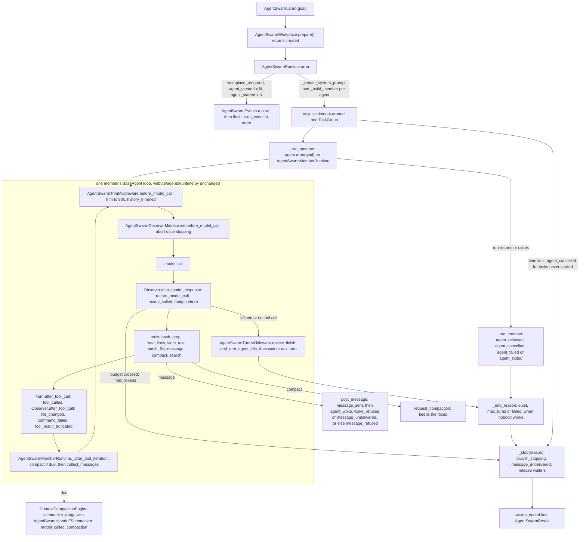

feat(agents): add AgentSwarm — agents share one prompt and one folder, message any agent, compact their own history, and report 24 kinds of events
## Summary

This PR adds `AgentSwarm`. You name 2 to 500 agents and their models, point them at one folder, and give one goal. Every agent gets the same sectioned system prompt and five file and shell tools over that folder. It can message any agent by name, itself included, and it compacts its own history into a handoff summary as the history grows. The swarm stops when no agent has work left, or when a turn, token, or time limit is reached. Everything the runtime does comes back as one of 24 numbered event kinds, live through `on_event` and in order on the result: each model call, file write, failed command, trim, and compaction. The decision that matters most is that the shared agent loop is not edited. `vidbyte/agents/runtime.py`, `base.py`, and `validation.py` are unchanged by this revision, so every new behavior hangs off three seams the branch already used: the member runtime's `_after_tool_iteration`, the member middleware, and tool results. All swarm state lives on one per-run `AgentSwarmRuntime` and changes only in blocks with no `await`, so every message gets exactly one outcome and every agent exactly one ending. Spec: `docs/spec/agent-swarm-v2/spec.md` (r7).

## What changed in this revision

This section is for reviewers of the previous head, `39ce8b20` (spec r5). The diff is `git diff 39ce8b20..fc89377b^1`: 82 files, +8,842/−1,265, of which 44 files are under `vidbyte/`, 2 are the contract and the repo map, 13 are swarm tests, and 23 are this revision's spec documents.

| Before (r5) | Now (r7) | Commits |
|---|---|---|
| Each `AgentSwarmMember` carried its own `system_prompt`. | One shared prompt for every agent: nine sections (environment, tools, web search when set, messaging, turns, goal, instructions, objective, thoroughness). It is filled with only the agent's name, its peers, the folder, and the search tool's name. `AgentSwarmMember` is now `name`, `provider`, and `model_name`. | `c6435533`, `20dbbcd9` |
| `message` listed peers in an `enum`. It refused a message to yourself, and a message to a failed agent was an error. | Loose messaging. Any agent can message any agent, itself included. Only an unknown name or blank text is refused, recorded as `message_refused`. A message to a stopped agent, or one sent after the stop, gets a success reply and is recorded as `message_sent` then `message_undelivered`. | `c19fdddb`, `20dbbcd9` |
| No compaction: only a 90,000-token trim on each call. | Each agent gets a `compact` tool, and it compacts on its own once the provider-reported prompt reaches 72,000 tokens. The newest messages that fit 27,000 tokens are kept, and everything older is summarized through the SDK's `ContextCompactionEngine` into a 10-section handoff summary. A repeat automatic compaction waits until the history has grown by another 27,000 tokens. The trim stays as the backstop. | `20dbbcd9`, `8e56aaea`, `81b0672e` |
| 2–100 agents, 500 turns, 3,600 s default and 604,800 s ceiling, no token limit. | 2–500 agents and 100,000 turns. The time limit defaults to 86,400 s with a 2,592,000 s ceiling. A new swarm-wide token budget defaults to 10,000,000,000, and crossing it stops the run with the new `max_tokens` reason. | `17b99742`, `adb0b316`, `4e1a0a76` |
| `AgentSwarmSettings` lived in `vidbyte/agents/agent_swarm/settings.py` and took a `search_tool: BaseTool`. | `AgentSwarmSettings` lives in `vidbyte/lib/dataclasses/agent_swarm.py`, and `settings.py` is deleted. Web search is now a setting: `web_search` picks Brave, Browserbase, Exa, Parallel, or Tavily, and `web_search_api_key` holds its key. | `adb0b316`, `61ecccd4`, `20dbbcd9` |
| 8 event kinds. | 24 event kinds and 10 new optional fields, each kind with an exact field table. New kinds include `model_called`, `model_error`, `history_trimmed`, `tool_result_truncated`, `file_changed`, `command_failed`, `compaction`, `message_refused`, `wake_refused`, `message_undelivered`, `swarm_stopping`, and four agent endings. | `ae2fc62f`, `adb0b316`, `4e1a0a76`, `20dbbcd9` |
| 171 tests. | 281 tests in the swarm pack, with four new modules (compaction, observer, settings, stop). | `42d28420`, then the S5 test commits below |

## How to use what this PR introduces

```python
import asyncio

from vidbyte import AgentSwarm, AgentSwarmMember, AgentSwarmSettings

settings = AgentSwarmSettings(
    agents=(
        AgentSwarmMember(name="ada", provider="openai", model_name="gpt-4.1"),
        AgentSwarmMember(name="ben", provider="openai", model_name="gpt-4.1"),
        AgentSwarmMember(name="cleo", provider="openai", model_name="gpt-4.1"),
    ),
    workplace="swarm-workplace",          # created if missing, never cleaned
    api_keys=["sk-proj-..."],             # matched to each member's provider
    web_search="tavily",                  # AgentSwarmWebSearch value; None means no web search
    web_search_api_key="tvly-...",
    on_event=lambda event: print(event.sequence, event.kind.value, event.agent, event.peer, event.text),
)

result = asyncio.run(AgentSwarm(settings).arun("Build a Celsius-to-Fahrenheit command-line tool with tests."))
print(result.stop_reason.value, len(result.events), len(result.replies))
```

This is spec §4 exactly as written; it needed no correction. **The output below is a scripted run, not a real model.** I ran the snippet text unchanged on this branch inside the pack's `ScriptedSwarm`, which replaces only `BaseAgent._runner_for_model`, and `FakeTavily`, which replaces `TavilyClient.search`, so no model or search provider was called. In the script, ada writes `c2f.py` and messages ben, ben waits and then tests, and cleo searches once (`['celsius to fahrenheit formula']`). The script had 0 unscripted calls. The same run is the AC-1 test, `test_agent_swarm_acceptance.py::test_the_section_4_snippet_runs_as_written`, which gives `1 passed in 0.78s`.

```text
1 workplace_prepared
2 agent_created ada
3 agent_created ben
4 agent_created cleo
5 agent_started ada
6 agent_started ben
7 agent_started cleo
8 model_called ada
9 tool_called ada
10 file_changed ada
11 model_called ada
12 message_sent ada ben c2f.py is ready; please test it.
13 tool_called ada
14 model_called ada
15 agent_idle ada  Wrote c2f.py.
16 model_called ben
17 agent_idle ben  Waiting for the code.
18 agent_woke ben
19 message_delivered ben ada
20 model_called ben
21 agent_idle ben  Tests pass.
22 model_called cleo
23 tool_called cleo
24 model_called cleo
25 agent_idle cleo  Formula checked.
26 swarm_stopping
27 agent_released cleo
28 agent_released ada
29 agent_released ben
30 swarm_ended
quiet 30 3
```

The developer no longer writes a prompt per agent or builds a search tool object. Model calls, file writes, and the stop are read from `on_event` or `result.events` instead of being reconstructed from logs.

## Flow



Validation happens once, at the edge. `AgentSwarmSettings.__post_init__` refuses bad agents, folders, limits, web-search provider and key pairs, and keys no member's provider accepts, and every refusal names the field. `AgentSwarm.arun` refuses a second concurrent run and a goal that is not text before the folder exists. State changes only inside `AgentSwarmRuntime`, in blocks with no `await`, each followed by one awaited `flush`. `_end_reason` only decides the reason, and `_stop` is the one place that sets it. Failures are caught per agent in `_run_member`: an SDK error or a stray cancel becomes `agent_failed`, and an early return becomes `agent_exited`; neither stops the others. A failed summary call is recorded as `model_error` and keeps the history, and an `on_event` exception is kept by type name in `result.event_error_types`.

## What changed

Product code:

| File | Change |
|---|---|
| `vidbyte/agents/agent_swarm/swarm.py` | `AgentSwarm`, the thin front. It refuses a second concurrent run and a non-text goal, prepares the folder, and runs one fresh runtime. |
| `vidbyte/agents/agent_swarm/workplace.py` | `AgentSwarmWorkplace` creates the folder and its parents and never cleans it. `prepare()` reports whether it created the folder. |
| `vidbyte/agents/agent_swarm/runtime.py` | `AgentSwarmRuntime` owns all swarm state: the shared prompt, members, inboxes, turns, the token budget, compaction requests, the stop, and every event. 498 lines after its header, inside the pack's 500-line limit for this module. |
| `vidbyte/agents/agent_swarm/member.py` | `AgentSwarmMemberRuntime._after_tool_iteration` compacts and then delivers mail. It also holds `AgentSwarmMessageTool` and `AgentSwarmMemberAgent`, which sets the middleware order (trim, turn, observer), the limits, and `call_model` for the summary call. |
| `vidbyte/agents/agent_swarm/compaction.py` | New. `AgentSwarmHandoffSummarizer` writes the 10-section summary through the member's own runner. `AgentSwarmCompactTool` is the `compact` tool. |
| `vidbyte/agents/agent_swarm/events.py` | The event outbox: a numbered `record` that never awaits, and an ordered `flush` under a one-slot semaphore. It carries the 10 new fields. |
| `vidbyte/agents/agent_swarm/__init__.py` | Package exports. `AgentSwarmSettings` is re-exported from lib. |
| `vidbyte/agents/agent_swarm/README.md` | Usage, the settings table, events, limits, and known limitations. |
| `vidbyte/middleware/builtins/agent_swarm_observer.py` | New. `AgentSwarmObserverMiddleware` records model calls, model errors, the budget, and tool outcomes, and aborts once the swarm is stopping. `AgentSwarmTrimMiddleware` is the 90,000-token trim, and it reports `history_trimmed`. |
| `vidbyte/middleware/builtins/agent_swarm_turn.py` | `AgentSwarmTurnMiddleware` records `tool_called` and turns a finish into `end_turn`. |
| `vidbyte/tools/toolsets/agent_swarm.py` | `AgentSwarmTools` holds the five workplace tools. `search_tool_for` builds the selected search tool around a client that holds the key. |
| `vidbyte/tools/toolsets/__init__.py` | Exports `AgentSwarmTools`. |
| `vidbyte/lib/dataclasses/agent_swarm.py` | `AgentSwarmMember`, `AgentSwarmEvent` (with a per-kind field table), `AgentSwarmSettings` (moved here), and `AgentSwarmResult` (which checks numbering, one `swarm_stopping`, and `swarm_ended` last). |
| `vidbyte/lib/enums/agent_swarm.py` | 24 event kinds, 5 stop reasons (adding `max_tokens`), `AgentSwarmWebSearch`, `AgentSwarmCompactionTrigger`, `AgentSwarmAgentState`, and `AgentSwarmFolderState`. |
| `vidbyte/lib/enums/__init__.py` | Exports the swarm enums. |
| `vidbyte/lib/constants/agent_swarm.py` | Every limit and policy literal, each with one name. |
| `vidbyte/lib/enums/prompts.py` | 23 `agent_swarm` prompt keys. The header count becomes 162 prompts in 36 families. |
| `vidbyte/lib/enums/agent_runtime.py` | `AgentRuntimeType.AGENT_SWARM_MEMBER`. |
| `vidbyte/lib/registries/runtimes.py` | Resolves `AGENT_SWARM_MEMBER` to `AgentSwarmMemberRuntime`, with a lazy import as Jev and Infinite use. |
| `vidbyte/agents/base.py` | Adds `AGENT_SWARM_MEMBER` to `_LINEAR_LOOP_RUNTIMES`, so members get the loop's usage, speed, and fallback wiring. This is 12 lines from the PR's first revision; this revision adds 0. |
| `vidbyte/__init__.py`, `vidbyte/agents/__init__.py` | Public exports. The root gains `AgentSwarm`, `AgentSwarmSettings`, `AgentSwarmMember`, `AgentSwarmEventKind`, `AgentSwarmStopReason`, and `AgentSwarmWebSearch`. |
| `contracts/sdk-public-api.json` | Regenerated: 0.4.0, 742 exports. |
| `vidbyte/prompts/prompts/agent_swarm/agent_swarm.json` + 23 `.md` leaves | The prompt family: nine `system_*` sections, seven `message_*` leaves, `inbox` and `inbox_message`, three `compact_*` leaves, and the summarizer prompt and summary prefix. No leaf states a number, a model, or a provider. |
| `vidbyte/agents/README.md`, `vidbyte/middleware/README.md`, `vidbyte/tools/README.md`, `vidbyte/prompts/README.md`, `REPO_MAP.md` | Folder docs and the repo map. |

Tests and docs:

| File | Change |
|---|---|
| `tests/features/agent_swarm/agent_swarm_fixtures.py` | `ScriptedSwarm` gives OpenAI-, Anthropic-, and Gemini-shaped responses through `_runner_for_model`. Also `FakeTavily`, and `assert_event_invariants`, which runs on every run, with 67 call sites. |
| `tests/features/agent_swarm/test_agent_swarm_contract.py` | 122 tests: exports, catalog order, schemas, prompt leaves, settings refusals, and module budgets. |
| `tests/features/agent_swarm/test_agent_swarm_property.py` | 36 seeded schedule cases for the event invariants. |
| `tests/features/agent_swarm/test_agent_swarm_lifecycle.py` | 29 tests: failures, exits, cancels, the time limit, and the turn budget. |
| `tests/features/agent_swarm/test_agent_swarm_compaction.py` | New, 22 tests: the `compact` tool, the automatic trigger, growth hysteresis, Gemini and write-heavy histories, and a failed summary. |
| `tests/features/agent_swarm/test_agent_swarm_messaging.py` | 18 tests: loose messaging, refusals, and self-messages. |
| `tests/features/agent_swarm/test_agent_swarm_workplace.py` | 16 tests: the folder and `folder_state`. |
| `tests/features/agent_swarm/test_agent_swarm_settings.py` | New, 11 tests: lib placement, limits, and web-search settings. |
| `tests/features/agent_swarm/test_agent_swarm_stop.py` | New, 10 tests: `model_called` usage, the `max_tokens` stop, and `model_error`. |
| `tests/features/agent_swarm/test_agent_swarm_acceptance.py` | 9 tests, including the §4 snippet run (AC-1). |
| `tests/features/agent_swarm/test_agent_swarm_observer.py` | New, 8 tests: trims, truncation, `file_changed`, and `command_failed`. |
| `tests/features/agent_swarm/FEATURE.md`, `README.md` | The pack's index. |
| `tests/features/codex_host/test_codex_host_packaging.py` | Merge fix: main's exact `toolsets.__all__` pin gains `AgentSwarmTools` (`9ed61e09`). |
| `docs/spec/agent-swarm-v2/` (25 files) | This revision's request, spec r7, test plan, review, verify log, pipeline state, stage reports, and this body. |
| `docs/spec/agent-swarm/` (22 files) | The first revision's spec r5 and its reports, kept as the baseline. |

## Acceptance criteria → proof

Test paths are under `tests/features/agent_swarm/`. Every named test exists on this branch and passes in the 281-test run below.

| AC | What it checks (plain words) | Proven by |
|---|---|---|
| AC-1 | The §4 snippet runs as written, and every agent's first call carries the same prompt. | `test_agent_swarm_acceptance.py::test_the_section_4_snippet_runs_as_written` |
| AC-2 | Agents are created and then started in order, each with the exact tool list, and search sits just before `isDone`. | `test_agent_swarm_acceptance.py::test_three_members_are_created_then_started_in_order_with_the_search_tool_before_isdone`; `test_agent_swarm_contract.py::test_each_agent_holds_exactly_the_swarm_tools_and_a_message_schema_naming_every_agent` |
| AC-3 | A message to yourself is accepted and arrives at your next tool iteration. | `test_agent_swarm_messaging.py::test_a_message_to_oneself_is_accepted_and_delivered_at_the_next_tool_iteration` |
| AC-4 | An unknown name or blank text is a tool error, recorded as `message_refused`, with nothing queued. | `test_agent_swarm_messaging.py::test_a_refused_message_is_a_tool_error_queues_nothing_and_the_loop_continues` (7 rows) |
| AC-5 | A message to a failed agent succeeds and is recorded as sent, then undelivered. | `test_agent_swarm_lifecycle.py::test_a_provider_error_fails_only_that_agent_names_its_cause_and_stops_its_mail`; `::test_a_cancelled_error_raised_by_on_event_on_an_idle_agent_fails_it_instead_of_waking_it` |
| AC-6 | With no turns left, a send records `wake_refused`, and the message ends undelivered under `max_turns`. | `test_agent_swarm_lifecycle.py::test_a_spent_turn_budget_stops_wakes_and_ends_max_turns_with_the_message_undelivered`; `::test_a_turn_end_with_mail_and_no_turn_left_refuses_the_wake_once_and_ends_max_turns` |
| AC-7 | Every message has one outcome, every agent has one ending, and there is one `swarm_stopping` before the last `swarm_ended`. | `agent_swarm_fixtures.py::assert_event_invariants` (67 call sites); `test_agent_swarm_property.py` (36 seeded cases) |
| AC-8 | `model_called` carries input, output, and cached tokens, and the budget grows by the reported total. | `test_agent_swarm_stop.py::test_a_model_response_records_its_tokens_and_the_budget_grows_by_the_reported_total` (2 rows) |
| AC-9 | The call that crosses `max_tokens` stops the swarm in its own block, and no later call is made. | `test_agent_swarm_stop.py::test_the_response_that_crosses_max_tokens_stops_the_swarm_in_its_own_block_and_runs_nothing_more` |
| AC-10 | A model error is recorded, and a retry installed by the test still decides. | `test_agent_swarm_stop.py::test_a_retried_model_error_records_model_error_and_the_agent_keeps_working` |
| AC-11 | A trim records `history_trimmed` with the trim's own drop count. | `test_agent_swarm_observer.py::test_each_model_call_the_trim_changes_records_history_trimmed_with_its_exact_drop` |
| AC-12 | A tool result over 100,000 characters records the exact number of omitted characters. | `test_agent_swarm_observer.py::test_a_tool_result_over_the_cap_records_its_exact_omitted_count_and_one_at_the_cap_records_none` (2 rows) |
| AC-13 | Two writers to one file: the second `file_changed` names the first writer. | `test_agent_swarm_observer.py::test_two_agents_writing_one_file_record_file_changed_naming_the_previous_writer` |
| AC-14 | A non-zero exit or a timeout in `bash` records `command_failed`. | `test_agent_swarm_observer.py::test_bash_records_command_failed_for_a_non_zero_exit_and_none_for_zero`; `::test_a_bash_command_that_runs_out_of_time_records_command_failed_timeout` |
| AC-15 | The first event reports whether this run created the folder. | `test_agent_swarm_workplace.py::test_the_first_event_reports_whether_the_run_created_the_workplace` |
| AC-16 | `compact` summarizes only older history, and mail follows the summary. | `test_agent_swarm_compaction.py::test_a_compact_call_summarizes_only_the_older_history_and_mail_follows_the_summary` |
| AC-17 | Automatic compaction at the trigger happens once per iteration and waits for target-sized growth. | `test_agent_swarm_compaction.py::test_a_measured_context_at_the_trigger_compacts_automatically_and_one_below_does_not` (2 rows); `::test_a_pending_request_and_the_trigger_in_one_iteration_compact_once`; `::test_automatic_compaction_waits_for_a_target_of_new_history_and_a_compact_request_does_not`; `::test_a_gemini_member_compacts_again_each_time_its_parts_history_grows_by_the_target`; `::test_a_repeat_automatic_compaction_is_due_at_exactly_the_target_of_growth_and_not_one_token_below` (2 rows) |
| AC-18 | A failed summary keeps the history, still delivers mail, and fails nobody. | `test_agent_swarm_compaction.py::test_a_failed_summary_keeps_the_history_delivers_mail_and_fails_nobody` |
| AC-19 | A search provider without a key, a key without a provider, or an unknown provider is refused, and the key is never quoted. | `test_agent_swarm_settings.py::test_web_search_settings_without_a_key_with_a_dangling_key_or_an_unknown_provider_are_refused`; `test_agent_swarm_contract.py::test_invalid_settings_are_refused_naming_the_field_and_creating_nothing` (web-search rows) |
| AC-20 | Each limit is refused just past its bound and accepted at it (500 agents, `max_tokens=1`, 30 days). | `test_agent_swarm_settings.py::test_limits_refuse_just_past_each_bound_and_accept_each_bound` |
| AC-21 | `AgentSwarmSettings` is one lib class under every import path, and a member has no prompt. | `test_agent_swarm_settings.py::test_agent_swarm_settings_is_one_lib_class_under_every_import_path`; `::test_a_member_has_no_prompt_of_its_own`; `test_agent_swarm_contract.py::test_public_names_import_from_every_documented_path` |
| AC-22 | The family has exactly 23 leaves with sentence counts met, the eight done-check headings, and no digits. | `test_agent_swarm_contract.py::test_prompt_family_has_exactly_the_twenty_three_documented_leaves_with_their_fields`; `::test_prompt_leaves_hold_no_digits_roles_or_examples`; `::test_the_thoroughness_section_has_the_eight_headings_each_six_to_eight_sentences` |
| AC-23 | On the time limit, working and idle agents are labeled `agent_cancelled`, and none is failed. | `test_agent_swarm_lifecycle.py::test_the_time_limit_labels_working_and_idle_agents_cancelled_and_fails_none` |
| AC-24 | A recording bug exits only that agent, as `agent_exited` with `middleware_abort`. | `test_agent_swarm_lifecycle.py::test_a_turn_middleware_recording_bug_exits_only_that_agent_naming_the_middleware_abort` |
| AC-25 | The full local source gate passes, except for main's inherited `harness_threads` cases. | Gate, not a test: see Verification. `SDK-LINT: PASS`, the contract is current, and the source stage fails only those 2 cases. |

## Verification

Local runs are on `c86dda43`, which has the same product tree as this head. They ran from the worktree with `PYTHONPATH=<worktree>`, with no network and no real model.

| Gate | Command | Result |
|---|---|---|
| Swarm pack | `python -m pytest tests/features/agent_swarm -q -p no:cacheprovider` | `281 passed in 7.75s` |
| Pack + prompt parity | `python -m pytest tests/features/agent_swarm tests/test_prompts_interface.py -q -p no:cacheprovider` | `286 passed in 7.98s` |
| AC-1 snippet | `python -m pytest "tests/features/agent_swarm/test_agent_swarm_acceptance.py::test_the_section_4_snippet_runs_as_written" -q` | `1 passed in 0.78s` |
| Codex host (merge fix) | `python -m pytest tests/features/codex_host -q -p no:cacheprovider` | `215 passed in 15.36s` |
| Lint | `python lint/run.py` | `SDK-LINT: PASS` |
| Lint, every finding | `python lint/run.py --all --format json` | Exit 0: 91 rules (48 CLEAN, 36 RATCHETED, 7 IMPROVED) and 3,937 findings. One finding names a swarm line: S051 (ruff I001) at `vidbyte/lib/registries/runtimes.py:33`, in an import block that already fails I001 on main. S051 sits at its baseline, 259 of 259. |
| Public API | `python scripts/generate-sdk-public-api.py --check` | `contracts/sdk-public-api.json is current at 654deee6d2893e83f67164bd331e0f92c941cd85 (vidbyte-sdk 0.4.0, 742 exports).` |
| Source stage | `python scripts/run_ci.py --stage source` | `SDK-LINT: PASS` … `2 failed, 8666 passed, 18 skipped in 294.59s`, then `CI failed: Command failed with exit code 1: … -m pytest`. The 2 are main's `test_harness_threads_surface.py::test_branch_leaves_the_tools_and_configs_packages_as_main_has_them` and `::test_import_vidbyte_starts_no_process_and_leaves_the_native_package_unloaded`. Both diff the checkout against `origin/main` and assert that a branch leaves `vidbyte/tools` and the root `__all__` as main has them. Any branch that adds a toolset or root exports fails them. CI's shallow clone has no `origin/main`, so they skip there (`merge_base()` calls `pytest.skip`). |
| Package stage | `python scripts/run_ci.py --stage package` (no `PYTHONPATH`) | `CI passed.` (orchestrator, on the merge `fc89377b`; nothing under `vidbyte/` or in `pyproject.toml` has changed since) |
| Semgrep | `semgrep scan --error --config .semgrep/typed-mapping-boundary-policy.yml vidbyte` | `Ran 1 rule on 1047 files: 0 findings.` (orchestrator, on the merge; re-run remotely by Static policy) |
| Remote, last product commit `9ed61e09` | `gh workflow run ci.yml` / `static-policy.yml --ref feat/agent-swarm` | CI 39704722109 `success` (Source 3.11, Source 3.12, Package); Static policy 39704724215 `success` |
| Remote, this head | same, dispatched after the push | Dispatched on the commit that adds this file. Its run IDs are filled in on the GitHub copy of this body, because a commit cannot name its own runs. |

This repo runs no checks on pull requests by itself, so `gh pr checks` is empty by design. Each run above was dispatched by hand, and its `headSha` was checked against the pushed head.

## Adversarial review

Three reviewers covered three lenses (spec conformance, repo conventions, engineering), and an independent verifier checked their findings. Two post-repair re-reviews followed; the second's verdict was SOUND. In total, 26 findings were confirmed: 3 Blockers, 5 Majors, and 18 Minors. 22 are fixed, 0 waived, and 4 left open as follow-ups (R-17, R-18, R-19, R-26). The verifier refuted or downgraded 3 of the reviewers' claims. Full record: `docs/spec/agent-swarm-v2/review.md`.

| ID | Finding | Fixed in |
|---|---|---|
| R-1 (Blocker) | `_end_check` called `_stop`, a helper calling a helper, which AGENTS.md §1 forbids. It is now a pure `_end_reason`, and each caller passes the reason to `_stop` in the same block. | `8e71ec8c` |
| R-2 (Blocker) | Both size estimates read only `message["content"]`. Gemini `parts` and OpenAI `tool_calls` counted 0 tokens, so those histories never compacted. Estimates now count the whole message. | `8e56aaea`; tests `77606b69` |
| R-3 (Blocker) | 52 comment lines were wider than 72 columns, hidden by the pack's 400-line module check. They are rewrapped, and `runtime.py` gets a 500-line limit. | `6455f9e9`; test limit `c9a5d0db` |
| R-4 (Major) | Three new policy functions had no `@intent` comment. A002 reported them, but its IMPROVED ratchet printed PASS. | `a12973e7` |
| R-5 (Major) | The spec and docs claimed the loop retries model errors, which it does not. The wording is fixed, and the README now says the first provider error fails the agent. | `360ceab1`; spec `79f378cf`; test docstring `2f346592` |
| R-6 (Major) | Automatic compaction had no hysteresis: a large fixed prompt paid for a summary on every iteration. A repeat automatic compaction now waits for 27,000 tokens of growth. | `81b0672e`; tests `50280d62`; READMEs `2567874f`, `6d604082` |
| R-7 (Major) | Three spec-pinned lines could be deleted with the pack still green: the stop guard on compaction, the same-writer peer rule, and the side-call tokens. Three tests now kill those mutants. | tests `78b067d1` |
| R-20 (Major, re-review 1) | No test pinned the whole-message estimate in the no-usage fallback and the growth check. Two Gemini tests now pin it. | tests `ce8053ed` |

## Deviations from the spec

The code differs from the spec text in these places. Each is recorded in spec §17.

1. `AgentSwarmMessageTool.validate_call` returns `None`. A missing or non-text `to` or `text` therefore reaches the swarm and is recorded as `message_refused`, instead of being refused first by the loop's schema check. Why: so the swarm's two refusals are the only ones (AC-4, INV-5).
2. `AgentSwarmHandoffSummarizer` loads its two leaves from the catalog itself. Why: it is built from the member agent and has no handle on the runtime's texts.
3. `AgentSwarmEvent.__post_init__` checks the enum fields through one `_ENUM_FIELDS` table. Why: to stay under lint S008's branch limit.
4. `AgentSwarmTrimMiddleware` sets its own `name`. Why: so middleware records name the subclass.
5. `_run_member` calls `agent.arun(goal, provider=agent.runner_config.provider)`. Why: the loop otherwise falls back to `openai` and parses an Anthropic member's responses as OpenAI's.
6. `arun` renders each prompt and passes it into `_build_member`. Why: to keep call chains one level deep.
7. `_changed_path` and `_command_failure` were inlined to fit 400 lines. This is superseded: R-16 restored both once R-3 set the 500-line limit.
8. `request_compaction` strips the focus, turns a non-string focus into `""`, and flushes before returning its reply.
9. `command_failed` tests `type(exit_code) is int and exit_code` rather than `exit_code != 0`. Why: lint A007 reads a literal `0` beside `timeout` as an unnamed bound.
10. `file_changed` takes the path from the successful call's own argument, resolved against the folder, not from the result metadata that INV-26 names. Both give the same path for every `write_text` and `patch_file` today. D-14's revisit trigger covers either tool changing how it resolves paths.
11. R-8 variant. The review asked for the member runtime's refusal to always add `received_summarizer` to its details. Instead, the details name the first missing part. Why: the literal fix would break the pinned `{"received_swarm_runtime": "NoneType"}` case in `test_agent_swarm_contract.py`. `19087212`.
12. A merge-resolution edit outside the swarm pack: main's `tests/features/codex_host/test_codex_host_packaging.py` pins `toolsets.__all__` exactly, and it now includes `AgentSwarmTools`. Git flagged no conflict here. The CodexHostTools order and docstring checks are unchanged. `9ed61e09`.
13. Spec §5 drift, fixed in the spec at this stage. The r7 chart drew `agent_released`, `agent_failed`, and `agent_exited` as coming from `_stop`. They come from `_run_member`, and `_stop` records `agent_cancelled` only on the time limit, for tasks that never started. §5's prose also said `request_compaction` records events; it records none and only flushes. §5 now matches the chart above.

## Follow-ups

None of these is built. Each one is the owner's decision.

1. **Inbox delivery budget (Q-6, R-17).** A drained inbox larger than the 90,000-token trim is recorded as delivered, but the trim drops it unread. The loss is on the record as `history_trimmed`. 500 agents make this reachable: 499 reports of 1,500 characters come to about 189,000 estimated tokens. This is the first one to decide.
2. **Member retry (Q-7, R-18).** AgentSwarm installs no model retry, so one 429 or 503 fails that agent for the rest of a run that may last a day.
3. **Failed count on `quiet` (Q-8, R-19).** A run ends `quiet` when one agent finished and the rest failed. Callers must scan `events` for `agent_failed`.
4. **Dense scripts (Q-9, A-12).** Compaction growth is counted with a four-characters-per-token estimate, which undercounts CJK-like text by up to about 2.7 times. In S5's probe, that text peaked at 129,015 measured prompt tokens, which matters on models whose window is under about 130,000 tokens.
5. **`keep_ge` mutant (R-26).** Stopping `_keep_last` at `>=` instead of `>` survives the pack. It shows only when a result lands exactly on the 27,000-token keep target.
6. **Confirm the agent cap.** The answer said "max agents 5,00", which was read as 500. Another cap is a one-constant change to `AGENT_SWARM_MAX_AGENTS`.
7. **Main's branch-scoped tests.** The two `harness_threads` surface tests fail locally on any branch that adds a toolset or root exports. They belong scoped to their own PR, or removed from main.
8. **Import order.** S2 noted that ruff's default import-order warnings in the tests are not a gate. S051 I001 at `vidbyte/lib/registries/runtimes.py:33` sits in a block main already fails, so it is best fixed on main.
9. **Wording.** `AgentSwarmObserverMiddleware.on_model_error`'s docstring (`vidbyte/middleware/builtins/agent_swarm_observer.py:61`) still says to "let the loop's own retry and fallback decide". AgentSwarm installs none (R-5).
10. **Empty summary.** When the summary call succeeds but returns no text, the older history is still replaced by the summary prefix alone (`vidbyte/agents/agent_swarm/compaction.py:59-60`). Spec EC-24 accepts this on purpose, since the goal, the kept newest messages, and the folder remain. If you would rather keep the history, a guard that treats an empty summary like a failed one would cost about 2 lines.
11. **Native compaction (Q-3).** An Anthropic-native compaction fast path behind the same seam is a possible next PR.
12. **Known limitations, documented in the package README:**
    - `bash` is not confined and inherits the environment.
    - Concurrent edits to one file can collide.
    - Writes made through `bash` never appear as `file_changed`.
    - On Windows, a cancelled `bash` command may keep running.
    - Two swarms on one folder are not guarded against each other.

🤖 Generated with [Claude Code](https://claude.com/claude-code)
