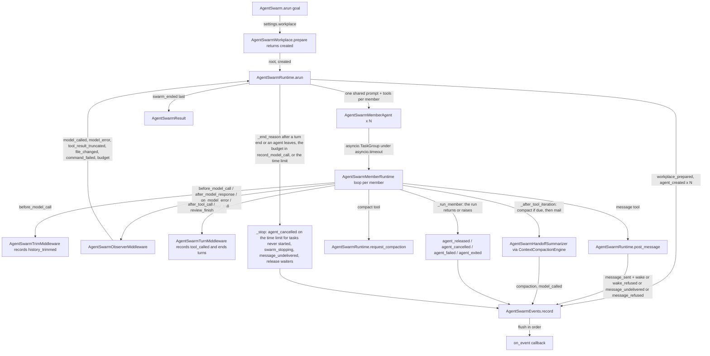

# Spec: AgentSwarm revision: one shared prompt, loose messaging, per-agent compaction, generous limits, full event visibility

> **TL;DR** — PR #1174's `AgentSwarm` is revised in place: every agent now starts from one shared, sectioned system prompt (environment, tools, messaging, turns, goal, instructions, objective, and eight done-check ideas, each section at least six sentences) instead of a per-member role prompt; the `message` tool accepts any agent name and any text; each agent gets a `compact` tool plus an automatic, usage-triggered handoff summary built on the SDK's own `ContextCompactionEngine`; limits stay but scale to 500 agents and a ten-billion-token budget; `AgentSwarmSettings` moves to `vidbyte/lib/dataclasses/` with web search as a selectable setting; and the event record grows from eight to twenty-four kinds so every decision the runtime makes is visible through `on_event`. The one decision that matters most: the shared loop `vidbyte/agents/runtime.py` stays untouched, so every new event and the compaction rewrite come from the three seams the branch already uses (`_after_tool_iteration`, middleware hooks, tool result metadata) plus one new sibling middleware.

## §0 User prompts

_The verbatim record of what the user asked lives in `docs/spec/agent-swarm-v2/request.md` (every prompt in order, the handoff block if one exists, and the structured conversation notes). Reproduced here, verbatim, is the single prompt that invoked the pipeline (Prompt 4) and, under 0.2, the user's ten answers (Prompt 5). Every later section is the spec author's interpretation; this block is the ground truth it is checked against._

### 0.1 Invoking request (verbatim)

````
okay, great, few things that i want to change for the pr (want you to update the pr and not create a new one). 1)  resolve the comments on the pr./ 2) prompt needs a little bit of work on the pr. I want you to explain things in 6-8 sentences at least, and for the main prompts have a few sections of this legth (goal, instructions, objective, etc) 3) want to explain/change the architecture of this agent swarm a little bit,  and you can also propagate this information into the prompts. I want this architecture of this agent swarm to be simple and not too opinionated, and kind of like 'getting out of the way of the agents'. these are the changes that i want to make to the pr: when we start the runtime, i want there to be N agents that swarm with the same message/system prompt in a few paragraphs: "you are running in an agent swarm, you are running in this workspace, you have access to talk to other agents, you have these tools. ". this is the important STARTING point of the algorithm, the reason I want to set it up like this is because I want the agents to kind of figure out what they have to do during the run and talk to each other. I think that each agent getting a "mailbox" can stay in terms of messeging each other. then, I think that. i think that each agent should also get its own compaction tool, and I want to kind of remove the 'task board' that we have in the swarm and just kind of let the agents work this out. i think that also for the "main prompts" we should specify to the agent, through promptting, in 6-8 sentences each of the following ideas that we have implemented in the JevAgent inside of the sdk for "done checks", just try to bias the agents for being extremely throughout and making sure that the work is done. 4) i want to keep teh event log but I want to try to expand it so that a user can very easily "see into" the agent swarm, etc: Decisions the runtime already makes but never records. These need no new seam. Each is a branch in runtime.py that today leaves no trace.

- message_refused. The send path has three refusal branches: blank text, an unknown or self recipient, and a recipient that has failed. Each raises a tool error the model reads, so the stream only shows a tool_called for message with error status and no reason. The event carries the sender as agent, the attempted name as peer, and the reason as text. It separates "tried to reach a dead peer", which is a coordination failure, from an ordinary tool mistake.
- wake_refused. Both the send path and the turn end check the turn budget before waking an agent. When the budget is spent the message is queued and nobody wakes, and the only trace is a max_turns stop reason at the very end. Recording it at the moment it happens, with the un-woken agent, the sender as peer, and the message id, makes edge case EC-8 visible when it occurs rather than inferred afterwards.
- message_undelivered. When an agent fails its inbox is abandoned, and when the swarm ends max_turns the running agents still hold mail. Today a reader must diff message_sent against message_delivered to find those messages. Recording one event per orphaned message inside the fail path and the end check, with recipient, sender as peer, and message id, gives every sent message exactly one outcome. The rm_ended record, so the result invariant thatswarm_ended is last still holds.
- swarm_stopping. The stop reason is decided inside the end check, but swarm_ended is recorded only after every releagent's run has returned. Edge case EC-18 sa that gap and drop agents from the replies, andthe reader cannot see when the decision was made. An event recorded in the same block that sets the stop reason, with an empty agent and the reason, makes the gap measurable through elapsed time.
- agent_released. When a released agent's run returns, the runtime keeps its reply and does nothing else. There is no per-agent terminal event on the normal path, so an agent missing from the replies after a late cancel leaves no explanation. Recording it in that branch gives every agent one of three endings.                                  agent_cancelled. On a timeout every running out an agent_failed, so a timed-out run has noper-agent ending at all. The cancel branch already distinguishes the swarm's own cancel from a stray one by checking the task's cancel count and the decided stop reason. Recording the event in that branch before re-raising, with whetheagent was working or idle as text, completesagent_exited. The failure path currently folagent_failed: a model or SDK error, and a runthat returned early with its own stop reason such as max_iterations, max_tokens, tool_loop_limit or middleware_abort. The early-exit branch already extracts that stop reason into text. Splitting it into its own kind lets a reader tell a provider outage from an agent that hit its own loop budget without parsing a sentence.                             event below is one more override plus one record method on the runtime, which respects the non-goal of not touching the shared loop.

- model_called. The after_model_response hook hands the middleware the provider usage record, which exposes input, output and cached tokens plus a cost formula, and the running model call count. One event per model response, with the agent and the token counts as new integer fields, answers open question Q-5 about per-agent usage through the stream instead of a result field. It also shows how many rounds each turn took. It is the highest-volume candidate, which touches Q-8.
- model_error. The on_model_error hook receives the exception for every failed attempt, including ones a retry or a fallback later absorbs. Today only the final failure surfaces, as agent_failed. Recording the error type and text per attempt shows rate limiting and flakiness before an agent dies. The middleware must return continue so the loop's own retry decision stays untouched.                                                                                   history_trimmed. The trim middleware is firs the pipeline applies each transform to thecontext before the next middleware runs, so in before_model_call the turn middleware sees the post-trim history. A conversation only grows between calls, so a message count lower than the one seen at the previous call proves a trim. Edge case EC-26 warns that delivered messages can drop out of the model's view. This event says exactly when that happened, which is the key fact when an agenit.
- tool_result_truncated. The after_tool_call hook sees the raw result before the loop applies the swarm's own character cap, so comparing the output length with the constant is exact. The event carries the tool name and the omitted count. A wrong decision by that agent later may trace to a cut result. It could also be a flag on tool_called, which is open question Q-6 territory.

Workplace facts from the tools' own result metadata. Also derived in after_tool_call, from fields the tools already return.

- file_changed. The write_text success result carries the path, and patch_file carries the file path and a changed flag. The runtime can keep a last-writer map per path, updated in the same synchronous block, and record the path as text and the previous writer as peer when it was a di4 claims collisions are visible in tool_calledevents, but tool_called carries no path, so today they are not. Writes made through bash stay invisible, since bash is unsandboxed and reports no path.                                                                                        command_failed. The bash tool returns a succat finished, with the exit code only in metadata and on the last output line. A red test run is therefore a success-status tool_called today. Recording an event when the exit code is non-zero, or when the error metadata says timeout, is the one event that tells a reader the tests failed from the stream alone.

Run-level.                                                                                                                
- workplace_prepared. The workplace object can check whether the folder existed before its one mkdir call. Edge case EC-31 says a second run sees the previous run's files, and a reader of the events alone cannot tell whether the swarm started clean. Recording the path and a created-or-et needs prepare to return that fact to theruntime.

Not derivable without breaking a runtime rule

- message_read. Delivery appends a user message to the conversation. Nothing signals that the model used it, so only delivered is observable.
- Per-tool-call delivery. The loop has no seam between two tool calls of one response, per assumption A-1. Adding one changes the shared loop, which non-goal NG-8 forbids.
- swarm_stalled or heartbeat. Needs a timer, and the runtime forbids polling and sleeping. Stall detection belongs in the consumer of the stream, which can watch elapsed time between events.
- File changes through bash. No path metadata exists, and sandboxing is a stated limitation.

★ Insight ─────────────────────────────────────
The current event set is "exactly the state mae transition in the spec's lifecycle diagram.The additions above fall into two different classes with different guarantees. The runtime-decision events inherit the no-interleaving proof for free because they li exist. The hook-derived events are per-agentobservations with no cross-agent ordering claim beyond the sequence number, and they are where the volume lives: model_called and tool_result events scale with the agents' call rate, so a cap or a per-kind opt-in on the settings would land alongside them.
─────────────────────────────────────────────────. Also maybe things like agents created.
````

### 0.2 User replies during the run

**Prompt 5** (the user's answers to the orchestrator's ten alignment questions, verbatim; the questions are in `request.md` §C "Clarifications and answers"; these answers produced r1):

````
1) yes, I want each agent to have the same system prompt, and in that system prompt include a section that lets them know about their environment (they are in an agent swarm, they can message other agents, they are working in a shared workspace, etc). 2) remove this. I want the messagin protocol to be very loose and non-restrictive, the agents should be able to message any agent anything.. 3) include the most important ones 4) okay thats fine ignore this. 5) think about some good prebuilt compaction tools that other providers/companies have created and see if you can attach this compaction  tool  to the agents. Compaction is very important and want to see if you can integrate from someone how has built it really good 6) forget this, keep the messaging tool specific to this runtime. 7) lib folder. 8) we can keep limits, but they should be extremely generous. if you are running an agent swarm you probable have the tokens to support the cost. thinking max agents 5,00, max tokens 10 billion, things of this scale. 9) this can be setting that user selects. 10) adopt full list that can be done deterministically through software and not through changing the runtime shape
````

_The orchestrator appends any later reply here verbatim, labeled with the revision it produced._

---

## Part A — Framing

## §1 Goal

| ID | Goal (outcome) | How we will know | Source |
|---|---|---|---|
| G-1 | Agents work out what to do by talking, not by assigned roles: every member starts from the same system prompt, which tells it where it is (an agent swarm, a shared workplace, peers it can message, the tools it holds) and lets the swarm "figure out what they have to do during the run". | `AgentSwarmMember` has no `system_prompt`; every member's system prompt is the same template rendered with only its own name, its peers' names, the workplace path, and the web-search tool name; the first model call of every agent carries that prompt followed by the loop's agentic prompt. | Prompt 4 ("N agents that swarm with the same message/system prompt"; "the important STARTING point"); Prompt 5 answer 1 |
| G-2 | The prompts explain, not command: every section of the main prompt is at least six sentences, the main prompt has sections named for their job (environment, tools, messaging, turns, goal, instructions, objective, thoroughness), and eight JevAgent done-check ideas each get their own six-to-eight-sentence section so agents are biased toward being "extremely thorough and making sure that the work is done". | Each `system_*` prompt leaf has at least six sentences; `system_thoroughness.md` has an introduction and eight headed subsections of six to eight sentences each; the `message` and `compact` tool and parameter descriptions have six to eight sentences. | Prompt 4 items 2 and 3; Prompt 5 answer 3 |
| G-3 | The architecture "gets out of the way of the agents": messaging is loose (any agent, any text), nothing imposes a coordination structure, and the only refusals left are the ones that cannot deliver anything. | The `to` parameter has no enum; a message to oneself is queued; a message to a stopped agent is accepted and reported, not refused; only an unknown name or blank text is refused. | Prompt 4 ("simple and not too opinionated"); Prompt 5 answer 2 |
| G-4 | Compaction is a first-class per-agent capability built from the best prebuilt practice: each agent can compact on demand with a focus, and compaction also happens automatically from real token usage, with a swarm-aware handoff summary that preserves peers, promises, files, and next steps. | A `compact` tool in every member's catalog; a `compaction` event per rewrite with trigger, tokens, and messages dropped; the summary call is scriptable offline through the member's own runner; the 90,000-token trim remains as the last line. | Prompt 4 ("each agent should also get its own compaction tool"); Prompt 5 answer 5 ("Compaction is very important"); `context/compaction-research.md` §4 |
| G-5 | Limits stay but are extremely generous, because the user pays for the usage: up to 500 agents, a ten-billion-token budget, and turn and time limits scaled to match. | Constants: 2–500 agents, 100,000 turns by default, 10,000,000,000 tokens by default, one day by default and thirty days at most; a swarm that crosses its token budget ends `max_tokens`. | PR comment 4318728824; Prompt 5 answer 8 |
| G-6 | A user can "very easily see into" a running swarm through `on_event`: every decision the runtime already makes, every model call and error, every trim, truncation, compaction, file write, failed command, and the workplace's starting state are recorded, deterministically, without changing the shared loop. | Twenty-four event kinds; every sent message has exactly one outcome (`message_delivered` or `message_undelivered`); every agent has exactly one terminal event (`agent_released`, `agent_cancelled`, `agent_failed`, or `agent_exited`); `swarm_ended` is still last. | Prompt 4 item 4; Prompt 5 answer 10 |
| G-7 | The four review threads on PR #1174 are resolved by this revision, and the PR is updated in place: `AgentSwarmSettings` lives in `vidbyte/lib/dataclasses/`, the message tool stays swarm-specific, caps are generous, and web search is a setting the user selects. | S6 replies on threads 4318715506, 4318721573, 4318728824, 4318730679 naming the fixing commits and resolves them; `gh pr edit 1174`; no second PR. | PR comments; Prompt 4 ("update the pr and not create a new one"); Prompt 5 answers 6, 7, 8, 9 |

## §2 Objective

When this PR revision merges, `feat/agent-swarm` contains an `AgentSwarm` whose `AgentSwarmSettings` is a `vidbyte/lib/dataclasses/agent_swarm.py` record with `agents`, `workplace`, `api_keys`, `web_search` (an `AgentSwarmWebSearch` enum value or `None`), `web_search_api_key`, `on_event`, `max_turns`, `max_tokens`, and `timeout_seconds`; whose members are `AgentSwarmMember(name, provider, model_name)` with no prompt of their own; whose every member runs the same sectioned system prompt rendered from fourteen new catalog leaves (nine `system_*` sections, five compaction leaves) with the per-member role prompt and the old single `system_prompt` leaf gone; whose `message` tool takes any agent name and any non-blank text, refusing only an unknown name or blank text; whose members each hold a `compact` tool and compact automatically when their real prompt size (the provider's `total_prompt_tokens`) crosses `AGENT_SWARM_COMPACTION_TRIGGER_TOKENS`, through `ContextCompactionEngine.summarize_range` with a new `AgentSwarmHandoffSummarizer` on the member's own runner, with the existing provider-boundary trim kept as a backstop; whose constants allow 500 agents, 100,000 turns, ten billion tokens, and thirty days, with a new `max_tokens` stop reason enforced from `after_model_response` through a new `AgentSwarmObserverMiddleware`; whose event record has twenty-four kinds and ten new typed fields; whose `AgentSwarmWorkplace.prepare()` reports whether it created the folder; and whose package README, the agents, tools, prompts, and middleware READMEs, `REPO_MAP.md`, the prompt enum header count, and `contracts/sdk-public-api.json` describe exactly that. The feature tests under `tests/features/agent_swarm/` are rewritten by the S2 test author to this contract. The shared loop, the actor runtimes, `InfiniteMemoryAgent`, `JevAgent`, and the shared validators are not touched. This is one slice; the provider-native compaction path is the follow-up named in NG-6.

## §3 Non-goals

- **NG-1** — Touching the shared loop `vidbyte/agents/runtime.py`, `vidbyte/agents/base.py`, the actor runtimes, `InfiniteMemoryAgent`, `JevAgent`, or `vidbyte/lib/dataclasses/validation.py`. — *Why not:* the user asked for events "deterministically through software and not through changing the runtime shape" (Prompt 5 answer 10); every new event and the compaction rewrite use seams that already exist (`_after_tool_iteration`, the middleware hooks, tool result metadata, runtime branches).
- **NG-2** — A general, cross-runtime agent-messaging tool under `vidbyte/tools/` (PR comment 4318721573). — *Why not:* the user reversed it: "forget this, keep the messaging tool specific to this runtime" (Prompt 5 answer 6). `AgentSwarmMessageTool` stays in `vidbyte/agents/agent_swarm/member.py`.
- **NG-3** — A task board, a role assignment, a leader, a work queue, or any other coordination structure. — *Why not:* none exists and the user said "ignore this" (Prompt 5 answer 4); the architecture must "get out of the way of the agents".
- **NG-4** — Removing limits entirely, or an unbounded (`None`) limit. — *Why not:* "we can keep limits, but they should be extremely generous" (Prompt 5 answer 8); `RecordFieldValidator.require_number` requires a `maximum` and `require_int` a `minimum`, so every limit keeps a bound (code-map §4 item 4).
- **NG-5** — The four events the user listed as not derivable: `message_read`, per-tool-call delivery, `swarm_stalled`/heartbeat, and file changes made through `bash`. — *Why not:* each needs a timer, a new loop seam, or metadata that does not exist (Prompt 4, "Not derivable without breaking a runtime rule").
- **NG-6** — Provider-native compaction (Anthropic on-demand or threshold compaction with the `compact-2026-09-04` beta header, OpenAI server-side compaction). — *Why not:* the SDK's formatter flattens text-only assistant replies and drops a returned compaction block, the OpenAI encrypted item cannot round-trip through `_responses_items` without new provider code, and the beta header needs new plumbing in `AnthropicProvider` (`context/compaction-research.md` §2.3, §2.7, §4.3). The summarizer path is the default everywhere; a native fast path is a follow-up (Q-3).
- **NG-7** — Reusing `ContextCompactionTool` (`compact_context`) as the per-agent tool. — *Why not:* it exposes twenty-four modes and twenty-one parameters to the model, needs a `ContextState` nothing in the loop provides, and summarizes inside the tool call where the live `messages` list cannot be rewritten (`context/compaction-research.md` §4.1; code-map §4 item 15). Its engine is reused instead.
- **NG-8** — Web-search providers without a client module (`LinkupSearchTool`, `OpenAlexSearchTool`, `SemanticScholarSearchTool`). — *Why not:* without a client a `PricedOperationTool` returns a priced contract stub, so selecting one would give every agent a tool that cannot search (code-map §2c).
- **NG-9** — All twenty-four JEV done checks as prompt sections, or `expert_depth` and `cumulative_obligations` in particular. — *Why not:* "include the most important ones" (Prompt 5 answer 3); the eight chosen in D-3 cover deliverables, evidence, problems, scope, inspection, review, and simplification; `cumulative_obligations` concerns multi-turn user conversations a swarm member never has, and `expert_depth` overlaps `self_review` for open-ended work.
- **NG-10** — A per-kind event filter, an event cap, a message length cap, a permission policy setting, a synchronous `run()`, a result-level usage field, or any other setting the conversation did not contain. — *Why not:* scope is the conversation; these are Q-2 and the r5 questions, default "not built".
- **NG-11** — Deleting, moving, or cleaning the workplace folder, or sandboxing `bash`. — *Why not:* r5 limitations stand; `prepare()` only learns whether it created the folder.
- **NG-12** — A broadcast address ("all") or a list-valued `to`. — *Why not:* the user asked for "any agent anything", one named recipient at a time still delivers that; see Q-1 (default no).

**Deliberately left as-is** (named so the implementer does not "improve" them): the await-free state model in `AgentSwarmRuntime` (every state change in a block with no `await`, followed by one awaited flush); the `AgentSwarmEvents` outbox (synchronous numbered `record`, ordered `flush` under a one-slot `asyncio.Semaphore`, callback `Exception` kept by type name); the `asyncio.timeout` around one `asyncio.TaskGroup` with one task per member; the member runtime seam (`AgentSwarmMemberRuntime._after_tool_iteration` as the only place that rewrites the live `messages` list, and its refusal of construction without a swarm); the turn middleware's role (`AgentSwarmTurnMiddleware` records `tool_called` and turns a finish attempt into the end of a turn, `fail_closed` stays `True`, not re-exported from `vidbyte.middleware.builtins`); the `ToolSettings(result_max_chars=100_000)` cap; the `trim_with_provider_boundaries(max_tokens=90_000)` backstop (now applied through a reporting subclass, same algorithm and value); `PermissionPolicy.allow_all()`; `session_persistence_supported = False`; the five file and shell tools; `AgentSwarmResult`'s numbering and `swarm_ended`-last rule; `AGENT_SWARM_NAME_PATTERN`; `ProviderKeyMatcher` key matching in member order.

## §4 Developer usage

```python
import asyncio

from vidbyte import AgentSwarm, AgentSwarmMember, AgentSwarmSettings

settings = AgentSwarmSettings(
    agents=(
        AgentSwarmMember(name="ada", provider="openai", model_name="gpt-4.1"),
        AgentSwarmMember(name="ben", provider="openai", model_name="gpt-4.1"),
        AgentSwarmMember(name="cleo", provider="openai", model_name="gpt-4.1"),
    ),
    workplace="swarm-workplace",          # created if missing, never cleaned
    api_keys=["sk-proj-..."],             # matched to each member's provider
    web_search="tavily",                  # AgentSwarmWebSearch value; None means no web search
    web_search_api_key="tvly-...",
    on_event=lambda event: print(event.sequence, event.kind.value, event.agent, event.peer, event.text),
)

result = asyncio.run(AgentSwarm(settings).arun("Build a Celsius-to-Fahrenheit command-line tool with tests."))
print(result.stop_reason.value, len(result.events), len(result.replies))
```

The developer names the agents and their models, picks a workplace, optionally picks one web-search provider with its key, and gives one goal; the three agents receive the same sectioned system prompt, work in `swarm-workplace`, message each other freely, compact their own histories as they grow, and stop when nobody has work left or a limit is reached. The developer no longer writes a prompt per agent, no longer builds a search tool object, and reads everything that happened, including model calls, compactions, file writes, and failed commands, from `on_event` or `result.events`.

## §5 Flow diagram



```mermaid
sequenceDiagram
  participant Dev as Developer
  participant Swarm as AgentSwarm
  participant RT as AgentSwarmRuntime
  participant Ada as member ada (loop)
  participant Ben as member ben (loop)
  participant Ev as on_event
  Dev->>Swarm: arun(goal)
  Swarm->>RT: prepare() -> created; AgentSwarmRuntime(settings, root, workplace_created)
  RT->>Ev: workplace_prepared, agent_created x2, agent_started x2
  par every member at once
    Ada->>Ada: model call (shared prompt + goal)
    Ada->>RT: record_model_call(usage) -> model_called
    Ada->>RT: post_message("ben", text) -> message_sent, agent_woke? / wake_refused?
    Ada->>RT: request_compaction(focus) -> tool reply
    Ada->>Ada: _after_tool_iteration: compact (summary side call) -> compaction, model_called; then collect mail
  and
    Ben->>RT: end_turn(reply) -> agent_idle; waits
    RT-->>Ben: wake with inbox -> message_delivered
  end
  RT->>RT: _end_reason = quiet -> _stop(quiet) -> swarm_stopping, release waiters
  Ada->>RT: run returns -> agent_released
  Ben->>RT: run returns -> agent_released
  RT->>Ev: swarm_ended (last)
  RT-->>Dev: AgentSwarmResult
```

Validation happens once, in `AgentSwarmSettings.__post_init__` (agents, folder, limits, web-search provider and key, keys matched to providers) and in `AgentSwarm.arun` (the goal is text), before any folder or agent exists. State changes only inside `AgentSwarmRuntime`, in blocks with no `await`: `post_message`, `collect_messages`, `end_turn`, `record_model_call`, `record_tool_outcome`, and `record_compaction` each record their events in the same block and then await one flush; `_fail` and `_stop` record theirs inside their caller's block, and `request_compaction` records nothing: it keeps the focus and flushes. Failures are caught per member in `_run_member` (an SDK error, a stray cancel, an early exit) and never stop the others; a callback exception is kept by type name in the outbox; a failed summary call is recorded as `model_error` and the history is kept. The shared loop is never edited: the observer, trim, and turn middleware and the member runtime's `_after_tool_iteration` are the only code that runs inside a member's loop.

---

## Part B — Behavior (this is the spec; everything else is framing)

## §6 Behavior

### 6.1 Invariants

**The shared prompt**
- **INV-1** — Every member of a run receives the same system prompt template: the nine `system_*` section leaves joined in the fixed order environment, tools, web search (only when `web_search` is set), messaging, turns, goal, instructions, objective, thoroughness, each separated by one blank line, followed by the loop's own agentic prompt. The only per-member substitutions are `{name}` (the member's own name), `{peers}` (the other members' names, comma-separated, in settings order), `{workplace}` (the absolute workplace path), and `{search_tool}` (the web-search tool's model-facing name); the two message leaves that list recipients (`message_to_description`, `message_unknown_recipient`) use `{agents}` (every member's name including the reader's, comma-separated, in settings order) instead of `{peers}`, and the two values are never mixed. No member text, role, or task is ever added.
- **INV-2** — Every `system_*` leaf holds at least six sentences; `system_thoroughness.md` holds an introduction of at least six sentences and exactly eight `##` subsections, in this order and with these headings: `## Every part delivered`, `## Claims backed by evidence`, `## Completion proven, not declared`, `## Problems fixed, not noted`, `## The hardest requirement met as written`, `## Nothing found means nothing looked`, `## Review your own work as a strict reviewer`, `## Simplify before you stop`; each subsection holds six to eight sentences.
- **INV-3** — No prompt leaf states a numeric limit, a count of agents, a model name, a provider name, or an example output; limits are enforced in code only. (Must not regress: r5's rule, `vidbyte/lib/constants/agent_swarm.py` header line 5 "The limits are enforced in code and never stated in a prompt".)
- **INV-4** — The task goal is never part of the system prompt and never part of `messages`; it is the run's first user message, spliced by the loop at `prompt_index` (`vidbyte/agents/runtime.py:1596-1662`), so no compaction can lose it.

**Messaging**
- **INV-5** — `post_message(sender, recipient, text)` refuses exactly two inputs: a `recipient` that is not the name of a member of this swarm (including a non-string), and a `text` that is not a non-blank string. Each refusal raises `ToolExecutionError` with the matching catalog text, records one `message_refused` event (agent = sender, peer = the attempted name rendered as text, blank when none was given, text = the refusal reason) in the same block, and queues nothing.
- **INV-6** — A message to any member, including the sender itself, is accepted. A message to a member that has failed or exited, or any message sent after the swarm's stop reason is decided, is recorded as `message_sent` and `message_undelivered` in the same block and answered with the `message_stopped_recipient` reply as a successful tool result, never as an error.
- **INV-7** — Every `message_sent` event is followed, later in the sequence, by exactly one of `message_delivered` (same `message_id`, agent = recipient, peer = sender) or `message_undelivered` (same fields). Never both; never neither.
- **INV-8** — A message is taken out of its inbox in the same block that records its delivery, so no message is delivered twice. (Must not regress: `runtime.py:252-262` `_drain`.)
- **INV-9** — A send is decided and queued in one block with no `await`: either the recipient is working and collects the message at its next tool iteration or turn end, or it is idle and the send wakes it (`agent_woke`, one turn counted), or it is idle with the turn budget spent and one `wake_refused` (agent = recipient, peer = sender, `message_id`) is recorded. (Must not regress: `runtime.py:160-191`.)
- **INV-10** — A turn end with mail waiting and no turn left records one `wake_refused` per waiting message and parks the agent; a message whose wake was refused at send time is not refused again at a turn end.
- **INV-11** — The `to` parameter of the `message` tool declares no `enum`; its description names every member of the swarm.

**Turns, ending, and limits**
- **INV-12** — The swarm's stop reason is decided exactly once, in one block that sets it, records `swarm_stopping` (agent empty, `stop_reason`), records one `message_undelivered` per message still queued for a running agent and empties those inboxes in the same block, and releases every parked agent. The decision is made by `_end_reason` (`quiet`, `max_turns`, `failed`), which only decides, and whose callers pass the reason to `_stop` in the same block, in `record_model_call` when the token budget is crossed (`max_tokens`), or after the task group has ended on the time limit (`timeout`) when nothing was decided before; in the `timeout` case the same block first records `agent_cancelled` with `agent_state` `working` for every member still in the working set, in member order, before `swarm_stopping` (a member whose task never started, or whose cancel branch never ran), so INV-14 holds for every member. (Must not regress: `_end_reason`'s "the swarm ends exactly when nobody works".)
- **INV-13** — After the stop reason is decided, `end_turn` returns `""` without starting a turn (both before parking and after waking, discarding the agent from the working set first; the pre-park return still records `agent_idle` first, as today, so a member that ends a turn after the decision shows `agent_idle` then `agent_released`), `collect_messages` returns `""` without draining (the inboxes were emptied and marked undelivered by INV-12), `post_message` delivers nothing (INV-6), `_after_tool_iteration` performs no compaction, and the observer middleware refuses every further model call of every member (`before_model_call` returns abort), so no paid model call follows the decision except calls already in flight.
- **INV-14** — Every agent's task ends with exactly one terminal event: `agent_released` (the run returned after the swarm released it, or after the stop reason was decided; its reply is kept), `agent_cancelled` (the swarm's own cancel, `agent_state` `working` or `idle`), `agent_failed` (an SDK error or a stray cancel, text = the cause), or `agent_exited` (the run returned on its own before the swarm decided, text = the run's own stop reason value). The `agent_released` and `agent_cancelled` branches of `_run_member` discard the member from the working set before recording, so every member in the working set has no terminal event yet (a parked member is in neither set and gets its event from its own cancel branch), and `_stop(timeout)` records `agent_cancelled` (`working`) for whoever is still in it (INV-12). `agent_failed` and `agent_exited` also record `message_undelivered` for every message in that agent's inbox in the same block and empty it.
- **INV-15** — The swarm-wide token budget counts, per model call, `total_tokens` when the provider reports it, else `input_tokens + output_tokens` (missing values count as zero), for every call recorded through `record_model_call`: every loop call seen at `after_model_response` and every compaction side call. The first call that brings the total to `max_tokens` or above decides `max_tokens`.
- **INV-16** — `AgentSwarmResult.events` is numbered 1..N with no gap, its last event is the run's one `swarm_ended`, its stop reason equals the result's, and exactly one `swarm_stopping`, carrying that same stop reason, precedes it; `AgentSwarmResult.__post_init__` enforces all of it (row 4 adds the `swarm_stopping` check to the existing validator, landing in P3 with row 34, the first code that records `swarm_stopping`). (Must not regress: `vidbyte/lib/dataclasses/agent_swarm.py:159-179`.)
- **INV-17** — `swarm_ended` records `stop_reason`; `agent_started` events are recorded in member order before any task starts and delivered inside the time limit; `agent_created` precedes `agent_started` for each member and `workplace_prepared` precedes them all.
- **INV-18** — The settings refuse: fewer than `AGENT_SWARM_MIN_AGENTS` or more than `AGENT_SWARM_MAX_AGENTS` members; repeated names; a workplace that is an existing file or `""`; `max_turns` below the number of members; `max_tokens` below `AGENT_SWARM_MIN_TOKENS`; `timeout_seconds` that is not a positive finite number at most `AGENT_SWARM_MAX_TIMEOUT_SECONDS`; a `web_search` that is not an `AgentSwarmWebSearch` member or its value; a `web_search` with no `web_search_api_key`; a `web_search_api_key` with no `web_search`; an `on_event` that is not callable; `api_keys` that no member's provider accepts. Every refusal names the field as `AgentSwarmSettings.<field>` in the message and in `details["field"]`, and never quotes a key.
- **INV-19** — `AgentSwarmSettings` and every other module under `vidbyte/lib/` imports nothing from `vidbyte.agents`, `vidbyte.tools`, `vidbyte.middleware`, or `vidbyte.prompts`, including inside functions.

**Events**
- **INV-20** — `AgentSwarmEvents.record` never awaits; the sequence it assigns is the true order of state changes across every member task. Every runtime block that records an event awaits one `flush` afterwards, except the `CancelledError` branch of `_run_member`, which records `agent_cancelled` or `agent_failed` and re-raises; the run's final flush before `swarm_ended` delivers it. (Must not regress: `events.py:38-71`.)
- **INV-21** — Every event kind carries exactly the optional fields its row in `_KIND_FIELDS` names, and every other optional field keeps its default; `AgentSwarmEvent.__post_init__` refuses anything else. `agent` is empty for `swarm_ended`, `swarm_stopping`, and `workplace_prepared` only.
- **INV-22** — One `model_called` event is recorded per model response seen at `after_model_response` and per compaction side call, with `input_tokens` (the provider's billed `input_tokens` as reported, which on Anthropic excludes the cache buckets), `output_tokens`, `cached_tokens` (`cached_input_tokens`; each zero when unreported), and `model_calls` (the loop's running model call count at that moment).
- **INV-23** — One `model_error` event is recorded per failed model attempt seen at `on_model_error`, including attempts a retry or fallback later absorbs, with `text` = `"<ExceptionType>: <message>"`; the hook always returns `MiddlewareDecision.continue_()` so a retry or fallback installed at the member's middleware seam still decides; AgentSwarm installs none, so a member's first failed loop model call fails it. A failed compaction side call records the same kind with the same text shape.
- **INV-24** — One `history_trimmed` event is recorded per model call whose trim transform changed the provider messages, with `messages_dropped` = the trim's `before_count - after_count`, taken from the trim's own `CompactionStats`, never from a count heuristic.
- **INV-25** — One `tool_result_truncated` event is recorded per non-internal tool result whose raw `output` is longer than `AGENT_SWARM_TOOL_RESULT_MAX_CHARS`, with `tool_name` and `omitted_chars = len(output) - AGENT_SWARM_TOOL_RESULT_MAX_CHARS`; the comparison uses the raw result seen at `after_tool_call`, before the loop's cap, so it is exact.
- **INV-26** — One `file_changed` event is recorded per successful `write_text` or `patch_file` result, with `path` = the absolute path of the file (`write_text`'s `metadata["path"]`; `patch_file`'s `metadata["file_path"]` resolved against the workplace root) and `peer` = the previous writer of that path when it was a different agent, else `""`; the runtime's last-writer map is updated in the same block.
- **INV-27** — One `command_failed` event is recorded per `bash` result whose `metadata["exit_code"]` is non-zero or whose `metadata["error"]` is `"timeout"`, with `text` = `"exit code <n>"` or `"timeout"`.
- **INV-28** — `workplace_prepared` is the first event of every run, with `path` = the absolute workplace path and `folder_state` = `AgentSwarmFolderState.CREATED` when `prepare()` made the folder, else `EXISTED`.
- **INV-29** — The hook-derived events (`model_called`, `model_error`, `history_trimmed`, `tool_result_truncated`, `file_changed`, `command_failed`, `compaction`) are per-agent observations ordered only by sequence; no cross-agent ordering claim is made beyond it.

**Compaction**
- **INV-30** — A compaction rewrites the member's live `messages` list only inside `AgentSwarmMemberRuntime._after_tool_iteration`, after the iteration's tool results are in the list and before any mail is appended, so no tool call is open at the cut and a user-role inbox message never precedes the summary.
- **INV-31** — At most one compaction runs per tool iteration per member: a pending `compact` request and an automatic trigger in the same iteration produce one rewrite, recorded as `compaction` with `compaction_trigger = tool` when a request was pending, else `auto`.
- **INV-32** — Compaction is due when a `compact` request is pending, or when the measured context is at least `AGENT_SWARM_COMPACTION_TRIGGER_TOKENS` and the four-characters-per-token estimate of `messages` has grown by at least `AGENT_SWARM_COMPACTION_TARGET_TOKENS` since this member's last compaction (always true before the first); it is never due after the stop reason is decided. The measured context is the last `total_prompt_tokens` reported for this member (every token the provider counted as the prompt, cached or fresh: `input_tokens` on subset-billing providers, the sum of the three input-side buckets on Anthropic, whose `input_tokens` alone excludes the cache buckets), else the four-characters-per-token estimate of `messages`; the `compaction` event's `input_tokens` carries that measured value.
- **INV-33** — Every four-characters-per-token estimate of `messages` (INV-32's fallback and growth check, and this keep count) counts the whole of each message, so tool-call arguments and Gemini `parts` count like text. A compaction keeps the newest messages whose four-characters-per-token estimate fits `AGENT_SWARM_COMPACTION_TARGET_TOKENS` (at least one message), a count the strategy itself rounds up to whole provider groups, so always at least the newest group; it summarizes everything older through `ContextCompactionEngine.compact_provider_messages(mode=summarize_range)` with `AgentSwarmHandoffSummarizer`, so tool calls and results are never split and pairing is repaired by the engine. When nothing older exists, the list is unchanged and no event is recorded.
- **INV-34** — The summary message is the engine's assistant-role `kind="summary"` message whose content begins with the `compaction_summary_prefix` leaf and continues with the summarizer's text; the summarizer's prompt forces, in order, the sections IDENTITY, PEERS, GOAL, MESSAGES RECEIVED, MESSAGES SENT, PROMISES TO PEERS, FILES CHANGED, WORK IN PROGRESS, DECISIONS, NEXT STEPS, each populated or stated as none, and passes the `focus` text as an extra instruction when given.
- **INV-35** — The summary side call goes through the member's own runner (`BaseAgent._runner_for_model()` and `_invoke_runner`), is recorded once in the member's `UsageTracker`, added to the member's `tokens_used`, counted toward the swarm token budget, and recorded as `model_called` (with zeros when the tracker returns no usage record, as EC-8 states; the record is never read without a `None` guard); a failed side call records `model_error`, keeps the history unchanged, records no `compaction`, and never fails the member.
- **INV-36** — The provider-boundary trim at `AGENT_SWARM_HISTORY_MAX_TOKENS` still runs first in every member's middleware tuple, per call, never persisting; it is the last line, not the mechanism.

**Must not regress**
- **INV-37** — No `sleep`, polling, timer, or `asyncio.Lock` anywhere in the swarm package or its middleware; the one-slot `asyncio.Semaphore` stays the only mutex (`events.py:35`).
- **INV-38** — Every agent holds `bash`, `grep`, `read_lines`, `write_text`, `patch_file` over the workplace, `message`, `compact`, the selected web-search tool when any, and the loop's `isDone`, in that catalog order; file tools refuse paths outside the root; `bash` stays unconfined (`vidbyte/tools/toolsets/agent_swarm.py:37-43`).
- **INV-39** — `isDone` ends only the agent's turn, never the swarm; an empty reply is still a turn end; a finish is continued with the inbox text when the agent is woken (`agent_swarm_turn.py:40-51`).
- **INV-40** — A second `arun` on a running `AgentSwarm` is refused; a goal that is not non-blank text is refused before the folder is created (`swarm.py:43-45`).

### 6.2 Acceptance criteria

| ID | Given | When | Then | Priority | Proof |
|---|---|---|---|---|---|
| AC-1 | a clean checkout of this branch with the member runner scripted offline | the §4 snippet runs | it constructs the settings without error, every member's first model call carries the same system prompt template (INV-1) followed by the loop prompt, and it prints the stop reason value, the event count, and the reply count exactly as shown | P0 | tests/features/agent_swarm/ → `test_agent_swarm_acceptance.py::test_the_section_4_snippet_runs_as_written` |
| AC-2 | three members | a run starts | the first three events after `workplace_prepared` are `agent_created` for each member in settings order, then `agent_started` for each in order; each member's catalog is INV-38's list, with `tavily_search` after `compact` and immediately before the loop's `isDone` when `web_search="tavily"` | P0 | tests/features/agent_swarm/ → `test_agent_swarm_acceptance.py::test_three_members_are_created_then_started_in_order_with_the_search_tool_before_isdone`; `test_agent_swarm_contract.py::test_each_agent_holds_exactly_the_swarm_tools_and_a_message_schema_naming_every_agent` |
| AC-3 | a member sends `message` with `to` set to its own name | the call returns | the result is a success with the `message_sent` text, one `message_sent` event names the sender as both agent and peer, and the text is delivered to the sender at its next tool iteration as one inbox user message | P0 | tests/features/agent_swarm/ → `test_agent_swarm_messaging.py::test_a_message_to_oneself_is_accepted_and_delivered_at_the_next_tool_iteration` |
| AC-4 | a member sends to a name not in the swarm, or with blank text | the call returns | the result is a tool error with the matching leaf text, one `message_refused` event (agent = sender, peer = the attempted name or blank, text = the reason) is recorded, nothing is queued, and no `message_sent` exists for it | P0 | tests/features/agent_swarm/ → `test_agent_swarm_messaging.py::test_a_refused_message_is_a_tool_error_queues_nothing_and_the_loop_continues` (7 rows) |
| AC-5 | a member sends to a peer that has failed | the call returns | the result is a success with the `message_stopped_recipient` text, and `message_sent` then `message_undelivered` with the same `message_id` are recorded consecutively | P0 | tests/features/agent_swarm/ → `test_agent_swarm_lifecycle.py::test_a_provider_error_fails_only_that_agent_names_its_cause_and_stops_its_mail`; `::test_a_cancelled_error_raised_by_on_event_on_an_idle_agent_fails_it_instead_of_waking_it` |
| AC-6 | the turn budget is spent and a message is sent to an idle peer | the send completes | `message_sent` then `wake_refused` (agent = recipient, peer = sender, same `message_id`) are recorded, nobody wakes, and when the swarm ends `max_turns` that message gets exactly one `message_undelivered` | P0 | tests/features/agent_swarm/ → `test_agent_swarm_lifecycle.py::test_a_spent_turn_budget_stops_wakes_and_ends_max_turns_with_the_message_undelivered`; `::test_a_turn_end_with_mail_and_no_turn_left_refuses_the_wake_once_and_ends_max_turns` |
| AC-7 | any completed run | `result.events` is scanned | every `message_sent` has exactly one later `message_delivered` or `message_undelivered` with its id; every agent has exactly one of `agent_released`, `agent_cancelled`, `agent_failed`, `agent_exited`; `swarm_stopping` appears once with the result's stop reason before the final `swarm_ended` | P0 | tests/features/agent_swarm/ → `agent_swarm_fixtures.py::assert_event_invariants` on every run; `test_agent_swarm_property.py` (three seeded schedule tests, 36 cases) |
| AC-8 | a scripted member whose model call reports `input_tokens`, `output_tokens`, and cached tokens | the response is processed | one `model_called` event carries those three counts and the loop's model call count; the swarm's budget total grows by the reported total | P0 | tests/features/agent_swarm/ → `test_agent_swarm_stop.py::test_a_model_response_records_its_tokens_and_the_budget_grows_by_the_reported_total` (2 rows) |
| AC-9 | `max_tokens` set so that the second model call of the run crosses it | that response is processed | `swarm_stopping` with `max_tokens` is recorded in the same block as the `model_called` that crossed it, every parked agent is released, every later `before_model_call` of every member is refused so no further scripted call is answered, and each working member's run returns as `agent_released`; the result's stop reason is `max_tokens` | P0 | tests/features/agent_swarm/ → `test_agent_swarm_stop.py::test_the_response_that_crosses_max_tokens_stops_the_swarm_in_its_own_block_and_runs_nothing_more` |
| AC-10 | a scripted model error that a retry middleware installed at the member's middleware seam (AgentSwarm installs none) retries successfully | the run continues | one `model_error` event with `"<Type>: <message>"` is recorded before the retry, the agent does not fail, and the retry proceeds | P0 | tests/features/agent_swarm/ → `test_agent_swarm_stop.py::test_a_retried_model_error_records_model_error_and_the_agent_keeps_working` |
| AC-11 | a member whose history exceeds `AGENT_SWARM_HISTORY_MAX_TOKENS` at a model call | the call is made | one `history_trimmed` event is recorded with `messages_dropped` equal to the trim's before-minus-after count, and the model sees the trimmed messages | P0 | tests/features/agent_swarm/ → `test_agent_swarm_observer.py::test_each_model_call_the_trim_changes_records_history_trimmed_with_its_exact_drop` |
| AC-12 | a tool returns output longer than `AGENT_SWARM_TOOL_RESULT_MAX_CHARS` | `after_tool_call` runs | `tool_called` is followed by `tool_result_truncated` with the tool name and `omitted_chars` = length minus the cap, and the model-visible result is capped as before | P0 | tests/features/agent_swarm/ → `test_agent_swarm_observer.py::test_a_tool_result_over_the_cap_records_its_exact_omitted_count_and_one_at_the_cap_records_none` (2 rows) |
| AC-13 | member `ada` writes `notes.md` with `write_text`, then `ben` patches it with `patch_file` | both succeed | two `file_changed` events carry the same absolute `path`; the first has `peer=""`, the second `peer="ada"` | P0 | tests/features/agent_swarm/ → `test_agent_swarm_observer.py::test_two_agents_writing_one_file_record_file_changed_naming_the_previous_writer` |
| AC-14 | `bash` runs a command exiting non-zero, and another that times out | both results are processed | each `tool_called` is followed by one `command_failed` with text `exit code <n>` or `timeout`; a zero exit records none | P0 | tests/features/agent_swarm/ → `test_agent_swarm_observer.py::test_bash_records_command_failed_for_a_non_zero_exit_and_none_for_zero`; `::test_a_bash_command_that_runs_out_of_time_records_command_failed_timeout` |
| AC-15 | the workplace folder does not exist, then a second run on the same settings | each run starts | the first run's first event is `workplace_prepared` with the absolute path and `folder_state` `created`; the second run's first event has `folder_state` `existed`; the folder's contents are untouched | P0 | tests/features/agent_swarm/ → `test_agent_swarm_workplace.py::test_the_first_event_reports_whether_the_run_created_the_workplace` |
| AC-16 | a member calls `compact` with a focus, and the next tool iteration ends | `_after_tool_iteration` runs | before any mail is appended, one summary side call is made through the member's runner with the summarizer system leaf, a transcript of the older messages, and the focus; the live list becomes the summary message plus the kept newest groups; `compaction` (trigger `tool`, text = focus, `input_tokens`, `messages_dropped`) and `model_called` are recorded; the inbox is then appended after the summary | P0 | tests/features/agent_swarm/ → `test_agent_swarm_compaction.py::test_a_compact_call_summarizes_only_the_older_history_and_mail_follows_the_summary` |
| AC-17 | a member whose last reported `total_prompt_tokens` (`input_tokens` on the scripted OpenAI-shaped usage) is at least `AGENT_SWARM_COMPACTION_TRIGGER_TOKENS`, no `compact` request, and either no earlier compaction or target-sized growth since the last one (INV-32) | its next tool iteration ends | one compaction with trigger `auto` happens; a pending request and the trigger in the same iteration produce exactly one | P0 | tests/features/agent_swarm/ → `test_agent_swarm_compaction.py::test_a_measured_context_at_the_trigger_compacts_automatically_and_one_below_does_not` (2 rows); `::test_a_pending_request_and_the_trigger_in_one_iteration_compact_once`; with an earlier compaction (INV-32 growth): `::test_automatic_compaction_waits_for_a_target_of_new_history_and_a_compact_request_does_not`, `::test_a_gemini_member_compacts_again_each_time_its_parts_history_grows_by_the_target`, `::test_a_repeat_automatic_compaction_is_due_at_exactly_the_target_of_growth_and_not_one_token_below` (2 rows) |
| AC-18 | the summary side call raises a provider error | `_after_tool_iteration` runs | `model_error` is recorded, no `compaction` is recorded, the history is unchanged, mail is still delivered, and the member keeps running | P0 | tests/features/agent_swarm/ → `test_agent_swarm_compaction.py::test_a_failed_summary_keeps_the_history_delivers_mail_and_fails_nobody` |
| AC-19 | settings with `web_search="tavily"` and no key, or a key and no `web_search`, or `web_search="linkup"` | constructed | each is refused with a `ConfigurationError` naming `AgentSwarmSettings.web_search` or `AgentSwarmSettings.web_search_api_key`, never quoting the key | P0 | tests/features/agent_swarm/ → `test_agent_swarm_settings.py::test_web_search_settings_without_a_key_with_a_dangling_key_or_an_unknown_provider_are_refused`; `test_agent_swarm_contract.py::test_invalid_settings_are_refused_naming_the_field_and_creating_nothing` (web-search rows) |
| AC-20 | settings with 501 members, or `max_turns=2` for three members, or `max_tokens=0`, or `timeout_seconds` above thirty days | constructed | each is refused naming the field; 500 members, `max_turns=3`, `max_tokens=1`, and `timeout_seconds=2_592_000.0` are accepted | P0 | tests/features/agent_swarm/ → `test_agent_swarm_settings.py::test_limits_refuse_just_past_each_bound_and_accept_each_bound` |
| AC-21 | `AgentSwarmSettings` imported from `vidbyte`, `vidbyte.agents`, `vidbyte.agents.agent_swarm`, and `vidbyte.lib.dataclasses.agent_swarm` | compared | all four are the same class, whose `__module__` is `vidbyte.lib.dataclasses.agent_swarm`; `AgentSwarmWebSearch` is importable from `vidbyte` and `vidbyte.lib.enums`; `AgentSwarmMember` has fields `name`, `provider`, `model_name` only | P0 | tests/features/agent_swarm/ → `test_agent_swarm_settings.py::test_agent_swarm_settings_is_one_lib_class_under_every_import_path`; `::test_a_member_has_no_prompt_of_its_own`; `test_agent_swarm_contract.py::test_public_names_import_from_every_documented_path` |
| AC-22 | the prompt catalog | every leaf of the `agent_swarm` family is read | the family has exactly the twenty-three leaves of §12.3, every `system_*` leaf has at least six sentences, `system_thoroughness.md` has the eight headings of INV-2 each with six to eight sentences, the `message` and `compact` tool and parameter descriptions have six to eight sentences, and no leaf contains a digit | P0 | tests/features/agent_swarm/ → `test_agent_swarm_contract.py::test_prompt_family_has_exactly_the_twenty_three_documented_leaves_with_their_fields`; `::test_prompt_leaves_hold_no_digits_roles_or_examples`; `::test_the_thoroughness_section_has_the_eight_headings_each_six_to_eight_sentences` |
| AC-23 | a time limit that expires while two members are working and one is idle | the run ends | each working member gets `agent_cancelled` with `agent_state` `working`, the idle one with `agent_state` `idle`, `swarm_stopping` carries `timeout`, no `agent_failed` is recorded, and `swarm_ended` is last | P1 | tests/features/agent_swarm/ → `test_agent_swarm_lifecycle.py::test_the_time_limit_labels_working_and_idle_agents_cancelled_and_fails_none` |
| AC-24 | a member whose swarm recording hook raises (a monkeypatched `AgentSwarmRuntime.record_tool_call`, as the existing pack's one deliberate fault does, or the observer's `record_tool_outcome`), so the fail-closed middleware aborts its loop with `middleware_abort` while the swarm is still running | its run returns | one `agent_exited` with text `middleware_abort` (the loop's stop reason value) is recorded, its inbox messages get `message_undelivered`, and the other members keep working | P1 | tests/features/agent_swarm/ → `test_agent_swarm_lifecycle.py::test_a_turn_middleware_recording_bug_exits_only_that_agent_naming_the_middleware_abort` |
| AC-25 | the full local source gate on the worktree | run | `python lint/run.py` ends with `AGENT-LINT: PASS`, `python scripts/generate-sdk-public-api.py --check` exits 0, and the only failing tests are the inherited `harness_threads` surface cases named in §11 | P0 | gate, not a test: `python lint/run.py`, `python scripts/generate-sdk-public-api.py --check`, full `python -m pytest` (S3/S5 record the output). S3 at `582c414d` (implementation `ae2fc62f`..`ce988064`): lint `SDK-LINT: PASS` (the lint runner's own wording); `--check` "current at a319f44d... (650 exports)"; `run_ci.py --stage source` `3 failed, 6511 passed, 16 skipped` (only the three inherited `harness_threads` surface cases); `run_ci.py --stage package` `CI passed.`; semgrep `0 findings`; dispatched CI run 39549674849 `success` (Source / Python 3.11, Source / Python 3.12, Package) and Static policy run 39549676688 `success` |

### 6.3 Edge cases and failure modes

| ID | Trigger (input + state) | System behavior | User sees | Guarded by (INV-/D-) |
|---|---|---|---|---|
| EC-1 | `to` is not a string (the model sends a number or null) | refused as an unknown recipient; `peer` is the value rendered with `str()`, or blank for `None` | a `message_refused` event and a tool error naming the members | INV-5 |
| EC-2 | a member messages itself while working | queued in its own inbox; delivered at its next tool iteration or at its turn end as inbox text labeled with its own name | `message_sent` then `message_delivered` with agent = peer | INV-6, D-4 |
| EC-3 | a member messages itself as its last act before replying without tools | `end_turn` finds mail and a turn left: the agent wakes itself at once (`agent_woke`) and reads its own note | one extra turn consumed by the self-wake | INV-9 |
| EC-4 | a send after the stop reason is decided (the sender's response was already in flight) | `message_sent` + `message_undelivered` at once; success reply says the recipient has stopped | the pair, then the sender's `agent_released` | INV-6, INV-13 |
| EC-5 | a send to an idle recipient with the turn budget spent, then the swarm ends `max_turns` | `wake_refused` at send time; `message_undelivered` once in `_stop`; never a second `wake_refused` at a turn end (the recipient never ends another turn) | three events for the message: sent, wake_refused, undelivered | INV-9, INV-10, INV-12 |
| EC-6 | the token budget is crossed by a compaction side call rather than a loop call | `record_model_call` decides `max_tokens` in the same block; the compaction completes (its summary is already built), the member's next `before_model_call` is refused | `model_called`, `swarm_stopping`, `compaction`, then `agent_released` | INV-15, INV-13 |
| EC-7 | the budget is crossed while another member is in a ten-minute `bash` call | that member finishes its tool call, `_after_tool_iteration` skips compaction, its next `before_model_call` is refused, its run returns as released | the swarm ends only after the command returns; `tool_called` then `agent_released` | INV-13 |
| EC-8 | provider reports no usage (`model_usage is None`) on every call | `model_called` carries zeros; the budget never grows; auto compaction falls back to the character estimate; the summary side call's `usage_record` is `None` and is passed to `record_model_call` as `None` (never dereferenced), so the member keeps running | zeros in events; `max_tokens` cannot trigger (stated limitation, Q-4) | INV-15, INV-22, INV-32 |
| EC-9 | `max_tokens` crossed on the very first response of the first member | `swarm_stopping` is the next event; every other member's first `before_model_call` is refused before any paid call; parked agents released | a run with one `model_called` and N `agent_released` | INV-13 |
| EC-10 | the time limit expires inside a slow `on_event` callback during the start flush | as today the start events are delivered inside the limit and the cancel cuts the callback; no member task exists yet (`vidbyte/agents/agent_swarm/runtime.py:97-100` creates them after the flush), so no cancel branch runs; after the task group, `_stop(timeout)` records `agent_cancelled` with `agent_state` `working` for every member still in the working set (every member is marked working before the task group starts), in member order, then `swarm_stopping` with `timeout`, and the final flush delivers everything | `agent_cancelled` with `working` for every member, then `swarm_stopping`, `swarm_ended` | INV-12, INV-14, INV-20 |
| EC-11 | a stray `CancelledError` from a tool while the swarm has not decided | `agent_failed` with `CancelledError: <detail>`, its inbox marked undelivered, `_end_reason` runs and its reason, if any, goes to `_stop`, the error is re-raised; the task group ignores it and the others continue | `agent_failed`, possibly `swarm_stopping` | INV-14, D-16 |
| EC-12 | a member's loop returns `middleware_abort` because the observer refused a call after the stop was decided | treated as a release: `agent_released`, reply kept | the reply's metadata says `middleware_abort` | INV-14 |
| EC-13 | a member's loop returns `tool_loop_limit` or `max_iterations` before the swarm decided | `agent_exited` with that value, inbox undelivered, `_end_reason` → `_stop` | `agent_exited` instead of a sentence inside `agent_failed` | INV-14 |
| EC-14 | every member fails or exits | `_end_reason` decides `failed`; `swarm_stopping` then `swarm_ended` | `failed` with no `agent_released` | INV-12 |
| EC-15 | `write_text` fails (path outside the root) | no `file_changed`; `tool_called` carries `error` | only the tool error | INV-26 |
| EC-16 | `patch_file` succeeds with a relative `file_path` | `path` = `Path(root, file_path).resolve()`, the same file the tool wrote, so a later `write_text` to the same file resolves to the same key | collision detection works across both tools | INV-26, A-7 |
| EC-17 | two members write the same file through `bash` | no `file_changed`; `bash` reports no path | collisions through `bash` stay invisible (NG-5) | — |
| EC-18 | `bash` exits non-zero and its output was also cut by the tool | one `command_failed` (`exit code <n>`); the tool's own `truncated` flag is not an event | one event | INV-27 |
| EC-19 | a tool result of exactly `AGENT_SWARM_TOOL_RESULT_MAX_CHARS` characters | not truncated; no event | nothing | INV-25 |
| EC-20 | the trim bites on consecutive calls | one `history_trimmed` per call that changed the messages, each with that call's dropped count | repeated events while the history stays over the cap, until a compaction brings it under | INV-24, INV-36 |
| EC-21 | a compaction is due but the list holds a single provider group | the engine returns the list unchanged; no side call, no event; the `compact` request is consumed | the model, having been told compaction "applies before your next turn", sees no change; the tool reply wording says "when there is older history to compact" | INV-33 |
| EC-22 | `compact` is called twice in one response (parallel tool calls) | the second request overwrites the first's focus; one compaction with the last focus | one `compaction` event, two `tool_called` | INV-31 |
| EC-23 | a `compact` request is pending when the agent's turn ends because `compact` was called in the same response as `isDone` (or in a response whose finish the turn middleware continued), so the loop skipped `_after_tool_iteration` for that iteration (`vidbyte/agents/runtime.py:680-692`; the seam is called once, at `:700`) | the request stays pending across the turn end; the agent parks; on wake, its first iteration's `_after_tool_iteration` compacts before reading that iteration's mail (the wake inbox was already appended by the loop as finish feedback and is part of the kept tail); a request still pending when the agent is released, cancelled, failed, or exited is dropped without an event | compaction happens one iteration later than the model expected | INV-30, INV-31 |
| EC-24 | the summary side call succeeds but the summarizer returns blank text | the summary message holds the prefix only; `compaction` is still recorded | a thin summary; the kept groups and the workplace remain ground truth | INV-34 |
| EC-25 | the summary side call raises `ProviderRequestError` | `model_error`, history kept, mail delivered, next iteration may try again (if still due) | repeated `model_error` from the summary call during an outage, until the member's next loop model call fails and fails the member (no retry exists) | INV-35 |
| EC-26 | the last `total_prompt_tokens` is stale (the member compacted and has not called the model since) | impossible within one iteration: every iteration starts with a model call that refreshes the value before `_after_tool_iteration` | — | INV-32 |
| EC-27 | the compaction target is smaller than the newest group (one huge tool result) | at least the newest group is kept; the summary covers the rest; the trim backstop handles a tail still over 90,000 tokens | `compaction` then possibly `history_trimmed` | INV-33, INV-36 |
| EC-28 | `web_search="tavily"` with a key that the provider rejects at call time | the tool returns an error result; `tool_called` with `error` status; the member reads it | no settings-time check of key validity (stated) | — |
| EC-29 | 500 members with `max_turns=500` (the minimum) | every first turn consumes the budget; every later wake is refused; the swarm ends `max_turns` as soon as everyone parks | many `wake_refused` | INV-9, INV-18 |
| EC-30 | 500 members all flushing events at once | the one-slot semaphore serializes deliveries; a slow callback holds everyone (intended back-pressure) | ordered events; slower swarm | INV-20 |
| EC-31 | `timeout_seconds=2_592_000.0` (thirty days) | `asyncio.timeout` accepts it; the run lasts until the swarm decides or the clock runs out | nothing special | INV-18, A-5 |
| EC-32 | the workplace folder is created by another process between settings time and `prepare()` | `prepare()` reports `existed` | `workplace_prepared` with `existed` | INV-28 |
| EC-33 | a file appears at the workplace path after settings were built | `prepare()` raises `ConfigurationError` naming `AgentSwarmSettings.workplace`; no run starts; no event | the error | INV-40 |
| EC-34 | a leaf template is rendered with a workplace path containing braces | `str.format` is applied to the leaf, never to the values; the values are substituted whole | the path appears verbatim | INV-1, D-2 |
| EC-35 | a member's provider is Anthropic and the summary (assistant role) is followed by the kept group's assistant tool-call message | two consecutive assistant messages; the engine's existing `summarize_range` already produces this shape; see A-1 | works as the engine's strategies do today | INV-34, A-1 |

**Rollback of the user action:** a run leaves only the workplace folder and its files, exactly as r5; stopping the process cancels the task group, which cancels every member's in-flight model call, and no state survives outside the folder. Reverting this revision is a Git revert of its commits on `feat/agent-swarm`; the previous event kinds and settings field names come back with it, and any consumer that read the new kinds stops receiving them.

## §7 Requirements

**Functional**
| ID | Requirement | Priority | Source (request.md / G-) |
|---|---|---|---|
| FR-1 | `AgentSwarmMember` is `(name, provider, model_name)`; the `system_prompt` field is removed; every member of a run gets the same system prompt template (INV-1). | P0 | Prompt 5 answer 1; G-1 |
| FR-2 | The shared prompt has the nine named sections in INV-1's order, rendered from one catalog leaf each, with the environment section stating that the agent is in an agent swarm, which workplace it works in, that it can message the other agents by name, and which tools it holds. | P0 | Prompt 4; Prompt 5 answer 1; G-1, G-2 |
| FR-3 | Every section leaf, and every tool and parameter description for `message` and `compact`, "explains things in 6-8 sentences at least" (INV-2); replies, refusals, and inbox labels stay short. | P0 | Prompt 4 item 2; G-2 |
| FR-4 | The thoroughness section states, in six to eight sentences each, the eight done-check ideas of D-3, "to bias the agents for being extremely thorough and making sure that the work is done". | P0 | Prompt 4 item 3; Prompt 5 answer 3; G-2 |
| FR-5 | Messaging is "very loose and non-restrictive": `to` has no enum, any member including the sender is a valid recipient, any non-blank text is accepted, and only an unknown name or blank text is refused (INV-5, INV-6, INV-11). | P0 | Prompt 5 answer 2; G-3 |
| FR-6 | The per-agent mailbox stays: a message reaches a working agent between its tool iterations or at its turn end, and wakes an idle one. | P0 | Prompt 4 ("mailbox can stay"); G-3 |
| FR-7 | Every member holds a `compact` tool with one optional `focus` parameter; calling it schedules one compaction for the member's next tool iteration end. | P0 | Prompt 4 ("each agent should also get its own compaction tool"); G-4 |
| FR-8 | Compaction also triggers automatically from the member's last real `total_prompt_tokens` crossing `AGENT_SWARM_COMPACTION_TRIGGER_TOKENS` (INV-32), summarizes through the SDK's `ContextCompactionEngine` with a swarm-aware handoff summarizer (INV-33, INV-34), and keeps the provider-boundary trim as the backstop (INV-36). | P0 | Prompt 5 answer 5 ("Compaction is very important"); research §4; G-4 |
| FR-9 | Each compaction is visible as one `compaction` event with its trigger, focus, measured tokens, and messages dropped, plus one `model_called` for its side call (INV-35). | P0 | Prompt 4 item 4; research §4.6 item 7; G-4, G-6 |
| FR-10 | `AgentSwarmSettings` lives in `vidbyte/lib/dataclasses/agent_swarm.py`, re-exported from `vidbyte.agents.agent_swarm`, `vidbyte.agents`, and `vidbyte`; `vidbyte/agents/agent_swarm/settings.py` is deleted. | P0 | Prompt 5 answer 7; PR comment 4318715506; G-7 |
| FR-11 | Web search is a user-selected setting: `web_search: AgentSwarmWebSearch | str | None` and `web_search_api_key: str | None`; when set, every member holds that provider's search tool last in its catalog; when not set, no member has a web-search tool; a provider without a key, a key without a provider, and a provider without a client module are refused at settings time naming the field. `search_tool: BaseTool | None` is removed. | P0 | Prompt 5 answer 9; PR comment 4318730679; G-7 |
| FR-12 | Limits stay and are extremely generous: `AGENT_SWARM_MAX_AGENTS = 500`, `AGENT_SWARM_DEFAULT_MAX_TURNS = 100_000`, `AGENT_SWARM_DEFAULT_MAX_TOKENS = 10_000_000_000`, `AGENT_SWARM_DEFAULT_TIMEOUT_SECONDS = 86_400.0`, `AGENT_SWARM_MAX_TIMEOUT_SECONDS = 2_592_000.0`; the token budget is a new `max_tokens` setting enforced per INV-15 with the new stop reason `max_tokens`. | P0 | Prompt 5 answer 8; PR comment 4318728824; G-5 |
| FR-13 | The event log records every runtime decision the user listed: `message_refused`, `wake_refused`, `message_undelivered`, `swarm_stopping`, `agent_released`, `agent_cancelled`, `agent_exited` (split from `agent_failed`), each in the same synchronous block as the branch it describes (INV-5 to INV-14). | P0 | Prompt 4 ("Decisions the runtime already makes but never records"); Prompt 5 answer 10; G-6 |
| FR-14 | The event log records the hook-derived facts: `model_called` with integer token fields, `model_error`, `history_trimmed`, `tool_result_truncated`, `file_changed` with a `path` field, `command_failed`, from existing middleware hooks and tool result metadata (INV-22 to INV-27). | P0 | Prompt 4; Prompt 5 answer 10; G-6 |
| FR-15 | The event log records the run-level facts `workplace_prepared` (with created-or-existed) and `agent_created` (INV-17, INV-28); `AgentSwarmWorkplace.prepare()` returns whether it created the folder. | P0 | Prompt 4 ("Run-level"; "Also maybe things like agents created"); G-6 |
| FR-16 | `AgentSwarmEvent` gains typed fields `input_tokens`, `output_tokens`, `cached_tokens`, `model_calls`, `messages_dropped`, `omitted_chars` (ints, default 0), `path` (str, default `""`), `compaction_trigger` (`AgentSwarmCompactionTrigger | None`), `agent_state` (`AgentSwarmAgentState | None`), and `folder_state` (`AgentSwarmFolderState | None`); the per-kind table is extended for all twenty-four kinds (INV-21). | P0 | request §C "Clarifications" Q10 defaults; G-6 |
| FR-17 | The four PR review threads are answered and resolved, the PR title and body are rewritten, and no second PR is opened (S6 work, listed in §12.5). | P0 | Prompt 4 ("update the pr and not create a new one"); G-7 |
| FR-18 | The package README, the agents, tools, prompts, and middleware READMEs, `REPO_MAP.md`, the prompt enum header count, and the public-API contract describe the revised feature. | P0 | AGENTS.md "Repository Map"; lint C016, S020, A009 |

**Non-functional**
| ID | Requirement | Priority | Target |
|---|---|---|---|
| NFR-1 | The shared loop is untouched: `git diff 39ce8b20 -- vidbyte/agents/runtime.py vidbyte/agents/base.py vidbyte/lib/dataclasses/validation.py` is empty at the end of the revision. | P0 | empty diff |
| NFR-2 | "Simple and not too opinionated": the system prompt names no roles, assigns no tasks, and prescribes no protocol beyond how the tools work; the only messaging refusals are INV-5's two. | P0 | prompt and runtime review against INV-1, INV-5 |
| NFR-3 | Determinism: every event comes from a branch, hook, or metadata field that exists at `base_commit`; no event needs a timer, polling, or sleep (INV-37). | P0 | `grep -rn "sleep\|Lock(" vidbyte/agents/agent_swarm vidbyte/middleware/builtins/agent_swarm*` finds nothing new |
| NFR-4 | Exactness: `tool_result_truncated` compares the raw output length with the constant; `history_trimmed` uses the trim's own stats; `file_changed` paths are absolute and resolved the same way for both tools. | P0 | INV-24 to INV-26 |
| NFR-5 | Offline testability: every model call, including the summary side call, goes through `BaseAgent._runner_for_model()`, so `ScriptedSwarm` scripts the whole run with no network. | P0 | the S2 pack runs without keys or network |
| NFR-6 | Event throughput: recording stays synchronous and O(1) per event; the only cost of the new kinds is one more awaited flush per hook, under the existing one-slot semaphore. | P1 | no new data structure grows beyond the event list and the per-agent maps |
| NFR-7 | Layering: no module under `vidbyte/lib/` imports a higher layer (A006); no `dict[str, Any]` in a lib dataclass signature (S060); every new enum is exported from `vidbyte/lib/enums/__init__.py`; the root contract is regenerated (C016); every README edited stays under 40,000 characters (A009). | P0 | `python lint/run.py` ends `AGENT-LINT: PASS` |
| NFR-8 | Every new or changed module keeps the A001 header fields, the one-level call chain, the narrated main function, and 72-column comment blocks; every module in the swarm package stays well under 1,000 lines. | P0 | review against AGENTS.md §1–§3 and `comment-format.md` |
| NFR-9 | Secrets: `api_keys` and `web_search_api_key` have `repr=False`, are never quoted in an error, never logged, and live only inside the provider clients after construction. | P0 | INV-18; `_received` in `validation.py:150-158` |
| NFR-10 | The PR is updated in place with ordinary commits on `feat/agent-swarm`; history is never force-pushed away. | P0 | `gh pr view 1174` shows the same PR with new commits |

---

## Part C — Design

## §8 Architecture and decisions

_Modules and interfaces, not file paths. The swarm keeps its r5 shape: one `AgentSwarm` front, one `AgentSwarmRuntime` per run owning all state, one `BaseAgent` subclass per member running the shared linear loop once for the whole swarm, an outbox of numbered events. This revision changes what the members start from (one prompt), what they may say to each other (anything), what they can do to their own history (compact), how far they may go (generous limits), and how much of it a reader can see (every decision)._

### 8.1 Decisions

| ID | Decision | Deciding reason | Runner-up | Flips if |
|---|---|---|---|---|
| D-1 | **(user decision)** `AgentSwarmSettings` moves to the lib layer, into the existing domain module `vidbyte/lib/dataclasses/agent_swarm.py`, with its layer-crossing fields replaced: `search_tool: BaseTool` becomes `web_search` + `web_search_api_key`, and the `IS_DONE_TOOL_NAME` reserved-name check is dropped (no developer tool can enter the catalog any more). This overrides two AGENTS.md rules for this feature: Placement exception 1 ("A `*Settings` class that configures an agent lives in `vidbyte/agents/settings/`, or in the owning agent's own `settings.py`") and "Existing code" ("Moving it to `vidbyte/lib/` is a change of its own and belongs in its own pull request"). | The user answered "7) lib folder." to the explicit either/or, and PR comment 4318715506 asked for it; `CodingAgentSettings` (`vidbyte/lib/dataclasses/coding.py`) is the precedent for a lib settings record that keeps keys as `str \| None` with `repr=False` and never imports tools. | `vidbyte/agents/settings/agent_swarm.py` (rejected by the user). | The user reverses answer 7. |
| D-2 | One shared system prompt rendered from nine section leaves (`system_environment`, `system_tools`, `system_web_search`, `system_messaging`, `system_turns`, `system_goal`, `system_instructions`, `system_objective`, `system_thoroughness`), joined by the runtime in that order; `system_web_search` is included only when a web-search tool exists; the template is identical for every member and the only substitutions are `{name}`, `{peers}`, `{workplace}`, `{search_tool}` (the two recipient-listing message leaves use `{agents}`, every member including the reader; INV-1). | The catalog has no section mechanism (one `.md` per leaf, `catalog.py:166-174`), so one leaf per section is the only way to make "a few sections of this length" a checkable contract per section and to make the web-search section optional without conditional text inside a leaf; "the same system prompt" still needs the agent to know its own name and its peers. | One `system_prompt.md` with headings (r5 shape); rejected because the optional web-search sentence and the per-section sentence rule would need heading parsing and conditional templating. | The catalog gains a section or conditional mechanism. |
| D-3 | The thoroughness section states eight JEV done-check ideas, one `##` subsection each: multi-part delivery, claims supported, completion evidence, problems resolved, faithful scope, negative coverage, self-review, can-simplify (the orchestrator's starting eight, kept). | They are the checks about finishing work (deliverables, evidence, repairs, scope, inspection, review, simplification); `expert_depth` overlaps self-review for open-ended work and `cumulative_obligations` is about multi-turn user conversations, which a member never has (NG-9). | Eight leaves, one per check; rejected because they are always rendered together and never individually. | The user names a different set. |
| D-4 | Loose messaging: `to` is a free string whose description lists every member; `post_message` refuses only an unknown name (including a non-string) and blank text; a self-message is queued like any other; a message to a failed or exited member, or after the stop is decided, is accepted, recorded `message_sent` + `message_undelivered` at once, and answered with a success reply saying the recipient has stopped. | "the agents should be able to message any agent anything"; an unknown name has nobody to deliver to and blank text has nothing to deliver, so those two are malformed calls rather than coordination choices; a stopped recipient is a fact the sender should learn without a tool error interrupting its flow; the pair of events keeps INV-7 ("every sent message exactly one outcome"). | Keep the three r5 refusals; rejected as the opinionated part the user asked to loosen. Accept blank text; rejected because the inbox would deliver an empty block. | The user asks for blank messages to go through (Q-5). |
| D-5 | Generous limits with a new token budget: 2–500 agents; `max_turns` default 100,000; `timeout_seconds` default 86,400.0 and ceiling 2,592,000.0; `max_tokens` default 10,000,000,000 with minimum `AGENT_SWARM_MIN_TOKENS = 1` and no ceiling; the budget is the sum over every recorded model call (loop calls and compaction side calls) of the provider-reported `total_tokens`, else `input_tokens + output_tokens`; the new stop reason is `AgentSwarmStopReason.MAX_TOKENS = "max_tokens"`. | The user's scale: "max agents 5,00, max tokens 10 billion, things of this scale"; every validator needs a bound, so none is unbounded (NG-4); the usage seen at `after_model_response` is the only real usage the SDK has. Turn and time defaults scale so that 500 agents messaging for a day fit without touching them. | Count only `input_tokens` (closer to context size); rejected because the budget is about spend, and output tokens are the expensive ones. | The user names other numbers. |
| D-6 | Budget enforcement through middleware, not the loop: `AgentSwarmObserverMiddleware.after_model_response` calls `AgentSwarmRuntime.record_model_call`, which adds the usage, records `model_called`, and decides `max_tokens` (via `_stop`) when the total reaches the budget; the middleware then returns `abort` when the swarm is stopping; `before_model_call` returns `abort` whenever the swarm is stopping, so no member makes another paid call after the decision. A member whose run returns after the decision is released, not failed. | A non-CONTINUE decision from either hook ends the run with `middleware_abort` (`runtime.py:488-503`, `:736-742`), which is the one way to stop a working loop without touching it; the release rule keeps INV-14 honest (the swarm, not the member, ended the run). | Abort only in `after_model_response`; rejected because every other working member would make one more paid call. Cancel the member tasks; rejected because a cancel drops replies and reads as a timeout. | The loop grows a budget hook the swarm can call. |
| D-7 | Sixteen new event kinds (twenty-four in all) with ten new typed fields on `AgentSwarmEvent` (`input_tokens`, `output_tokens`, `cached_tokens`, `model_calls`, `messages_dropped`, `omitted_chars`, `path`, `compaction_trigger`, `agent_state`, `folder_state`); the per-kind field table is extended; `agent` may be empty for `swarm_ended`, `swarm_stopping`, `workplace_prepared`; the two closed sets the user's wording describes are enums: `agent_cancelled` carries `agent_state: AgentSwarmAgentState` (`working`/`idle`) and `workplace_prepared` carries `folder_state: AgentSwarmFolderState` (`created`/`existed`), both new in `vidbyte/lib/enums/agent_swarm.py`. | Prompt 5 answer 10 adopts the full list; the orchestrator's default (request §C Q10) is typed fields rather than packing into `text`; `messages_dropped` and `omitted_chars` keep "how much" exact for trims, compactions, and truncations. The user's sentences ("with whether agent was working or idle as text", "the path and a created-or-existed [fact]") are the pasted event proposal, not a field-type decision, and AGENTS.md types every small closed set with an enum; r1 packed the two words into `text` and review round 1 (R-7) applied the flip. | Pack the two words into `text` (r1); rejected: AGENTS.md "Enums go in `vidbyte/lib/enums/`" and S2 would test spellings instead of members. An `AgentSwarmEventKind` per outcome (`workplace_created`/`workplace_reused`, `agent_cancelled_working`/`_idle`); rejected as four kinds for two facts. A generic `count: int`; rejected because a reader could not tell chars from messages. | — |
| D-8 | The hook-derived events live in a new sibling middleware, `AgentSwarmObserverMiddleware` (`before_model_call` abort, `after_model_response`, `on_model_error`, `after_tool_call`), placed after `AgentSwarmTurnMiddleware` in the member tuple; the turn middleware's role is unchanged (§3). | The turn middleware's job is "connect turns to the swarm"; observing calls and results is a second job (AGENTS.md §3, "if describing the job needs the word 'and'"); placing the observer after the turn middleware puts `tool_called` before the facts derived from the same result. | Extend `AgentSwarmTurnMiddleware` with four more hooks; rejected for the two-jobs reason and because the user's §3 list keeps that role as-is. | — |
| D-9 | `history_trimmed` is recorded by `AgentSwarmTrimMiddleware`, a subclass of `MessageHistoryCompactionMiddleware` built exactly as `trim_with_provider_boundaries(max_tokens=AGENT_SWARM_HISTORY_MAX_TOKENS)` is, whose `before_model_call` calls the parent, reads its own transform metadata (`changed`, `before_count`, `after_count`), and records the event when `changed` is true. | `MiddlewarePipeline._apply_transform` (`pipeline.py:170-186`) does not pass transform metadata to later middleware, so no sibling can read the trim's counts; the user's count heuristic ("a message count lower than the one seen at the previous call") misses repeated trims and would misread a compaction as a trim; the subclass is exact and changes no algorithm. | The observer counting `ctx.provider_messages` between calls; rejected for the two misreadings. | The pipeline starts passing transform metadata downstream. |
| D-10 | Compaction design (from `context/compaction-research.md` §4): a swarm-specific `compact` tool with one optional `focus` records a pending request on the swarm runtime; `AgentSwarmMemberRuntime._after_tool_iteration` performs the rewrite before mail is appended; it is due on a pending request, or when the last real `total_prompt_tokens` is at least the trigger (character estimate when unreported) and, after the first compaction, the history has grown by the target since the last one (INV-32, D-12); the engine's `summarize_range` with `AgentSwarmHandoffSummarizer` does the work, with `keep_last` = the count of newest messages whose character estimate fits the target tokens (at least one), which the strategy itself rounds up to whole groups; the summary is the engine's assistant-role summary with a fixed prefix; the existing trim stays as backstop; a failed side call records `model_error` and keeps the history. | `_after_tool_iteration` is the only seam that may rewrite the live list without touching the loop; `before_model_call` transforms never persist; a tool call cannot reach the list; the engine's `summarize_range` never splits a tool call from its results and `_repair_tool_pairing` guarantees provider-valid pairing (field guide `runtime-boundaries.md`: "no bespoke compaction algorithm"); the handoff sections are what a swarm member cannot recover otherwise (promises to peers, messages, files). | `ContextCompactionTool` as-is (NG-7); Anthropic native compaction (NG-6); summarize on every turn end (rejected: a turn end has no loop seam that rewrites the list, and the cost would scale with turns rather than with context size). | The loop exposes a compaction seam, or a provider's native compaction can round-trip through the formatter. |
| D-11 | The summary side call uses the member's own runner through two public methods on `AgentSwarmMemberAgent` that wrap `BaseAgent._runner_for_model()` and `BaseAgent._invoke_runner(...)`; the summarizer is one object per member built by the member agent and handed to its runtime through `_runtime_extension_kwargs`; it keeps `focus` and `last_response` for the duration of one compaction so the `Summarizer` Protocol (`summarize(messages) -> str`) stays intact and the runtime can record usage from the response. | `ScriptedSwarm` patches `_runner_for_model` (`agent_swarm_fixtures.py:276-281`), so the summary call is one more scripted step; `_invoke_runner` already handles the `arun`/`run` dispatch and kwargs filtering; the Protocol's return type leaves no other way to hand back the raw response. | A `RunnerHandle` built by the member agent for the summarizer; rejected as duplicating what `_invoke_runner` already does. | `AgentRuntime` starts storing the run's `RunnerHandle` on `state`. |
| D-12 | Compaction configuration uses the loop's existing but unread knobs: the member agent sets `AgentLoopSettings(compaction_trigger_tokens=AGENT_SWARM_COMPACTION_TRIGGER_TOKENS, compaction_target_tokens=AGENT_SWARM_COMPACTION_TARGET_TOKENS)` and the member runtime reads them from `self.config`; neither appears on `AgentSwarmSettings`. A repeat automatic compaction waits for target-sized growth of the history, so a prompt whose uncompactable part is above the trigger costs one summary per target of new history, not one per iteration. | The knobs exist on `BaseAgent.__init__`, `AgentLoopSettings`, and `AgentRuntimeConfig` (`vidbyte/lib/dataclasses/agents.py:134-135`) and nothing reads them; making them live for members adds no setting the conversation did not contain. Values: 72,000 (eighty percent of the 90,000 cap) and 27,000 (thirty percent, Letta's default window). | New swarm settings fields; rejected (NG-10). | The user asks to tune compaction per swarm. |
| D-13 | `AgentSwarmWorkplace.prepare()` returns `bool` (`True` when it created the folder); `AgentSwarmRuntime.__init__` gains `workplace_created: bool`; the runtime records `workplace_prepared` as the first event of `arun`. | `root` already exposes the path, so the return value is free to carry the one new fact; the runtime cannot learn it any other way (code-map §4 item 12). | A `prepared: bool` property set by `prepare()`; rejected as hidden state on an object whose header forbids state in `__init__`. | — |
| D-14 | `file_changed` keys its last-writer map by the absolute resolved path: `write_text`'s `metadata["path"]` as given; `patch_file`'s `metadata["file_path"]` resolved as `Path(root, file_path).resolve()`. | `write_text` reports the resolved target while `patch_file` reports the model's raw argument (code-map §4 item 11); a successful patch is always inside the root, so resolving against the root yields the file that was written. | Record the raw argument; rejected because `a.md` and `./a.md` would be two keys. | `PatchTool` starts reporting the resolved path, or `write_text`/`patch_file` change how they resolve their path argument (the runtime reads the argument; S3 deviation 10). |
| D-15 | New compaction code lives in `vidbyte/agents/agent_swarm/compaction.py` (`AgentSwarmHandoffSummarizer`, `AgentSwarmCompactTool`); the rewrite itself is a helper of `AgentSwarmMemberRuntime` in `member.py`; the web-search table lives in the toolset `AgentSwarmTools` in the tools layer. | `vidbyte/lib/` cannot import runners, tools, or the engine; the member runtime already owns the only rewrite seam; the toolset is where `CodingAgentTools.authenticate_tools` keeps its `(key, tool_class, client_class)` table. | A `vidbyte/agents/agent_swarm/compactor.py` class; rejected: one more class whose only caller is `_after_tool_iteration`. | — |
| D-16 | Left as-is: the await-free state model, the outbox, the `TaskGroup` under `asyncio.timeout`, the member runtime seam, the turn middleware's role, the stray-cancel rule (`cancelling() == 0 and stop undecided` → `agent_failed`), the tool-result cap and the trim value, `allow_all()`, no session persistence, the five file and shell tools, the result's numbering rule. | They are the proven parts of r5 and the user did not ask to change them; the revision adds events inside their blocks and nothing else. | — | — |
| D-17 | `AGENT_SWARM_RESERVED_TOOL_NAMES` is removed. | Its only consumer was the `search_tool` name check, which goes with `search_tool`; the research suggested adding `compact` to it, but a list nobody reads is dead data. | Keep it as documentation; rejected: the toolset's docstring and README already list the tools. | A developer-supplied tool returns to the settings. |
| D-18 | Web-search providers offered: `brave`, `browserbase`, `exa`, `parallel`, `tavily` (the five search tools with a client module); the key is required when a provider is selected and refused when no provider is selected. | A tool without a client is a stub (NG-8); a dangling key is almost always a forgotten provider, and refusing it names the fix. | Offer all eight; rejected (NG-8). Read keys from the environment; rejected: "Keys are never read from the environment" (`vidbyte/agents/README.md:118`). | A client module lands for Linkup, OpenAlex, or Semantic Scholar: add the member. |

### 8.2 Patterns inherited

- **Validated frozen record with every check in `__post_init__`, refusals naming `Record.field`** — the swarm's own records already do it — `vidbyte/lib/dataclasses/agent_swarm.py:AgentSwarmMember.__post_init__`, `:AgentSwarmEvent.__post_init__`; the settings move keeps `vidbyte/agents/agent_swarm/settings.py:AgentSwarmSettings.__post_init__` as the body.
- **Lib settings record with keys as `str | None`, `repr=False`, at-most-one key rules, no tool imports** — `vidbyte/lib/dataclasses/coding.py:CodingAgentSettings` (`firecrawl_api_key` and friends, `_check_fetch_keys`).
- **Toolset table of `(key, tool_class, client_class)` building `tool_class(client=client_class(key))`, keyed tool last, no key kept on the catalog** — `vidbyte/tools/toolsets/coding.py:CodingAgentTools.authenticate_tools`, `:get_tools`.
- **Per-kind optional-field table on the event record** — `vidbyte/lib/dataclasses/agent_swarm.py:_KIND_FIELDS`, `_OPTIONAL_FIELDS`.
- **Outbox: synchronous numbered `record`, ordered `flush` under one `asyncio.Semaphore()`** — `vidbyte/agents/agent_swarm/events.py:AgentSwarmEvents`.
- **State change and its event in one block with no `await`, then one flush** — `vidbyte/agents/agent_swarm/runtime.py:post_message`, `:end_turn`, `:_stop`.
- **Middleware that calls back into the run's swarm runtime, with `AgentSwarmRuntime` imported only under `TYPE_CHECKING`** — `vidbyte/middleware/builtins/agent_swarm_turn.py:AgentSwarmTurnMiddleware`.
- **Middleware returning `MiddlewareDecision.continue_()` after observing, and `MiddlewareDecision.abort(reason)` to end a run** — `vidbyte/middleware/builtins/agent_swarm_turn.py:after_tool_call`; `vidbyte/lib/dataclasses/middleware.py:MiddlewareDecision.abort`.
- **Engine-backed compaction middleware exposing a transform with `changed`/`before_count`/`after_count` metadata** — `vidbyte/middleware/compaction/context_compaction.py:MessageHistoryCompactionMiddleware.before_model_call`, `:trim_with_provider_boundaries`.
- **Summarizer Protocol and group-safe summarize strategy** — `vidbyte/middleware/compaction/base.py:Summarizer`; `vidbyte/middleware/compaction/strategies.py:SummarizeRangeCompaction` (`keep_last` rounded up to whole provider groups); `vidbyte/middleware/compaction/engine.py:ContextCompactionEngine.compact_provider_messages`, `:_repair_tool_pairing`.
- **Side model call metered like a loop call** — `vidbyte/agents/runtime.py:_invoke_context_window_runner` (`usage_tracker.record_call(response)`), `:_invoke_and_count_side_call` (`state.tokens_used = self._add_token_usage(..., token_usage_from_response(response, metadata))`).
- **Prompt leaf per model-facing text, loaded through `Prompts().get(Prompt.X)`, `str.format` on the leaf with values substituted whole** — `vidbyte/agents/agent_swarm/runtime.py:_build_member`, `:_drain`; `vidbyte/agents/agent_swarm/member.py:AgentSwarmMessageTool.spec`.
- **Summarizer prompt leaf with mandatory sections** — `vidbyte/prompts/prompts/trajectory_checkpoints_agentic_summarizer.md` (named by `context/compaction-research.md` §4.5).
- **Runtime extension kwargs handing run-bound objects to a specialized runtime** — `vidbyte/agents/agent_swarm/member.py:AgentSwarmMemberAgent._runtime_extension_kwargs`.
- **Root export of a lib record and enum, then contract regeneration** — `vidbyte/__init__.py:445` (`AgentSwarmMember`), `:474-475` (the two enums); `scripts/generate-sdk-public-api.py`.

### 8.3 Smaller design rejected

The simplest design considered: keep the eight event kinds and add only what the user's list names as "runtime decisions" (seven kinds), keep `search_tool: BaseTool` on a settings record left in `vidbyte/agents/agent_swarm/settings.py`, raise the three constants, replace the system prompt leaf's text with longer sections, drop the recipient enum, and wire `ContextCompactionTool` into every member's catalog. It fails: FR-10 (the user chose the lib folder, and a `BaseTool` field cannot live there, A006); FR-11 (the user chose a selectable provider, not a tool object); FR-14 and INV-22 to INV-27 (the hook-derived events are in the adopted list and need the observer); FR-12 and INV-15 (a token budget needs a place to count usage, which only `after_model_response` provides); FR-7 and INV-30 (`ContextCompactionTool` needs a `ContextState` nothing provides and cannot rewrite the live list from inside a tool call, code-map §4 item 15); FR-3 and INV-2 (the optional web-search section and the per-section sentence rule need one leaf per section). A second smaller design, compaction by the trim alone with no tool and no summary, fails FR-7 and FR-8 ("each agent should also get its own compaction tool"; "Compaction is very important") and loses peer mail silently (EC-20).

### 8.4 Complexity budget

| Item | Count | Justification for each |
|---|---|---|
| New files | 16 (2 Python, 14 Markdown leaves) | `vidbyte/middleware/builtins/agent_swarm_observer.py` (observer + trim subclass, the two middleware that watch a member's loop); `vidbyte/agents/agent_swarm/compaction.py` (summarizer + compact tool, the compaction subsystem); nine `system_*` section leaves (D-2); five compaction leaves (`compact_tool_description`, `compact_focus_description`, `compact_requested`, `compaction_summarizer_prompt`, `compaction_summary_prefix`). Two files are deleted (`settings.py`, `system_prompt.md`). |
| New classes/modules | 8 new classes, 1 moved | `AgentSwarmObserverMiddleware`, `AgentSwarmTrimMiddleware`, `AgentSwarmHandoffSummarizer`, `AgentSwarmCompactTool`, `AgentSwarmWebSearch` (enum), `AgentSwarmCompactionTrigger` (enum), `AgentSwarmAgentState` and `AgentSwarmFolderState` (two-member enums for the `agent_cancelled` and `workplace_prepared` facts, required by the AGENTS.md closed-set rule; D-7); `AgentSwarmSettings` moves. No new package. |
| New dependencies | 0 | Everything reused is in the SDK. |
| New config keys | 3 added, 2 removed | `AgentSwarmSettings.web_search`, `.web_search_api_key`, `.max_tokens` added; `.search_tool` and `AgentSwarmMember.system_prompt` removed. Compaction knobs reuse `AgentLoopSettings` fields (D-12). |
| New collections/tables | 0 | Per-run in-memory maps only (`_last_prompt_tokens`, `_last_writer`, `_compaction_requests`, `_tokens_used`), and one per-member field (`_compacted_estimate`). |
| New public endpoints/commands | 0 | One new model-facing tool (`compact`) and sixteen event kinds; no CLI, no route. |

_The implementer may not exceed this budget without stopping and reporting BLOCKED._

### 8.5 Key interfaces

_Signatures and type shapes only; names are a contract with §4 and §12.3._

```python
# vidbyte/lib/enums/agent_swarm.py
class AgentSwarmEventKind(str, Enum):
    AGENT_STARTED = "agent_started"; TOOL_CALLED = "tool_called"; MESSAGE_SENT = "message_sent"
    MESSAGE_DELIVERED = "message_delivered"; AGENT_IDLE = "agent_idle"; AGENT_WOKE = "agent_woke"
    AGENT_FAILED = "agent_failed"; SWARM_ENDED = "swarm_ended"
    # new in v2
    WORKPLACE_PREPARED = "workplace_prepared"; AGENT_CREATED = "agent_created"
    MESSAGE_REFUSED = "message_refused"; WAKE_REFUSED = "wake_refused"; MESSAGE_UNDELIVERED = "message_undelivered"
    SWARM_STOPPING = "swarm_stopping"; AGENT_RELEASED = "agent_released"; AGENT_CANCELLED = "agent_cancelled"
    AGENT_EXITED = "agent_exited"; MODEL_CALLED = "model_called"; MODEL_ERROR = "model_error"
    HISTORY_TRIMMED = "history_trimmed"; TOOL_RESULT_TRUNCATED = "tool_result_truncated"
    FILE_CHANGED = "file_changed"; COMMAND_FAILED = "command_failed"; COMPACTION = "compaction"

class AgentSwarmStopReason(str, Enum):
    QUIET = "quiet"; MAX_TURNS = "max_turns"; TIMEOUT = "timeout"; FAILED = "failed"
    MAX_TOKENS = "max_tokens"                      # new: the swarm-wide token budget was reached

class AgentSwarmWebSearch(str, Enum):               # new: the selectable web-search providers
    BRAVE = "brave"; BROWSERBASE = "browserbase"; EXA = "exa"; PARALLEL = "parallel"; TAVILY = "tavily"

class AgentSwarmCompactionTrigger(str, Enum):       # new: why a compaction ran
    TOOL = "tool"; AUTO = "auto"

class AgentSwarmAgentState(str, Enum):              # new: what a cancelled agent was doing
    WORKING = "working"; IDLE = "idle"

class AgentSwarmFolderState(str, Enum):             # new: what prepare() found at the workplace path
    CREATED = "created"; EXISTED = "existed"
```

```python
# vidbyte/lib/constants/agent_swarm.py (values; every bound has one name)
AGENT_SWARM_MIN_AGENTS = 2
AGENT_SWARM_MAX_AGENTS = 500
AGENT_SWARM_NAME_PATTERN = r"^[A-Za-z0-9][A-Za-z0-9_-]{0,63}$"
AGENT_SWARM_DEFAULT_MAX_TURNS = 100_000
AGENT_SWARM_MIN_TOKENS = 1
AGENT_SWARM_DEFAULT_MAX_TOKENS = 10_000_000_000
AGENT_SWARM_DEFAULT_TIMEOUT_SECONDS = 86_400.0
AGENT_SWARM_MAX_TIMEOUT_SECONDS = 2_592_000.0
AGENT_SWARM_HISTORY_MAX_TOKENS = 90_000
AGENT_SWARM_TOOL_RESULT_MAX_CHARS = 100_000
AGENT_SWARM_COMPACTION_TRIGGER_TOKENS = 72_000
AGENT_SWARM_COMPACTION_TARGET_TOKENS = 27_000
AGENT_SWARM_MESSAGE_TOOL_NAME = "message"
AGENT_SWARM_MESSAGE_TO_ARGUMENT = "to"
AGENT_SWARM_MESSAGE_TEXT_ARGUMENT = "text"
AGENT_SWARM_COMPACT_TOOL_NAME = "compact"
AGENT_SWARM_COMPACT_FOCUS_ARGUMENT = "focus"
AGENT_SWARM_FILE_TOOL_PATH_ARGUMENTS: Mapping[str, str] = {"write_text": "path", "patch_file": "file_path"}
AGENT_SWARM_SHELL_TOOL_NAME = "bash"
AGENT_SWARM_SHELL_TIME_LIMIT_ERROR = "timeout"
AGENT_SWARM_STOPPING_REASON = "agent_swarm_stopping"
# removed: AGENT_SWARM_RESERVED_TOOL_NAMES
```

```python
# vidbyte/lib/dataclasses/agent_swarm.py
@dataclass(frozen=True, slots=True)
class AgentSwarmMember:
    name: str
    provider: ModelProvider | str          # coerced with ModelProvider(value) in __post_init__
    model_name: str                        # checked with ProviderModelRegistry

@dataclass(frozen=True, slots=True)
class AgentSwarmSettings:                  # moved here from vidbyte/agents/agent_swarm/settings.py
    agents: tuple[AgentSwarmMember, ...]
    workplace: str | Path
    api_keys: ProviderKeys | Iterable[str | None] | None = field(default_factory=ProviderKeys, repr=False)
    web_search: AgentSwarmWebSearch | str | None = None       # coerced with RecordFieldConverter.to_enum
    web_search_api_key: str | None = field(default=None, repr=False)
    on_event: AgentSwarmEventCallback | None = None
    max_turns: int = AGENT_SWARM_DEFAULT_MAX_TURNS
    max_tokens: int = AGENT_SWARM_DEFAULT_MAX_TOKENS
    timeout_seconds: float = AGENT_SWARM_DEFAULT_TIMEOUT_SECONDS

@dataclass(frozen=True, slots=True)
class AgentSwarmEvent:
    sequence: int
    kind: AgentSwarmEventKind
    agent: str                              # "" only for swarm_ended, swarm_stopping, workplace_prepared
    elapsed_ms: int
    peer: str = ""
    message_id: int = 0
    text: str = ""
    tool_name: str = ""
    tool_status: ToolStatus | None = None
    stop_reason: AgentSwarmStopReason | None = None
    # new in v2
    input_tokens: int = 0
    output_tokens: int = 0
    cached_tokens: int = 0
    model_calls: int = 0
    messages_dropped: int = 0
    omitted_chars: int = 0
    path: str = ""
    compaction_trigger: AgentSwarmCompactionTrigger | None = None
    agent_state: AgentSwarmAgentState | None = None
    folder_state: AgentSwarmFolderState | None = None

_KIND_FIELDS: dict[AgentSwarmEventKind, frozenset[str]] = {
    AGENT_STARTED: {}, TOOL_CALLED: {tool_name, tool_status}, MESSAGE_SENT: {peer, message_id, text},
    MESSAGE_DELIVERED: {peer, message_id}, AGENT_IDLE: {text}, AGENT_WOKE: {}, AGENT_FAILED: {text},
    SWARM_ENDED: {stop_reason},
    WORKPLACE_PREPARED: {path, folder_state}, AGENT_CREATED: {}, MESSAGE_REFUSED: {peer, text},
    WAKE_REFUSED: {peer, message_id}, MESSAGE_UNDELIVERED: {peer, message_id}, SWARM_STOPPING: {stop_reason},
    AGENT_RELEASED: {}, AGENT_CANCELLED: {agent_state}, AGENT_EXITED: {text},
    MODEL_CALLED: {input_tokens, output_tokens, cached_tokens, model_calls}, MODEL_ERROR: {text},
    HISTORY_TRIMMED: {messages_dropped}, TOOL_RESULT_TRUNCATED: {tool_name, omitted_chars},
    FILE_CHANGED: {path, peer}, COMMAND_FAILED: {text},
    COMPACTION: {compaction_trigger, text, input_tokens, messages_dropped},
}   # field names shown bare for brevity; the real table holds frozensets of strings

AgentSwarmEventCallback = Callable[[AgentSwarmEvent], None | Awaitable[None]]

@dataclass(frozen=True, slots=True)
class AgentSwarmResult:                     # unchanged shape; __post_init__ also requires exactly one swarm_stopping with the result's stop reason before swarm_ended
    stop_reason: AgentSwarmStopReason
    events: tuple[AgentSwarmEvent, ...]
    replies: tuple[AgentMessage, ...]
    event_error_types: tuple[str, ...] = ()
```

```python
# vidbyte/agents/agent_swarm/workplace.py
class AgentSwarmWorkplace:
    def __init__(self, root: Path) -> None: ...
    @property
    def root(self) -> Path: ...
    def prepare(self) -> bool: ...          # True when this call created the folder; raises ConfigurationError

# vidbyte/agents/agent_swarm/swarm.py
class AgentSwarm:
    def __init__(self, settings: AgentSwarmSettings) -> None: ...
    async def arun(self, goal: str) -> AgentSwarmResult: ...

# vidbyte/agents/agent_swarm/runtime.py
class AgentSwarmRuntime:
    def __init__(self, settings: AgentSwarmSettings, root: Path, *, workplace_created: bool) -> None: ...
    async def arun(self, goal: str) -> AgentSwarmResult: ...
    # entry points for the member parts (tool, member runtime, middleware); each records in one block, then flushes
    async def post_message(self, sender: str, recipient: object, text: object) -> str: ...
    async def collect_messages(self, name: str) -> str: ...
    async def end_turn(self, name: str, reply: str) -> str: ...
    async def record_tool_call(self, name: str, tool_name: str, status: ToolStatus) -> None: ...      # unchanged
    async def record_tool_outcome(self, name: str, call: ToolCall, result: ToolResult) -> None: ...  # truncated / file_changed / command_failed
    async def record_model_call(self, name: str, usage: object | None, model_calls: int) -> None: ... # model_called + budget; keeps usage.total_prompt_tokens for last_prompt_tokens
    async def record_model_error(self, name: str, error: BaseException) -> None: ...
    async def record_history_trim(self, name: str, messages_dropped: int) -> None: ...
    async def request_compaction(self, name: str, focus: object) -> str: ...        # keeps the pending focus; returns the tool reply
    def take_compaction_request(self, name: str) -> str | None: ...                 # "" for a request without focus; None when none pending
    def last_prompt_tokens(self, name: str) -> int | None: ...                    # the last total_prompt_tokens recorded for this member
    async def record_compaction(self, name: str, trigger: AgentSwarmCompactionTrigger, focus: str, input_tokens: int, messages_dropped: int) -> None: ...
    @property
    def stopping(self) -> bool: ...                                                  # True once the stop reason is decided
    # private: _run_member, _build_member, _render_system_prompt, _drain, _fail(name, kind, text), _stop(reason), _end_reason() -> reason | None,
    #          _failure_text, _early_exit_text, _budget_total(usage), _refuse(sender, peer, reason),
    #          _changed_path(call, result) -> str | None, static _command_failure(call, result) -> str | None

# vidbyte/agents/agent_swarm/member.py
class AgentSwarmMemberRuntime(AgentRuntime):
    def __init__(self, *, swarm_runtime: AgentSwarmRuntime | None = None, summarizer: AgentSwarmHandoffSummarizer | None = None, **kwargs: Any) -> None: ...
    async def _after_tool_iteration(self, state: BaseAgentRuntimeLoopState, messages: list[dict[str, Any]]) -> None: ...
    # leaf helpers, each called only by _after_tool_iteration and none calling another (AGENTS.md §1):
    #   static _estimate(messages) -> int (whole messages, INV-33), _measured_context(estimate) -> int, _keep_last(messages) -> int,
    #   _compact(messages, keep_last) -> CompactionStats | None, async _count_side_call(state, response) -> None (awaits swarm.record_model_call)

class AgentSwarmMessageTool(BaseTool):
    def __init__(self, swarm_runtime: AgentSwarmRuntime, sender: str, agents: tuple[str, ...]) -> None: ...   # agents: every member, for the description
    def spec(self) -> ToolSpec: ...          # "to": {"type": "string"} with no enum; "text": {"type": "string"}
    async def execute(self, call: ToolCall) -> ToolResult: ...

class AgentSwarmMemberAgent(BaseAgent):
    session_persistence_supported = False
    def __init__(self, swarm_runtime: AgentSwarmRuntime, member: AgentSwarmMember, *, system_prompt: str, tools: tuple[BaseTool, ...], api_keys: ProviderKeys) -> None: ...
    async def call_model(self, prompt: str, *, system: str, messages: Sequence[Mapping[str, Any]]) -> object: ...  # one call on this member's runner, outside the loop
    def _runtime_extension_kwargs(self) -> dict[str, Any]: ...   # {"swarm_runtime": ..., "summarizer": ...}

# vidbyte/agents/agent_swarm/compaction.py
class AgentSwarmHandoffSummarizer:          # implements vidbyte.middleware.compaction.base.Summarizer
    def __init__(self, agent: AgentSwarmMemberAgent) -> None: ...
    focus: str                               # set by the member runtime before each compaction; "" when none
    last_response: object | None             # the raw response of the last summary call, for usage recording
    async def summarize(self, messages: Sequence[ContextMessage]) -> str: ...   # returns prefix leaf + summary text

class AgentSwarmCompactTool(BaseTool):
    def __init__(self, swarm_runtime: AgentSwarmRuntime, sender: str) -> None: ...
    def spec(self) -> ToolSpec: ...          # name "compact"; one optional string "focus"
    async def execute(self, call: ToolCall) -> ToolResult: ...   # success with the compact_requested leaf

# vidbyte/middleware/builtins/agent_swarm_observer.py
class AgentSwarmObserverMiddleware(AgentMiddleware):
    def __init__(self, swarm_runtime: AgentSwarmRuntime) -> None: ...
    async def before_model_call(self, ctx: MiddlewareContext) -> MiddlewareDecision: ...   # abort when swarm_runtime.stopping
    async def after_model_response(self, ctx: MiddlewareContext) -> MiddlewareDecision: ... # record_model_call; abort when stopping
    async def on_model_error(self, ctx: MiddlewareContext) -> MiddlewareDecision: ...      # record_model_error; always continue
    async def after_tool_call(self, ctx: MiddlewareContext) -> MiddlewareDecision: ...     # record_tool_outcome for non-internal tools

class AgentSwarmTrimMiddleware(MessageHistoryCompactionMiddleware):
    def __init__(self, swarm_runtime: AgentSwarmRuntime) -> None: ...   # super: mode trim_with_provider_boundaries, max_tokens=AGENT_SWARM_HISTORY_MAX_TOKENS
    async def before_model_call(self, ctx: MiddlewareContext) -> MiddlewareDecision: ...   # parent decision; record_history_trim when changed

# vidbyte/tools/toolsets/agent_swarm.py
class AgentSwarmTools(Tools):
    def __init__(self, root: Path) -> None: ...                                        # unchanged
    @staticmethod
    def get_tools(root: Path) -> tuple[BaseTool, ...]: ...                              # unchanged: the five workplace tools
    @staticmethod
    def search_tool_for(web_search: AgentSwarmWebSearch, api_key: str) -> BaseTool: ...            # table of (member, tool_class, client_class)
```

```python
# member middleware tuple (order is a contract)
middleware = (AgentSwarmTrimMiddleware(swarm_runtime), AgentSwarmTurnMiddleware(swarm_runtime), AgentSwarmObserverMiddleware(swarm_runtime))
# member tools (order is a contract)
search = (AgentSwarmTools.search_tool_for(web_search, web_search_api_key),) if web_search is not None else ()   # built once per run
tools = (*AgentSwarmTools(root).all(), AgentSwarmMessageTool(swarm_runtime, name, agents), AgentSwarmCompactTool(swarm_runtime, name), *search)   # the loop appends isDone last
```

```python
# Prompt enum members (vidbyte/lib/enums/prompts.py), family "agent_swarm": 23 leaves
# {peers} = the other members' names; {agents} = every member's name including the reader's (INV-1)
AGENT_SWARM_SYSTEM_ENVIRONMENT = "agent_swarm.system_environment"       # {name} {peers} {workplace}
AGENT_SWARM_SYSTEM_TOOLS = "agent_swarm.system_tools"
AGENT_SWARM_SYSTEM_WEB_SEARCH = "agent_swarm.system_web_search"         # {search_tool}
AGENT_SWARM_SYSTEM_MESSAGING = "agent_swarm.system_messaging"           # {peers}
AGENT_SWARM_SYSTEM_TURNS = "agent_swarm.system_turns"
AGENT_SWARM_SYSTEM_GOAL = "agent_swarm.system_goal"
AGENT_SWARM_SYSTEM_INSTRUCTIONS = "agent_swarm.system_instructions"
AGENT_SWARM_SYSTEM_OBJECTIVE = "agent_swarm.system_objective"
AGENT_SWARM_SYSTEM_THOROUGHNESS = "agent_swarm.system_thoroughness"
AGENT_SWARM_MESSAGE_TOOL_DESCRIPTION, AGENT_SWARM_MESSAGE_TO_DESCRIPTION ({agents}), AGENT_SWARM_MESSAGE_TEXT_DESCRIPTION
AGENT_SWARM_MESSAGE_SENT ({recipient}), AGENT_SWARM_MESSAGE_UNKNOWN_RECIPIENT ({recipient} {agents}),
AGENT_SWARM_MESSAGE_STOPPED_RECIPIENT ({recipient}), AGENT_SWARM_MESSAGE_BLANK_TEXT
AGENT_SWARM_INBOX ({messages}), AGENT_SWARM_INBOX_MESSAGE ({sender} {text})
AGENT_SWARM_COMPACT_TOOL_DESCRIPTION = "agent_swarm.compact_tool_description"
AGENT_SWARM_COMPACT_FOCUS_DESCRIPTION = "agent_swarm.compact_focus_description"
AGENT_SWARM_COMPACT_REQUESTED = "agent_swarm.compact_requested"
AGENT_SWARM_COMPACTION_SUMMARIZER_PROMPT = "agent_swarm.compaction_summarizer_prompt"   # {focus}
AGENT_SWARM_COMPACTION_SUMMARY_PREFIX = "agent_swarm.compaction_summary_prefix"
# removed: AGENT_SWARM_SYSTEM_PROMPT
```

**Pseudocode of the two narrated main functions that change most.**

```
AgentSwarmRuntime.post_message(sender, recipient, text):            # one block, no await until flush
    if text is not a non-blank str: record MESSAGE_REFUSED(sender, peer=render(recipient), text=blank leaf); raise ToolExecutionError
    if recipient not in member names: record MESSAGE_REFUSED(sender, peer=render(recipient), text=unknown leaf); raise ToolExecutionError
    sent = record MESSAGE_SENT(sender, peer=recipient, text)
    if recipient in failed or stop decided:
        record MESSAGE_UNDELIVERED(recipient, peer=sender, message_id=sent.message_id); flush; return stopped leaf
    inboxes[recipient].append(sent)
    if recipient is parked:
        if turns < max_turns: turns += 1; working.add; record AGENT_WOKE; resolve wake
        else: record WAKE_REFUSED(recipient, peer=sender, message_id)
    flush; return sent leaf

AgentSwarmMemberRuntime._after_tool_iteration(state, messages):     # the only rewrite seam and the only orchestrator
    focus = swarm.take_compaction_request(name)                     # None when no request; "" for a request without focus
    estimate = _estimate(messages)                                  # whole messages, chars // 4 (INV-33)
    measured = _measured_context(estimate)                          # swarm.last_prompt_tokens(name), else the estimate
    grown = compacted_estimate is None or estimate >= compacted_estimate + self.config.compaction_target_tokens   # INV-32 hysteresis
    trigger = TOOL if focus is not None else (AUTO if measured >= self.config.compaction_trigger_tokens and grown else None)
    if trigger is not None and not swarm.stopping:
        summarizer.focus = focus or ""; summarizer.last_response = None
        keep_last = _keep_last(messages)                            # newest messages within compaction_target_tokens, at least 1
        stats = await _compact(messages, keep_last)                 # engine summarize_range; rewrites the list in place; None on a failed side call
        if stats is not None and summarizer.last_response is not None:   # a summary call was made: something older existed
            compacted_estimate = _estimate(messages)                # the rewritten history's size; the next AUTO waits for a target of growth
            await _count_side_call(state, summarizer.last_response) # async leaf; see below
            await swarm.record_compaction(name, trigger, focus or "", input_tokens=measured, messages_dropped=stats.before_count - stats.after_count + 1)
    text = await swarm.collect_messages(name)                       # mail after the summary, never before; "" once the swarm is stopping
    if text: messages.append({"role": "user", "content": text})

_count_side_call(state, response):                                  # async leaf: the tracker and the swarm runtime are other classes
    usage_record = self.usage_tracker.record_call(response)         # None when the usage is unusable (tracker.py:76-81)
    state.tokens_used = self._add_token_usage(state.tokens_used, token_usage_from_response(response, {}))   # no runner handle: metadata is {}
    await swarm.record_model_call(name, usage_record.usage if usage_record is not None else None, state.model_call_count)   # the loop's guard, runtime.py:494

_compact(messages, keep_last):                                      # leaf: the engine and the swarm runtime are other classes
    try: compacted, stats = await engine.compact_provider_messages(messages, mode=SUMMARIZE_RANGE, options={"keep_last": keep_last})
    except VidbyteSdkError as error: await swarm.record_model_error(name, error); return None
    messages[:] = list(compacted)                                   # same content when the engine found nothing older
    return stats

AgentSwarmRuntime._stop(reason):                                    # one block, no await; the only place the stop reason is set
    self._stop_reason = reason
    if reason is TIMEOUT:                                           # called after the task group: tasks that never started are still "working"
        for name in member order: if name in working: working.discard(name); record AGENT_CANCELLED(name, agent_state=WORKING)
    record SWARM_STOPPING(stop_reason=reason)
    for name in member order:
        for sent in inboxes[name]: record MESSAGE_UNDELIVERED(name, peer=sent.agent, message_id=sent.message_id)
        inboxes[name] = []                                          # emptied here, so no later drain can deliver them
    resolve every parked wake that is not done                      # end_turn sees the stop reason and returns ""

AgentSwarmRuntime.collect_messages(name):
    if self._stop_reason is not None or not inboxes[name]: return ""
    text = _drain(name); await flush; return text

AgentSwarmRuntime.end_turn(name, reply):
    record AGENT_IDLE(name, text=reply)                             # first, as today (runtime.py:208)
    if self._stop_reason is not None: working.discard(name); await flush; return ""   # pre-park check after agent_idle: the run returns as agent_released
    ... wake at once with mail and a turn left, or park and await wake
    if self._stop_reason is not None or name not in working: working.discard(name); return ""
    text = _drain(name); await flush; return text
```

## §9 Data, API, configuration, migration

### 9.1 Data model

No database. Three in-memory records change; one moves.

**`AgentSwarmMember`** (frozen, slots): `name: str` (pattern, one line, ≤64 chars), `provider: ModelProvider` (coerced from text), `model_name: str` (validated against the provider). `system_prompt` removed. Natural key: `name` within one settings object.

**`AgentSwarmSettings`** (frozen, slots; moved to lib): fields as §8.5; after `__post_init__`, `agents` is a tuple, `workplace` an absolute `Path`, `api_keys` the matched `ProviderKeys`, `web_search` an `AgentSwarmWebSearch` or `None`. Lifecycle: built once, immutable, shared by every run of its `AgentSwarm`.

**`AgentSwarmEvent`** (frozen, slots): twenty fields (ten existing, ten new); per-kind table in §8.5; volume per run: today's eight kinds plus one `model_called` per model call, one `tool_called` plus up to three derived events per tool call, one `model_error` per failed attempt, one `history_trimmed` per trimmed call, one `compaction` per rewrite. For a 500-agent, day-long swarm this is on the order of 10⁶ events held in the result's tuple; this is the user's "always-on, no cap" default (Q-2) and the list is append-only and never scanned by the runtime. Events are numbered by `sequence` (unique, dense), ordered by it; `message_id` is a `message_sent` event's own sequence.

**Runtime state** (per run, never persisted): existing `_inboxes`, `_working`, `_failed`, `_waiting`, `_turns`, `_stop_reason`, `_replies`; new `_tokens_used: int`, `_last_prompt_tokens: dict[str, int | None]` (the last `total_prompt_tokens` per member), `_last_writer: dict[str, str]` (absolute path → agent), `_compaction_requests: dict[str, str]` (agent → focus, present only while pending), `_search_tool: BaseTool | None`, `_workplace_created: bool`; per member runtime, `_compacted_estimate: int | None` (the whole-message estimate of `messages` right after its last compaction; `None` before the first, INV-32). State machine per agent: `created → started(working) → (idle ⇄ woke)* → released | cancelled | failed | exited`; per swarm: `prepared → running → stopping(reason) → ended(reason)`.

### 9.2 API and interface surface

Public Python surface (root `vidbyte`): `AgentSwarm`, `AgentSwarmSettings` (now a lib record), `AgentSwarmMember` (no `system_prompt`), `AgentSwarmEventKind` (+16 members), `AgentSwarmStopReason` (+`MAX_TOKENS`), new `AgentSwarmWebSearch`. `vidbyte.agents`: unchanged six names (`AgentSwarmSettings` resolves to the lib class). `vidbyte.lib.enums`: + `AgentSwarmWebSearch`, `AgentSwarmCompactionTrigger`, `AgentSwarmAgentState`, `AgentSwarmFolderState`. `vidbyte.lib.dataclasses.agent_swarm`: + `AgentSwarmSettings`. `vidbyte.tools.toolsets`: `AgentSwarmTools` gains the static `search_tool_for`; its constructor and `get_tools` are unchanged. `AgentSwarmWorkplace.prepare() -> bool` (was `Path`). `AgentSwarmRuntime.__init__` gains the keyword `workplace_created`. The internal (non-exported) classes `AgentSwarmMessageTool`, `AgentSwarmCompactTool`, `AgentSwarmHandoffSummarizer`, `AgentSwarmObserverMiddleware`, `AgentSwarmTrimMiddleware` are reachable by import for tests, as `AgentSwarmTurnMiddleware` is today. Validation is at the boundary (`__post_init__`, `arun`'s goal check); errors are `ConfigurationError` with `details["field"]`; model-facing errors are `ToolResult.error` with catalog text.

Model-facing surface: tools `message(to: str, text: str)` and `compact(focus?: str)`; the inbox user message; the shared system prompt.

### 9.3 Configuration and flags

| Variable / key | Required | Default | Purpose | Lives in |
|---|---|---|---|---|
| `AgentSwarmSettings.agents` | yes | — | 2–500 members with distinct names | lib record |
| `AgentSwarmSettings.workplace` | yes | — | the shared folder, created at run start | lib record |
| `AgentSwarmSettings.api_keys` | no | `ProviderKeys()` | model keys matched to every member's provider; `repr=False` | lib record |
| `AgentSwarmSettings.web_search` | no | `None` | which web-search tool every agent gets; `None` means none | lib record |
| `AgentSwarmSettings.web_search_api_key` | iff `web_search` | `None` | that provider's key; lives only in the client; `repr=False` | lib record |
| `AgentSwarmSettings.on_event` | no | `None` | the event callback | lib record |
| `AgentSwarmSettings.max_turns` | no | 100,000 | swarm-wide turn budget, ≥ number of members | lib record |
| `AgentSwarmSettings.max_tokens` | no | 10,000,000,000 | swarm-wide token budget, ≥ 1 | lib record |
| `AgentSwarmSettings.timeout_seconds` | no | 86,400.0 | hard time limit, ≤ 2,592,000.0 | lib record |
| `AgentLoopSettings.compaction_trigger_tokens` (per member, set by the member agent) | — | 72,000 | auto compaction trigger | existing loop setting |
| `AgentLoopSettings.compaction_target_tokens` (per member) | — | 27,000 | kept-tail budget after compaction | existing loop setting |
| `AgentLoopSettings.tool_settings.result_max_chars` (per member) | — | 100,000 | unchanged | existing loop setting |

No environment variables are read (unchanged rule).

### 9.4 Migrations and compatibility

No stored data. Public-contract changes, all on a draft PR that has never merged, so no deprecation path: `AgentSwarmMember.system_prompt` removed; `AgentSwarmSettings.search_tool` removed and `web_search`, `web_search_api_key`, `max_tokens` added; `AgentSwarmSettings.__module__` changes; `AgentSwarmWorkplace.prepare()` returns `bool`; event kinds, stop reasons, and the two-member enums `AgentSwarmAgentState`/`AgentSwarmFolderState` added (consumers that `match` on kinds must add cases); `AgentSwarmResult` now also refuses a run without exactly one `swarm_stopping` before its `swarm_ended`; constants change value and `AGENT_SWARM_RESERVED_TOOL_NAMES` is removed; `Prompt.AGENT_SWARM_SYSTEM_PROMPT` removed and fourteen members added; `contracts/sdk-public-api.json` regenerated with `AgentSwarmWebSearch`. The r5 spec stays under `docs/spec/agent-swarm/` as history; its §8.1 D-9, D-10, D-12, D-13 and §12.3 rows 8–11, 19, 23, 27 are superseded by this document (code-map §4 item 16).

## §10 Security and tenancy

| ID | Attacker | Shortest path to harm | Control | Where the control sits |
|---|---|---|---|---|
| T-1 | Careless user | Puts a key in `web_search_api_key` and sees it in a traceback or `repr(settings)` | `repr=False`; refusals never quote a credential-named field (`_received`, `validation.py:150-158`); the key is passed once to the client and not kept on the settings-derived tool catalog | lib record; toolset |
| T-2 | Hostile user (or a prompt-injected agent) | Tells a member to run `bash` against paths outside the workplace, or to message another agent instructions that lead it to do so | Unchanged and stated: `bash` is unconfined and `PermissionPolicy.allow_all()` is the member policy; the file tools refuse paths outside the root; the user chooses the workplace and runs the swarm on their own machine; `file_changed` and `command_failed` make such actions visible in the stream | tools layer; README limitation |
| T-3 | Compromised teammate / leaked credential | A leaked model key is spent by a runaway swarm | `max_tokens` (default ten billion), `max_turns`, `timeout_seconds` bound the spend; `model_called` events show spend as it happens; the observer refuses model calls once the budget is reached | settings; observer middleware |
| T-4 | Another tenant | Not applicable: one process, one developer's keys, one folder; two swarms sharing a folder are the developer's choice and unguarded (r5 limitation) | — | — |
| T-5 | A peer agent | Floods another member's inbox or self-wakes to burn turns | `max_turns` and `max_tokens`; `wake_refused` and `message_undelivered` make the flood visible; no message length cap (NG-10) | runtime |
| T-6 | Prompt leaf author | Puts a `{}` placeholder or a literal brace in a leaf that `str.format` would expand with model-controlled text | Values (names, paths, message texts, focus) are always format arguments, never templates; leaves contain only the named placeholders (INV-1, §12.4) | runtime; prompt contract test |

No new endpoint or command. Secrets follow the repo's convention: keys arrive as constructor arguments, never from the environment; `ProviderKeyMatcher` keeps them on `ProviderKeys` with `repr=False`. No PII is handled. Tool outputs are not logged by the swarm; they reach `on_event` only as lengths (`omitted_chars`), paths, exit codes, and the model-chosen message texts, which the developer's callback owns.

---

## §11 Codebase grounding

_All paths as of `base_commit` `39ce8b20` on `feat/agent-swarm` (one docs commit, `1de8916a`, sits on top in the worktree). Line numbers are from `context/code-map.md`, re-opened for this spec._

- **Rules read:** `AGENTS.md` in full — "Repository Map" (folder READMEs read to the end, `docs/` opaque, full gate `python scripts/run_ci.py`), "General Coding Style Guidelines" §1–§5 (one-level call chains; narrated main functions; layers with `vidbyte/lib/` at the bottom; validated frozen dataclasses with enums for closed sets; canonical helpers in lib), "Placement Rules" (dataclasses in `vidbyte/lib/dataclasses/<domain>.py`, enums in `vidbyte/lib/enums/<domain>.py` exported from `__init__.py`, exception 1 for settings, "Existing code" on moves — both overridden by D-1 at the user's direction); folder READMEs `vidbyte/agents/README.md`, `vidbyte/agents/agent_swarm/README.md`, `vidbyte/tools/README.md`, `vidbyte/prompts/README.md`, `vidbyte/middleware/README.md`, `vidbyte/agents/jev/README.md`, `tests/features/agent_swarm/README.md`; `CONTRIBUTING.md:30-75`.
- **Field-guide entries applied** (`C:/Users/422mi/vidbyte-repos/field-guide/vidbyte-sdk/`): `runtime-boundaries.md` — reuse `ContextCompactionEngine` through the provider-boundary path, no bespoke compaction; record each raw response once through the agent's `UsageTracker`; a specialized agent's runtime is its own `AgentRuntimeType`; prompts say limits exist, never numbers. `prompt-families.md` — one `.md` leaf per prompt, no numeric limits in prose. `model-facing-tool-contracts.md` — general sentences per description, enums for vocabularies (this spec raises the count to six to eight per the user). `strict-config-dataclasses.md` — canonical validators, generous caps for long-running agents, constants in `vidbyte/lib/constants/`, key fields `repr=False`. `prebuilt-agents.md` — a prebuilt agent's tools live in a `<Agent>Tools(Tools)` catalog under `vidbyte/tools/toolsets/` with an `authenticate_tools`-style table. `blocking-lint-invariants.md`, `local-ci-verification.md` (source stage with `PYTHONPATH=<worktree>`, package stage without; semgrep scans tracked files only), `comment-format.md` (72-column PEP 8 comment blocks), `review-scope.md`.
- **Stack (from manifests):** Python ≥ 3.11 (`pyproject.toml:10`); pytest 8.3.5 + pytest-asyncio 1.3.0 (`pyproject.toml:48-49`), `--strict-config --strict-markers`, function loop scope (`:78-81`); no database; Ruff via `lint/ruff.toml`; semgrep 1.170.1 for the static policy; `asyncio.TaskGroup` and `asyncio.timeout` (3.11).
- **Commands (exact, from `context/code-map.md` §1 / `CONTRIBUTING.md`):**
  - Install: `python -m pip install --upgrade pip` then `python -m pip install -e ".[dev]"` (`CONTRIBUTING.md:34-35`)
  - Lint: `python lint/run.py` (final line `AGENT-LINT: PASS`); one rule `python lint/run.py --rule <ID>`; import order `python -m ruff check vidbyte --config lint/ruff.toml --select I001 --no-cache`
  - Typecheck: part of `python lint/run.py` (mypy runs inside the lint suite; no separate command in AGENTS.md)
  - Test (focused): `PYTHONPATH=$(pwd) python -m pytest tests/features/agent_swarm/test_agent_swarm_<area>.py -q`; the pack `PYTHONPATH=$(pwd) python -m pytest tests/features/agent_swarm -q`; neighbours `PYTHONPATH=$(pwd) python -m pytest tests/test_prompts_interface.py -q`
  - Test (full): `python -m pytest` (last step of the source stage)
  - Full local gate: `PYTHONPATH=$(pwd) python scripts/run_ci.py --stage source`, then `python scripts/run_ci.py --stage package` with no `PYTHONPATH`; check the import target with `PYTHONPATH=$(pwd) python -c "import vidbyte,inspect;print(inspect.getfile(vidbyte))"`
  - Static policy: `git add -A` then `semgrep scan --error --config .semgrep/typed-mapping-boundary-policy.yml vidbyte`
  - Public-API contract: commit the `vidbyte/__init__.py` change first, then `python scripts/generate-sdk-public-api.py`, commit the regenerated file; `python scripts/generate-sdk-public-api.py --check` exits 1 when stale (C016)
  - Remote-only checks: manual dispatch only — `gh workflow run ci.yml --ref feat/agent-swarm` and `gh workflow run static-policy.yml --ref feat/agent-swarm`; read with `gh run list --branch feat/agent-swarm`; `gh pr checks 1174` stays empty; dispatched runs never unblock the merge.
- **Baseline on the branch head:** the previous run's gate passed at `39ce8b20` per r5 and the PR body; the known local-only failures are two or three cases in `tests/features/harness_threads/test_harness_threads_surface.py` (they compare the branch's exports with main's; pre-existing, never edit). Not re-run by the spec author (the orchestrator forbids running the gates at S1).
- **Directory layout relevant to this change:**
  ```
  vidbyte/
    agents/agent_swarm/   __init__.py  swarm.py  runtime.py  member.py  events.py  workplace.py  settings.py(DELETE)  compaction.py(NEW)  README.md
    middleware/builtins/  agent_swarm_turn.py  agent_swarm_observer.py(NEW)
    middleware/compaction/ base.py  engine.py  strategies.py  context_compaction.py   (read only)
    tools/toolsets/       agent_swarm.py  coding.py(precedent)  __init__.py
    tools/builtins/operations/ search.py  clients/{brave,browserbase,exa,parallel,tavily}.py   (read only)
    lib/dataclasses/      agent_swarm.py  coding.py(precedent)  validation.py(read only)  agents.py(read only)
    lib/enums/            agent_swarm.py  prompts.py  __init__.py
    lib/constants/        agent_swarm.py
    prompts/prompts/agent_swarm/  agent_swarm.json  + 23 leaves
    __init__.py           (root exports)
  contracts/sdk-public-api.json
  REPO_MAP.md
  tests/features/agent_swarm/   (S2 rewrites)
  docs/spec/agent-swarm-v2/     spec.md  request.md  pipeline.md  context/  reports/
  ```
- **Nearest sibling feature (the template to copy):** the swarm itself at r5 for shape; for the settings move, `vidbyte/lib/dataclasses/coding.py:CodingAgentSettings` (keys, `_check_fetch_keys`, header rule "Do not import from vidbyte.tools or vidbyte.agents"); for the web-search table, `vidbyte/tools/toolsets/coding.py:CodingAgentTools.authenticate_tools` and `get_tools`; for a hook-observing middleware, `vidbyte/middleware/builtins/agent_swarm_turn.py`; for an engine-backed middleware with stats metadata, `vidbyte/middleware/compaction/context_compaction.py:MessageHistoryCompactionMiddleware`; for a summarizer prompt leaf, `vidbyte/prompts/prompts/trajectory_checkpoints_agentic_summarizer.md`.
- **Reusable pieces:** `vidbyte/lib/dataclasses/validation.py:RecordFieldValidator.require_text/require_int/require_number/require_enum`, `RecordFieldConverter.to_tuple/to_enum/to_folder` — every settings and event check; `vidbyte/lib/registries/provider_keys.py:ProviderKeyMatcher.match` — model keys; `vidbyte/lib/registries/models.py:ProviderModelRegistry.validate_provider_model_pair` — member model; `vidbyte/middleware/compaction/engine.py:ContextCompactionEngine.compact_provider_messages` + `CompactionStats` — the compaction rewrite; `vidbyte/middleware/compaction/base.py:Summarizer` — the summarizer's type; `vidbyte/middleware/compaction/context_compaction.py:MessageHistoryCompactionMiddleware` — the trim base class; `vidbyte/agents/base.py:BaseAgent._runner_for_model`, `_invoke_runner` — the summary side call; `vidbyte/agents/runtime.py:AgentRuntime.usage_tracker`, `_add_token_usage`; `vidbyte/lib/token_usage.py:token_usage_from_response` — metering the side call; `vidbyte/lib/util/text.py:TOKEN_ESTIMATE_CHARS_PER_TOKEN` — the fallback estimate; `vidbyte/agents/pricing/base.py:ProviderUsage` (`input_tokens`, `output_tokens`, `total_tokens`, `cached_input_tokens`, `total_prompt_tokens`; `vidbyte/agents/pricing/anthropic.py:AnthropicUsage.total_prompt_tokens` sums the three input-side buckets because Anthropic's `input_tokens` excludes both cache buckets) — the usage read at `after_model_response` and the compaction trigger's measure; `vidbyte/lib/dataclasses/middleware.py:MiddlewareContext` (`model_usage`, `model_call_count`, `error`, `tool_call`, `tool_result`, `tool_is_internal`, `provider_messages`), `MiddlewareDecision.continue_/abort`; `vidbyte/tools/builtins/operations/search.py` (`BraveSearchTool`, `BrowserbaseSearchTool`, `ExaSearchTool`, `ParallelSearchTool`, `TavilySearchTool`) and `vidbyte/tools/builtins/operations/clients/` (`BraveClient`, `BrowserbaseClient`, `ExaClient`, `ParallelClient`, `TavilyClient`; exact class names per `vidbyte/tools/builtins/operations/__init__.py:18-72`); `vidbyte/prompts/catalog.py:Prompts.get`; `vidbyte/lib/jev/done/*.py` PURPOSE lines and `vidbyte/agents/jev/README.md:30-51` — the done-check prose to restate.
- **Code-style exemplar** (`vidbyte/agents/agent_swarm/runtime.py:271-290`, verbatim):
  ```python
      def _end_check(self) -> None:
          # @intent the-swarm-ends-exactly-when-nobody-works
          # Sends are queued by working agents in their own step, so once
          # no agent is working no message is in flight and none can
          # arrive. The reason is FAILED when everyone failed, MAX_TURNS
          # when a running agent still holds mail the budget could not
          # wake it for, and QUIET otherwise; every idle agent is
          # released.
          if self._working or self._stop_reason is not None:
              return
          running = [member.name for member in self._settings.agents if member.name not in self._failed]
          if not running:
              self._stop_reason = AgentSwarmStopReason.FAILED
          elif any(self._inboxes[name] for name in running):
              self._stop_reason = AgentSwarmStopReason.MAX_TURNS
          else:
              self._stop_reason = AgentSwarmStopReason.QUIET
  ```
- **Domain glossary:** swarm — one `arun`; member/agent — one `BaseAgent` running one long run; turn — a model call until a plain reply or `isDone`; inbox — queued `message_sent` events; parked/idle — waiting on a wake future; working — in `_working`; released — the run returned after the swarm decided; stopping — the stop reason is decided but `swarm_ended` is not yet recorded; compaction — rewriting the live `messages` list with a summary plus the kept tail; trim — the per-call, non-persisting provider-boundary cut; provider group — a tool-call message with its results, the unit the engine never splits; side call — a model call outside the loop (the summary); done check — a JEV idea about what "finished" requires; leaf — one `.md` prompt asset.
- **Prior specs / design docs / ADRs that constrain this:** `docs/spec/agent-swarm/spec.md` (r5, the baseline; its §3 NG-8 "shared loop untouched" and §8.1 D-1 to D-8 stand); `docs/spec/agent-swarm-v2/request.md`; `docs/spec/agent-swarm-v2/context/code-map.md`; `docs/spec/agent-swarm-v2/context/compaction-research.md` §4; `docs/spec/agent-swarm-v2/pipeline.md`. Nothing else under `docs/` was read (AGENTS.md).
- **Conflicts between house style and AGENTS.md:** two, both decided by the user (D-1): AGENTS.md Placement exception 1 would keep `AgentSwarmSettings` in `vidbyte/agents/agent_swarm/settings.py`, and "Existing code" would put a move in its own PR; the user's "7) lib folder." and PR comment 4318715506 override both for this feature. The house style's "typed data, closed sets as enums" is followed everywhere, including the two-word facts on `agent_cancelled` and `workplace_prepared`, which are enums (D-7). Everything else: AGENTS.md wins.

## §12 Work breakdown — everything this PR has to do

### 12.1 Feature list

| ID | Feature (capability this PR adds) | Serves | Visible to |
|---|---|---|---|
| W-1 | One shared, sectioned system prompt for every member; `AgentSwarmMember` without `system_prompt` | FR-1, FR-2, FR-3, FR-4, AC-1, AC-22 | developer, model |
| W-2 | Loose messaging: free `to`, two refusals, self-messages, stopped-recipient replies | FR-5, FR-6, AC-3, AC-4, AC-5 | model, developer (events) |
| W-3 | `compact` tool, automatic trigger, handoff summarizer, `compaction` event | FR-7, FR-8, FR-9, AC-16, AC-17, AC-18 | model, developer |
| W-4 | `AgentSwarmSettings` in lib; web search as a setting; generous limits; token budget and `max_tokens` stop | FR-10, FR-11, FR-12, AC-9, AC-19, AC-20, AC-21 | developer |
| W-5 | Runtime-decision events (seven kinds) in the existing blocks | FR-13, AC-6, AC-7, AC-23, AC-24 | developer |
| W-6 | Hook-derived events (six kinds) through the observer and trim middleware | FR-14, AC-8, AC-10 to AC-14 | developer |
| W-7 | Run-level events (`workplace_prepared`, `agent_created`); `prepare()` reports creation | FR-15, AC-2, AC-15 | developer |
| W-8 | Event record fields and per-kind table for twenty-four kinds | FR-16, INV-21 | developer |
| W-9 | Exports, contract, READMEs, repo map, prompt header count | FR-18, AC-21, AC-25 | developer, agents |
| W-10 | PR #1174 updated in place: threads resolved, title and body rewritten (S6) | FR-17 | reviewer |

### 12.2 Folder and module map

| Folder | Kind of code (per repo rules) | New? | README / header obligation | May import from |
|---|---|---|---|---|
| `vidbyte/lib/dataclasses/` | validated frozen records (AGENTS.md Placement) | no | A001 header on `agent_swarm.py`; no folder README | `vidbyte.lib.*` only (A006) |
| `vidbyte/lib/enums/` | `str, Enum` vocabularies, exported from `__init__.py` | no | A001 header; `__init__.py` `__all__` alphabetical | `enum` only |
| `vidbyte/lib/constants/` | named bounds and defaults | no | A001 header; header arithmetic kept true | nothing above lib |
| `vidbyte/agents/agent_swarm/` | the swarm package: front, runtime, member parts, events, workplace, compaction | one new module | A001 headers; package `README.md` has a `## File Index` (S020: must list `compaction.py`, drop `settings.py`) and `## Notes for agents`; ≤ 40,000 chars (A009) | `vidbyte.lib`, `vidbyte.agents.base/runtime/settings`, `vidbyte.middleware`, `vidbyte.tools`, `vidbyte.prompts` |
| `vidbyte/middleware/builtins/` | ready-made middleware; swarm middleware not re-exported from `vidbyte.middleware.builtins` | one new module | A001 header; `AgentSwarmRuntime` only under `TYPE_CHECKING`; `vidbyte/middleware/README.md` has no File Index for `builtins/` files (its index lists direct children only) | `vidbyte.lib`, `vidbyte.middleware.*`; never `vidbyte.agents` at run time |
| `vidbyte/tools/toolsets/` | pre-assembled `Tools` catalogs | no | A001 header; no folder README; `vidbyte/tools/README.md:91` names the toolset; `vidbyte/tools/toolsets/__init__.py:12` describes it | `vidbyte.lib`, `vidbyte.tools.*`; never `vidbyte.agents` |
| `vidbyte/prompts/prompts/agent_swarm/` | one `.md` per leaf plus `agent_swarm.json` with `path` and `source_url` per leaf | fourteen new leaves | `vidbyte/prompts/README.md` quick-reference row (57) and family block (101–112); `tests/test_prompts_interface.py` enum ↔ asset parity; C015 package data | — |
| `vidbyte/` (root) and `contracts/` | root exports and the generated public-API contract | no | `vidbyte/__init__.py` header line 12 lists agent exports; C016 regeneration | — |
| `tests/features/agent_swarm/` | the feature pack (S2 owns) | no | `README.md` File Index and `FEATURE.md` stay in parity | — |

### 12.3 File-by-file actions

| # | Action | Path | Kind of code | What exactly changes (symbols, signatures, exports, registrations) | Governing standard (AGENTS.md § / placement rule / field-guide file / lint rule ID) | Serves | Phase |
|---|---|---|---|---|---|---|---|
| 1 | MODIFY | `vidbyte/lib/enums/agent_swarm.py` | enum | ADD sixteen `AgentSwarmEventKind` members (values = lowercase names, §8.5 order), `AgentSwarmStopReason.MAX_TOKENS = "max_tokens"`, `class AgentSwarmWebSearch(str, Enum)` (five members), `class AgentSwarmCompactionTrigger(str, Enum)` (`TOOL`, `AUTO`), `class AgentSwarmAgentState(str, Enum)` (`WORKING`, `IDLE`), `class AgentSwarmFolderState(str, Enum)` (`CREATED`, `EXISTED`); extend `__all__`; rewrite header (PURPOSE now six vocabularies; COMMON MODIFICATION PATTERNS: a kind adds its `_KIND_FIELDS` row and the block that records it). REMOVED: nothing. | AGENTS.md "Enums go in `vidbyte/lib/enums/`"; A001; values are public contract (header line 8) | W-4, W-5, W-6, W-8 | P1 |
| 2 | MODIFY | `vidbyte/lib/enums/__init__.py` | enum export | ADD `AgentSwarmAgentState`, `AgentSwarmCompactionTrigger`, `AgentSwarmFolderState`, `AgentSwarmWebSearch` to the import at line 41 and to `__all__` (alphabetical, near 186–187); of these only `AgentSwarmWebSearch` is also root-exported (row 40). | AGENTS.md "every public enum is added to the export list"; S015 | W-4, W-8 | P1 |
| 3 | MODIFY | `vidbyte/lib/constants/agent_swarm.py` | constants | CHANGE `AGENT_SWARM_MAX_AGENTS` 100→500, `AGENT_SWARM_DEFAULT_MAX_TURNS` 500→100_000, `AGENT_SWARM_DEFAULT_TIMEOUT_SECONDS` 3600.0→86_400.0, `AGENT_SWARM_MAX_TIMEOUT_SECONDS` 604800.0→2_592_000.0; ADD `AGENT_SWARM_MIN_TOKENS = 1`, `AGENT_SWARM_DEFAULT_MAX_TOKENS = 10_000_000_000`, `AGENT_SWARM_COMPACTION_TRIGGER_TOKENS = 72_000`, `AGENT_SWARM_COMPACTION_TARGET_TOKENS = 27_000`, `AGENT_SWARM_COMPACT_TOOL_NAME = "compact"`, `AGENT_SWARM_COMPACT_FOCUS_ARGUMENT = "focus"`; KEEP `AGENT_SWARM_RESERVED_TOOL_NAMES` and its `__all__` entry through P1 (`vidbyte/agents/agent_swarm/settings.py:26,105` imports and reads it until row 5 deletes that module) and REMOVE both in P3's single commit beside row 5 (D-17); rewrite the header's 128,000-token arithmetic for the new fixed part (nine sections, eight tool schemas) and state the compaction trigger/target relation to the trim; drop the KNOWN EDGE CASES sentence about `isDone` and reserved names. | `strict-config-dataclasses.md` (constants in `vidbyte/lib/constants/`); A007 (named bounds); A001 | W-3, W-4 | P1 |
| 4 | MODIFY | `vidbyte/lib/dataclasses/agent_swarm.py` | dataclass | `AgentSwarmMember`: REMOVE field `system_prompt` and its `require_text` (line 56, 66) — this removal lands in P3 in the same commit as row 34, its last reader (`runtime.py:245,250`); update docstring. ADD `class AgentSwarmSettings` (fields and checks per §8.5/INV-18: `to_tuple(max_items=AGENT_SWARM_MAX_AGENTS)`, min count, distinct names, `to_folder`, `require_int(max_turns, minimum=len(agents))`, `require_int(max_tokens, minimum=AGENT_SWARM_MIN_TOKENS)`, `require_number(timeout_seconds, maximum=...)`, `web_search` via `to_enum(value, AgentSwarmWebSearch, "AgentSwarmSettings.web_search")` when not `None`, key presence rules both ways with `require_text(web_search_api_key, ...)`, `callable(on_event)`, `ProviderKeyMatcher.match(...)`); imports `ProviderKeys`, `ProviderKeyMatcher`, the new enum, the constants; `AgentSwarmEvent`: ADD the ten fields of §8.5 with `require_int(..., minimum=0)` for the six ints, `require_text(path)` where carried, `require_enum(compaction_trigger, ...)` for `compaction`, `require_enum(agent_state, AgentSwarmAgentState, ...)` for `agent_cancelled`, `require_enum(folder_state, AgentSwarmFolderState, ...)` for `workplace_prepared`; extend `_KIND_FIELDS` to twenty-four rows and `_OPTIONAL_FIELDS` to sixteen names; `agent` must be blank for `SWARM_STOPPING` and `WORKPLACE_PREPARED`, exactly as for `SWARM_ENDED` today (`agent_swarm.py:109-111`), and non-blank for every other kind; per-kind value rules: `peer` required for `wake_refused`/`message_undelivered`, blank allowed for `message_refused`/`file_changed`; `message_id` in `1..sequence-1` for `wake_refused`/`message_undelivered`; `text` required for `message_refused`, `agent_exited`, `model_error`, `command_failed`, blank allowed for `compaction`; `stop_reason` required for `swarm_stopping`; `tool_name` required for `tool_result_truncated`; `path` required for `file_changed`, `workplace_prepared`. `AgentSwarmResult.__post_init__`: ADD the check that exactly one `swarm_stopping` event exists, precedes the final `swarm_ended`, and carries the result's stop reason (refusal names `AgentSwarmResult.events`) — this addition lands in P3 in the same commit as row 34, the first code that records `swarm_stopping` (`runtime.py:109-115` records only `swarm_ended` today), so no run of the unchanged runtime raises at its result in between. ADD `AgentSwarmSettings` to `__all__`; rewrite header (four records; ROLE names the lib location). REMOVED: `system_prompt` checks. | AGENTS.md Placement "Dataclasses go in `vidbyte/lib/dataclasses/`" + D-1 (user decision overriding exception 1 and "Existing code"); A006 (no higher-layer import); S060 (no `dict[str, Any]`); C012 (`ModelProvider(value)` stays); A001; precedent `coding.py:CodingAgentSettings` | W-1, W-2, W-4, W-8 | P1 |
| 5 | DELETE | `vidbyte/agents/agent_swarm/settings.py` | dataclass (old home) | Whole module removed once rows 34, 37, and 38 no longer import it (`runtime.py:25`, `swarm.py:19`, `__init__.py:17`); its `__post_init__` body moves to row 4 minus the `BaseTool`/`IS_DONE_TOOL_NAME` checks. | D-1; S020 (package README File Index must drop it) | W-4 | P3 |
| 6 | MODIFY | `vidbyte/lib/enums/prompts.py` | enum | P1: ADD the fourteen members of §8.5 (values `agent_swarm.<leaf>`), placed with the other `AGENT_SWARM_*` members (lines 153–162). P3: REMOVE `AGENT_SWARM_SYSTEM_PROMPT` in the same commit as its index entry (row 7), its leaf (row 8), and its last reader (row 34, `runtime.py:64`). Header line 7 count "149 … 36" → "163" after P1 and "162 static prompt assets across 36" after P3. | `prompt-families.md`; hand-maintained header count (niche fact); `tests/test_prompts_interface.py` parity | W-1, W-3 | P1 |
| 7 | MODIFY | `vidbyte/prompts/prompts/agent_swarm/agent_swarm.json` | prompt index | P1: ADD fourteen entries; P3: REMOVE the `system_prompt` entry with rows 6 and 8. Entries are `{path: "<leaf>.md", source_url: "https://github.com/cerredz/Vidbyte-SDK/blob/main/vidbyte/prompts/prompts/agent_swarm/<leaf>.md"}`; rewrite `description` (shared sectioned system prompt, message and compact tools, replies, inbox, summarizer). | `catalog.py:166-174` (`source_url` and `.md` path required); C015 | W-1, W-3 | P1 |
| 8 | DELETE | `vidbyte/prompts/prompts/agent_swarm/system_prompt.md` | prompt leaf | Replaced by rows 9–17; deleted in P3 with its enum member (row 6), its index entry (row 7), and its last reader (row 34). | D-2 | W-1 | P3 |
| 9 | CREATE | `vidbyte/prompts/prompts/agent_swarm/system_environment.md` | prompt leaf | ≥6 sentences: you are `{name}`, one agent in an agent swarm with `{peers}`; every agent received the same instructions and the same goal; you work in the shared workplace at `{workplace}`, which the other agents also read and write; you can message any agent by name; nobody assigns roles, so the swarm decides together who does what; the goal arrives as your first message. Placeholders exactly `{name}`, `{peers}`, `{workplace}`. | Prompt 5 answer 1; INV-1, INV-3; `prompt-families.md` | W-1 | P1 |
| 10 | CREATE | `.../system_tools.md` | prompt leaf | ≥6 sentences naming `bash`, `grep`, `read_lines`, `write_text`, `patch_file` (rooted in the workplace; `bash` is not confined), `message`, `compact`, and that calling `isDone` or replying without a tool ends only your turn; no digits. | INV-2, INV-3 | W-1 | P1 |
| 11 | CREATE | `.../system_web_search.md` | prompt leaf | ≥6 sentences: `{search_tool}` searches the web; when to use it; results are the provider's; share findings with peers by message or file. Included only when `web_search` is set. | INV-1 | W-1 | P1 |
| 12 | CREATE | `.../system_messaging.md` | prompt leaf | ≥6 sentences: `message` sends any text to any agent in `{peers}` or to yourself, returns at once, no reply is waited for; messages arrive as user messages labeled with the sender's name between your tool calls or when a message wakes you; a message to an agent that has stopped is recorded but not delivered; use messages to divide work, claim files, ask, and report. | Prompt 5 answer 2; INV-6, INV-11 | W-1 | P1 |
| 13 | CREATE | `.../system_turns.md` | prompt leaf | ≥6 sentences: a turn, ending it, waking, `isDone` ends only your turn, the swarm ends when every agent waits and no message is left; limits on turns, tokens, and time exist and are enforced by the system (no numbers); your last reply is your final answer. | INV-3, INV-39 | W-1 | P1 |
| 14 | CREATE | `.../system_goal.md` | prompt leaf | ≥6 sentences: the goal is shared; figure out together what it needs; break it into parts by talking; avoid duplicate work by saying what you take; the workplace is the shared result. | Prompt 4 ("figure out what they have to do during the run and talk to each other") | W-1 | P1 |
| 15 | CREATE | `.../system_instructions.md` | prompt leaf | ≥6 sentences, unopinionated: read the workplace before writing; tell peers what you are doing and what you changed; ask when blocked instead of waiting; verify with tools; compact when your history grows long or a phase ends. | NFR-2 | W-1 | P1 |
| 16 | CREATE | `.../system_objective.md` | prompt leaf | ≥6 sentences: done means the goal is fully delivered in the workplace, verified by running what can be run, with every agent's final reply saying what it did, what it checked, and what remains; do not stop while a peer's question or a promised deliverable is open. | G-2 | W-1 | P1 |
| 17 | CREATE | `.../system_thoroughness.md` | prompt leaf | Introduction (≥6 sentences) then exactly the eight `##` headings of INV-2, each 6–8 sentences restating the idea from `vidbyte/lib/jev/done/{multi_part,claims,completion_evidence,problems_resolved,faithful_scope,negative_coverage,self_review,can_simplify}.py` PURPOSE lines and `vidbyte/agents/jev/README.md:30-51`, addressed to the agent as practice, no JEV terms, no digits. | Prompt 4 item 3; Prompt 5 answer 3; D-3 | W-1 | P1 |
| 18 | MODIFY | `.../message_tool_description.md` | prompt leaf | Rewrite to 6–8 sentences: one text to one agent by name, any agent including yourself, queued, returns at once, delivered labeled with your name, a stopped recipient is reported in the reply, blank text or an unknown name is refused. REMOVED: "You cannot send a message to yourself", the enum wording. | FR-3, FR-5 | W-2 | P1 |
| 19 | MODIFY | `.../message_to_description.md` | prompt leaf | Rewrite to 6–8 sentences with `{agents}` (every member's name including the reader's, INV-1); one name per call; your own name is allowed. REMOVED: "written exactly as the allowed values list it", "cannot send … to yourself". | FR-3, INV-11 | W-2 | P1 |
| 20 | MODIFY | `.../message_text_description.md` | prompt leaf | Rewrite to 6–8 sentences; any text, delivered whole; must not be blank. | FR-3 | W-2 | P1 |
| 21 | MODIFY | `.../message_unknown_recipient.md` | prompt leaf | "{recipient} is not an agent in this swarm. Send it to one of these agents instead: {agents}." (`{agents}` lists every member including the sender, so self is valid). | D-4 | W-2 | P1 |
| 22 | MODIFY | `.../message_stopped_recipient.md` | prompt leaf | Reword as a success reply: "Message recorded for {recipient}, but {recipient} has stopped and will not receive it." | D-4, INV-6 | W-2 | P1 |
| 23 | CREATE | `.../compact_tool_description.md` | prompt leaf | 6–8 sentences: compacts your own conversation history before your next model call, replacing older messages with a summary that keeps your name, your peers, the goal, messages received and sent, promises to peers, files changed, work in progress, decisions, next steps; the newest work stays verbatim; call it when a phase ends or your history grows long; compaction also happens automatically; applies when there is older history to compact. | FR-7, INV-34 | W-3 | P1 |
| 24 | CREATE | `.../compact_focus_description.md` | prompt leaf | 6–8 sentences: optional; what to keep in detail (a file, a peer's request, a decision); empty means the standard summary. | FR-7 | W-3 | P1 |
| 25 | CREATE | `.../compact_requested.md` | prompt leaf | One or two sentences: compaction will apply before your next model call, when there is older history to compact. | EC-21 | W-3 | P1 |
| 26 | CREATE | `.../compaction_summarizer_prompt.md` | prompt leaf | The summarizer's system text: another instance of you continues from this summary; produce the ten sections of INV-34 in order, each populated or "none"; keep agent names, paths, and commands verbatim; `{focus}` placeholder for the extra instruction (rendered as its own sentence or empty). | research §4.4; INV-34 | W-3 | P1 |
| 27 | CREATE | `.../compaction_summary_prefix.md` | prompt leaf | The fixed first paragraph of the summary message (Codex/LangChain shape): your earlier history was compacted into the summary below; the system prompt and goal are unchanged; messages received after the cut follow unchanged. | research §4.3 | W-3 | P1 |
| 28 | MODIFY | `vidbyte/tools/toolsets/agent_swarm.py` | toolset | `__init__(root)` and `get_tools(root)` unchanged (the five workplace tools; the runtime appends the search tool after `compact`); ADD `search_tool_for(web_search: AgentSwarmWebSearch, api_key: str) -> BaseTool` with the table `(AgentSwarmWebSearch.BRAVE, BraveSearchTool, BraveClient), (BROWSERBASE, BrowserbaseSearchTool, BrowserbaseClient), (EXA, ExaSearchTool, ExaClient), (PARALLEL, ParallelSearchTool, ParallelClient), (TAVILY, TavilySearchTool, TavilyClient)` building `tool_class(client=client_class(api_key))`; header: WHAT NOT TO DO 2 becomes "Do not keep a key on the catalog; it lives only in the provider client" and drops "web search is the developer's opt-in search_tool"; COMMON MODIFICATION PATTERNS drops the reserved-names sentence. REMOVED: nothing else. | `prebuilt-agents.md` (catalog with an authenticate table); precedent `toolsets/coding.py:60-86`; A001; never import `vidbyte.agents` | W-4 | P2 |
| 29 | MODIFY | `vidbyte/tools/toolsets/__init__.py` | export | Line 12 description: "… over one swarm's shared workplace folder, plus the selected web-search tool". No export change. | A001 header | W-4 | P2 |
| 30 | CREATE | `vidbyte/middleware/builtins/agent_swarm_observer.py` | middleware | `AgentSwarmObserverMiddleware(AgentMiddleware)` and `AgentSwarmTrimMiddleware(MessageHistoryCompactionMiddleware)` per §8.5; `AgentSwarmRuntime` under `TYPE_CHECKING`; `fail_closed` default kept; not added to `vidbyte/middleware/builtins/__init__.py`; `after_tool_call` guards `ctx.tool_call is not None and ctx.tool_result is not None and not ctx.tool_is_internal`; `on_model_error` always returns `continue_()`; `before_model_call`/`after_model_response` return `MiddlewareDecision.abort("agent_swarm_stopping")` when `swarm_runtime.stopping`; the trim subclass passes `mode=CompactionMode.TRIM_WITH_PROVIDER_BOUNDARIES, max_tokens=AGENT_SWARM_HISTORY_MAX_TOKENS` (the same construction `trim_with_provider_boundaries` uses) and records when `decision.transform.metadata["changed"]`; A001 header; narrated hooks. | AGENTS.md §3 (one job per class, D-8); `agent_swarm_turn.py` pattern (TYPE_CHECKING import, fail-closed); D-9; A002 `@intent` on policy branches; `comment-format.md` | W-6 | P2 |
| 31 | MODIFY | `vidbyte/middleware/builtins/agent_swarm_turn.py` | middleware | Header only: RELATED DOCS → `docs/spec/agent-swarm-v2/spec.md (sections 8.1 D-8, D-16 and 8.5)`; ROLE sentence noting the sibling observer module. No behavior change (§3 "left as-is"). | A001 | W-5 | P2 |
| 32 | CREATE | `vidbyte/agents/agent_swarm/compaction.py` | summarizer + tool | `AgentSwarmHandoffSummarizer` (renders a transcript of the `ContextMessage`s as `"<role>: <content>"` lines, system = `compaction_summarizer_prompt` leaf formatted with `focus`, prompt = transcript; calls `agent.call_model`; keeps `last_response`; returns prefix leaf + extracted text); `AgentSwarmCompactTool(BaseTool)` (`spec()` from the two compact leaves, `permission=ToolPermission.SAFE`, `focus` optional string, `additionalProperties: False`; `execute` → `await swarm_runtime.request_compaction(sender, call.arguments.get("focus"))` → `ToolResult.success`); A001 header; `AgentSwarmRuntime` and `AgentSwarmMemberAgent` under `TYPE_CHECKING` where possible. | D-10, D-11, D-15; `runtime-boundaries.md` (engine reuse); `model-facing-tool-contracts.md`; A001; A002 | W-3 | P3 |
| 33 | MODIFY | `vidbyte/agents/agent_swarm/member.py` | runtime + tool + agent | `AgentSwarmMemberRuntime.__init__` gains `summarizer`; `_after_tool_iteration` becomes the narrated main function of §8.5's pseudocode with leaf helpers `_measured_context` (`self.swarm_runtime.last_prompt_tokens(name)`, else the four-chars-per-token estimate of `messages`), `_keep_last` (count messages from the end while the four-chars-per-token estimate of the counted messages stays within `self.config.compaction_target_tokens`, minimum 1; `SummarizeRangeCompaction` rounds that count up to whole provider groups itself, `strategies.py:344-352`, so no group detection is written here), `_compact(messages, keep_last)` (the engine call, `messages[:] = list(compacted)`, returns the `CompactionStats`, or `None` after `await self.swarm_runtime.record_model_error(...)` on a `VidbyteSdkError`), `async _count_side_call` (`usage_record = self.usage_tracker.record_call(response)`, which returns `None` when the usage is unusable, `vidbyte/agents/pricing/tracker.py:76-81`; `state.tokens_used = self._add_token_usage(state.tokens_used, token_usage_from_response(response, {}))`, metadata `{}` because the side call has no runner handle to extract it from; `await self.swarm_runtime.record_model_call(name, usage_record.usage if usage_record is not None else None, state.model_call_count)`, the loop's own guard at `vidbyte/agents/runtime.py:494`); the engine is built once per runtime: `ContextCompactionEngine(summarizer=summarizer)`; the main function alone sequences the helpers (AGENTS.md §1: no helper calls another helper of this class). `AgentSwarmMessageTool.__init__(swarm_runtime, sender, agents)`; `spec()` drops `"enum"` and formats `message_to_description` with `agents`. `AgentSwarmMemberAgent.__init__`: middleware tuple `(AgentSwarmTrimMiddleware, AgentSwarmTurnMiddleware, AgentSwarmObserverMiddleware)`, `agent_loop_settings=AgentLoopSettings(tool_settings=ToolSettings(result_max_chars=...), compaction_trigger_tokens=AGENT_SWARM_COMPACTION_TRIGGER_TOKENS, compaction_target_tokens=AGENT_SWARM_COMPACTION_TARGET_TOKENS)`, builds `self._summarizer = AgentSwarmHandoffSummarizer(self)`; ADD `call_model(prompt, *, system, messages)`; `_runtime_extension_kwargs` returns both objects. REMOVED: import of `MessageHistoryCompactionMiddleware` (replaced by the trim subclass), `AGENT_SWARM_HISTORY_MAX_TOKENS` import, the `"enum": list(self.peers)` line, `peers` naming. Header rewritten; `__all__` unchanged plus nothing. | D-10, D-11, D-12; `runtime-boundaries.md` ("record each raw response once through the agent's `UsageTracker`"); AGENTS.md §1–§2; A001; A002; `comment-format.md` | W-1, W-2, W-3 | P3 |
| 34 | MODIFY | `vidbyte/agents/agent_swarm/runtime.py` | runtime | `__init__(settings, root, *, workplace_created)`; new state maps (§9.1); `_texts` loads the nine section leaves and the compact/compaction leaves; `arun`: record `WORKPLACE_PREPARED` (`folder_state` from `workplace_created`) first, `AGENT_CREATED` per member right after `_build_member`, then `AGENT_STARTED`s; after the task group, `if self._stop_reason is None: self._stop(TIMEOUT)` (guarding `set_result` on done futures), which first records `AGENT_CANCELLED` (`agent_state` `WORKING`) for every name still in `_working`, in member order — the members whose task never started (EC-10); `_run_member` per INV-14 (release when `name not in _working or stop decided`, discarding the name from `_working`; `AGENT_CANCELLED` with `agent_state` `WORKING`/`IDLE` in the non-stray cancel branch after `self._working.discard(name)`, no flush there; `AGENT_EXITED` for early exits); `post_message` per §8.5 pseudocode; `end_turn`: return `""` after `self._working.discard(name)` when the stop reason is decided, both before parking and after waking; the pre-park check runs after `AGENT_IDLE` is recorded and flushes, so a turn end after the decision yields `agent_idle` then `agent_released` (post-wake: `if self._stop_reason is not None or name not in self._working: self._working.discard(name); return ""`); `WAKE_REFUSED` per waiting message when the budget refuses; `_drain` unchanged; `collect_messages` returns `""` without draining when the stop reason is decided; `_fail(name, kind, text)` records the kind and `MESSAGE_UNDELIVERED` per inbox item; `_stop(reason)` per INV-12 and the §8.5 pseudocode (sets the reason; on `TIMEOUT` records the cancels above; records `SWARM_STOPPING`; records `MESSAGE_UNDELIVERED` per queued message and empties every inbox in the same block; resolves every parked wake); `_end_reason` decides the reason and each caller passes it to `_stop` in the same block (AGENTS.md §1); ADD `record_tool_outcome`, `record_model_call` (budget via `_budget_total(usage)`: `total_tokens` else `input + output`, `None` → 0; keeps `_last_prompt_tokens[name] = usage.total_prompt_tokens` when reported; records `MODEL_CALLED` with the billed `input_tokens`; decides `MAX_TOKENS`), `record_model_error`, `record_history_trim`, `request_compaction`, `take_compaction_request`, `last_prompt_tokens`, `record_compaction`, `stopping`; `_build_member`: `search_tool` from `AgentSwarmTools.search_tool_for(...)` built once in `__init__` when `web_search` is set, `tools = (*AgentSwarmTools(root).all(), AgentSwarmMessageTool(self, name, names), AgentSwarmCompactTool(self, name), *search)` (the search tool last, as today, immediately before the loop's `isDone`), `system_prompt=self._render_system_prompt(member)` (joins the section leaves per INV-1, substituting `{peers}` = the other members' names). REMOVED: `member.system_prompt` prefixing, `settings.search_tool`, the `peers` refusal (`recipient not in peers`), the failed-recipient refusal, the single `AGENT_SWARM_SYSTEM_PROMPT` rendering. Header rewritten (FUNCTION INVENTORY, KNOWN EDGE CASES for the budget stop and the cancel branch's deferred flush). | D-4, D-5, D-6, D-13, D-14; header rule "no await between a state check and the change it decides"; AGENTS.md §1–§2 (main functions `arun`, `_run_member`, `post_message`, `_after_tool_iteration` narrated; helpers one level); A002; `comment-format.md`; ≤ 400 lines target per module, ≤ 500 for `runtime.py` so its narration wraps at 72 columns (r5 convention; hard limit 1,000; S4 R-3) | W-2, W-4, W-5, W-6, W-7 | P3 |
| 35 | MODIFY | `vidbyte/agents/agent_swarm/events.py` | outbox | `record(...)` gains keywords `input_tokens=0, output_tokens=0, cached_tokens=0, model_calls=0, messages_dropped=0, omitted_chars=0, path="", compaction_trigger=None, agent_state=None, folder_state=None` passed to `AgentSwarmEvent`; header COMMON MODIFICATION PATTERNS unchanged in spirit. REMOVED: nothing. | `events.py` header ("A new event field adds one keyword to record"); A001 | W-8 | P3 |
| 36 | MODIFY | `vidbyte/agents/agent_swarm/workplace.py` | workplace | `prepare() -> bool`: `existed = self._root.is_dir()` before the one `mkdir`, return `not existed`; docstring and header (FUNCTION INVENTORY, KNOWN EDGE CASES: a folder created by another process between the check and `mkdir` reports `created`). REMOVED: the `Path` return. | D-13; header COMMON MODIFICATION PATTERNS ("A new check on the folder belongs in prepare, before or after the one mkdir call"); A001 | W-7 | P3 |
| 37 | MODIFY | `vidbyte/agents/agent_swarm/swarm.py` | front | Import `AgentSwarmSettings` from `vidbyte.lib.dataclasses.agent_swarm`; `arun`: `workplace = AgentSwarmWorkplace(Path(self.settings.workplace)); created = workplace.prepare(); return await AgentSwarmRuntime(self.settings, workplace.root, workplace_created=created).arun(goal)`; header ROLE/RELATED DOCS. REMOVED: the `settings` module import. | A001 | W-7 | P3 |
| 38 | MODIFY | `vidbyte/agents/agent_swarm/__init__.py` | package export | `from vidbyte.lib.dataclasses.agent_swarm import AgentSwarmSettings` (re-export, allowed by AGENTS.md Placement "A feature package may re-export it"); `__all__` unchanged (six names); header PURPOSE/ARCHITECTURE NOTE (settings now a lib record; compaction module internal). REMOVED: `from vidbyte.agents.agent_swarm.settings import AgentSwarmSettings`. | AGENTS.md Placement; S015 | W-4 | P3 |
| 39 | MODIFY | `vidbyte/agents/agent_swarm/README.md` | folder README | Usage snippet = §4; Lifecycle section adds compaction and the budget stop; "Limits and defaults" table with the new values and `max_tokens`, `web_search`; Events table with twenty-four kinds and their fields; File Index: add `compaction.py`, remove `settings.py` (S020); Notes for agents: keep the r5 notes except the recording-bug note (README line 98), which is rewritten: a bug in the swarm's event-recording code (`record_tool_call`, and now the observer's `record_tool_outcome`, `record_model_call`, `record_model_error`, `record_history_trim`) surfaces as `agent_exited` with text `middleware_abort` (the loop's fail-closed abort returned before the swarm decided; INV-14, EC-12), not as `agent_failed`; add "events in the same block as the branch; the cancel branch records without flushing; `_after_tool_iteration` compacts before mail". Stay ≤ 40,000 chars (7,582 today). | AGENTS.md "Repository Map"; S020; A009 | W-9 | P3 |
| 40 | MODIFY | `vidbyte/__init__.py` | root export | ADD `AgentSwarmWebSearch` to the enum import at 474–475 and to `__all__` (alphabetical, near 767–771); header line 12 lists it among the agent exports. `AgentSwarmSettings` import (61–62) unchanged. | S015; C016 | W-9 | P4 |
| 41 | MODIFY | `contracts/sdk-public-api.json` | generated contract | Regenerate after committing row 40 (`python scripts/generate-sdk-public-api.py`), commit in the same PR; never hand-edit. | C016; `scripts/generate-sdk-public-api.py:7-15` | W-9 | P4 |
| 42 | MODIFY | `vidbyte/agents/README.md` | folder README | `## AgentSwarm` (183–205): snippet = §4 (no per-member prompt, `web_search`), tool list adds `compact` and the selected search tool, event summary names the twenty-four kinds in one sentence each group, limits sentence; Key Modules bullet 419 unchanged in meaning. Keep ≤ 40,000 chars (31,452 today; about 8,500 free). | AGENTS.md "Repository Map"; A009 | W-9 | P4 |
| 43 | MODIFY | `vidbyte/prompts/README.md` | folder README | Quick-reference row 57: the twenty-three leaf keys; family block 101–112: replace "states no number, role, or workflow" with the sectioned shared prompt, the thoroughness section, the compact leaves, and "states no numeric limit". Keep ≤ 40,000 chars (33,021 today; about 7,000 free — write tightly). | `prompt-families.md`; A009 | W-9 | P4 |
| 44 | MODIFY | `vidbyte/tools/README.md` | folder README | Line 91: "… and `AgentSwarmTools`, bash, grep, read_lines, write_text and patch_file over one swarm's shared workplace folder plus the selected web-search tool." | A009 | W-9 | P4 |
| 45 | MODIFY | `vidbyte/middleware/README.md` | folder README | One sentence beside the existing builtins paragraph (near line 90–97): the swarm's three middleware (`agent_swarm_turn.py`, `agent_swarm_observer.py`) are built only by `AgentSwarm` and not re-exported. | AGENTS.md "Repository Map" | W-9 | P4 |
| 46 | MODIFY | `REPO_MAP.md` | repo map | `##### vidbyte/agents/agent_swarm/` (75): mention the shared prompt, compaction, and lib settings; toolsets paragraph (365): "three such bundles" → "four such bundles" adding the swarm's. | AGENTS.md "Repository Map" ("regenerate a wrong entry from the tree") | W-9 | P4 |
| 47 | MODIFY | `docs/spec/agent-swarm-v2/spec.md` | spec | Status and `pr` frontmatter updated by later stages; §6.2 Proof column filled by S2/S3. | pipeline | — | — |

_Tests (`tests/features/agent_swarm/*`, `FEATURE.md`, `README.md`) are the S2 test author's rows, not the implementer's; see §13 and §14._

### 12.4 Standards checklist for this change

- [ ] `AgentSwarmSettings`, `AgentSwarmMember`, `AgentSwarmEvent`, `AgentSwarmResult` are frozen, slotted, validate everything in `__post_init__`, and refuse with `ConfigurationError` naming `Record.field` in the message and `details["field"]` — *source:* AGENTS.md §4; `strict-config-dataclasses.md`; `agent_swarm.py` header KNOWN EDGE CASES.
- [ ] No module under `vidbyte/lib/` imports `vidbyte.agents`, `vidbyte.tools`, `vidbyte.middleware`, or `vidbyte.prompts`, not even inside a function — *source:* AGENTS.md §3 and Placement; lint A006 (`ImportCollector.visit_If` skips only `TYPE_CHECKING`).
- [ ] Every new enum (`AgentSwarmWebSearch`, `AgentSwarmCompactionTrigger`, `AgentSwarmAgentState`, `AgentSwarmFolderState`) lives in `vidbyte/lib/enums/agent_swarm.py` and is exported from `vidbyte/lib/enums/__init__.py`; every field with a closed set is typed with it — *source:* AGENTS.md "Enums go in `vidbyte/lib/enums/`".
- [ ] Every bound and default is a named constant in `vidbyte/lib/constants/agent_swarm.py`; no literal bound at a use site; `require_int(..., minimum=...)` takes a constant where A007 fires — *source:* A007; `strict-config-dataclasses.md`.
- [ ] No `dict[str, Any]` in any `vidbyte/lib/dataclasses/` signature — *source:* S060.
- [ ] `ModelProvider(value)` remains the member provider's proof; `RecordFieldConverter.to_enum` is used for `AgentSwarmWebSearch` — *source:* C012; niche fact.
- [ ] `api_keys` and `web_search_api_key` have `repr=False`, are never quoted in a message, and the search key is handed to the client once — *source:* NFR-9; `coding.py:55-58`; `validation.py:150-158`.
- [ ] Every new or rewritten module opens with the A001 header fields (PURPOSE, ROLE IN CODEBASE, ARCHITECTURE NOTE, COMMON MODIFICATION PATTERNS, KNOWN EDGE CASES, RELATED DOCS, TESTS) plus FUNCTION INVENTORY and WHAT NOT TO DO as the swarm modules do — *source:* A001; existing headers.
- [ ] Main functions (`AgentSwarmRuntime.arun`, `_run_member`, `post_message`, `end_turn`, `_stop`, `AgentSwarmMemberRuntime._after_tool_iteration`, `AgentSwarmSettings.__post_init__`, `AgentSwarmTools.__init__`, each middleware hook) are narrated in plain English, call helpers one level deep, and no helper calls another helper of the same class — *source:* AGENTS.md §1–§2.
- [ ] Every policy branch within twenty lines of a policy-token identifier carries an `@intent` comment; comment blocks are wrapped at 72 columns — *source:* A002; `comment-format.md`.
- [ ] Control-flow nesting ≤ 3 — *source:* S024.
- [ ] No `asyncio.Lock`, `typing.TypedDict`, `typing.assert_never`; no `sleep`; the one-slot `asyncio.Semaphore` stays — *source:* S039/TID251; `lint/ruff.toml:6-8`; INV-37.
- [ ] No implicit string concatenation; `asyncio.gather` exceptions classified if any is added (none expected) — *source:* S062, S063.
- [ ] Every state change in `AgentSwarmRuntime` happens in a block with no `await` together with its event; each block ends with one awaited `flush`, except the cancel branch — *source:* `runtime.py` header WHAT NOT TO DO 1–3; INV-20.
- [ ] `AgentSwarmRuntime` is imported only under `TYPE_CHECKING` in the middleware layer and in `compaction.py`; `fail_closed` stays `True`; swarm middleware are not added to `vidbyte/middleware/builtins/__init__.py` — *source:* `agent_swarm_turn.py` header WHAT NOT TO DO 1, 3, 4.
- [ ] The observer's `on_model_error` returns `MiddlewareDecision.continue_()` unconditionally — *source:* Prompt 4 ("The middleware must return continue"); INV-23.
- [ ] Compaction reuses `ContextCompactionEngine.compact_provider_messages` with `CompactionMode.SUMMARIZE_RANGE`; no hand-written splitting of tool calls from results — *source:* `runtime-boundaries.md` ("no bespoke compaction algorithm").
- [ ] The summary side call is recorded once through the member's `UsageTracker` and added to `tokens_used` — *source:* `runtime-boundaries.md` ("Keep model usage accounting agent-owned"); `runtime.py:1046-1058` precedent.
- [ ] Every model-facing text is a catalog leaf loaded through `Prompts().get(Prompt.X)`; leaves contain only their named placeholders; values are format arguments, never templates; no leaf states a numeric limit, a role, a model, or an example — *source:* `prompt-families.md`; `runtime.py` header WHAT NOT TO DO 5; INV-3; T-6.
- [ ] Every `system_*` leaf has ≥ 6 sentences, the thoroughness subsections 6–8 each, the `message`/`compact` descriptions 6–8 — *source:* Prompt 4 item 2; INV-2.
- [ ] `vidbyte/lib/enums/prompts.py` header count reads 162 assets across 36 families; `tests/test_prompts_interface.py` passes — *source:* niche fact; catalog `_validate_enum_sync`.
- [ ] The package README `## File Index` lists exactly the package's tracked files (`compaction.py` in, `settings.py` out) — *source:* S020.
- [ ] Every edited README stays ≤ 40,000 characters — *source:* A009 (`vidbyte/prompts/README.md` has about 7,000 free).
- [ ] `contracts/sdk-public-api.json` is regenerated after the root export commit and `--check` exits 0 — *source:* C016; `scripts/generate-sdk-public-api.py:9`.
- [ ] Package data covers the fourteen new leaves — *source:* C015.
- [ ] Import order passes `ruff --select I001`; the semgrep static policy passes on tracked files — *source:* `local-ci-verification.md`.
- [ ] `git diff 39ce8b20 -- vidbyte/agents/runtime.py vidbyte/agents/base.py vidbyte/lib/dataclasses/validation.py` is empty — *source:* NG-1; NFR-1.
- [ ] No test file is edited by the implementer; test changes belong to S2 — *source:* §14; request §C "Constraints".

### 12.5 Non-code actions

- Regenerate the public-API contract after the root export commit: `python scripts/generate-sdk-public-api.py`, commit `contracts/sdk-public-api.json` — `contracts/sdk-public-api.json` — *C016; generator header.*
- Update the prompt enum header count 149/36 → 162/36 — `vidbyte/lib/enums/prompts.py:7` — *niche fact from the previous PR body.*
- Update `agent_swarm.json` and the fourteen `source_url`s — `vidbyte/prompts/prompts/agent_swarm/agent_swarm.json` — *catalog contract.*
- Rewrite the package README (usage, lifecycle, limits table, events table, File Index, notes) — `vidbyte/agents/agent_swarm/README.md` — *AGENTS.md Repository Map; S020; A009.*
- Update the `## AgentSwarm` section of the agents README — `vidbyte/agents/README.md:183-205` — *AGENTS.md Repository Map; A009.*
- Update the prompts README row and family block — `vidbyte/prompts/README.md:57,101-112` — *`prompt-families.md`; A009.*
- Update the tools README toolset sentence and the toolsets `__init__` description — `vidbyte/tools/README.md:91`, `vidbyte/tools/toolsets/__init__.py:12` — *AGENTS.md Repository Map.*
- Add one sentence on the swarm middleware modules — `vidbyte/middleware/README.md` (builtins paragraph) — *AGENTS.md Repository Map.*
- Fix `REPO_MAP.md` entries — line 75 (swarm package) and line 365 ("three such bundles" → four) — *AGENTS.md ("regenerate a wrong entry from the tree").*
- Root `vidbyte/__init__.py` header line 12 lists `AgentSwarmWebSearch` — *A001.*
- Update headers' RELATED DOCS to `docs/spec/agent-swarm-v2/spec.md` in every touched swarm module — *A001.*
- S6: reply on and resolve the four review threads with the fixing commit SHAs — 4318715506 (settings → lib: row 4/5), 4318721573 (message tool stays swarm-specific per the user: no code change, decision quoted), 4318728824 (limits → 500 agents, ten billion tokens: row 3), 4318730679 (web search → `web_search` setting: rows 4, 28) — via GitHub review-thread resolution; rewrite PR #1174's title to this spec's title and its body from this spec (§4 snippet, §5 diagram, limits, events); never force-push; no second PR — *Prompt 4; request §C "The four open review comments".*
- S6: dispatch CI and the static policy (`gh workflow run ci.yml --ref feat/agent-swarm`, `gh workflow run static-policy.yml --ref feat/agent-swarm`) and record the run URLs in the PR body — *niche fact.*
- No `.env.example`, changelog, or `llms.txt`/`artifacts/file_index.md` edits: neither mentions the swarm today and neither is maintained per feature — *checked at `base_commit`.*

### 12.6 Phases and dependency order

**P1 — Contracts and prompts, additive only** (ships: the lib settings record beside the old module, the new enum members and classes, the constants, and the fourteen new leaves with their enum members and index entries, with `import vidbyte` intact and `tests/test_prompts_interface.py` passing; nothing is deleted and nothing tightens an existing check: `AgentSwarmMember.system_prompt`, `Prompt.AGENT_SWARM_SYSTEM_PROMPT`, `system_prompt.md`, its index entry, `AGENT_SWARM_RESERVED_TOOL_NAMES`, and `vidbyte/agents/agent_swarm/settings.py` all stay until P3, because `runtime.py:25,64,245,250`, `swarm.py:19`, `__init__.py:17`, and `settings.py:26,105` still read them and `vidbyte/__init__.py:61-62` imports the package; the `AgentSwarmResult` `swarm_stopping` check also waits for P3, because the unchanged runtime records no `swarm_stopping` and every run would raise at its result): rows 1–4 (row 3 without the reserved-names removal; row 4 without the `system_prompt` removal and without the `AgentSwarmResult` check), 6–7 (additions only), 9–27. **Expected red between P1 and P3** (from the review's verified walk of the existing pack, which S2 rewrites before S3; S2's rewritten equivalents of the first group are likewise expected red until P3): `test_records_and_settings_are_frozen_slotted_dataclasses_with_the_documented_fields` (ten new event fields), `test_enum_values_are_the_documented_lowercase_strings` (twenty-four kinds, five reasons), `test_prompt_family_has_exactly_the_ten_documented_leaves_with_their_fields` (twenty-four leaves after P1, twenty-three after P3), `test_prompt_leaves_hold_no_digits_roles_or_examples` (six-to-eight-sentence descriptions, the "roles" wording), `test_boundary_settings_are_accepted_with_documented_defaults` (constant values, the `max_turns` default), and the `INVALID_SETTINGS` params `one-hundred-and-one-agents` and `timeout-over-one-week` (now accepted). **Still green after P1:** `test_public_names_import_from_every_documented_path` (the old settings module still owns the class), `test_runtime_type_refuses_outside_a_swarm_without_calling_a_model`, `test_a_search_tool_named_isdone_is_refused_naming_the_reserved_names` (the constant is kept), `test_new_modules_stay_inside_the_complexity_budget_and_never_sleep` (`compaction.py` is P3), `tests/test_prompts_interface.py` (`vidbyte/prompts/__init__.py:25` binds leaf import names dynamically), and every test that completes a run, because the result validator change is deferred to P3. Rows 1–2 and 4 leave `python scripts/generate-sdk-public-api.py --check` green: the contract is derived from `vidbyte/__init__.py` `__all__` and `pyproject.toml` only; row 41 after row 40 is the one regeneration.
**P2 — Tools and middleware** (ships: the toolset builds a search tool from a provider and key; the two new middleware exist and are unit-importable): rows 28–31.
**P3 — Swarm package and the deletions** (ships: a run works end to end with the shared prompt, loose messaging, compaction, budget, and all twenty-four kinds; the S2 pack passes; the five removals and the one tightened check land here in one commit with their last readers: row 5, row 8, the `AGENT_SWARM_RESERVED_TOOL_NAMES` removal of row 3, the `AGENT_SWARM_SYSTEM_PROMPT` removal of row 6 with its index entry of row 7, the `system_prompt` field removal of row 4, and the `AgentSwarmResult` `swarm_stopping` check of row 4): rows 32–39, 5, 8, and the deferred halves of rows 3, 4, 6, 7.
**P4 — Exports, contract, docs** (ships: root export, regenerated contract, READMEs, repo map; `python lint/run.py` passes; full gate green): rows 40–46.

**Dependency order:** 1 → 2; 1, 3 → 4; 4, 34, 37, 38 → 5 (delete only after the lib record exists and no module imports the old one); 6 ↔ 7 ↔ 9–27 (enum, index, and leaves must change together or `tests/test_prompts_interface.py` fails); 34 → 8 and the removal halves of 6 and 7 (the leaf, its enum member, and its index entry go together once `runtime.py` stops reading them); 34 → the `system_prompt` removal and the `swarm_stopping` validator check of 4; 5 → the removal half of 3 (the constant goes only after its last importer, `settings.py`, is gone); 1 → 28 → 29; 1, 3 → 30; 32 depends on 1, 3, 6, 26, 27; 33 depends on 30, 32; 34 depends on 1, 3, 4, 28, 33, 36; 37 depends on 34, 36; 38 depends on 4; 40 → 41 (commit, then regenerate); 39, 42–46 last. **Independent:** rows 9–27 among themselves; 28–29 from 30–31; 35 and 36 from each other; 42–46 from each other.

---

## §13 Test seams (facts for the test author — no tests here)

- **Framework:** pytest 8.3.5 with pytest-asyncio 1.3.0 (`pyproject.toml:48-49`); `[tool.pytest.ini_options]` sets `testpaths = ["tests"]`, `addopts = ["--strict-config", "--strict-markers"]`, `asyncio_default_fixture_loop_scope = "function"` (`:78-81`); async tests carry `@pytest.mark.asyncio`; no `tests/conftest.py` and no `tests/features/conftest.py`.
- **Layout and naming:** `tests/features/agent_swarm/` holds `README.md` (hand-maintained File Index, must stay in parity with the files), `FEATURE.md` (the prose contract: "Contract", "Invariants", "Known Failure Modes", "Test Suite Map"), `agent_swarm_fixtures.py`, and `test_agent_swarm_{acceptance,contract,lifecycle,messaging,property,workplace}.py` (171 tests at `base_commit`). Feature symbols are imported inside each test, never at module level (fixtures header WHAT NOT TO DO 1). Event kind strings are module constants in the fixtures (`STARTED … ENDED`, lines 65–72).
- **Prior art to copy:** the pack itself; `test_agent_swarm_contract.py` (read in full by the scout) for import-path, field-list, prompt-leaf, catalog, settings-refusal, cap, constant, and event-table tests; `test_agent_swarm_lifecycle.py` for ordering and ending tests; `test_agent_swarm_messaging.py` for refusals and inbox rendering; `test_agent_swarm_property.py` for seeded random swarms.
- **Fixtures / factories:** `tests/features/agent_swarm/agent_swarm_fixtures.py` — `member(name, *, system_prompt=None, provider="openai", model_name=MODEL)` (81; the `system_prompt` parameter and `PROMPTS` map must go), `build_settings(tmp_path, names=("builder","tester"), **fields)` (94), `build_swarm` (102); steps `tool_call`, `reply`, `finish`, `send(to, text)`, `fail(error)`, `observe`, `after(Gate | Signal, then)` (133–175); `Gate`, `Signal` (`GUARD_SECONDS = 20.0`, 194–233); `ScriptedSwarm(scripts, behaviours=...)` whose `install()` patches `BaseAgent._runner_for_model` with `_ScriptedRunner(swarm, agent.name)` (276–281) and records every `ModelCall` (`prompt`, `system`, `messages`, `tools`, `tool_schemas`, `tool_descriptions`); `ReplyStep`/`ToolStep` carry a `usage` mapping (`DEFAULT_USAGE`), so `input_tokens`/`output_tokens` per call are scriptable and `TextModelResponse(usage=...)` is what the loop's `UsageTracker` parses; `EventLog(mode="sync"|"async", raise_on=None, yields=0)` is the `on_event` and `signal(kind, agent, nth)` turns state changes into waits (379–445); `SearchTool`/`BlockingSearchTool` (447–492) were the developer search tools and lose their purpose (web search is now built from a provider and key: the search tool's `client` can be a recording fake, or the tool's own stub behavior with a fake key can be observed); `run_swarm`/`guard_asyncio_run` (`RUN_GUARD_SECONDS = 60.0`, 506–519); readers `tool_results`, `user_messages`, `message_tool_calls`, `prompt_text(leaf)`, `template_regex`, `renderings`, `of_kind`, `only`, `seq_of`, `describe` (531–655); the oracle `assert_event_invariants(result, names, *, max_turns, log=None, error_types=())` (656–) replays the eight-kind state machine against `_ALLOWED_FIELDS`/`_DEFAULTS` and must be extended for all twenty-four kinds, the four endings, the one-outcome-per-message rule, and `swarm_stopping` before `swarm_ended` (fixtures header: "When the spec adds an event kind, add its allowed fields to _ALLOWED_FIELDS and its place in the lifecycle to assert_event_invariants"). `FAKE_OPENAI_KEY = "sk-proj-…"` (62) matches as an OpenAI key.
- **Real seams (do not mock):** the swarm runtime, the member runtime, the middleware pipeline, the compaction engine, the prompt catalog, the filesystem under `tmp_path`, and `bash` (one case needs a POSIX bash; Git for Windows bash on Windows). The only replaced seam is `BaseAgent._runner_for_model` (the scripted runner); the summary side call reaches the same scripted runner through `AgentSwarmMemberAgent.call_model` → `_invoke_runner` → `_ScriptedRunner.arun(prompt, system=..., messages=...)`, so a compaction is one more scripted step for that agent whose `ModelCall.system` is the summarizer leaf, whose `prompt` is the transcript of the summarized messages, and whose `messages` is empty. The scripted runner stamps every response `provider=ModelProvider.OPENAI` (`agent_swarm_fixtures.py:338,341`) and `UsageTracker.record_call` picks the usage parser from `response.provider` (`vidbyte/agents/pricing/tracker.py:76-81`), so INV-32's Anthropic three-bucket branch is reachable only when the scripted response carries the member's own provider (one fixture change S2 owns: stamp the member's provider instead of the constant) with an Anthropic-shaped usage mapping (`input_tokens`, `output_tokens`, `cache_creation_input_tokens`, `cache_read_input_tokens`); that member has an Anthropic provider, a `claude-*` model name, and an `sk-ant-` key in `api_keys` (`vidbyte/lib/registries/provider_keys.py:40`). Never mock `AgentSwarmEvents`, `ContextCompactionEngine`, or `Prompts`.
- **Facts the new tests will lean on:** `isDone` and the loop's agentic prompt are in every call (`runtime.py:194,254`); the task goal is spliced at `prompt_index`, not in `messages`; `after_tool_call` sees the raw `ToolResult` before the cap; the trim's transform carries `changed`/`before_count`/`after_count`; `ctx.model_usage` is a `ProviderUsage` built from the scripted `usage` mapping (`input_tokens`, `output_tokens`, `total_tokens`, cached tokens per the OpenAI parser; `total_prompt_tokens` equals `input_tokens` on that parser, so a scripted `input_tokens` at or above the trigger is what fires auto compaction); `on_model_error` runs on every failed attempt and `RaiseStep` raises from the scripted runner; the member agent builds its own `AgentLoopSettings` (row 33) and every loop guard defaults to `None` (`vidbyte/agents/settings/loop.py:49-60`), so no `max_iterations` or tool-loop stop is reachable from a test; AC-24's early exit is a raising swarm recording hook under the fail-closed middleware (`AgentSwarmRuntime.record_tool_call` monkeypatched to raise, as `tests/features/agent_swarm/test_agent_swarm_lifecycle.py:300-328` already does, or the observer's `record_tool_outcome`), which returns `middleware_abort` and is classified `agent_exited` (INV-14, EC-12); `AgentSwarmMemberRuntime` refuses `swarm_runtime=None` through `BaseAgent._runtime()` (contract test 228–253 stays valid); the failure text is `__cause__`'s type and message; the cancel branch records without flushing and the final flush delivers; `prepare()` now returns `bool`; `AgentSwarmWorkplace.root` is the path; `ModelCall.tool_schemas["message"]["properties"]["to"]` has no `"enum"`; `ModelCall.tool_descriptions` holds the formatted descriptions; sentence counting of leaves is the contract test's job (S025 exempts catalog descriptions); `Prompts().family("agent_swarm")` lists every leaf.
- **Tests that encode reversed decisions (rewrite list, from code-map §3):** `test_agent_swarm_contract.py:153-170` (field lists), `:173-189` (eight kinds, four reasons), `:104-150` (import paths and `__module__`), `:192-206` (ten leaves), `:209-225` (4–5 sentences, no digits, role words), `:258-278` (tool set and `to` enum), `:282-310` (own→swarm→loop prompt order), `INVALID_SETTINGS` 341–369 and `:389` (search tool refusals, 101 agents, `timeout_seconds=604800.5`), `:405-443` (caps), `:446-470` (defaults, `(2, 100)`, `(90_000, 100_000)`, reserved names), `:474-500` (key secrecy), `VALID_EVENTS`/`INVALID_EVENTS` 530–576, `INVALID_RESULTS` 603–616, `:655-665` (seven modules, ≤ 400 lines); `test_agent_swarm_messaging.py` `REFUSALS` and `_assert_inbox`; `test_agent_swarm_property.py:94-96`; `test_agent_swarm_lifecycle.py:664-687`; `FEATURE.md` "Contract", "Invariants", "Known Failure Modes", "Test Suite Map"; `README.md` File Index.
- **Per-area config:** none beyond `pyproject.toml`; neighbour suites that pin touched surfaces: `tests/test_prompts_interface.py` (enum ↔ asset parity), `tests/features/harness_threads/test_harness_threads_surface.py` (fails locally on any branch touching `vidbyte/tools`; pre-existing; never edit).
- **Run one file:** `PYTHONPATH=$(pwd) python -m pytest tests/features/agent_swarm/test_agent_swarm_<area>.py -q` · **Run the pack:** `PYTHONPATH=$(pwd) python -m pytest tests/features/agent_swarm -q` · **Run all:** `PYTHONPATH=$(pwd) python scripts/run_ci.py --stage source`.

## §14 Agent boundaries

- **Always:** work only in the worktree `C:/Users/422mi/vidbyte-repos/worktrees/vidbyte-sdk-agent-swarm-v2` on `feat/agent-swarm`; keep the main checkout untouched; run the pack after each work item and the full local gate (source stage with `PYTHONPATH`, package stage without, lint, ruff I001, semgrep on tracked files, contract `--check`) before pushing; cite `W-`/`FR-`/`AC-` ids in commit messages; regenerate the contract after the root export commit; keep every README under 40,000 characters; keep every state change in an await-free block with its event; keep `AgentSwarmRuntime` under `TYPE_CHECKING` outside the agents layer; never print the shell environment (no `env`, `printenv`, `set`, `export -p`, `os.environ` dumps) — the shells export live keys.
- **Ask first (stop and report BLOCKED):** any edit to `vidbyte/agents/runtime.py`, `vidbyte/agents/base.py`, `vidbyte/lib/dataclasses/validation.py`, the actor runtimes, `InfiniteMemoryAgent`, `JevAgent`, or any provider module; a new dependency; exceeding the §8.4 budget (a ninth new class, a seventeenth new file, a fourth new settings field); a public name not in §8.5; a change to the member middleware or tool order; a change to any constant value in §8.5; touching any file not in §12.3; modifying any test file (`tests/**`), `FEATURE.md`, or the test README — those belong to the S2 test author; touching `docs/` beyond `docs/spec/agent-swarm-v2/`; a provider-native compaction path; any event kind or field beyond §8.5.
- **Never:** commit or print a key; delete, skip, weaken, or edit a failing test; raise a lint baseline or add a suppression; add `# noqa`, `# type: ignore`, or a semgrep ignore; use bare `git stash`/`git stash pop`; force-push or rewrite history on `feat/agent-swarm`; open a second PR; push to `main`; implement anything not in §12; read keys from the environment; add `sleep`, polling, or `asyncio.Lock`; hand-edit `contracts/sdk-public-api.json`.

## §15 Assumptions and open questions

**Assumptions** (stand unless the user corrects them):
- **A-1** — The engine's assistant-role `summarize_range` summary followed by the kept tail (which starts with an assistant tool-call message) is accepted by every provider the SDK supports, since the engine already ships this shape and Anthropic combines consecutive same-role turns. — *If wrong:* the member runtime rewrites the summary message's role to `user` after the engine returns (one line), and INV-34 changes its role wording; D-10's "flips if" names this.
- **A-2** — `BaseAgent._runner_for_model()` and `BaseAgent._invoke_runner(runner, message, **options)` (`base.py:1661`, `:1519`) are usable from the `AgentSwarmMemberAgent` subclass without changing `base.py`, and `_invoke_runner` forwards `system=` and `messages=` to the runner's `arun`. — *If wrong:* `call_model` builds a `RunnerHandle` exactly as `base.py:1312-1320` does and calls `handle.invoke`.
- **A-3** — `ScriptedSwarm`'s `_ScriptedRunner.arun(prompt, **options)` answers the summary side call like any other call, so a compaction needs one extra scripted step per agent in a test. — *If wrong:* S2 adds a `summary(text)` step kind to the fixtures.
- **A-4** — Every `ProviderUsage` implementation exposes `cached_input_tokens` (default `None`) and `total_prompt_tokens` (default `input_tokens`; Anthropic overrides it to sum its three input-side buckets, `vidbyte/agents/pricing/base.py:74-80`, `anthropic.py:74-80`) as the base class declares, so `cached_tokens` and the compaction trigger's measured context can be read uniformly. — *If wrong:* the runtime reads `getattr(usage, "cached_input_tokens", None) or 0` and `getattr(usage, "total_prompt_tokens", None)`, else `input_tokens`.
- **A-5** — `asyncio.timeout(2_592_000.0)` is accepted on Python 3.11+ on every supported platform. — *If wrong:* `AGENT_SWARM_MAX_TIMEOUT_SECONDS` drops to the largest accepted value and the README states it.
- **A-6** — Lint A007 fires on literal `minimum=1` in validator calls (code-map §1 says it covers "operational calls, including `minimum=1`"), which is why `AGENT_SWARM_MIN_TOKENS` exists; the existing `minimum=0`/`minimum=1` in `AgentSwarmEvent.__post_init__` pass the baseline today. — *If wrong:* the constant stays (harmless) or is dropped if A007 does not fire.
- **A-7** — A successful `patch_file` result's `metadata["file_path"]` resolves to the written file through `Path(root, file_path).resolve()`, because `PatchTool(root)._resolve` refuses paths outside the root and resolves relative ones against it. — *If wrong:* the runtime reads the tool's resolved path from a new metadata key, which is a one-line tool change to be raised as BLOCKED.
- **A-8** — `MessageHistoryCompactionMiddleware.__init__(*, mode, **options)` accepts `max_tokens=` for `trim_with_provider_boundaries` exactly as the classmethod passes it, so the subclass constructor can call `super().__init__(mode=CompactionMode.TRIM_WITH_PROVIDER_BOUNDARIES, max_tokens=AGENT_SWARM_HISTORY_MAX_TOKENS)`. — *If wrong:* the subclass wraps an instance built by the classmethod and delegates `before_model_call` to it.
- **A-9** — `CompactionStats.before_count` and `after_count` (`vidbyte/middleware/compaction/base.py:54-62`) are filled by `compact_provider_messages` for `summarize_range`; whether the list changed is known from the summarizer having been called (`last_response` set), since the engine calls `summarize` only when older messages exist; the trim middleware computes its own `changed` flag by comparison (`context_compaction.py:226-228`), which the trim subclass reads from its transform metadata. — *If wrong:* `messages_dropped` is computed from `len(messages)` before and after the rewrite.
- **A-10** — Provider usage parsers for OpenAI, Anthropic, and Gemini report `total_tokens` or both `input_tokens` and `output_tokens`, so the budget grows on every real call; the scripted fixtures report usage explicitly. — *If wrong:* the budget undercounts on that provider and EC-8/Q-4 apply.
- **A-11** — The eight done-check ideas can be restated as practice in six to eight sentences each without JEV vocabulary, from the PURPOSE lines and `vidbyte/agents/jev/README.md:30-51`. — *If wrong:* the subsection is kept at six sentences minimum and the README prose is quoted more closely.

- **A-12** — Hysteresis growth (INV-32) is counted with the four-characters-per-token estimate, which undercounts dense scripts such as CJK text by up to about 2.7 times. A member whose uncompactable part sits near the trigger can then send roughly that part plus the kept tail plus 27,000 *estimated* tokens before it compacts again. In S5's 24-iteration probe, CJK-like text peaked at 129,015 measured prompt tokens, against 88,668 before hysteresis, when it compacted on every iteration. The 90,000-token trim backstop uses the same estimate and so has the same blind spot. — *If wrong* (dense-script swarms on a model whose window is under about 130,000 tokens): Q-9.

**Open questions** (max 5 blocking; none blocking here):
| ID | Question | Blocking? | Default if unanswered |
|---|---|---|---|
| Q-1 | Should `message` accept a broadcast address (every agent at once) or a list of names? | non-blocking | No: one named recipient per call; the description tells the model to call once per agent (NG-12). |
| Q-2 | Should `AgentSwarmSettings` gain a per-kind event filter or an event cap now that `model_called` and the derived kinds raise volume? | non-blocking | No: always-on, no cap (request §C Q10 default; NG-10); consumers filter in `on_event`. |
| Q-3 | Should an Anthropic-native compaction fast path (beta header `compact-2026-09-04`) be built behind the same compaction seam as a follow-up PR? | non-blocking | Not in this revision (NG-6); the summarizer path is the default everywhere and the seam leaves room. |
| Q-4 | When a provider reports no usage, should the budget estimate tokens from characters instead of counting zero? | non-blocking | No: the budget counts reported usage only (INV-15); auto compaction, which needs a number, falls back to the estimate. |
| Q-5 | Should blank message text be delivered rather than refused, to be maximally loose? | non-blocking | No: blank text is refused as a malformed call (D-4); an unknown name is the other refusal. |
| Q-6 | Should a drained inbox be delivered oldest first within a delivery budget, recording `message_delivered` only for the messages taken and leaving the rest queued, so a large inbox is never trimmed away unread (S4 R-17)? | non-blocking | No: `_drain` delivers the whole inbox as today; a drop is on the record as `history_trimmed` next to the deliveries (INV-7, INV-8, G-6). |
| Q-7 | Should a member retry a transient provider error (429, 5xx) with an attempt counter that resets after each successful call (S4 R-18)? | non-blocking | No: AgentSwarm installs no retry; the first failed loop model call fails the member (INV-23, README). |
| Q-8 | Should `AgentSwarmResult` report how many agents failed, since a run ends `quiet` when one agent finished and the rest failed (S4 R-19)? | non-blocking | No: callers scan `events` for `agent_failed` (NG-10 keeps result-level fields out). |
| Q-9 | Should compaction growth, or a ceiling, be measured in provider-reported prompt tokens instead of the estimate, so dense scripts cannot outgrow a small window (A-12, S5 O-1)? | non-blocking | No: growth is counted with the estimate, the same unit as the keep count and the trim. |

## §16 Review log
| Round | ID | Severity | Section | Finding (one line) | Disposition | Change made / reason |
|---|---|---|---|---|---|---|
| r1-1 | R-1 | Blocker | §6.1 INV-12/INV-13, §8.5, §12.3 row 34 | `_stop` marked queued mail undelivered but nothing emptied the inboxes or stopped `collect_messages`/`end_turn` from draining them, so a message could get two outcomes. | accepted | INV-12 empties the inboxes in the same block; INV-13 gates `collect_messages` and both halves of `end_turn` on the decided stop; §8.5 gains `_stop`, `collect_messages`, and post-wake `end_turn` pseudocode; row 34 states the three changes. |
| r1-2 | R-2 | Major | §6.3 EC-10, §6.1 INV-12/INV-14, §12.3 row 34 | A time limit expiring during the start flush cancels `arun` before any member task exists, so no `agent_cancelled` was recorded. | accepted | `_stop(timeout)` records `agent_cancelled` (`working`) for every member still in the working set before `swarm_stopping`; the released and cancelled branches of `_run_member` discard the name first so the set is exact; EC-10 reworded. |
| r1-3 | R-3 | Major | §6.1 INV-32, §8.5, §12.3 row 34 | Auto compaction measured `input_tokens`, which on Anthropic excludes both cache buckets, so a cache-warm member never triggered. | accepted | The measure is `usage.total_prompt_tokens` (base default `input_tokens`; Anthropic sums the three input-side buckets), kept as `_last_prompt_tokens`/`last_prompt_tokens`; INV-22 pins `model_called.input_tokens` to the billed value; A-4, §11, §13, AC-17, EC-26, D-10 updated. |
| r1-4 | R-4 | Major | §6.1 INV-38, §6.2 AC-2, §8.5, §12.3 rows 28/34 | The tool catalog order was stated three ways (search inside the toolset before `message`, after `compact`, or simply last). | accepted | One order: the five workplace tools, `message`, `compact`, the search tool, then the loop's `isDone`; `AgentSwarmTools(root)`/`get_tools(root)` unchanged and row 28 shrinks to `search_tool_for`; `_build_member` appends the search tool as today. |
| r1-5 | R-5 | Major | §12.6 P1, §12.3 rows 4–8 | P1 deleted `settings.py`, the `system_prompt` leaf/enum member, and `AgentSwarmMember.system_prompt` while P3 modules still imported or read them, so `import vidbyte` broke after P1. | accepted | P1 is additive only; the four removals move to P3 in one commit with rows 33–38; rows 5 and 8 re-phased to P3, rows 4/6/7 split into additive (P1) and removal (P3) halves; dependency order extended. |
| r1-6 | R-6 | Major | §8.5 pseudocode, §12.3 row 33, §12.4 | `_compact` called `_keep_last` and `_count_side_call`: a helper calling helpers, which AGENTS.md §1 forbids. | accepted | `_after_tool_iteration` is the only orchestrator; `_measured_context`, `_keep_last`, `_compact(messages, keep_last)`, and `_count_side_call` are leaves; `_compaction_due` dropped; pseudocode and row 33 rewritten. |
| r1-7 | R-7 | Major | §8.1 D-7, §12.3 rows 1/4 | `agent_cancelled` and `workplace_prepared` carried a two-word closed set in `text`, which the AGENTS.md enum rule forbids. | accepted | `AgentSwarmAgentState` (`working`/`idle`) and `AgentSwarmFolderState` (`created`/`existed`) added in `vidbyte/lib/enums/agent_swarm.py` with optional `agent_state`/`folder_state` fields, `_KIND_FIELDS` rows, exports; D-7, INV-14, INV-28, AC-15, AC-23, EC-10, §8.4 (8 classes, ten fields), §9, §11, rows 1, 2, 4, 34, 35, §12.4 updated. |
| r1-8 | R-8 | Major | §12.3 row 33, §8.1 D-10 | `_keep_last` walked provider-group boundaries, duplicating the engine's private `_provider_groups`. | accepted | `_keep_last` counts messages from the end within the target estimate (minimum 1); the strategy's own rounding supplies whole groups; INV-33 and D-10 worded to match (kept messages rounded up to groups by the strategy). |
| r1-9 | R-9 | Minor | §6.3 EC-23 | EC-23's trigger (a response with no tool calls after the request) cannot occur; the request is consumed in the same iteration. | accepted | Trigger is now `compact` in the same response as `isDone` (or a continued finish), where the loop skips `_after_tool_iteration` (`runtime.py:686-692`); a request pending at release/cancel/fail/exit is dropped without an event. |
| r1-10 | R-10 | Minor | §6.1 INV-16, §12.3 row 4 | INV-16 stated `swarm_stopping` precedes `swarm_ended` as a record invariant but row 4 did not change `AgentSwarmResult.__post_init__`. | accepted | Row 4 adds the validator check (exactly one `swarm_stopping` with the result's stop reason before the final `swarm_ended`); INV-16, §8.5, and §9.4 say so. |
| r1-11 | R-11 | Minor | §6.1 INV-1, §12.3 rows 9/12/19/21 | `{agents}` meant the other members in the system leaves and every member in the tool leaves. | accepted | `{peers}` = the other members (system leaves); `{agents}` = every member including the reader (the two recipient-listing message leaves); INV-1, D-2, §8.5 comments, rows 9, 12, 19, 21, 34 use them consistently. |
| r1-12 | R-12 | Minor | §12.3 row 39 | "keep r5 notes" preserved a Notes-for-agents line that this revision makes false (`record_tool_call` bug → `agent_failed`). | accepted | Row 39 rewrites that note: a recording bug in `record_tool_call` or the observer's hooks surfaces as `agent_exited` with text `middleware_abort`. |
| r2-13 | R-13 | Blocker | §12.3 row 3, §12.6 P1 | P1 removed `AGENT_SWARM_RESERVED_TOOL_NAMES` while `settings.py` (alive until P3) imports it at `:26,105`, so `import vidbyte` failed after P1. | accepted | Row 3 keeps the constant and its `__all__` entry through P1 and removes both in P3's commit beside row 5; P1/P3 texts and the dependency order (`5 → the removal half of 3`) say so; D-17 unchanged. |
| r2-14 | R-14 | Major | §12.3 row 4, §12.6 P1, §6.1 INV-16 | The `AgentSwarmResult.__post_init__` `swarm_stopping` check landed in P1, so every run of the unchanged runtime raised at its result until P3. | accepted (first option) | The validator addition moves into the P3 commit with row 34 (the first code that records `swarm_stopping`); row 4, INV-16, P1, P3, and the dependency order state it; P1 is additive and every run-completing test stays green through P1. |
| r2-15 | R-15 | Major | §8.5, §12.3 row 33 | `_count_side_call` awaited `record_model_call` per row 33 but was declared and called synchronously in §8.5, so a literal copy never recorded the side call. | accepted | `async _count_side_call` in the helper list, `await _count_side_call(...)` in the main function, and a four-line leaf body in the pseudocode; row 33 says `async`. |
| r2-16 | R-16 | Major | §12.3 row 33, §8.5 | `usage_record.usage` was read without a `None` guard, so an unparseable side-call usage would fail the member against INV-35 and EC-8. | accepted | Row 33 and the pseudocode pass `usage_record.usage if usage_record is not None else None` (the loop's idiom, `runtime.py:494`) and name `{}` as the side call's metadata; INV-35 and EC-8 state the zeros path. |
| r2-17 | R-17 | Minor | §6.2 AC-24, §13 | AC-24's example path (`max_iterations` via a scripted `AgentLoopSettings`) was unreachable and §13 still deferred the question. | accepted | AC-24's Given is a raising swarm recording hook under the fail-closed middleware (monkeypatched `record_tool_call`, or the observer's `record_tool_outcome`) → `agent_exited` with text `middleware_abort`; §13 states the fact with the loop-settings and lifecycle-test citations. |
| r2-18 | R-18 | Minor | §6.1 INV-32, §13 | The scripted runner stamps every response `provider=OPENAI`, so INV-32's Anthropic branch could not be exercised. | accepted | §13 names the seam: the scripted response must carry the member's provider (one fixture change S2 owns) with an Anthropic-shaped usage mapping, a `claude-*` model, and an `sk-ant-` key. |
| r2-19 | R-19 | Minor | §14, §7 FR-8/FR-16, §12.3 row 4, §6.1 INV-14, §8.5 `end_turn` | Dependents still carried r1 wording (seventh class, `input_tokens`, eight fields, `agent` "may be blank") and the pre-park `end_turn` branch was unstated. | accepted (sequence chosen: `agent_idle` then `agent_released`) | §14 "a ninth new class"; FR-8 `total_prompt_tokens`; FR-16 ten fields; row 4 "`agent` must be blank" for the three swarm-level kinds; INV-14 reworded; §8.5 and row 34 state that the pre-park check runs after `agent_idle` is recorded and flushed; INV-13 names the resulting sequence. |

## §17 Revision history
| Revision | Date | Stage | Summary |
|---|---|---|---|
| r1 | 2026-10-19 | S1 spec | Initial spec for the in-place revision of PR #1174: shared sectioned prompt, loose messaging, per-agent compaction on the SDK engine, generous limits with a token budget, twenty-four event kinds, settings in lib, web search as a setting. |
| r2 | 2026-10-20 | S1 revision | Review round 1 applied, all twelve findings accepted (1 Blocker, 7 Major, 4 Minor): the stop decision empties inboxes and gates `collect_messages`/`end_turn`; `_stop(timeout)` records the cancels for tasks that never started; the compaction trigger measures `total_prompt_tokens`; one tool order with the toolset constructor unchanged; P1 additive and the deletions in P3; `_after_tool_iteration` the only orchestrator; `agent_state`/`folder_state` enums replace the two `text` words; `_keep_last` counts messages and the strategy rounds; EC-23 trigger corrected; `AgentSwarmResult` validates `swarm_stopping`; `{peers}`/`{agents}` named; the README recording-bug note rewritten. Status set to approved (the review rounds are the approval). |
| r3 | 2026-10-20 | S1 revision | Review round 2 (final) applied, all seven findings accepted (1 Blocker, 3 Major, 3 Minor): `AGENT_SWARM_RESERVED_TOOL_NAMES` and the `AgentSwarmResult` `swarm_stopping` check wait for P3 so P1 keeps `import vidbyte` and every run intact; `_count_side_call` is async and awaited, passes `None` usage through the loop's guard with `{}` metadata; AC-24 and §13 name the reachable early exit (a raising recording hook → `middleware_abort` → `agent_exited`); §13 names the fixture seam for the Anthropic three-bucket branch; §14, FR-8, FR-16, row 4, INV-14 brought to r2 wording; the pre-park `end_turn` sequence is `agent_idle` then `agent_released`; P1 lists the tests expected red until P3. Cumulative: 19 findings over 2 rounds, 19 accepted, 0 rejected, 0 deferred to `Q-n`. |
| r3 | 2026-10-21 | S3 implement | Rows 1-46 implemented in ten implementation commits on `739ac499` (`ae2fc62f`..`ce988064`; P3's deletions in the single commit `20dbbcd9`), the public-API contract regenerated (`649a7880`), on budget (16 files, 8 classes, 0 dependencies, 3 settings fields); the swarm pack passes 268/268 after S2's `1ddc6b9d`; every local gate green except the three inherited `harness_threads` cases; nine implementation deviations listed below. |
| r4 | 2026-10-21 | S4 review | Verified review (review.md) applied to the spec text only: INV-23, AC-10, EC-25 say AgentSwarm installs no model retry (R-5); INV-32 and D-12 add compaction hysteresis, so a repeat automatic compaction waits for target-sized growth (R-6); INV-33 says every size estimate counts whole messages (R-2); row 34 has `_end_reason` decide the stop and callers pass it to `_stop` (R-1), with a 500-line target for `runtime.py` (R-3); S3 deviation 10 records that `file_changed` reads the path argument (R-14). Status set to reviewed. |
| r5 | 2026-10-21 | S5 repair 1 | Spec text brought in line with the repaired code: `_end_reason` decides the stop reason and its callers pass it to `_stop` (§5, INV-12, EC-11, EC-13, EC-14, §8.2, §8.5); §8.5 shows `_estimate`, `_measured_context(estimate)` and the hysteresis state; A-12 records the dense-script limit of estimate-counted growth (S5 O-1); Q-6..Q-9 carry the four `[scope-adding]` follow-ups (S4 R-17, R-18, R-19; S5 O-1), each defaulting to no. No behavior change. |
| r6 | 2026-10-21 | S5 re-review 1 | Spec text drift closed (re-review R-C3): §8.5 lists `_refuse`, `_changed_path`, `_command_failure` and the four R-15 constants; §8.4 and §9.1 name the member's `_compacted_estimate`; D-10 and AC-17 state INV-32's growth condition. No behavior change. |
| r7 | 2026-10-21 | S5 re-review 2 | Re-review round 2 verdict SOUND (0 Blocker, 0 Major). AC-17's proof cell names the three tests of its r6 growth branch (re-review 2 R-C3). |
| r7 | 2026-10-21 | S6 PR | finalized for review. Status `pr-open`, PR #1174. §5 drift fixed to match the code and the PR's flow chart: the four agent endings come from `_run_member`, not `_stop`, which records `agent_cancelled` only on the time limit for tasks that never started; the prose no longer says `request_compaction` records events (it records none and flushes) and says `_fail` and `_stop` record inside their caller's block. No behavior change. |

### Implementation deviations (S3)

1. `AgentSwarmMessageTool.validate_call` returns `None`, so a missing or non-text `to`/`text` reaches the swarm and is recorded as `message_refused` instead of being refused by the loop's schema check first (AC-4, INV-5).
2. `AgentSwarmHandoffSummarizer` loads its two leaves (`compaction_summarizer_prompt`, `compaction_summary_prefix`) from the catalog itself; it is built from the member agent alone (row 32), so it has no handle on the runtime's `_texts` (row 34).
3. `vidbyte/lib/dataclasses/agent_swarm.py` checks the per-kind enum fields through one `_ENUM_FIELDS` name-to-enum table, which keeps `AgentSwarmEvent.__post_init__` under S008's branch limit.
4. `AgentSwarmTrimMiddleware` sets its own `name`, so middleware records name the subclass rather than `MessageHistoryCompactionMiddleware`.
5. `_run_member` calls `agent.arun(goal, provider=agent.runner_config.provider)`: the loop otherwise labels the run from `runner._config` and falls back to `openai`, so an Anthropic member's responses were parsed as OpenAI's.
6. `_render_system_prompt` is called from `arun` and its text passed into `_build_member(member, system_prompt)`, keeping call chains one level deep (AGENTS.md §1); row 34 had `_build_member` call it.
7. `_changed_path` and `_command_failure` are inlined into `record_tool_outcome`, keeping `runtime.py` within the 400-line module target (398 after its header). Superseded in r4: the 72-column rewrap (S4 R-3) raised `runtime.py`'s limit to 500, so S5 restores the two classifiers (S4 R-16).
8. `request_compaction` strips the focus (a non-string focus becomes `""`) and flushes before it returns the `compact_requested` leaf.
9. `command_failed` tests `type(exit_code) is int and exit_code` instead of `exit_code != 0`, because A007 reads a literal `0` next to `timeout` as an unnamed bound.
10. `file_changed` takes the path from the successful call's own `path`/`file_path` argument, resolved against the workplace root, instead of from the result metadata that INV-26 and D-14 name. Both give the same absolute path for every successful `write_text` and `patch_file` today; D-14's revisit trigger now also covers either tool changing how it resolves its path argument (S4 R-14).

D1-D3, found at S3 (an oracle that made a `compaction` its own base, a system-string expectation without the loop's `System prompt:` label, and an EC-6 script that depended on task scheduling), were test defects, not spec or product changes; S2 fixed them in `1ddc6b9d`.
