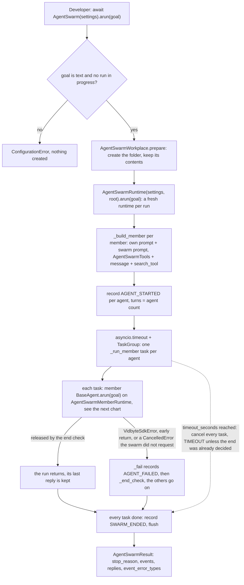
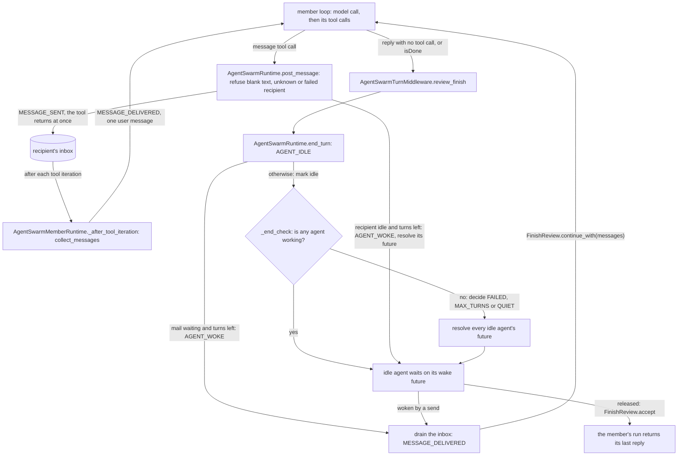

feat(agents): add AgentSwarm — agents you define share one folder, run their tools, and message each other until the swarm goes quiet
## Summary

This PR adds `AgentSwarm`. You define two or more agents, each with a name, a system prompt, a provider and a model, point them at one shared folder, and call `await swarm.arun(goal)`. Every agent gets the same goal, works with `bash`, `grep`, `read_lines`, `write_text` and `patch_file` in that folder, and can `message` any other agent; a send never waits for the recipient. A message reaches a working agent after the tool calls of its current model response and wakes an idle one. The swarm ends once no agent is working (`quiet`, `max_turns` or `failed`) or when the time limit runs out (`timeout`), and every state change comes back as a numbered event, live through `on_event` and in order on the result. The decision that matters most: each agent runs one ordinary `BaseAgent` loop for the whole swarm, and all swarm state lives on one per-run `AgentSwarmRuntime` that changes it only in code blocks with no `await` inside, so a send, a wake and the end check can never interleave; that is why no message is lost or doubled and the end is found exactly, without polling. Spec: `docs/spec/agent-swarm/spec.md` (r5).

The five roles you named, one job each:

| Class | Its one job |
|---|---|
| `AgentSwarmSettings` | The one checked configuration: the agents, the folder, the keys, an optional search tool and `on_event`, the turn budget and the time limit. A bad value fails when the object is built, naming the field. |
| `AgentSwarmWorkplace` | The shared folder: creates it and its missing parents when a run starts; never deletes, moves or empties anything. |
| `AgentSwarmTools` | The five file and shell tools every agent holds over that folder (in `vidbyte/tools/toolsets/`). |
| `AgentSwarmRuntime` | One swarm run: builds the agents, owns the inboxes, who is working, idle or failed, the turn count, the wakes, the end check and the replies. A fresh one for every `arun`. |
| `AgentSwarmEvents` | The events that happen during the swarm: numbers each state change as it happens and hands it to `on_event` once, in order. |

`AgentSwarm` itself is the thin entry point over them. Four small member parts connect each agent's ordinary loop to the runtime; each one exists because an SDK base class requires it (`AgentRuntime`, `BaseAgent`, `BaseTool`, `AgentMiddleware`).

## How to use what this PR introduces

```python
import asyncio

from vidbyte import AgentSwarm, AgentSwarmMember, AgentSwarmSettings
from vidbyte.lib.dataclasses.agent_swarm import AgentSwarmEvent


def show(event: AgentSwarmEvent) -> None:
    # Called once per event, in order, while the swarm runs.
    print(event.sequence, event.kind.value, event.agent, event.peer)


swarm = AgentSwarm(
    AgentSwarmSettings(
        agents=(
            AgentSwarmMember(name="builder", system_prompt="You write the code.", provider="openai", model_name="gpt-4.1"),
            AgentSwarmMember(name="tester", system_prompt="You write and run the tests.", provider="openai", model_name="gpt-4.1"),
        ),
        workplace="swarm-workplace",  # one folder both agents share; created if missing, never deleted
        on_event=show,
    )
)

result = asyncio.run(swarm.arun("Build a Celsius-to-Fahrenheit command-line tool with tests."))
print(result.stop_reason.value)                          # quiet
print(result.events[-1].sequence == len(result.events))  # True
print(result.events[-1].kind.value)                      # swarm_ended
for reply in result.replies:
    print(reply.sender, reply.content)  # each agent's reply from its last turn
```

This is spec §4 exactly as written. I ran it against this branch with no API key and no real model: the test pack's scripted model (`ScriptedSwarm` in `tests/features/agent_swarm/agent_swarm_fixtures.py`, which replaces only `BaseAgent._runner_for_model`) answered for both agents. Builder writes `c2f.py`, messages tester, and replies; tester replies once, then again after the message. Real output:

```text
1 agent_started builder 
2 agent_started tester 
3 tool_called builder 
4 message_sent builder tester
5 tool_called builder 
6 agent_idle builder 
7 agent_idle tester 
8 agent_woke tester 
9 message_delivered tester builder
10 agent_idle tester 
11 swarm_ended  
quiet
True
swarm_ended
builder Wrote c2f.py.
tester Tests pass.
```

`swarm-workplace/c2f.py` was on disk afterwards, and `event_error_types` was empty. Events 7 and 8 show tester ending its first turn with builder's message already waiting, so it woke at once instead of waiting for another send. The same snippet is pasted byte for byte into `test_section_4_snippet_prints_one_line_per_event_then_quiet_true_swarm_ended_and_one_reply_per_agent`. With a real model, the key comes from the usual provider environment variable (`OPENAI_API_KEY` here) or from `api_keys`. You no longer have to wire concurrent agents, mailboxes, wake-ups, an "is everyone done" check, or an event log by hand.

## Flow

One run, from `arun` to the result:



Inside one member's run, turn by turn:



Validation happens at the edges: `AgentSwarmMember` and `AgentSwarmSettings` check every field when built, and `AgentSwarm.arun` checks the goal before it creates the folder. State changes only in `AgentSwarmRuntime` (`post_message`, `end_turn`, `_drain`, `_fail`, `_end_check`), each in one block with no `await`, and each records its event in that same block; only the delivery to `on_event` (`AgentSwarmEvents.flush`) is awaited afterwards. Failures are caught per agent in `_run_member`: a model error arrives as a `VidbyteSdkError` and its root cause is recorded, an exception inside a tool stays a tool error the model reads, and the time limit is one `asyncio.timeout` around the task group. Both charts were checked with mermaid 11.4.1's parser and rendered once to confirm they read cleanly.

## What changed

| File | Change |
|---|---|
| `vidbyte/agents/agent_swarm/swarm.py` (new) | `AgentSwarm`: refuses a second `arun` while one runs and a goal that is not text, prepares the folder, and runs one fresh `AgentSwarmRuntime`. |
| `vidbyte/agents/agent_swarm/settings.py` (new) | `AgentSwarmSettings`: every check in `__post_init__` (2 to 100 members with distinct names; the folder is never a file; `max_turns` at least the agent count; a finite time limit of at most one week; a callable `on_event`; a search tool may not take a swarm tool's name or `isDone`). Keys are matched once for every member's provider and kept out of `repr`. |
| `vidbyte/agents/agent_swarm/runtime.py` (new) | `AgentSwarmRuntime`, one run: builds the members, runs them in one `TaskGroup` under `asyncio.timeout`, and owns the inboxes, the working, idle and failed sets, the turn count, the wake futures, the stop reason and the replies (`post_message`, `collect_messages`, `end_turn`, `record_tool_call`, `_end_check`). |
| `vidbyte/agents/agent_swarm/events.py` (new) | `AgentSwarmEvents`, an outbox: `record` numbers an event without awaiting; `flush` hands each undelivered event to `on_event` one at a time, in order, under a one-slot semaphore. An `Exception` from the callback is kept by type name and never stops the swarm. |
| `vidbyte/agents/agent_swarm/workplace.py` (new) | `AgentSwarmWorkplace`: resolves the path and creates the folder with its parents at run start. An `OSError` becomes a `ConfigurationError` naming the path. |
| `vidbyte/agents/agent_swarm/member.py` (new) | The member parts: `AgentSwarmMemberRuntime` overrides only `_after_tool_iteration` to append waiting mail, and refuses to build outside a swarm; `AgentSwarmMemberAgent` sets the allow-all policy, the 90,000-token history trim, the 100,000-character tool-result cap and the turn middleware, with sessions off; `AgentSwarmMessageTool` is `message`, whose recipient choices are the other agents and whose refusals are tool errors. |
| `vidbyte/middleware/builtins/agent_swarm_turn.py` (new) | `AgentSwarmTurnMiddleware`: `after_tool_call` records `TOOL_CALLED` (never for `isDone`); `review_finish` calls `end_turn` and returns `continue_with(messages)` or `accept()`. Not re-exported from `vidbyte.middleware.builtins`. |
| `vidbyte/agents/agent_swarm/__init__.py` (new) | Exports `AgentSwarm`, `AgentSwarmSettings`, `AgentSwarmRuntime`, `AgentSwarmEvents`, `AgentSwarmWorkplace` and `AgentSwarmMemberRuntime`. |
| `vidbyte/agents/agent_swarm/README.md` (new) | Usage, lifecycle, stop reasons, the limits table, the event table, the File Index, and notes for agents. |
| `vidbyte/tools/toolsets/agent_swarm.py` (new) | `AgentSwarmTools`: `bash`, `grep`, `read_lines`, `write_text`, `patch_file` over one folder; reading and writing share one `FileSystemToolConfig(allow_write=True)`. |
| `vidbyte/lib/dataclasses/agent_swarm.py` (new) | The records `AgentSwarmMember`, `AgentSwarmEvent` (which fields each kind carries) and `AgentSwarmResult` (events numbered 1 to N, ending with the one `swarm_ended`), plus the `AgentSwarmEventCallback` type. |
| `vidbyte/lib/enums/agent_swarm.py` (new) | `AgentSwarmEventKind` (eight kinds) and `AgentSwarmStopReason` (`quiet`, `max_turns`, `timeout`, `failed`). |
| `vidbyte/lib/constants/agent_swarm.py` (new) | Every bound and default (2 to 100 agents, the name pattern, 500 turns, 3,600 s, a one-week ceiling, the trim and the cap), the `message` tool's names, the reserved tool names, and the measured token budget in the header. |
| `vidbyte/prompts/prompts/agent_swarm/` (new: `agent_swarm.json` and 10 leaves) | The swarm prompt, which names the agent and its peers and states no number, role or workflow; the `message` tool and parameter descriptions; its reply and three refusals; the inbox rendering. |
| `vidbyte/lib/enums/agent_runtime.py` | New member `AgentRuntimeType.AGENT_SWARM_MEMBER = "agent_swarm_member"`. |
| `vidbyte/lib/registries/runtimes.py` | Maps `AGENT_SWARM_MEMBER` to `AgentSwarmMemberRuntime`, imported lazily through the package. |
| `vidbyte/agents/base.py` | Adds `AGENT_SWARM_MEMBER` to `_LINEAR_LOOP_RUNTIMES` and re-wraps that comment at 72 columns. No other change. |
| `vidbyte/lib/enums/prompts.py` | Ten `Prompt.AGENT_SWARM_*` keys; the header count goes from 139 prompts in 35 families to 149 in 36. |
| `vidbyte/lib/enums/__init__.py` | Exports the two new enums. |
| `vidbyte/tools/toolsets/__init__.py` | Exports `AgentSwarmTools`. |
| `vidbyte/agents/__init__.py` | Re-exports the six package names. |
| `vidbyte/__init__.py` | Root exports `AgentSwarm`, `AgentSwarmMember`, `AgentSwarmSettings`, `AgentSwarmEventKind`, `AgentSwarmStopReason`. |
| `contracts/sdk-public-api.json` | Regenerated for the five root names (649 exports). |
| `vidbyte/agents/README.md`, `vidbyte/tools/README.md`, `vidbyte/prompts/README.md`, `REPO_MAP.md` | An AgentSwarm section, the toolset line, the prompt family entry, and the map entry for `vidbyte/agents/agent_swarm/`. |
| `tests/features/agent_swarm/agent_swarm_fixtures.py` (new) | The offline harness. `ScriptedSwarm` replaces only the model runner and answers by agent name; `EventLog`, `Gate` and `Signal` order agents without sleeps; `assert_event_invariants` replays a run's events against the spec's rules. |
| `tests/features/agent_swarm/test_agent_swarm_acceptance.py` (new, 8 tests) | The §4 snippet byte for byte; `quiet` with one reply per agent; the goal reaches every agent verbatim in one growing conversation. |
| `tests/features/agent_swarm/test_agent_swarm_contract.py` (new, 73 tests) | Settings refusals, each agent's exact tools and `message` schema, system-prompt order, the runtime type refused outside a swarm, import paths, keys never shown, prompt rules, the trim and the cap. |
| `tests/features/agent_swarm/test_agent_swarm_lifecycle.py` (new, 26 tests) | Stop reasons, the time limit, failures and their causes, `on_event` errors, a second `arun`, `TOOL_CALLED`, and the stray `CancelledError` cases. |
| `tests/features/agent_swarm/test_agent_swarm_messaging.py` (new, 14 tests) | Delivery between tool calls, wakes, refusals, mail waiting at a turn's end, ordering. |
| `tests/features/agent_swarm/test_agent_swarm_property.py` (new, 36 tests) | Seeded random swarms, each checked against the event rules and against what each model actually received. |
| `tests/features/agent_swarm/test_agent_swarm_workplace.py` (new, 14 tests) | Folder creation, paths outside the folder, refused goals and folders. |
| `tests/features/agent_swarm/FEATURE.md`, `README.md` (new) | The pack's feature description and folder README. |
| `docs/spec/agent-swarm/` (new) | Spec r5, the request, the test plan, the review record, the verification log, the code map, the pipeline state, each stage's report, and this body. |

The product change is 24 new and 13 modified files, the spec's §8.4 budget exactly. The shared agent loop (`vidbyte/agents/runtime.py`), the actor runtime, InfiniteMemoryAgent, JevAgent and the shared validators are not touched.

## Acceptance criteria → proof

All tests are in `tests/features/agent_swarm/`.

| AC | What it checks (plain words) | Proven by |
|---|---|---|
| AC-1 | The §4 snippet prints one line per event, then `quiet`, `True`, `swarm_ended`, then one line per agent. | `test_agent_swarm_acceptance.py::test_section_4_snippet_prints_one_line_per_event_then_quiet_true_swarm_ended_and_one_reply_per_agent` |
| AC-2 | A message to an agent whose tool is running arrives after that tool's result, and the sender is never blocked. | `test_agent_swarm_messaging.py::test_a_message_to_a_working_agent_arrives_after_its_tool_result_without_blocking_the_sender` |
| AC-3 | A message to an idle agent starts a new turn for it, after its previous reply, with the events in order. | `test_agent_swarm_messaging.py::test_a_message_wakes_an_idle_agent_into_a_new_turn_after_its_previous_reply` |
| AC-4 | Agents that end their first turn without messages end `quiet`, with one reply each in member order. | `test_agent_swarm_acceptance.py::test_agents_that_end_their_first_turn_without_messages_end_quiet_with_one_reply_each` |
| AC-5 | With no turns left, a message to an idle agent wakes nobody, stays undelivered, and the swarm ends `max_turns`. | `test_agent_swarm_lifecycle.py::test_a_spent_turn_budget_stops_wakes_and_ends_max_turns_with_the_message_undelivered` |
| AC-6 | A model call that never answers ends in a `timeout` result, not an exception. | `test_agent_swarm_lifecycle.py::test_the_time_limit_cancels_every_agent_and_returns_timeout` |
| AC-7 | A provider error fails only that agent, names the provider's error, and later mail to it is refused. | `test_agent_swarm_lifecycle.py::test_a_provider_error_fails_only_that_agent_names_its_cause_and_stops_its_mail` |
| AC-8 | When every agent fails, the swarm ends `failed` with no replies. | `test_agent_swarm_lifecycle.py::test_every_agent_failing_ends_failed_with_no_replies` |
| AC-9 | A message to yourself, to an unknown name, or with blank text is a tool error; nothing is queued. | `test_agent_swarm_messaging.py::test_a_refused_message_is_a_tool_error_queues_nothing_and_the_loop_continues` |
| AC-10 | An `on_event` that raises never stops the swarm; every event still arrives once, in order. | `test_agent_swarm_lifecycle.py::test_a_raising_on_event_callback_never_stops_the_swarm` |
| AC-11 | Each invalid setting raises `ConfigurationError` naming its field and creates nothing on disk. | `test_agent_swarm_contract.py::test_invalid_settings_are_refused_naming_the_field_and_creating_nothing` |
| AC-12 | `BaseAgent(runtime="agent_swarm_member")` is refused, and no model is called. | `test_agent_swarm_contract.py::test_runtime_type_refuses_outside_a_swarm_without_calling_a_model` |
| AC-13 | Each agent holds exactly the swarm tools, `message` (choices: the other agents) and `isDone`; file tools refuse paths outside the folder. | `test_agent_swarm_contract.py::test_each_agent_holds_exactly_the_swarm_tools_and_a_message_schema_of_its_peers`; `test_agent_swarm_workplace.py::test_file_tools_refuse_paths_outside_the_workplace_and_change_nothing_there` |
| AC-14 | The system prompt is the agent's own prompt, then the swarm prompt, then the loop's prompt; the swarm part has no digits. | `test_agent_swarm_contract.py::test_each_system_prompt_is_own_prompt_then_swarm_prompt_then_agentic_loop_prompt` |
| AC-15 | A second `arun` while one runs is refused; a later one starts fresh at event 1. | `test_agent_swarm_lifecycle.py::test_a_second_concurrent_arun_is_refused_and_a_later_arun_starts_fresh` |
| AC-16 | A missing folder is created with its parents, and the agents' files stay after the run. | `test_agent_swarm_workplace.py::test_a_missing_workplace_is_created_with_its_parents_and_the_agents_files_stay` |
| AC-17 | Every public name imports from each documented path, and the contract lists the five root names. | `test_agent_swarm_contract.py::test_public_names_import_from_every_documented_path` |
| AC-18 | A blank or non-text goal is refused before the folder is created. | `test_agent_swarm_workplace.py::test_a_blank_or_non_text_goal_is_refused_before_any_side_effect` |
| AC-19 | A `bash` call gives one `tool_called` event with its status; `isDone` gives none. | `test_agent_swarm_lifecycle.py::test_tool_called_events_carry_name_and_status_and_skip_isdone` |
| AC-20 | An agent that ends its turn with mail waiting continues at once with that mail. | `test_agent_swarm_messaging.py::test_an_agent_that_ends_its_turn_with_mail_waiting_continues_at_once` |
| AC-21 | API keys never appear in a `repr`, an event, a model call, or an error. | `test_agent_swarm_contract.py::test_api_keys_never_appear_in_reprs_events_model_calls_or_errors` |

## Verification

Local runs at `91d6c37f` (the last commit before this body; the code is identical to `4a993f98`, the last code commit):

| Gate | Command | Result |
|---|---|---|
| New tests | `PYTHONPATH=$(pwd) python -m pytest tests/features/agent_swarm -q` | `171 passed in 5.56s` |
| Neighbour suites | `PYTHONPATH=$(pwd) python -m pytest tests/features/infinite_memory_agent tests/test_agent_tool_loop.py tests/multi_agent tests/test_prompts_interface.py -q` | `189 passed in 6.49s` |
| Public-API contract | `python scripts/generate-sdk-public-api.py --check` | `contracts/sdk-public-api.json is current at 698f913b... (vidbyte-sdk 0.3.0, 649 exports).` |
| Source stage: lint | `PYTHONPATH=$(pwd) python scripts/run_ci.py --stage source` | `SDK-LINT: PASS`, no rule `REGRESSED` (`S063 IMPROVED 4 -> 3`) |
| Source stage: compileall and the three check scripts | same run | passed (the run went on to pytest) |
| Source stage: pytest | same run | `3 failed, 6414 passed, 16 skipped in 127.49s` (three inherited failures, see below) |
| Package stage | `env -u PYTHONPATH python scripts/run_ci.py --stage package` | `Installed vidbyte-sdk 0.3.0 passed smoke checks.` / `CI passed.` |
| Static policy | `semgrep scan --error --config .semgrep/typed-mapping-boundary-policy.yml vidbyte` (Semgrep 1.170.1) | `Findings: 0 (0 blocking)` / `Ran 1 rule on 995 files: 0 findings.` |

The three local pytest failures are all in `tests/features/harness_threads/test_harness_threads_surface.py`, and none is caused by a defect in this PR:
- `test_failure_codes_keep_main_and_append_exactly_the_28_harness_codes` fails with `assert 148 == 120`. It fails on main at the merge-base too; this PR does not touch `vidbyte/lib/enums/failure.py`.
- `test_branch_leaves_the_tools_and_configs_packages_as_main_has_them` and `test_import_vidbyte_starts_no_process_and_leaves_the_native_package_unloaded` compare the branch with the merge-base. They fail on any branch that changes `vidbyte/tools` or the root exports (`At index 30 diff: 'AgentSwarm' != 'JevAgent'`), which this PR does on purpose.
- CI skips all three in its shallow clone, so the remote source stage is fully green.

Remote checks run only by manual dispatch on this repo, so `gh pr checks` stays empty by design; read them with `gh run list --branch feat/agent-swarm`.

| Workflow | Run | Commit | Result |
|---|---|---|---|
| CI (`ci.yml`) | 39010164516 | `40a9f8d5` | success: Source / Python 3.11 (`SDK-LINT: PASS`, `6376 passed, 57 skipped`), Source / Python 3.12 (`SDK-LINT: PASS`, `6376 passed, 57 skipped, 19 warnings`), Package (`Installed vidbyte-sdk 0.3.0 passed smoke checks.` / `CI passed.`) |
| Static policy (`static-policy.yml`) | 39010166215 | `40a9f8d5` | success: `Findings: 0 (0 blocking)` / `Ran 1 rule on 995 files: 0 findings.` |
| CI (`ci.yml`) | 39008866234 | `4a993f98` | success, same three jobs (the last code commit) |
| Static policy (`static-policy.yml`) | 39008871160 | `4a993f98` | success |

Every commit after `4a993f98` changes only `docs/spec/agent-swarm/`; `40a9f8d5` added this body, and the one commit after it adds the S6 report.

## Adversarial review

17 findings were confirmed by an independent verifier across three lenses (spec conformance, repo conventions, engineering): 15 in the S4 review (1 Blocker, 4 Major, 10 Minor) and 2 Minor in the re-review after the repairs, which returned SOUND. 13 were fixed in code, tests or docs; 3 were settled in the spec (R-12 recorded as a deviation, R-14 and R-16 written into INV-11 and EC-39); 1 is deferred to its own PR (R-15). The verifier also refuted one suspicion and three proposed fixes. Full record: `docs/spec/agent-swarm/review.md`.

| ID | Finding | Fixed in |
|---|---|---|
| R-1 (Blocker) | Five prompt clauses told the agents how to work ("say what you did and what is left", "keep working instead of waiting"), which you ruled out. Removed; the prompts now state only facts. | `68813700` |
| R-2 (Major) | A search tool named `isDone` was accepted, then silently replaced by the loop's own `isDone`. It is now refused when the settings are built. | `fee22acb` |
| R-3 (Major) | A `CancelledError` the swarm did not ask for (from a tool or an `on_event` callback) left that agent counted as working, so the swarm sat until its time limit (one hour by default). That agent now fails with `agent_failed`, the others go on, and the cancel is raised again. | `fbb2f445`; guard test `87df4fc9` |
| R-4 (Major) | `AgentSwarmTurnMiddleware` was the only `AgentMiddleware` outside the middleware layer. Moved to `vidbyte/middleware/builtins/agent_swarm_turn.py`. | `034ca1cb` |
| R-5 (Major) | Four specified behaviours could break without any test failing: counting a failed agent's mail toward `max_turns`, the time limit overwriting an end already decided, and dropping the history trim or the tool-result cap. Tests were added that fail when each one breaks. | `c71b1032` |

Minor fixes: docs that said a spent turn budget ends the swarm (R-6, `03661f3f`; R-17, `4a993f98`), a 72-column comment wrap (R-7, `e40b2f95`), a tool name with a newline aborting its agent (R-8, `ccf4e52d`), a false header sentence (R-9, `fbb2f445`), the token-budget sum in the constants header (R-10, `1fa90858`), the event clock starting before `arun` (R-11, `e3efbc28`), and helper functions folded into `AgentSwarmEvent.__post_init__` (R-13, `965bd9ea`).

## Deviations from the spec

Code against spec r5, each accepted as forced by the repo:
- **`asyncio.Semaphore()` instead of `asyncio.Lock`** in `AgentSwarmEvents` (D-6). Lint TID251/S039 bans `asyncio.Lock`. A one-slot semaphore is the same mutex; order and once-only delivery are unchanged.
- **`ModelProvider(value)` instead of `RecordFieldConverter.to_enum`** for `AgentSwarmMember.provider`. Lint C012 accepts only `ModelProvider(...)` as proof of a valid provider. The refusal still names `AgentSwarmMember.provider`.
- **`callable()` instead of `require_instance(..., Callable)`** for `on_event`, because mypy rejects `Callable` as an `isinstance` target.
- **The `agent_started` events are delivered inside the time limit**, not before it (the §8.5 pseudocode flushes first). A stuck callback therefore cannot outlive `timeout_seconds`.
- **Sorted placement**: imports, the prompts README entry and the REPO_MAP entry sit where alphabetical order puts them, not "beside infinite".
- **`post_message(sender, recipient: object, text: object)`** is wider than §8.5's `str`. Its body checks both types and refuses anything else as a tool error, so nothing changes at run time.
- **The event clock is rebuilt when `arun` starts.** `AgentSwarmRuntime.__init__` still builds a placeholder `AgentSwarmEvents` (`runtime.py:53`), and `arun` replaces it before the first event (`runtime.py:79`), so `elapsed_ms` counts from the start of the run. The placeholder stays so that `post_message`, `collect_messages`, `end_turn` and `record_tool_call` do not raise `AttributeError` when called before `arun`.

The spec changed during review, and the code matches r5: the turn middleware moved to the middleware layer (r4, R-4), `isDone` is a reserved name (r4, R-2), a stray `CancelledError` fails its agent (r4 EC-39, R-3), and `replies` may be partial when the time limit or a stray cancel arrives after the end was decided (r4/r5, INV-11). This commit also redraws the spec's §5 flow chart to match the two charts above (`swarm_ended` is recorded after every member task returns, and the failure and time-limit paths are drawn), and corrects the TL;DR, which said a turn limit ends the swarm.

## Follow-ups

Not built here (out of scope):
- **R-15**: a shared root-cause helper in `vidbyte/lib/errors/`, used by this runtime and by InfiniteMemoryAgent (`vidbyte/agents/infinite/launch.py:356-361`). Its own PR.
- **An explicit `ConfigurationError`** when `post_message`, `collect_messages`, `end_turn` or `record_tool_call` is called before `arun`, in place of the placeholder event record at `runtime.py:53`.
- **The test oracle `assert_event_invariants` is stricter than spec r4.** It allows an agent to fail only while working, and on `quiet` it demands a reply from every agent. Three lifecycle tests therefore check their events directly: `test_the_time_limit_firing_after_the_end_was_decided_keeps_the_decided_stop_reason`, `test_a_cancelled_error_raised_by_on_event_on_an_idle_agent_fails_it_instead_of_waking_it`, and `test_an_unrequested_cancel_after_the_end_was_decided_does_not_fail_the_released_agent`. Relaxing the oracle would let them use it.
- **A live run with a real provider key.** Every run in this pipeline used the scripted model.
- **Q-1 to Q-11 stay "no" by default**: no sync `run()`; one recipient per message; no cap on message length; allow-all permissions with no `permission_policy` setting; no token usage on the result; `tool_called` carries name and status only; failures contained per agent (no fail-fast); the full events tuple with no cap; no guard against two swarms on one folder; five root exports only; the root-cause helper stays private.

Limitations to know before you run it:
- **`bash` is not confined to the workplace.** Agents run with allow-all permissions and the process environment, so do not run a swarm where its agents must not reach.
- **A `quiet` result can still hold `agent_failed` events.** Check them, and any `tool_called` event with an error status, before you trust the outcome.
- **`replies` may be partial** when the time limit (EC-18) or an unrequested cancel (EC-39) arrives after the end was decided. The missing agent's last text is still in its `agent_idle` event.
- Agents edit the same files with nothing in between, so edits to one file can collide. On Windows, a `bash` command cut by the time limit may keep running after `arun` returns.

🤖 Generated with [Claude Code](https://claude.com/claude-code)
