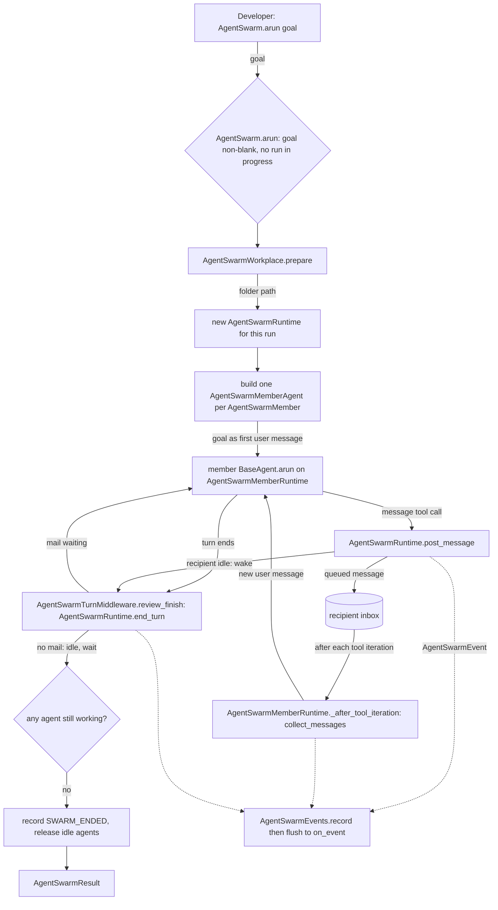
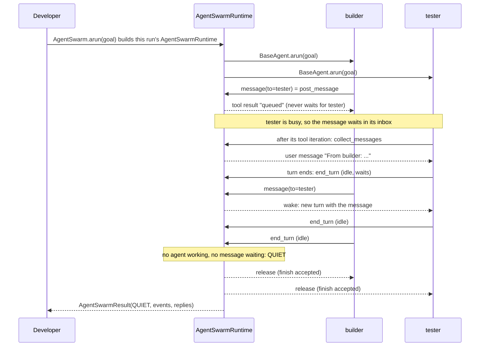
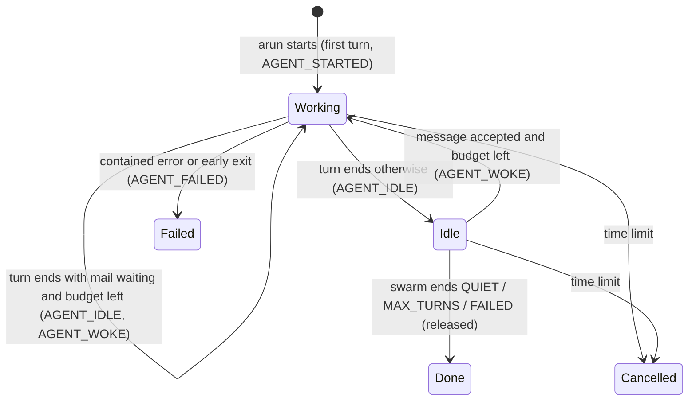

# Spec: AgentSwarm — a minimal runtime where user-defined agents run their tools and message each other

> **TL;DR** — Adds `AgentSwarm`: the developer defines two or more agents (name, model, system prompt), points them at one shared folder, and calls `await swarm.arun(goal)`. Every agent gets the same goal, works with bash, grep, read, write and patch in that folder, and can `message` any other agent without waiting. A message reaches a busy agent between its tool calls as a new user message, and wakes an idle one. The swarm ends when no agent is working and no message is waiting, or at a turn or time limit, and returns the full ordered tuple of events. The decision that matters most: each agent runs **one long-lived ordinary SDK tool loop for the whole swarm**, coordinated by one `AgentSwarmRuntime` per run, and the swarm adds only two narrow seams to each agent's loop — a member loop subclass (`AgentSwarmMemberRuntime`) that appends waiting messages after each tool iteration, and a finish-review middleware that turns "the agent ended its turn" into idle/wake. No change to the shared agent loop, the actor runtime, or InfiniteMemoryAgent.

## §0 User prompts

### 0.1 Invoking request (verbatim)

```text
Lets forget the backlog for now. Right now i just want you to setup the ability for users to run an "agent swarm" where the architecture is very minimal inside of the vidbyte-sdk/. I want you to decompose the AgentSwarm into different classes that have different roles (AgentSwarmTools, AgentSwarmSettings, AgentSwarmRuntime, AgentSwarmEvents (events that happen during the agent swarm), AgentSwarmWorkplace), and what I simply want you to do is to setup an envrionment that has multiple agents running that the user defines that can run their tools and message each other,  lets start off simple. If you have any clarifying questions before the run feel  free to ask me (try to keep questions to 5)
```

The user's four answers to the clarifying questions (request.md §A, Prompt 4, verbatim) are part of the request:

```text
"What should the AgentSwarmWorkplace be in this first version?"="One shared folder (Recommended)", "How long does an agent live, and when does the swarm end?"="Stay alive until quiet (Recommended)", "How does the user give the swarm its work?"="Shared goal + per-agent prompts (Recommended)", "How should AgentSwarmEvents reach the user?"="Callback + list on result (Recommended)"
```

Prompts 1 and 2 (the feature idea and the pseudocode request) are in `docs/spec/agent-swarm/request.md` §A and are prior context, not the build request.

### 0.2 User replies during the run
_None yet. The orchestrator appends any reply the user sends during the run here verbatim, labeled with the revision it produced._

---

## Part A — Framing

## §1 Goal

Today the SDK can run one agent with tools (`BaseAgent`, `CodingAgent`), a delegation tree (`InfiniteMemoryAgent`), or reactive actors that make one model call per message and run no tools (the actor runtime). It cannot run several **proactive, tool-using agents side by side that talk to each other while they work**. The user wants exactly that environment, built minimally, because "if you can setup agent swarms in a way that are reliable then I think this is valuable data" (Prompt 1). Reliable here has a concrete meaning: the swarm always ends, never loses or duplicates a message, and its event record is complete and in true order, so the data it produces can be trusted.

| ID | Goal (outcome) | How we will know | Source |
|---|---|---|---|
| G-1 | A developer can run N user-defined agents (own name, model, system prompt) on one shared goal in one shared folder, where each agent runs its tools and messages the others. | The §4 snippet runs as written; each agent's model sees the goal as its first user message and holds exactly the swarm's tools, `message`, and the loop's own `isDone`. | Prompt 3; Prompt 4 answers 1 and 3 |
| G-2 | Agents coordinate without deadlock: a message never blocks its sender, reaches a busy recipient between its tool calls, and wakes an idle one. | A message sent to a busy agent appears in that agent's next model call as a user message after its tool results; one sent to an idle agent starts a new turn for it. | Prompt 4 answer 2; request.md §C key decisions |
| G-3 | Every swarm ends by itself, for a reason the developer can read. | Every run returns an `AgentSwarmResult` whose `stop_reason` is one of QUIET, MAX_TURNS, TIMEOUT or FAILED; no run hangs once every agent has ended its turn. | Prompt 4 answer 2 ("The swarm ends when every agent is idle with an empty inbox, or a max-turns / time limit is hit.") |
| G-4 | The developer gets a complete, ordered, trustworthy event record, live and at the end. | `on_event` receives every event once, in order; `result.events` is the same sequence, numbered 1..N with no gaps, and causally ordered (a message's "sent" always precedes its "delivered"). | Prompt 4 answer 4; Prompt 1 "reliable ... valuable data" |
| G-5 | The architecture stays very minimal and is decomposed into the five named role classes. | The five classes exist with the roles the user named (§7 FR-18); the change stays inside the §8.4 budget and edits the shared agent files only by one set entry and one registry line. | Prompt 3 |

## §2 Objective

When this PR merges, `vidbyte-sdk` has a new package, `vidbyte.agents.agent_swarm`, holding `AgentSwarm` (the thin public entry point), `AgentSwarmSettings`, `AgentSwarmRuntime` (one swarm run: the agents' mailboxes, turns and ending), `AgentSwarmEvents`, and `AgentSwarmWorkplace`, plus the member parts: the member agent, `AgentSwarmMemberRuntime` (each agent's loop with mid-turn delivery), the `message` tool, and the turn middleware. `AgentSwarmTools` is a new toolset in `vidbyte.tools.toolsets`. The records `AgentSwarmMember`, `AgentSwarmEvent`, `AgentSwarmResult`, the enums `AgentSwarmEventKind` and `AgentSwarmStopReason`, the swarm's constants, and a new `agent_swarm` prompt family live in the shared `lib` and `prompts` layers. `AgentRuntimeType.AGENT_SWARM_MEMBER` resolves to `AgentSwarmMemberRuntime`. The root `vidbyte` package exports `AgentSwarm`, `AgentSwarmMember`, `AgentSwarmSettings`, `AgentSwarmEventKind` and `AgentSwarmStopReason`, and the public-API contract is regenerated. This is the whole first slice; everything in §3 is deliberately later or never.

## §3 Non-goals

- **NG-1** — A backlog of issues or items the agents create. — *Why not:* Prompt 3: "Lets forget the backlog for now."
- **NG-2** — GitHub or git as the workplace, a clone per agent, or private subfolders. — *Why not:* the user chose "One shared folder" (Prompt 4); "Shared folder + private subfolder" was offered and not chosen.
- **NG-3** — Per-agent starting tasks, or a goal sent to one entry agent. — *Why not:* the user chose "Shared goal + per-agent prompts" (Prompt 4).
- **NG-4** — An events file on disk (JSON lines) or a list-only result without a callback. — *Why not:* the user chose "Callback + list on result" (Prompt 4).
- **NG-5** — One-shot agents that cannot be woken. — *Why not:* the user chose "Stay alive until quiet" (Prompt 4).
- **NG-6** — An oracle or "done" check run by the swarm, file-area claims or locks, a broadcast allowance or message rate limits, a `"human"` recipient, a `web_fetch` tool, a dollar budget, a known-good ref, run journals or resume. — *Why not:* proposed in the earlier critique but not asked for in the build request (request.md §C "Rejected alternatives"); the pipeline's scope rule allows them only as optional `Q-n` or stated limitations.
- **NG-7** — A CLI command for running a swarm. — *Why not:* the SDK owner removed SDK CLI commands on 2026-10-10 (request.md §C).
- **NG-8** — Changing the shared agent loop, the actor runtime, or InfiniteMemoryAgent. — *Why not:* request.md §C "Things not to touch"; the swarm needs only the existing seams (§8.1 D-2, D-3).
- **NG-9** — Sandboxing bash to the workplace, or protecting files from concurrent edits. — *Why not:* bash is unsandboxed SDK-wide today, and the user accepted that "concurrent edits can collide, which is itself useful data" (request.md §C). Both are stated limitations (§10, §6.3).
- **NG-10** — Routing roles, planning, or any workflow advice in the swarm prompt. — *Why not:* Prompt 1: "dont want to influence the same biases as the InfiniteMemoryAgent".

## §4 Developer usage

```python
import asyncio

from vidbyte import AgentSwarm, AgentSwarmMember, AgentSwarmSettings
from vidbyte.lib.dataclasses.agent_swarm import AgentSwarmEvent


def show(event: AgentSwarmEvent) -> None:
    # Called once per event, in order, while the swarm runs.
    print(event.sequence, event.kind.value, event.agent, event.peer)


swarm = AgentSwarm(
    AgentSwarmSettings(
        agents=(
            AgentSwarmMember(name="builder", system_prompt="You write the code.", provider="openai", model_name="gpt-4.1"),
            AgentSwarmMember(name="tester", system_prompt="You write and run the tests.", provider="openai", model_name="gpt-4.1"),
        ),
        workplace="swarm-workplace",  # one folder both agents share; created if missing, never deleted
        on_event=show,
    )
)

result = asyncio.run(swarm.arun("Build a Celsius-to-Fahrenheit command-line tool with tests."))
print(result.stop_reason.value)                          # quiet
print(result.events[-1].sequence == len(result.events))  # True
print(result.events[-1].kind.value)                      # swarm_ended
for reply in result.replies:
    print(reply.sender, reply.content)  # each agent's reply from its last turn
```

While the swarm runs, `show` prints one line per event as it happens (`1 agent_started builder`, `2 agent_started tester`, then tool calls, messages, idles and wakes, ending with `N swarm_ended`). With a model that finishes normally, the three marked lines print exactly `quiet`, `True` and `swarm_ended`, and the loop prints one line per agent. The developer no longer has to wire concurrent agents, mailboxes, wake-ups, a quiescence check, or an event log by hand; the API keys come from the usual provider environment variables when `api_keys` is not given (A-6).

## §5 Flow diagram





Validation happens at the boundary: `AgentSwarmMember` and `AgentSwarmSettings` check every field when they are built, and `AgentSwarm.arun` checks the goal before it touches the disk. `AgentSwarm.arun` then prepares the folder and runs one fresh `AgentSwarmRuntime`, which holds all coordination state for that run (inboxes, who is working, who is waiting, the turn count); that state changes only inside synchronous blocks on one event loop, so a send, a wake and the end check can never interleave halfway (D-4), and it is discarded with the runtime when the run returns. Each event is recorded in the same synchronous block as the state change it describes, then handed to `on_event` in order (D-6). A contained agent failure (always a `VidbyteSdkError`, because `BaseAgent` wraps every exception raised inside a reply) is caught around that agent's run and becomes an `AGENT_FAILED` event that names the root cause; the time limit is a hard stop around the whole group of agent runs (D-7, D-8).

---

## Part B — Behavior (this is the spec; everything else is framing)

## §6 Behavior

Terms used below (request.md §C "Terminology"): a **turn** is one stretch of work by one agent, from its start or its wake until it ends its turn (it replies with no tool call, or calls `isDone`). An agent is **working** during a turn and **idle** between turns. An agent that **failed** has left the swarm. The swarm is **quiet** when no agent is working.

### 6.1 Invariants

**Goal and lifecycle**

- **INV-1** — Every agent receives the goal text exactly as passed to `arun`, exactly once, as the first user message of its single run. No agent receives any other first message.
- **INV-2** — Each agent runs exactly one `BaseAgent` run for the whole swarm: its first turn and every later turn are continuations of that one conversation, so the agent always sees its own earlier turns and every message delivered to it (subject only to the history trim, A-5).
- **INV-3** — The system prompt of an agent never changes during a swarm. Delivered messages are always appended as new user messages after the latest tool results or after the agent's own last reply; no earlier message is ever edited or removed by the swarm.

**Messages**

- **INV-4** — Sending never waits for the recipient: the `message` tool returns as soon as the message is queued, whatever the recipient is doing. The only thing a send may wait for is the developer's `on_event` callback (INV-15).
- **INV-5** — Every accepted message is delivered at most once, only to its named recipient, and messages to one recipient are delivered in the order they were accepted. An accepted message to an agent that is still running is delivered exactly once before the swarm ends, unless the swarm ends MAX_TURNS or TIMEOUT.
- **INV-6** — A message reaches a working recipient at the first point between its tool iterations (after the tool results of one model response, before its next model call), or at the end of its turn, whichever comes first. All messages waiting at that point are delivered together as one user message, each labeled with its sender, in acceptance order.
- **INV-7** — No lost wake-up: when a message is accepted for an idle, running agent and the turn budget allows, that agent starts a new turn with the message; when an agent ends its turn while messages are waiting for it and the budget allows, it starts its next turn immediately without becoming idle for longer than that step.
- **INV-8** — A message is refused, and nothing is queued or recorded as sent, when its text is empty or blank, when its recipient is the sender or not another agent of this swarm, or when its recipient has failed. The refusal is a tool error naming the valid recipients or the reason.

**Turns and ending**

- **INV-9** — The number of turns started in one swarm (one first turn per agent plus every wake) never exceeds `max_turns`. When the budget is spent, working agents finish their turns normally and may still receive messages between tool calls; only wakes stop.
- **INV-10** — The swarm ends exactly when no agent is working. Its stop reason is FAILED when every agent failed; otherwise MAX_TURNS when some idle, running agent still holds undelivered messages; otherwise QUIET. TIMEOUT overrides all three when the time limit is reached before the swarm had decided to end.
- **INV-11** — When the swarm ends QUIET, MAX_TURNS or FAILED, every idle agent is released: its run finishes normally and returns its last turn's reply. No agent is ever left waiting after `arun` returns.
- **INV-12** — When the time limit is reached, every agent run still in progress (working or idle) is cancelled, and `arun` returns an `AgentSwarmResult` with stop reason TIMEOUT; it does not raise.

**Events**

- **INV-13** — `result.events` holds every event of the run exactly once, numbered by `sequence` 1, 2, …, N with no gap or repeat, in the order the state changes happened. The last event is the only `SWARM_ENDED` event, and its `stop_reason` equals `result.stop_reason`.
- **INV-14** — Events are causally ordered: each agent's `AGENT_STARTED` precedes all its other events; a message's `MESSAGE_SENT` precedes its `MESSAGE_DELIVERED`; each turn after an agent's first begins with exactly one `AGENT_WOKE`; each turn that ends normally ends with exactly one `AGENT_IDLE`; a failed agent's last event is its one `AGENT_FAILED`.
- **INV-15** — `on_event` is called at most once per event, in `sequence` order, and never twice at the same time. On a run that ends QUIET, MAX_TURNS or FAILED it is called exactly once for every event, and `arun` returns only after the call for `SWARM_ENDED` has returned.
- **INV-16** — An exception raised by `on_event` (any `Exception`) never stops the swarm or skips a later event; its type name is appended to `result.event_error_types`. Cancellation and other `BaseException`s are never swallowed.

**Failure, setup, and safety**

- **INV-17** — One agent's contained failure never stops another agent. A failure is contained when the agent's run raises a `VidbyteSdkError` — which, because `BaseAgent` wraps every `Exception` raised inside a reply in an `AgentExecutionError`, covers every model, tool, middleware and turn-end exception — or when its run returns before the swarm released it. The failed agent gets one `AGENT_FAILED` event whose text names the root cause (the wrapped exception's type and text when there is one), and it receives no further messages.
- **INV-18** — A refused setting, member, or goal raises `ConfigurationError` naming the field, before any folder is created, any agent is built, or any model is called.
- **INV-19** — One `AgentSwarm` runs at most one swarm at a time. A second `arun` while one is in progress raises `ConfigurationError` and leaves the running swarm untouched. A later `arun` starts fresh: a new `AgentSwarmRuntime`, new agents, an empty conversation for each, and events numbered from 1 again. One `AgentSwarmRuntime` runs at most one swarm; a second `arun` on it raises `ConfigurationError`.
- **INV-20** — The swarm never deletes, moves or empties the workplace folder or anything in it. It only creates the folder (and missing parent folders) when it does not exist.
- **INV-21** — Every agent holds exactly the tools `bash`, `grep`, `read_lines`, `write_text`, `patch_file`, `message` and the loop's own `isDone`, plus the developer's search tool when one is given; the file tools resolve relative paths against the workplace and refuse paths outside it.
- **INV-22** — Turn and time limits are enforced in code. No prompt leaf of the swarm states a number for any limit, a role, or a workflow.
- **INV-23** — API keys never appear in the `repr` of any swarm object, in an error message the swarm raises, or in an event.
- **INV-24** — The `agent_swarm_member` runtime cannot be built outside a swarm: a `BaseAgent(runtime="agent_swarm_member")` (or a fork of a member) refuses to run with a `ConfigurationError` that names `AgentSwarm`.

**Must not regress:**
- **INV-25** — Every existing `AgentRuntimeType` resolves to the same runtime class as before, and the existing members of the linear-loop runtime set keep their wiring (registry and base agent, see §11).
- **INV-26** — The actor runtime, InfiniteMemoryAgent, JevAgent and CodingAgent behave exactly as before; none of their files change.
- ~~**INV-27**~~ (withdrawn r2: R-4 — the shared validator is no longer changed; event time is `elapsed_ms`, checked by the existing `require_int(minimum=0)`).
- **INV-28** — Every existing prompt family, prompt key and catalog lookup is unchanged, and the catalog still loads (every key has its asset and every asset its key).

### 6.2 Acceptance criteria

| ID | Given | When | Then | Priority | Proof |
|---|---|---|---|---|---|
| AC-1 | a clean checkout of this branch, with models answered offline | the §4 snippet runs | it produces exactly the shown result: one `show` line per event in sequence order, then `quiet`, `True`, `swarm_ended`, and one line per agent | P0 | |
| AC-2 | two agents; `tester` is in a turn that calls a tool | `builder` messages `tester` while `tester`'s tool runs | `tester`'s next model call contains, after that tool's result, one user message labeled with `builder` and holding the text; `builder`'s `message` call returned before `tester`'s next model call | P0 | |
| AC-3 | `tester` has ended its turn and is idle; turns remain | `builder` messages `tester` | `tester` starts a new turn whose first model call ends with a user message holding the text after `tester`'s previous reply; events show `AGENT_IDLE(tester)` < `MESSAGE_SENT` < `AGENT_WOKE(tester)` < `MESSAGE_DELIVERED(tester)` | P0 | |
| AC-4 | every agent ends its first turn without sending a message | the swarm runs | `stop_reason` is QUIET, `replies` holds one reply per agent in member order, and the last event is `SWARM_ENDED` | P0 | |
| AC-5 | `max_turns` equals the number of agents | an agent messages an idle agent | the idle agent is not woken, no `MESSAGE_DELIVERED` exists for that message, and `stop_reason` is MAX_TURNS | P0 | |
| AC-6 | `timeout_seconds` is small and one agent's model call never answers | the swarm runs | `arun` returns (does not raise) an `AgentSwarmResult` with stop reason TIMEOUT and a final `SWARM_ENDED` event, no later than the limit plus the cancellation time | P0 | |
| AC-7 | three agents; one agent's model call raises a provider error | the swarm runs | that agent gets one `AGENT_FAILED` event whose text starts with the provider error's type name and holds its message (not the generic "failed to generate a reply" wrapper), the other two keep working and end normally, and a later `message` to the failed agent is a tool error, not a send | P0 | |
| AC-8 | every agent's model call raises a provider error | the swarm runs | `stop_reason` is FAILED, there is one `AGENT_FAILED` per agent, and `replies` is empty | P1 | |
| AC-9 | a running swarm | an agent calls `message` to itself, to an unknown name, or with blank text | the call returns a tool error naming the valid recipients or the reason, no `MESSAGE_SENT` event is recorded, nothing is queued, and the agent's loop continues | P0 | |
| AC-10 | an `on_event` callback (sync or async) that raises on one kind of event | the swarm runs | the swarm finishes normally, the callback was called once per event in `sequence` order, the sequence of calls equals `result.events`, and the raised exception's type name is in `event_error_types` | P0 | |
| AC-11 | invalid settings: one agent, two agents with the same name, a name with a space, `max_turns` below the agent count, `timeout_seconds` of 0, a non-callable `on_event`, a search tool named `bash`, a model the provider cannot run, a workplace path that is a file | `AgentSwarmMember` or `AgentSwarmSettings` is built | `ConfigurationError` is raised whose `details["field"]` names the field, and no folder or file is created | P0 | |
| AC-12 | a plain `BaseAgent(runtime="agent_swarm_member")` | it runs | it raises `ConfigurationError` whose message names `AgentSwarm` | P0 | |
| AC-13 | a swarm with and without a search tool | each agent's first model call is made | its tool names are exactly `bash`, `grep`, `read_lines`, `write_text`, `patch_file`, `message`, `isDone` (plus the search tool's name when given), the `message` recipient choices are the other agents' names, and `read_lines`/`write_text`/`patch_file` refuse a path outside the workplace | P0 | |
| AC-14 | a swarm of agents with different system prompts | each agent's first model call is made | its system prompt holds, in this order, its own system prompt, then the swarm prompt, then the loop's standard agentic-loop prompt; the swarm prompt names the agent and the other agents, says it is in an agent swarm, can edit files in the shared folder, and can message the others, and says that calling `isDone` also ends only its turn; the swarm part is the same for every agent apart from those names and contains no digits | P0 | |
| AC-15 | a swarm whose `arun` is in progress | `arun` is called again on the same `AgentSwarm` | the second call raises `ConfigurationError` and the first finishes normally; a third call after the first returned runs a fresh swarm whose events start at sequence 1 | P1 | |
| AC-16 | a workplace path whose parent folders do not exist | `arun` runs and returns | the folder exists, every file the agents wrote is still there, and nothing was deleted | P0 | |
| AC-17 | this branch | `AgentSwarm`, `AgentSwarmMember`, `AgentSwarmSettings`, `AgentSwarmEventKind`, `AgentSwarmStopReason` are imported from `vidbyte`; `AgentSwarm`, `AgentSwarmSettings`, `AgentSwarmRuntime`, `AgentSwarmEvents`, `AgentSwarmWorkplace` and `AgentSwarmMemberRuntime` from `vidbyte.agents.agent_swarm` and from `vidbyte.agents`; `AgentSwarmTools` from `vidbyte.tools.toolsets`; and the records from `vidbyte.lib.dataclasses.agent_swarm` | every import works, the enums are in `vidbyte.lib.enums.__all__`, `RuntimeRegistry.resolve(AgentRuntimeType.AGENT_SWARM_MEMBER)` is `AgentSwarmMemberRuntime`, and the public-API contract lists the five root names | P1 | |
| AC-18 | a goal that is empty or blank | `arun` is called | it raises `ConfigurationError` and no folder is created | P1 | |
| AC-19 | an agent that calls `bash` and then `isDone` | the swarm runs | there is one `TOOL_CALLED` event for `bash` carrying its tool status, and none for `isDone` | P1 | |
| AC-20 | an agent ends its turn while a message is already waiting for it, and turns remain | the turn ends | it records `AGENT_IDLE` then `AGENT_WOKE` and its next model call holds the waiting message, with no wait for another send | P0 | |
| AC-21 | the swarm's events and errors | any event, error or `repr` of `AgentSwarmSettings` is produced with `api_keys` set | no key text appears in it | P0 | |

### 6.3 Edge cases and failure modes

| ID | Trigger (input + state) | System behavior | User sees | Guarded by (INV-/D-) |
|---|---|---|---|---|
| EC-1 | Agent A sends to B while B is between `end_turn`'s inbox check and becoming idle | Impossible to interleave: the check and the idle mark run in one synchronous block, and so does the send; whichever runs first decides (B continues immediately, or B is idle and the send wakes it). Without the guard the message would sit in an idle agent's inbox and the swarm could end QUIET with mail undelivered. | The message is delivered; no hang | INV-7, D-4, D-5 |
| EC-2 | Two agents message each other while both are working | Both sends return at once; each message is delivered after the recipient's next tool iteration or at its turn end. A blocking send would deadlock here. | Both messages delivered | INV-4, INV-6 |
| EC-3 | A message is sent while the recipient's model call is in flight | Queued; delivered after that response's tool results, or at the turn end if the response had no tool call | Delivered once | INV-5, INV-6 |
| EC-4 | Several messages queue for one agent before its next delivery point | All are delivered together in one user message, in acceptance order, each labeled with its sender; one `MESSAGE_DELIVERED` per message | One combined user turn | INV-5, INV-6 |
| EC-5 | The model's turn ends via `isDone` instead of a plain reply | The same turn-end handling; on a wake the model sees the loop's standard "finish attempt not accepted yet; continue with the next message" tool result followed by the delivered messages | Agent continues | D-3, A-8 |
| EC-6 | An agent messages itself, an unknown name, or sends blank text | Tool error naming the other agents or the reason; nothing queued; no `MESSAGE_SENT` | `TOOL_CALLED` with status error | INV-8 |
| EC-7 | An agent messages an agent that has failed | Tool error saying that agent has stopped; nothing queued | `TOOL_CALLED` with status error | INV-8, INV-17 |
| EC-8 | `max_turns` is spent and a working agent messages an idle one | The send succeeds (queued) but the recipient is not woken; the swarm ends MAX_TURNS once nobody is working. Without the rule the stop reason would wrongly read QUIET with mail waiting. | `MESSAGE_SENT` without `MESSAGE_DELIVERED`; stop reason MAX_TURNS | INV-9, INV-10 |
| EC-9 | `max_turns` is spent but no message is left undelivered when the last agent goes idle | Ends QUIET: the budget never refused a wake | stop reason QUIET | INV-10 |
| EC-10 | A working agent keeps calling tools forever after the turn budget is spent | Turns do not stop it (it is mid-turn); the time limit does | stop reason TIMEOUT | INV-9, INV-12, D-8 |
| EC-11 | Every agent ends its first turn without any message | Ends QUIET after N turns; each agent's run returns its reply | stop reason QUIET, N replies | INV-10, INV-11 |
| EC-12 | One agent's model raises a provider error after the loop's own retries | `BaseAgent` re-raises it wrapped in `AgentExecutionError("Agent '<name>' failed to generate a reply.")` with the provider error as `__cause__`. The swarm records `AGENT_FAILED` with the root cause, `"<type of __cause__>: <cause text>"` (falling back to the error's own type and text when there is no cause). Without reading the cause, every failure would read as the same generic wrapper text. Its queued messages stay undelivered; the others continue. | `AGENT_FAILED` naming the provider error; others unaffected | INV-17, D-7 |
| EC-13 | The failing agent was the last one working | The failure handling runs the end check; the swarm ends with the reason INV-10 gives | Run ends; no hang | INV-10, D-4 |
| EC-14 | Every agent fails | Stop reason FAILED; `replies` empty | stop reason FAILED | INV-10, D-7 |
| EC-15 | An agent's run returns before the swarm released it (for example a middleware stop or another loop exit) | Treated as a contained failure: `AGENT_FAILED` whose text names the run's own stop reason; the agent leaves the swarm | `AGENT_FAILED` | INV-17 |
| EC-16 | A bug raises inside a member's reply — a `TypeError` in a tool, a `KeyError` in the swarm's own `end_turn` called from the turn middleware | `BaseAgent` wraps it like any failure, so it is contained: `AGENT_FAILED` naming the cause type (`KeyError: …`); the swarm continues and may still end QUIET or FAILED. The package README's Notes for agents says so, so a reader checks `AGENT_FAILED` events before trusting a QUIET result. | `AGENT_FAILED` naming the bug's type | INV-17, D-7 |
| EC-17 | The time limit is reached while agents are working and idle | Every agent run is cancelled; `SWARM_ENDED(TIMEOUT)` is recorded and flushed after the cancellation; `replies` is empty | stop reason TIMEOUT | INV-12, D-8 |
| EC-18 | The time limit is reached after the swarm already decided to end, while idle agents are still returning | The decided reason stands | stop reason QUIET / MAX_TURNS / FAILED | INV-10 |
| EC-19 | The caller cancels `arun` (Ctrl+C, an outer timeout) | Cancellation propagates; agent runs are cancelled; no result; `AgentSwarm`'s in-progress flag is cleared in `finally` and the run's `AgentSwarmRuntime` is discarded | `CancelledError` | INV-16, INV-19 |
| EC-20 | On Windows, the time limit cancels an agent mid-`bash` command | The agent run is cancelled; the child process may keep running (existing bash behavior) | A process may outlive the swarm | Limitation (§10 T-1) |
| EC-21 | `on_event` raises on some event | Recorded in `event_error_types`; delivery continues with the next event | Swarm unaffected | INV-16 |
| EC-22 | `on_event` is slow (awaits a long time) | The agent that recorded the event waits for its delivery (back-pressure); other agents continue until they need to deliver an event too | Slower swarm, ordered events | INV-15, D-6 |
| EC-23 | The time limit cancels the task that was delivering an event to `on_event` | That event's callback is cut and not repeated; the coordinator delivers every later event, including `SWARM_ENDED`, after the cancellation | One event's callback may be cut short on TIMEOUT only | INV-15, D-6 |
| EC-24 | Two agents write the same file at the same time | Last write wins; no lock, no merge | Possible lost edit, visible in `TOOL_CALLED` events and the file | Accepted limitation (NG-9) |
| EC-25 | An agent runs `bash` that changes or deletes files outside the workplace | Not prevented (bash is unsandboxed SDK-wide) | Files outside may change | Limitation (§10 T-1, T-2) |
| EC-26 | A long-running agent's conversation outgrows the history cap | The trim middleware sends only the newest messages that fit, keeping the system prompt and the goal (A-5); older tool results and old delivered messages drop out of what the model sees | Agent may forget old messages | D-1, A-5 |
| EC-27 | A very long message text | Delivered whole; it may later be trimmed out of the history | No cap (Q-3) | INV-5 |
| EC-28 | The workplace path names an existing file | `AgentSwarmSettings` refuses it at construction; if a file appears there before `arun`, `prepare` refuses it with `ConfigurationError` naming the path | `ConfigurationError` | INV-18, INV-20 |
| EC-29 | The workplace cannot be created (no permission, read-only drive) | `prepare` raises `ConfigurationError` naming the path, chained from the `OSError`; no agent is built | `ConfigurationError` | INV-18 |
| EC-30 | `arun` is called again while running | `ConfigurationError`; the running swarm is untouched | `ConfigurationError` | INV-19 |
| EC-31 | `arun` is called again after a finished run on the same workplace | Fresh agents and events; the files from the previous run are still in the folder and visible to the new agents | New run sees old files | INV-19, INV-20 |
| EC-32 | Two `AgentSwarm`s (or two processes) share one workplace concurrently | Not guarded; both swarms read and write the same files | Interleaved edits | Limitation (Q-9) |
| EC-33 | A search tool is given whose name is a swarm tool name (`bash`, `message`, …) | Refused at settings construction, naming the reserved names | `ConfigurationError` | INV-18 |
| EC-34 | Members use different providers, and `api_keys` lacks one provider's key | The key matcher refuses at settings construction, naming `AgentSwarmSettings.api_keys` and never quoting a key | `ConfigurationError` | INV-18, INV-23 |
| EC-35 | A plain `BaseAgent` or a fork asks for `runtime="agent_swarm_member"` | The member runtime refuses to build, naming `AgentSwarm` | `ConfigurationError` | INV-24 |
| EC-36 | An agent replies with empty text when it ends a turn | `AGENT_IDLE` carries empty text; the turn ends normally | Event with empty text | INV-14 |
| EC-37 | The swarm runs for its whole time limit with many tool calls | Events accumulate in memory; their number is bounded only by the run's own limits (no separate cap, because the full tuple was asked for) | Large `events` tuple | INV-13, Q-8 |
| EC-38 | A non-`Exception` `BaseException` (`KeyboardInterrupt`, `SystemExit`) leaves a member run, or an exception is raised by `AgentSwarmRuntime.arun`'s own code outside any member run | Not contained: the other member runs are cancelled and it propagates from `arun` (a member's is wrapped in the task group's exception group); `AgentSwarm`'s in-progress flag is still cleared | The exception from `arun` | INV-16, A-12 |

**Rollback of the user action:** a swarm is undone by cancelling the `arun` task (or letting a limit stop it) and deleting or restoring the workplace folder by hand. The swarm persists nothing else: no journal, no events file, no session, and no global state; the `AgentSwarm` object can run again immediately.

## §7 Requirements

**Functional**

| ID | Requirement | Priority | Source (request.md / G-) |
|---|---|---|---|
| FR-1 | A developer defines each agent as an `AgentSwarmMember` (name, system prompt, provider, model name) and passes 2 to `AGENT_SWARM_MAX_AGENTS` of them, with distinct names, in `AgentSwarmSettings.agents`. | P0 | Prompt 3 "multiple agents running that the user defines"; G-1 |
| FR-2 | `await AgentSwarm(settings).arun(goal)` runs every agent concurrently and gives each the same goal, verbatim, as its first user message. | P0 | Prompt 4 answer 3 "swarm.arun("goal") sends the same goal to every agent"; G-1 |
| FR-3 | Every agent holds `bash`, `grep`, `read_lines`, `write_text` and `patch_file` rooted in the workplace, plus `message`, plus the loop's own `isDone` (which every `BaseAgent` gets), plus the developer's search tool only when `AgentSwarmSettings.search_tool` is given. | P0 | Prompt 1 tool list; request.md §C "Minimal tools per agent"; G-1 |
| FR-4 | The `message` tool sends one text to one other named agent, never waits for it, and refuses self, unknown, failed recipients and blank text with a tool error. | P0 | Prompt 3 "message each other"; request.md §C "Messages never block the sender"; G-2 |
| FR-5 | A message reaches a working recipient after its next tool iteration, appended as a new user message; never as a system-prompt change. | P0 | request.md §C "Messages reach a busy agent between its tool calls"; G-2 |
| FR-6 | An agent that ends its turn goes idle; a message wakes it into a new turn; an agent that ends its turn with mail waiting starts its next turn at once. | P0 | Prompt 4 answer 2; G-2 |
| FR-7 | The swarm ends when no agent is working, with stop reason QUIET, MAX_TURNS (a swarm-wide turn budget, `max_turns`) or FAILED, or at the time limit (`timeout_seconds`) with TIMEOUT; it always returns a result for these. | P0 | Prompt 4 answer 2 "The swarm ends when every agent is idle with an empty inbox, or a max-turns / time limit is hit."; G-3 |
| FR-8 | `AgentSwarmEvents` records the eight event kinds (agent started, tool called, message sent, message delivered, agent idle, agent woke, agent failed, swarm ended), delivers each to the optional `on_event` callback in order, and the result carries the full ordered tuple. | P0 | Prompt 4 answer 4 "the result carries the full ordered tuple of events"; request.md §C terminology; G-4 |
| FR-9 | Each agent's system prompt is its own system prompt followed by the swarm prompt, which tells it only that it is in an agent swarm (with its own name and the others' names), that it can edit files in the shared folder, how messaging, idling and waking work, and that limits exist. | P0 | Prompt 1 "tell all the agents that they are working in an agent swarm, they have the ability to edit files and communicate with other agents"; NG-10 |
| FR-10 | The workplace is one folder: created with its parents if missing, refused if it is a file, shared by every agent's file tools, and never deleted or cleaned. | P0 | Prompt 4 answer 1 "One shared folder"; request.md §C open question "Workplace lifecycle" |
| FR-11 | A contained failure of one agent ends only that agent (`AGENT_FAILED`, naming the root cause); the others continue. | P0 | request.md §C open question "Failure semantics"; G-3 |
| FR-12 | `AgentSwarmMember` and `AgentSwarmSettings` validate every field in `__post_init__` and raise `ConfigurationError` naming the field; keys are matched once and never shown. | P0 | AGENTS.md "Use Validated Dataclasses"; field guide strict-config-dataclasses.md |
| FR-13 | `AgentRuntimeType.AGENT_SWARM_MEMBER` resolves to `AgentSwarmMemberRuntime`, is a linear-loop runtime, and refuses to build outside a swarm. | P0 | field guide runtime-boundaries.md:31-36 (repo rule for a specialized runtime) |
| FR-14 | The five root names, the package exports, the toolset export and the two enums in `vidbyte.lib.enums` are public, and the public-API contract is regenerated. | P1 | repo rules C016, S015, AGENTS.md enum export rule |
| FR-15 | `AgentSwarmResult` carries `stop_reason`, `events`, `replies` (each released agent's last reply, in member order) and `event_error_types`. | P0 | Prompt 4 answer 4; request.md §C open question "what the result type contains" |
| FR-16 | One `AgentSwarm` runs one swarm at a time; a later `arun` starts a fresh swarm. | P1 | G-3 (reliable); request.md §C "Placement ... public entry point" |
| FR-17 | `arun` refuses an empty or blank goal before any side effect. | P1 | AGENTS.md "Invalid data then fails at the boundary" |
| FR-18 | The swarm is decomposed into the five named role classes — `AgentSwarmTools` (the tools), `AgentSwarmSettings` (the configuration), `AgentSwarmRuntime` (one swarm run: the agents' mailboxes, turns, and ending), `AgentSwarmEvents` (the event record and its delivery), `AgentSwarmWorkplace` (the shared folder) — under a thin `AgentSwarm` entry point that runs one `AgentSwarmRuntime` per `arun`. | P0 | Prompt 3 "decompose the AgentSwarm into different classes that have different roles" |

**Non-functional**

| ID | Requirement | Priority | Target |
|---|---|---|---|
| NFR-1 | Reliable event data ("reliable ... valuable data"). | P0 | In every run: sequences exactly 1..N; every `MESSAGE_DELIVERED.message_id` names an earlier `MESSAGE_SENT`; exactly one `SWARM_ENDED`, last. |
| NFR-2 | No polling: the end of the swarm is detected in the same event-loop step as the last agent going idle or failing. | P0 | Zero `asyncio.sleep` calls in the swarm package; no fixed-interval checks. |
| NFR-3 | Very minimal architecture ("very minimal", "lets start off simple", "Lets forget the backlog for now."). | P0 | Within the §8.4 budget; each new Python module at most 400 lines after its header; the shared agent base gets one set entry and comment lines only; the shared runtime loop file is not changed; no backlog tool, store or event kind exists, and no NG-1–NG-7 item is built. |
| NFR-4 | Limits live in code, not prompts. | P0 | No digit appears in any `agent_swarm` prompt leaf. |
| NFR-5 | Secrets stay hidden. | P0 | `api_keys` is `repr=False`; no key text in any raised message or event (INV-23). |
| NFR-6 | The repo gates stay green. | P0 | `python lint/run.py` exits 0 (no rule above its baseline); `generate-sdk-public-api.py --check` exits 0; the full local gate passes apart from the two pre-existing `harness_threads` surface failures (§11). |
| NFR-7 | Tests never call a real model API. | P0 | Every test runs offline through the scripted-runner seam (§13). |
| NFR-8 | Sending never blocks on the recipient. | P0 | `post_message` contains no `await` on anything owned by the recipient (only event delivery, INV-4). |
| NFR-9 | The time limit is a real limit. | P1 | `arun` returns no later than `timeout_seconds` plus the time cancelled agent runs take to unwind (with offline models, under 1 second of overrun). |

---

## Part C — Design

## §8 Architecture and decisions

### 8.1 Decisions

| ID | Decision | Deciding reason | Runner-up | Flips if |
|---|---|---|---|---|
| D-1 | Each agent runs **one** long-lived `BaseAgent` run (`arun(goal)`) for the whole swarm; idle is a wait inside that run, not the end of it. | Continuity: the agent keeps its own earlier turns and every delivered message in one append-only conversation (INV-2, INV-3, R02 in request.md §C). A new `arun` per turn would show earlier turns only as replies in the system body, drop the goal from history, and grow the system prompt every turn. | A fresh `arun(rendered_messages)` per turn. | The SDK gains a first-class "continue this run" API. |
| D-2 | Mid-turn delivery is `AgentSwarmMemberRuntime._after_tool_iteration`: an `AgentRuntime` subclass with its own `AgentRuntimeType.AGENT_SWARM_MEMBER`, which appends the collected messages as one user message. | That hook is the loop's documented seam for appending to the conversation after a tool iteration, used by JevRuntime and InfiniteMemoryRuntime; middleware sees only copies of the conversation and cannot append to it. | Re-injecting messages on every model call through a middleware transform. | The loop gains a middleware hook that may append messages. |
| D-3 | Turn end, idle and wake are `AgentSwarmTurnMiddleware.review_finish`: it calls `AgentSwarmRuntime.end_turn`, which returns the next messages (→ `FinishReview.continue_with(text)`) or, once the swarm ends, nothing (→ `FinishReview.accept()`). The same middleware's `after_tool_call` records `TOOL_CALLED`. | `review_finish` runs at both finish points (plain reply and `isDone`) and appends the feedback after the agent's reply, which is exactly a new user turn. The alternative hook, `_continue_finish_attempt`, appends its message **before** the agent's reply at the plain-reply finish point (§11, Runtime seams), which would put the delivered message above the reply it answers. | Overriding `_continue_finish_attempt` in `AgentSwarmMemberRuntime`. | That ordering is fixed in the loop. |
| D-4 | All coordination state (inboxes, who is working/idle/failed, waiting wake futures, the turn count, the decided stop reason) lives on the run's `AgentSwarmRuntime`, changes only in synchronous blocks with no `await` inside, and the end check runs whenever an agent goes idle or fails. | On one event loop a synchronous block is atomic, so send-and-wake and check-and-idle cannot interleave; because a send is queued in the sender's own step, "no agent working" implies no message is in transit, so quiescence is exact with no polling (NFR-2). | A lock-protected mailbox with a polling quiescence check (the actor runtime's 10 ms poll). | Agents ever run on more than one thread or process. |
| D-5 | A wake is decided at send time: if the recipient is idle and the budget allows, the send marks it working, counts the turn, records `AGENT_WOKE` and resolves its wait, all in the same block. | Makes "no lost wake-up" (INV-7) and the turn budget (INV-9) exact, and keeps the waker's and the woken agent's events in true order. | The woken agent decides when it resumes. | — |
| D-6 | Events are recorded synchronously in the block that makes the state change (sequence assigned there), and delivered to `on_event` by `AgentSwarmEvents.flush`, which hands every recorded, not-yet-delivered event to the callback in sequence order, one at a time, under one `asyncio.Lock` (an outbox). | Sequence order then equals the true order of state changes regardless of which task delivers, and no event is delivered twice or out of order even when several agents record at once (INV-13–INV-15). | Each agent awaiting the callback directly as it records. | — |
| D-7 | A failure is contained per agent when its run raises a `VidbyteSdkError` or returns before release; the swarm continues; FAILED is the stop reason only when every agent failed. `AGENT_FAILED` text is the root cause — the type and text of the error's `__cause__` when present, else of the error itself — rendered by a private helper the way InfiniteMemoryAgent's pair runner renders a failure (§11). Only non-`Exception` `BaseException`s and exceptions from the runtime's own code outside member runs propagate. | `BaseAgent` wraps every `Exception` raised inside a reply in `AgentExecutionError` (a `VidbyteSdkError`) with the original as `__cause__` (§11), so `VidbyteSdkError` is the whole contained set — `OSError`/`ValueError` can never arrive unwrapped — and only the cause carries the provider's message. The swarm's data stays usable when one model fails (FR-11), and an all-failed run never reads as QUIET. A bug inside a member reply is therefore contained too; the README says so (EC-16). | Failing the whole swarm on the first failure (the actor runtime's behavior). | The user picks fail-fast (Q-7). |
| D-8 | `max_turns` is graceful (stops wakes only) and swarm-wide; `timeout_seconds` is a hard stop (`asyncio.timeout` around the task group). | Matches the chosen option's two limits; a turn budget that cancelled working agents would cut tool calls in half; a time limit that waited for slow model calls would not be a limit. | Per-agent turn budgets. | The user wants per-agent budgets (A-3). |
| D-9 | `AgentSwarmTools` is a fixed catalog of existing tools (`BashTool`, `GrepTool`, `ReadLinesTool`, `WriteTextTool`, `PatchTool`) over one `FileSystemToolConfig(root, allow_write=True)`, with `get_tools(root)` only; the run-bound `message` tool lives in the agent package; `AgentSwarmRuntime` builds each member's tuple as the catalog, then `message`, then the developer's `search_tool` when one is set (web search stays opt-in). | No new file tool is needed; the toolset layer may not import the agent package, so a tool bound to a running swarm lives there (InfiniteMemoryAgent precedent); the field guide's prebuilt-agent rule says the catalog holds only the agent's own tools and the agent appends caller tools (`prebuilt-agents.md:5`). | Reusing `ParadigmMinimalToolset` (it has no bash and no write_text); passing the search tool into `get_tools` (r1). | — |
| D-10 | Every agent gets `PermissionPolicy.allow_all()`, a history trim of `AGENT_SWARM_HISTORY_MAX_TOKENS`, and a tool-result cap of `AGENT_SWARM_TOOL_RESULT_MAX_CHARS`; none is a setting. | The default policy denies bash, write and patch, which would make the requested tools useless; InfiniteMemoryAgent and CodingAgent default to allow-all. The trim and cap keep a long-lived conversation inside a model's context. | A `permission_policy` setting (Q-4). | The user asks for it (Q-4). |
| D-11 | Each `AgentSwarm.arun` builds one fresh `AgentSwarmRuntime`, which builds fresh agents; all run state lives on that runtime and is discarded with it; the workplace folder is created at `arun` start; a second concurrent `arun` on one `AgentSwarm` is refused, and an `AgentSwarmRuntime` runs once. | A reused agent would carry the previous swarm's history into the next; per-run state on a per-run object needs no reset; creating the folder at `arun` keeps construction free of side effects (INV-18); refusing a concurrent run keeps two interleaved event sequences, each starting at 1, out of one `on_event` callback. | Building agents once in `AgentSwarm.__init__`; run state on the long-lived `AgentSwarm` (r1). | — |
| D-12 | `AgentSwarm` is the thin public entry point (hold settings, refuse a concurrent run, check the goal, prepare the workplace, run one `AgentSwarmRuntime`); `AgentSwarmRuntime` is the swarm-level runtime of one run (mailboxes, turns, wakes, ending, the member task group); each member's loop is `AgentSwarmMemberRuntime(AgentRuntime)`, registered as `AgentRuntimeType.AGENT_SWARM_MEMBER` and exported from the package so the registry can import it. The root package exports `AgentSwarm`, `AgentSwarmMember`, `AgentSwarmSettings`, `AgentSwarmEventKind`, `AgentSwarmStopReason`. | It matches the user's words — "decompose the AgentSwarm into … AgentSwarmRuntime" and request.md's "a thin `AgentSwarm` facade with `arun(goal)` over `AgentSwarmRuntime`" — and a multi-agent coordinator named `*Runtime` that is not an `AgentRuntime` is repo precedent (the actor runtime's `BaseActorRuntime`, §11). The member loop's name and enum value say what it is and cannot collide with the five role names. The root exports follow InfiniteMemoryAgent's precedent: the construction surface plus the enums a caller compares. | r1: `AgentSwarm` as the coordinator and `AgentSwarmRuntime` as the member loop (rejected at review, R-3). | The user meant `AgentSwarmRuntime` to be each agent's loop (A-2). |
| D-13 | Addressing is one named recipient per call; the recipient choices are the other agents' names in the tool schema, and `execute` checks again. | "Start simple"; broadcast was left open and not asked for. | A list of recipients or "all" (Q-2). | The user asks for broadcast (Q-2). |
| ~~D-14~~ | (withdrawn r2: R-4 — replaced by D-16; the shared validator is not changed) | | | |
| D-15 | Names: package `agent_swarm`, prompt family `agent_swarm`, runtime value `agent_swarm_member`, lib domain modules `agent_swarm`. | "swarm" alone already names JevAgent's SWARM option and the `jev_swarm` prompt family. | `swarm`. | — |
| D-16 | Event time is `AgentSwarmEvent.elapsed_ms: int`, whole milliseconds since the run started on the monotonic clock (converted with the existing `AGENT_SPEED_MILLISECONDS_PER_SECOND`), checked by the existing `RecordFieldValidator.require_int(minimum=0)`. | Two events can share one clock reading, so 0 must be valid; `require_int` already takes a minimum, so no canonical validator changes (R-4). Order is carried by `sequence`; time is supporting data. | `elapsed_seconds: float` with a new `allow_zero` option on `require_number` (r1, D-14). | — |

### 8.2 Patterns inherited

- **Specialized linear runtime** (for `AgentSwarmMemberRuntime`) — a run-local `AgentRuntime` subclass, selected by its own enum member, mapped in the runtime registry, listed in the linear-loop set, and refusing to build without its owner — the swarm needs one seam in the ordinary loop and nothing else — `vidbyte/agents/infinite/runtime.py:InfiniteMemoryRuntime`, `vidbyte/agents/jev/runtime.py:JevRuntime`.
- **Multi-agent coordinator named `*Runtime` that is not an `AgentRuntime`** (for `AgentSwarmRuntime`) — the object that owns the agents' lifecycles, mailboxes and quiescence for one run — `vidbyte/agents/runtimes/actor/broker.py:BaseActorRuntime` (its ideas, not its code or semantics: the swarm's quiescence is structural, not a poll).
- **Per-run object for per-run state** — a fresh object per run instead of resetting fields on a long-lived one — `vidbyte/agents/infinite/runtime.py:InfiniteMemoryRuntime` (built per run by `BaseAgent._runtime()`).
- **Closed construction surface on a BaseAgent subclass** — the agent takes only what its owner gives it, passes extras to its runtime through `_runtime_extension_kwargs`, and opts out of sessions — `vidbyte/agents/infinite/agent.py:InfiniteMemoryAgent`.
- **Frozen settings validated through canonical validators** — `vidbyte/agents/infinite/settings.py:InfiniteMemoryAgentSettings`.
- **Toolset catalog with a static `get_tools`** — `vidbyte/tools/toolsets/infinite.py:InfiniteMemoryAgentTools`, `vidbyte/tools/toolsets/coding.py:CodingAgentTools.get_tools`.
- **Run-bound tool in the agent package, model-facing text from the prompt catalog, refusals as `ToolResult.error`** — `vidbyte/agents/infinite/memory.py:InfiniteRememberTool`.
- **Finish-review middleware** — `vidbyte/middleware/builtins/verify_command.py:review_finish` (CodingAgent's verification command).
- **Event callback with contained exceptions** — `vidbyte/agents/multi/ledger_controller.py` (emission at :160-174, error types recorded).
- **One key record matched for several providers** — `vidbyte/agents/aggregation.py:238` (`ProviderKeyMatcher.match(..., primary=tuple(...))`).
- **Per-agent failure containment with the root cause reported** — `vidbyte/agents/infinite/launch.py:244` (contains a failed pair) and `vidbyte/agents/infinite/launch.py:356-361` (`_error_text`: "A runner's failure arrives wrapped, with the provider's message as its cause").
- **History trim for a long conversation** — `vidbyte/agents/infinite/agent.py:80` (`MessageHistoryCompactionMiddleware.trim_with_provider_boundaries`).

### 8.3 Smaller design rejected

1. **Turn-per-run, no runtime subclass, no middleware.** Each agent's turn is a fresh `agent.arun(text)`; the swarm loops "run turn → wait for mail → run turn". It needs no new runtime type and no middleware. It fails **FR-5** (a message cannot reach a working agent until its turn ends) and **INV-2** (the agent loses its own tool history between turns: a new run sees earlier turns only as reply text in the system body, the goal is not in history, and the system prompt grows each turn).
2. **Deliver only at turn end, keeping one long run.** Use only the `review_finish` middleware and skip `AgentSwarmMemberRuntime`. It removes one class, one enum member and three wiring lines, and fails **FR-5** / **INV-6** ("Messages reach a busy agent between its tool calls"), which the user accepted in the pseudocode (request.md §C).
3. **Reuse the actor runtime.** Its actors make one model call per message, run no tools, and auto-reply to the sender (§11); it fails **FR-3** and **FR-6**, and changing it is out of scope (NG-8).

### 8.4 Complexity budget

| Item | Count | Justification for each |
|---|---|---|
| New files | 23 | 11 Python modules: the package's `__init__`, `swarm`, `settings`, `runtime`, `events`, `workplace`, `member`; the toolset; the lib `enums`, `constants`, `dataclasses` domain modules (all placement-forced). 1 package README (repo rule: S020 File Index). 1 prompt-family JSON + 10 prompt leaves (prompt-families rule: one `.md` per leaf; model-facing-tool-contracts.md: 4–5 sentence tool and parameter descriptions, which S025 does not check for catalog-loaded text; refusals and inbox text are model-facing). The S2 test pack is outside this budget. Modified files: 13 (r1's change to the shared validator was dropped, R-4). |
| New classes/modules | 10 behavior classes, 3 records, 2 enums, 1 type alias | Behavior: the five named roles (FR-18), the thin `AgentSwarm` entry point, and the four member parts (`AgentSwarmMemberAgent`, `AgentSwarmMemberRuntime`, `AgentSwarmMessageTool`, `AgentSwarmTurnMiddleware`), each forced by an SDK base class (`BaseAgent`, `AgentRuntime`, `BaseTool`, `AgentMiddleware`). Records: member definition, event, result (AGENTS.md principle 4). Enums: event kind, stop reason (AGENTS.md enum rule). Alias: the callback type. |
| New dependencies | 0 | Standard library `asyncio` only. |
| New config keys | 11 fields, 0 environment variables | `AgentSwarmMember`: name, system_prompt, provider, model_name. `AgentSwarmSettings`: agents, workplace, api_keys, search_tool, on_event, max_turns, timeout_seconds. One enum member `AgentRuntimeType.AGENT_SWARM_MEMBER`. |
| New collections/tables | 0 | Nothing is persisted. |
| New public endpoints/commands | 0 commands; 2 public coroutines | `AgentSwarm.arun` (the developer's entry) and `AgentSwarmRuntime.arun` (one run, exported as a named role). Root exports: 5 names. No CLI (NG-7). |

_The implementer may not exceed this budget without stopping and reporting BLOCKED._

### 8.5 Key interfaces

```python
# --- vidbyte.lib.enums.agent_swarm ---------------------------------------
class AgentSwarmEventKind(str, Enum):
    AGENT_STARTED = "agent_started"
    TOOL_CALLED = "tool_called"
    MESSAGE_SENT = "message_sent"
    MESSAGE_DELIVERED = "message_delivered"
    AGENT_IDLE = "agent_idle"
    AGENT_WOKE = "agent_woke"
    AGENT_FAILED = "agent_failed"
    SWARM_ENDED = "swarm_ended"

class AgentSwarmStopReason(str, Enum):
    QUIET = "quiet"          # no agent working, no message waiting for a running agent
    MAX_TURNS = "max_turns"  # no agent working, a wake was refused by the turn budget
    TIMEOUT = "timeout"      # the time limit was reached first
    FAILED = "failed"        # every agent failed

# --- vidbyte.lib.enums.agent_runtime (one new member) --------------------
class AgentRuntimeType(str, Enum):
    ...
    AGENT_SWARM_MEMBER = "agent_swarm_member"

# --- vidbyte.lib.dataclasses.agent_swarm ----------------------------------
@dataclass(frozen=True, slots=True)
class AgentSwarmMember:
    name: str                       # full match of AGENT_SWARM_NAME_PATTERN
    system_prompt: str              # non-blank
    provider: ModelProvider | str   # stored as ModelProvider
    model_name: str                 # runnable under provider

@dataclass(frozen=True, slots=True)
class AgentSwarmEvent:
    sequence: int                   # 1, 2, ... within one run
    kind: AgentSwarmEventKind
    agent: str                      # "" only for SWARM_ENDED
    elapsed_ms: int                 # >= 0, whole milliseconds since the run started (monotonic clock)
    peer: str = ""
    message_id: int = 0
    text: str = ""
    tool_name: str = ""
    tool_status: ToolStatus | None = None
    stop_reason: AgentSwarmStopReason | None = None

AgentSwarmEventCallback = Callable[[AgentSwarmEvent], None | Awaitable[None]]

@dataclass(frozen=True, slots=True)
class AgentSwarmResult:
    stop_reason: AgentSwarmStopReason
    events: tuple[AgentSwarmEvent, ...]
    replies: tuple[AgentMessage, ...]
    event_error_types: tuple[str, ...] = ()

# --- vidbyte.agents.agent_swarm.settings ---------------------------------
@dataclass(frozen=True, slots=True)
class AgentSwarmSettings:
    agents: tuple[AgentSwarmMember, ...]
    workplace: str | Path                                   # stored resolved Path
    api_keys: ProviderKeys | Iterable[str | None] | None = field(default_factory=ProviderKeys, repr=False)
    search_tool: BaseTool | None = None
    on_event: AgentSwarmEventCallback | None = None
    max_turns: int = AGENT_SWARM_DEFAULT_MAX_TURNS
    timeout_seconds: float = AGENT_SWARM_DEFAULT_TIMEOUT_SECONDS

# --- vidbyte.agents.agent_swarm.swarm (the thin entry point) -------------
class AgentSwarm:
    def __init__(self, settings: AgentSwarmSettings) -> None: ...
    async def arun(self, goal: str) -> AgentSwarmResult: ...
        # refuse a concurrent run; check goal; root = AgentSwarmWorkplace(settings.workplace).prepare();
        # return await AgentSwarmRuntime(settings, root).arun(goal)

# --- vidbyte.agents.agent_swarm.runtime (one swarm run) ------------------
class AgentSwarmRuntime:
    def __init__(self, settings: AgentSwarmSettings, root: Path) -> None: ...   # no side effects
    async def arun(self, goal: str) -> AgentSwarmResult: ...                   # runs once per instance
    # Called only by the swarm's own member runtime, tool and middleware:
    async def post_message(self, sender: str, recipient: str, text: str) -> str: ...   # tool reply; raises ToolExecutionError on refusal
    async def collect_messages(self, name: str) -> str: ...                            # rendered user message, or "" when none wait
    async def end_turn(self, name: str, reply: str) -> str: ...                        # next turn's user message, or "" when released
    async def record_tool_call(self, name: str, tool_name: str, status: ToolStatus) -> None: ...

# --- vidbyte.agents.agent_swarm.events -----------------------------------
class AgentSwarmEvents:
    def __init__(self, on_event: AgentSwarmEventCallback | None) -> None: ...
    def record(self, kind: AgentSwarmEventKind, agent: str, *, peer: str = "", message_id: int = 0, text: str = "",
               tool_name: str = "", tool_status: ToolStatus | None = None,
               stop_reason: AgentSwarmStopReason | None = None) -> AgentSwarmEvent: ...
    async def flush(self) -> None: ...
    @property
    def events(self) -> tuple[AgentSwarmEvent, ...]: ...
    @property
    def error_types(self) -> tuple[str, ...]: ...

# --- vidbyte.agents.agent_swarm.workplace --------------------------------
class AgentSwarmWorkplace:
    def __init__(self, root: Path) -> None: ...
    @property
    def root(self) -> Path: ...
    def prepare(self) -> Path: ...          # creates the folder and parents; never deletes

# --- vidbyte.tools.toolsets.agent_swarm ----------------------------------
class AgentSwarmTools(Tools):
    def __init__(self, root: Path) -> None: ...
    @staticmethod
    def get_tools(root: Path) -> tuple[BaseTool, ...]: ...   # bash, grep, read_lines, write_text, patch_file

# --- vidbyte.agents.agent_swarm.member -----------------------------------
class AgentSwarmMemberRuntime(AgentRuntime):            # exported from the package; registered as AGENT_SWARM_MEMBER
    def __init__(self, *, swarm_runtime: AgentSwarmRuntime | None = None, **kwargs: Any) -> None: ...
    async def _after_tool_iteration(self, state: BaseAgentRuntimeLoopState, messages: list[dict[str, Any]]) -> None: ...

class AgentSwarmMemberAgent(BaseAgent):                 # internal; not exported
    session_persistence_supported = False
    def __init__(self, swarm_runtime: AgentSwarmRuntime, member: AgentSwarmMember, *, system_prompt: str,
                 tools: tuple[BaseTool, ...], api_keys: ProviderKeys) -> None: ...
    def _runtime_extension_kwargs(self) -> dict[str, Any]: ...   # {"swarm_runtime": swarm_runtime}

class AgentSwarmMessageTool(BaseTool):                  # internal; not exported
    def __init__(self, swarm_runtime: AgentSwarmRuntime, sender: str, peers: tuple[str, ...]) -> None: ...
    def spec(self) -> ToolSpec: ...                       # name "message"; input_schema: "to" (enum of peers), "text"
    async def execute(self, call: ToolCall) -> ToolResult: ...

class AgentSwarmTurnMiddleware(AgentMiddleware):        # internal; not exported
    def __init__(self, swarm_runtime: AgentSwarmRuntime) -> None: ...
    async def after_tool_call(self, ctx: MiddlewareContext) -> MiddlewareDecision: ...  # TOOL_CALLED for non-internal tools
    async def review_finish(self, ctx: MiddlewareContext) -> FinishReview: ...          # end_turn → continue_with / accept

# --- vidbyte.lib.constants.agent_swarm (names; values in §9.3) -----------
AGENT_SWARM_MIN_AGENTS, AGENT_SWARM_MAX_AGENTS, AGENT_SWARM_NAME_PATTERN,
AGENT_SWARM_DEFAULT_MAX_TURNS, AGENT_SWARM_DEFAULT_TIMEOUT_SECONDS, AGENT_SWARM_MAX_TIMEOUT_SECONDS,
AGENT_SWARM_HISTORY_MAX_TOKENS, AGENT_SWARM_TOOL_RESULT_MAX_CHARS,
AGENT_SWARM_MESSAGE_TOOL_NAME, AGENT_SWARM_MESSAGE_TO_ARGUMENT, AGENT_SWARM_MESSAGE_TEXT_ARGUMENT,
AGENT_SWARM_RESERVED_TOOL_NAMES
# reused, not new: vidbyte.lib.constants.AGENT_SPEED_MILLISECONDS_PER_SECOND (for elapsed_ms)

# --- vidbyte.lib.enums.prompts (ten new keys) ------------------------------
Prompt.AGENT_SWARM_SYSTEM_PROMPT = "agent_swarm.system_prompt"
Prompt.AGENT_SWARM_MESSAGE_TOOL_DESCRIPTION = "agent_swarm.message_tool_description"
Prompt.AGENT_SWARM_MESSAGE_TO_DESCRIPTION = "agent_swarm.message_to_description"
Prompt.AGENT_SWARM_MESSAGE_TEXT_DESCRIPTION = "agent_swarm.message_text_description"
Prompt.AGENT_SWARM_MESSAGE_SENT = "agent_swarm.message_sent"
Prompt.AGENT_SWARM_MESSAGE_UNKNOWN_RECIPIENT = "agent_swarm.message_unknown_recipient"
Prompt.AGENT_SWARM_MESSAGE_STOPPED_RECIPIENT = "agent_swarm.message_stopped_recipient"
Prompt.AGENT_SWARM_MESSAGE_BLANK_TEXT = "agent_swarm.message_blank_text"
Prompt.AGENT_SWARM_INBOX = "agent_swarm.inbox"
Prompt.AGENT_SWARM_INBOX_MESSAGE = "agent_swarm.inbox_message"
```

**`AgentSwarm.arun` (thin entry):**

```text
refuse if this AgentSwarm has a run in progress; check goal (non-blank) ... INV-18, INV-19
mark running; try:
  root = AgentSwarmWorkplace(settings.workplace).prepare() ................ INV-20
  return await AgentSwarmRuntime(settings, root).arun(goal)
finally: mark not running
```

**`AgentSwarmRuntime.arun` main steps (pseudocode; narrated comments required in code):**

```text
refuse if this runtime already ran ......................................... INV-19
events = AgentSwarmEvents(on_event); inboxes, statuses; turns = len(agents)
build one AgentSwarmMemberAgent per member (fresh, D-11), each with
  tools = (*AgentSwarmTools(root).all(), message tool[, settings.search_tool]) ... D-9
record AGENT_STARTED per member in member order; flush
try:
  async with asyncio.timeout(timeout_seconds):
    async with TaskGroup: one task per member -> _run_member(agent, goal)
except TimeoutError: stop_reason = decided reason or TIMEOUT ............... INV-10, INV-12
record SWARM_ENDED(stop_reason); flush ..................................... INV-13, INV-15
return AgentSwarmResult(stop_reason, events.events, replies, events.error_types)
```

**`_run_member(agent, goal)`:** await `agent.arun(goal)`. On `VidbyteSdkError`: mark the agent failed, record `AGENT_FAILED` with the root cause (`__cause__` type and text, else the error's own), run the end check, flush (D-7). On a normal return before the swarm released it: the same, with text naming the run's own stop reason. On a normal return after release: keep the reply for `replies`.

**`end_turn(name, reply)`** (one synchronous decision, then delivery): record `AGENT_IDLE(text=reply)`; if `name`'s inbox is non-empty and `turns < max_turns`: count the turn, record `AGENT_WOKE`, drain the inbox (record one `MESSAGE_DELIVERED` per message), flush, return the rendered text. Otherwise mark idle, create its wait future, run the end check, flush, and await the future: on a wake drain and return the rendered text; on release return `""`.

**`post_message(sender, recipient, text)`** (one synchronous decision, then delivery): refuse blank text, a recipient that is not another member, or a failed recipient (raise `ToolExecutionError` with the catalog text); queue; record `MESSAGE_SENT` (`message_id` = its own sequence); if the recipient is idle and `turns < max_turns`, mark it working, count the turn, record `AGENT_WOKE`, resolve its wait; flush; return the catalog's sent text.

**End check** (runs after an agent goes idle or fails; synchronous): if no agent is working and no stop reason is decided — reason = FAILED if every agent failed, else MAX_TURNS if an idle, running agent holds messages, else QUIET; release every waiting agent.

## §9 Data, API, configuration, migration

### 9.1 Data model

All records are in-memory, frozen and slotted, and validated in `__post_init__` through `RecordFieldValidator` / `RecordFieldConverter`; a refusal names `Record.field` in the message and in `details["field"]`. Nothing is persisted.

**`AgentSwarmMember`** — natural key: `name`, unique within one `AgentSwarmSettings`.

| Field | Type | Required | Rule |
|---|---|---|---|
| name | `str` | yes | Full match of `AGENT_SWARM_NAME_PATTERN` (a letter or digit, then letters, digits, `_` or `-`, at most 64 characters). It is the agent's `BaseAgent` name, its recipient name, and its event name. |
| system_prompt | `str` | yes | Non-blank text. |
| provider | `ModelProvider \| str` | yes | Converted to `ModelProvider` (`to_enum`). |
| model_name | `str` | yes | Non-blank; `ProviderModelRegistry.validate_provider_model_pair(provider, model_name)` must pass; the refusal names `AgentSwarmMember.model_name`. |

**`AgentSwarmEvent`** — natural key: `sequence` within one run. Every field not listed for a kind must keep its default; a required field must be set; otherwise `ConfigurationError` names the field.

| Kind | agent | peer | message_id | text | tool_name / tool_status | stop_reason |
|---|---|---|---|---|---|---|
| AGENT_STARTED | the agent | — | — | — | — | — |
| TOOL_CALLED | the agent | — | — | — | non-blank name / `ToolStatus` | — |
| MESSAGE_SENT | the sender | the recipient | equals its own `sequence` | the message text (non-blank) | — | — |
| MESSAGE_DELIVERED | the recipient | the sender | the `sequence` of the `MESSAGE_SENT` (≥ 1, < own sequence) | — | — | — |
| AGENT_IDLE | the agent | — | — | the turn's reply (may be empty) | — | — |
| AGENT_WOKE | the agent | — | — | — | — | — |
| AGENT_FAILED | the agent | — | — | the root cause `"<type of __cause__, else of the error>: <its text>"` (falling back to the type name when the text is empty), or the early-exit note naming the run's stop reason (non-blank) | — | — |
| SWARM_ENDED | `""` | — | — | — | — | the stop reason |

`sequence`: `require_int(minimum=1)`. `message_id`: `require_int(minimum=0)`. `elapsed_ms`: `require_int(minimum=0)` (a whole number ≥ 0, not bool). `kind`, `tool_status`, `stop_reason`: enum members (`require_enum`). Text fields: `require_text(..., allow_blank=...)` per the table.

**`AgentSwarmResult`**

| Field | Type | Rule |
|---|---|---|
| stop_reason | `AgentSwarmStopReason` | enum member |
| events | `tuple[AgentSwarmEvent, ...]` | a tuple (`to_tuple`), non-empty; sequences exactly 1..N in order; exactly one `SWARM_ENDED`, last, with the same stop reason |
| replies | `tuple[AgentMessage, ...]` | a tuple of `AgentMessage`; at most one per agent, in member order; empty on TIMEOUT and FAILED |
| event_error_types | `tuple[str, ...]` | a tuple of non-blank one-line texts |

**Volume and bounds.** One result per `arun`. `events` grows with the run: `len(agents)` starts, one `TOOL_CALLED` per tool call, two events per delivered message, two per turn, one per failure, one end. Its size is bounded by `timeout_seconds` (default one hour) and the agents' call rate, not by a separate cap, because the user asked for "the full ordered tuple" (Q-8 offers a cap). Each inbox is bounded the same way and is emptied at every delivery.

**Lifecycle (state machines, in memory).**



The swarm itself: `AgentSwarm` is Ready → Running (one `arun`, one fresh `AgentSwarmRuntime`) → Ready again when that run returns; each `AgentSwarmRuntime` goes New → Running → Ended(stop reason) and is never reused.

### 9.2 API and interface surface

Public library surface only; there is no network endpoint and no CLI.

- `AgentSwarm(settings)` — refuses anything but an `AgentSwarmSettings` with `ConfigurationError`. No side effects.
- `await AgentSwarm.arun(goal) -> AgentSwarmResult` — validates `goal` (non-blank `str`, field `goal`); refuses a concurrent call; prepares the workplace; runs one fresh `AgentSwarmRuntime`; never raises for QUIET, MAX_TURNS, TIMEOUT or FAILED. Raises `ConfigurationError` for a bad goal, a concurrent call, or a workplace that cannot be created; propagates cancellation and uncontained exceptions (EC-19, EC-38).
- `AgentSwarmRuntime(settings, root)` / `await AgentSwarmRuntime.arun(goal)` — public as one of the five named roles; `AgentSwarm` is the supported entry. The constructor refuses anything but an `AgentSwarmSettings` and a `Path`, with no side effects; `arun` expects `root` to exist (it does not create folders), runs once, and raises `ConfigurationError` on a second call.
- `AgentSwarmMember(...)`, `AgentSwarmSettings(...)` — validate at construction (§9.1, §9.3).
- The `message` tool, model-facing: `{"to": <one of the other agents' names>, "text": <string>}`, both required, no other keys. Success returns the `message_sent` text naming the recipient; refusals return `ToolResult.error` with the `message_blank_text`, `message_unknown_recipient` (names the valid recipients) or `message_stopped_recipient` text.
- `AgentRuntimeType.AGENT_SWARM_MEMBER` — selectable by string like every runtime type; building `AgentSwarmMemberRuntime` outside a swarm raises `ConfigurationError` whose message starts "The 'agent_swarm_member' runtime is only available through AgentSwarm" and tells the reader to construct `AgentSwarm(AgentSwarmSettings(...))` and call `arun(goal)`.

### 9.3 Configuration and flags

| Variable / key | Required | Default | Purpose | Lives in |
|---|---|---|---|---|
| `AgentSwarmSettings.agents` | yes | — | The agents; `AGENT_SWARM_MIN_AGENTS` (2) to `AGENT_SWARM_MAX_AGENTS` (100) members with distinct names | `AgentSwarmSettings` |
| `AgentSwarmSettings.workplace` | yes | — | The one shared folder; may not exist yet; may not be a file | `AgentSwarmSettings` |
| `AgentSwarmSettings.api_keys` | no | empty `ProviderKeys` (keys from the environment, A-6) | Keys for every member's provider, matched once against the distinct member providers; `repr=False` | `AgentSwarmSettings` |
| `AgentSwarmSettings.search_tool` | no | `None` | One `BaseTool` every agent also holds (web search is opt-in); its name may not be in `AGENT_SWARM_RESERVED_TOOL_NAMES` | `AgentSwarmSettings` |
| `AgentSwarmSettings.on_event` | no | `None` | Sync or async callable called once per event, in order | `AgentSwarmSettings` |
| `AgentSwarmSettings.max_turns` | no | `AGENT_SWARM_DEFAULT_MAX_TURNS` = 500 | Swarm-wide turn budget (first turns + wakes); at least the number of agents | `AgentSwarmSettings` |
| `AgentSwarmSettings.timeout_seconds` | no | `AGENT_SWARM_DEFAULT_TIMEOUT_SECONDS` = 3600.0 | Hard time limit; finite, > 0, at most `AGENT_SWARM_MAX_TIMEOUT_SECONDS` = 604800.0 | `AgentSwarmSettings` |
| `AGENT_SWARM_NAME_PATTERN` | — | `r"^[A-Za-z0-9][A-Za-z0-9_-]{0,63}$"` | Agent name rule | constants |
| `AGENT_SWARM_HISTORY_MAX_TOKENS` | — | 90_000 | Per-agent history trim | constants |
| `AGENT_SWARM_TOOL_RESULT_MAX_CHARS` | — | 100_000 | Per-result cap the model sees (about 25,000 tokens, under a third of the history) | constants |
| `AGENT_SWARM_MESSAGE_TOOL_NAME` / `_TO_ARGUMENT` / `_TEXT_ARGUMENT` | — | `"message"` / `"to"` / `"text"` | The message tool's names | constants |
| `AGENT_SWARM_RESERVED_TOOL_NAMES` | — | `("bash", "grep", "read_lines", "write_text", "patch_file", "message")` | Names a search tool may not take | constants |

No environment variable is added. `AgentSwarmEvent.elapsed_ms` reuses the existing `AGENT_SPEED_MILLISECONDS_PER_SECOND` (`vidbyte/lib/constants/speed.py:18`, exported from `vidbyte.lib.constants`) rather than adding a constant. The constants module header states the token budget: a 128,000-token model holds the swarm prompt, the tool schemas and the 90,000-token trimmed history with room left for the member's own prompt and the reply.

### 9.4 Migrations and compatibility

Additive only; nothing persisted, nothing to migrate. Public contract changes: five new root exports (the contract file is regenerated, never hand-edited), plus six names exported from `vidbyte.agents.agent_swarm` and `vidbyte.agents`; one new `AgentRuntimeType` value, `agent_swarm_member`, which also appears automatically in every place that lists runtime values (the runtime registry's supported list, the YAML `agent.runtime` choices, the fork tool's runtime enum) and refuses to run there, as `infinite_memory` does. No shared validator changes (r2, R-4). No deprecation path is needed.

## §10 Security and tenancy

| ID | Attacker | Shortest path to harm | Control | Where the control sits |
|---|---|---|---|---|
| T-1 | Careless user | Points `workplace` at a home folder or a repository root; agents rewrite or delete files there; `bash` can also act outside the folder and inherits the process environment. | `read_lines`, `write_text` and `patch_file` refuse paths outside the workplace (existing `FileSystemToolConfig` and `PatchTool` root checks); the swarm itself never deletes anything (INV-20). `bash` is **not** confined and runs unsandboxed with the inherited environment — a stated limitation in the package README, as for CodingAgent and InfiniteMemoryAgent. | In-process tool layer (SDK; there is no server). |
| T-2 | Hostile user (hostile content) | A file in the workplace or a web page from the search tool carries prompt-injected instructions; one agent follows them and messages the others to run destructive `bash`. | Delivered messages are labeled with the sending agent's name, so a model can tell a peer's text from the goal; a run-level `PermissionCeiling` set by the developer still caps every agent (existing). No content filtering — a stated limitation. | Prompt catalog text (labeling); existing permission ceiling. |
| T-3 | Compromised teammate / leaked credential | API keys leak through `repr(settings)`, an error message, or an event the callback forwards to a log; or an agent prints an environment key with `bash` and sends it in a message. | `api_keys` is `repr=False`; keys are matched by `ProviderKeyMatcher`, whose messages never quote a key; events carry no settings; `AGENT_FAILED` text comes from SDK errors, which never include keys (A-9). An agent echoing environment keys through `bash` is not prevented (existing bash behavior) — a stated limitation. | `AgentSwarmSettings`, the key matcher, `AgentSwarmEvents`. |
| T-4 | Another tenant | Two swarms (or two processes) share one workplace and read or overwrite each other's files. | None — the SDK is single-tenant in-process code; sharing a folder is the developer's choice (EC-32, Q-9). | N/A — no multi-tenant boundary in an in-process library. |

There is no new endpoint or command, so no auth surface. Secrets follow the repo's existing conventions: `repr=False` key fields and `ProviderKeyMatcher` (strict-config-dataclasses.md; `InfiniteMemoryAgentSettings`). No PII is stored.

## §11 Codebase grounding

- **Rules read:** `AGENTS.md` (all of it: style principles 1–5; Placement Rules — dataclasses in `vidbyte/lib/dataclasses/<domain>.py`, enums in `vidbyte/lib/enums/<domain>.py` exported from `__init__`, agent settings in the agent's own `settings.py` (exception 1), new prompts as a family with keys in `vidbyte/lib/enums/prompts.py`; never read `docs/` in ordinary work; full gate `python scripts/run_ci.py`). `REPO_MAP.md` (agent package entries, `vidbyte/agents/infinite/` at :83-85). Folder READMEs via the scout map: `vidbyte/agents/README.md` (29,527 chars; CodingAgent :96-149, InfiniteMemory :151-181, Key Modules :384-399; bash unsandboxed :144), `vidbyte/prompts/README.md` (31,924 chars; table :54-87, infinite row :67, block :229-250), `vidbyte/tools/README.md` (toolsets line :91), `vidbyte/agents/infinite/README.md` (File Index, Notes for agents). Lint rules A001, A002, A006, A007, C008, C011 read in `lint/rules/` by the scout; C008 re-read here (`lint/rules/c008_shared_validator_owner.py`: it flags validator *definitions* by name, not inline checks).
- **Field-guide entries applied (`C:/Users/422mi/vidbyte-repos/field-guide/vidbyte-sdk/`, via code-map.md §1):** `runtime-boundaries.md:31-36` — a specialized runtime is its own `AgentRuntimeType`, mapped in the registry, extras via `_runtime_extension_kwargs`, in `_LINEAR_LOOP_RUNTIMES`, refusing to build without its owner; `:38-43` — narrow per-run state inside try/finally; `:10-15` — usage stays agent-owned; `:24-29` — do not duplicate loop timeouts in the feature's record. `strict-config-dataclasses.md:11-16, 32-37, 61-66, 68-73` — one frozen settings record, `repr=False` keys, bounds as named constants with generous caps, canonical validators only, constants header states the token budget. `prebuilt-agents.md:3-8` — preloaded tools in a `<Agent>Tools(Tools)` catalog with static `get_tools`; `:10-15` — no CLI. `model-facing-tool-contracts.md:3-15` — 4–5 general sentences per description, vocabularies as enums, field names as constants. `prompt-families.md:3-8` — one `.md` per leaf, JSON lists `{path, source_url}`, headed sections, behavior matches code, no numeric limits. `comment-format.md:3-8` — 72-column `#` blocks, `# @intent` first. `blocking-lint-invariants.md:24-29` — the lib registry imports the runtime through the package `__init__`. `class-bound-helpers.md:3-8` — related helpers as static methods on one class. `local-ci-verification.md:3-15, 45-57` — gate commands, Semgrep after `git add`, the two pre-existing `harness_threads` failures, re-run the contract check after merging main. `review-scope.md:10-15` — every file must trace to the minimal surface.
- **Stack (from manifests):** Python `>=3.11` (`pyproject.toml:10`; local interpreter 3.11.0), package version 0.3.0; pytest 8.3.5, pytest-asyncio 1.3.0, ruff 0.16.4, mypy 2.3.1 pinned (`pyproject.toml:47-50`); `[tool.pytest.ini_options]` testpaths `tests`, `--strict-config --strict-markers`, `asyncio_default_fixture_loop_scope = "function"` (`pyproject.toml:78-81`). No database.
- **Commands (exact, from `context/code-map.md` §1 and §3 / AGENTS.md):**
  - Install: not named by AGENTS.md or the code map; use the worktree's existing environment.
  - Lint: `python lint/run.py` (one rule: `python lint/run.py --rule <ID>`); Semgrep: `git add -A`, then `semgrep scan --error --config .semgrep/typed-mapping-boundary-policy.yml vidbyte` (semgrep==1.170.1).
  - Typecheck: none named in the gate (mypy is pinned but no command is documented).
  - Test (focused): `PYTHONPATH=$(pwd) python -m pytest tests/features/agent_swarm -q` (PowerShell: `$env:PYTHONPATH=(Get-Location).Path; python -m pytest tests/features/agent_swarm -q`).
  - Test (full): the last step of `PYTHONPATH=$(pwd) python scripts/run_ci.py --stage source` is `python -m pytest` over `testpaths = ["tests"]` (`scripts/run_ci.py:79-93`; `pyproject.toml:79`).
  - Full local gate: `PYTHONPATH=$(pwd) python scripts/run_ci.py --stage source`, then `python scripts/run_ci.py --stage package` with no `PYTHONPATH`; AGENTS.md names `python scripts/run_ci.py` as the gate. Contract: `python scripts/generate-sdk-public-api.py --check` (regenerate without `--check` after committing `vidbyte/__init__.py`).
  - Remote-only checks: the AGENTS.md placement workflow and the `@claude` review on the PR; GitHub `ci.yml` (dispatched by the orchestrator).
- **Baseline on clean `origin/main`:** not run by S1. Recorded pre-existing failure: two `harness_threads` surface tests fail on any branch that touches `vidbyte/tools` or the root exports (`local-ci-verification.md:45-50`); do not "fix" them. Lint baselines live in `lint/baseline.json` (A001 642, A002 703, A007 255, S025 263, S062 889, C016 0, S015 13, S020 1).
- **Directory layout relevant to this change:**
  ```text
  vidbyte/
    __init__.py                      root exports (modify)
    agents/
      __init__.py                    re-exports (modify)
      README.md                      (modify)
      base.py                        _LINEAR_LOOP_RUNTIMES at :83 (modify: one entry)
      runtime.py                     AgentRuntime loop (read only)
      infinite/                      sibling package (read only)
      agent_swarm/                   NEW: __init__, swarm (thin AgentSwarm), settings, runtime (AgentSwarmRuntime coordinator),
                                     events, workplace, member (AgentSwarmMemberRuntime + member agent, message tool, turn middleware), README.md
    lib/
      constants/agent_swarm.py       NEW
      dataclasses/agent_swarm.py     NEW
      enums/agent_swarm.py           NEW
      enums/agent_runtime.py         (modify: AGENT_SWARM_MEMBER)
      enums/__init__.py              (modify: exports)
      enums/prompts.py               (modify: ten keys, header counts)
      registries/runtimes.py         (modify: one mapping)
    prompts/
      README.md                      (modify)
      prompts/agent_swarm/           NEW: agent_swarm.json + ten leaves
    tools/
      README.md                      (modify)
      toolsets/__init__.py           (modify)
      toolsets/agent_swarm.py        NEW
  contracts/sdk-public-api.json      (regenerate)
  REPO_MAP.md                        (modify)
  tests/features/agent_swarm/        NEW, written by S2 only
  ```
- **Nearest sibling feature (the template to copy):** `vidbyte/agents/infinite/` — copy the package shape (an `__init__` that re-exports only the public names; a README with a File Index and Notes for agents), the settings record (`settings.py:102-208`), the runtime refusal (`runtime.py:48-60`), the agent's closed construction and `_runtime_extension_kwargs` (`agent.py:45-92`), the tool classes with catalog descriptions (`memory.py:119-148`), the lib records/enums/constants modules and their file headers, the toolset (`vidbyte/tools/toolsets/infinite.py`), and the prompt family JSON (`vidbyte/prompts/prompts/infinite_memory/infinite_memory.json`). Do **not** copy its prompts, roles, memory, journal or delegation (Prompt 1).
- **Runtime seams (verified this session):** `AgentRuntime._after_tool_iteration(state, messages)` is called only after a tool iteration that continues, after `middleware.after_iteration` (`vidbyte/agents/runtime.py:690-700`). At the plain-reply finish point `review_finish` is called at `:559`; on CONTINUE the loop appends the assistant reply and then `{"role": "user", "content": review.feedback}` (`:563-568`). At the `isDone` finish point it appends the provisional tool error "finish attempt not accepted yet; continue with the next message" (`:656`), calls `review_finish` (`:664`), then on CONTINUE appends the user feedback (`:669-670`) — the same "tool result then user message" shape the swarm's mid-turn delivery uses. `_continue_finish_attempt` at the plain-reply point appends the assistant reply **after** the hook returns (`:598-601`), which is why D-3 does not use it. Each iteration's reply text is published as `run_state[AgentRuntimeStateKey.ITERATION_OUTPUTS.value]` (`:473-474`); `_middleware_context` passes `run_state`, and copies of `provider_messages` (`:1177-1201`). `after_tool_call` gets `tool_call`, `tool_result` and `tool_is_internal` for executed and denied calls (`:1788-1797`). `MiddlewarePipeline.review_finish` has no timeout and returns the first non-accept review (`vidbyte/middleware/pipeline.py:94-106`). `FinishReview.continue_with` refuses blank feedback (`vidbyte/lib/dataclasses/agents.py:83-123`).
- **Reusable pieces:**
  - `vidbyte/tools/builtins/bash.py:BashTool(root_dir)` — `bash`, EXECUTE; working directory only, not confined.
  - `vidbyte/tools/builtins/code_search/grep.py:GrepTool(root_dir)` — `grep`, READ.
  - `vidbyte/tools/filesystem/read_lines.py:ReadLinesTool(config)`, `vidbyte/tools/filesystem/write_text.py:WriteTextTool(config)` — `read_lines` (READ), `write_text` (WRITE; mentions `replace_text` only when `max_overwrite_lines` is set, so leave it `None`).
  - `vidbyte/tools/builtins/editing/patch.py:PatchTool(root_dir)` — `patch_file` (WRITE), flat `file_path` / `search_block` / `replace_block`; refuses paths escaping the root.
  - `vidbyte/lib/dataclasses/filesystem.py:FileSystemToolConfig(root, allow_write=True)` — one config for read and write.
  - `vidbyte/tools/catalog.py:Tools` — the catalog base class.
  - `vidbyte/lib/dataclasses/validation.py:RecordFieldValidator` / `RecordFieldConverter` — `require_text(pattern=..., allow_blank=..., one_line=...)` (full match), `require_int(minimum, maximum)` (used with `minimum=0` for `elapsed_ms`), `require_number(maximum)` (unchanged), `require_enum`, `to_enum`, `to_tuple(item_type, max_items)`, `to_folder(must_exist=False)` (resolves, refuses an existing file), `require_instance(optional=...)`, `require_text_items`.
  - `vidbyte/lib/registries/provider_keys.py:ProviderKeyMatcher.match(api_keys, primary=<provider or tuple>, field_name=...)`.
  - `vidbyte/lib/registries/models.py:ProviderModelRegistry.validate_provider_model_pair` (:344) — its one caller under `vidbyte/lib/` is `vidbyte/lib/dataclasses/config.py:514`; `InfiniteMemoryAgentSettings` calls it as in the exemplar below (r2, R-7: r1 named the wrong callers).
  - `vidbyte/middleware/compaction/context_compaction.py:MessageHistoryCompactionMiddleware.trim_with_provider_boundaries(max_tokens=...)` — InfiniteMemoryAgent uses it so that "old tool results drop out past the cap while the task, the rules, and the map stay" (`vidbyte/agents/infinite/agent.py:63-67, 80`; not traced into the trim itself, A-5).
  - `vidbyte/agents/settings:AgentLoopSettings`, `ToolSettings(result_max_chars=...)` — loop defaults have no iteration, tool-call or time cap (`vidbyte/agents/settings/loop.py:52-58`).
  - `vidbyte/lib/dataclasses/security.py:PermissionPolicy.allow_all()`.
  - `vidbyte/prompts:Prompts().get(Prompt.X)` and `vidbyte/lib/enums/prompts.py:Prompt`.
  - `vidbyte/lib/errors:VidbyteSdkError`, `ConfigurationError`, `ToolExecutionError` (`vidbyte/lib/errors/base.py:68, 82, 289`).
  - `vidbyte/agents/base.py:965-979` — `generate_reply` catches every `Exception`, re-raises `UsageAccountingError`, `FailureRaisedError` and `AllModelsFailedError` as they are (all `VidbyteSdkError`), and wraps anything else in `AgentExecutionError("Agent '<name>' failed to generate a reply.", details={"agent", "error_type"}) from exc`; `BaseException` takes a separate branch (:980). This is why catching `VidbyteSdkError` around `agent.arun` contains every `Exception` from a member's reply (INV-17, D-7).
  - `vidbyte/agents/infinite/launch.py:356-361` `_error_text(error)` — `str(error.__cause__ or "").strip() or str(error).strip() or type(error).__name__`; the swarm's private root-cause helper follows it and also names the cause's type (Q-11 asks whether to lift it into `vidbyte/lib/errors/`).
  - `vidbyte/agents/runtime.py:189, 194` — `include_internal_tools=True` by default, so `self.tools = with_internal_agent_tools(tools)` adds `isDone`; `:254` with `agentic_loop=True` (passed by `BaseAgent.generate_reply`, `vidbyte/agents/base.py:947`) appends the standard agentic-loop prompt after the system prompt. Every member therefore holds `isDone` and ends its system prompt with that prompt (FR-3, AC-13, AC-14, INV-21).
  - `vidbyte/agents/infinite/agent.py:77` — `tools=(*InfiniteMemoryAgentTools(...).all(), *settings.tools)`: the agent appends caller tools after the fixed catalog (prebuilt-agents.md:5), the pattern D-9 follows for `message` and the search tool.
  - `vidbyte/agents/runtimes/actor/broker.py:44` `BaseActorRuntime` — an existing coordinator of several agents named `*Runtime` that is not an `AgentRuntime` loop; precedent for `AgentSwarmRuntime` as the swarm-level coordinator (D-12).
  - `vidbyte/lib/constants/speed.py:18` `AGENT_SPEED_MILLISECONDS_PER_SECOND = 1000`, exported from `vidbyte.lib.constants` (:80, :132) — reused for `elapsed_ms` (D-16).
  - Callable-field check precedent: `vidbyte/agents/multi/validation.py:91` (`if callback is not None and not callable(callback)`).
- **Code-style exemplar** (`vidbyte/agents/infinite/settings.py:143-157`):
  ```python
        for name in ("name", "system_prompt", "model_name"):
            RecordFieldValidator.require_text(getattr(self, name), f"InfiniteMemoryAgentSettings.{name}")

        # @intent provider-accepts-its-value
        # Developers may name the provider as text ("openai"); the enum
        # is stored, so every agent in the tree gets the same provider.
        object.__setattr__(self, "provider", RecordFieldConverter.to_enum(self.provider, ModelProvider, "InfiniteMemoryAgentSettings.provider"))

        # @intent the-model-runs-under-its-provider
        # Every agent in the tree uses this model, so one the SDK cannot
        # run under the provider is refused here, not at a child's call.
        try:
            ProviderModelRegistry.validate_provider_model_pair(self.provider, self.model_name)
        except ConfigurationError as exc:
            raise ConfigurationError(f"InfiniteMemoryAgentSettings.model_name must be a model the SDK can run under the given provider; {exc.message}", details={"field": "InfiniteMemoryAgentSettings.model_name"}) from exc
  ```
- **Domain glossary:** *turn* — one agent's work from its start or wake until it replies without a tool call or calls `isDone`. *tool iteration* — one model response's batch of tool calls and their results; "between tool calls" means between iterations (A-1). *finish review* — the middleware hook that may accept, continue or stop a finish attempt. *linear-loop runtime* — a runtime in `_LINEAR_LOOP_RUNTIMES`, which gets usage, speed, output-contract and fallback wiring. *prompt family / leaf* — one folder of prompt assets / one `.md` in it, addressed as `family.leaf`. *quiet* — no agent working (§6). *workplace* — the user's word for the shared folder (the SDK's InfiniteMemoryAgent calls its folder a "workspace").
- **Prior specs / design docs / ADRs that constrain this:** none read — `docs/` is opaque per AGENTS.md and the briefing; InfiniteMemoryAgent's precedent was taken from its merged code.
- **Conflicts between house style and AGENTS.md:** `strict-config-dataclasses.md:11-16` names `vidbyte/lib/dataclasses/<agent>.py` as a settings record's home, while AGENTS.md:56 allows the agent's own `settings.py`; AGENTS.md wins (`vidbyte/agents/agent_swarm/settings.py`, as InfiniteMemoryAgent did). `vidbyte/tools/toolsets/__init__.py` still uses the old "Context Protocol Header"; edit only its architecture list, do not convert it (AGENTS.md: "Do not rewrite untouched code").

## §12 Work breakdown — everything this PR has to do

### 12.1 Feature list

| ID | Feature (capability this PR adds) | Serves | Visible to |
|---|---|---|---|
| W-1 | Shared vocabulary and records: event-kind and stop-reason enums, constants, member/event/result records (r2: no shared validator change) | FR-1, FR-8, FR-12, FR-15; AC-10, AC-11, AC-17 | developer |
| W-2 | The `agent_swarm` prompt family: swarm prompt, message-tool descriptions, sent/refusal texts, inbox texts | FR-4, FR-9; AC-9, AC-14 | developer (via the model) |
| W-3 | `AgentSwarmTools`: the fixed catalog of bash, grep, read_lines, write_text, patch_file over the workplace (the swarm runtime appends `message` and the optional search tool) | FR-3; AC-13 | developer |
| W-4 | `AgentSwarmSettings` validation and key matching | FR-1, FR-12; AC-11, AC-21 | developer |
| W-5 | `AgentSwarmWorkplace`: resolve, create, never delete | FR-10; AC-16 | developer |
| W-6 | `AgentSwarmEvents`: ordered record and in-order callback delivery | FR-8; AC-10, AC-19 | developer |
| W-7 | Member parts: member agent, `message` tool, turn middleware | FR-3, FR-4, FR-6, FR-9; AC-3, AC-9, AC-14, AC-19, AC-20 | developer |
| W-8 | `AgentSwarmMemberRuntime` (the member loop) and the `agent_swarm_member` runtime type wiring | FR-5, FR-13; AC-2, AC-12 | developer |
| W-9 | `AgentSwarmRuntime`: one swarm run — building members, mailboxes, turns, ending, failure containment with root causes | FR-2, FR-3, FR-6, FR-7, FR-11, FR-15, FR-18; AC-1, AC-4–AC-8, AC-13 | developer |
| W-10 | Public surface and documentation: exports, contract, READMEs, repo map | FR-14, FR-18; AC-17 | developer |
| W-11 | `AgentSwarm`: the thin entry point — goal check, one run at a time, workplace preparation, one fresh `AgentSwarmRuntime` per `arun` | FR-2, FR-16, FR-17, FR-18; AC-15, AC-16, AC-18 | developer |

### 12.2 Folder and module map

| Folder | Kind of code (per repo rules) | New? | README / header obligation | May import from |
|---|---|---|---|---|
| `vidbyte/lib/enums/` | closed vocabularies only | no | A001 header per module; export public enums in `__init__.py` | `vidbyte.lib` only |
| `vidbyte/lib/constants/` | immutable constants | no | A001 header stating the token budget | `vidbyte.lib` only |
| `vidbyte/lib/dataclasses/` | validated records | no | A001 header (copy `infinite.py`'s); no `to_dict`, no `dict[str, Any]` (S060) | `vidbyte.lib` only (never `agents`, `tools`) |
| `vidbyte/prompts/prompts/agent_swarm/` | prompt assets | yes | none in-folder; family documented in `vidbyte/prompts/README.md` | — |
| `vidbyte/tools/toolsets/` | prebuilt tool catalogs | no | A001 header; mention in `vidbyte/tools/README.md` | `vidbyte.lib`, `vidbyte.tools` (never `vidbyte.agents`) |
| `vidbyte/agents/agent_swarm/` | an agent package (runtime, settings, coordinator, run-bound tool and middleware) | yes | `README.md` with `## File Index` (S020) and `## Notes for agents`; A001 header per module | `vidbyte.lib`, `vidbyte.tools`, `vidbyte.middleware`, `vidbyte.prompts`, `vidbyte.agents` base classes |
| `vidbyte/lib/registries/` | registries | no | existing | lazy import of `vidbyte.agents.agent_swarm` through the package `__init__` only |
| `vidbyte/agents/` (root files) | agent base and exports | no | header line edit only | — |

### 12.3 File-by-file actions

| # | Action | Path | Kind of code | What exactly changes (symbols, signatures, exports, registrations) | Governing standard (AGENTS.md § / placement rule / field-guide file / lint rule ID) | Serves | Phase |
|---|---|---|---|---|---|---|---|
| 1 | CREATE | `vidbyte/lib/enums/agent_swarm.py` | enum | `AgentSwarmEventKind` (8 members), `AgentSwarmStopReason` (4 members), values = lowercase member names; `__all__` | AGENTS.md "Enums go in vidbyte/lib/enums/"; A001 header (copy `vidbyte/lib/enums/infinite.py`); S015 | FR-7, FR-8; W-1 | P1 |
| 2 | MODIFY | `vidbyte/lib/enums/__init__.py` | export list | import both enums beside the infinite block (:80-86) and add both to `__all__` (:223-228) | AGENTS.md "every public enum is added to the export list"; S015 | FR-14; AC-17; W-1 | P1 |
| 3 | CREATE | `vidbyte/lib/constants/agent_swarm.py` | constants | the twelve `AGENT_SWARM_*` constants of §8.5 with §9.3 values; header states the token budget; `__all__`. No milliseconds constant: `elapsed_ms` reuses `AGENT_SPEED_MILLISECONDS_PER_SECOND` from `vidbyte.lib.constants` (D-16) | strict-config-dataclasses.md:32-37, 68-73; model-facing-tool-contracts.md:10-15; A007; A001 (copy `vidbyte/lib/constants/infinite.py`) | FR-1, FR-3, FR-7; W-1 | P1 |
| ~~4~~ | ~~MODIFY~~ | ~~`vidbyte/lib/dataclasses/validation.py`~~ | — | ~~`require_number(..., allow_zero=...)`~~ — **withdrawn in r2 (R-4):** `elapsed_ms: int` is checked with the existing `require_int(minimum=0)`, so the shared validator is not changed | — | — | — |
| 5 | CREATE | `vidbyte/lib/dataclasses/agent_swarm.py` | dataclass | `AgentSwarmMember`, `AgentSwarmEvent` (with `elapsed_ms: int` checked by `require_int(..., minimum=0)`), `AgentSwarmResult` (frozen, slots, validated per §9.1), `AgentSwarmEventCallback` alias; `__all__` | AGENTS.md dataclass placement and principle 4; S060; C001/C006/C008; A006 (lib imports only lib); A001 (copy `vidbyte/lib/dataclasses/infinite.py` header) | FR-1, FR-8, FR-15; AC-11; W-1 | P1 |
| 6 | MODIFY | `vidbyte/lib/enums/prompts.py` | enum | ten `AGENT_SWARM_*` members of §8.5 (values `agent_swarm.<leaf>`); header at :7 becomes "149 static prompt assets across 36 … families" | AGENTS.md:77 (new prompt = new family + keys here); catalog requires key ↔ asset both ways | FR-4, FR-9; W-2 | P2 |
| 7 | CREATE | `vidbyte/prompts/prompts/agent_swarm/agent_swarm.json` | prompt family | `{"name": "Agent Swarm", "description": …, "key": "agent_swarm", "prompts": {<leaf>: {"path": "<leaf>.md", "source_url": "https://github.com/cerredz/Vidbyte-SDK/blob/main/vidbyte/prompts/prompts/agent_swarm/<leaf>.md"}}}` for the ten leaves | prompt-families.md:3-8; `vidbyte/prompts/catalog.py:85-125, 166-180`; C015 (ships in the wheel) | FR-9; W-2 | P2 |
| 8 | CREATE | `vidbyte/prompts/prompts/agent_swarm/system_prompt.md` | prompt | Headed sections (purpose, tools, how the swarm works, limits, reply — no memory section). Formats `{name}` and `{agents}`. Says: you are `{name}`, one agent in an agent swarm with `{agents}`; every agent received the same goal as its first message; all agents share one folder, which your file and shell tools work in, and others may change files at the same time; `message` sends text to one other agent and never waits; messages from others arrive as user messages between your tool calls or after you end your turn; replying without a tool call ends your turn and you wait until a message wakes you; calling `isDone` also ends only your turn, and you may be woken again; the swarm ends when every agent is waiting and no message is left; turn and time limits exist. No roles, no strategy, no digits. It does not restate the agentic-loop prompt the loop appends after it (AC-14) | Prompt 1 (swarm, edit files, communicate; no InfiniteMemory biases); prompt-families.md (behavior matches code; no numeric limits); INV-21, INV-22 | FR-9; AC-14; W-2 | P2 |
| 9 | CREATE | `vidbyte/prompts/prompts/agent_swarm/message_tool_description.md` | prompt | The `message` tool description: 4–5 general sentences, no examples | model-facing-tool-contracts.md:3-8; prompt-families.md:3-8 (S025 exempts catalog-loaded descriptions, so the S2 contract test checks the sentence count) | FR-4; W-2 | P2 |
| 10 | CREATE | `vidbyte/prompts/prompts/agent_swarm/message_to_description.md` | prompt | The `to` parameter description (one other agent by name): 4–5 sentences | model-facing-tool-contracts.md:3-8; prompt-families.md:3-8 | FR-4; W-2 | P2 |
| 11 | CREATE | `vidbyte/prompts/prompts/agent_swarm/message_text_description.md` | prompt | The `text` parameter description: 4–5 sentences | model-facing-tool-contracts.md:3-8; prompt-families.md:3-8 | FR-4; W-2 | P2 |
| 12 | CREATE | `vidbyte/prompts/prompts/agent_swarm/message_sent.md` | prompt | Success reply; formats `{recipient}`; says the message is queued for that agent and that its reply, if any, arrives later as a user message | prompt-families.md | FR-4; AC-2; W-2 | P2 |
| 13 | CREATE | `vidbyte/prompts/prompts/agent_swarm/message_unknown_recipient.md` | prompt | Refusal; formats `{recipient}`, `{agents}`; names the valid recipients | prompt-families.md | FR-4; AC-9; W-2 | P2 |
| 14 | CREATE | `vidbyte/prompts/prompts/agent_swarm/message_stopped_recipient.md` | prompt | Refusal; formats `{recipient}`; says that agent has stopped and cannot receive messages | prompt-families.md | FR-4, FR-11; AC-7; W-2 | P2 |
| 15 | CREATE | `vidbyte/prompts/prompts/agent_swarm/message_blank_text.md` | prompt | Refusal for empty or blank text | prompt-families.md | FR-4; AC-9; W-2 | P2 |
| 16 | CREATE | `vidbyte/prompts/prompts/agent_swarm/inbox.md` | prompt | The delivered user message; formats `{messages}`; one short line saying these are messages from other agents in the swarm | prompt-families.md; R02 (append-only) | FR-5, FR-6; AC-2, AC-3; W-2 | P2 |
| 17 | CREATE | `vidbyte/prompts/prompts/agent_swarm/inbox_message.md` | prompt | One delivered message; formats `{sender}`, `{text}` | prompt-families.md; §10 T-2 (sender label) | FR-5; AC-2; W-2 | P2 |
| 18 | MODIFY | `vidbyte/prompts/README.md` | doc | one Quick reference row (after the infinite row :67 pattern) and one `#### Agent Swarm — \`agent_swarm\`` block (pattern :229-250), together under 1,500 characters | A009 (about 8K left); the README is the `/vidbyte-prompts` index | FR-9; W-2 | P2 |
| 19 | CREATE | `vidbyte/tools/toolsets/agent_swarm.py` | toolset | `AgentSwarmTools(Tools)`: narrated `__init__(root)` and static `get_tools(root)` returning `(BashTool(root), GrepTool(root), ReadLinesTool(cfg), WriteTextTool(cfg), PatchTool(root))` with `cfg = FileSystemToolConfig(root=root, allow_write=True)`; no search-tool or `message` parameter (the swarm runtime appends those, row 27); `__all__` | prebuilt-agents.md:3-8 ("The catalog holds only the agent's own tools. The agent appends caller tools as a tuple."); A006 (no `vidbyte.agents` import); A001 (copy `vidbyte/tools/toolsets/infinite.py`) | FR-3; AC-13; W-3 | P2 |
| 20 | MODIFY | `vidbyte/tools/toolsets/__init__.py` | export list | import and export `AgentSwarmTools`; one line in its Architecture list | S015 | FR-14; AC-17; W-3 | P2 |
| 21 | MODIFY | `vidbyte/tools/README.md` | doc | name `AgentSwarmTools` on the `toolsets/` line (:91) | AGENTS.md "each folder's README documents that folder" | FR-14; W-3 | P2 |
| 22 | MODIFY | `vidbyte/lib/enums/agent_runtime.py` | enum | `AgentRuntimeType.AGENT_SWARM_MEMBER = "agent_swarm_member"` after `INFINITE_MEMORY`; the header names it | runtime-boundaries.md:31-36 | FR-13; AC-12; W-8 | P3 |
| 23 | CREATE | `vidbyte/agents/agent_swarm/settings.py` | agent settings | `AgentSwarmSettings` (§8.5, §9.3): narrated `__post_init__` — agents via `to_tuple(item_type=AgentSwarmMember, max_items=AGENT_SWARM_MAX_AGENTS)`, at least `AGENT_SWARM_MIN_AGENTS`, distinct names (refusal names the repeated name); workplace via `to_folder`; `max_turns` via `require_int(minimum=len(agents))`; `timeout_seconds` via `require_number(maximum=AGENT_SWARM_MAX_TIMEOUT_SECONDS)`; `on_event` None or callable; `search_tool` via `require_instance(BaseTool, optional=True)` and not a reserved name; `api_keys` via `ProviderKeyMatcher.match(primary=<distinct member providers in order>, field_name="AgentSwarmSettings.api_keys")`; `__all__` | AGENTS.md exception 1; strict-config-dataclasses.md:11-16, 61-66; C001, C006, C008; A002 (`@intent` on checks); never quote keys | FR-1, FR-12; AC-11, AC-21; W-4 | P3 |
| 24 | CREATE | `vidbyte/agents/agent_swarm/workplace.py` | service | `AgentSwarmWorkplace(root)`: `root` property; `prepare()` creates the folder with parents (`exist_ok`), refuses an existing file and wraps an `OSError` in `ConfigurationError` naming the path; no delete, move or clean method | AGENTS.md principle 3 (one role); INV-20 | FR-10; AC-16; W-5 | P3 |
| 25 | CREATE | `vidbyte/agents/agent_swarm/events.py` | service | `AgentSwarmEvents` (§8.5, D-6): `record` assigns the next sequence and elapsed time and appends; `flush` delivers undelivered events in order under one `asyncio.Lock`, marking each delivered before awaiting the callback, awaiting awaitable results, catching `Exception` into `error_types`; `events`, `error_types` properties | multi ledger emission precedent; S019 (never swallow cancellation); A002 | FR-8; AC-10; INV-13–INV-16; W-6 | P3 |
| 26 | CREATE | `vidbyte/agents/agent_swarm/member.py` | runtime / agent / tool / middleware | `AgentSwarmMemberRuntime(AgentRuntime)`: `__init__(*, swarm_runtime=None, **kwargs)` refuses anything but an `AgentSwarmRuntime` (§9.2 message, details naming the received type); `_after_tool_iteration` awaits `swarm_runtime.collect_messages(self.agent_name)` and appends `{"role": "user", "content": text}` when non-empty. `AgentSwarmMemberAgent(BaseAgent)` (runtime `AGENT_SWARM_MEMBER`, tools as given, `PermissionPolicy.allow_all()`, `AgentLoopSettings(tool_settings=ToolSettings(result_max_chars=AGENT_SWARM_TOOL_RESULT_MAX_CHARS))`, middleware `(MessageHistoryCompactionMiddleware.trim_with_provider_boundaries(max_tokens=AGENT_SWARM_HISTORY_MAX_TOKENS), AgentSwarmTurnMiddleware(swarm_runtime))`, `session_persistence_supported = False`, `_runtime_extension_kwargs` → `{"swarm_runtime": swarm_runtime}`). `AgentSwarmMessageTool(BaseTool)` (SAFE permission; schema `to` enum of peers + `text`, both required, `additionalProperties: false`; descriptions from the catalog; `execute` awaits `swarm_runtime.post_message` and turns `ToolExecutionError` into `ToolResult.error`). `AgentSwarmTurnMiddleware(AgentMiddleware)` (`after_tool_call` → `record_tool_call` for non-internal calls; `review_finish` → reply text from `ctx.tool_result.output` when set, else the last `ITERATION_OUTPUTS` entry, then `end_turn` → `continue_with(text)` or `accept()`). `AgentSwarmRuntime` imported only under `TYPE_CHECKING` | runtime-boundaries.md:31-36 (own runtime type, extras via `_runtime_extension_kwargs`, refuses without its owner); prebuilt-agents.md:3-8; model-facing-tool-contracts.md:3-15; A002 (`permission`, policy tokens); comment-format.md:3-8; the runtime override is one hook only | FR-3, FR-4, FR-5, FR-6, FR-13; AC-2, AC-3, AC-9, AC-12, AC-19, AC-20; INV-24; W-7, W-8 | P3 |
| 27 | CREATE | `vidbyte/agents/agent_swarm/runtime.py` | coordinator | `AgentSwarmRuntime` (§8.5): `__init__(settings, root)` checks both types, no side effects; narrated `arun` main function (pseudocode in §8.5) that refuses a second call on the same instance; `post_message`, `collect_messages`, `end_turn`, `record_tool_call`; private flat helpers for building members (each with `tools=(*AgentSwarmTools(root).all(), message tool[, settings.search_tool])`, pattern of `vidbyte/agents/infinite/agent.py:77`), running one member with containment (catch `VidbyteSdkError`; a normal return before release is a failure), the root-cause text (`launch.py:356-361` pattern, plus the cause's type name), draining and rendering an inbox, and the end check; one `TaskGroup` inside one `asyncio.timeout`; no `asyncio.sleep` | AGENTS.md principles 1–3 (call chains one level, narration, under 400 lines); prebuilt-agents.md:3-8 (caller tools appended by the agent side); `vidbyte/agents/base.py:965-979` (what is contained); S006, S019, S024, S063; A002, A007 | FR-2, FR-3, FR-6, FR-7, FR-11, FR-15, FR-18; AC-1, AC-4–AC-8, AC-13; INV-17, INV-19; W-9 | P3 |
| 28 | CREATE | `vidbyte/agents/agent_swarm/swarm.py` | entry point | `AgentSwarm` (§8.5): `__init__(settings)` refuses anything but an `AgentSwarmSettings`; narrated `arun`: refuse a concurrent run, check the goal, mark running, prepare the workplace, return `await AgentSwarmRuntime(settings, root).arun(goal)`, clear the flag in `finally`; holds no other run state | AGENTS.md principles 1–3; runtime-boundaries.md:38-43 (narrow per-run state inside try/finally) | FR-2, FR-16, FR-17, FR-18; AC-15, AC-16, AC-18; INV-18, INV-19; W-11 | P3 |
| 29 | CREATE | `vidbyte/agents/agent_swarm/__init__.py` | package exports | re-export `AgentSwarm`, `AgentSwarmEvents`, `AgentSwarmMemberRuntime`, `AgentSwarmRuntime`, `AgentSwarmSettings`, `AgentSwarmWorkplace`; the member agent, message tool and turn middleware stay internal | S015; blocking-lint-invariants.md:24-29 (the registry imports the runtime through the package, so it must be exported here); copy `vidbyte/agents/infinite/__init__.py` | FR-13, FR-14, FR-18; AC-17; W-10 | P3 |
| 30 | CREATE | `vidbyte/agents/agent_swarm/README.md` | doc | Purpose, usage snippet (§4), lifecycle and limits table, event kinds table, `## File Index` (every tracked file), `## Notes for agents` (bash not confined and inherits the environment; concurrent edits collide; a cancelled bash may keep running on Windows; one swarm per workplace is not guarded; limits live in code, not prompts; a bug inside a member's reply, even in the swarm's own turn code, surfaces as `AGENT_FAILED` naming its cause, so check `AGENT_FAILED` events before trusting a QUIET or FAILED result (EC-16); `AgentSwarmRuntime` = one swarm run, `AgentSwarmMemberRuntime` = one member's loop) | S020; A009; AGENTS.md README rule | FR-18; EC-16; W-10 | P3 |
| 31 | MODIFY | `vidbyte/lib/registries/runtimes.py` | registry | lazy `from vidbyte.agents.agent_swarm import AgentSwarmMemberRuntime` and `AgentRuntimeType.AGENT_SWARM_MEMBER: AgentSwarmMemberRuntime` | blocking-lint-invariants.md:24-29 (package import only); A006 | FR-13; AC-12, AC-17; INV-25; W-8 | P3 |
| 32 | MODIFY | `vidbyte/agents/base.py` | agent base | add `AgentRuntimeType.AGENT_SWARM_MEMBER` to `_LINEAR_LOOP_RUNTIMES` (:83), extend the comment above it (:79-82) and the header list at :14; nothing else | runtime-boundaries.md:31-36; code-map §4 item 11 (oversized file: set entries only) | FR-13; INV-25; W-8 | P3 |
| 33 | MODIFY | `vidbyte/agents/__init__.py` | export list | import the six package names beside the infinite block (:84-88); add them to `__all__` (:392-395) | S015 | FR-14; AC-17; W-10 | P4 |
| 34 | MODIFY | `vidbyte/__init__.py` | root exports | import `AgentSwarm`, `AgentSwarmSettings` (agents), `AgentSwarmMember` (lib dataclasses), `AgentSwarmEventKind`, `AgentSwarmStopReason` (lib enums); add the five to `__all__`; extend the "Agent exports" header line (:12) | S015; C016 | FR-14; AC-17; W-10 | P4 |
| 35 | MODIFY | `contracts/sdk-public-api.json` | generated contract | regenerate with `python scripts/generate-sdk-public-api.py` after committing row 34; never hand-edit | C016; `contracts/README.md:24-33` | FR-14; AC-17; W-10 | P4 |
| 36 | MODIFY | `vidbyte/agents/README.md` | doc | a short "AgentSwarm" section after InfiniteMemory (:151-181 pattern, under 2,000 characters) and one Key Modules line for `agent_swarm/` (:384-399) | A009 (about 10.4K left); AGENTS.md README rule | FR-18; W-10 | P4 |
| 37 | MODIFY | `REPO_MAP.md` | doc | a `##### vidbyte/agents/agent_swarm/` paragraph after the infinite entry (:83-85): 4–5 general sentences, no file names | AGENTS.md:9 (REPO_MAP is the map); field guide agents-md-map.md (via init.md:25) | FR-18; W-10 | P4 |

### 12.4 Standards checklist for this change

- [ ] Every new enum lives in `vidbyte/lib/enums/agent_swarm.py` and both are exported from `vidbyte/lib/enums/__init__.py`; enum values are the member names in lowercase — *source:* AGENTS.md Placement Rules; `vidbyte/lib/enums/infinite.py` ARCHITECTURE NOTE
- [ ] Every new record lives in `vidbyte/lib/dataclasses/agent_swarm.py`, is `@dataclass(frozen=True, slots=True)`, validates in `__post_init__` only through `RecordFieldValidator` / `RecordFieldConverter`, and names the field as `Record.field` in the message and `details["field"]` — *source:* AGENTS.md principle 4; strict-config-dataclasses.md:61-66; C008
- [ ] `vidbyte/lib/dataclasses/validation.py` is not edited; `elapsed_ms` uses the existing `require_int(..., minimum=0)` (r2, R-4) — *source:* AGENTS.md principle 5; C008; D-16
- [ ] `AgentSwarmSettings` lives in `vidbyte/agents/agent_swarm/settings.py`; `api_keys` is `repr=False`; no key appears in any message — *source:* AGENTS.md exception 1; strict-config-dataclasses.md:11-16
- [ ] Every bound, default, tool name and argument name is a named constant in `vidbyte/lib/constants/agent_swarm.py`; no numeric literal in timeout, token, char or limit positions — *source:* A007; strict-config-dataclasses.md:32-37
- [ ] No `vidbyte/lib/` module imports `vidbyte.agents`, `vidbyte.tools` or `vidbyte.middleware`; the toolset imports nothing from `vidbyte.agents`; the registry imports the runtime through `vidbyte.agents.agent_swarm` only — *source:* AGENTS.md principle 3; A006; blocking-lint-invariants.md:24-29
- [ ] Each new `.py` opens with the A001 docstring (PURPOSE, ROLE IN CODEBASE, ARCHITECTURE NOTE, FUNCTION INVENTORY, COMMON MODIFICATION PATTERNS, WHAT NOT TO DO IN THIS FILE, KNOWN EDGE CASES, RELATED DOCS naming `docs/spec/agent-swarm/spec.md`, TESTS naming `tests/features/agent_swarm/`) — *source:* A001; `vidbyte/agents/infinite/*.py`
- [ ] Main functions (`AgentSwarm.arun`, `AgentSwarmRuntime.arun`, `AgentSwarmRuntime.end_turn`, `AgentSwarmRuntime.post_message`, `AgentSwarmSettings.__post_init__`, `AgentSwarmTools.__init__`, `AgentSwarmEvents.flush`) are narrated with plain-English comments; helpers call no further helpers of their own; no nested function definitions — *source:* AGENTS.md principles 1–2
- [ ] A function whose identifiers hold a policy token (`permission`, `transition`, `send`, `request`, `persist`, …) has a `# @intent <name>` line within 20 lines; multi-line comments are 72-column PEP 8 blocks with `@intent` first — *source:* A002; comment-format.md:3-8
- [ ] No module in the swarm package passes 400 lines after its header; `vidbyte/agents/base.py` gets only the set entry and comment lines; `vidbyte/agents/runtime.py` is not edited — *source:* AGENTS.md principle 3; code-map §4 item 11; NFR-3
- [ ] At most 3 levels of control-flow nesting in every new function — *source:* S024
- [ ] Tasks are owned by one `asyncio.TaskGroup`; no bare `create_task`; `CancelledError` is never caught without re-raising; the only `except Exception` is around the developer's callback, and a member run is contained by `except VidbyteSdkError` only — *source:* S006, S019, S063; INV-17
- [ ] No `asyncio.sleep` and no polling loop in the swarm package — *source:* NFR-2
- [ ] Every model-facing string (tool and parameter descriptions, tool replies, refusals, the inbox and the swarm prompt) comes from the `agent_swarm` prompt family; each description has 4–5 general sentences and no examples (not lint-enforced: S025 exempts descriptions loaded from the catalog, so the S2 contract tests check it); no prompt leaf contains a digit — *source:* prompt-families.md:3-8; model-facing-tool-contracts.md:3-8; INV-22
- [ ] Every `Prompt` member has its asset and every asset its member; the prompt enum header reads 149 assets across 36 families — *source:* `vidbyte/prompts/catalog.py:107-110, 189-192`; code-map §2a
- [ ] No implicit string concatenation anywhere, including prompt-building code — *source:* S062
- [ ] Every `__all__` is unique, bound and complete — *source:* S015
- [ ] `vidbyte/agents/agent_swarm/README.md` has a `## File Index` listing exactly the tracked files of the folder, and every README stays at or under 40,000 characters — *source:* S020; A009
- [ ] The contract file is regenerated by the script after committing `vidbyte/__init__.py`, never edited by hand; `--check` exits 0 — *source:* C016; `contracts/README.md:24-33`
- [ ] New prompt `.md` and `.json` files ship in the wheel (the package stage inspects it) — *source:* C015; `scripts/run_ci.py` package stage
- [ ] No CLI command, entry point or `__main__` is added — *source:* prebuilt-agents.md:10-15; NG-7
- [ ] Semgrep runs clean after `git add -A` — *source:* local-ci-verification.md:10-15
- [ ] No test file is created or edited by the implementer (S2 owns `tests/features/agent_swarm/`) — *source:* pipeline rule; §14

### 12.5 Non-code actions

- Export the two enums from `vidbyte/lib/enums/__init__.py` (row 2) — AGENTS.md enum rule.
- Export `AgentSwarmTools` from `vidbyte/tools/toolsets/__init__.py` (row 20) — S015.
- Export the six package names (`AgentSwarm`, the four roles that live in the package — `AgentSwarmSettings`, `AgentSwarmRuntime`, `AgentSwarmEvents`, `AgentSwarmWorkplace` — and `AgentSwarmMemberRuntime`; `AgentSwarmTools` is exported from `vidbyte.tools.toolsets`) from `vidbyte/agents/agent_swarm/__init__.py` and `vidbyte/agents/__init__.py` (rows 29, 33) — S015; blocking-lint-invariants.md:24-29.
- Export the five root names and update the root header list (row 34) — S015, C016.
- Regenerate `contracts/sdk-public-api.json` (row 35) — C016; `contracts/README.md`.
- Register `AGENT_SWARM_MEMBER` → `AgentSwarmMemberRuntime` in the runtime registry and the linear-loop set (rows 31, 32) — runtime-boundaries.md.
- New package README with File Index and Notes for agents (row 30) — S020; AGENTS.md README rule.
- `vidbyte/agents/README.md`, `vidbyte/tools/README.md`, `vidbyte/prompts/README.md` entries (rows 36, 21, 18) — AGENTS.md README rule; prompts README is the canonical prompt index.
- `REPO_MAP.md` entry (row 37) — AGENTS.md "Repository Map".
- Prompt enum header counts 139/35 → 149/36 (row 6) — code-map §2a (nothing tests them).
- `llms.txt` and `artifacts/file_index.md`: no entry needed; neither lists agent packages (InfiniteMemoryAgent added none).
- No `.env.example`, changelog, lint-baseline change or new environment variable.
- The S2 test author creates `tests/features/agent_swarm/` (README, FEATURE.md, fixtures, test files) — pipeline stage S2, not the implementer.

### 12.6 Phases and dependency order

**P1 — Shared vocabulary** (ships: the enums, constants and records, importable and validated; nothing uses them yet): rows 1, 2, 3, 5 (row 4 withdrawn in r2).
**P2 — Prompt family and toolset** (ships: the `agent_swarm` prompt family loadable from the catalog, and `AgentSwarmTools` buildable over any folder): rows 6–18, 19, 20, 21. Rows 6–17 must land in one commit (the catalog refuses a key without an asset and an asset without a key).
**P3 — The swarm** (ships: `AgentSwarm(settings).arun(goal)` works end to end; `agent_swarm_member` resolves to `AgentSwarmMemberRuntime` and refuses outside a swarm): rows 22–32. Rows 22, 26, 29 and 31 must land together so `RuntimeRegistry.resolve(AgentRuntimeType.AGENT_SWARM_MEMBER)` never fails on a listed member.
**P4 — Public surface and docs** (ships: root imports, the contract, and every README and map entry): rows 33, 34, 35, 36, 37. Row 35 runs after row 34 is committed.

**Dependency order:** P1 → P2 → P3 → P4. Inside P3: 22 → 23, 24, 25 → 26 (member parts; needs 22) → 27 (`AgentSwarmRuntime`; imports 25 and 26) → 28 (`AgentSwarm`; imports 24 and 27) → 29 → 31 + 32. **Independent:** in P1, rows 1–3 are independent of each other (row 5 needs 1 and 3); in P2, the prompt rows (6–18) are independent of the toolset rows (19–21); in P4, rows 36 and 37 are independent of 33–35.

## §13 Test seams (facts for the test author — no tests here)

- **Framework:** pytest 8.3.5 with pytest-asyncio 1.3.0; async tests are marked `@pytest.mark.asyncio` (as in `tests/features/infinite_memory_agent/test_infinite_memory_delegation.py:94`); `--strict-config --strict-markers`; fixture loop scope `function`. Python 3.11, so `asyncio.timeout` and `asyncio.TaskGroup` exist.
- **Layout and naming:** a feature pack `tests/features/agent_swarm/` holding `README.md` (scope, File Index, Run, Logs), `FEATURE.md` (contract, invariants, failure modes and the test that catches each), one fixtures module, and `test_agent_swarm_<area>.py` files (`tests/features/infinite_memory_agent/README.md:1-30`). Feature symbols are imported inside each test, never at module level, so a missing feature fails per test, not at collection. `tests/__init__.py` exists; `tests/features/*` are namespace packages.
- **Prior art to copy:** `tests/features/infinite_memory_agent/infinite_memory_fixtures.py` (556 lines). `ScriptedTree(scripts)` patches `BaseAgent._runner_for_model` for every `BaseAgent` (so every swarm member, which is built inside `arun`, gets a scripted runner) and routes each model call by agent name; steps are `tool_call(name, args)` (an OpenAI-responses-shaped function call), `reply(text)`, `fail(error)`, `observe(action, then)` and `after(Gate | Signal, then)`; `Gate(parties)` and `Signal(label)` are `asyncio.Event`s with a 20-second failure guard (`GUARD_SECONDS`), which turns a hang into a failure instead of a stuck run; `ModelCall(agent, prompt, system, messages, tools, tool_schemas)` records each call; `assert_complete()`, `tool_results`, `tool_result`, `is_error` (`[tool_error` prefix) and `seen_text` read the transcript; `tree.events` keeps ordered "<agent> call <n>" / "<agent> answered <n>" marks. Its constants: `MODEL = "gpt-4.1"`, provider OpenAI. The module also imports InfiniteMemory helpers, so a swarm pack either imports it as `tests.features.infinite_memory_agent.infinite_memory_fixtures` or copies the generic parts.
- **Facts about the seams this feature uses:** an agent's turn ends when its scripted step is a `reply(...)` (plain finish) or a `tool_call("isDone", {...})`; while idle, its next scripted step is consumed only after a wake; a message is delivered after the tool results of a `tool_call` step, so it appears in the next `ModelCall.messages` of that agent. Each member's single run means each agent's script is one continuous list of steps across all its turns. `isDone`'s provisional refusal text on a wake is "finish attempt not accepted yet; continue with the next message".
- **What every member's model call carries (r2, R-2):** the loop adds `isDone` to every `BaseAgent`'s tools (`vidbyte/agents/runtime.py:189, 194`), so `ModelCall.tools` always includes `isDone` after the swarm's six (or seven) tools; and it appends the standard agentic-loop prompt (`vidbyte/prompts/agentic_loop.py`, via `append_agentic_loop_prompt`, `runtime.py:254`) after the system prompt the agent was built with, so a member's `ModelCall.system` is its own prompt, then the swarm prompt, then that agentic-loop text. Neither can be turned off without touching `runtime.py`, which this change does not edit.
- **Waiting for a state change inside the swarm (r2, R-6):** every `ScriptedTree` gate is set from a model call, but becoming idle, waking and failing happen inside the swarm (`end_turn`, `post_message`, the member runner), not on a model call. To wait for one, pass an `on_event` callback that sets a `Signal` on the event (for example `AGENT_IDLE` for `tester`), and gate the sender's next step with `after(signal, tool_call("message", …))`. For AC-2, gate `tester`'s tool-call step on a `Signal` set after `builder`'s `message` call. Gating on "tester answered n" fires before `end_turn` marks the agent idle, so it races.
- **Description depth is not lint-checked (r2, R-7):** S025 exempts descriptions built by a method call or a non-literal attribute (`lint/rules/s025_model_facing_description_depth.py`), so the three description leaves loaded from the catalog are never checked by lint; the 4–5 general sentences rule (model-facing-tool-contracts.md:3-8) is checked only by the S2 contract tests.
- **Failure text (r2, R-1):** a provider error raised by a scripted `fail(error)` step reaches the swarm wrapped in `AgentExecutionError("Agent '<name>' failed to generate a reply.")` with the provider error as `__cause__` (`vidbyte/agents/base.py:965-979`); `AGENT_FAILED.text` starts with the cause's type name, so a test can assert on the type it scripted. A non-SDK exception raised inside a tool or the turn middleware is wrapped the same way and is contained too (EC-16).
- **Fixtures / factories:** `tests/agent_test_support.py` (`build_test_agent`, `bind_test_runner`) for one-agent fakes; `tests/features/coding_agent/conftest.py` (`ScriptedToolRunner`); `tests/test_agent_tool_loop.py:28-35` (`ToolCallingRunner`). There is no root `tests/conftest.py` and no `tests/fakes/`.
- **Real seams (do not mock):** the agent loop (`AgentRuntime`), the middleware pipeline, the prompt catalog, the file tools and the filesystem (use `tmp_path` for the workplace), `asyncio` itself, and the settings validation. Only the model runner is replaced. `bash` steps need a POSIX bash (Git for Windows bash on Windows).
- **Per-area config:** none beyond `pyproject.toml`; no marker registration needed for `asyncio`.
- **Existing tests that pin touched surfaces:** `tests/features/infinite_memory_agent/test_infinite_memory_contract.py` (runtime registry :209-222, exports and contract :141-170, prompt family leaf set :172-185, enum values :188-206, session opt-out :225-231, module size budget :471-480 — the pattern for the swarm's own contract tests); `tests/test_jev_compute.py` (`_after_tool_iteration` runs only after a continuing tool iteration); `tests/test_agent_tool_loop.py` (finish handling); `tests/test_prompts_interface.py` (catalog interface, no count pin); `tests/multi_agent/test_behavior.py:178-187, 390-401` (an async `on_event` and its ordering); `tests/test_agent_runtime.py`, `tests/test_fork_tool.py`, `tests/test_restore_actor_include_actors.py` (actor runtime, must stay green). The fork tool's runtime enum and the YAML `agent.runtime` choices list every `AgentRuntimeType` value, so `agent_swarm_member` appears there and refuses to run (§9.4).
- **Run one file:** `PYTHONPATH=$(pwd) python -m pytest tests/features/agent_swarm/test_agent_swarm_<area>.py -q` (the one-file form of `tests/features/infinite_memory_agent/README.md:24`) · **Run the pack:** `PYTHONPATH=$(pwd) python -m pytest tests/features/agent_swarm -q` · **Run all:** `PYTHONPATH=$(pwd) python scripts/run_ci.py --stage source` (its last step is `python -m pytest`)

## §14 Agent boundaries

- **Always:** work only inside the worktree `C:/Users/422mi/vidbyte-repos/worktrees/vidbyte-sdk-agent-swarm`; build exactly the §12.3 rows in §12.6 order; run the feature pack after each phase and the full local gate (§11) before pushing; run `generate-sdk-public-api.py --check` and Semgrep after `git add -A`; cite FR-/AC-/W- IDs in commit messages; end commit messages with the attribution line the orchestrator gives; read a folder's README to the end before editing in it.
- **Ask first (stop and report BLOCKED):** exceeding the §8.4 budget; touching any file not in §12.3 (in particular `vidbyte/agents/runtime.py`, anything under `vidbyte/agents/runtimes/actor/`, `vidbyte/agents/infinite/`, `vidbyte/agents/jev/`); a new dependency; any change to a public signature not in §8.5 / §9.2; adding a setting or event field not in §8.5; any change to `vidbyte/lib/dataclasses/validation.py`; **modifying any test file**; a lint rule above its baseline that cannot be fixed in the new code.
- **Never:** commit secrets or real API keys (snippets and docs use no key text); call a real model API from tests or scripts; delete, skip, or weaken a failing test; raise a lint baseline or add a suppression; hand-edit `contracts/sdk-public-api.json`; add a CLI command; add a backlog, git/GitHub workplace, events file, lock, rate limit, broadcast, `web_fetch`, dollar budget, journal or resume (NG-1–NG-7); put numbers, roles or workflow advice in the swarm prompt; read or edit files under `docs/` other than `docs/spec/agent-swarm/`; touch the main checkout `C:/Users/422mi/vidbyte-repos/vidbyte-sdk` or the unmerged `feat/infinite-memory-*` branches; push to `main`.

## §15 Assumptions and open questions

**Assumptions** (stand unless the user corrects them):
- **A-1** — "Messages reach a busy agent between its tool calls" means between tool iterations: after all tool calls of one model response have run, before the next model call. The loop has no seam between two calls of the same response (§11, Runtime seams). — *If wrong:* a per-call seam needs a change to the shared loop file, which is outside this budget → BLOCKED and a new decision.
- **A-2** (restated r2, R-3) — The user's `AgentSwarmRuntime` is the swarm-level runtime: one object per swarm run that owns the agents' mailboxes, turns and ending (as `BaseActorRuntime` is a `*Runtime` coordinator, `vidbyte/agents/runtimes/actor/broker.py:44`). `AgentSwarm` is the thin entry point, and each member's loop is `AgentSwarmMemberRuntime` (an `AgentRuntime` subclass, registered as `agent_swarm_member`). — *If wrong* (the user meant `AgentSwarmRuntime` as each member's loop): rename the member loop back to `AgentSwarmRuntime` and the coordinator to another name; no behavior changes.
- **A-3** — `max_turns` is one swarm-wide budget counting each agent's first turn plus every wake (not model calls, not per agent), default 500; `timeout_seconds` defaults to one hour. — *If wrong:* change the counting in `end_turn`/`post_message` and the constants; the stop rules stay.
- **A-4** (restated r2, R-1) — One agent's failure ends only that agent. Because `BaseAgent.generate_reply` wraps every `Exception` in `AgentExecutionError` or re-raises an SDK error (`vidbyte/agents/base.py:965-979`), catching `VidbyteSdkError` around a member's run contains every `Exception` from that member, model failures and bugs alike; r1's extra `OSError` / `ValueError` (copied from `launch.py:244`) never reach that point and were dropped. — *If wrong:* see Q-7.
- **A-5** — The history trim keeps the system prompt and the first user message (the goal) while dropping old messages; InfiniteMemoryAgent's own construction comment says its trim keeps "the task" (cited in §11, Reusable pieces), but the trim's internals were not traced. — *If wrong:* a long-running agent can lose sight of the goal; the fix would be a different trim mode, decided at review.
- **A-6** — With no `api_keys`, each member resolves its provider key from the usual environment variable, as InfiniteMemoryAgent's documented snippet relies on (an empty `ProviderKeys` passes the matcher unchanged). — *If wrong:* the §4 snippet must pass `api_keys`.
- **A-7** — One search-tool instance can serve every member concurrently (the operations search tools hold a client and no per-call state). — *If wrong:* a per-member tool factory would be needed (a new setting → Q).
- **A-8** — On a wake after an `isDone` finish, the model reading the loop's standard provisional refusal before the delivered messages does not confuse it. — *If wrong:* changing that text is a shared-loop change, outside scope.
- **A-9** (restated r2, R-1) — Provider and SDK error messages never contain API keys, so `AGENT_FAILED` text built from the root cause (`"<type of __cause__>: <its text>"`, the error's own type and text when there is no cause) is safe to record. — *If wrong:* record the type name only.
- **A-10** — Members get `PermissionPolicy.allow_all()`; a run-level `PermissionCeiling` the developer sets still caps them. — *If wrong:* Q-4.
- **A-11** — The workplace is created when `arun` starts (not when `AgentSwarm` is built) and must be writable by the process. — *If wrong:* move `prepare()` into `__init__`.
- **A-12** (restated r2, R-1) — Only a non-`Exception` `BaseException` from a member run, or an exception from `AgentSwarmRuntime`'s own code outside any member run, is uncontained (EC-38); from a member run it propagates from `arun` wrapped in the task group's `BaseExceptionGroup`. — *If wrong:* unwrap the single exception before re-raising.
- **A-13** — Waiting messages are delivered as one user message per delivery point, each labeled with its sender, rather than one user message per message. — *If wrong:* render one user message per message; the events do not change.

**Open questions** (max 5 blocking — none of these blocks; each defaults to **no** and nothing is built for it):

| ID | Question | Blocking? | Default if unanswered |
|---|---|---|---|
| Q-1 | Add a synchronous `AgentSwarm.run(goal)` twin? (C011 does not require one for a `*Swarm` class.) | non-blocking | No — `arun` only. |
| Q-2 | Allow "all" (broadcast) or a list of recipients in `message`? | non-blocking | No — one recipient. |
| Q-3 | Cap a message's length in code? | non-blocking | No cap. |
| Q-4 | Expose `permission_policy`, per-member `temperature` / `timeout_seconds`, or a Vidbyte key as settings? | non-blocking | No — fixed allow-all, SDK defaults. |
| Q-5 | Put per-agent token usage on `AgentSwarmResult`? | non-blocking | No — usage stays on each agent's own tracker. |
| Q-6 | Include tool arguments or results in `TOOL_CALLED` events? | non-blocking | No — name and status only. |
| Q-7 | Fail the whole swarm on the first agent failure (the actor runtime's behavior)? | non-blocking | No — contain per agent (D-7). |
| Q-8 | Cap how many events a run keeps (MultiAgent caps at 500)? | non-blocking | No — the full tuple, as asked. |
| Q-9 | Guard against two swarms sharing one workplace at once? | non-blocking | No — stated limitation. |
| Q-10 | Root-export `AgentSwarmEvent`, `AgentSwarmResult`, or the five role classes too? | non-blocking | No — five root names (D-12); the rest import from their modules. |
| Q-11 | (from S1 review r1, R-1, scope-adding) Move the `_error_text`-style root-cause rendering into `vidbyte/lib/errors/` as a canonical helper shared with InfiniteMemoryAgent (`vidbyte/agents/infinite/launch.py:356-361`)? | non-blocking | No — a private helper in `vidbyte/agents/agent_swarm/runtime.py`; InfiniteMemoryAgent is not touched. |

## §16 Review log

| Round | ID | Severity | Section | Finding (one line) | Disposition | Change made / reason |
|---|---|---|---|---|---|---|
| 1 | r1-1 (R-1) | Major | §8.1 D-7; INV-17, EC-12, EC-16, A-4, A-12 | The containment set cannot tell a bug from a model failure (BaseAgent wraps every `Exception`), and the recorded text is the generic wrapper | accepted | D-7, INV-17, FR-11, EC-12, EC-16, A-4, A-9, A-12 restated: contained = `VidbyteSdkError` (everything a member's reply raises) or an early return; `AGENT_FAILED` names the root cause from `__cause__` (`launch.py:356-361` pattern); new EC-38 for `BaseException` / the runtime's own code; README note (row 30); AC-7 asserts the cause's type, not the wrapper. Q-11 added (default no). |
| 1 | r1-2 (R-2) | Major | §6.2 AC-13, AC-14; INV-21, G-1, FR-3, row 8 | The exact tool set and prompt order are false for every `BaseAgent`: the loop always adds `isDone` and appends the agentic-loop prompt | accepted | AC-13, INV-21, G-1, FR-3 include `isDone`; AC-14 states own prompt → swarm prompt → agentic-loop prompt and that `isDone` ends only the turn; row 8 says so in the prompt; §13 states both facts. `runtime.py` untouched. |
| 1 | r1-3 (R-3) | Major | §8.1 D-12; A-2, FR-18, rows 26–29, 31 | The user-named `AgentSwarmRuntime` became a one-hook member loop while an unnamed class did the swarm's runtime job | accepted | `AgentSwarmRuntime` = one swarm run (coordinator, fresh per `arun`, runs once); `AgentSwarm` is a thin entry; the member loop is `AgentSwarmMemberRuntime`, `AgentRuntimeType.AGENT_SWARM_MEMBER = "agent_swarm_member"`, exported from the package for the registry (A006). Updated TL;DR, §2, §4/§5, FR-13, FR-18, INV-19, INV-24, D-2–D-4, D-11, D-12, D-15, §8.5, §9.2, rows 22, 26–29, 31–33, W-8/W-9/W-11, A-2. Run-state reset clauses removed; FR-16's in-progress refusal kept (it keeps two runs' events out of one `on_event`). File count unchanged (23). |
| 1 | r1-4 (R-4) | Minor | §8.1 D-14; row 4, INV-27, §12.4 | The `allow_zero` change to the shared validator exists only for a float clock reading | accepted | `elapsed_ms: int` via `require_int(minimum=0)` and the existing `AGENT_SPEED_MILLISECONDS_PER_SECOND`; D-14, INV-27 and row 4 withdrawn; new D-16; §9.1, §9.4, §12.4, §13, §14 updated. Modified files 14 → 13. |
| 1 | r1-5 (R-5) | Minor | §12.3 row 19 | The toolset catalog takes the caller's search tool, contrary to prebuilt-agents.md:5 | accepted | `AgentSwarmTools.get_tools(root)` returns the five file and shell tools; `AgentSwarmRuntime` appends `message` and the optional search tool (`infinite/agent.py:77` pattern). Web search stays opt-in (D-9, rows 19, 27). AC-13 unchanged apart from R-2. |
| 1 | r1-6 (R-6) | Minor | §13 | The deterministic seam for "send only after the recipient is idle" is not named | accepted | §13 bullet: an `on_event` callback sets a `Signal`; the sender's step is gated with `after(signal, tool_call("message", …))`; AC-2's gate named. |
| 1 | r1-7 (R-7) | Minor | §8.4, §11, §12.6, NG-10/row 8 | Four inaccurate statements: P3 order, S025's reach, the `validate_provider_model_pair` citation, "workflow" wording | accepted | §12.6 puts row 22 first in P3; §8.4 / rows 9–11 / §12.4 / §13 cite model-facing-tool-contracts.md and prompt-families.md and leave the sentence count to the S2 contract tests; §11 cites `config.py:514`; row 8's section is "how the swarm works". |
| 1 | Q-11 | optional | §15 | Lift root-cause rendering into `vidbyte/lib/errors/`? | recorded as Q-11 | non-blocking, default no; not built (scope rule 9). |

## §17 Revision history

| Revision | Date | Stage | Summary |
|---|---|---|---|
| r1 | 2026-10-16 | S1 spec | Initial spec |
| r2 | 2026-10-16 | S1 review round 1 | Applied R-1..R-7 (all accepted): `AgentSwarmRuntime` is now the per-run swarm coordinator under a thin `AgentSwarm`, the member loop is `AgentSwarmMemberRuntime` (`agent_swarm_member`); failures are contained as `VidbyteSdkError` with the root cause in `AGENT_FAILED`; AC-13/AC-14/INV-21 include `isDone` and the agentic-loop prompt; `elapsed_ms` replaces the validator change (row 4, D-14, INV-27 withdrawn; D-16, EC-38, W-11 added); the toolset is a fixed catalog; §13 seams; citation and order fixes; Q-11 recorded (default no). |
