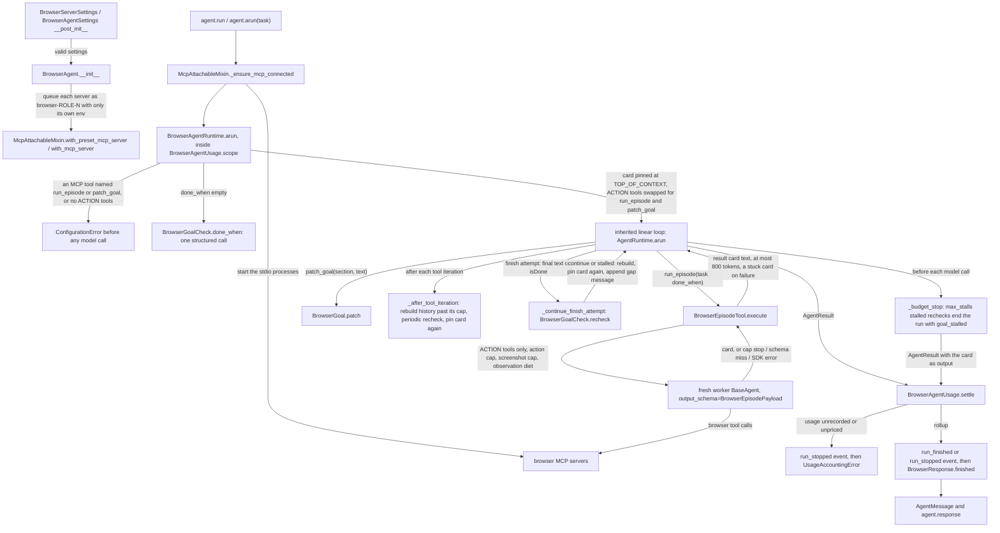
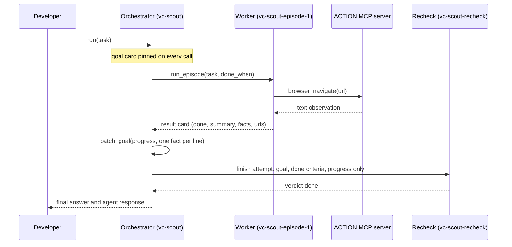

feat(agents): add BrowserAgent for long browser tasks over the developer's own MCP servers
## Summary

This PR adds `BrowserAgent` (`vidbyte/agents/browser/`), an agent for browser tasks that run for hours. The developer lists their own browser MCP servers in `BrowserAgentSettings` by role: `action_servers` act on pages, and `search_servers` and `fetch_servers` read. Each server's API keys go in its own `env` and are checked when the settings object is built. An orchestrator plans, keeps a goal card pinned at the top of its context, and hands each page-level task to a fresh worker that holds only the action tools, works under caps enforced in code, and returns one short result card, so no page observation reaches the orchestrator. Every finish is rechecked by a fresh agent that sees only the goal, the done criteria, and the recorded progress, and rechecks that keep finding no progress stop the run with `goal_stalled`. The decision that matters most: `BrowserAgentRuntime` is the inherited linear loop plus three of its existing hooks, and every cap reuses loop settings and compaction code already on main, so the PR adds no middleware, store, scheduler, or dependency. Spec: `docs/spec/browser-agent/spec.md` (r5).

## How to use what this PR introduces

```python
from vidbyte import BrowserAgent, BrowserAgentSettings, BrowserServerSettings
from vidbyte.tools.mcp import FirecrawlMCP, PlaywrightMCP

agent = BrowserAgent(
    BrowserAgentSettings(
        name="vc-scout",
        system_prompt="You find seed-stage accelerator programs and record where to apply.",
        provider="openai",
        model_name="gpt-5.4-mini",
        action_servers=(BrowserServerSettings(PlaywrightMCP),),
        search_servers=(BrowserServerSettings(FirecrawlMCP, env={"FIRECRAWL_API_KEY": "fc-your-key"}),),
        done_when=("Twenty programs are listed, each with its application URL and deadline.",),
        on_event=lambda event: print(event.kind.value, event.detail),
    )
)
reply = agent.run("Find twenty seed-stage accelerator programs that accept applications this quarter.")
print(reply.content)
print(agent.response.stop_reason, len(agent.response.episodes))
print("\n".join(agent.response.goal.progress))
```

This is the spec's §4 snippet, unchanged. It ran as written on this branch with only the model runner (`BaseAgent._runner_for_model`) and the MCP stdio transport (`vidbyte.tools.mcp.attach.McpStdioTransport`) replaced by the test pack's scripted fakes, so no provider was called and no server process started. The script was one episode that navigates once and returns a `done` card, one `patch_goal` on progress, a final answer, and a `done` recheck. It printed:

```text
run_started
goal_set 1
episode_started
episode_finished done
recipe_recorded 1
goal_patched progress
goal_rechecked done
run_finished final_response
FINAL-ANSWER: Seedcamp accepts applications until 30 November at https://seedcamp.com/apply.
final_response 1
Seedcamp - https://seedcamp.com/apply - closes 30 November
```

In the same run the fakes recorded six model calls (`vc-scout`, `vc-scout-episode-1` twice, `vc-scout` twice, `vc-scout-recheck`), one `browser_navigate` on the ACTION server, the Firecrawl key in the SEARCH server's env only, both servers closed after the sync run, and `agent.response.usage == agent.get_usage()` with `cost_complete=True`. The developer no longer builds subagents, wires each MCP tool to the right agent, writes caps, or tracks the goal by hand.

## Flow





Validation happens twice before any model call: the two settings classes refuse bad servers, keys, models, and caps at construction, and `BrowserAgentRuntime.arun` refuses a reserved tool name on an MCP server or an action role with no tools. State changes in three run-local places: `BrowserGoal` (the card and the stall count), `BrowserResponse` (the record on `agent.response`), and the MCP server processes, which hold the one browser session every episode shares. Failures are caught at three points: a worker failure becomes a `stuck` card in `BrowserEpisodeTool.execute`, a failed recheck accepts the finish (fail open) in `BrowserGoalCheck.recheck`, and a sink exception is recorded in `BrowserAgentEvents.emit`. Usage that cannot be recorded or priced fails closed with `run_stopped` and `UsageAccountingError`, and cancellation always propagates.

## What changed

| File | Change |
|---|---|
| `vidbyte/agents/browser/agent.py` | `BrowserAgent`: maps the settings into `BaseAgent` with `runtime=AgentRuntimeType.BROWSER`, queues each server as `browser-<role>-<n>` with only its own env, and hands the settings, the role map, the live servers, the response writer, and the event emitter to each run. Sessions are refused. |
| `vidbyte/agents/browser/settings.py` | `BrowserServerSettings` (a registered preset or a `command`, `env`, `timeout`) and `BrowserAgentSettings` (model, three role slots, `done_when`, extras, loop, episode caps, recheck cadence, `on_event`). Every check runs in `__post_init__`; `env`, `command`, and the model keys are hidden from `repr`. |
| `vidbyte/agents/browser/runtime.py` | `BrowserAgentRuntime`: splits the tools by role, builds and pins the goal card, swaps the ACTION tools for `run_episode` and `patch_goal`, rechecks every finish and every `recheck_every` episodes, rebuilds the stored history past 60,000 tokens, stops a stalled run, and settles usage before the terminal event. |
| `vidbyte/agents/browser/episode.py` | `BrowserEpisodeTool` (`run_episode`): one fresh capped worker per episode; its reply, a cap stop, a schema miss, or an SDK, OS, or value error becomes one capped result card. |
| `vidbyte/agents/browser/goal.py` | `BrowserGoal` (the card, `patch_goal`, the stall rule, the context item) and `BrowserGoalCheck` (the done-criteria call and the fresh recheck). |
| `vidbyte/agents/browser/tools.py` | `BrowserAgentTools`: the map from server name to role, and the live bridged tools of one role. Holds no key. |
| `vidbyte/agents/browser/events.py` | `BrowserAgentEvents`: numbers events from 1, calls the sync sink, records an `Exception` from it by type name. |
| `vidbyte/agents/browser/usage.py` | `BrowserAgentUsage`: the agent's own tracker is the run's one ledger; fails closed through `JevUsageAccount.failures`. |
| `vidbyte/agents/browser/response.py` | `BrowserResponse`: the one writer of `agent.response`. |
| `vidbyte/agents/browser/__init__.py` | Exports `BrowserAgent`, `BrowserAgentSettings`, `BrowserServerSettings`, `BrowserAgentRuntime`. |
| `vidbyte/lib/enums/browser.py` | Five enums: `BrowserToolRole`, `BrowserEpisodeOutcome`, `BrowserGoalSection`, `BrowserVerdict`, `BrowserEventKind`. |
| `vidbyte/lib/dataclasses/browser.py` | Frozen records (`BrowserGoalCard`, `BrowserRecipeStep`, `BrowserEpisodeResult`, `BrowserRecheckResult`, `BrowserEvent`), the mutable `BrowserAgentResponse`, and three pydantic payloads for the worker, recheck, and done-when answers. |
| `vidbyte/lib/constants/browser.py` | Every cap, default, tool and argument name, and name template, with the orchestrator and worker token budgets in the header. |
| `vidbyte/lib/dataclasses/agents.py` | Adds `AgentStopReason.GOAL_STALLED`. |
| `vidbyte/lib/enums/agent_runtime.py` | Adds `AgentRuntimeType.BROWSER`. |
| `vidbyte/lib/registries/runtimes.py` | Resolves `BROWSER` to `BrowserAgentRuntime` through a lazy package import. |
| `vidbyte/agents/base.py` | Adds `BROWSER` to `_LINEAR_LOOP_RUNTIMES`, so the agent gets the loop's usage, output-contract, and fallback wiring; rewraps that comment to 72 columns. |
| `vidbyte/lib/enums/prompts.py` | 19 `Prompt.BROWSER_AGENT_*` members; header recounted to 158 assets in 36 families. |
| `vidbyte/lib/enums/__init__.py` | Exports the five enums. |
| `vidbyte/agents/__init__.py` | Exports the four package names. |
| `vidbyte/__init__.py` | Root exports `BrowserAgent`, `BrowserAgentSettings`, `BrowserServerSettings`, `BrowserEvent`. |
| `contracts/sdk-public-api.json` | Regenerated: four new root exports (648 in all). |
| `vidbyte/prompts/prompts/browser_agent/browser_agent.json` | The new `browser_agent` prompt family: maps 19 leaf keys to their files. |
| `.../browser_agent/orchestrator_system_prompt.md` | The orchestrator's rules: plan, delegate episodes, keep the card, finish through `isDone`, stop on `ready_to_submit`. |
| `.../browser_agent/worker_system_prompt.md` | The worker's rules: one episode, text snapshots, screenshots only as evidence, never submit, answer with the card. |
| `.../browser_agent/episode_prompt.md` | The worker's first message: episode number, task, done check. |
| `.../browser_agent/done_when_system_prompt.md` | Turns a task into short checkable done criteria. |
| `.../browser_agent/recheck_system_prompt.md` | The recheck's rules: judge from the goal, criteria, and progress only. |
| `.../browser_agent/recheck_prompt.md` | The recheck's only message. |
| `.../browser_agent/goal_card.md` | The pinned card: goal, criteria, plan, progress, blockers, latest verdict and gap, last episode. |
| `.../browser_agent/result_card.md` | The card text `run_episode` returns. |
| `.../browser_agent/run_episode_description.md` | `run_episode` tool description. |
| `.../browser_agent/run_episode_task_description.md` | `task` parameter description. |
| `.../browser_agent/run_episode_done_when_description.md` | `done_when` parameter description. |
| `.../browser_agent/patch_goal_description.md` | `patch_goal` tool description. |
| `.../browser_agent/patch_goal_section_description.md` | `section` parameter description. |
| `.../browser_agent/patch_goal_text_description.md` | `text` parameter description. |
| `.../browser_agent/patch_refused.md` | The reply to a refused patch. |
| `.../browser_agent/progress_full.md` | The reply when progress is full. |
| `.../browser_agent/continue_prompt.md` | The message appended after a refused finish, with the verdict and gap. |
| `.../browser_agent/stuck_summary.md` | The summary of a `stuck` card built by code. |
| `.../browser_agent/stalled_output.md` | The output of a `goal_stalled` stop, holding the card. |
| `vidbyte/agents/browser/README.md` | Folder README: the snippet, how a run works, limits and defaults, File Index, Notes for agents. |
| `vidbyte/agents/README.md` | A "Browser Agent" section and a Key Modules bullet. |
| `vidbyte/prompts/README.md` | A table row and a family section for `browser_agent`. |
| `REPO_MAP.md` | A `vidbyte/agents/browser/` paragraph. |
| `tests/features/browser_agent/browser_agent_fixtures.py` | Offline harness: a scripted model routed by agent name and fake stdio MCP servers. |
| `tests/features/browser_agent/test_browser_agent_acceptance.py` | The §4 snippet, the shared server process, sync and async server lifetimes, a side-effect-free runtime, clean runs. |
| `tests/features/browser_agent/test_browser_agent_contract.py` | Exports, enum values, the 19 leaves, runtime registration and refusals, tool schemas, module budget. |
| `tests/features/browser_agent/test_browser_agent_settings.py` | Every settings refusal, key handling, defaults. |
| `tests/features/browser_agent/test_browser_agent_episode.py` | Role split, action and screenshot caps, observation diet, stuck cards, recipes, card caps, cancellation. |
| `tests/features/browser_agent/test_browser_agent_goal.py` | `patch_goal` rules, caps, verbatim text, property tests of the patch and stall rules. |
| `tests/features/browser_agent/test_browser_agent_recheck.py` | Recheck input, refused finishes, cadence, stall stop, done-when derivation, fail open and fail closed. |
| `tests/features/browser_agent/test_browser_agent_rebuild.py` | History rebuild after a tool iteration and after a refused `isDone`. |
| `tests/features/browser_agent/test_browser_agent_observability.py` | Events, sink errors, usage rollup, key isolation, server names and env, run-start refusals. |
| `tests/features/browser_agent/FEATURE.md`, `README.md` | The pack's feature map and index. |
| `docs/spec/browser-agent/` (22 files) | The pipeline record: request, spec r5, test plan, review, verify log, stage reports, code map, and this PR body. |

## Acceptance criteria → proof

Every test below is in `tests/features/browser_agent/` and passes on this branch (109 passed).

| AC | What it checks (plain words) | Proven by |
|---|---|---|
| AC-1 | The §4 snippet runs as written and prints the events, the answer, the stop reason with the episode count, and the progress. | `test_browser_agent_acceptance.py::test_section_4_snippet_prints_events_answer_stop_reason_and_progress` |
| AC-2 | A preset whose key is missing from `env` is refused, even when `os.environ` holds it. | `test_browser_agent_settings.py::test_a_required_server_key_is_refused_unless_it_is_in_env_even_when_os_environ_has_it` |
| AC-3 | No key shows in a settings repr, a tool, an event, the response, a settings error, or a model call. | `test_browser_agent_settings.py::test_keys_never_appear_in_a_settings_repr_or_a_settings_error`; `test_browser_agent_observability.py::test_keys_never_reach_tools_events_the_response_or_any_model_call`; `::test_attached_tools_carry_no_server_key` |
| AC-4 | No action server, a server repeated across roles, or a server with both or neither of preset and command is refused, naming the field. | `test_browser_agent_settings.py::test_each_invalid_agent_setting_is_refused_naming_its_field[AC-4-*]`; `::test_each_invalid_server_setting_is_refused_naming_its_field[EC-3-*]` |
| AC-5 | The orchestrator never holds an action tool, and workers hold only the action tools. | `test_browser_agent_episode.py::test_orchestrator_never_holds_action_tools_and_workers_hold_only_them` |
| AC-6 | Two episodes in one run act on the same server process. | `test_browser_agent_acceptance.py::test_every_episode_of_one_run_uses_the_same_action_server_process` |
| AC-7 | The action cap stops a worker, and its stuck card has the exact action count and the last observation as evidence. | `test_browser_agent_episode.py::test_action_cap_stops_the_worker_and_returns_a_stuck_card_with_evidence` |
| AC-8 | A screenshot past the cap is denied in context and the worker still finishes its card. | `test_browser_agent_episode.py::test_a_second_screenshot_is_denied_in_context_and_the_worker_finishes_its_card` |
| AC-9 | Older observations are cut and the newest stay whole; the default keeps two per tool. | `test_browser_agent_episode.py::test_older_observations_are_cut_and_the_newest_is_whole`; `::test_default_settings_keep_the_two_newest_observations_of_each_tool` |
| AC-10 | `patch_goal` refuses the goal and done criteria, replaces the plan, and appends progress. | `test_browser_agent_goal.py::test_patch_goal_changes_only_plan_progress_and_blockers_and_every_call_shows_the_latest_card` |
| AC-11 | The next orchestrator call shows the patched card exactly once. | same test as AC-10 |
| AC-12 | A recheck sees only the goal, the criteria, and the progress, with no orchestrator history or tools. | `test_browser_agent_recheck.py::test_a_recheck_sees_only_the_goal_done_when_and_progress` |
| AC-13 | A refused finish appends one gap message, the card shows the verdict, and the next `done` ends the run. | `test_browser_agent_recheck.py::test_a_refused_finish_appends_one_gap_message_and_the_next_call_shows_the_verdict` |
| AC-14 | Periodic rechecks follow `recheck_every` and never end the run by themselves. | `test_browser_agent_recheck.py::test_periodic_rechecks_follow_recheck_every_and_never_end_the_run` |
| AC-15 | Stalled rechecks stop the run with `goal_stalled` before another model call, with the card as output. | `test_browser_agent_recheck.py::test_stalls_stop_the_run_before_another_model_call_with_the_card_as_output` |
| AC-16 | Empty `done_when` is derived once before the first orchestrator call, and only then. | `test_browser_agent_recheck.py::test_done_when_is_derived_once_before_the_first_orchestrator_call_only_when_not_given` |
| AC-17 | `ready_to_submit` is recorded and nothing acts on it; no setting or argument names "submit". | `test_browser_agent_episode.py::test_ready_to_submit_is_recorded_and_nothing_acts_on_it`; `test_browser_agent_contract.py::test_run_episode_and_patch_goal_schemas_follow_the_documented_contract` |
| AC-18 | A sink that raises is recorded and never breaks the run. | `test_browser_agent_observability.py::test_a_raising_sink_is_recorded_and_never_breaks_the_run` |
| AC-19 | One usage rollup counts every agent; an unpriced call raises `UsageAccountingError` and the last event is `run_stopped`. | `test_browser_agent_observability.py::test_usage_is_one_rollup_that_counts_every_agent`; `::test_an_unpriced_call_raises_usage_accounting_error` |
| AC-20 | The `browser` runtime refuses a plain `BaseAgent` and a fork, and `Session` refuses the agent. | `test_browser_agent_contract.py::test_runtime_type_resolves_and_refuses_outside_its_agent`; `::test_session_refuses_the_agent` |
| AC-21 | The names `run_episode` and `patch_goal` are refused in settings and on MCP tools. | `test_browser_agent_settings.py::test_each_invalid_agent_setting_is_refused_naming_its_field[AC-21-reserved-run-episode]`; `test_browser_agent_observability.py::test_a_reserved_name_on_an_mcp_tool_is_refused_before_any_model_call` |
| AC-22 | History over the cap after a tool iteration is rebuilt to the last exchange, with the card and progress kept. | `test_browser_agent_rebuild.py::test_history_over_the_cap_after_a_tool_iteration_is_rebuilt_to_the_last_exchange` |
| AC-23 | Each sync run gets its own servers; async runs on one loop share them. | `test_browser_agent_acceptance.py::test_sync_runs_get_their_own_servers_and_async_runs_on_one_loop_share_them` |
| AC-24 | The public names import from every documented path, and the contract lists them. | `test_browser_agent_contract.py::test_public_names_import_from_every_documented_path` |
| AC-25 | The prompt family has exactly 19 leaves with their placeholders and no digits. | `test_browser_agent_contract.py::test_prompt_family_has_exactly_the_nineteen_leaves_with_their_placeholders_and_no_digits` |
| AC-26 | A `done` card records its successful calls as a recipe, and the event names only the step count. | `test_browser_agent_episode.py::test_a_done_card_records_the_recipe_of_successful_calls_and_the_event_names_only_the_count` |
| AC-27 | A worker provider error becomes a stuck card and the run goes on; cancellation propagates and records no card. | `test_browser_agent_episode.py::test_a_worker_provider_error_becomes_a_stuck_card_and_the_run_continues`; `::test_cancelling_during_an_episode_propagates_and_records_no_card` |
| AC-28 | The package has at most 10 modules of at most 400 lines each. | `test_browser_agent_contract.py::test_new_package_stays_inside_the_complexity_budget` |
| AC-29 | The tests that iterate every `AgentStopReason`, and the infinite and jev packs, still pass. | existing suites, unchanged: 198 passed (stop-reason tests and infinite pack) and 467 passed, 1 skipped (jev packs) in the S5 re-review; all inside the full source stage below |
| AC-30 | An action server with no tools is refused before any model call. | `test_browser_agent_observability.py::test_an_action_server_without_tools_is_refused_before_any_model_call` |
| AC-31 | A worker's history stays under its token cap and keeps whole call/result groups. | `test_browser_agent_episode.py::test_worker_history_stays_within_its_token_cap_with_whole_call_groups` |
| AC-32 | A progress line that no longer fits returns `progress_full` and changes nothing. | `test_browser_agent_goal.py::test_a_progress_line_that_no_longer_fits_returns_progress_full_and_changes_nothing` |
| AC-33 | History over the cap at a refused `isDone` keeps that turn and the gap message. | `test_browser_agent_rebuild.py::test_history_over_the_cap_at_a_refused_is_done_keeps_that_turn_and_the_gap` |

## Verification

Every local gate ran from the worktree root with every model key unset. The source commits end at `57a22077`; every later commit touches only `docs/spec/browser-agent/`.

| Gate | Command | Result |
|---|---|---|
| Import path | `PYTHONPATH="$(pwd -W)" python -c "import vidbyte,inspect;print(inspect.getfile(vidbyte))"` | `...\worktrees\vidbyte-sdk-browser-agent\vidbyte\__init__.py` (the worktree, not the shared editable install) |
| Browser pack | `PYTHONPATH="$(pwd -W)" python -m pytest tests/features/browser_agent -q -p no:cacheprovider` | `109 passed in 1.35s` at `7c6d0e65`; `109 passed in 1.47s` at `010e3eee` |
| Lint | `python lint/run.py` | `A002 intent-comments 562 703 IMPROVED` … `SDK-LINT: PASS`, every rule at or below its baseline |
| Semgrep | `semgrep scan --error --config .semgrep/typed-mapping-boundary-policy.yml vidbyte` (through a scratch wrapper, because the global CLI crashes on import) | `Ran 1 rule on 996 files: 0 findings.` at `57a22077` |
| Public API contract | `python scripts/generate-sdk-public-api.py --check` | `contracts/sdk-public-api.json is current at 8183aa6f… (vidbyte-sdk 0.3.0, 648 exports).` at `010e3eee` |
| Full local gate, source stage | `PYTHONPATH="$(pwd -W)" python scripts/run_ci.py --stage source` | `2 failed, 6349 passed, 16 skipped in 92.70s` at `7c6d0e65` (the 2 are the known local-only failures below) |
| Full local gate, package stage | `python scripts/run_ci.py --stage package` (no `PYTHONPATH`) | `Installed vidbyte-sdk 0.3.0 passed smoke checks.` / `CI passed.` at `7c6d0e65` |
| Remote checks | `gh workflow run CI --ref feat/browser-agent`; `gh workflow run "Static policy" --ref feat/browser-agent`; `gh api repos/cerredz/Vidbyte-SDK/commits/<sha>/check-runs` | `7c6d0e65` (CI 39070247032, Static policy 39070249258): `Package`, `Static policy`, `Source / Python 3.11`, `Source / Python 3.12` all `completed success`. The head of this PR is re-dispatched after the final push. This file is committed before those runs exist, so the PR description carries their run IDs and results. |

The two local-only failures are `tests/features/harness_threads/test_harness_threads_surface.py::test_failure_codes_keep_main_and_append_exactly_the_28_harness_codes`, which also fails on the base commit `08f67e7f`, and `::test_import_vidbyte_starts_no_process_and_leaves_the_native_package_unloaded`, which compares the root `__all__` with the local merge-base main and is skipped on CI. This repo runs no checks on push, so both workflows are dispatched by hand, and `gh pr checks` shows nothing for dispatched runs.

## Adversarial review

22 findings confirmed by an independent verifier across three lenses (spec conformance, repo conventions, engineering), 16 fixed, 6 waived as follow-ups. A final conformance re-review after the repairs returned SOUND with 0 Blocker, 0 Major, and 3 Minor (R-C1 to R-C3, listed under Follow-ups). Full record: `docs/spec/browser-agent/review.md`.

| ID | Finding | Fixed in |
|---|---|---|
| R-1 | The edited comment above `_LINEAR_LOOP_RUNTIMES` in `vidbyte/agents/base.py` ran past 72 columns. | `b47b90ac` |
| R-2 | `_runtime_extension_kwargs` and `_budget_stop` had no `@intent` comment. | `e3aacaa7` |
| R-3 | The README presented "no auto-submit" as a guarantee without saying the rule is prompt-level only and `permission_policy` is the only code gate. | `7a50daea` |
| R-4 | `run_finished` reached the sink before usage was settled, so a run that then raised `UsageAccountingError` reported success. | `3f909eb3` (test `6dae8247`) |
| R-5 | No test could tell the default `keep_observations=2` from 1. | test added in `4f73cf31` |

The 11 Minor findings fixed are R-6 to R-11 and R-14 (docs, headers, `match` dispatch, `command` hidden from `repr`, the preset named in a blank-key error), R-12 and R-13 (spec text), and R-19 and R-20 (tests).

## Deviations from the spec

- **Usage is settled before the terminal event (R-C2).** Spec §12.3 row 16 says `arun` emits `run_finished` or `run_stopped` and then returns `response.finished(result, self.usage.settle(), events.errors)`. The code settles first. When usage cannot be settled it emits `run_stopped` with the detail `UsageAccountingError` and re-raises, so a sink never sees `run_finished` on a run that raised (the R-4 fix). For the same reason, the §17 note that `run_finished` and `run_stopped` always carry the stop reason does not hold on that path.
- **`command` is hidden from `repr` (R-C2).** Spec §8.5 shows `command: tuple[str, ...] | None = None`. The code has `field(default=None, repr=False)`, because a command's later arguments may carry a key (the R-11 fix). Equality still compares it.
- **`event_errors` on the raising path (R-C3).** INV-20 says a sink exception's type name is recorded on `agent.response.event_errors`. When usage cannot be settled, `BrowserResponse.finished` never runs, so the list stays empty and the error is kept only on the internal emitter. The run still raises, as INV-21 requires.
- The implementer's smaller deviations (two extra counting constants, an extra provider check for lint C012, a static helper for the duplicate-server check, one-line normalization of derived criteria and gaps, the event detail contents, and the rebuild measure) are recorded in spec §17 and not repeated here.

## Follow-ups

Known limitations, from the spec's open-question defaults:

- Recipes are recorded on `done` cards only; replay is a follow-up (Q-1).
- No resume across processes: no run journal, `Session` refuses the agent, and a fork is refused (Q-2).
- Empty `done_when` is derived with one structured call, and a failure stops the run before any browser action (Q-3).
- The default caps are starting values to measure on about 20 real pages: 30 actions, 5 screenshots per screenshot tool, 2 observations kept, a recheck every 5 episodes, 3 stalls, a 60,000-token rebuild trigger, and 32,000 tokens of worker history (Q-4).
- Workers get the action tools only (Q-5).
- Observations are kept per tool, not across all tools; the worker history trim bounds the total. An all-tools window needs `vidbyte/middleware/compaction/strategies.py` split first (Q-6).
- No image passthrough: `McpClient._content_to_text` (`vidbyte/tools/mcp/client.py:124-143`) turns every image into a text placeholder, so workers check pages from text snapshots and take screenshots only as evidence (Q-7).
- **`McpServerConfig.env` is not hidden from `repr`, so `repr(agent.mcp_servers())` can print server keys.** Fixing it is a change to the shared MCP layer; the README tells developers not to log `mcp_servers()` (Q-8).
- A worker stopped at its action cap gets no extra turn; facts it had not reported are lost, though its last observation is kept as evidence (Q-9).
- The goal card holds about 480 to 800 progress lines; past that the run ends `goal_stalled`. Bulk "harvest" runs are a follow-up (Q-10).
- Not checked against real servers: the preset commands (`PlaywrightMCP` runs `python -m mcp_server_playwright`; the README says to pass `command=("npx", "@playwright/mcp@latest")` when that is not installed), screenshot tool names containing "screenshot", and structured output beside tools on every provider (spec A-1, A-3, A-4, A-9).
- Vendor-billed MCP usage (Browserbase sessions, Firecrawl credits) is not in the usage ledger (NG-8).

Review findings not fixed in this PR:

- R-15: the same whitespace-collapse-and-cut idiom appears four times in `goal.py` and `events.py`; a shared one-line helper needs a file outside this PR.
- R-16: 53 test-pack comment lines are wider than 72 columns.
- R-17: the non-`isDone` call filter is written twice in `episode.py` (`_card` and `_stuck`).
- R-18: `episode.py` advances the episode counter and emits `episode_started` before building the worker, outside the `try`, so a raise there gives no card and no `episode_finished` (INV-12's "exactly once" does not hold on that path).
- R-21: the `done_when` minimum and the progress total are hand-checked in `vidbyte/lib/dataclasses/browser.py` instead of through a validator option (scope-adding).
- R-22: an unpriced worker or recheck model is reported only after the whole run (scope-adding).
- R-C1: no regression test pins the R-14 (preset named in a blank-key error) and R-11 (`command` hidden from `repr`) repairs.
- R-C2 and R-C3: the spec text named under Deviations above still describes the pre-repair code.

Suggested next PRs: hide `McpServerConfig.env` from `repr` (Q-8); the R-17 and R-18 tidy-up in `episode.py` with the R-C1 tests; the R-C2 and R-C3 spec corrections; and a measured run on about 20 real pages with real Playwright and Firecrawl servers to set the caps.

🤖 Generated with [Claude Code](https://claude.com/claude-code)
