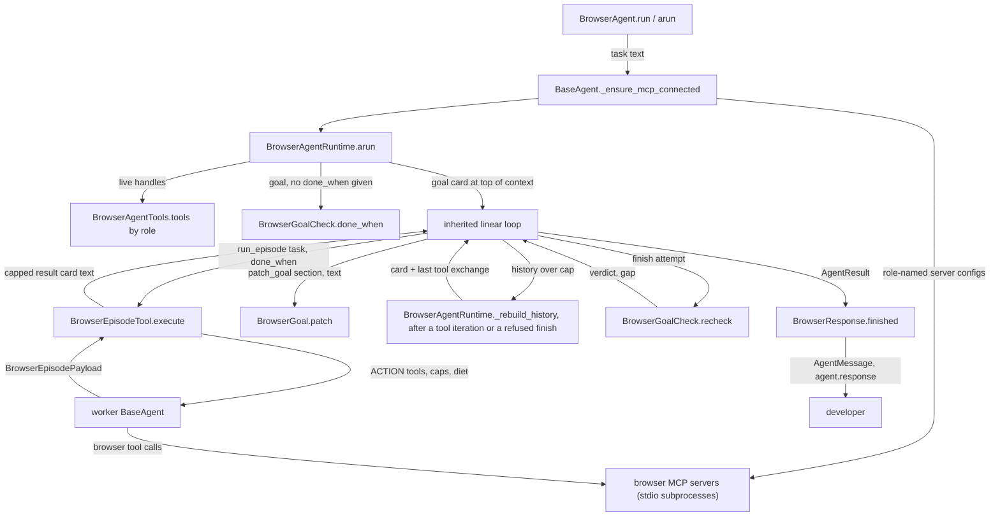
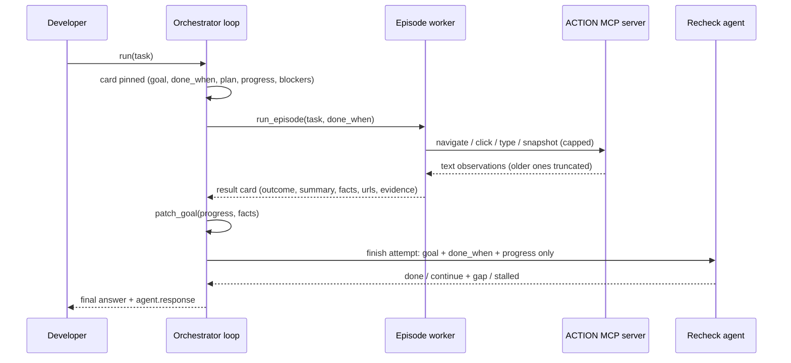

# Spec: BrowserAgent: JevAgent-shaped agent and runtime for long-running browser tasks

> **TL;DR** — This PR adds `BrowserAgent` (`vidbyte/agents/browser/`), an SDK agent for browser tasks that run for hours. The developer lists their own browser MCP servers (Playwright, Browserbase, Firecrawl, and so on) in the settings by role, together with their API keys. The orchestrator stays thin. A disposable worker agent does each page-level episode on one shared browser session and returns only a capped text card. A goal card that the orchestrator patches is pinned to the top of its context, and a fresh-context recheck judges every attempt to finish. When the orchestrator's history passes a token cap, the runtime rebuilds it: it keeps only the last tool exchange, and the pinned card carries everything else. The decision that matters most: the runtime is the inherited linear loop plus three hooks. Every cap and the observation diet reuse settings and middleware that already exist on main. The rebuild is one private step that two of those hooks call, and it reuses the shared compaction engine. This PR adds no new middleware, store, or scheduler.

## §0 User prompts

The full record of what the user asked is in `docs/spec/browser-agent/request.md`. It has every prompt in order, the decision ledger, and the conversation notes.

### 0.1 Invoking request (verbatim)

/spec-pipeline Okay, here is what i want to do. I want you to  launch a spec pipeline subagent that builds a "BrowserAgent" that discusses the main talking points of the architecture that we specified in the vidbyte-sdk/vidbyte/agents/browser. I want you to focus on the architecture of the runtime, and for the agent try to model it like out JevAgent in the repo (decompose the class logic, have a main BrowserAgent class that uses BrowserAgentRuntime, BrowserAgentSettings, BrowserAgentTools, BrowserAgentEvents, BrowserAgentUsage, BrowserAgentresponse etc subclasses). try not to overengineer each class, alot  of these  can be implemented in only a few hundred lines of code. then, the user for the browser agent, in its settings, should be able to "define' the actual  browser mcp servers that they want to use (playwright, browserbase, firecrawl, etc. there are alot and I want users to be able to import these, by nature they should also we required to upload their api keys into the agent settings), the browser tools themselves could even have more than 1 param (ex: browser_event_tools=playwright, browser_search_tools=firewcrawl). use judgement to decide best way to implement something like this.

### 0.2 User replies during the run

_None yet. The orchestrator appends any reply the user sends during the run here verbatim, labeled with the revision it produced._

---

## Part A — Framing

## §1 Goal

The user's own words set the problem (request.md §A, Prompt 2). A long browser session differs from a coding loop in three ways:

- it is token-heavy, with screenshots and 25 or more actions per page;
- many of its actions repeat;
- its "main memory" must change during the run without losing the original goal.

The user wants "small architectural tweaks to the main linear agent loop", not a new system.

What hurts today, with evidence:

- No SDK agent separates page work from planning. A plain `BaseAgent` that holds browser MCP tools keeps every page observation in one growing history. The loop stores every tool result (`vidbyte/agents/runtime.py:1935-1953`), and its only bound on the length is the generic middleware.
- No SDK agent keeps the original goal in front of the model across a long run. Nothing on main checks a finish against the goal in a fresh context.
- The developer must assemble the servers, the keys, the subagents, and the caps by hand. `McpAttachableMixin` (`vidbyte/agents/mixins.py:97-266`) attaches servers but knows nothing about roles.

| ID | Goal (outcome) | How we will know | Source |
|---|---|---|---|
| G-1 | A developer runs a long browser task through their own browser MCP servers from one settings object. They do not build subagents, tools, or caps by hand. | The §4 snippet runs as written (AC-1). Bad server or key settings are refused at construction (AC-2 to AC-4). | §0.1; request.md §C "Users define browser MCP servers in the settings, by role, with their keys" |
| G-2 | The orchestrator's context stays thin and bounded over hours. It never holds a screenshot or an action tool's output. | Recorded orchestrator calls show no ACTION tool and only capped episode cards (AC-5, AC-22, AC-33). | request.md §A Prompt 2 point 1; §D "The orchestrator never sees a screenshot" |
| G-3 | The run does not drift from the original goal. | The goal and done_when never change (AC-10). A finish counts only after a fresh-context recheck (AC-12, AC-13). A stalled run stops (AC-15). | request.md §A Prompt 2 point 3; §D "Fresh context is the part that matters" |
| G-4 | One page costs a bounded amount. | Per-episode action cap, screenshot cap, and observation diet (AC-7 to AC-9). | request.md §B points 1 and 3 |
| G-5 | Nothing irreversible happens on its own. | A worker reports `ready_to_submit`. No auto-submit option exists (AC-17). | §D "a worker returns 'ready to submit' and never submits, sends, or pays on its own" |
| G-6 | The developer can watch and measure a run: what each episode did, its actions and tokens, and the whole run's cost. | `agent.response`, events, and usage (AC-18, AC-19, AC-26). This also serves the user's open item, "measure on 20 pages first". | request.md §B ledger "Open"; §C Events/Usage/Response |

## §2 Objective

When this PR merges, the SDK has a new package `vidbyte/agents/browser/` with:

- a narrow `BrowserAgent(BaseAgent)` facade, configured only by a validated `BrowserAgentSettings`;
- `BrowserAgentRuntime`, an `AgentRuntime` subclass registered as `AgentRuntimeType.BROWSER`. It wraps the inherited linear loop through its existing hooks.
- the collaborators the user named:
  - `BrowserAgentTools` maps the developer's MCP servers to roles;
  - `BrowserAgentEvents` delivers run events to a developer sink;
  - `BrowserAgentUsage` owns the run's one usage ledger;
  - `BrowserAgentResponse` is the record users read on `agent.response`, written by `BrowserResponse`.
- two run-bound orchestrator tools: `run_episode` (episode.py) and `patch_goal` (goal.py).

The records, enums, and constants live in `vidbyte/lib/`. The model-facing text is a new `browser_agent` prompt family. The package has a folder README, and the PR adds exports, a REPO_MAP row, README sections, and the regenerated public-API contract. The feature test pack `tests/features/browser_agent/` is written at S2 by the test author.

This is the whole slice. The follow-ups this design enables are listed as non-goals:

- recipe replay;
- cross-process resume;
- image passthrough;
- an all-tools observation window.

## §3 Non-goals

- **NG-1** — The bulk "harvest" runtime (ledgers, tool-level dedup, a URL frontier) from the first answer. — *Why not:* the user narrowed the scope in Prompt 2, and request.md §B marks it out of scope.
- **NG-2** — Browser adapters inside the SDK (Playwright code, the Browserbase SDK). — *Why not:* the SDK talks to browsers only through MCP servers (request.md §C, rejected alternatives).
- **NG-3** — Replaying recipes without a model. — *Why not:* Q-1 defaults to recording only. Replay needs a store format and keying rules that nobody settled.
- **NG-4** — A run journal and `resume()` across processes. — *Why not:* Q-2 defaults to no. Each run is in-process only.
- **NG-5** — An auto-submit flag. — *Why not:* request.md §C says "there is no auto-submit flag in this PR".
- **NG-6** — Passing MCP image content to a model as image blocks. — *Why not:* the bridge turns every image into a text placeholder on purpose (`vidbyte/tools/mcp/client.py:136-143`, `@intent mcp-binary-content-stays-out-of-prompts`). Changing that is a cross-SDK decision (Q-7).
- **NG-7** — Disambiguating two servers that expose the same tool name. — *Why not:* `vidbyte/tools/mcp/README.md:124-127` places it in `attach.py`. It is a change to the shared MCP layer.
- **NG-8** — Counting vendor-billed MCP usage (Browserbase sessions, Firecrawl credits) in the usage ledger. — *Why not:* `McpBridgedTool` is not a priced operation (`vidbyte/tools/mcp/bridge.py:29`). Pricing MCP calls is a pricebook feature.
- **NG-9** — A `vidbyte-sdk` CLI command for this agent. — *Why not:* field guide `prebuilt-agents.md` says an SDK agent runs from Python only.
- **NG-10** — Changing the shared tool-output sliding window to count across tools. — *Why not:* `vidbyte/middleware/compaction/strategies.py` is already 1,020 lines. AGENTS.md principle 3 says to split such a file "before adding more", and that split is its own pull request (Q-6).
- **NG-11** — `Session` persistence and `fork()` for `BrowserAgent`. — *Why not:* a restored or forked agent would be a plain `BaseAgent` that the runtime refuses, the same as InfiniteMemoryAgent (`vidbyte/agents/infinite/agent.py:45`).
- **NG-12** — Any change to `McpServerConfig`, `McpPresetRegistry`, the MCP bridge, or the compaction middleware. — *Why not:* the design reuses them as they are on main (D-5, D-10, D-11).

## §4 Developer usage

```python
from vidbyte import BrowserAgent, BrowserAgentSettings, BrowserServerSettings
from vidbyte.tools.mcp import FirecrawlMCP, PlaywrightMCP

agent = BrowserAgent(
    BrowserAgentSettings(
        name="vc-scout",
        system_prompt="You find seed-stage accelerator programs and record where to apply.",
        provider="openai",
        model_name="gpt-5.4-mini",
        action_servers=(BrowserServerSettings(PlaywrightMCP),),
        search_servers=(BrowserServerSettings(FirecrawlMCP, env={"FIRECRAWL_API_KEY": "fc-your-key"}),),
        done_when=("Twenty programs are listed, each with its application URL and deadline.",),
        on_event=lambda event: print(event.kind.value, event.detail),
    )
)
reply = agent.run("Find twenty seed-stage accelerator programs that accept applications this quarter.")
print(reply.content)
print(agent.response.stop_reason, len(agent.response.episodes))
print("\n".join(agent.response.goal.progress))
```

The developer imports preset definitions they already know from `vidbyte.tools.mcp` and gives each server a role with one keyword. Keys go in the server's `env`, and a missing key is refused when the settings object is built. Each run prints one event line per step. The last three lines print:

- the orchestrator's final answer;
- the stop reason and the number of page-level episodes;
- the progress facts the orchestrator recorded.

The developer no longer builds subagents, wires MCP tools to the right agent, writes caps, or tracks the goal by hand.

## §5 Flow diagram





Validation happens in two places:

- `BrowserAgentSettings.__post_init__` and `BrowserServerSettings.__post_init__` check settings before any process starts.
- `BrowserAgentRuntime.arun` checks the run before any model call: reserved tool names, and an ACTION role with no tools.

State changes in three places, all run-local:

- `BrowserGoal`, which holds the card and the stall count;
- `BrowserResponse`, which holds the record;
- the MCP server processes, which hold the browser.

Failures are caught in three places:

- a worker's failure becomes a STUCK card inside `BrowserEpisodeTool.execute`;
- a recheck's failure fails open inside `BrowserGoalCheck.recheck`;
- a sink's exception is recorded inside `BrowserAgentEvents.emit`.

Cancellation always propagates.

---

## Part B — Behavior (this is the spec; everything else is framing)

## §6 Behavior

### 6.1 Invariants

**Construction and settings**

- **INV-1** — `BrowserAgent` is configured only by a `BrowserAgentSettings` instance. Any other object is refused with `ConfigurationError` naming the received type. `BrowserAgent.__init__` raises nothing else itself.
- **INV-2** — A preset server whose preset requires an environment variable is refused when `BrowserServerSettings` is constructed if that variable is missing or blank in its `env`. The error names the variable, the preset, and the field. A value in `os.environ` never satisfies the check, and the SDK never reads `os.environ` for these keys.
- **INV-3** — No key value appears in any of these:
  - `repr(settings)` or `repr(agent.tools)`;
  - any `ConfigurationError` message the settings raise;
  - any `BrowserEvent`;
  - `agent.response`.
- **INV-4** — `action_servers` holds at least one server. No preset name, and no command, appears twice across `action_servers`, `search_servers`, and `fetch_servers`.

**Catalogs and the shared browser**

- **INV-5** — In every orchestrator model call, the tool list holds:
  - the developer's `settings.tools`;
  - the tools of the SEARCH and FETCH servers;
  - `run_episode` and `patch_goal`;
  - the loop's own `isDone`.

  It never holds a tool bridged from an ACTION server.
- **INV-6** — The orchestrator never receives a screenshot. Every MCP result is text, because the bridge turns images into placeholders. Episode output reaches the orchestrator only as the result-card text, capped at `BROWSER_CARD_MAX_TOKENS` by `TokenEstimate.cap`.
- **INV-7** — Every episode worker holds exactly the ACTION servers' bridged tool objects that were live at run start, plus the loop's own `isDone`, which every `BaseAgent` runtime adds (`vidbyte/agents/runtime.py:194`, `vidbyte/tools/_internal.py:51-53`), and nothing else. It gets no SEARCH or FETCH tools, no developer extras, and no orchestrator tools. Because the objects are the same, every episode of a run acts on the same server process and the same browser session.
- **INV-8** — The episodes of one run happen one at a time, in the order the orchestrator called them.

**Episode caps**

- **INV-9** — The browser tool calls one worker makes (executed, failed, or denied) never exceed `settings.max_actions`. A worker that has made `max_actions` calls is stopped with stop reason `max_tool_calls` before its next model call, and a further call in the same turn is not executed.
- **INV-10** — Calls to one screenshot tool never execute more than `settings.max_screenshots` times per episode. A screenshot tool is an ACTION tool whose name contains `BROWSER_SCREENSHOT_MARKER`, compared case-insensitively. Each later call is denied in context and the worker keeps going. A denied call still counts toward `max_actions`.
- **INV-11** — In every worker model call after the first, each browser tool's newest `settings.keep_observations` results are sent in full, unless the history trim dropped that result's whole turn. That tool's older results are cut to `BROWSER_STALE_OBSERVATION_CHARS`. The window counts per tool name, so a call can carry up to `keep_observations` full results for each distinct ACTION tool the worker has used, up to the size of the server's catalog. The worker's outgoing history is also trimmed at provider boundaries to `BROWSER_WORKER_HISTORY_MAX_TOKENS`, which bounds the total whatever the number of tools. The trim measures each message's content text by the `TokenEstimate` rule (`vidbyte/middleware/compaction/strategies.py:50-68`), and keeps or drops whole call/result turns, newest first (`:624-635`). The stored history is unchanged.
- **INV-12** — Every `run_episode` call that is not cancelled and whose `task` and `done_when` are non-blank does two things exactly once:
  - it returns one card text to the orchestrator;
  - it records one `BrowserEpisodeResult` on `agent.response.episodes`.

  This holds when the worker hit a cap, replied without a valid card, or raised an SDK, OS, or value error. In those cases the card's outcome is `stuck`. A `stuck` card built after the worker ran (cap stop or schema miss) carries evidence from the worker's own executed calls:
  - `actions` is the exact number of browser calls the worker made;
  - `evidence` holds one item when any call succeeded: the first `BROWSER_STALE_OBSERVATION_CHARS` characters of the newest successful call's result text, with no marker added. Otherwise it is empty;
  - its summary is the `stuck_summary` leaf filled with the worker's stop reason.

  A worker that raised before replying gives a `stuck` card with `actions` None, no evidence, and the `stuck_summary` leaf filled with the error type name. Its `stop_reason` and that name are `type(error).__name__` of the exception `run_episode` caught. A provider error reaches it wrapped by `BaseAgent` (`vidbyte/agents/base.py:976-979`), so it reads `AgentExecutionError`.

  A call with a blank `task` or `done_when` starts no worker. It returns a model-visible error built from the validator's message and records no `BrowserEpisodeResult`.

**Goal card and recheck**

- **INV-13** — During a run, `card.goal` equals the run's message verbatim, and `card.done_when` never changes. `patch_goal` changes only `plan`, `progress`, or `blockers`:
  - `plan` and `blockers` are replaced;
  - `progress` only grows, one item per non-blank line of the patch text.

  Any other section is refused with a model-visible error, and the card stays unchanged.
- **INV-14** — Every orchestrator model call's system prompt carries the goal card exactly once. It is one context item with the fixed primitive id `BROWSER_GOAL_PRIMITIVE_ID` at `TOP_OF_CONTEXT`, replaced in place. The card is upserted in three places:
  - at run start;
  - after every tool iteration;
  - before the loop continues from a refused finish.

  So every call shows the card as it stands after the latest patch, episode, recheck, and refusal.
- **INV-15** — A recheck's model call carries only the rendered goal, done_when, and progress. It has no orchestrator history, no tool but the loop's `isDone`, and no system-prompt presets. Each recheck is a newly built agent.
- **INV-16** — A finish attempt by the orchestrator, by final text or by `isDone`, is accepted only in two cases:
  - its recheck returns `done`;
  - the recheck is unavailable (fail open).

  Otherwise the runtime upserts the card with that verdict and gap, appends exactly one user message carrying them, and the same loop continues.
- **INV-17** — A recheck counts as a stall in two cases:
  - its verdict is `stalled`;
  - its verdict is `continue` and `progress` is unchanged since the previous recheck. The first recheck compares against the empty progress the run started with.

  Any other recheck resets the count. When the count reaches `settings.max_stalls`, the run stops before its next model call with stop reason `goal_stalled`. The output carries the rendered card.
- **INV-18** — A recheck also runs after each tool iteration once `settings.recheck_every` episodes have finished since the last recheck. Its verdict is shown on the card. It never ends the run by itself; only the stall count does.
- **INV-30** — The orchestrator's stored conversation is checked at two points: after every tool iteration, and after every refused finish before the gap message is appended. When its stored messages pass `BROWSER_HISTORY_MAX_TOKENS` (the sum of `TokenEstimate.count` over each stored message's JSON text), it is rebuilt.
  - What it keeps: exactly the newest whole call/result group, as the shared compaction engine computes it (`ContextCompactionEngine.compact_provider_messages` with `TRIM_WITH_PROVIDER_BOUNDARIES` and `max_messages=1`). After a tool iteration, that group is the last assistant call turn with all its results. At a refused `isDone`, it is the turn that called `isDone`, with all its results, the refusal included. At a refused final-text finish, it is the last stored group: the previous call turn with its results, or the model's previous refused answer.
  - What it removes: every older stored message. The kept list replaces the stored list in place. Nothing is summarized, and no tool call is separated from its results.
  - What the next call holds: the system prompt with the rules and the card, the task (the provider places it at the run boundary), the kept group, and after a refused finish the gap message (followed, on the final-text path, by the model's own answer, EC-36).
  - What it records: a rebuild that removed at least one message emits exactly one `context_rebuilt` event and adds one to `agent.response.rebuilds`. A check that removes nothing records nothing (EC-35).
- **INV-19** — No setting, tool argument, or code path tells a worker to submit, send, or pay. `ready_to_submit` is an outcome a worker reports, and nothing acts on it automatically.

**Events, usage, lifecycle**

- **INV-20** — Each run emits `run_started` first. It emits exactly one of `run_finished` or `run_stopped` last, when the loop returns. Sequence numbers start at 1 and increase by 1. An `Exception` raised by the sink never reaches the run, and its type name is recorded on `agent.response.event_errors`. A `BaseException` such as cancellation propagates.
- **INV-21** — Every model call of a run lands in the agent's own tracker: the orchestrator, every worker, and every done_when or recheck call. After a run that returns, `result.metadata["usage_rollup"]`, `agent.response.usage`, and `agent.get_usage()` are the same rollup. A run whose usage cannot be recorded or priced raises `UsageAccountingError` instead of returning.
- **INV-22** — `BrowserAgentRuntime` refuses construction without `settings`, `browser_tools`, `servers`, `response`, and `events`. Its message names `BrowserAgent`. So `BaseAgent(runtime="browser")` and a fork of a `BrowserAgent` cannot run. `Session` refuses the agent, because `session_persistence_supported` is False.
- **INV-23** — Building a `BrowserAgentRuntime` has no side effects (`BaseAgent._runtime()` builds one twice in a direct run, at `vidbyte/agents/base.py:1280` and `:1319`; `:1388` is the separate `_run_with_tools` path). It starts no process, emits no event, makes no model call, and does not touch the response. All per-run state is created inside `arun`.
- **INV-24** — Each run starts from a clean conversation (`history=()`, `tool_calls=()`) and a fresh `BrowserAgentResponse`. A record object returned for an earlier run is never changed afterwards.
- **INV-25** — The names `run_episode` and `patch_goal` are refused in two places:
  - in `settings.tools`, when the settings are constructed;
  - as any attached MCP tool's name, when the run starts, before any model call.
- **INV-26** — No leaf of the `browser_agent` prompt family states a numeric limit. Every cap is a constant, a settings field, and a check in code.

**Must not regress:**

- **INV-27** — `AgentRuntimeType` LINEAR, JEV, and INFINITE_MEMORY still resolve to their runtimes, and `_LINEAR_LOOP_RUNTIMES` holds exactly four members: those three and BROWSER, which §12.3 row 21 adds (`vidbyte/agents/base.py:83`, `vidbyte/lib/registries/runtimes.py:30-56`).
- **INV-28** — These behave exactly as on main:
  - MCP image placeholders (`vidbyte/tools/mcp/client.py:136-143`);
  - all-or-nothing attach (`vidbyte/agents/mixins.py:97-145`);
  - the per-tool sliding window (`vidbyte/middleware/compaction/strategies.py:663-711`);
  - `trim_with_provider_boundaries` (`vidbyte/middleware/compaction/context_compaction.py:163`).
- **INV-29** — Three existing tests iterate every `AgentStopReason` member. They still pass with `GOAL_STALLED` added, because the new member is a stop without an accepted answer:
  - `tests/multi_agent/test_manager_middleware_abort.py:64`;
  - `tests/test_multi_provider_agentic_grader.py:793`;
  - `tests/features/agent_output_connectors/test_output_connectors_dispatch.py:41`.

### 6.2 Acceptance criteria

| ID | Given | When | Then | Priority | Proof |
|---|---|---|---|---|---|
| AC-1 | a clean checkout of this branch, the model seam answered by name and the MCP transport faked | the §4 snippet runs | it prints the event lines, the final answer, `final_response` or `is_done` with the episode count, and the recorded progress lines | P0 | `test_browser_agent_acceptance.py::test_section_4_snippet_prints_events_answer_stop_reason_and_progress` · S3: passes; implemented in c69c3ad0, 8183aa6f |
| AC-2 | `BrowserServerSettings(FirecrawlMCP)` with no `env`, and `FIRECRAWL_API_KEY` set in `os.environ` | the settings object is constructed | `ConfigurationError` names `FIRECRAWL_API_KEY`, `firecrawl`, and `BrowserServerSettings.env`. Setting the variable in `os.environ` does not change the outcome. | P0 | `test_browser_agent_settings.py::test_a_required_server_key_is_refused_unless_it_is_in_env_even_when_os_environ_has_it` · S3: passes; implemented in 95ee418b |
| AC-3 | settings holding a key in a server `env` and in `api_keys` | `repr(settings)`, `repr(agent.tools)`, every event, `agent.response`, and the message of an invalid-settings error are read | none contains the key text | P0 | `test_browser_agent_settings.py::test_keys_never_appear_in_a_settings_repr_or_a_settings_error`; `test_browser_agent_observability.py::test_keys_never_reach_tools_events_the_response_or_any_model_call` · S3: passes; implemented in 95ee418b, c69c3ad0 |
| AC-4 | `action_servers=()`, or the same preset in `action_servers` and `fetch_servers`, or a server with both `preset` and `command`, or neither | the settings are constructed | each is refused with `ConfigurationError` naming the field | P0 | `test_browser_agent_settings.py::test_each_invalid_agent_setting_is_refused_naming_its_field[AC-4-*]`; `test_browser_agent_settings.py::test_each_invalid_server_setting_is_refused_naming_its_field[EC-3-*]` · S3: passes; implemented in 95ee418b |
| AC-5 | an agent with one ACTION, one SEARCH, and one FETCH fake server, each exposing distinct tool names | a run calls `run_episode` once | every orchestrator call's tool schemas hold `run_episode`, `patch_goal`, and the SEARCH and FETCH tools and no ACTION tool. Every worker call holds the ACTION tools and no other tool but the loop's `isDone`. | P0 | `test_browser_agent_episode.py::test_orchestrator_never_holds_action_tools_and_workers_hold_only_them` · S3: passes; implemented in bddcfe23, 41984eb8 |
| AC-6 | the same agent | one `arun` calls `run_episode` twice | the fake transport class was instantiated exactly once per configured server for the whole run, and both workers called the same ACTION transport instance | P0 | `test_browser_agent_acceptance.py::test_every_episode_of_one_run_uses_the_same_action_server_process` · S3: passes; implemented in c69c3ad0, d756dde3 |
| AC-7 | `max_actions=3` and a worker script that asks for one ACTION call per turn without end | the episode runs | exactly three calls reach the fake server, and the worker makes no 4th model call. The card's outcome is `stuck` with `stop_reason == "max_tool_calls"` and `actions == 3`. Its `evidence` is a one-item tuple: the first `BROWSER_STALE_OBSERVATION_CHARS` characters of the third call's result text, with no marker. The orchestrator gets the card and continues. | P0 | `test_browser_agent_episode.py::test_action_cap_stops_the_worker_and_returns_a_stuck_card_with_evidence` · S3: passes; implemented in d756dde3 |
| AC-8 | `max_screenshots=1` and an ACTION tool named `browser_take_screenshot` | the worker calls it twice | the second call is denied in context, the worker's next model call happens, and the episode ends with the worker's own card | P0 | `test_browser_agent_episode.py::test_a_second_screenshot_is_denied_in_context_and_the_worker_finishes_its_card` · S3: passes; implemented in d756dde3 |
| AC-9 | `keep_observations=1` and a worker that calls `browser_snapshot` three times with outputs longer than `BROWSER_STALE_OBSERVATION_CHARS` | the worker's 4th model call is made | the first two snapshot results in that call are cut to `BROWSER_STALE_OBSERVATION_CHARS` with the truncation note, and the third is whole | P0 | `test_browser_agent_episode.py::test_older_observations_are_cut_and_the_newest_is_whole` · S3: passes; implemented in d756dde3 |
| AC-10 | a running orchestrator | it calls `patch_goal` with section `goal`, `done_when`, `plan`, then `progress` twice | the first two get error results and leave the card unchanged. `plan` is replaced. `progress` holds the lines of both progress patches, in order. | P0 | `test_browser_agent_goal.py::test_patch_goal_changes_only_plan_progress_and_blockers_and_every_call_shows_the_latest_card` · S3: passes; implemented in 8023c2d4, 97d256c3 |
| AC-11 | a `patch_goal` call in iteration n | the orchestrator's next model call is made | its system prompt holds the patched card exactly once | P0 | `test_browser_agent_goal.py::test_patch_goal_changes_only_plan_progress_and_blockers_and_every_call_shows_the_latest_card` · S3: passes; implemented in 97d256c3, 41984eb8 |
| AC-12 | a run whose orchestrator answers with final text | the recheck call is made | the recheck agent's call holds the goal verbatim, the done_when items, and the progress lines, and no orchestrator message. It offers no tool but the loop's `isDone`. | P0 | `test_browser_agent_recheck.py::test_a_recheck_sees_only_the_goal_done_when_and_progress` · S3: passes; implemented in 97d256c3, 41984eb8 |
| AC-13 | recheck scripts returning `continue` and then `done` | the orchestrator tries to finish twice | after the first attempt, one user message with the gap is appended, the loop continues, and the next orchestrator call's card shows the `continue` verdict and the gap. The second attempt ends the run with `final_response` (or `is_done`). | P0 | `test_browser_agent_recheck.py::test_a_refused_finish_appends_one_gap_message_and_the_next_call_shows_the_verdict` · S3: passes; implemented in 41984eb8 |
| AC-14 | `recheck_every=2` and an orchestrator that runs four episodes without finishing | the run proceeds | a periodic recheck runs after the 2nd and the 4th episode, and the card in the next orchestrator call shows the latest verdict | P1 | `test_browser_agent_recheck.py::test_periodic_rechecks_follow_recheck_every_and_never_end_the_run` · S3: passes; implemented in 41984eb8 |
| AC-15 | `max_stalls=2` and a recheck that keeps returning `continue` while progress does not change | the orchestrator keeps trying to finish | the run stops with `stop_reason == "goal_stalled"` before a further model call. The output holds the rendered card, and the last event is `run_stopped`. | P0 | `test_browser_agent_recheck.py::test_stalls_stop_the_run_before_another_model_call_with_the_card_as_output` · S3: passes; implemented in 0cdd38e3, 41984eb8 |
| AC-16 | `done_when=()` | a run starts | exactly one done-when agent call is made before the first orchestrator call, its criteria become `card.done_when`, and a `goal_set` event follows. With `done_when` given, no such call is made. | P0 | `test_browser_agent_recheck.py::test_done_when_is_derived_once_before_the_first_orchestrator_call_only_when_not_given` · S3: passes; implemented in 97d256c3, 41984eb8 |
| AC-17 | a worker that returns outcome `ready_to_submit` | the episode ends | the card is recorded with that outcome. `BrowserAgentSettings` has no field, and `run_episode` has no argument, whose name contains `submit`. | P0 | `test_browser_agent_episode.py::test_ready_to_submit_is_recorded_and_nothing_acts_on_it`; `test_browser_agent_contract.py::test_run_episode_and_patch_goal_schemas_follow_the_documented_contract` · S3: passes; implemented in d756dde3, 97d256c3 |
| AC-18 | an `on_event` sink that raises `ValueError` on `episode_started` | a run with one episode completes | the run returns normally, `agent.response.event_errors == ["ValueError"]`, and the other events reached the sink in order with sequence numbers 1..n | P0 | `test_browser_agent_observability.py::test_a_raising_sink_is_recorded_and_never_breaks_the_run` · S3: passes; implemented in cc61b7a3 |
| AC-19 | scripted usage on the orchestrator, one worker, and one recheck | a run returns | `result usage_rollup == agent.response.usage == agent.get_usage()`, and it counts all three agents' calls. With an unpriced model, the run raises `UsageAccountingError`. | P0 | `test_browser_agent_observability.py::test_usage_is_one_rollup_that_counts_every_agent`; `test_browser_agent_observability.py::test_an_unpriced_call_raises_usage_accounting_error` · S3: passes; implemented in 96e1c718, e4548302 |
| AC-20 | `BaseAgent(runtime="browser", ...)`, a `BrowserAgent` fork, and `Session(agent=BrowserAgent(...))` | each is run or built | the first two raise `ConfigurationError` whose message starts "The 'browser' runtime is only available through BrowserAgent". The session refuses the agent. | P0 | `test_browser_agent_contract.py::test_runtime_type_resolves_and_refuses_outside_its_agent`; `test_browser_agent_contract.py::test_session_refuses_the_agent` · S3: passes; implemented in 41984eb8, e467131b |
| AC-21 | `settings.tools` holding a tool named `run_episode`, and separately a fake MCP server exposing `patch_goal` | settings are built, or a run starts | the first is refused at construction. The second raises `ConfigurationError` before any model call. | P1 | `test_browser_agent_settings.py::test_each_invalid_agent_setting_is_refused_naming_its_field[AC-21-reserved-run-episode]`; `test_browser_agent_observability.py::test_a_reserved_name_on_an_mcp_tool_is_refused_before_any_model_call` · S3: passes; implemented in 95ee418b, 41984eb8 |
| AC-22 | an orchestrator that records progress with `patch_goal`, then makes tool calls in separate turns until its stored history passes `BROWSER_HISTORY_MAX_TOKENS` after a tool iteration (§13 gives the recipe) | its next model call is made | the recorded call's `messages` are exactly the last assistant tool-call turn and its result, and nothing older. Its `prompt` is the task. Its `system` holds the card with the progress recorded before the rebuild. Exactly one `context_rebuilt` event reached the sink before that call, and at the end of a run that does not pass the cap again, `agent.response.rebuilds == 1`. | P0 | `test_browser_agent_rebuild.py::test_history_over_the_cap_after_a_tool_iteration_is_rebuilt_to_the_last_exchange` · S3: passes; implemented in 41984eb8 |
| AC-23 | an ACTION fake server and two sync `agent.run(...)` calls, then two `await agent.arun(...)` calls in one event loop | the calls complete | each sync run starts and closes its own server processes. The two `arun` calls share one process. | P1 | `test_browser_agent_acceptance.py::test_sync_runs_get_their_own_servers_and_async_runs_on_one_loop_share_them` · S3: passes; implemented in c69c3ad0 |
| AC-24 | the branch after the contract is regenerated | public names are imported | `BrowserAgent`, `BrowserAgentSettings`, `BrowserServerSettings`, and `BrowserEvent` import from `vidbyte`. `BrowserAgentRuntime` also imports from `vidbyte.agents` and `vidbyte.agents.browser`. `contracts/sdk-public-api.json` matches. | P0 | `test_browser_agent_contract.py::test_public_names_import_from_every_documented_path` · S3: passes; implemented in 9b2af6f3, 5b347228, 8183aa6f, da05ec25 |
| AC-25 | the prompt family | it is loaded | `browser_agent.json` has exactly the 19 leaves in §9.1, each with a `Prompt` member, and no leaf contains a digit | P0 | `test_browser_agent_contract.py::test_prompt_family_has_exactly_the_nineteen_leaves_with_their_placeholders_and_no_digits` · S3: passes; implemented in 49aab243 |
| AC-26 | a worker that makes three ACTION calls that succeed and one that the screenshot cap denies, then returns `done` | the episode ends | `card.recipe` lists the three successful calls' names and JSON arguments in order, `card.actions == 4`, and the `recipe_recorded` event's detail names only the step count | P1 | `test_browser_agent_episode.py::test_a_done_card_records_the_recipe_of_successful_calls_and_the_event_names_only_the_count` · S3: passes; implemented in d756dde3 |
| AC-27 | a worker whose model call raises a provider error, and separately a run cancelled during an episode | the episode runs | the first yields a `stuck` card and the run continues. The second propagates `CancelledError` and records no card for that episode. | P0 | `test_browser_agent_episode.py::test_a_worker_provider_error_becomes_a_stuck_card_and_the_run_continues`; `test_browser_agent_episode.py::test_cancelling_during_an_episode_propagates_and_records_no_card` · S3: passes; implemented in d756dde3 |
| AC-28 | the new package | its modules are counted | `vidbyte/agents/browser/` holds at most 10 Python modules, and each is at most 400 lines after its header | P1 | `test_browser_agent_contract.py::test_new_package_stays_inside_the_complexity_budget` · S3: passes; implemented in e9b9eba2 to 1ca34a54 (10 modules) |
| AC-29 | the three stop-reason tests in INV-29 and the infinite and jev packs | the suite runs | they pass unchanged | P0 | existing, unchanged: `tests/multi_agent/test_manager_middleware_abort.py`, `tests/test_multi_provider_agentic_grader.py`, `tests/features/agent_output_connectors/test_output_connectors_dispatch.py`, `tests/features/infinite_memory_agent/`, `tests/features/jev_*/` (green at 709a9ba1; see `test-plan.md`) · S3: passes; implemented in e467131b (registration only) |
| AC-30 | an ACTION server whose bridge exposes no tools | a run starts | `ConfigurationError` names the ACTION role before any model call | P1 | `test_browser_agent_observability.py::test_an_action_server_without_tools_is_refused_before_any_model_call` · S3: passes; implemented in 41984eb8 |
| AC-31 | `keep_observations=1` and a worker that calls distinct ACTION tools, one per turn, until their full results pass `BROWSER_WORKER_HISTORY_MAX_TOKENS` (§13 gives the recipe) | its next model call is made | the recorded worker call's `messages`, summed as `TokenEstimate.count` of each message's string `content` (the trim's own measure counts at least that much), are at most `BROWSER_WORKER_HISTORY_MAX_TOKENS`. The newest call turn and its result are present. Every tool call in them has its result, and every result has its call. Its `prompt` is the episode prompt. | P1 | `test_browser_agent_episode.py::test_worker_history_stays_within_its_token_cap_with_whole_call_groups` · S3: passes; implemented in d756dde3 |
| AC-32 | a card whose progress section is within one line of `BROWSER_PROGRESS_MAX_CHARS` | the orchestrator calls `patch_goal(progress, …)` with a line that does not fit | the call returns the `progress_full` leaf as an error result, and the card is unchanged | P1 | `test_browser_agent_goal.py::test_a_progress_line_that_no_longer_fits_returns_progress_full_and_changes_nothing` · S3: passes; implemented in 97d256c3 |
| AC-33 | an orchestrator whose stored history first passes `BROWSER_HISTORY_MAX_TOKENS` in a turn that ends with `isDone`, and a recheck that returns `continue` (§13 gives the recipe) | its next model call is made | the recorded call's `messages` are exactly that turn's assistant call turn, its results (the `isDone` refusal included), and then the `continue_prompt` message, and nothing older. Exactly one `context_rebuilt` event reached the sink before that call. | P0 | `test_browser_agent_rebuild.py::test_history_over_the_cap_at_a_refused_is_done_keeps_that_turn_and_the_gap` · S3: passes; implemented in 41984eb8 |

### 6.3 Edge cases and failure modes

| ID | Trigger (input + state) | System behavior | User sees | Guarded by (INV-/D-) |
|---|---|---|---|---|
| EC-1 | `BrowserServerSettings("not-a-preset")` | `McpPresetRegistry.get` raises `McpPresetNotFoundError`, which is turned into `ConfigurationError` naming `BrowserServerSettings.preset` | construction error that names the bad preset name | D-5 |
| EC-2 | a developer-built `McpPresetDefinition` that is not registered, or that differs from the registered one with the same name | refused. The message says to register it with `McpPresetRegistry.register` or pass `command=`. Without this guard the registered preset of that name would run instead, silently. | construction error | D-5 |
| EC-3 | `preset` and `command` both set, or neither | refused | construction error naming both fields | INV-4 |
| EC-4 | `env={"FIRECRAWL_API_KEY": ""}` | refused as blank. Without the guard, `build_config` would accept the present-but-blank key and the server would start unauthenticated. | construction error naming the variable, never a value | INV-2 |
| EC-5 | the key exists only in `os.environ` | refused. Without the guard the check would pass, but `build_child_env`'s allowlist (`vidbyte/tools/mcp/transport.py:80-89`) would never pass the key to the server. | construction error | INV-2, D-4 |
| EC-6 | two different servers expose the same tool name (for example two browser servers both exposing `navigate`) | the first run's attach fails all-or-nothing. No server stays running (`vidbyte/agents/mixins.py:97-145`). The configs are queued again (`mixins.py:234-239`). | `ToolRegistrationError` or `McpAttachmentError` from `run`, naming the tool | INV-28; accepted limitation (NG-7) |
| EC-7 | an MCP tool named `run_episode` or `patch_goal` | refused before any model call | `ConfigurationError` naming the tool and the reserved names | INV-25 |
| EC-8 | an ACTION server that bridges zero tools | refused at run start. Without this, workers would run with no tools and burn the run on empty episodes. | `ConfigurationError` naming the ACTION role | D-7 |
| EC-9 | a server command that is missing or fails its handshake | `McpAttachmentError` from the first run. No process is left running. | error from `run`. The next run retries. | INV-28 |
| EC-10 | an ACTION server process dies during a run | later tool calls return error results (`vidbyte/tools/mcp/client.py:108`). Workers end `stuck` or `blocked`. Rechecks see no progress, and the stall count stops the run. Servers are not restarted mid-run. | `goal_stalled` with the card | INV-17; accepted limitation |
| EC-11 | a worker reaches `max_actions` | the loop stops it with `max_tool_calls` before its next model call (`vidbyte/agents/runtime.py:367-374`, `:2071-2080`), so the worker gets no turn to report. The worker sees its budget as `max_tool_calls: n/N` in its loop-settings block (`vidbyte/agents/runtime.py:1679-1701`), and its rules tell it to return its card before the budget runs out. When it does not, the schema check raises `OutputSchemaViolationError` (`vidbyte/agents/base.py:1060-1076`). The reply is recorded first (`last_reply` at `base.py:1007-1009`, before the raise at `:1022`). The `stuck` card is then built from that reply's `metadata["tool_calls"]`: the exact `actions` count, and `evidence` holding the first `BROWSER_STALE_OBSERVATION_CHARS` characters of the newest successful call's result text, with no marker. Facts the worker had not yet reported are not on the card. | a `stuck` card naming the cap, with the last page state it saw. The orchestrator decides the next step, for example a narrower episode. | INV-9, INV-12, D-8; partial findings accepted as a limitation (Q-9) |
| EC-12 | a worker replies with free text that does not match `BrowserEpisodePayload` | the loop asks for repairs up to `max_contract_rejections` times, then stops with `contract_unsatisfied` (`vidbyte/agents/runtime.py:523-535`), and the schema check raises `OutputSchemaViolationError` after `last_reply` is set (`base.py:1007-1022`), the same branch as the cap stop. The `stuck` card is built from `worker.last_reply` as in INV-12: `stop_reason == "contract_unsatisfied"`, the summary is the `stuck_summary` leaf with that reason, `actions` is exact, and `evidence` holds the first `BROWSER_STALE_OBSERVATION_CHARS` characters of the newest successful call's result text when any call succeeded. | `stuck` card | INV-12, D-8 |
| EC-13 | a worker's model call raises a provider error | caught (`VidbyteSdkError`, `OSError`, `ValueError`) and turned into a `stuck` card | `stuck` card | INV-12, D-27 |
| EC-14 | the caller cancels during an episode | `CancelledError` propagates out of `run_episode` and the run. A sync `run` still closes the servers (`mixins.py:246-262`). | `KeyboardInterrupt` or `CancelledError`. Episodes already recorded stay on `agent.response`. | INV-12, D-27 |
| EC-15 | the orchestrator calls `run_episode` twice in one turn | the loop runs tool calls one after the other (`vidbyte/agents/runtime.py:611-612`), so the second episode starts after the first card | two cards, in order | INV-8, D-22 |
| EC-16 | one progress line would pass `BROWSER_ITEM_MAX_CHARS`, or a plan or blockers text would pass its cap | refused with the `patch_refused` leaf filled with the validator's message. The card is unchanged. | the model sees the refusal | INV-13, D-12 |
| EC-17 | the recheck's model fails or answers off-schema at a finish attempt | the finish is accepted (fail open). `goal_rechecked` reports "unavailable". | the run ends `final_response` or `is_done` | INV-16, D-13 |
| EC-18 | the recheck keeps returning `continue` while the orchestrator keeps trying to finish without new progress | each recheck counts as a stall, because progress is unchanged. Without this rule the loop would run to `max_iterations` (1,000 by default). | `goal_stalled` | INV-17, D-14 |
| EC-19 | the done-when call fails while `done_when=()` | the error propagates before any episode or browser action | the provider's or `OutputSchemaViolationError`'s message. Setting `done_when` avoids the call. | D-15 |
| EC-20 | `on_event` raises, or is an `async def` function | a raise is recorded and swallowed. An `async def` sink is refused at construction, because its coroutine would never be awaited. | `event_errors` holds the type name, or a construction error | INV-20, D-18 |
| EC-21 | two `arun` calls overlap on one `BrowserAgent` | unsupported. The response writer belongs to the agent, so the runs overwrite each other's record (the same rule as `JevResponse`, `vidbyte/agents/jev/response.py` KNOWN EDGE CASES). | mixed `agent.response`. Documented in the README notes. | accepted limitation |
| EC-22 | two sync `run()` calls | each sync run closes the servers and queues them again (`mixins.py:246-262`), so cookies and tabs do not survive between sync runs | a fresh browser per `run()`. Use `arun` or `async with agent:` to keep one. | INV-7; documented |
| EC-23 | `agent.fork().run(...)` | the fork queues the parent's server configs again and starts them before `_runtime()` refuses (`vidbyte/agents/fork.py:98-99`, `base.py:916`). A sync run closes them. | `ConfigurationError` from the runtime | INV-22; accepted limitation |
| EC-24 | a caller passes an explicit `system=` run option | the option replaces the system string, card included (`call_options.setdefault("system", …)`, `vidbyte/agents/runtime.py:1605`) | the card is missing from that run's calls. Documented. | accepted limitation |
| EC-25 | a very long task message | the goal is rendered verbatim on every call, without a cap | larger calls. The budget in the constants header assumes a goal near 2,000 tokens. | accepted limitation |
| EC-26 | an MCP result longer than 8,000 characters | cut by the client (`vidbyte/tools/mcp/client.py:110-111`) | a truncated observation | INV-28 |
| EC-27 | a server's screenshot tool name does not contain "screenshot" | the screenshot cap does not count it. The action cap still bounds it. | more screenshot calls than `max_screenshots` | A-1 |
| EC-28 | one browser call takes longer than `BrowserServerSettings.timeout` | the transport request times out and the call returns an error result | the worker sees an error. Raise the server's `timeout`. | D-5 |
| EC-29 | a model clicks a submit button despite the rules (for example after an injected page instruction) | no code gate exists for a generic click. The developer's `permission_policy` applies to every worker call. | an irreversible action may happen. Documented. | D-16, T-2 |
| EC-30 | the run uses vendor-billed MCP servers | their cost is not in the ledger | `agent.response.usage` covers model calls only | NG-8 |
| EC-31 | a worker types a password while completing a form | the recipe on the card keeps that argument verbatim, in process memory only. Events carry only the step count. The SDK writes no file. | the secret sits on `agent.response.episodes[i].recipe` | T-6, D-17 |
| EC-32 | episodes return `ready_to_submit` and done_when needs the submission | rechecks return `continue` or `stalled` while progress is unchanged, and the run ends `goal_stalled`. The `ready_to_submit` cards stay on the response. | the run stops and shows what is ready to submit | INV-17, INV-19 |
| EC-33 | `settings.loop.max_iterations` is reached | `max_iterations` stop and the `run_stopped` event | partial progress on `agent.response.goal` | INV-20 |
| EC-34 | a worker calls a tool that only a SEARCH or FETCH server has | the call fails as an unknown tool inside the worker's own loop | the worker adapts or returns `stuck` | INV-7 |
| EC-35 | the newest orchestrator group alone passes `BROWSER_HISTORY_MAX_TOKENS` (for example many FETCH calls in one turn) | the rebuild keeps that group whole, because the engine never splits a call from its results. When it is the only group, nothing is removed, so no event is emitted and `rebuilds` does not change. Each later check that is still over the cap and finds older messages rebuilds again. | one `context_rebuilt` event per check that removed messages. The call is bigger than the budget sum by that one group. | INV-30 |
| EC-36 | the orchestrator finishes with final text, and the recheck returns `continue` | the loop appends the model's own final answer after the gap message (`vidbyte/agents/runtime.py:598-601`). This order is a limitation of the loop on main and is shared with `JevRuntime`. The card, upserted before the loop continues, shows the verdict and the gap, and the orchestrator rules say to finish by calling `isDone`, whose refusal comes before the gap (`:656-675`). | the next call ends with the model's own answer. Without the card's gap line, the model could repeat that answer until the run stalls. | INV-14, INV-16; accepted limitation |
| EC-37 | progress reaches `BROWSER_PROGRESS_MAX_CHARS`. At about 120–200 characters a line (a name, a URL, a deadline), that is roughly 480–800 items, below the request's own "1,000 vc applications" example. | each later `patch_goal(progress, …)` returns the `progress_full` leaf and leaves the card unchanged. Episodes may still return `done`, but progress cannot change, so every recheck after that counts as a stall, and the run ends `goal_stalled` after `max_stalls` rechecks. | `goal_stalled`, with the full card and every episode card on `agent.response`. The README notes and the constants header state the capacity. | INV-13, INV-17; accepted limitation (Q-10) |

**Rollback of the user action:** the SDK persists nothing for this feature. To stop a run, cancel it (Ctrl-C under `run`, task cancellation under `arun`). A sync run closes the server processes. `async with agent:` closes them at exit, and so does `await agent.close_mcp_servers()`. Actions the browser already took on websites (forms filled, pages visited) are not undone. That is why submits are gated by the `ready_to_submit` outcome (INV-19).

## §7 Requirements

**Functional**

| ID | Requirement | Priority | Source (request.md / G-) |
|---|---|---|---|
| FR-1 | `BrowserAgent(settings)` is the only construction surface. A non-settings object is refused. | P0 | §C Key decisions 1; G-1 |
| FR-2 | `BrowserServerSettings` takes a registered preset (name or definition) or a `command`, an `env` mapping, and a `timeout`. It refuses a missing or blank required key, naming the variable and the preset. It never reads `os.environ`, and `env` is hidden from `repr`. | P0 | §0.1 "required to upload their api keys into the agent settings"; G-1 |
| FR-3 | `BrowserAgentSettings` has three role slots, `action_servers` (at least one), `search_servers`, and `fetch_servers`, each a tuple of `BrowserServerSettings`. No server appears twice. | P0 | §0.1 "more than 1 param"; §D "define' the actual browser mcp servers" |
| FR-4 | The servers start lazily before the first run, once per run for `run()` and once per event loop for `arun()`. Every episode of a run shares them, and they close on the existing `BaseAgent` lifecycle. | P0 | §B point 2; §C Constraints (stdio subprocesses) |
| FR-5 | The orchestrator's catalog is the developer's extras, the SEARCH and FETCH tools, `run_episode`, and `patch_goal`. It never contains ACTION tools. | P0 | §D "minimal main orchestrator"; Q-5; G-2 |
| FR-6 | `run_episode(task, done_when)` runs one fresh worker with only the ACTION tools (plus the loop's `isDone`), returns one capped text card, and records one `BrowserEpisodeResult`. A blank `task` or `done_when` gets a model-visible error and records nothing (INV-12). | P0 | §D "subagents with browser tools for specific actions"; §B point 1 |
| FR-7 | Each worker is bounded by `max_actions` (action cap), `max_screenshots` per screenshot tool (screenshot cap), and `keep_observations` per tool plus `BROWSER_WORKER_HISTORY_MAX_TOKENS` overall (observation diet). A worker stopped at the action cap still returns a `stuck` card with evidence. | P0 | §B points 3 and "Add"; Q-4; G-4 |
| FR-8 | A worker reports `ready_to_submit` and never submits, sends, or pays on its own. No auto-submit option exists. | P0 | §D weighted; NG-5; G-5 |
| FR-9 | The goal card holds `goal` (the run's message, verbatim) and `done_when`, which are immutable, and `plan`, `progress` (append-only), and `blockers`. One tool, `patch_goal`, touches only the mutable three. | P0 | §D "a memory patch tool", "The patch tool can only touch the mutable three"; §B card |
| FR-10 | The card is pinned at the top of the orchestrator's context, at run start and again after every tool iteration. | P0 | §B point 5; G-3 |
| FR-11 | `done_when` comes from settings, or from one structured call at run start when it is not given. | P0 | Q-3 |
| FR-12 | A fresh-context recheck with no tool but the loop's `isDone` reads only the goal, done_when, and progress, and returns `continue`, `done`, or `stalled` with a gap sentence. It runs at every finish attempt and every `recheck_every` episodes. | P0 | §D "rechecks the original goal/done critiera with original prompt", "Fresh context is the part that matters" |
| FR-13 | A finish is accepted only on `done` (or when the recheck is unavailable). Otherwise the gap goes back into the same loop. | P0 | §C Recheck |
| FR-14 | After `max_stalls` consecutive stalls, the run stops with `AgentStopReason.GOAL_STALLED`, and its output shows the card. | P0 | §C Recheck "ends the run with a stop reason" |
| FR-15 | When the orchestrator's stored history passes `BROWSER_HISTORY_MAX_TOKENS` after a tool iteration or a refused finish, the runtime rebuilds its conversation: the pinned goal card (with progress), the task, and the last tool exchange stay, and everything older is dropped without summarizing. Each rebuild emits `context_rebuilt` and is counted on the response. | P0 | §C Orchestrator context rebuild; §B "orchestrator compaction and resume are the same rebuild" (in-run part); G-2 |
| FR-16 | Each `done` card with at least one successful call records the worker's executed calls as a recipe, and a `recipe_recorded` event is emitted. | P1 | Q-1; §B point 4 |
| FR-17 | `BrowserAgentEvents` delivers `BrowserEvent` records to `settings.on_event`. A sink exception never reaches the run. | P1 | §C Events |
| FR-18 | `BrowserAgentUsage` owns one ledger per run, fails closed, and reports a total equal to `agent.get_usage()`. | P0 | §C Usage |
| FR-19 | `agent.response` returns a `BrowserAgentResponse` holding the input, output, final card, episodes, rechecks, rebuild count, stop reason, usage, and event errors. | P0 | §C Response |
| FR-20 | `AgentRuntimeType.BROWSER` resolves to `BrowserAgentRuntime`. It is refused outside `BrowserAgent`, and `Session` refuses the agent. | P0 | §C Key decisions 1; field guide `runtime-boundaries.md` |
| FR-21 | The reserved tool names are refused (settings extras at construction, MCP tools at run start). | P1 | Infinite pattern (`vidbyte/agents/infinite/runtime.py:70`) |
| FR-22 | Public exports, the regenerated contract, the prompt family with `Prompt` members, the folder README (File Index and Notes for agents), the REPO_MAP row, and the agents and prompts README sections. | P0 | request.md §C Placement; AGENTS.md |
| FR-23 | `run()` and `arun()` both work (inherited from `BaseAgent`). | P0 | lint C011 |

**Non-functional**

| ID | Requirement | Priority | Target |
|---|---|---|---|
| NFR-1 | Every class stays small. | P0 | ≤ 10 Python modules in `vidbyte/agents/browser/`. Each module ≤ 400 lines after its header, and no class over about 250 lines (§0.1 "a few hundred lines"). |
| NFR-2 | The design adds no new middleware, store, scheduler, background task, or dependency. | P0 | 0 of each (§D "I dont want you to overcomplex things"; "just small architectural tweaks to the main linear agent loop") |
| NFR-3 | The runtime only extends the inherited loop. | P0 | `BrowserAgentRuntime` overrides exactly `__init__`, `arun`, `_continue_finish_attempt`, `_after_tool_iteration`, and `_budget_stop`, and calls `super().arun` once per run |
| NFR-4 | The orchestrator's and each worker's context fit a 128,000-token model at their caps. | P0 | Both sums stated in the constants header are ≤ 120,000 tokens (TokenEstimate). Every term is a constant or setting in code, except three that the header names as assumptions: the goal's length (EC-25), the tool-schema size, and the newest orchestrator group, with what a refused finish appends after its check (EC-35, EC-36). |
| NFR-5 | Prompts carry behavior only. | P0 | `grep -rn "[0-9]" vidbyte/prompts/prompts/browser_agent/*.md` prints nothing. `grep -rn "format(max_" vidbyte/agents/browser` prints nothing. |
| NFR-6 | No test calls a paid model or starts a real MCP server. | P0 | the feature pack uses the model seam `BaseAgent._runner_for_model` and a patched `vidbyte.tools.mcp.attach.McpStdioTransport` only |
| NFR-7 | Layering holds. | P0 | `python lint/run.py --rule A006` stays at its baseline. Nothing in `vidbyte/lib/` imports `vidbyte.agents` at runtime. |
| NFR-8 | The full local gate passes. | P0 | `PYTHONPATH=$(pwd) python scripts/run_ci.py --stage source` and `python scripts/run_ci.py --stage package` (AGENTS.md: `python scripts/run_ci.py`), with only the pre-existing failures in §11 |

---

## Part C — Design

## §8 Architecture and decisions

The modules, by layer:

- **Facade.** `BrowserAgent` maps `BrowserAgentSettings` into `BaseAgent`. It sets the runtime type and the orchestrator prompt, and it queues each server under its role name through the MCP mixin's own builders. It hands its collaborators to every run-local `BrowserAgentRuntime`.
- **Runtime.** `BrowserAgentRuntime(AgentRuntime)` wraps `super().arun` in the usage scope. Before the loop it:
  - splits the live servers' tools by role;
  - builds the goal card, deriving done_when when it is not given;
  - adds `run_episode` and `patch_goal`;
  - pins the card.

  It then uses three existing hooks:
  - `_continue_finish_attempt`, for the recheck at every finish, and to rebuild (INV-30) and pin the card again after a refusal;
  - `_after_tool_iteration`, to rebuild the conversation once it passes its cap, pin the card again, and run the periodic recheck;
  - `_budget_stop`, for the stall stop.
- **Collaborators.**
  - `BrowserAgentTools`: a role name for each server, and live handles to tools by role. It holds no key.
  - `BrowserEpisodeTool`: the `run_episode` tool and its worker.
  - `BrowserGoal`: the card, `patch_goal`, the stall arithmetic, and the context item.
  - `BrowserGoalCheck`: the two fresh-context structured calls.
  - `BrowserAgentEvents`, `BrowserAgentUsage`, and `BrowserResponse`.
- **Substrate.** Records, enums, and constants live in `vidbyte.lib`. Prompt text is the `browser_agent` family.

### 8.1 Decisions

| ID | Decision | Deciding reason | Runner-up | Flips if |
|---|---|---|---|---|
| D-1 | New package `vidbyte.agents.browser`, decomposed like Jev: a facade, a runtime, and the five named collaborators, plus the `episode` and `goal` modules for the two run-bound tools. Records, enums, and constants go in `vidbyte.lib`. | The user's decomposition (§0.1). The Placement Rules. The Jev and Infinite siblings (`vidbyte.agents.jev`, `vidbyte.agents.infinite`). | One module per tweak | the user asks for fewer files |
| D-2 | A new runtime type `AgentRuntimeType.BROWSER = "browser"`, resolved through the package `__init__`. It joins `_LINEAR_LOOP_RUNTIMES`. The runtime refuses construction without its collaborators. | Field guide `runtime-boundaries.md` ("A specialized agent's runtime is its own AgentRuntimeType"). Precedent at `vidbyte/agents/infinite/runtime.py:48-61`. | A `BaseAgent` subclass hook with no runtime type | — |
| D-3 | Three flat role fields on `BrowserAgentSettings` (`action_servers`, `search_servers`, `fetch_servers`), each a tuple of `BrowserServerSettings`. `BrowserToolRole` names the roles internally. | They read like the user's own example (`browser_event_tools=playwright, browser_search_tools=firewcrawl`) and need one import less. "Use judgement" (§0.1). | request.md §C's nested `BrowserToolSettings(actions, search, fetch)` record | a fourth role, or options per role |
| D-4 | Keys come only from `BrowserServerSettings.env`. `os.environ` is never read. | The child process gets an allowlisted environment (`vidbyte/tools/mcp/transport.py:34-62`, `build_child_env` :80-89), so a key that is only in `os.environ` never reaches the server. `vidbyte/tools/toolsets/coding.py:8` ("Do not read fetch keys from environment variables"). The user said keys "required to upload … into the agent settings". | request.md §C "present in env or in os.environ" | the transport starts passing parent keys |
| D-5 | `preset` is a registered preset name or the registered definition object. `__post_init__` resolves it with `McpPresetRegistry.get` and checks required keys with `McpPresetRegistry.build_config` (the canonical check, `vidbyte/tools/mcp/presets.py:384-421`), plus a blank-value check. A custom server uses `command=`. | Reuses the one existing required-env check (AGENTS.md principle 5) and needs no change to the shared MCP layer. Every importable preset constant is registered (`presets.py` registration loop over `ALL_PRESETS`). | Accept unregistered definitions and merge `default_env` here, which copies `build_config` | the user needs unregistered definitions |
| D-6 | `BrowserAgentTools` lives in `vidbyte.agents.browser.tools`, not `vidbyte.tools.toolsets`. | This agent has no preloaded static tools, which is the subject of the field guide's `prebuilt-agents.md` entry. Its configs are built from `BrowserServerSettings`, which sits in the agents layer (the Placement Rules' settings exception), and toolsets may not import `vidbyte.agents` (`vidbyte/tools/toolsets/infinite.py:5,8`). Run-bound tools stay in the agent package by Infinite precedent. | a `vidbyte.tools.toolsets.browser` module, taking only lower-layer inputs | a static preloaded browser tool is added, or the server records move to `vidbyte.lib` |
| D-7 | Servers attach on `BrowserAgent` itself. `__init__` queues each server under its role name `browser-<role>-<n>` (from `BrowserAgentTools.named_servers`) through the mixin's own builders: `with_preset_mcp_server(preset.name, name=, env=, timeout=)` for a preset (`mixins.py:180-196`, which calls `McpPresetRegistry.build_config` and renames the config), and `with_mcp_server(command, name=, env=, timeout=)` for a command (`:147-170`). No other object keeps a config or a key. The runtime gets the live handles through `_runtime_extension_kwargs` (built after `_ensure_mcp_connected`, `base.py:916`) and maps each handle to its role by `handle.name`. ACTION tools are removed from the run-local catalog with `Tools.without` (`vidbyte/tools/catalog.py:90`). Workers get the same bridged tool objects, which `_own_tool` passes through (`base.py:473-493`), so they share the server process. | Reuses the canonical preset builder (AGENTS.md principle 5). Also reuses, without copying, the lazy connect, the reconnect on a new loop, the release after a sync run, and the closing on `__aexit__` (`mixins.py:200-305`). | `BrowserAgentTools` builds every `McpServerConfig` itself (r1). That duplicates `with_preset_mcp_server` and keeps keys on one more object. | servers must outlive the agent object |
| D-8 | The episode worker is a fresh plain `BaseAgent` with `output_schema=BrowserEpisodePayload`. The card comes from `reply.structured`. After an action-cap stop or a schema miss, code builds a `stuck` card from `worker.last_reply`. The agent records that reply before the schema check raises (`base.py:1007-1009`, `:1022`), and its `metadata["tool_calls"]` (`runtime.py:2125`) gives the exact action count and, as evidence, the newest successful observation. | Structured output is the repo's mechanism (`vidbyte/agents/jev/done/reviewer.py:44-58`). The SDK already sends a schema beside tools and falls back per provider (`vidbyte/lib/registries/structured_output.py:62`, `vidbyte/providers/gemini.py:167`). request.md §B asks for a "stuck" card with evidence. | request.md §C's `finish_episode` tool. A tool cannot end the worker's loop, so the worker would still need a final reply. | a provider tier cannot carry a schema beside tools |
| D-9 | The action cap is the worker's `AgentLoopSettings.max_tool_calls`. The worker sees its budget as `max_tool_calls: n/N` in its loop-settings block (`runtime.py:1679-1701`), and its rules tell it to return its card before the budget runs out. Its `max_iterations` is `max_actions + BROWSER_EPISODE_REPLY_TURNS`: the slack for the final reply plus the in-loop schema repairs. `output_schema` adds `SchemaConformance` (`base.py:1494`), and the loop repairs a malformed reply up to `max_contract_rejections` times (default 3, `settings/loop.py:66`; `runtime.py:523-543`). The screenshot cap is the worker's `ToolSettings.max_calls_per_tool`, one entry per screenshot tool (deny and continue). No new middleware. | Field guide "Don't duplicate general agent/loop budget settings". Both caps are deterministic code (`vidbyte/agents/runtime.py:1862-1870`, `:2071-2080`; `vidbyte/agents/settings/tool.py:55-61`), and the prompts carry no numbers. The cost: at the cap, the loop stops the worker without a last turn. The `stuck` card still carries evidence (D-8). | A `before_tool_call` middleware with `deny_tool` that denies every browser call past the cap, so the worker still writes its card (field guide `runtime-boundaries.md`). It is the browser-use "final step allows only done" pattern, and it is a new middleware (NFR-2). | Q-9 is answered yes, or the cap must count several screenshot tools as one |
| D-10 | The observation diet is the existing `MessageHistoryCompactionMiddleware.tool_output_sliding_window(keep_recent=settings.keep_observations, window_mode=CompactionMode.TRUNCATE_TOOL_RESULTS, max_chars=BROWSER_STALE_OBSERVATION_CHARS)` on each worker, with the user's settled default of **2** (Q-4). The window counts per tool name (`strategies.py:683-695`), so it keeps two full observations per distinct tool, not two overall. To bound the total whatever the number of tools, each worker also gets `trim_with_provider_boundaries(max_tokens=BROWSER_WORKER_HISTORY_MAX_TOKENS)`, after the window, as InfiniteMemory's children do (`vidbyte/agents/infinite/launch.py:290`). Middleware transforms compose in order (`vidbyte/middleware/pipeline.py:157`, `:170-180`). | Field guide "Reuse shared context compaction infrastructure". A count across all tools needs a change to `strategies.py`, which is 1,020 lines, and AGENTS.md principle 3 says to split such a file before adding more. That split is its own PR (NG-10). This is the one point where the code cannot do the user's exact "two overall", so it is carried as Q-6 for the user to confirm. | Add an all-tools option to `ToolOutputSlidingWindowCompaction` | Q-6 is answered yes and the split lands |
| D-11 | The orchestrator is rebuilt the way the user decided (INV-30), through the shared compaction engine. One private step, `_rebuild_history`, runs from `_after_tool_iteration` and from `_continue_finish_attempt` on a refusal, before the gap message is appended. When the stored messages pass `BROWSER_HISTORY_MAX_TOKENS`, it calls `ContextCompactionEngine().compact_provider_messages(messages, mode=CompactionMode.TRIM_WITH_PROVIDER_BOUNDARIES, options={"max_messages": 1})`, which keeps exactly the newest whole call/result group, and assigns `messages[:] = list(kept)`. When `stats.removed_count` is above zero, it emits `context_rebuilt` and counts the rebuild on the response. The card at `TOP_OF_CONTEXT` holds the goal, done_when, plan, progress, and blockers on every call, so the rebuilt conversation is "goal card + progress + last result card". Nothing is summarized, and the orchestrator has no compaction middleware. | request.md §B ledger: "orchestrator compaction and resume are the same rebuild". §C: "a fresh conversation whose first message is the goal card plus progress"; summarizing is rejected as lossy. On main: <br>• compaction middleware rewrites only the outgoing copy (`context_compaction.py:217-229`), so stored history would grow for the whole run; <br>• the only in-loop summarizer (`vidbyte/context/algorithms/trajectory_checkpoints.py`) calls a model, which the user rejected. <br>The task is not in the stored list. The provider places it at the run boundary (`runtime.py:1611-1615`, `:1643-1653`; `vidbyte/lib/util/prompt_placement.py:28-48`; `vidbyte/providers/gemini.py:80-103`), so a list that opens with an assistant call turn still sends the task first. The card rides in the system prompt because that placement holds on every call. `TOP_OF_CONVERSATION` (`runtime.py:1655-1661`, `vidbyte/context/manager.py:219-226`) would render it as assistant-role messages ahead of the stored ones. <br>The engine is the field guide's provider-boundary-aware path: it classifies call and result turns for OpenAI, Anthropic, and Gemini (`vidbyte/middleware/compaction/engine.py:311-330`), groups each call with its results (`strategies.py:23-34`), keeps the newest group under `max_messages=1` (`:613-622`), and hands back untouched messages as plain copies (`engine.py:300-307`). The user's decision fixes what the rebuild keeps; the engine computes it. The refused-finish call is needed because a refused finish skips `_after_tool_iteration` (`runtime.py:680-688`). A later resume (Q-2) restores exactly this state: the card and an empty conversation. | Trim the outgoing copy with `trim_with_provider_boundaries` (r1). It keeps a sliding raw transcript and never rebuilds (§16 R-1). A role scan of its own (r2), which re-implemented the engine's grouping and missed refused finishes (§16 r2 R-3, r2 R-4). | the user overrides their own §B decision |
| D-12 | `BrowserGoalCard` is frozen. `patch_goal(section, text)` takes a `BrowserGoalSection` (plan, progress, blockers). PLAN and BLOCKERS are replaced, and PROGRESS appends one item per non-blank line. The caps are record validation. A refusal goes back to the model. | §B card: "progress: append-only facts". §D "The patch tool can only touch the mutable three". Infinite's model-visible refusal pattern (`vidbyte/agents/infinite/launch.py:133`). | Replace all three and let the model condense progress | the progress cap is hit in practice |
| D-13 | The recheck is a newly built `BaseAgent` per call: no tools of its own (the loop adds only `isDone`), `system_prompt_presets=()`, `output_schema=BrowserVerdictPayload`. Its input is only the goal, done_when, and progress. Its model is `recheck_model_name` or `model_name`. It fails open: no verdict means the finish is accepted, or the periodic check is skipped. | §D "Fresh context is the part that matters". Fail-open precedent: `JevReviewer` (`reviewer.py:67-70`). | One recheck agent per run with `history.clear()` | — |
| D-14 | Stall rule: a recheck counts as a stall when its verdict is `stalled`, or when it is `continue` with progress unchanged since the previous recheck. `done`, or a change in progress, resets the count. At `max_stalls`, `_budget_stop` returns `GOAL_STALLED`. | request.md §C defines a stall as "no progress change since the last recheck". A model-only rule loops when the model keeps saying `continue` (EC-18). | Count only the model's `stalled` verdicts | — |
| D-15 | When `done_when` is empty, one structured call derives it at run start. A failure propagates before any browser action (fail closed). | Q-3 default. A run that cannot judge "done" should not start an hours-long session. | Fail open with a generic criterion | — |
| D-16 | Irreversible actions are gated by the `ready_to_submit` outcome and the worker and orchestrator prompts. `settings.permission_policy` is applied to every worker. There is no auto-submit field. | request.md §C. MCP browser tools are generic (a click is a click), so code cannot recognize a submit. The permission policy is the code gate the developer controls. | A deny-list of tool names | a server exposes a dedicated submit tool |
| D-17 | Recipes are recorded only. The recipe is the worker's non-internal calls whose state is `SUCCEEDED` (tool name and JSON arguments), taken from `reply.metadata["tool_calls"]` (`vidbyte/agents/runtime.py:2111-2127`), on `done` cards. `actions` counts every non-internal call, denied and failed ones included, because that is what the action cap counts. The event is emitted for each `done` card with at least one successful call and carries only the step count. | Q-1 default. The calls are what really ran, not what the model says ran. | The model reports its own steps | replay lands (NG-3) |
| D-18 | `BrowserAgentEvents` calls a sync sink, `on_event(BrowserEvent)`. It catches `Exception` and records the type name. An `async def` sink is refused in settings. | The MultiAgent precedent (`vidbyte/agents/multi/ledger_controller.py:163-172`). Lint S019 (cancellation must propagate). | Accept async sinks and await them | — |
| D-19 | `BrowserAgentUsage` opens one ledger per run (`usage_ledger_scope`, `vidbyte/lib/usage_ledger.py:48`). It fails closed by reusing `JevUsageAccount.failures` and `JevUsageAccount.unpriced` (`vidbyte/agents/jev/usage.py:74-91`), and returns `UsageRollup`. | Field guide "Keep model usage accounting agent-owned". AGENTS.md principle 5 (reuse, don't copy). | Copy `JevUsageAccount` | the two class methods move to `vidbyte/lib/` |
| D-20 | `BrowserAgentResponse` is the record users read on `agent.response`, the same role `JevAgentResponse` plays. Its one writer is `BrowserResponse`, as `JevResponse` is for Jev. | The user named `BrowserAgentResponse`. Jev's split of writer and record (`vidbyte/agents/jev/response.py`). The record must live in `vidbyte/lib/dataclasses/`. | A single class for both, which the placement rule forbids | — |
| D-21 | `session_persistence_supported = False`. A fork is refused by the runtime, not by the facade. | Precedent at `vidbyte/agents/infinite/agent.py:45` and `vidbyte/sessions/session.py:104`. | Override `fork()` | — |
| D-22 | No lock around episodes. The loop already runs one turn's tool calls in order (`vidbyte/agents/runtime.py:611-612`). Overlapping runs on one agent are unsupported (EC-21). | Smallest correct design. | An `asyncio.Lock` in `BrowserEpisodeTool` | tool calls start running concurrently |
| D-23 | Screenshots stay text placeholders (NG-6), so a worker cannot check a page by screenshot. The worker rules say to check pages from text snapshots, and to take a screenshot only to save evidence, copying the file path that the tool's text result names into `evidence` (A-9). The SDK writes no files. | `vidbyte/tools/mcp/client.py:136-143`. request.md §C said "evidence such as screenshots goes to files on disk", but the SDK never holds the pixels. Field guide `prompt-families.md`: a leaf states only behavior the code has. | Write screenshots to disk, which needs passthrough | Q-7 is answered yes |
| D-24 | The worker's system prompt is `settings.system_prompt` plus the `worker_system_prompt` leaf, and the worker inherits the run's prompt presets. The check agents use fixed leaves with `system_prompt_presets=()`. | Infinite's children pattern (`vidbyte/agents/infinite/launch.py:277-291`). The recheck input is limited by INV-15. | Fixed worker prompt only | — |
| D-25 | `BROWSER_CARD_MAX_TOKENS = 800` caps the card text the orchestrator receives. The full record stays on the response. | Harvest pages list many items. Field guide "size … default caps generously". Same as `INFINITE_CARD_TEXT_MAX_TOKENS`. | The §B sketch's 300 | measurement on 20 pages (§B Open) |
| D-26 | The reserved names are refused in settings and again at run start. | Infinite pattern (`vidbyte/agents/infinite/settings.py` reserved check, `runtime.py:70`). | — | — |
| D-27 | A worker failure (`VidbyteSdkError`, `OSError`, `ValueError`) becomes a `stuck` card. `CancelledError` propagates. | Infinite pattern (`vidbyte/agents/infinite/launch.py` KNOWN EDGE CASES). Lint S019. | Fail the whole run | — |
| D-28 | `AgentStopReason` gains `GOAL_STALLED = "goal_stalled"`, added in place. | AGENTS.md "Existing code": adding a member in place is fine. A distinct reason lets callers tell a stall from a budget stop. | Reuse `MIDDLEWARE_ABORT` or `FINISH_REVIEW_REJECTED` | — |

### 8.2 Patterns inherited

- **Closed construction surface** — one settings object configures everything, and the type check is the only raise in `__init__`. Used in `vidbyte/agents/jev/agent.py:JevAgent.__init__` and `vidbyte/agents/infinite/agent.py:InfiniteMemoryAgent.__init__`.
- **Runtime type plus extension kwargs** — `_runtime_extension_kwargs` hands the collaborators to each run-local runtime, and the runtime refuses construction without them. Used in `vidbyte/agents/infinite/runtime.py:InfiniteMemoryRuntime.__init__`.
- **Per-run setup around `super().arun`** — tools are extended, the context is replaced with `history=()`, the tools option is popped, and the context manager is copied and upserted. Used in `vidbyte/agents/infinite/runtime.py:InfiniteMemoryRuntime.arun`.
- **Card pinned at the top of context** — one `TextContextItem` with a fixed primitive id is upserted at `TOP_OF_CONTEXT` in `_after_tool_iteration`. Used in `vidbyte/agents/infinite/runtime.py:_after_tool_iteration` and `_map`.
- **Finish-attempt hook** — append one user message and return True to continue the same loop. Used in `vidbyte/agents/jev/runtime.py:_continue_finish_attempt` and `vidbyte/agents/jev/continuation/fresh.py:continue_`.
- **Fresh-context structured side agent** — `output_schema`, `system_prompt_presets=()`, no tools, fail open. Used in `vidbyte/agents/jev/done/reviewer.py:JevReviewer`.
- **Usage scope and settle** — used in `vidbyte/agents/jev/usage.py:JevUsageAccount` and `vidbyte/agents/jev/runtime.py:arun`.
- **One response writer** — used in `vidbyte/agents/jev/response.py:JevResponse` with `_with_usage`.
- **Internal run-bound tool with a capped card** — `metadata={"internal": True}`, descriptions from prompt leaves, `ToolResult.error` with a refusal leaf. Used in `vidbyte/agents/infinite/launch.py:InfiniteLaunchTool`.
- **Event sink that never breaks the run** — used in `vidbyte/agents/multi/ledger_controller.py:_emit_event`.
- **Validated frozen settings with keys `repr=False`** — used in `vidbyte/agents/infinite/settings.py:InfiniteMemoryAgentSettings.__post_init__`.
- **Queue a preset server by name** — `with_preset_mcp_server` builds the preset config, renames it, and queues it. Defined at `vidbyte/agents/mixins.py:McpAttachableMixin.with_preset_mcp_server`.
- **Bounded child history** — a delegated agent gets `trim_with_provider_boundaries(max_tokens=…)`. Used in `vidbyte/agents/infinite/launch.py` (children's middleware, :290).

### 8.3 Smaller design rejected

The smallest design has no new runtime: a `BrowserAgent` facade over a plain `BaseAgent` whose catalog holds the MCP tools, one `patch_goal` `FunctionTool`, and `trim_with_provider_boundaries`. It fails these requirements:

- **FR-5 and INV-5.** The ACTION tools would sit in the orchestrator, so every observation would land in its history. This is the very problem in Prompt 2.
- **FR-12 and INV-16.** There is no hook that checks a finish in a fresh context without the runtime's `_continue_finish_attempt`.
- **FR-14.** There is no stall stop without `_budget_stop`.

A second small design is "workers only, no goal card". It fails FR-9 and FR-10, and it does nothing about drift (G-3).

### 8.4 Complexity budget

| Item | Count | Justification for each |
|---|---|---|
| New files | 34 (implementer) + the S2 test pack | `vidbyte.agents.browser`: 10 modules (`__init__`, `agent`, `settings`, `runtime`, `tools`, `episode`, `goal`, `events`, `usage`, `response`) and the folder README. `vidbyte.lib`: `enums.browser`, `constants.browser`, `dataclasses.browser`. Prompt family `browser_agent`: one JSON descriptor and 19 Markdown leaves (§9.1). §12.3 lists the paths. The test pack files are the test author's to choose and are not counted here. |
| New classes/modules | 13 Python modules; classes: 11 public, 1 private | `BrowserAgent`, `BrowserAgentSettings`, `BrowserServerSettings`, `BrowserAgentRuntime`, `BrowserAgentTools`, `BrowserEpisodeTool`, `BrowserGoal` (with private `_PatchGoalTool`), `BrowserGoalCheck`, `BrowserAgentEvents`, `BrowserAgentUsage`, `BrowserResponse`. Records and enums are listed in §8.5. |
| New dependencies | 0 | — |
| New config keys | 24 settings fields on `BrowserAgentSettings` and 4 on `BrowserServerSettings` (§9.3) | each one is named in the request, or mirrors an Infinite or Jev settings field |
| New collections/tables | 0 | nothing is persisted |
| New public endpoints/commands | 0 commands. 4 root exports (`BrowserAgent`, `BrowserAgentSettings`, `BrowserServerSettings`, `BrowserEvent`), plus `BrowserAgentRuntime` from `vidbyte.agents`, plus 5 enums from `vidbyte.lib.enums` | the user-facing surface of the §4 snippet and the event sink |
| Shared-code edits | 6 existing source files get a member, row, or export: `agent_runtime.py`, `runtimes.py`, `base.py`, `lib/dataclasses/agents.py`, `lib/enums/__init__.py`, `lib/enums/prompts.py`. Plus 2 export modules, the regenerated public-API contract, and 3 docs: 12 modified files in all (§12.3). | registration only. No behavior change to shared code. |

_The implementer may not exceed this budget without stopping and reporting BLOCKED._

### 8.5 Key interfaces

```python
# module vidbyte.lib.enums.browser  (all exported from vidbyte.lib.enums)
class BrowserToolRole(str, Enum):        ACTION = "action"; SEARCH = "search"; FETCH = "fetch"
class BrowserEpisodeOutcome(str, Enum):  DONE = "done"; STUCK = "stuck"; BLOCKED = "blocked"; READY_TO_SUBMIT = "ready_to_submit"
class BrowserGoalSection(str, Enum):     PLAN = "plan"; PROGRESS = "progress"; BLOCKERS = "blockers"
class BrowserVerdict(str, Enum):         CONTINUE = "continue"; DONE = "done"; STALLED = "stalled"
class BrowserEventKind(str, Enum):
    RUN_STARTED = "run_started"; GOAL_SET = "goal_set"; EPISODE_STARTED = "episode_started"
    EPISODE_FINISHED = "episode_finished"; GOAL_PATCHED = "goal_patched"; GOAL_RECHECKED = "goal_rechecked"
    RECIPE_RECORDED = "recipe_recorded"; CONTEXT_REBUILT = "context_rebuilt"
    RUN_FINISHED = "run_finished"; RUN_STOPPED = "run_stopped"

# module vidbyte.lib.dataclasses.agents  (existing enum, one member added in place)
class AgentStopReason(str, Enum): ...; GOAL_STALLED = "goal_stalled"

# module vidbyte.lib.dataclasses.browser
@dataclass(frozen=True, slots=True)
class BrowserGoalCard:
    goal: str                              # the run's message, verbatim
    done_when: tuple[str, ...]             # 1..BROWSER_MAX_CRITERIA one-line items
    plan: str = ""                         # <= BROWSER_PLAN_MAX_CHARS
    progress: tuple[str, ...] = ()         # one-line items, <= BROWSER_PROGRESS_MAX_CHARS in total
    blockers: str = ""                     # <= BROWSER_BLOCKERS_MAX_CHARS

@dataclass(frozen=True, slots=True)
class BrowserRecipeStep:
    tool: str
    arguments: str                         # JSON object text of the executed call

@dataclass(frozen=True, slots=True)
class BrowserEpisodeResult:
    index: int                             # 1-based within the run
    task: str
    done_when: str
    outcome: BrowserEpisodeOutcome
    summary: str                           # <= BROWSER_SUMMARY_MAX_CHARS
    facts: tuple[str, ...] = ()            # <= BROWSER_MAX_ITEMS items of <= BROWSER_ITEM_MAX_CHARS
    urls: tuple[str, ...] = ()
    evidence: tuple[str, ...] = ()
    recipe: tuple[BrowserRecipeStep, ...] = ()
    actions: int | None = None             # browser calls made, denied and failed included; None when unknown
    tokens: int | None = None              # the worker's total_tokens
    stop_reason: str = ""                  # the worker's AgentStopReason value, or the error type name

@dataclass(frozen=True, slots=True)
class BrowserRecheckResult:
    index: int; episodes: int; verdict: BrowserVerdict; gap: str; at_finish: bool; stalls: int

@dataclass(frozen=True, slots=True)
class BrowserEvent:
    kind: BrowserEventKind; sequence: int; episode: int; detail: str   # detail: one line, <= BROWSER_EVENT_DETAIL_MAX_CHARS

@dataclass(slots=True)
class BrowserAgentResponse:               # read as BrowserAgent.response; written only by BrowserResponse
    input: str = ""
    output: str = ""
    goal: BrowserGoalCard | None = None
    episodes: list[BrowserEpisodeResult] = field(default_factory=list)
    rechecks: list[BrowserRecheckResult] = field(default_factory=list)
    rebuilds: int = 0                      # orchestrator context rebuilds this run (INV-30)
    stop_reason: str | None = None
    usage: UsageRollup | None = None       # UsageRollup imported under TYPE_CHECKING, as in vidbyte.lib.dataclasses.jev
    event_errors: list[str] = field(default_factory=list)

class BrowserEpisodePayload(BaseModel):    # worker output_schema; no length limits (code caps)
    outcome: BrowserEpisodeOutcome; summary: str
    facts: list[str] = []; urls: list[str] = []; evidence: list[str] = []
class BrowserVerdictPayload(BaseModel):    verdict: BrowserVerdict; gap: str
class BrowserDoneWhenPayload(BaseModel):   criteria: list[str]   # at least one item

# module vidbyte.agents.browser.settings
@dataclass(frozen=True, slots=True)
class BrowserServerSettings:
    preset: str | McpPresetDefinition | None = None     # stored as the registered McpPresetDefinition
    command: tuple[str, ...] | None = None
    env: Mapping[str, str] = field(default_factory=dict, repr=False)   # stored as MappingProxyType
    timeout: float = BROWSER_DEFAULT_SERVER_TIMEOUT_SECONDS

@dataclass(frozen=True, slots=True)
class BrowserAgentSettings:
    name: str
    system_prompt: str
    provider: ModelProvider | str
    model_name: str
    action_servers: tuple[BrowserServerSettings, ...]
    search_servers: tuple[BrowserServerSettings, ...] = ()
    fetch_servers: tuple[BrowserServerSettings, ...] = ()
    done_when: tuple[str, ...] = ()
    api_keys: ProviderKeys | Iterable[str | None] | None = field(default_factory=ProviderKeys, repr=False)
    vidbyte_api_key: str | None = field(default=None, repr=False)
    model_mode: TextModelMode = TextModelMode.AUTO
    temperature: float | None = None
    timeout_seconds: float | None = None
    episode_model_name: str | None = None
    recheck_model_name: str | None = None
    tools: tuple[object, ...] = ()
    permission_policy: PermissionPolicy = field(default_factory=PermissionPolicy.allow_all)
    loop: AgentLoopSettings = field(default_factory=partial(AgentLoopSettings, max_iterations=BROWSER_DEFAULT_MAX_ITERATIONS, tool_settings=ToolSettings(result_max_chars=BROWSER_TOOL_RESULT_MAX_CHARS)))
    max_actions: int = BROWSER_DEFAULT_MAX_ACTIONS
    max_screenshots: int = BROWSER_DEFAULT_MAX_SCREENSHOTS
    keep_observations: int = BROWSER_DEFAULT_KEEP_OBSERVATIONS
    recheck_every: int = BROWSER_DEFAULT_RECHECK_EVERY
    max_stalls: int = BROWSER_DEFAULT_MAX_STALLS
    on_event: Callable[[BrowserEvent], None] | None = None

# module vidbyte.agents.browser.agent
class BrowserAgent(BaseAgent):
    session_persistence_supported = False
    def __init__(self, settings: BrowserAgentSettings) -> None: ...
    @property
    def response(self) -> BrowserAgentResponse: ...
    def _runtime_extension_kwargs(self) -> dict[str, Any]: ...   # settings, browser_tools, servers, response, events

# module vidbyte.agents.browser.runtime
class BrowserAgentRuntime(AgentRuntime):
    def __init__(self, *, settings: BrowserAgentSettings | None = None, browser_tools: BrowserAgentTools | None = None,
                 servers: tuple[McpServerHandle, ...] | None = None, response: BrowserResponse | None = None,
                 events: BrowserAgentEvents | None = None, **kwargs: Any) -> None: ...
    async def arun(self, message: str, *, handle: RunnerHandle, context: BaseAgentContext, metadata: Mapping[str, Any] | None = None,
                   options: Mapping[str, Any] | None = None, trace_context: SpanContext | None = None) -> AgentResult: ...
    async def _continue_finish_attempt(self, result: AgentResult, state: BaseAgentRuntimeLoopState, messages: list[dict[str, Any]]) -> bool: ...
    async def _after_tool_iteration(self, state: BaseAgentRuntimeLoopState, messages: list[dict[str, Any]]) -> None: ...
    async def _rebuild_history(self, messages: list[dict[str, Any]]) -> None: ...   # INV-30; both hooks above call it
    def _budget_stop(self, *, iteration_count: int, tokens_used: int | None, contexts: Sequence[ToolCallContext], started_at: float) -> AgentResult | None: ...

# module vidbyte.agents.browser.tools
class BrowserAgentTools:                                                                   # holds role names only, never a key
    def __init__(self, settings: BrowserAgentSettings) -> None: ...                          # maps each server name to its role
    @staticmethod
    def named_servers(settings: BrowserAgentSettings) -> tuple[tuple[str, BrowserToolRole, BrowserServerSettings], ...]: ...  # names "browser-<role>-<n>"
    def tools(self, servers: Sequence[McpServerHandle], role: BrowserToolRole) -> tuple[BaseTool, ...]: ...

# module vidbyte.agents.browser.episode
class BrowserEpisodeTool(BaseTool):                                                          # tool name "run_episode", internal
    def __init__(self, settings: BrowserAgentSettings, action_tools: tuple[BaseTool, ...], goal: BrowserGoal,
                 response: BrowserResponse, events: BrowserAgentEvents) -> None: ...
    def spec(self) -> ToolSpec: ...                                                           # arguments: task, done_when
    async def execute(self, call: ToolCall) -> ToolResult: ...

# module vidbyte.agents.browser.goal
class BrowserGoal:
    def __init__(self, card: BrowserGoalCard, settings: BrowserAgentSettings, response: BrowserResponse, events: BrowserAgentEvents) -> None: ...
    @property
    def card(self) -> BrowserGoalCard: ...
    def patch(self, section: BrowserGoalSection | str, text: str) -> BrowserGoalCard: ...    # raises ConfigurationError on refusal
    def episode_finished(self, result: BrowserEpisodeResult) -> None: ...
    def recheck_due(self) -> bool: ...
    def rechecked(self, payload: BrowserVerdictPayload | None, *, at_finish: bool) -> BrowserRecheckResult | None: ...
    def stalled(self) -> bool: ...
    def item(self) -> TextContextItem: ...                                                    # primitive_id BROWSER_GOAL_PRIMITIVE_ID
    def tool(self) -> BaseTool: ...                                                           # patch_goal (private _PatchGoalTool)
class BrowserGoalCheck:
    def __init__(self, settings: BrowserAgentSettings) -> None: ...
    async def done_when(self, goal: str) -> tuple[str, ...]: ...                              # raises on failure
    async def recheck(self, card: BrowserGoalCard) -> BrowserVerdictPayload | None: ...      # None when unavailable

# modules vidbyte.agents.browser.events, .usage, .response
class BrowserAgentEvents:
    errors: list[str]
    def __init__(self, sink: Callable[[BrowserEvent], None] | None) -> None: ...
    def start(self) -> None: ...
    def emit(self, kind: BrowserEventKind, detail: str = "", *, episode: int = 0) -> None: ...
class BrowserAgentUsage:
    def __init__(self, tracker: UsageTracker, agent_name: str) -> None: ...
    def scope(self) -> AbstractContextManager[UsageTracker]: ...
    def settle(self) -> UsageRollup: ...                                                      # raises UsageAccountingError
class BrowserResponse:
    state: BrowserAgentResponse
    def start(self, message: str) -> None: ...
    def goal(self, card: BrowserGoalCard) -> None: ...
    def episode(self, result: BrowserEpisodeResult) -> None: ...
    def recheck(self, result: BrowserRecheckResult) -> None: ...
    def rebuilt(self) -> None: ...                                                            # adds one to state.rebuilds
    def finished(self, result: AgentResult, usage: UsageRollup, event_errors: Sequence[str]) -> AgentResult: ...
```

Model-facing tool contracts:

- `run_episode`:
  - `task` (string, required): what to do on which page or form;
  - `done_when` (string, required): the episode's own check;
  - `additionalProperties: false`, `metadata={"internal": True}`, permission SAFE.
- `patch_goal`:
  - `section` (string, enum of the `BrowserGoalSection` values);
  - `text` (string);
  - both required, permission SAFE, not internal.

All descriptions come from prompt leaves.

## §9 Data, API, configuration, migration

### 9.1 Data model

Every record is in memory and run-scoped. Nothing is persisted, so there are no indexes, uniqueness keys, or storage volumes.

- **`BrowserGoalCard`** (frozen). It is created at run start from the message and done_when. Each accepted `patch_goal` replaces it with a new validated record (`dataclasses.replace`). Its final value is copied to `agent.response.goal` on each patch.
  - Lifecycle: `built → patched* → final`.
  - `progress` is bounded by `BROWSER_PROGRESS_MAX_CHARS` in total and `BROWSER_ITEM_MAX_CHARS` per item. Nothing in it is unbounded.
- **`BrowserEpisodeResult`** (frozen). There is one per `run_episode` call that is not cancelled and whose `task` and `done_when` are non-blank (INV-12), appended to `agent.response.episodes`.
  - The count per run is bounded by the orchestrator loop's caps. Default `max_iterations` is `BROWSER_DEFAULT_MAX_ITERATIONS`, and each turn runs its calls one at a time.
  - Each text field is capped: summary ≤ `BROWSER_SUMMARY_MAX_CHARS`, and each item ≤ `BROWSER_ITEM_MAX_CHARS` with ≤ `BROWSER_MAX_ITEMS` items. Code keeps the first items in the worker's order, the way `JevReviewer` keeps the first objections.
  - The recipe is ≤ `max_actions` steps.
- **`BrowserRecheckResult`** (frozen). There is one per recheck that produced a verdict, appended to `agent.response.rechecks`.
- **`BrowserEvent`** (frozen). It is passed to the sink and not stored.
- **`BrowserAgentResponse`** (mutable, slots). One per agent, replaced at each run's start (INV-24).
- **Constants** (`vidbyte/lib/constants/browser.py`; values are starting points per the user's "measure on 20 pages first"):
  - Loop and rebuild: `BROWSER_DEFAULT_MAX_ITERATIONS = 1_000`, `BROWSER_TOOL_RESULT_MAX_CHARS = 20_000`, `BROWSER_HISTORY_MAX_TOKENS = 60_000` (the rebuild trigger, INV-30).
  - Episode caps: `BROWSER_DEFAULT_MAX_ACTIONS = 30`, `BROWSER_DEFAULT_MAX_SCREENSHOTS = 5`, `BROWSER_DEFAULT_KEEP_OBSERVATIONS = 2`, `BROWSER_STALE_OBSERVATION_CHARS = 400`, `BROWSER_WORKER_HISTORY_MAX_TOKENS = 32_000`, and `BROWSER_EPISODE_REPLY_TURNS = 4`. The worker's `max_iterations` is `max_actions + BROWSER_EPISODE_REPLY_TURNS`: one final reply plus the three schema repairs that `AgentLoopSettings` allows by default.
  - Rechecks: `BROWSER_DEFAULT_RECHECK_EVERY = 5`, `BROWSER_DEFAULT_MAX_STALLS = 3`, `BROWSER_MIN_CAP = 1`, `BROWSER_CHECK_MAX_ITERATIONS = 2`.
  - Servers: `BROWSER_DEFAULT_SERVER_TIMEOUT_SECONDS = 30.0`, `BROWSER_MAX_SERVER_TIMEOUT_SECONDS = 600.0`.
  - Card and text caps: `BROWSER_CARD_MAX_TOKENS = 800`, `BROWSER_SUMMARY_MAX_CHARS = 2_000`, `BROWSER_ITEM_MAX_CHARS = 500`, `BROWSER_MAX_ITEMS = 50`, `BROWSER_MAX_CRITERIA = 20`, `BROWSER_PLAN_MAX_CHARS = 8_000`, `BROWSER_BLOCKERS_MAX_CHARS = 8_000`, `BROWSER_PROGRESS_MAX_CHARS = 96_000`, `BROWSER_EVENT_DETAIL_MAX_CHARS = 500`.
  - Tool names and arguments: `BROWSER_EPISODE_TOOL_NAME = "run_episode"`, `BROWSER_PATCH_TOOL_NAME = "patch_goal"`, `BROWSER_RESERVED_TOOL_NAMES`, `BROWSER_EPISODE_TASK_ARGUMENT = "task"`, `BROWSER_EPISODE_DONE_WHEN_ARGUMENT = "done_when"`, `BROWSER_PATCH_SECTION_ARGUMENT = "section"`, `BROWSER_PATCH_TEXT_ARGUMENT = "text"`.
  - Card item and markers: `BROWSER_GOAL_PRIMITIVE_ID = "browser_goal_card"`, `BROWSER_GOAL_TITLE`, `BROWSER_SCREENSHOT_MARKER = "screenshot"`, `BROWSER_CARD_CUT_MARKER`.
  - Name templates: `BROWSER_SERVER_NAME_TEMPLATE = "browser-{role}-{index}"`, `BROWSER_EPISODE_AGENT_NAME = "{name}-episode-{index}"`, `BROWSER_RECHECK_AGENT_NAME = "{name}-recheck"`, `BROWSER_DONE_WHEN_AGENT_NAME = "{name}-done-when"`.
- **Budget sum for the constants header** (NFR-4, TokenEstimate tokens, for a 128,000-token model):
  - Orchestrator: rules and developer prompt about 3,000. Card at its caps about 30,800 (plan 2,000, progress 24,000, blockers 2,000, criteria 2,500, verdict, gap, and last-episode lines 300). Goal about 2,000 (assumed, EC-25). Tool schemas about 4,000 (assumed). Stored history at most 60,000 at each check, because a rebuild runs after every tool iteration and every refused finish that passes it, unless the newest group alone is larger (EC-35). A refused finish appends its gap message after the check, and on the final-text path the model's own answer follows it (EC-36); these count in the assumed term with that group. Reply headroom 16,000. The total is about 115,800.
  - Worker: rules and developer prompt 3,000. Task 1,000. ACTION schemas about 8,000 (assumed). Outgoing history at most `BROWSER_WORKER_HISTORY_MAX_TOKENS` = 32,000, enforced by the trim, whatever the number of tools. That covers the action turns and the kept observations: two per tool, each up to about 2,000 (the client's 8,000-character cap). Headroom 16,000. The total is about 60,000.
  - Card capacity: `BROWSER_PROGRESS_MAX_CHARS` holds about 480–800 progress lines at 120–200 characters each (EC-37).
- **Prompt family `browser_agent`** (`vidbyte/prompts/prompts/browser_agent/`; each leaf is `{path, source_url}`; member `Prompt.BROWSER_AGENT_<LEAF>` with the value `"browser_agent.<leaf>"`):

| Leaf | Placeholders | States (behavior only, no numbers) |
|---|---|---|
| `orchestrator_system_prompt` | — | You plan and delegate page-level episodes with `run_episode`. You keep the card current with `patch_goal` and record progress facts after each episode. You use search and fetch tools for discovery and never act on pages yourself. On `ready_to_submit`, stop and report what is ready. Finish by calling `isDone`. Finishing is rechecked against the original goal, and a refusal's verdict and gap appear on the card. When progress is full, finish with what the card holds and name what is left. |
| `worker_system_prompt` | — | One episode on the shared browser. Check pages from text snapshots; you cannot see screenshots. Take a screenshot only to save evidence, and copy the file path its text result names into `evidence`. Batch several actions per turn. Your loop settings show how much of your tool-call budget is used; return your card before it runs out. Never submit, send, pay, or confirm; return `ready_to_submit` with what is prepared. Return `stuck` when you cannot make progress. Answer with the card fields. |
| `episode_prompt` | `{index}` `{task}` `{done_when}` | the worker's first message |
| `done_when_system_prompt` | — | turn a task into a short list of checkable done criteria |
| `recheck_system_prompt` | — | judge only from the goal, done criteria, and progress; return continue, done, or stalled and one gap sentence |
| `recheck_prompt` | `{goal}` `{done_when}` `{progress}` | the recheck's only message |
| `goal_card` | `{goal}` `{done_when}` `{plan}` `{progress}` `{blockers}` `{verdict}` `{gap}` `{last_episode}` | the pinned card |
| `result_card` | `{index}` `{outcome}` `{summary}` `{facts}` `{urls}` `{evidence}` | the card text `run_episode` returns |
| `run_episode_description` | — | tool description (S025 depth, no examples) |
| `run_episode_task_description` | — | parameter description |
| `run_episode_done_when_description` | — | parameter description |
| `patch_goal_description` | — | tool description; says goal and done criteria are fixed |
| `patch_goal_section_description` | — | parameter description |
| `patch_goal_text_description` | — | parameter description; progress lines are appended, the others replaced |
| `patch_refused` | `{problem}` | the refusal `patch_goal` returns |
| `progress_full` | — | the refusal `patch_goal` returns when a progress line no longer fits: progress is full, the card cannot record more, so finish with what the card holds and name what is left |
| `continue_prompt` | `{verdict}` `{gap}` | the user message appended after a refused finish |
| `stuck_summary` | `{reason}` | the summary of a `stuck` card built by code: the worker stopped without a valid card, and why (its stop reason, or the error type name). The action count stays on the card record. |
| `stalled_output` | `{card}` | the output of a `goal_stalled` stop |

### 9.2 API and interface surface

There is a public library surface only, with no network endpoint. It is listed in §8.5. The boundary validation is:

**`BrowserServerSettings.__post_init__`**, in order:

1. Exactly one of `preset` or `command` is set.
2. A `str` preset is resolved with `McpPresetRegistry.get`, and `McpPresetNotFoundError` becomes a `ConfigurationError` on `BrowserServerSettings.preset`. A definition must equal `McpPresetRegistry.get(definition.name)`.
3. `command` passes `RecordFieldValidator.require_argv`.
4. `env` passes `RecordFieldConverter.to_mapping`, and every value passes `RecordFieldValidator.require_text`. A blank value is refused with a message that names the field `BrowserServerSettings.env[<NAME>]` and, for a preset server, the preset name.
5. `timeout` passes `RecordFieldValidator.require_number(maximum=BROWSER_MAX_SERVER_TIMEOUT_SECONDS)`.
6. For a preset, `McpPresetRegistry.build_config(definition.name, env=self.env, timeout=self.timeout)` runs inside `try`. `McpPresetConfigurationError` becomes a `ConfigurationError` on `BrowserServerSettings.env`. The message names the missing variables and the preset.

**`BrowserAgentSettings.__post_init__`**, in order:

1. Text fields pass `RecordFieldValidator.require_text`.
2. The provider passes `RecordFieldConverter.to_enum`. `ProviderModelRegistry.validate_provider_model_pair` checks `model_name`, `episode_model_name`, and `recheck_model_name` when set (lint C012).
3. The three role tuples pass `RecordFieldConverter.to_tuple(item_type=BrowserServerSettings)`. `action_servers` is non-empty, and no preset name or command repeats across the roles.
4. `done_when` is empty, or passes `require_text_items(max_items=BROWSER_MAX_CRITERIA, max_chars=BROWSER_ITEM_MAX_CHARS, one_line=True)`.
5. `ProviderKeyMatcher.match(..., field_name="BrowserAgentSettings.api_keys")`.
6. `model_mode` passes `require_enum`. Temperature and timeout are numbers or None.
7. `tools` forms a valid `Tools` catalog and uses no reserved name.
8. `permission_policy` and `loop` pass `require_instance`.
9. Each cap passes `require_int(minimum=BROWSER_MIN_CAP)`.
10. `on_event` is None, or callable and not a coroutine function.

**Errors** use the existing types: `ConfigurationError`, `McpAttachmentError`, `ToolRegistrationError`, `OutputSchemaViolationError` (from done_when only), and `UsageAccountingError`. This PR adds no new error class, so A003 does not apply.

### 9.3 Configuration and flags

| Variable / key | Required | Default | Purpose | Lives in |
|---|---|---|---|---|
| `BrowserAgentSettings.name` / `system_prompt` / `provider` / `model_name` | yes | — | orchestrator identity and model; the workers and checks share the provider | settings.py |
| `action_servers` | yes (≥ 1) | — | servers whose tools only workers get | settings.py |
| `search_servers` / `fetch_servers` | no | `()` | servers whose tools the orchestrator gets | settings.py |
| `done_when` | no | `()` (derived by one call) | immutable done criteria | settings.py |
| `api_keys` / `vidbyte_api_key` | as the provider requires | `ProviderKeys()` / None | model keys, `repr=False` | settings.py |
| `model_mode` / `temperature` / `timeout_seconds` | no | AUTO / None / None | passed to every agent of the run | settings.py |
| `episode_model_name` / `recheck_model_name` | no | None (use `model_name`) | worker and recheck models, same provider | settings.py |
| `tools` | no | `()` | developer extras for the orchestrator | settings.py |
| `permission_policy` | no | `PermissionPolicy.allow_all()` | applied to the orchestrator and every worker | settings.py |
| `loop` | no | `AgentLoopSettings(max_iterations=BROWSER_DEFAULT_MAX_ITERATIONS, tool_settings=ToolSettings(result_max_chars=BROWSER_TOOL_RESULT_MAX_CHARS))` | orchestrator loop budgets | settings.py |
| `max_actions` / `max_screenshots` / `keep_observations` | no | 30 / 5 / 2 | per-episode caps (Q-4); `keep_observations` counts per tool (D-10) | settings.py; constants |
| `recheck_every` / `max_stalls` | no | 5 / 3 | recheck cadence and stall stop (Q-4) | settings.py; constants |
| `on_event` | no | None | sync event sink | settings.py |
| `BrowserServerSettings.preset` or `.command` | exactly one | — | a registered preset, or a custom server | settings.py |
| `BrowserServerSettings.env` | the preset's `required_env` | `{}` | server keys and options, `repr=False`, never from `os.environ` | settings.py |
| `BrowserServerSettings.timeout` | no | 30.0 | per-request MCP timeout | settings.py |

### 9.4 Migrations and compatibility

N/A for data: nothing is persisted. The public contracts change only by addition:

- new root and `vidbyte.agents` exports;
- five new enums;
- one new `AgentRuntimeType` member;
- one new `AgentStopReason` member.

A caller that matches `AgentStopReason` exhaustively must handle `goal_stalled`. The three tests that iterate the members on main treat it as a stop without an accepted answer (INV-29). `contracts/sdk-public-api.json` is regenerated after the export commit. There is no deprecation.

## §10 Security and tenancy

| ID | Attacker | Shortest path to harm | Control | Where the control sits |
|---|---|---|---|---|
| T-1 | Careless user | They expect a key in `os.environ` to work, or they put a key in `system_prompt`. The server runs unauthenticated, or the key reaches a model. | Keys are accepted only in `BrowserServerSettings.env`. A missing or blank key is refused at construction (INV-2). The env is passed only to the server subprocess (`build_child_env`) and never to a model. `env` and `api_keys` are `repr=False`. Validator messages never quote values (`vidbyte/lib/dataclasses/validation.py:150-158`). | In the SDK process: settings validation and the MCP transport (code, not prompt) |
| T-2 | Hostile web page (prompt injection) | Page text tells the worker to submit, pay, or navigate to an attacker site, or a FETCH result carries the same text to the orchestrator | The worker and orchestrator rules require `ready_to_submit` and forbid autonomous submits. `settings.permission_policy` is enforced on every worker and orchestrator tool call by the loop. Workers hold only ACTION tools, and no key is ever in model context. Residual: a generic click cannot be recognized as a submit (EC-29), which is documented. | The permission policy and the catalog split are code in the SDK process. The submit rule is prompt-level only. |
| T-3 | Compromised teammate / leaked credential | `repr(agent.mcp_servers())` prints each `McpServerConfig`, whose `env` shows in its repr (pre-existing, `vidbyte/tools/mcp/types.py:39-47`). A log of that repr leaks the keys. | Settings, `agent.tools`, events, and the response never show a key (INV-3). Outside the settings, keys live only in the mixin's queued configs and handles; `BrowserAgentTools` holds role names only (D-7). The pre-existing `McpServerConfig` repr is recorded as Q-8 (default no; a fix belongs to its own PR). The README notes say not to log `mcp_servers()`. | The SDK process (repr control on new records). The MCP layer is unchanged. |
| T-4 | Another tenant | N/A: the agent runs in the developer's own process for one developer. No shared store exists. MCP subprocesses get an allowlisted environment (`transport.py:34-62`), so the parent's other secrets do not leak into third-party server code. | The allowlisted child environment (existing) | The MCP transport (code) |
| T-5 | Malicious MCP server package | A server the developer configured reads the keys it was given, or returns huge output | Each server receives only its own `env` plus the allowlist. Output is capped by the client at 8,000 characters and by the card cap. The developer chooses the servers. | The MCP transport and client (code) |
| T-6 | Anyone with access to the response object | The recipe holds typed values (for example a password) | The recipe stays in process memory on the response. Events carry only the step count (INV-3). The SDK writes no file (D-17). Documented in the README notes. | The SDK process (code) |

Auth on new endpoints: N/A, there are no endpoints. Tenant isolation: N/A, there is one process and no store. Secrets follow the repo's existing conventions:

- `repr=False` key fields (`vidbyte/agents/infinite/settings.py:118,133`);
- `CredentialKeyPolicy`-guarded validator messages;
- keys passed only into the MCP subprocess environment.

## §11 Codebase grounding

- **Rules read:**
  - AGENTS.md: Repository Map (the docs/ rule, the full gate), the five style principles, and the Placement Rules (dataclasses, enums, the settings exception, Existing code).
  - REPO_MAP.md rows for `vidbyte/agents/infinite/`, `vidbyte/agents/jev/`, `vidbyte/lib/constants/`, and `vidbyte/tools/toolsets/`.
  - The READMEs `vidbyte/agents/infinite/README.md` (File Index and Notes for agents) and `vidbyte/agents/README.md` (the InfiniteMemory section, :151-181).
  - The file headers of every sibling module opened.
- **Field-guide entries applied** (`C:/Users/422mi/vidbyte-repos/field-guide/vidbyte-sdk/`, quoted in context/code-map.md §1.7):
  - `runtime-boundaries.md` — a specialized agent's runtime is its own `AgentRuntimeType`, and it refuses construction without its settings (D-2, INV-22).
  - `runtime-boundaries.md` — narrow per-run state inside the run. Here: run-local tools and a copied context manager (INV-24).
  - `runtime-boundaries.md` — deterministic caps live in code and prompts carry no numbers (D-9, INV-26).
  - `runtime-boundaries.md` — reuse the shared compaction infrastructure, and call `ContextCompactionEngine` through the provider-boundary-aware compaction path: the worker's middleware (D-10) and the orchestrator rebuild (D-11, conflict (e)).
  - `runtime-boundaries.md` — keep model usage accounting agent-owned (D-19).
  - `runtime-boundaries.md` — don't duplicate general loop budget settings (D-9).
  - `prompt-families.md` — one Markdown leaf per prompt plus a `{path, source_url}` JSON, with no numbers (§9.1).
  - `prebuilt-agents.md` — preloaded tools go in a toolsets catalog. Not applicable here, as recorded in D-6.
  - `prebuilt-agents.md` — Python only, no CLI command (NG-9).
  - `model-facing-tool-contracts.md` — 4–5 sentence descriptions with no examples, and categorical values as lib enums (§8.5).
  - `strict-config-dataclasses.md` — the facade's `__init__` raises only the type check, keys are `repr=False`, and validation goes through `RecordFieldValidator` and `RecordFieldConverter`. Bounds come from the constants module, and generous caps carry a budget sum in the header.
  - `class-bound-helpers.md` — static helper classes and `__all__` exports, and search `vidbyte/lib/` before creating anything.
  - `blocking-lint-invariants.md` — the registry imports through the package `__init__` (A006). No `dict[str, Any]` encoders in lib records and no TypedDict (S060, S039).
  - `jev-capability-layout.md` — catch failures once at the top of a main function, with no `try` inside a `for` loop.
  - `comment-format.md` — comment blocks ≤ 72 columns.
  - `review-scope.md` — every file traces to the minimal surface.
- **Stack (from manifests):**
  - Python ≥ 3.11 (local 3.11.0), package version 0.3.0;
  - pydantic models for structured output;
  - pytest 8.3.5 and pytest-asyncio 1.3.0;
  - ruff 0.16.4, mypy 2.3.1, semgrep 1.170.1 (field guide).
  - There is no database.
- **Commands** (exact; from context/code-map.md §1 and AGENTS.md):
  - Install: none is stated in AGENTS.md. Never `pip install -e` in a worktree. Prefix commands with `PYTHONPATH=$(pwd)`. The check `PYTHONPATH=$(pwd) python -c "import vidbyte,inspect;print(inspect.getfile(vidbyte))"` must print the worktree path; it was verified in this worktree on 2026-10-16.
  - Lint: `python lint/run.py`, or focused `python lint/run.py --rule <ID>`. S051: `python -m ruff check vidbyte --config lint/ruff.toml --select I001 --no-cache`. Semgrep: `git add -A`, then `semgrep scan --error --config .semgrep/typed-mapping-boundary-policy.yml vidbyte`.
  - Typecheck: run inside the gate (lint S009, staged mypy contracts). There is no separate command in AGENTS.md.
  - Test (focused): `PYTHONPATH=$(pwd) python -m pytest tests/features/browser_agent -q`.
  - Test (full): `PYTHONPATH=$(pwd) python scripts/run_ci.py --stage source` (its last step is pytest).
  - Full local gate: `python scripts/run_ci.py` (AGENTS.md). In a worktree, split it into `PYTHONPATH=$(pwd) python scripts/run_ci.py --stage source` and then `python scripts/run_ci.py --stage package` with no PYTHONPATH.
  - Public API: commit the export change, then `python scripts/generate-sdk-public-api.py`, then `python scripts/generate-sdk-public-api.py --check`. The generator refuses inputs that differ from HEAD.
  - Remote-only checks: the PR workflows (CI and Static policy), which on this repo must be dispatched by hand.
- **Baseline on clean base `08f67e7f`:** `PYTHONPATH=$(pwd) python scripts/run_ci.py --stage source` was run in this worktree on 2026-10-16 with nothing changed. Every lint and static step passed. pytest reported 1 failed, 6240 passed, and 16 skipped, and the gate exited 1. The one failure is pre-existing and unrelated:
  - `tests/features/harness_threads/test_harness_threads_surface.py::test_failure_codes_keep_main_and_append_exactly_the_28_harness_codes` (`assert 148 == 120`). It compares `FailureCode` against the merge base.

  Known pre-existing issues from the field guide that the implementer may also see:
  - a second `harness_threads` surface test fails locally on any branch that touches root exports or `vidbyte/tools`;
  - `tests/test_mcp_stdio_transport.py::test_cancelled_waiter_does_not_break_transport` is flaky on CI 3.11.
- **Directory layout relevant to this change:**
  ```
  vidbyte/agents/browser/        (new) __init__ agent settings runtime tools episode goal events usage response README.md
  vidbyte/agents/{base.py,__init__.py,README.md}
  vidbyte/lib/{enums,constants,dataclasses}/browser.py   (new)
  vidbyte/lib/enums/{agent_runtime,prompts,__init__}.py; vidbyte/lib/dataclasses/agents.py; vidbyte/lib/registries/runtimes.py
  vidbyte/prompts/prompts/browser_agent/   (new) browser_agent.json + 19 leaves
  vidbyte/__init__.py; contracts/sdk-public-api.json; REPO_MAP.md; vidbyte/prompts/README.md
  tests/features/browser_agent/  (new, S2)
  ```
- **Nearest sibling feature (the template to copy):**
  - `vidbyte/agents/infinite/{agent,runtime,settings,launch,__init__,README.md}` — the facade, the runtime type, per-run setup, the pinned card, the run-bound internal tool, settings validation, README sections.
  - `vidbyte/agents/jev/{runtime,usage,response}.py` — the usage scope, the finish hook, the writer.
  - `vidbyte/agents/jev/done/reviewer.py` — the fresh structured side agent.
- **Reusable pieces:**
  - `vidbyte/agents/mixins.py:McpAttachableMixin.with_mcp_server` (:147), `with_preset_mcp_server` (:180), `_ensure_mcp_connected` (:200), `_run_releasing_mcp` (:246), `mcp_servers` (:264) — queuing a command or a preset under a name, and the server lifecycle.
  - `vidbyte/lib/util/prompt_placement.py:PromptPlacement.index` (:29) and `vidbyte/providers/gemini.py:GeminiProvider._prompt_index` (:81) — put the task in front of a history that opens with a call turn, which the rebuild relies on.
  - `vidbyte/middleware/compaction/engine.py:ContextCompactionEngine.compact_provider_messages` (:56-68), with `CompactionMode.TRIM_WITH_PROVIDER_BOUNDARIES` and `max_messages=1` (`strategies.py:613-622`) — the orchestrator rebuild (D-11). Import both through `vidbyte.context.compaction`, as `vidbyte/context/algorithms/tool_results.py:24,78` does.
  - `vidbyte/agents/base.py:BaseAgent.last_reply` (set at :1009, before the schema check at :1022) — the worker reply a `stuck` card is built from.
  - `vidbyte/tools/mcp/presets.py:McpPresetRegistry.get` (:370) and `build_config` (:384) — preset resolution and the required-env check.
  - `vidbyte/tools/mcp/types.py:McpServerConfig` and `McpServerHandle` (`name`, `bridged_tools`).
  - `vidbyte/tools/catalog.py:Tools.without` (:90) and `extend` (:83).
  - `vidbyte/agents/runtime.py:AgentRuntime._continue_finish_attempt` (:917), `_after_tool_iteration` (:925), `_budget_stop` (:2046), `_stopped_result` (:2091), `_runtime_metadata` (:2111).
  - `vidbyte/agents/settings/loop.py:AgentLoopSettings` (`max_tool_calls`, `tool_settings`) and `vidbyte/agents/settings/tool.py:ToolSettings` (`max_calls_per_tool`, `result_max_chars`).
  - `vidbyte/middleware/compaction/context_compaction.py:MessageHistoryCompactionMiddleware.tool_output_sliding_window` (:173) and `trim_with_provider_boundaries` (:163).
  - `vidbyte/context/manager.py:ContextManager.copy`/`upsert` and `vidbyte/context/primitives/documents.py:TextContextItem`.
  - `vidbyte/lib/util/text.py:TokenEstimate.cap`.
  - `vidbyte/lib/dataclasses/validation.py:RecordFieldValidator`/`RecordFieldConverter`.
  - `vidbyte/lib/registries/provider_keys.py:ProviderKeyMatcher`.
  - `vidbyte/lib/registries/models.py:ProviderModelRegistry`.
  - `vidbyte/lib/usage_ledger.py:usage_ledger_scope`.
  - `vidbyte/agents/jev/usage.py:JevUsageAccount.failures`/`unpriced`.
  - `vidbyte/prompts/catalog.py:Prompts.get`.
- **Code-style exemplar** (`vidbyte/agents/infinite/runtime.py:104-115`):
  ```python
      async def _after_tool_iteration(self, state: BaseAgentRuntimeLoopState, messages: list[dict[str, Any]]) -> None:
          """Render the workspace map again after each tool iteration, so the root's next call sees what changed."""
          # @intent the-roots-map-follows-the-disk
          # Tools, bash, and finished pairs change the workspace between
          # calls, and the map is the root's only view of it.
          if self.context_manager is not None:
              self.context_manager.upsert(self._map(), placement=ContextWindowPlacement.TOP_OF_CONTEXT)

      def _map(self) -> TextContextItem:
          # The workspace map as one context item with a fixed id, so each
          # upsert replaces the previous map.
          return TextContextItem(title=INFINITE_MAP_TITLE, content=self.workspace.map_text(), primitive_id=INFINITE_MAP_PRIMITIVE_ID)
  ```
- **Domain glossary:**
  - Episode — one page- or form-level task, run by one disposable worker on the shared browser.
  - Result card — the bounded record an episode returns. The orchestrator sees its capped text.
  - Goal card — `goal` and `done_when` (immutable), plus `plan`, `progress` (append-only), and `blockers`.
  - Recheck — the fresh-context verdict: continue, done, or stalled, with a gap.
  - Role — ACTION (workers), SEARCH or FETCH (orchestrator).
  - Observation — a browser tool's result.
  - Recipe — a `done` episode's executed calls.
  - Stall — a recheck that is `stalled`, or `continue` with no progress change.
- **Prior specs / design docs / ADRs that constrain this:** none named by the orchestrator. AGENTS.md treats `docs/` as opaque.
- **Conflicts between house style and AGENTS.md**, and between the request and the code (AGENTS.md and code facts win):
  - (a) The field guide places `<Agent>Tools` in toolsets, while the toolsets layer may not import agents. Resolved by D-6.
  - (b) request.md §C says keys may come from `os.environ`, but the transport's allowlist makes that unworkable. Resolved by D-4.
  - (c) request.md §C assumes screenshots arrive as images, but the bridge makes them text. Resolved by D-23.
  - (d) request.md §C names `InfiniteEvents` as the events sibling, but it is not on main. The MultiAgent sink pattern is used instead (D-18).
  - (e) The user decided the orchestrator rebuild (request.md §B ledger, §C), and the field guide says to reuse the compaction infrastructure. Both hold. The user's decision fixes what the rebuild keeps: the stored history, nothing summarized, the last exchange whole. The shared engine computes it (`ContextCompactionEngine.compact_provider_messages` with `TRIM_WITH_PROVIDER_BOUNDARIES` and `max_messages=1`). No compaction middleware on main changes the stored history (`context_compaction.py:217-229`), so the runtime calls the engine on the stored list itself. Resolved by D-11 (§16 R-1, r2 R-4).
  - (f) Q-4 settled "2 observations kept", but the shared window counts per tool. The default stays 2, applied per tool, and the worker history trim bounds the total. The all-tools count is carried as Q-6. Resolved by D-10.
  - (g) The Jev README has no File Index, while the request wants one. Infinite's README shape is used (S020).

## §12 Work breakdown — everything this PR has to do

### 12.1 Feature list

| ID | Feature (capability this PR adds) | Serves | Visible to |
|---|---|---|---|
| W-1 | Settings with role-slot MCP servers and keys: `BrowserAgentSettings`, `BrowserServerSettings` | FR-1, FR-2, FR-3, FR-21; AC-2, AC-3, AC-4, AC-21 | developer |
| W-2 | Server lifecycle and role split: configs queued on the agent, live handles split by role, ACTION tools removed from the orchestrator | FR-4, FR-5; AC-5, AC-6, AC-23, AC-30 | developer |
| W-3 | Episode worker: `run_episode`, the caps, the observation diet, the `stuck` cards, the recipe | FR-6, FR-7, FR-8, FR-16; AC-7, AC-8, AC-9, AC-17, AC-26, AC-27, AC-31 | developer / end user |
| W-4 | Goal card: `patch_goal`, the pinned render, the orchestrator rebuild | FR-9, FR-10, FR-15; AC-10, AC-11, AC-22, AC-32, AC-33 | developer |
| W-5 | Goal checks: done_when derivation, recheck at finish and on the cadence, stall stop | FR-11, FR-12, FR-13, FR-14; AC-12, AC-13, AC-14, AC-15, AC-16 | developer |
| W-6 | Observability: events, usage, response | FR-17, FR-18, FR-19; AC-18, AC-19 | developer / operator |
| W-7 | Runtime type, refusals, exports, contract | FR-20, FR-22, FR-23; AC-1, AC-20, AC-24, AC-29 | developer |
| W-8 | The `browser_agent` prompt family and `Prompt` members | FR-22, NFR-5; AC-25 | developer (indirect) |
| W-9 | Docs: package README, agents README, prompts README, REPO_MAP | FR-22; AC-28 (the README File Index lists the modules) | developer |
| W-10 | Feature test pack `tests/features/browser_agent/` (S2 test author) | all ACs; NFR-6 | maintainer |

### 12.2 Folder and module map

| Folder | Kind of code (per repo rules) | New? | README / header obligation | May import from |
|---|---|---|---|---|
| `vidbyte/agents/browser/` | agent facade, its settings (settings exception), runtime, run-bound tools, collaborators | yes | new `README.md` with `## File Index` (S020 parity) and `## Notes for agents`, ≤ 40,000 characters (A009). A001 header on every module. | `vidbyte.lib`, `vidbyte.tools`, `vidbyte.context`, `vidbyte.middleware`, `vidbyte.prompts`, `vidbyte.agents.base`/`runtime`/`settings`, `vidbyte.agents.jev.usage` (D-19) |
| `vidbyte/lib/enums/` | enums | no | A001 header on `browser.py`, and an export in `__init__.py` | `enum` only |
| `vidbyte/lib/constants/` | named constants | no | A001 header carrying the budget sum | nothing above `vidbyte/lib` |
| `vidbyte/lib/dataclasses/` | validated records and pydantic payloads | no | A001 header. "Do not add to_dict or dict[str, Any]" (S060). | `vidbyte.lib.*` only. `UsageRollup` is imported only under `TYPE_CHECKING`. |
| `vidbyte/lib/registries/` | runtime registry | no | — | the agents layer only through `vidbyte.agents.browser` (`__init__`), imported lazily inside `resolve` (A006) |
| `vidbyte/prompts/prompts/browser_agent/` | prompt family | yes | a family section in `vidbyte/prompts/README.md`. Package data is covered by the existing globs (C015). | — |
| `tests/features/browser_agent/` | feature test pack (S2) | yes | `README.md` and `FEATURE.md` in the infinite pack's shape | `vidbyte` public API, `tests/` helpers |

### 12.3 File-by-file actions

| # | Action | Path | Kind of code | What exactly changes (symbols, signatures, exports, registrations) | Governing standard (AGENTS.md § / placement rule / field-guide file / lint rule ID) | Serves | Phase |
|---|---|---|---|---|---|---|---|
| 1 | CREATE | `vidbyte/lib/enums/browser.py` | enum | `BrowserToolRole`, `BrowserEpisodeOutcome`, `BrowserGoalSection`, `BrowserVerdict`, `BrowserEventKind` (§8.5 values, lowercase) and `__all__` | AGENTS.md Placement Rules "Enums go in vidbyte/lib/enums/"; A001; S015; field guide `model-facing-tool-contracts.md` (centralize vocabularies) | W-1, W-3, W-4, W-5, W-6 | P1 |
| 2 | MODIFY | `vidbyte/lib/enums/__init__.py` | export | add an import block `from vidbyte.lib.enums.browser import (...)` beside the infinite block (:80-86), and the five names in alphabetical `__all__` | Placement Rules ("every public enum is added to the export list"); S015 | W-1 | P1 |
| 3 | CREATE | `vidbyte/lib/constants/browser.py` | constants | every `BROWSER_*` name in §9.1, grouped under comments, and `__all__`. The header ARCHITECTURE NOTE states: <br>• the orchestrator and worker budget sums from §9.1, naming which terms are assumed; <br>• the card's progress capacity in items (EC-37). | A007; A001; field guide `strict-config-dataclasses.md` (bounds in constants, budget sum in header); lib layering | NFR-4; W-3, W-4, W-5 | P1 |
| 4 | CREATE | `vidbyte/lib/dataclasses/browser.py` | dataclass | the frozen records `BrowserGoalCard`, `BrowserRecipeStep`, `BrowserEpisodeResult`, `BrowserRecheckResult`, `BrowserEvent`; the mutable `BrowserAgentResponse`; the pydantic `BrowserEpisodePayload`, `BrowserVerdictPayload`, `BrowserDoneWhenPayload`. Each frozen record's `__post_init__` uses only `RecordFieldValidator`/`RecordFieldConverter` with `BROWSER_*` bounds. Sequence fields must already be tuples. | Placement Rules (dataclasses in lib); AGENTS.md principle 4; C008; S060; S027; A006 (`UsageRollup` under `TYPE_CHECKING`, as `lib/dataclasses/jev.py:99-100`) | W-3, W-4, W-5, W-6 | P1 |
| 5 | MODIFY | `vidbyte/lib/dataclasses/agents.py` | enum (existing) | add `GOAL_STALLED = "goal_stalled"` to `AgentStopReason` (:61-80), between `FINISH_REVIEW_REJECTED` and `ERROR`, with no other change. <br>No `_STOP_CODES` row is added to `vidbyte/sessions/failure/router.py`, although its `@intent stop-codes-cover-agentstopreason` (:52-54) says every member is mapped: <br>• `Session` refuses `BrowserAgent` (INV-22), so a `goal_stalled` stop never reaches that normalizer; <br>• `FINISH_REVIEW_REJECTED` is already unmapped on main; <br>• a new `FailureCode` would break the harness_threads count test noted in §11. | AGENTS.md "Existing code" (adding a member in place is fine); `vidbyte/sessions/failure/router.py:52-54` (reviewed, §16 R-8) | FR-14; AC-15, AC-29 | P1 |
| 6 | CREATE | `vidbyte/prompts/prompts/browser_agent/browser_agent.json` | config | `name`, `description`, `key: "browser_agent"`, and `prompts` with the 19 leaves of §9.1, each `{path: "<leaf>.md", source_url: "https://github.com/cerredz/Vidbyte-SDK/blob/main/vidbyte/prompts/prompts/browser_agent/<leaf>.md"}` | field guide `prompt-families.md`; `vidbyte/prompts/catalog.py:147-181` (required keys, `.md` paths) | W-8; AC-25 | P2 |
| 7 | CREATE | `vidbyte/prompts/prompts/browser_agent/<leaf>.md` (19 files: the leaves listed in §9.1) | prompt | one sectioned Markdown file per leaf. It states only behavior the code has, with no digits. Tool descriptions are 4–5 sentences with no examples. Only the placeholders in §9.1 are used. | field guide `prompt-families.md`, `model-facing-tool-contracts.md`; S025; INV-26 | W-8; NFR-5 | P2 |
| 8 | MODIFY | `vidbyte/lib/enums/prompts.py` | enum (existing) | add 19 members `BROWSER_AGENT_<LEAF_UPPER> = "browser_agent.<leaf>"`, and recount the header's asset and family counts from the tree (:7-8, :45-46) | Placement Rules "A new … prompt is a new family … with its key in vidbyte/lib/enums/prompts.py"; `catalog.py:107-111,189-193` (member and asset parity) | W-8; AC-25 | P2 |
| 9 | CREATE | `vidbyte/agents/browser/settings.py` | settings | `BrowserServerSettings` and `BrowserAgentSettings` (§8.5) with the `__post_init__` steps of §9.2 and `__all__`. `@intent` comments on key validation, the reserved names, and the duplicate-server refusal. | Placement Rules exception 1 (settings in the agent's `settings.py`; nested settings precedent `InfiniteWorkspaceSettings`); C001; C007; C008; C012; A002; field guide `strict-config-dataclasses.md` | W-1; FR-1, FR-2, FR-3, FR-21; AC-2, AC-3, AC-4 | P3 |
| 10 | CREATE | `vidbyte/agents/browser/tools.py` | service | `BrowserAgentTools` (§8.5): <br>• `named_servers(settings)` (static) returns `(name, role, server)` for every server, in role order, with names from `BROWSER_SERVER_NAME_TEMPLATE`; <br>• `__init__(settings)` keeps only a map from server name to role; <br>• `tools(servers, role)` returns the bridged tools of the live handles whose `handle.name` maps to that role. <br>It builds no config and keeps no key. | D-5, D-6, D-7; AGENTS.md principles 1–3 and 5 (the mixin's `with_preset_mcp_server` builds configs); A001; A002 (`@intent` on the role split); `coding.py:8` lesson (no `os.environ`) | W-2; FR-4, FR-5; AC-5, AC-6 | P3 |
| 11 | CREATE | `vidbyte/agents/browser/events.py` | service | `BrowserAgentEvents(sink)`: `start()` resets the sequence and `errors`. `emit(kind, detail="", *, episode=0)` builds a `BrowserEvent` (detail cut to one line of `BROWSER_EVENT_DETAIL_MAX_CHARS`), calls the sink, and on `Exception` appends the type name. | D-18; S019; A002 (`@intent` on the swallow); A001 | W-6; FR-17; AC-18 | P3 |
| 12 | CREATE | `vidbyte/agents/browser/usage.py` | service | `BrowserAgentUsage(tracker, agent_name)`. `scope()` wraps `usage_ledger_scope`. `settle()` checks `JevUsageAccount.failures(rollup)` and raises `UsageAccountingError` naming BrowserAgent with `JevUsageAccount.unpriced(rollup)` in its details, else returns `tracker.rollup()`. | D-19; field guide `runtime-boundaries.md` (usage agent-owned); C011; A002 (`@intent` fail-closed) | W-6; FR-18; AC-19 | P3 |
| 13 | CREATE | `vidbyte/agents/browser/response.py` | service | `BrowserResponse` with `state`, `start`, `goal`, `episode`, `recheck`, `rebuilt` (adds one to `state.rebuilds`), and `finished(result, usage, event_errors)`. `finished` sets `output`, `stop_reason` (from `result.metadata`), `usage`, and `event_errors`, and returns `replace(result, metadata={..., "usage_rollup": usage})`. | D-20; the `vidbyte/agents/jev/response.py` pattern; A001 | W-6; FR-19; AC-19, AC-22 | P3 |
| 14 | CREATE | `vidbyte/agents/browser/goal.py` | service and tool | `BrowserGoal` (§8.5): <br>• card state; <br>• `patch`; <br>• `episode_finished`; <br>• `recheck_due`; <br>• `rechecked`: the stall rule of D-14; it keeps the latest verdict and gap for the card, writes `response.recheck`, and emits `goal_rechecked`; <br>• `stalled`; <br>• `item`: renders the `goal_card` leaf, verdict and gap included; <br>• `tool`. <br>The private `_PatchGoalTool(BaseTool)` takes its spec from the leaves. Its `execute` returns `ToolResult.error` with: <br>• the `progress_full` leaf when a progress line would pass `BROWSER_PROGRESS_MAX_CHARS`; <br>• `patch_refused` on any other `ConfigurationError`. <br>`BrowserGoalCheck` has `done_when` and `recheck`. Each builds a fresh `BaseAgent` (D-13, D-15, D-24), named from the name constants, with `AgentLoopSettings(max_iterations=BROWSER_CHECK_MAX_ITERATIONS)`. <br>No module-level constants. | D-12 to D-15; INV-13 to INV-18; A002 (`@intent` on immutability, stall rule, fail-open); field guide `jev-capability-layout.md` (catch once at the top); S019 | W-4, W-5; FR-9 to FR-14; AC-10 to AC-16, AC-32 | P3 |
| 15 | CREATE | `vidbyte/agents/browser/episode.py` | tool | `BrowserEpisodeTool(BaseTool)` (§8.5). Its spec is internal, from the leaves. `execute`, the narrated main function: <br>1. read and validate the arguments; a blank `task` or `done_when` returns a model-visible error and records nothing (INV-12); <br>2. emit `episode_started`; <br>3. build the worker `BaseAgent`: ACTION tools, `permission_policy`, `AgentLoopSettings(max_iterations=max_actions+BROWSER_EPISODE_REPLY_TURNS, max_tool_calls=max_actions, tool_settings=ToolSettings(max_calls_per_tool={screenshot tools: max_screenshots}))`, middleware of D-10 (the sliding window, then `trim_with_provider_boundaries(max_tokens=BROWSER_WORKER_HISTORY_MAX_TOKENS)`), and `output_schema=BrowserEpisodePayload`; <br>4. run it and build the card. On `OutputSchemaViolationError` (caught first), build the `stuck` card from `worker.last_reply`: the exact `actions`, `evidence` holding the first `BROWSER_STALE_OBSERVATION_CHARS` characters of the newest `SUCCEEDED` call's result text with no marker, and the `stuck_summary` leaf filled with the reply's stop reason. On another `VidbyteSdkError`, `OSError`, or `ValueError`, build a `stuck` card with `actions` None, no evidence, and the `stuck_summary` leaf filled with the error type name (`type(error).__name__`, as INV-12); <br>5. count `actions` from `reply.metadata["tool_calls"]`, and on `done` add the recipe of its `SUCCEEDED` calls (D-17); <br>6. call `goal.episode_finished` and `response.episode`; <br>7. emit `episode_finished`, and `recipe_recorded` for a `done` card with at least one successful call; <br>8. return the `result_card` text capped by `TokenEstimate.cap(..., BROWSER_CARD_MAX_TOKENS, BROWSER_CARD_CUT_MARKER)`. | D-8, D-9, D-10, D-17, D-22, D-23, D-27; INV-6 to INV-12; S019; A002; AGENTS.md principles 1–2 | W-3; FR-6, FR-7, FR-8, FR-16; AC-7, AC-8, AC-9, AC-17, AC-26, AC-27, AC-31 | P3 |
| 16 | CREATE | `vidbyte/agents/browser/runtime.py` | runtime | `BrowserAgentRuntime(AgentRuntime)` (§8.5). <br>`__init__` refuses as in AC-20, calls `super().__init__(**kwargs)`, sets `self.usage = BrowserAgentUsage(self.usage_tracker, self.agent_name)` (as `vidbyte/agents/jev/runtime.py:84`) and `self.check = BrowserGoalCheck(settings)`, and has no other side effect. <br>`arun` wraps the run in `self.usage.scope()`. Before the loop it: <br>• refuses reserved names; <br>• splits the tools by role and refuses an empty ACTION role; <br>• calls `response.start` and `events.start`, and emits `run_started`; <br>• derives done_when if it is empty; <br>• builds `BrowserGoal` and emits `goal_set`; <br>• sets `self.tools = self.tools.without(action).extend((episode_tool, goal.tool()))`; <br>• replaces the context with `history=()`, pops the tools option, copies the context manager, and upserts the card. <br>It then calls `super().arun`. After the loop it emits `run_finished` or `run_stopped` and returns `response.finished(result, self.usage.settle(), events.errors)`. <br>The hooks: <br>• `_rebuild_history(messages)`, a private step both hooks call (INV-30): when the stored messages pass `BROWSER_HISTORY_MAX_TOKENS`, `kept, stats = await ContextCompactionEngine().compact_provider_messages(messages, mode=CompactionMode.TRIM_WITH_PROVIDER_BOUNDARIES, options={"max_messages": 1})`, then `messages[:] = list(kept)`; when `stats.removed_count > 0`, `response.rebuilt()` and emit `context_rebuilt` naming the removed count. Import both names from `vidbyte.context.compaction`. <br>• `_after_tool_iteration`: calls `_rebuild_history`; runs the periodic recheck when due; upserts the card. <br>• `_continue_finish_attempt`: runs the recheck; on a refusal, calls `_rebuild_history`, upserts the card with the verdict and gap, then appends the `continue_prompt` message (INV-16). <br>• `_budget_stop`: returns the stall stop, else defers to `super()`. | D-2, D-7, D-11, D-13, D-14, D-21, D-26; NFR-3; field guide `runtime-boundaries.md` ("Call `ContextCompactionEngine` through the provider-boundary-aware compaction path"); A002 (`@intent` on the rebuild) | W-2, W-4, W-5, W-7; FR-5, FR-10, FR-12 to FR-15, FR-20, FR-21; AC-5, AC-11 to AC-15, AC-20, AC-21, AC-22, AC-30, AC-33 | P3 |
| 17 | CREATE | `vidbyte/agents/browser/agent.py` | agent facade | `BrowserAgent(BaseAgent)`, with `session_persistence_supported = False`. <br>`__init__` raises only the type check. It builds `BrowserAgentTools`, `BrowserResponse`, and `BrowserAgentEvents`, then calls `super().__init__(name, system_prompt=f"{settings.system_prompt}\n\n{orchestrator leaf}", runtime=AgentRuntimeType.BROWSER, tools=settings.tools, permission_policy, agent_loop_settings=settings.loop, api_keys, model_mode, provider, model_name, temperature, timeout_seconds)`, with no orchestrator compaction middleware (D-11). <br>For each `(name, role, server)` from `BrowserAgentTools.named_servers(settings)`, it queues a preset with `self.with_preset_mcp_server(server.preset.name, name=name, env=server.env, timeout=server.timeout)` and a command with `self.with_mcp_server(server.command, name=name, env=server.env, timeout=server.timeout)`. <br>`response` property. `_runtime_extension_kwargs` hands over the five collaborators, with `servers=self.mcp_servers()`. | D-1, D-7, D-11, D-21; AGENTS.md principle 5; field guide `strict-config-dataclasses.md` (no raise but the type check); C011 (inherited `run` and `arun`) | W-2, W-7; FR-1, FR-4, FR-23; AC-1, AC-23 | P3 |
| 18 | CREATE | `vidbyte/agents/browser/__init__.py` | export | re-export `BrowserAgent`, `BrowserAgentSettings`, `BrowserServerSettings`, `BrowserAgentRuntime`; `__all__`; an A001 header in the infinite `__init__` shape | A001; S015; A006 (the registry imports through here) | W-7; AC-24 | P3 |
| 19 | MODIFY | `vidbyte/lib/enums/agent_runtime.py` | enum (existing) | add `BROWSER = "browser"` after `INFINITE_MEMORY` (:52) | field guide `runtime-boundaries.md` | W-7; FR-20 | P3 |
| 20 | MODIFY | `vidbyte/lib/registries/runtimes.py` | registry | in `resolve` (:30-56), add `from vidbyte.agents.browser import BrowserAgentRuntime` and the row `AgentRuntimeType.BROWSER: BrowserAgentRuntime` | A006 (import through the package `__init__`); field guide `blocking-lint-invariants.md` | W-7; FR-20; AC-20 | P3 |
| 21 | MODIFY | `vidbyte/agents/base.py` | registration | add `AgentRuntimeType.BROWSER` to `_LINEAR_LOOP_RUNTIMES` (:83), and one clause to the comment above it (:80-82) | field guide `runtime-boundaries.md`; INV-27 | W-7; FR-20, FR-18 | P3 |
| 22 | CREATE | `vidbyte/agents/browser/README.md` | doc | the infinite README shape: intro, the §4 snippet, how it works (roles, episodes, card, recheck, rebuild, caps), the canonical helpers it builds on, `## File Index` (exactly the 10 modules and the README), and `## Notes for agents`, which covers: <br>• EC-21: overlapping runs; <br>• EC-22: sync `run` restarts the browser; <br>• EC-24: the `system=` override; <br>• T-3: do not log `mcp_servers()`; <br>• EC-31: the recipe holds typed values; <br>• EC-37: the card's capacity in progress lines; <br>• INV-30: a rebuild keeps only the newest call/result group, after a tool iteration or a refused finish; <br>• EC-36: the orchestrator finishes through `isDone`; <br>• caps live in code; <br>• screenshots are placeholders and are taken only to save evidence; <br>• look in `vidbyte/lib/` first. | AGENTS.md (folder README, Notes for agents); S020; A009 | W-9; FR-22; AC-28 | P4 |
| 23 | MODIFY | `vidbyte/agents/__init__.py` | export | import `BrowserAgent`, `BrowserAgentRuntime`, `BrowserAgentSettings`, `BrowserServerSettings` from `vidbyte.agents.browser`, next to the infinite block (:84-89), and add them to `__all__` | S015; C016 | W-7; AC-24 | P4 |
| 24 | MODIFY | `vidbyte/__init__.py` | export | add the header's agent-exports line (:12). Add eager imports of `BrowserAgent`, `BrowserAgentSettings`, `BrowserServerSettings` from `vidbyte.agents` (:104-112), and of `BrowserEvent` from `vidbyte.lib.dataclasses.browser`. Add the four `__all__` rows. | S015; C016; field guide `local-ci-verification.md` | W-7; AC-1, AC-24 | P4 |
| 25 | MODIFY | `contracts/sdk-public-api.json` | config (generated) | after committing rows 23–24, run `python scripts/generate-sdk-public-api.py` and commit the result, then run `--check` | C016; `scripts/generate-sdk-public-api.py` (refuses uncommitted inputs) | W-7; AC-24 | P4 |
| 26 | MODIFY | `vidbyte/agents/README.md` | doc | a "## Browser Agent" section after "## InfiniteMemory Agent" (:151-181), with a snippet, the role slots, and the run behavior, and a Key Modules bullet (near :394). The file stays ≤ 40,000 characters (now 29,527). | A009; AGENTS.md (folder README) | W-9; FR-22 | P4 |
| 27 | MODIFY | `vidbyte/prompts/README.md` | doc | a quick-reference table row for `browser_agent` (near :65-67), and a family section "#### Browser Agent — `browser_agent`" (pattern :229-250). Its Key Modules list (:473-478) names no families and does not change. The file stays ≤ 40,000 characters (now 31,924). | A009; field guide `prompt-families.md` | W-8, W-9; FR-22 | P4 |
| 28 | MODIFY | `REPO_MAP.md` | doc | a `##### \`vidbyte/agents/browser/\`` paragraph of 5–6 sentences after the infinite row (:83-85): what it is, roles, episodes, card and recheck, caps in code, records lower in the substrate. The toolsets row (:361) does not change (D-6). | AGENTS.md "Repository Map" | W-9; FR-22 | P4 |
| 29 | CREATE (S2 test author) | `tests/features/browser_agent/` | test pack | written by the test author before implementation, in the shape of `tests/features/infinite_memory_agent/` (`README.md`, `FEATURE.md`, fixtures, area files). The names and cases are the test author's. Not counted in the implementer's budget. | NFR-6; §13 | W-10 | S2 (before P1) |

### 12.4 Standards checklist for this change

**Placement and layering**

- [ ] Every new enum is in `vidbyte/lib/enums/browser.py` and exported from `vidbyte/lib/enums/__init__.py`. Every new record or payload is in `vidbyte/lib/dataclasses/browser.py`. The two settings classes are in `vidbyte/agents/browser/settings.py`. There is no `types.py`, `records.py`, `models.py`, or `schemas.py` in the package. — *source:* AGENTS.md Placement Rules
- [ ] No module in `vidbyte/lib/` imports `vidbyte.agents`, `vidbyte.tools`, or `vidbyte.prompts` at runtime. `UsageRollup` is imported only under `TYPE_CHECKING`. — *source:* AGENTS.md principle 3; A006
- [ ] The runtime registry imports `BrowserAgentRuntime` from `vidbyte.agents.browser`, lazily inside `resolve`. — *source:* A006; field guide `blocking-lint-invariants.md`
- [ ] No file under `vidbyte/tools/` or `vidbyte/middleware/` changes. — *source:* NG-12; D-5, D-10, D-11

**File headers, comments, and call structure**

- [ ] Each new Python module opens with the A001 header: PURPOSE, ROLE IN CODEBASE, ARCHITECTURE NOTE, FUNCTION INVENTORY, COMMON MODIFICATION PATTERNS, WHAT NOT TO DO IN THIS FILE, KNOWN EDGE CASES, RELATED DOCS, TESTS. — *source:* A001; `vidbyte/agents/infinite/agent.py:1-12`
- [ ] Every function that handles keys, a refusal, a cap, the stall rule, fail-open or fail-closed behavior, the sink swallow, or catalog narrowing has a `# @intent <name>` comment within 20 lines of its `def`. — *source:* A002
- [ ] Each main function (`BrowserAgent.__init__`, `BrowserAgentRuntime.arun`, `BrowserEpisodeTool.execute`, `BrowserGoal.patch`, `BrowserAgentSettings.__post_init__`, `BrowserServerSettings.__post_init__`) is narrated in plain English, and its helpers call no further helpers of their own. — *source:* AGENTS.md principles 1–2
- [ ] Comment blocks are ≤ 72 columns: `awk 'length($0) > 72' <file> | grep -E '^\s*#'` prints nothing for the touched files. — *source:* field guide `comment-format.md`
- [ ] Every operational number is a named `BROWSER_*` constant. — *source:* A007

**Settings and records**

- [ ] `BrowserAgent.__init__` contains exactly one `raise` (the type check). `repr(settings)` shows no key. — *source:* field guide `strict-config-dataclasses.md`
- [ ] All field checks call `RecordFieldValidator` or `RecordFieldConverter`. No private `_..._field` helpers. No raise in a plain `*Settings` class body. — *source:* C008; C001; field guide `strict-config-dataclasses.md`
- [ ] `model_name`, `episode_model_name`, and `recheck_model_name` are each proven with `ProviderModelRegistry.validate_provider_model_pair` in `__post_init__`. — *source:* C012
- [ ] No lib record has a `to_dict` or `from_dict` method or a `dict[str, Any]` signature, and no TypedDict is used. — *source:* S060; S039; `vidbyte/lib/dataclasses/infinite.py` WHAT NOT TO DO

**Runtime and loop**

- [ ] `BrowserAgentRuntime` overrides only the five methods in NFR-3, and its `__init__` has no side effects (INV-23). — *source:* NFR-3; field guide `runtime-boundaries.md`
- [ ] The orchestrator rebuild goes only through `ContextCompactionEngine.compact_provider_messages`, from both hooks, and `grep -rn "del messages" vidbyte/agents/browser` prints nothing. — *source:* D-11, INV-30; field guide `runtime-boundaries.md`
- [ ] `except` clauses catch `Exception` subclasses only. `CancelledError` and `BaseException` always propagate. — *source:* S019; D-27
- [ ] No `try` sits inside a `for` loop in a main function. — *source:* field guide `jev-capability-layout.md`

**Prompts**

- [ ] The prompt leaves contain no digits, and `grep -rn "format(max_" vidbyte/agents/browser` prints nothing. — *source:* field guide `prompt-families.md`, `runtime-boundaries.md`; INV-26
- [ ] Tool and parameter descriptions come from the leaves, are 4–5 sentences, and have no examples. — *source:* S025; field guide `model-facing-tool-contracts.md`
- [ ] Every new leaf has a `Prompt` member and every member has a leaf, and the header counts in `vidbyte/lib/enums/prompts.py` are recounted. — *source:* `vidbyte/prompts/catalog.py:107-111,189-193`; `prompts.py:45-46`

**Exports, READMEs, and the contract**

- [ ] Every `__all__` entry is statically bound, and `contracts/sdk-public-api.json` is regenerated after the export commit. — *source:* S015; C016
- [ ] The package README has `## File Index` listing exactly the folder's files, and `## Notes for agents`. All touched READMEs stay ≤ 40,000 characters. — *source:* S020; A009; AGENTS.md
- [ ] No `vidbyte/cli` change: `git ls-files vidbyte/cli` is unchanged. — *source:* field guide `prebuilt-agents.md`

**Gates and tests**

- [ ] Imports are sorted (S051 back at its baseline), and semgrep's typed-mapping policy passes on the new paths after `git add -A`. — *source:* S051; field guide `local-ci-verification.md`
- [ ] The tests use only the model seam and the patched MCP transport. No paid model and no subprocess. — *source:* NFR-6; request.md §C Constraints
- [ ] The full gate is run in the worktree split form before PR: source, then package. — *source:* AGENTS.md; field guide `local-ci-verification.md`

### 12.5 Non-code actions

- Folder README (File Index, Notes for agents) — `vidbyte/agents/browser/README.md` — *source:* AGENTS.md (folder READMEs); S020.
- Agents README section and Key Modules bullet — `vidbyte/agents/README.md` — *source:* the sibling convention (InfiniteMemory section); A009.
- Prompts README table row and family section — `vidbyte/prompts/README.md` — *source:* the prompt-family convention.
- REPO_MAP row — `REPO_MAP.md` — *source:* AGENTS.md "Read it before you create a file … put new code where it says".
- Exports — `vidbyte/agents/__init__.py`, `vidbyte/__init__.py`, `vidbyte/lib/enums/__init__.py` — *source:* Placement Rules; S015.
- Public API contract regeneration after a commit — `contracts/sdk-public-api.json` — *source:* C016; `scripts/generate-sdk-public-api.py`.
- Prompt enum header counts reconciled — `vidbyte/lib/enums/prompts.py` — *source:* its own KNOWN EDGE CASES.
- Not needed: a `pyproject.toml` change (the package-data globs already ship `*/*.json` and `*/*.md`, C015); `llms.txt` and `artifacts/file_index.md` (neither mentions any agent package; `grep -c -i infinite` returns 0 for both); a CHANGELOG (the repo has none at its root); `vidbyte/tools/README.md` (no toolset added).

### 12.6 Phases and dependency order

- **S2 (before P1)** — the test author writes `tests/features/browser_agent/` red. Rows: 29.
- **P1 — Substrate** (ships: importable enums, constants, and records; no behavior). Rows: 1, 2, 3, 4, 5.
- **P2 — Prompt family** (ships: `Prompts().get(Prompt.BROWSER_AGENT_*)` works; the import-time parity holds). Rows: 6, 7, 8. All three land together, because a member without an asset, or an asset without a member, fails the import.
- **P3 — Agent package and registration** (ships: `BrowserAgent` runs end to end with the fakes; the runtime type resolves). Rows: 9, 10, 11, 12, 13, 14, 15, 16, 17, 18, 19, 20, 21. Internal order: 9 → 10, 11, 12, 13 (independent) → 14 → 15 → 16 → 17 → 18 → 19, 20, 21, which land together so the enum member never exists without its registry row.
- **P4 — Exports and docs** (ships: the public names and the docs). Rows: 22, 23, 24, then a commit, then 25. Rows 26, 27, and 28 are independent.

**Dependency order:** P1 → P2 → P3 → P4. Row 4 depends on rows 1 and 3. Row 9 depends on rows 1, 3, and 4. Row 14 depends on rows 4, 8, 11, and 13. Row 15 depends on 14. Row 16 depends on 10–15. Row 25 depends on a commit of 23–24.

**Independent:** rows 1 and 3. Rows 10, 11, 12, and 13. Rows 26, 27, and 28.

## §13 Test seams (facts for the test author — no tests here)

- **Framework:**
  - pytest 8.3.5 and pytest-asyncio 1.3.0;
  - `pyproject.toml` sets `testpaths = ["tests"]`, `addopts = ["--strict-config", "--strict-markers"]`, and `asyncio_default_fixture_loop_scope = "function"`;
  - there are no custom markers, and there is no `tests/conftest.py` or `tests/features/conftest.py`.
- **Layout and naming:**
  - Packs live under `tests/features/<feature>/`, holding `README.md` (Folder Description / Intent, File Index, Run, Logs), `FEATURE.md` (Contract, Invariants, Known Failure Modes, Test Suite Map, Omitted Testing Strategies, …), `<feature>_fixtures.py`, and `test_<feature>_<area>.py`. The infinite pack has one `_acceptance` file that runs the spec's usage snippet.
  - Fixture modules on main do not import the feature package at module level, because the pack is written red.
- **Prior art to copy:**
  - `tests/features/infinite_memory_agent/` (`infinite_memory_fixtures.py`, `test_infinite_memory_contract.py`).
  - The contract file pins exports (:141), the prompt leaf count (:172), enum values (:188), the runtime refusal (:209), the session refusal (:225), the defaults (:234), invalid settings (:282-296), tool schemas (:393), and the module budget (:471).
- **Fixtures / factories:**
  - The model seam is `BaseAgent._runner_for_model` (`vidbyte/agents/base.py:1659`). `ScriptedTree.install()` (`infinite_memory_fixtures.py:287-295`) patches it for every agent and routes one script per **agent name**.
  - This feature's agent names are fixed by constants:
    - the orchestrator: `settings.name`;
    - episode workers: `BROWSER_EPISODE_AGENT_NAME` (`"{name}-episode-{index}"`, index from 1);
    - rechecks: `BROWSER_RECHECK_AGENT_NAME` (`"{name}-recheck"`, one per call);
    - done-when: `BROWSER_DONE_WHEN_AGENT_NAME` (`"{name}-done-when"`).
  - `ModelCall` (`:255`) records `prompt`, `system`, `messages`, `tools`, and `tool_schemas`. `_record` (`:320-335`) copies the task into `prompt` and `options["messages"]` into `messages` separately, and does not record `prompt_index`. `ScriptedTree` replaces the runner, so no provider inserts the task. Assert the task through `prompt`, never as `messages[0]`.
  - Reply and tool-call steps: `reply(...)`, `tool_call(...)`, `fail(...)` (`:135-145`). A tool-call step is shaped as at `:337-346`.
  - MCP fake: patch `vidbyte.tools.mcp.attach.McpStdioTransport` with a mock transport class. The shape is `tests/test_mcp_attachment.py:49-106`, patched at `:119`. It answers `initialize`, `tools/list`, and `tools/call`, and records every instance in `instances`. The real browser servers' tool names are unverified, so the fake must invent names such as `browser_navigate`, `browser_snapshot`, and `browser_take_screenshot`. The FETCH and SEARCH fakes need names distinct from them.
  - Client-level fake: `FakeTransport` (`tests/test_mcp_bridge.py:30`). The image placeholder is pinned by `test_binary_content_is_replaced_by_placeholder` (`:175`).
  - `build_test_agent` (`tests/agent_test_support.py:68`).
- **Real seams (do not mock):**
  - `BaseAgent`, the linear loop in `AgentRuntime`, and `BrowserAgentRuntime`;
  - `ContextManager`, the prompt catalog, the records and validators;
  - `McpAttachableMixin`, `attach_mcp_server`, `McpClient`, and `McpToolBridge`. Only the stdio transport is faked.
  - `MessageHistoryCompactionMiddleware`, `ContextCompactionEngine`, `ToolSettings`, and the usage tracker and ledger.
  - Never start a subprocess, call a provider, or read real keys. The OS keyring holds live keys.
- **Per-area config:**
  - none beyond `pyproject.toml`.
  - `McpPresetRegistry` is a process-global class registry: register a test preset only inside a fixture that removes it again.
  - `MCP stdio` transports bind to their event loop (`vidbyte/tools/mcp/transport.py:152-170`). A sync `run` closes them after each call (`mixins.py:246-262`).
- **Facts that bound what is testable:**
  - Tool calls in one turn run in order (`vidbyte/agents/runtime.py:611-612`).
  - A worker's action-cap stop surfaces as `OutputSchemaViolationError` with `stop_reason == "max_tool_calls"` (`vidbyte/agents/base.py:1060-1076`, `vidbyte/agents/runtime.py:1862-1870`).
  - The loop's `max_tool_calls` counts every non-internal call context, denied ones included (`AgentRuntime._non_internal_tool_contexts`). `ToolSettings`' own budgets skip denied calls (`vidbyte/agents/settings/tool.py:208-216`). Once the count reaches the cap, `_budget_stop` ends the worker before its next model call (`vidbyte/agents/runtime.py:2071-2080`).
  - A `max_calls_per_tool` denial returns a model-visible result with reason `tool_settings_max_calls_per_tool`, and the run continues (`on_deny="continue"` is the default).
  - `reply.metadata["tool_calls"]` holds `ToolCallContext` records (`vidbyte/agents/runtime.py:2111-2127`).
  - `_runtime()` builds the runtime more than once per run (INV-23).
  - `AgentStopReason` is iterated by three existing tests (INV-29).
  - `_budget_stop` runs at the top of each iteration (`vidbyte/agents/runtime.py:367-374`).
  - `_continue_finish_attempt` is called at two finish points. On the final-text path (`vidbyte/agents/runtime.py:598-601`), the loop appends the assistant's final reply after the hook returns True, so the hook's user message comes before that reply in `messages`, as with `JevRuntime`. On the `isDone` path (`:673-675`), the loop appends nothing more. A refused finish `continue`s without calling `_after_tool_iteration` (`:680-688`), so the finish hook itself runs the rebuild check (INV-30) and upserts the card (INV-14). On the `isDone` path the refusal result is already stored when the hook runs (`:656-657`).
  - The task is never in the stored `messages`. The provider inserts it at `prompt_index` (`vidbyte/agents/runtime.py:1611-1615`; `vidbyte/lib/util/prompt_placement.py:29-48`; `vidbyte/providers/gemini.py:81-103`). After a rebuild, the stored list opens with the kept group, and a real provider sends the task in front of it. The scripted seam shows the task only as `ModelCall.prompt`.
  - `worker.last_reply` is set before the schema check raises (`vidbyte/agents/base.py:1007-1009`, `:1022`). Its `metadata["tool_calls"]` holds `ToolCallContext` records with the raw `result` (`vidbyte/lib/dataclasses/tools.py:342-357`).
  - Every worker call's system prompt carries `max_tool_calls: n/N` (`vidbyte/agents/runtime.py:1679-1701`).
  - Middleware `before_model_call` transforms compose in order (`vidbyte/middleware/pipeline.py:157`, `:170-180`), so the worker's sliding window runs before its history trim.
  - The two history measures differ. The orchestrator trigger counts each stored message's JSON text (INV-30). The worker trim counts each message's content text by the `TokenEstimate` rule, and keeps or drops whole call/result groups, newest first (`vidbyte/middleware/compaction/strategies.py:50-68`, `:624-635`).
  - How fakes reach the caps:
    - Orchestrator (AC-22, AC-33): give `settings.tools` an extra tool that returns plain ASCII letters, longer than `BROWSER_TOOL_RESULT_MAX_CHARS`. The loop cuts each result to that size, so each call to it in its own turn adds a little over 5,000 tokens of JSON text. After one `patch_goal(progress, …)`, eleven such turns stay under 60,000, and the twelfth passes it. One kept turn is about 5,000, so a second rebuild needs about eleven more such turns. For AC-22, script fourteen such turns, then `isDone`, with a recheck that returns `done`: the run rebuilds exactly once, after the twelfth. For AC-33, script eleven such turns, then one turn that calls the extra tool and `isDone`, with a recheck that returns `continue` and then `done`.
    - Worker (AC-31): the MCP client cuts each result to 8,000 characters (`vidbyte/tools/mcp/client.py:110-111`), about 2,000 tokens. With `keep_observations=1`, seventeen distinct fake ACTION tools, each called once in its own turn with a result of at least 8,000 characters, pass 32,000 tokens; the default `max_actions` allows it. Check the worker's model call after the seventeenth call.
- **Run one file:** `PYTHONPATH=$(pwd) python -m pytest tests/features/browser_agent/test_browser_agent_contract.py -q` (the file name is the test author's choice). **Run all:** `PYTHONPATH=$(pwd) python scripts/run_ci.py --stage source`. The pack alone: `PYTHONPATH=$(pwd) python -m pytest tests/features/browser_agent -q`.

## §14 Agent boundaries

- **Always:**
  - work only inside the worktree, with `PYTHONPATH=$(pwd)`;
  - run the pack after each phase;
  - run `python lint/run.py --rule A001`, `A002`, `A006`, `A007`, `C008`, `C012`, `S015`, `S020`, and `S025` on the new paths before the full gate;
  - run the full gate in split form before reporting done;
  - cite FR, AC, and D IDs in commit messages;
  - commit before regenerating the public-API contract;
  - keep each module within NFR-1.
- **Ask first (stop and report BLOCKED):**
  - any change to a file not in §12.3;
  - any edit under `vidbyte/tools/` or `vidbyte/middleware/` (NG-12);
  - a new middleware, store, background task, or dependency (NFR-2);
  - exceeding the §8.4 budget;
  - renaming any §8.5 name;
  - changing a public contract beyond §9.4;
  - modifying any test file the test author wrote;
  - adding a numeric limit to a prompt leaf.
- **Never:**
  - commit secrets, or real keys in examples or tests;
  - call a paid model or start a real MCP server;
  - `pip install -e`;
  - delete, skip, or weaken a failing test;
  - raise a lint baseline or add a suppression;
  - push to main;
  - implement anything in §3;
  - read `os.environ` for server keys;
  - catch `BaseException` or `CancelledError`.

## §15 Assumptions and open questions

**Assumptions** (stand unless the user corrects them):

- **A-1** — Real browser MCP servers put "screenshot" in the names of their screenshot tools (for example Playwright MCP's `browser_take_screenshot`). Not verified: no real server was started. — *If wrong:* the screenshot cap misses those tools (EC-27), and `BROWSER_SCREENSHOT_MARKER` becomes a settings field listing the tool names.
- **A-2** — One stdio MCP client is safe when one worker after another calls it, which the loop guarantees (D-22). Concurrent use was not verified (context/code-map.md §4 item 4). — *If wrong:* nothing changes now. A future parallel-episode feature would need a lock.
- **A-3** — The preset commands on main (for example `playwright` → `python -m mcp_server_playwright`, `vidbyte/lib/config/mcp_presets.py:89-95`) start working servers. Not verified. — *If wrong:* the §4 snippet works with the fakes, but a real developer must use `command=` (for example `("npx", "@playwright/mcp@latest")`). The README says so.
- **A-4** — Every supported provider carries the worker's `output_schema` beside tools, natively or through the SDK's fallback tiers (`vidbyte/lib/registries/structured_output.py:45-66`). Not exercised against a live provider. — *If wrong:* `stuck` cards appear on that provider (EC-12), and D-8's runner-up (a `finish_episode` tool) becomes the design.
- **A-5** — `"gpt-5.4-mini"` under `"openai"` passes `ProviderModelRegistry.validate_provider_model_pair` (`vidbyte/lib/registries/models.py:344-361`; catalogued at `vidbyte/lib/constants/runners.py:54,213`), and it has a pricebook row (`vidbyte/lib/registries/pricing.py:168`), so the agent's fail-closed usage settles. Both were checked by calling the two registries offline. `"gpt-4.1"`, the r1–r3 snippet model, passes the pair check but has no pricebook row, so a real run raised `UsageAccountingError` (§16 S2 defect 1). The snippet was not run against a live provider. — *If wrong:* the §4 snippet uses another OpenAI model that passes both checks.
- **A-6** — A rebuilt orchestrator conversation is accepted by every provider. After a rebuild it opens with the kept group, usually an assistant call turn, and the task goes in front of it. Verified in code: the runtime passes `prompt_index` (`vidbyte/agents/runtime.py:1611-1615`), `PromptPlacement.index` honors it for the chat providers (`vidbyte/lib/util/prompt_placement.py:29-48`), and Gemini moves the task ahead of a leading model turn (`vidbyte/providers/gemini.py:81-103`). Not exercised against a live provider. — *If wrong:* that provider's task placement is fixed to put the task first; the rebuild itself does not change.
- **A-7** — The default caps are starting values: 30 actions, 5 screenshots, 2 observations kept per tool, a recheck every 5 episodes, 3 stalls, a 60,000-token rebuild trigger, and a 32,000-token worker history. The user said to measure on 20 pages first (request.md §B "Open"). — *If wrong:* constants change. The settings fields already allow overrides for the per-episode and recheck caps.
- **A-8** — `worker.get_usage().total_tokens` is still readable after the worker raised, because the tracker is reset only at the next run's start (`vidbyte/agents/base.py:923`). — *If wrong:* `tokens` is None for `stuck` cards.
- **A-9** — A browser server's screenshot tool that saves a file names that file's path in its text result, so a worker can copy it into `evidence`. No real server was started to check this. — *If wrong:* cards carry no screenshot paths, and evidence is limited to URLs, quotes, and observation text.

**Open questions** (none blocking):

| ID | Question | Blocking? | Default if unanswered |
|---|---|---|---|
| Q-1 | How much of tweak 4 (recipes) lands now? | non-blocking | Record only: each `done` card with at least one successful call carries its executed calls, and a `recipe_recorded` event names the step count. Replay is a follow-up (NG-3). |
| Q-2 | Should the run be journaled so `resume()` works after a crash? | non-blocking | No. Context is bounded within a run only (D-11). |
| Q-3 | When `done_when` is not given, derive it or require it? | non-blocking | Derive it with one structured call, record it on the card, emit `goal_set`. A failure stops the run before any browser action (D-15). |
| Q-4 | Default caps? | non-blocking | The settled defaults: 30 actions, 5 screenshots per screenshot tool, **2 observations kept**, a recheck every 5 episodes, 3 stalls. All are constants and all can be overridden in settings. The code applies the 2 per tool, not overall (D-10); Q-6 asks the user to confirm that. |
| Q-5 | Do workers also get FETCH tools? | non-blocking | No. Workers get ACTION tools only (INV-7). |
| Q-6 | The settled "2 observations kept" can only be applied per tool on main. The shared window keys on the tool name (`strategies.py:683-695`). Counting across tools needs `strategies.py` (1,020 lines) split first, in its own PR. Do you accept 2 per tool, bounded overall by the worker history trim, for this PR? | non-blocking | **Yes**: 2 per tool plus `BROWSER_WORKER_HISTORY_MAX_TOKENS` overall in this PR. The all-tools window is a follow-up (NG-10). |
| Q-7 | Should MCP images reach the worker as image blocks, so a screenshot can verify a page visually? | non-blocking | **No**. Screenshots stay text placeholders (NG-6). |
| Q-8 | Should `McpServerConfig.env` be hidden from `repr`, so `repr(agent.mcp_servers())` cannot leak keys? It is a shared MCP change, in its own PR. | non-blocking | **No** in this PR. Documented in the README notes (T-3). |
| Q-9 | When a worker reaches the action cap, should it get one last turn to report what it found? Today it ends as a `stuck` card that carries its last observation as evidence, but not the facts it had not yet reported (EC-11). A last turn needs a small new `before_tool_call` middleware that denies browser calls past the cap (D-9 runner-up). | non-blocking | **No**. The default cap is generous, the worker sees its budget and its rules say to return early, and NFR-2 rules out new middleware. Measuring on 20 pages (A-7) will show how often the cap is hit. |
| Q-10 | [scope-adding] Should bulk tasks beyond the card's capacity be supported in this PR? At about 480–800 progress lines (EC-37), a run ends `goal_stalled` before, for example, the request's "1,000 vc applications". Possible ways: progress lines carry counts, and the items live on `agent.response.episodes`. | non-blocking | **No**. The bulk harvest runtime is NG-1. The capacity is documented in the constants header and the README notes. |

## §16 Review log

| Round | ID | Severity | Section | Finding (one line) | Disposition | Change made / reason |
|---|---|---|---|---|---|---|
| 1 | R-1 | Blocker | §8.1 D-11, FR-15, AC-22, §8.5 | An outgoing-only trim replaced the user's settled rebuild ("card + progress + last result card", `context_rebuilt`, a rebuild count) | accepted | D-11 rewritten: `_after_tool_iteration` deletes, in place, the stored messages before the last assistant turn once they pass `BROWSER_HISTORY_MAX_TOKENS` (INV-30). The task survives through `prompt_index` (verified in `runtime.py:1611-1615`, `prompt_placement.py:29-48`, `gemini.py:81-103`). Added the `CONTEXT_REBUILT` event, `BrowserAgentResponse.rebuilds`, `BrowserResponse.rebuilt`, `BROWSER_ASSISTANT_ROLES`, and EC-35. Removed the orchestrator trim middleware. FR-15, AC-22, §9.1 budget, and §11 (e) rewritten. |
| 1 | R-2 | Blocker | §6.3 EC-11, D-8, D-9, §9.1 | The action-cap `stuck` card carried no evidence, and r1 wrongly said the findings were lost | accepted | The `stuck` card is built from `worker.last_reply.metadata["tool_calls"]` (verified: `base.py:1007-1009` runs before `:1022`). It carries the exact actions and the newest successful observation as evidence (INV-12, AC-7). The worker rules use the visible `max_tool_calls: n/N` budget (`runtime.py:1679-1701`). `BROWSER_EPISODE_FINAL_TURNS` is renamed `BROWSER_EPISODE_REPLY_TURNS = 4`: one reply plus three schema repairs (`base.py:1494`, `runtime.py:523-543`). The deny middleware stays the Q-9 runner-up. |
| 1 | R-3 | Major | §6.1 INV-14, INV-16, §12.3 row 16 | After a refused final-text finish, the gap sits before the model's own answer and the card is stale | accepted | Verified: the refused finish skips `_after_tool_iteration` (`runtime.py:680-688`). `_continue_finish_attempt` now upserts the card with the verdict and gap before continuing (INV-14, INV-16, AC-13). The `goal_card` leaf gains `{gap}`. The orchestrator leaf says to finish by calling `isDone`. EC-36 names the order on main as a limitation shared with Jev. |
| 1 | R-4 | Major | §9.1, EC-16, INV-17 | At the progress cap, a productive run ends `goal_stalled`, below the request's own scale examples | accepted | EC-37 states the outcome and the capacity (about 480–800 lines). New leaf `progress_full` (AC-32). The capacity is stated in the constants header and the README notes. The scope-adding part is carried as Q-10, default no. |
| 1 | R-5 | Major | §9.1 `worker_system_prompt`, D-23 | The worker prompt said to check pages by screenshot, but the worker only ever sees a placeholder | accepted | The leaf now says screenshots cannot be seen: check pages from text snapshots, and screenshot only to save evidence, copying the named file path. D-23 updated. A-9 added. |
| 1 | R-6 | Major | D-10, INV-11, Q-4, NFR-4 | The settled "2 observations kept" became "1 per tool", and the worker budget leaned on an unenforced tool count | accepted | `keep_observations` default restored to 2. It is applied per tool, because the shared window keys on tool name (`strategies.py:683-695`), and an all-tools count needs the 1,020-line file split first (AGENTS.md principle 3). Carried as Q-6 for the user's confirmation. Each worker also gets `trim_with_provider_boundaries(max_tokens=BROWSER_WORKER_HISTORY_MAX_TOKENS)`, the Infinite children pattern (`launch.py:290`), so INV-11 and NFR-4 state an enforced bound (AC-31). |
| 1 | R-7 | Minor | §12.3 rows 10 and 17, §8.5 | `configs()` re-implemented `with_preset_mcp_server` and kept keys on an extra object | accepted | `BrowserAgent.__init__` queues servers with `with_preset_mcp_server` or `with_mcp_server` (`mixins.py:147-196`). `BrowserAgentTools` drops `configs()`, gains the static `named_servers`, and holds role names only (D-7, T-3). |
| 1 | R-8 | Minor | §12.3 row 5 | Adding `GOAL_STALLED` touches the `stop-codes-cover-agentstopreason` intent in `sessions/failure/router.py` | accepted | Row 5 now states why no `_STOP_CODES` row is added: `Session` refuses the agent (INV-22), `FINISH_REVIEW_REJECTED` is already unmapped, and a new `FailureCode` would break the harness_threads count test. |
| 1 | — | note | INV-23 | The runtime is built twice in a direct run, not three times | accepted | INV-23 corrected (`base.py:1280`, `:1319`; `:1388` is `_run_with_tools`). |
| 2 | r2 R-1 | Major | §6.2 AC-7, AC-22, AC-31; §6.1 INV-11, INV-12; §13 | AC-22 and AC-31 asserted where the task sits in `messages`, which the `ModelCall` seam never records; the trim's measure and the evidence cut were inexact | accepted | AC-22 and AC-31 now assert the recorded `messages` and `prompt` separately, and AC-31 sums each message's string content, the trim's own measure. INV-11 notes the trim may drop a whole turn. INV-12, AC-7, EC-11 and row 15 define evidence as the first `BROWSER_STALE_OBSERVATION_CHARS` characters with no marker. §13 states what `ModelCall` records (fixtures `:253-262`, `:320-335`), the two measures, and recipes that reach both caps. |
| 2 | r2 R-2 | Major | §6.3 EC-12, §9.1 `stuck_summary`, §12.3 row 15 | EC-12 kept r1's "`actions` is None" for the schema-miss branch, and an error card had no rule for `{actions}` | accepted | EC-12 now builds the card from `worker.last_reply` as INV-12 does: stop reason `contract_unsatisfied` (`runtime.py:523-535`), exact `actions`, evidence. `stuck_summary` takes `{reason}` only, and the count stays on the record. An error card fills it with the error type name (INV-12, row 15). |
| 2 | r2 R-3 | Major | §6.1 INV-30, D-11, NFR-4, EC-35, §12.3 row 16 | The rebuild ran only in `_after_tool_iteration`, which a refused finish skips, so history could pass the cap on a reachable path | accepted | Verified: `runtime.py:680-688` continues before `:700`, and the `isDone` refusal is stored before the hook (`:656-657`, `:673`). One private step, `_rebuild_history`, runs from both hooks, before the gap message on a refusal. A rebuild is recorded only when a message was removed (EC-35). New AC-33 covers the refused-finish path. NFR-4 and the budget name what a refused finish appends after its check. |
| 2 | r2 R-4 | Major | D-11, INV-30, §9.1, §11 (e) | The role scan re-implemented the compaction engine's provider grouping, against the field guide's "Call `ContextCompactionEngine`" entry | accepted | The step calls `ContextCompactionEngine().compact_provider_messages(..., TRIM_WITH_PROVIDER_BOUNDARIES, {"max_messages": 1})` and assigns `messages[:] = list(kept)` (verified: `engine.py:56-68`, `:300-330`; `strategies.py:23-34`, `:613-622`; precedent `vidbyte/context/algorithms/tool_results.py:78`). `BROWSER_ASSISTANT_ROLES` deleted. D-11 and §11 (e) restated, and D-11's "no seam" reason corrected: `TOP_OF_CONVERSATION` exists but renders assistant-role messages. No file under `vidbyte/middleware/` changes. |
| S2 | S2 defect 1 | Major | §4 snippet, A-5 | The snippet's `gpt-4.1` has no pricebook row, so a real run raises `UsageAccountingError`; A-5 checked only the provider/model pair | accepted | The snippet now uses `gpt-5.4-mini`. Verified offline: `validate_provider_model_pair("openai", "gpt-5.4-mini")` passes (`models.py:344-361`, `runners.py:54,213`), and `ModelPricingRegistry.default().resolve(OPENAI, ...)` returns the row at `pricing.py:168` (for `gpt-4.1` it returns None). A-5 restated. No pricebook row added. |
| S2 | S2 defect 2 | Major | INV-7, INV-15, AC-5, AC-12, FR-6, FR-12, D-13 | "Tool list is empty" and "only the ACTION tools" cannot hold, because every `BaseAgent` runtime adds `isDone` | accepted | Verified: `AgentRuntime.__init__` wraps the catalog with `with_internal_agent_tools` (`runtime.py:194`, `_internal.py:51-53`). Reworded to "no tool but the loop's `isDone`", as the tests assert. The Proof cells are unchanged. |
| S2 | S2 defect 3 | Minor | INV-12, §12.3 row 15 | INV-12 did not say which name a worker provider error puts in `stop_reason` | accepted | `stop_reason` is `type(error).__name__` of the caught exception. A provider error arrives wrapped by `BaseAgent` (`base.py:976-979`), so it reads `AgentExecutionError`. The test accepts this value. |
| S2 | S2 defect 4 | Minor | INV-27 | INV-27 said `_LINEAR_LOOP_RUNTIMES` keeps three members, but row 21 adds BROWSER | accepted | INV-27 now says exactly four members: LINEAR, JEV, INFINITE_MEMORY, and BROWSER. This matches row 21 and the contract test. |

## §17 Revision history

| Revision | Date | Stage | Summary |
|---|---|---|---|
| r1 | 2026-10-16 | S1 spec | Initial spec |
| r2 | 2026-10-17 | S1 spec (review round 1) | Restored the user's orchestrator rebuild, the stuck card with evidence, and 2 kept observations. Card re-pinned after a refused finish. Progress-full leaf and limitation. Screenshot rule fixed. Servers queued through the mixin's builders. Stop-code rationale (R-1 to R-8). |
| r3 | 2026-10-17 | S1 spec (review round 2) | The rebuild goes through the shared compaction engine, runs after a tool iteration and after a refused finish, and is recorded only when it removes something (new AC-33). The ACs assert what the `ModelCall` seam records. The evidence cut is exact. EC-12 matches INV-12, and `stuck_summary` takes the reason only. `BROWSER_ASSISTANT_ROLES` is removed (r2 R-1 to r2 R-4). Status approved. |
| r4 | 2026-10-17 | S2 test author (spec defects) | The snippet model is now `gpt-5.4-mini`, which passes the pair check and is priced. The worker and recheck tool rules now allow the loop's `isDone`. A worker provider error's `stop_reason` is `AgentExecutionError`. `_LINEAR_LOOP_RUNTIMES` has four members (S2 defects 1 to 4). |
| r4 | 2026-10-17 | S3 implementer | Rows 1 to 28 implemented in §12.6 phase order, one commit per work item (9b2af6f3 to 0982ad4c); draft PR #1182. After S2 corrected the AC-13 assertion (e35b2db3), all 106 browser tests pass, and CI run 39064133364 is green on 085d1887 (Source / Python 3.11, Source / Python 3.12, Package). Lint, semgrep, and the public-API check pass. Deviations below. |
| r5 | 2026-10-17 | S1 spec (S4 review alignment) | r5: INV-12/FR-16/Q-1/D-17/§9.2 aligned to the implemented behavior per S4 review R-12, R-13, R-14; no design change. The restatements in FR-6, §9.1 `BrowserEpisodeResult`, and §12.3 row 15 follow. |

### Implementation deviations (S3)

- **Enum export order.** The five browser enums sit in `vidbyte/lib/enums/__init__.py` where ruff's import sort puts them, not beside the infinite block.
- **Two extra constants.** `BROWSER_FIRST_INDEX = 1` (event, episode, and server numbering) and `BROWSER_MIN_COUNT = 0` (count floors and the "no episode" event number), because A007 refuses bare numeric literals next to operational names.
- **C012 provider proof.** `BrowserAgentSettings.__post_init__` also calls `ProviderModelRegistry.validate_provider(cast("ModelProvider", self.provider).value)`; the pair checks alone do not count as a provider proof for C012.
- **S008 helper.** The duplicate-server refusal is a static `BrowserAgentSettings._require_distinct_servers(roles)`, so `__post_init__` stays within C901 ≤ 10 and 12 branches.
- **`progress_full` detection.** `_PatchGoalTool` returns the `progress_full` leaf when the refusal's `details["field"]` is `BrowserGoalCard.progress` (the section total); any other refusal returns `patch_refused` with the validator's message. A successful patch returns the section name.
- **Text normalisation.** Derived done criteria are collapsed to one line each, cut to `BROWSER_ITEM_MAX_CHARS`, blank ones dropped, and the first `BROWSER_MAX_CRITERIA` kept, so a long model answer cannot fail the card's own validation. A recheck gap is collapsed to one line and cut to `BROWSER_ITEM_MAX_CHARS` before it reaches the card, the record, and the continue message.
- **Event details hold no free text.** `run_started` and `episode_started` are empty; `goal_set` is the criteria count; `goal_patched` the section; `goal_rechecked` the verdict or "unavailable"; `episode_finished` the outcome; `recipe_recorded` the step count; `context_rebuilt` the removed message count; `run_finished` and `run_stopped` the stop reason. No task text, typed value, or key reaches a sink.
- **Episode tool edges.** A blank `task` or `done_when` returns a model-visible error built from the validator's message (no leaf exists for it). `_card` raises `OutputSchemaViolationError` itself when `reply.structured` is not a `BrowserEpisodePayload`, so that case takes the same `stuck` path. A worker's `tokens` is `worker.get_usage().total_tokens`. A blank newest observation gives no evidence item.
- **Rebuild measure.** `json.dumps(dict(message), default=str)`: the same number as §6.1 INV-30 for JSON-serializable messages, and a provider message holding a non-JSON value cannot raise mid-run.
- **Facade typing.** The server loop tests `isinstance(server.preset, McpPresetDefinition)` and then `server.command is not None`, so mypy narrows both; the settings guarantee exactly one is set. The runtime keeps the run's `BrowserGoal` on `self.goal`, set in `arun` before the loop calls any hook.
- **Docs placement.** The prompts README row and family section are in alphabetical position (after Agentic Loop and Agentic Engineering). The REPO_MAP paragraph follows the infinite row, as row 28 says, although that list is otherwise alphabetical.
- **Foreseen merge conflicts with origin/main** (now `6f5a7310`, four commits past the base): none. `git merge-tree --write-tree origin/main HEAD` exits 0, and those four commits touch none of the shared files (`agent_runtime.py`, `runtimes.py`, `base.py`, the two export modules, the prompts enum, the contract). The contract records its source commit, so regenerate it after any rebase.
