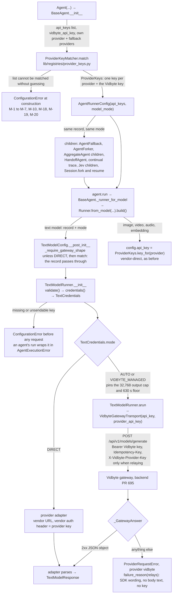
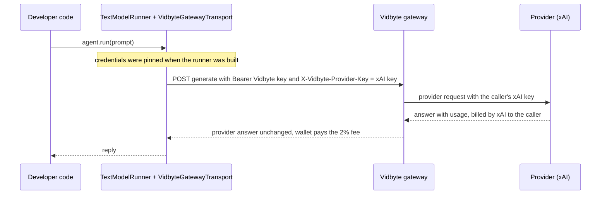

feat(lib,agents): agents take vidbyte_api_key and a list of api_keys, and text calls relay your provider key through the Vidbyte gateway
## Summary

Agents and text configs now take `vidbyte_api_key` and `api_keys`, a plain list of provider keys in any order, in place of the single `api_key`. In the default mode, `TextModelMode.AUTO`, every text call goes to the Vidbyte gateway with the Vidbyte key. When the call's provider has one of the caller's keys, the call carries that key in `X-Vidbyte-Provider-Key`: the provider bills the caller, and Vidbyte bills only its 2% fee. Without one, Vidbyte pays the provider, as before. `TextModelMode.DIRECT` is now the one way to call a provider without Vidbyte. The decision that matters most: a new lib class, `ProviderKeyMatcher`, matches the list once, where the developer passes it, using documented key prefixes and a unique-assignment rule and never a key's length or characters. Every fallback, fork, and child agent carries that one `ProviderKeys` record unchanged, so a key only ever reaches the provider it was matched to. Spec: `docs/spec/byok-api-keys/spec.md` (r5).

## How to use what this PR introduces

```python
import os

from vidbyte import Agent
from vidbyte.lib.config import TextModelMode

agent = Agent(
    name="researcher",
    system_prompt="Answer in one word.",
    provider="xai",
    model_name="grok-4.5",
    vidbyte_api_key=os.environ["VIDBYTE_API_KEY"],
    api_keys=[os.environ["ANTHROPIC_API_KEY"], os.environ["XAI_API_KEY"]],
    fallback=["anthropic/claude-sonnet-5"],
)
reply = agent.run("Say hi.")
print(reply.content)

offline = Agent(
    name="offline",
    system_prompt="Answer in one word.",
    provider="xai",
    model_name="grok-4.5",
    api_keys=[os.environ["XAI_API_KEY"]],
    model_mode=TextModelMode.DIRECT,
)
```

This is spec §4's snippet. It runs as written on `d3066f84`. I ran it offline with fake keys, built by concatenation, in the environment. `vidbyte.lib.runners.text.HttpTransport` was replaced by a scripted 200 answer, and every non-loopback socket was blocked. The run printed this; the wire record below the snippet output shows booleans only, never a key:

```text
--- snippet stdout ---
Hi
--- end snippet stdout ---
requests sent: 1
request 0: url_is_gateway=True envelope_provider='xai' envelope_model='grok-4.5' bearer_is_vidbyte_key=True relay_header_sent=True relay_header_is_xai_key=True anthropic_key_anywhere=False idempotency_key_sent=True
offline.model_mode: direct | offline holds a Vidbyte key: False
```

The developer no longer says which key belongs to which provider, and no longer has to choose between their own key and Vidbyte's markup. The grok call relays the xAI key, and the Claude backup would relay the Anthropic key. The `offline` agent never contacts Vidbyte.

## Breaking changes

The SDK is alpha, and there is no alias for the old keyword. Each item was re-checked offline on `d3066f84`.

- **`api_key` is now `api_keys`, a list.** The migration is `api_key=k` → `api_keys=[k]`.
  - Passing `api_key=` raises `TypeError` on each of these: `Agent`/`BaseAgent`, `AggregateAgent`, `TextModelConfig` (and so `TextModelRunner(provider=..., model=..., api_key=...)`), `Runner`, `JevAgentSettings`, `JevRunBriefSettings`, `AgentRoleSettings`, `Session.resume`, `Session.fork_from`, and `BaseAgent.restore`.
  - `Session.resume`, `Session.fork_from`, and `BaseAgent.restore` now take `api_keys` and `vidbyte_api_key`.
  - `create_runner_for_modality(...)` and `ModalityDetector.create_runner(...)` take `api_keys`. For a text model, `api_key=` raises `ConfigurationError` (M-17): "create_runner takes api_keys, a list of provider keys, for a text model; api_key is not accepted."
- **`FallbackModel` has no key field.** `FallbackModel(api_key=...)` raises `TypeError`. Put the backup's key in the agent's `api_keys`.
- **`AgentRunnerConfig` changed.** `api_key: str | None` became `api_keys: ProviderKeys`, which refuses a raw list, and `model_mode: TextModelMode` was added.
- **Four helpers are removed:** `ProviderModelRegistry.find_vidbyte_api_key`, `ProviderModelRegistry.vidbyte_key_follows_provider`, `TextModelConfig.is_vidbyte_managed`, and `TextModelConfig.resolved_vidbyte_api_key`.
- **AUTO always uses the gateway.** A provider key beside a Vidbyte key now relays through the gateway instead of going straight to the provider.
  - AUTO with a provider the gateway does not serve, or with a custom `endpoint`, is refused when the `TextModelConfig` is built, naming `TextModelMode.DIRECT` (M-12, M-13). For an agent, this surfaces at its first `run()`.
  - `TextModelConfig.resolved_api_key()` returns the provider key only in DIRECT. In AUTO and VIDBYTE_MANAGED, it returns the non-secret placeholder.
- **AUTO with provider keys and no Vidbyte key raises when the text runner is built.** For an agent, that is its first `run()`. The agent's `run()` raises `AgentExecutionError`, whose `__cause__` is a `ConfigurationError`: "Missing Vidbyte API key. Pass vidbyte_api_key or set VIDBYTE_API_KEY, or use mode=TextModelMode.DIRECT to call the provider with your own key and no Vidbyte fee." It does **not** raise at `Agent(...)` construction.
- **AUTO streaming refuses, naming DIRECT.** `StreamingTextModelRunner` raises `UnsupportedProviderError` at construction for AUTO and VIDBYTE_MANAGED, before it reads any key: "…streams only straight from the provider, and this config's mode is TextModelMode.AUTO. Set mode=TextModelMode.DIRECT to stream…".
- **The gateway error prefix changed.** Gateway failures now start "Vidbyte gateway {provider} request failed:" instead of "Vidbyte managed {provider} request failed:".

## Companion backend PR and deploy order

The relay route and the 2% fee-only billing live in cerredz/Vidbyte#695. That backend bills relayed calls as FEE_ONLY sessions and settles each session with the fee rounded up to whole cents. It must deploy **before** any SDK release that sends `X-Vidbyte-Provider-Key`, and #695's body states the same order. After this PR merges, the backend's SDK pin bump is its own PR. Any backend harness that builds an AUTO agent without a Vidbyte key must then pass `model_mode=TextModelMode.DIRECT` or a Vidbyte key.

## Flow





Validation happens at the root: `ProviderKeyMatcher.match` refuses a list it cannot match without guessing, before any request. It reads no environment variable. A child gets the root's `ProviderKeys`, and `match` only checks that record key by key. State changes in one place, `TextModelConfig.credentials()`. That method reads the provider's variable and `VIDBYTE_API_KEY`, and a gateway runner pins the result when it is built. Failures are caught in three places: a bad list at construction; a missing or unsendable key when the runner is built; and every gateway or provider failure in `_GatewayAnswer`, which words the error itself and never copies a response body.

## What changed

| File | Change |
|---|---|
| `vidbyte/lib/registries/provider_keys.py` (new, 299 lines) | `ProviderKeyMatcher`: table F prefixes, table A rules, reserved prefixes, unique assignment, the lone-key rule, and the check of a passed-in record (M-1 to M-20). |
| `vidbyte/lib/dataclasses/agents.py` | New `ProviderKeys` record: keys hidden from repr, `key_for`. `AgentRunnerConfig` holds `api_keys` and `model_mode`. `FallbackModel` loses `api_key`. |
| `vidbyte/lib/dataclasses/model_configs.py` | `TextModelConfig.api_keys` and `vidbyte_api_key`. The gateway shape check runs for every non-DIRECT mode. `credentials()` returns the new `TextCredentials` (`uses_gateway`, `relays`). `is_vidbyte_managed` and `resolved_vidbyte_api_key` are removed. |
| `vidbyte/lib/enums/text_model.py` | `TextModelMode.DIRECT`. |
| `vidbyte/lib/constants/jev.py` | `VIDBYTE_PROVIDER_KEY_HEADER`, `_PATTERN`, and `_MAX_LENGTH`, plus `VIDBYTE_API_KEY_FORMAT_MESSAGE` and `PROVIDER_API_KEY_ENV_VARS` (moved here from the models registry). |
| `vidbyte/lib/registries/models.py` | `find_provider_api_key` replaces `find_vidbyte_api_key` and `vidbyte_key_follows_provider`. `resolve_vidbyte_api_key` takes `remedy=`. `API_KEY_ENV_VARS` is the same dict as the constant. |
| `vidbyte/lib/registries/__init__.py` | Exports `ProviderKeyMatcher`. |
| `vidbyte/lib/dataclasses/__init__.py` | Exports `ProviderKeys`. |
| `vidbyte/lib/http/vidbyte_gateway.py` | Sends the optional `provider_api_key` only in `X-Vidbyte-Provider-Key`. Failures are worded for a relayed or a Vidbyte-paid call, under the new "Vidbyte gateway" prefix. |
| `vidbyte/lib/runners/text.py` | Pins `TextCredentials` at construction and builds each call's gateway transport with both keys. Adds a file header. |
| `vidbyte/lib/runners/streaming_text.py` | Refuses every gateway mode before reading a key, naming DIRECT. Adds a file header. |
| `vidbyte/lib/runners/utility.py` | `Runner` takes `api_keys`, `vidbyte_api_key`, and `model_mode`. A text config gets the record and the mode; other configs get `key_for(provider)`. |
| `vidbyte/lib/agents/modality_detector.py` | `create_runner` takes `api_keys` and refuses `api_key=` for a text model (M-17). |
| `vidbyte/lib/runners/router.py` | `create_runner_for_modality` takes `api_keys`. |
| `vidbyte/lib/util/credential_keys.py` | `api_keys`, `provider_key`, `_api_keys`, and `_provider_key` become secret names. |
| `vidbyte/lib/dataclasses/agent_descriptor.py` | `api_keys` becomes a secret suffix. |
| `vidbyte/harnesses/serialization.py` | The free-text redactor covers `api_keys` and `provider_key`, and scrubs a whole list or tuple value. |
| `vidbyte/agents/base.py` (net +26) | Matches the list once, against the agent's own provider and its fallback providers. `export_state` records `model_mode` and the matched provider names. `restore` re-matches against those names. |
| `vidbyte/agents/fallback.py` | Backup runners get the agent's record and mode. Adds `providers_in(spec)`. |
| `vidbyte/agents/settings/fallback.py` | Adds `named_providers()`. `_inherited_api_key` is deleted. `to_fallback` passes the record and the mode. |
| `vidbyte/agents/fork.py` | The child carries the parent's record and mode. `_api_key` is deleted. |
| `vidbyte/agents/aggregation.py` | Matches once, with every spec-built model as a primary. Children carry the record. The key-owner helpers are deleted. |
| `vidbyte/agents/handoff.py`, `vidbyte/agents/continual_trace.py` | Pass the source agent's record and mode. |
| `vidbyte/agents/jev/settings.py` | `JevAgentSettings` matches its list once and adds `vidbyte_api_key` and `model_mode`. `JevRunBriefSettings.api_keys` is normalized. |
| `vidbyte/agents/jev/brief/writer.py` | A writer with its own list is its own root. Otherwise it carries the main agent's record. |
| `vidbyte/agents/jev/{agent,bulk_work}.py`, `jev/compute/{clone,swarm}.py`, `jev/done/{handoff,reviewer,run_state}.py`, `jev/gate/clarification.py` | Pass `api_keys` and `model_mode` from the settings. |
| `vidbyte/agents/codex/fallback.py` | Comment only: fallback models hold no key. |
| `vidbyte/paradigms/context_minimal_fanout/types.py` | `AgentRoleSettings.api_keys` (normalized) and `vidbyte_api_key` (stripped, then format-checked). |
| `vidbyte/paradigms/context_minimal_fanout/paradigm.py` | Passes each role's keys to that role's agent. |
| `vidbyte/sessions/session.py` | `resume` and `fork_from` take `api_keys` and `vidbyte_api_key`. `fork` passes the live record. |
| `vidbyte/sessions/failure/recovery/fork_recovery.py` | Passes the live record. |
| `lint/rules/s014_provider_model_registry_parity.py` | Reads `PROVIDER_API_KEY_ENV_VARS` in `jev.py` only when the registry aliases it by its bare name. Any other value is still checked in the registry. |
| `lint/baseline.json` | A001 lowered from 643 to 641 (no count raised). |
| `scripts/test-async-http-transport.py`, `scripts/test-new-runners.py`, `scripts/test-openai-compatible-chat-trace-inputs.py` | Text configs use `api_keys` and DIRECT, with fake keys built by concatenation. |
| `README.md` | Rewrites "Vidbyte-managed text calls": the two keys, matching, relay versus Vidbyte-paid, and the three modes. Updates the session-resume example. |
| `vidbyte/agents/README.md` | Documents the agent key parameters and updates the fallback example. |
| `vidbyte/lib/registries/README.md` | Adds "Provider Key Format Sources", with each source labelled first-party or secondary. |
| `llms.txt`, `skills/sessions.md`, `skills/usage/create_agent.md` | Name `api_keys`, `vidbyte_api_key`, and `model_mode`. |
| `tests/features/sdk_provider_keys/` (13 files, new) | 126 tests across acceptance, matching, property, agents, sessions, modes, wire contract, failures, security, and contract, plus fixtures, FEATURE.md, and README.md. |
| `tests/features/sdk_managed_text/` (6 files) | Oracles run in DIRECT, and "BYOK is vendor-direct" becomes the relay contract. |
| `tests/features/sdk_model_usage/` (2 files) | Rename to `api_keys`, in DIRECT. |
| 29 module test files under `tests/` | Rename to `api_keys` plus DIRECT. The fork, aggregate, session, and Jev tests also check the carried record. This includes the helper that #1038 added (`ab1f00b3`, after merging main at `0e04102d`). |
| `docs/spec/byok-api-keys/` (26 files) | Spec r5, request, test plan, review, verification log, pipeline, code map, stage reports, and this body. |

## Acceptance criteria → proof

Each `label::test` is in `tests/features/sdk_provider_keys/test_provider_keys_<label>.py`, unless a full path is given.

| AC | What it checks (plain words) | Proven by |
|---|---|---|
| AC-1 | The §4 snippet relays grok with only the xAI key, and the DIRECT agent builds without reading `VIDBYTE_API_KEY` | `acceptance::test_section_4_snippet_relays_grok_with_only_the_xai_key_and_builds_the_offline_agent_without_reading_the_vidbyte_key` |
| AC-2 | AUTO with an OpenAI key relays it. The headers are exactly four, and the envelope is the DIRECT body plus the cap | `acceptance::test_auto_relays_exactly_when_the_provider_has_a_key_and_otherwise_sends_base_commits_three_headers`; `wire_contract::test_the_relay_envelope_body_is_the_direct_body_with_the_gateway_cap`; `tests/features/sdk_managed_text/test_managed_text_acceptance.py::test_provider_key_relays_in_auto_and_keeps_its_byok_request_byte_identical_in_direct` |
| AC-3 | AUTO with no provider key sends main's three headers | the AC-2 acceptance test; `wire_contract::test_a_call_without_a_provider_key_sends_exactly_the_three_base_commit_headers` |
| AC-4 | AUTO without a Vidbyte key refuses at runner build, sends nothing, and names both ways out | `acceptance::test_auto_without_a_vidbyte_key_refuses_the_runner_before_any_request_and_names_both_ways_out` |
| AC-5 | DIRECT sends main's BYOK request byte for byte and ignores a malformed `VIDBYTE_API_KEY` | `acceptance::test_direct_sends_base_commits_byok_request_and_ignores_a_malformed_vidbyte_key_in_the_environment` |
| AC-6 | Streaming refuses both gateway modes before reading a key, and DIRECT streams | `modes::test_streaming_refuses_every_gateway_mode_before_reading_any_key`, `::test_direct_streams_straight_from_the_provider_with_the_provider_key` |
| AC-7 | List order changes neither the match nor any request | `agents::test_list_order_changes_neither_the_match_nor_any_request`; `property::test_matching_ignores_list_order_and_the_environment_and_has_exactly_two_outcomes` |
| AC-8 | A string, bytes, dict, or number is refused, naming the field and never its characters | `matching::test_a_string_bytes_mapping_or_number_is_refused_naming_the_field_and_never_its_characters`; `property::test_a_bare_string_is_never_iterated_into_characters` |
| AC-9 | A key no configured provider can take, or an entry with a space or line break, is refused at construction | `agents::test_a_key_no_configured_provider_can_take_is_refused_naming_its_index_length_and_the_providers`, `::test_an_entry_with_a_space_or_line_break_is_refused_before_anything_else` |
| AC-10 | Two different keys for one provider are refused; the same key twice counts as one | `matching::test_two_different_proven_keys_for_one_provider_are_refused_and_the_same_key_twice_is_one_key`, `::test_two_unproven_keys_with_one_possible_owner_are_refused` |
| AC-11 | A Vidbyte key in the list is only the bearer. A second, different Vidbyte key is refused, and so is a Vidbyte key in a provider variable | `acceptance::test_a_vidbyte_entry_in_api_keys_is_only_the_bearer_and_a_second_vidbyte_key_is_refused`, `::test_a_vidbyte_key_in_a_provider_variable_is_refused_in_auto_and_in_direct` |
| AC-12 | An unserved provider or a custom endpoint needs DIRECT, and in DIRECT it reaches the vendor or proxy as before | `acceptance::test_unserved_providers_and_custom_endpoints_need_direct_and_then_reach_the_vendor_or_proxy_as_at_base_commit`, `::test_unserved_provider_in_direct_uses_its_environment_key_as_at_base_commit`; `modes::test_every_unserved_provider_and_any_endpoint_is_refused_at_construction_in_both_gateway_modes`, `::test_an_unserved_provider_or_an_endpoint_is_refused_before_another_providers_key_is_matched` |
| AC-13 | VIDBYTE_MANAGED never sends or reads a provider key | `acceptance::test_vidbyte_managed_never_sends_or_reads_a_provider_key`, `::test_vidbyte_managed_with_no_list_never_reads_the_provider_variable_even_when_it_holds_a_vidbyte_key` |
| AC-14 | A relayed provider 401, 402, or 403 blames the caller's own key. It is withheld, not billed, and never re-sent | `failures::test_a_relayed_provider_refusal_names_the_provider_and_status_and_is_never_re_sent` |
| AC-15 | Each gateway status is worded correctly for a paid call and for a relay call | `failures::test_each_gateway_status_states_the_facts_for_a_paid_call_and_for_a_relay_call`, `::test_a_vidbyte_managed_402_names_the_wallet_and_offers_a_provider_key_only_as_an_auto_option` |
| AC-16 | A relayed 401 falls back, and each call carries only its own provider's key | `agents::test_a_relayed_401_falls_back_and_each_call_carries_only_its_own_providers_key` |
| AC-17 | A backup with no matched key goes Vidbyte-paid | `agents::test_a_backup_without_a_matched_key_goes_vidbyte_paid_once_the_primary_holds_its_key` |
| AC-18 | Forks, handoff, continual trace, Jev children, and aggregate children carry the root's record and DIRECT | `agents::test_forks_handoff_and_continual_trace_agents_carry_the_parents_record_and_direct_mode`, `::test_a_jev_agent_its_clone_and_its_brief_writer_carry_the_settings_record_and_mode`, `::test_an_aggregates_children_carry_its_record_and_each_direct_call_carries_its_own_key` |
| AC-19 | Every session restore path keeps DIRECT and rebuilds the root's record, and no checkpoint holds a key | `sessions::test_every_restore_path_keeps_direct_and_rebuilds_the_roots_record_without_storing_a_key` |
| AC-20 | No repr shows a key | `security::test_no_record_listed_in_inv_4_shows_a_key_in_its_repr` |
| AC-21 | No log line, message, `details`, or traceback holds a key | `security::test_relay_refusal_retry_and_agent_failure_paths_print_no_key`; `failures::test_a_relay_call_with_no_response_names_no_key` |
| AC-22 | The credential guards know the plural names, and the redactor removes every key in a list or tuple | `security::test_the_credential_key_policies_classify_the_plural_names_and_still_the_old_ones`, `::test_the_agent_descriptor_guard_rejects_api_keys_in_metadata_and_tool_options`, `::test_the_harness_redactor_removes_every_key_in_a_list_or_tuple_value` |
| AC-23 | Image and audio runners get their own provider's matched key, or none | `agents::test_image_and_audio_runners_get_their_providers_matched_key_or_none`, `::test_a_non_text_runner_takes_its_own_providers_key_when_another_providers_key_comes_first` |
| AC-24 | The old `api_key=` fails loudly on every surface | `contract::test_the_old_keyword_raises_a_type_error_naming_it`, `::test_create_runner_refuses_api_key_for_a_text_model_naming_api_keys` |
| AC-25 | `model_mode` must be the enum | `agents::test_model_mode_must_be_the_enum`; `contract::test_agent_runner_config_refuses_a_raw_list_and_a_string_mode` |
| AC-26 | An agent with no Vidbyte key builds, and its first run raises before any request | `agents::test_an_agent_without_any_vidbyte_key_builds_and_its_first_run_raises_the_missing_key_error_before_any_request` |
| AC-27 | The README documents `api_keys`, `vidbyte_api_key`, relay, matching, and DIRECT | `acceptance::test_readme_managed_section_documents_api_keys_vidbyte_api_key_relay_matching_and_direct` |
| AC-28 | Lint and the full gate pass, with no baseline raised | gate, not pytest: the Lint, Source stage, and Package stage rows under Verification (`SDK-LINT: PASS`, C017 `CLEAN`, `CI passed.`) |
| AC-29 | Each documented prefix proves its provider, unsourced shapes stay unproven, and reserved prefixes only refuse | `matching::test_each_table_f_sample_proves_its_provider_and_every_unsourced_shape_is_unproven`, `::test_accepts_unproven_follows_table_a_and_the_reserved_prefixes`, `::test_an_entry_with_a_space_line_break_or_non_ascii_character_is_refused_by_normalize` |
| AC-30 | The manual scripts compile and build text configs with `api_keys` | `contract::test_the_manual_scripts_compile_and_build_text_configs_with_api_keys` |
| AC-31 | An unproven key reaches only the backup it was bound to, in either list order | `agents::test_an_unproven_key_reaches_only_the_backup_it_was_bound_to_in_either_order` |
| AC-32 | Two unproven keys that two providers could take are refused; a lone one binds to the agent's own provider | `agents::test_two_unproven_keys_two_providers_could_take_are_refused_and_a_lone_one_binds_to_the_primary` |
| AC-33 | A list without a key for the agent's own provider is refused. An empty or Vidbyte-only list goes Vidbyte-paid | `agents::test_a_list_without_the_agents_own_providers_key_is_refused_while_an_empty_or_vidbyte_only_list_goes_vidbyte_paid` |
| AC-34 | A fork to a provider with no key goes Vidbyte-paid and never receives the unproven key | `agents::test_a_fork_to_a_provider_without_a_key_goes_vidbyte_paid_and_never_receives_the_unproven_key` |
| AC-35 | A malformed explicit Vidbyte key is refused at construction, with no environment read | `matching::test_a_malformed_explicit_vidbyte_key_is_refused_at_construction_without_reading_the_environment` |
| AC-36 | A Mistral key in DIRECT reaches Mistral as before | the AC-12 acceptance test (its mistral DIRECT row) |
| AC-37 | An aggregate needs a key for every spec-built model, unless its list holds no provider key | `agents::test_an_aggregate_needs_every_spec_built_models_key_unless_its_list_holds_none`, `::test_an_aggregate_with_no_provider_keys_sends_every_child_call_vidbyte_paid` |
| AC-38 | A lone unproven key binds to the agent's own provider; two such keys are refused as ambiguous | `agents::test_a_lone_unproven_key_binds_to_the_agents_own_provider_and_its_openai_backup_goes_vidbyte_paid`, `::test_two_unproven_sk_keys_for_a_deepseek_agent_with_an_openai_backup_are_refused_as_ambiguous` |
| AC-39 | A hand-built record whose key does not fit its provider is refused | `matching::test_a_hand_built_record_whose_key_does_not_fit_its_provider_is_refused_at_construction` |
| AC-40 | An unsendable environment key is refused. A relayed key over 512 characters needs DIRECT, and one of exactly 512 still relays | `modes::test_an_environment_key_with_an_inner_space_is_refused_in_auto_and_direct`, `::test_a_relayed_key_longer_than_512_characters_needs_direct`, `::test_a_key_of_exactly_512_characters_still_relays` |
| AC-41 | A restored child rebuilds its root's record. A restored kimi child keeps the unproven key on deepseek | `sessions::test_a_restored_openai_child_rebuilds_its_roots_record_and_accepts_only_its_own_key`, `::test_a_restored_kimi_child_keeps_the_unproven_key_on_deepseek_and_goes_vidbyte_paid` |
| AC-42 | An unproven `sk-` key beside a proven OpenAI key is refused in both orders | `matching::test_an_unproven_sk_key_beside_a_proven_openai_key_is_refused_in_both_orders`, `::test_a_key_no_configured_provider_can_take_names_the_configured_providers` |

All 67 test names in spec §6.2's Proof column exist on this branch (checked by a script), and the two feature packs pass: `165 passed`.

## Verification

Python commands ran from the worktree root, with `DEEPSEEK_API_KEY` unset and `PYTHONPATH` set to the worktree, except the package stage, which ran without `PYTHONPATH`. The code head is `d3066f84`, which is main `8387d666` merged at `0e04102d` plus the #1038 test fix `ab1f00b3`. Every later commit changes only `docs/spec/byok-api-keys/`.

| Gate | Command | Result |
|---|---|---|
| Lint | `PYTHONIOENCODING=utf-8 python lint/run.py` | `C017 platform-route-contract 0 0 CLEAN` · `SDK-LINT: PASS` (re-run on this PR's docs commit) |
| Source stage | `python scripts/run_ci.py --stage source` | `4141 passed, 13 skipped` · `SDK-LINT: PASS` · `CI passed.` (on `d3066f84`) |
| Package stage | `python scripts/run_ci.py --stage package` | `Installed vidbyte-sdk 0.2.1 passed smoke checks.` · `CI passed.` (on `d3066f84`) |
| Semgrep test | `semgrep --test --config .semgrep/typed-mapping-boundary-policy.yml .semgrep/typed-mapping-boundary-policy.py` (semgrep 1.170.1) | `1/1: ✓ All tests passed` (on `d3066f84`) |
| Semgrep scan | `semgrep scan --error --config .semgrep/typed-mapping-boundary-policy.yml vidbyte` | `Ran 1 rule on 894 files: 0 findings.` (on `d3066f84`) |
| NFR-4 size | `wc -l vidbyte/lib/registries/provider_keys.py` | `299` (under 300); `vidbyte/agents/base.py` net +26 (cap 30) |
| Feature packs | `python -m pytest tests/features/sdk_provider_keys tests/features/sdk_managed_text -q` | `165 passed in 2.00s` (on `d3066f84`) |
| §4 snippet, offline | the scripted-transport run shown above | `Hi`; 1 POST to the gateway; relay header = the xAI key; no Anthropic key in the request |
| Remote CI, code head | `gh workflow run CI` → run 38477180582, on `d3066f84` | `Source / Python 3.11: success` · `Source / Python 3.12: success` · `Package: success` |
| Remote Static policy, code head | `gh workflow run "Static policy"` → run 38477183555, on `d3066f84` | `Static policy: success` |
| Remote CI + Static policy, docs commit | runs 38479305539 and 38479308567, on `99a08d99` (spec finalized, this body added) | `Source / Python 3.11`, `Source / Python 3.12`, `Package`, `Static policy`: all `success` |
| Live, local backend: setup | SDK code `6ac82305` against backend `2dfd148ed` (the #695 branch), with the backend run locally with `--lifespan off` against the production DB and the user's real keys | none of the user's keys is quoted here |
| Live, local backend: construction | Four checks before any call | The Grok key on an openai model is refused with M-18. A Vidbyte key inside `api_keys` is recognised. VIDBYTE_MANAGED drops the provider key. DIRECT skips the gateway |
| Live, local backend: junk-key probe | A junk `xai-` key, relayed | xAI's own HTTP 400 `invalid-argument` came back, relayed rather than wrapped in a Vidbyte body |
| Live, local backend: real calls | grok-4.3: a `TextModelRunner` (`max_output_tokens` 64) and a single-iteration `Agent` | "pong" and "Hi". Both were HTTP 200 via the relay, with the header sent |
| Live, local backend: settlement | Backend cleanup, run twice | 1 FEE_ONLY session: `provider_cost_nanousd` 1,723,700 (about $0.0017, paid by the caller to xAI) at 200 bps, so a fee of 34,474 nUSD. `billed_cents` 1, which equals the expected value, because the fee rounds up to whole cents per session. 0 sessions left open. The second cleanup was idempotent |

The live run happened before LE-1's wording fix (`76657bba`), and LE-1 was found by it. T-12 (`failures::test_a_relayed_provider_400_points_at_the_callers_own_key_in_api_keys_and_a_paid_400_does_not`) pins the fixed wording offline. The flaky `test_mcp_stdio_transport` test did not fail in these runs.

## Adversarial review

18 findings confirmed by an independent verifier across three lenses (spec conformance, repo conventions, engineering): 1 Blocker, 9 Major, and 8 Minor, with 0 refuted and 3 sub-claims corrected. 17 were fixed in repair 1; R-18 is deferred. 0 were waived. Re-review 1 (conformance) confirmed 13 of 13 fixes and found R-C1 (Major) plus R-C2 and R-C3 (Minor). The live end-to-end run found LE-1 (Major). Repair 2 fixed all four. Re-review 2 returned SOUND and found two Minors, R-D1 and R-D2, which are deferred to Follow-ups. Full record: `docs/spec/byok-api-keys/review.md`.

| ID | Finding | Fixed in |
|---|---|---|
| R-1 (Blocker) | `credentials()` built six two-level helper chains, against AGENTS.md §1 | `66bfa272` |
| R-2 (Major) | No test covered the record check that refuses a Vidbyte key filed as a provider key | `f1f6a4f4` (test) |
| R-3 (Major) | No test proved that the default aggregator is a primary that needs its key | `e6ae4990` (test) |
| R-4 (Major) | AC-13's "never reads the provider variable" check could not fail | `32cf23e5` (test) |
| R-5 (Major) | The AC-23 test could not tell `key_for(provider)` from "the first key" | `d971f491` (test) |
| R-6 (Major) | A gateway-mode config matched keys (M-18) before the INV-8 shape check | `bae3534e` (code), `8b158ed7` (test) |
| R-7 (Major) | `TextCredentials` dispatched on mode with an if/elif ladder and a silent `else` | `c72387d3` |
| R-8 (Major) | The A002 count rose: four key-routing functions had no `@intent` | `ab841c1f` |
| R-9 (Major) | S014 treated any non-literal registry table as an alias and passed CLEAN | `e164d700` |
| R-10 (Major) | Public `api_keys` annotations rejected the documented list form | `f4e4c16c` |
| R-C1 (Major) | `provider_keys.py` had 300 lines, and NFR-4 says "under 300" | `a1cea1bd` |
| LE-1 (Major, live) | A relayed xAI 400 (a wrong key) never pointed at the caller's own key | `76657bba` (code), `17121734` (spec) |

## Deviations from the spec

- **Where the provider-to-variable table lives.** The spec kept it on `ProviderModelRegistry`. The code moves it to `vidbyte/lib/constants/jev.py` as `PROVIDER_API_KEY_ENV_VARS`, and `ProviderModelRegistry.API_KEY_ENV_VARS` is the same dict object. *Why:* the matcher importing the models registry formed an import cycle that lint A006 counts (37 against a baseline of 34). For the same reason, lint rule S014 now reads that literal, but only when the registry aliases it by its bare name (`e164d700`). This is the one changed file outside the spec's §12.3 list.
- **Check order in `TextModelConfig.__post_init__`.** Spec row 7 matched the keys first. The code runs the gateway shape check (M-12, M-13) before matching (R-6). *Why:* INV-8 says the config is refused "before any key or environment is read", and that takes precedence. So a gateway-mode config with an unserved provider and another provider's key raises M-12, not INV-24's M-18.
- **M-18 wording.** "or Vidbyte's own {provider} account" is offered only for a provider the gateway serves (R-13, `940ff97c`). In DIRECT, M-18 still offers it, because the matcher never learns the mode. This is an accepted limitation.
- **Public annotations.** Spec §8.5 and §9.1 typed `api_keys` as `ProviderKeys` and `tuple[str, ...]`. The code accepts the list form on every public surface: `ProviderKeys | Iterable[str | None] | None` on `TextModelConfig` and `JevAgentSettings`, and `Sequence[str | None]` on `JevRunBriefSettings` and `AgentRoleSettings` (R-10 ruling). There is no runtime change.
- **Table G wording.**
  - A Vidbyte-paid 402 offers adding a provider key only "with mode=TextModelMode.AUTO (the default)", because VIDBYTE_MANAGED ignores `api_keys` (R-17).
  - A relayed 400 adds "some providers answer a wrong API key with HTTP 400, so check your own {provider} key in api_keys or {ENV}" (LE-1).
- **Credential names.** FR-13 named `api_keys`. The guards also gained `provider_key` and `_provider_key` (R-15, R-C3), and the redactor gained `provider[_-]?key`, to cover the relay header. INV-22 only gains names.
- **Smaller items.**
  - The M-17 check sits in a private leaf, `ModalityDetector._config_options`, so `create_runner` stays under the C901 complexity limit.
  - The row 16 regex leaves out `(?:\w+_)?`, because main's #993 lookbehind already covers prefixed names.
  - The `sk-admin-` source is OpenAI's own `openapi.yaml`, because the API-reference page answered 404.
  - Two message constants are added beyond §8.5, `VIDBYTE_API_KEY_FORMAT_MESSAGE` and `ProviderKeyMatcher.DUPLICATE_KEY_MESSAGE`, so each message has one wording (R-16).

Each of these is recorded in spec §17.

## Follow-ups

- **R-18:** Vidbyte test keys (`vb_test_`) are not reserved, so one can bind as an unproven provider key. Default: no change, because table F defines only the live Vidbyte key prefix.
- **R-D1:** no test catches adding the relayed-400 clause to every relayed status, or naming the wrong environment variable. The table-G row in `test_another_relayed_provider_status_keeps_its_unchanged_wording` (`tests/features/sdk_provider_keys/test_provider_keys_failures.py:183`) is stale.
- **R-D2:** `CredentialKeyPolicy` misses `providerkey` and `provider_keys` (`vidbyte/lib/util/credential_keys.py:55-80`).
- **DIRECT M-18 wording:** in DIRECT, M-18 still mentions "Vidbyte's own <provider> account", because the matcher never learns the mode.
- **`mode=` versus `model_mode=`:** `TEXT_REMEDY` (`vidbyte/lib/dataclasses/model_configs.py:51`), the streaming refusal, and the gateway-shape refusals say `mode=TextModelMode.DIRECT`. An `Agent` caller's argument is `model_mode=`.
- **One-shot proposer iterables:** `AggregateAgent` now reads `proposers` at `vidbyte/agents/aggregation.py:215` before `tuple(proposers)` at `:226`. A generator is therefore used up first, and it fails with "MultiProviderAggregator requires at least one proposer.", where main accepted it. The annotation is `Sequence`, so this input is outside the contract.
- **Relayed streaming is not built:** AUTO streaming refuses and names DIRECT (Q-3).
- **Stored or server-side provider keys are not built** (NG-5).
- **Q-4 to Q-6 keep their default, no:** a per-model mode, failing at build without a Vidbyte key, and refusing `T3BlbkFJ` keys for non-OpenAI providers.
- **The vidbyte-cli rename** (`api_key` → `api_keys`) is a separate PR in vidbyte-cli.
- **The backend's SDK pin bump** is a separate PR, together with its harness switch to DIRECT or a Vidbyte key.

🤖 Generated with [Claude Code](https://claude.com/claude-code)
