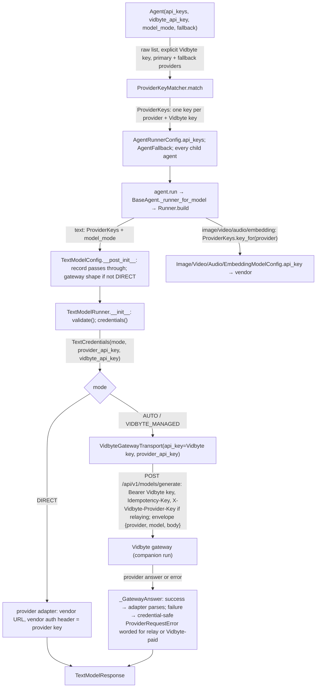
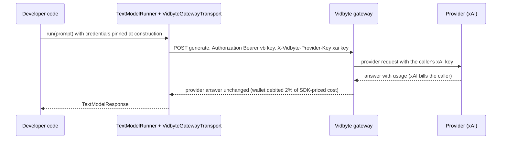

# Spec: Agents take vidbyte_api_key and a list of provider api_keys, and text calls relay the caller's own key through the Vidbyte gateway

> **TL;DR** — Agents and `TextModelConfig` now take `vidbyte_api_key` and `api_keys`. `api_keys` is a list of keys in any order, and it replaces `api_key`. A new lib class, `ProviderKeyMatcher`, matches the list to providers once, where the developer passes it. A key whose prefix proves its provider goes to that provider. A Vidbyte key in the list becomes the Vidbyte key. Any other key goes to the one configured provider that can take it; a lone such key goes to the configured model's own provider when that provider can take it. The SDK refuses the list if it cannot tell, and it refuses a non-empty list that holds no key for a configured model's provider. The result, a `ProviderKeys` record, travels unchanged to every fallback, fork, and child agent. In the default mode (`AUTO`), every text call goes to the Vidbyte gateway. With a matched key for the call's provider, the call carries it in the single header `X-Vidbyte-Provider-Key`, so the provider bills the caller and Vidbyte bills only its 2% fee. Without one, Vidbyte pays the provider, as today. `TextModelMode.DIRECT` is the one explicit way to call a provider without Vidbyte. The decision that matters most: keys are matched once, at the root, and never guessed from a key's length or characters.

## §0 User prompts

The full record of what the user asked is in `docs/spec/byok-api-keys/request.md`. It holds Prompts 1–6, the /talk handoffs, and the orchestrator's notes. The prompt that invoked the pipeline is reproduced below, verbatim.

### 0.1 Invoking request (verbatim)

````
great, just to be clear. I want the agents iin our vidbyte-sdk/ param to have both a vidbyte_api_key and an api_keys param in the paramter of the model. under the hood we shoul have a lib class that makes sure that the user is inputting the correct api key that matches the provider/model that they are inputting (can prob be matches with the pricebook, api keys that start with "sk-" can be matches with antrhopic, etc. This you are probably going to have to play with to really make sure this feature works under the hood, dont want developers to have to worry about this. Then we pass the api key to our vidbyte endpoint where we route the request through to the model using the user's api key. We should then make sure that either throughout the run or after the run we take the token markup however you see fit, and make sure that whatever we talked about in this converation that relates to this request is implemented. When testing, I have a grok_api_key that you can use to test out this feature (coding your own grok agents, make sure to put the max spend/tokens only at a few cents) and a vidbyte api key, to make sure that the api key does not run out of credits. Do not stop until this feature is perfect, if you need to ask any clarifynng questions before creating the spec feel free to do so
````

### 0.2 User replies during the run

The user's answers to the three clarifying questions asked before this spec are Prompt 6 in request.md §A, and they bind this spec:

- `api_keys` is a list only.
- A local backend runs the live test.
- `api_key` is folded into `api_keys`.

#### r2 — 2026-10-12 — orchestrator rulings on the S1 review

These are the orchestrator's rulings, not the user's words. Each one rests on the user's own words, which the ruling cites. They are reproduced verbatim:

````
- **R-2 / Q-2 is answered by the user's own words, not deferred.** Prompt 5: "a lib class that makes sure that the user is inputting the correct api key that matches the provider/model that they are inputting". Resolve Q-2 as YES: when `api_keys` is non-empty and holds no key for the PRIMARY (explicitly configured) provider/model, raise a ConfigurationError before any request, naming the configured provider and the providers the list's keys belong to (never key values). An empty `api_keys` (and no provider env var) stays Vidbyte-paid, as decided. Fallback/fork children for OTHER providers keep the handoff rule (request.md §B.2 failure modes): relay when that provider's key is in the list or its env var, Vidbyte-paid when not — no error for children.
- **R-1 / Q-1 and R-3: keep matching deterministic, and resolve inside the requested behavior rather than refusing working keys.** The user said "we can under the hood deterministically match the api keys to the provider" and "dont want developers to have to worry about this". Requirements: (a) a key whose format proves its provider (sourced rules: e.g. `sk-ant-` → anthropic, `xai-` → xai, `AIza…` → gemini, `sk-or-` → openrouter, `vb_live_` → Vidbyte, as evidenced) is assigned by format; (b) keys whose format does not prove a provider — the generic `sk-` family where DeepSeek/Kimi/legacy-OpenAI shapes are unsourced, and every provider with no format rule (glm, minimax, meta, mistral, elevenlabs, playai, typesafe) — are assigned by a deterministic unique-assignment rule against the providers actually in use (primary + fallbacks/children): if exactly one in-use provider is still without a key and is compatible with that key's family, bind it; otherwise raise naming the ambiguity. Never send a key to a vendor on an unsourced shape guess (R-3's wrong-vendor risk). Do not drop an existing capability for the seven providers without a rule (R-1); fix G-5/EC-41/§9.4 so they state exactly what changes. If you conclude a different rule is smaller and still deterministic, use it and justify it in §8.
- **R-4:** the gateway 422 remedy text must name DIRECT as the way to send a request the gateway cannot bill. **R-5:** fix the redactor so lists and tuples of keys are fully redacted. **R-6:** check `vidbyte_api_key`'s format at construction like `api_keys` (presence may still be checked at first run per D-18).
- The reviewer noted `tests/test_output_schema_provider_dialect.py:102` (`MistralProvider(..., api_key="k")`) is wrong in §13's instruction; fix that row under your new rule.
````

Where these rulings decide something, it is recorded as an orchestrator decision: D-2, D-5, D-25, D-28, INV-24, and INV-25. §16 logs each finding.

#### r3 — 2026-10-12 — orchestrator rulings on the round-2 review

These are the orchestrator's rulings on the round-2 review (R-7 to R-15), not the user's words. Ruling 5 rests on the user's own words, which it quotes. The rulings are reproduced verbatim:

````
1. **R-7 (Major), accept the reviewer's smallest fix.**
   - `ProviderKeys` stays public. Step 1 pair-checks a record it is given: every key passes the `normalize` charset; a key whose `provider_of` is not None sits at that provider; every FORMAT_BOUND provider holds a proven key; an unproven openai key starts with `sk-`.
   - Each failure raises ConfigurationError naming only the provider and the index.
   - It never re-binds, and it does not apply INV-24. A passed-in record is treated like a child's record; say so in §9.1.
   - §4, the README and docstrings advertise only the list form to developers (NG-19 "List only"). The record is the carried form, not a developer-facing input.

2. **R-8 (Major), take option 1.**
   - At an AggregateAgent root, every spec-built proposer's provider and the spec-built aggregator's provider count as primaries for INV-24. M-18 names the first one without a key.
   - A prebuilt aggregator means primary None, because it keeps its own record.
   - Row 21 passes `api_keys` through to `super().__init__`.
   - Rewrite AC-18's aggregate clause with explicit proposers and aggregator.
   - Reason: proposers are explicitly configured models that run on every call, so the user's "makes sure that the user is inputting the correct api key that matches the provider/model" covers them. Fallbacks are still the only children allowed to go Vidbyte-paid without a key.

3. **R-9 (Major), take option 1.**
   - Persist the provider names the root matched against (names only, never keys) in `runtime_config`. `restore` re-matches the raw list against them, with INV-24 off when the restored agent's provider differs from the first name.
   - Add an edge case: a session persisted before this change has no such field, so it matches as a root against its own provider and fallbacks.
   - Keep EC-52 and AC-19 true as written, or reword them to the exact guarantee.
   - Check the `base.py` budget. The spec says +30 net lines; if this pushes past it, record the overrun and the reason in §8.4.

4. **R-10 (Major), accept the wording fix.**
   - Narrow NFR-10's metric to proven keys, and add the residual sentence to T-1, G-3 and NG-18: an unproven key goes to the one configured provider that can take it, even if another vendor issued it, as at base_commit.
   - Record Q-6 (refuse `T3BlbkFJ` keys for non-openai providers) as an optional question with default "no, not built".

5. **R-11 (Major), accept the NFR-12 and §9.4 item 8 doc fix, AND rule Q-7 = YES.**
   - This is a matching refinement inside the requested behavior, not a new control. The user's words: "dont want developers to have to worry about this" (Prompt 5) and "Simply renames" (Prompt 6).
   - The rule: after proven keys bind, when exactly one unproven key remains and exactly one keyless primary accepts it, bind it to that primary.
   - Everything else in unique assignment is unchanged. Two `sk-` keys for deepseek and openai still raise M-19, because that case is genuinely ambiguous.
   - Under R-8 there can be several primaries: the rule applies only when exactly one keyless primary accepts the key.
   - Make `Agent(provider="deepseek", api_keys=[K_ds], fallback=["openai/…"])` the §9.4 item 8 example, and give it an AC.
   - Mark Q-7 resolved (yes), citing this ruling. Add a §0.2 line quoting it.

6. **R-12 (Minor), accept.**
   - Raise M-6 only when no configured provider accepts the key.
   - Raise M-7 when every provider that accepts it already holds a key.
   - Process keys in index order.

7. **R-13 (Minor), take the "better" fix.**
   - `credentials()` applies the M-6b charset check to every resolved provider key, from the list or the environment, in both modes.
   - When relaying, it also applies a 512-character cap: a new `lib/constants` value next to `VIDBYTE_PROVIDER_KEY_HEADER`, matching the backend's limit.
   - Table G does not need a header-cause row, because a conforming SDK never sends a malformed header.

8. **R-14 (Minor).**
   - Prefer construction-time checks: `JevAgentSettings.__post_init__` matches `run_brief.api_keys` against the writer's provider, and `AgentRoleSettings.__post_init__` runs `normalize` and the INV-26 format check.
   - Use them only if each costs at most about 5 lines and stays within rows already in §12.3. Otherwise apply the wording fix, so that "checked when that root's agent is built" applies to those two roots.

9. **R-15 (Minor), accept.**
   - Use the reviewer's §12.6 order.
   - Add `vidbyte/lib/dataclasses/__init__.py` as a §12.3 row that re-exports `ProviderKeys` in the existing `from vidbyte.lib.dataclasses.agents import (...)` block.

10. **Prefix sources (reviewer niche fact).**
    - A table F rule that ROUTES a key needs a first-party citation.
    - Keep `AQ.` only if Google's own docs (ai.google.dev, cloud.google.com or developers.google.com) show it. Otherwise remove the rule and add an A-n: an `AQ.` key in the list is refused, but `GEMINI_API_KEY` still works through the environment fallback.
    - Claims used only to refuse, never to route, may rest on secondary sources such as gitleaks. Say which kind each one is.
````

Where these rulings decide something, it is recorded as an orchestrator decision: D-19, D-27, D-28, D-29, D-30, D-31, D-32, INV-24, INV-25, and table F. §16 logs each finding.

#### r4 — 2026-10-12 — orchestrator rulings on the r3 open items

These are the orchestrator's rulings on the two open items S1 reported with r3, not the user's words. Ruling 1 rests on the user's own words, which it quotes. The rulings are reproduced verbatim:

````
1. **`AQ.` goes back into table F row 5 as a routing rule for gemini.**
   - Count a vendor's own official GitHub org as first-party for both vendors. You already did this for OpenAI's `sk-proj-`, and it should be applied the same way to Google's `google-gemini` org.
   - The orchestrator checked: Google staff replies on Google's own forum, discuss.ai.google.dev (for example /t/gemini-api-key-start-from-aq/171575 and /t/account-only-generates-aq-prefix-api-keys-aiza-keys-not-available-in-any-project/170415), say AI Studio now generates ONLY "Authentication Key" `AQ.` keys. Refusing them in `api_keys` would refuse most new Gemini users' keys, against Prompt 5's "dont want developers to have to worry about this".
   - Cite the google-gemini cookbook URL you found, plus the forum thread.
   - Add an A-n: users report that `AQ.` keys can fail on some REST paths with a 401 (`ACCESS_TOKEN_TYPE_UNSUPPORTED`). The SDK still routes them to gemini. A failure is Google's own 401, relayed unchanged, and it never goes to another vendor.
   - Remove `AQ.` from `RESERVED_PREFIXES`.
   - Update AC-29, the A-1/A-4..A-6/A-11/A-12 entries, D-19 and D-28, §9.4 item 10, and §13 wherever they say `AQ.` is refused.
   - In §13, tell the test author to build any `AQ.` fake at runtime, so no literal looks like a real key.
2. **`RESERVED_PREFIXES` is accepted, now holding only `sk-svcacct-`.**
   - It is a refuse-only guard inside the matching rules, not a new feature, and it closes a wrong-vendor path. Say so in D-28.
````

Where these rulings decide something, it is recorded as an orchestrator decision: D-19, D-28, table F row 5, `RESERVED_PREFIXES`, A-11, and A-13. §16 logs each ruling.

---

## Part A — Framing

## §1 Goal

Today a developer chooses between two text modes:

- **Their own provider key (BYOK).** Vidbyte earns nothing on these calls.
- **A Vidbyte key alone (Vidbyte-managed).** Vidbyte pre-buys provider credit and resells it at a 2% fee. The fee loses money after card fees: request.md §C shows −$9.88 on $1,000 of provider spend.

The user wants BYOK and the markup at once: "i want to still have our token markup but without making it so that we have to buy all of the credits" (Prompt 1). The backend half, the companion run `byok-fee-relay`, makes the gateway relay a caller's key and bill only the fee. This SDK half makes every text call reach that gateway with the right key.

Three things stand in the way today, at base_commit:

- **BYOK bypasses the gateway.** In `AUTO`, a provider key always wins and the call goes straight to the vendor. The deciding code is `ProviderModelRegistry.find_vidbyte_api_key` (models registry).
- **The SDK cannot hold more than one provider key.** `api_key` is one string. A fallback chain to another provider has no key of its own, so it falls back to environment variables or to Vidbyte-paid. The rule is `AgentFallbackSettings._inherited_api_key` (agent fallback settings).
- **The SDK knows nothing about key formats.** The only format it knows is `VIDBYTE_API_KEY_PATTERN` (JEV constants). It cannot tell which provider a key belongs to.

| ID | Goal (outcome) | How we will know | Source |
|---|---|---|---|
| G-1 | Every text call an SDK user makes in the default mode goes through the Vidbyte gateway, which bills Vidbyte's fee. With the caller's own key for that call's provider, the call relays (fee only). Without one, Vidbyte pays the provider (cost plus fee, as today). | AC-1, AC-2, AC-3, AC-16, AC-17: a scripted gateway sees one POST per call, with the provider-key header exactly when a key is held | Prompt 1, Prompt 4 ("support BYOK AND the vidbyte markup on all tokens"), Prompt 5 |
| G-2 | A developer passes `vidbyte_api_key` and a list `api_keys` in any order and never says which key belongs to which provider. Before any request, the SDK matches every key deterministically. It refuses only a list it cannot match without guessing, or one that holds no key for a configured model. | AC-7 to AC-11, AC-29, AC-31 to AC-33 | Prompt 5 ("a lib class that makes sure that the user is inputting the correct api key that matches the provider/model"), Prompt 6 ("deterministically match the api keys to the provider") |
| G-3 | A provider key goes only to the provider it is matched to. It travels either in the one gateway header (gateway modes) or in the vendor's own auth header (DIRECT). It never appears in an error, a log, a trace, a repr, saved state, or another provider's request. A key whose prefix proves no provider is matched to the one configured provider that can take it; the SDK cannot tell which vendor issued it, so a key another vendor issued goes there, as at base_commit (T-1). | AC-14, AC-20, AC-21, AC-22, AC-34 | request.md §C Constraints; B.2 failure modes |
| G-4 | An explicit unbilled path remains, reachable from agents as well as configs. It is needed because Vidbyte's own backend and vidbyte-cli consume the SDK. | AC-5, AC-25 | B.3 ledger (default accepted), request.md §C Key decisions |
| G-5 | `api_key` becomes `api_keys` everywhere a text or agent API takes a provider key, for every provider. Today's order carries over: the matched key from the list first, then the provider's environment variable. Two things change. A key for a provider in table F must carry that provider's prefix. A key whose provider no prefix proves is accepted only when exactly one configured provider can take it (§9.4 items 7 and 8). | AC-24, AC-36, §9.4 | Prompt 6 ("extend the api_key functionality into the api_keys functionality") |

## §2 Objective

When this PR merges, cerredz/Vidbyte-SDK contains the following:

- **A new mode.** `TextModelMode.DIRECT`.
- **A new constant.** `VIDBYTE_PROVIDER_KEY_HEADER = "X-Vidbyte-Provider-Key"`.
- **A new lib class.** `ProviderKeyMatcher` holds a sourced table of key prefixes and a provider-compatibility table, and it implements the unique-assignment rule.
- **Two new records.**
  - `ProviderKeys` holds the matched result: one key per provider, plus the Vidbyte key.
  - `TextCredentials` is what `TextModelConfig.credentials()` returns. It resolves the mode, the provider key, and the Vidbyte key in one place.
- **New fields on `TextModelConfig`.** `api_keys` replaces `api_key`, and `vidbyte_api_key` is added.
- **A gateway transport that relays.** `VidbyteGatewayTransport` sends the provider key only in the new header and words every failure for the mode it ran in. Its 422 remedy now names `DIRECT`.
- **Runners for the new modes.**
  - `TextModelRunner` pins the credentials and relays.
  - `StreamingTextModelRunner` streams only in `DIRECT` and names `DIRECT` when it refuses.
- **New agent parameters.** `vidbyte_api_key`, `api_keys`, and `model_mode` on `BaseAgent`/`Agent` and on every agent-building surface. The agent matches its list once, and each child carries the matched record.
- **The old keyword is gone.** `api_key` no longer exists on those surfaces. `FallbackModel` no longer takes a key at all.
- **Wider credential guards.** They also catch `api_keys`, including lists and tuples of keys.
- **Updated docs.** The README and the folder and skill docs describe the two-key setup.

This PR is the SDK slice of a two-repo change. The backend relay is the companion run. The vidbyte-cli rename, the backend's SDK pin bump with its `DIRECT` harness switch, and the live test with the user's real keys follow later (NG-1 to NG-3, NG-15).

## §3 Non-goals

- **NG-1** — Any change in cerredz/Vidbyte (route header, relay, fee-only billing, Sentry scrub). *Why not:* the companion run `byok-fee-relay` owns it, and both runs build to the fixed wire contract in request.md §C.
- **NG-2** — Renaming `api_key` to `api_keys` in vidbyte-cli, cli-internal, or the public mirror. *Why not:* the CLI consumes a published SDK. The user: "Simply renames for the vidbyte-cli should be easy to fix".
- **NG-3** — The backend's SDK pin bump and its research harness switch to `mode=TextModelMode.DIRECT`. *Why not:* request.md §0 lists it as a later step.
- **NG-4** — Streaming through the gateway (relay or Vidbyte-paid). *Why not:* the gateway cannot bill a stream. The user accepted "the streaming gap until the follow-up" (B.3).
- **NG-5** — Stored provider keys, and any persistence of a key in checkpoints, RunState, or YAML. *Why not:* this would make Vidbyte a custodian of secrets at rest (request.md §C Rejected alternatives).
- **NG-6** — Jev `DecisionModelConfig`: its `api_key` field, its key messages, and its modes. *Why not:* request.md §0 excludes it. Its messages stay byte-identical (INV-18).
- **NG-7** — Sending image, video, audio, or embedding calls through the gateway, or renaming those configs' `api_key` field. *Why not:* the gateway serves text only. Those configs keep `api_key` and stay vendor-direct. They get the agent's matched key for their provider (D-12).
- **NG-8** — Re-vendoring the platform contract that lint C017 reads. *Why not:* the route list is unchanged and the contract holds no header names. The header name is mirrored as a constant (request.md §0).
- **NG-9** — Inferring a missing `provider` from `model_name` through the pricebook or the runner maps. *Why not:* nobody asked for it. Prompt 6's "we dont actually need the user to define the provider" is about keys.
- **NG-10** — The Vidbyte-paid fee rate. *Why not:* it is backend-owned, and the user kept 200 bps.
- **NG-11** — Letting the context-window algorithm helpers (independent critic, multi-provider grader, prosecutor/defender/judge) choose `DIRECT`. *Why not:* they build runners without keys or a mode, so they follow `AUTO`. This is a stated limitation (EC-40).
- **NG-12** — Key fields in YAML or declarative agent config. *Why not:* YAML rejects credential-like keys by design (`_YamlSecretKeyPolicy`).
- ~~**NG-13**~~ (withdrawn r2: the orchestrator's R-1/R-3 ruling replaces it. A key whose format proves no provider is now accepted when exactly one configured provider can take it (D-2); NG-18 records what stays out.)
- **NG-14** — A deprecation alias that keeps `api_key=` working. *Why not:* the user chose a rename, and a silent alias would hide which key went where (D-20).
- **NG-15** — The live end-to-end test with the user's real `GROK_API_KEY` and `VIDBYTE_API_KEY`, and its "few cents" spend cap. *Why not:* a separate agent runs it after both runs are green (request.md §0). This PR's suite makes no network call (NFR-6).
- **NG-16** — A package version bump or release. *Why not:* releases are separate commits that the user owns, and the recent `main` history has no version bumps inside feature PRs.
- **NG-17** — A per-model mode, such as `DIRECT` for one fallback entry only. *Why not:* one mode per agent is the smallest surface. Q-4 records the option, with default **no**.
- **NG-18** — Deciding a key's provider from its exact length or character set, such as DeepSeek `sk-` + 32 hex or Kimi `sk-` + 48 alphanumerics. *Why not:* no vendor documents those shapes, and a wrong guess sends a key to another vendor (R-3; orchestrator ruling r2: "Never send a key to a vendor on an unsourced shape guess"). The consequence is a stated residual: an unproven key goes to the one configured provider that can take it, even when another vendor issued it, as at base_commit (T-1).
- **NG-19** — A way to say inside `api_keys` which provider a key belongs to, such as a dict or `"provider:key"` strings. *Why not:* the user rejected the dict form ("List only"). Ambiguity is resolved by moving a key into its provider's environment variable (M-19).

## §4 Developer usage

```python
import os

from vidbyte import Agent
from vidbyte.lib.config import TextModelMode

agent = Agent(
    name="researcher",
    system_prompt="Answer in one word.",
    provider="xai",
    model_name="grok-4.5",
    vidbyte_api_key=os.environ["VIDBYTE_API_KEY"],
    api_keys=[os.environ["ANTHROPIC_API_KEY"], os.environ["XAI_API_KEY"]],
    fallback=["anthropic/claude-sonnet-5"],
)
reply = agent.run("Say hi.")
print(reply.content)

offline = Agent(
    name="offline",
    system_prompt="Answer in one word.",
    provider="xai",
    model_name="grok-4.5",
    api_keys=[os.environ["XAI_API_KEY"]],
    model_mode=TextModelMode.DIRECT,
)
```

The first agent sends its grok call to the Vidbyte gateway. The call carries the xAI key in `X-Vidbyte-Provider-Key`, so xAI bills the developer and Vidbyte's wallet pays only the 2% fee. If grok fails with a fallback error, the Claude backup relays with the Anthropic key in the same way. `print` shows the model's answer.

The developer never says which key is which, and the order of the list does not matter. A key with no provider prefix, such as a DeepSeek or Mistral key, goes to the one configured model that can take it, or to the agent's own model when it is the only such key and that model can take it. The agent refuses at construction a list it cannot match without guessing, or a list with no key for grok. The second agent never contacts Vidbyte and reads no Vidbyte key.

## §5 Flow diagram





**Where keys are matched.** Keys are matched exactly once, at the root: the object the developer handed the list to. The roots are an agent, an aggregate agent, a Jev settings record, a run-brief settings record, a text config, or a runner factory. Matching reads no environment variable. It checks the list against the providers the root is configured to use. For an agent, those are its own model's provider and the providers its fallback chain names. Matching produces `ProviderKeys`, and every child gets that record unchanged (D-13). A child never re-matches the list, so a key cannot reach one provider in the parent and a different provider in a fork. A checkpoint keeps the names of the providers the root matched against, never the keys, so a restored agent re-matches its list against the same names and gets the same result (D-30).

**Where the environment is read.** The environment is read in exactly one place, `TextModelConfig.credentials()`. It reads the provider's variable and `VIDBYTE_API_KEY` there. A gateway-mode runner calls it once, when it is built, and keeps the result. A `DIRECT` config resolves on every call, exactly as BYOK does today.

**Where failures are caught.**

- A malformed or unmatchable key, a malformed Vidbyte key, or a list with no key for a configured model raises at the root, before any request.
- A missing key, or a provider key that cannot be sent (spaces or characters outside printable ASCII, or more than 512 characters when relaying), raises when the runner is built, before any request.
- A gateway or provider failure becomes the gateway transport's credential-safe `ProviderRequestError`.

---

## Part B — Behavior

## §6 Behavior

Terms used below:

- **Gateway mode** means `AUTO` or `VIDBYTE_MANAGED`.
- **Relay** means a gateway call that carries `X-Vidbyte-Provider-Key`.
- **Vidbyte-paid** means a gateway call that does not carry it.
- **A proven key** is an entry whose prefix matches a table F rule. Its provider is that rule's provider.
- **A Vidbyte entry** is an entry that starts with `VIDBYTE_API_KEY_PREFIX`.
- **An unproven key** is any other entry.
- **The root** is the object the developer handed the raw list to (§5).
- **The primary providers** of a root are the providers of the models it runs on every call: an agent's own model, or, for an aggregate agent, every spec-built proposer and the spec-built aggregator (D-27). Most roots have one primary.
- **The configured providers** of a root are its primary providers plus the providers it names for other models. For an agent, those are its fallback chain.
- **The provider key for a call** is `ProviderKeys.key_for(call's provider)`. If that is empty, it is the stripped, non-blank value of that provider's environment variable from `ProviderModelRegistry.API_KEY_ENV_VARS`. If there is neither, there is no provider key.

### 6.1 Invariants

- **INV-1** — In `AUTO`, every text call made through `TextModelRunner` reaches only `VIDBYTE_GENERATIVE_GATEWAY_ENDPOINT`. This covers direct calls and calls made by an agent, a fallback model, a fork, an aggregate proposer or aggregator, a handoff or continual-trace agent, a Jev child agent, a context-minimal-fanout role, a restored session, and an algorithm helper. Each attempt is exactly one POST carrying `Authorization: Bearer <Vidbyte key>`. A vendor URL is never contacted.
- **INV-2** — A gateway request carries `X-Vidbyte-Provider-Key` if and only if the mode is `AUTO` and the call has a provider key. The header value is exactly that key, stripped, never empty (the gateway answers an empty value with 422), made only of printable ASCII without spaces, and at most `VIDBYTE_PROVIDER_KEY_MAX_LENGTH` (512) characters, the gateway's own limit (D-32). The key appears nowhere else in the request: not in the URL, the envelope, the body, `Authorization`, or `Idempotency-Key`.
- **INV-3** — A key from `api_keys` is only ever sent with a call to the provider it was matched to at its root. A proven key goes to its table F provider. An unproven key goes to the one configured provider the unique-assignment rule bound it to. It never appears in a request for any other provider, whether in the gateway header or in a vendor auth header.
- **INV-4** — A provider key or a Vidbyte key never appears in any of the following:
  - the message, details, repr, or formatted traceback of any exception the SDK raises;
  - `repr()` of `TextModelConfig`, `TextCredentials`, `ProviderKeys` (which shows provider names only), `AgentRunnerConfig`, `AgentFallback`, `AgentFallbackSettings`, `JevAgentSettings`, `JevRunBriefSettings`, or `AgentRoleSettings`;
  - `BaseAgent.export_state()` or any session checkpoint;
  - any trace payload that passes the existing scrubbers;
  - the provider adapter's own headers in gateway mode, where the adapter gets `VIDBYTE_MANAGED_KEY_PLACEHOLDER`.
- **INV-5** — In `VIDBYTE_MANAGED`, the SDK never sends `X-Vidbyte-Provider-Key`. Beyond matching them at the root, it never reads the provider keys or the provider's environment variable.
- **INV-6** — In `DIRECT`, the SDK never reads `VIDBYTE_API_KEY`, never sends a Vidbyte key, and never contacts the gateway. An explicit Vidbyte key is still checked for format at construction (INV-26). For a given provider key made only of printable ASCII without spaces, the vendor request equals, byte for byte, the request base_commit sends for the same key in BYOK state: same URL, headers, body, and timeout. Any other key is refused before the request (M-21).
- **INV-7** — In `AUTO` with no Vidbyte key, `TextModelConfig.validate()`, `credentials()`, and `TextModelRunner.__init__` raise `ConfigurationError` before any request. "No Vidbyte key" means none in `ProviderKeys`, and `VIDBYTE_API_KEY` blank or unset. The error carries `details["error_kind"] == VIDBYTE_MANAGED_CREDENTIAL_ERROR_KIND`. Its message names `vidbyte_api_key`, `VIDBYTE_API_KEY`, and `TextModelMode.DIRECT`.
- **INV-8** — A `TextModelConfig` whose mode is not `DIRECT` is refused when it is built, before any key or environment is read:
  - a provider outside `VIDBYTE_MANAGED_TEXT_PROVIDERS` raises `UnsupportedProviderError`;
  - a non-blank `endpoint` raises `ConfigurationError`.

  Both messages name `TextModelMode.DIRECT`.
- **INV-9** — Matching is deterministic. It depends only on the stripped keys, the explicit Vidbyte key, and the root's primary and other configured providers. It does not depend on list order, on the environment, or on providers chosen at run time. A proven key's provider depends on the key alone: the first table F rule that full-matches it wins.
- **INV-10** — `ProviderKeyMatcher.match` has exactly two outcomes:
  - it returns a `ProviderKeys` with at most one key per provider and at most one Vidbyte key;
  - it raises `ConfigurationError` naming the field and, for an entry, the entry's index.

  It never iterates the characters of a string. It never silently drops a non-blank entry. Only `None` and blank strings are skipped, and an identical repeated key collapses to one entry. Given a `ProviderKeys`, it checks each key against its provider (D-31) and returns that record unchanged. The one exception is an explicit Vidbyte key the record lacks, which it adds.
- **INV-11** — `StreamingTextModelRunner` raises `UnsupportedProviderError` at construction for every config whose mode is not `DIRECT`, whatever keys or environment exist. It does so before reading any key or environment variable, and its message names `TextModelMode.DIRECT`.
- **INV-12** — A gateway-mode `TextModelRunner` resolves its credentials once, at construction, and uses them for every call. Changing the environment afterwards changes nothing the runner sends.
- **INV-13** — A Vidbyte key never reaches a provider and is never sent as a provider key.
  - A Vidbyte entry in `api_keys` is used only as the Vidbyte key, sent as the gateway bearer.
  - If it differs from an explicit `vidbyte_api_key`, the list is refused.
  - A Vidbyte-prefixed value in a provider environment variable used for a lookup is refused.
- **INV-14** — `BaseAgent.export_state()` records `runtime_config["model_mode"]` as the mode's string value, and `runtime_config["key_providers"]` as the names of the providers its root matched against (`{"primary": [...], "others": [...]}`). It stores no key. `BaseAgent.restore()` rebuilds that mode, and a state without the entry restores `AUTO`. It re-matches the keys it is given against the stored names (D-30); a state without them is matched as a root against its own provider and fallbacks (EC-53).
- **INV-15** — Every agent-built child gets the root's `ProviderKeys` unchanged and its `model_mode`, and never re-matches the list. The children are fallback models, forks, aggregate proposers and aggregator, handoff and continual-trace agents, Jev child agents, and live session forks. Two cases re-match: a `JevRunBriefSettings` that sets its own `api_keys` is its own root (D-27), and a restored agent re-matches its list against the names its root matched against (D-30). A child call to a provider with no matched key uses that provider's environment variable. Failing that, it goes Vidbyte-paid in `AUTO`, or raises M-8 in `DIRECT`. It never raises INV-24.
- **INV-23** — Building an agent reads no environment variable, as today. A missing Vidbyte or provider key surfaces when the first run builds its runner.
- **INV-24** — *(orchestrator decisions r2, answering Q-2 from Prompt 5, and r3 for aggregate agents.)* At a root, if the matched set holds at least one provider key but none for one of the root's primary providers, construction raises M-18 before any request. For an aggregate agent, every spec-built proposer's provider and the spec-built aggregator's provider are primaries, and M-18 names the first one without a key (D-27). This holds in every mode. The error names that primary provider and the providers the list's keys belong to, and no key characters. These roots are unaffected: a root whose list holds no provider key (an empty list, or a list with only a Vidbyte entry); a root with no primary provider; and a restored agent whose own provider differs from the first stored primary (D-30). Children never raise this (INV-15). A context-minimal-fanout role is checked when the paradigm builds that role's agent, which is before that role's first request (D-27).
- **INV-25** — *(orchestrator decisions r2 and r3.)* An unproven key is bound in only two cases. Either exactly one configured provider can take it (table A) and has no key yet, or it is the list's only unproven key and exactly one primary provider without a key can take it (D-29). It is never bound on a guess from its length or characters. An unproven key that cannot be bound this way makes the root raise before any request: M-6 when no configured provider can take it, M-7 when every provider that can take it already holds a key, or M-19 when more than one could take it. Keys are taken in index order (§9.2 step 5).
- **INV-26** — An explicit `vidbyte_api_key` and a Vidbyte entry in `api_keys` are checked against `VIDBYTE_API_KEY_PATTERN` when the config, agent, or settings record is built, without reading the environment. An `AgentRoleSettings` checks its explicit `vidbyte_api_key` this way when it is built; a Vidbyte entry in a role's list is checked when the paradigm builds the role's agent. A failure raises M-10 at that point. A missing Vidbyte key still surfaces at the first run (INV-7, INV-23).

**Must not regress:**

- **INV-16** — An `AUTO` call with a Vidbyte key and no provider key for the call's provider sends exactly what base_commit sends in managed state. Today that path is `vidbyte/lib/http/vidbyte_gateway.py:VidbyteGatewayTransport.request` plus `vidbyte/lib/runners/text.py:TextModelRunner.__init__`:
  - exactly the headers `authorization`, `content-type`, and `idempotency-key`;
  - the same envelope;
  - the 32,768 default output cap and the 630 s timeout floor (a NaN timeout becomes the floor);
  - the same re-send policy and deadline.
- **INV-17** — Every gateway failure is still a `ProviderRequestError` with `provider="vidbyte"`, the HTTP status (or `None`), no `response_excerpt`, no `__cause__` or `__context__`, and no gateway or provider body text (`vidbyte/lib/http/vidbyte_gateway.py:_send`, `request`).
- **INV-18** — `DecisionModelConfig` keeps every message and behavior: "Missing Vidbyte API key. Pass api_key or set VIDBYTE_API_KEY." and the malformed-key message (`vidbyte/lib/registries/models.py:resolve_vidbyte_api_key`, used at `vidbyte/lib/dataclasses/model_configs.py:468`).
- **INV-19** — `ImageModelConfig`, `VideoModelConfig`, `AudioModelConfig`, and `EmbeddingModelConfig` keep their `api_key` field and their resolution through `ProviderModelRegistry.resolve_api_key`, including its message "Missing API key for provider {p}. Pass api_key or set {ENV}.", and they stay vendor-direct.
- **INV-20** — A relay call gets the same 32,768 default output cap and the same 630 s timeout floor as a Vidbyte-paid call (B.2 pre-answered).
- **INV-21** — Every attempt of one gateway call carries the same `Idempotency-Key` and identical headers, including the same `X-Vidbyte-Provider-Key`. Two calls never share an `Idempotency-Key`.
- **INV-22** — Every credential guard keeps catching every name it catches today, including `api_key` and `vidbyte_api_key`. The guards are `CredentialKeyPolicy`, `_YamlSecretKeyPolicy`, the agent-descriptor guard, the harness redactor, `SessionSerializer`, and `BaseAgent`'s trace scrubbing.

### 6.2 Acceptance criteria

| ID | Given | When | Then | Priority | Proof |
|---|---|---|---|---|---|
| AC-1 | a clean checkout of this branch; a cleared environment holding `VIDBYTE_API_KEY`, an `ANTHROPIC_API_KEY` and an `XAI_API_KEY` carrying their table F prefixes; and `vidbyte.lib.runners.text.HttpTransport` replaced by a scripted gateway that answers grok with a final answer | the §4 snippet runs | `print` shows the scripted answer. Exactly one POST goes to the gateway URL, with `Authorization: Bearer <VIDBYTE_API_KEY>`, `X-Vidbyte-Provider-Key` equal to the xAI key, envelope provider `xai`, and model `grok-4.5`. The Anthropic key appears nowhere in that request. Building `offline` sends nothing and reads no `VIDBYTE_API_KEY` | P0 | `tests/features/sdk_provider_keys/test_provider_keys_acceptance.py::test_section_4_snippet_relays_grok_with_only_the_xai_key_and_builds_the_offline_agent_without_reading_the_vidbyte_key` |
| AC-2 | a cleared environment with `OPENAI_API_KEY` and `VIDBYTE_API_KEY` | `TextModelRunner(TextModelConfig(provider="openai", model="gpt-5.5")).run("Hi")` | one POST to the gateway, carrying the bearer Vidbyte key and `X-Vidbyte-Provider-Key` equal to the OpenAI key. The header set is exactly `authorization`, `content-type`, `idempotency-key`, `x-vidbyte-provider-key`. The envelope body equals the body the same config sends in `DIRECT`, with the 32,768 cap added | P0 | `tests/features/sdk_provider_keys/test_provider_keys_acceptance.py::test_auto_relays_exactly_when_the_provider_has_a_key_and_otherwise_sends_base_commits_three_headers`; `tests/features/sdk_provider_keys/test_provider_keys_wire_contract.py::test_the_relay_envelope_body_is_the_direct_body_with_the_gateway_cap`; `tests/features/sdk_managed_text/test_managed_text_acceptance.py::test_provider_key_relays_in_auto_and_keeps_its_byok_request_byte_identical_in_direct` |
| AC-3 | a cleared environment with only `VIDBYTE_API_KEY` | the same call | no `X-Vidbyte-Provider-Key`. Exactly three headers, as at base_commit (INV-16) | P0 | `tests/features/sdk_provider_keys/test_provider_keys_acceptance.py::test_auto_relays_exactly_when_the_provider_has_a_key_and_otherwise_sends_base_commits_three_headers`; `tests/features/sdk_provider_keys/test_provider_keys_wire_contract.py::test_a_call_without_a_provider_key_sends_exactly_the_three_base_commit_headers` |
| AC-4 | a cleared environment with only `OPENAI_API_KEY` | `TextModelRunner(TextModelConfig(provider="openai", model="gpt-5.5"), transport=t)` | `ConfigurationError` with the credential `error_kind`, naming `VIDBYTE_API_KEY`, `vidbyte_api_key`, and `TextModelMode.DIRECT`. `t` received zero requests | P0 | `tests/features/sdk_provider_keys/test_provider_keys_acceptance.py::test_auto_without_a_vidbyte_key_refuses_the_runner_before_any_request_and_names_both_ways_out` |
| AC-5 | a cleared environment with `VIDBYTE_API_KEY` set to a malformed value, and `api_keys=[<openai key>]`, `mode=TextModelMode.DIRECT` | the runner runs a call | one request to `https://api.openai.com/v1/responses` with `authorization: Bearer <openai key>`, equal to base_commit's BYOK golden for the same key. No error about the malformed environment value | P0 | `tests/features/sdk_provider_keys/test_provider_keys_acceptance.py::test_direct_sends_base_commits_byok_request_and_ignores_a_malformed_vidbyte_key_in_the_environment` |
| AC-6 | each of `AUTO` and `VIDBYTE_MANAGED`, with no keys and an empty environment, and also with every key set | `StreamingTextModelRunner(TextModelConfig(provider="openai", model="gpt-5.5", mode=m))` | `UnsupportedProviderError` whose message names `TextModelMode.DIRECT`, with `details["mode"] == m.value`. With `mode=DIRECT` and an OpenAI key, it streams as at base_commit | P0 | `tests/features/sdk_provider_keys/test_provider_keys_modes.py::test_streaming_refuses_every_gateway_mode_before_reading_any_key`, `::test_direct_streams_straight_from_the_provider_with_the_provider_key` |
| AC-7 | proven keys K_x (xAI) and K_a (Anthropic) | an xai agent with an anthropic fallback is built with `api_keys=[K_x, K_a]` and with `[K_a, K_x]` | both builds produce equal `ProviderKeys` and identical requests: the xAI call carries only K_x and the Anthropic call only K_a | P0 | `tests/features/sdk_provider_keys/test_provider_keys_agents.py::test_list_order_changes_neither_the_match_nor_any_request`; `tests/features/sdk_provider_keys/test_provider_keys_property.py::test_matching_ignores_list_order_and_the_environment_and_has_exactly_two_outcomes` |
| AC-8 | `api_keys` given as a bare string, as bytes, as a dict, or as an int | a `TextModelConfig`, `Agent`, `JevAgentSettings`, or `JevRunBriefSettings` is built | `ConfigurationError` naming the field. No character of the input appears in the message | P0 | `tests/features/sdk_provider_keys/test_provider_keys_matching.py::test_a_string_bytes_mapping_or_number_is_refused_naming_the_field_and_never_its_characters`; `tests/features/sdk_provider_keys/test_provider_keys_property.py::test_a_bare_string_is_never_iterated_into_characters` |
| AC-9 | an agent on `anthropic` with `api_keys=[<anthropic key>, "not-a-key-123"]`; separately, an entry containing a space or a line break | the agent is built | for the first, `ConfigurationError` (M-6) naming `api_keys[1]`, its character count, and `anthropic`. For the second, M-6b. Neither message contains any character of the entry, and no request is sent | P0 | `tests/features/sdk_provider_keys/test_provider_keys_agents.py::test_a_key_no_configured_provider_can_take_is_refused_naming_its_index_length_and_the_providers`, `::test_an_entry_with_a_space_or_line_break_is_refused_before_anything_else` |
| AC-10 | two different OpenAI keys with the `sk-proj-` prefix at indexes 0 and 2; separately, two different unproven keys whose only possible owner is the same configured provider | built | `ConfigurationError` (M-7) naming both indexes and the provider, with no key text. The same key given twice is accepted as one | P0 | `tests/features/sdk_provider_keys/test_provider_keys_matching.py::test_two_different_proven_keys_for_one_provider_are_refused_and_the_same_key_twice_is_one_key`, `::test_two_unproven_keys_with_one_possible_owner_are_refused` |
| AC-11 | `TextModelConfig(provider="openai", model="gpt-5.5", api_keys=[V, K_o])`, with V a Vidbyte key and K_o an OpenAI key, in a cleared environment | a call runs | one gateway POST with `Authorization: Bearer V` and `X-Vidbyte-Provider-Key` equal to K_o; V appears in no provider header. With `vidbyte_api_key=V2` (V2 ≠ V) added: `ConfigurationError` (M-5) at construction. Separately, with `XAI_API_KEY` holding a Vidbyte-prefixed key, `provider="xai"`, and an empty list, in `AUTO` and in `DIRECT`: `validate()` raises M-14. No key text, and no request | P0 | `tests/features/sdk_provider_keys/test_provider_keys_acceptance.py::test_a_vidbyte_entry_in_api_keys_is_only_the_bearer_and_a_second_vidbyte_key_is_refused`, `::test_a_vidbyte_key_in_a_provider_variable_is_refused_in_auto_and_in_direct` |
| AC-12 | `AUTO` with `provider="mistral"` (or `"openrouter"`), or with `endpoint="https://proxy.example/v1"` | `TextModelConfig(...)` is built | `UnsupportedProviderError` or `ConfigurationError` at construction, naming `TextModelMode.DIRECT`. The same config in `DIRECT` with the provider's environment key calls the vendor or proxy URL as at base_commit | P0 | `tests/features/sdk_provider_keys/test_provider_keys_acceptance.py::test_unserved_providers_and_custom_endpoints_need_direct_and_then_reach_the_vendor_or_proxy_as_at_base_commit`, `::test_unserved_provider_in_direct_uses_its_environment_key_as_at_base_commit`; `tests/features/sdk_provider_keys/test_provider_keys_modes.py::test_every_unserved_provider_and_any_endpoint_is_refused_at_construction_in_both_gateway_modes` |
| AC-13 | `mode=VIDBYTE_MANAGED`, `api_keys=[<openai key>]`, `OPENAI_API_KEY` set, `VIDBYTE_API_KEY` set | a call runs | Vidbyte-paid: no `X-Vidbyte-Provider-Key`, and the OpenAI key appears nowhere | P0 | `tests/features/sdk_provider_keys/test_provider_keys_acceptance.py::test_vidbyte_managed_never_sends_or_reads_a_provider_key` |
| AC-14 | a relay call, and a gateway answer that is a relayed provider error body with status 401, 402, or 403 | the call runs | `ProviderRequestError(provider="vidbyte", status_code=s)`. The message names the provider and the status, says the provider refused the caller's own key or account, and says that the provider's message is withheld and Vidbyte did not bill the call. It contains no key | P0 | `tests/features/sdk_provider_keys/test_provider_keys_failures.py::test_a_relayed_provider_refusal_names_the_provider_and_status_and_is_never_re_sent` |
| AC-15 | a gateway error body (`"error": true`) for each of 401, 402, 403, 409, 413, 422, 429, 500, 502, 503, in a Vidbyte-paid call and in a relay call | the call runs | each message states the §9.2 table G facts for that mode. In particular: Vidbyte-paid 402 names the wallet and adding a provider key to `api_keys`; relay 402 names the wallet and does not suggest a provider key; 422 names `TextModelMode.DIRECT` in both modes; relay 429 does not mention a daily cap; relay 5xx does not mention "Vidbyte's own account". INV-17 holds for all | P0 | `tests/features/sdk_provider_keys/test_provider_keys_failures.py::test_each_gateway_status_states_the_facts_for_a_paid_call_and_for_a_relay_call` |
| AC-16 | an agent on `xai` with fallback `["anthropic/claude-sonnet-5"]`, keys for both in `api_keys`, a Vidbyte key, and a scripted gateway that answers the xai call with a relayed 401 and the anthropic call with a final answer | `agent.run` | two gateway POSTs: the first carries only the xAI key, the second only the Anthropic key, and the result is the Anthropic answer | P0 | `tests/features/sdk_provider_keys/test_provider_keys_agents.py::test_a_relayed_401_falls_back_and_each_call_carries_only_its_own_providers_key` |
| AC-17 | the same agent with only the xAI key in `api_keys`, and no `ANTHROPIC_API_KEY` | the fallback call runs | construction succeeds (the primary has its key), and the Anthropic call is Vidbyte-paid, with no provider-key header | P1 | `tests/features/sdk_provider_keys/test_provider_keys_agents.py::test_a_backup_without_a_matched_key_goes_vidbyte_paid_once_the_primary_holds_its_key` |
| AC-18 | a parent agent on `deepseek` with fallback `["openai/gpt-5.5"]`, `api_keys=[K_u, K_o]` (K_u unproven, K_o an OpenAI `sk-proj-` key), a Vidbyte key, and `model_mode=DIRECT`; and an `AggregateAgent` with `proposers=[("deepseek", "deepseek-chat"), ("openai", "gpt-5.5")]`, `aggregator=("deepseek", "deepseek-chat")`, the same `api_keys` and Vidbyte key, and `model_mode=DIRECT` | the parent forks to `provider="openai"`; a `HandoffAgent` and a continual-trace agent come from it; a `JevAgent` builds its children; the aggregate builds its proposers and aggregator | every child's `runner_config.api_keys` equals its root's `ProviderKeys` (K_u bound to deepseek, K_o to openai), and its `model_mode` is `DIRECT`. The aggregate's own `runner_config.api_keys` equals that record too. Each child's call carries only its own provider's matched key | P0 | `tests/features/sdk_provider_keys/test_provider_keys_agents.py::test_forks_handoff_and_continual_trace_agents_carry_the_parents_record_and_direct_mode`, `::test_a_jev_agent_its_clone_and_its_brief_writer_carry_the_settings_record_and_mode`, `::test_an_aggregates_children_carry_its_record_and_each_direct_call_carries_its_own_key` |
| AC-19 | a session whose agent ran in `DIRECT` | `Session.resume`, `Session.continue_`, `Session.fork_from`, `Session.fork`, and fork recovery | the restored agent's `model_mode` is `DIRECT`. Keys come only from the `api_keys` and `vidbyte_api_key` passed in. Re-matching the same list against the stored `key_providers` gives the same `ProviderKeys` as the original, for a root and for a fork child alike. `Session.fork` and fork recovery take the live agent's record. No checkpoint contains a key; `key_providers` holds provider names only | P0 | `tests/features/sdk_provider_keys/test_provider_keys_sessions.py::test_every_restore_path_keeps_direct_and_rebuilds_the_roots_record_without_storing_a_key` |
| AC-20 | each record listed in INV-4, holding keys | `repr()` | no key text | P0 | `tests/features/sdk_provider_keys/test_provider_keys_security.py::test_no_record_listed_in_inv_4_shows_a_key_in_its_repr` |
| AC-21 | the whole suite | any captured log line, error message, details mapping, or traceback | contains no provider key or Vidbyte key (B.2 acceptance) | P1 | `tests/features/sdk_provider_keys/test_provider_keys_security.py::test_relay_refusal_retry_and_agent_failure_paths_print_no_key`; `tests/features/sdk_provider_keys/test_provider_keys_failures.py::test_a_relay_call_with_no_response_names_no_key` |
| AC-22 | the credential guards | asked about `api_keys`, `openai_api_keys`, `apiKeys`, and `vidbyte_api_key`; and free text in the `=` and `:` forms with a list and with a tuple of two keys: `api_keys=['xai-a…', 'sk-ant-b…']`, `api_keys=('xai-a…', 'sk-ant-b…')`, `{'api_keys': ('xai-a…', 'sk-ant-b…')}`, plus `vidbyte_api_key=vb…` | `CredentialKeyPolicy.is_secret_key` is True for each name. The descriptor guard rejects a top-level `api_keys`. `HarnessRedactor` redacts the whole list or tuple value, including every key after the first, and the Vidbyte value | P1 | `tests/features/sdk_provider_keys/test_provider_keys_security.py::test_the_credential_key_policies_classify_the_plural_names_and_still_the_old_ones`, `::test_the_agent_descriptor_guard_rejects_api_keys_in_metadata_and_tool_options`, `::test_the_harness_redactor_removes_every_key_in_a_list_or_tuple_value` |
| AC-23 | an agent on an image model of provider `openai` with an OpenAI key in `api_keys`; an agent on an ElevenLabs audio model with `api_keys=[K]` (K unproven) | the runner is built | `ImageModelConfig.api_key` equals the OpenAI key, and `AudioModelConfig.api_key` equals K. With no matched key for the provider, it is `None`, so the provider's environment variable resolves as today | P1 | `tests/features/sdk_provider_keys/test_provider_keys_agents.py::test_image_and_audio_runners_get_their_providers_matched_key_or_none` |
| AC-24 | the old keyword `api_key=` | passed to `Agent`, `BaseAgent.restore`, `TextModelConfig`, `TextModelRunner(provider=..., model=..., api_key=...)`, `Runner`, `FallbackModel`, `JevAgentSettings`, `Session.resume`, or `create_runner_for_modality(..., modality text)`; and `api_keys=` passed to `FallbackModel` | `TypeError` for an unexpected keyword. For `ModalityDetector.create_runner` and `create_runner_for_modality` building a text model, `ConfigurationError` naming `api_keys`. It is never silently ignored | P0 | `tests/features/sdk_provider_keys/test_provider_keys_contract.py::test_the_old_keyword_raises_a_type_error_naming_it`, `::test_create_runner_refuses_api_key_for_a_text_model_naming_api_keys` |
| AC-25 | `model_mode="direct"` (a string) | `Agent(...)` | `ConfigurationError` stating that `model_mode` must be a `TextModelMode` value. `model_mode=TextModelMode.DIRECT` works | P1 | `tests/features/sdk_provider_keys/test_provider_keys_agents.py::test_model_mode_must_be_the_enum`; `tests/features/sdk_provider_keys/test_provider_keys_contract.py::test_agent_runner_config_refuses_a_raw_list_and_a_string_mode` |
| AC-26 | no Vidbyte key anywhere and `AUTO` | `Agent(..., provider="openai", api_keys=[<openai key>])` is built, then run | construction succeeds. The run raises `AgentExecutionError` whose `__cause__` is the INV-7 `ConfigurationError`, and no request is sent | P1 | `tests/features/sdk_provider_keys/test_provider_keys_agents.py::test_an_agent_without_any_vidbyte_key_builds_and_its_first_run_raises_the_missing_key_error_before_any_request` |
| AC-27 | the root README | the managed-text feature pack's existing README-facts check runs | the section still states `2%`, `VIDBYTE_API_KEY`, `Idempotency-Key`, `maxOutputTokens`, `max_output_tokens`, `previous_response_id`, `2,000,000`, `32,768`, `630`, the six provider names, stream, service tier, and snake case. It also documents `api_keys`, `vidbyte_api_key`, relay, matching, and `TextModelMode.DIRECT` | P1 | `tests/features/sdk_provider_keys/test_provider_keys_acceptance.py::test_readme_managed_section_documents_api_keys_vidbyte_api_key_relay_matching_and_direct` |
| AC-28 | the finished branch | the gates run | `python lint/run.py` ends `SDK-LINT: PASS` with no baseline raised, and C017 reports `CLEAN`. The full gate (§11) passes | P0 | gate, not pytest: `python lint/run.py` (`SDK-LINT: PASS`, C017 `CLEAN`) and `python scripts/run_ci.py` (test-plan.md §2) |
| AC-29 | one sample key per table F prefix (`sk-ant-`, `sk-or-`, `sk-proj-`, `sk-admin-`, `xai-`, `AIza` + 35, and `AQ.`); a legacy-shaped OpenAI key (`sk-` + 20 alphanumerics + `T3BlbkFJ` + 20 alphanumerics); `sk-` + 32 hex; `sk-` + 48 alphanumerics; an `sk-svcacct-` key; an `xai-` key that holds a `.` | `ProviderKeyMatcher.provider_of`, and `accepts_unproven` for every provider | each table F sample returns that rule's provider, so the `AQ.` sample returns gemini (ruling r4-1). The other five return `None`: they are unproven (NG-18). `accepts_unproven` is false for the `sk-svcacct-` key at every provider except openai (`RESERVED_PREFIXES`), and for the dotted `xai-` key at every provider (a table F prefix reserves it to xai, which takes no unproven key). A key with a space, a newline, or a non-ASCII character is refused by `normalize` (M-6b) | P0 | `tests/features/sdk_provider_keys/test_provider_keys_matching.py::test_each_table_f_sample_proves_its_provider_and_every_unsourced_shape_is_unproven`, `::test_accepts_unproven_follows_table_a_and_the_reserved_prefixes`, `::test_an_entry_with_a_space_line_break_or_non_ascii_character_is_refused_by_normalize` |
| AC-30 | the three manual scripts named in FR-16 | the gate's `compileall` step runs, and the scripts are searched for `TextModelConfig(` calls | they compile, and no `TextModelConfig(` call in them passes `api_key=` | P2 | `tests/features/sdk_provider_keys/test_provider_keys_contract.py::test_the_manual_scripts_compile_and_build_text_configs_with_api_keys` |
| AC-31 | an agent on `anthropic` with fallback `["deepseek/deepseek-chat"]`, `api_keys=[K_a, K_u]` (K_a an Anthropic key, K_u an unproven key), a Vidbyte key, and a scripted gateway that fails the first call with a fallback error | `agent.run`, with the list in both orders | the Anthropic call carries K_a, and the DeepSeek call carries K_u. K_u appears in no other request | P0 | `tests/features/sdk_provider_keys/test_provider_keys_agents.py::test_an_unproven_key_reaches_only_the_backup_it_was_bound_to_in_either_order` |
| AC-32 | an agent on `deepseek` with fallback `["kimi/kimi-k2.7-code"]` and `api_keys=[K_u1, K_u2]` (two different unproven keys); separately, an agent on `anthropic` with fallbacks `["deepseek/deepseek-chat", "kimi/kimi-k2.7-code"]` and `api_keys=[K_a, K_u1]` | each is built | `ConfigurationError` (M-19) naming `api_keys[0]` (first case) or `api_keys[1]` (second case), its character count, `deepseek`, `kimi`, `DEEPSEEK_API_KEY`, and `MOONSHOT_API_KEY`, with no key text. No request is sent. The deepseek agent with `api_keys=[K_u1]` alone is built, with K_u1 bound to deepseek (D-29) | P0 | `tests/features/sdk_provider_keys/test_provider_keys_agents.py::test_two_unproven_keys_two_providers_could_take_are_refused_and_a_lone_one_binds_to_the_primary` |
| AC-33 | `Agent(provider="openai", model_name="gpt-5.5", api_keys=[<xAI key>], vidbyte_api_key=V)`, and `TextModelConfig(provider="openai", model="gpt-5.5", api_keys=[<xAI key>])`, in a cleared environment | each is built | `ConfigurationError` (M-18) at construction naming `openai` and `xai`, with no key text, and no request. The same agent with `api_keys=[]`, or with `api_keys=[V]` only, is built without error, and its `AUTO` call is Vidbyte-paid | P0 | `tests/features/sdk_provider_keys/test_provider_keys_agents.py::test_a_list_without_the_agents_own_providers_key_is_refused_while_an_empty_or_vidbyte_only_list_goes_vidbyte_paid` |
| AC-34 | the AC-18 parent, but in `AUTO`, with `MOONSHOT_API_KEY` unset | `AgentForker` forks it to `provider="kimi"` and the fork runs | the fork is built without error. Its call is Vidbyte-paid, with no provider-key header, and K_u (bound to deepseek) appears in no request | P0 | `tests/features/sdk_provider_keys/test_provider_keys_agents.py::test_a_fork_to_a_provider_without_a_key_goes_vidbyte_paid_and_never_receives_the_unproven_key` |
| AC-35 | `Agent(..., vidbyte_api_key=<a key without the Vidbyte prefix>)`; separately, `TextModelConfig(..., vidbyte_api_key=<malformed>, mode=TextModelMode.DIRECT)` | each is built | `ConfigurationError` (M-10) with the credential `error_kind` at construction, with no environment read and no key text | P1 | `tests/features/sdk_provider_keys/test_provider_keys_matching.py::test_a_malformed_explicit_vidbyte_key_is_refused_at_construction_without_reading_the_environment` |
| AC-36 | `TextModelConfig(provider="mistral", model=<a Mistral model>, api_keys=[K], mode=TextModelMode.DIRECT)` with K a space-free ASCII token without `sk-`, in a cleared environment | a call runs | one request to the Mistral endpoint carrying K in Mistral's auth header, as base_commit's BYOK request with `api_key=K` | P1 | `tests/features/sdk_provider_keys/test_provider_keys_acceptance.py::test_unserved_providers_and_custom_endpoints_need_direct_and_then_reach_the_vendor_or_proxy_as_at_base_commit` (mistral `DIRECT` row) |
| AC-37 | `AggregateAgent(..., proposers=[("openai", "gpt-5.5"), ("deepseek", "deepseek-chat")], aggregator=("anthropic", "claude-sonnet-5"), api_keys=[K_a])` with K_a an Anthropic key; separately, the same with `api_keys=[]`; separately, the first with a prebuilt agent as the aggregator and `api_keys=[K_o, K_ds]` (an `sk-proj-` key and an unproven key) | each is built | the first raises `ConfigurationError` (M-18) at construction naming `openai` (the first primary without a key) and `anthropic`, with no key text and no request. The second is built, and in `AUTO` every child call is Vidbyte-paid. The third is built: only the two proposers are primaries, and each carries its own key | P0 | `tests/features/sdk_provider_keys/test_provider_keys_agents.py::test_an_aggregate_needs_every_spec_built_models_key_unless_its_list_holds_none`, `::test_an_aggregate_with_no_provider_keys_sends_every_child_call_vidbyte_paid` |
| AC-38 | `Agent(provider="deepseek", model_name="deepseek-chat", api_keys=[K_ds], fallback=["openai/gpt-5.5"], vidbyte_api_key=V)` with K_ds an unproven key starting with `sk-`, in a cleared environment; separately, the same agent with `api_keys=[K_ds, K_x]`, where K_x is a second unproven `sk-` key | each is built, and the first is run with a scripted gateway that fails the deepseek call with a fallback error | the first is built: K_ds binds to deepseek (D-29), the deepseek call carries K_ds, and the openai call is Vidbyte-paid. The second raises M-19 at construction naming `deepseek`, `openai`, `DEEPSEEK_API_KEY`, and `OPENAI_API_KEY`, with no key text | P0 | `tests/features/sdk_provider_keys/test_provider_keys_agents.py::test_a_lone_unproven_key_binds_to_the_agents_own_provider_and_its_openai_backup_goes_vidbyte_paid`, `::test_two_unproven_sk_keys_for_a_deepseek_agent_with_an_openai_backup_are_refused_as_ambiguous` |
| AC-39 | a hand-built `ProviderKeys(providers=(ModelProvider.OPENAI,), keys=(K_a,))` with K_a an Anthropic key; a record whose key has an inner line break; a record that gives anthropic an unproven key; a record that gives openai a key without `sk-` | each is passed as `api_keys` to `Agent` or `TextModelConfig` | `ConfigurationError` (M-20) at construction naming the provider and the index, with no key text and no request. A valid record without a key for the agent's own provider is accepted, with no INV-24 check (D-31) | P0 | `tests/features/sdk_provider_keys/test_provider_keys_matching.py::test_a_hand_built_record_whose_key_does_not_fit_its_provider_is_refused_at_construction` |
| AC-40 | `DEEPSEEK_API_KEY` set to a value with an inner space, with `provider="deepseek"`, in `AUTO` and in `DIRECT`; separately, `api_keys=[K]` with K an unproven 513-character key on `deepseek` | a `TextModelRunner` is built | the first raises M-21 in both modes, naming `DEEPSEEK_API_KEY` and the character count. The second raises M-21 in `AUTO`, naming the 512-character limit and `TextModelMode.DIRECT`; in `DIRECT` it sends K to the vendor. No request precedes either error, and no message contains key text | P1 | `tests/features/sdk_provider_keys/test_provider_keys_modes.py::test_an_environment_key_with_an_inner_space_is_refused_in_auto_and_direct`, `::test_a_relayed_key_longer_than_512_characters_needs_direct`, `::test_a_key_of_exactly_512_characters_still_relays` |
| AC-41 | a session whose root agent ran on `deepseek` with fallback `["openai/gpt-5.5"]` and `api_keys=[K_u, K_o]` (as in AC-18), with a child forked from it to `provider="openai"` and checkpointed; separately, a root on `deepseek` with `api_keys=[K_u]` whose fork to `kimi` was checkpointed | each child is resumed with its root's list | the openai child is restored with the same `ProviderKeys` as its root (no M-6). The kimi child keeps K_u bound to deepseek: its kimi call is Vidbyte-paid in `AUTO`, and K_u appears in no request to kimi. Resuming the openai child with `api_keys=[K_o]` alone is accepted (INV-24 is off for it, D-30). The checkpoints hold `key_providers` names and no key | P0 | `tests/features/sdk_provider_keys/test_provider_keys_sessions.py::test_a_restored_openai_child_rebuilds_its_roots_record_and_accepts_only_its_own_key`, `::test_a_restored_kimi_child_keeps_the_unproven_key_on_deepseek_and_goes_vidbyte_paid` |
| AC-42 | `TextModelConfig(provider="openai", model="gpt-5.5", api_keys=[K_p, K_s])` with K_p an `sk-proj-` key and K_s another `sk-` key, in both orders; `TextModelConfig(provider="anthropic", model="claude-sonnet-5", api_keys=["k"])` | each is built | the first raises M-7 naming indexes 0 and 1 and `openai` in both orders. The second raises M-6 naming `anthropic` | P1 | `tests/features/sdk_provider_keys/test_provider_keys_matching.py::test_an_unproven_sk_key_beside_a_proven_openai_key_is_refused_in_both_orders`, `::test_a_key_no_configured_provider_can_take_names_the_configured_providers` |

### 6.3 Edge cases and failure modes

| ID | Trigger (input + state) | System behavior | User sees | Guarded by (INV-/D-) |
|---|---|---|---|---|
| EC-1 | `api_keys="xai-…"` (a bare string). Unguarded, `tuple()` would make one-character keys | refuse | `ConfigurationError`: "api_keys must be a list of provider API keys, not a single string; wrap it in a list" | INV-10, D-3 |
| EC-2 | `api_keys={"openai": k}` (the dict form the user rejected). Unguarded, iterating would match the string `"openai"` as a key | refuse | `ConfigurationError`: not a mapping; list the keys in any order | INV-10, D-3 |
| EC-3 | `api_keys=[os.environ.get("XAI_API_KEY"), os.environ.get("OPENAI_API_KEY")]` with one variable unset (`None`) or blank | skip `None` and blank entries; keep the rest | works if the primary's key is among the rest (INV-24); the missing provider uses its env var, goes Vidbyte-paid (AUTO), or raises a missing-key error (DIRECT) | INV-10, D-4 |
| EC-4 | an entry that is an `int`, `bytes`, or object | refuse | `ConfigurationError`: "api_keys[i] must be a string, got int" | INV-10 |
| EC-5 | an entry whose prefix proves no provider: a test value such as `"sk-mock"`, a DeepSeek, Kimi, Mistral, or GLM key, a legacy OpenAI key, or a proxy token | bound by the unique-assignment rule (§9.2 table A) to the one configured provider that can take it | works when exactly one configured provider can take it; otherwise M-6 or M-19 at the root, with no key text | INV-25, D-2, D-28 |
| EC-6 | the same key twice | collapse to one | works | D-4 |
| EC-7 | two different proven keys for one provider; two unproven keys whose only possible owner is the same provider; or an unproven key whose every possible owner already holds a key. Unguarded, the SDK would pick one arbitrarily and might bill the wrong account | refuse | `ConfigurationError` (M-7) naming both indexes and the provider | INV-10, INV-25, D-4 |
| EC-8 | a Vidbyte key in `api_keys` (the old "pass a Vidbyte key as `api_key`" habit the root README teaches today) | used as the Vidbyte key; never sent as a provider key | works (Vidbyte-paid for providers without a key) | INV-13, D-25 |
| EC-9 | a key with surrounding spaces or a trailing newline | strip, then match | works | INV-10 |
| EC-10 | a key with an inner CR, LF, space, or other character outside printable ASCII (an injection attempt, or a paste error) | refuse at the root | `ConfigurationError` (M-6b). The value never reaches a header | INV-10, T-5 |
| EC-11 | `AUTO`, with `api_keys` holding keys but none for a fallback's or fork's provider, and that provider's environment variable unset | that child call is Vidbyte-paid, with no error. For the primary provider, the same situation raises M-18 at construction instead | the child call works; the wallet pays cost plus fee for it | INV-15, INV-24, D-5 |
| EC-12 | `DIRECT`, with no key for the call's provider in the record or the environment | refuse before the request | "Missing API key for provider openai. Pass api_keys or set OPENAI_API_KEY." When the record holds keys, it adds "(api_keys holds keys for: xai, anthropic)" | INV-6, D-7 |
| EC-13 | a provider environment variable holding a Vidbyte-prefixed key (today's managed switch in `ProviderModelRegistry.find_vidbyte_api_key`), read in `AUTO` or `DIRECT`. Unguarded, it would be sent to the vendor or relayed to it | refuse when the lookup reads it | `ConfigurationError` (M-14), with no key text | INV-13, D-6 |
| EC-14 | `OPENAI_API_KEY` holding an xAI-format key | not matched: an environment value is trusted by its variable's name | it is sent as the OpenAI key, as today; OpenAI rejects it with 401 (relayed or direct) | D-6 |
| EC-15 | `AUTO` or `VIDBYTE_MANAGED` with `provider` in glm, minimax, meta, mistral, or openrouter. Unguarded, a silent direct path would be an unbilled route to any model | refuse at construction | `UnsupportedProviderError` (M-12), naming `DIRECT` | INV-8, D-11, D-23 |
| EC-16 | a non-blank `endpoint` outside `DIRECT` | refuse at construction | `ConfigurationError` (M-13), naming `DIRECT` | INV-8, D-23 |
| EC-17 | `DIRECT` with `endpoint=` a proxy and a provider key | calls the proxy with the provider key, as BYOK did | works | INV-6 |
| EC-18 | `VIDBYTE_MANAGED` with `api_keys` set | the list is matched at the root, so a bad key or INV-24 still fails; the keys are then ignored | Vidbyte-paid | INV-5, INV-24 |
| EC-19 | a malformed explicit `vidbyte_api_key` or Vidbyte entry; separately, a malformed `VIDBYTE_API_KEY` in the environment | the explicit value or entry is refused at construction (INV-26). The environment value is refused at `validate()` or runner construction in gateway mode, as today | M-10, with `error_kind` | INV-7, INV-26, D-18 |
| EC-20 | `vidbyte_api_key` that is not a string (for example `123`) | refuse at construction | `ConfigurationError` (M-11), with `error_kind` | INV-26 |
| EC-21 | `vidbyte_api_key` set together with `DIRECT` | checked for format at construction, then never read for a call and never sent | works | INV-6, INV-26 |
| EC-22 | the environment changes after a gateway runner is built (for example `OPENAI_API_KEY` set or removed) | no effect: the credentials are pinned | the same requests as before | INV-12 |
| EC-23 | `StreamingTextModelRunner` in `AUTO` with an empty environment. Unguarded, it would fail with a missing-key error instead of the real reason | refuse before `validate()` | M-15, naming `DIRECT` | INV-11, D-10 |
| EC-24 | a relayed provider 401, 402, or 403 (the caller's own key or account) | `ProviderRequestError`, credential-safe, with relay wording; no retry | "xai refused the call made with your own xai key (HTTP 401) …" | INV-17, D-15 |
| EC-25 | gateway 402 on a relay call (the wallet is below the fee-only requirement, with its 1-cent floor) | relay wording | "top up the wallet", with no "add a provider key" | D-15 |
| EC-26 | gateway 429 on a relay call (the request quota; relay has no daily cap) | relay wording | quota only | D-15 |
| EC-27 | gateway 502 or 5xx on a relay call | relay wording, with the existing 502 re-send policy | "unavailable", with no "Vidbyte's own account" | D-15, INV-21 |
| EC-28 | a retried relay call (409, 502, or an edge page) | every attempt carries the same `Idempotency-Key` and provider-key header | the gateway answers the retry from its replay | INV-21 |
| EC-29 | a fallback chain mixing providers that have matched keys with providers that do not | each call independently relays or goes Vidbyte-paid. The primary must hold a key if the list holds any (INV-24) | works | INV-15, INV-24, D-5 |
| EC-30 | in `AUTO`, a fallback or fork to a provider the gateway does not serve | `UnsupportedProviderError` when that model's runner is built. A fallback runner is built when the chain reaches it, as missing-key errors are today | the run fails naming `DIRECT`; the whole agent must use `model_mode=DIRECT` (NG-17) | INV-8, D-11 |
| EC-31 | a checkpoint written before this change (no `model_mode` in `runtime_config`) | restores `AUTO` | the restored agent needs a Vidbyte key | INV-14 |
| EC-32 | a resumed or forked-from session without `api_keys` or `vidbyte_api_key` passed | the keys come only from environment variables, because checkpoints never store keys | it works if the environment has them; otherwise INV-7 or EC-12 on the first run | NG-5, INV-14 |
| EC-33 | an `AggregateAgent` with proposers on several providers and one `api_keys` list | matched once at the aggregate. Every spec-built proposer's provider and the spec-built aggregator's provider are primaries, so each must have a key when the list holds any (M-18 names the first without one). Every child gets the record; each call picks its own key | works when every primary has its key, or when the list holds no provider key (every call Vidbyte-paid in `AUTO`); the deleted "key owner" rule is no longer needed | INV-24, D-13, D-27 |
| EC-34 | a Jev run-brief writer with its own `api_keys` | the writer matches `brief.api_keys` as its own root, against the writer's provider. The writer is built while the `JevAgent` is built, so the check runs before any request. Without its own list, the writer gets the main `JevAgentSettings.api_keys` record | works, or refuses when the `JevAgent` is built | INV-15, D-27 |
| EC-35 | an agent on `deepseek` with a `kimi` fallback and two unproven keys, one meant for each | neither key has a single possible owner, so the root refuses | M-19 naming both providers and `DEEPSEEK_API_KEY` and `MOONSHOT_API_KEY`; the developer moves at least one key into its variable | INV-25, NG-18, NG-19 |
| EC-36 | a legacy OpenAI key (`sk-` + 48 alphanumerics with `T3BlbkFJ`) | unproven. It binds to `openai` when openai is the only configured provider that can take it, or when it is the list's only unproven key and openai is the only keyless primary that can take it (D-29). Otherwise, with a deepseek or kimi model in the same chain, it is ambiguous | works, or M-19 naming `OPENAI_API_KEY`; a `sk-proj-` key avoids the question | INV-25, D-28, D-29 |
| EC-37 | a provider adapter called directly (`AnthropicProvider(model=…, api_keys=[…]).run_text(…)`) in `AUTO` | the adapter sees the placeholder key, as managed adapters do today | the vendor answers 401; direct adapter use needs `mode=TextModelMode.DIRECT` | INV-4, D-8 |
| EC-38 | two concurrent relay calls on one runner | each call builds its own gateway transport with its own `Idempotency-Key`, and both carry the same provider key; no state is shared | works | INV-21 |
| EC-39 | the old `api_key=` keyword | `TypeError`, or `ConfigurationError` (M-17) from `create_runner`, which takes `**options` | a loud failure | D-20 |
| EC-40 | an algorithm helper (independent critic, multi-provider grader, prosecutor/defender/judge) building its own runners in `AUTO` without `VIDBYTE_API_KEY` | INV-7 or INV-8 when its runner is built; there is no way to pass `DIRECT` through the algorithm | `ConfigurationError` naming `DIRECT` | accepted limitation (NG-11): the helpers take no keys or mode today |
| EC-41 | an agent whose model resolves to an image, video, audio, or embedding runner (any provider, including elevenlabs and playai) | that config gets `ProviderKeys.key_for(provider)`, which is a proven key or a unique-assigned unproven key, or `None`. It never goes through the gateway | works as today when the key is in the list or the provider's environment variable | INV-19, D-12 |
| EC-42 | a process serving several tenants, where one agent has no `api_keys` | the environment provider key of the process is used (unchanged behavior) | that call is billed to the process owner's key | accepted limitation (T-4): environment fallback is process-wide, as today |
| EC-43 | `api_keys` holding many keys | matching is linear in entries × rules, plus at most one pass per bound key; the result holds at most one key per `ModelProvider` member and one Vidbyte key | works | INV-10; accepted (NFR-3) |
| EC-44 | `model_mode` that is not a `TextModelMode` (a string or `None`) | refuse at construction | `ConfigurationError` (M-16) naming `model_mode` | D-9 |
| EC-45 | `TextModelConfig.api_keys` given as a list (not a tuple) | matched into a `ProviderKeys`, so the frozen config stays hashable and immutable | works | INV-10 |
| EC-46 | an unproven key that no configured provider can take, whether or not they already hold a key, for example `"test-key"` given to a Claude-only agent | refuse at the root | M-6 naming the index, the length, and the configured providers | INV-25 |
| EC-47 | a runtime fork (the fork tool, or `AgentForker.fork(provider=X)`) to a provider outside the root's configured providers | the fork gets the root's record. X gets its proven key if the list held one, else its environment variable, else Vidbyte-paid (`AUTO`) or M-8 (`DIRECT`). An unproven key bound elsewhere never goes to X | works | INV-3, INV-15 |
| EC-48 | an agent with no primary provider (a custom `runner=` and no `provider`/`model_name`) and a non-empty list | proven keys and Vidbyte entries are matched. An unproven key has no configured provider and raises M-6. INV-24 does not apply | M-6 for an unproven key; otherwise works | INV-24, INV-25 |
| EC-49 | harness-captured text such as `api_keys=('xai-…', 'sk-ant-…')` or `{'api_keys': ('xai-…', 'sk-ant-…')}` (for example, a user exception that formats its keyword arguments) | the redactor matches the whole parenthesized or bracketed value | every key in the tuple or list is redacted | INV-22, FR-13 |
| EC-50 | a former default-mode BYOK caller whose request uses a hosted tool, `service_tier`, `previous_response_id`, or a body field the gateway does not allow | the gateway answers 422 | the message names the cause and `TextModelMode.DIRECT` as the way to send it unbilled with the caller's own key | D-15, §9.4 |
| EC-51 | an explicit `vidbyte_api_key` and a different Vidbyte entry in `api_keys`, or two different Vidbyte entries | refuse at the root | M-5 naming the index or indexes, with no key text | INV-13 |
| EC-52 | a session restored with the same raw `api_keys`, including a fork child whose provider differs from its root's | the restored agent re-matches the list against the stored `key_providers` (its root's primary and other providers), so the match is identical to the root's | works | INV-9, INV-14, D-30 |
| EC-53 | a checkpoint written before this change, which has no `key_providers` | the restored agent is matched as a root against its own provider and its stored fallbacks, and INV-24 applies | works when the list fits that agent. A fork child saved before this change may get M-6, or may bind an unproven key to its own provider, as base_commit would have sent it | INV-14, D-30 |
| EC-54 | a restored fork child resumed with a different list, for example only the child's own provider's key | matched against the stored names; INV-24 is off because the child's provider differs from the stored primary | works; providers without a key use their environment variable or go Vidbyte-paid | D-30 |
| EC-55 | a hand-built `ProviderKeys` passed as `api_keys` whose key does not fit its provider: a proven key at another provider, an unproven key at a format-bound provider, a non-`sk-` key at openai, or a key with a space or line break | refuse at construction; the record is never re-bound | M-20 naming the provider and the index | D-31, T-5 |
| EC-56 | a provider key from the environment with an inner space or a non-ASCII character, in `AUTO` or `DIRECT`; or a relayed key longer than 512 characters | refuse when the runner is built, before any request. Unguarded, the gateway would answer 422 blaming the request body, or the HTTP library would put the key into its error text | M-21 naming the source and the character count; for the length case, also `TextModelMode.DIRECT` | INV-2, INV-6, D-32 |
| EC-57 | an `AggregateAgent` whose aggregator, or some of whose proposers, are prebuilt agents | prebuilt children keep their own records and add no primary. With every child prebuilt, the aggregate has no primary: proven keys bind, and an unproven key raises M-6 | works | D-27 |
| EC-58 | an `AgentRoleSettings` with a malformed `vidbyte_api_key`, a bare-string `api_keys`, or a key with a line break | refuse when the role settings are built | M-10, M-1, or M-6b | INV-26, D-27 |

**Rollback of the user action:**

- **The developer's side.** A developer who wants the old vendor-direct behavior sets `model_mode=TextModelMode.DIRECT` (or `mode=` on `TextModelConfig`). A developer whose list cannot be matched moves the named key into the provider's environment variable. Nothing is persisted, so no state remains.
- **The operator's side.** Reverting this PR restores single-key BYOK. Callers then have to rename `api_keys` back to `api_key`. Checkpoints written by this version keep a harmless `runtime_config["model_mode"]` entry that the old code ignores.

## §7 Requirements

**Functional**

| ID | Requirement | Priority | Source (request.md / G-) |
|---|---|---|---|
| FR-1 | `TextModelMode` gains `DIRECT = "direct"`, exported as today. | P0 | §0, B.4 A3; G-4 |
| FR-2 | `TextModelConfig` changes as follows. **Fields:** `api_keys` replaces `api_key` in the third position. It accepts a list or a `ProviderKeys`, and it is stored as `ProviderKeys`, matched with this config's provider as the primary and hidden from repr. `vidbyte_api_key` is appended last and hidden from repr; after construction it holds the explicit key or the list's Vidbyte entry. **Construction:** `__post_init__` refuses a non-`DIRECT` config whose provider the gateway does not serve or that has a custom endpoint. **`credentials()`** resolves per §9.2 table R, including the 512-character cap on a relayed key (D-32), and `validate()` calls it. **`resolved_api_key()`** returns the provider key in `DIRECT` and `VIDBYTE_MANAGED_KEY_PLACEHOLDER` otherwise. **Removed:** `is_vidbyte_managed()` and `resolved_vidbyte_api_key()`. | P0 | §0; G-1, G-5 |
| FR-3 | A new frozen record `TextCredentials(mode, provider_api_key, vidbyte_api_key)`, with properties `uses_gateway` and `relays`, validated per mode. | P0 | B.4 B4; G-1 |
| FR-4 | A new lib class `ProviderKeyMatcher`, with `provider_of`, `accepts_unproven`, `normalize`, and `match`. It works over the table F prefixes, the table A compatibility rules, and the reserved prefixes, and it implements the unique-assignment rule with the lone-key primary preference (§9.2, D-29). `match` returns `ProviderKeys`, and it checks a record it is given without re-binding it (D-31). It reads no environment and makes no network call. | P0 | Prompt 5, Prompt 6, orchestrator rulings r2 and r3; G-2 |
| FR-5 | `ProviderModelRegistry` changes as follows. **Removed:** `find_vidbyte_api_key` and `vidbyte_key_follows_provider`. **Added:** `find_provider_api_key(provider, keys)`, which reads `keys.key_for(provider)` and then the environment, with the Vidbyte-prefix guard and the sendable-characters check (M-21, D-32). **Changed:** `resolve_vidbyte_api_key` gains a keyword `remedy` whose default keeps the Decision message. | P0 | B.4 B5 (amended); G-1 |
| FR-6 | `VIDBYTE_PROVIDER_KEY_HEADER: str = "X-Vidbyte-Provider-Key"`, `VIDBYTE_PROVIDER_KEY_PATTERN: str = r"[!-~]+"`, and `VIDBYTE_PROVIDER_KEY_MAX_LENGTH: int = 512` sit in the managed block of `vidbyte.lib.constants.jev`. The last two mirror the backend's validation of the header value. | P0 | §C wire contract; R-13 ruling |
| FR-7 | `VidbyteGatewayTransport` takes `provider_api_key`. It adds the header only when that key is set, and only by subscript assignment with the constant. Failure wording follows §9.2 table G, with the error prefix "Vidbyte gateway {provider} request failed:". The 422 remedy names `TextModelMode.DIRECT` in both modes. | P0 | B.4 B6, R-4 ruling; G-1, G-3 |
| FR-8 | `TextModelRunner` validates, pins `credentials()` once, and in gateway mode pins the output cap and timeout floor as today. Each call's gateway transport gets the Vidbyte key and the provider key. | P0 | B.4 B7; G-1 |
| FR-9 | `StreamingTextModelRunner` refuses every non-`DIRECT` config before `validate()`, naming `TextModelMode.DIRECT`. | P0 | B.2, B.4 B7; NG-4 |
| FR-10 | Agents get `api_keys`, `vidbyte_api_key`, and `model_mode` in place of `api_key`, as follows:<br>• `BaseAgent`/`Agent.__init__` matches the list at construction. The primary is the provider read from `provider` and `model_name`, and the configured providers are the ones the fallback spec names.<br>• `AgentRunnerConfig.api_keys` holds the `ProviderKeys`<br>• `BaseAgent.restore` takes `api_keys` and `vidbyte_api_key`, and re-matches them against the stored provider names (D-30)<br>• `export_state()` records `model_mode` and `key_providers` | P0 | Prompt 5; G-1, G-4 |
| FR-11 | Every agent-built child carries the root's `ProviderKeys` and the mode (INV-15). The per-provider key-dropping rules are deleted. The surfaces are:<br>• `AgentFallback`/`AgentFallbackSettings`<br>• `AgentForker`<br>• `AggregateAgent`<br>• `HandoffAgent`<br>• continual trace<br>• `JevAgentSettings`/`JevRunBriefSettings` and all Jev children<br>• `AgentRoleSettings` and the fanout paradigm<br>• `Session.fork`/`resume`/`continue_`/`fork_from`<br>• fork recovery | P0 | §0 ("fallback/fork carry the key list"), §B.2 failure modes; G-2 |
| FR-12 | `Runner` takes `api_keys` (a `ProviderKeys` or a list), `vidbyte_api_key`, and `model_mode`. A text config gets the record and the mode. A non-text config gets `api_key=keys.key_for(provider)` when that is set. `ModalityDetector.create_runner` and `create_runner_for_modality` take `api_keys` in place of `api_key`, and refuse a stray `api_key` option for a text model. | P0 | G-5; D-12 |
| FR-13 | The credential guards add `api_keys`: `CredentialKeyPolicy` (`api_keys`, `_api_keys`), the agent-descriptor suffix list, and the harness free-text redactor. The redactor handles a prefixed and plural name, and a bracketed or parenthesized list value. | P1 | §C Constraints, R-5 ruling; G-3 |
| FR-14 | The docs explain the two keys, matching, relay versus Vidbyte-paid, `DIRECT`, and the sources for tables F and A (§12.5). | P1 | B.4 B10; G-1 |
| FR-15 | No surface keeps an `api_key` provider-key parameter for text or agents (§9.4 list). Passing it fails loudly. | P0 | Prompt 6; G-5 |
| FR-16 | The manual scripts that build text configs or runners with `api_key=` are updated to `api_keys=` and `mode=TextModelMode.DIRECT`, with keys that match (AC-30). | P2 | G-5 |
| FR-17 | A new frozen record `ProviderKeys(providers, keys, vidbyte_api_key, matched_primary, matched_others)` with `key_for(provider)`. It validates its own shape and the Vidbyte key's format (INV-26). It carries the names of the providers its root matched against, so a restored child re-matches the same way (D-30). Its repr shows provider names only. It is the form children carry, not a developer input: the docs show only the list (NG-19). | P0 | orchestrator rulings r2 and r3 (children keep the root's matching); R-6 ruling |
| FR-18 | INV-24: a root whose list holds provider keys but none for one of its primary providers raises M-18 at construction. An aggregate agent's spec-built proposers and aggregator are all primaries. | P0 | Prompt 5, orchestrator rulings r2 (Q-2 = yes) and r3 (R-8) |
| FR-19 | `FallbackModel` no longer has a key field; the agent's `api_keys` covers every model in its chain (D-26). | P1 | Prompt 6 (fold `api_key` into `api_keys`); D-13 |

**Non-functional**

| ID | Requirement | Priority | Target |
|---|---|---|---|
| NFR-1 | "never … anywhere but the gateway transport's one header" (request.md §C): a provider key is never exposed (INV-3, INV-4, INV-13) | P0 | 0 occurrences of any test key in any captured error, log, repr, state, trace, or other-provider request across the suite (AC-20, AC-21) |
| NFR-2 | "deterministically match" (Prompt 6): matching is a pure function of the keys, the explicit Vidbyte key, and the root's configured providers | P0 | the same input gives the same output across list orders and environments (AC-7, AC-29, AC-31) |
| NFR-3 | Matching cost is negligible and happens off the request path | P1 | at the root, at most 5 rule matches and 8 reserved-prefix checks per entry, plus one pass per bound key; each child's construction re-checks its record key by key (D-31), at most 15 keys. Per call, there is one dictionary-sized lookup in a record of at most 15 keys. No I/O |
| NFR-4 | Layering and size: the lib layer imports nothing above it | P0 | `python lint/run.py --rule A006` stays at baseline. The new module is under 300 lines. The `BaseAgent` module grows by at most 30 net lines |
| NFR-5 | "Do not stop until this feature is perfect" (Prompt 5): the full gate is green | P0 | `SDK-LINT: PASS`, with no baseline number raised and no suppression. Both `run_ci.py` stages pass. Semgrep `no-untyped-mapping-fallback` passes on the new file |
| NFR-6 | "make sure to put the max spend/tokens only at a few cents" and "to make sure that the api key does not run out of credits" (Prompt 5) | P0 | this PR's tests and scripts make 0 network calls and spend $0. The live test (NG-15) is out of run |
| NFR-7 | "make sure that either throughout the run or after the run we take the token markup" (Prompt 5) | P0 | every default-mode text call reaches the gateway, which bills per call (INV-1). The SDK adds no billing loop |
| NFR-8 | "dont want developers to have to worry about this" (Prompt 5): every refusal names the field, the index, the providers involved, and the fix | P1 | every message in §9.2 tables M and G names the remedy, and none contains a key |
| NFR-9 | "i want to still have our token markup but without making it so that we have to buy all of the credits" (Prompt 1) and "support BYOK AND the vidbyte markup on all tokens that the user uses through the sdk" (Prompt 4) | P0 | every `AUTO` text call that has a provider key relays: 100% of such calls carry `X-Vidbyte-Provider-Key`, so Vidbyte's own provider account pays for none of them (AC-1, AC-2, AC-16). Every other `AUTO` call goes Vidbyte-paid through the gateway (AC-3) |
| NFR-10 | "a lib class that makes sure that the user is inputting the correct api key that matches the provider/model that they are inputting" (Prompt 5) | P0 | one lib class owns matching (FR-4). 0 requests carry a proven key to a provider other than its table F provider, and 0 requests carry any key to a provider other than the one it was matched to (AC-7, AC-31, AC-34, AC-39, AC-41). An unproven key goes to the one configured provider that can take it, and the SDK cannot verify that this provider issued it, so the wrong-vendor measure covers proven keys only (T-1). A list that holds provider keys but none for a configured primary model is refused before any request, so a wrong key can never silently turn an intended relay into a cost-plus-fee call (AC-33, AC-37). An unmatchable key is refused, never guessed (AC-9, AC-32) |
| NFR-11 | "go over everything in both repos" (Prompt 4) and "make sure that whatever we talked about in this converation that relates to this request is implemented" (Prompt 5) | P0 | every SDK item in request.md §B.2, §B.4 Part B, and §C is either a §12.3 row or an NG- with its reason. After the change, no text or agent surface in §9.4 keeps an `api_key` provider-key parameter (AC-24) |
| NFR-12 | "Simply renames for the vidbyte-cli should be easy to fix" (Prompt 6) | P1 | the migration from each old call is mechanical: `api_key=k` becomes `api_keys=[k]`, with the same order (the list's key, then the provider's environment variable). This includes an agent with a fallback on another provider, such as `Agent(provider="deepseek", api_key=k, fallback=["openai/gpt-5.5"])`: the lone key binds to the agent's own provider (D-29, AC-38). A Vidbyte key passed as `api_key` still works as `api_keys=[vb]` (D-25). A Gemini `AQ.` key keeps working, because its prefix routes it to gemini (A-11). The exceptions are a key without its provider's prefix for a format-bound provider, and a caller that adds further keys whose prefix proves no provider; §9.4 item 8 gives their migration. An unmigrated call fails loudly (AC-24) |

---

## Part C — Design

## §8 Architecture and decisions

The design adds one lower-layer matcher and two records, and it changes the current single-key resolution in place, with no parallel path.

**Lib layer:**

- `ProviderKeyMatcher` (registries domain) is the only code that knows key prefixes and decides which provider a key belongs to.
- `ProviderKeys` (dataclasses, agents domain) is the matched result, and it is what children carry.
- `TextModelConfig.credentials()` (dataclasses) is the only code that combines mode, matched keys, environment, and Vidbyte key.
- `VidbyteGatewayTransport` (http) is the only code that puts the provider key into a gateway request.
- `TextModelRunner` and `StreamingTextModelRunner` (runners) decide gateway, relay, or refusal from the credentials.
- `Runner` and `ModalityDetector` read a key per config from the record.

**Agents layer.** An agent matches its list once, at construction. Every agent-building surface after that passes the record and the mode down unchanged, and none reasons about which provider a key belongs to.

### 8.1 Decisions

| ID | Decision | Deciding reason | Runner-up | Flips if |
|---|---|---|---|---|
| D-1 | One static class, `ProviderKeyMatcher`, in the registries domain, holds the ordered `KEY_FORMATS` table (table F), the compatibility rules (table A), and four classmethods. It is exported from the registries package, and every internal importer imports it from its submodule path. The matched result is a record, `ProviderKeys` (D-21). | It is a lookup from key string to provider. It sits beside `ProviderModelRegistry.API_KEY_ENV_VARS` (the provider-to-variable table) and the registries README, which already keeps per-provider source citations. A class of its own keeps the single-purpose rule (AGENTS.md §3). | Classmethods on `ProviderModelRegistry` (no new file). That file is 445 lines and owns models, endpoints, and environment variables already. | Review asks for no new file. Then move the class body into `ProviderModelRegistry` unchanged. |
| D-2 | *(orchestrator decision r2.)* A proven key goes to its table F provider, whatever it is used with. A Vidbyte entry is the Vidbyte key (D-25). Any other key is unproven. It is bound by the unique-assignment rule against the root's configured providers: bind it when exactly one configured provider that can take it (table A) is still without a key, repeat until nothing changes, and refuse whatever is left (M-6, M-7, or M-19). A lone unproven key goes to the one keyless primary that can take it (D-29). A key's length or character set never decides its provider (NG-18). | The ruling (R-1, R-3), from "deterministically match the api keys to the provider" and "dont want developers to have to worry". Unproven keys stay usable for every provider, including the seven with no rule (R-1). No unsourced shape decides a vendor (R-3). Binding only on a single possible owner is deterministic and order-free (INV-9). | (a) r1's rule: refuse every key whose format is not in the table. Rejected by the ruling (R-1). (b) Bind unproven keys only to the primary provider. It is smaller, but it fails the ruling's "primary + fallbacks/children" and the common "Claude with a DeepSeek backup" chain. (c) Shape rules for DeepSeek or Kimi (r1). Rejected as unsourced (R-3). | A vendor documents a key prefix. Then add a table F row; its keys become proven. |
| D-3 | `api_keys` accepts `None`, any non-string iterable (a list or tuple), or a `ProviderKeys`. It refuses `str`, `bytes`, a `Mapping`, and non-iterables, each with its own message. | It follows the `name-lists-reject-bare-strings` convention (`vidbyte.lib.dataclasses.agents.AllowedToolNames`). The user chose "List only". | Accept a bare string as a one-key list: silent, and it differs from the repo convention. | The user asks for a bare string. Wrap it, and keep refusing mappings. |
| D-4 | `None` and blank entries are skipped. An identical repeated key collapses to one. Two different proven keys for one provider raise, as do two unproven keys whose only possible owner is the same provider (M-7). | Skipping carries over today's "blank explicit key falls through to the env var" and supports `os.environ.get` lists. A true conflict has no deterministic answer. | Refuse blanks: it breaks the `os.environ.get` list pattern. | Never, short of a contract change. |
| D-5 | *(orchestrator decision r2, answering Q-2.)* At a root, a list that holds provider keys but none for a primary provider raises M-18 at construction, in every mode (INV-24); an aggregate's spec-built proposers and aggregator are all primaries (D-27). Children for other providers keep the handoff rule. They relay when their provider has a matched key or an environment key, and go Vidbyte-paid otherwise, with no error. An empty list stays Vidbyte-paid. | Prompt 5: "makes sure that the user is inputting the correct api key that matches the provider/model". It also closes R-2: a wrong key would otherwise silently turn an intended relay into a cost-plus-fee call, which is the outcome D-20 calls unacceptable. The check needs no environment, so it fails at the boundary (AGENTS.md §4). | r1: Vidbyte-paid with no error. Rejected by the ruling. | The user reverses Q-2. |
| D-6 | Environment variable values are not matched; the variable's name says which provider it is for. The one exception is that a Vidbyte-prefixed value raises (M-14). | It keeps every existing env-based setup working, including any key shape. It is the escape hatch for M-6 and M-19. A Vidbyte key in a provider variable would otherwise reach a vendor (INV-13). | Match env values too: it breaks setups whose keys carry no proving prefix. | Never. |
| D-7 | For the same provider, a matched key from the list wins over the environment variable. The Vidbyte key resolves as the explicit `vidbyte_api_key`, then the list's Vidbyte entry (the two must agree), then `VIDBYTE_API_KEY`. | This is today's "explicit key first, then env" order (`resolve_api_key`, `resolve_vidbyte_api_key`), carried over as Prompt 6 asked. | Env first: it surprises anyone who passes a key explicitly. | Never. |
| D-8 | `TextModelConfig.credentials()` returns one `TextCredentials` record and owns every precedence rule for the three modes. `is_vidbyte_managed()` and `resolved_vidbyte_api_key()` are deleted, and the runner, the streaming runner, and `resolved_api_key()` read the record. | Today two methods (`TextModelConfig.is_vidbyte_managed` and `resolved_vidbyte_api_key`) each re-run the fall-through, which is how drift happens. B.4 B4 names `TextCredentials` in this domain module. | Keep both methods and add `resolved_provider_api_key()`: three resolutions of one fact. | Never. |
| D-9 | Agents choose `DIRECT` with a keyword `model_mode: TextModelMode` (default `AUTO`). It is stored on `AgentRunnerConfig`, given to every child, and persisted as `runtime_config["model_mode"]`. It is strictly an enum, like `TextModelConfig.mode`, which already refuses strings. | It is the smallest surface that reaches every agent-built runner (§0: "Agents need a way to choose DIRECT"). It lives in the same record as the keys, so children inherit it for free. | (a) Infer `DIRECT` when no Vidbyte key exists: this makes the fee opt-in, which contradicts "AUTO requires a Vidbyte key". (b) A process-wide environment variable: global state and a new config surface. | The user wants per-model modes (Q-4). |
| D-10 | `StreamingTextModelRunner` refuses every non-`DIRECT` config before `validate()`. Default-mode streaming therefore breaks, and developers must set `DIRECT` to stream. | `AUTO` now always means the gateway, and the gateway cannot bill a stream (NG-4). Refusing before `validate()` reports the real reason instead of a missing-key error. | Default streaming to `DIRECT`: an unbilled path by default contradicts the fee being on by default (Q-3). | The user answers Q-3 yes, or relay streaming ships. |
| D-11 | `AUTO` with a provider the gateway does not serve raises, naming `DIRECT`. | Request default: a silent direct path would be an unbilled route to any model, since OpenRouter reaches almost every model. | Fall back to direct silently. | The backend serves more providers. Then widen `VIDBYTE_MANAGED_TEXT_PROVIDERS`. |
| D-12 | Non-text configs keep `api_key`. `Runner` and `ModalityDetector` give them `ProviderKeys.key_for(provider)`, or nothing, in which case their environment variable resolves as today. | Agents already route image, video, audio, and embedding models through the same key (`Runner._config_options_for`), and the list is the agent's only key source now. NG-7 keeps those configs out of the gateway. | Rename their fields too: out of scope, with no gateway behind them. | A gateway for other modalities ships. |
| D-13 | Every child gets the root's `ProviderKeys` and mode unchanged, and never re-matches the raw list. The three per-provider key-dropping rules are deleted: `AgentFallbackSettings._inherited_api_key`, `AgentForker._api_key`, and `AggregateAgent._resolve_key_owner`/`_child_api_key`/`_key_owner`. `ProviderKeyMatcher.match` returns a `ProviderKeys` unchanged after checking each key against its provider (D-31), which is what makes a child's construction a pass-through. | Re-matching in a child with different configured providers could bind an unproven key to a second vendor. For example, a fork from deepseek to mistral would send the deepseek key to Mistral. One matching, carried everywhere, makes INV-3 hold, and it replaces three rules with one. | Keep the rules and filter the list per child: duplicated logic, and it cannot express an unproven key's binding. | Never. |
| D-14 | `resolve_vidbyte_api_key(explicit_key, *, remedy=None)`. With `None`, it keeps "Pass api_key or set VIDBYTE_API_KEY." for Decision. Text passes its own remedy, which names `vidbyte_api_key` and `TextModelMode.DIRECT`. | NG-6 and INV-18: Decision messages stay byte-identical while the shared key-format check stays in one place. | Change the shared message: it touches Jev, which is out of scope. | Jev adopts `vidbyte_api_key`. |
| D-15 | `_GatewayAnswer.failure_reason` and `gateway_reason` take a `relays: bool`. Wording differs only where the facts differ (§9.2 table G). The error prefix becomes "Vidbyte gateway {provider} request failed:". The 422 remedy names `TextModelMode.DIRECT` in both modes. | Under relay, the 402 basis, the 429 cap, the 5xx cause, and the provider 401/402/403 owner all differ. Wrong advice, such as "set your own provider key" on a call that already relays, is a bug. A 422 is often a feature that only works vendor-direct, and DIRECT is the only fix (R-4). | One wording for both modes: inaccurate in four places. | Never. |
| D-16 | The provider-key header is added in `VidbyteGatewayTransport.request` alone, by `gateway_headers[VIDBYTE_PROVIDER_KEY_HEADER] = self._provider_api_key`, right after the `Idempotency-Key` line. | Lint C017's tracer adds nothing for an item store whose key resolves to a non-`authorization` literal. A `.update()` call, or a key it cannot resolve, would mark the request UNKNOWN (lint C017's string-flow tracer; the `Idempotency-Key` store in `VidbyteGatewayTransport.request` is the precedent). | Put it in `bearer_headers`: that is shared with other callers. | Never. |
| D-17 | Key errors name the field, the entry index, the character count, and the providers involved. They never include a prefix, a hash, or any key character. | The developer holds the list, so the index identifies the entry. Any key fragment in a message can end up in logs (G-3). | A sha256 fingerprint (the request's default): no more help than the index. | Never. |
| D-18 | Agents stay environment-free at construction (INV-23). A missing key surfaces when the first run builds the runner, wrapped in `AgentExecutionError` as every runner error is today. The explicit Vidbyte key and any Vidbyte entry are format-checked at construction, inside `ProviderKeys` (INV-26); `AgentRoleSettings` checks its explicit Vidbyte key the same way when it is built. | Tests, prebuilt agents, and restores construct agents without keys. The runner is built lazily (`BaseAgent._runner_for_model`). A format check reads no environment, so it can fail where the value enters (R-6). | Check the Vidbyte key's presence in `BaseAgent.__init__`: that reads the environment at construction and breaks keyless construction. | The user wants fail-at-construction for presence (Q-5). |
| D-19 | *(orchestrator decisions r3 and r4 for the source rule.)* Table F lives in code, each rule with a source comment, and table A and the reserved prefixes live beside it. A table F rule routes a key, so it needs a first-party source: the vendor's own docs or the vendor's own official GitHub organization, which counts as first-party for every vendor (ruling r4-1). So OpenAI's `sk-proj-` rests on OpenAI's GitHub organization, and Google's `AQ.` rests on Google's `google-gemini` organization, backed by Google staff replies on Google's own forum, discuss.ai.google.dev. A claim used only to refuse a key, never to route it (table A and the reserved prefixes), may rest on a secondary source such as gitleaks. The registries README gains a "Provider Key Format Sources" section that lists, for each rule and claim, the source the implementer opened and whether it is first-party or secondary. Every rule is a prefix rule. The one exception is Gemini's `AIza` + 35, whose length comes from gitleaks and matches Google's own example. | It matches the pricebook's citation practice (registries README "Cache Pricing Source Citations"). A rule that routes on a wrong source sends a key to the wrong vendor; a refusal on a wrong source only refuses a key (A-1, A-4 to A-6, A-11, A-12). | Put the tables in the lib constants package: they are behavior data owned by the matcher, not a value shared by two modules. | A second module needs the tables. |
| D-20 | No alias for `api_key`. The old keyword raises `TypeError`, or `ConfigurationError` where a `**options` path would swallow it silently. | Prompt 6 asks for a rename. A silent drop would turn a relay into a Vidbyte-paid call, billing cost plus fee. | A deprecation alias for one release: NG-14. | The user asks for a transition release. |
| D-21 | `ProviderKeys` is defined in `vidbyte.lib.dataclasses.agents`, beside `AgentRunnerConfig`, which holds it. At module level, that module imports only the standard library, `vidbyte.lib.errors`, the `model_provider` and `text_model` enum submodules, and `vidbyte.lib.constants.jev`; none of them loads the registries package. It never imports the matcher. The matcher imports `ProviderKeys` inside `match` (deferred, under an `@intent` that names the cycle). `vidbyte.lib.dataclasses.model_configs` may import `ProviderKeys` at module level. | The cycle verified in r1 is that the registries package `__init__` imports `vidbyte.lib.registries.agents` → `vidbyte.agents.types`, which runs `from vidbyte.lib.dataclasses.agents import AgentCard, …`. A module-level import of the matcher from the agents dataclass module would close it. With the import reversed and deferred, no load order can form it. Precedent for function-local imports: five functions in `vidbyte.lib.dataclasses.config`. | (a) Put the record in `model_configs`: the agents dataclass module would then import a module that loads the registries package, which is the same cycle. (b) A new provider-keys module in the dataclasses package: a second new file for one record, with the same package-init exposure. | `python -c "import vidbyte"` or a fresh `python -c "import vidbyte.lib.registries.provider_keys"` fails. Then stop and report BLOCKED (§14). |
| D-22 | The header constant is `VIDBYTE_PROVIDER_KEY_HEADER` in the managed block of `vidbyte.lib.constants.jev`, next to `JEV_IDEMPOTENCY_KEY_HEADER`. It is not added to `__all__`, like the other managed `VIDBYTE_*` constants. | It is a placement rule ("a constant in the JEV constants module"), it matches the `JEV_MANAGED_RUN_ID_HEADER` precedent in the same module, and the wire contract fixes the value. | A new gateway constants module: a new file for one value. | Never. |
| D-23 | The gateway-shape check (served provider, no endpoint) runs in `TextModelConfig.__post_init__` for every non-`DIRECT` mode. Today it runs only for explicit `VIDBYTE_MANAGED`. | `AUTO` no longer depends on the environment to decide gateway or vendor, so the check needs no environment and can fail where the config enters (AGENTS.md §4). | Keep it in `validate()`: later failure, for no benefit. | Never. |
| D-24 | Field placement. In `TextModelConfig`, `api_keys` takes `api_key`'s third position and `vidbyte_api_key` is appended after `prompt_index`. In `AgentRunnerConfig`, `api_keys` takes `api_key`'s first position and `model_mode` is appended; there is no `vidbyte_api_key` field, because the record carries it. In `JevAgentSettings`, `JevRunBriefSettings`, and `AgentRoleSettings`, the list replaces the key in place and new fields are appended. In `FallbackModel`, the key field is removed (D-26). | Positional callers (`TextModelConfig("openai", "gpt-5.5", ...)`) keep their slot, and no later field shifts. One record carries every credential a child needs. | Group the keys together: shifts every later positional field. | Never. |
| D-25 | *(orchestrator decision r2, ruling (a): "`vb_live_` → Vidbyte … is assigned by format".)* A Vidbyte entry in `api_keys` is the Vidbyte key: it goes into `ProviderKeys.vidbyte_api_key`. If an explicit `vidbyte_api_key` is also given, the two must be equal (M-5). It is never a provider key (INV-13). | The ruling. It also keeps the README's documented habit ("pass a Vidbyte key as `api_key`") a pure rename (NFR-12). | r1: refuse it (M-5) and send the developer to `vidbyte_api_key`. That refuses a key the SDK can identify. | Never. |
| D-26 | `FallbackModel` loses its key field (`api_key`, and there is no `api_keys`). Each fallback call takes its key from the agent's `ProviderKeys`. | With a list on the agent, a per-model key is redundant: M-7 already forbids two keys for one provider, and any other provider's key belongs in the agent's list. A second key source per model would be a second root, with its own matching. | Keep `FallbackModel.api_keys`, matched against its own provider: one more root, and one more place for a key to disagree with the agent's list. | A user needs two accounts of one provider in one chain. |
| D-27 | The roots and their providers are listed below. Every other construction receives a `ProviderKeys` and passes it through.<br>• **`BaseAgent`/`Agent`:** primary = `Runner._normalize_provider_and_model(provider, model_name)`'s provider; others = the providers named by fallback entries (a `provider/` prefix or `FallbackModel.provider`). Bare fallback names inherit the primary.<br>• **`AggregateAgent`:** *(orchestrator decision r3.)* primaries = each spec-built proposer's provider in order, then the spec-built aggregator's provider (including the default aggregator built from the aggregate's own `provider` and `model_name`); others = none. Prebuilt proposers and a prebuilt aggregator keep their own records and add no primary; with none spec-built, the primary is `None`. The record also goes to `super().__init__`.<br>• **`JevAgentSettings`:** primary = its `provider`.<br>• **`JevRunBriefSettings` with its own list:** primary = the writer's provider, matched by the writer, which is built while the `JevAgent` is built (agent → compute controller → brief keeper → writer), so before any request.<br>• **`TextModelConfig`, `Runner`, and `ModalityDetector.create_runner` given a raw list:** primary = their own provider.<br>• **Each `AgentRoleSettings` role:** a root, as an `Agent`, matched when the paradigm builds the role's agent, which is before that role's first request. The settings record itself checks its list's shape and characters and its explicit Vidbyte key's format when it is built.<br>• **`BaseAgent.restore` given a raw list:** the stored names (D-30). | Matching needs the providers the developer configured. They are known at construction for all these surfaces. Runtime choices are children (EC-47). Proposers are explicitly configured models that run on every call, so the user's "makes sure that the user is inputting the correct api key that matches the provider/model" covers them; fallbacks remain the only children that may go Vidbyte-paid without a key (ruling r3). | Configured = the primary only: smaller, but it fails the ruling's "fallbacks/children" (D-2). For an aggregate, the aggregator alone as primary (r2): every proposer could go Vidbyte-paid silently (R-8). | Never. |
| D-28 | *(orchestrator decisions r2, "compatible with that key's family", r3 for sources, and r4 for the reserved prefixes.)* Table A rules:<br>• **anthropic, xai, gemini, openrouter:** never take an unproven key, because every key they issue carries their table F prefix.<br>• **openai:** takes an unproven key only if it starts with `sk-`, because every OpenAI key format starts with `sk-` (A-1).<br>• **Every other provider** (deepseek, kimi, glm, minimax, meta, mistral, elevenlabs, playai, typesafe): takes any unproven key, because no sourced format exists for them.<br>• **Reserved prefixes:** a key that starts with a prefix reserved for one provider (§9.2) is taken by no other provider. The reserved prefixes are every table F prefix, for a key that starts with it but does not fully match its rule, plus `RESERVED_PREFIXES`, which holds only `sk-svcacct-` (openai), whose sources are all secondary, so it cannot route (ruling r4-2). This is a refuse-only guard inside the matching rules, not a new feature, and it closes a wrong-vendor path: without it, unique assignment could make another configured provider, such as deepseek, the single owner of an `sk-svcacct-` key and send the key there. Every rule here only refuses. | A rule may only narrow the set of possible owners where a source shows that provider's keys always look a certain way. Narrowing on an unsourced shape could make a wrong provider the "single" owner, which is the R-3 risk. | Families for DeepSeek and Kimi (`sk-` only): their own docs show no key format (S1 checked api-docs.deepseek.com and platform.kimi.ai on 2026-10-12), so this would narrow on a guess. | A vendor documents its key format. |
| D-29 | *(orchestrator decision r3, answering Q-7 from "dont want developers to have to worry about this" (Prompt 5) and "Simply renames" (Prompt 6).)* After proven keys and Vidbyte entries are sorted (step 4), if exactly one unproven key exists and exactly one primary provider without a key can take it (table A), that key binds to that primary. Otherwise unique assignment runs unchanged: two unproven `sk-` keys for a deepseek agent with an openai fallback still raise M-19. | It keeps the commonest migration mechanical (R-11): `Agent(provider="deepseek", api_key=k, fallback=["openai/…"])` becomes `api_keys=[k]`. It stays deterministic, because it depends only on the list and the configured providers. It is also the only assignment INV-24 allows for that key: binding it anywhere else would leave the primary without a key and raise M-18. | Leave the lone key ambiguous (r2): that rename would raise M-19. | Never. |
| D-30 | *(orchestrator decision r3.)* `ProviderKeys` carries the names of the providers its root matched against (`matched_primary`, `matched_others`; names only). `export_state()` writes them to `runtime_config["key_providers"]`. `BaseAgent.restore` matches the raw list it is given against those names, with `require_primary_key=False` when the restored agent's own provider differs from the first stored primary, and passes the record to the agent. A state without the entry is matched as a root against its own provider and fallbacks (EC-53). | A fork child keeps only the record, and a resume rebuilds it from a raw list. Matching that list against the child's own providers could refuse it (M-6) or bind an unproven key to a different vendor than the root did (R-9). The names hold no secret (NG-5), and the record is the only object every child already receives. The `BaseAgent` module grows by about 8 lines for this, inside its 30-line cap (§8.4). | Rewrite EC-52 and AC-19 to say a restored agent is matched as a root: smaller, but a resumed child could send a DeepSeek key to Moonshot. | Never. |
| D-31 | *(orchestrator decision r3.)* Step 1 checks a `ProviderKeys` it is given, key by key: every key full-matches `VIDBYTE_PROVIDER_KEY_PATTERN`; a proven key sits at its table F provider; an unproven key sits at a provider that accepts it (table A, so never at a format-bound provider, only an `sk-` key at openai, and a reserved prefix only at its provider). A failure raises M-20 naming the provider and the index. The check never re-binds a key and never applies INV-24, so a hand-built record is treated like a child's record. The docs, README, and docstrings show developers only the list form. | `ProviderKeys` must stay public because children in other packages carry it, and an unchecked record would let a developer route a key to the wrong vendor or put a line break into a header (R-7). Every record that `match` builds passes these checks, so children are unaffected. | Make the record private: children in other packages need it. | Never. |
| D-32 | *(orchestrator decision r3.)* Every resolved provider key, from the list or the environment, must full-match `VIDBYTE_PROVIDER_KEY_PATTERN` (printable ASCII, no spaces) in `DIRECT` and `AUTO`; `ProviderModelRegistry.find_provider_api_key` checks it. A relayed key must also be at most `VIDBYTE_PROVIDER_KEY_MAX_LENGTH` (512) characters; `credentials()` checks it. Both raise M-21 before any request. Both constants mirror the backend's validation of the header. Table G gains no header-cause row, because a conforming SDK never sends a malformed header. | Without the check, the backend answers a bad header with a 422 that blames the request body, and `DIRECT` sends the same bad key to the vendor. An HTTP library that rejects the header would also put the key into its error text (R-13). | Add the header cause to table G's 422 reason: the error would still come after a request. | The backend changes its limit. Then change the constant. |

### 8.2 Patterns inherited

- **Bare-string rejection for name lists** (`@intent name-lists-reject-bare-strings`). It fits `api_keys` exactly. Seen at `vidbyte/lib/dataclasses/agents.py:AllowedToolNames.__post_init__`, `vidbyte/agents/settings/fallback.py:_require_model_sequence`, and `vidbyte/agents/base.py:234-240`.
- **Normalize in a frozen dataclass with `object.__setattr__`.** Seen at `vidbyte/lib/dataclasses/agents.py:AllowedToolNames`, `FallbackModel.__post_init__`, and `vidbyte/agents/jev/settings.py:JevAgentSettings.__post_init__`.
- **Hide keys from repr** with `field(repr=False)` or a masking `__repr__`. Seen at `vidbyte/lib/dataclasses/model_configs.py:TextModelConfig.api_key`, `vidbyte/agents/jev/settings.py:129,271`, and `vidbyte/lib/dataclasses/agents.py:FallbackModel.__repr__`.
- **Credential-tagged configuration errors.** `ConfigurationError(..., details={"error_kind": VIDBYTE_MANAGED_CREDENTIAL_ERROR_KIND})`, as in `vidbyte/lib/registries/models.py:resolve_vidbyte_api_key`.
- **Credential-safe gateway errors.** Record only the exception kind and word every reason in the SDK. Seen at `vidbyte/lib/http/vidbyte_gateway.py:_send`, `failure_reason`, and `gateway_reason`.
- **Selection pinned at construction**, so a running agent cannot change billing state. Seen at `vidbyte/lib/runners/text.py:TextModelRunner.__init__` (`@intent managed-runner-is-pinned-at-construction`).
- **A static class-bound helper with a `ClassVar` table** (field guide `class-bound-helpers.md`). Seen at `vidbyte/lib/registries/models.py:ProviderModelRegistry.API_KEY_ENV_VARS` and `vidbyte/lib/util/credential_keys.py:CredentialKeyPolicy`.
- **Agent-wide runner settings travel with the fallback chain** (`@intent fallback-runner-keeps-agent-timeout`). `AgentFallback` keeps the agent's `ProviderKeys` and `model_mode` the way it already keeps `timeout_seconds`. Seen at `vidbyte/agents/fallback.py:AgentFallback.__init__` and `build_runner`.
- **A primary read the way the runner reads it** (`@intent fallback-primary-reads-prefixed-model`). Seen at `vidbyte/agents/fallback.py:AgentFallback._primary_model`, which calls `Runner._normalize_provider_and_model`.
- **Mode dispatch by `match` with an explicit default** (house style). A bare `case _:` raises.

### 8.3 Smaller design rejected

**Option 1: keep the single `api_key` and add `vidbyte_api_key` only.** This needs no list, no matcher, and no child changes. The key goes in the relay header for the agent's own provider. It fails three requirements:

- G-2 and FR-4: the user asked for a list matched automatically ("List only", Prompt 6).
- FR-11: a fallback or fork to another provider would have no key of its own, and would silently go Vidbyte-paid.
- FR-15: the user asked for the rename.

**Option 2: a prefix table that maps `sk-` to anthropic, as Prompt 5 sketched.** It fails INV-3. Five providers issue `sk-` keys, so OpenAI, DeepSeek, Kimi, and OpenRouter keys would go to Anthropic.

**Option 3 (r1's design): match by format alone, refuse every other key, and pass the raw list to children.** It was smaller, with no unique-assignment rule and no `ProviderKeys` record. It fails three things:

- The orchestrator's R-1 ruling: explicit keys for the seven providers without a format rule would be refused.
- NG-18 and R-3: it needed unsourced DeepSeek and Kimi shape rules.
- INV-24 and Q-2 = yes: it let a wrong key go Vidbyte-paid silently.

**Option 4: bind unproven keys only to the primary provider.** No fallback providers are needed at matching time. It fails D-2's ruling ("primary + fallbacks/children") and AC-31's chain, Claude with a DeepSeek backup.

### 8.4 Complexity budget

| Item | Count | Justification for each |
|---|---|---|
| New files | 1 | The `vidbyte.lib.registries.provider_keys` module (D-1). The spec and S1 reports are pipeline documents. No new test helpers or stubs come from the implementer. |
| New classes/modules | 3 | `ProviderKeyMatcher` (FR-4), `ProviderKeys` (FR-17), and `TextCredentials` (FR-3). Also one enum member, `TextModelMode.DIRECT`, and three constants: `VIDBYTE_PROVIDER_KEY_HEADER`, `VIDBYTE_PROVIDER_KEY_PATTERN`, and `VIDBYTE_PROVIDER_KEY_MAX_LENGTH` (FR-6). |
| New dependencies | 0 | `re`, `dataclasses`, `typing` (standard library). |
| New config keys | 0 | No new environment variable. `runtime_config["model_mode"]` and `runtime_config["key_providers"]` are state entries, not configuration. The new public parameters are listed in §9.2. |
| New collections/tables | 0 | — |
| New public endpoints/commands | 0 | One new optional request header on the existing route, sent only (FR-7). |

_The `BaseAgent` module may grow by at most 30 net lines (NFR-4). The round-2 reviewer estimated r2's changes at 15–20 lines; r3's restore change (D-30) adds about 8, one export line and one re-match in `restore`, so the cap holds and is not raised._

_The implementer may not exceed this budget without stopping and reporting BLOCKED._

### 8.5 Key interfaces

```python
# vidbyte.lib.enums.text_model
class TextModelMode(str, Enum):
    AUTO = "auto"
    VIDBYTE_MANAGED = "vidbyte_managed"
    DIRECT = "direct"

# vidbyte.lib.constants.jev
VIDBYTE_PROVIDER_KEY_HEADER: str = "X-Vidbyte-Provider-Key"
VIDBYTE_PROVIDER_KEY_PATTERN: str = r"[!-~]+"      # full match: printable ASCII, no spaces (the backend's header rule)
VIDBYTE_PROVIDER_KEY_MAX_LENGTH: int = 512          # the backend's header length limit (relay only)

# vidbyte.lib.dataclasses.agents
@dataclass(frozen=True, slots=True)
class ProviderKeys:
    providers: tuple[ModelProvider, ...] = ()                       # shown in repr
    keys: tuple[str, ...] = field(default=(), repr=False)           # keys[i] belongs to providers[i]
    vidbyte_api_key: str | None = field(default=None, repr=False)   # format-checked in __post_init__ (INV-26)
    matched_primary: tuple[ModelProvider, ...] = ()                 # names only: the root's primary providers (D-30)
    matched_others: tuple[ModelProvider, ...] = ()                  # names only: the root's other configured providers (D-30)
    def key_for(self, provider: ModelProvider | str) -> str | None: ...

@dataclass(frozen=True, slots=True)
class AgentRunnerConfig:
    api_keys: ProviderKeys = field(default_factory=ProviderKeys, repr=False)   # replaces api_key, same position
    provider: str | None = None
    model_name: str | None = None
    temperature: float | None = None
    run_id: str | None = None
    timeout_seconds: float | None = None
    model_mode: TextModelMode = TextModelMode.AUTO

@dataclass(frozen=True, slots=True)
class FallbackModel:                    # key field removed (D-26)
    provider: str
    model: str
    temperature: float | None = None

# vidbyte.lib.registries.provider_keys
class ProviderKeyMatcher:
    KEY_FORMATS: ClassVar[tuple[tuple[ModelProvider, tuple[str, ...], re.Pattern[str]], ...]]   # table F, ordered: provider, its literal prefixes (each also reserved), full-match pattern
    FORMAT_BOUND_PROVIDERS: ClassVar[frozenset[ModelProvider]]                  # table A: never take an unproven key
    RESERVED_PREFIXES: ClassVar[tuple[tuple[str, ModelProvider], ...]]          # refuse-only, beyond table F: only ("sk-svcacct-", openai) (D-28)
    @classmethod
    def provider_of(cls, key: str) -> ModelProvider | None: ...                 # proven provider, or None
    @classmethod
    def accepts_unproven(cls, provider: ModelProvider | str, key: str) -> bool: ...   # table A
    @classmethod
    def normalize(cls, api_keys: Iterable[str | None] | None, *, field_name: str = "api_keys") -> tuple[str, ...]: ...
    @classmethod
    def match(cls, api_keys: Iterable[str | None] | ProviderKeys | None, *,
              primary: ModelProvider | str | tuple[ModelProvider | str, ...] | None,   # a tuple names several primaries (AggregateAgent); () means None
              others: Iterable[ModelProvider | str] = (), vidbyte_api_key: str | None = None,
              field_name: str = "api_keys", require_primary_key: bool = True) -> ProviderKeys: ...   # False only in BaseAgent.restore (D-30)

# vidbyte.lib.registries.models  (ProviderModelRegistry; removed: find_vidbyte_api_key, vidbyte_key_follows_provider)
@classmethod
def find_provider_api_key(cls, provider: ModelProvider | str, keys: ProviderKeys) -> str | None: ...
@classmethod
def resolve_vidbyte_api_key(cls, explicit_key: str | None, *, remedy: str | None = None) -> str: ...

# vidbyte.lib.dataclasses.model_configs
@dataclass(frozen=True, slots=True)
class TextModelConfig:
    provider: ModelProvider | str
    model: str
    api_keys: ProviderKeys = field(default_factory=ProviderKeys, repr=False)   # accepts a list; replaces api_key, same position
    # ... system ... timeout_seconds unchanged ...
    mode: TextModelMode = TextModelMode.AUTO
    prompt_index: int | None = None
    vidbyte_api_key: str | None = field(default=None, repr=False)
    def credentials(self) -> TextCredentials: ...
    def resolved_api_key(self) -> str: ...      # provider key in DIRECT, VIDBYTE_MANAGED_KEY_PLACEHOLDER otherwise
    def validate(self) -> None: ...              # removed: is_vidbyte_managed, resolved_vidbyte_api_key

@dataclass(frozen=True, slots=True)
class TextCredentials:
    mode: TextModelMode
    provider_api_key: str | None = field(default=None, repr=False)
    vidbyte_api_key: str | None = field(default=None, repr=False)
    @property
    def uses_gateway(self) -> bool: ...          # mode is not DIRECT
    @property
    def relays(self) -> bool: ...                # uses_gateway and provider_api_key is not None

# vidbyte.lib.http.vidbyte_gateway
class VidbyteGatewayTransport(HttpTransport):
    def __init__(self, inner: HttpTransport, *, provider: ModelProvider, model: str, api_key: str, provider_api_key: str | None = None) -> None: ...

# vidbyte.lib.runners.utility
class Runner:
    def __init__(self, *, provider: ModelProvider | str | None, model_name: str | None, api_keys: ProviderKeys | Iterable[str | None] | None = None, vidbyte_api_key: str | None = None, model_mode: TextModelMode = TextModelMode.AUTO, temperature: float | None = None, options: Mapping[str, Any] | None = None) -> None: ...

# vidbyte.lib.agents.modality_detector and vidbyte.lib.runners.router
def create_runner(modality, *, provider, model, transport=None, api_keys: ProviderKeys | Iterable[str | None] | None = None, temperature=None, **options) -> object: ...
def create_runner_for_modality(modality, *, provider, model, transport=None, api_keys: ProviderKeys | Iterable[str | None] | None = None, temperature=None, **options) -> object: ...

# vidbyte.agents.base
class BaseAgent:
    def __init__(self, *, ..., api_keys: ProviderKeys | Iterable[str | None] | None = None, vidbyte_api_key: str | None = None, model_mode: TextModelMode = TextModelMode.AUTO, provider: ..., ...) -> None: ...
    @classmethod
    def restore(cls, state: RunState, *, tools=(), middleware=(), tracer=None, trace=None, output_schema=None, api_keys: ProviderKeys | Iterable[str | None] | None = None, vidbyte_api_key: str | None = None) -> BaseAgent: ...
    # export_state() writes runtime_config["key_providers"] = {"primary": [...], "others": [...]}: names only (D-30)

# vidbyte.agents.fallback and vidbyte.agents.settings.fallback
class AgentFallback:
    def __init__(self, models: Sequence[FallbackModel], *, fallback_on=DEFAULT_FALLBACK_ERRORS, timeout_seconds: float | None = None, api_keys: ProviderKeys = ProviderKeys(), model_mode: TextModelMode = TextModelMode.AUTO) -> None: ...
    @staticmethod
    def providers_in(spec: Sequence[str | FallbackModel] | AgentFallbackSettings | None) -> tuple[str, ...]: ...
class AgentFallbackSettings:
    def named_providers(self) -> tuple[str, ...]: ...
    def to_fallback(self, *, primary: FallbackModel, timeout_seconds: float | None = None, api_keys: ProviderKeys = ProviderKeys(), model_mode: TextModelMode = TextModelMode.AUTO) -> AgentFallback | None: ...

# vidbyte.agents.aggregation
class AggregateAgent(BaseAgent):
    def __init__(self, *, ..., api_keys: Iterable[str | None] | None = None, vidbyte_api_key: str | None = None, model_mode: TextModelMode = TextModelMode.AUTO, ...) -> None: ...

# vidbyte.agents.jev.settings
class JevAgentSettings:        # api_keys replaces api_key in place (stored as ProviderKeys); vidbyte_api_key and model_mode appended last
    api_keys: ProviderKeys = field(default_factory=ProviderKeys, repr=False)
    vidbyte_api_key: str | None = field(default=None, repr=False)
    model_mode: TextModelMode = TextModelMode.AUTO
class JevRunBriefSettings:     # api_keys replaces api_key in place (normalized tuple; matched by the writer)
    api_keys: tuple[str, ...] = field(default=(), repr=False)

# vidbyte.paradigms.context_minimal_fanout.types
class AgentRoleSettings:       # api_keys replaces api_key in place; vidbyte_api_key appended last; mode via agent_options["model_mode"]; __post_init__ normalizes the list and format-checks the Vidbyte key
    api_keys: tuple[str, ...] = field(default=(), repr=False)
    vidbyte_api_key: str | None = field(default=None, repr=False)

# vidbyte.sessions.session
class Session:
    @classmethod
    def resume(cls, store, session_id, *, ..., api_keys: ProviderKeys | Iterable[str | None] | None = None, vidbyte_api_key: str | None = None) -> Session: ...
    @classmethod
    def fork_from(cls, store, checkpoint_id, *, ..., api_keys: ProviderKeys | Iterable[str | None] | None = None, vidbyte_api_key: str | None = None) -> Session: ...
```

## §9 Data, API, configuration, migration

### 9.1 Data model

There is no store, collection, or index. Three in-memory records are new or changed:

- **`ProviderKeys`** is new and frozen. Its keys are never persisted; its provider names are (`key_providers`, below). `__post_init__` checks the following:
  - `providers` holds `ModelProvider` members (a string member name is coerced), with no repeats;
  - `keys` has the same length, and each key is a non-blank, stripped `str`;
  - `vidbyte_api_key` is `None` or a `str` that full-matches `VIDBYTE_API_KEY_PATTERN` (M-11 or M-10);
  - `matched_primary` and `matched_others` hold `ModelProvider` members, coerced the same way.

  `key_for(provider)` returns the key whose provider equals `ModelProvider(provider)`, or `None`. Its size is bounded: at most one key per `ModelProvider` member, one Vidbyte key, and two short name tuples. `ProviderKeyMatcher.match` builds it from a raw list. It is the form children carry, not a developer input, and the docs show developers only the list (NG-19). **A record built by hand and passed as `api_keys` is treated like a child's record:** matching checks each key against its provider (D-31, M-20) but never re-binds it and never applies INV-24.
- **`TextCredentials`** is new, frozen, and never persisted. It has three fields:
  - `mode` (required, a `TextModelMode`);
  - `provider_api_key` (`str | None`, hidden from repr);
  - `vidbyte_api_key` (`str | None`, hidden from repr).

  `__post_init__` refuses any combination that breaks these rules:
  - `DIRECT` has a non-blank `provider_api_key` and no `vidbyte_api_key`;
  - `VIDBYTE_MANAGED` has a `vidbyte_api_key` and no `provider_api_key`;
  - `AUTO` has a `vidbyte_api_key`, and `provider_api_key` is optional.

  `credentials()` builds it on each call. A gateway-mode runner holds one for its lifetime.
- **`RunState.runtime_config`** gains two entries. `"model_mode": str` holds the mode's value. `"key_providers": {"primary": [str, ...], "others": [str, ...]}` holds the provider names from the agent's `ProviderKeys.matched_primary` and `matched_others`, and no key. There is no schema-version bump, because `runtime_config` is an open mapping. `SessionSerializer` writes them through `_safe`, which drops a name only if it contains `API_KEY`, `TOKEN`, `SECRET`, `PASSWORD`, `CREDENTIAL`, or `AUTH`; neither name does. It reads them back as plain values that `BaseAgent.restore` reads with `.get`. A missing `model_mode` means `"auto"`. A missing `key_providers` means the restored agent is matched as a root (D-30). Size is bounded: one short string and at most 15 provider names per checkpoint.

### 9.2 API and interface surface

**Public parameters (new or renamed).**

- **`TextModelConfig`:**
  - `api_keys` replaces `api_key`, and accepts a list (or the carried `ProviderKeys` record);
  - `vidbyte_api_key` is new;
  - `mode` accepts `DIRECT`.
- **`TextModelRunner(provider=, model=, **config_options)`** and **`StreamingTextModelRunner(...)`:** `api_keys` and `vidbyte_api_key` pass through to the config.
- **`Agent`/`BaseAgent`**, **`AggregateAgent`**, and **`CodingAgent`** and prebuilt agents (through `**kwargs`):
  - `api_keys` replaces `api_key`;
  - `vidbyte_api_key` and `model_mode` are new.
- **`BaseAgent.restore`**, **`Session.resume`**, **`Session.continue_`** (through `**kwargs`), and **`Session.fork_from`:** `api_keys` replaces `api_key`, and `vidbyte_api_key` is new.
- **`AgentRunnerConfig`:** `api_keys` (a `ProviderKeys`) replaces `api_key`, and `model_mode` is new.
- **`FallbackModel`:** the key field is removed (D-26).
- **`JevRunBriefSettings`** and **`AgentRoleSettings`:** `api_keys` replaces `api_key`. `AgentRoleSettings` also gains `vidbyte_api_key`.
- **`JevAgentSettings`:**
  - `api_keys` replaces `api_key`;
  - `vidbyte_api_key` and `model_mode` are new.
- **`Runner`**, **`ModalityDetector.create_runner`**, and **`create_runner_for_modality`:** see §8.5.
- **New public names:** `ProviderKeyMatcher` and `ProviderKeys`. `ProviderKeys` is public because children in other packages carry it; it is not a developer input, and the docs show only the list (NG-19, D-31).
- **Removed:**
  - `TextModelConfig.is_vidbyte_managed`;
  - `TextModelConfig.resolved_vidbyte_api_key`;
  - `ProviderModelRegistry.find_vidbyte_api_key`;
  - `ProviderModelRegistry.vidbyte_key_follows_provider`.

**Wire (outbound only).** In gateway mode, a call is `POST VIDBYTE_GENERATIVE_GATEWAY_ENDPOINT` with these headers:

- `Authorization: Bearer <Vidbyte key>`;
- `Content-Type: application/json`;
- `Idempotency-Key: <32 hex>`;
- only when relaying, `X-Vidbyte-Provider-Key: <provider key>`.

The envelope is `{provider, model, body}` and is unchanged. Relayed provider 401, 402, and 403 come back with the provider's own JSON body. The SDK recognizes them because the body is not the gateway's top-level `"error": true` (`_GatewayAnswer.failure_reason`, today's branch).

**Matching (`ProviderKeyMatcher.match`).** These are the steps, in order. Each step's refusal happens before any request.

1. **A record passes through, after a key-by-key check.** If `api_keys` is already a `ProviderKeys`, check each key against its provider (D-31): it full-matches `VIDBYTE_PROVIDER_KEY_PATTERN`; a proven key sits at its table F provider; an unproven key sits at a provider that accepts it (table A). A failure raises M-20. Then return the record unchanged, never re-bound and never checked against INV-24, with one exception: when an explicit `vidbyte_api_key` is given, reconcile it. If the record has no Vidbyte key, add it. If the record's key is the same, keep it. If they differ, raise M-5.
2. **Check the list's shape** (`normalize`). `None` means an empty list. A `str` or `bytes` raises M-1. A `Mapping` raises M-2. A non-iterable raises M-3.
3. **Check each entry** (`normalize`). Skip `None` and blank entries. A non-`str` raises M-4. Strip the entry. An entry that does not full-match `VIDBYTE_PROVIDER_KEY_PATTERN` (printable ASCII, no spaces) raises M-6b.
4. **Sort the entries.**
   - A Vidbyte entry becomes the Vidbyte key. A second, different Vidbyte entry, or one that differs from an explicit `vidbyte_api_key`, raises M-5.
   - A proven key (`provider_of`) is bound to its provider. A second, different proven key for the same provider raises M-7.
   - Any other entry joins the unproven set. Identical repeats collapse.
5. **Bind unproven keys,** taking them in index order. The primaries are `primary` (one provider, or each member of a tuple). The configured providers are the primaries plus `others`. Each is normalized, without `None`, and deduplicated in order. For each unproven key, the providers that **accept** it are the configured providers for which `accepts_unproven(provider, key)` holds, and its **candidates** are the accepting providers that have no key yet.
   - A key that no configured provider accepts raises M-6.
   - **Lone key** *(D-29)*: if exactly one unproven key exists and exactly one primary without a key accepts it, bind it to that primary.
   - Otherwise, while some unproven key has exactly one candidate, bind the lowest-index such key.
   - At any point, a key whose accepting providers all hold a key raises M-7, naming the index of the key that holds one of them and this key's index.
   - When no key has exactly one candidate, a key with two or more raises M-19.
   - Each error names the lowest index that fails.
6. **Check the primaries** (INV-24). If `require_primary_key` is true, at least one provider key is bound, and some primary has no key, raise M-18 naming the first such primary.
7. **Return** `ProviderKeys(providers, keys, vidbyte_api_key, matched_primary, matched_others)`, where the last two are step 5's primaries and other configured providers. The key order is the order of first appearance in the input. `ProviderKeys` itself validates the Vidbyte key's format (M-10).

**Table F — prefixes that prove a provider (`ProviderKeyMatcher.KEY_FORMATS`).** The table is ordered. Each pattern is a full match against the stripped key, and the charset admits no whitespace, control characters, or non-ASCII.

| Order | Provider | Pattern | Evidence (D-19) |
|---|---|---|---|
| 1 | anthropic | `sk-ant-[A-Za-z0-9_-]+` | First-party: https://platform.claude.com/docs/en/manage-claude/authentication ("Static `sk-ant-api...` secret") and https://platform.claude.com/docs/en/api/administration-api (`sk-ant-admin…`) |
| 2 | openrouter | `sk-or-[A-Za-z0-9_-]+` | First-party: https://openrouter.ai/docs/cookbook/coding-agents/codex-cli.md ("Copy your key (starts with `sk-or-...`)") and https://openrouter.ai/docs/cookbook/coding-agents/claude-desktop-integration.md ("e.g. `sk-or-v1-...`") (A-4) |
| 3 | openai | `sk-(?:proj\|admin)-[A-Za-z0-9_-]+` | First-party. `sk-admin-`: OpenAI's API reference, https://developers.openai.com/api/reference/resources/organization/subresources/admin_api_keys/methods/create (`"value": "sk-admin-1234abcd"`), and https://github.com/openai/openai-openapi. `sk-proj-`: OpenAI's own GitHub organization, https://github.com/openai/plugins/blob/main/plugins/openai-developers/skills/openai-platform-api-key/SKILL.md ("an `sk-proj` key"). `sk-svcacct-` has no first-party source, so it is only reserved (A-1, A-12) |
| 4 | xai | `xai-[A-Za-z0-9_-]+` | First-party: https://docs.x.ai/build/overview and https://docs.x.ai/build/enterprise (`export XAI_API_KEY="xai-..."`). xAI's short-lived `xai-client-secret.` tokens contain a dot, so they do not fully match; they are only reserved (A-5) |
| 5 | gemini | `(?:AIza[A-Za-z0-9_-]{35}\|AQ\.[A-Za-z0-9_-]+)` | First-party. `AIza`: https://cloud.google.com/docs/authentication/api-keys gives an example key of `AIza` plus 35 characters; the length is the gitleaks `gcp-api-key` rule (`AIza[\w-]{35}`, secondary), which Google's example matches. `AQ.` (ruling r4-1): Google's own GitHub organization, https://github.com/google-gemini/cookbook/blob/main/tools/README.md ("legacy `AIza...` and new `AQ.Ab8...` formats"), and Google staff on Google's own forum, https://discuss.ai.google.dev/t/gemini-api-key-start-from-aq/171575 and https://discuss.ai.google.dev/t/account-only-generates-aq-prefix-api-keys-aiza-keys-not-available-in-any-project/170415 ("AI Studio will now only generate Authentication Key (AQ) keys"). No source shows the characters after `AQ.`, so the rule takes the same URL-safe set as the other rows (A-6, A-11, A-13) |

S1 checked each source on 2026-10-12 and the `AQ.` sources again for r4. There are no rules for deepseek, kimi, glm, minimax, meta, mistral, elevenlabs, playai, or typesafe, and no legacy-OpenAI or `sk-svcacct-` rule: those keys are unproven (NG-18). A Vidbyte entry is recognized by `VIDBYTE_API_KEY_PREFIX`, not by this table. Each rule's literal prefixes (`KEY_FORMATS`: `sk-ant-`; `sk-or-`; `sk-proj-` and `sk-admin-`; `xai-`; `AIza` and `AQ.`) are also reserved prefixes (below).

**Table A — which providers take an unproven key (`ProviderKeyMatcher.accepts_unproven`).** No provider takes a key whose prefix is reserved for another provider (below). Every rule here only refuses, so a secondary source is enough (D-19).

| Provider | Takes an unproven key | Evidence |
|---|---|---|
| anthropic, xai, gemini, openrouter (`FORMAT_BOUND_PROVIDERS`) | never | Every key they issue carries their table F prefix: first-party for anthropic, openrouter, and xai; for gemini, Google's own example for `AIza` and Google's GitHub organization and staff for `AQ.` (A-6, A-11). If that is wrong, a real key is refused (M-6), never sent to another vendor |
| openai | only a key that starts with `sk-` | Every OpenAI key starts with `sk-`: OpenAI's own key check in https://github.com/openai/plugins (`/^sk-[A-Za-z0-9_-]+$/`), the masked `sk-…` key in https://help.openai.com/en/articles/6882433-incorrect-api-key-provided, and the gitleaks rule (secondary) (A-1) |
| deepseek, kimi, glm, minimax, meta, mistral, elevenlabs, playai, typesafe | any | No sourced format: their docs show only placeholders (D-28) |

**Reserved prefixes.** An unproven key that starts with one of these prefixes may be taken only by the listed provider (D-28). They are each table F rule's literal prefixes, for a key that starts with one but does not fully match the rule, plus `ProviderKeyMatcher.RESERVED_PREFIXES`, which holds only `sk-svcacct-` (ruling r4-2). A format-bound provider takes no unproven key, so such a key is refused unless it is openai's.

| Prefix | Only provider that may take it | Source |
|---|---|---|
| `sk-ant-` | anthropic | table F row 1 |
| `sk-or-` | openrouter | table F row 2 |
| `sk-proj-`, `sk-admin-` | openai | table F row 3 |
| `sk-svcacct-` | openai | `RESERVED_PREFIXES`, its only entry. Secondary: the gitleaks `openai-api-key` rule (https://raw.githubusercontent.com/gitleaks/gitleaks/master/config/gitleaks.toml) and an OpenAI community forum post (A-12) |
| `xai-` | xai | table F row 4 |
| `AIza`, `AQ.` | gemini | table F row 5 |

**Table R — credential resolution (`TextModelConfig.credentials()`).** "Record" means `ProviderModelRegistry.find_provider_api_key(provider, self.api_keys)`: the matched key for the config's provider, then the provider's variable, stripped and non-blank, with the Vidbyte-prefix guard (M-14) and the sendable-characters check against `VIDBYTE_PROVIDER_KEY_PATTERN` (M-21).

| Mode | Shape check | Vidbyte key | Provider key | Result |
|---|---|---|---|---|
| `DIRECT` | none | never read | record; if neither the record nor the environment has one, raise M-8 | `TextCredentials(DIRECT, provider_api_key=k)` |
| `VIDBYTE_MANAGED` | `__post_init__` (M-12, M-13) | `resolve_vidbyte_api_key(self.vidbyte_api_key, remedy=TEXT_REMEDY)`; missing raises M-9, malformed raises M-10 | never read | `TextCredentials(VIDBYTE_MANAGED, vidbyte_api_key=v)` |
| `AUTO` | `__post_init__` (M-12, M-13) | same as `VIDBYTE_MANAGED` | record, or `None` (Vidbyte-paid); a key longer than `VIDBYTE_PROVIDER_KEY_MAX_LENGTH` raises M-21 | `TextCredentials(AUTO, provider_api_key=k or None, vidbyte_api_key=v)` |

**Table M — configuration messages.** All are `ConfigurationError` unless a row says otherwise. Every message is free of key characters. The "facts" column is what the tests bind to. The wording is the implementer's, but should stay close to what is shown. The M-n labels are local row names inside table M, not spec IDs.

| ID | Trigger | Message (shape) | Facts it must state | details |
|---|---|---|---|---|
| M-1 | bare `str`/`bytes` | "{field} must be a list of provider API keys, not a single string; wrap it in a list." | field; list | `{"field"}` |
| M-2 | `Mapping` | "{field} must be a list of provider API keys, not a mapping; list the keys in any order and the SDK matches each one to its provider." | field; not a mapping | `{"field"}` |
| M-3 | other non-iterable | "{field} must be a list of provider API keys, got {type}." | field; type name | `{"field", "type"}` |
| M-4 | non-`str` entry | "{field}[{i}] must be a string, got {type}." | field; index; type | `{"field", "index"}` |
| M-5 | two different Vidbyte keys (an entry vs. `vidbyte_api_key`, or two entries) | "{field}[{i}] is a Vidbyte API key that differs from {other}; pass one Vidbyte key." ({other} is `vidbyte_api_key` or `{field}[{j}]`) | index; `vidbyte_api_key` or both indexes | `{"field", "index", "error_kind"}` |
| M-6 | an unproven entry that no configured provider accepts, whether or not it holds a key | "{field}[{i}] ({n} characters) has no prefix that proves its provider, and none of the providers configured here ({configured}) can take such a key. Add the model that uses it, or set that provider's own API key environment variable instead." | index; length; the configured providers (or "none"); "environment variable" | `{"field", "index", "length", "providers"}` |
| M-6b | an entry with an inner space, a line break, or a character outside printable ASCII | "{field}[{i}] ({n} characters) contains spaces, line breaks, or characters outside printable ASCII, so it cannot be an API key." | index; length | `{"field", "index", "length"}` |
| M-7 | two different proven keys for one provider; two unproven keys whose only possible owner is the same provider; or an unproven key whose every accepting provider already holds a key | "{field}[{i}] and {field}[{j}] are both {provider} keys; pass one key per provider." | both indexes; provider | `{"field", "indexes", "provider"}` |
| M-8 | `DIRECT`, no provider key | "Missing API key for provider {p}. Pass api_keys or set {ENV}." + " (api_keys holds keys for: {held})" when the record holds any | provider; `api_keys`; the env var name | `{"provider", "mode"}` |
| M-9 | gateway mode, no Vidbyte key | "Missing Vidbyte API key. Pass vidbyte_api_key or set VIDBYTE_API_KEY, or use mode=TextModelMode.DIRECT to call the provider with your own key and no Vidbyte fee." | `vidbyte_api_key`; `VIDBYTE_API_KEY`; `TextModelMode.DIRECT` | `{"error_kind"}` |
| M-10 | malformed Vidbyte key (explicit, list entry, or environment) | unchanged: "The managed Vidbyte API key must be a live key in the {VIDBYTE_API_KEY_PREFIX} format." | — | `{"error_kind"}` |
| M-11 | `vidbyte_api_key` not `str`/`None` | "vidbyte_api_key must be a string or None." | field | `{"error_kind"}` |
| M-12 | non-`DIRECT` with a provider the gateway does not serve (`UnsupportedProviderError`) | "The Vidbyte gateway serves only: {supported}. Use mode=TextModelMode.DIRECT to call {provider} with your own key." | the six providers; `TextModelMode.DIRECT` | `{"provider", "mode"}` |
| M-13 | non-`DIRECT` with an endpoint | "A custom endpoint is not allowed when text calls go through the Vidbyte gateway. Use mode=TextModelMode.DIRECT to send calls to your own endpoint." | endpoint; `TextModelMode.DIRECT` | `{"mode"}` |
| M-14 | provider env var holds a Vidbyte key | "{ENV} holds a Vidbyte API key; set it as VIDBYTE_API_KEY (or pass vidbyte_api_key) and keep {ENV} for your own {provider} key." | env var name; `VIDBYTE_API_KEY` | `{"provider", "error_kind"}` |
| M-15 | streaming, mode not `DIRECT` (`UnsupportedProviderError`) | "StreamingTextModelRunner streams only straight from the provider, and this config's mode is {mode}. Set mode=TextModelMode.DIRECT to stream from {provider} with your own key, or use TextModelRunner, which sends the call through the Vidbyte gateway." For a provider that cannot stream: "… Use TextModelRunner: streaming supports only anthropic, openai, so TextModelMode.DIRECT would not make {provider} stream either." | `TextModelMode.DIRECT`; `TextModelRunner` | `{"provider", "mode"}` |
| M-16 | `model_mode` not a `TextModelMode` | "{Owner}.model_mode must be a TextModelMode value." | field | — |
| M-17 | `create_runner` text model with an `api_key` option | "create_runner takes api_keys, a list of provider keys, for a text model; api_key is not accepted." | `api_keys` | `{"provider", "model"}` |
| M-18 | INV-24: provider keys held, none for a primary (the first such primary is named) | "{field} holds keys for {held} but none for {primary}, the provider of a configured model. Add your {primary} key to {field}, or pass no provider keys to use {ENV} or Vidbyte's own {primary} account." | `{primary}`; every provider in `{held}`; the env var name | `{"field", "provider", "providers"}` |
| M-19 | an unproven entry that two or more configured providers could take | "{field}[{i}] ({n} characters) has no prefix that proves its provider, and it could belong to any of {candidates}. Set it as one of {env vars} instead, so the SDK does not have to guess." | index; length; every candidate provider; each candidate's env var name | `{"field", "index", "length", "providers"}` |
| M-20 | a `ProviderKeys` passed in whose key does not fit its provider (D-31) | "{field} is a ProviderKeys record whose key {i} does not fit {provider}; pass your keys as a list and the SDK matches each one to its provider." | provider; index; list | `{"field", "index", "provider"}` |
| M-21 | a resolved provider key that is not printable ASCII without spaces (`DIRECT` and `AUTO`), or a relayed key longer than `VIDBYTE_PROVIDER_KEY_MAX_LENGTH` | "The {provider} key from {source} ({n} characters) contains spaces, line breaks, or characters outside printable ASCII, so it cannot be sent." For length: "The {provider} key from {source} has {n} characters, and the Vidbyte gateway relays keys of at most {max} characters. Use mode=TextModelMode.DIRECT to send it straight to {provider}." ({source} is `api_keys` or the env var name) | provider; source; length; for length, the limit and `TextModelMode.DIRECT` | `{"provider", "source", "length"}` |

**Table G — gateway failure messages.** Each is `ProviderRequestError(f"Vidbyte gateway {provider} request failed: {reason}.", provider="vidbyte", status_code=…)`. Rows not listed are unchanged from base_commit.

| Answer | Vidbyte-paid reason | Relay reason | Facts the tests bind |
|---|---|---|---|
| gateway 401 | "Vidbyte rejected the Vidbyte API key (HTTP 401); check VIDBYTE_API_KEY or vidbyte_api_key" | same | `VIDBYTE_API_KEY` |
| gateway 402 | "your own Vidbyte wallet balance is too low for this call (HTTP 402, which never means a provider's billing); top up the wallet, or add your own provider key for {provider} to api_keys so the wallet pays only Vidbyte's fee" | "your Vidbyte wallet balance is too low for Vidbyte's fee on this call (HTTP 402, which never means a provider's billing); top up the wallet" | paid: `wallet`, `provider key`; relay: `wallet`, and no `provider key` |
| gateway 413 | "the request exceeds the gateway's 2,000,000-byte limit, measured as JSON with non-ASCII characters escaped (HTTP 413); shorten the context, or use TextModelMode.DIRECT to send it straight to the provider" | same | `2,000,000`; `DIRECT` |
| gateway 422 | base_commit's 422 reason, unchanged, followed by "; to send a request the gateway cannot bill, use TextModelMode.DIRECT, which sends it straight to the provider with your own key" | same | the base facts (stream, service tier, snake case) and `DIRECT` |
| gateway 429 | unchanged (request quota or daily managed spend cap) | "the Vidbyte API key reached its request quota (HTTP 429); wait for the quota to reset" | paid: `quota`, `daily`; relay: `quota`, and no `daily` |
| gateway 5xx | unchanged ("… unavailable or refused Vidbyte's own account …") | "the Vidbyte gateway, or the provider behind it, is unavailable (HTTP {s}), and the cause is not known" (plus the re-send clause for 502) | both: `unavailable`; relay: no `Vidbyte's own account` |
| relayed provider 401/402/403 | (cannot occur: the backend remaps these to a typed 502) | "{provider} refused the call made with your own {provider} key (HTTP {s}): the key is wrong or revoked, lacks access to this model, or its {provider} account cannot pay; the provider's message is withheld, and Vidbyte did not bill the call" | provider; status; `your own`; withheld; not billed |
| other relayed provider status | unchanged | unchanged | unchanged |

### 9.3 Configuration and flags

| Variable / key | Required | Default | Purpose | Lives in |
|---|---|---|---|---|
| `VIDBYTE_API_KEY` | in gateway mode unless `vidbyte_api_key` or a Vidbyte entry is passed | — | the Vidbyte key (unchanged name) | process environment; `VIDBYTE_API_KEY_ENV_VAR` |
| provider variables (`OPENAI_API_KEY`, `XAI_API_KEY`, `MOONSHOT_API_KEY`, …) | optional | — | the provider key when the matched record holds none for that provider; the escape hatch for M-6 and M-19 (unchanged names) | process environment; `ProviderModelRegistry.API_KEY_ENV_VARS` |
| `VIDBYTE_PROVIDER_KEY_HEADER` | — | `"X-Vidbyte-Provider-Key"` | wire header name fixed by the cross-repo contract | `vidbyte.lib.constants.jev` |
| `VIDBYTE_PROVIDER_KEY_PATTERN`, `VIDBYTE_PROVIDER_KEY_MAX_LENGTH` | — | `r"[!-~]+"`, `512` | the backend's rule for the header value, applied before any request (D-32) | `vidbyte.lib.constants.jev` |

There is no feature flag (request.md §C: a relay-path bug costs fee revenue, not provider money).

### 9.4 Migrations and compatibility

There is no data migration. The breaking public changes, each with no alias (D-20), are:

1. **Renamed `api_key` → `api_keys` (a list).** On `TextModelConfig`, the text runners' `**config_options`, `Agent`/`BaseAgent`/`AggregateAgent`, `BaseAgent.restore`, `Runner`, `create_runner`/`create_runner_for_modality`, `AgentRunnerConfig`, `JevAgentSettings`, `JevRunBriefSettings`, `AgentRoleSettings`, `Session.resume`/`continue_`/`fork_from`, and the provider adapters' `**config_options`. `FallbackModel` loses its key field (D-26).
   - *Path:* pass `api_keys=[key]`. A Vidbyte key may stay in the list or move to `vidbyte_api_key` (D-25). A `FallbackModel`'s key moves into the agent's `api_keys`.
2. **The default mode changes meaning.** `AUTO` with a provider key now relays through the gateway and needs a Vidbyte key. Before, it went to the vendor unbilled. It also inherits the gateway's request rules: the 2,000,000-byte limit; no streaming, hosted (non-function) tools, service tier, or previous-response or conversation references; only the body fields the gateway allows, so no Gemini snake_case keys; and the 32,768 default output cap. A request that breaks one gets a 422 that names `DIRECT` (R-4).
   - *Path:* `model_mode=TextModelMode.DIRECT` (agents) or `mode=TextModelMode.DIRECT` (configs) restores vendor-direct.
3. **Default-mode streaming is refused.**
   - *Path:* `DIRECT`.
4. **Default mode with glm, minimax, meta, mistral, openrouter, or a custom endpoint is refused at construction.**
   - *Path:* `DIRECT`.
5. **Removed methods.** `is_vidbyte_managed`, `resolved_vidbyte_api_key`, `find_vidbyte_api_key`, and `vidbyte_key_follows_provider`.
   - *Path:* `config.credentials().uses_gateway`, `.relays`, and `.vidbyte_api_key`.
6. **Error prefix and wording.** "Vidbyte managed …" becomes "Vidbyte gateway …", and the 401, 402, 413, and 422 wording changes.
7. **A non-empty list must hold the key for every configured primary model's provider** (INV-24). For most agents that is the agent's own model; for an `AggregateAgent` it is every spec-built proposer and the spec-built aggregator. Before, a single `api_key` for another provider went to the configured provider's vendor and failed there, and an aggregate sent its key only to the one provider it judged the owner. Now the list is refused at construction.
   - *Path:* add each such provider's key to the list, or pass no provider keys.
8. **What changes for keys whose prefix proves no provider.** This covers DeepSeek, Kimi, GLM, MiniMax, Meta, Mistral, ElevenLabs, PlayAI, TypeSafe, and legacy OpenAI keys. Such a key is still accepted for every one of those providers when exactly one configured provider can take it (table A), or when it is the list's only such key and the agent's own provider can take it (D-29). For example, `TextModelConfig(provider="mistral", api_keys=[K], mode=DIRECT)` works, and so does `Agent(provider="deepseek", api_keys=[K_ds], fallback=["openai/gpt-5.5"])`: K_ds binds to deepseek, and the openai fallback uses `OPENAI_API_KEY` or goes Vidbyte-paid (AC-38). It is refused in three cases: when no configured provider can take it (M-6, such as a non-`sk-` key for openai, any key without the prefix for anthropic, xai, gemini, or openrouter, or a key with another provider's reserved prefix); when every provider that can take it already holds a key (M-7); or when the SDK cannot tell which of several configured providers it belongs to (M-19), such as a deepseek agent with an openai fallback given two `sk-` keys without a proving prefix.
   - *Path:* use a key with its provider's prefix (for OpenAI, an `sk-proj-` key), or set the provider's own environment variable for all but one of the ambiguous keys.
9. **A provider key that cannot be sent is refused before the request** (D-32). A key from the list or the environment that contains a space, a line break, or a character outside printable ASCII raises M-21 in every mode; at base_commit it reached the HTTP library, which refused it. A relayed key longer than 512 characters raises M-21 too.
   - *Path:* fix the stored key; for a longer key, use `DIRECT`.
10. ~~**A Gemini `AQ.` key cannot be passed in `api_keys`.**~~ Withdrawn r4 (ruling r4-1): nothing breaks. An `AQ.` key routes to gemini by its prefix (table F row 5, A-11), as `api_key=<AQ. key>` went to Gemini at base_commit. If Google answers it with a 401 on some paths, that is Google's own answer, and the key goes to no other vendor (A-13).
   - *Path:* `api_keys=[<AQ. key>]`, the item 1 rename.

Consumers that pin an older SDK are unaffected until they upgrade: vidbyte-cli (NG-2) and the backend harness (NG-3). The backend accepts requests without the header exactly as before (request.md §C).

## §10 Security and tenancy

| ID | Attacker | Shortest path to harm | Control | Where the control sits |
|---|---|---|---|---|
| T-1 | Careless user | Passes keys in the wrong order or for the wrong provider. If the SDK guessed wrong, the key would go to another vendor, which discloses the credential to a third party and bills nothing correctly. The user might also print or log an agent and leak its keys | A proven key goes only to its table F provider, and table F holds only prefixes with a first-party source (D-19). An unproven key is bound only when exactly one configured provider can take it, or as the lone key of the one keyless primary that can take it, and never on a guessed shape (INV-25, NG-18); a reserved prefix keeps it from any other vendor. Ambiguity raises (M-19). A list with no key for a configured primary model raises (INV-24). A record passed in is checked key by key (D-31). Every key field is hidden from repr (INV-4). The error text never quotes a key (D-17). **Residual:** an unproven key goes to the one configured provider that can take it even when another vendor issued it, as at base_commit, because the SDK cannot tell who issued it. For example, a Mistral key given to a deepseek-only agent goes to DeepSeek. Only a proven or reserved prefix rules this out (Q-6) | `ProviderKeyMatcher.match`, `ProviderKeys`, every key-holding record, `TextModelConfig.credentials()` |
| T-2 | Hostile user (an end user of an app built on the SDK, steering prompts or tool output) | Gets the model or a tool to emit the configured key, or to redirect a call to their own host | Keys never enter prompts, tool schemas, traces, or state (INV-4). Gateway mode ignores the adapter's URL and posts only to the constant gateway URL (`VidbyteGatewayTransport._send`). A custom endpoint is refused outside `DIRECT` (INV-8). A runtime fork to another provider never receives an unproven key bound elsewhere (EC-47) | `VidbyteGatewayTransport`, `TextModelConfig.__post_init__`, trace scrubbers (FR-13), `ProviderKeys` |
| T-3 | Compromised teammate / leaked credential | A leaked Vidbyte key used to spend the caller's provider account, or the provider key captured in transit or logged by Vidbyte | Relay needs the provider key in the caller's own request, so the Vidbyte key alone cannot reach the caller's provider account. The provider key travels only over TLS to the contract's live host (lint C018 pins `VIDBYTE_GENERATIVE_GATEWAY_ENDPOINT`), in one header. The backend's scrubbing of that header is the companion run's duty (request.md §C) | `VIDBYTE_GENERATIVE_GATEWAY_ENDPOINT`, `VidbyteGatewayTransport.request`, backend (NG-1) |
| T-4 | Another tenant (several tenants' agents in one process) | Tenant A's call uses tenant B's key, or the server's environment key | Each agent holds its own immutable `ProviderKeys`, and its children share that record (INV-15). Each call builds its own gateway transport (EC-38). The environment fallback is process-wide, as today: an agent built without `api_keys` uses the server's environment key (EC-42, documented) | `AgentRunnerConfig`, `TextModelRunner.arun` |
| T-5 | Malicious key string | `"xai-abc\r\nX-Other: y"` injects a header into the gateway or vendor request | Every list entry, every key in a record passed in, and every environment key must full-match `VIDBYTE_PROVIDER_KEY_PATTERN`, printable ASCII with no spaces (M-6b, M-20, M-21), and table F patterns full-match a narrower charset. Such a value is refused before any header is built (EC-10, EC-55, EC-56) | `ProviderKeyMatcher.normalize` and `match`, `ProviderModelRegistry.find_provider_api_key` |
| T-6 | Careless user with the old habit | A Vidbyte key placed in `api_keys` or in a provider variable is sent to a vendor | A Vidbyte entry is used only as the Vidbyte key (D-25), and a Vidbyte key in a provider variable is refused (M-14) (INV-13) | `ProviderKeyMatcher.match`, `ProviderModelRegistry.find_provider_api_key` |

There is no new endpoint and no tenant data store. Secrets go through the repo's existing conventions:

- `field(repr=False)` or a masking `__repr__`;
- the `CredentialKeyPolicy` names and suffixes;
- the `HarnessRedactor` free-text regex;
- the `SessionSerializer` substring scrub;
- the credential-safe raise shape of the gateway errors.

## §11 Codebase grounding

- **Rules read.** AGENTS.md (all 81 lines): style §1–§5, the Placement Rules, the gate rule, and docs/ being opaque. REPO_MAP.md entries for `lib/enums`, `lib/constants`, `lib/http`, `lib/registries`, and `lib/models`. Folder documents read:
  - `vidbyte/lib/util/__init__.py` header: util admits no code with SDK dependencies;
  - `vidbyte/lib/registries/README.md`: the citations precedent;
  - `vidbyte/lib/runners/` and `vidbyte/lib/dataclasses/` have no README.
- **Field-guide entries applied** (`C:/Users/422mi/vidbyte-repos/field-guide/vidbyte-sdk/`):
  - `local-ci-verification.md`: run the gate with `PYTHONPATH=$(pwd)` from a worktree; scan new files with semgrep explicitly; `git add` before lint.
  - `blocking-lint-invariants.md`: A006 for imports, and A003 for any new error class (none is added).
  - `strict-config-dataclasses.md`: validation lives only in the dataclass `__post_init__`; settings `__init__` methods hold no `raise`; repr shows no key.
  - `fallback-coordination.md`: attempt records stay credential-free.
  - `prebuilt-agents.md`: `repr(agent.export_state())` contains no key.
  - `comment-format.md`: 72-column comment blocks; `@intent` within 20 lines of the def (A002).
  - `class-bound-helpers.md`: a static class and `__all__` export the class.
  - `provider-api-contracts.md`: mirror the vendor's own documents (source column, tables F and A).
  - `review-scope.md`.
  - `declarative-config-resolution.md`: the registries layout.
  - `runtime-boundaries.md`.
- **Stack (from manifests).** Python 3.11.0 (`requires-python >=3.11`, `pyproject.toml:10`). Package `vidbyte-sdk` 0.2.1. pytest 8.3.5 and pytest-asyncio 1.3.0 (`pyproject.toml:48-49`, both verified installed). No database. HTTP goes through `vidbyte.lib.http.HttpTransport`. Semgrep is installed (CI pins 1.170.1).
- **Commands** (from `context/code-map.md` §1, AGENTS.md, and the field guide; run from the worktree root):
  - Install: none. The shared interpreter already has the dev dependencies; every command runs from the worktree root with `PYTHONPATH=$(pwd)` (code-map §3), so `import vidbyte` resolves to the worktree (S1 checked this).
  - Lint: `python lint/run.py`. Pass line: `SDK-LINT: PASS`. Focus with `python lint/run.py --rule C017` (also C018, C019, C020, A001, A002, A006, A009).
  - Typecheck: none configured (ruff selects only TID251, `lint/ruff.toml`).
  - Test (focused): `PYTHONPATH=$(pwd) python -m pytest tests/features/sdk_managed_text/test_managed_text_selection.py -q` (one file), or the pack: `python -m pytest tests/features/sdk_managed_text` with `PYTHONPATH` set to the worktree (the pack's `FEATURE.md`). The area command is in code-map §3.
  - Test (full): the source stage of the gate runs `python -m pytest` over `testpaths = ["tests"]` (`scripts/run_ci.py:79-93`, `pyproject.toml:78-79`).
  - Full local gate: `PYTHONPATH=$(pwd) python scripts/run_ci.py --stage source`, then `python scripts/run_ci.py --stage package` without `PYTHONPATH`. AGENTS.md's gate is `python scripts/run_ci.py`. Static policy: `git add -A`, then `semgrep scan --error --config .semgrep/typed-mapping-boundary-policy.yml vidbyte` and the same scan on `vidbyte/lib/registries/provider_keys.py` explicitly.
  - Remote-only checks: GitHub Actions `CI` (required: `Source / Python 3.11`, `Source / Python 3.12`, `Package`) and `Static policy`. Neither starts by itself. Dispatch with `gh workflow run CI --ref feat/byok-api-keys` and `gh workflow run "Static policy" --ref feat/byok-api-keys` (request.md §C).
- **Baseline on base_commit.**
  - `python lint/run.py` ends `SDK-LINT: PASS` (run by S1 on this worktree, 2026-10-12).
  - `python lint/run.py --rule C017` reports `C017 platform-route-contract 0 0 CLEAN`.
  - S1 did not run the pytest suite or `run_ci.py`; the test author's red run is the first suite run.
  - `origin/main` has moved past base_commit (3ed3c627 at the time of writing). Rebasing is S6's concern.
- **Directory layout relevant to this change:**
  ```
  vidbyte/lib/enums/text_model.py            TextModelMode
  vidbyte/lib/constants/jev.py               managed gateway constants
  vidbyte/lib/registries/{models.py, provider_keys.py (new), __init__.py, README.md}
  vidbyte/lib/dataclasses/{model_configs.py, agents.py, agent_descriptor.py}
  vidbyte/lib/http/vidbyte_gateway.py
  vidbyte/lib/runners/{text.py, streaming_text.py, utility.py, router.py}
  vidbyte/lib/agents/modality_detector.py
  vidbyte/lib/util/credential_keys.py
  vidbyte/agents/{base.py, fallback.py, fork.py, aggregation.py, handoff.py, continual_trace.py}
  vidbyte/agents/settings/fallback.py
  vidbyte/agents/jev/{settings.py, agent.py, bulk_work.py, brief/writer.py, compute/{clone,swarm}.py, done/{handoff,reviewer,run_state}.py, gate/clarification.py}
  vidbyte/paradigms/context_minimal_fanout/{types.py, paradigm.py}
  vidbyte/sessions/{session.py, failure/recovery/fork_recovery.py}
  vidbyte/harnesses/serialization.py
  tests/features/sdk_managed_text/           the managed-mode feature pack (test author's)
  ```
- **Nearest sibling feature (the template to copy).** Vidbyte-managed text mode, cerredz/Vidbyte-SDK#759. Copy three things from it:
  - from `vidbyte/lib/http/vidbyte_gateway.py`: the credential-safe raise shape, the `@intent` blocks, and a header built in exactly one place;
  - from `vidbyte/lib/dataclasses/model_configs.py:TextModelConfig.__post_init__`, `validate`, and `_require_managed_shape`: construction-time shape refusal;
  - from `vidbyte/lib/runners/text.py:TextModelRunner.__init__` and `arun`: pinning at construction, and one gateway transport per call.

  Its feature tests are in `tests/features/sdk_managed_text/`.
- **Reusable pieces:**
  - `vidbyte/lib/registries/models.py:ProviderModelRegistry.get_api_key_env_var` and `API_KEY_ENV_VARS`: the provider's variable name, used by `find_provider_api_key`, M-8, M-14, M-18, and M-19.
  - `ProviderModelRegistry.resolve_vidbyte_api_key`: the Vidbyte key check, reused with `remedy`.
  - `ProviderModelRegistry.resolve_api_key`: unchanged, for non-text configs.
  - `vidbyte/lib/http/parser.py:HttpResponseParser.bearer_headers`: the bearer header dict that the new header is added to.
  - `vidbyte/lib/constants/jev.py`: `VIDBYTE_API_KEY_PREFIX` (build any "vb_live_" text from it, C020), `VIDBYTE_API_KEY_PATTERN` (used by `ProviderKeys`), `VIDBYTE_API_KEY_ENV_VAR`, `VIDBYTE_MANAGED_TEXT_PROVIDERS`, `VIDBYTE_MANAGED_CREDENTIAL_ERROR_KIND`, and `VIDBYTE_MANAGED_KEY_PLACEHOLDER`.
  - `vidbyte/lib/runners/utility.py:Runner._normalize_provider_and_model`: the primary provider read from `provider` and `model_name`, as `vidbyte/agents/fallback.py:AgentFallback._primary_model` already uses it.
  - `vidbyte/agents/settings/fallback.py:AgentFallbackSettings._split_provider_prefix`: the provider a `provider/model` fallback entry names, reused by `named_providers`.
  - `vidbyte/lib/util/credential_keys.py:CredentialKeyPolicy`: the guard to extend.
- **Code-style exemplar** (`vidbyte/lib/dataclasses/agents.py:158-174`):
  ```python
  @dataclass(frozen=True, slots=True)
  class AllowedToolNames:
      """Validated tool names for the AgentLoopSettings.allowed_tools gate, stripped like ToolSettings.denied_tools."""

      names: tuple[str, ...]

      def __post_init__(self) -> None:
          """Reject a bare string and blank names, and store each name stripped."""
          # @intent allowed-tools-validated-like-denied-tools
          # The one-tuple typo ("search") is a string whose gate would be single letters, silently denying the tool.
          if isinstance(self.names, (str, bytes)):
              raise ConfigurationError("AgentLoopSettings.allowed_tools must be an iterable of tool names, not a string.")
          names = tuple(str(value).strip() for value in self.names)
          if not all(names):
              raise ConfigurationError("AgentLoopSettings.allowed_tools cannot include blank tool names.")
          object.__setattr__(self, "names", names)
  ```
- **Domain glossary:**
  - **gateway mode**: `AUTO` or `VIDBYTE_MANAGED`.
  - **relay**: a gateway call with `X-Vidbyte-Provider-Key`; the provider bills the caller and Vidbyte bills its fee.
  - **Vidbyte-paid**: a gateway call without the header; Vidbyte's key is used and the wallet pays cost plus fee.
  - **fee**: 200 bps of the SDK-priced provider cost (backend-owned).
  - **placeholder**: `VIDBYTE_MANAGED_KEY_PLACEHOLDER`, the non-secret value adapters put in vendor auth headers in gateway mode.
  - **proven key**: a key whose prefix matches a table F rule.
  - **unproven key**: any other non-Vidbyte entry; bound by the unique-assignment rule.
  - **root**: the object the developer handed the raw list to (D-27); it matches once.
  - **primary providers**: the providers of the models a root runs on every call; one for most roots, several for an aggregate agent (D-27).
  - **configured providers**: a root's primaries plus the providers its configuration names for other models.
  - **reserved prefix**: a key prefix that only one provider may take (§9.2): a table F rule's literal prefix, for a key that does not fully match the rule, or `sk-svcacct-`; it only refuses, never routes.
  - **matched keys**: the `ProviderKeys` record a root produces and every child carries.
  - **BYOK**: the base_commit name for an `AUTO` call with a provider key, which went vendor-direct; that behavior is now `DIRECT`.
- **Prior specs and design docs that constrain this.** `docs/spec/byok-api-keys/request.md` and `context/code-map.md`, the only `docs/` files read, plus this run's `reports/S1-spec-review.md` and `reports/S1-spec-review-r2.md` (the review findings, named by the orchestrator). `docs/spec/managed-generative-models/` is off-limits by instruction and was not opened. File headers cite it, and this PR leaves those citations in place.
- **Conflicts between house style and AGENTS.md.** In each case the repo wins:
  - House style asks for headers with "function inventory / what not to do". Lint A001 requires PURPOSE, ROLE IN CODEBASE, ARCHITECTURE NOTE, COMMON MODIFICATION PATTERNS, KNOWN EDGE CASES, RELATED DOCS, and TESTS within 80 lines. New and re-headered files use the A001 keys.
  - House style asks for "one error class per failure mode". The repo reuses `ConfigurationError` and `UnsupportedProviderError` with `details`, and a new class in `lib/errors` would trigger A003. No error class is added.

## §12 Work breakdown — everything this PR has to do

### 12.1 Feature list

| ID | Feature (capability this PR adds) | Serves | Visible to |
|---|---|---|---|
| W-1 | `TextModelMode.DIRECT` and the header constants | FR-1, FR-6 | developer |
| W-2 | `ProviderKeyMatcher` and `ProviderKeys`: sourced prefixes, the compatibility table and reserved prefixes, unique assignment with the lone-key rule, the primary-key check, the check of a record passed in, and Vidbyte-key handling | FR-4, FR-17, FR-18, AC-7 to AC-11, AC-29, AC-31 to AC-33, AC-35 to AC-39, AC-42 | developer |
| W-3 | `TextModelConfig.api_keys` and `vidbyte_api_key`, `credentials()`/`TextCredentials`, construction-time gateway shape, sendable-key checks | FR-2, FR-3, AC-2 to AC-5, AC-12, AC-13, AC-20, AC-40 | developer |
| W-4 | Registry resolution: `find_provider_api_key`, `resolve_vidbyte_api_key(remedy=)`, removals | FR-5, AC-11 | developer |
| W-5 | Relay in the gateway transport and mode-aware failure wording, including the 422 remedy | FR-7, AC-2, AC-14, AC-15, AC-21 | developer, end user (error text) |
| W-6 | Runners: pinned credentials and relay; streaming refusal names `DIRECT` | FR-8, FR-9, AC-4, AC-6 | developer |
| W-7 | The agent surface: `api_keys`, `vidbyte_api_key`, `model_mode`; matching at construction; restore against the stored provider names, and export | FR-10, AC-1, AC-25, AC-26, AC-33, AC-35, AC-41 | developer |
| W-8 | Propagation of the matched record to every child; deletion of the per-provider key rules; `FallbackModel` without a key | FR-11, FR-19, AC-16 to AC-19, AC-31, AC-34, AC-37 | developer |
| W-9 | `Runner` and `ModalityDetector` per-config keys for text and non-text configs | FR-12, AC-23, AC-24 | developer |
| W-10 | Credential guards catch `api_keys`, including lists and tuples | FR-13, AC-21, AC-22 | operator (logs, traces) |
| W-11 | Docs, scripts, and the lint ratchet | FR-14, FR-16, NFR-5, AC-27, AC-28, AC-30 | developer |

### 12.2 Folder and module map

| Folder | Kind of code (per repo rules) | New? | README / header obligation | May import from |
|---|---|---|---|---|
| `vidbyte/lib/enums/` | enums only | no | A001 header in `text_model.py` (exists; rewrite its lines) | standard library |
| `vidbyte/lib/constants/` | constants only | no | update `jev.py` header ROLE / COMMON MODIFICATION PATTERNS | `vidbyte.lib.enums.model_provider` |
| `vidbyte/lib/registries/` | name-to-implementation lookups | no | README gains a sources section (≤ 40,000 chars, A009); A001 header on the new file | `vidbyte.lib.constants`, `vidbyte.lib.enums`, `vidbyte.lib.errors` at module level; `vidbyte.lib.dataclasses.agents` only inside `match` (D-21) |
| `vidbyte/lib/dataclasses/` | validated records | no | update the `model_configs.py` header Key Functions and the `agents.py` header; no README | lower lib modules; `agents.py` imports only stdlib, errors, two enum submodules, and `constants.jev` (D-21) |
| `vidbyte/lib/http/` | the only HTTP clients | no | update the `vidbyte_gateway.py` header | constants, enums, errors, http |
| `vidbyte/lib/runners/` | runners | no | add A001 headers to `text.py` and `streaming_text.py` | lib only |
| `vidbyte/lib/agents/` | modality detection | no | — | lib only (function-local imports, as today) |
| `vidbyte/lib/util/` | domain-agnostic helpers | no | update the `credential_keys.py` header COMMON MODIFICATION PATTERNS if wording changes | standard library only |
| `vidbyte/agents/`, `vidbyte/agents/settings/`, `vidbyte/agents/jev/**` | agents layer | no | `vidbyte/agents/README.md` examples | lib; import the matcher as `vidbyte.lib.registries.provider_keys` |
| `vidbyte/paradigms/context_minimal_fanout/` | composition layer | no | — | agents, lib |
| `vidbyte/sessions/` | sessions | no | — | agents (lazily, as today), lib |
| `vidbyte/harnesses/` | harness layer | no | — | lib |

### 12.3 File-by-file actions

| # | Action | Path | Kind of code | What exactly changes (symbols, signatures, exports, registrations) | Governing standard | Serves | Phase |
|---|---|---|---|---|---|---|---|
| 1 | MODIFY | `vidbyte/lib/enums/text_model.py` | enum | Add `DIRECT = "direct"`. Rewrite the class docstring and the A001 header lines: PURPOSE (three modes), ROLE (runners read the resolved credentials), KNOWN EDGE CASES (`AUTO` always uses the gateway and needs a Vidbyte key; `DIRECT` is the only unbilled path), TESTS. | Placement rule (enums); REPO_MAP "extending an enum is an interface change"; A001 | FR-1 | P1 |
| 2 | MODIFY | `vidbyte/lib/constants/jev.py` | constant | Add `VIDBYTE_PROVIDER_KEY_HEADER: str = "X-Vidbyte-Provider-Key"`, `VIDBYTE_PROVIDER_KEY_PATTERN: str = r"[!-~]+"`, and `VIDBYTE_PROVIDER_KEY_MAX_LENGTH: int = 512` after `VIDBYTE_MANAGED_KEY_PLACEHOLDER`, with a short comment (the wire contract and the backend's rule for the header value; only the gateway transport sends the header). Not added to `__all__`. Update the header ROLE line (the provider-key header and its limits) and the COMMON MODIFICATION PATTERNS line. | Placement rule (JEV constants); C020 (no `vb_live_` literal); D-22 | FR-6 | P1 |
| 3 | MODIFY | `vidbyte/lib/dataclasses/agents.py` | dataclass | **Add `ProviderKeys`** (§8.5, §9.1) before `AgentRunnerConfig`: `__post_init__` validation (M-10, M-11 with `error_kind` for the Vidbyte key; `matched_primary` and `matched_others` coerced to `ModelProvider`), `key_for`, repr showing provider names only. Its docstring calls it the matched form children carry and tells developers to pass a list (NG-19, D-31). **`AgentRunnerConfig`:** `api_keys: ProviderKeys` replaces `api_key` in place (`field(default_factory=ProviderKeys, repr=False)`), and `model_mode` is appended. A new `__post_init__` refuses an `api_keys` that is not a `ProviderKeys` ("AgentRunnerConfig.api_keys must be a ProviderKeys record; BaseAgent matches the developer's list first") and a non-`TextModelMode` `model_mode` (M-16). **`FallbackModel`:** remove `api_key`, and remove the key part of `__repr__` (D-26). Module-level imports added: the `model_provider` and `text_model` enum submodules and `vidbyte.lib.constants.jev`, and nothing that loads the registries package (D-21). The module has no `__all__`; the package re-exports `ProviderKeys` (row 41). Update the header. | Placement rule (dataclasses); D-21, D-24, D-26, D-30; field guide `strict-config-dataclasses.md`; repr hygiene | FR-10, FR-17, FR-19 | P1 |
| 4 | CREATE | `vidbyte/lib/registries/provider_keys.py` | lookup class | `ProviderKeyMatcher` with `KEY_FORMATS` (table F order; each rule's provider, literal prefixes, and compiled `re.Pattern`, with one first-party source comment per rule; row 5 cites both the `AIza` and the `AQ.` sources), `FORMAT_BOUND_PROVIDERS`, the openai `sk-` rule, and `RESERVED_PREFIXES` (only `sk-svcacct-` for openai, with its secondary source comment, marked refuse-only; `accepts_unproven` refuses a key that starts with another provider's table F literal prefix or reserved prefix), and the classmethods `provider_of`, `accepts_unproven`, `normalize`, and `match` (§8.5). `normalize` uses `VIDBYTE_PROVIDER_KEY_PATTERN` for M-6b. `match` is the main function. It is narrated in the seven steps of §9.2 "Matching": step 1 checks a record it is given (D-31, M-20); step 5 takes keys in index order and applies the lone-key rule (D-29); `require_primary_key` turns off step 6 for `restore` only (D-30); a tuple `primary` names several primaries. It builds `ProviderKeys` through a deferred import inside `match`, under `@intent provider-keys-import-late`. Its helpers stay one level deep: the step 1 record check and the unit-propagation loop are each one helper that calls no other own helper. `__all__ = ["ProviderKeyMatcher"]`. Use `@intent` blocks: `key-prefix-decides-provider`, `unproven-key-needs-one-owner`, `lone-key-goes-to-its-primary` (D-29), `no-shape-guesses` (NG-18), `reserved-prefixes-only-refuse` (D-28), `vidbyte-entry-is-the-vidbyte-key`, `name-lists-reject-bare-strings`, `one-key-per-provider`, `configured-model-needs-its-key` (INV-24), `matched-keys-pass-through` (D-13), `records-are-checked-not-rebound` (D-31). A001 header within the first 80 lines. Module-level imports: `re`, `collections.abc`, `typing`, `vidbyte.lib.constants.jev`, `vidbyte.lib.enums`, `vidbyte.lib.errors` only. | AGENTS.md §1, §2, §3, §5 (canonical lib helper); field guide `class-bound-helpers.md`, `comment-format.md`, `provider-api-contracts.md`; A001, A002, A006; semgrep `no-untyped-mapping-fallback` (raise on a Mapping, never fall back); D-2, D-21, D-28, D-29, D-31 | FR-4, FR-18, W-2 | P1 |
| 5 | MODIFY | `vidbyte/lib/registries/__init__.py` | package export | `from vidbyte.lib.registries.provider_keys import ProviderKeyMatcher`, and add it to `__all__`. | package export pattern | FR-4 | P1 |
| 6 | MODIFY | `vidbyte/lib/registries/models.py` | registry | Delete `find_vidbyte_api_key` and `vidbyte_key_follows_provider`, and their header inventory lines. Add `find_provider_api_key(provider, keys)`: `keys.key_for(provider)`, then the stripped non-blank env value, raising M-14 if that value starts with `VIDBYTE_API_KEY_PREFIX`, and M-21 if the key it would return does not full-match `VIDBYTE_PROVIDER_KEY_PATTERN` (the source is `api_keys` or the env var name); return `None` when there is neither (D-32). Add the keyword `remedy: str \| None = None` to `resolve_vidbyte_api_key`: `None` keeps today's message byte-for-byte; otherwise the missing-key message is "Missing Vidbyte API key. {remedy}". Use an `@intent` on each. Leave `resolve_api_key` and `_resolve_explicit` unchanged. `ProviderKeys` is used only as a type (a `TYPE_CHECKING` import). Update the header inventory. | AGENTS.md §5; INV-18; D-6, D-14; A002 | FR-5, W-4 | P1 |
| 7 | MODIFY | `vidbyte/lib/dataclasses/model_configs.py` | dataclass | In `TextModelConfig`: `api_keys` replaces `api_key` in place (`field(default_factory=ProviderKeys, repr=False)`), and `vidbyte_api_key` is appended last (`repr=False`). `__post_init__` keeps the `prompt_index` and mode checks. It then sets `api_keys` to `ProviderKeyMatcher.match(self.api_keys, primary=self.provider, vidbyte_api_key=self.vidbyte_api_key, field_name="TextModelConfig.api_keys")` and `vidbyte_api_key` to the record's Vidbyte key (`object.__setattr__`). It runs `_require_gateway_shape` (renamed from `_require_managed_shape`, new messages M-12 and M-13) for every non-`DIRECT` mode (D-23). `validate()` runs the request-shape checks, then `self.credentials()`. `credentials()` is the main function. It is narrated, with `match self.mode` and an explicit default (table R); `TEXT_REMEDY` is built from `VIDBYTE_API_KEY_ENV_VAR`. In `AUTO`, a provider key longer than `VIDBYTE_PROVIDER_KEY_MAX_LENGTH` raises M-21 (D-32). `resolved_api_key()` returns `credentials().provider_api_key` in `DIRECT`, otherwise `VIDBYTE_MANAGED_KEY_PLACEHOLDER`. Delete `is_vidbyte_managed` and `resolved_vidbyte_api_key`. Add `TextCredentials` (frozen, slots; `__post_init__` per §9.1; properties `uses_gateway`, `relays`) after `TextModelConfig`, and add it to `__all__` if the module has one. Update the header Key Functions. Image, Video, Audio, Embedding, and Decision configs are unchanged. | Placement rule (dataclasses); AGENTS.md §4; field guide `strict-config-dataclasses.md`; house style (match with default); D-8, D-21, D-23, D-24 | FR-2, FR-3, W-3 | P1 |
| 8 | MODIFY | `vidbyte/lib/http/vidbyte_gateway.py` | HTTP decorator | `VidbyteGatewayTransport.__init__` gains `provider_api_key: str \| None = None` (stored as `self._provider_api_key`, never logged). In `request`, right after the `Idempotency-Key` line, add `if self._provider_api_key is not None: gateway_headers[VIDBYTE_PROVIDER_KEY_HEADER] = self._provider_api_key`. Extend `@intent managed-request-reaches-only-the-gateway` to say that the provider key travels only in this header. `_GatewayAnswer.failure_reason(provider, timeout_seconds, resends, relays)` and `gateway_reason(status, retried, provider, relays)` follow table G. The relay branch for relayed provider 401/402/403 sits in `failure_reason` before the generic relayed text, and the 422 reason gains the `DIRECT` remedy in both modes. The prefix becomes `f"Vidbyte gateway {provider} request failed: {reason}."`. Update the header PURPOSE, ROLE, and ARCHITECTURE NOTE (header shape for C017: bearer, Idempotency-Key, optional provider key). | D-15, D-16; C017 (subscript store with an imported constant, never `.update()`); INV-17; A002 | FR-7, W-5 | P1 |
| 9 | MODIFY | `vidbyte/lib/runners/text.py` | runner | Add an A001 header. `__init__` (narrated): coerce, `config.validate()`, `self._credentials = config.credentials()`. If `self._credentials.uses_gateway`, pin `replace(config, max_output_tokens=... or VIDBYTE_MANAGED_DEFAULT_MAX_OUTPUT_TOKENS, timeout_seconds=max(VIDBYTE_GATEWAY_TIMEOUT_FLOOR_SECONDS, config.timeout_seconds))` (floor first, as today). `arun` builds `VidbyteGatewayTransport(..., api_key=self._credentials.vidbyte_api_key, provider_api_key=self._credentials.provider_api_key)` when `uses_gateway`. Delete `self._managed`. Rewrite the two `@intent` blocks (pinned at construction; one transport per call). | AGENTS.md §2 (narration); A001; INV-12, INV-16, INV-20 | FR-8, W-6 | P1 |
| 10 | MODIFY | `vidbyte/lib/runners/streaming_text.py` | runner | Add an A001 header. In `__init__`, after coercion and before `validate()`, call `_refuse_gateway_streaming(config)` (renamed from `_refuse_managed_streaming`): it raises M-15 when `config.mode is not TextModelMode.DIRECT`, with `details={"provider": …, "mode": config.mode.value}`, and keeps today's two-variant way-forward. Then `validate()`, then `_validate_streaming_provider`. Remove the `ProviderModelRegistry` import if it is unused. | INV-11, D-10; A001; A002 | FR-9, W-6 | P1 |
| 11 | MODIFY | `vidbyte/lib/runners/utility.py` | runner factory | `Runner.__init__` takes `api_keys`, `vidbyte_api_key`, and `model_mode` (§8.5) in place of `api_key`. It stores `self.api_keys = ProviderKeyMatcher.match(api_keys, primary=self.provider, vidbyte_api_key=vidbyte_api_key, field_name="api_keys")`, a pass-through for a record. `_config_options_for`: for TEXT, set `options["api_keys"] = self.api_keys` and `options["mode"] = self.model_mode`; for other runner types, set `options["api_key"] = self.api_keys.key_for(self.provider)` when that is not `None`; then filter by fields, as today. Use an `@intent` (`non-text-configs-take-their-providers-key`). | D-12, D-13; AGENTS.md §1 | FR-12, W-9 | P1 |
| 12 | MODIFY | `vidbyte/lib/agents/modality_detector.py` | factory | `create_runner(..., api_keys=None, ...)` replaces `api_key`. Text gets `common_options["api_keys"] = api_keys` when it is not `None`; the config matches it. Non-text gets `api_key = ProviderKeyMatcher.match(api_keys, primary=provider).key_for(provider)` when that is set. If `"api_key" in options` and the resolved modality is TEXT, raise M-17. The matcher import is function-local, beside the existing `vidbyte.lib.config` import. | D-12, D-20, D-27 | FR-12 | P1 |
| 13 | MODIFY | `vidbyte/lib/runners/router.py` | compatibility wrapper | `create_runner_for_modality(..., api_keys=None, ...)` passes `api_keys=` through. | FR-15 | FR-12 | P1 |
| 14 | MODIFY | `vidbyte/lib/util/credential_keys.py` | policy | Add `"api_keys"` to `_SECRET_KEYS` and `"_api_keys"` to `_SECRET_SUFFIXES`. Mention plurals in the header COMMON MODIFICATION PATTERNS. | the file's own "add a name or suffix" pattern; INV-22 | FR-13, W-10 | P1 |
| 15 | MODIFY | `vidbyte/lib/dataclasses/agent_descriptor.py` | guard | Add `"api_keys"` to `_SECRET_KEY_SUFFIXES`. | INV-22 | FR-13 | P1 |
| 16 | MODIFY | `vidbyte/harnesses/serialization.py` | redactor | `HarnessRedactor._ERROR_ASSIGNMENT`: the API-key alternative becomes `(?:\w+_)?api[_-]?keys?`. The value group gains two alternatives before the bare-token one: a bracketed list `\[[^\]]*\]` and a parenthesized tuple `\([^)]*\)`. Every key inside either is then redacted (R-5). Extend the `@intent quoted-and-scheme-credentials-are-redacted` comment to name lists and tuples. | INV-22; T-1; R-5 ruling | FR-13 | P1 |
| 17 | MODIFY | `vidbyte/agents/base.py` | agent | `__init__`: the kwargs `api_keys`, `vidbyte_api_key`, and `model_mode` replace `api_key`. Before `AgentRunnerConfig(...)`, add one narrated step: "Match the developer's keys once, against this agent's model and every model its fallback chain names, so every child carries the same matching". The step calls `ProviderKeyMatcher.match(api_keys, primary=<provider from Runner._normalize_provider_and_model(provider, model_name)>, others=AgentFallback.providers_in(fallback), vidbyte_api_key=vidbyte_api_key, field_name="api_keys")`. Pass the record and `model_mode` into `AgentRunnerConfig`. `restore(..., api_keys=None, vidbyte_api_key=None)` passes `model_mode=TextModelMode(state.runtime_config.get("model_mode", TextModelMode.AUTO.value))`. When the state has `key_providers`, `restore` first matches the raw list against them: `ProviderKeyMatcher.match(api_keys, primary=tuple(<stored primary>), others=<stored others>, vidbyte_api_key=vidbyte_api_key, field_name="api_keys", require_primary_key=<the state's provider equals the first stored primary>)`, and passes the record to `cls(...)`. Without the entry, it passes the raw list, and `__init__` matches it as a root (D-30, EC-53). `_export_runtime_config` adds `"model_mode": self.runner_config.model_mode.value` and `"key_providers": {"primary": [...], "others": [...]}` from `self.runner_config.api_keys.matched_primary` and `matched_others`, as names only, with `@intent resume-matches-like-the-root`. `_runner_for_model` passes `api_keys=self.runner_config.api_keys` and `model_mode=` to `Runner.from_model`. Net growth is at most 30 lines. | NFR-4 (file already 1,725 lines; add nothing else; §8.4 budget note); INV-14, INV-23, INV-24; D-27, D-30 | FR-10, W-7 | P2 |
| 18 | MODIFY | `vidbyte/agents/fallback.py` | agent support | `AgentFallback.__init__` gains `api_keys: ProviderKeys` and `model_mode`, stored privately like `timeout_seconds`. Add the static `providers_in(spec)`, which coerces the spec as `from_spec` does, keeping the bare-string guard, and returns `settings.named_providers()`, or `()` for `None`. `from_spec` passes `runner_config.api_keys` and `runner_config.model_mode` to `to_fallback`. `_primary_model` builds a keyless `FallbackModel`. `build_runner` passes `api_keys=self._api_keys` and `model_mode=` to `Runner.from_model`. `__repr__` is unchanged (credential-free). | field guide `fallback-coordination.md`; `@intent fallback-runner-keeps-agent-timeout` precedent; D-13, D-26 | FR-11 | P2 |
| 19 | MODIFY | `vidbyte/agents/settings/fallback.py` | settings | `to_fallback(..., api_keys=ProviderKeys(), model_mode=TextModelMode.AUTO)` forwards both. Add `named_providers()`: the providers its entries name, through `_split_provider_prefix` or `FallbackModel.provider`, deduplicated in order; bare names add none, and a disabled chain (`enabled=False`) names none. `_resolve_entry` builds keyless `FallbackModel`s. Delete `_inherited_api_key`, and the `ProviderModelRegistry` import if it is unused. Add `@intent children-carry-the-matched-keys`. No `raise` is added to `__init__`. | D-13, D-26, D-27; field guide `strict-config-dataclasses.md` (thin adapter) | FR-11, W-8 | P2 |
| 20 | MODIFY | `vidbyte/agents/fork.py` | agent support | `fork` passes `api_keys=agent.runner_config.api_keys` (the record) and `model_mode=agent.runner_config.model_mode`. Delete `_api_key` and its `@intent fork-key-never-crosses-providers`, and put `@intent children-carry-the-matched-keys` at the call. Leave `_fallback` unchanged. Remove the `ProviderModelRegistry` import if it is unused. | D-13 | FR-11 | P2 |
| 21 | MODIFY | `vidbyte/agents/aggregation.py` | agent | `__init__` takes `api_keys`, `vidbyte_api_key`, and `model_mode` (§8.5). Before `super().__init__`, it reads the specs (`_coerce_spec` is static; the default aggregator needs only `provider` and `model_name`) and stores `self._api_keys = ProviderKeyMatcher.match(api_keys, primary=(<each spec-built proposer's provider, in order>, <the spec-built aggregator's provider, if any>), vidbyte_api_key=vidbyte_api_key, field_name="api_keys")` and `self._model_mode`. Prebuilt proposers and a prebuilt aggregator add no primary (D-27). `super().__init__` gets `api_keys=self._api_keys` and `model_mode=`. `_build_proposer_agent`, `_build_aggregator`, and `fork` pass `api_keys=self._api_keys` and `model_mode=`. Delete `_resolve_key_owner`, `_child_api_key`, and `self._key_owner`, and put `@intent aggregate-models-all-need-their-keys` at the match. | D-13, D-27; INV-24 | FR-11, FR-18 | P2 |
| 22 | MODIFY | `vidbyte/agents/handoff.py` | agent | `from_source_agent` passes `api_keys=source_agent.runner_config.api_keys` and `model_mode` (`:64`). | INV-15 | FR-11 | P2 |
| 23 | MODIFY | `vidbyte/agents/continual_trace.py` | agent | The same as row 22, at `:60`. | INV-15 | FR-11 | P2 |
| 24 | MODIFY | `vidbyte/agents/jev/settings.py` | settings (Jev exception to placement) | `JevAgentSettings`: `api_keys` replaces `api_key` in place (`repr=False`). Append `vidbyte_api_key` (`repr=False`) and `model_mode: TextModelMode = TextModelMode.AUTO`. `__post_init__` sets `api_keys = ProviderKeyMatcher.match(self.api_keys, primary=self.provider, vidbyte_api_key=self.vidbyte_api_key, field_name="JevAgentSettings.api_keys")` and `vidbyte_api_key` to the record's, and checks `model_mode` (M-16). `JevRunBriefSettings`: `api_keys` replaces `api_key` in place and is `ProviderKeyMatcher.normalize`d (format only). The docstring at `:263-267` now says that the writer matches its own `api_keys` against its provider, or uses the main agent's record. Import the matcher from `vidbyte.lib.registries.provider_keys`. | AGENTS.md Placement exception 1; NG-6 (Decision untouched); D-24, D-27 | FR-11 | P2 |
| 25 | MODIFY | `vidbyte/agents/jev/agent.py` | agent | The fresh-continuation partial (`:68`) and `super().__init__` (`:97`) pass `api_keys=settings.api_keys` (the record) and `model_mode=settings.model_mode`. | INV-15 | FR-11 | P2 |
| 26 | MODIFY | `vidbyte/agents/jev/brief/writer.py` | agent | `:55` becomes `api_keys=ProviderKeyMatcher.match(brief.api_keys, primary=<writer's provider>, vidbyte_api_key=settings.api_keys.vidbyte_api_key, field_name="JevRunBriefSettings.api_keys") if brief.api_keys else settings.api_keys`, plus `model_mode=settings.model_mode`. Rewrite `@intent writer-provider-fallback`: the writer's own list is its own root, and otherwise it carries the main agent's matching. | D-13, D-27 | FR-11 | P2 |
| 27 | MODIFY | `vidbyte/agents/jev/bulk_work.py` (`:54`), `vidbyte/agents/jev/compute/clone.py` (`:37`), `vidbyte/agents/jev/compute/swarm.py` (`:49`), `vidbyte/agents/jev/done/handoff.py` (`:162`), `vidbyte/agents/jev/done/reviewer.py` (`:38`), `vidbyte/agents/jev/done/run_state.py` (`:282`), `vidbyte/agents/jev/gate/clarification.py` (`:55`) | agent call sites | At each site, `api_key=settings.api_key` becomes `api_keys=settings.api_keys, model_mode=settings.model_mode`. | INV-15 | FR-11 | P2 |
| 28 | MODIFY | `vidbyte/agents/codex/fallback.py` | comments | At `:17` and `:93`, mentions of `FallbackModel.api_key` now say that fallback models take their keys from the agent's `api_keys` (comment text only). | comment accuracy (AGENTS.md §2) | FR-15 | P2 |
| 29 | MODIFY | `vidbyte/paradigms/context_minimal_fanout/types.py` | settings record | `AgentRoleSettings`: `api_keys` replaces `api_key` in place (`field(default=(), repr=False)`), and `vidbyte_api_key` (`repr=False`) is appended last. `__post_init__` gains two lines: `api_keys` becomes `ProviderKeyMatcher.normalize(self.api_keys, field_name="AgentRoleSettings.api_keys")`, and `ProviderKeys(vidbyte_api_key=self.vidbyte_api_key)` checks the explicit Vidbyte key's format (INV-26). Full matching (INV-24, INV-25) runs when the paradigm builds the role's agent, its root (D-27). | D-24, D-27; INV-4, INV-26 | FR-11 | P2 |
| 30 | MODIFY | `vidbyte/paradigms/context_minimal_fanout/paradigm.py` | composition | At `:79`, `:143`, and `:168`, pass `api_keys=` and `vidbyte_api_key=` from the role settings. The mode arrives through `agent_options["model_mode"]`. | INV-15 | FR-11 | P2 |
| 31 | MODIFY | `vidbyte/sessions/session.py` | sessions | `fork` reads `runner_config.api_keys` (the record) and passes it to `fork_from`. `resume`, `fork_from`, and `_restore_agent` replace `api_key` with `api_keys` and `vidbyte_api_key`, passed to `BaseAgent.restore`. Update the `@intent` comments (`live-fork-keeps-agent-key`, `resume-takes-the-agent-key`) to say keys, plural. | INV-14, NG-5, EC-52 | FR-11 | P2 |
| 32 | MODIFY | `vidbyte/sessions/failure/recovery/fork_recovery.py` | sessions | `:54` and `:63` read and pass `api_keys` (the live record). | INV-15 | FR-11 | P2 |
| 33 | MODIFY | `README.md` | doc | Rewrite `### Vidbyte-managed text calls` (`:214-300`) as the two-key section. Keep a level-2 to level-4 heading that matches `vidbyte[- ]managed` and every fact in AC-27. Add `api_keys`, `vidbyte_api_key`, relay ("your provider bills you; Vidbyte bills only its 2% fee"), Vidbyte-paid, matching (prefixes, unique assignment, the lone-key rule, the configured-model rule, environment variables as the escape hatch), showing only the list form of `api_keys` and never `ProviderKeys`, `TextModelMode.DIRECT` and the gateway rules it bypasses, streaming needing `DIRECT`, and agent `model_mode`. Replace the "On / Off" bullets (`:238-252`). `:1431` becomes `Session.resume(store, session_id, api_keys=[tenant_key])`. | FR-14; AC-27; README facts test | FR-14, W-11 | P3 |
| 34 | MODIFY | `vidbyte/agents/README.md` | doc | `:156` becomes "bare name inherits provider and temperature; keys come from the agent's api_keys". `:175` drops `api_key=` from the `FallbackModel` example and shows the key in the agent's `api_keys`. Add one paragraph: agents take `vidbyte_api_key`, `api_keys`, and `model_mode`; the agent matches its list once; every child carries the match. | A009 (≤ 40,000; 20,558 today) | FR-14 | P3 |
| 35 | MODIFY | `vidbyte/lib/registries/README.md` | doc | Add `## Provider Key Format Sources`. Give one table row per table F rule: provider, pattern, and the first-party source URL the implementer opened. Then give the table A rules and the reserved prefixes with their sources, each marked "first-party" or "secondary" and "refuse-only", and a sentence on order, unique assignment, the lone-key rule, and the environment-variable escape hatch. Extend the opening sentence to mention provider key formats. | D-19; field guide `provider-api-contracts.md`; A009 | FR-14 | P3 |
| 36 | MODIFY | `llms.txt` | doc | `:1113`: "The serializer scrubs `api_key`, `api_keys`, and credential-like keys". Add one sentence to the agent/model section on `api_keys`, `vidbyte_api_key`, and `TextModelMode.DIRECT` if that section lists agent parameters. | FR-14 | FR-14 | P3 |
| 37 | MODIFY | `skills/usage/create_agent.md` | doc | `:36` shows `api_keys: Sequence[str] \| None = None, vidbyte_api_key: str \| None = None, model_mode: TextModelMode = TextModelMode.AUTO`; `:59` lists them. | FR-14 | FR-14 | P3 |
| 38 | MODIFY | `skills/sessions.md` | doc | `:174` reads "scrubs credential-like keys, `api_key` and `api_keys`". | FR-14 | FR-14 | P3 |
| 39 | MODIFY | `scripts/test-new-runners.py`, `scripts/test-async-http-transport.py`, `scripts/test-openai-compatible-chat-trace-inputs.py` | manual scripts | `api_key="key"` becomes `api_keys=[<a fake key that matches the config's provider, built at runtime>]` with `mode=TextModelMode.DIRECT`, on every `TextModelConfig(` line. Lines as of base_commit: `test-new-runners.py:315-421`, `test-async-http-transport.py:237,448`, `test-openai-compatible-chat-trace-inputs.py:153-215`. | FR-16; not run by `run_ci.py` (compileall only) | FR-16 | P3 |
| 40 | MODIFY (conditional) | `lint/baseline.json` | lint ratchet | Only if `python lint/run.py` reports `A001 IMPROVED` after rows 9–10: `python lint/run.py --rule A001 --update-baseline`. Never raise any number. | vidbyte-gates "tighten only after a genuine improvement" | NFR-5 | P3 |
| 41 | MODIFY | `vidbyte/lib/dataclasses/__init__.py` | package export | Add `ProviderKeys` to the existing `from vidbyte.lib.dataclasses.agents import (...)` block and to `__all__`. | package export pattern; R-15 ruling | FR-17 | P1 |

### 12.4 Standards checklist for this change

- [ ] The one new module, `vidbyte/lib/registries/provider_keys.py`, opens with an A001 header (PURPOSE, ROLE IN CODEBASE, ARCHITECTURE NOTE, COMMON MODIFICATION PATTERNS, KNOWN EDGE CASES, RELATED DOCS, TESTS) within the first 80 lines. `text.py` and `streaming_text.py` get the same. — *source:* `lint/rules/a001_agent_readable_file_headers.py`
- [ ] `git add` the new file before trusting a clean lint, because lint reads `git ls-files`. — *source:* code-map §1; `lint/core/discovery.py:76-85`
- [ ] `ProviderKeys` and `TextCredentials` are defined in existing `vidbyte/lib/dataclasses/` domain modules (`agents.py` and `model_configs.py`) as `@dataclass(frozen=True, slots=True)`, and they validate in `__post_init__`. No `types.py` or `records.py` is created. `ProviderKeys` is re-exported from `vidbyte/lib/dataclasses/__init__.py` (row 41). — *source:* AGENTS.md Placement Rules; style §4
- [ ] `DIRECT` is added to the existing enum. No string stands in for a mode anywhere: `model_mode` and `mode` are typed `TextModelMode`, and `runtime_config` stores `.value`. — *source:* AGENTS.md "Enums go in vidbyte/lib/enums/"
- [ ] The new constants live in `vidbyte/lib/constants/jev.py`. Code uses them; no `"X-Vidbyte-Provider-Key"` literal, header charset pattern, or 512 limit appears elsewhere under `vidbyte/`. — *source:* AGENTS.md New JEV code; REPO_MAP `lib/constants`
- [ ] Nothing in `vidbyte/lib/` imports from `vidbyte.agents`, `vidbyte.sessions`, `vidbyte.paradigms`, or `vidbyte.harnesses`. The new module imports only `lib.constants.jev`, `lib.enums`, and `lib.errors` at module level. — *source:* AGENTS.md style §3; lint A006
- [ ] Imports follow D-21:
  - `vidbyte/lib/dataclasses/agents.py` never imports the matcher, or any module that loads the registries package;
  - the matcher imports `ProviderKeys` only inside `match`, under an `@intent` naming the cycle;
  - every other importer of the matcher uses `from vidbyte.lib.registries.provider_keys import ProviderKeyMatcher`, never `from vidbyte.lib.registries import …`.

  Verify with fresh `PYTHONPATH=$(pwd) python -c "import vidbyte"` and `PYTHONPATH=$(pwd) python -c "import vidbyte.lib.registries.provider_keys"`. — *source:* D-21 (verified cycle)
- [ ] The provider-key header is added by subscript store with the imported constant, right after the `Idempotency-Key` line, never with `.update()` or a computed key. `python lint/run.py --rule C017` stays `CLEAN`. — *source:* `lint/core/string_flow.py:658-750`; D-16
- [ ] No `vb_live_` literal anywhere, including messages and comments in code. Build any such text from `VIDBYTE_API_KEY_PREFIX`. — *source:* lint C020 (`lint/rules/c020_api_key_prefix_contract.py`)
- [ ] No Vidbyte URL literal in a message. — *source:* lint C018
- [ ] Main functions are narrated in plain English, and the comments are updated in the same edit: `ProviderKeyMatcher.match`, `TextModelConfig.credentials`, `TextModelRunner.__init__`/`arun`, `VidbyteGatewayTransport.request`, `StreamingTextModelRunner.__init__`, and the new matching step in `BaseAgent.__init__`. — *source:* AGENTS.md style §2
- [ ] Call chains are one level deep:
  - `match` calls `normalize` and one unit-propagation helper, and neither calls another own helper;
  - `credentials()` calls registry methods plus at most one own helper (`_require_gateway_shape`), and that helper calls no own helper.

  — *source:* AGENTS.md style §1
- [ ] Table F holds only the five prefix rules in §9.2, each with a first-party source (the vendor's docs or its official GitHub organization); row 5 routes both `AIza` + 35 and `AQ.`. Each rule's code comment names its source URL, and the registries README repeats it. Table A and the reserved prefixes are coded exactly as §9.2: `RESERVED_PREFIXES` holds only `sk-svcacct-`, and the table F literal prefixes come from `KEY_FORMATS`. Each comment and README row marks its source first-party or secondary and says the rule only refuses. No rule decides a provider from a key's length or charset (the one exception is Gemini's `AIza` + 35). No rule is added beyond §9.2. — *source:* D-19, D-28, NG-18 (R-3); orchestrator rulings r3-10, r4-1, r4-2
- [ ] The README, docstrings, and examples show developers only the list form of `api_keys`; `ProviderKeys` appears only as the record children carry. — *source:* NG-19, D-31; orchestrator ruling r3-1
- [ ] Every business rule has an `@intent` within 20 lines of its `def`, and every multi-line comment block is ≤ 72 columns (`awk 'length($0) > 72' <file> \| grep -E '^\s*#'` prints nothing for the new or edited blocks). — *source:* field guide `comment-format.md`; lint A002
- [ ] Mode dispatch uses `match` with an explicit `case _:` that raises. — *source:* house style
- [ ] Every new key field is `field(repr=False)` or behind a masking `__repr__`. `ProviderKeys`'s repr shows provider names only. `repr(agent.export_state())` and `repr(agent.runner_config)` show no key. — *source:* field guide `prebuilt-agents.md`, `strict-config-dataclasses.md`
- [ ] Key errors carry no key characters (D-17). Credential errors carry `error_kind` (table M). — *source:* `vidbyte/lib/registries/models.py:resolve_vidbyte_api_key` precedent
- [ ] `normalize` raises on a `Mapping` and never silently falls back. Run semgrep explicitly on the new file. — *source:* `.semgrep/typed-mapping-boundary-policy.yml`; field guide `local-ci-verification.md`
- [ ] No `raise` is added to `AgentFallbackSettings.__init__`. Validation stays in dataclasses. — *source:* field guide `strict-config-dataclasses.md`
- [ ] The headers of edited files are updated where they describe the changed behavior: the `model_configs.py` Key Functions, the `agents.py` dataclasses header, the `models.py` inventory, the `vidbyte_gateway.py` PURPOSE, ROLE, and ARCHITECTURE NOTE, the `text_model.py` header, the `jev.py` ROLE, and `credential_keys.py`. — *source:* AGENTS.md style §2 (update comments with the steps)
- [ ] Files stay well under 1,000 lines. `base.py` grows by at most 30 net lines (NFR-4), and nothing else moves into it. — *source:* AGENTS.md style §3
- [ ] Folder READMEs stay ≤ 40,000 characters (registries, agents). — *source:* lint A009
- [ ] No baseline number is raised, no suppression is added, and no rule is weakened. A001 is lowered only through `--update-baseline` after a genuine `IMPROVED`. — *source:* vidbyte-gates.md
- [ ] The implementer edits no file under `tests/` (including `FEATURE.md`, `README.md`, and fixtures). — *source:* orchestrator briefing; §14

### 12.5 Non-code actions

- Root README managed section rewrite, plus the `:1431` example — `README.md` — B.4 B10; AC-27.
- Agents README examples and a key-matching paragraph — `vidbyte/agents/README.md` — FR-14.
- Provider Key Format Sources section, covering tables F and A — `vidbyte/lib/registries/README.md` — D-19.
- Serializer scrub sentence, plus an agent-parameter sentence — `llms.txt` — B.4 B10 ("`llms.txt` if it lists modes").
- Agent parameter docs — `skills/usage/create_agent.md`, `skills/sessions.md` — FR-14.
- Export `ProviderKeyMatcher` — `vidbyte/lib/registries/__init__.py` — package export pattern.
- Manual scripts renamed — `scripts/test-new-runners.py`, `scripts/test-async-http-transport.py`, `scripts/test-openai-compatible-chat-trace-inputs.py` — FR-16.
- A001 ratchet tightened only on `IMPROVED` — `lint/baseline.json` — vidbyte-gates.md.
- Not the implementer's: `tests/features/sdk_managed_text/FEATURE.md` (`:5`, `:9-10`, `:18`) and the pack's `README.md`, which state today's BYOK contract. The test author (S2) owns them.

### 12.6 Phases and dependency order

**P1 — Lib core** (ships: configs, runners, gateway relay, matcher, records, and guards, usable directly through `TextModelConfig`/`TextModelRunner`): rows 1–16 and 41. After P1, `import vidbyte` works. Agent runs fail until P2, because `AgentRunnerConfig` and `Runner` no longer take `api_key`.

**P2 — Agents, sessions, paradigms** (ships: the whole agent surface and child propagation): rows 17–32.

**P3 — Docs, scripts, ratchet** (ships: documentation and manual scripts): rows 33–40.

**Dependency order:**

1. Rows 1 and 2 come first.
2. Row 3 (`ProviderKeys`) depends on 1 and 2, and row 41 (its package export) on 3.
3. Row 4 (the matcher) depends on 2 and 3.
4. Row 6 depends on 2, 3, and 4.
5. Row 7 depends on 1, 2, 3, 4, and 6.
6. Row 8 depends on 2.
7. Rows 9 and 10 depend on 7 and 8.
8. Rows 11 and 12 depend on 3, 4, and 7.
9. Rows 18 and 19 depend on 3 and 4.
10. Row 17 depends on 4, 11, 18, and 19.
11. Rows 20–32 depend on 3, 4, and 17.
12. Row 33 depends on all behavior.
13. Run the full gate only after P2, since the suite cannot pass between P1 and P2.

**Independent:** rows 14, 15, and 16 (the guards); rows 34–39 (docs and scripts); and, within P2, rows 20–32 once 17–19 are done.

## §13 Test seams (facts for the test author — no tests here)

- **Framework.** `unittest.TestCase` and `IsolatedAsyncioTestCase` classes collected by pytest 8.3.5, with pytest-asyncio 1.3.0 (`pyproject.toml:48-49`). `[tool.pytest.ini_options] testpaths = ["tests"]` (`:78-79`). There is no root `conftest.py` and no global environment isolation. A shell that exports `VIDBYTE_API_KEY` or provider keys changes outcomes. Every test that builds a text runner, or runs an agent with a real runner, must use `patch.dict(os.environ, {...}, clear=True)`.
- **Layout and naming.**
  - Feature packs live in `tests/features/<feature>/`, with `FEATURE.md`, `README.md`, and `test_<feature>_<aspect>.py`. Module tests are `tests/test_<module>.py`.
  - The existing pack for this behavior is `tests/features/sdk_managed_text/`. Extend it, or add a sibling pack.
  - A001 applies to tracked test files too (`all_python_files`), so new test files need the header.
- **Prior art to copy:**
  - `tests/features/sdk_managed_text/test_managed_text_selection.py` (selection matrix);
  - `test_managed_text_wire_contract.py` (header and body assertions);
  - `test_managed_text_failures.py` (`CredentialSafeAssertions`, the remedy table).
- **Fixtures and factories.** `tests/features/sdk_managed_text/managed_text_fixtures.py` provides these plain helpers:
  - `ScriptedGateway` (records deep-copied `request(**kwargs)`; callable, so it can replace a class);
  - `BackoffRecorder`;
  - `provider_answer`, `gateway_error` (carries `BODY_CANARY` and `LEAKED_KEY`), `relayed_provider_error`, `edge_page`;
  - `header(request, name)` (case-insensitive), `idempotency_key`;
  - `VIDBYTE_KEY = "vb_live_" + "a"*32`, `OTHER_VIDBYTE_KEY`, `LEAKED_KEY`, `BODY_CANARY`, `GATEWAY_URL`, `MANAGED_MODELS` (the six providers and a model each, such as xai `grok-4.5`), `UNMANAGED_TEXT_PROVIDERS`;
  - `RUNNER_TRANSPORT_TARGET = "vidbyte.lib.runners.text.HttpTransport"`, `SLEEP_TARGET`.

  The rule from its header: import the symbols a feature adds inside each test, not at module level, so the pack still collects while it is red. That covers `TextModelMode.DIRECT`, `TextCredentials`, `ProviderKeyMatcher`, `ProviderKeys`, and `VIDBYTE_PROVIDER_KEY_HEADER`. Agent-level seams: `tests/agent_test_support.py`, and patching `RUNNER_TRANSPORT_TARGET` for agents that build their own `TextModelRunner` (`test_managed_text_acceptance.py:172-187`).
- **Real seams (do not mock).** Do not mock `ProviderKeyMatcher`, `ProviderKeys`, `TextModelConfig.credentials()`, `ProviderModelRegistry`, the provider adapters, or `VidbyteGatewayTransport`. Fake only the inner HTTP transport and the retry sleep, as the existing pack does. No test may reach the network (NFR-6). The live xAI test is NG-15.
- **Which fake keys match.** Matching follows tables F and A.
  - **anthropic, xai, gemini, and openrouter:** a fake must carry the provider's prefix and fully match its rule: `"sk-ant-" + …`, `"xai-" + …`, `"AIza" + <35 characters>`, `"AQ" + "." + …` (gemini, ruling r4-1), or `"sk-or-v1-" + …`. For gemini, setting `GEMINI_API_KEY` in the patched environment to any fake also works, because environment values are not matched.
  - **openai:** `"sk-proj-" + …` is proven. Any other `sk-…` string, such as `"sk-mock"`, binds when openai is the one configured provider that can take it, or when it is the list's only unproven key and openai is the agent's own provider (D-29). A non-`sk-` fake such as `"test-key"` is refused for openai (M-6).
  - **deepseek, kimi, mistral, glm, minimax, meta, elevenlabs, playai, and typesafe:** any printable-ASCII, space-free string without another provider's reserved prefix works when that provider is the only configured one that can take it, or when it is the list's only unproven key and that provider is the agent's own (D-29). Examples: `"k"`, `"d-mock"`, `"main-key"`.
  - **A list with no key for the agent's own provider** is refused (INV-24), and so is an aggregate list that lacks a spec-built proposer's or the aggregator's key.
  - **A hand-built `ProviderKeys`** must pass the step 1 check (D-31): a proven key at its own provider, an `sk-` key at openai, and any space-free key without another provider's reserved prefix at the others.

  Build full-shape fakes at runtime from parts, as `VIDBYTE_KEY` is built, so no secret-scanner pattern sits in the tree. GitHub push protection matches `AIza` + 35, `T3BlbkFJ`-signed OpenAI keys, and `sk-ant-api03-` + 93 chars + `AA`. Use those shapes only where AC-29 needs them, and build them by concatenation. Build every `AQ.` fake at run time too, from `"AQ"`, `"."`, and a filler such as `"x" * 40`, so no literal in the tree looks like a real Gemini key.
- **Checkpoints** gain `runtime_config["key_providers"]`. `SessionSerializer` keeps it, because the name contains none of the tokens it scrubs (`vidbyte/sessions/serialization.py:31`).
- **Per-area config.** Only `tests/features/coding_agent/conftest.py` exists. There is none for this area.
- **Run one file:** `PYTHONPATH=$(pwd) python -m pytest tests/features/sdk_managed_text/test_managed_text_selection.py -q` · **Run all:** `PYTHONPATH=$(pwd) python -m pytest -q`. Area run: the command in code-map §3.

**Existing tests this spec supersedes.** The test author updates these. The implementer may not touch any of them.

Lines are as of base_commit, and the spec ID that supersedes each is given. "Rename" means the test passes the provider key with `api_key=` or reads `.api_key`. It must use `api_keys=[…]`, with a fake that matches per the rules above, and `mode`/`model_mode=TextModelMode.DIRECT` wherever it expects vendor-direct traffic (FR-15, INV-6).

| File | Test (name, lines) | What it pins today | Superseded by |
|---|---|---|---|
| `tests/features/sdk_managed_text/test_managed_text_selection.py` | module constants `MISSING_VIDBYTE_KEY`, `NON_STRING_TEXT_KEY` (`:40,42`), `EXPECTED_TEXT_CONFIG_FIELDS` (`:47-51`) | today's text-mode messages; the field list with `api_key` and without `vidbyte_api_key` | M-9, M-11; D-24 |
| same | `run_text` helper (`:65-75`) | `api_key=` | FR-15 |
| same | `test_key_fall_through_sends_byok_to_the_vendor_or_vidbyte_keys_to_the_gateway_in_inv4_order` (`:80-103`) | BYOK goes to the vendor beside a Vidbyte key; a Vidbyte key in `api_key` or in the provider env var makes the call managed | INV-1, INV-2 (relay), D-25 (a Vidbyte entry in the list is the Vidbyte key), EC-13 (a Vidbyte key in a provider env var is refused), D-7 |
| same | `test_without_a_selectable_key_the_existing_missing_key_message_is_unchanged` (`:105-118`) | `AUTO` openrouter, mistral, or openai with no key raises "Missing API key … Pass api_key" | INV-7 (missing Vidbyte key, M-9), INV-8 (unserved provider, M-12) |
| same | `test_explicit_managed_mode_uses_the_vidbyte_key_and_never_reads_the_provider_env_var` (`:120-139`, `:133`) | a Vidbyte key passed as `api_key` | INV-5; the Vidbyte key is now `vidbyte_api_key` or a list entry (D-25) |
| same | `test_managed_credential_failures_raise_tagged_configuration_errors_before_any_request` (`:141-167`) | messages naming `api_key`; malformed key refused at `validate()` | M-9, M-11; INV-26 (an explicit malformed key is now refused at construction) |
| same | `test_managed_state_refuses_a_custom_endpoint_while_a_byok_proxy_still_works` (`:169-186`) | endpoint refused only in managed state; a BYOK proxy in `AUTO` | INV-8, D-23 (refused at construction; M-13); EC-17 (proxy needs `DIRECT`) |
| same | `test_managed_state_refuses_every_provider_the_gateway_does_not_serve` (`:188-203`) | today's message; refusal only for a selected Vidbyte key | M-12, D-11, D-23 |
| same | `test_streaming_refuses_managed_state_but_still_streams_byok_beside_a_vidbyte_key` (`:205-233`) | `AUTO` streaming with a provider key works | INV-11, D-10, M-15 |
| same | `test_managed_runner_stays_managed_and_byok_runner_never_sends_the_vidbyte_key_after_env_changes` (`:235-256`) | second half: an `AUTO` runner with `OPENAI_API_KEY` goes to the vendor and re-reads the env per call | INV-12, INV-2 (`AUTO` with a provider key relays, pinned) |
| same | `test_vidbyte_key_alone_manages_text_but_not_image_video_audio_or_embedding` (`:258-275`) | calls `is_vidbyte_managed()` (`:262`) | FR-2 (`credentials().uses_gateway`); non-text half unchanged (INV-19) |
| same | `test_text_config_appends_mode_last_and_rejects_a_mode_that_is_not_the_enum` (`:277-289`) | field order; positional `api_key` (`:284,286`) | D-24 |
| same | `test_text_config_repr_hides_the_api_key` (`:295-301`) | `api_key` repr | INV-4 (`api_keys`, `vidbyte_api_key`) |
| same | `test_adapters_see_only_the_placeholder_key_in_managed_state_even_when_called_directly` (`:303-325`) | a Vidbyte key passed as `api_key` (`:312`) | FR-2, EC-37, D-25 |
| same | `test_decision_and_text_share_one_managed_key_resolver_with_unchanged_messages` (`:327-347`) | identical text and Decision messages | D-14 (Decision unchanged, INV-18; text uses M-9) |
| `tests/features/sdk_managed_text/test_managed_text_acceptance.py` | `test_each_managed_provider_posts_its_byok_body_once_to_the_gateway_and_parses_the_answer` (`:79-109`) | oracle built with `api_key=` (`:90`) | FR-15 (oracle in `DIRECT`). The three-header assertion (`:97`) stays valid (INV-16) |
| same | `test_provider_key_keeps_its_byok_request_byte_identical_while_keyless_providers_go_managed` (`:110-143`) | provider key plus Vidbyte key goes vendor-direct; uses `is_vidbyte_managed()`; fake `"sk-openai-byok"` | INV-2 / AC-2 (now relays); INV-6 (goldens hold in `DIRECT`) |
| `tests/features/sdk_managed_text/test_managed_text_wire_contract.py` | `byok_body` helper (`:88-95`, `:92`) | `api_key=` oracle | FR-15 (`DIRECT` oracle) |
| same | `test_each_managed_attempt_gets_the_630_second_floor_and_a_nan_timeout_resolves_to_the_floor` (`:131-143`) | BYOK beside a Vidbyte key keeps 30 s (`:138-143`) | INV-20 (`AUTO` with a provider key relays with the floor); the 30 s case needs `DIRECT` (INV-6) |
| `tests/features/sdk_managed_text/test_managed_text_deadline.py` | `test_validate_refuses_an_endpoint_when_auto_selects_the_vidbyte_key` (`:184-190`) | refusal at `validate()`; config built outside `assertRaises` | D-23 (refused at construction) |
| same | `test_validate_refuses_an_explicit_vidbyte_key_for_a_provider_the_gateway_does_not_serve` (`:192-200`) | a Vidbyte key in `api_key` (`:195`) | D-25, D-23 (M-12 at construction) |
| `tests/features/sdk_managed_text/FEATURE.md`, `README.md` | contract text (`FEATURE.md:5,9-10,18`) | "BYOK must see no change at all" | G-1, INV-1, INV-2 |
| `tests/test_text_model_runner.py` | all six tests (`:43,56,87,105,120,133`) | `api_key=` with vendor URLs in `AUTO` | Rename, `DIRECT` (INV-6) |
| `tests/test_streaming_text_runner.py` | all 17 tests from `test_openai_stream_yields_text_deltas` (`:40`) through `test_valid_json_that_is_not_an_object_is_silently_skipped` (`:242`) | `api_key=`; `AUTO` streaming; `test_gemini_provider_raises_unsupported_provider_error_at_init` (`:178`) and `test_xai_provider_raises_unsupported_provider_error_at_init` (`:185`) expect the provider refusal | Rename, `DIRECT` (INV-11; in `AUTO` they would now get M-15 first) |
| `tests/test_sync_runner_default_transport.py` | `test_default_streaming_runner_yields_chunks` (`:98`) | `api_key=`, `AUTO` streaming | Rename, `DIRECT` (INV-11). `:63,72,82` (non-text) unchanged |
| `tests/test_config_validation.py` | `test_text_config_resolves_explicit_api_key` (`:12-16`), `test_text_config_resolves_env_api_key` (`:18-22`), `test_text_config_rejects_bad_temperature` (`:31-40`) | `resolved_api_key()` returns the provider key in `AUTO`; `api_key=` | FR-2 (`AUTO` returns the placeholder; `DIRECT` returns the key), Rename. `test_text_config_rejects_missing_api_key` (`:24-29`) still passes, now for INV-7. `:43,49` (non-text) unchanged |
| `tests/test_openrouter_provider.py` | `test_empty_model_name_validation` (`:72`), `test_non_string_api_key` (`:78`), `test_invalid_response_status` (`:85`), `test_corrupted_json_response` (`:95`), `test_empty_response_content` (`:105`), `test_headers_injection` (`:115`) | `api_key=` in `AUTO` for openrouter | Rename with an `sk-or-` fake (openrouter takes only proven keys, table A), `DIRECT` (EC-15: `AUTO` openrouter is refused at construction); `:78` becomes M-4 |
| `tests/test_deepseek_provider.py` | `test_zero_argument_tool_call_returns_empty_text` (`:48`), `_text` (`:60`), `_agent` (`:65`) | `api_key=` | Rename (any fake binds to deepseek), `DIRECT` |
| `tests/test_gemini_tool_wire_format.py` | `fake_gemini` (`:218`), `strict_gemini` (`:516`), `_runner` (`:534`) | `api_key=` | Rename with an `AIza` + 35 fake built at runtime (or `GEMINI_API_KEY`), `DIRECT` |
| `tests/test_output_schema_provider_dialect.py` | `test_openai_responses_payload_closes_every_object` (`:91`), `test_compatible_native_schema_payload_closes_every_object` (`:102`), `test_nested_model_response_schema_has_no_refs` (`:138`) | `api_key=`; `:102` builds `MistralProvider(model="mistral-large-latest", api_key="k")` | Rename, `DIRECT`. At `:102`, `api_keys=["k"]` binds to mistral (an unproven key, and the config's own provider takes any; D-2, D-28). `DIRECT` is required because the gateway does not serve mistral. At `:91`/`:138`, use an `sk-…` fake for openai |
| `tests/test_prompt_opens_tool_exchange.py` | `_chat_wire` (`:40`), `_anthropic_wire` (`:46`), `_responses_wire` (`:52`), `test_streaming_uses_the_same_order` (`:134,158`), `call` (`:182`) | `api_key=`; `AUTO` streaming | Rename, `DIRECT` (INV-11) |
| `tests/test_compatible_provider_text.py` | `_text` (`:42`) | `api_key=` | Rename, `DIRECT` |
| `tests/test_prompt_sits_at_run_boundary.py` | `_runner` (`:106`) | `api_key=` | Rename, `DIRECT` |
| `tests/test_agent_tool_loop.py` | `boom` (`:391`) | `TextModelConfig(..., api_key="key")` | Rename, `DIRECT` |
| `tests/test_agent_modality_routing.py` | `test_model_identity_routes_to_image_runner` (`:75`) | agent `api_key=` reaches the image config | Rename; D-12 (`key_for`) |
| `tests/features/sdk_model_usage/test_billed_unusable_replies.py` | the parametrize list for `test_unusable_reply_error_carries_billed_usage` (`:50-57`); `test_billed_refusal_then_fallback_bills_both_calls` (`:66-75`, `:72`) | adapters built with `api_key=` and called directly; agent plus `FallbackModel(api_key=)` | Rename, `DIRECT` (EC-37); D-26 (the fallback's key moves into the agent's `api_keys`) |
| `tests/features/sdk_model_usage/test_nested_usage_bill.py` | module `KW` (`:30`) | `"api_key": "d-mock"` | Rename, `model_mode=DIRECT` |
| `tests/test_agent_fork_isolation.py` | `test_cross_provider_fork_does_not_inherit_parent_api_key` (`:444-454`), `test_cross_provider_fork_keeps_a_vidbyte_key_only_for_a_managed_provider` (`:456-469`), `test_same_provider_fork_keeps_parent_api_key` (`:471-481`), `test_same_vendor_fork_keeps_key_of_provider_prefixed_parent` (`:483-494`), `test_fork_whose_prefixed_model_switches_vendor_drops_key_and_keeps_backup_vendor` (`:496-509`), `test_cross_provider_fork_keeps_parent_fallback_providers` (`:511-518`) | the #884 rule: the key is dropped on a provider switch, and a Vidbyte key follows managed providers | D-13, INV-15, INV-3, EC-47 |
| `tests/test_agent_settings_validation.py` | `test_agent_rejects_a_bare_string_fallback` (`:46-52`, `:50`) | `api_key=` | Rename |
| same | class `FallbackApiKeyInheritanceTests` (`:53-120`): `test_same_provider_entries_inherit_the_agent_key`, `test_other_provider_prefix_does_not_receive_the_agent_key`, `test_a_vidbyte_key_follows_a_prefixed_backup_only_to_a_managed_provider`, `test_enum_or_cased_primary_provider_still_counts_as_same_provider`, `test_explicit_fallback_model_keeps_its_own_key`, `test_fallback_runner_inherits_the_agent_timeout`, `test_provider_prefixed_primary_model_builds_a_chain` | per-provider key inheritance; `FallbackModel(api_key=…)` (`:55,73,84,95,108`) | D-13 (the chain uses the agent's matched record), D-26 (`FallbackModel` has no key), INV-15 |
| `tests/test_aggregate_agent.py` | `test_explicit_key_never_reaches_a_proposer_on_another_provider` (`:353-362`), `test_explicit_key_never_reaches_an_aggregator_on_another_provider` (`:369-376`), `test_key_without_provider_reaches_every_child_when_all_name_one_provider` (`:381-388`), `test_key_without_provider_reaches_no_child_when_providers_are_mixed` (`:393-400`) | the aggregate "key owner" rule | D-13, D-27, INV-24, EC-33 |
| `tests/test_durable_sessions.py` | `test_export_captures_config_and_omits_secret` (`:337-…`), `test_live_fork_keeps_agent_key_and_never_stores_it` (`:1073-1086`), `test_cold_resume_and_continue_take_the_agent_key` (`:1091-1104`), `test_file_store_resume_keeps_fallback_chain_without_keys` (`:1355`) | `api_key=` on `Agent`, `Session.resume`/`continue_`; `.api_key` reads | Rename; INV-14 (`model_mode` and `key_providers` in `runtime_config`); FR-11, D-30. The scrubbing tests at `:218-326` and `:688` and the webhook at `:68` are unchanged |
| `tests/test_session_failures.py` | `test_fork_recovery_keeps_live_agent_key` (`:575-582`) | `runner_config.api_key` | FR-11. `:143-151` (other secrets) unchanged |
| `tests/test_fork_tool.py` | `test_model_chosen_provider_swap_does_not_pass_parent_api_key` (`:118`), `fork_with_fake_runner` (`:134`) | the key is dropped on a provider switch | D-13, EC-47 |
| `tests/test_handoff_agent.py` | `test_side_agents_keep_source_fallback_chain_and_timeout` (`:351`) | `api_key=` | Rename, FR-11 |
| `tests/test_context_minimal_fanout_agents.py` | `_settings` (`:47`) | `AgentRoleSettings(api_key=)` | Rename (`api_keys`) |
| `tests/test_jev_agent.py` | `test_normalizes_provider_and_redacts_both_keys` (`:383-392`, `:386`) | `JevAgentSettings(api_key=)` | Rename; INV-4. `_runner` (`:143`) and `test_provider_rejects_missing_answer` (`:180`) are Decision, unchanged |
| `tests/test_jev_run_brief.py` | `_settings` (`:47`), `test_defaults_and_provider_validation` (`:74`), `test_uses_main_provider_by_default_and_allows_an_independent_provider` (`:117-124`) | `api_key=`; the writer drops the main key for its own provider | Rename; EC-34; D-13, D-27 |
| `tests/test_jev_compute.py` | `_settings` (`:64`) | `"api_key": "main-key"` | Rename (the fake must match the settings' provider) |
| `tests/test_jev_compute_clone.py` | `_settings` (`:49`), `test_a_clone_leaves_the_main_agents_bound_tools_bound_to_the_main_agent` (`:85`) | `api_key=` | Rename |
| `tests/test_jev_compute_situations.py` | `_agent` (`:261`) | `api_key=` | Rename |
| `tests/test_jev_compute_swarm.py` | `_settings` (`:129`) | `api_key=` | Rename |
| `tests/test_codex_failure_recovery.py` | module header text (`:36`) | prose naming `FallbackModel api_key` | wording only (optional) |

**Not superseded** (other secrets or other configs; leave as they are):

- **LangSmith:** `tests/test_tracing.py`, `tests/test_trace_facade.py`, and `tests/test_semantic_tracing.py:578`.
- **Decision:** `tests/test_jev_managed_gateway.py`, `tests/test_jev_tool_selector.py`, `tests/test_jev_usage_ledger.py`, `tests/test_jev_managed_runs.py`, `tests/test_jev_preflight.py`, and `tests/test_jev_skill_preload.py`.
- **Non-text configs:** `tests/test_audio_runner.py`, `tests/test_embedding_runner.py`, and `tests/test_image_video_runners.py`.
- **Memory-tool keys:** `tests/test_memory_tools.py:118`.
- **Free-text secrets:** `tests/test_harness_redaction.py`, which gains `api_keys` list and tuple cases for AC-22, and `tests/test_semantic_tracing.py:171`.
- **Registry:** `tests/test_model_registry.py:test_resolve_api_key`, because `resolve_api_key` is unchanged.
- **Failure messages:** `tests/features/sdk_managed_text/test_managed_text_failures.py:test_gateway_error_messages_state_the_remedy_section_9_2_binds_for_each_status` (`:126-146`). It must stay green, because table G keeps every fact it binds for a Vidbyte-paid call, including the 422 facts.

**Stragglers.** A red run of the whole suite finds the remaining ones. Expect three kinds:

- A test that runs a real `TextModelRunner` in `AUTO` with only a provider environment key, and no `api_key=`, now fails at runner construction (INV-7).
- A test whose agent list holds no key for the agent's own provider now fails at construction (INV-24).
- An aggregate test whose list lacks a spec-built proposer's or the aggregator's key now fails at construction (INV-24).

The algorithm tests in `tests/test_multi_provider_agentic_grader.py` mock `ModalityDetector.create_runner` and are expected to be unaffected.

## §14 Agent boundaries

**Always:**

- Keep edits inside the worktree.
- After each work row, run the focused pack: `PYTHONPATH=$(pwd) python -m pytest tests/features/sdk_managed_text -q`. Run the full local gate (§11) before pushing.
- Cite spec IDs (W-, FR-, D-) in commit messages.
- `git add` new files before linting.
- Verify `PYTHONPATH=$(pwd) python -c "import vidbyte"` and `PYTHONPATH=$(pwd) python -c "import vidbyte.lib.registries.provider_keys"` after rows 3, 4, 6, 7, 17, and 41.
- Read every field-guide entry named in §11 that applies to the row being built.

**Ask first (stop and report BLOCKED):**

- Any change to the wire contract: the header name, the route, the envelope, or the status meanings.
- Exceeding the §8.4 budget, such as a second new file or a fourth new class.
- A new dependency.
- Touching a file not in §12.3.
- A public signature or name different from §8.5.
- An import cycle that D-21's placement does not resolve.
- A table F rule or table A rule beyond §9.2.
- Any test file edit (the implementer never modifies a file under `tests/`).
- Any need to read a file under `docs/` other than this spec, `request.md`, and `context/code-map.md`.

**Never:**

- Commit secrets, real keys, or full-pattern key literals.
- Print, log, or paste `GROK_API_KEY`, `VIDBYTE_API_KEY`, or any environment variable's value.
- Make a network call to a provider or to Vidbyte (NFR-6).
- Delete, skip, xfail, or weaken a test or a check.
- Raise a lint baseline number or add a suppression.
- Keep an `api_key` alias.
- Touch the backend repository or the companion worktree.
- Push to `main`, merge, or mark the PR ready.
- Implement anything outside §12, including NG-1 to NG-19.

## §15 Assumptions and open questions

**Assumptions** (they stand unless the user corrects them):

- **A-1** — Every OpenAI key starts with `sk-`, and the prefixes `sk-proj-` and `sk-admin-` belong only to OpenAI. *Evidence:* both prefixes are first-party (table F row 3: OpenAI's API reference and OpenAI's own GitHub organization, which counts as first-party under ruling r4-1). The `sk-` claim only refuses (table A), and rests on OpenAI's own key check in its GitHub organization (`/^sk-[A-Za-z0-9_-]+$/`), the masked `sk-…` key on help.openai.com, and gitleaks (secondary).
  - *If the first part is wrong:* a real non-`sk-` OpenAI key cannot bind to openai (M-6), and the developer uses `OPENAI_API_KEY`.
  - *If the second part is wrong:* another vendor's `sk-proj-` key would go to OpenAI; no such vendor is known.
- ~~**A-2**~~ (withdrawn r2: no DeepSeek key shape is assumed any more. DeepSeek keys are unproven and bind by unique assignment; NG-18.)
- ~~**A-3**~~ (withdrawn r2: no Kimi key shape is assumed any more. Kimi keys are unproven and bind by unique assignment; NG-18.)
- **A-4** — Every OpenRouter key starts with `sk-or-`, and only OpenRouter issues that prefix. *Evidence:* first-party: OpenRouter's own docs say a key "starts with `sk-or-...`" (table F row 2).
  - *If the first part is wrong:* a real OpenRouter key without the prefix cannot bind to openrouter (table A), and the developer uses `OPENROUTER_API_KEY`.
  - *If the second part is wrong:* another vendor's `sk-or-` key would go to OpenRouter; no such vendor is known.
- **A-5** — Every xAI key starts with `xai-`, and only xAI issues that prefix. *Evidence:* first-party: docs.x.ai shows `XAI_API_KEY="xai-..."` (table F row 4). The repo's own `xai-` redaction regex in `vidbyte.providers.tracing.langsmith` and the user's `GROK_API_KEY`, which is "an xAI key, `xai-` prefix" (request.md §C), agree. *If wrong:* the live test (NG-15) fails at construction with M-6. A rule fix is one table edit.
- **A-6** — A Gemini key issued as a Google Cloud API key is `AIza` + 35 characters, and every other Gemini key is an `AQ.` key (A-11). *Evidence:* Google's own example on cloud.google.com (first-party); the length rule is gitleaks' (secondary) and matches that example. *If wrong:* a real Gemini key of another shape is unproven. Gemini takes no unproven key, so the list is refused (M-6), and a key that starts with `AIza` or `AQ.` is never sent to another vendor. The escape is `GEMINI_API_KEY`.
- **A-7** — The backend companion implements the request.md §C contract exactly:
  - the header name;
  - a relayed provider 401, 402, or 403 keeps its status and its provider body (not the gateway's `"error": true` shape);
  - gateway-owned statuses keep their meaning;
  - requests without the header are unchanged.

  *If wrong:* the SDK's relay wording (table G) misattributes errors. BLOCKED, and report to the orchestrator.
- **A-8** — No caller outside this repository needs `find_vidbyte_api_key`, `vidbyte_key_follows_provider`, `is_vidbyte_managed`, `FallbackModel.api_key`, or `api_key=` on the renamed surfaces before it bumps its SDK pin. vidbyte-cli and the backend pin released versions (NG-2, NG-3). *If wrong:* that consumer breaks when it upgrades, and that is its follow-up.
- **A-9** — Agents do not need a different mode per fallback model. *If wrong:* Q-4.
- **A-10** — The agent's own provider and the providers named in its fallback spec are the right set to bind unproven keys against. Providers chosen at run time, such as by the fork tool, are children. *If wrong:* an unproven key meant only for a runtime-chosen provider must go in that provider's environment variable (M-6 says so).
- **A-11** — *(orchestrator rulings r3-10 and r4-1.)* Google AI Studio now generates only "Authentication Key" `AQ.` keys, and only Google issues that prefix. *Evidence:* first-party under ruling r4-1, which counts a vendor's official GitHub organization: Google's Gemini cookbook in the `google-gemini` organization names the "new `AQ.Ab8...` formats", and Google staff on discuss.ai.google.dev say "AI Studio will now only generate Authentication Key (AQ) keys" (table F row 5). No page on ai.google.dev, cloud.google.com, or developers.google.com showed the prefix when S1 checked on 2026-10-12. So an `AQ.` key routes to gemini. No source shows the characters after `AQ.`, so row 5 takes the same URL-safe set as the other rows.
  - *If the character set is wrong:* an `AQ.` key with another character does not fully match row 5. Its prefix is still reserved to gemini, which takes no unproven key, so the list is refused (M-6) and the key goes to no other vendor. `GEMINI_API_KEY` still works through the environment fallback, because environment values are not matched (D-6). The fix is one pattern edit.
  - *If another vendor issues `AQ.` keys:* such a key would go to Gemini. No such vendor is known.
- **A-12** — `sk-svcacct-` keys are OpenAI service-account keys. *Evidence:* secondary only (gitleaks and an OpenAI community forum post); OpenAI's own service-account reference shows only `sk-abc…`. So the prefix is reserved to openai, as the only entry in `RESERVED_PREFIXES` (ruling r4-2), which only refuses, and does not route: such a key binds to openai only as an unproven `sk-` key, when openai is its one possible owner or the lone key's primary (D-29). *If wrong:* such a key is refused for every other provider, which is the safe direction.
- **A-13** — *(orchestrator ruling r4-1.)* Users report that `AQ.` keys can fail on some Gemini REST paths with HTTP 401 `ACCESS_TOKEN_TYPE_UNSUPPORTED`. One example is https://discuss.ai.google.dev/t/aq-key-returns-401-access-token-type-unsupported-on-generatecontent/179102, on `generateContent`, through both the `x-goog-api-key` header and `?key=`. Google staff in that thread say these failures are not due to the `AQ.` format. The SDK still routes an `AQ.` key to gemini, and it adds no workaround. A failure is Google's own 401. When relayed, it comes back with its status unchanged through table G's relayed-provider row. In `DIRECT`, it is the Gemini adapter's own provider error. The key never goes to another vendor. *If it matters:* the developer sees Google's 401 and takes it up with Google; the SDK does not change.

**Open questions** (none blocking):

| ID | Question | Blocking? | Default if unanswered |
|---|---|---|---|
| ~~Q-1~~ | ~~When `api_keys` holds exactly one key whose format the SDK does not recognize, should it bind to the config's own provider instead of being refused?~~ | resolved r2 | Answered by the orchestrator's R-1/R-3 ruling: unproven keys bind by unique assignment across the configured providers (D-2). |
| ~~Q-2~~ | ~~In `AUTO`, should a non-empty `api_keys` that holds no key for the agent's primary provider raise, instead of letting that call go Vidbyte-paid?~~ | resolved r2 | **Yes**, from Prompt 5, by the orchestrator's ruling: INV-24, D-5, M-18. |
| Q-3 | Should `StreamingTextModelRunner` default to `DIRECT` instead of refusing default-mode configs? | non-blocking | **No.** Refuse, naming `DIRECT` (D-10). |
| Q-4 | Should a single fallback model be able to use a different mode from the agent (for example, `DIRECT` for an unserved backup)? | non-blocking | **No.** One mode per agent (NG-17). |
| Q-5 | Should building an agent fail immediately when no Vidbyte key is available in `AUTO`, instead of on the first run? | non-blocking | **No.** First run (D-18). The format of a given Vidbyte key is checked at construction (INV-26). |
| Q-6 | Should a key that contains OpenAI's legacy `T3BlbkFJ` marker (the gitleaks `openai-api-key` rule) be refused for every provider except openai? The rule would only refuse, never route (R-10). | non-blocking | **No, not built.** The residual is stated in T-1, G-3, and NG-18. |
| ~~Q-7~~ | ~~When a lone unproven key's candidates include the primary, should it bind to the primary?~~ | resolved r3 | **Yes**, by the orchestrator's ruling r3-5, from "dont want developers to have to worry about this" (Prompt 5) and "Simply renames" (Prompt 6): D-29. |

## §16 Review log

| Round | ID | Severity | Section | Finding (one line) | Disposition | Change made / reason |
|---|---|---|---|---|---|---|
| r1-1 | R-1 | Major | §9.2 table F note, §9.4, G-5, EC-41, §13 | Seven providers lose every way to pass an explicit key, but the spec says resolution "carries over" | accepted (orchestrator ruling r2) | Unproven keys now bind by unique assignment across the configured providers (D-2, D-27, D-28, table A, INV-25). Rewrote G-5, EC-5, and EC-41, and added §9.4 items 7 and 8. Fixed the §13 row for `test_output_schema_provider_dialect.py:102`, and the key guidance. Withdrew NG-13 (now NG-18 and NG-19). Q-1 resolved; AC-36 added |
| r1-2 | R-2 | Major | D-5, Q-2, NFR-10 | A key for the wrong provider silently turns an intended relay into a cost-plus-fee call | accepted (orchestrator ruling r2: Q-2 = yes, from Prompt 5) | Added INV-24, FR-18, and M-18. Rewrote D-5 as an orchestrator decision, and rewrote NFR-10, EC-11, EC-18, and EC-29. Added AC-33 and §9.4 item 7. The child rule is kept (INV-15, AC-17, AC-34). The reviewer's optional `warnings.warn` is not added, because the refusal replaces it |
| r1-3 | R-3 | Major | §9.2 table F rows 2, 4, 5; A-2, A-3; T-1 | Unsourced exact-shape `sk-` rules decide which vendor receives a key | accepted | Removed the deepseek, kimi, and `T3BlbkFJ` rules: table F is now prefix-only, with a source per rule, and S1 checked the vendor pages. Added NG-18, and withdrew A-2 and A-3. Rewrote A-1 and A-4 to A-6 with their consequences. Added the cross-vendor consequence to T-1, and a §12.4 source obligation. Rewrote AC-29, EC-35, and EC-36 |
| r1-4 | R-4 | Major | §9.4 item 2, §9.2 table G | Former default-mode BYOK callers hit the gateway's request rules, and the 422 message never names `DIRECT` | accepted | Added a table G 422 row (both modes; facts include `DIRECT`). §9.4 item 2 now lists the gateway rules. Updated D-15, FR-7, row 8, AC-15, and EC-50 |
| r1-5 | R-5 | Major | §12.3 row 15 (r2 row 16) | The redactor's list alternative misses tuples, so later keys survive | accepted | Row 16 adds `\([^)]*\)` beside `\[[^\]]*\]`. AC-22 now requires two-key tuples and lists in the `=` and `:` forms. Added EC-49 and FR-13 |
| r1-6 | R-6 | Major | §12.3 rows 16, 24 (r2 rows 3, 24); D-18 | `vidbyte_api_key` is format-checked only at the first run | accepted | `ProviderKeys.__post_init__` checks the explicit key and any Vidbyte entry at construction (INV-26, FR-17, M-10). D-18 is updated, and presence is still checked at the first run. Added AC-35, and rewrote EC-19 and EC-21 |
| r1-7 | — | — | §13 | The orchestrator noted that the `:102` row's instruction was wrong | accepted | Rewritten under D-2 and D-28: `api_keys=["k"]` binds to mistral, and `DIRECT` is required |
| r1-8 | — | — | D-25 | Orchestrator ruling (a): "`vb_live_` → Vidbyte … is assigned by format" | accepted | A Vidbyte entry in `api_keys` is now the Vidbyte key (D-25; M-5 now covers only conflicting Vidbyte keys; INV-13, EC-8, AC-11, NFR-12) |
| r1-9 | — | — | D-13, D-21, D-26 | Design consequence of the rulings: children must not re-match a list that holds unproven keys | accepted | Added the `ProviderKeys` record (FR-17), carried unchanged by every child (D-13). D-21 is rewritten for its placement. `FallbackModel` loses its key (D-26, FR-19). The §8.4 budget is now 3 classes. §12.3 is renumbered: r1 row 16 (`lib/dataclasses/agents.py`) is now row 3, r1 rows 3–15 are now rows 4–16, and rows 17–40 keep their numbers |
| r2-1 | R-7 | Major | §9.1, §9.2 step 1 | A developer-built `ProviderKeys` bypasses every matching rule | accepted (orchestrator ruling r3-1) | Step 1 checks each key against its provider, without re-binding it or applying INV-24 (D-31, M-20). §9.1 says a hand-built record is treated like a child's record. §9.2, FR-17, row 3, and §12.4 say the record is the carried form and that docs show only the list. Added AC-39 and EC-55; updated INV-10, D-13, T-1, T-5 |
| r2-2 | R-8 | Major | D-27, INV-24, EC-33, AC-18, row 21 | AggregateAgent proposers go Vidbyte-paid with no error | accepted (ruling r3-2) | Every spec-built proposer and the spec-built aggregator is a primary; M-18 names the first without a key; prebuilt children add none. `match`'s `primary` takes a tuple. Row 21 matches before `super().__init__` and passes the record to it. Rewrote AC-18's aggregate clause with explicit proposers and aggregator; added AC-37 and EC-57; updated D-5, FR-18, the §6 terms, and §9.4 item 7 |
| r2-3 | R-9 | Major | EC-52, AC-19, row 17 | A resume re-matches against the restored child's own providers | accepted (ruling r3-3) | `ProviderKeys` carries `matched_primary` and `matched_others`; `export_state` writes them as `key_providers`; `restore` re-matches against them, with `require_primary_key` off when the agent's provider differs from the first stored primary (D-30). Reworded EC-52 and AC-19 to that guarantee; added EC-53 (a checkpoint from before this change), EC-54, and AC-41; updated INV-14, INV-15, INV-24, FR-10, FR-17, §9.1, and row 17. The `BaseAgent` module stays within its 30-line cap (§8.4) |
| r2-4 | R-10 | Major | NFR-10, G-3, T-1, NG-18 | The wrong-vendor residual of unique assignment is unstated, and three items overclaim | accepted (ruling r3-4) | NFR-10's wrong-vendor measure now covers proven keys only. G-3, T-1, and NG-18 state the residual. Added Q-6, default no, not built |
| r2-5 | R-11 | Major | NFR-12, §9.4 item 8 | The "mechanical" rename fails when a fallback's provider could also take the key | accepted; Q-7 = yes (ruling r3-5) | Added D-29: a lone unproven key binds to the one keyless primary that accepts it. Updated INV-25, D-2, §9.2 step 5, NFR-12, §9.4 item 8 (with the ruling's example), EC-36, the TL;DR, and §4. Added AC-38. Q-7 is recorded as resolved, and §0.2 quotes the ruling |
| r2-6 | R-12 | Minor | §9.2 step 5, M-6, M-7 | M-6 fires with a false message when the key's provider already holds a key | accepted (ruling r3-6) | M-6 fires only when no configured provider accepts the key; M-7 when every accepting provider holds a key; keys are taken in index order. Updated INV-25, EC-7, EC-46, D-2, and table M; added AC-42 |
| r2-7 | R-13 | Minor | table G 422, table R | A malformed provider key gets a misleading 422, and DIRECT sends it on | accepted, the "better" fix (ruling r3-7) | Added `VIDBYTE_PROVIDER_KEY_PATTERN` and `VIDBYTE_PROVIDER_KEY_MAX_LENGTH` (FR-6), D-32, and M-21. `find_provider_api_key` checks the characters in both modes, and `credentials()` applies the 512 cap when relaying. Updated INV-2, INV-6, table R, FR-2, FR-5, rows 2, 6, and 7, §9.3, and §9.4 item 9; added AC-40 and EC-56. Table G is unchanged |
| r2-8 | R-14 | Minor | D-27, INV-24 to INV-26 | Two roots match at run time | accepted (ruling r3-8) | Jev writer: no change needed. It is built inside `JevAgent.__init__` (agent → `JevComputeController` → `JevRunBriefKeeper` → `JevRunBriefWriter`), so its match already runs before any request; D-27 and EC-34 now say so. The ruling's suggested `JevAgentSettings.__post_init__` check could not see the brief, which lives in `JevRuntimeSettings.compute.brief`. `AgentRoleSettings`: its `__post_init__` now normalizes the list and format-checks the Vidbyte key (row 29, two lines), and INV-24 and INV-25 for a role are checked when the paradigm builds the role's agent. Added EC-58; updated INV-24, INV-26, and D-18 |
| r2-9 | R-15 | Minor | §12.6, row 3 | The build order is circular, and `ProviderKeys`'s export target is not a §12.3 row | accepted (ruling r3-9) | §12.6 uses the reviewer's order. Added row 41 for the dataclasses package export, and row 3 points to it |
| r2-10 | — | — | table F, table A, A-1, A-4 to A-6 | Orchestrator ruling r3-10: a table F rule that routes a key needs a first-party source | accepted | S1 checked first-party sources on 2026-10-12. Kept, each with a first-party source: `sk-ant-`, `sk-or-` (openrouter.ai docs), `sk-proj-` (OpenAI's GitHub organization), `sk-admin-` (OpenAI's API reference), `xai-` (docs.x.ai), and `AIza` + 35 (Google's example on cloud.google.com). Removed from routing: `sk-svcacct-` (no first-party source) and `AQ.` (not on Google's docs domains). Added reserved prefixes, which only refuse (`RESERVED_PREFIXES`, D-28), so neither removed prefix can be bound to another vendor by unique assignment. Added A-11, A-12, and §9.4 item 10; rewrote D-19, A-1, and A-4 to A-6; updated AC-29 and the §13 fake keys |
| r3-1 | — | — | table F row 5, the reserved prefixes, D-19, D-28, A-1, A-6, A-11, A-13, AC-29, NFR-12, §9.4 item 10, §13 | Orchestrator ruling r4-1: route `AQ.` keys to gemini, because a vendor's official GitHub organization is first-party and AI Studio now generates only `AQ.` keys | accepted | Table F row 5 routes `AIza` + 35 and `AQ.`, citing the `google-gemini` cookbook and the two Google staff forum threads. `AQ.` left `RESERVED_PREFIXES`; as a table F literal prefix, it still keeps a near-miss key from other vendors. Rewrote A-11 and A-6; added A-13 (Google's own 401 on some REST paths, never another vendor). Withdrew §9.4 item 10, and removed the `AQ.` exception from NFR-12. AC-29 now expects gemini for an `AQ.` sample. §13 builds `AQ.` fakes at run time. A-1 notes the GitHub-organization rule. A-4, A-5, and A-12 say nothing about `AQ.` and needed no change for this ruling |
| r3-2 | — | — | D-28, §8.5, §9.2 reserved prefixes, row 4, §12.4, §11 glossary, NFR-3, A-12 | Orchestrator ruling r4-2: `RESERVED_PREFIXES` is accepted and holds only `sk-svcacct-` | accepted | `RESERVED_PREFIXES` holds only `sk-svcacct-` for openai. D-28 says it is a refuse-only guard inside the matching rules, not a new feature, and that it closes a wrong-vendor path. In r3 the list also held each table F prefix for a key that does not fully match its rule. That guard is kept, and it now comes from `KEY_FORMATS`, whose rows list their literal prefixes; without it, a near-miss key such as a dotted `xai-` token could be bound to deepseek. NFR-3 now counts 8 prefix checks. AC-29 adds a dotted `xai-` sample |

## §17 Revision history

| Revision | Date | Stage | Summary |
|---|---|---|---|
| r1 | 2026-10-12 | S1 spec | Initial spec |
| r2 | 2026-10-12 | S1 spec | Applied the S1 review (R-1 to R-6) and the orchestrator's rulings. Matching is now prefix-proven or unique-assignment, through the new `ProviderKeys` record that children carry. A list must hold the configured model's key (INV-24). A Vidbyte entry in the list is the Vidbyte key. The 422 remedy names DIRECT. The redactor covers tuples. The Vidbyte key format is checked at construction. `FallbackModel` loses its key |
| r3 | 2026-10-12 | S1 spec | Applied the round-2 review (R-7 to R-15) and the orchestrator's r3 rulings. A record passed in is checked key by key. Aggregate proposers count as primaries. Restore re-matches against stored provider names. A lone unproven key goes to its primary (Q-7 = yes). M-6 and M-7 are split. Provider keys are checked for sendable characters and, when relayed, the 512-character cap. Routing prefixes need first-party sources, and reserved prefixes cover the rest. Status: approved |
| r4 | 2026-10-12 | S1 spec | Applied the orchestrator's r4 rulings on the r3 open items. Gemini `AQ.` keys route to gemini (table F row 5), on Google's GitHub organization and Google staff replies; A-13 records Google's own 401 on some REST paths. `RESERVED_PREFIXES` holds only `sk-svcacct-`, and table F's literal prefixes still keep near-miss keys from other vendors. Status: approved |
