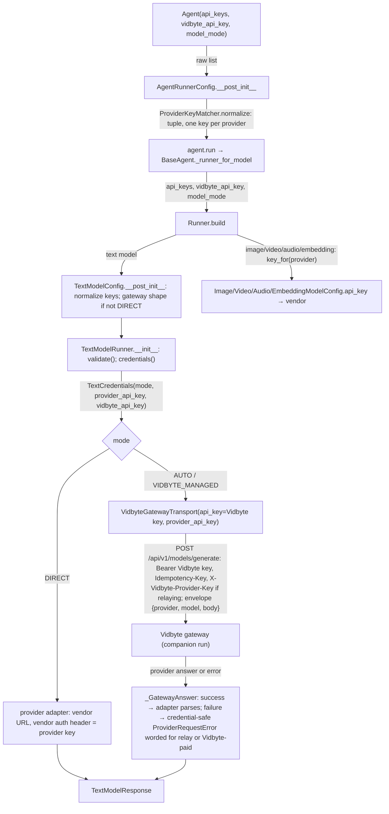
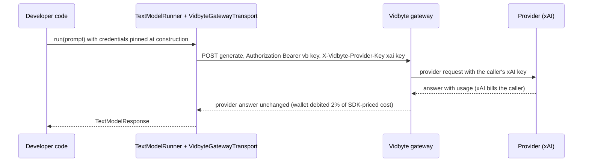

# Spec: Agents take vidbyte_api_key and a list of provider api_keys, and text calls relay the caller's own key through the Vidbyte gateway

> **TL;DR** — Agents and `TextModelConfig` now take `vidbyte_api_key` and `api_keys`. `api_keys` is a list of provider keys in any order, and it replaces `api_key`. A new lib class, `ProviderKeyMatcher`, assigns each key to its provider from the key's format alone, and it refuses any key it cannot place before a request is sent. In the default mode (`AUTO`), every text call goes to the Vidbyte gateway. When a key for the call's provider is held, the call carries that key in the single header `X-Vidbyte-Provider-Key`, so the provider bills the caller and Vidbyte bills only its 2% fee. Otherwise Vidbyte pays the provider, as it does today. A new `TextModelMode.DIRECT` is the one explicit way to call a provider without Vidbyte. The decision that matters most is that a key's provider comes from its format and never from where the key is used. That rule is what lets every fallback, fork, and child agent safely carry the whole list.

## §0 User prompts

The full record of what the user asked is in `docs/spec/byok-api-keys/request.md`. It holds Prompts 1–6, the /talk handoffs, and the orchestrator's notes. The prompt that invoked the pipeline is reproduced below, verbatim.

### 0.1 Invoking request (verbatim)

````
great, just to be clear. I want the agents iin our vidbyte-sdk/ param to have both a vidbyte_api_key and an api_keys param in the paramter of the model. under the hood we shoul have a lib class that makes sure that the user is inputting the correct api key that matches the provider/model that they are inputting (can prob be matches with the pricebook, api keys that start with "sk-" can be matches with antrhopic, etc. This you are probably going to have to play with to really make sure this feature works under the hood, dont want developers to have to worry about this. Then we pass the api key to our vidbyte endpoint where we route the request through to the model using the user's api key. We should then make sure that either throughout the run or after the run we take the token markup however you see fit, and make sure that whatever we talked about in this converation that relates to this request is implemented. When testing, I have a grok_api_key that you can use to test out this feature (coding your own grok agents, make sure to put the max spend/tokens only at a few cents) and a vidbyte api key, to make sure that the api key does not run out of credits. Do not stop until this feature is perfect, if you need to ask any clarifynng questions before creating the spec feel free to do so
````

### 0.2 User replies during the run

None yet. The user's answers to the three clarifying questions asked before this spec are Prompt 6 in request.md §A, and they bind this spec:

- `api_keys` is a list only.
- A local backend runs the live test.
- `api_key` is folded into `api_keys`.

---

## Part A — Framing

## §1 Goal

Today a developer chooses between two text modes:

- **Their own provider key (BYOK).** Vidbyte earns nothing on these calls.
- **A Vidbyte key alone (Vidbyte-managed).** Vidbyte pre-buys provider credit and resells it at a 2% fee. The fee loses money after card fees: request.md §C shows −$9.88 on $1,000 of provider spend.

The user wants BYOK and the markup at once: "i want to still have our token markup but without making it so that we have to buy all of the credits" (Prompt 1). The backend half, the companion run `byok-fee-relay`, makes the gateway relay a caller's key and bill only the fee. This SDK half makes every text call reach that gateway with the right key.

Three things stand in the way today, at base_commit:

- **BYOK bypasses the gateway.** In `AUTO`, a provider key always wins and the call goes straight to the vendor. The deciding code is `ProviderModelRegistry.find_vidbyte_api_key` (models registry).
- **The SDK cannot hold more than one provider key.** `api_key` is one string. A fallback chain to another provider has no key of its own, so it falls back to environment variables or to Vidbyte-paid. The rule is `AgentFallbackSettings._inherited_api_key` (agent fallback settings).
- **The SDK knows nothing about key formats.** The only format it knows is `VIDBYTE_API_KEY_PATTERN` (JEV constants). It cannot tell which provider a key belongs to.

| ID | Goal (outcome) | How we will know | Source |
|---|---|---|---|
| G-1 | Every text call an SDK user makes in the default mode goes through the Vidbyte gateway, which bills Vidbyte's fee. With the caller's own key for that call's provider, the call relays (fee only). Without one, Vidbyte pays the provider (cost plus fee, as today). | AC-1, AC-2, AC-3, AC-16, AC-17: a scripted gateway sees one POST per call, with the provider-key header exactly when a key is held | Prompt 1, Prompt 4 ("support BYOK AND the vidbyte markup on all tokens"), Prompt 5 |
| G-2 | A developer passes `vidbyte_api_key` and a list `api_keys` in any order and never says which key belongs to which provider. The SDK assigns each key deterministically and refuses a key it cannot place, before any request. | AC-7 to AC-11, AC-29 | Prompt 5 ("a lib class that makes sure that the user is inputting the correct api key"), Prompt 6 ("deterministically match the api keys to the provider") |
| G-3 | A provider key goes only to its own provider's call. It travels either in the one gateway header (gateway modes) or in the vendor's own auth header (DIRECT). It never appears in an error, a log, a trace, a repr, saved state, or another provider's request. | AC-14, AC-20, AC-21, AC-22 | request.md §C Constraints; B.2 failure modes |
| G-4 | An explicit unbilled path remains, reachable from agents as well as configs. It is needed because Vidbyte's own backend and vidbyte-cli consume the SDK. | AC-5, AC-25 | B.3 ledger (default accepted), request.md §C Key decisions |
| G-5 | `api_key` becomes `api_keys` everywhere a text or agent API takes a provider key. Today's resolution carries over: the explicit key first, then the provider's environment variable. | AC-24, §9.4 | Prompt 6 ("extend the api_key functionality into the api_keys functionality") |

## §2 Objective

When this PR merges, cerredz/Vidbyte-SDK contains the following:

- **A new mode.** `TextModelMode.DIRECT`.
- **A new constant.** `VIDBYTE_PROVIDER_KEY_HEADER = "X-Vidbyte-Provider-Key"`.
- **A new lib class.** `ProviderKeyMatcher`, with an ordered, sourced key-format table.
- **A new record.** `TextCredentials`, which `TextModelConfig.credentials()` returns. It resolves the mode, the provider key, and the Vidbyte key in one place.
- **New fields on `TextModelConfig`.** `api_keys` replaces `api_key`, and `vidbyte_api_key` is added.
- **A gateway transport that relays.** `VidbyteGatewayTransport` sends the provider key only in the new header and words every failure for the mode it ran in.
- **Runners for the new modes.**
  - `TextModelRunner` pins the credentials and relays.
  - `StreamingTextModelRunner` streams only in `DIRECT` and names `DIRECT` when it refuses.
- **New agent parameters.** `vidbyte_api_key`, `api_keys`, and `model_mode` on `BaseAgent`/`Agent` and on every agent-building surface. Each child carries the agent's full key list.
- **The old keyword is gone.** `api_key` no longer exists on those surfaces.
- **Wider credential guards.** They also catch `api_keys`.
- **Updated docs.** The README and the folder and skill docs describe the two-key setup.

This PR is the SDK slice of a two-repo change. The backend relay is the companion run. The vidbyte-cli rename, the backend's SDK pin bump with its `DIRECT` harness switch, and the live test with the user's real keys follow later (NG-1 to NG-3, NG-15).

## §3 Non-goals

- **NG-1** — Any change in cerredz/Vidbyte (route header, relay, fee-only billing, Sentry scrub). *Why not:* the companion run `byok-fee-relay` owns it, and both runs build to the fixed wire contract in request.md §C.
- **NG-2** — Renaming `api_key` to `api_keys` in vidbyte-cli, cli-internal, or the public mirror. *Why not:* the CLI consumes a published SDK. The user: "Simply renames for the vidbyte-cli should be easy to fix".
- **NG-3** — The backend's SDK pin bump and its research harness switch to `mode=TextModelMode.DIRECT`. *Why not:* request.md §0 lists it as a later step.
- **NG-4** — Streaming through the gateway (relay or Vidbyte-paid). *Why not:* the gateway cannot bill a stream. The user accepted "the streaming gap until the follow-up" (B.3).
- **NG-5** — Stored provider keys, and any persistence of a key in checkpoints, RunState, or YAML. *Why not:* this would make Vidbyte a custodian of secrets at rest (request.md §C Rejected alternatives).
- **NG-6** — Jev `DecisionModelConfig`: its `api_key` field, its key messages, and its modes. *Why not:* request.md §0 excludes it. Its messages stay byte-identical (INV-18).
- **NG-7** — Sending image, video, audio, or embedding calls through the gateway, or renaming those configs' `api_key` field. *Why not:* the gateway serves text only. Those configs keep `api_key` and stay vendor-direct; they get their key from the agent's list (D-12).
- **NG-8** — Re-vendoring the platform contract that lint C017 reads. *Why not:* the route list is unchanged and the contract holds no header names. The header name is mirrored as a constant (request.md §0).
- **NG-9** — Inferring a missing `provider` from `model_name` through the pricebook or the runner maps. *Why not:* nobody asked for it. Prompt 6's "we dont actually need the user to define the provider" is about keys.
- **NG-10** — The Vidbyte-paid fee rate. *Why not:* it is backend-owned, and the user kept 200 bps.
- **NG-11** — Letting the context-window algorithm helpers (independent critic, multi-provider grader, prosecutor/defender/judge) choose `DIRECT`. *Why not:* they build runners without keys or a mode, so they follow `AUTO`. This is a stated limitation (EC-40).
- **NG-12** — Key fields in YAML or declarative agent config. *Why not:* YAML rejects credential-like keys by design (`_YamlSecretKeyPolicy`).
- **NG-13** — Accepting a key whose format the table does not know. *Why not:* the provider's own environment variable is the escape hatch (D-2). Q-1 records the option, with default **no**.
- **NG-14** — A deprecation alias that keeps `api_key=` working. *Why not:* the user chose a rename, and a silent alias would hide which key went where (D-20).
- **NG-15** — The live end-to-end test with the user's real `GROK_API_KEY` and `VIDBYTE_API_KEY`, and its "few cents" spend cap. *Why not:* a separate agent runs it after both runs are green (request.md §0). This PR's suite makes no network call (NFR-6).
- **NG-16** — A package version bump or release. *Why not:* releases are separate commits that the user owns, and the recent `main` history has no version bumps inside feature PRs.
- **NG-17** — A per-model mode, such as `DIRECT` for one fallback entry only. *Why not:* one mode per agent is the smallest surface. Q-4 records the option, with default **no**.

## §4 Developer usage

```python
import os

from vidbyte import Agent
from vidbyte.lib.config import TextModelMode

agent = Agent(
    name="researcher",
    system_prompt="Answer in one word.",
    provider="xai",
    model_name="grok-4.5",
    vidbyte_api_key=os.environ["VIDBYTE_API_KEY"],
    api_keys=[os.environ["ANTHROPIC_API_KEY"], os.environ["XAI_API_KEY"]],
    fallback=["anthropic/claude-sonnet-5"],
)
reply = agent.run("Say hi.")
print(reply.content)

offline = Agent(
    name="offline",
    system_prompt="Answer in one word.",
    provider="xai",
    model_name="grok-4.5",
    api_keys=[os.environ["XAI_API_KEY"]],
    model_mode=TextModelMode.DIRECT,
)
```

The first agent sends its grok call to the Vidbyte gateway. The call carries the xAI key in `X-Vidbyte-Provider-Key`, so xAI bills the developer and Vidbyte's wallet pays only the 2% fee. If grok fails with a fallback error, the Claude backup relays with the Anthropic key in the same way. `print` shows the model's answer. The developer never says which key is which. The order of the list does not matter, and a key in a format the SDK cannot place is refused when the agent is built. The second agent never contacts Vidbyte and reads no Vidbyte key.

## §5 Flow diagram





Keys are checked twice, at two boundaries, and neither check reads the environment:

1. The agent's own record (`AgentRunnerConfig`) classifies the key list when the agent is built.
2. `TextModelConfig` classifies it again, and outside `DIRECT` it refuses a provider or endpoint that the gateway cannot serve.

The environment is read in exactly one place, `TextModelConfig.credentials()`. It reads the provider's variable and `VIDBYTE_API_KEY` there. A gateway-mode runner calls it once, when it is built, and keeps the result. A `DIRECT` config resolves on every call, exactly as BYOK does today.

Failures are caught in two places, both before or at the request:

- A missing or malformed key raises before any request.
- A gateway or provider failure becomes the gateway transport's credential-safe `ProviderRequestError`.

---

## Part B — Behavior

## §6 Behavior

Terms used below:

- **Gateway mode** means `AUTO` or `VIDBYTE_MANAGED`.
- **Relay** means a gateway call that carries `X-Vidbyte-Provider-Key`.
- **Vidbyte-paid** means a gateway call that does not carry it.
- **The provider key for a call** is the key that `ProviderKeyMatcher` assigns to the call's provider from `api_keys`. If there is none, it is the stripped, non-blank value of that provider's environment variable from `ProviderModelRegistry.API_KEY_ENV_VARS`. If there is neither, there is no provider key.

### 6.1 Invariants

- **INV-1** — In `AUTO`, every text call made through `TextModelRunner` reaches only `VIDBYTE_GENERATIVE_GATEWAY_ENDPOINT`. This covers direct calls and calls made by an agent, a fallback model, a fork, an aggregate proposer or aggregator, a handoff or continual-trace agent, a Jev child agent, a context-minimal-fanout role, a restored session, and an algorithm helper. Each attempt is exactly one POST carrying `Authorization: Bearer <Vidbyte key>`. A vendor URL is never contacted.
- **INV-2** — A gateway request carries `X-Vidbyte-Provider-Key` if and only if the mode is `AUTO` and the call has a provider key. The header value is exactly that key, stripped, and never empty (the gateway answers an empty value with 422). The key appears nowhere else in the request: not in the URL, the envelope, the body, `Authorization`, or `Idempotency-Key`.
- **INV-3** — A key from `api_keys` is only ever sent with a call whose provider is the one `ProviderKeyMatcher.provider_of` returns for it. It never appears in a request for any other provider, whether in the gateway header or in a vendor auth header.
- **INV-4** — A provider key never appears in any of the following:
  - the message, details, repr, or formatted traceback of any exception the SDK raises;
  - `repr()` of `TextModelConfig`, `TextCredentials`, `AgentRunnerConfig`, `FallbackModel`, `AgentFallback`, `AgentFallbackSettings`, `JevAgentSettings`, `JevRunBriefSettings`, or `AgentRoleSettings`;
  - `BaseAgent.export_state()` or any session checkpoint;
  - any trace payload that passes the existing scrubbers;
  - the provider adapter's own headers in gateway mode, where the adapter gets `VIDBYTE_MANAGED_KEY_PLACEHOLDER`.
- **INV-5** — In `VIDBYTE_MANAGED`, the SDK never sends `X-Vidbyte-Provider-Key`, and it never reads `api_keys` (beyond classifying them at construction) or the provider's environment variable.
- **INV-6** — In `DIRECT`, the SDK never reads `vidbyte_api_key` or `VIDBYTE_API_KEY` and never contacts the gateway. For a given provider key, the vendor request equals, byte for byte, the request base_commit sends for the same key in BYOK state: same URL, headers, body, and timeout.
- **INV-7** — In `AUTO` with no Vidbyte key (no explicit `vidbyte_api_key`, and `VIDBYTE_API_KEY` blank or unset), `TextModelConfig.validate()`, `credentials()`, and `TextModelRunner.__init__` raise `ConfigurationError` before any request. The error carries `details["error_kind"] == VIDBYTE_MANAGED_CREDENTIAL_ERROR_KIND`. Its message names `vidbyte_api_key`, `VIDBYTE_API_KEY`, and `TextModelMode.DIRECT`.
- **INV-8** — A `TextModelConfig` whose mode is not `DIRECT` is refused when it is built, before any key or environment is read:
  - a provider outside `VIDBYTE_MANAGED_TEXT_PROVIDERS` raises `UnsupportedProviderError`;
  - a non-blank `endpoint` raises `ConfigurationError`.

  Both messages name `TextModelMode.DIRECT`.
- **INV-9** — Key classification is deterministic and depends only on the key string. It does not depend on list order, on other entries, on the environment, or on the provider or model the key is used with. The first entry of the ordered format table that full-matches the stripped key wins.
- **INV-10** — `ProviderKeyMatcher.normalize` has exactly two outcomes:
  - it returns a tuple of stripped keys holding at most one key per provider, in input order;
  - it raises `ConfigurationError` naming the field and, for an entry, the entry's index.

  It never iterates the characters of a string. It never silently drops a non-blank entry. Only `None` and blank strings are skipped, and an identical repeated key collapses to one entry.
- **INV-11** — `StreamingTextModelRunner` raises `UnsupportedProviderError` at construction for every config whose mode is not `DIRECT`, whatever keys or environment exist. It does so before reading any key or environment variable, and its message names `TextModelMode.DIRECT`.
- **INV-12** — A gateway-mode `TextModelRunner` resolves its credentials once, at construction, and uses them for every call. Changing the environment afterwards changes nothing the runner sends.
- **INV-13** — A Vidbyte key never reaches a provider and is never sent as a provider key:
  - a Vidbyte-prefixed entry in `api_keys` is refused;
  - a Vidbyte-prefixed value in the provider environment variable used for a lookup is refused.
- **INV-14** — `BaseAgent.export_state()` records `runtime_config["model_mode"]` as the mode's string value and stores no key. `BaseAgent.restore()` rebuilds that mode, and a state without the entry restores `AUTO`.
- **INV-15** — Every agent-built child gets the parent's full `api_keys` tuple, its `vidbyte_api_key`, and its `model_mode`. The children are fallback models, forks, aggregate proposers and aggregator, handoff and continual-trace agents, Jev child agents, and session restores. The one exception is an explicit `FallbackModel` or `JevRunBriefSettings` that sets its own non-empty `api_keys`. Each child call then picks its own provider's key (INV-3).
- **INV-23** — Building an agent reads no environment variable, as today. A missing Vidbyte or provider key surfaces when the first run builds its runner.

**Must not regress:**

- **INV-16** — An `AUTO` call with a Vidbyte key and no provider key for the call's provider sends exactly what base_commit sends in managed state. Today that path is `vidbyte/lib/http/vidbyte_gateway.py:VidbyteGatewayTransport.request` plus `vidbyte/lib/runners/text.py:TextModelRunner.__init__`:
  - exactly the headers `authorization`, `content-type`, and `idempotency-key`;
  - the same envelope;
  - the 32,768 default output cap and the 630 s timeout floor (a NaN timeout becomes the floor);
  - the same re-send policy and deadline.
- **INV-17** — Every gateway failure is still a `ProviderRequestError` with `provider="vidbyte"`, the HTTP status (or `None`), no `response_excerpt`, no `__cause__` or `__context__`, and no gateway or provider body text (`vidbyte/lib/http/vidbyte_gateway.py:_send`, `request`).
- **INV-18** — `DecisionModelConfig` keeps every message and behavior: "Missing Vidbyte API key. Pass api_key or set VIDBYTE_API_KEY." and the malformed-key message (`vidbyte/lib/registries/models.py:resolve_vidbyte_api_key`, used at `vidbyte/lib/dataclasses/model_configs.py:468`).
- **INV-19** — `ImageModelConfig`, `VideoModelConfig`, `AudioModelConfig`, and `EmbeddingModelConfig` keep their `api_key` field and their resolution through `ProviderModelRegistry.resolve_api_key`, including its message "Missing API key for provider {p}. Pass api_key or set {ENV}.", and they stay vendor-direct.
- **INV-20** — A relay call gets the same 32,768 default output cap and the same 630 s timeout floor as a Vidbyte-paid call (B.2 pre-answered).
- **INV-21** — Every attempt of one gateway call carries the same `Idempotency-Key` and identical headers, including the same `X-Vidbyte-Provider-Key`. Two calls never share an `Idempotency-Key`.
- **INV-22** — Every credential guard keeps catching every name it catches today, including `api_key` and `vidbyte_api_key`. The guards are `CredentialKeyPolicy`, `_YamlSecretKeyPolicy`, the agent-descriptor guard, the harness redactor, `SessionSerializer`, and `BaseAgent`'s trace scrubbing.

### 6.2 Acceptance criteria

| ID | Given | When | Then | Priority | Proof |
|---|---|---|---|---|---|
| AC-1 | a clean checkout of this branch; a cleared environment holding `VIDBYTE_API_KEY`, an `ANTHROPIC_API_KEY`, and an `XAI_API_KEY` in recognized formats; and `vidbyte.lib.runners.text.HttpTransport` replaced by a scripted gateway that answers grok with a final answer | the §4 snippet runs | `print` shows the scripted answer. Exactly one POST goes to the gateway URL, with `Authorization: Bearer <VIDBYTE_API_KEY>`, `X-Vidbyte-Provider-Key` equal to the xAI key, envelope provider `xai`, and model `grok-4.5`. The Anthropic key appears nowhere in that request. Building `offline` sends nothing and reads no `VIDBYTE_API_KEY` | P0 | |
| AC-2 | a cleared environment with `OPENAI_API_KEY` and `VIDBYTE_API_KEY` | `TextModelRunner(TextModelConfig(provider="openai", model="gpt-5.5")).run("Hi")` | one POST to the gateway, carrying the bearer Vidbyte key and `X-Vidbyte-Provider-Key` equal to the OpenAI key. The header set is exactly `authorization`, `content-type`, `idempotency-key`, `x-vidbyte-provider-key`. The envelope body equals the body the same config sends in `DIRECT`, with the 32,768 cap added | P0 | |
| AC-3 | a cleared environment with only `VIDBYTE_API_KEY` | the same call | no `X-Vidbyte-Provider-Key`. Exactly three headers, as at base_commit (INV-16) | P0 | |
| AC-4 | a cleared environment with only `OPENAI_API_KEY` | `TextModelRunner(TextModelConfig(provider="openai", model="gpt-5.5"), transport=t)` | `ConfigurationError` with the credential `error_kind`, naming `VIDBYTE_API_KEY`, `vidbyte_api_key`, and `TextModelMode.DIRECT`. `t` received zero requests | P0 | |
| AC-5 | a cleared environment with `VIDBYTE_API_KEY` set to a malformed value, and `api_keys=[<openai key>]`, `mode=TextModelMode.DIRECT` | the runner runs a call | one request to `https://api.openai.com/v1/responses` with `authorization: Bearer <openai key>`, equal to base_commit's BYOK golden for the same key. No error about the malformed Vidbyte key | P0 | |
| AC-6 | each of `AUTO` and `VIDBYTE_MANAGED`, with no keys and an empty environment, and also with every key set | `StreamingTextModelRunner(TextModelConfig(provider="openai", model="gpt-5.5", mode=m))` | `UnsupportedProviderError` whose message names `TextModelMode.DIRECT`, with `details["mode"] == m.value`. With `mode=DIRECT` and an OpenAI key, it streams as at base_commit | P0 | |
| AC-7 | keys K_x (xAI) and K_a (Anthropic) | configs for `xai` and for `anthropic` are built with `api_keys=[K_x, K_a]` and with `[K_a, K_x]` | each pair sends identical requests: the xAI call carries only K_x and the Anthropic call only K_a | P0 | |
| AC-8 | `api_keys` given as a bare string, as bytes, as a dict, or as an int | a `TextModelConfig`, `Agent`, `FallbackModel`, or `JevAgentSettings` is built | `ConfigurationError` naming the field. No character of the input appears in the message | P0 | |
| AC-9 | an entry that matches no format, for example `"not-a-key-123"` at index 1 | the config or agent is built | `ConfigurationError` naming `api_keys[1]` and its character count. The message contains no character of the key, and no request is sent | P0 | |
| AC-10 | two different OpenAI-format keys at indexes 0 and 2 | built | `ConfigurationError` naming both indexes and `openai`, with no key text. The same key given twice is accepted as one | P0 | |
| AC-11 | a Vidbyte-prefixed entry in `api_keys`; separately, `XAI_API_KEY` holding a Vidbyte-prefixed key with `provider="xai"` in `AUTO` and in `DIRECT` | built, or `validate()` called | `ConfigurationError` telling the user to pass it as `vidbyte_api_key` or `VIDBYTE_API_KEY`, with no key text and no request | P0 | |
| AC-12 | `AUTO` with `provider="mistral"` (or `"openrouter"`), or with `endpoint="https://proxy.example/v1"` | `TextModelConfig(...)` is built | `UnsupportedProviderError` or `ConfigurationError` at construction, naming `TextModelMode.DIRECT`. The same config in `DIRECT` with the provider's environment key calls the vendor or proxy URL as at base_commit | P0 | |
| AC-13 | `mode=VIDBYTE_MANAGED`, `api_keys=[<openai key>]`, `OPENAI_API_KEY` set, `VIDBYTE_API_KEY` set | a call runs | Vidbyte-paid: no `X-Vidbyte-Provider-Key`, and the OpenAI key appears nowhere | P0 | |
| AC-14 | a relay call, and a gateway answer that is a relayed provider error body with status 401, 402, or 403 | the call runs | `ProviderRequestError(provider="vidbyte", status_code=s)`. The message names the provider and the status, says the provider refused the caller's own key or account, and says that the provider's message is withheld and Vidbyte did not bill the call. It contains no key | P0 | |
| AC-15 | a gateway error body (`"error": true`) for each of 401, 402, 403, 409, 413, 422, 429, 500, 502, 503, in a Vidbyte-paid call and in a relay call | the call runs | each message states the §9.2 facts for that mode. In particular, Vidbyte-paid 402 names the wallet and adding a provider key to `api_keys`, relay 402 names the wallet and does not suggest a provider key, relay 429 does not mention a daily cap, and relay 5xx does not mention "Vidbyte's own account". INV-17 holds for all | P0 | |
| AC-16 | an agent on `xai` with fallback `["anthropic/claude-sonnet-5"]`, keys for both in `api_keys`, a Vidbyte key, and a scripted gateway that answers the xai call with a relayed 401 and the anthropic call with a final answer | `agent.run` | two gateway POSTs: the first carries only the xAI key, the second only the Anthropic key, and the result is the Anthropic answer | P0 | |
| AC-17 | the same agent with only the xAI key in `api_keys` | the fallback call runs | the Anthropic call is Vidbyte-paid, with no provider-key header | P1 | |
| AC-18 | a parent agent with `api_keys=[K_ds, K_oa]`, a Vidbyte key, and `model_mode=DIRECT` | it forks to `provider="openai"`; an `AggregateAgent` has proposers on deepseek and openai; a `HandoffAgent` and a continual-trace agent come from it; a `JevAgent` builds its children | every child's `runner_config.api_keys == (K_ds, K_oa)`, with the same Vidbyte key and `model_mode`. Each child's call carries only its own provider's key | P0 | |
| AC-19 | a session whose agent ran in `DIRECT` | `Session.resume`, `Session.continue_`, `Session.fork_from`, `Session.fork`, and fork recovery | the restored agent's `model_mode` is `DIRECT`. Keys come only from the `api_keys` and `vidbyte_api_key` passed in (`Session.fork` and fork recovery take the live agent's own). No checkpoint contains a key | P0 | |
| AC-20 | each record listed in INV-4, holding keys | `repr()` | no key text | P0 | |
| AC-21 | the whole suite | any captured log line, error message, details mapping, or traceback | contains no provider key (B.2 acceptance) | P1 | |
| AC-22 | the credential guards | asked about `api_keys`, `openai_api_keys`, `apiKeys`, and `vidbyte_api_key`; and free text `api_keys=['xai-a', 'sk-ant-b']` or `vidbyte_api_key=vb…` | `CredentialKeyPolicy.is_secret_key` is True for each name. The descriptor guard rejects a top-level `api_keys`. `HarnessRedactor` redacts the whole list value and the Vidbyte value | P1 | |
| AC-23 | an agent on an image model of provider `openai` with an OpenAI key in `api_keys` | the runner is built | `ImageModelConfig.api_key` equals that key. With no OpenAI key in the list, it is `None`, so `OPENAI_API_KEY` resolves as today | P1 | |
| AC-24 | the old keyword `api_key=` | passed to `Agent`, `BaseAgent.restore`, `TextModelConfig`, `TextModelRunner(provider=..., model=..., api_key=...)`, `Runner`, `FallbackModel`, `JevAgentSettings`, `Session.resume`, or `create_runner_for_modality(..., modality text)` | `TypeError` for an unexpected keyword. For `ModalityDetector.create_runner` and `create_runner_for_modality` building a text model, `ConfigurationError` naming `api_keys`. It is never silently ignored | P0 | |
| AC-25 | `model_mode="direct"` (a string) | `Agent(...)` | `ConfigurationError` stating that `model_mode` must be a `TextModelMode` value. `model_mode=TextModelMode.DIRECT` works | P1 | |
| AC-26 | no Vidbyte key anywhere and `AUTO` | `Agent(..., api_keys=[<openai key>])` is built, then run | construction succeeds. The run raises `AgentExecutionError` whose `__cause__` is the INV-7 `ConfigurationError`, and no request is sent | P1 | |
| AC-27 | the root README | the managed-text feature pack's existing README-facts check runs | the section still states `2%`, `VIDBYTE_API_KEY`, `Idempotency-Key`, `maxOutputTokens`, `max_output_tokens`, `previous_response_id`, `2,000,000`, `32,768`, `630`, the six provider names, stream, service tier, and snake case. It also documents `api_keys`, `vidbyte_api_key`, relay, and `TextModelMode.DIRECT` | P1 | |
| AC-28 | the finished branch | the gates run | `python lint/run.py` ends `SDK-LINT: PASS` with no baseline raised, and C017 reports `CLEAN`. The full gate (§11) passes | P0 | |
| AC-29 | one sample key per format rule (§9.2 table F) | `ProviderKeyMatcher.provider_of` | returns that rule's provider. A legacy OpenAI shape (`sk-` + 20 alphanumerics + `T3BlbkFJ` + 20 alphanumerics) returns `openai`, not `kimi`. A key with a space, a newline, or a non-ASCII character returns `None` | P0 | |
| AC-30 | the three manual scripts named in FR-16 | the gate's `compileall` step runs, and the scripts are searched for `TextModelConfig(` calls | they compile, and no `TextModelConfig(` call in them passes `api_key=` | P2 | |

### 6.3 Edge cases and failure modes

| ID | Trigger (input + state) | System behavior | User sees | Guarded by (INV-/D-) |
|---|---|---|---|---|
| EC-1 | `api_keys="xai-…"` (a bare string). Unguarded, `tuple()` would make one-character keys and every one would fail as "unrecognized" | refuse | `ConfigurationError`: "api_keys must be a list of provider API keys, not a single string; wrap it in a list" | INV-10, D-3 |
| EC-2 | `api_keys={"openai": k}` (the dict form the user rejected). Unguarded, iterating would classify `"openai"` and fail confusingly | refuse | `ConfigurationError`: not a mapping; list the keys in any order | INV-10, D-3 |
| EC-3 | `api_keys=[os.environ.get("XAI_API_KEY"), os.environ.get("OPENAI_API_KEY")]` with one variable unset (`None`) or blank | skip `None` and blank entries; keep the rest | works; the missing provider goes Vidbyte-paid (AUTO) or uses its env var or raises a missing-key error (DIRECT) | INV-10, D-4 |
| EC-4 | an entry that is an `int`, `bytes`, or object | refuse | `ConfigurationError`: "api_keys[i] must be a string, got int" | INV-10 |
| EC-5 | an entry in an unknown format (a test value such as `"sk-mock"`, a Mistral or GLM key, a proxy token) | refuse at construction | `ConfigurationError` naming the index and length, and telling the user to set the provider's own environment variable. No key text | INV-9, INV-10, D-2, D-17 |
| EC-6 | the same key twice | collapse to one | works | D-4 |
| EC-7 | two different keys that classify to one provider. Unguarded, the SDK would pick one arbitrarily and might bill the wrong account | refuse | `ConfigurationError` naming both indexes and the provider | INV-10, D-4 |
| EC-8 | a Vidbyte key in `api_keys` (the old "pass a Vidbyte key as `api_key`" habit the root README teaches today). Unguarded, it would be sent to a vendor as a provider key | refuse | `ConfigurationError`: pass it as `vidbyte_api_key` | INV-13 |
| EC-9 | a key with surrounding spaces or a trailing newline | strip, then classify | works | INV-10 |
| EC-10 | a key with an inner CR, LF, space, or other character outside the format charset (an injection attempt, or a paste error) | it matches no format, so it is refused | `ConfigurationError` (EC-5 wording). The value never reaches a header | INV-9, T-5 |
| EC-11 | `AUTO`, with `api_keys` holding keys but none for the call's provider, and that provider's environment variable unset | Vidbyte-paid, with no error | the call works; the wallet pays cost plus fee | D-5, Q-2 |
| EC-12 | `DIRECT`, with no key for the provider in the list or the environment | refuse before the request | "Missing API key for provider openai. Pass api_keys or set OPENAI_API_KEY." When the list is non-empty, it adds "(api_keys holds keys for: xai, anthropic)" | INV-6, D-7 |
| EC-13 | a provider environment variable holding a Vidbyte-prefixed key (today's managed switch in `ProviderModelRegistry.find_vidbyte_api_key`), read in `AUTO` or `DIRECT`. Unguarded, it would be sent to the vendor or relayed to it | refuse when the lookup reads it | `ConfigurationError`: "OPENAI_API_KEY holds a Vidbyte API key; …", with no key text | INV-13, D-6 |
| EC-14 | `OPENAI_API_KEY` holding an xAI-format key | not classified: an environment value is trusted by its variable's name | it is sent as the OpenAI key, as today; OpenAI rejects it with 401 (relayed or direct) | D-6 |
| EC-15 | `AUTO` or `VIDBYTE_MANAGED` with `provider` in glm, minimax, meta, mistral, or openrouter. Unguarded, a silent direct path would be an unbilled route to any model | refuse at construction | `UnsupportedProviderError`: "The Vidbyte gateway serves only: … Use mode=TextModelMode.DIRECT …" | INV-8, D-11, D-23 |
| EC-16 | a non-blank `endpoint` outside `DIRECT` | refuse at construction | `ConfigurationError` naming `DIRECT` | INV-8, D-23 |
| EC-17 | `DIRECT` with `endpoint=` a proxy and a provider key | calls the proxy with the provider key, as BYOK did | works | INV-6 |
| EC-18 | `VIDBYTE_MANAGED` with `api_keys` set | the keys are classified at construction (so a bad key still fails), then ignored | Vidbyte-paid | INV-5 |
| EC-19 | a malformed `vidbyte_api_key` or `VIDBYTE_API_KEY` in gateway mode | refuse at `validate()` or runner construction | today's message: "The managed Vidbyte API key must be a live key in the {VIDBYTE_API_KEY_PREFIX} format.", with `error_kind` | INV-7 |
| EC-20 | `vidbyte_api_key` that is not a string (for example `123`) | refuse at construction | `ConfigurationError`: "vidbyte_api_key must be a string or None.", with `error_kind` | D-8 |
| EC-21 | `vidbyte_api_key` set together with `DIRECT` | ignored, never read or sent | works | INV-6 |
| EC-22 | the environment changes after a gateway runner is built (for example `OPENAI_API_KEY` set or removed) | no effect: the credentials are pinned | the same requests as before | INV-12 |
| EC-23 | `StreamingTextModelRunner` in `AUTO` with an empty environment. Unguarded, it would fail with a missing-key error instead of the real reason | refuse before `validate()` | an error naming `DIRECT` | INV-11, D-10 |
| EC-24 | a relayed provider 401, 402, or 403 (the caller's own key or account) | `ProviderRequestError`, credential-safe, with relay wording; no retry | "xai refused the call made with your own xai key (HTTP 401) …" | INV-17, D-15 |
| EC-25 | gateway 402 on a relay call (the wallet is below the fee-only requirement, with its 1-cent floor) | relay wording | "top up the wallet", with no "add a provider key" | D-15 |
| EC-26 | gateway 429 on a relay call (the request quota; relay has no daily cap) | relay wording | quota only | D-15 |
| EC-27 | gateway 502 or 5xx on a relay call | relay wording, with the existing 502 re-send policy | "unavailable", with no "Vidbyte's own account" | D-15, INV-21 |
| EC-28 | a retried relay call (409, 502, or an edge page) | every attempt carries the same `Idempotency-Key` and provider-key header | the gateway answers the retry from its replay | INV-21 |
| EC-29 | a fallback chain mixing providers that have keys with providers that do not | each call independently relays or goes Vidbyte-paid | works | INV-15, D-5 |
| EC-30 | in `AUTO`, a fallback or fork to a provider the gateway does not serve | `UnsupportedProviderError` when that model's runner is built. A fallback runner is built when the chain reaches it, as missing-key errors are today | the run fails naming `DIRECT`; the whole agent must use `model_mode=DIRECT` (NG-17) | INV-8, D-11 |
| EC-31 | a checkpoint written before this change (no `model_mode` in `runtime_config`) | restores `AUTO` | the restored agent needs a Vidbyte key | INV-14 |
| EC-32 | a resumed or forked-from session without `api_keys` or `vidbyte_api_key` passed | the keys come only from environment variables, because checkpoints never store keys | it works if the environment has them; otherwise INV-7 or EC-12 on the first run | NG-5, INV-14 |
| EC-33 | an `AggregateAgent` with proposers on several providers and one `api_keys` list | every child gets the full list; each call picks its own key | works; the deleted "key owner" rule is no longer needed | D-13 |
| EC-34 | a Jev run-brief writer with its own `api_keys` | `brief.api_keys` replaces the main list for the writer; otherwise it inherits `settings.api_keys` | works | INV-15 |
| EC-35 | a real Kimi, DeepSeek, OpenRouter, or Gemini `AQ.` key whose shape differs from the table (A-2 to A-6) | refused as unrecognized | EC-5 wording. The developer sets `MOONSHOT_API_KEY`, `DEEPSEEK_API_KEY`, `OPENROUTER_API_KEY`, or `GEMINI_API_KEY` instead | D-2, A-2 to A-6 |
| EC-36 | a legacy OpenAI key `sk-` + 48 alphanumerics, which overlaps the Kimi shape | the table checks OpenAI's `T3BlbkFJ` signature before Kimi | classified as openai | INV-9 |
| EC-37 | a provider adapter called directly (`AnthropicProvider(model=…, api_keys=[…]).run_text(…)`) in `AUTO` | the adapter sees the placeholder key, as managed adapters do today | the vendor answers 401; direct adapter use needs `mode=TextModelMode.DIRECT` | INV-4, D-8 |
| EC-38 | two concurrent relay calls on one runner | each call builds its own gateway transport with its own `Idempotency-Key`, and both carry the same provider key; no state is shared | works | INV-21 |
| EC-39 | the old `api_key=` keyword | `TypeError`, or `ConfigurationError` from `create_runner`, which takes `**options` | a loud failure | D-20 |
| EC-40 | an algorithm helper (independent critic, multi-provider grader, prosecutor/defender/judge) building its own runners in `AUTO` without `VIDBYTE_API_KEY` | INV-7 or INV-8 when its runner is built; there is no way to pass `DIRECT` through the algorithm | `ConfigurationError` naming `DIRECT` | accepted limitation (NG-11): the helpers take no keys or mode today |
| EC-41 | an agent whose model resolves to an image, video, audio, or embedding runner | that config gets `ProviderKeyMatcher.key_for(api_keys, provider)` or `None`; it never goes through the gateway | works as today | INV-19, D-12 |
| EC-42 | a process serving several tenants, where one agent has no `api_keys` | the environment provider key of the process is used (unchanged behavior) | that call is billed to the process owner's key | accepted limitation (T-4): environment fallback is process-wide, as today |
| EC-43 | `api_keys` holding many keys | classification is linear in entries × rules; there is no bound beyond one key per known provider (at most 7 kept) | works | INV-10; accepted (NFR-3) |
| EC-44 | `model_mode` that is not a `TextModelMode` (a string or `None`) | refuse at construction | `ConfigurationError` naming `model_mode` | D-9 |
| EC-45 | `TextModelConfig.api_keys` given as a list (not a tuple) | normalized to a tuple, so the frozen config stays hashable and immutable | works | INV-10 |

**Rollback of the user action:**

- **The developer's side.** A developer who wants the old vendor-direct behavior sets `model_mode=TextModelMode.DIRECT` (or `mode=` on `TextModelConfig`). A developer on an unrecognized key format moves that key into the provider's environment variable. Nothing is persisted, so no state remains.
- **The operator's side.** Reverting this PR restores single-key BYOK. Callers then have to rename `api_keys` back to `api_key`. Checkpoints written by this version keep a harmless `runtime_config["model_mode"]` entry that the old code ignores.

## §7 Requirements

**Functional**

| ID | Requirement | Priority | Source (request.md / G-) |
|---|---|---|---|
| FR-1 | `TextModelMode` gains `DIRECT = "direct"`, exported as today. | P0 | §0, B.4 A3; G-4 |
| FR-2 | `TextModelConfig` behaves as follows. **Fields:** `api_keys` (normalized, at most one key per provider, hidden from repr) replaces `api_key` in the third position, and `vidbyte_api_key` (hidden from repr) is appended last. **Construction:** `__post_init__` refuses a non-`DIRECT` config whose provider the gateway does not serve or that has a custom endpoint. **`credentials()`** resolves per §9.2 table R, and `validate()` calls it. **`resolved_api_key()`** returns the provider key in `DIRECT` and `VIDBYTE_MANAGED_KEY_PLACEHOLDER` otherwise. **Removed:** `is_vidbyte_managed()` and `resolved_vidbyte_api_key()`. | P0 | §0; G-1, G-5 |
| FR-3 | A new frozen record `TextCredentials(mode, provider_api_key, vidbyte_api_key)`, with properties `uses_gateway` and `relays`, validated per mode. | P0 | B.4 B4; G-1 |
| FR-4 | A new lib class `ProviderKeyMatcher` with `provider_of`, `normalize`, `key_for`, and `providers` over an ordered format table (§9.2 table F). It reads no environment and makes no network call. | P0 | Prompt 5, Prompt 6; G-2 |
| FR-5 | `ProviderModelRegistry` changes as follows. **Removed:** `find_vidbyte_api_key` and `vidbyte_key_follows_provider`. **Added:** `find_provider_api_key(provider, api_keys)` (list, then environment, with the Vidbyte-prefix guard). **Changed:** `resolve_vidbyte_api_key` gains a keyword `remedy` whose default keeps the Decision message. | P0 | B.4 B5 (amended); G-1 |
| FR-6 | `VIDBYTE_PROVIDER_KEY_HEADER: str = "X-Vidbyte-Provider-Key"` sits in the managed block of `vidbyte.lib.constants.jev`. | P0 | §C wire contract |
| FR-7 | `VidbyteGatewayTransport` takes `provider_api_key`. It adds the header only when that key is set, and only by subscript assignment with the constant. Failure wording follows §9.2 table G, with the error prefix "Vidbyte gateway {provider} request failed:". | P0 | B.4 B6; G-1, G-3 |
| FR-8 | `TextModelRunner` validates, pins `credentials()` once, and in gateway mode pins the output cap and timeout floor as today. Each call's gateway transport gets the Vidbyte key and the provider key. | P0 | B.4 B7; G-1 |
| FR-9 | `StreamingTextModelRunner` refuses every non-`DIRECT` config before `validate()`, naming `TextModelMode.DIRECT`. | P0 | B.2, B.4 B7; NG-4 |
| FR-10 | Agents get `api_keys`, `vidbyte_api_key`, and `model_mode` in place of `api_key`, as follows:<br>• `BaseAgent`/`Agent.__init__`<br>• `BaseAgent.restore` (`api_keys`, `vidbyte_api_key`)<br>• `AgentRunnerConfig` (validated in `__post_init__`)<br>• `export_state()` records `model_mode` | P0 | Prompt 5; G-1, G-4 |
| FR-11 | Every agent-built child carries the list, the Vidbyte key, and the mode (INV-15). The per-provider key-dropping rules are deleted. The surfaces are:<br>• `AgentFallback`/`AgentFallbackSettings` with `FallbackModel.api_keys`<br>• `AgentForker`<br>• `AggregateAgent`<br>• `HandoffAgent`<br>• continual trace<br>• `JevAgentSettings`/`JevRunBriefSettings` and all Jev children<br>• `AgentRoleSettings` and the fanout paradigm<br>• `Session.fork`/`resume`/`continue_`/`fork_from`<br>• fork recovery | P0 | §0 ("fallback/fork carry the key list"); G-2 |
| FR-12 | `Runner` takes `api_keys`, `vidbyte_api_key`, and `model_mode`. A text config gets all three. A non-text config gets `api_key=ProviderKeyMatcher.key_for(api_keys, provider)` when that is set. `ModalityDetector.create_runner` and `create_runner_for_modality` take `api_keys` in place of `api_key` and refuse a stray `api_key` option for a text model. | P0 | G-5; D-12 |
| FR-13 | The credential guards add `api_keys`: `CredentialKeyPolicy` (`api_keys`, `_api_keys`), the agent-descriptor suffix list, and the harness free-text redactor (a prefixed and plural name, and a bracketed list value). | P1 | §C Constraints; G-3 |
| FR-14 | The docs explain the two keys, relay versus Vidbyte-paid, `DIRECT`, and the format table's sources (§12.5). | P1 | B.4 B10; G-1 |
| FR-15 | No surface keeps an `api_key` provider-key parameter for text or agents (§9.4 list). Passing it fails loudly. | P0 | Prompt 6; G-5 |
| FR-16 | The manual scripts that build text configs or runners with `api_key=` are updated to `api_keys=` and `mode=TextModelMode.DIRECT`, with keys the table recognizes (AC-30). | P2 | G-5 |

**Non-functional**

| ID | Requirement | Priority | Target |
|---|---|---|---|
| NFR-1 | "never … anywhere but the gateway transport's one header" (request.md §C): a provider key is never exposed (INV-3, INV-4, INV-13) | P0 | 0 occurrences of any test key in any captured error, log, repr, state, trace, or other-provider request across the suite (AC-20, AC-21) |
| NFR-2 | "deterministically match" (Prompt 6): classification is a pure function of the key string | P0 | the same input gives the same output across list orders and environments (AC-7, AC-29) |
| NFR-3 | Classification cost is negligible and happens off the request path | P1 | at most 7 regex full-matches per entry, at construction only. Per call, there is no re-classification beyond `key_for` on an already-normalized tuple of at most 7 keys. No I/O |
| NFR-4 | Layering and size: the lib layer imports nothing above it | P0 | `python lint/run.py --rule A006` stays at baseline. The new module is under 250 lines. The `BaseAgent` module grows by at most 25 net lines |
| NFR-5 | "Do not stop until this feature is perfect" (Prompt 5): the full gate is green | P0 | `SDK-LINT: PASS`, with no baseline number raised and no suppression. Both `run_ci.py` stages pass. Semgrep `no-untyped-mapping-fallback` passes on the new file |
| NFR-6 | "make sure to put the max spend/tokens only at a few cents" and "to make sure that the api key does not run out of credits" (Prompt 5) | P0 | this PR's tests and scripts make 0 network calls and spend $0. The live test (NG-15) is out of run |
| NFR-7 | "make sure that either throughout the run or after the run we take the token markup" (Prompt 5) | P0 | every default-mode text call reaches the gateway, which bills per call (INV-1). The SDK adds no billing loop |
| NFR-8 | "dont want developers to have to worry about this" (Prompt 5): every refusal names the field, the index, and the fix | P1 | every message in §9.2 tables M and G names the remedy, and none contains a key |
| NFR-9 | "i want to still have our token markup but without making it so that we have to buy all of the credits" (Prompt 1) and "support BYOK AND the vidbyte markup on all tokens that the user uses through the sdk" (Prompt 4) | P0 | every `AUTO` text call that has a provider key relays: 100% of such calls carry `X-Vidbyte-Provider-Key`, so Vidbyte's own provider account pays for none of them (AC-1, AC-2, AC-16). Every other `AUTO` call goes Vidbyte-paid through the gateway (AC-3) |
| NFR-10 | "a lib class that makes sure that the user is inputting the correct api key that matches the provider/model that they are inputting" (Prompt 5) | P0 | one lib class owns classification (FR-4). 0 requests carry a key whose classified provider differs from the call's provider, and every key the class cannot place is refused before any request (AC-7, AC-9, INV-3) |
| NFR-11 | "go over everything in both repos" (Prompt 4) and "make sure that whatever we talked about in this converation that relates to this request is implemented" (Prompt 5) | P0 | every SDK item in request.md §B.2, §B.4 Part B, and §C is either a §12.3 row or an NG- with its reason. After the change, no text or agent surface in §9.4 keeps an `api_key` provider-key parameter (AC-24) |
| NFR-12 | "Simply renames for the vidbyte-cli should be easy to fix" (Prompt 6) | P1 | the migration from each old call is mechanical: `api_key=k` becomes `api_keys=[k]` with the same order (explicit key, then the provider's environment variable), and a Vidbyte key moves to `vidbyte_api_key`. An unmigrated call fails loudly (AC-24) |

---

## Part C — Design

## §8 Architecture and decisions

The design adds one lower-layer classifier and one resolved-credentials record. It changes the current single-key resolution in place. It does not add a parallel path.

**Lib layer:**

- `ProviderKeyMatcher` (registries domain) is the only code that knows key formats.
- `TextModelConfig.credentials()` (dataclasses domain) is the only code that combines mode, key list, environment, and Vidbyte key.
- `VidbyteGatewayTransport` (http) is the only code that puts the provider key into a gateway request.
- `TextModelRunner` and `StreamingTextModelRunner` (runners) decide gateway, relay, or refusal from the record.
- `Runner` and `ModalityDetector` translate an agent's list into per-config inputs.

**Agents layer.** Every agent-building surface stops reasoning about which provider a key belongs to. It passes the list, the Vidbyte key, and the mode down unchanged.

### 8.1 Decisions

| ID | Decision | Deciding reason | Runner-up | Flips if |
|---|---|---|---|---|
| D-1 | One static class, `ProviderKeyMatcher`, in the registries domain, holds an ordered `KEY_FORMATS` table and four classmethods. It is exported from the registries package. Every internal importer imports it from its submodule path. | It is a lookup from key string to provider. It sits beside `ProviderModelRegistry.API_KEY_ENV_VARS` (the provider-to-variable table) and the registries README, which already keeps per-provider source citations. A class of its own keeps the single-purpose rule (AGENTS.md §3). | Classmethods on `ProviderModelRegistry` (no new file). That file is 445 lines and owns models, endpoints, and environment variables already. | Review asks for no new file. Then move the class body into `ProviderModelRegistry` unchanged. |
| D-2 | A key's provider comes from its format alone, never from the provider or model it is used with. An unrecognized key is refused, and the error points to the provider's environment variable. | "Deterministically match" (Prompt 6), and INV-3 must hold for every child that carries the whole list. Binding by use would send one unknown key to every provider in a chain. | (a) Bind a single unrecognized key to the config's own provider (Q-1). (b) Match through the pricebook, as Prompt 5 suggested: the pricebook is keyed by provider and model, holds no key formats, and the pricing registry already imports the models registry. | The user answers Q-1 yes. Then add the single-key rule to `normalize` only for configs without children. |
| D-3 | `api_keys` accepts `None` or any non-string iterable (a list or tuple). It refuses `str`, `bytes`, a `Mapping`, and non-iterables, each with its own message. | It follows the `name-lists-reject-bare-strings` convention (`vidbyte.lib.dataclasses.agents.AllowedToolNames`). The user chose "List only". | Accept a bare string as a one-key list: silent, and it differs from the repo convention. | The user asks for a bare string. Wrap it, and keep refusing mappings. |
| D-4 | `None` and blank entries are skipped. An identical repeated key collapses to one. Two different keys for one provider raise. | Skipping carries over today's "blank explicit key falls through to the env var" and supports `os.environ.get` lists. A true conflict has no deterministic answer. | Refuse blanks: it breaks the `os.environ.get` list pattern. | Never, short of a contract change. |
| D-5 | In `AUTO`, a list that holds keys but none for the call's provider gives a Vidbyte-paid call, with no error. | It is the settled contract text: "relay when it holds a key for the call's provider, Vidbyte-paid otherwise". It is also required by a legitimate mixed chain (Vidbyte pays for the primary, the developer's own key covers a backup). Prompt 5's "makes sure … matches" is met by classification, because a key can only go to its own provider. | Raise when the list is non-empty and holds no key for the agent's primary provider (Q-2). | The user answers Q-2 yes. Then raise in `AgentRunnerConfig` only. |
| D-6 | Environment variable values are not classified. The variable's name says which provider it is for. The one exception is that a Vidbyte-prefixed value raises. | It keeps every existing env-based setup working, including key shapes outside the table (A-2 to A-6). It is the escape hatch for D-2. A Vidbyte key in a provider variable would otherwise reach a vendor (INV-13). | Classify env values too: it breaks setups whose real keys differ from the unverified formats. | First-party format pages exist for every gateway provider. |
| D-7 | For the same provider, a key in the list wins over the environment variable. The Vidbyte key resolves as explicit `vidbyte_api_key`, then `VIDBYTE_API_KEY`. | This is today's "explicit key first, then env" order (`resolve_api_key`, `resolve_vidbyte_api_key`), carried over as Prompt 6 asked. | Env first: it surprises anyone who passes a key explicitly. | Never. |
| D-8 | `TextModelConfig.credentials()` returns one `TextCredentials` record and owns every precedence rule for the three modes. `is_vidbyte_managed()` and `resolved_vidbyte_api_key()` are deleted, and the runner, the streaming runner, and `resolved_api_key()` read the record. | Today two methods (`TextModelConfig.is_vidbyte_managed` and `resolved_vidbyte_api_key`) each re-run the fall-through, which is how drift happens. B.4 B4 names `TextCredentials` in this domain module. | Keep both methods and add `resolved_provider_api_key()`: three resolutions of one fact. | Never. |
| D-9 | Agents choose `DIRECT` with a keyword `model_mode: TextModelMode` (default `AUTO`). It is stored on `AgentRunnerConfig`, given to every child, and persisted as `runtime_config["model_mode"]`. It is strictly an enum, like `TextModelConfig.mode`, which already refuses strings. | It is the smallest surface that reaches every agent-built runner (§0: "Agents need a way to choose DIRECT"). It lives in the same record as the keys, so children inherit it for free. | (a) Infer `DIRECT` when no Vidbyte key exists: this makes the fee opt-in, which contradicts "AUTO requires a Vidbyte key". (b) A process-wide environment variable: global state and a new config surface. | The user wants per-model modes (Q-4). |
| D-10 | `StreamingTextModelRunner` refuses every non-`DIRECT` config before `validate()`. Default-mode streaming therefore breaks, and developers must set `DIRECT` to stream. | `AUTO` now always means the gateway, and the gateway cannot bill a stream (NG-4). Refusing before `validate()` reports the real reason instead of a missing-key error. | Default streaming to `DIRECT`: an unbilled path by default contradicts the fee being on by default (Q-3). | The user answers Q-3 yes, or relay streaming ships. |
| D-11 | `AUTO` with a provider the gateway does not serve raises, naming `DIRECT`. | Request default: a silent direct path would be an unbilled route to any model, since OpenRouter reaches almost every model. | Fall back to direct silently. | The backend serves more providers. Then widen `VIDBYTE_MANAGED_TEXT_PROVIDERS`. |
| D-12 | Non-text configs keep `api_key`. `Runner` and `ModalityDetector` give them `ProviderKeyMatcher.key_for(api_keys, provider)`, or nothing, in which case their environment variable resolves as today. | Agents already route image, video, audio, and embedding models through the same key (`Runner._config_options_for`), and the list is the agent's only key source now. NG-7 keeps those configs out of the gateway. | Rename their fields too: out of scope, with no gateway behind them. | A gateway for other modalities ships. |
| D-13 | Every child gets the parent's full list, Vidbyte key, and mode. The three per-provider key-dropping rules are deleted: `AgentFallbackSettings._inherited_api_key`, `AgentForker._api_key`, and `AggregateAgent._resolve_key_owner`/`_child_api_key`/`_key_owner`. | D-2 makes "a key never crosses providers" a property of the key itself. One rule replaces three, and each child relays with its own key, which is what request.md §0 asks for. | Keep the rules and filter the list per child: duplicated logic with the same result. | Never. |
| D-14 | `resolve_vidbyte_api_key(explicit_key, *, remedy=None)`. With `None`, it keeps "Pass api_key or set VIDBYTE_API_KEY." for Decision. Text passes its own remedy, which names `vidbyte_api_key` and `TextModelMode.DIRECT`. | NG-6 and INV-18: Decision messages stay byte-identical while the shared key-format check stays in one place. | Change the shared message: it touches Jev, which is out of scope. | Jev adopts `vidbyte_api_key`. |
| D-15 | `_GatewayAnswer.failure_reason` and `gateway_reason` take a `relays: bool`. Wording differs only where the facts differ (§9.2 table G). The error prefix becomes "Vidbyte gateway {provider} request failed:". | Under relay, the 402 basis, the 429 cap, the 5xx cause, and the provider 401/402/403 owner all differ. Wrong advice, such as "set your own provider key" on a call that already relays, is a bug. | One wording for both modes: inaccurate in four places. | Never. |
| D-16 | The provider-key header is added in `VidbyteGatewayTransport.request` alone, by `gateway_headers[VIDBYTE_PROVIDER_KEY_HEADER] = self._provider_api_key`, right after the `Idempotency-Key` line. | Lint C017's tracer adds nothing for an item store whose key resolves to a non-`authorization` literal. A `.update()` call, or a key it cannot resolve, would mark the request UNKNOWN (lint C017's string-flow tracer; the `Idempotency-Key` store in `VidbyteGatewayTransport.request` is the precedent). | Put it in `bearer_headers`: that is shared with other callers. | Never. |
| D-17 | Key errors name the field, the entry index, the character count, and (for conflicts) the provider. They never include a prefix, a hash, or any key character. | The developer holds the list, so the index identifies the entry. Any key fragment in a message can end up in logs (G-3). | A sha256 fingerprint (the request's default): no more help than the index. | Never. |
| D-18 | Agents stay environment-free at construction (INV-23). A missing key surfaces when the first run builds the runner, wrapped in `AgentExecutionError` as every runner error is today (`BaseAgent`'s run wraps runner errors). | Tests, prebuilt agents, and restores construct agents without keys. The runner is built lazily (`BaseAgent._runner_for_model`). | Check the Vidbyte key in `BaseAgent.__init__`: it reads the environment at construction and breaks keyless construction. | The user wants fail-at-construction (Q-5). |
| D-19 | The format table lives in code, each rule with a source comment. The registries README gains a "Provider Key Format Sources" section that lists, per rule, the source the implementer opened. Where no first-party page exists, it says so. | It matches the pricebook's citation practice (registries README "Cache Pricing Source Citations"). Unverified rules stay visible (A-1 to A-6). | Put the table in `vidbyte/lib/constants/`: it is behavior data owned by the matcher, not a value shared by two modules. | A second module needs the table. |
| D-20 | No alias for `api_key`. The old keyword raises `TypeError`, or `ConfigurationError` where a `**options` path would swallow it silently. | Prompt 6 asks for a rename. A silent drop would turn a relay into a Vidbyte-paid call, billing cost plus fee. | A deprecation alias for one release: NG-14. | The user asks for a transition release. |
| D-21 | The agents dataclass module (`vidbyte.lib.dataclasses.agents`) imports `ProviderKeyMatcher` inside `AgentRunnerConfig.__post_init__` and `FallbackModel.__post_init__`, with an `@intent` that names the cycle. Every other importer imports the `vidbyte.lib.registries.provider_keys` submodule at module level. | Verified cycle. `vidbyte.lib.dataclasses.agents` loads before `vidbyte.lib.registries`, and the registries package `__init__` imports `vidbyte.lib.registries.agents` → `vidbyte.agents.types`, which runs `from vidbyte.lib.dataclasses.agents import AgentCard, …` on the partially loaded module. Precedent: two function-local imports in `vidbyte.lib.dataclasses.config`. | Put the matcher in `vidbyte/lib/util/`. That would be cycle-free, but the package's own rule (the `vidbyte.lib.util` package header) admits only code "equally at home in an unrelated project with no SDK dependencies", and the matcher needs `ModelProvider`. | The registries package stops importing the agents layer at init. Then import at module level. |
| D-22 | The header constant is `VIDBYTE_PROVIDER_KEY_HEADER` in the managed block of `vidbyte.lib.constants.jev`, next to `JEV_IDEMPOTENCY_KEY_HEADER`. It is not added to `__all__`, like the other managed `VIDBYTE_*` constants. | It is a placement rule ("a constant in the JEV constants module"), it matches the `JEV_MANAGED_RUN_ID_HEADER` precedent in the same module, and the wire contract fixes the value. | A new gateway constants module: a new file for one value. | Never. |
| D-23 | The gateway-shape check (served provider, no endpoint) runs in `TextModelConfig.__post_init__` for every non-`DIRECT` mode. Today it runs only for explicit `VIDBYTE_MANAGED`. | `AUTO` no longer depends on the environment to decide gateway or vendor, so the check needs no environment and can fail where the config enters (AGENTS.md §4). | Keep it in `validate()`: later failure, for no benefit. | Never. |
| D-24 | `TextModelConfig` field order: `api_keys` takes `api_key`'s third position, and `vidbyte_api_key` is appended after `prompt_index`. `AgentRunnerConfig`, `FallbackModel`, `JevAgentSettings`, `JevRunBriefSettings`, and `AgentRoleSettings` follow the same rule: the list replaces the key in place, and new fields are appended. | Positional callers (`TextModelConfig("openai", "gpt-5.5", ...)`) keep their slot, and no later field shifts. | Group the keys together: shifts every later positional field. | Never. |

### 8.2 Patterns inherited

- **Bare-string rejection for name lists** (`@intent name-lists-reject-bare-strings`). It fits `api_keys` exactly. Seen at `vidbyte/lib/dataclasses/agents.py:AllowedToolNames.__post_init__`, `vidbyte/agents/settings/fallback.py:_require_model_sequence`, and `vidbyte/agents/base.py:234-240`.
- **Normalize in a frozen dataclass with `object.__setattr__`.** The stored list becomes a tuple. Seen at `vidbyte/lib/dataclasses/agents.py:AllowedToolNames`, `FallbackModel.__post_init__`, and `vidbyte/agents/jev/settings.py:JevAgentSettings.__post_init__`.
- **Hide keys from repr** with `field(repr=False)` or a masking `__repr__`. Seen at `vidbyte/lib/dataclasses/model_configs.py:TextModelConfig.api_key`, `vidbyte/agents/jev/settings.py:129,271`, and `vidbyte/lib/dataclasses/agents.py:FallbackModel.__repr__`.
- **Credential-tagged configuration errors.** `ConfigurationError(..., details={"error_kind": VIDBYTE_MANAGED_CREDENTIAL_ERROR_KIND})`, as in `vidbyte/lib/registries/models.py:resolve_vidbyte_api_key`.
- **Credential-safe gateway errors.** Record only the exception kind and word every reason in the SDK. Seen at `vidbyte/lib/http/vidbyte_gateway.py:_send`, `failure_reason`, and `gateway_reason`.
- **Selection pinned at construction**, so a running agent cannot change billing state. Seen at `vidbyte/lib/runners/text.py:TextModelRunner.__init__` (`@intent managed-runner-is-pinned-at-construction`).
- **A static class-bound helper with a `ClassVar` table** (field guide `class-bound-helpers.md`). Seen at `vidbyte/lib/registries/models.py:ProviderModelRegistry.API_KEY_ENV_VARS` and `vidbyte/lib/util/credential_keys.py:CredentialKeyPolicy`.
- **Agent-wide runner settings travel with the fallback chain** (`@intent fallback-runner-keeps-agent-timeout`). `AgentFallback` keeps `vidbyte_api_key` and `model_mode` the way it already keeps `timeout_seconds`. Seen at `vidbyte/agents/fallback.py:AgentFallback.__init__` and `build_runner`.
- **Mode dispatch by `match` with an explicit default** (house style). A bare `case _:` raises.

### 8.3 Smaller design rejected

**Option 1: keep the single `api_key` and add `vidbyte_api_key` only.** This needs no list, no classifier, and no child changes. The key goes in the relay header for the agent's own provider. It fails four requirements:

- G-2 and FR-4: the user asked for a list matched automatically ("List only", Prompt 6).
- FR-11: a fallback or fork to another provider would have no key of its own, and would silently go Vidbyte-paid.
- FR-15: the user asked for the rename.

**Option 2: a prefix table that maps `sk-` to anthropic, as Prompt 5 sketched.** It fails INV-9. Five providers issue `sk-` keys: Anthropic `sk-ant-`, OpenAI `sk-proj-`, OpenRouter `sk-or-`, DeepSeek, and Kimi. So the mapping would send OpenAI, DeepSeek, Kimi, and OpenRouter keys to Anthropic.

**Option 3: validate keys only in `TextModelConfig`, not in `AgentRunnerConfig`.** This saves the deferred import (D-21). It fails the boundary rule (AGENTS.md §4) and NFR-8: a bad key passed to an agent would surface only at the first run, wrapped in `AgentExecutionError`, and possibly after a fork or session save had already copied it.

### 8.4 Complexity budget

| Item | Count | Justification for each |
|---|---|---|
| New files | 1 | The `vidbyte.lib.registries.provider_keys` module (D-1). The spec and S1 report are pipeline documents. No new test helpers or stubs come from the implementer. |
| New classes/modules | 2 | `ProviderKeyMatcher` (FR-4) and `TextCredentials` (FR-3). Also one enum member, `TextModelMode.DIRECT`, and one constant, `VIDBYTE_PROVIDER_KEY_HEADER`. |
| New dependencies | 0 | `re`, `dataclasses`, `typing` (standard library). |
| New config keys | 0 | No new environment variable. `runtime_config["model_mode"]` is a state entry, not configuration. The new public parameters are listed in §9.2. |
| New collections/tables | 0 | — |
| New public endpoints/commands | 0 | One new optional request header on the existing route, sent only (FR-7). |

_The implementer may not exceed this budget without stopping and reporting BLOCKED._

### 8.5 Key interfaces

```python
# vidbyte.lib.enums.text_model
class TextModelMode(str, Enum):
    AUTO = "auto"
    VIDBYTE_MANAGED = "vidbyte_managed"
    DIRECT = "direct"

# vidbyte.lib.constants.jev
VIDBYTE_PROVIDER_KEY_HEADER: str = "X-Vidbyte-Provider-Key"

# vidbyte.lib.registries.provider_keys
class ProviderKeyMatcher:
    KEY_FORMATS: ClassVar[tuple[tuple[ModelProvider, re.Pattern[str]], ...]]  # ordered; §9.2 table F
    @classmethod
    def provider_of(cls, key: str) -> ModelProvider | None: ...
    @classmethod
    def normalize(cls, api_keys: Iterable[str | None] | None, *, field_name: str = "api_keys") -> tuple[str, ...]: ...
    @classmethod
    def key_for(cls, api_keys: Iterable[str | None] | None, provider: ModelProvider | str) -> str | None: ...
    @classmethod
    def providers(cls, api_keys: Iterable[str | None] | None) -> tuple[ModelProvider, ...]: ...

# vidbyte.lib.registries.models  (ProviderModelRegistry; removed: find_vidbyte_api_key, vidbyte_key_follows_provider)
@classmethod
def find_provider_api_key(cls, provider: ModelProvider | str, api_keys: Iterable[str | None] | None) -> str | None: ...
@classmethod
def resolve_vidbyte_api_key(cls, explicit_key: str | None, *, remedy: str | None = None) -> str: ...

# vidbyte.lib.dataclasses.model_configs
@dataclass(frozen=True, slots=True)
class TextModelConfig:
    provider: ModelProvider | str
    model: str
    api_keys: tuple[str, ...] = field(default=(), repr=False)   # replaces api_key, same position
    # ... system ... timeout_seconds unchanged ...
    mode: TextModelMode = TextModelMode.AUTO
    prompt_index: int | None = None
    vidbyte_api_key: str | None = field(default=None, repr=False)
    def credentials(self) -> TextCredentials: ...
    def resolved_api_key(self) -> str: ...      # provider key in DIRECT, VIDBYTE_MANAGED_KEY_PLACEHOLDER otherwise
    def validate(self) -> None: ...              # removed: is_vidbyte_managed, resolved_vidbyte_api_key

@dataclass(frozen=True, slots=True)
class TextCredentials:
    mode: TextModelMode
    provider_api_key: str | None = field(default=None, repr=False)
    vidbyte_api_key: str | None = field(default=None, repr=False)
    @property
    def uses_gateway(self) -> bool: ...          # mode is not DIRECT
    @property
    def relays(self) -> bool: ...                # uses_gateway and provider_api_key is not None

# vidbyte.lib.http.vidbyte_gateway
class VidbyteGatewayTransport(HttpTransport):
    def __init__(self, inner: HttpTransport, *, provider: ModelProvider, model: str, api_key: str, provider_api_key: str | None = None) -> None: ...

# vidbyte.lib.runners.utility
class Runner:
    def __init__(self, *, provider: ModelProvider | str | None, model_name: str | None, api_keys: Iterable[str | None] | None = None, vidbyte_api_key: str | None = None, model_mode: TextModelMode = TextModelMode.AUTO, temperature: float | None = None, options: Mapping[str, Any] | None = None) -> None: ...

# vidbyte.lib.agents.modality_detector and vidbyte.lib.runners.router
def create_runner(modality, *, provider, model, transport=None, api_keys: Iterable[str | None] | None = None, temperature=None, **options) -> object: ...
def create_runner_for_modality(modality, *, provider, model, transport=None, api_keys: Iterable[str | None] | None = None, temperature=None, **options) -> object: ...

# vidbyte.lib.dataclasses.agents
@dataclass(frozen=True, slots=True)
class AgentRunnerConfig:
    api_keys: tuple[str, ...] = field(default=(), repr=False)
    provider: str | None = None
    model_name: str | None = None
    temperature: float | None = None
    run_id: str | None = None
    timeout_seconds: float | None = None
    vidbyte_api_key: str | None = field(default=None, repr=False)
    model_mode: TextModelMode = TextModelMode.AUTO

@dataclass(frozen=True, slots=True)
class FallbackModel:
    provider: str
    model: str
    api_keys: tuple[str, ...] = ()               # masked by __repr__ as api_keys='***'
    temperature: float | None = None

# vidbyte.agents.base
class BaseAgent:
    def __init__(self, *, ..., api_keys: Iterable[str | None] | None = None, vidbyte_api_key: str | None = None, model_mode: TextModelMode = TextModelMode.AUTO, provider: ..., ...) -> None: ...
    @classmethod
    def restore(cls, state: RunState, *, tools=(), middleware=(), tracer=None, trace=None, output_schema=None, api_keys: Iterable[str | None] | None = None, vidbyte_api_key: str | None = None) -> BaseAgent: ...

# vidbyte.agents.fallback and vidbyte.agents.settings.fallback
class AgentFallback:
    def __init__(self, models: Sequence[FallbackModel], *, fallback_on=DEFAULT_FALLBACK_ERRORS, timeout_seconds: float | None = None, vidbyte_api_key: str | None = None, model_mode: TextModelMode = TextModelMode.AUTO) -> None: ...
class AgentFallbackSettings:
    def to_fallback(self, *, primary: FallbackModel, timeout_seconds: float | None = None, vidbyte_api_key: str | None = None, model_mode: TextModelMode = TextModelMode.AUTO) -> AgentFallback | None: ...

# vidbyte.agents.aggregation
class AggregateAgent(BaseAgent):
    def __init__(self, *, ..., api_keys: Iterable[str | None] | None = None, vidbyte_api_key: str | None = None, model_mode: TextModelMode = TextModelMode.AUTO, ...) -> None: ...

# vidbyte.agents.jev.settings
class JevAgentSettings:        # api_keys replaces api_key in place; vidbyte_api_key and model_mode appended last
    api_keys: tuple[str, ...] = field(default=(), repr=False)
    vidbyte_api_key: str | None = field(default=None, repr=False)
    model_mode: TextModelMode = TextModelMode.AUTO
class JevRunBriefSettings:     # api_keys replaces api_key in place
    api_keys: tuple[str, ...] = field(default=(), repr=False)

# vidbyte.paradigms.context_minimal_fanout.types
class AgentRoleSettings:       # api_keys replaces api_key in place; vidbyte_api_key appended last; mode via agent_options["model_mode"]
    api_keys: tuple[str, ...] = field(default=(), repr=False)
    vidbyte_api_key: str | None = field(default=None, repr=False)

# vidbyte.sessions.session
class Session:
    @classmethod
    def resume(cls, store, session_id, *, ..., api_keys: Iterable[str | None] | None = None, vidbyte_api_key: str | None = None) -> Session: ...
    @classmethod
    def fork_from(cls, store, checkpoint_id, *, ..., api_keys: Iterable[str | None] | None = None, vidbyte_api_key: str | None = None) -> Session: ...
```

## §9 Data, API, configuration, migration

### 9.1 Data model

There is no store, collection, or index. Two in-memory records are new or changed:

- **`TextCredentials`** is new, frozen, and never persisted. It has three fields:
  - `mode` (required, a `TextModelMode`);
  - `provider_api_key` (`str | None`, hidden from repr);
  - `vidbyte_api_key` (`str | None`, hidden from repr).

  `__post_init__` refuses any combination that breaks these rules:
  - `DIRECT` has a non-blank `provider_api_key` and no `vidbyte_api_key`;
  - `VIDBYTE_MANAGED` has a `vidbyte_api_key` and no `provider_api_key`;
  - `AUTO` has a `vidbyte_api_key`, and `provider_api_key` is optional.

  `credentials()` builds it on each call. A gateway-mode runner holds one for its lifetime.
- **`RunState.runtime_config`** gains `"model_mode": str`, holding the mode's value. There is no schema-version bump, because `runtime_config` is an open mapping. `SessionSerializer` writes it through `_safe`, which scrubs only secret names, and reads it back as a plain dict that `BaseAgent.restore` reads with `.get`. A missing entry means `"auto"`. Its size is bounded: one short string per checkpoint.

### 9.2 API and interface surface

**Public parameters (new or renamed).**

- **`TextModelConfig`:**
  - `api_keys` replaces `api_key`;
  - `vidbyte_api_key` is new;
  - `mode` accepts `DIRECT`.
- **`TextModelRunner(provider=, model=, **config_options)`** and **`StreamingTextModelRunner(...)`:** `api_keys` and `vidbyte_api_key` pass through to the config.
- **`Agent`/`BaseAgent`**, **`AggregateAgent`**, and **`CodingAgent`** and prebuilt agents (through `**kwargs`):
  - `api_keys` replaces `api_key`;
  - `vidbyte_api_key` and `model_mode` are new.
- **`BaseAgent.restore`**, **`Session.resume`**, **`Session.continue_`** (through `**kwargs`), and **`Session.fork_from`:** `api_keys` replaces `api_key`, and `vidbyte_api_key` is new.
- **`AgentRunnerConfig`:**
  - `api_keys` replaces `api_key`;
  - `vidbyte_api_key` and `model_mode` are new.
- **`FallbackModel`**, **`JevRunBriefSettings`**, and **`AgentRoleSettings`:** `api_keys` replaces `api_key`. `AgentRoleSettings` also gains `vidbyte_api_key`.
- **`JevAgentSettings`:**
  - `api_keys` replaces `api_key`;
  - `vidbyte_api_key` and `model_mode` are new.
- **`Runner`**, **`ModalityDetector.create_runner`**, and **`create_runner_for_modality`:** see §8.5.
- **Removed:**
  - `TextModelConfig.is_vidbyte_managed`;
  - `TextModelConfig.resolved_vidbyte_api_key`;
  - `ProviderModelRegistry.find_vidbyte_api_key`;
  - `ProviderModelRegistry.vidbyte_key_follows_provider`.

**Wire (outbound only).** In gateway mode, a call is `POST VIDBYTE_GENERATIVE_GATEWAY_ENDPOINT` with these headers:

- `Authorization: Bearer <Vidbyte key>`;
- `Content-Type: application/json`;
- `Idempotency-Key: <32 hex>`;
- only when relaying, `X-Vidbyte-Provider-Key: <provider key>`.

The envelope is `{provider, model, body}` and is unchanged. Relayed provider 401, 402, and 403 come back with the provider's own JSON body. The SDK recognizes them because the body is not the gateway's top-level `"error": true` (`_GatewayAnswer.failure_reason`, today's branch).

**Table R — credential resolution (`TextModelConfig.credentials()`).** "List" means `ProviderKeyMatcher.key_for(api_keys, provider)`. "Env" means the provider's variable, stripped and non-blank, with the Vidbyte-prefix guard (EC-13).

| Mode | Shape check | Vidbyte key | Provider key | Result |
|---|---|---|---|---|
| `DIRECT` | none | never read | list, then env; if neither, raise M-8 | `TextCredentials(DIRECT, provider_api_key=k)` |
| `VIDBYTE_MANAGED` | `__post_init__` (M-12, M-13) | `resolve_vidbyte_api_key(vidbyte_api_key, remedy=TEXT_REMEDY)`; missing raises M-9, malformed raises M-10 | never read | `TextCredentials(VIDBYTE_MANAGED, vidbyte_api_key=v)` |
| `AUTO` | `__post_init__` (M-12, M-13) | same as `VIDBYTE_MANAGED` | list, then env, or `None` (D-5) | `TextCredentials(AUTO, provider_api_key=k or None, vidbyte_api_key=v)` |

**Table F — key formats (`ProviderKeyMatcher.KEY_FORMATS`).** The table is ordered, and each pattern is a full match against the stripped key. The charset excludes whitespace, control characters, and non-ASCII.

| Order | Provider | Pattern | Evidence (D-19) |
|---|---|---|---|
| 1 | anthropic | `sk-ant-[A-Za-z0-9_-]+` | First-party: https://platform.claude.com/docs/en/manage-claude/authentication (static `sk-ant-api…` keys, example `sk-ant-api03-…`) and https://platform.claude.com/docs/en/api/administration-api (`sk-ant-admin…`) |
| 2 | openrouter | `sk-or-[A-Za-z0-9_-]+` | Third-party only (A-4) |
| 3 | openai | `sk-(?:proj\|svcacct\|admin)-[A-Za-z0-9_-]+` or `sk-[A-Za-z0-9_-]*T3BlbkFJ[A-Za-z0-9_-]*` | Third-party: gitleaks `openai-api-key` rule, https://raw.githubusercontent.com/gitleaks/gitleaks/master/config/gitleaks.toml (A-1) |
| 4 | deepseek | `sk-[0-9a-f]{32}` | Third-party only (A-2) |
| 5 | kimi | `sk-[A-Za-z0-9]{48}` | Third-party only (A-3) |
| 6 | xai | `xai-[A-Za-z0-9_-]+` | Third-party, plus the repo's own `xai-` redaction regex in the LangSmith tracing provider (`vidbyte.providers.tracing.langsmith`) and the user's own key prefix (request.md §C) (A-5) |
| 7 | gemini | `AIza[A-Za-z0-9_-]{35}` or `AQ\.[A-Za-z0-9_.-]+` | gitleaks `gcp-api-key` (`AIza[\w-]{35}`); Google staff post that AI Studio now issues `AQ.` keys, https://discuss.ai.google.dev/t/gemini-api-key-start-from-aq/171575 (A-6) |

Glm, minimax, meta, mistral, elevenlabs, playai, and typesafe have no rule. Their keys go through their environment variables (D-2, EC-5). The `T3BlbkFJ` alternative sits before kimi, so a legacy OpenAI key (`sk-` + 48 alphanumerics) classifies as openai (EC-36).

**Table M — configuration messages.** All are `ConfigurationError` unless a row says otherwise. Every message is free of key characters. The "facts" column is what the tests bind to. The wording is the implementer's, but should stay close to what is shown. The M-n labels are local row names inside table M, not spec IDs.

| ID | Trigger | Message (shape) | Facts it must state | details |
|---|---|---|---|---|
| M-1 | bare `str`/`bytes` | "{field} must be a list of provider API keys, not a single string; wrap it in a list." | field; list | `{"field"}` |
| M-2 | `Mapping` | "{field} must be a list of provider API keys, not a mapping; list the keys in any order and the SDK matches each one to its provider." | field; not a mapping | `{"field"}` |
| M-3 | other non-iterable | "{field} must be a list of provider API keys, got {type}." | field; type name | `{"field", "type"}` |
| M-4 | non-`str` entry | "{field}[{i}] must be a string, got {type}." | field; index; type | `{"field", "index"}` |
| M-5 | Vidbyte-prefixed entry | "{field}[{i}] is a Vidbyte API key; pass it as vidbyte_api_key or set VIDBYTE_API_KEY, not in {field}." | index; `vidbyte_api_key`; `VIDBYTE_API_KEY` | `{"field", "index", "error_kind"}` |
| M-6 | unrecognized entry | "{field}[{i}] ({n} characters) matches no provider key format the SDK recognizes (it recognizes {providers} keys); for another provider or key format, set that provider's own API key environment variable instead." | index; length; "environment variable" | `{"field", "index", "length"}` |
| M-7 | two different keys for one provider | "{field}[{i}] and {field}[{j}] are two different {provider} keys; pass one key per provider." | both indexes; provider | `{"field", "indexes", "provider"}` |
| M-8 | `DIRECT`, no provider key | "Missing API key for provider {p}. Pass api_keys or set {ENV}." + " (api_keys holds keys for: {held})" when the list is non-empty | provider; `api_keys`; the env var name | `{"provider", "mode"}` |
| M-9 | gateway mode, no Vidbyte key | "Missing Vidbyte API key. Pass vidbyte_api_key or set VIDBYTE_API_KEY, or use mode=TextModelMode.DIRECT to call the provider with your own key and no Vidbyte fee." | `vidbyte_api_key`; `VIDBYTE_API_KEY`; `TextModelMode.DIRECT` | `{"error_kind"}` |
| M-10 | malformed Vidbyte key | unchanged: "The managed Vidbyte API key must be a live key in the {VIDBYTE_API_KEY_PREFIX} format." | — | `{"error_kind"}` |
| M-11 | `vidbyte_api_key` not `str`/`None` | "vidbyte_api_key must be a string or None." | field | `{"error_kind"}` |
| M-12 | non-`DIRECT` with a provider the gateway does not serve (`UnsupportedProviderError`) | "The Vidbyte gateway serves only: {supported}. Use mode=TextModelMode.DIRECT to call {provider} with your own key." | the six providers; `TextModelMode.DIRECT` | `{"provider", "mode"}` |
| M-13 | non-`DIRECT` with an endpoint | "A custom endpoint is not allowed when text calls go through the Vidbyte gateway. Use mode=TextModelMode.DIRECT to send calls to your own endpoint." | endpoint; `TextModelMode.DIRECT` | `{"mode"}` |
| M-14 | provider env var holds a Vidbyte key | "{ENV} holds a Vidbyte API key; set it as VIDBYTE_API_KEY (or pass vidbyte_api_key) and keep {ENV} for your own {provider} key." | env var name; `VIDBYTE_API_KEY` | `{"provider", "error_kind"}` |
| M-15 | streaming, mode not `DIRECT` (`UnsupportedProviderError`) | "StreamingTextModelRunner streams only straight from the provider, and this config's mode is {mode}. Set mode=TextModelMode.DIRECT to stream from {provider} with your own key, or use TextModelRunner, which sends the call through the Vidbyte gateway." For a provider that cannot stream: "… Use TextModelRunner: streaming supports only anthropic, openai, so TextModelMode.DIRECT would not make {provider} stream either." | `TextModelMode.DIRECT`; `TextModelRunner` | `{"provider", "mode"}` |
| M-16 | `model_mode` not a `TextModelMode` | "{Owner}.model_mode must be a TextModelMode value." | field | — |
| M-17 | `create_runner` text model with an `api_key` option | "create_runner takes api_keys, a list of provider keys, for a text model; api_key is not accepted." | `api_keys` | `{"provider", "model"}` |

**Table G — gateway failure messages.** Each is `ProviderRequestError(f"Vidbyte gateway {provider} request failed: {reason}.", provider="vidbyte", status_code=…)`. Rows not listed are unchanged from base_commit.

| Answer | Vidbyte-paid reason | Relay reason | Facts the tests bind |
|---|---|---|---|
| gateway 401 | "Vidbyte rejected the Vidbyte API key (HTTP 401); check VIDBYTE_API_KEY or vidbyte_api_key" | same | `VIDBYTE_API_KEY` |
| gateway 402 | "your own Vidbyte wallet balance is too low for this call (HTTP 402, which never means a provider's billing); top up the wallet, or add your own provider key for {provider} to api_keys so the wallet pays only Vidbyte's fee" | "your Vidbyte wallet balance is too low for Vidbyte's fee on this call (HTTP 402, which never means a provider's billing); top up the wallet" | paid: `wallet`, `provider key`; relay: `wallet`, and no `provider key` |
| gateway 413 | "the request exceeds the gateway's 2,000,000-byte limit, measured as JSON with non-ASCII characters escaped (HTTP 413); shorten the context, or use TextModelMode.DIRECT to send it straight to the provider" | same | `2,000,000`; `DIRECT` |
| gateway 429 | unchanged (request quota or daily managed spend cap) | "the Vidbyte API key reached its request quota (HTTP 429); wait for the quota to reset" | paid: `quota`, `daily`; relay: `quota`, and no `daily` |
| gateway 5xx | unchanged ("… unavailable or refused Vidbyte's own account …") | "the Vidbyte gateway, or the provider behind it, is unavailable (HTTP {s}), and the cause is not known" (plus the re-send clause for 502) | both: `unavailable`; relay: no `Vidbyte's own account` |
| relayed provider 401/402/403 | (cannot occur: the backend remaps these to a typed 502) | "{provider} refused the call made with your own {provider} key (HTTP {s}): the key is wrong or revoked, lacks access to this model, or its {provider} account cannot pay; the provider's message is withheld, and Vidbyte did not bill the call" | provider; status; `your own`; withheld; not billed |
| other relayed provider status | unchanged | unchanged | unchanged |

### 9.3 Configuration and flags

| Variable / key | Required | Default | Purpose | Lives in |
|---|---|---|---|---|
| `VIDBYTE_API_KEY` | in gateway mode unless `vidbyte_api_key` is passed | — | the Vidbyte key (unchanged name) | process environment; `VIDBYTE_API_KEY_ENV_VAR` |
| provider variables (`OPENAI_API_KEY`, `XAI_API_KEY`, `MOONSHOT_API_KEY`, …) | optional | — | the provider key when `api_keys` holds none for that provider (unchanged names) | process environment; `ProviderModelRegistry.API_KEY_ENV_VARS` |
| `VIDBYTE_PROVIDER_KEY_HEADER` | — | `"X-Vidbyte-Provider-Key"` | wire header name fixed by the cross-repo contract | `vidbyte.lib.constants.jev` |

There is no feature flag (request.md §C: a relay-path bug costs fee revenue, not provider money).

### 9.4 Migrations and compatibility

There is no data migration. The breaking public changes, each with no alias (D-20), are:

1. **Renamed `api_key` → `api_keys` (a list).** On `TextModelConfig`, the text runners' `**config_options`, `Agent`/`BaseAgent`/`AggregateAgent`, `BaseAgent.restore`, `Runner`, `create_runner`/`create_runner_for_modality`, `AgentRunnerConfig`, `FallbackModel`, `JevAgentSettings`, `JevRunBriefSettings`, `AgentRoleSettings`, `Session.resume`/`continue_`/`fork_from`, and the provider adapters' `**config_options`.
   - *Path:* pass `api_keys=[key]`. A Vidbyte key moves to `vidbyte_api_key`.
2. **The default mode changes meaning.** `AUTO` with a provider key now relays through the gateway and needs a Vidbyte key. Before, it went to the vendor unbilled.
   - *Path:* `model_mode=TextModelMode.DIRECT` (agents) or `mode=TextModelMode.DIRECT` (configs) restores vendor-direct.
3. **Default-mode streaming is refused.**
   - *Path:* `DIRECT`.
4. **Default mode with glm, minimax, meta, mistral, openrouter, or a custom endpoint is refused at construction.**
   - *Path:* `DIRECT`.
5. **Removed methods.** `is_vidbyte_managed`, `resolved_vidbyte_api_key`, `find_vidbyte_api_key`, and `vidbyte_key_follows_provider`.
   - *Path:* `config.credentials().uses_gateway`, `.relays`, and `.vidbyte_api_key`.
6. **Error prefix and wording.** "Vidbyte managed …" becomes "Vidbyte gateway …", and the 401, 402, and 413 wording changes.

Consumers that pin an older SDK are unaffected until they upgrade: vidbyte-cli (NG-2) and the backend harness (NG-3). The backend accepts requests without the header exactly as before (request.md §C).

## §10 Security and tenancy

| ID | Attacker | Shortest path to harm | Control | Where the control sits |
|---|---|---|---|---|
| T-1 | Careless user | Passes keys in the wrong order or for the wrong provider, so a key reaches another vendor, or prints or logs an agent and leaks its keys | The key goes only to its classified provider (INV-3, D-2). Unknown keys are refused (D-2). Every key field is hidden from repr (INV-4). The error text never quotes a key (D-17) | `ProviderKeyMatcher`, every key-holding record, `TextModelConfig.credentials()` |
| T-2 | Hostile user (an end user of an app built on the SDK, steering prompts or tool output) | Gets the model or a tool to emit the configured key, or to redirect a call to their own host | Keys never enter prompts, tool schemas, traces, or state (INV-4). Gateway mode ignores the adapter's URL and posts only to the constant gateway URL (`VidbyteGatewayTransport._send`). A custom endpoint is refused outside `DIRECT` (INV-8) | `VidbyteGatewayTransport`, `TextModelConfig.__post_init__`, trace scrubbers (FR-13) |
| T-3 | Compromised teammate / leaked credential | A leaked Vidbyte key used to spend the caller's provider account, or the provider key captured in transit or logged by Vidbyte | Relay needs the provider key in the caller's own request, so the Vidbyte key alone cannot reach the caller's provider account. The provider key travels only over TLS to the contract's live host (lint C018 pins `VIDBYTE_GENERATIVE_GATEWAY_ENDPOINT`), in one header. The backend's scrubbing of that header is the companion run's duty (request.md §C) | `VIDBYTE_GENERATIVE_GATEWAY_ENDPOINT`, `VidbyteGatewayTransport.request`, backend (NG-1) |
| T-4 | Another tenant (several tenants' agents in one process) | Tenant A's call uses tenant B's key, or the server's environment key | Each agent holds its own immutable tuple, and children get copies (INV-15). Each call builds its own gateway transport (EC-38). The environment fallback is process-wide, as today: an agent built without `api_keys` uses the server's environment key (EC-42, documented) | `AgentRunnerConfig`, `TextModelRunner.arun` |
| T-5 | Malicious key string | `"xai-abc\r\nX-Other: y"` injects a header into the gateway or vendor request | Format patterns full-match a charset with no whitespace, control characters, or non-ASCII, so such a value is refused before any header is built (EC-10). Environment values are set by the process owner and stripped, as today | `ProviderKeyMatcher.KEY_FORMATS` |
| T-6 | Careless user with the old habit | A Vidbyte key placed in `api_keys` or in a provider variable is sent to a vendor | Refused (INV-13, M-5, M-14) | `ProviderKeyMatcher.normalize`, `ProviderModelRegistry.find_provider_api_key` |

There is no new endpoint and no tenant data store. Secrets go through the repo's existing conventions:

- `field(repr=False)` or a masking `__repr__`;
- the `CredentialKeyPolicy` names and suffixes;
- the `HarnessRedactor` free-text regex;
- the `SessionSerializer` substring scrub;
- the credential-safe raise shape of the gateway errors.

## §11 Codebase grounding

- **Rules read.** AGENTS.md (all 81 lines): style §1–§5, the Placement Rules, the gate rule, and docs/ being opaque. REPO_MAP.md entries for `lib/enums`, `lib/constants`, `lib/http`, `lib/registries`, and `lib/models`. Folder documents read:
  - `vidbyte/lib/util/__init__.py` header: util admits no code with SDK dependencies (the basis for D-21);
  - `vidbyte/lib/registries/README.md`: the citations precedent;
  - `vidbyte/lib/runners/` and `vidbyte/lib/dataclasses/` have no README.
- **Field-guide entries applied** (`C:/Users/422mi/vidbyte-repos/field-guide/vidbyte-sdk/`):
  - `local-ci-verification.md`: run the gate with `PYTHONPATH=$(pwd)` from a worktree; scan new files with semgrep explicitly; `git add` before lint.
  - `blocking-lint-invariants.md`: A006 for imports, and A003 for any new error class (none is added).
  - `strict-config-dataclasses.md`: validation lives only in the dataclass `__post_init__`; settings `__init__` methods hold no `raise`; repr shows no key.
  - `fallback-coordination.md`: attempt records stay credential-free.
  - `prebuilt-agents.md`: `repr(agent.export_state())` contains no key.
  - `comment-format.md`: 72-column comment blocks; `@intent` within 20 lines of the def (A002).
  - `class-bound-helpers.md`: a static class and `__all__` export the class.
  - `provider-api-contracts.md`: mirror the vendor's own documents (source column, table F).
  - `review-scope.md`.
  - `declarative-config-resolution.md`: the registries layout.
  - `runtime-boundaries.md`.
- **Stack (from manifests).** Python 3.11.0 (`requires-python >=3.11`, `pyproject.toml:10`). Package `vidbyte-sdk` 0.2.1. pytest 8.3.5 and pytest-asyncio 1.3.0 (`pyproject.toml:48-49`, both verified installed). No database. HTTP goes through `vidbyte.lib.http.HttpTransport`. Semgrep is installed (CI pins 1.170.1).
- **Commands** (from `context/code-map.md` §1, AGENTS.md, and the field guide; run from the worktree root):
  - Install: none. The shared interpreter already has the dev dependencies; every command runs from the worktree root with `PYTHONPATH=$(pwd)` (code-map §3), so `import vidbyte` resolves to the worktree (S1 checked this).
  - Lint: `python lint/run.py`. Pass line: `SDK-LINT: PASS`. Focus with `python lint/run.py --rule C017` (also C018, C019, C020, A001, A002, A006, A009).
  - Typecheck: none configured (ruff selects only TID251, `lint/ruff.toml`).
  - Test (focused): `PYTHONPATH=$(pwd) python -m pytest tests/features/sdk_managed_text/test_managed_text_selection.py -q` (one file), or the pack: `python -m pytest tests/features/sdk_managed_text` with `PYTHONPATH` set to the worktree (the pack's `FEATURE.md`). The area command is in code-map §3.
  - Test (full): the source stage of the gate runs `python -m pytest` over `testpaths = ["tests"]` (`scripts/run_ci.py:79-93`, `pyproject.toml:78-79`).
  - Full local gate: `PYTHONPATH=$(pwd) python scripts/run_ci.py --stage source`, then `python scripts/run_ci.py --stage package` without `PYTHONPATH`. AGENTS.md's gate is `python scripts/run_ci.py`. Static policy: `git add -A`, then `semgrep scan --error --config .semgrep/typed-mapping-boundary-policy.yml vidbyte` and the same scan on `vidbyte/lib/registries/provider_keys.py` explicitly.
  - Remote-only checks: GitHub Actions `CI` (required: `Source / Python 3.11`, `Source / Python 3.12`, `Package`) and `Static policy`. Neither starts by itself. Dispatch with `gh workflow run CI --ref feat/byok-api-keys` and `gh workflow run "Static policy" --ref feat/byok-api-keys` (request.md §C).
- **Baseline on base_commit.**
  - `python lint/run.py` ends `SDK-LINT: PASS` (run by S1 on this worktree, 2026-10-12).
  - `python lint/run.py --rule C017` reports `C017 platform-route-contract 0 0 CLEAN`.
  - S1 did not run the pytest suite or `run_ci.py`; the test author's red run is the first suite run.
  - `origin/main` has moved past base_commit (3ed3c627 at the time of writing). Rebasing is S6's concern.
- **Directory layout relevant to this change:**
  ```
  vidbyte/lib/enums/text_model.py            TextModelMode
  vidbyte/lib/constants/jev.py               managed gateway constants
  vidbyte/lib/registries/{models.py, provider_keys.py (new), __init__.py, README.md}
  vidbyte/lib/dataclasses/{model_configs.py, agents.py, agent_descriptor.py}
  vidbyte/lib/http/vidbyte_gateway.py
  vidbyte/lib/runners/{text.py, streaming_text.py, utility.py, router.py}
  vidbyte/lib/agents/modality_detector.py
  vidbyte/lib/util/credential_keys.py
  vidbyte/agents/{base.py, fallback.py, fork.py, aggregation.py, handoff.py, continual_trace.py}
  vidbyte/agents/settings/fallback.py
  vidbyte/agents/jev/{settings.py, agent.py, bulk_work.py, brief/writer.py, compute/{clone,swarm}.py, done/{handoff,reviewer,run_state}.py, gate/clarification.py}
  vidbyte/paradigms/context_minimal_fanout/{types.py, paradigm.py}
  vidbyte/sessions/{session.py, failure/recovery/fork_recovery.py}
  vidbyte/harnesses/serialization.py
  tests/features/sdk_managed_text/           the managed-mode feature pack (test author's)
  ```
- **Nearest sibling feature (the template to copy).** Vidbyte-managed text mode, cerredz/Vidbyte-SDK#759. Copy three things from it:
  - from `vidbyte/lib/http/vidbyte_gateway.py`: the credential-safe raise shape, the `@intent` blocks, and a header built in exactly one place;
  - from `vidbyte/lib/dataclasses/model_configs.py:TextModelConfig.__post_init__`, `validate`, and `_require_managed_shape`: construction-time shape refusal;
  - from `vidbyte/lib/runners/text.py:TextModelRunner.__init__` and `arun`: pinning at construction, and one gateway transport per call.

  Its feature tests are in `tests/features/sdk_managed_text/`.
- **Reusable pieces:**
  - `vidbyte/lib/registries/models.py:ProviderModelRegistry.get_api_key_env_var` and `API_KEY_ENV_VARS`: the provider's variable name, used by `find_provider_api_key` and M-8/M-14.
  - `ProviderModelRegistry.resolve_vidbyte_api_key`: the Vidbyte key check, reused with `remedy`.
  - `ProviderModelRegistry.resolve_api_key`: unchanged, for non-text configs.
  - `vidbyte/lib/http/parser.py:HttpResponseParser.bearer_headers`: the bearer header dict that the new header is added to.
  - `vidbyte/lib/constants/jev.py`: `VIDBYTE_API_KEY_PREFIX` (build any "vb_live_" text from it, C020), `VIDBYTE_API_KEY_ENV_VAR`, `VIDBYTE_MANAGED_TEXT_PROVIDERS`, `VIDBYTE_MANAGED_CREDENTIAL_ERROR_KIND`, and `VIDBYTE_MANAGED_KEY_PLACEHOLDER`.
  - `vidbyte/lib/runners/utility.py:Runner._normalize_provider_and_model`: the provider string that `key_for` receives.
  - `vidbyte/lib/util/credential_keys.py:CredentialKeyPolicy`: the guard to extend.
- **Code-style exemplar** (`vidbyte/lib/dataclasses/agents.py:158-174`):
  ```python
  @dataclass(frozen=True, slots=True)
  class AllowedToolNames:
      """Validated tool names for the AgentLoopSettings.allowed_tools gate, stripped like ToolSettings.denied_tools."""

      names: tuple[str, ...]

      def __post_init__(self) -> None:
          """Reject a bare string and blank names, and store each name stripped."""
          # @intent allowed-tools-validated-like-denied-tools
          # The one-tuple typo ("search") is a string whose gate would be single letters, silently denying the tool.
          if isinstance(self.names, (str, bytes)):
              raise ConfigurationError("AgentLoopSettings.allowed_tools must be an iterable of tool names, not a string.")
          names = tuple(str(value).strip() for value in self.names)
          if not all(names):
              raise ConfigurationError("AgentLoopSettings.allowed_tools cannot include blank tool names.")
          object.__setattr__(self, "names", names)
  ```
- **Domain glossary:**
  - **gateway mode**: `AUTO` or `VIDBYTE_MANAGED`.
  - **relay**: a gateway call with `X-Vidbyte-Provider-Key`; the provider bills the caller and Vidbyte bills its fee.
  - **Vidbyte-paid**: a gateway call without the header; Vidbyte's key is used and the wallet pays cost plus fee.
  - **fee**: 200 bps of the SDK-priced provider cost (backend-owned).
  - **placeholder**: `VIDBYTE_MANAGED_KEY_PLACEHOLDER`, the non-secret value adapters put in vendor auth headers in gateway mode.
  - **classification**: `ProviderKeyMatcher.provider_of`.
  - **BYOK**: the base_commit name for an `AUTO` call with a provider key, which went vendor-direct; that behavior is now `DIRECT`.
- **Prior specs and design docs that constrain this.** `docs/spec/byok-api-keys/request.md` and `context/code-map.md`, the only `docs/` files read. `docs/spec/managed-generative-models/` is off-limits by instruction and was not opened. File headers cite it, and this PR leaves those citations in place.
- **Conflicts between house style and AGENTS.md.** In each case the repo wins:
  - House style asks for headers with "function inventory / what not to do". Lint A001 requires PURPOSE, ROLE IN CODEBASE, ARCHITECTURE NOTE, COMMON MODIFICATION PATTERNS, KNOWN EDGE CASES, RELATED DOCS, and TESTS within 80 lines. New and re-headered files use the A001 keys.
  - House style asks for "one error class per failure mode". The repo reuses `ConfigurationError` and `UnsupportedProviderError` with `details`, and a new class in `lib/errors` would trigger A003. No error class is added.

## §12 Work breakdown — everything this PR has to do

### 12.1 Feature list

| ID | Feature (capability this PR adds) | Serves | Visible to |
|---|---|---|---|
| W-1 | `TextModelMode.DIRECT` and the header constant | FR-1, FR-6 | developer |
| W-2 | `ProviderKeyMatcher` with the sourced format table | FR-4, AC-7 to AC-11, AC-29 | developer |
| W-3 | `TextModelConfig.api_keys` and `vidbyte_api_key`, `credentials()`/`TextCredentials`, construction-time gateway shape | FR-2, FR-3, AC-2 to AC-5, AC-12, AC-13, AC-20 | developer |
| W-4 | Registry resolution: `find_provider_api_key`, `resolve_vidbyte_api_key(remedy=)`, removals | FR-5, AC-11 | developer |
| W-5 | Relay in the gateway transport and mode-aware failure wording | FR-7, AC-2, AC-14, AC-15, AC-21 | developer, end user (error text) |
| W-6 | Runners: pinned credentials and relay; streaming refusal names `DIRECT` | FR-8, FR-9, AC-4, AC-6 | developer |
| W-7 | The agent surface: `api_keys`, `vidbyte_api_key`, `model_mode`; restore and export | FR-10, AC-1, AC-25, AC-26 | developer |
| W-8 | Propagation to every child, and deletion of the per-provider key rules | FR-11, AC-16 to AC-19 | developer |
| W-9 | `Runner` and `ModalityDetector` translation for text and non-text configs | FR-12, AC-23, AC-24 | developer |
| W-10 | Credential guards catch `api_keys` | FR-13, AC-21, AC-22 | operator (logs, traces) |
| W-11 | Docs, scripts, and the lint ratchet | FR-14, FR-16, NFR-5, AC-27, AC-28, AC-30 | developer |

### 12.2 Folder and module map

| Folder | Kind of code (per repo rules) | New? | README / header obligation | May import from |
|---|---|---|---|---|
| `vidbyte/lib/enums/` | enums only | no | A001 header in `text_model.py` (exists; rewrite its lines) | standard library |
| `vidbyte/lib/constants/` | constants only | no | update `jev.py` header ROLE / COMMON MODIFICATION PATTERNS | `vidbyte.lib.enums.model_provider` |
| `vidbyte/lib/registries/` | name-to-implementation lookups | no | README gains a sources section (≤ 40,000 chars, A009); A001 header on the new file | `vidbyte.lib.constants`, `vidbyte.lib.enums`, `vidbyte.lib.errors` (the new file imports only these) |
| `vidbyte/lib/dataclasses/` | validated records | no | update `model_configs.py` header Key Functions; no README | lower lib modules; `agents.py` imports the matcher only inside functions (D-21) |
| `vidbyte/lib/http/` | the only HTTP clients | no | update the `vidbyte_gateway.py` header | constants, enums, errors, http |
| `vidbyte/lib/runners/` | runners | no | add A001 headers to `text.py` and `streaming_text.py` | lib only |
| `vidbyte/lib/agents/` | modality detection | no | — | lib only (function-local imports, as today) |
| `vidbyte/lib/util/` | domain-agnostic helpers | no | update the `credential_keys.py` header COMMON MODIFICATION PATTERNS if wording changes | standard library only |
| `vidbyte/agents/`, `vidbyte/agents/settings/`, `vidbyte/agents/jev/**` | agents layer | no | `vidbyte/agents/README.md` examples | lib; import the matcher as `vidbyte.lib.registries.provider_keys` |
| `vidbyte/paradigms/context_minimal_fanout/` | composition layer | no | — | agents, lib |
| `vidbyte/sessions/` | sessions | no | — | agents (lazily, as today), lib |
| `vidbyte/harnesses/` | harness layer | no | — | lib |

### 12.3 File-by-file actions

| # | Action | Path | Kind of code | What exactly changes (symbols, signatures, exports, registrations) | Governing standard | Serves | Phase |
|---|---|---|---|---|---|---|---|
| 1 | MODIFY | `vidbyte/lib/enums/text_model.py` | enum | Add `DIRECT = "direct"`. Rewrite the class docstring and the A001 header lines: PURPOSE (three modes), ROLE (runners read the resolved credentials), KNOWN EDGE CASES (`AUTO` always uses the gateway and needs a Vidbyte key; `DIRECT` is the only unbilled path), TESTS. | Placement rule (enums); REPO_MAP "extending an enum is an interface change"; A001 | FR-1 | P1 |
| 2 | MODIFY | `vidbyte/lib/constants/jev.py` | constant | Add `VIDBYTE_PROVIDER_KEY_HEADER: str = "X-Vidbyte-Provider-Key"` after `VIDBYTE_MANAGED_KEY_PLACEHOLDER`, with a two-line comment (the wire contract; only the gateway transport sends it). Not added to `__all__`. Update the header ROLE line (the provider-key header) and the COMMON MODIFICATION PATTERNS line. | Placement rule (JEV constants); C020 (no `vb_live_` literal); D-22 | FR-6 | P1 |
| 3 | CREATE | `vidbyte/lib/registries/provider_keys.py` | lookup class | `ProviderKeyMatcher` with `KEY_FORMATS` (table F order, compiled `re.Pattern`, one source-URL comment per rule) and the classmethods `provider_of`, `normalize`, `key_for`, and `providers` (§8.5). `normalize` is the main function and is narrated. Its steps: refuse `str`/`bytes`, a `Mapping`, and non-iterables (M-1 to M-3); for each entry, skip `None` and blanks, refuse non-`str` (M-4), strip, refuse a Vidbyte prefix (M-5, by testing `VIDBYTE_API_KEY_PREFIX` with no literal), classify or refuse (M-6), collapse identical repeats, and refuse a second different key for one provider (M-7); return a tuple. `key_for` normalizes, then returns the key whose provider equals `ModelProvider(provider)`. `__all__ = ["ProviderKeyMatcher"]`. Use `@intent` blocks: `key-format-decides-provider`, `vidbyte-key-is-never-a-provider-key`, `name-lists-reject-bare-strings`, `one-key-per-provider`. A001 header within the first 80 lines. Imports: `re`, `collections.abc`, `typing`, `vidbyte.lib.constants.jev`, `vidbyte.lib.enums`, `vidbyte.lib.errors` only. | AGENTS.md §3 and §5 (canonical lib helper); field guide `class-bound-helpers.md`, `comment-format.md`; A001, A002, A006; semgrep `no-untyped-mapping-fallback` (raise on a Mapping, never fall back) | FR-4, W-2 | P1 |
| 4 | MODIFY | `vidbyte/lib/registries/__init__.py` | package export | `from vidbyte.lib.registries.provider_keys import ProviderKeyMatcher`, and add it to `__all__`. | package export pattern | FR-4 | P1 |
| 5 | MODIFY | `vidbyte/lib/registries/models.py` | registry | Delete `find_vidbyte_api_key` and `vidbyte_key_follows_provider`, and their header inventory lines. Add `find_provider_api_key(provider, api_keys)`: `ProviderKeyMatcher.key_for`, then the stripped non-blank env value, raising M-14 if that value starts with `VIDBYTE_API_KEY_PREFIX`; return `None` otherwise. Add the keyword `remedy: str \| None = None` to `resolve_vidbyte_api_key`: `None` keeps today's message byte-for-byte; otherwise the missing-key message is "Missing Vidbyte API key. {remedy}". Use an `@intent` on each. Leave `resolve_api_key` and `_resolve_explicit` unchanged. Import the matcher from `vidbyte.lib.registries.provider_keys`. Update the header inventory. | AGENTS.md §5; INV-18; D-6, D-14; A002 | FR-5, W-4 | P1 |
| 6 | MODIFY | `vidbyte/lib/dataclasses/model_configs.py` | dataclass | In `TextModelConfig`: `api_keys` replaces `api_key` in place (`field(default=(), repr=False)`), and `vidbyte_api_key` is appended last (`repr=False`). `__post_init__` keeps the `prompt_index` and mode checks, then normalizes `api_keys` (`ProviderKeyMatcher.normalize(..., field_name="TextModelConfig.api_keys")`, `object.__setattr__`), refuses a non-string `vidbyte_api_key` (M-11), and runs `_require_gateway_shape` (renamed from `_require_managed_shape`, new messages M-12 and M-13) for every non-`DIRECT` mode (D-23). `validate()` runs the request-shape checks, then `self.credentials()`. `credentials()` is the main function, narrated, with `match self.mode` and an explicit default (table R); `TEXT_REMEDY` is built from `VIDBYTE_API_KEY_ENV_VAR`. `resolved_api_key()` returns `credentials().provider_api_key` in `DIRECT`, otherwise `VIDBYTE_MANAGED_KEY_PLACEHOLDER`. Delete `is_vidbyte_managed` and `resolved_vidbyte_api_key`. Add `TextCredentials` (frozen, slots; `__post_init__` per §9.1; properties `uses_gateway`, `relays`) after `TextModelConfig`, and add it to `__all__` if the module has one. Update the header Key Functions. Image, Video, Audio, Embedding, and Decision configs are unchanged. | Placement rule (dataclasses); AGENTS.md §4; field guide `strict-config-dataclasses.md`; house style (match with default); D-8, D-23, D-24 | FR-2, FR-3, W-3 | P1 |
| 7 | MODIFY | `vidbyte/lib/http/vidbyte_gateway.py` | HTTP decorator | `VidbyteGatewayTransport.__init__` gains `provider_api_key: str \| None = None` (stored as `self._provider_api_key`, never logged). In `request`, right after the `Idempotency-Key` line, add `if self._provider_api_key is not None: gateway_headers[VIDBYTE_PROVIDER_KEY_HEADER] = self._provider_api_key`. Extend `@intent managed-request-reaches-only-the-gateway` to say that the provider key travels only in this header. `_GatewayAnswer.failure_reason(provider, timeout_seconds, resends, relays)` and `gateway_reason(status, retried, provider, relays)` follow table G (the relay branch for relayed provider 401/402/403 sits in `failure_reason` before the generic relayed text). The prefix becomes `f"Vidbyte gateway {provider} request failed: {reason}."`. Update the header PURPOSE, ROLE, and ARCHITECTURE NOTE (header shape for C017: bearer, Idempotency-Key, optional provider key). | D-15, D-16; C017 (subscript store with an imported constant, never `.update()`); INV-17; A002 | FR-7, W-5 | P1 |
| 8 | MODIFY | `vidbyte/lib/runners/text.py` | runner | Add an A001 header. `__init__` (narrated): coerce, `config.validate()`, `self._credentials = config.credentials()`. If `self._credentials.uses_gateway`, pin `replace(config, max_output_tokens=... or VIDBYTE_MANAGED_DEFAULT_MAX_OUTPUT_TOKENS, timeout_seconds=max(VIDBYTE_GATEWAY_TIMEOUT_FLOOR_SECONDS, config.timeout_seconds))` (floor first, as today). `arun` builds `VidbyteGatewayTransport(..., api_key=self._credentials.vidbyte_api_key, provider_api_key=self._credentials.provider_api_key)` when `uses_gateway`. Delete `self._managed`. Rewrite the two `@intent` blocks (pinned at construction; one transport per call). | AGENTS.md §2 (narration); A001; INV-12, INV-16, INV-20 | FR-8, W-6 | P1 |
| 9 | MODIFY | `vidbyte/lib/runners/streaming_text.py` | runner | Add an A001 header. In `__init__`, after coercion and before `validate()`, call `_refuse_gateway_streaming(config)` (renamed from `_refuse_managed_streaming`): it raises M-15 when `config.mode is not TextModelMode.DIRECT`, with `details={"provider": …, "mode": config.mode.value}`, and keeps today's two-variant way-forward. Then `validate()`, then `_validate_streaming_provider`. Remove the `ProviderModelRegistry` import if it is unused. | INV-11, D-10; A001; A002 | FR-9, W-6 | P1 |
| 10 | MODIFY | `vidbyte/lib/runners/utility.py` | runner factory | `Runner.__init__` takes `api_keys`, `vidbyte_api_key`, and `model_mode` (§8.5) in place of `api_key`, and stores them. `_config_options_for`: for TEXT, set `options["api_keys"]`, `options["vidbyte_api_key"]`, and `options["mode"]`; for other runner types, set `options["api_key"] = ProviderKeyMatcher.key_for(self.api_keys, self.provider)` when it is not `None`; then filter by fields, as today. Use an `@intent` (`non-text-configs-take-their-providers-key`). | D-12; AGENTS.md §1 | FR-12, W-9 | P1 |
| 11 | MODIFY | `vidbyte/lib/agents/modality_detector.py` | factory | `create_runner(..., api_keys=None, ...)` replaces `api_key`. Text gets `common_options["api_keys"] = api_keys` when it is not `None`. Non-text gets `api_key = ProviderKeyMatcher.key_for(api_keys, provider)` when that is set. If `"api_key" in options` and the resolved modality is TEXT, raise M-17. The matcher import is function-local, beside the existing `vidbyte.lib.config` import. | D-12, D-20 | FR-12 | P1 |
| 12 | MODIFY | `vidbyte/lib/runners/router.py` | compatibility wrapper | `create_runner_for_modality(..., api_keys=None, ...)` passes `api_keys=` through. | FR-15 | FR-12 | P1 |
| 13 | MODIFY | `vidbyte/lib/util/credential_keys.py` | policy | Add `"api_keys"` to `_SECRET_KEYS` and `"_api_keys"` to `_SECRET_SUFFIXES`. Mention plurals in the header COMMON MODIFICATION PATTERNS. | the file's own "add a name or suffix" pattern; INV-22 | FR-13, W-10 | P1 |
| 14 | MODIFY | `vidbyte/lib/dataclasses/agent_descriptor.py` | guard | Add `"api_keys"` to `_SECRET_KEY_SUFFIXES`. | INV-22 | FR-13 | P1 |
| 15 | MODIFY | `vidbyte/harnesses/serialization.py` | redactor | `HarnessRedactor._ERROR_ASSIGNMENT`: the API-key alternative becomes `(?:\w+_)?api[_-]?keys?`, and the value group gains a bracketed-list alternative `\[[^\]]*\]` before the bare-token alternative. Extend the `@intent quoted-and-scheme-credentials-are-redacted` comment. | INV-22; T-1 | FR-13 | P1 |
| 16 | MODIFY | `vidbyte/lib/dataclasses/agents.py` | dataclass | `AgentRunnerConfig`: fields per §8.5. A new `__post_init__` normalizes `api_keys` (field name `AgentRunnerConfig.api_keys`), refuses a non-string `vidbyte_api_key` (M-11), and refuses a non-`TextModelMode` `model_mode` (M-16). The matcher is imported inside the method under `@intent agent-key-check-imports-late` (D-21). `FallbackModel`: `api_keys` replaces `api_key`; `__post_init__` adds normalization (same deferred import); `__repr__` shows `api_keys='***'` when non-empty. Import `TextModelMode` from `vidbyte.lib.enums.text_model`. | D-21, D-24; field guide `strict-config-dataclasses.md`; A002; repr hygiene | FR-10, FR-11 | P2 |
| 17 | MODIFY | `vidbyte/agents/base.py` | agent | `__init__`: the kwargs `api_keys`, `vidbyte_api_key`, `model_mode` replace `api_key` and go into `AgentRunnerConfig(...)`. `restore(..., api_keys=None, vidbyte_api_key=None)` passes them and `model_mode=TextModelMode(state.runtime_config.get("model_mode", TextModelMode.AUTO.value))`. `_export_runtime_config` adds `"model_mode": self.runner_config.model_mode.value`. `_runner_for_model` passes `api_keys=`, `vidbyte_api_key=`, and `model_mode=` to `Runner.from_model`. Net growth is at most 25 lines. | NFR-4 (file already 1,725 lines; add nothing else); INV-14, INV-23 | FR-10, W-7 | P2 |
| 18 | MODIFY | `vidbyte/agents/fallback.py` | agent support | `AgentFallback.__init__` gains `vidbyte_api_key` and `model_mode` (stored privately, like `timeout_seconds`). `from_spec` passes `runner_config.vidbyte_api_key` and `runner_config.model_mode` to `to_fallback`. `_primary_model` uses `api_keys=runner_config.api_keys`. `build_runner` passes `api_keys=target.api_keys`, `vidbyte_api_key=`, and `model_mode=`. `__repr__` is unchanged (credential-free). | field guide `fallback-coordination.md`; `@intent fallback-runner-keeps-agent-timeout` precedent | FR-11 | P2 |
| 19 | MODIFY | `vidbyte/agents/settings/fallback.py` | settings | `to_fallback(..., vidbyte_api_key=None, model_mode=TextModelMode.AUTO)` forwards both. `_resolve_entry`: an explicit `FallbackModel` with empty `api_keys` becomes `replace(entry, api_keys=primary.api_keys)`; otherwise it is kept. A bare or prefixed entry gets `api_keys=primary.api_keys`. Delete `_inherited_api_key`, and the `ProviderModelRegistry` import if it is unused. Add `@intent children-carry-the-whole-key-list`. No `raise` is added to `__init__`. | D-13; field guide `strict-config-dataclasses.md` (thin adapter) | FR-11, W-8 | P2 |
| 20 | MODIFY | `vidbyte/agents/fork.py` | agent support | `fork` passes `api_keys=agent.runner_config.api_keys`, `vidbyte_api_key=…`, and `model_mode=…`. Delete `_api_key` and its `@intent fork-key-never-crosses-providers`; replace that with `@intent children-carry-the-whole-key-list` at the call. Leave `_fallback` unchanged. Remove the `ProviderModelRegistry` import if it is unused. | D-13 | FR-11 | P2 |
| 21 | MODIFY | `vidbyte/agents/aggregation.py` | agent | `__init__` takes `api_keys`, `vidbyte_api_key`, and `model_mode` (§8.5), stored as `self._proposer_api_keys` and the like. `_build_proposer_agent`, `_build_aggregator`, and `fork` pass all three. Delete `_resolve_key_owner`, `_child_api_key`, and `self._key_owner`. | D-13 | FR-11 | P2 |
| 22 | MODIFY | `vidbyte/agents/handoff.py` | agent | `from_source_agent` passes `api_keys`, `vidbyte_api_key`, and `model_mode` from `source_agent.runner_config` (`:64`). | INV-15 | FR-11 | P2 |
| 23 | MODIFY | `vidbyte/agents/continual_trace.py` | agent | The same as row 22, at `:60`. | INV-15 | FR-11 | P2 |
| 24 | MODIFY | `vidbyte/agents/jev/settings.py` | settings (Jev exception to placement) | `JevAgentSettings`: `api_keys` replaces `api_key` in place (`repr=False`). Append `vidbyte_api_key` (`repr=False`) and `model_mode: TextModelMode = TextModelMode.AUTO`. `__post_init__` normalizes `api_keys` (field name `JevAgentSettings.api_keys`) and checks the two new fields (M-11, M-16). `JevRunBriefSettings`: `api_keys` replaces `api_key` in place and is normalized. The docstring at `:263-267` now says the writer uses `api_keys`, or the main agent's list. Import the matcher from `vidbyte.lib.registries.provider_keys`. | AGENTS.md Placement exception 1; NG-6 (Decision untouched); D-24 | FR-11 | P2 |
| 25 | MODIFY | `vidbyte/agents/jev/agent.py` | agent | The fresh-continuation partial (`:68`) and `super().__init__` (`:97`) pass `api_keys=settings.api_keys`, `vidbyte_api_key=settings.vidbyte_api_key`, and `model_mode=settings.model_mode`. | INV-15 | FR-11 | P2 |
| 26 | MODIFY | `vidbyte/agents/jev/brief/writer.py` | agent | `:55` becomes `api_keys=brief.api_keys or settings.api_keys`, plus `vidbyte_api_key=settings.vidbyte_api_key` and `model_mode=settings.model_mode`. Rewrite `@intent writer-provider-fallback`: the list is safe to share because keys bind by format. | D-13 | FR-11 | P2 |
| 27 | MODIFY | `vidbyte/agents/jev/bulk_work.py` (`:54`), `vidbyte/agents/jev/compute/clone.py` (`:37`), `vidbyte/agents/jev/compute/swarm.py` (`:49`), `vidbyte/agents/jev/done/handoff.py` (`:162`), `vidbyte/agents/jev/done/reviewer.py` (`:38`), `vidbyte/agents/jev/done/run_state.py` (`:282`), `vidbyte/agents/jev/gate/clarification.py` (`:55`) | agent call sites | At each site, `api_key=settings.api_key` becomes `api_keys=settings.api_keys, vidbyte_api_key=settings.vidbyte_api_key, model_mode=settings.model_mode`. | INV-15 | FR-11 | P2 |
| 28 | MODIFY | `vidbyte/agents/codex/fallback.py` | comments | At `:17` and `:93`, `FallbackModel.api_key` becomes `FallbackModel.api_keys` (comment text only). | comment accuracy (AGENTS.md §2) | FR-15 | P2 |
| 29 | MODIFY | `vidbyte/paradigms/context_minimal_fanout/types.py` | settings record | `AgentRoleSettings`: `api_keys` replaces `api_key` in place (`field(default=(), repr=False)`), and `vidbyte_api_key` (`repr=False`) is appended last. There is no new validation; the agent validates. | D-24; INV-4 | FR-11 | P2 |
| 30 | MODIFY | `vidbyte/paradigms/context_minimal_fanout/paradigm.py` | composition | At `:79`, `:143`, and `:168`, pass `api_keys=` and `vidbyte_api_key=` from the role settings. The mode arrives through `agent_options["model_mode"]`. | INV-15 | FR-11 | P2 |
| 31 | MODIFY | `vidbyte/sessions/session.py` | sessions | `fork` reads `runner_config.api_keys` and `runner_config.vidbyte_api_key` and passes both to `fork_from`. `resume`, `fork_from`, and `_restore_agent` replace `api_key` with `api_keys` and `vidbyte_api_key`, passed to `BaseAgent.restore`. Update the three `@intent` comments (`live-fork-keeps-agent-key`, `resume-takes-the-agent-key`) to say keys, plural. | INV-14, NG-5 | FR-11 | P2 |
| 32 | MODIFY | `vidbyte/sessions/failure/recovery/fork_recovery.py` | sessions | `:54` and `:63` read and pass `api_keys` and `vidbyte_api_key`. | INV-15 | FR-11 | P2 |
| 33 | MODIFY | `README.md` | doc | Rewrite `### Vidbyte-managed text calls` (`:214-300`) as the two-key section. Keep a level-2 to level-4 heading that matches `vidbyte[- ]managed` and every fact in AC-27, and add `api_keys`, `vidbyte_api_key`, relay ("your provider bills you; Vidbyte bills only its 2% fee"), Vidbyte-paid, `TextModelMode.DIRECT`, the classification table and its escape hatch (environment variables), streaming needing `DIRECT`, and agent `model_mode`. Replace the "On / Off" bullets (`:238-252`). `:1431` becomes `Session.resume(store, session_id, api_keys=[tenant_key])`. | FR-14; AC-27; README facts test | FR-14, W-11 | P3 |
| 34 | MODIFY | `vidbyte/agents/README.md` | doc | `:156` becomes "bare name inherits provider, api_keys, temperature"; `:175` becomes `FallbackModel(provider="anthropic", model="claude-sonnet-5", api_keys=[ANTHROPIC_KEY])`. Add one paragraph: agents take `vidbyte_api_key`, `api_keys`, and `model_mode`, and every child carries the list. | A009 (≤ 40,000; 20,558 today) | FR-14 | P3 |
| 35 | MODIFY | `vidbyte/lib/registries/README.md` | doc | Add `## Provider Key Format Sources`: one table row per table F rule (provider, pattern, the source URL the implementer opened, and "first-party" or "third-party only"), plus a sentence on the order and the environment-variable escape hatch. Extend the opening sentence to mention provider key formats. | D-19; field guide `provider-api-contracts.md`; A009 | FR-14 | P3 |
| 36 | MODIFY | `llms.txt` | doc | `:1113`: "The serializer scrubs `api_key`, `api_keys`, and credential-like keys". Add one sentence to the agent/model section on `api_keys`, `vidbyte_api_key`, and `TextModelMode.DIRECT` if that section lists agent parameters. | FR-14 | FR-14 | P3 |
| 37 | MODIFY | `skills/usage/create_agent.md` | doc | `:36` shows `api_keys: Sequence[str] \| None = None, vidbyte_api_key: str \| None = None, model_mode: TextModelMode = TextModelMode.AUTO`; `:59` lists them. | FR-14 | FR-14 | P3 |
| 38 | MODIFY | `skills/sessions.md` | doc | `:174` reads "scrubs credential-like keys, `api_key` and `api_keys`". | FR-14 | FR-14 | P3 |
| 39 | MODIFY | `scripts/test-new-runners.py`, `scripts/test-async-http-transport.py`, `scripts/test-openai-compatible-chat-trace-inputs.py` | manual scripts | `api_key="key"` becomes `api_keys=[<recognized fake key built at runtime>]` with `mode=TextModelMode.DIRECT`, on every `TextModelConfig(` line (as of base_commit: `test-new-runners.py:315-421`, `test-async-http-transport.py:237,448`, `test-openai-compatible-chat-trace-inputs.py:153-215`). | FR-16; not run by `run_ci.py` (compileall only) | FR-16 | P3 |
| 40 | MODIFY (conditional) | `lint/baseline.json` | lint ratchet | Only if `python lint/run.py` reports `A001 IMPROVED` after rows 8–9: `python lint/run.py --rule A001 --update-baseline`. Never raise any number. | vidbyte-gates "tighten only after a genuine improvement" | NFR-5 | P3 |

### 12.4 Standards checklist for this change

- [ ] The one new module, `vidbyte/lib/registries/provider_keys.py`, opens with an A001 header (PURPOSE, ROLE IN CODEBASE, ARCHITECTURE NOTE, COMMON MODIFICATION PATTERNS, KNOWN EDGE CASES, RELATED DOCS, TESTS) within the first 80 lines. `text.py` and `streaming_text.py` get the same. — *source:* `lint/rules/a001_agent_readable_file_headers.py`
- [ ] `git add` the new file before trusting a clean lint, because lint reads `git ls-files`. — *source:* code-map §1; `lint/core/discovery.py:76-85`
- [ ] `TextCredentials` is defined in `vidbyte/lib/dataclasses/model_configs.py` as `@dataclass(frozen=True, slots=True)` and validates in `__post_init__`. No `types.py` or `records.py` is created. — *source:* AGENTS.md Placement Rules; style §4
- [ ] `DIRECT` is added to the existing enum. No string stands in for a mode anywhere: `model_mode` and `mode` are typed `TextModelMode`, and `runtime_config` stores `.value`. — *source:* AGENTS.md "Enums go in vidbyte/lib/enums/"
- [ ] The new constant lives in `vidbyte/lib/constants/jev.py`. Code uses the constant; no `"X-Vidbyte-Provider-Key"` literal appears elsewhere under `vidbyte/`. — *source:* AGENTS.md New JEV code; REPO_MAP `lib/constants`
- [ ] Nothing in `vidbyte/lib/` imports from `vidbyte.agents`, `vidbyte.sessions`, `vidbyte.paradigms`, or `vidbyte.harnesses`. The new module imports only `lib.constants.jev`, `lib.enums`, and `lib.errors`. — *source:* AGENTS.md style §3; lint A006
- [ ] `vidbyte/lib/dataclasses/agents.py` imports the matcher only inside `__post_init__`, under an `@intent` naming the cycle. Every other importer uses `from vidbyte.lib.registries.provider_keys import ProviderKeyMatcher`, never `from vidbyte.lib.registries import …`. Verify with `PYTHONPATH=$(pwd) python -c "import vidbyte"`. — *source:* D-21 (verified cycle)
- [ ] The provider-key header is added by subscript store with the imported constant, right after the `Idempotency-Key` line, never with `.update()` or a computed key. `python lint/run.py --rule C017` stays `CLEAN`. — *source:* `lint/core/string_flow.py:658-750`; D-16
- [ ] No `vb_live_` literal anywhere, including messages and comments in code. Build any such text from `VIDBYTE_API_KEY_PREFIX`. — *source:* lint C020 (`lint/rules/c020_api_key_prefix_contract.py`)
- [ ] No Vidbyte URL literal in a message. — *source:* lint C018
- [ ] Main functions are narrated in plain English, and the comments are updated in the same edit: `ProviderKeyMatcher.normalize`, `TextModelConfig.credentials`, `TextModelRunner.__init__`/`arun`, `VidbyteGatewayTransport.request`, and `StreamingTextModelRunner.__init__`. — *source:* AGENTS.md style §2
- [ ] Call chains are one level deep. `credentials()` calls registry and matcher methods (other classes) plus at most one own helper (`_require_gateway_shape`), and that helper calls no own helper. — *source:* AGENTS.md style §1
- [ ] Every business rule has an `@intent` within 20 lines of its `def`, and every multi-line comment block is ≤ 72 columns (`awk 'length($0) > 72' <file> \| grep -E '^\s*#'` prints nothing for the new or edited blocks). — *source:* field guide `comment-format.md`; lint A002
- [ ] Mode dispatch uses `match` with an explicit `case _:` that raises. — *source:* house style
- [ ] Every new key field is `field(repr=False)` or behind a masking `__repr__`. `repr(agent.export_state())` and `repr(agent.runner_config)` show no key. — *source:* field guide `prebuilt-agents.md`, `strict-config-dataclasses.md`
- [ ] Key errors carry no key characters (D-17). Credential errors carry `error_kind` (table M). — *source:* `vidbyte/lib/registries/models.py:resolve_vidbyte_api_key` precedent
- [ ] `normalize` raises on a `Mapping` and never silently falls back. Run semgrep explicitly on the new file. — *source:* `.semgrep/typed-mapping-boundary-policy.yml`; field guide `local-ci-verification.md`
- [ ] No `raise` is added to `AgentFallbackSettings.__init__`. Validation stays in dataclasses. — *source:* field guide `strict-config-dataclasses.md`
- [ ] The headers of edited files are updated where they describe the changed behavior: the `model_configs.py` Key Functions, the `models.py` inventory, the `vidbyte_gateway.py` PURPOSE, ROLE, and ARCHITECTURE NOTE, the `text_model.py` header, the `jev.py` ROLE, and `credential_keys.py`. — *source:* AGENTS.md style §2 (update comments with the steps)
- [ ] Files stay well under 1,000 lines. `base.py` grows by at most 25 net lines (NFR-4), and nothing else moves into it. — *source:* AGENTS.md style §3
- [ ] Folder READMEs stay ≤ 40,000 characters (registries, agents). — *source:* lint A009
- [ ] No baseline number is raised, no suppression is added, and no rule is weakened. A001 is lowered only through `--update-baseline` after a genuine `IMPROVED`. — *source:* vidbyte-gates.md
- [ ] The implementer edits no file under `tests/` (including `FEATURE.md`, `README.md`, and fixtures). — *source:* orchestrator briefing; §14

### 12.5 Non-code actions

- Root README managed section rewrite, plus the `:1431` example — `README.md` — B.4 B10; AC-27.
- Agents README examples and a key-list paragraph — `vidbyte/agents/README.md` — FR-14.
- Provider Key Format Sources section — `vidbyte/lib/registries/README.md` — D-19.
- Serializer scrub sentence, plus an agent-parameter sentence — `llms.txt` — B.4 B10 ("`llms.txt` if it lists modes").
- Agent parameter docs — `skills/usage/create_agent.md`, `skills/sessions.md` — FR-14.
- Export `ProviderKeyMatcher` — `vidbyte/lib/registries/__init__.py` — package export pattern.
- Manual scripts renamed — `scripts/test-new-runners.py`, `scripts/test-async-http-transport.py`, `scripts/test-openai-compatible-chat-trace-inputs.py` — FR-16.
- A001 ratchet tightened only on `IMPROVED` — `lint/baseline.json` — vidbyte-gates.md.
- Not the implementer's: `tests/features/sdk_managed_text/FEATURE.md` (`:5`, `:9-10`, `:18`) and the pack's `README.md`, which state today's BYOK contract. The test author (S2) owns them.

### 12.6 Phases and dependency order

**P1 — Lib core** (ships: configs, runners, gateway relay, matcher, and guards, usable directly through `TextModelConfig`/`TextModelRunner`): rows 1–15. After P1, `import vidbyte` works. Agent runs fail until P2, because `Runner` no longer takes `api_key`.

**P2 — Agents, sessions, paradigms** (ships: the whole agent surface and child propagation): rows 16–32.

**P3 — Docs, scripts, ratchet** (ships: documentation and manual scripts): rows 33–40.

**Dependency order:**

1. Rows 1 and 2 come first.
2. Row 3 depends on 1 and 2 only for imports (`ModelProvider`, the prefix).
3. Row 5 depends on 3.
4. Row 6 depends on 1, 3, and 5.
5. Row 7 depends on 2.
6. Rows 8 and 9 depend on 6 and 7.
7. Rows 10 and 11 depend on 3 and 6.
8. Row 16 depends on 1 and 3.
9. Row 17 depends on 10 and 16.
10. Rows 18–32 depend on 16 and 17.
11. Row 33 depends on all behavior.
12. Run the full gate only after P2, since the suite cannot pass between P1 and P2.

**Independent:** rows 13, 14, and 15 (the guards); rows 34–39 (docs and scripts); and, within P2, rows 20–32 once 16–19 are done.

## §13 Test seams (facts for the test author — no tests here)

- **Framework.** `unittest.TestCase` and `IsolatedAsyncioTestCase` classes collected by pytest 8.3.5, with pytest-asyncio 1.3.0 (`pyproject.toml:48-49`). `[tool.pytest.ini_options] testpaths = ["tests"]` (`:78-79`). There is no root `conftest.py` and no global environment isolation. A shell that exports `VIDBYTE_API_KEY` or provider keys changes outcomes. Every test that builds a text runner, or runs an agent with a real runner, must use `patch.dict(os.environ, {...}, clear=True)`.
- **Layout and naming.**
  - Feature packs live in `tests/features/<feature>/`, with `FEATURE.md`, `README.md`, and `test_<feature>_<aspect>.py`. Module tests are `tests/test_<module>.py`.
  - The existing pack for this behavior is `tests/features/sdk_managed_text/`. Extend it, or add a sibling pack.
  - A001 applies to tracked test files too (`all_python_files`), so new test files need the header.
- **Prior art to copy:**
  - `tests/features/sdk_managed_text/test_managed_text_selection.py` (selection matrix);
  - `test_managed_text_wire_contract.py` (header and body assertions);
  - `test_managed_text_failures.py` (`CredentialSafeAssertions`, the remedy table).
- **Fixtures and factories.** `tests/features/sdk_managed_text/managed_text_fixtures.py` provides these plain helpers:
  - `ScriptedGateway` (records deep-copied `request(**kwargs)`; callable, so it can replace a class);
  - `BackoffRecorder`;
  - `provider_answer`, `gateway_error` (carries `BODY_CANARY` and `LEAKED_KEY`), `relayed_provider_error`, `edge_page`;
  - `header(request, name)` (case-insensitive), `idempotency_key`;
  - `VIDBYTE_KEY = "vb_live_" + "a"*32`, `OTHER_VIDBYTE_KEY`, `LEAKED_KEY`, `BODY_CANARY`, `GATEWAY_URL`, `MANAGED_MODELS` (the six providers and a model each, such as xai `grok-4.5`), `UNMANAGED_TEXT_PROVIDERS`;
  - `RUNNER_TRANSPORT_TARGET = "vidbyte.lib.runners.text.HttpTransport"`, `SLEEP_TARGET`.

  The rule from its header: import the symbols a feature adds inside each test, not at module level, so the pack still collects while it is red. That covers `TextModelMode.DIRECT`, `TextCredentials`, `ProviderKeyMatcher`, and `VIDBYTE_PROVIDER_KEY_HEADER`. Agent-level seams: `tests/agent_test_support.py`, and patching `RUNNER_TRANSPORT_TARGET` for agents that build their own `TextModelRunner` (`test_managed_text_acceptance.py:172-187`).
- **Real seams (do not mock).** Do not mock `ProviderKeyMatcher`, `TextModelConfig.credentials()`, `ProviderModelRegistry`, the provider adapters, or `VidbyteGatewayTransport`. Fake only the inner HTTP transport and the retry sleep, as the existing pack does. No test may reach the network (NFR-6). The live xAI test is NG-15.
- **Test keys must classify, and must not trip secret scanners.** `ProviderKeyMatcher` rejects today's fake keys (`"key"`, `"test-key"`, `"sk-mock"`, `"sk-openai-byok"`, `"PARENTKEY"`, `"main-key"`, `"sk-deepseek-SECRET"`, …). Build fakes at runtime from parts, as `VIDBYTE_KEY` is built, so no full-pattern literal sits in the tree. GitHub push protection and gitleaks match `AIza` + 35, `T3BlbkFJ`-signed OpenAI keys, `sk-ant-api03-` + 93 chars + `AA`, and possibly `sk-` + 32 hex. Prefer these shapes:
  - Anthropic: `"sk-ant-" + "test" + …`;
  - OpenAI: `"sk-proj-" + …` without `T3BlbkFJ`;
  - Gemini: `"AQ." + …`;
  - xAI: `"xai-" + …`;
  - OpenRouter: `"sk-or-v1-" + …`;
  - Kimi: `"sk-" + "k"*48`;
  - DeepSeek: `"sk-" + "0"*32` (built by concatenation).

  Use the `AIza` and `T3BlbkFJ` shapes only where AC-29 needs them, and build them by concatenation.
- **Per-area config.** Only `tests/features/coding_agent/conftest.py` exists. There is none for this area.
- **Run one file:** `PYTHONPATH=$(pwd) python -m pytest tests/features/sdk_managed_text/test_managed_text_selection.py -q` · **Run all:** `PYTHONPATH=$(pwd) python -m pytest -q`. Area run: the command in code-map §3.

**Existing tests this spec supersedes.** The test author updates these. The implementer may not touch any of them.

Lines are as of base_commit, and the spec ID that supersedes each is given. "Rename" means the test passes the provider key with `api_key=` or reads `.api_key`. It must use `api_keys=[…]` with a key the table recognizes, and `mode`/`model_mode=TextModelMode.DIRECT` wherever it expects vendor-direct traffic (FR-15, INV-6).

| File | Test (name, lines) | What it pins today | Superseded by |
|---|---|---|---|
| `tests/features/sdk_managed_text/test_managed_text_selection.py` | module constants `MISSING_VIDBYTE_KEY`, `NON_STRING_TEXT_KEY` (`:40,42`), `EXPECTED_TEXT_CONFIG_FIELDS` (`:47-51`) | today's text-mode messages; the field list with `api_key` and without `vidbyte_api_key` | M-9, M-11; D-24 |
| same | `run_text` helper (`:65-75`) | `api_key=` | FR-15 |
| same | `test_key_fall_through_sends_byok_to_the_vendor_or_vidbyte_keys_to_the_gateway_in_inv4_order` (`:80-103`) | BYOK goes to the vendor beside a Vidbyte key; a Vidbyte key in `api_key` or in the provider env var makes the call managed | INV-1, INV-2 (relay), EC-8, EC-13 (now refused), D-7 |
| same | `test_without_a_selectable_key_the_existing_missing_key_message_is_unchanged` (`:105-118`) | `AUTO` openrouter, mistral, or openai with no key raises "Missing API key … Pass api_key" | INV-7 (missing Vidbyte key, M-9), INV-8 (unserved provider, M-12) |
| same | `test_explicit_managed_mode_uses_the_vidbyte_key_and_never_reads_the_provider_env_var` (`:120-139`, `:133`) | a Vidbyte key passed as `api_key` | INV-5; the Vidbyte key is now `vidbyte_api_key` |
| same | `test_managed_credential_failures_raise_tagged_configuration_errors_before_any_request` (`:141-167`) | messages naming `api_key` | M-9, M-11 |
| same | `test_managed_state_refuses_a_custom_endpoint_while_a_byok_proxy_still_works` (`:169-186`) | endpoint refused only in managed state; a BYOK proxy in `AUTO` | INV-8, D-23 (refused at construction; M-13); EC-17 (proxy needs `DIRECT`) |
| same | `test_managed_state_refuses_every_provider_the_gateway_does_not_serve` (`:188-203`) | today's message; refusal only for a selected Vidbyte key | M-12, D-11, D-23 |
| same | `test_streaming_refuses_managed_state_but_still_streams_byok_beside_a_vidbyte_key` (`:205-233`) | `AUTO` streaming with a provider key works | INV-11, D-10, M-15 |
| same | `test_managed_runner_stays_managed_and_byok_runner_never_sends_the_vidbyte_key_after_env_changes` (`:235-256`) | second half: an `AUTO` runner with `OPENAI_API_KEY` goes to the vendor and re-reads the env per call | INV-12, INV-2 (`AUTO` with a provider key relays, pinned) |
| same | `test_vidbyte_key_alone_manages_text_but_not_image_video_audio_or_embedding` (`:258-275`) | calls `is_vidbyte_managed()` (`:262`) | FR-2 (`credentials().uses_gateway`); non-text half unchanged (INV-19) |
| same | `test_text_config_appends_mode_last_and_rejects_a_mode_that_is_not_the_enum` (`:277-289`) | field order; positional `api_key` (`:284,286`) | D-24 |
| same | `test_text_config_repr_hides_the_api_key` (`:295-301`) | `api_key` repr | INV-4 (`api_keys`, `vidbyte_api_key`) |
| same | `test_adapters_see_only_the_placeholder_key_in_managed_state_even_when_called_directly` (`:303-325`) | a Vidbyte key passed as `api_key` (`:312`) | FR-2, EC-37 |
| same | `test_decision_and_text_share_one_managed_key_resolver_with_unchanged_messages` (`:327-347`) | identical text and Decision messages | D-14 (Decision unchanged, INV-18; text uses M-9) |
| `tests/features/sdk_managed_text/test_managed_text_acceptance.py` | `test_each_managed_provider_posts_its_byok_body_once_to_the_gateway_and_parses_the_answer` (`:79-109`) | oracle built with `api_key=` (`:90`) | FR-15 (oracle in `DIRECT`). The three-header assertion (`:97`) stays valid (INV-16) |
| same | `test_provider_key_keeps_its_byok_request_byte_identical_while_keyless_providers_go_managed` (`:110-143`) | provider key plus Vidbyte key goes vendor-direct; uses `is_vidbyte_managed()` | INV-2 / AC-2 (now relays); INV-6 (goldens hold in `DIRECT`) |
| `tests/features/sdk_managed_text/test_managed_text_wire_contract.py` | `byok_body` helper (`:88-95`, `:92`) | `api_key=` oracle | FR-15 (`DIRECT` oracle) |
| same | `test_each_managed_attempt_gets_the_630_second_floor_and_a_nan_timeout_resolves_to_the_floor` (`:131-143`) | BYOK beside a Vidbyte key keeps 30 s (`:138-143`) | INV-20 (`AUTO` with a provider key relays with the floor); the 30 s case needs `DIRECT` (INV-6) |
| `tests/features/sdk_managed_text/test_managed_text_deadline.py` | `test_validate_refuses_an_endpoint_when_auto_selects_the_vidbyte_key` (`:184-190`) | refusal at `validate()`; config built outside `assertRaises` | D-23 (refused at construction) |
| same | `test_validate_refuses_an_explicit_vidbyte_key_for_a_provider_the_gateway_does_not_serve` (`:192-200`) | a Vidbyte key in `api_key` (`:195`) | EC-8 (M-5), D-23 (M-12 at construction) |
| `tests/features/sdk_managed_text/FEATURE.md`, `README.md` | contract text (`FEATURE.md:5,9-10,18`) | "BYOK must see no change at all" | G-1, INV-1, INV-2 |
| `tests/test_text_model_runner.py` | all six tests (`:43,56,87,105,120,133`) | `api_key=` with vendor URLs in `AUTO` | Rename, `DIRECT` (INV-6) |
| `tests/test_streaming_text_runner.py` | all 17 tests from `test_openai_stream_yields_text_deltas` (`:40`) through `test_valid_json_that_is_not_an_object_is_silently_skipped` (`:242`) | `api_key=`; `AUTO` streaming; `test_gemini_provider_raises_unsupported_provider_error_at_init` (`:178`) and `test_xai_provider_raises_unsupported_provider_error_at_init` (`:185`) expect the provider refusal | Rename, `DIRECT` (INV-11; in `AUTO` they would now get M-15 first) |
| `tests/test_sync_runner_default_transport.py` | `test_default_streaming_runner_yields_chunks` (`:98`) | `api_key=`, `AUTO` streaming | Rename, `DIRECT` (INV-11). `:63,72,82` (non-text) unchanged |
| `tests/test_config_validation.py` | `test_text_config_resolves_explicit_api_key` (`:12-16`), `test_text_config_resolves_env_api_key` (`:18-22`), `test_text_config_rejects_bad_temperature` (`:31-40`) | `resolved_api_key()` returns the provider key in `AUTO`; `api_key=` | FR-2 (`AUTO` returns the placeholder; `DIRECT` returns the key), Rename. `test_text_config_rejects_missing_api_key` (`:24-29`) still passes, now for INV-7. `:43,49` (non-text) unchanged |
| `tests/test_openrouter_provider.py` | `test_empty_model_name_validation` (`:72`), `test_non_string_api_key` (`:78`), `test_invalid_response_status` (`:85`), `test_corrupted_json_response` (`:95`), `test_empty_response_content` (`:105`), `test_headers_injection` (`:115`) | `api_key=` in `AUTO` for openrouter | Rename, `DIRECT` (EC-15: `AUTO` openrouter is refused at construction); `:78` becomes M-4 |
| `tests/test_deepseek_provider.py` | `test_zero_argument_tool_call_returns_empty_text` (`:48`), `_text` (`:60`), `_agent` (`:65`) | `api_key=` | Rename, `DIRECT` |
| `tests/test_gemini_tool_wire_format.py` | `fake_gemini` (`:218`), `strict_gemini` (`:516`), `_runner` (`:534`) | `api_key=` | Rename, `DIRECT` |
| `tests/test_output_schema_provider_dialect.py` | `test_openai_responses_payload_closes_every_object` (`:91`), `test_compatible_native_schema_payload_closes_every_object` (`:102`), `test_nested_model_response_schema_has_no_refs` (`:138`) | `api_key=` | Rename, `DIRECT` |
| `tests/test_prompt_opens_tool_exchange.py` | `_chat_wire` (`:40`), `_anthropic_wire` (`:46`), `_responses_wire` (`:52`), `test_streaming_uses_the_same_order` (`:134,158`), `call` (`:182`) | `api_key=`; `AUTO` streaming | Rename, `DIRECT` (INV-11) |
| `tests/test_compatible_provider_text.py` | `_text` (`:42`) | `api_key=` | Rename, `DIRECT` |
| `tests/test_prompt_sits_at_run_boundary.py` | `_runner` (`:106`) | `api_key=` | Rename, `DIRECT` |
| `tests/test_agent_tool_loop.py` | `boom` (`:391`) | `TextModelConfig(..., api_key="key")` | Rename, `DIRECT` |
| `tests/test_agent_modality_routing.py` | `test_model_identity_routes_to_image_runner` (`:75`) | agent `api_key=` reaches the image config | Rename; D-12 (`key_for`) |
| `tests/features/sdk_model_usage/test_billed_unusable_replies.py` | the parametrize list for `test_unusable_reply_error_carries_billed_usage` (`:50-57`); `test_billed_refusal_then_fallback_bills_both_calls` (`:66-75`, `:72`) | adapters built with `api_key=` and called directly; agent plus `FallbackModel(api_key=)` | Rename, `DIRECT` (EC-37); D-13 (`FallbackModel.api_keys`) |
| `tests/features/sdk_model_usage/test_nested_usage_bill.py` | module `KW` (`:30`) | `"api_key": "d-mock"` | Rename, `model_mode=DIRECT` |
| `tests/test_agent_fork_isolation.py` | `test_cross_provider_fork_does_not_inherit_parent_api_key` (`:444-454`), `test_cross_provider_fork_keeps_a_vidbyte_key_only_for_a_managed_provider` (`:456-469`), `test_same_provider_fork_keeps_parent_api_key` (`:471-481`), `test_same_vendor_fork_keeps_key_of_provider_prefixed_parent` (`:483-494`), `test_fork_whose_prefixed_model_switches_vendor_drops_key_and_keeps_backup_vendor` (`:496-509`), `test_cross_provider_fork_keeps_parent_fallback_providers` (`:511-518`) | the #884 rule: the key is dropped on a provider switch, and a Vidbyte key follows managed providers | D-13, INV-15, INV-3 |
| `tests/test_agent_settings_validation.py` | `test_agent_rejects_a_bare_string_fallback` (`:46-52`, `:50`) | `api_key=` | Rename |
| same | class `FallbackApiKeyInheritanceTests` (`:53-120`): `test_same_provider_entries_inherit_the_agent_key`, `test_other_provider_prefix_does_not_receive_the_agent_key`, `test_a_vidbyte_key_follows_a_prefixed_backup_only_to_a_managed_provider`, `test_enum_or_cased_primary_provider_still_counts_as_same_provider`, `test_explicit_fallback_model_keeps_its_own_key`, `test_fallback_runner_inherits_the_agent_timeout`, `test_provider_prefixed_primary_model_builds_a_chain` | per-provider key inheritance; an explicit `FallbackModel` with no key resolves the env var only | D-13 (full list; an explicit model with empty `api_keys` inherits the list), INV-15 |
| `tests/test_aggregate_agent.py` | `test_explicit_key_never_reaches_a_proposer_on_another_provider` (`:353-362`), `test_explicit_key_never_reaches_an_aggregator_on_another_provider` (`:369-376`), `test_key_without_provider_reaches_every_child_when_all_name_one_provider` (`:381-388`), `test_key_without_provider_reaches_no_child_when_providers_are_mixed` (`:393-400`) | the aggregate "key owner" rule | D-13, EC-33 |
| `tests/test_durable_sessions.py` | `test_export_captures_config_and_omits_secret` (`:337-…`), `test_live_fork_keeps_agent_key_and_never_stores_it` (`:1073-1086`), `test_cold_resume_and_continue_take_the_agent_key` (`:1091-1104`), `test_file_store_resume_keeps_fallback_chain_without_keys` (`:1355`) | `api_key=` on `Agent`, `Session.resume`/`continue_`; `.api_key` reads | Rename; INV-14 (`model_mode` in `runtime_config`); FR-11. The scrubbing tests at `:218-326` and `:688` and the webhook at `:68` are unchanged |
| `tests/test_session_failures.py` | `test_fork_recovery_keeps_live_agent_key` (`:575-582`) | `runner_config.api_key` | FR-11. `:143-151` (other secrets) unchanged |
| `tests/test_fork_tool.py` | `test_model_chosen_provider_swap_does_not_pass_parent_api_key` (`:118`), `fork_with_fake_runner` (`:134`) | the key is dropped on a provider switch | D-13 |
| `tests/test_handoff_agent.py` | `test_side_agents_keep_source_fallback_chain_and_timeout` (`:351`) | `api_key=` | Rename, FR-11 |
| `tests/test_context_minimal_fanout_agents.py` | `_settings` (`:47`) | `AgentRoleSettings(api_key=)` | Rename (`api_keys`) |
| `tests/test_jev_agent.py` | `test_normalizes_provider_and_redacts_both_keys` (`:383-392`, `:386`) | `JevAgentSettings(api_key=)` | Rename; INV-4. `_runner` (`:143`) and `test_provider_rejects_missing_answer` (`:180`) are Decision, unchanged |
| `tests/test_jev_run_brief.py` | `_settings` (`:47`), `test_defaults_and_provider_validation` (`:74`), `test_uses_main_provider_by_default_and_allows_an_independent_provider` (`:117-124`) | `api_key=`; the writer drops the main key for its own provider | Rename; EC-34; D-13 |
| `tests/test_jev_compute.py` | `_settings` (`:64`) | `"api_key": "main-key"` | Rename |
| `tests/test_jev_compute_clone.py` | `_settings` (`:49`), `test_a_clone_leaves_the_main_agents_bound_tools_bound_to_the_main_agent` (`:85`) | `api_key=` | Rename |
| `tests/test_jev_compute_situations.py` | `_agent` (`:261`) | `api_key=` | Rename |
| `tests/test_jev_compute_swarm.py` | `_settings` (`:129`) | `api_key=` | Rename |
| `tests/test_codex_failure_recovery.py` | module header text (`:36`) | prose naming `FallbackModel api_key` | wording only (optional) |

**Not superseded** (other secrets or other configs; leave as they are):

- **LangSmith:** `tests/test_tracing.py`, `tests/test_trace_facade.py`, and `tests/test_semantic_tracing.py:578`.
- **Decision:** `tests/test_jev_managed_gateway.py`, `tests/test_jev_tool_selector.py`, `tests/test_jev_usage_ledger.py`, `tests/test_jev_managed_runs.py`, `tests/test_jev_preflight.py`, and `tests/test_jev_skill_preload.py`.
- **Non-text configs:** `tests/test_audio_runner.py`, `tests/test_embedding_runner.py`, and `tests/test_image_video_runners.py`.
- **Memory-tool keys:** `tests/test_memory_tools.py:118`.
- **Free-text secrets:** `tests/test_harness_redaction.py`, which gains `api_keys` cases for AC-22, and `tests/test_semantic_tracing.py:171`.
- **Registry:** `tests/test_model_registry.py:test_resolve_api_key`, because `resolve_api_key` is unchanged.
- **Failure messages:** `tests/features/sdk_managed_text/test_managed_text_failures.py:test_gateway_error_messages_state_the_remedy_section_9_2_binds_for_each_status` (`:126-146`). It must stay green, because table G keeps every fact it binds for a Vidbyte-paid call.

**Stragglers.** A test that runs a real `TextModelRunner` in `AUTO` with only a provider environment key, and no `api_key=`, now fails at runner construction (INV-7). A red run of the whole suite finds the remaining ones. The algorithm tests in `tests/test_multi_provider_agentic_grader.py` mock `ModalityDetector.create_runner` and are expected to be unaffected.

## §14 Agent boundaries

**Always:**

- Keep edits inside the worktree.
- After each work row, run the focused pack: `PYTHONPATH=$(pwd) python -m pytest tests/features/sdk_managed_text -q`. Run the full local gate (§11) before pushing.
- Cite spec IDs (W-, FR-, D-) in commit messages.
- `git add` new files before linting.
- Verify `PYTHONPATH=$(pwd) python -c "import vidbyte"` after rows 3, 5, 6, and 16.
- Read every field-guide entry named in §11 that applies to the row being built.

**Ask first (stop and report BLOCKED):**

- Any change to the wire contract: the header name, the route, the envelope, or the status meanings.
- Exceeding the §8.4 budget, such as a second new file or a new class.
- A new dependency.
- Touching a file not in §12.3.
- A public signature or name different from §8.5.
- An import cycle that D-21's deferred import does not resolve.
- Any test file edit (the implementer never modifies a file under `tests/`).
- Any need to read a file under `docs/` other than this spec, `request.md`, and `context/code-map.md`.

**Never:**

- Commit secrets, real keys, or full-pattern key literals.
- Print, log, or paste `GROK_API_KEY`, `VIDBYTE_API_KEY`, or any environment variable's value.
- Make a network call to a provider or to Vidbyte (NFR-6).
- Delete, skip, xfail, or weaken a test or a check.
- Raise a lint baseline number or add a suppression.
- Keep an `api_key` alias.
- Touch the backend repository or the companion worktree.
- Push to `main`, merge, or mark the PR ready.
- Implement anything outside §12, including NG-1 to NG-17.

## §15 Assumptions and open questions

**Assumptions** (they stand unless the user corrects them):

- **A-1** — OpenAI keys start with `sk-proj-`, `sk-svcacct-`, or `sk-admin-`, or carry the `T3BlbkFJ` signature. *Evidence:* the gitleaks `openai-api-key` rule (third-party). No first-party OpenAI page stating the format was found. *If wrong:* a real OpenAI key is refused as unrecognized (M-6) and the developer uses `OPENAI_API_KEY`. A rule fix is one table edit.
- **A-2** — DeepSeek keys are `sk-` plus 32 lowercase hex characters. *Evidence:* third-party pages only. *If wrong:* refused (EC-35); the escape is `DEEPSEEK_API_KEY`.
- **A-3** — Kimi (Moonshot) keys are `sk-` plus 48 alphanumerics. *Evidence:* third-party pages only. *If wrong:* refused, or, if the shape collides with another rule, classified to it. The escape is `MOONSHOT_API_KEY`. The live test exercises only xAI.
- **A-4** — OpenRouter keys start with `sk-or-`. *Evidence:* third-party (`sk-or-v1-` plus 64 hex). *If wrong:* refused; the escape is `OPENROUTER_API_KEY` (and openrouter needs `DIRECT` anyway).
- **A-5** — xAI keys start with `xai-`. *Evidence:* third-party pages, the repo's own `xai-` redaction regex in `vidbyte.providers.tracing.langsmith`, and the user's `GROK_API_KEY` being "an xAI key, `xai-` prefix" (request.md §C). *If wrong:* the live test fails at construction with M-6.
- **A-6** — Gemini keys are `AIza` plus 35 characters (gitleaks `gcp-api-key`), or a new `AQ.`-prefixed key whose length and charset no source states (Google staff post). The pattern accepts `[A-Za-z0-9_.-]+` after `AQ.`. *If wrong:* refused; the escape is `GEMINI_API_KEY`.
- **A-7** — The backend companion implements the request.md §C contract exactly:
  - the header name;
  - a relayed provider 401, 402, or 403 keeps its status and its provider body (not the gateway's `"error": true` shape);
  - gateway-owned statuses keep their meaning;
  - requests without the header are unchanged.

  *If wrong:* the SDK's relay wording (table G) misattributes errors. BLOCKED, and report to the orchestrator.
- **A-8** — No caller outside this repository needs `find_vidbyte_api_key`, `vidbyte_key_follows_provider`, `is_vidbyte_managed`, or `api_key=` on the renamed surfaces before it bumps its SDK pin. vidbyte-cli and the backend pin released versions (NG-2, NG-3). *If wrong:* that consumer breaks when it upgrades, and that is its follow-up.
- **A-9** — Agents do not need a different mode per fallback model. *If wrong:* Q-4.

**Open questions** (none blocking):

| ID | Question | Blocking? | Default if unanswered |
|---|---|---|---|
| Q-1 | When `api_keys` holds exactly one key whose format the SDK does not recognize, should it bind to the config's own provider instead of being refused? | non-blocking | **No.** Refuse (M-6); the provider's environment variable is the path. |
| Q-2 | In `AUTO`, should a non-empty `api_keys` that holds no key for the agent's primary provider raise, instead of letting that call go Vidbyte-paid? | non-blocking | **No.** Vidbyte-paid (D-5); the README documents it. |
| Q-3 | Should `StreamingTextModelRunner` default to `DIRECT` instead of refusing default-mode configs? | non-blocking | **No.** Refuse, naming `DIRECT` (D-10). |
| Q-4 | Should a single fallback model be able to use a different mode from the agent (for example, `DIRECT` for an unserved backup)? | non-blocking | **No.** One mode per agent (NG-17). |
| Q-5 | Should building an agent fail immediately when no Vidbyte key is available in `AUTO`, instead of on the first run? | non-blocking | **No.** First run (D-18). |

## §16 Review log

| Round | ID | Severity | Section | Finding (one line) | Disposition | Change made / reason |
|---|---|---|---|---|---|---|

_No review rounds yet._

## §17 Revision history

| Revision | Date | Stage | Summary |
|---|---|---|---|
| r1 | 2026-10-12 | S1 spec | Initial spec |
