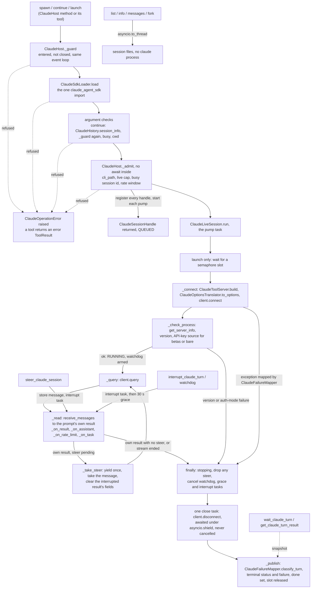

feat(harnesses): add ClaudeHost with one agent tool per Claude Code function

## Summary
This PR adds `ClaudeHost`, an async context manager in `vidbyte.harnesses.native.claude` that drives the user's installed Claude Code through the official `claude-agent-sdk`. It offers fifteen small methods: readiness, models, rate limits, spawn, continue, fork, launch, three session-history reads, wait, result, steer, interrupt and usage. The same fifteen ship as `BaseTool`s, bundled as `ClaudeTools`. Every failure is a `ClaudeOperationError` with a code (sixteen new `claude.*` codes plus existing `configuration.*`, `input.empty` and `action.precondition_failed`), a reason and a next step, and each tool turns that error into an error `ToolResult` instead of raising. The design decision that matters most: each turn owns exactly one `claude` process, from connect until the turn's last result, inside a `ClaudeLiveSession` that closes it through one close task nothing cancels. Spawn returns the handle at once, the turn publishes its terminal status only after its process is closed, and history reads and fork read session files in a worker thread without starting a process. Spec: `docs/spec/claude-host/spec.md` (r6).

## Motivation
The request was a vocabulary of small Claude Code functions ("launch a claude session", "fork", "launch with x tools") under `vidbyte/harnesses`, each also wired to `vidbyte/tools` so agents get them as tools instead of improvising them during a run, and each handling its own errors with semantic messages (request.md §A, Prompts 1–3). Today nothing in vidbyte-sdk wraps Claude Code, so a caller either shells out to `claude -p` and parses text or learns `claude-agent-sdk`'s client lifecycle, message types and failure shapes. This PR builds only the fifteen ★ functions of the accepted design reply (R3). The unstarred functions, a shared base with CodexHost (built in parallel as #1055), and root `vidbyte` exports are left for later PRs (spec §3, NG-1, NG-3, NG-4).

## Compatibility
- **New optional extra `vidbyte-sdk[claude]`.** The only `pyproject.toml` change adds `claude = ["claude-agent-sdk>=0.2.165,<0.3.0"]` under `[project.optional-dependencies]`, before `codex`. The base dependencies, `requires-python = ">=3.11"`, `codex` and `dev` are unchanged. Without the extra, `import vidbyte` and every new module still import, because `claude_agent_sdk` is imported only inside `ClaudeSdkLoader.load`. Only a `ClaudeHost` call then fails, with `claude.sdk_unavailable` and the next step `Install the extra: pip install "vidbyte-sdk[claude]".` CI installs `.[dev]` only, so CI never imports the SDK.
- **Installed `claude` CLI, version 2.1.296 or later.** `ClaudeHost` starts the user's own `claude` executable: the `cli_path` given, else the one found on the PATH or in the SDK's install locations. It never uses the CLI bundled inside `claude-agent-sdk`. On Windows only a native `claude.exe` is started; an npm `.cmd`/`.bat` shim counts as not installed (`claude.not_installed`). The floor is `CLAUDE_MIN_CLI_VERSION = "2.1.296"`. Readiness and every turn check it before any prompt is sent, and an older or unreported version gives `claude.version_unsupported` ("Run claude update."). The CLI must also be signed in or have an API key (`claude.not_signed_in`), and `betas` or `bare` need an API-key login (`claude.auth_mode_unsupported`).
- **No existing export changes or breaks.** The diff deletes no line under `vidbyte/` or in `pyproject.toml`. `vidbyte/__init__.py` and `contracts/sdk-public-api.json` are untouched, and `generate-sdk-public-api.py --check` reports the contract current (606 exports). The PR adds, and removes nothing from, four export lists:
  - `vidbyte.lib.enums`: 17 enums;
  - `vidbyte.lib.errors`: `ClaudeOperationError`;
  - `vidbyte.tools.builtins`: the 15 tools;
  - `vidbyte.tools.toolsets`: `ClaudeTools`.

  `FailureCode` gains 16 `claude.*` members in one block before `CODEX_*`, and every existing member keeps its name and value. The agent base class, the MCP server package and `CodexHarnessAgent` are not changed.

## How to use what this PR introduces
```python
import asyncio

from vidbyte.harnesses.native.claude import ClaudeHost
from vidbyte.lib.dataclasses.claude import ClaudeSpawnRequest
from vidbyte.lib.enums.claude import ClaudePermissionMode

async def main() -> None:
    async with ClaudeHost() as host:
        readiness = await host.check_claude_ready()
        if readiness.failure is not None:
            print(readiness.failure.code.value, readiness.failure.next_step)
            return
        request = ClaudeSpawnRequest(
            prompt="List the TODO comments in this repository.",
            cwd="C:/work/repo",
            permission_mode=ClaudePermissionMode.PLAN,
            max_budget_usd=0.50,
        )
        handle = await host.spawn_claude_session(request)
        result = await host.wait_claude_turn(handle, timeout_seconds=600)
        print(result.status.value, result.result_text)
        usage = await host.track_claude_session_usage(handle)
        print(usage.total_cost_usd)

asyncio.run(main())
```
This is spec §4's snippet, unchanged; it runs as written on this branch. I ran it over the test pack's fake SDK seam (`FakeClaudeSdk().patched()` with `shutil.which` patched to a fake `claude.exe`), the same way `HostSnippetTests` does, so no real `claude` process started. The fake answers every prompt with `Answer: <prompt>` at a cost of 0.0123. Observed output:
```text
completed Answer: List the TODO comments in this repository.
0.0123
```
The fake built two clients (the readiness probe and the turn), sent one query, and disconnected each client once. With `ClaudeProbe.locate_cli` patched to find no CLI, the same script prints `claude.not_installed Install Claude Code (the native claude.exe on Windows), or pass cli_path to ClaudeHost.` and builds no client.

The developer no longer finds the CLI, checks its version, builds `ClaudeAgentOptions`, drains message iterators, closes processes or parses failure shapes. For an agent, `ClaudeTools(host, ClaudeSpawnRequest(cwd=..., max_budget_usd=1.0))` gives the same fifteen functions as tools; the model supplies only prompts, ids and limits, and the base request fixes every other setting. The WRITE tools need `PermissionPolicy` to allow `ToolPermission.WRITE` (spec §4's second snippet; proven by `AgentSnippetTests` with a scripted model).

## Flow

Validation happens twice before any process starts: the request record checks itself in `__post_init__`, and the host runs its checks in `_admit` with no await between them and the registration, so two calls can never both pass the cap or the busy check. State changes only in the host's registry, written in `_admit`, and in the session, which replaces its frozen `ClaudeTurnResult` as the turn moves from QUEUED to RUNNING to one terminal status. A refusal before the pump starts raises `ClaudeOperationError`; after that, exceptions and stream facts land in the session's `ClaudeTurnOutcome`, and `classify_turn` picks one code only after the close task has finished. An interrupt that Claude Code acknowledges but never answers ends the turn after `CLAUDE_INTERRUPT_GRACE_SECONDS` (30 s) through the same close.

## What changed
All 69 files are additions only (18,221 lines added, 0 deleted).

| File | Change |
|---|---|
| `pyproject.toml` (+3) | New optional extra `claude = ["claude-agent-sdk>=0.2.165,<0.3.0"]`, placed before `codex`. |
| `REPO_MAP.md` (+4) | File Index entry for `vidbyte/harnesses/native/`, with the text fixed by the shared contract in request.md §C. |
| `vidbyte/harnesses/README.md` (+1) | Key-modules bullet for `native/`. |
| `vidbyte/harnesses/native/__init__.py` (+10) | Parent package marker; bytes fixed by the shared contract (SHA-256 `0374a2c8…942f497a`), identical in the CodexHost PR. |
| `vidbyte/harnesses/native/claude/__init__.py` (+14) | Exports `ClaudeHost`; importing it never imports `claude_agent_sdk`. |
| `vidbyte/harnesses/native/claude/host.py` (+424) | `ClaudeHost`: entry and `aclose`, the fifteen ★ methods, `_guard`, `_admit`, handle lookup and the rate-limit windows. |
| `vidbyte/harnesses/native/claude/session.py` (+533) | `ClaudeLiveSession`: one turn's pump, steer, interrupt, watchdog, grace, its one close task, and publishing. |
| `vidbyte/harnesses/native/claude/failures.py` (+195) | `ClaudeFailureMapper`: the ordered exception table, the turn-classification precedence, and `usage_limited` (D-29). |
| `vidbyte/harnesses/native/claude/options.py` (+312) | `ClaudeOptionsTranslator`: `ClaudeSpawnRequest` to `ClaudeAgentOptions`, CLI flags, env and the image prompt. |
| `vidbyte/harnesses/native/claude/probe.py` (+180) | `ClaudeProbe`: CLI lookup that never returns a Windows `.cmd`/`.bat` shim, the prompt-free initialize probe, version and sign-in checks, models. |
| `vidbyte/harnesses/native/claude/history.py` (+121) | `ClaudeHistory`: list, info, messages and fork through `asyncio.to_thread`, with record conversion. |
| `vidbyte/harnesses/native/claude/sdk.py` (+107) | `ClaudeSdkLoader`, the only `claude_agent_sdk` import, and the `_ClaudeClient` Protocol. |
| `vidbyte/harnesses/native/claude/tool_server.py` (+79) | `ClaudeToolServer` and `ClaudeToolHandler`: a request's `BaseTool`s on one in-process MCP server named `vidbyte`. |
| `vidbyte/lib/constants/claude.py` (+137) | Minimum CLI version 2.1.296, the 30 s grace, the steer yield, CLI lookup paths, initialize field names and every next step. |
| `vidbyte/lib/dataclasses/claude.py` (+573) | `ClaudeSpawnRequest` (58 fields) and its seven sub-records, each validated in `__post_init__`; `_ClaudeFieldRules`. |
| `vidbyte/lib/dataclasses/claude_host.py` (+386) | Host records: settings, handle, failure, turn result, usage, rate window, readiness, model info, session summary and message, turn outcome, SDK types. |
| `vidbyte/lib/enums/claude.py` (+195) | The seventeen Claude enums. |
| `vidbyte/lib/enums/__init__.py` (+36) | Exports the seventeen enums. |
| `vidbyte/lib/enums/failure.py` (+16) | Sixteen `claude.*` `FailureCode` members in one block before `CODEX_*`. |
| `vidbyte/lib/errors/base.py` (+32) | `ClaudeOperationError` with the full A003 diagnostic packet. |
| `vidbyte/lib/errors/__init__.py` (+2) | Exports `ClaudeOperationError`. |
| `vidbyte/tools/builtins/claude/__init__.py` (+54) | Exports the fifteen tools. |
| `vidbyte/tools/builtins/claude/_base.py` (+74) | `_ClaudeBuiltinTool`: holds the host and base request, builds closed schemas, and builds error results from code, reason and next step. |
| `vidbyte/tools/builtins/claude/descriptions.py` (+68) | Model-facing text of the fifteen tools and their parameters. |
| `vidbyte/tools/builtins/claude/readiness.py` (+68) | READ tools: check ready, list models, rate limits. |
| `vidbyte/tools/builtins/claude/sessions.py` (+127) | WRITE tools: spawn, continue, fork, launch. |
| `vidbyte/tools/builtins/claude/history.py` (+93) | READ tools: list sessions, session info, session messages. |
| `vidbyte/tools/builtins/claude/turns.py` (+114) | Wait, result and usage (READ); steer and interrupt (WRITE). |
| `vidbyte/tools/builtins/__init__.py` (+33) | Exports the fifteen tools in sorted order. |
| `vidbyte/tools/toolsets/claude.py` (+83) | `ClaudeTools`: the fifteen tools over one host and one base request. |
| `vidbyte/tools/toolsets/__init__.py` (+3) | Exports `ClaudeTools`. |
| `tests/features/claude_host/FEATURE.md` (+232), `README.md` (+29) | Feature test pack map and folder log. |
| `tests/features/claude_host/claude_host_fixtures.py` (+1094) | The fake SDK seam: fake client, history, MCP server and message builders; no process or socket. |
| `tests/features/claude_host/test_claude_host_acceptance.py` (+271) | Both §4 snippets end to end, and a sync `agent.run()` refused (4 tests). |
| `tests/features/claude_host/test_claude_host_admission.py` (+528) | CLI path, live cap, busy guard, continue, launch, rate-limit refusals (25 tests). |
| `tests/features/claude_host/test_claude_host_contract.py` (+696) | Surface, import boundary, failure codes, enums, marker hash, extra, doc inserts (22 tests). |
| `tests/features/claude_host/test_claude_host_history.py` (+229) | List, info, messages and fork off the loop thread (11 tests). |
| `tests/features/claude_host/test_claude_host_readiness.py` (+469) | Missing extra, CLI lookup, version, sign-in, start failure, models (24 tests). |
| `tests/features/claude_host/test_claude_host_request.py` (+626) | Request validation, option mapping, prompt translation, tool server (18 tests). |
| `tests/features/claude_host/test_claude_host_review_gaps.py` (+377) | Regression cases for review findings R-1, R-2, R-3, R-5, R-6, R-7, R-12, R-22 and R-23 (16 tests). |
| `tests/features/claude_host/test_claude_host_security.py` (+329) | Secret markers never reach reasons, tool output or `repr` (6 tests). |
| `tests/features/claude_host/test_claude_host_stops.py` (+518) | Steer, interrupt, grace, time budget, `aclose` and the one close (23 tests). |
| `tests/features/claude_host/test_claude_host_tools.py` (+332) | Tool contracts, toolset under the default policy, argument types, MCP listing (10 tests). |
| `tests/features/claude_host/test_claude_host_turns.py` (+504) | Spawn snapshot, wait, failure detection, exception mapping, usage, injected results (22 tests). |
| `docs/spec/claude-host/` (24 files, +7910, this `pr-body.md` and the S6 report included) | The spec (r6), request capture, test plan, code map, review, verification log, pipeline state and each stage's report. |

## Acceptance criteria → proof
`<file>::` stands for `tests/features/claude_host/test_claude_host_<file>.py::`. Every test named below exists on this branch and passes.

| AC | What it checks (plain words) | Proven by |
|---|---|---|
| AC-1 | The §4 snippet prints the status, the answer and the cost, or the not-installed line when no CLI is found; no real process starts. | `acceptance::HostSnippetTests::test_the_snippet_prints_the_status_the_answer_and_the_cost`; `acceptance::HostSnippetTests::test_the_snippet_prints_the_not_installed_line_when_no_cli_is_found` |
| AC-2 | Without `claude_agent_sdk`, every ★ call fails with `claude.sdk_unavailable` (readiness reports it), and every import still works. | `readiness::MissingExtraTests`; `contract::ImportBoundaryTests::test_public_imports_never_touch_claude_agent_sdk` |
| AC-3 | Spawn returns a QUEUED or RUNNING handle before the turn ends, and the client gets the host's resolved `cli_path`. | `turns::SpawnSnapshotTests` |
| AC-4 | A wait that times out returns the RUNNING snapshot and the turn goes on; a later wait sees COMPLETED. | `turns::WaitTests::test_a_timed_out_wait_returns_the_running_snapshot_and_the_turn_continues` |
| AC-5 | A budget result subtype ends the turn FAILED with `claude.budget_exhausted` and its next step. | `turns::FailureDetectionTests::test_budget_subtypes_end_with_budget_exhausted` |
| AC-6 | Each stream condition and SDK exception maps to the code the spec's tables name. | `turns::FailureDetectionTests::test_each_stream_condition_maps_to_its_code`; `turns::FailureDetectionTests::test_connect_failures_map_by_exception_and_send_no_prompt`; `turns::FailureDetectionTests::test_denied_tools_complete_with_a_permission_failure`; `turns::ExceptionMappingTests::test_each_exception_maps_to_its_code_and_next_step` |
| AC-7 | Continue on a live session is busy, on an unknown one is not found, and from another folder is an unsupported combination. | `admission::ContinueTests::test_continue_on_a_live_session_is_busy_and_starts_nothing`; `admission::ContinueTests::test_continue_on_an_unknown_session_is_not_found`; `admission::ContinueTests::test_continue_from_another_cwd_is_an_unsupported_combination` |
| AC-8 | Fork returns the new id, starts no client, runs off the loop thread, and maps its errors. | `history::ForkTests` |
| AC-9 | Steer sends `interrupt()`, then one query with the message; a second pending steer and a steer on a finished turn are refused. | `stops::SteerTests::test_steer_interrupts_then_sends_the_message_as_the_next_turn` |
| AC-10 | Interrupt ends a running turn and a queued launch turn INTERRUPTED, and leaves a finished turn unchanged. | `stops::InterruptTests::test_interrupting_a_running_turn`; `stops::InterruptTests::test_interrupting_a_queued_launch_handle_ends_it_at_once_without_a_prompt`; `stops::InterruptTests::test_interrupting_a_completed_turn_returns_it_unchanged` |
| AC-11 | A launch of three prompts with limit 2 never has more than two clients connected, and all three finish. | `admission::LaunchTests::test_launch_runs_every_prompt_with_at_most_limit_connected` |
| AC-12 | Each tool has its ★ name, its READ or WRITE permission and a closed schema, and turns a host error into an error result. | `tools::ToolContractTests::test_every_tool_turns_a_host_error_into_an_error_result` |
| AC-13 | `ClaudeTools` holds the fifteen tools in order; under the default policy READ tools run and WRITE tools are refused. | `tools::ToolsetTests` |
| AC-14 | History reads run off the loop thread, convert their records, and report unknown sessions as `claude.session_not_found`. | `history::SessionListTests`; `history::SessionMessageTests` |
| AC-15 | Usage reports the latest cumulative figures, never a sum, and the latest figures of each background task. | `turns::UsageTests::test_usage_reports_the_latest_result_and_each_task` |
| AC-16 | Rate limits start empty and keep the latest window per type; a refusing account-wide window blocks spawns. | `admission::RateLimitTests` |
| AC-17 | Each request field lands on the SDK option, CLI flag or env variable the spec names, and unset fields are left out. | `request::OptionsMappingTests`; `request::PromptTranslationTests` |
| AC-18 | An invalid field raises `configuration.invalid_argument` or `configuration.unsupported_combination` and names the field. | `request::RequestValidationTests` |
| AC-19 | The shared marker module hashes to the contract SHA-256 in LF and CRLF checkouts. | `contract::MarkerContractTests::test_marker_bytes_match_the_contract_in_lf_and_crlf_checkouts` |
| AC-20 | Request tools ride one MCP server named `vidbyte`, only READ tools are auto-allowed, and a tool error comes back as `is_error` without raising. | `request::CustomToolServerTests`; `request::ToolServerUnitTests` |
| AC-21 | `aclose` ends running and queued turns INTERRUPTED and disconnects each client once; calls before entry, after close or from another loop are refused. | `stops::CloseTests::test_aclose_interrupts_running_and_queued_handles_and_disconnects_each_client_once`; `stops::CloseTests::test_calls_before_entry_are_refused`; `stops::CloseTests::test_a_call_from_another_event_loop_is_refused` |
| AC-22 | A too-old or missing CLI version, and `betas` or `bare` without an API key, fail before any prompt; no account means not signed in. | `readiness::VersionAndAuthModeTests` |
| AC-23 | The sixteen `claude.*` codes form one block before `CODEX_*`, each with a next step. | `contract::FailureCodeContractTests` |
| AC-24 | Secret markers from SDK errors, `env` and `headers` never appear in a reason, a tool output or a `repr`. | `security::SecretMarkerTests`; `security::SecretValidationTests` |
| AC-25 | A turn ends only after its one uncancelled disconnect finishes; until then it stays RUNNING and its session id stays busy. | `stops::CloseTests::test_the_turn_ends_only_after_its_one_disconnect_finishes` |
| AC-26 | A wrong JSON type from the model returns `configuration.invalid_argument` and starts nothing; JSON null means the argument was left out. | `tools::ArgumentTypeTests` |
| AC-27 | The seventeen enums import from `vidbyte.lib.enums`. | `contract::EnumContractTests` |
| AC-28 | `hooks_applied` is True for a request with hooks and None without. | `turns::InitializeAndInjectedResultTests::test_hooks_applied_is_true_with_hooks_and_none_without` |
| AC-29 | `McpStudioServer` lists the fifteen tools with no change to the server package. | `tools::McpListingTests::test_mcp_studio_server_lists_the_fifteen_tools` |
| AC-30 | `max_live_sessions` refuses an extra spawn or launch with `claude.session_busy` and the cap's next step. | `admission::LiveCapTests::test_the_cap_refuses_a_second_spawn_and_a_launch_of_one` |
| AC-31 | The time budget interrupts the turn and ends it FAILED `claude.budget_exhausted`, with one uncancelled disconnect, also when `interrupt()` raises. | `stops::TimeBudgetTests` |
| AC-32 | REPO_MAP and the harnesses README carry the native-package entries at their places. | `contract::DocumentationInsertTests` |
| AC-33 | The `claude` extra pins `claude-agent-sdk>=0.2.165,<0.3.0` and sits before `codex`. | `contract::PackageMetadataTests::test_claude_extra_is_declared_before_codex` |
| AC-34 | `list_claude_models` keeps known effort levels, skips unknown ones, closes the probe and sends no prompt. | `readiness::ModelTests` |
| AC-35 | `ClaudeHost` has exactly the fifteen ★ methods with the spec's signatures. | `contract::HostSurfaceTests` |
| AC-36 | A result Claude Code injected updates usage only; the prompt's own result ends the turn. | `turns::InitializeAndInjectedResultTests::test_an_injected_result_updates_usage_while_the_turn_keeps_running`; `turns::InitializeAndInjectedResultTests::test_a_human_origin_result_is_the_prompts_own` |
| AC-37 | An interrupt that is never answered ends the turn after the grace with one close; a result read before the interrupt returns arms no grace. | `stops::InterruptGraceTests::test_a_the_time_budget_with_an_unanswered_interrupt`; `stops::InterruptGraceTests::test_b_an_explicit_interrupt_that_is_never_answered`; `stops::InterruptGraceTests::test_c_a_steer_whose_interrupt_is_never_answered`; `stops::InterruptGraceTests::test_d_no_grace_is_armed_for_a_result_read_before_the_interrupt_returned` |
| AC-38 | CLI lookup prefers `claude.exe` on Windows, never returns a `.cmd`/`.bat`, checks the SDK's POSIX locations, and an empty path means `claude.not_installed` with no client. | `readiness::LocateCliTests`; `readiness::HostWithoutCliTests::test_a_host_that_found_no_cli_reports_not_installed`; `admission::CliPathTests::test_a_host_that_found_no_cli_refuses_spawns_unless_the_request_names_one` |
| AC-39 | A start failure is `claude.process_exited` with the "run check_claude_ready" next step; after the prompt it gets the usual next step. | `readiness::StartFailureTests::test_readiness_reports_a_start_failure_with_the_start_next_step`; `turns::FailureDetectionTests::test_connect_failures_map_by_exception_and_send_no_prompt`; `turns::FailureDetectionTests::test_a_start_failure_after_the_prompt_gets_the_usual_next_step` |
| AC-40 | A steer whose caller timed out still ends the turn through the grace, with one close and no steered query. | `stops::InterruptGraceTests::test_a_steer_whose_caller_timed_out_still_ends_through_the_grace` |

## Verification
`W` is the worktree and `PY` the `sdk-claude-host` venv's Python 3.11, with the `dev` and `claude` extras (`claude-agent-sdk` 0.2.165). Local gates ran at 3ff4479d; the two later commits change only `docs/spec/claude-host/`, so the code is the same as at 490e627b, the last code commit.

| Gate | Command | Result |
|---|---|---|
| claude_host pack | `PYTHONDONTWRITEBYTECODE=1 PYTHONPATH=$W $PY -P -m pytest $W/tests/features/claude_host -q -p no:cacheprovider --rootdir=$W -c $W/pyproject.toml` | `181 passed in 5.67s` |
| pack, CI view (no `claude_agent_sdk`) | the same pack with `sys.modules['claude_agent_sdk'] = None` | `181 passed in 5.53s` |
| §4 snippet | the snippet as written, over the fake seam (see above) | `completed Answer: List the TODO comments in this repository.` / `0.0123` |
| full local gate: source | `PYTHONPATH=$W $PY scripts/run_ci.py --stage source` | `4182 passed, 27 skipped in 38.56s` / `CI passed.` / exit 0 |
| lint (inside the source stage) | `lint/run.py` | `S064 RATCHETED: 4 known finding(s).` / `SDK-LINT: PASS` |
| full local gate: package | `$PY scripts/run_ci.py --stage package` (no PYTHONPATH) | `No broken requirements found.` / `Installed vidbyte-sdk 0.2.1 passed smoke checks.` / `CI passed.` / exit 0 |
| public API | `PYTHONPATH=$W $PY scripts/generate-sdk-public-api.py --check` | `contracts/sdk-public-api.json is current at f7a02bae… (vidbyte-sdk 0.2.1, 606 exports).` |
| semgrep | `semgrep scan --error --config .semgrep/typed-mapping-boundary-policy.yml vidbyte` (semgrep 1.170.1) | verify-log iteration 2, at 2c537b1a: `Ran 1 rule on 915 files: 0 findings.`; run remotely again by static-policy below |
| shared marker | `git show HEAD:vidbyte/harnesses/native/__init__.py \| sha256sum` | `0374a2c899318e4fdb31c065d951266feaffff5aa736ecde616c4a66942f497a` |
| remote CI, last code commit | `gh workflow run ci.yml` and `static-policy.yml --ref feat/claude-host` | at 490e627b: CI 38519522362 `success` (Source / Python 3.12, Source / Python 3.11, Package); Static policy 38519524093 `success` |
| remote CI, first docs head | the same two dispatches | at a6245d5a: CI 38523773941 `success`: Source / Python 3.12 `4190 passed, 19 skipped, 19 warnings in 48.36s` / `CI passed.`; Source / Python 3.11 `4190 passed, 19 skipped in 46.00s` / `CI passed.`; Package `Installed vidbyte-sdk 0.2.1 passed smoke checks.` / `CI passed.` · Static policy 38523776541 `success`: `Ran 1 rule on 915 files: 0 findings.` |
| remote CI, PR head | the same two dispatches on the head that carries this file | Dispatched after the commit that adds this text, so its run ids and job results appear only in the PR description. |

Both workflows run only on `workflow_dispatch`, so `gh pr checks` lists nothing for this PR; the runs above are read with `gh run view`.

- [x] Existing repository checks pass.
- [x] New or changed package assets are present in the built wheel. All 22 new files under `vidbyte/` are in the wheel the package stage built (`vidbyte_sdk-0.2.1-py3-none-any.whl`); the PR adds no non-Python asset.
- [ ] Documentation and examples reflect the change. REPO_MAP and the harnesses README are updated, and the spec's §4 snippets are tested; `vidbyte/tools/README.md` does not list the Claude tools yet (R-20, follow-up; spec NG-8 kept it out of this PR).
- [x] No credentials, private data, generated bytecode, build output, or unrelated changes are included. The diff has no bytecode or build output and no credential patterns; the test pack's secret markers are fake strings. Besides the feature and its tests, the PR carries only `docs/spec/claude-host/`, the spec and pipeline records of this feature.

## Adversarial review
24 findings confirmed by an independent verifier across three lenses (spec conformance, repo conventions, engineering), then a conformance re-review after each of the two repair rounds (the first with its own scoped verifier); 18 fixed, 0 waived, and the other 6 (all Minor) are follow-ups below. 7 claims were refuted or downgraded. The final re-review found the branch SOUND with 0 Blocker, 0 Major and 2 new Minors (R-C4, R-C5), both follow-ups. Full record: `docs/spec/claude-host/review.md`.

| ID | Finding | Fixed in |
|---|---|---|
| R-1 (Blocker) | A steered prompt whose output ended before its own result was classified from the interrupted prompt's stale result as `claude.api_error`. | dc9d1734 |
| R-2 (Blocker) | A steer that arrived after the result was buffered went out before its own interrupt, which then aborted the steered prompt. | 4ad8f35d (moved by R-22) |
| R-3 (Blocker) | SDK records were read through `vars()` with empty defaults, so SDK field drift became empty text instead of `claude.protocol_mismatch`. | 52a482d4 |
| R-4 (Major) | The pump's call chain is two levels deep and the spec did not record it. | 3c1f9e4c (spec r5, deviation 12) |
| R-5 (Major) | A continue still reading the session file when `aclose()` ran started a turn after `aclose` returned. | 303b8f8a |
| R-6 (Major) | A rejected per-model weekly window (`seven_day_opus`, `seven_day_sonnet`) refused every spawn of every model for up to 7 days. | 3c1f9e4c (spec r5) and d52a1fc8 |
| R-7 (Major) | Four guarded behaviours could be removed with the pack still green, and R-1, R-2 and R-5 had no test. | 2e0a9482 and 3cf7b7c8 |
| R-22 (Major) | R-2's fix took the steer out of its slot one loop pass before sending it, so a stop in that pass could no longer withdraw it. | b5989730 |

Minor fixes: R-8, R-9 (spec r5, 3c1f9e4c), R-10 (3ce56cd4), R-11 (c5d243a9), R-12 (3cf7b7c8), R-13 (5093e792), R-14 (04e0254b), R-19 (spec r5), R-23 (2c537b1a) and R-24 (spec r6, 9211d4ef).

## Deviations from the spec
The spec records fourteen implementation deviations in §17; none adds behaviour beyond §12.
1. **Constants.** Operation and initialize-field names are constants, but SDK record keys, the result-subtype and assistant-error vocabularies, `_HUMAN_ORIGIN` and one `"get_server_info"` stay private module literals (moving them is R-15).
2. **Failure mapping.** `ValueError` and `TypeError` mean `configuration.invalid_argument` only from connect and fork; elsewhere they are protocol mismatches, and the guarded `try` sits at each SDK call site.
3. **New helpers.** `ClaudeFailureMapper.error`, `ClaudeFailureMapper.usage_limited`, `_ClaudeFieldRules.text` and the host's `_empty` replace code that would repeat.
4. **Probe.** `ClaudeProbe.readiness` also returns the initialize answer, so `list_claude_models` starts Claude Code once.
5. **Close waits.** After a cancellation, the pump and the probe wait again with `asyncio.wait({closing})` instead of a second `asyncio.shield`; the close task is still never cancelled.
6. **Options helpers.** The translator's helpers name their parameter `spawn`, because lint A002 and A007 treat `request` as a boundary name.
7. **Session state.** Live and busy state comes from each session's snapshot status, with no separate session-id map, and steer numbers match each steer to its own interrupt.
8. **Host checks.** Continue checks the busy session before the cwd check, and `_admit` repeats it harmlessly; a second `__aenter__` is not refused (EC-61).
9. **Tool base.** Arguments are read with the existing `BaseTool._optional_argument`, and one `_spec` helper builds every closed schema.
10. **Descriptions.** Parameter descriptions shared by several tools are shared constants.
11. **Comment format.** Every comment line the branch adds fits in 72 columns.
12. **Pump call depth.** `run` → `_read` → `_on_<kind>` is two levels deep, against AGENTS.md principle 1: lint S024 rejects the folded form and the spec's 69-class budget rejects a reader class.
13. **Error placement.** `ClaudeOperationError` sits directly after `AggregateExecutionError` (`vidbyte/lib/errors/base.py:198`), not directly before `ConfigurationError`, because the spec's two anchors are not adjacent on `main`.
14. **Steer yield.** Before a steered prompt, the pump yields once (`CLAUDE_STEER_YIELD_SECONDS = 0`) inside `_take_steer`, before it takes the message, so the steer's interrupt reaches Claude Code first and a stop in that pass can still withdraw the message.

Spec text that trails the code (no behaviour difference): §12.3 row 7 and the §17 deviations do not describe R-23's reset. When the pump takes a steer, it clears the interrupted prompt's result fields and keeps the session id, `hooks_applied` and the cumulative cost (R-C5); spec §5, redrawn for this PR to match the flow chart above, does show it.

## Follow-ups
- **R-15:** move the classification vocabularies and the duplicated operation names into `CLAUDE_*` constants.
- **R-16:** comments and docstrings cite spec IDs such as `(INV-3)` at 69 sites, which show in `help()`.
- **R-17:** a handle or request that is not a record raises a raw `AttributeError` or `TypeError` instead of a coded error (only a developer misusing the typed API can reach it; model JSON is checked).
- **R-18:** each finished handle keeps its request, its client object and its finished interrupt tasks until `aclose`.
- **R-20:** `vidbyte/tools/README.md` does not list the Claude tools (NG-8 kept that file out of this PR).
- **R-21:** `aclose` does not wait for an in-flight `check_claude_ready` or `list_claude_models` probe; the probe still closes its own client when it finishes.
- **R-C4:** `SteeredResultFieldsTests` asserts only the kept `total_cost_usd`; an edit that also cleared `session_id` would pass the pack. One more assertion fixes it.
- **R-C5:** the spec text gap above.
- The header of `test_claude_host_review_gaps.py` lists only R-1 to R-12, though the file also covers R-22 and R-23.
- **Optional questions, all default no and not built:** Q-1 to Q-13 in spec §15, including Q-12 (refuse a spawn while its own model's per-model window is rejected) and Q-13 (refuse a tool-started continue whose recorded folder differs from the base request's `cwd`).
- **Known limitations (spec §10, §6.3):** the history tools can read every project's transcripts (T-2); MCP `env` and `headers` and inline `settings` reach the `claude` command line (T-3); `McpStudioServer` serves the WRITE tools without a permission gate (T-4); a native background subagent still running at its turn's result is stopped (EC-45); two hosts on one session cannot see each other (EC-47).
- **Not tested here:** no test runs a real `claude` (NG-10); live checks against the installed CLI are manual QA after this PR.
- **Later PRs:** the unstarred ClaudeHost functions (NG-1), a shared base with CodexHost (NG-3), and root `vidbyte` exports (Q-10).

🤖 Generated with [Claude Code](https://claude.com/claude-code)
