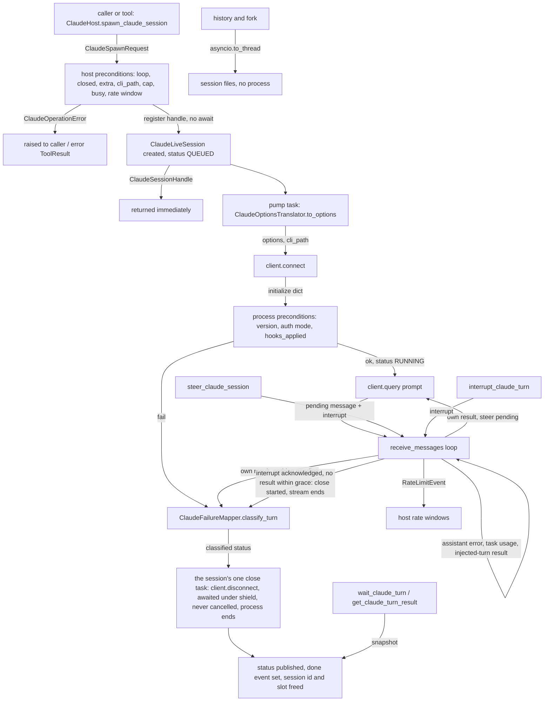
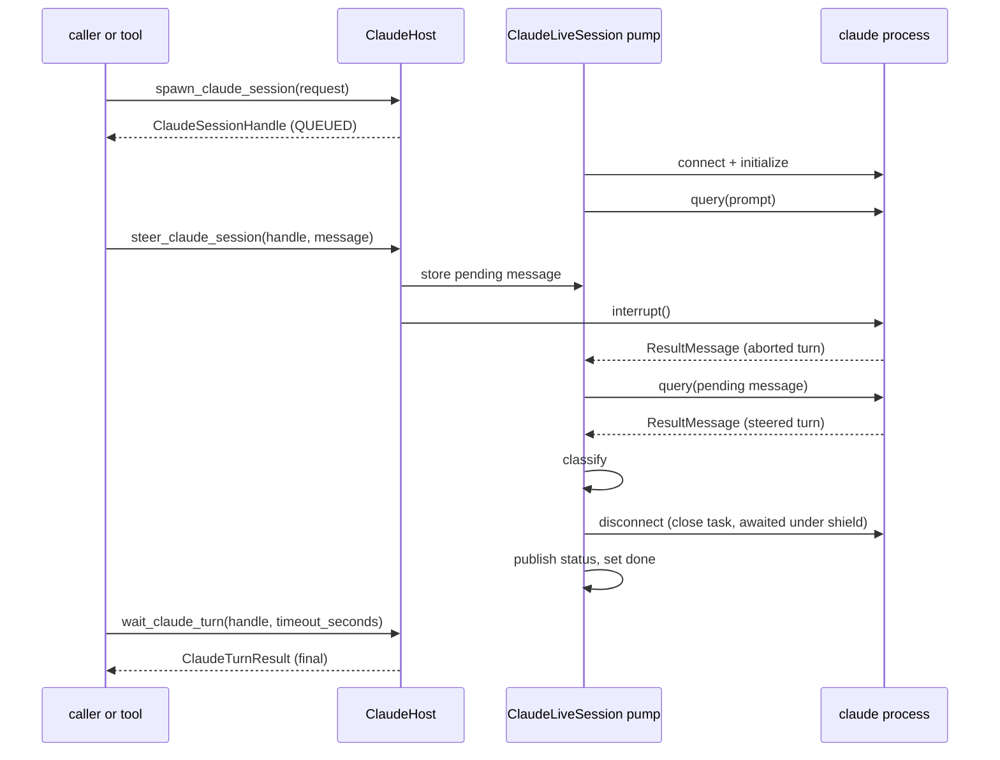

# Spec: ClaudeHost: small atomic Claude Code functions with one agent tool per function

> **TL;DR** — This PR adds `ClaudeHost`, an async context manager in the SDK that drives the user's installed Claude Code through the official `claude-agent-sdk`. It exposes R3's 15 ★ functions as small methods (readiness, models, rate limits, spawn, continue, fork, three history reads, wait and result, steer, interrupt, usage, and subagent fan-out), one agent tool per function, and a `ClaudeTools` toolset. Every failure comes back as a `claude.<problem>` code with a next step. The design decision that matters most: **each turn owns exactly one `claude` process, from connect to its result, inside the host**. Spawn returns a handle immediately, and history and fork read session files without starting a process.

## §0 User prompts

### 0.1 Invoking request (verbatim)
great, using the spec-pipeline skill file do you think that you can implement the Codexhost and ClaudeHost functionality in the vidbyte-sdk/ in parallel in 2 seperate prs. Coordinate 2 sets of subagents that use the skill file to develope the 2 features in parallel

### 0.2 User replies during the run
_None yet. The orchestrator appends any reply the user sends during the run here verbatim, labeled with the revision it produced._

---

## Part A — Framing

## §1 Goal

Today, an agent or a developer who wants Claude Code to do work from Python has two options. They can shell out to `claude -p` and parse text, or they can learn `claude-agent-sdk`'s client lifecycle, message types and failure shapes themselves. Nothing in vidbyte-sdk wraps Claude Code at all: request.md §C and code-map §2.1 record that no Claude record, enum, failure code, extra or adapter exists. The user wants a vocabulary of small functions ("launch a claude session", "fork", "launch with x tools"), each also usable as an agent tool, so that composing harnesses ("3 codex subagents, 4 claude subagents, and then using a grok thread to merge the results") is "only a few functions" (request.md §A Prompt 1, Prompt 2, Prompt 3).

| ID | Goal (outcome) | How we will know | Source |
|---|---|---|---|
| G-1 | A developer can check, start, continue, fork, steer, interrupt, wait on and measure Claude Code sessions from Python through the 15 ★ functions, without touching `claude-agent-sdk` types. | The §4 snippet runs. Every ★ row of R3 "ClaudeHost: full list" has one method on `ClaudeHost` with R3's name. | request.md §C "The ★ functions"; Prompt 2, Prompt 3 |
| G-2 | An agent gets each capability as a tool, so it does not have to improvise shell commands during its run. | One `BaseTool` per ★ function, bundled as `ClaudeTools`, usable by `BaseAgent` and servable by the existing MCP server. | Prompt 2 ("connect each individual function to the vidbyte/tools folder"); Prompt 1 ("agent terminal toolset mcp") |
| G-3 | Every failure is semantic and actionable: a `claude.<problem>` code, a reason and a next step. Tools return error results instead of raising. | Each R3 "Claude detects it via" condition produces its code, and no tool raises into the agent loop. | Prompt 2 ("return semantic error messages ... each funciton shoulllld make sure to handle errors"); R3 "One error vocabulary" |
| G-4 | Cross-harness code can call ClaudeHost and CodexHost with the same verbs and problem names. | Names match R3 "Shared vocabulary". Problem names match R3's error table. | Prompt 2 ("apply this same principle/philosophy"); R3 |

## §2 Objective

When this PR merges, the repository will contain the following, and none of it exists today:

- A new package `vidbyte.harnesses.native.claude` exporting `ClaudeHost`. It implements the 15 ★ functions of R3, owns one `claude` process per running turn, and uses the user's installed `claude` by default, after a minimum-version check.
- The shared parent marker `vidbyte.harnesses.native`, byte-identical with the CodexHost PR.
- Validated records in `vidbyte.lib.dataclasses.claude` and `vidbyte.lib.dataclasses.claude_host`. `ClaudeSpawnRequest` carries 58 fields: R3's list, with `prompt` split into text and images, and `prompt_suggestions` dropped.
- Seventeen enums in `vidbyte.lib.enums.claude`, exported from `vidbyte.lib.enums`.
- Constants in `vidbyte.lib.constants.claude`.
- Sixteen `claude.*` members of `FailureCode`.
- `ClaudeOperationError` in `vidbyte.lib.errors`.
- Fifteen model-facing tools in `vidbyte.tools.builtins.claude`, exported from `vidbyte.tools.builtins`.
- The `ClaudeTools` toolset, exported from `vidbyte.tools.toolsets`.
- The optional extra `vidbyte-sdk[claude]`.
- A REPO_MAP entry and a harnesses README bullet.

This PR is slice B of two parallel PRs, alongside CodexHost. It builds only R3's ★ rows. The unstarred rows and the shared-base extraction are later PRs (NG-1, NG-3).

## §3 Non-goals

- **NG-1** — R3's unstarred ClaudeHost functions, such as `prewarm_claude_session`, `run_claude_once`, background sessions, `rename/tag/delete_claude_session`, `stream_claude_session`, `set_claude_model`, context usage, MCP management, plugins, cloud and ultrareview, and `plan_claude_fan_out`. — *Why not:* R3's legend makes ★ the first PR, and Prompt 4 asks for one PR per host (request.md §C "Key decisions").
- **NG-2** — ⚑ functions and any use of the private `_send_control_request`, including R3's second source for rate limits, "⚑ `get_usage`". — *Why not:* the Q1 default was accepted in Prompt 4 (request.md §C "Answers to R3").
- **NG-3** — A shared base class or module with CodexHost (error envelope, tool base, handle registry). — *Why not:* both PRs are built in parallel, so each would contain one implementation (request.md §C "Rejected alternatives").
- **NG-4** — Root `vidbyte` exports and regenerating the public-API contract. — *Why not:* no repo rule requires a root export. Each one changes the generated contract (C016) and costs a merge conflict with the CodexHost PR. Users import from the subpackages shown in §4. Optional Q-10.
- **NG-5** — Edits to the agent base class or to the MCP server package. — *Why not:* tools hold their host directly, so the agent's hard-coded binding lists need no change (code-map §4.1 #14). The MCP server already serves any `Sequence[BaseTool]` (code-map §2.4).
- **NG-6** — Controls that the conversation never asked for:
  - a permission gate on the MCP server;
  - history scoped to one project;
  - clipping of long tool outputs;
  - a per-toolset handle scope;
  - a memory governor, or a default concurrency cap;
  - a process reaper beyond the SDK's own;
  - stopping new spawns on an `allowed_warning` rate-limit status;
  - letting the model choose spawn knobs per call;
  - forgetting finished handles before close.

  *Why not:* hard rule 9. Each is an optional `Q-n` with default **no** (§15).
- **NG-7** — The R3 spawn field `prompt_suggestions`. — *Why not:* the CLI emits suggestion messages after the turn's result, and claude-agent-sdk 0.2.165's parser drops message types it does not know. No ★ function could ever surface one, so the field would be a false contract. Optional Q-6.
- **NG-8** — A README for the native package, C008's canonical shared validation module, edits to the tools README, and rewording the stale REPO_MAP toolsets sentence. — *Why not:* the shared-file contract forbids the README (request.md §C). Creating C008's shared module is its own change. The other two edit existing text that the CodexHost PR may also touch, and the contract allows inserts only.
- **NG-9** — Measuring memory per `claude` process, or choosing a default concurrency cap. — *Why not:* request.md says "do not invent a threshold". The cap is developer-set (D-22).
- **NG-10** — Live tests against a real `claude`, or any network call in CI. — *Why not:* CI has no Anthropic credentials, and spawned sessions draw from the user's plan window (request.md §C "Shared plan window"). Live checks are manual QA after S6.
- **NG-11** — Re-exporting Claude records or constants from the `vidbyte.lib.dataclasses` or `vidbyte.lib.constants` packages. — *Why not:* AGENTS.md says to import a record from its domain module, and those package `__init__`s are shared hot spots with the CodexHost PR.

## §4 Developer usage

```python
import asyncio

from vidbyte.harnesses.native.claude import ClaudeHost
from vidbyte.lib.dataclasses.claude import ClaudeSpawnRequest
from vidbyte.lib.enums.claude import ClaudePermissionMode

async def main() -> None:
    async with ClaudeHost() as host:
        readiness = await host.check_claude_ready()
        if readiness.failure is not None:
            print(readiness.failure.code.value, readiness.failure.next_step)
            return
        request = ClaudeSpawnRequest(
            prompt="List the TODO comments in this repository.",
            cwd="C:/work/repo",
            permission_mode=ClaudePermissionMode.PLAN,
            max_budget_usd=0.50,
        )
        handle = await host.spawn_claude_session(request)
        result = await host.wait_claude_turn(handle, timeout_seconds=600)
        print(result.status.value, result.result_text)
        usage = await host.track_claude_session_usage(handle)
        print(usage.total_cost_usd)

asyncio.run(main())
```

The developer sees one of two outputs:

- **Ready:** `completed` followed by Claude's answer, then the dollars the turn cost. A failed turn prints `failed` instead, and `result.failure` carries the code and next step.
- **Not ready:** one line such as `claude.not_installed Install Claude Code (the native claude.exe on Windows), or pass cli_path to ClaudeHost.`

The developer no longer has to find the CLI, check its version, build `ClaudeAgentOptions`, drain message iterators, close processes, or parse failure shapes.

The same host as tools, for an agent run under `arun` inside the host's `async with`:

```python
from vidbyte import BaseAgent, ToolPermission
from vidbyte.harnesses.native.claude import ClaudeHost
from vidbyte.lib.dataclasses.claude import ClaudeSpawnRequest
from vidbyte.lib.dataclasses.security import PermissionPolicy
from vidbyte.tools.toolsets.claude import ClaudeTools

async def compare_reviews() -> str:
    async with ClaudeHost(max_live_sessions=4) as host:
        agent = BaseAgent(
            name="orchestrator",
            system_prompt="Run Claude Code sessions with your tools and compare what they find.",
            tools=ClaudeTools(host, ClaudeSpawnRequest(cwd="C:/work/repo", max_budget_usd=1.0)),
            permission_policy=PermissionPolicy(allowed=frozenset({ToolPermission.SAFE, ToolPermission.READ, ToolPermission.WRITE})),
            provider="openai",
            model_name="gpt-4.1",
        )
        reply = await agent.arun("Launch two Claude sessions that each review src/, then compare their findings.")
        return reply.content
```

## §5 Flow diagram





How the flow works:

- **Validation** happens in two places. The request record checks itself on construction. The host's preconditions then run synchronously, with no await between the check and the registry insert, so the cap and the busy guard cannot race.
- **State changes** happen only inside the host's registry and the `ClaudeLiveSession` that owns each turn. Status moves from QUEUED to RUNNING and then to exactly one terminal state.
- **Failures** are caught at two points. Host preconditions raise `ClaudeOperationError` before any process starts. Everything after the process starts lands in the turn result through `ClaudeFailureMapper`, so a dead process or a refused precondition is a result, never a hang. An interrupt that the CLI acknowledges but never answers with a result ends the turn after `CLAUDE_INTERRUPT_GRACE_SECONDS` (D-4). Every disconnect runs in the session's one close task, which nothing ever cancels, and the pump publishes the terminal status only after that close has completed. So a finished turn never leaves its process running (INV-8).

---

## Part B — Behavior (this is the spec; everything else is framing)

## §6 Behavior

### 6.1 Invariants

- **INV-1** — Importing `vidbyte`, `vidbyte.tools.builtins`, `vidbyte.tools.toolsets`, `vidbyte.tools.toolsets.claude`, `vidbyte.harnesses.native` or `vidbyte.harnesses.native.claude` never imports `claude_agent_sdk`.
  - The vendor SDK is imported in exactly one function, `ClaudeSdkLoader.load`, and only when a ★ function first needs it.
  - The tools package imports `ClaudeHost` only under `TYPE_CHECKING`.
- **INV-2** — Every ★ function handles its own errors. It either returns its documented record or raises `ClaudeOperationError`.
  - `failure_code` is a `FailureCode` value, and `reason` and `next_step` are non-empty.
  - The single exception is `check_claude_ready`, which reports Claude-side problems (missing extra, CLI, version, login, probe failure) in `ClaudeReadiness.failure` and never raises for them.
  - No ★ function lets a vendor or builtin exception escape, except `asyncio.CancelledError` and other `BaseException`s, which always propagate.
- **INV-3** — `spawn_claude_session`, `continue_claude_session` and `launch_claude_subagents` return their handles before any turn they start can finish. The returned statuses are QUEUED or RUNNING, never terminal, except for a QUEUED handle the caller interrupts afterwards.
- **INV-4** — Within one host, at most one live handle exists per session id at any time. A live handle has status QUEUED or RUNNING. A second spawn, continue or launch that targets a live session id raises `claude.session_busy` and starts no process.
- **INV-5** — When `max_live_sessions` is set, the number of live handles in the host never exceeds it.
- **INV-6** — `launch_claude_subagents` registers all N handles or none: a refused launch leaves the registry unchanged.
- **INV-7** — Every turn reaches exactly one terminal status (COMPLETED, FAILED or INTERRUPTED), exactly once. Its done signal fires exactly once, and a terminal status never changes afterwards. Only the prompt's own result can end a turn (D-28); the result of a turn the CLI injected never does. Once an `interrupt()` call returns, whether the time-budget watchdog, `interrupt_claude_turn` or a steer sent it, the wait for that interrupt's result ends when the result arrives or when `CLAUDE_INTERRUPT_GRACE_SECONDS` expires, whichever comes first. On expiry the turn becomes terminal and the client is disconnected once (D-4). No grace runs for a prompt whose result the pump had already read when the interrupt returned.
- **INV-8** — Every `claude` client the host constructs is disconnected exactly once, in one close task that nothing ever cancels (D-4). A turn reaches its terminal status, fires its done signal and frees its session id and cap slot only after its client's close has completed, and a probe returns only after its own close has completed. So no client stays connected after its turn is terminal, and no idle `claude` process exists.
- **INV-9** — `wait_claude_turn` never cancels, interrupts or alters the turn. It returns within `timeout_seconds` plus scheduling delay. On timeout it returns the current QUEUED or RUNNING snapshot instead of raising.
- **INV-10** — The host never lets the SDK fall back to its bundled CLI. Every client and probe receives an explicit `cli_path`: the request's when it is non-empty, otherwise the host's resolved path, which is the host's own `cli_path` or else the installed `claude` found when the host was entered (D-5). On Windows, a path that names a `.cmd` or `.bat` script is never passed to the SDK. If the chosen path is empty after that screening, the operation fails with `claude.not_installed` before any process starts. A request path that screens to empty never falls back to the host's path.
- **INV-11** — When a precondition fails, no prompt is sent, so nothing is spent. This covers:
  - every host-side precondition, which also starts no process;
  - the version and auth-mode checks after connect;
  - an interrupt requested before the first query, and a host closing before the first query.
- **INV-12** — No `reason` or `next_step`, and no tool output or tool metadata text that Vidbyte composes, contains raw exception text (`str(exc)`, `repr(exc)` or an f-string of a caught exception), or any value from the request's `env` or MCP `headers`. Reasons name the operation, the SDK exception class or result fields such as `subtype` and `terminal_reason`. Text that Claude Code itself returns, such as result text or a transcript, is passed through as it is. The `repr` of a request or an MCP server record never shows `env` or `headers` either: those fields are declared with `repr=False`. That hides them from `repr` only; T-3 states what it does not cover.
- **INV-13** — The 15 Claude tools never raise for a `ClaudeOperationError`. Each returns `ToolResult.error` with output `"<code>: <reason> Next step: <next_step>"` and `metadata={"error": <code>, "error_type": "ClaudeOperationError"}`.
- **INV-14** — Tool permissions follow R3's R/W column:
  - READ: `check_claude_ready`, `list_claude_models`, `get_claude_rate_limits`, `list_claude_sessions`, `get_claude_session_info`, `get_claude_session_messages`, `wait_claude_turn`, `get_claude_turn_result`, `track_claude_session_usage`.
  - WRITE: `spawn_claude_session`, `continue_claude_session`, `fork_claude_session`, `steer_claude_session`, `interrupt_claude_turn`, `launch_claude_subagents`.
  - Under the default `PermissionPolicy` (SAFE and READ allowed), every WRITE tool is refused until the developer opts in.
- **INV-15** — A host serves only the event loop that entered it. Any ★ function or `get_handle` call fails with `action.precondition_failed` if it comes:
  - before `__aenter__`;
  - after `aclose`;
  - from a different running loop.

  A host is meant to be entered once, and nothing reopens it: a later `__aenter__` leaves a closed host closed, so every call after `aclose` stays refused (EC-61).
- **INV-16** — History reads and fork never start a `claude` process. They run the SDK's synchronous file functions in a worker thread (`asyncio.to_thread`), so a slow `git worktree list` never blocks the event loop.
- **INV-17** — A request whose `system_prompt` is left at its default sends Claude Code's `claude_code` preset, never an empty system prompt.
- **INV-18** — A steer is delivered exactly once, as the next turn after the interrupted one, unless the grace expires first, in which case it is never sent.
  - A handle holds at most one pending steer.
  - The host refuses a steer while another is pending, while the turn is QUEUED or stopping, and after the turn is terminal.
  - An explicit interrupt or an expired time budget discards a pending steer before it is sent.
  - So does a steer whose own interrupt gets no result within `CLAUDE_INTERRUPT_GRACE_SECONDS`. The turn then ends INTERRUPTED, and the message is never sent.
  - If the message is discarded before the steer call returns, by an explicit interrupt, the time budget, or the turn ending before the interrupt is answered, the call raises `action.precondition_failed`.
- **INV-19** — A failed turn carries exactly one failure code, chosen by the precedence in §9.2 "Turn classification".
- **INV-20** — `track_claude_session_usage` takes dollars and per-model totals from the latest `ResultMessage` of the handle. Those values are cumulative across the session's turns (A-11), so they are never summed across results. A result from a crash or a startup error may carry zeroed figures, and the snapshot reports them as they are (EC-58).
- **INV-21** — The committed `vidbyte.harnesses.native` marker module is byte-identical to the request.md §C contract block, with LF line endings and a final newline. Its SHA-256 is `0374a2c899318e4fdb31c065d951266feaffff5aa736ecde616c4a66942f497a`.
  - Git checks text files out with CRLF on this machine (`core.autocrlf=true`, no root `.gitattributes`). So the hash is taken over the committed blob, or over the file's bytes with every CRLF converted to LF, and never over the raw checked-out bytes.
  - The contract bytes themselves never change.
- **INV-22** — The 16 `claude.*` failure codes form one contiguous block placed directly before the first `CODEX_*` member, and never adjacent to the end of the `CODEX_*` block. Every `claude.*` code has a non-empty next step in `CLAUDE_FAILURE_NEXT_STEPS`, and every key of that mapping is a real `claude.*` code.

**Must not regress:**
- **INV-23** — Every existing `FailureCode` member keeps its name and value, and every code still has a category prefix. Implemented today by `vidbyte/lib/enums/failure.py:FailureCode` and checked by `tests/test_session_failures.py:test_every_code_has_category_prefix`.
- **INV-24** — The default `PermissionPolicy` still allows exactly SAFE and READ, and existing builtins, toolsets, enums and errors keep every export they have today. Implemented today by `vidbyte/lib/dataclasses/security.py:PermissionPolicy` and the export lists in `vidbyte/tools/builtins/__init__.py`, `vidbyte/tools/toolsets/__init__.py`, `vidbyte/lib/enums/__init__.py` and `vidbyte/lib/errors/__init__.py`.
- **INV-25** — The package smoke still passes from a wheel installed without extras: `import vidbyte` and `from vidbyte import Prompts, VidbyteSDK`. Implemented today by the package stage of `scripts/run_ci.py` (:180-218).
- **INV-26** — `CodexHarnessAgent`, the `codex` extra and every `CODEX_*` member are untouched. Implemented today by `vidbyte/agents/codex/`, the `codex` list in `pyproject.toml` (:42-44) and `vidbyte/lib/enums/failure.py` (:35-46).

### 6.2 Acceptance criteria

"Fake SDK" below means the test seam in §13: `ClaudeSdkLoader.load` patched to return a `ClaudeSdkTypes` built from fakes. No criterion requires a real `claude`.

| ID | Given | When | Then | Priority | Proof |
|---|---|---|---|---|---|
| AC-1 | a clean checkout of this branch, the fake SDK reporting CLI 2.1.296, a signed-in account and one successful result, and an explicit or resolvable `cli_path` | the §4 snippet runs | it prints the status `completed`, the fake result text, and the fake `total_cost_usd`, in that order; no real process starts | P0 | `test_claude_host_acceptance.py::HostSnippetTests::test_the_snippet_prints_the_status_the_answer_and_the_cost`; `test_claude_host_acceptance.py::HostSnippetTests::test_the_snippet_prints_the_not_installed_line_when_no_cli_is_found` |
| AC-2 | `claude_agent_sdk` is not importable | each ★ function is called inside an entered host | each raises `ClaudeOperationError` with `failure_code == FailureCode.CLAUDE_SDK_UNAVAILABLE.value`, except `check_claude_ready`, which returns `failure.code == FailureCode.CLAUDE_SDK_UNAVAILABLE`. Importing every module named in INV-1 still succeeds. | P0 | `test_claude_host_readiness.py::MissingExtraTests`; `test_claude_host_contract.py::ImportBoundaryTests::test_public_imports_never_touch_claude_agent_sdk` |
| AC-3 | the fake client's turn has not produced a result yet | `spawn_claude_session(request)` returns | the handle exists, `get_claude_turn_result` shows QUEUED or RUNNING, and the client was constructed with `cli_path` equal to the host's resolved path, never `None` | P0 | `test_claude_host_turns.py::SpawnSnapshotTests` |
| AC-4 | a running turn | `wait_claude_turn(handle, timeout_seconds=small)` times out, and the fake later emits the result | the first call returns a RUNNING snapshot without raising and the turn continues. A second wait returns COMPLETED with the result text. | P0 | `test_claude_host_turns.py::WaitTests::test_a_timed_out_wait_returns_the_running_snapshot_and_the_turn_continues` |
| AC-5 | the fake result has `is_error=True` with subtype `error_max_budget_usd`, or subtype `error_max_turns` | the turn finishes | status FAILED, `failure.code` `claude.budget_exhausted`, and `next_step` equals the constant for that code | P0 | `test_claude_host_turns.py::FailureDetectionTests::test_budget_subtypes_end_with_budget_exhausted` |
| AC-6 | each detection condition in §9.2 "Turn classification" and "Exception mapping", one at a time | the turn finishes or the call raises | the code is the one that table names: `claude.not_signed_in`, `claude.billing_error`, `claude.usage_limited`, `claude.model_unknown`, `claude.api_error`, `claude.schema_violation`, `claude.process_exited`, `claude.protocol_mismatch`, `claude.not_installed`, `configuration.invalid_argument` (for an SDK `ValueError`), and `claude.permission_denied` (the last one on a COMPLETED turn) | P0 | `test_claude_host_turns.py::FailureDetectionTests::test_each_stream_condition_maps_to_its_code`; `test_claude_host_turns.py::FailureDetectionTests::test_connect_failures_map_by_exception_and_send_no_prompt`; `test_claude_host_turns.py::FailureDetectionTests::test_denied_tools_complete_with_a_permission_failure`; `test_claude_host_turns.py::ExceptionMappingTests::test_each_exception_maps_to_its_code_and_next_step` |
| AC-7 | session S has a live handle in the host | `continue_claude_session(S, "next")` | raises `claude.session_busy` and constructs no client. For an unknown S it raises `claude.session_not_found`. For S recorded with cwd A and a request cwd B (different after normalization) it raises `configuration.unsupported_combination`. | P0 | `test_claude_host_admission.py::ContinueTests::test_continue_on_a_live_session_is_busy_and_starts_nothing`; `test_claude_host_admission.py::ContinueTests::test_continue_on_an_unknown_session_is_not_found`; `test_claude_host_admission.py::ContinueTests::test_continue_from_another_cwd_is_an_unsupported_combination` |
| AC-8 | session S exists in the fake history | `fork_claude_session(S, up_to_message_id, title)` | returns the fake fork's new session id, constructs no client, and calls the fake fork function off the loop thread. A `FileNotFoundError` from the fake maps to `claude.session_not_found`, and a `ValueError` to `configuration.invalid_argument`. | P0 | `test_claude_host_history.py::ForkTests` |
| AC-9 | a RUNNING turn | `steer_claude_session(handle, "focus on tests")` | the fake records `interrupt()`, then after the interrupted result exactly one `query` carrying the message. The handle's final result is the steered turn's result. A second steer before the message is sent raises `action.precondition_failed`, and so does a steer on a terminal turn. | P0 | `test_claude_host_stops.py::SteerTests::test_steer_interrupts_then_sends_the_message_as_the_next_turn` |
| AC-10 | a RUNNING turn, and separately a QUEUED launch handle | `interrupt_claude_turn(handle)` | RUNNING: the fake records `interrupt()` and the final status is INTERRUPTED. QUEUED: the final status is INTERRUPTED and the fake records no `query`. On a terminal turn the call returns the same terminal snapshot unchanged. | P0 | `test_claude_host_stops.py::InterruptTests::test_interrupting_a_running_turn`; `test_claude_host_stops.py::InterruptTests::test_interrupting_a_queued_launch_handle_ends_it_at_once_without_a_prompt`; `test_claude_host_stops.py::InterruptTests::test_interrupting_a_completed_turn_returns_it_unchanged` |
| AC-11 | three prompts and `limit=2` | `launch_claude_subagents(prompts, request, 2)` | returns exactly three handles with distinct session ids. At no instant are more than two fake clients connected for the launch, and all three turns reach a terminal status. | P0 | `test_claude_host_admission.py::LaunchTests::test_launch_runs_every_prompt_with_at_most_limit_connected` |
| AC-12 | each of the 15 tools | its `spec()` is read and `execute` runs with the host raising `ClaudeOperationError` | `spec().name` equals the ★ function name. Permission matches INV-14. `input_schema` has `additionalProperties: false`. The result is an error `ToolResult` per INV-13 and nothing is raised. | P0 | `test_claude_host_tools.py::ToolContractTests::test_every_tool_turns_a_host_error_into_an_error_result` |
| AC-13 | `ClaudeTools(host, request)` | listed and run through `ToolExecutor` with the default `PermissionPolicy` | it holds the 15 tools in the §9.2 order. READ tools run, and WRITE tools return the executor's permission-denied result. | P0 | `test_claude_host_tools.py::ToolsetTests` |
| AC-14 | the fake history functions record their calling thread | `list_claude_sessions`, `get_claude_session_info` and `get_claude_session_messages` run | each SDK call ran off the event loop thread. Results convert to `ClaudeSessionSummary` and `ClaudeSessionMessage` with the §9.1 text rendering. `None` info maps to `claude.session_not_found`. Empty messages for an unknown id map to `claude.session_not_found`, and for a known id return `()`. | P0 | `test_claude_host_history.py::SessionListTests`; `test_claude_host_history.py::SessionMessageTests` |
| AC-15 | a session with two results whose `model_usage` and `total_cost_usd` are cumulative | `track_claude_session_usage(handle)` | totals equal the second result's figures, not the sum. Before any result, `total_cost_usd is None` and `models == ()`. Task usage reflects the latest progress or notification message per task id. | P0 | `test_claude_host_turns.py::UsageTests::test_usage_reports_the_latest_result_and_each_task` |
| AC-16 | no rate-limit event seen | `get_claude_rate_limits()` | returns `()`. After the fake emits two windows, it returns the latest window per type. After a `rejected` window of a type that is not per-model (D-29) with a future `resets_at` and no allowed overage, `spawn_claude_session` raises `claude.usage_limited` and constructs no client. | P0 | `test_claude_host_admission.py::RateLimitTests` |
| AC-17 | requests exercising each row of §9.2 "Field mapping" | `ClaudeOptionsTranslator` builds options | each field lands on the SDK option, `extra_args` key or env variable that row names, and unset fields are omitted. Examples: the default system prompt becomes the preset form; `fallback_model=("a","b")` becomes `"a,b"`; `files` becomes `extra_args["file"]`; `max_output_tokens` becomes env `CLAUDE_CODE_MAX_OUTPUT_TOKENS`; `permission_prompts=NONE` becomes `extra_args["permission-prompts"]="none"` with no `can_use_tool`, while HOST adds no flag and passes the request's `can_use_tool`. | P0 | `test_claude_host_request.py::OptionsMappingTests`; `test_claude_host_request.py::PromptTranslationTests` |
| AC-18 | an invalid value in any validated field (bool for a count, NaN or infinity for an amount, a non-UUID `session_id`, `session_id` with `resume` but no `fork_session`, an out-of-range `autocompact`, two `files`, an unknown enum value) | the record is constructed | it raises `ClaudeOperationError` with `failure_code` `configuration.invalid_argument` (or `configuration.unsupported_combination` for a forbidden combination) and `operation` `validate_request`, whose reason names the field, and nothing else happens | P0 | `test_claude_host_request.py::RequestValidationTests` |
| AC-19 | the built branch, checked out with LF or with CRLF line endings | the bytes of the `vidbyte.harnesses.native` marker are read, every CRLF is replaced by LF, and the result is hashed | SHA-256 equals INV-21's value in both checkouts | P0 | `test_claude_host_contract.py::MarkerContractTests::test_marker_bytes_match_the_contract_in_lf_and_crlf_checkouts` |
| AC-20 | a request with two `BaseTool`s, one READ and one WRITE | the turn starts | the options carry one SDK MCP server named `vidbyte` with both tools, and `allowed_tools` gains only the READ tool's `mcp__vidbyte__<name>`. When a tool's `execute` raises or returns an error result, the handler returns `is_error: True` and does not raise. | P0 | `test_claude_host_request.py::CustomToolServerTests`; `test_claude_host_request.py::ToolServerUnitTests` |
| AC-21 | an entered host with one RUNNING and one QUEUED handle | `aclose()` | every connected fake client is disconnected exactly once and both handles end INTERRUPTED. Any later ★ call, a call before entry, and a call from another event loop each raise `action.precondition_failed`. | P0 | `test_claude_host_stops.py::CloseTests::test_aclose_interrupts_running_and_queued_handles_and_disconnects_each_client_once`; `test_claude_host_stops.py::CloseTests::test_calls_before_entry_are_refused`; `test_claude_host_stops.py::CloseTests::test_a_call_from_another_event_loop_is_refused` |
| AC-22 | the fake initialize reports version 2.1.200, or reports no version, or reports a signed-in account with no API key source while the request sets `betas` or `bare` | spawn and readiness run | for the first two cases, readiness reports `claude.version_unsupported`, and on a CLI that accepts the default flags (as the fake does) the spawned turn ends FAILED with `claude.version_unsupported`; a real CLI too old for a default flag fails at start instead (EC-4). For the third, readiness reports no failure and the spawned turn ends FAILED with `claude.auth_mode_unsupported`. In every case the fake records no `query`. Separately, an account with neither a token source nor an API key source (and no third-party provider) makes readiness report `claude.not_signed_in` with `signed_in` false. | P0 | `test_claude_host_readiness.py::VersionAndAuthModeTests` |
| AC-23 | the `FailureCode` enum | inspected | it has the 16 `claude.*` members of §9.2 as one contiguous block, immediately after `CONFIGURATION_INVALID_ARGUMENT` and before `CODEX_SDK_UNAVAILABLE`, and `CLAUDE_FAILURE_NEXT_STEPS` covers exactly those 16 | P0 | `test_claude_host_contract.py::FailureCodeContractTests` |
| AC-24 | the fake raises an SDK error whose text contains a marker string, and the request env holds a marker value | the failure surfaces through a host call, a turn result and a tool result, and `repr()` is taken of the request and of an MCP server record whose `env` and `headers` hold a marker value | neither marker appears in any `reason`, `next_step`, tool output, tool metadata or `repr` | P0 | `test_claude_host_security.py::SecretMarkerTests`; `test_claude_host_security.py::SecretValidationTests` |
| AC-25 | a turn that completes, with a fake `disconnect()` that finishes only when the test lets it | the prompt's result has been read | the fake's `disconnect()` has been called once and is never cancelled. Until it finishes, the snapshot is still RUNNING, the session id is still busy and done has not fired. Once it finishes, the turn is COMPLETED, done fires, and no client remains connected for that handle. | P0 | `test_claude_host_stops.py::CloseTests::test_the_turn_ends_only_after_its_one_disconnect_finishes` |
| AC-26 | a model-written argument of the wrong JSON type (`"limit": "2"`, `"limit": true`, a non-string `handle_id`) or JSON `null` for an optional argument | the tool executes | a wrong type returns an error `ToolResult` with `configuration.invalid_argument` and no client is constructed. `null` is treated as the argument being omitted. | P0 | `test_claude_host_tools.py::ArgumentTypeTests` |
| AC-27 | the package | `from vidbyte.lib.enums import ClaudePermissionMode` (and each of the 17 enums) | it imports, and the names sit in `vidbyte.lib.enums.__all__` | P1 | `test_claude_host_contract.py::EnumContractTests` |
| AC-28 | the fake initialize reports `hooks_applied: true` for a request with hooks, and omits it for one without | the turn finishes | `ClaudeTurnResult.hooks_applied` is `True` in the first case and `None` in the second | P1 | `test_claude_host_turns.py::InitializeAndInjectedResultTests::test_hooks_applied_is_true_with_hooks_and_none_without` |
| AC-29 | `McpStudioServer(tools=ClaudeTools(host, request))` | the server lists its tools | the 15 Claude tool names are listed, with no change to the MCP server package | P1 | `test_claude_host_tools.py::McpListingTests::test_mcp_studio_server_lists_the_fifteen_tools` |
| AC-30 | `ClaudeHost(max_live_sessions=1)` with one live handle | a second spawn, or a launch of one prompt | raises `claude.session_busy` whose next step is `CLAUDE_LIVE_CAP_NEXT_STEP`, and no client is constructed | P0 | `test_claude_host_admission.py::LiveCapTests::test_the_cap_refuses_a_second_spawn_and_a_launch_of_one` |
| AC-31 | `timeout_seconds=small` on the request and a fake turn that never finishes on its own | the time budget expires | the fake records `interrupt()`, and the turn ends FAILED with `claude.budget_exhausted`. If the fake's `interrupt()` raises, the client is disconnected and the code is the same. In both cases the fake's `disconnect()` is called once, is never cancelled, and finishes before done fires. | P0 | `test_claude_host_stops.py::TimeBudgetTests` |
| AC-32 | the branch | the repository map and the harnesses README are read | the map has an entry for the native harness package between the harnesses entry and the stores entry, and the README's Key modules list ends with a bullet for the native package | P2 | `test_claude_host_contract.py::DocumentationInsertTests` |
| AC-33 | the package metadata | parsed | its optional dependencies have `claude = ["claude-agent-sdk>=0.2.165,<0.3.0"]` before `codex`, and `dev` is unchanged | P1 | `test_claude_host_contract.py::PackageMetadataTests::test_claude_extra_is_declared_before_codex` |
| AC-34 | the fake initialize lists two models with effort levels, one of them unknown to `ClaudeEffort` | `list_claude_models()` | returns two `ClaudeModelInfo` records with known effort levels kept and the unknown one skipped. The probe client is disconnected and no `query` is recorded. | P0 | `test_claude_host_readiness.py::ModelTests` |
| AC-35 | `ClaudeHost` | its public methods are listed | the 15 ★ names of R3 are present with the §8.5 signatures, and no unstarred R3 function exists | P0 | `test_claude_host_contract.py::HostSurfaceTests` |
| AC-36 | a fake stream that emits a result whose `origin` kind is `task-notification` before the prompt's own result (which has no `origin`) | the turn finishes | the handle's status and result text come from the prompt's own result, and the injected result only updates the usage snapshot | P1 | `test_claude_host_turns.py::InitializeAndInjectedResultTests::test_an_injected_result_updates_usage_while_the_turn_keeps_running`; `test_claude_host_turns.py::InitializeAndInjectedResultTests::test_a_human_origin_result_is_the_prompts_own` |
| AC-37 | a RUNNING turn with the grace constant patched to a small value, a fake `interrupt()` that returns normally, and a fake `disconnect()` that finishes only when the test lets it | separately: (a) the request's time budget expires; (b) `interrupt_claude_turn(handle)` is called; (c) `steer_claude_session(handle, "focus")` is called. In (a) to (c) the stream yields nothing more after the interrupt. (d) `steer_claude_session(handle, "focus")` is called, and the fake yields the prompt's result before its `interrupt()` returns, then yields the steered prompt's result only after more than the grace period | In (a) to (c), after the grace period the fake client is disconnected exactly once, and that `disconnect()` is never cancelled and finishes before done fires. The turn ends FAILED with `claude.budget_exhausted` in (a), and INTERRUPTED in (b) and (c); in (c) no `query` carries the steer message. In each of (a) to (c), once done has fired, the session id is no longer busy (a continue on it is admitted) and a `max_live_sessions` slot is free again. In (d), the client is not disconnected before the steered prompt's result, and the turn ends COMPLETED with that result. | P0 | `test_claude_host_stops.py::InterruptGraceTests::test_a_the_time_budget_with_an_unanswered_interrupt`; `test_claude_host_stops.py::InterruptGraceTests::test_b_an_explicit_interrupt_that_is_never_answered`; `test_claude_host_stops.py::InterruptGraceTests::test_c_a_steer_whose_interrupt_is_never_answered`; `test_claude_host_stops.py::InterruptGraceTests::test_d_no_grace_is_armed_for_a_result_read_before_the_interrupt_returned` |
| AC-38 | `ClaudeProbe.locate_cli` with `windows=True`, a patched `shutil.which` and a temporary home folder | (a) `which("claude")` returns a `claude.cmd` path and `which("claude.exe")` returns a `claude.exe` path; (b) `which` finds nothing and `<home>/.local/bin/claude.exe` exists; (c) only the `claude.cmd` shim exists; (d) the given `cli_path` ends in `.CMD` | it returns the `claude.exe` path in (a), the home `claude.exe` in (b), and `""` in (c) and (d). With `windows=False`, an empty `cli_path` gives the `which("claude")` hit; when `which` finds nothing and `<home>/.local/bin/claude` is the only one of the D-5 locations that exists, it gives that path; when nothing is found, `""`. A given one comes back unchanged. A host whose resolved path is `""` reports `claude.not_installed` from readiness and from spawn, and constructs no client. | P1 | `test_claude_host_readiness.py::LocateCliTests`; `test_claude_host_readiness.py::HostWithoutCliTests::test_a_host_that_found_no_cli_reports_not_installed`; `test_claude_host_admission.py::CliPathTests::test_a_host_that_found_no_cli_refuses_spawns_unless_the_request_names_one` |
| AC-39 | the fake client's `connect()` raises the fake `ProcessError`, and separately the fake `CLIConnectionError` | a spawn runs, and separately readiness runs | the turn ends FAILED with `claude.process_exited` and next step `CLAUDE_START_FAILURE_NEXT_STEP`, and readiness reports the same code and next step; no `query` is recorded. When the same error ends the stream after the prompt was sent, the next step is the `CLAUDE_FAILURE_NEXT_STEPS` text for `claude.process_exited`. | P0 | `test_claude_host_readiness.py::StartFailureTests::test_readiness_reports_a_start_failure_with_the_start_next_step`; `test_claude_host_turns.py::FailureDetectionTests::test_connect_failures_map_by_exception_and_send_no_prompt`; `test_claude_host_turns.py::FailureDetectionTests::test_a_start_failure_after_the_prompt_gets_the_usual_next_step` |
| AC-40 | a RUNNING turn with the grace constant patched to a small value, and a fake `interrupt()` that returns only after a delay, after which the stream yields nothing more | `steer_claude_session(handle, "focus")` runs under `asyncio.wait_for` with a timeout shorter than that delay | the wait times out, yet once the fake's `interrupt()` returns, the grace still ends the turn INTERRUPTED. The client is disconnected exactly once, and no `query` carries the steer message. | P1 | `test_claude_host_stops.py::InterruptGraceTests::test_a_steer_whose_caller_timed_out_still_ends_through_the_grace` |

### 6.3 Edge cases and failure modes

| ID | Trigger (input + state) | System behavior | User sees | Guarded by (INV-/D-) |
|---|---|---|---|---|
| EC-1 | `claude_agent_sdk` not installed; any ★ call | `ClaudeSdkLoader.load` raises `claude.sdk_unavailable`. Without the guard, an `ImportError` would surface at `import vidbyte` for every user. | `claude.sdk_unavailable`, next step `pip install "vidbyte-sdk[claude]"` | INV-1, INV-2 |
| EC-2 | `claude` is not on PATH, nor in the SDK's other install locations (on Windows, no native `claude.exe` on PATH or in `~/.local/bin`; elsewhere, none of the six home and system locations of D-5), and no `cli_path` was given | `__aenter__` resolves `""`. Spawn and readiness report `claude.not_installed`. Without the guard, the SDK would silently run its bundled 2.1.294 CLI with no login. | `claude.not_installed` | INV-10, D-5 |
| EC-3 | The installed CLI is older than `CLAUDE_MIN_CLI_VERSION`, or initialize has no `claude_code_version` | Readiness reports `version_unsupported`. A spawned turn on a CLI that accepts the request's flags fails after connect, before any query. A CLI that rejects one of them fails at start instead (EC-4). | `claude.version_unsupported`, "Run claude update." | INV-11, D-6 |
| EC-4 | The installed CLI predates a flag the request passes. Every default request passes `--permission-prompts none` (D-9), and the first CLI version with that flag is unverified (2.1.296 has it; the SDK's bundled 2.1.294 was not available to check). So on such a CLI every default spawn fails this way, not only a request that opts into a flag. | The process exits before initialize, so `connect()` raises and the version is never read (A-14). The turn ends FAILED `claude.process_exited` with `CLAUDE_START_FAILURE_NEXT_STEP`, which sends the caller to `check_claude_ready`. Its probe passes no flags, so it reports `claude.version_unsupported`. Without the start-failure next step, the usual "Respawn, then resume by id." would loop. Accepted limitation, because the version is known only after start. | `claude.process_exited`, then `claude.version_unsupported` from `check_claude_ready` | D-6, D-9 (limitation) |
| EC-5 | Not signed in (no token or API key source) | Readiness reports `claude.not_signed_in`. A spawned turn gets the assistant error `authentication_failed`, which maps to `not_signed_in`. | `claude.not_signed_in`, "Run claude auth login." | INV-2, D-5 |
| EC-6 | `betas` or `bare` set while the account shows no API key | The turn fails after connect, before any query (A-13). | `claude.auth_mode_unsupported` | INV-11, D-6 |
| EC-7 | The host has seen a `rejected` window of a type that is not per-model (not `seven_day_opus` or `seven_day_sonnet`, D-29), whose `resets_at` is in the future, with overage not allowed (its `overage_status` is absent or `rejected`); a new spawn arrives | It is refused before registration, so no process starts. Once the reset time passes (A-16), spawns are allowed again. | `claude.usage_limited`, "Wait until the reset time, or use an API key." | INV-11, D-8 |
| EC-8 | A window that would refuse spawns (D-29) arrives mid-turn, or an assistant message carries the error `rate_limit` | The turn fails with `usage_limited`, even when its result is a success, because row 5 of "Turn classification" comes before the result rows (D-20). A window that would not refuse a spawn, such as one whose overage is allowed, never fails a turn. Neither does a per-model window (`seven_day_opus` or `seven_day_sonnet`): a request that its model's limit refuses fails the turn through the assistant error `rate_limit` instead. | FAILED `claude.usage_limited` | INV-19, D-29 |
| EC-9 | Assistant error `billing_error` | The turn fails. | `claude.billing_error`, "Add credits." | INV-19 |
| EC-10 | The request names a model the account cannot use | The CLI reports the assistant error `model_not_found`, which maps to `model_unknown`. Without D-7, a pre-check against initialize's model list would refuse valid full model ids the list omits. | `claude.model_unknown`, "Pick a model from list_claude_models." | D-7 |
| EC-11 | A continue, a plain resume spawn, or a spawn with a chosen `session_id` targets a session id already live in this host | Refused before registration. Without the guard, two processes would append to one transcript. | `claude.session_busy`, "Steer it, or fork it." | INV-4 |
| EC-12 | The host cap is reached, or a launch needs more slots than remain | Refused, with nothing registered. Without the guard, a model calling spawn in a loop would start unbounded processes (R2 runaway guard). | `claude.session_busy`, `CLAUDE_LIVE_CAP_NEXT_STEP` | INV-5, INV-6, D-22 |
| EC-13 | `max_budget_usd` or `max_turns` reached | The CLI ends the turn with an error result. | FAILED `claude.budget_exhausted` | INV-19 |
| EC-14 | `timeout_seconds` elapses | The watchdog interrupts the turn. If the interrupt raises, the watchdog starts the close. If it returns and no result follows within `CLAUDE_INTERRUPT_GRACE_SECONDS`, the close starts then (EC-53). The read is never a cancelled SDK call, and no close is ever cancelled, either of which the vendor warns can orphan the child. | FAILED `claude.budget_exhausted` | D-4, INV-7, INV-8 |
| EC-15 | The process dies mid-turn, or the stream ends without a result | The pump maps the end to `process_exited` and finishes. Without the guard, waiters would hang forever (R2 "never hang"). | FAILED `claude.process_exited`, "Respawn, then resume by id." | INV-7, INV-9 |
| EC-16 | The CLI emits malformed JSON, or a parse error occurs | `ClaudeSDKError` subclasses other than the named ones map to `protocol_mismatch`. | `claude.protocol_mismatch` | INV-19 |
| EC-17 | `output_schema` set; the result has no `structured_output`, or the subtype is `error_max_structured_output_retries` | FAILED, with `result_text` kept for a repair turn. | `claude.schema_violation` | INV-19 |
| EC-18 | The turn succeeds but `permission_denials` is non-empty | COMPLETED with `failure` `permission_denied`, and the denials listed by tool name and id. | the denied tools, "Allow the tool, or change the permission mode." | INV-19 |
| EC-19 | A steer arrives just after the CLI emitted the result, before the pump read it | `interrupt()` is a no-op. The pump reads the result, sees the pending message and sends it as a new turn. Without D-3, the message would be lost, or the handle would finish before its own result. | final result = the steered turn | INV-18, D-3 |
| EC-20 | Two steers in quick succession | The second is refused while the first is pending. Without the guard, two queued messages could coalesce into one CLI turn, and the pump would wait forever for a second result. | `action.precondition_failed`; the reason says a steer is already pending; next step `CLAUDE_PRECONDITION_NEXT_STEP` | INV-18 |
| EC-21 | A steer on a QUEUED, stopping or terminal handle | Refused. | `action.precondition_failed`; the reason names the turn's status; next step `CLAUDE_PRECONDITION_NEXT_STEP` | INV-18 |
| EC-22 | An interrupt on a QUEUED handle (for example, waiting on a launch slot) | The handle finishes INTERRUPTED without sending a prompt: at once if it has no client yet. A connect already in flight completes, the client is then closed, and only then is the turn terminal. | INTERRUPTED, zero spend | INV-11, INV-8 |
| EC-23 | An interrupt on a terminal handle | No-op. | the same terminal snapshot | INV-7 |
| EC-24 | The runtime's `tool_timeout_seconds` cancels a wait tool mid-wait | Only the wait is cancelled. The turn continues. | the agent sees a tool timeout; the handle stays valid | INV-9 |
| EC-25 | `agent.run()` (sync) with `ClaudeTools` | Each sync run uses a fresh loop, so the host refuses it. Without INV-15, the client would be driven from a foreign loop and could hang. | error `ToolResult` `action.precondition_failed`, whose next step `CLAUDE_PRECONDITION_NEXT_STEP` says to use `await agent.arun()` inside `async with ClaudeHost()` | INV-15 |
| EC-26 | A ★ call before entry or after `aclose` | Refused. | `action.precondition_failed` | INV-15 |
| EC-27 | `aclose` while launch handles wait for slots | Each waiting handle finishes INTERRUPTED as it acquires a slot, without connecting. | INTERRUPTED | INV-7, INV-11 |
| EC-28 | The event loop ends without `aclose` (no `async with`) | Children still running are reaped by the SDK's own atexit reaper. Accepted limitation; `async with` is the documented use. | none; the processes end at interpreter exit | limitation |
| EC-29 | `get_session_info` returns `None` for an invalid UUID, a sidechain, or a session with no summary | All map to `session_not_found`. The SDK does not distinguish them, so this is an accepted limitation. | `claude.session_not_found` | D-19 |
| EC-30 | `get_session_messages` returns `[]` | Info is checked: unknown means `session_not_found`, known means `()`. | either | D-19 |
| EC-31 | `list_claude_sessions` where `git worktree list` takes up to 5 s | It runs in a worker thread, and the loop keeps serving other turns. | a slower list, no stall | INV-16 |
| EC-32 | A continue whose `request.cwd` differs from the session's recorded cwd once both are normalized (D-33) | Refused. Resuming from another project directory would not find the transcript (A-10). | `configuration.unsupported_combination` | D-27, D-33 |
| EC-33 | A launch whose template names one session: it sets `session_id`, or sets `resume` or `continue_conversation` without `fork_session` | With N>1, a template `session_id` raises `configuration.unsupported_combination`, and `resume` or `continue_conversation` without fork raises `claude.session_busy` with that code's own next step (N writers on one transcript). Nothing is registered (INV-6). With N=1, the launch treats the template as a spawn would: a template `session_id` is kept, and INV-4's busy guard applies to it (D-30). | N>1: the code. N=1: one handle, as a spawn returns | INV-4, INV-6, D-30 |
| EC-34 | `continue_conversation=True` without `fork_session` | The session id is unknown until the result, so the handle's `session_id` is `""` and no busy guard applies. Accepted limitation; `continue_claude_session` with an explicit id is the guarded path. | `session_id` filled in on the result | limitation |
| EC-35 | An image with an unsupported media type, empty data or invalid base64 | Record validation fails. | `configuration.invalid_argument` naming the field | INV-2 |
| EC-36 | More than one `files` spec, or more than one plugin URL | Validation fails: an `extra_args` key carries one value (D-9). | `configuration.invalid_argument` | D-9 |
| EC-37 | A `fallback_model` entry contains a comma | Validation fails, because the entries are comma-joined. | `configuration.invalid_argument` | D-11 |
| EC-38 | `env` already holds `CLAUDE_CODE_MAX_OUTPUT_TOKENS` and `max_output_tokens` is set | Validation fails (conflicting sources). | `configuration.unsupported_combination` | D-9 |
| EC-39 | An MCP server named `vidbyte` alongside `tools` | Refused: the name is reserved for the in-process tool server. | `configuration.invalid_argument` | D-12 |
| EC-40 | Two `BaseTool`s with the same name in `tools` | Validation fails. | `configuration.invalid_argument` | D-12 |
| EC-41 | A custom tool raises inside Claude's turn | The handler returns `is_error` text and the turn continues. The executor's own message is passed through. | Claude sees a tool error | INV-13, D-12 |
| EC-42 | A WRITE custom tool, headless (`permission_prompts=NONE`), not in `allowed_tools` | The request passes `--permission-prompts none`, so Claude Code answers the permission prompt with a local deny instead of asking the SDK host, which has no `can_use_tool` to answer with. The denial appears in `permission_denials` (A-2). | COMPLETED with `permission_denied` | D-9, D-12 |
| EC-43 | `sandbox` enabled on Windows | Passed through unchanged. The SDK docstring says "macOS/Linux only" while the TS settings describe Windows behaviour (code-map §4.1 #9). Accepted limitation. | the CLI's behaviour | limitation |
| EC-44 | `user` set on Windows | The SDK starts the process inside `connect()` and wraps the OS layer's rejection of `user` as `CLIConnectionError` ("Failed to start Claude Code"). The turn fails at start with `claude.process_exited` and `CLAUDE_START_FAILURE_NEXT_STEP`. Accepted limitation: readiness passes no `user`, so it cannot name this cause; the reason names the connect step and the exception class. | FAILED `claude.process_exited` | INV-2 (limitation) |
| EC-45 | A native background subagent (`ClaudeAgentDefinition.background=True`) is still running when the main result arrives | The host disconnects at the result, which stops it. Accepted limitation of one process per turn. | the result without the background work | D-2 (limitation) |
| EC-46 | A host shared by two agents, or by an agent and its forks | Handles are visible across them. Accepted limitation: the documented pattern is one host per agent. | another agent can wait or steer the same handle if it learns the id | D-14, Q-5 |
| EC-47 | Two hosts, or an interactive `claude`, on one session id | Undetectable across processes. Accepted limitation. | interleaved transcript | limitation |
| EC-48 | A handle id from another host, or one that was never issued | `get_handle` raises `session_not_found`. | `claude.session_not_found`, "Find the session with list_claude_sessions." | INV-2, D-14 |
| EC-49 | An empty prompt (spawn, continue, steer or a launch item), or an empty `prompts` tuple | Refused before registration. | `input.empty` | INV-11 |
| EC-50 | `limit` < 1, a bool, or not an int; `timeout_seconds` ≤ 0, NaN or a bool | Refused. | `configuration.invalid_argument` | INV-2 |
| EC-51 | A long transcript or session list | Returned whole. Accepted limitation; a tool may flood the calling agent's context. | large tool output | Q-4 |
| EC-52 | A rate-limit event without `rate_limit_type`, or with a type, `status` or `overage_status` outside its enum. The pinned SDK declares only `allowed`, `allowed_warning` and `rejected` for both status fields. | Skipped: an unknown type cannot be keyed, and an unknown status or overage status cannot be stored as a `ClaudeRateLimitStatus`. The event is not a protocol mismatch, and the turn goes on (the one exception in §12.3 row 12). A window whose overage status is any other value is skipped; it is not read as "overage not allowed" under D-29. Only an absent overage status is read that way, and such a window is recorded. Extended in r6 (review R-24). | absent from `get_claude_rate_limits`; it never refuses a spawn and never sets `rate_limit_rejected` | D-8, D-29 |
| EC-53 | The CLI acknowledges an interrupt (from the watchdog, `interrupt_claude_turn` or a steer) but never emits a result, for example while stuck in an aborted tool call | After `CLAUDE_INTERRUPT_GRACE_SECONDS`, the session discards any pending steer and starts the close, and the turn ends once that close has completed. Without the guard, the handle would stay RUNNING with a live process, a busy session id and a taken slot until `aclose` (R2: "never hang"). | FAILED `claude.budget_exhausted` for the watchdog; INTERRUPTED for a caller or steer interrupt | D-4, INV-7, INV-18 |
| EC-54 | A YAML component config names a Claude tool | The component registry discovers the class but cannot build it without a host. Accepted limitation, the same as other bound builtins. | registry build error | limitation |
| EC-55 | A handle's result is requested after many turns in a long-lived host | Finished handles stay in the registry until `aclose` (one small entry per turn). Accepted limitation, with an optional purge (Q-9). | memory grows by one entry per turn | D-23 |
| EC-56 | A background task, scheduled trigger or channel message makes the CLI inject a turn, and that turn's result arrives on the stream before the prompt's own result | The pump records the injected result's cumulative cost and keeps reading. Without the guard, the handle would finish with another turn's text and status, and the prompt's real result would be lost. | the prompt's own result | D-28, INV-7 |
| EC-57 | Windows: `which("claude")` finds npm's `claude.cmd` shim earlier on PATH than the native `claude.exe`; or the native `claude.exe` sits only in `~/.local/bin`, off PATH; or a given `cli_path` names a `.cmd` or `.bat` script | Entry prefers a native `claude.exe` the way the SDK's own discovery does (`which("claude.exe")`, then `~/.local/bin/claude.exe`). A batch script, given or found, is never passed to the SDK, so readiness and spawn report `claude.not_installed` before any connect. Without the guard, the SDK would refuse the script at connect with `CLIConnectionError`, a start failure that no respawn can fix. | `claude.not_installed`, "Install Claude Code (the native claude.exe on Windows), or pass cli_path to ClaudeHost." | D-5, INV-10 |
| EC-58 | The latest result of a handle comes from a crash or a startup error | The CLI may zero `total_cost_usd` and `model_usage` on such a result (DTS), and the usage snapshot reports those figures as they are. Accepted limitation: Vidbyte does not keep or merge earlier figures. | zero or partial cost for that session | INV-20 (limitation) |
| EC-59 | A caller-side timeout, such as the agent runtime's `tool_timeout_seconds` (a plain `asyncio.wait_for`), cancels a steer while the client's `interrupt()` is still waiting for the CLI | Only the caller's wait is cancelled. The interrupt runs in a task the session owns, which still arms the grace when `interrupt()` returns, or withdraws the unsent message when it raises, so the turn stays bounded. `interrupt_claude_turn` never waits for the CLI, so a timeout cannot cut it short. Without the guard, a cancelled caller would skip the arming, and a CLI that acknowledged the interrupt but never answered would leave the turn RUNNING until `aclose` (R2: "never hang"). | the agent sees a tool timeout; the turn ends as D-4 says | D-4, INV-7 |
| EC-60 | The pump's read loop ends while the client is still closing: the SDK sends its end-of-stream marker before it starts the terminate and kill escalation | The pump waits for the session's one close task through `asyncio.shield` before it publishes the terminal status, and nothing ever cancels that task, so the escalation always runs. Without the guard, cancelling a task that was inside `disconnect()` would skip the terminate and kill, and a wedged `claude` would keep running after its turn ended while the cap admitted a new spawn. | nothing; the turn becomes terminal only after its close has completed | INV-8, NFR-7, D-4 |
| EC-61 | A second `__aenter__` on the same host, or a second `aclose` | Neither is refused, and no guard is added for them. A second `aclose` has nothing left to stop and returns. A second `__aenter__` records the running loop and the CLI path again, but it never clears the closed state, so after `aclose` every call stays refused (INV-15). Accepted limitation: the documented use is one `async with` per host. | after `aclose`, `action.precondition_failed` from every call | INV-15 (limitation) |

**Rollback of the user action:**
- A spawned or continued turn can be stopped with `interrupt_claude_turn` or by closing the host, which ends all spend.
- Money already spent and transcripts already written under the user's Claude config directory cannot be rolled back by this PR. The ✗ function `delete_claude_session` is unstarred, so the user deletes sessions in Claude Code or on disk.
- A fork is a new transcript file, so deleting that file undoes it.
- The code change is additive: reverting the PR and uninstalling the extra restores the previous state, because no existing behaviour changes.

## §7 Requirements

**Functional**
| ID | Requirement | Priority | Source (request.md / G-) |
|---|---|---|---|
| FR-1 | `ClaudeHost(*, cli_path="", max_live_sessions=None)` is an async context manager. Entry resolves the installed `claude`. `aclose` stops every live turn and disconnects every client. `get_handle(handle_id)` looks up a handle. | P0 | §C "One host class"; R3 Q3 default; G-1 |
| FR-2 | `check_claude_ready()` reports the CLI path, the version against the minimum, and the login, through one initialize probe that sends no prompt. | P0 | §C ★ list; G-1 |
| FR-3 | `list_claude_models()` returns per-model effort levels, adaptive-thinking support and fast or auto mode support from initialize. | P0 | §C ★ list |
| FR-4 | `get_claude_rate_limits()` returns the latest window per type seen on any of this host's streams, or `()` before any event. | P0 | §C ★ list ("⚑ excluded") |
| FR-5 | `spawn_claude_session(request)` returns a handle at once and runs the turn in the host. | P0 | §C ★ list; "Spawn returns a handle immediately" |
| FR-6 | `continue_claude_session(session_id, prompt, *, request=None)` resumes an existing session as a new turn. | P0 | §C ★ list |
| FR-7 | `fork_claude_session(session_id, up_to_message_id="", title="")` copies a session offline and returns the new session id. | P0 | §C ★ list; "One host class, with Claude's process model" (history and fork are offline) |
| FR-8 | `list_claude_sessions(directory="", limit=None, offset=0, include_worktrees=True)` returns session summaries. | P0 | §C ★ list |
| FR-9 | `get_claude_session_info(session_id)` returns one session summary. | P0 | §C ★ list |
| FR-10 | `get_claude_session_messages(session_id, limit=None, offset=0)` returns transcript messages as text. | P0 | §C ★ list |
| FR-11 | `wait_claude_turn(handle, *, timeout_seconds)` and `get_claude_turn_result(handle)` return the turn's snapshot. | P0 | §C ★ list |
| FR-12 | `steer_claude_session(handle, message)` redirects a running turn with a new message (D-3). Steering stops the current step, and any background tasks the turn started, before the new message runs. | P0 | §C ★ list; §C open question "Steering" |
| FR-13 | `interrupt_claude_turn(handle)` stops a QUEUED or RUNNING turn. | P0 | §C ★ list |
| FR-14 | `track_claude_session_usage(handle)` returns dollars, per-model tokens (input, output, cache read, cache write), web searches, and per-task usage. | P0 | §C ★ list |
| FR-15 | `launch_claude_subagents(prompts, request, limit)` runs exactly N sessions or forks, at most `limit` at once. | P0 | §C ★ list; Prompt 1 |
| FR-16 | `ClaudeSpawnRequest` carries the R3 fields (58, per §9.2), validates them, and maps each to the SDK as §9.2 states. | P0 | §C "ClaudeSpawnRequest fields"; Prompt 2 "all the params needed" |
| FR-17 | Errors use 16 new `claude.*` codes plus four existing generic codes. Each has a next step, mapped as §9.2 states: the `claude.*` codes through `CLAUDE_FAILURE_NEXT_STEPS`, and the generic codes through one constant each. | P0 | §C "Errors"; R3 error table |
| FR-18 | `request.tools` (Vidbyte `BaseTool`s) reach the session through an in-process SDK MCP server. | P0 | §C "Custom tools stay in our process" |
| FR-19 | One tool per ★ function (15) returns error results, with READ or WRITE per R3. | P0 | §C "One tool per function"; "Tool permissions" |
| FR-20 | The `ClaudeTools(host, request)` toolset bundles the 15 tools. | P0 | §C "One tool per function" (the toolset bundle) |
| FR-21 | The optional extra is `claude = ["claude-agent-sdk>=0.2.165,<0.3.0"]`. | P0 | §C "Official SDK"; open question "Version pin" |
| FR-22 | The shared `vidbyte.harnesses.native` marker is byte-exact. | P0 | §C shared-file contract |
| FR-23 | The 17 Claude enums are exported from `vidbyte.lib.enums`. | P1 | AGENTS.md "Enums go in vidbyte/lib/enums/" |
| FR-24 | A REPO_MAP entry and a harnesses README bullet are added for the native package. | P2 | AGENTS.md:9 (REPO_MAP covers each subpackage); §C contract list |
| FR-25 | `ClaudeTurnResult.hooks_applied` reports whether the CLI registered the request's hooks. | P1 | R3 "Config that fails to load gives no error" |

**Non-functional**
| ID | Requirement | Priority | Target |
|---|---|---|---|
| NFR-1 | Optional dependency. | P0 | INV-1 holds with only `.[dev]` installed. AC-1 and AC-2 prove it in the gate's source stage, where the extra is absent. The package smoke covers only what `import vidbyte` loads, which includes the Claude builtins and toolset chain (INV-25). |
| NFR-2 | Readiness, models, history and fork cost nothing. | P0 | 0 prompts sent: readiness and models open one probe process each and close it before returning; history and fork open none. |
| NFR-3 | Mirrored vocabulary (Prompt 2: "apply this same principle/philosophy of functions to other open source harnesses"). | P0 | Function names equal R3 "Shared vocabulary" and ★ names, and problem names equal R3's error table. |
| NFR-4 | Small, atomic, reusable functions (Prompt 2: "small, atomic, rueusable, and helper functions"). | P0 | Each ★ function wraps one SDK surface. No function only forwards one option. Every new file stays under 1,000 lines. Call chains stay one level deep (AGENTS.md principle 1). |
| NFR-5 | Repo gates. | P0 | The full local gate (§11) passes in both its source and package stages, lint ends `SDK-LINT: PASS`, the semgrep policy scan exits 0, and the lint baseline is unchanged. |
| NFR-6 | Deterministic tests. | P0 | No test needs `claude`, credentials or the network. Real-SDK contract tests skip when the extra is absent. |
| NFR-7 | Process hygiene. | P0 | Live `claude` processes started by a host never exceed its live (QUEUED or RUNNING) turns plus in-flight probes. A turn stays live, holding its session id and cap slot, until its client's close has completed (INV-8). |
| NFR-8 | No event-loop blocking. | P0 | No synchronous SDK file function runs on the loop thread. |
| NFR-9 | Secret hygiene. | P0 | INV-12 holds, validation messages never echo `env` or `headers` values, and record `repr`s omit both fields. |
| NFR-10 | Parallel-PR independence (Prompt 4: "in parallel in 2 seperate prs"). | P0 | No import of, or reference to, CodexHost code. The shared files follow request.md §C exactly. |
| NFR-11 | Simple agents (Prompt 1: "very simple agents to be built inside of the vidbyte-cli/ like this"). | P1 | A readiness, spawn, wait and usage program needs only three `vidbyte` imports and fits in 25 lines, as the first §4 snippet shows. |

**Weighted words (request.md §D) and where each is made testable**

- "the function should have all the params needed to launch a codex thread according to their sdk and also return semantic error  messages if something goes wrong, each funciton shoulllld make sure to handle errors." (Prompt 2; ClaudeHost inherits it through Prompt 3's "the same"): the params are FR-16 and AC-17, and the errors are INV-2, AC-6, AC-18 and AC-24.
- "then apply this same principle/philosophy of functions to other open source harnesses  (claude code, grok build, opencode, etc)." (Prompt 2): NFR-3.
- "connect each individual function to the vidbyte/tools folder as well to give agents the functionalties in tools and not have to rely on them actually trying to do these things during their agent run." (Prompt 2): INV-13, INV-14, AC-12 and AC-13.
- "I want to create all types of small, atomic, rueusable, and helper functions for interacting with codex in this class" (Prompt 2): NFR-4.
- "can you recommend the same "full implementation subspace of functions" for a similiar ClaudeHost class that implements everything that we can do with claude code." (Prompt 3): AC-35, with Prompt 4 scoping this PR to ★ (NG-1).
- "Then,  return to me all of the functions for the ClaudeHost and CodexHost, expecting a big list in this request." (Prompt 3): AC-35 (the ★ slice of R3's list).
- "And coming up with very simple agents to be built inside of the vidbyte-cli/ like this." (Prompt 1): NFR-11 and AC-1.
- "All of a sudden, "launching a codex thread with 3 codex subagents, 4 claude subagents, and then using a grok thread to merge the results is very easy,  it is only a few functions that we create" (Prompt 1): AC-11 and NFR-3.
- "we could even package all of these into tools that other agents can use. we can even create like an "agent terminal toolset mcp" that packages all of these types of tools/functions" (Prompt 1): AC-13 and AC-29.
- "implement the Codexhost and ClaudeHost functionality in the vidbyte-sdk/ in parallel in 2 seperate prs." (Prompt 4): NFR-10 and INV-21.

---

## Part C — Design

## §8 Architecture and decisions

The feature has five layers. Each one imports only the layers below it.

- **Records** (`vidbyte.lib`): enums, constants, dataclasses, the error class and the failure codes.
- **Host** (`vidbyte.harnesses.native.claude`): `ClaudeHost` coordinates eight single-purpose helpers.
  - `ClaudeSdkLoader`: the only vendor import.
  - `ClaudeOptionsTranslator`: request to SDK options.
  - `ClaudeFailureMapper`: exceptions and results to codes.
  - `ClaudeLiveSession`: one turn's state and its pump.
  - `ClaudeHistory`: offline session files.
  - `ClaudeProbe`: finds the CLI, and runs the initialize-only process.
  - `ClaudeToolServer` and `ClaudeToolHandler`: `BaseTool`s exposed as an SDK MCP server.
- **Tools** (`vidbyte.tools.builtins.claude`): one thin `BaseTool` per ★ function over a shared `_ClaudeBuiltinTool`.
- **Toolset** (`vidbyte.tools.toolsets.claude`): `ClaudeTools`.
- **Consumers**: agents, `McpStudioServer` and user code, all unchanged.

### 8.1 Decisions
| ID | Decision | Deciding reason | Runner-up | Flips if |
|---|---|---|---|---|
| D-1 | `ClaudeHost` is an async context manager bound to the loop that entered it. Its lifecycle is one-shot: enter, use, close. | A `ClaudeSDKClient` keeps a task group from connect to disconnect and cannot cross async contexts (code-map §2.5.2). Binding the loop turns a cross-loop misuse into a clear error instead of a hang. | Lazy auto-start on the first call, with no context manager. | The SDK client becomes loop-agnostic. |
| D-2 | **One process per turn.** Each spawn, continue or launch item connects its own client, sends the prompt, reads to the result, and disconnects. A later turn on the same session is a `continue` (resume). | It has the fewest moving parts that satisfy every ★ live function, because all of them act on a running turn. No idle processes exist, so there is nothing for a reaper or memory governor to manage. Steering keeps the process because it is within the turn. | Keep each session's process connected after its result until close or an idle timeout, so the next prompt skips process start. | A ★ function needs to send a second prompt to a finished turn's live process, or start-up latency is measured as a user-visible problem. |
| D-3 | **Steer means interrupt, then resend.** `steer_claude_session` stores one pending message and calls `interrupt()`. When the pump reads the interrupted turn's result, it sends the message with `query()`, and that next result is the handle's. One pending steer is allowed at a time. | A plain mid-turn `query()` is queued by the CLI and either folded into the running turn between tool rounds or run later as its own turn, and several queued sends may coalesce (DTS `user_message_uuids`, `queued_turn_count`). Python's parser drops both fields (code-map §2.5.3), so the host could not tell how many results remain: the handle would finish early or wait forever. Sending only after a result means exactly one prompt is ever outstanding (A-8; A-9 covers calling `interrupt()` from the caller's task while the pump reads). The interrupt also stops the turn's background tasks: claude-agent-sdk 0.2.165 never declares `perTaskStopAffordance`, and the DTS says that without it "the interrupt kills background tasks". FR-12 and the steer tool's description say so. | Send `query(message)` mid-turn and let the CLI queue or fold it. That is the closest match to Codex `turn/steer`. | claude-agent-sdk exposes `queued_turn_count` or `user_message_uuids` on `ResultMessage`, or a priority on `query()`. |
| D-4 | **The Vidbyte time budget is a watchdog that interrupts, every interrupt is bounded, and every disconnect runs in one close task that nothing cancels.** `timeout_seconds` on the request starts a watchdog when the turn becomes RUNNING. When it fires, the watchdog clears any pending steer and calls `interrupt()`; if that raises, it starts the close. The turn ends FAILED with `budget_exhausted`. After any `interrupt()` that returns, whether the watchdog, `interrupt_claude_turn` or a steer sent it, the session arms one grace timer of `CLAUDE_INTERRUPT_GRACE_SECONDS` (30 s), aimed at the prompt that the interrupt stopped. It arms nothing if the pump has already read that prompt's result, or the turn is terminal. That result's arrival cancels the timer and frees it for a later interrupt. If the timer fires first, the session discards any pending steer, marks a non-budget stop as interrupted, and starts the close. The turn then ends FAILED `budget_exhausted` for the watchdog and INTERRUPTED otherwise. Caller interrupts and steers send `interrupt()` from a task the session owns, so a caller-side timeout cannot skip the arming (EC-59). The close is one task per session that runs `disconnect()`. The first path that needs it starts it, later paths reuse it, and nothing cancels it. The pump waits for it through `asyncio.shield` before the turn becomes terminal. | The vendor warns that `asyncio.wait_for`, `asyncio.timeout` or a bare cancel around SDK calls can skip close-escalation and orphan the child (code-map §2.5.4). A disconnect returns within about 25 s: up to 5 s for the in-process tool server, then the SDK's stdin-close, terminate and kill escalation. A plain asyncio cancel skips that terminate and kill (§11), so the host never cancels a close; the repo's `MultiAgentCleanup.shielded_close` uses the same pattern. A task that disconnected and was then cancelled by the pump would leave a wedged `claude` running after its turn ended (EC-60). An acknowledged interrupt with no result would otherwise leave the turn RUNNING, with a live process, a busy session id and a taken slot until `aclose`, against R2's "never hang". The grace is aimed at one prompt because an interrupt can return after the pump has read that prompt's result and sent a steer (EC-19). The grace is a named constant, not a request field, because no conversation asked for a knob (rule 9). | `asyncio.timeout` around the read loop; for the grace, a `ClaudeSpawnRequest` field; for the close, firing done first and counting a closing session against the cap until its close completes. | The SDK documents cancellation-safe reads and closes, or acknowledged interrupts are shown to need longer than the constant (A-17). |
| D-5 | **Readiness and models use one initialize probe, and the host finds the CLI itself the way the SDK does, minus the SDK's bundled copy.** The probe connects a client with no prompt, reads `get_server_info()`, and disconnects. `ClaudeProbe.locate_cli` runs at entry instead of the SDK's own lookup. A given path is kept, except that on Windows a path whose final component ends in `.cmd` or `.bat` (any case, trailing dots and spaces ignored) becomes `""`. With no path on Windows, a `shutil.which("claude")` hit counts only if its final component ends in `.exe` or `.com` (any case, trailing dots and spaces ignored); failing that, a native `shutil.which("claude.exe")` hit counts, then `~/.local/bin/claude.exe` if that file exists, else the result is `""`. Elsewhere, a `shutil.which("claude")` hit counts; failing that, the first of the SDK's six locations in `CLAUDE_POSIX_CLI_LOCATIONS` that is a file counts (home-relative entries are joined under the home folder), else the result is `""`. An empty result reports `claude.not_installed` before any process starts. | Initialize already carries `account`, `models` and `claude_code_version` (code-map §2.5.5), and sends no prompt (A-6). One mechanism serves both functions with no CLI subprocess code in Vidbyte. A plain `which` would hand the SDK npm's `claude.cmd` shim, which the SDK refuses at connect with `CLIConnectionError`, a start failure instead of a clear `not_installed`. It would also miss a native install that is off PATH, such as `~/.local/bin`, which the SDK's own lookup finds; a host started by an IDE, launchd, cron or systemd often lacks that folder on PATH. | `claude --version` plus `claude auth status --json` subprocesses, which would mean a new runner and the S052/S055 surface. For the CLI, a plain `shutil.which("claude")`. | Initialize stops carrying `account` or the version, or the SDK changes its lookup order. |
| D-6 | **The minimum CLI version is 2.1.296.** It is compared numerically on dotted parts. An absent or unparsable version fails the check. The version and auth-mode checks run after connect and before the first query. A CLI too old to know a flag that the request passes, including the default `--permission-prompts none`, exits before initialize, so that case surfaces as a start failure that points to `check_claude_ready` instead (EC-4). | Every `extra_args` flag and the env variable this PR relies on were verified in the 2.1.296 binary (§11), and it is the user's installed version. A CLI that omits `claude_code_version` predates the field ("Absent on CLIs that predate the field"). | 2.1.294, the SDK's bundled CLI. | The flags are verified in an older binary. |
| D-7 | **`model_unknown` comes from the assistant error `model_not_found`.** There is no pre-check against initialize's model list. | The TS SDK's `SDKAssistantMessageError` union lists `model_not_found`, and the Python 0.2.165 parser passes the CLI's `error` string through unchanged even though its own `AssistantMessageError` literal omits that value. The model list holds aliases and display entries. A pre-check would refuse valid full model ids that the list omits, which is a false refusal. The next step still points at `list_claude_models`. | Pre-check `request.model` against `models[].value`. | The CLI's model list is shown to contain every id it accepts. |
| D-8 | **Rate limits are read from the host's own streams.** The pump records each `RateLimitEvent` window, and the latest one per type wins. Spawn refuses only when a window of a type that is not per-model is `rejected` with a future `resets_at` and overage not allowed. D-29 defines that check, and a turn uses the same one. A per-model window and `allowed_warning` never stop spawns. | ⚑ `get_usage` is excluded, so streams are the only source. R3 attaches the `allowed_warning` stop to `plan_claude_fan_out`, which is unstarred. Windows update only on live streams, so a warning would block every spawn until the host closed. | Also stop on `allowed_warning`. | The user answers Q-1 yes. |
| D-9 | **Request fields with no typed SDK option map to `extra_args` only where the 2.1.296 flag was verified, and to env only for the verified variable.** The fields: `files`, `restricted`, `autocompact`, `name`, `main_agent`, `bare`, `safe_mode`, `persist_session=False`, `worktree`, a plugin URL and `permission_prompts=NONE` use flags; `max_output_tokens` uses env `CLAUDE_CODE_MAX_OUTPUT_TOKENS`. Every other field maps to a typed option. `prompt_suggestions` is excluded (NG-7). Fields an `extra_args` key cannot carry more than once (`files`, plugin URLs) are capped at one value. | The briefing's rule: no workaround layer, flags only where verified. `extra_args` is a public `ClaudeAgentOptions` field. | Exclude every flag-only field as a limitation. | A typed SDK option appears for a field. Then use the option, and lift the one-value caps if the SDK accepts lists. |
| D-10 | **The system prompt defaults to the `claude_code` preset.** `ClaudeSystemPrompt.mode` is PRESET (optional `text` is appended), REPLACE (the custom prompt) or FILE (a path). | `system_prompt=None` makes the SDK send `--system-prompt ""`, an empty prompt (code-map §4.1 #24), which is not "Claude Code as the user knows it". | Mirror the SDK's `None` default. | Never. |
| D-11 | **`fallback_model` is a tuple that is comma-joined into the SDK's single string.** | The 2.1.296 help says `--fallback-model` "Accepts a comma-separated list to try each in order". This satisfies R3's "ordered list" through the SDK's `str` field. | Allow one model only. | The CLI drops list support. |
| D-12 | **Custom tools travel through one in-process SDK MCP server named `vidbyte`.** Each `BaseTool` becomes an SDK `tool()` whose input schema comes from `ToolsFormatter.to_anthropic_tool(spec)` and whose handler runs the tool through `ToolExecutor` with `PermissionPolicy.allow_all()`. The host adds `mcp__vidbyte__<name>` to `allowed_tools` for SAFE and READ tools only. WRITE and EXECUTE tools stay under Claude Code's own permission rules (permission mode, `can_use_tool`, the caller's `allowed_tools`). | The developer granted the tools by listing them. Mirroring Vidbyte's default policy (SAFE and READ allowed) onto Claude's permission layer makes read tools usable headless while keeping writes opt-in. | Auto-allow nothing, and document the `mcp__vidbyte__` naming. | Users report that read tools need prompts, or that write tools should be auto-allowed. |
| D-13 | **Model-facing tools take only the inputs R3's signatures name.** Spawn takes the prompt; launch takes prompts and limit; continue takes session id and prompt. Every other spawn field comes from the developer's base request bound to `ClaudeTools`. | A model that can set `permission_mode`, `sandbox`, budgets or `cli_path` can escalate (R3 "Permission escalation"). Fixed fields keep spend and permissions with the developer. | Expose safe knobs such as `model` and `effort` as optional tool parameters. | The user answers Q-7 yes. |
| D-14 | **Tools hold one host per agent.** `ClaudeTools(host, request)` gives every tool the same host and base request. The agent base class's binding lists are not extended, and no tool defines `bind_session`. | request.md §C: "Tools hold one ClaudeHost per agent". The agent's `_bind_session_tool` would call any `bind_session` attribute with a Vidbyte `Session` (code-map §4.1 #14). | A per-toolset handle scope like `SessionScope.own_runs()` (R2's guard for a shared host). | A host must be shared across agents (Q-5). |
| D-15 | **Errors are one class, `ClaudeOperationError(VidbyteSdkError)`, in `vidbyte.lib.errors`, with the A003 packet.** Its attributes are `failure_code`, `operation`, `reason` and `next_step`. Claude problems use new `claude.*` codes. Argument and lifecycle misuse use existing codes: `configuration.invalid_argument`, `configuration.unsupported_combination`, `input.empty` and `action.precondition_failed`. Record validation (§9.1) raises the same class with the configuration codes and operation `validate_request`. | Mirrors `CodexAgentError`'s placement and the `failure_code` attribute that `FailureCode.from_exception` reads. The host is not an agent, so the class does not subclass `AgentExecutionError`. One class for record validation too means a developer, a ★ function and a tool all handle one error type, and a record a tool builds from model input can never leak a different exception into the agent loop (INV-2, INV-13). | A feature-local error module, which A003 would not cover. | Never. |
| D-16 | **Records are split across two lib modules:** `claude` (the request and its sub-records) and `claude_host` (host outputs and the SDK type record). | AGENTS.md keeps files well below 1,000 lines. The Codex record module is already 1,205 lines (code-map §4.1 #23). | One `claude` module. | The combined size stays under 700 lines. |
| D-17 | **No root exports.** | NG-4. | Root-export `ClaudeHost`. | The user answers Q-10 yes. |
| D-18 | **The extra pin is `claude-agent-sdk>=0.2.165,<0.3.0`.** | This PR uses only public SDK API (no ⚑). The runtime-primitives skill asks for "a reviewed compatibility range" for pre-1.0 SDKs, and Codex's narrow pin exists only because of private-attribute access. | An exact pin `==0.2.165`. | A 0.2.x release breaks a public surface used here. The real-SDK contract tests catch this. |
| D-19 | **History, info, messages and fork run the SDK's synchronous file functions in `asyncio.to_thread`.** Fork uses the offline file copy, never a resume with `fork_session`. | They may run `git worktree list` with a 5 s timeout (code-map §4.1 #31). R3 makes fork offline and instant. | Call them directly on the loop. | The SDK ships async variants for local files. |
| D-20 | **Turn classification follows the fixed precedence in §9.2.** The first match wins, and denials only annotate a success. | One deterministic code per turn (INV-19). An R3 row can co-occur with another, such as a budget stop after a rate-limit warning. | Report every matching code. | Never. |
| D-21 | **`hooks_applied` comes from initialize and is reported on the turn result. `plugins_applied` is not surfaced.** | R3: "Put `hooks_applied` and `plugins_applied` from the initialize result on every handle". The handle is returned before initialize, so the value lives on the result. Python's initialize request never lists plugins, which the CLI reports as absent (DTS: "Absent when the request listed no plugins"). | A field that is always `None`. | The SDK sends plugins in initialize. |
| D-22 | **The live-session cap is developer-set on the host (`max_live_sessions`, default `None`), and a refusal uses `claude.session_busy`.** | R2's runaway guard: "the tool takes a cap on live turns ... `thread_busy` and `usage_limited` come back as error results". request.md: "do not invent a threshold". | A default cap. | Memory per process is measured (Q-8). |
| D-23 | **Finished handles stay readable until `aclose`.** | `wait`, `get` and `track usage` must work after the turn ends. A host is scoped to one `async with`. | Evict on read. | Long-lived hosts need a purge (Q-9). |
| D-24 | **`can_use_tool` and hook callbacks pass through in the SDK's own callback shape.** | They are R3 spawn fields. The Vidbyte-typed wrappers (`set_claude_permission_handler`, `register_claude_hooks`) are unstarred ✗ functions, and a translation layer would add surface that no ★ function needs. | Vidbyte permission and hook records. | Those unstarred functions are built. |
| D-25 | **Every ★ function is a coroutine method, including `get_claude_turn_result`.** | One calling convention for callers and tools, and room to await later without an API change. | A sync getter. | Never. |
| D-26 | **`interrupt_claude_turn` returns the `ClaudeTurnResult` snapshot taken right after the request.** It does not wait for the CLI to answer the interrupt, which a task the session owns sends (D-4). | It is the same shape as wait and get, so a caller can see QUEUED→INTERRUPTED at once and RUNNING otherwise. | Return `ClaudeTurnStatus`. | Never. |
| D-27 | **`continue_claude_session` takes its cwd from the session's recorded cwd unless the request sets one. Two different cwds are refused.** D-33 states how the two are compared. | Resume locates the transcript under the project directory derived from cwd (A-10). | Always use the request's cwd. | The CLI resolves sessions across projects. |
| D-28 | **Only the prompt's own result ends a turn.** A `ResultMessage` ends the handle's turn only when its `origin` is absent or has kind `human`. A result with any other origin kind belongs to a turn the CLI injected (a task notification, a channel or peer message, an auto-continuation), so the pump records its cumulative cost and keeps reading. | The 0.2.165 `ResultMessage.origin` docstring says it "lets a streaming-input consumer distinguish the result of its own prompt ... from results of injected turns such as background-task notifications", and `MessageOriginKind` says to treat any unrecognized kind as not human. Ending at the first result would hand the caller another turn's text and status (EC-56). | End the turn at the first `ResultMessage`. | Never. |
| D-29 | **A rate-limit window refuses spawns when its type is not per-model, its status is `rejected`, its `resets_at` is in the future, and its overage is not allowed. The per-model types are `ClaudeRateLimitType.SEVEN_DAY_OPUS` and `SEVEN_DAY_SONNET`. Overage counts as allowed only when `overage_status` is `allowed` or `allowed_warning`, so an absent or `rejected` overage status refuses.** A per-model window is still recorded and returned by `get_claude_rate_limits`, but it never refuses a spawn and never sets `rate_limit_rejected`. A request that its model's limit refuses fails its turn through the assistant error `rate_limit` in row 5. The pump applies the same check to each window the host records (EC-52 skips the rest), at the moment the window arrives, and sets `ClaudeTurnOutcome.rate_limit_rejected` when it holds. That flag is the window condition of "Turn classification" row 5, which comes before the result rows (D-20), so it fails the turn even when the result is a success. | An event with no overage status gives no sign that extra usage will carry the next request, so a spawn would only start a process to meet the same limit (S2-1). With one check for spawns and turns, a window that would not stop a spawn, such as one whose overage is allowed, never fails a turn either (S2-7). Keeping row 5 where it is adds no exception to D-20's fixed order. A per-model weekly limit stops only its own model. Claude Code still serves the other models, and its own advice for that limit is "Switch models to keep working." Counting such a window would refuse every spawn of every model, and fail every turn that saw it, for up to 7 days, and windows update only from live streams, so the block could not clear itself (review R-6). Leaving per-model windows out needs no new field or option. | Treat an absent overage status as allowed. In row 5, count every `rejected` window, or let a success result win over it. Refuse only the spawns whose model matches a per-model window (optional Q-12). | The CLI is shown to omit `overageStatus` for accounts that can use overage, or a per-model window is shown to refuse other models' requests. |
| D-30 | **A launch gives each prompt the session id that a spawn of `replace(request, prompt=p)` would get (§9.1 "Natural keys"). With more than one prompt, it refuses a template that names one session: a template `session_id` raises `configuration.unsupported_combination`, and `resume` or `continue_conversation` without `fork_session` raises `claude.session_busy` with that code's own next step.** With one prompt, the launch treats the template as a spawn would, so a template `session_id` is kept and INV-4's busy guard applies to it. | `continue_conversation` without a fork, like `resume` without one, would make N processes append to one transcript. That is the harm `session_busy` names, and its next step, "Steer it, or fork it.", is the fix (S2-2). One `session_id` cannot name N new sessions, which is a conflict between two settings. Reusing the spawn rule for one prompt adds no rule of the launch's own, while a fresh id would silently drop the caller's choice (S2-8). | `configuration.unsupported_combination` for `continue_conversation`; a fresh `uuid4` for every launch prompt. | Claude Code lets several processes write one session safely. |
| D-31 | **Each cross-field validation rule has one code. A rule broken because a value that a set field needs is missing raises `configuration.invalid_argument`. A rule that forbids two settings together raises `configuration.unsupported_combination`.** §9.1 names the code of each rule. The reserved tool-server name stays `configuration.invalid_argument` (EC-39), because the name itself is the bad value. | The two next steps fit these two cases: "Correct the argument the reason names" fits a missing value, and "Change one of the settings ... so that they no longer conflict" fits two settings that clash. AC-18 and D-15 already give `unsupported_combination` to "a forbidden combination". The S2 tests accept either code for these rules, so this choice settles them (S2-3). | `configuration.unsupported_combination` for every rule that reads two fields. | Never. |
| D-32 | **A history read that fails with a builtin `OSError` raises `claude.session_not_found` with the next step `CLAUDE_HISTORY_READ_NEXT_STEP`.** A history read is `list_sessions`, `get_session_info` or `get_session_messages`, and the rule covers `PermissionError` and `FileNotFoundError` too. Fork keeps the mapping of its §9.2 row (AC-8). | The 16 `claude.*` codes are fixed (AC-23, INV-22), so no code is added. `session_not_found` is already the code for a session the history functions cannot read (EC-29, and fork's `FileNotFoundError`). The catch-all `claude.protocol_mismatch` would send the caller to align versions, which cannot fix a file this process may not read. The code's own next step sends the caller to `list_claude_sessions`, which would fail the same way, so the next step is a constant of its own, as `CLAUDE_START_FAILURE_NEXT_STEP` is for start failures (S2-4). | `claude.protocol_mismatch`, through the "any other `Exception`" row. | A `claude.*` code for local session storage is added. |
| D-33 | **D-27 compares two cwds as `os.path.normcase(os.path.abspath(cwd))`.** A relative path resolves against the host process's current folder. `.` and `..` parts, repeated separators and a trailing separator drop out. On Windows, letter case and `/` against `\` are ignored. Symbolic links are not followed, and the check reads nothing from disk. It runs only when the request sets a cwd and the session has a recorded one. The cwd passed to the SDK is the request's text, or else the recorded text, unchanged. | These are the differences that still name the same folder, and finding them needs no disk access. The `claude` child resolves a relative cwd against the host's folder too. The passed cwd stays unchanged text, so a caller that compares it through `pathlib` sees the recorded path (S2-5). | `Path.resolve()`, which also follows symbolic links but touches the disk on the event loop. | A symbolic link is shown to make one project folder look like two. |

### 8.2 Patterns inherited
- **One lazy vendor import seam:** a static loader with literal imports inside `try`, raising a vocabulary error on `ImportError`. It keeps the extra optional (C003, NFR-1). From `vidbyte/agents/codex/transport.py:CodexTransport._load_sdk`.
- **SDK classes carried in a frozen record:** `CodexSdkTypes` in `vidbyte/lib/dataclasses/codex.py`. Tests swap the whole SDK by patching one function.
- **Protocols for vendor objects:** `_CodexClient` in `vidbyte/agents/codex/transport.py`. This avoids `object`/`Any` parameters named `client` (A005).
- **Bridge from BaseTool to vendor tool:** `CodexToolBridge` and `CodexToolCallHandler` in `vidbyte/agents/codex/tools.py`, running tools through `ToolExecutor`. The schema comes from the canonical `ToolsFormatter` (AGENTS.md principle 5).
- **Semaphore instead of `asyncio.Lock`** for bounded concurrency, which S039 requires: `vidbyte/agents/codex/agent.py` (`asyncio.Semaphore(CODEX_MAX_CONCURRENT_TURNS)`).
- **Builtin tool family:** a `_base.py` with shared state, one module per group, and a `descriptions.py`. From `vidbyte/tools/builtins/sessions/`. Only the structure is copied, not its A001-less headers, adjacent literals (S062), or `_caught` raw-text errors (S017).
- **JSON null means the default:** `vidbyte/tools/builtins/sessions/_base.py:_SessionBuiltinTool._optional_text` (`# @intent null-optional-arg-means-default`).
- **Developer-set bound on a model-facing tool:** `vidbyte/tools/builtins/pause.py:PauseAgentTool(max_seconds=…)`, the shape of `max_live_sessions`.
- **Toolset with a static interface:** `vidbyte/tools/toolsets/coding.py:CodingAgentTools` (`__init__` narrated, plus `@staticmethod get_tools`).
- **Error with the full A003 packet:** `vidbyte/lib/errors/base.py:CodexAgentError`.
- **`str, Enum` with a `PROVIDER_DEFAULT = ""` sentinel that is omitted before SDK calls:** `vidbyte/lib/enums/codex.py`.

### 8.3 Smaller design rejected

**Rejected 1: module-level functions with no host class.** Each function would build a fresh `ClaudeSDKClient`, run `receive_response()`, and return. That design fails:
- FR-5 and INV-3: a spawn would block until the result;
- FR-11, FR-12 and FR-13: no live object would exist for wait, steer or interrupt to reach;
- INV-4 and INV-5: no registry would exist for the busy guard or the cap.

**Rejected 2: one long-lived process per session, kept until close.** It looks smaller because there is no reconnect on continue. It fails:
- NFR-7: idle processes accumulate, each a 260 MB binary;
- D-2's requirement that nothing outlives its turn.

It would also add an idle-eviction policy that no conversation asked for (hard rule 9).

### 8.4 Complexity budget
| Item | Count | Justification for each |
|---|---|---|
| New files | 22 | See the breakdown below the table. Test files are created by S2 under §13 and are not counted here. |
| New classes/modules | 69 classes | See the breakdown below the table. |
| New dependencies | 1 (optional) | `claude-agent-sdk>=0.2.165,<0.3.0` in the new `claude` extra, pre-authorized by request.md §C. It pulls `anyio`, `sniffio`, `mcp` and `jsonschema` only when installed. |
| New config keys | 1 extra, 2 host arguments, 58 request fields | No environment variable is read by Vidbyte. The host arguments are `cli_path` and `max_live_sessions`. The request fields are R3's list (§9.2). |
| New collections/tables | 0 | Only in-memory registries inside a host. |
| New public endpoints/commands | 0 commands; 15 host functions, 15 tools, 1 toolset | No CLI commands are added (field-guide prebuilt-agents entry: no CLI in the SDK). |

The 22 new files:
- 10 host files: the shared `native` marker, the package `__init__`, and the 8 single-purpose modules of §8.
- 4 lib files: two record modules (D-16), enums and constants.
- 7 tools files: `__init__`, `_base`, `descriptions` and 4 group modules (R3's tables).
- 1 toolset file.

The 69 classes:
- 10 in the host (§8; one of them a Protocol);
- 23 records: 8 on the request side, and 15 on the host side (14 outputs plus `ClaudeTurnOutcome`, the pump's collected facts that `ClaudeFailureMapper.classify_turn` reads);
- 1 private field-rule helper;
- 17 enums;
- 1 error;
- 16 tool classes (a base plus 15 tools);
- 1 toolset.

Each is forced by AGENTS.md principles 3 and 4 (a dataclass per record, an enum per closed set) or by "one tool per function".

_The implementer may not exceed this budget without stopping and reporting BLOCKED._

### 8.5 Key interfaces

```python
# vidbyte.harnesses.native.claude  (exports ClaudeHost)
class ClaudeHost:
    def __init__(self, *, cli_path: str = "", max_live_sessions: int | None = None) -> None: ...
    async def __aenter__(self) -> ClaudeHost: ...
    async def __aexit__(self, exc_type: type[BaseException] | None, exc: BaseException | None, traceback: TracebackType | None) -> None: ...
    async def aclose(self) -> None: ...
    def get_handle(self, handle_id: str) -> ClaudeSessionHandle: ...
    async def check_claude_ready(self) -> ClaudeReadiness: ...
    async def list_claude_models(self) -> tuple[ClaudeModelInfo, ...]: ...
    async def get_claude_rate_limits(self) -> tuple[ClaudeRateLimitWindow, ...]: ...
    async def spawn_claude_session(self, request: ClaudeSpawnRequest) -> ClaudeSessionHandle: ...
    async def continue_claude_session(self, session_id: str, prompt: str, *, request: ClaudeSpawnRequest | None = None) -> ClaudeSessionHandle: ...
    async def fork_claude_session(self, session_id: str, up_to_message_id: str = "", title: str = "") -> str: ...
    async def list_claude_sessions(self, directory: str = "", limit: int | None = None, offset: int = 0, include_worktrees: bool = True) -> tuple[ClaudeSessionSummary, ...]: ...
    async def get_claude_session_info(self, session_id: str) -> ClaudeSessionSummary: ...
    async def get_claude_session_messages(self, session_id: str, limit: int | None = None, offset: int = 0) -> tuple[ClaudeSessionMessage, ...]: ...
    async def wait_claude_turn(self, handle: ClaudeSessionHandle, *, timeout_seconds: float) -> ClaudeTurnResult: ...
    async def get_claude_turn_result(self, handle: ClaudeSessionHandle) -> ClaudeTurnResult: ...
    async def steer_claude_session(self, handle: ClaudeSessionHandle, message: str) -> None: ...
    async def interrupt_claude_turn(self, handle: ClaudeSessionHandle) -> ClaudeTurnResult: ...
    async def track_claude_session_usage(self, handle: ClaudeSessionHandle) -> ClaudeUsageSnapshot: ...
    async def launch_claude_subagents(self, prompts: tuple[str, ...], request: ClaudeSpawnRequest, limit: int) -> tuple[ClaudeSessionHandle, ...]: ...

# vidbyte.harnesses.native.claude.sdk  (the test seam)
class ClaudeSdkLoader:
    @staticmethod
    def load() -> ClaudeSdkTypes: ...   # the only claude_agent_sdk import; ImportError -> claude.sdk_unavailable

# vidbyte.harnesses.native.claude.{options,failures,session,history,probe,tool_server}
class ClaudeOptionsTranslator: ...      # static: to_options(...), to_prompt(...), one function per surface
class ClaudeFailureMapper: ...          # static: from_exception(...), classify_turn(outcome: ClaudeTurnOutcome), failure(code, reason)
class ClaudeLiveSession: ...            # one turn: state, pump, watchdog, grace, one close task, interrupt tasks, steer, interrupt, snapshot, usage, wait, close
class ClaudeHistory: ...                # static: list/info/messages/fork via asyncio.to_thread
class ClaudeProbe: ...                  # static: locate_cli(cli_path, *, windows, home) -> str (D-5); initialize-only probe -> readiness, models
class ClaudeToolServer: ...             # static: build(tools, sdk), auto_allowed(tools)
class ClaudeToolHandler:                # one per BaseTool; never raises
    def __init__(self, executor: ToolExecutor, tool_name: str) -> None: ...
    async def __call__(self, arguments: dict[str, Any]) -> dict[str, Any]: ...

# vidbyte.lib.dataclasses.claude  (all @dataclass(frozen=True, slots=True), validated in __post_init__)
class ClaudeSpawnRequest: ...           # 58 fields, §9.2 "Field mapping", in that order
class ClaudeImage:            media_type: ClaudeImageMediaType; data: str
class ClaudeThinking:         mode: ClaudeThinkingMode; budget_tokens: int | None = None; display: ClaudeThinkingDisplay = ClaudeThinkingDisplay.PROVIDER_DEFAULT
class ClaudeSystemPrompt:     mode: ClaudeSystemPromptMode = ClaudeSystemPromptMode.PRESET; text: str = ""
class ClaudeSandbox:          enabled: bool = True; auto_allow_bash: bool | None = None; excluded_commands: tuple[str, ...] = (); allowed_domains: tuple[str, ...] = (); denied_domains: tuple[str, ...] = ()
class ClaudeHookMatcher:      event: ClaudeHookEvent; callbacks: tuple[Callable[..., Awaitable[object]], ...]; matcher: str = ""; timeout_seconds: float | None = None
class ClaudeMcpServer:        name: str; transport: ClaudeMcpTransport; command: str = ""; args: tuple[str, ...] = (); env: Mapping[str, str] = field(default_factory=dict, repr=False); url: str = ""; headers: Mapping[str, str] = field(default_factory=dict, repr=False)
class ClaudeAgentDefinition:  name: str; description: str; prompt: str; tools: tuple[str, ...] | None = None; disallowed_tools: tuple[str, ...] = (); model: str = ""; skills: tuple[str, ...] | None = None; memory: ClaudeMemoryScope | None = None; mcp_servers: tuple[str, ...] = (); initial_prompt: str = ""; max_turns: int | None = None; background: bool | None = None; effort: ClaudeEffort = ClaudeEffort.PROVIDER_DEFAULT; permission_mode: ClaudePermissionMode = ClaudePermissionMode.PROVIDER_DEFAULT

# vidbyte.lib.dataclasses.claude_host
class ClaudeHostSettings:     cli_path: str = ""; max_live_sessions: int | None = None
class ClaudeSessionHandle:    handle_id: str; session_id: str
class ClaudeFailure:          code: FailureCode; reason: str; next_step: str
class ClaudePermissionDenial: tool_name: str; tool_use_id: str
class ClaudeTurnResult:       handle_id: str; session_id: str; status: ClaudeTurnStatus; result_text: str = ""; structured_output: object = None; failure: ClaudeFailure | None = None; num_turns: int | None = None; duration_ms: int | None = None; total_cost_usd: float | None = None; stop_reason: str = ""; terminal_reason: str = ""; permission_denials: tuple[ClaudePermissionDenial, ...] = (); hooks_applied: bool | None = None
class ClaudeModelUsage:       model: str; input_tokens: int; output_tokens: int; cache_read_input_tokens: int; cache_creation_input_tokens: int; web_search_requests: int; cost_usd: float
class ClaudeTaskUsage:        task_id: str; description: str; total_tokens: int; tool_uses: int; duration_ms: int
class ClaudeUsageSnapshot:    handle_id: str; session_id: str; total_cost_usd: float | None; models: tuple[ClaudeModelUsage, ...]; tasks: tuple[ClaudeTaskUsage, ...]
class ClaudeRateLimitWindow:  rate_limit_type: ClaudeRateLimitType; status: ClaudeRateLimitStatus; resets_at: int | None; utilization: float | None; overage_status: ClaudeRateLimitStatus | None; overage_resets_at: int | None; overage_disabled_reason: str
class ClaudeReadiness:        cli_path: str; cli_version: str; signed_in: bool; failure: ClaudeFailure | None
class ClaudeModelInfo:        value: str; display_name: str; description: str; resolved_model: str; supports_effort: bool | None; supported_effort_levels: tuple[ClaudeEffort, ...]; supports_adaptive_thinking: bool | None; supports_fast_mode: bool | None; supports_auto_mode: bool | None
class ClaudeSessionSummary:   session_id: str; summary: str; last_modified: int; file_size: int | None; custom_title: str; first_prompt: str; git_branch: str; cwd: str; tag: str; created_at: int | None
class ClaudeSessionMessage:   uuid: str; session_id: str; kind: ClaudeMessageKind; text: str
class ClaudeSdkTypes: ...               # loaded SDK classes and functions, fields typed `type` / Callable[..., Any] (§9.1)
class ClaudeTurnOutcome:      result_seen: bool; is_error: bool; subtype: str; terminal_reason: str; api_error_status: int | None; structured_output_missing: bool; permission_denials: tuple[ClaudePermissionDenial, ...]; assistant_errors: tuple[str, ...]; rate_limit_rejected: bool; interrupted: bool; budget_expired: bool; precondition_failure: ClaudeFailure | None; stream_failure: ClaudeFailure | None   # the pump's facts; classify_turn's only input

# vidbyte.lib.errors
class ClaudeOperationError(VidbyteSdkError):
    DIAGNOSTIC_FIELDS = ("error_kind", "expected", "actual", "safe_runtime_details", "likely_causes", "repair_approaches", "related_docs", "relevant_tests")
    def __init__(self, reason: str, *, failure_code: str, operation: str, next_step: str) -> None: ...
    # attributes: failure_code (a FailureCode value), operation, reason, next_step, plus the 8 diagnostic fields

# vidbyte.tools.toolsets.claude
class ClaudeTools(Tools):
    def __init__(self, host: ClaudeHost, request: ClaudeSpawnRequest | None = None) -> None: ...
    @staticmethod
    def get_tools(host: ClaudeHost, request: ClaudeSpawnRequest) -> tuple[BaseTool, ...]: ...

# vidbyte.tools.builtins.claude  (each: __init__(self, host: ClaudeHost, request: ClaudeSpawnRequest); spec(); async execute(call))
CheckClaudeReadyTool, ListClaudeModelsTool, GetClaudeRateLimitsTool,
SpawnClaudeSessionTool, ContinueClaudeSessionTool, ForkClaudeSessionTool, LaunchClaudeSubagentsTool,
ListClaudeSessionsTool, GetClaudeSessionInfoTool, GetClaudeSessionMessagesTool,
WaitClaudeTurnTool, GetClaudeTurnResultTool, SteerClaudeSessionTool, InterruptClaudeTurnTool, TrackClaudeSessionUsageTool
```

Enum names and members are defined in `vidbyte.lib.enums.claude`; the values below are the wire values.
- `ClaudePermissionMode`: PROVIDER_DEFAULT `""`, DEFAULT `default`, ACCEPT_EDITS `acceptEdits`, PLAN `plan`, BYPASS_PERMISSIONS `bypassPermissions`, DONT_ASK `dontAsk`, AUTO `auto`.
- `ClaudeEffort`: PROVIDER_DEFAULT `""`, LOW, MEDIUM, HIGH, XHIGH `xhigh`, MAX `max`.
- `ClaudeThinkingMode`: ADAPTIVE `adaptive`, ENABLED `enabled`, DISABLED `disabled`.
- `ClaudeThinkingDisplay`: PROVIDER_DEFAULT `""`, SUMMARIZED `summarized`, OMITTED `omitted`.
- `ClaudeSystemPromptMode`: PRESET `preset`, REPLACE `replace`, FILE `file`.
- `ClaudeSettingSource`: USER `user`, PROJECT `project`, LOCAL `local`.
- `ClaudePermissionPrompts`: HOST `host`, NONE `none`.
- `ClaudeBeta`: CONTEXT_1M `context-1m-2025-08-07`.
- `ClaudeHookEvent`: PRE_TOOL_USE `PreToolUse`, POST_TOOL_USE `PostToolUse`, POST_TOOL_USE_FAILURE `PostToolUseFailure`, USER_PROMPT_SUBMIT `UserPromptSubmit`, STOP `Stop`, SUBAGENT_STOP `SubagentStop`, PRE_COMPACT `PreCompact`, NOTIFICATION `Notification`, SUBAGENT_START `SubagentStart`, PERMISSION_REQUEST `PermissionRequest`.
- `ClaudeMemoryScope`: USER, PROJECT, LOCAL.
- `ClaudeMcpTransport`: STDIO `stdio`, SSE `sse`, HTTP `http`.
- `ClaudeImageMediaType`: JPEG `image/jpeg`, PNG `image/png`, GIF `image/gif`, WEBP `image/webp`.
- `ClaudeTurnStatus`: QUEUED, RUNNING, COMPLETED, FAILED, INTERRUPTED (lowercase values).
- `ClaudeRateLimitStatus`: ALLOWED `allowed`, ALLOWED_WARNING `allowed_warning`, REJECTED `rejected`.
- `ClaudeRateLimitType`: FIVE_HOUR `five_hour`, SEVEN_DAY `seven_day`, SEVEN_DAY_OPUS `seven_day_opus`, SEVEN_DAY_SONNET `seven_day_sonnet`, SEVEN_DAY_OVERAGE_INCLUDED `seven_day_overage_included`, OVERAGE `overage`.
- `ClaudeMessageKind`: USER `user`, ASSISTANT `assistant`.
- `ClaudeCliFlag`: FILE `file`, RESTRICTED `restricted`, AUTOCOMPACT `autocompact`, NAME `name`, AGENT `agent`, BARE `bare`, SAFE_MODE `safe-mode`, NO_SESSION_PERSISTENCE `no-session-persistence`, WORKTREE `worktree`, PLUGIN_URL `plugin-url`, PERMISSION_PROMPTS `permission-prompts`.

## §9 Data, API, configuration, migration

### 9.1 Data model

No persistent store is added. The only state is in memory, inside an entered host.

- **Registry (inside `ClaudeHost`):**
  - `handle_id → ClaudeLiveSession`: one entry per spawned turn, kept until `aclose` (D-23).
  - `session_id → handle_id` for live handles only: the busy guard, INV-4.
  - `ClaudeRateLimitType → ClaudeRateLimitWindow`: the latest window per type, at most 6 entries.
- **Natural keys:**
  - `handle_id` is a fresh `uuid4` string.
  - `session_id` is chosen by the host as a fresh `uuid4` for every new or forked session, the caller's `session_id` when given, or the resumed id for a plain resume. It is `""` only for `continue_conversation` without `fork_session` (EC-34). Each prompt of a launch gets its id by the same rule (D-30).
- **Volume:** one entry per turn started in the host's lifetime. A typical agent run starts tens.
- **Turn lifecycle:**

  ```
  QUEUED --connect+preconditions ok, prompt sent--> RUNNING
  QUEUED --interrupt / close / start failure--> INTERRUPTED | FAILED
  RUNNING --result, nothing pending--> COMPLETED | FAILED   (classification, §9.2)
  RUNNING --interrupt or close--> INTERRUPTED
  RUNNING --time budget--> FAILED(budget_exhausted)
  RUNNING --result with steer pending--> RUNNING (steered prompt sent)
  RUNNING --interrupt acknowledged, no result within grace--> INTERRUPTED | FAILED(budget_exhausted)   (D-4)
  ```

  Terminal states are final (INV-7). A turn enters a terminal state only after its client's close has completed (INV-8).
- **Session messages:** `ClaudeSessionMessage.text` renders the raw API message content.
  - String content is returned verbatim.
  - In list content, text blocks are verbatim, a `tool_use` block becomes `[tool call: <name>]`, a `tool_result` block becomes `[tool result]`, and any other block becomes `[<type>]`.
  - The parts are joined with newlines.
- **Task usage:** one `ClaudeTaskUsage` per task id seen on the handle's stream. `description` comes from the task's progress messages, and stays empty when only a notification was seen, because a notification carries a summary instead. The token, tool-use and duration figures come from whichever progress or notification message arrived last; a notification without `usage` leaves the last progress figures in place.
- **Turn outcome:** `ClaudeTurnOutcome` is the pump's record of what it saw: the fields of the prompt's own latest result (D-28), the assistant error kinds, the rate-limit, interrupt and time-budget flags, a process-precondition failure, and the failure mapped from an exception that ended the stream. `ClaudeFailureMapper.classify_turn` reads only this record.
- **`ClaudeSdkTypes` fields:**
  - classes: `client_class`, `options_class`, `agent_definition_class`, `hook_matcher_class`;
  - functions: `create_sdk_mcp_server`, `tool`, `list_sessions`, `get_session_info`, `get_session_messages`, `fork_session`;
  - message classes: `assistant_message`, `result_message`, `rate_limit_event`, `task_progress_message`, `task_notification_message`;
  - error classes: `sdk_error`, `cli_not_found_error`, `cli_connection_error`, `process_error`, `result_error`, `cli_json_decode_error`.

  Each is typed `type` or `Callable[..., Any]`, following `CodexSdkTypes`.

**Validation summary.** Every record validates in `__post_init__` (AGENTS.md principle 4) and raises `ClaudeOperationError` with operation `validate_request` and `failure_code` `configuration.invalid_argument`, or `configuration.unsupported_combination` for a forbidden combination (D-15). Below, every record rule that relates two settings names its code (D-31), and every other record rule raises `configuration.invalid_argument`. The reason names the field (for a rule that relates settings, every field of that rule), and the bad value too for non-secret scalar fields. It never echoes a prompt, image, system-prompt text, settings, `env` or `headers` value (T-3).

- **Text** fields are `str`. Tuples hold non-empty `str`, and `Mapping[str, str]` holds string keys and values. Error messages name the bad key, never an `env` or `headers` value.
- **Counts** (`max_turns`, `task_budget`, `max_output_tokens`, `load_timeout_ms`, `budget_tokens`, agent `max_turns`): an `int` that is not a `bool` and is at least `CLAUDE_MIN_COUNT`.
- **Amounts** (`max_budget_usd`, `timeout_seconds`, hook `timeout_seconds`): a finite real, not a `bool`, above `CLAUDE_MIN_EXCLUSIVE_AMOUNT` (C006).
- **`autocompact`:** a count within `CLAUDE_MIN_AUTOCOMPACT_TOKENS`–`CLAUDE_MAX_AUTOCOMPACT_TOKENS`.
- **Enums:** coerced with the enum constructor; unknown values are rejected.
- **`session_id`, `resume`, `resume_session_at`, `resume_drops_turn`:** each must parse as a UUID when set.
- **Session field combinations:**
  - `session_id` with `resume` or `continue_conversation` and no `fork_session` (the SDK rule): `configuration.unsupported_combination`.
  - `resume` with `continue_conversation`: `configuration.unsupported_combination`.
  - `fork_session` without `resume` or `continue_conversation`: `configuration.invalid_argument`.
  - `resume_session_at` without `resume`, or `resume_drops_turn` without `resume_session_at`: `configuration.invalid_argument`.
- **System prompt:**
  - REPLACE or FILE with empty `text`: `configuration.invalid_argument`.
  - `exclude_dynamic_system_prompt_sections=True` with REPLACE or FILE: `configuration.unsupported_combination`.
  - `system_prompt_snapshot` with FILE: `configuration.unsupported_combination`.
- **Thinking:** ENABLED without `budget_tokens` raises `configuration.invalid_argument`. ADAPTIVE or DISABLED with `budget_tokens`, and DISABLED with a `display`, raise `configuration.unsupported_combination`.
- **Permission prompts:** HOST without `can_use_tool` raises `configuration.invalid_argument`, and NONE with `can_use_tool` raises `configuration.unsupported_combination`.
- **`images`:** need a non-empty `prompt` (`configuration.invalid_argument`), and each image's `data` must be valid base64.
- **`files`:** at most `CLAUDE_MAX_FILE_SPECS`, each `file_id:path`.
- **`plugins`:** at most `CLAUDE_MAX_PLUGIN_URLS` entries containing `CLAUDE_PLUGIN_URL_MARKER`.
- **`fallback_model`:** entries must not contain a comma.
- **`env`:** must not hold `CLAUDE_CODE_MAX_OUTPUT_TOKENS` when `max_output_tokens` is set (`configuration.unsupported_combination`).
- **`tools`:**
  - each has a callable `spec`, and names are unique;
  - no `mcp_servers` entry is named `CLAUDE_TOOL_SERVER_NAME` when `tools` is non-empty (`configuration.invalid_argument`, EC-39).
- **MCP servers:** STDIO without `command`, or SSE or HTTP without `url`, raises `configuration.invalid_argument`; names are unique.
- **Agents:** names are unique.
- **`session_store`:** has callable `append` and `load`.
- **Host settings:**
  - `ClaudeHostSettings.max_live_sessions` is `None` or a count.
  - `ClaudeHost` method arguments that come from model JSON (ids, prompts, `limit`, `offset`, `timeout_seconds`, flags) are type-checked at the host boundary and raise `ClaudeOperationError` with `configuration.invalid_argument` or `input.empty`.
  - A `launch_claude_subagents` template that names one session, when there is more than one prompt, is refused before anything is registered. A template `session_id` raises `configuration.unsupported_combination`, and `resume` or `continue_conversation` without `fork_session` raises `claude.session_busy` with that code's own next step (EC-33, D-30).

### 9.2 API and interface surface

**Public functions** (signatures in §8.5). Each one first runs the host guard:
- a closed, unentered or wrong-loop host raises `action.precondition_failed`;
- every function then loads the SDK, the history reads and fork included, before it validates its arguments (§12.3 row 3, AC-2).

| Function | Spawns a process | Behaviour and failures beyond INV-2 |
|---|---|---|
| `check_claude_ready` | one probe, no prompt | Missing extra, CLI, version or login is reported in `failure`. Probe errors are mapped per "Exception mapping". |
| `list_claude_models` | one probe, no prompt | Raises the readiness codes. |
| `get_claude_rate_limits` | no | `()` before any event. Ordered by `ClaudeRateLimitType` declaration order. |
| `spawn_claude_session` | yes (async) | Host preconditions run in this order: `input.empty`, `not_installed`, `session_busy` (cap, then id), `usage_limited` (D-8). `not_installed` means the effective CLI path is empty. A non-empty request `cli_path` is screened by `ClaudeProbe.locate_cli` and used as it comes back, so one that screens to `""` reports `claude.not_installed`. The host's resolved path is used only when the request's `cli_path` is empty (D-5). Process preconditions are listed in "Turn classification". |
| `continue_claude_session` | yes (async) | After the `input.empty` check on `prompt`, info is read in a thread (`session_not_found`), then busy and cwd (D-27) are checked, and the remaining spawn preconditions follow with no await between the busy check and registration. The request is the given one, or a default `ClaudeSpawnRequest()`, with `prompt`, `cwd` and `resume=session_id` set, and `session_id`, `fork_session`, `continue_conversation`, `resume_session_at` and `resume_drops_turn` cleared. |
| `fork_claude_session` | no | Offline `fork_session(session_id, None, up_to_message_id or None, title or None)` in a thread, returning the `session_id` of the SDK's `ForkSessionResult`. `FileNotFoundError` maps to `session_not_found`. `ValueError` maps to `configuration.invalid_argument`. Allowed while the source is live (R3: "steer it, or fork it"). |
| `list_claude_sessions` | no | `directory=""` means all projects. `include_worktrees` applies only with a directory. Results are most recent first (the SDK sorts by `last_modified` descending). |
| `get_claude_session_info` | no | `None` maps to `session_not_found` (EC-29). |
| `get_claude_session_messages` | no | EC-30. |
| `wait_claude_turn` | no | INV-9. `timeout_seconds` is a finite number above zero. |
| `get_claude_turn_result` | no | The current snapshot. |
| `steer_claude_session` | no (uses the turn's) | INV-18. The message is stored, and `interrupt()` is sent from a task the session owns. The call waits for that task, but a caller-side timeout stops only the wait (EC-59). If `interrupt()` raises, the pending message is withdrawn (if not yet sent) and the mapped error is raised; the turn continues. If the message is discarded before the call returns (by an explicit interrupt, the time budget, or the turn ending before the interrupt is answered), the call raises `action.precondition_failed`. If `interrupt()` returns and the interrupted prompt's result does not arrive within `CLAUDE_INTERRUPT_GRACE_SECONDS`, the pending message is discarded, the close starts and the turn ends INTERRUPTED (D-4). |
| `interrupt_claude_turn` | no | QUEUED: finishes INTERRUPTED with no prompt, at once when no client has been constructed yet; with a connect in flight, the turn is marked stopping and the pump finishes it after that connect returns and the close completes (INV-8). RUNNING: discards a pending steer, sends `interrupt()` from a task the session owns, and returns the snapshot without waiting for the CLI (D-26). If `interrupt()` raises, the close starts at once. Otherwise the turn ends when the result arrives or the grace period (`CLAUDE_INTERRUPT_GRACE_SECONDS`) expires, and on expiry the close starts (D-4). Either way the turn ends INTERRUPTED. Stopping (§11 glossary) or terminal: no-op, returning the snapshot. |
| `track_claude_session_usage` | no | INV-20. |
| `launch_claude_subagents` | yes, N (async) | `prompts` is a non-empty tuple of non-empty text. `limit` is a count. Every prompt becomes `replace(request, prompt=p)` and gets the session id that a spawn of that request would get (§9.1 "Natural keys", D-30). So, without a template `session_id`, each new or forked session gets a fresh `uuid4`. With N>1, a template that names one session is refused: `session_id` with `configuration.unsupported_combination`, and `resume` or `continue_conversation` without `fork_session` with `claude.session_busy` (EC-33). With N=1, a template `session_id` is kept and INV-4's busy guard applies to it. INV-6 applies. A per-launch `asyncio.Semaphore(limit)` gates connects. |

**Turn classification.** `ClaudeFailureMapper.classify_turn` checks the conditions in this order; the first match wins (D-20). "The result" below always means the prompt's own latest result: a `ResultMessage` whose `origin` is absent or `human` (D-28).

**Process preconditions** run after connect and before any prompt:

1. A version below `CLAUDE_MIN_CLI_VERSION`, or absent: `claude.version_unsupported`.
2. `betas` or `bare` set while the account's `apiKeySource` is absent or `none`: `claude.auth_mode_unsupported`.

**Stops the host caused:**

3. The time budget fired: `claude.budget_exhausted`. The watchdog sets only its own flag, never the caller-interrupt flag, so its stop is never reported as INTERRUPTED.
4. An interrupt requested by the caller or by close, or a steer whose interrupt got no result within the grace period: status INTERRUPTED, no failure.

**What the latest result and the stream reported:**

5. A window that would refuse spawns arrived during the turn (D-29 applies D-8's check when the window arrives, and a per-model window never counts), or an assistant error `rate_limit`: `claude.usage_limited`. This holds even when the result is a success.
6. Assistant error `billing_error`: `claude.billing_error`.
7. Assistant error `authentication_failed`: `claude.not_signed_in`.
8. Assistant error `model_not_found`: `claude.model_unknown`.
9. Result subtype `error_max_budget_usd` or `error_max_turns`: `claude.budget_exhausted`.
10. Result subtype `error_max_structured_output_retries`, or `output_schema` set and `structured_output` missing on a success: `claude.schema_violation`.
11. Any other result with `is_error`: `claude.api_error`. The reason names `subtype`, `terminal_reason`, `api_error_status` and the assistant error kind when one was seen (for example `overloaded` or `account_on_hold`); all are CLI vocabulary values or numbers, never message text.
12. The stream ended or the process exited without a result: the failure mapped from the exception that ended the stream (see "Exception mapping"), or `claude.process_exited` when the stream simply ended.
13. Success with non-empty `permission_denials`: status COMPLETED with failure `claude.permission_denied`.
14. Otherwise: COMPLETED with no failure.

**Exception mapping.** `ClaudeFailureMapper.from_exception` has one guarded `try` and typed branches, and never catches `BaseException`.

| SDK exception | Code |
|---|---|
| `CLINotFoundError` | `claude.not_installed` |
| `ResultError` | by its subtype, per rows 9–11 |
| `ProcessError` or `CLIConnectionError` | `claude.process_exited`. From operation `connect`, for a turn or a probe, the next step is `CLAUDE_START_FAILURE_NEXT_STEP`. |
| `CLIJSONDecodeError`, and any other `ClaudeSDKError` (including the unexported `MessageParseError`) | `claude.protocol_mismatch` |
| builtin `ValueError` or `TypeError` raised while building options or before the process starts (the SDK's argument rejections; the SDK wraps an error from process start itself as `CLIConnectionError`) | `configuration.invalid_argument` |
| builtin `OSError`, including `PermissionError` and `FileNotFoundError`, raised by a history read (`list_sessions`, `get_session_info` or `get_session_messages`) | `claude.session_not_found`, with next step `CLAUDE_HISTORY_READ_NEXT_STEP` (D-32). Fork keeps the mapping in its function row. |
| any other `Exception`, including the SDK's bare control-protocol `Exception`s | `claude.protocol_mismatch` |

The reason text names the operation and the exception class only.

**Failure codes** (new `FailureCode` members, values `claude.<problem>`), with each code's next step as R3 gives it:

| Member | Value | Next step (from R3, stored in `CLAUDE_FAILURE_NEXT_STEPS`) |
|---|---|---|
| CLAUDE_SDK_UNAVAILABLE | claude.sdk_unavailable | Install the extra: pip install "vidbyte-sdk[claude]". |
| CLAUDE_NOT_INSTALLED | claude.not_installed | Install Claude Code (the native claude.exe on Windows), or pass cli_path to ClaudeHost. |
| CLAUDE_VERSION_UNSUPPORTED | claude.version_unsupported | Run claude update. |
| CLAUDE_NOT_SIGNED_IN | claude.not_signed_in | Run claude auth login. |
| CLAUDE_AUTH_MODE_UNSUPPORTED | claude.auth_mode_unsupported | Switch login type: betas and bare need an API key login. |
| CLAUDE_USAGE_LIMITED | claude.usage_limited | Wait until the reset time, or use an API key. |
| CLAUDE_BILLING_ERROR | claude.billing_error | Add credits. |
| CLAUDE_MODEL_UNKNOWN | claude.model_unknown | Pick a model from list_claude_models. |
| CLAUDE_SESSION_NOT_FOUND | claude.session_not_found | Find the session with list_claude_sessions. |
| CLAUDE_SESSION_BUSY | claude.session_busy | Steer it, or fork it. |
| CLAUDE_BUDGET_EXHAUSTED | claude.budget_exhausted | Raise the budget, or split the work. |
| CLAUDE_API_ERROR | claude.api_error | Retry with backoff. |
| CLAUDE_PERMISSION_DENIED | claude.permission_denied | Allow the tool, or change the permission mode. |
| CLAUDE_SCHEMA_VIOLATION | claude.schema_violation | Run a repair turn using the raw text. |
| CLAUDE_PROCESS_EXITED | claude.process_exited | Respawn, then resume by id. |
| CLAUDE_PROTOCOL_MISMATCH | claude.protocol_mismatch | Align the SDK and CLI versions. |

The cap refusal reuses `claude.session_busy`, with `CLAUDE_LIVE_CAP_NEXT_STEP` ("Wait for a running session to finish, or interrupt one, then spawn again."). A process that fails to start reuses `claude.process_exited`, with `CLAUDE_START_FAILURE_NEXT_STEP` ("Run check_claude_ready to see why Claude Code did not start; if that check fails the same way, reinstall Claude Code or pass cli_path to ClaudeHost."). It applies whenever `ProcessError` or `CLIConnectionError` comes from operation `connect`, because a respawn would fail the same way. Readiness, whose probe passes no flags, then runs the minimum-version check (EC-4, EC-44). A history read that fails with a builtin `OSError` reuses `claude.session_not_found`, with `CLAUDE_HISTORY_READ_NEXT_STEP` ("Check that this process can read Claude Code's session files, then call again."), because that code's own next step points back to `list_claude_sessions`, which would fail the same way (D-32). R3's `mcp_server_failed`, `checkpointing_disabled` and `sandbox_not_ready` are not added, because no ★ path can detect them.

**Existing generic codes** that the host, the records and the tools raise. Each has one next-step constant in `vidbyte.lib.constants.claude`, one sentence long, which every raise site of that code passes. These are not keys of `CLAUDE_FAILURE_NEXT_STEPS`, which stays exactly the 16 `claude.*` codes (AC-23).

| Code | Raised for | Constant | Next step |
|---|---|---|---|
| `configuration.invalid_argument` | a bad field or argument value (§9.1, EC-35 to EC-40, EC-50, AC-26); an SDK `ValueError` or `TypeError` | `CLAUDE_INVALID_ARGUMENT_NEXT_STEP` | Correct the argument the reason names, then call again. |
| `configuration.unsupported_combination` | two settings that conflict (§9.1, EC-32, EC-33, EC-38) | `CLAUDE_UNSUPPORTED_COMBINATION_NEXT_STEP` | Change one of the settings the reason names so that they no longer conflict, then call again. |
| `input.empty` | an empty prompt, message or `prompts` tuple (EC-49) | `CLAUDE_EMPTY_INPUT_NEXT_STEP` | Pass non-empty text, then call again. |
| `action.precondition_failed` | a host used before entry, after close or from another loop (INV-15); a refused steer (INV-18) | `CLAUDE_PRECONDITION_NEXT_STEP` | Use the host only inside its async with block on the event loop that entered it (await agent.arun(), not agent.run()), and steer only a RUNNING turn with no steer pending. |

**Model-facing tools** (`ClaudeTools` order). Every input schema is `{"type": "object", "additionalProperties": false, ...}`, and each description and parameter description runs 4–5 general sentences with no examples. Handles cross the model boundary as `handle_id` (a string), which `ClaudeHost.get_handle` resolves.

| # in set | Class | Tool name | Permission | Parameters (required in bold) |
|---|---|---|---|---|
| a | CheckClaudeReadyTool | check_claude_ready | READ | none |
| b | ListClaudeModelsTool | list_claude_models | READ | none |
| c | GetClaudeRateLimitsTool | get_claude_rate_limits | READ | none |
| d | SpawnClaudeSessionTool | spawn_claude_session | WRITE | **prompt** |
| e | ContinueClaudeSessionTool | continue_claude_session | WRITE | **session_id**, **prompt** |
| f | ForkClaudeSessionTool | fork_claude_session | WRITE | **session_id**, up_to_message_id, title |
| g | LaunchClaudeSubagentsTool | launch_claude_subagents | WRITE | **prompts** (array of strings), **limit** |
| h | ListClaudeSessionsTool | list_claude_sessions | READ | directory, limit, offset, include_worktrees |
| i | GetClaudeSessionInfoTool | get_claude_session_info | READ | **session_id** |
| j | GetClaudeSessionMessagesTool | get_claude_session_messages | READ | **session_id**, limit, offset |
| k | WaitClaudeTurnTool | wait_claude_turn | READ | **handle_id**, **timeout_seconds** |
| l | GetClaudeTurnResultTool | get_claude_turn_result | READ | **handle_id** |
| m | SteerClaudeSessionTool | steer_claude_session | WRITE | **handle_id**, **message** |
| n | InterruptClaudeTurnTool | interrupt_claude_turn | WRITE | **handle_id** |
| o | TrackClaudeSessionUsageTool | track_claude_session_usage | READ | **handle_id** |

How the tools respond:
- **Success:** output is the JSON rendering of the returned record, or a list of records, via `dataclasses.asdict`, with enums as their values. Handles render as `{"handle_id", "session_id"}`.
- **Fork:** output is `{"session_id": <new id>}`.
- **Steer:** output is `{"steered": true}`.
- **Errors:** INV-13.

**Field mapping** (`ClaudeSpawnRequest`, in declaration order). Each row gives the field's type and default, then the claude-agent-sdk 0.2.165 surface it maps to. "Omitted" means the SDK option is left at its default when the field is at its default.

| Field | Type, default | SDK surface | Notes |
|---|---|---|---|
| prompt | `str`, `""` | `client.query(str)` | Spawn requires non-empty (`input.empty`). |
| images | `tuple[ClaudeImage, ...]`, `()` | `client.query(AsyncIterable[dict])` with content blocks `[{"type":"text"}, {"type":"image","source":{"type":"base64","media_type","data"}}]` | R3's "content blocks with images" (A-1). |
| files | `tuple[str, ...]`, `()` | `extra_args["file"]` (`--file`, verified) | At most 1 (D-9). |
| cwd | `str`, `""` | `cwd` | |
| add_dirs | `tuple[str, ...]`, `()` | `add_dirs` | |
| model | `str`, `""` | `model` | |
| fallback_model | `tuple[str, ...]`, `()` | `fallback_model` = comma-joined | D-11. |
| effort | `ClaudeEffort`, PROVIDER_DEFAULT | `effort` | |
| thinking | `ClaudeThinking \| None`, `None` | `thinking` = `{"type": mode, "budget_tokens"?, "display"?}` | The deprecated `max_thinking_tokens` is never used. |
| betas | `tuple[ClaudeBeta, ...]`, `()` | `betas` | API-key logins only (EC-6). |
| system_prompt | `ClaudeSystemPrompt`, PRESET with no text | PRESET is `{"type":"preset","preset":"claude_code","append"?}`. REPLACE is `{"type":"custom","prompt"}`. FILE is `{"type":"file","path"}`. | D-10, INV-17. |
| exclude_dynamic_system_prompt_sections | `bool`, `False` | preset `exclude_dynamic_sections` | PRESET only. |
| system_prompt_snapshot | `bool \| None`, `None` | preset or custom `snapshot` | Not with FILE. |
| builtin_tools | `tuple[str, ...] \| None`, `None` | `tools` (list) | `()` means no built-in tools. |
| allowed_tools | `tuple[str, ...]`, `()` | `allowed_tools`, plus D-12's auto-allowed names | |
| disallowed_tools | `tuple[str, ...]`, `()` | `disallowed_tools` | |
| permission_mode | `ClaudePermissionMode`, PROVIDER_DEFAULT | `permission_mode` | |
| permission_prompts | `ClaudePermissionPrompts`, NONE | NONE gives `extra_args["permission-prompts"]="none"` (`--permission-prompts`, verified) and no prompt tool, so the CLI answers prompts with a local deny. HOST passes no flag (the CLI default is `host`) and gives `can_use_tool`, which makes the SDK add `--permission-prompt-tool stdio`. | Consistency is validated (§9.1). A-2, A-3. |
| restricted | `bool`, `False` | `extra_args["restricted"]=None` | Verified flag. |
| sandbox | `ClaudeSandbox \| None`, `None` | `sandbox` = `{"enabled","autoAllowBashIfSandboxed"?,"excludedCommands"?,"network"?:{"allowedDomains"?,"deniedDomains"?}}` | `network` is sent only when `allowed_domains` or `denied_domains` is non-empty, and it holds only the non-empty lists. EC-43. |
| can_use_tool | `Callable[..., Awaitable[object]] \| None`, `None` | `can_use_tool` (pass-through) | D-24. |
| hooks | `tuple[ClaudeHookMatcher, ...]`, `()` | `hooks` = `{event: [HookMatcher(matcher or None, list(callbacks), timeout_seconds)]}` | D-24. |
| tools | `tuple[BaseTool, ...]`, `()` | one `mcp_servers["vidbyte"]` SDK server | D-12. |
| mcp_servers | `tuple[ClaudeMcpServer, ...]`, `()` | `mcp_servers` dict: `{"type":"stdio","command","args","env"}` or `{"type":"sse"\|"http","url","headers"}` | The SDK writes this dict, `env` and `headers` included, onto the `claude` command line (T-3, Q-11). |
| strict_mcp_config | `bool`, `False` | `strict_mcp_config` | |
| skills | `tuple[str, ...] \| None`, `None` | `skills` (list) | The SDK's `"all"` is not offered; `None` is the SDK default. |
| plugins | `tuple[str, ...]`, `()` | a path (folder or `.zip`) becomes `plugins=[{"type":"local","path"}]`; a URL becomes `extra_args["plugin-url"]` | At most 1 URL (D-9). |
| agents | `tuple[ClaudeAgentDefinition, ...]`, `()` | `agents` = `{name: AgentDefinition(...)}` with camelCase SDK fields | `mcp_servers` takes names only, and `effort` takes enum values only. |
| main_agent | `str`, `""` | `extra_args["agent"]` | Verified flag. |
| setting_sources | `tuple[ClaudeSettingSource, ...] \| None`, `None` | `setting_sources` | `None` loads all and `()` loads none; `project` is needed for CLAUDE.md. |
| settings | `str`, `""` | `settings` | A path or JSON. The SDK merges `sandbox` into it. Inline JSON goes onto the `claude` command line (T-3). |
| bare | `bool`, `False` | `extra_args["bare"]=None` | EC-6. |
| safe_mode | `bool`, `False` | `extra_args["safe-mode"]=None` | Verified flag. |
| max_turns | `int \| None`, `None` | `max_turns` | |
| max_budget_usd | `float \| None`, `None` | `max_budget_usd` | Counts spend since this query (DTS). |
| task_budget | `int \| None`, `None` | `task_budget={"total": n}` | |
| autocompact | `int \| None`, `None` | `extra_args["autocompact"]=str(n)` | 100,000–1,000,000 (A-4). |
| max_output_tokens | `int \| None`, `None` | env `CLAUDE_CODE_MAX_OUTPUT_TOKENS=str(n)` | Verified name (A-5). |
| session_id | `str`, `""` | `session_id` | A UUID; otherwise a fresh `uuid4` from the host (§9.1). |
| name | `str`, `""` | `extra_args["name"]` | Verified flag. |
| resume | `str`, `""` | `resume` | |
| continue_conversation | `bool`, `False` | `continue_conversation` | EC-34. |
| fork_session | `bool`, `False` | `fork_session` | |
| resume_session_at | `str`, `""` | `resume_session_at` | |
| resume_drops_turn | `str`, `""` | `resume_drops_turn` | A prompt UUID. |
| persist_session | `bool`, `True` | `False` becomes `extra_args["no-session-persistence"]=None` | A-3. |
| enable_file_checkpointing | `bool`, `False` | `enable_file_checkpointing` | |
| session_store | `object \| None`, `None` | `session_store` (pass-through) | Shape check (§9.1). |
| worktree | `str \| None`, `None` | `None` passes nothing. `""` becomes `extra_args["worktree"]=None` (auto-named). Text becomes `extra_args["worktree"]=text`. | A-12. |
| output_schema | `Mapping[str, Any] \| None`, `None` | `output_format={"type":"json_schema","schema":...}` | |
| include_partial_messages | `bool`, `False` | `include_partial_messages` | Passed through; no ★ function surfaces those messages. |
| include_hook_events | `bool`, `False` | `include_hook_events` | Same as above. |
| forward_subagent_text | `bool`, `False` | `forward_subagent_text` | Same as above. |
| cli_path | `str`, `""` | `cli_path` = a non-empty value as `ClaudeProbe.locate_cli` screens it, where a value that screens to `""` reports `claude.not_installed`; the host's resolved path only when this field is empty | INV-10, D-5, EC-57. |
| env | `Mapping[str, str]`, `{}` via `field(default_factory=dict, repr=False)` | `env` (plus `max_output_tokens`) | EC-38. Hidden from `repr` (INV-12). |
| user | `str`, `""` | `user` | POSIX only (EC-44). |
| load_timeout_ms | `int \| None`, `None` | `load_timeout_ms` | The session_store load timeout, not process start (code-map §4.1 #6). |
| timeout_seconds | `float \| None`, `None` | none (Vidbyte watchdog) | D-4. |

### 9.3 Configuration and flags
| Variable / key | Required | Default | Purpose | Lives in |
|---|---|---|---|---|
| extra `claude` | only for ClaudeHost users | not installed | Installs `claude-agent-sdk>=0.2.165,<0.3.0`. | package metadata, optional-dependencies table |
| `ClaudeHost(cli_path=)` | no | `""`, then the installed `claude` found at entry (D-5) | Choose the CLI binary. | `ClaudeHostSettings` |
| `ClaudeHost(max_live_sessions=)` | no | `None` (no cap) | Runaway guard (D-22). | `ClaudeHostSettings` |
| `CLAUDE_MIN_CLI_VERSION` | n/a | `"2.1.296"` | Minimum CLI (D-6). | `vidbyte.lib.constants.claude` |
| `CLAUDE_INTERRUPT_GRACE_SECONDS` | n/a | `30.0` | How long a turn waits for its result after an acknowledged interrupt before the client is disconnected (D-4). Not a request field. | `vidbyte.lib.constants.claude` |
| `CLAUDE_CODE_MAX_OUTPUT_TOKENS` (env, set on the child only) | no | unset | Carries `max_output_tokens`. Vidbyte never reads it from its own environment. | child process env |

### 9.4 Migrations and compatibility

N/A for data: nothing is persisted by Vidbyte, and the SDK writes only Claude's own transcript files.

The public contract only grows: new subpackages, new enum exports, a new error export, new builtins and toolset exports, and new `FailureCode` members. The generated public-API contract is unchanged because no root export is added (NG-4). Existing callers see no change (INV-23 to INV-26).

The second of the two parallel PRs to merge catches up by merging `origin/main`. Expected conflicts are limited to the insert-only shared files (request.md §C).

## §10 Security and tenancy
| ID | Attacker | Shortest path to harm | Control | Where the control sits |
|---|---|---|---|---|
| T-1 | Careless user | An agent loops `spawn_claude_session` or launches a large N, draining the user's shared plan window and starting many 260 MB processes. | WRITE tools are refused under the default `PermissionPolicy` (INV-14). `max_live_sessions` caps live turns (INV-5). A launch is all-or-none (INV-6). Spawns are refused while a window that is not per-model is rejected (D-8, D-29). | Inside `ClaudeHost`'s registry, before any process starts, and in `ToolExecutor`'s policy check |
| T-2 | Hostile user (prompt injection steering the calling model) | It makes the model spawn a session with `bypassPermissions`, a looser sandbox, a new `cli_path` or a larger budget, or read other projects' transcripts. | Spawn, continue and launch tools accept only prompts, ids and limits. Every permission, sandbox, budget and path field is fixed by the developer's base request (D-13). `restricted` is available, and refuses `bypassPermissions` in the CLI itself. The history tools can still read any project (accepted limitation; Q-3). With the default base request (`cwd` empty), a continue started from a tool resumes the session in the folder it was recorded in (D-27). So the model can run Claude Code, under the base request's permissions, in any folder that has a session (accepted limitation; optional Q-13). | In the tool schemas (`additionalProperties: false`) and `ClaudeTools`' bound request; the CLI enforces `--restricted` |
| T-3 | Compromised teammate / leaked credential | Secrets passed in `env` or MCP `headers` leak through error messages, tool outputs or logs that an agent or MCP client can read. The shortest path is the `claude` process's command line, which other local users and process monitors can read. | INV-12: reasons never carry raw exception text or `env`/`headers` values. Validation names keys, never values. Tool outputs render only result records, never the request. `env` and `headers` are declared `repr=False`, so a record's `repr`, and any log line built from it, never shows them (the strict-config field-guide rule "Mark key fields `repr=False`"). Two paths stay open and are stated limitations. First, the SDK writes each external MCP server's `env` and `headers`, and inline `settings` JSON, onto the `claude` command line, where other local users and process monitors can read them for the life of the turn (optional Q-11). Second, `repr=False` does not hide `url`, `args` or `settings`, and it does not hide any field in pytest's failing-assert diff of two records, which prints the `repr` of each differing field chosen by `compare`. | In `ClaudeFailureMapper`, the records' field declarations and `__post_init__` messages, and `_ClaudeBuiltinTool`'s rendering |
| T-4 | Another tenant | Another agent sharing a host waits on, steers or interrupts a turn it did not start. Or an MCP client of `McpStudioServer` calls WRITE tools, which that server runs without a `PermissionPolicy` (code-map §4.1 #13). | One host per agent (D-14), so handle ids from another host are unknown (`session_not_found`). Handle ids are random `uuid4`s. The ungated MCP path is an accepted limitation (Q-2). | In the `ClaudeHost` registry lookup (`get_handle`) |

- **Auth:** no new endpoint or command is added. Claude authentication stays with the user's CLI login or API key, and readiness reports it.
- **Tenant isolation:** each host's registry is per instance; there is no shared module-level state.
- **Secrets:** the request record holds `env` and `headers` only to pass them to the child process, following the repo convention that public details exclude secrets (the `vidbyte.lib.errors.base` module header, KNOWN EDGE CASES). The SDK passes the request's `env` through the child's environment, but MCP `env` and `headers` on its command line (T-3).

## §11 Codebase grounding

- **Rules read:**
  - `AGENTS.md`, in full. The sections that bind:
    - Repository Map (REPO_MAP is binding for placement; `docs/` is opaque; the full gate before calling work complete);
    - the five coding principles;
    - Placement Rules (dataclasses in `vidbyte/lib/dataclasses/<domain>.py`; enums in `vidbyte/lib/enums/<domain>.py`, exported).
  - `CLAUDE.md` is `@AGENTS.md`. There are no nested rule files.
  - Folder READMEs: `vidbyte/harnesses/README.md` ("Key modules" list, :167-178). None of the touched folders has a "Notes for agents" section (code-map §1.1).
- **Field-guide entries applied** (`C:/Users/422mi/vidbyte-repos/field-guide/vidbyte-sdk/`):
  - `model-facing-tool-contracts.md`: give the tool and every parameter a 4–5 sentence general description with no examples, and make categorical vocabularies `str, Enum`. Its "6–9 fields per event" applies to event-recording tools, not these operation tools, whose parameters are R3's signatures (hard rule 9).
  - `strict-config-dataclasses.md`: a thin adapter over one validated frozen record; bounds in `lib/constants` with a feature prefix; harness bridge functions take lib records; generous vendor-derived caps.
  - `class-bound-helpers.md`: static helper classes; one function per translated surface; keep Vidbyte translation apart from SDK serialization; a callback that must not raise uses one `try`.
  - `provider-api-contracts.md`: mirror the vendor's own reference shapes; one guarded `try` with typed branches; never catch `BaseException`.
  - `blocking-lint-invariants.md`: the full A003 packet; S060 and S039 in lib records; S012 (a call named `request` needs an explicit timeout keyword, so name no method `request`); TYPE_CHECKING plus a shape check for higher-layer objects in lib records; A007 constants.
  - `comment-format.md`: wrap comments at 72 columns or fewer, directly above the code; `# @intent <slug>` on its own first line within 20 lines of the `def`.
  - `prebuilt-agents.md`: a `<Thing>Tools(Tools)` toolset with a static interface; never add SDK CLI commands.
  - `agents-md-map.md`: REPO_MAP folder descriptions are 4–5 general sentences with no file, subfolder or command names.
  - `cli-backed-source-integrations.md`: model inputs never contain command strings; tool wrappers stay thin.
  - `local-ci-verification.md`: run the gate from a worktree with `PYTHONPATH`, then the package stage without it; check which `vidbyte` is imported.
  - `review-scope.md`: keep the PR to its slice.
  - `runtime-boundaries.md` and `diagnostic-context.md`: read; no new runtime type, and no lint metadata is touched.
- **Stack (from manifests):**
  - Python ≥3.11; CI runs 3.11 and 3.12 (`.github/workflows/ci.yml:21-23`).
  - Runtime dependencies: `pydantic>=2,<3`, `httpx>=0.27`, `PyYAML>=6,<7` (`pyproject.toml:35-39`).
  - Tests: pytest 8.3.5 with pytest-asyncio 1.3.0 (`pyproject.toml:45-52`).
  - mypy 2.3.1 and ruff 0.16.4 (dev extra).
  - New optional dependency: claude-agent-sdk 0.2.165 (bundles CLI 2.1.294; requires `anyio>=4`, `sniffio`, `mcp>=1.23,<3`, `jsonschema>=4.20`).
  - User machine: `claude` 2.1.296 at `C:/Users/422mi/.local/bin/claude.exe`.
- **Commands (exact, from `context/code-map.md` §1.3 and §3.4, and AGENTS.md):**
  - Install: `python -m pip install -e ".[dev]"` (code-map §1.3). This run's venv `C:/Users/422mi/vidbyte-repos/.venvs/sdk-claude-host` gets the same install with the `claude` extra added once row 29 exists (pipeline.md "Environments"), so the optional real-SDK tests can run locally.
  - Lint: `python lint/run.py`, whose last line must be `SDK-LINT: PASS`. One rule: `python lint/run.py --rule A001`. Import order across the tree: `python -m ruff check vidbyte --config lint/ruff.toml --select I001 --no-cache`.
  - Typecheck: mypy runs inside lint as S009 (`lint/mypy.ini`). There is no separate command.
  - Test (focused): `PYTHONPATH=$(pwd) python -m pytest tests/test_claude_<name>.py` (code-map §3.4; substitute the file, or the pack directory `tests/features/claude_host`). Area with neighbours: `PYTHONPATH=$(pwd) python -m pytest tests/test_claude_*.py tests/test_session_failures.py tests/test_mcp_studio_server.py tests/test_codex_tools.py`.
  - Test (full): `PYTHONPATH=$(pwd) python -m pytest`.
  - Full local gate:
    - AGENTS.md: `python scripts/run_ci.py`.
    - From this worktree: `PYTHONPATH=$(pwd) python scripts/run_ci.py --stage source`, then `python scripts/run_ci.py --stage package` with no PYTHONPATH.
    - Check the import path first: `PYTHONPATH=$(pwd) python -c "import vidbyte,inspect;print(inspect.getfile(vidbyte))"`.
  - Semgrep (separate workflow, not in run_ci): `git add -A`, then `semgrep scan --error --config .semgrep/typed-mapping-boundary-policy.yml vidbyte`. Use semgrep==1.170.1 from `C:/Users/422mi/vidbyte-repos/.venvs/semgrep-1.170.1`.
  - Before trusting lint during a merge: `git ls-files -u | wc -l` must print 0.
  - Remote-only checks: none run automatically. `ci.yml` and `static-policy.yml` are `workflow_dispatch` only (code-map §1.4), so semgrep must be run locally.
- **Baseline on clean `origin/main`:** not run at S1, because the briefing forbids running gates. code-map §4.3 records that per-rule lint slack is unverified. A001 has no headroom (baseline 643), so every new tracked `.py` file needs the full header. The first gate run at S2 or S3 must record any pre-existing failures before changes.
- **Directory layout relevant to this change (new in bold):**
  ```
  vidbyte/
    harnesses/  README.md  __init__.py  execution.py  stores/
      **native/__init__.py**                       (shared, byte-exact)
      **native/claude/** __init__ host sdk options failures session history probe tool_server
    lib/
      constants/ **claude.py**   codex.py
      dataclasses/ **claude.py  claude_host.py**   codex.py  security.py  tools.py
      enums/ __init__.py  **claude.py**  codex.py  failure.py
      errors/ __init__.py  base.py
    tools/
      builtins/ __init__.py  **claude/** __init__ _base descriptions readiness sessions history turns   sessions/  pause.py
      toolsets/ __init__.py  **claude.py**  coding.py
  pyproject.toml  REPO_MAP.md
  tests/features/claude_host/   (S2)
  ```
- **Nearest sibling feature (the template to copy):** `vidbyte/agents/codex/`, read as a pattern only (request.md §C). Copy:
  - the lazy import seam `transport.py:CodexTransport._load_sdk` (:215-259);
  - the Protocols `_CodexClient` and `_CodexThread` (:39-48);
  - the tool bridge `tools.py:CodexToolBridge` and `CodexToolCallHandler` (:76-125);
  - the Semaphore comment at `agent.py:82-86`;
  - the records in `vidbyte/lib/dataclasses/codex.py`: `CodexSdkTypes` (:1186-1203) and the `TYPE_CHECKING` block (:43-52);
  - the enum header and sentinel style in `vidbyte/lib/enums/codex.py`;
  - the constants style in `vidbyte/lib/constants/codex.py` (`CODEX_SDK_EXTRA` :50).

  For tools, the structural sibling is `vidbyte/tools/builtins/sessions/`. For the toolset, it is `vidbyte/tools/toolsets/coding.py`.
- **Reusable pieces:**
  - `vidbyte/lib/tools/formatter.py:ToolsFormatter.to_anthropic_tool` (:111-118): the JSON schema for each custom tool.
  - `vidbyte/tools/executor.py:ToolExecutor.execute_call` (:43-76): runs a custom tool with validation and exception wrapping.
  - `vidbyte/tools/catalog.py:Tools` (:27-42): the toolset base, which raises `ToolRegistrationError` on duplicate names.
  - `vidbyte/lib/dataclasses/security.py:PermissionPolicy` (:30-55; `allow_all()` :52): `allow_all()` for the inner executor, and the default for INV-14.
  - `vidbyte/lib/dataclasses/tools.py:ToolResult.success` and `ToolResult.error` (:296-325): the tool results.
  - `vidbyte/lib/enums/failure.py:FailureCode.from_exception` (:159-174): reads `failure_code` from `ClaudeOperationError`.
  - `vidbyte/lib/errors/base.py:VidbyteSdkError` (:59): the base of `ClaudeOperationError`.
  - `vidbyte/lib/errors/base.py:ConfigurationError` (:235): `ClaudeOperationError` is inserted directly before it (row 25).
  - `vidbyte/lib/errors/base.py:CodexAgentError` (:129-154): the A003 packet shape `ClaudeOperationError` copies, with vendor documentation URLs in `related_docs`.
  - `vidbyte/mcp_server/server/core.py:McpStudioServer(tools=...)` (:68,81): serves `ClaudeTools` unchanged.
- **Code-style exemplar** (`vidbyte/tools/toolsets/coding.py:47-57`):
  ```python
  class CodingAgentTools(Tools):
      """Catalog of the seven tools a CodingAgent starts with, all over one root folder."""

      def __init__(self, settings: CodingAgentSettings) -> None:
          # Give the one supplied key to its fetch provider, or use the
          # keyless direct HTTP fetch when the caller supplied no key.
          fetch_tool = self.authenticate_tools(settings)

          # Put bash and the five file and search tools over the root
          # folder first, and the fetch tool last.
          super().__init__(self.get_tools(Path(settings.root_dir), fetch_tool, settings.max_rewrite_lines))
  ```
- **Domain glossary:**
  - **host:** `ClaudeHost`, the owner of processes and handles.
  - **handle:** `ClaudeSessionHandle`, returned at once by a spawn.
  - **turn:** one prompt through to its `ResultMessage`.
  - **session:** one transcript.
  - **live:** a handle in status QUEUED or RUNNING.
  - **stopping:** a live turn for which `interrupt_claude_turn`, the time budget or a close has been requested, or whose pump has stopped reading. It accepts no steer, and a further interrupt sends nothing.
  - **close task:** the one task per session (or per probe) that runs the client's `disconnect()`; nothing ever cancels it (D-4).
  - **probe:** a connect with no prompt, used to read initialize.
  - **pump:** the task that drives one turn.
  - **★ / ⚑ / R / W:** the R3 legend (request.md §C "Terminology").
  - **native:** the vendor's coding-agent executable.
- **Prior specs / design docs / ADRs that constrain this:** request.md and code-map.md only. The briefing names no other document, and `docs/` is opaque.
- **Conflicts between house style and AGENTS.md** (the repository wins):
  1. `vidbyte-gates.md` says the lint line reads `AGENT-LINT: PASS` and that semgrep is part of `run_ci.py`. The repo prints `SDK-LINT: PASS` (`lint/core/report.py:58`), and semgrep runs only in `static-policy.yml`.
  2. The house style's agentic practice of a README per folder conflicts with the repo, which has no README rule (A009 only caps size), and with the request.md §C contract, which forbids `native/README.md`.
  3. The house style's "~40–50 lines per function" is compatible with AGENTS.md, which states no number.
  4. The field guide's "6–9 fields per event" is not applied to operation tools (rule 9).

**Evidence for the CLI flags and environment variable used in D-9.** These were found by byte-searching the user's `claude.exe` 2.1.296 help strings, read-only; the binary was never executed.
- `--file <specs...>` "File resources to download at startup. Format: file_id:relative_path".
- `--restricted`.
- `--autocompact <auto|tokens>` "(auto, or 100k–1M tokens)".
- `-n, --name <name>`.
- `--agent <agent>`.
- `--betas <betas...>` "API key users only".
- `--fallback-model` "Accepts a comma-separated list to try each in order".
- `--plugin-url <url>` "repeatable".
- `--plugin-dir` (a folder or .zip).
- `--safe-mode`.
- `--bare` ("Anthropic auth is strictly ANTHROPIC_API_KEY or apiKeyHelper via --settings").
- `--no-session-persistence` "(only works with --print)".
- `--permission-prompts <target>` "Who answers permission prompts with --print: "host" (the SDK host or --permission-prompt-tool) or "none" (nobody: anything that would prompt is denied automatically; the permission mode still decides everything else)", with `.default("host")`, plus the string "--permission-prompts none: permission prompts are answered with a local deny".
- `-w, --worktree [name]`.
- `CLAUDE_CODE_MAX_OUTPUT_TOKENS` (8 occurrences, including "CLAUDE_CODE_MAX_OUTPUT_TOKENS environment variable").
- The initialize schema field `claude_code_version` ("Claude Code version of the process that runs this session's turns").

SDK `_build_command` emits each `extra_args` entry as `--flag` (value `None`), as `--flag=value` (value starting with `-`), or as `--flag value`. It passes no `--print` (A-3), and a set `can_use_tool` adds `--permission-prompt-tool stdio`. With no `can_use_tool`, the SDK answers a CLI permission request with an error ("canUseTool callback is not provided", `_internal/query.py:Query._handle_control_request`, :590-591).

**Evidence for the CLI lookup in D-5** (`_internal/transport/subprocess_cli.py:SubprocessCLITransport._find_cli`, :255-339, read-only; re-read for r3). The lookup order is:
1. the bundled CLI;
2. `which("claude")`, which on Windows counts only a native `.exe` or `.com`;
3. on Windows, when that hit was not native, a native `which("claude.exe")`;
4. on Windows, `~/.local/bin/claude.exe`; elsewhere, six locations in this order, each taken when `exists()` and `is_file()` hold: `~/.npm-global/bin/claude`, `/usr/local/bin/claude`, `~/.local/bin/claude`, `~/node_modules/.bin/claude`, `~/.yarn/bin/claude`, `~/.claude/local/claude`;
5. finally the Windows shim, so that `connect()` raises its batch-script refusal (`_reject_windows_batch_cli`, :415, called at :807) as `CLIConnectionError`.

D-5 keeps steps 2–4 on every OS. On Windows it also tries step 3 when `which("claude")` finds nothing, which changes nothing in practice, because Windows `which` already resolves `claude.exe` through PATHEXT. Where the SDK would hand over the shim, D-5 reports `not_installed` instead. The SDK deliberately skips the POSIX locations on Windows, where the driveless `/usr/local/bin/claude` would resolve under the current drive; D-5 does the same. On this machine `which("claude")` returns `C:\users\422mi\.local\bin\claude.EXE`, and no `claude.cmd` is on PATH.

**Evidence for the close task in D-4** (claude-agent-sdk 0.2.165 sources, read-only; found in review round 2 and re-read for r3):
- `ClaudeSDKClient.disconnect` (`client.py`, :607-621) awaits `Query.close`, which runs `_close_impl` inside an anyio shielded scope (`_internal/query.py`, :1181-1182).
- `_close_impl` first closes the in-process tool server bridges, each allowed `SHUTDOWN_GRACE_SECONDS = 5.0` (`_internal/sdk_mcp_bridge.py`, :47). It then cancels and awaits the read task (`_internal/query.py`, :1194-1196), and only then awaits `transport.close()` (:1207), whose stdin-close, terminate and kill escalation is bounded at about 20 s (`_internal/transport/subprocess_cli.py`, :962-1060).
- That transport docstring (:979-988) warns that a raw asyncio cancellation, from `asyncio.wait_for`, `asyncio.timeout`, a bare `task.cancel()` or loop shutdown, "is still delivered at the next await in here, and the escalation below only catches `TimeoutError` — so it would be skipped."
- The read task's `finally` sends `{"type": "end"}` (`_internal/query.py`, :574), which ends `receive_messages` (:1139). So a pump can leave its read loop while another task is still inside `_close_impl`, before `transport.close()` has started (EC-60).
- `Query._send_control_request` waits up to 60 s for a control response, then raises a bare `Exception("Control request timeout: …")` (:706-751). `_close_impl` fails no pending control request, so an `interrupt()` still waiting when the client closes waits out that timeout; row 7 cancels such waits.
- The repo pattern: `vidbyte/agents/multi/cleanup.py:MultiAgentCleanup.shielded_close` (:36-46) creates the task, awaits it through `asyncio.shield`, and on `CancelledError` awaits it again under shield before handing the cancellation back. `vidbyte/harnesses/execution.py:Harness._finalize_shielded` (:258-264) is a second instance.

**Evidence for T-3's command-line exposure** (read-only; found in review round 2):
- `_build_command` writes `--settings` with the inline value (`_internal/transport/subprocess_cli.py`, :658-660). For a dict of MCP servers it writes `--mcp-config` with `json.dumps({"mcpServers": …})`, so every external server's `env` and `headers` are on the child's argv (:667-693). A string or path value is passed through as a file path or JSON, which is what Q-11 would use.
- The request's own `env` goes into the child's environment, not its argv (`process_env`, :815-879).
- pytest 8.3.5's `_compare_eq_cls` (`_pytest/assertion/util.py`, :541, :575-576) picks the dataclass fields to diff by `compare`, not `repr`, and prints the `repr` of each field that differs.

## §12 Work breakdown — everything this PR has to do

### 12.1 Feature list
| ID | Feature (capability this PR adds) | Serves | Visible to |
|---|---|---|---|
| W-1 | Host lifecycle: construct, enter (find the CLI, bind loop), `get_handle`, `aclose` | FR-1, AC-1, AC-21, AC-35, AC-38 | developer |
| W-2 | Readiness and models through the initialize probe | FR-2, FR-3, AC-22, AC-34 | developer, agent |
| W-3 | Rate-limit windows recorded from streams, with the spawn precheck | FR-4, AC-16 | developer, agent |
| W-4 | Spawn and the per-turn pump: preconditions, query, read, classify, the one close task, time budget, interrupt grace, `hooks_applied` | FR-5, FR-25, AC-3, AC-22, AC-25, AC-28, AC-30, AC-31, AC-36, AC-37, AC-39 | developer, agent |
| W-5 | Continue by resume, with the busy and cwd guards | FR-6, AC-7 | developer, agent |
| W-6 | Offline fork | FR-7, AC-8 | developer, agent |
| W-7 | History reads off the loop | FR-8, FR-9, FR-10, AC-14 | developer, agent |
| W-8 | Wait and result snapshots | FR-11, AC-4 | developer, agent |
| W-9 | Steer (D-3) | FR-12, AC-9, AC-40 | developer, agent |
| W-10 | Interrupt | FR-13, AC-10, AC-37 | developer, agent |
| W-11 | Usage snapshot | FR-14, AC-15 | developer, agent |
| W-12 | Launch N with a limit | FR-15, AC-11 | developer, agent |
| W-13 | `ClaudeSpawnRequest` with validation and translation | FR-16, AC-17, AC-18 | developer |
| W-14 | Error vocabulary: codes, class, mapper, next steps | FR-17, AC-2, AC-5, AC-6, AC-23, AC-24, AC-39 | developer, agent |
| W-15 | Custom-tool MCP server | FR-18, AC-20 | developer |
| W-16 | Fifteen model-facing tools | FR-19, AC-12, AC-26 | agent |
| W-17 | `ClaudeTools` toolset (also servable over MCP) | FR-20, AC-13, AC-29 | developer, agent |
| W-18 | `claude` extra | FR-21, AC-33 | developer |
| W-19 | Shared `native` marker | FR-22, AC-19 | maintainers |
| W-20 | Enum exports | FR-23, AC-27 | developer |
| W-21 | REPO_MAP and README entries | FR-24, AC-32 | maintainers, agents |

### 12.2 Folder and module map
| Folder | Kind of code (per repo rules) | New? | README / header obligation | May import from |
|---|---|---|---|---|
| `vidbyte/harnesses/native/` | parent package of native hosts | yes | A001 header (contract bytes). No README (contract). | nothing |
| `vidbyte/harnesses/native/claude/` | orchestration-layer host service | yes | A001 header in every module. No README (no repo rule; NG-8). | `vidbyte.lib.*`, `vidbyte.tools.executor`, `vidbyte.tools.catalog`, `vidbyte.tools.base` (type only), and `claude_agent_sdk` only inside `ClaudeSdkLoader.load` |
| `vidbyte/lib/dataclasses/` | records (Placement Rules) | no | A001 header in the new modules | `vidbyte.lib.*` only. Higher layers only under `TYPE_CHECKING`. |
| `vidbyte/lib/enums/` | enums (Placement Rules) | no | A001 header; export from `__init__` | `enum` only |
| `vidbyte/lib/constants/` | constants (the Codex precedent; AGENTS.md:69 convention) | no | A001 header | `vidbyte.lib.*` |
| `vidbyte/lib/errors/` | typed errors (A003 scope) | no | existing header | stdlib, `vidbyte.lib.*` |
| `vidbyte/tools/builtins/claude/` | model-facing builtin tools | yes | A001 header in every module, including `descriptions.py` | `vidbyte.lib.*`, `vidbyte.tools.base`, `vidbyte.tools.types`. `vidbyte.harnesses.native.claude` only under `TYPE_CHECKING` (code-map §4.1 #15). |
| `vidbyte/tools/toolsets/` | prebuilt tool catalogs | no | A001 header in the new module | `vidbyte.lib.*`, `vidbyte.tools.*`. The host only under `TYPE_CHECKING`. |
| repo root | `pyproject.toml`, `REPO_MAP.md` | no | REPO_MAP entry rules (agents-md-map) | n/a |

### 12.3 File-by-file actions

Test files are created by the S2 test author under the §13 layout and are not rows here. Every new `.py` file opens with the seven A001 fields (PURPOSE, ROLE IN CODEBASE, ARCHITECTURE NOTE, COMMON MODIFICATION PATTERNS, KNOWN EDGE CASES, RELATED DOCS, TESTS) in the form of `vidbyte/tools/toolsets/coding.py:1-12`. In the table, "TESTS: pack" means the line `TESTS: tests/features/claude_host/`.

| # | Action | Path | Kind of code | What exactly changes (symbols, signatures, exports, registrations) | Governing standard (AGENTS.md § / placement rule / field-guide file / lint rule ID) | Serves | Phase |
|---|---|---|---|---|---|---|---|
| 1 | CREATE | `vidbyte/harnesses/native/__init__.py` | package marker | Exactly the request.md:175-184 bytes (LF, final newline; SHA-256 `0374a2c8…942f497a`). No imports, no `__all__`. Write it with LF. Git stores the blob as LF, while a checkout here shows CRLF (`core.autocrlf=true`), so the SHA is checked on the committed blob or on CRLF-normalized bytes (INV-21). Add no `.gitattributes`: it would be a new shared file outside the contract. If a gate rejects these bytes, report BLOCKED with the rule ID instead of editing them. | request.md §C shared-file contract; A001 (the bytes carry all seven fields) | FR-22, AC-19, W-19 | P2 |
| 2 | CREATE | `vidbyte/harnesses/native/claude/__init__.py` | package init | A001 header ("TESTS: pack"). `from vidbyte.harnesses.native.claude.host import ClaudeHost`; `__all__ = ["ClaudeHost"]`. Imports nothing from `claude_agent_sdk`. | A001; S015; S051 (I001); S040; INV-1 | FR-1, AC-1, W-1 | P2 |
| 3 | CREATE | `vidbyte/harnesses/native/claude/host.py` | service (main class) | `class ClaudeHost` with every §8.5 method. **Constructor:** builds `ClaudeHostSettings`. **`__aenter__`:** records `asyncio.get_running_loop()`, `windows = sys.platform == CLAUDE_WINDOWS_PLATFORM` and `Path.home()`, and stores `ClaudeProbe.locate_cli(settings.cli_path, windows=..., home=...)` as the resolved CLI path (D-5). A request's non-empty `cli_path` is screened through the same call at spawn time and is then the effective path, even when it screens to `""` (which reports `claude.not_installed`); only an empty one falls back to the resolved host path. **Header KNOWN EDGE CASES** states, in words, EC-45 (a native background subagent stops when its turn's result arrives), EC-47 (two hosts, or an interactive `claude`, on one session id cannot be detected) and EC-53 (an interrupt the CLI never answers ends the turn after `CLAUDE_INTERRUPT_GRACE_SECONDS`). **Private registry state:** handles, live session ids, rate windows. **Helpers:** `_guard()` (loop, entered, closed → `action.precondition_failed`), `_admit(requests)` (cap, busy and rate checks plus synchronous registration, with no await inside; all-or-none for launch), `_session(handle)`. **Each ★ method:** guard → load SDK (history and fork included, which hand the loaded types to `ClaudeHistory`; AC-2) → validate primitives (`configuration.invalid_argument` / `input.empty`) → delegate to `ClaudeLiveSession`, `ClaudeHistory` or `ClaudeProbe`. **`aclose`:** marks closing, calls `close()` on every session whose client is connected and gathers those calls with `asyncio.gather(..., return_exceptions=True)` (classifying each result against `BaseException`), awaits the pumps, and marks unfinished turns INTERRUPTED. It never calls `disconnect()` itself, so each client is closed once, by its session's close task (row 7). Each ★ method body is narrated. | AGENTS.md principles 1–3 (one-level chains, narrated main functions, small classes); class-bound-helpers; A002 `# @intent` (request, permission, mcp, fallback, persist, subprocess, send tokens); A005 (no `object`/`Any` client params); A007 (no numeric literals near limit/timeout/budget/status, so use constants); S006 (keep task references); S019 (never swallow `CancelledError`); S039 (no `asyncio.Lock`; a Semaphore per launch); S045 (`timeout_seconds`, never `timeout`); S063 (classify gather results); S024 (nesting ≤ 3); comment-format | FR-1–FR-15, INV-3–INV-11, INV-15, AC-1, AC-3, AC-7, AC-11, AC-16, AC-21, AC-30, AC-35, AC-38, W-1–W-12 | P2 |
| 4 | CREATE | `vidbyte/harnesses/native/claude/sdk.py` | vendor import seam | `class ClaudeSdkLoader` with `@staticmethod load() -> ClaudeSdkTypes`. One literal `from claude_agent_sdk import (...)` inside `try`. `except ImportError as exc` raises `ClaudeOperationError(..., failure_code=FailureCode.CLAUDE_SDK_UNAVAILABLE.value, operation="load_sdk", next_step=CLAUDE_FAILURE_NEXT_STEPS[...]) from exc`. Only public SDK names are imported (no `_internal`, no `MessageParseError`). `class _ClaudeClient(Protocol)`: `connect`, `query`, `receive_messages`, `interrupt`, `get_server_info`, `disconnect`. | C003 (literal import); A005; A002 (`# @intent` for the transport and subprocess tokens if named); Codex `_load_sdk` pattern; header "WHAT NOT TO DO: import claude_agent_sdk anywhere else" | FR-17, NFR-1, INV-1, AC-2, W-14 | P2 |
| 5 | CREATE | `vidbyte/harnesses/native/claude/options.py` | translator | `class ClaudeOptionsTranslator`, all `@staticmethod`. **Main:** `to_options(request: ClaudeSpawnRequest, *, cli_path: str, session_id: str, tool_server: object \| None, auto_allowed: tuple[str, ...], sdk: ClaudeSdkTypes) -> object` returns `sdk.options_class(**kwargs)`. **One helper per surface** (each returns its fragment): `model_options`, `instruction_options`, `permission_options`, `extension_options`, `config_options`, `budget_options`, `session_options`, `output_options`, `process_options`, `extra_args`, `child_env`. **Prompt:** `to_prompt(request) -> str \| AsyncIterable[dict[str, Any]]`, where images use a module-level async generator yielding one user message. Enum `PROVIDER_DEFAULT` values and empty fields are omitted. Behaviour exactly as §9.2 "Field mapping". | class-bound-helpers (one function per translated surface); strict-config-dataclasses (the bridge takes the lib record); runtime-primitives SKILL.md:38 ("Reject unsupported public options"); S008; S024; A002 (request, permission, mcp, fallback, persist, checkpoint); A007 | FR-16, D-9, D-10, D-11, AC-17, W-13 | P2 |
| 6 | CREATE | `vidbyte/harnesses/native/claude/failures.py` | error mapper | `class ClaudeFailureMapper`, all static. `from_exception(exc: Exception, *, operation: str, sdk: ClaudeSdkTypes \| None) -> ClaudeOperationError` per §9.2 "Exception mapping" (dict dispatch, ordered from subclass to base). A `ProcessError` or `CLIConnectionError` from operation `connect` carries `CLAUDE_START_FAILURE_NEXT_STEP` instead of its code's usual next step, and the pump copies a mapped error's code, reason and next step into `ClaudeTurnOutcome.stream_failure`. `classify_turn(outcome: ClaudeTurnOutcome) -> tuple[ClaudeTurnStatus, ClaudeFailure \| None]` per "Turn classification", where `ClaudeTurnOutcome` is the lib record of row 12. `failure(code: FailureCode, reason: str) -> ClaudeFailure` takes its next step from `CLAUDE_FAILURE_NEXT_STEPS`. Never catches `BaseException`; never formats the exception's text. | provider-api-contracts (one guarded `try`, typed branches); AGENTS.md Placement Rules (the outcome record is a dataclass, so it is defined in row 12, not here); S008; S042; INV-12 | FR-17, INV-12, INV-19, AC-5, AC-6, AC-24, AC-39, W-14 | P2 |
| 7 | CREATE | `vidbyte/harnesses/native/claude/session.py` | per-turn runtime | `class ClaudeLiveSession`. It holds the handle, request, options, status, done `asyncio.Event`, latest result facts, assistant error kinds, task usage, pending steer slot, interrupt and budget flags, the counts of prompts sent and prompt results read, the client, an optional launch semaphore, and its tasks: the pump, the watchdog, the grace task, the close task, and one interrupt task per caller interrupt or steer still running. Every task is kept on the session (S006). **Main `run()`** (the pump, narrated): acquire the slot → if the turn is stopping, end it INTERRUPTED without connecting, unless an interrupt already ended it → construct the client → `connect()` (operation `connect`) → read `get_server_info()` (version, auth mode, `hooks_applied`) → if stopping by now, send no prompt and go to classification → mark RUNNING, start the watchdog → `query(prompt)` → read `receive_messages()`, dispatching per message class through small `_on_<kind>` helpers (rate-limit windows go to the host callback) → a `ResultMessage` from an injected turn (D-28) only updates usage → on the prompt's own `ResultMessage`, count it, cancel any armed grace task and clear its slot, then, with a steer pending, yield once to the event loop (`await asyncio.sleep(CLAUDE_STEER_YIELD_SECONDS)` inside `_take_steer`, deviation 14) while the message is still in its slot, so the steer's own interrupt reaches Claude Code first and a stop in that pass can still withdraw the message → if the message is still in its slot, take it, `query(message)` and continue, else stop → build a `ClaudeTurnOutcome` and classify → `finally`: cancel the watchdog, the grace task and any interrupt task still waiting; none of them ever awaits the close task, so cancelling one cannot cut a close short → start the close task unless one exists, and await it through `asyncio.shield`, awaiting it again under shield if the pump is cancelled meanwhile → publish the classified status, set done, free the session id and release the slot → only then re-raise a cancellation. An error from `disconnect()` leaves the classification unchanged. **Close task (D-4):** one per session, running `client.disconnect()`. The first path that needs a close starts it: the pump's `finally`, the watchdog or a caller interrupt whose `interrupt()` raised, the grace on expiry, or `close()`. Later paths reuse it, and nothing ever cancels it (the `MultiAgentCleanup.shielded_close` pattern, §11). The watchdog, grace and interrupt tasks only start it, then return. **Interrupts:** the watchdog sends `interrupt()` from its own task; `interrupt()` and `steer()` each send it from a new interrupt task. Each first notes the current prompt number. When `interrupt()` returns, the sending task calls `_arm_grace(number)`. When it raises, the watchdog and `interrupt()` start the close, and `steer()` withdraws its unsent message. `interrupt()` returns the snapshot without waiting for its task (D-26). `steer()` waits for its task with `asyncio.wait`, which neither cancels the task when the caller is cancelled nor raises the task's cancellation. It then raises the mapped error if `interrupt()` raised, or `action.precondition_failed` if the message was discarded before being sent, including when the pump cancelled the task because the turn ended. Once the turn is stopping (§11 glossary), `interrupt()` sends nothing and `steer()` is refused. **Interrupt grace (D-4):** `_arm_grace(number)` starts the grace task unless the turn is terminal, a grace task is already armed, or the pump has already read the result of prompt `number`. The task sleeps `CLAUDE_INTERRUPT_GRACE_SECONDS`, reading the module-level name at call time, then checks again: if that prompt's result has still not been read, it discards a pending steer, sets the interrupt flag unless the budget flag is set, and starts the close task. **Other methods:** `steer(message)`, `interrupt()`, `snapshot() -> ClaudeTurnResult`, `usage() -> ClaudeUsageSnapshot`, `wait(timeout_seconds) -> ClaudeTurnResult` (`asyncio.wait_for` on `event.wait()` only), and `close()`, which marks the turn stopping and, once the client is connected, starts or reuses the close task and awaits it the way the pump does. No method named `arun`. | AGENTS.md principle 2 (narrate `run`); principle 1; S006; S019; S024 (per-kind dispatch helpers); C011 (an `arun` on a `*Session` class needs a synchronous `run` twin, so the pump is the async `run` and no `arun` exists); D-2, D-3, D-4, D-28; A007; A002; the `MultiAgentCleanup.shielded_close` pattern | FR-5, FR-11–FR-14, FR-25, INV-7–INV-9, INV-11, INV-18, INV-20, AC-3, AC-4, AC-9, AC-10, AC-15, AC-25, AC-28, AC-31, AC-36, AC-37, AC-39, AC-40, W-4, W-8–W-11 | P2 |
| 8 | CREATE | `vidbyte/harnesses/native/claude/history.py` | offline session files | `class ClaudeHistory`, all static async: `list_sessions(sdk, directory, limit, offset, include_worktrees)`, `session_info(sdk, session_id)`, `session_messages(sdk, session_id, limit, offset)`, `fork(sdk, session_id, up_to_message_id, title) -> str` (the `session_id` of the SDK's `ForkSessionResult`). Each calls the SDK function through `asyncio.to_thread`. Converters: `summary(info) -> ClaudeSessionSummary` and `message(raw) -> ClaudeSessionMessage` (the §9.1 text rendering). | D-19; INV-16; class-bound-helpers; S052 intent (no blocking in async) | FR-7–FR-10, AC-8, AC-14, W-6, W-7 | P2 |
| 9 | CREATE | `vidbyte/harnesses/native/claude/probe.py` | CLI lookup and initialize probe | `class ClaudeProbe`, static. `locate_cli(cli_path: str, *, windows: bool, home: Path) -> str` per D-5, built from `shutil.which` and `Path.is_file` only, with the names, suffixes and locations from row 14; every suffix test ignores case and trailing dots and spaces, and it never opens or runs a file. With `windows=False` it returns a `which("claude")` hit, else the first `home / entry` of `CLAUDE_POSIX_CLI_LOCATIONS` that is a file (on POSIX, joining keeps the one absolute entry as it is), else `""`. `initialize(sdk, cli_path) -> Mapping[str, Any]` connects with only `cli_path` (operation `connect`, so a start failure gets `CLAUDE_START_FAILURE_NEXT_STEP`). In `finally` it closes the client the cancellation-safe way row 7 does: a disconnect task that nothing cancels, awaited through `asyncio.shield` and awaited again under shield if the caller is cancelled, after which the cancellation is re-raised. `readiness(sdk, cli_path) -> ClaudeReadiness` reports `not_installed` for an empty path without connecting. `models(info) -> tuple[ClaudeModelInfo, ...]` skips unknown effort levels. `version_ok(text) -> bool` compares dotted numerics. `signed_in(account) -> bool` (A-7) reads each of `CLAUDE_CREDENTIAL_SOURCE_FIELDS` inline, as in `account.get(name) not in (None, CLAUDE_ABSENT_SOURCE)`, and binds no local whose name contains `token`. | D-4, D-5, D-6; class-bound-helpers; C008 (do not name helpers verb + primitive, such as `is_int`); S054 (S105: no string compared with a `token`-named name); S061 (no file reads); S019; A002 | FR-1, FR-2, FR-3, AC-22, AC-34, AC-38, AC-39, W-1, W-2 | P2 |
| 10 | CREATE | `vidbyte/harnesses/native/claude/tool_server.py` | BaseTool → SDK MCP bridge | `class ClaudeToolServer`, static. `build(tools: tuple[BaseTool, ...], sdk: ClaudeSdkTypes) -> object` calls `sdk.create_sdk_mcp_server(CLAUDE_TOOL_SERVER_NAME, tools=[sdk.tool(spec.name, spec.description, ToolsFormatter.to_anthropic_tool(spec)["input_schema"])(ClaudeToolHandler(executor, spec.name)) ...])` over one `ToolExecutor(Tools(tools), permission_policy=PermissionPolicy.allow_all())`. `auto_allowed(tools) -> tuple[str, ...]` gives `CLAUDE_MCP_TOOL_PREFIX + CLAUDE_TOOL_SERVER_NAME + "__" + name` for SAFE and READ specs. `class ClaudeToolHandler` holds the executor and tool name; `async __call__(arguments)` returns `{"content": [{"type": "text", "text": result.output}], "is_error": result.status is not ToolStatus.SUCCESS}` inside one `try` that returns an `is_error` text and never raises. | D-12; S053/B023 (a callable class, not a loop closure); class-bound-helpers ("a callback that must not raise uses one try"); AGENTS.md principle 5 (reuse `ToolsFormatter`, `ToolExecutor`); A002 (mcp, permission) | FR-18, AC-20, W-15 | P2 |
| 11 | CREATE | `vidbyte/lib/dataclasses/claude.py` | records (request side) | `ClaudeSpawnRequest` (58 fields in §9.2 order), plus `ClaudeImage`, `ClaudeThinking`, `ClaudeSystemPrompt`, `ClaudeSandbox`, `ClaudeHookMatcher`, `ClaudeMcpServer` and `ClaudeAgentDefinition`. All are `@dataclass(frozen=True, slots=True)` and validate in `__post_init__` per §9.1, raising `ClaudeOperationError` with a configuration code (D-15). A private static helper class `_ClaudeFieldRules` holds the checks, with names that avoid C008's verb + primitive grammar (for example `count`, `amount`, `texts`); each bool guard is written once there, against a generic parameter name. Mapping fields default through `field(default_factory=dict)`; `ClaudeSpawnRequest.env`, `ClaudeMcpServer.env` and `ClaudeMcpServer.headers` also pass `repr=False`. `BaseTool` is imported only under `TYPE_CHECKING`, with a shape check at runtime. Literal `__all__` of the 8 public names. Header "TESTS: pack". The header's KNOWN EDGE CASES states in words what `repr=False` does not cover (T-3): the SDK writes external MCP servers' `env` and `headers`, and inline `settings` JSON, onto the `claude` command line; `url`, `args` and `settings` keep their `repr`; and pytest's failing-assert diff of two records prints every differing field. | Placement Rules (dataclasses); AGENTS.md principle 4; strict-config-dataclasses (including "Mark key fields `repr=False`", followed by `vidbyte/lib/dataclasses/coding.py`); C006 (reject bool, NaN and inf before comparing); C008; C002 (one owner per bool-guard identity); S027 (no mutable dataclass defaults); A006; S060 (no `dict[str, Any]` encoders); S039 (no TypedDict); A007 (bounds are `CLAUDE_*` constants); S009 (full generics); semgrep `no-untyped-mapping-fallback` (raise, never return a fallback) | FR-16, AC-18, AC-24, W-13 | P1 |
| 12 | CREATE | `vidbyte/lib/dataclasses/claude_host.py` | records (host outputs) | `ClaudeHostSettings`, `ClaudeSessionHandle`, `ClaudeFailure`, `ClaudePermissionDenial`, `ClaudeTurnResult`, `ClaudeModelUsage`, `ClaudeTaskUsage`, `ClaudeUsageSnapshot`, `ClaudeRateLimitWindow`, `ClaudeReadiness`, `ClaudeModelInfo`, `ClaudeSessionSummary`, `ClaudeSessionMessage` and `ClaudeSdkTypes` per §8.5 and §9.1. Also `ClaudeTurnOutcome` (§8.5, §9.1), the pump's collected facts for `ClaudeFailureMapper.classify_turn`: these are the 15 host-side records of §8.4. Records are frozen and slotted, with type validation that raises `ClaudeOperationError` like row 11. Each output field accepts every value shape the SDK documents for its source (an absent value becomes `None` or empty text), so converting a well-formed SDK message never fails validation; the converters in rows 7–9 map any failure to build these records from SDK data to `claude.protocol_mismatch`. The one exception is a rate-limit event whose type, status or overage status is outside its enum: it is skipped, not mapped (EC-52). The pinned SDK declares only `allowed`, `allowed_warning` and `rejected` as statuses, and a window with any other overage value is skipped, not read as overage not allowed under D-29. Literal `__all__` of all 15 names. | Placement Rules; principle 4; D-16; S060; A007; C006 | FR-1–FR-15, FR-25, AC-4, AC-15, AC-28, W-1–W-12 | P1 |
| 13 | CREATE | `vidbyte/lib/enums/claude.py` | enums | The 17 enums of §8.5, each `class X(str, Enum)` with the listed members and literal `__all__`. Header: "Enum values must match claude-agent-sdk 0.2.165 / Claude Code 2.1.296 wire values exactly; empty PROVIDER_DEFAULT sentinels are omitted before SDK calls." | Placement Rules (enums); model-facing-tool-contracts (`str, Enum`); the `vidbyte/lib/enums/codex.py` header pattern; S015 | FR-23, FR-16, AC-27, W-20 | P1 |
| 14 | CREATE | `vidbyte/lib/constants/claude.py` | constants | `CLAUDE_SDK_EXTRA = "vidbyte-sdk[claude]"`, `CLAUDE_CLI_NAME = "claude"`, `CLAUDE_MIN_CLI_VERSION = "2.1.296"`, `CLAUDE_TOOL_SERVER_NAME = "vidbyte"`, `CLAUDE_MCP_TOOL_PREFIX = "mcp__"`, `CLAUDE_SYSTEM_PROMPT_PRESET = "claude_code"`, `CLAUDE_PLUGIN_URL_MARKER = "://"`, `CLAUDE_MAX_FILE_SPECS = 1`, `CLAUDE_MAX_PLUGIN_URLS = 1`, `CLAUDE_MIN_AUTOCOMPACT_TOKENS = 100_000`, `CLAUDE_MAX_AUTOCOMPACT_TOKENS = 1_000_000`, `CLAUDE_MAX_OUTPUT_TOKENS_ENV = "CLAUDE_CODE_MAX_OUTPUT_TOKENS"`, `CLAUDE_MIN_COUNT = 1`, `CLAUDE_MIN_EXCLUSIVE_AMOUNT = 0.0`, `CLAUDE_INTERRUPT_GRACE_SECONDS = 30.0` (D-4), `CLAUDE_STEER_YIELD_SECONDS = 0` (the pump's one yield before a steered prompt, row 7 and §17 deviation 14; a name because A007 rejects a literal `asyncio.sleep(0)`), `CLAUDE_LIVE_CAP_NEXT_STEP`, `CLAUDE_START_FAILURE_NEXT_STEP` and `CLAUDE_HISTORY_READ_NEXT_STEP` (the §9.2 texts; D-32 for the last), the four generic next steps of §9.2 (`CLAUDE_INVALID_ARGUMENT_NEXT_STEP`, `CLAUDE_UNSUPPORTED_COMBINATION_NEXT_STEP`, `CLAUDE_EMPTY_INPUT_NEXT_STEP`, `CLAUDE_PRECONDITION_NEXT_STEP`), and `CLAUDE_FAILURE_NEXT_STEPS: Mapping[str, str]` keyed by the 16 `FailureCode.CLAUDE_*.value`s with the §9.2 texts. For D-5: `CLAUDE_WINDOWS_PLATFORM = "win32"`, `CLAUDE_CLI_EXE_NAME = "claude.exe"`, `CLAUDE_WINDOWS_NATIVE_SUFFIXES = (".exe", ".com")`, `CLAUDE_WINDOWS_BATCH_SUFFIXES = (".bat", ".cmd")`, `CLAUDE_HOME_CLI_PARTS = (".local", "bin", "claude.exe")`, and `CLAUDE_POSIX_CLI_LOCATIONS = (".npm-global/bin/claude", "/usr/local/bin/claude", ".local/bin/claude", "node_modules/.bin/claude", ".yarn/bin/claude", ".claude/local/claude")` in the SDK's order (§11). For A-7 and the auth-mode check: `CLAUDE_CREDENTIAL_SOURCE_FIELDS = ("tokenSource", "apiKeySource")`, `CLAUDE_API_KEY_SOURCE_FIELD = "apiKeySource"`, `CLAUDE_ABSENT_SOURCE = "none"`, `CLAUDE_PROVIDER_FIELD = "apiProvider"`, `CLAUDE_FIRST_PARTY_PROVIDER = "firstParty"`. No constant name contains `TOKEN`, `PASSWORD`, `PASS`, `PWD` or `SECRET` as a whole word; `CLAUDE_MAX_OUTPUT_TOKENS_ENV` is safe because `TOKENS` is not the word `TOKEN` (S054). Each value gets a one-line reason comment. | A007 (numeric policy values as UPPERCASE constants); strict-config-dataclasses (bounds in `lib/constants` with a feature prefix); the `vidbyte/lib/constants/codex.py` pattern; S054 (ruff S105, baseline 3, no headroom); INV-22 | FR-16, FR-17, AC-23, W-13, W-14 | P1 |
| 15 | CREATE | `vidbyte/tools/builtins/claude/__init__.py` | package init | A001 header whose KNOWN EDGE CASES states the accepted limitations in words: the history tools can read any project's transcripts (T-2), and the WRITE tools run without a permission gate when served through `McpStudioServer`, which applies no `PermissionPolicy` (T-4). Imports and a literal `__all__` of the 15 tool classes, in sorted order. No import of `vidbyte.harnesses` or `claude_agent_sdk`. | A001; S015; S051; INV-1; code-map §4.1 #15 | FR-19, W-16 | P3 |
| 16 | CREATE | `vidbyte/tools/builtins/claude/_base.py` | shared tool base | `class _ClaudeBuiltinTool(BaseTool)` with `__init__(self, host: ClaudeHost, request: ClaudeSpawnRequest)`; the host is typed under `TYPE_CHECKING` only. Helpers: `_argument(call, name)` (JSON null means omitted, `# @intent null-optional-arg-means-default`), `_handle(call)` (via `host.get_handle`), `_failed(tool_name, error: ClaudeOperationError) -> ToolResult` (INV-13: built from `failure_code`, `reason` and `next_step` attributes, never `str(exc)`), `_rendered(tool_name, value) -> ToolResult` (`json.dumps` of `dataclasses.asdict`). No `bind_session` and no `bind_agent`. | D-13, D-14; S016 (no builtin exceptions raised here); S017 (no raw exception text in `.error(...)`); A005; A002; INV-12, INV-13 | FR-19, AC-12, AC-24, AC-26, W-16 | P3 |
| 17 | CREATE | `vidbyte/tools/builtins/claude/descriptions.py` | model-facing text | A001 header. One constant per tool description and per parameter description, each a single string literal of 4–5 general sentences with no examples, naming what the tool does, when to use it, what it returns and how it fails. The steer and interrupt descriptions, and the steer `message` description, say that the call stops the turn's current step and any background tasks it started (D-3, FR-12). The steer descriptions add that the new message then runs as the next turn, and that if Claude Code never answers the interrupt, the turn ends interrupted without the message. | S025 (≥4 sentences); S062 (no adjacent literals); model-facing-tool-contracts; A001 (the sessions sibling lacks it) | FR-19, AC-12, W-16 | P3 |
| 18 | CREATE | `vidbyte/tools/builtins/claude/readiness.py` | tools | `CheckClaudeReadyTool`, `ListClaudeModelsTool`, `GetClaudeRateLimitsTool`, each READ: `spec()` and `async execute(call)` calling the matching host function, rendering the result or catching `ClaudeOperationError`. | §9.2 tool table; S016; S017; S025; A002 | FR-19, INV-14, AC-12, W-16 | P3 |
| 19 | CREATE | `vidbyte/tools/builtins/claude/sessions.py` | tools | `SpawnClaudeSessionTool` (`replace(request, prompt=...)`), `ContinueClaudeSessionTool` (passes its bound request as `request=`), `ForkClaudeSessionTool` and `LaunchClaudeSubagentsTool` (`prompts` → `tuple[str, ...]`), each WRITE. | §9.2 tool table; D-13; S016; S017; S025; A002 (request) | FR-19, INV-14, AC-12, AC-26, W-16 | P3 |
| 20 | CREATE | `vidbyte/tools/builtins/claude/history.py` | tools | `ListClaudeSessionsTool`, `GetClaudeSessionInfoTool` and `GetClaudeSessionMessagesTool`, each READ. | §9.2 tool table; S016; S017; S025 | FR-19, INV-14, AC-12, W-16 | P3 |
| 21 | CREATE | `vidbyte/tools/builtins/claude/turns.py` | tools | `WaitClaudeTurnTool`, `GetClaudeTurnResultTool` and `TrackClaudeSessionUsageTool` (READ); `SteerClaudeSessionTool` and `InterruptClaudeTurnTool` (WRITE). | §9.2 tool table; S016; S017; S025; S045 (no `timeout` parameter names) | FR-19, INV-14, AC-12, W-16 | P3 |
| 22 | CREATE | `vidbyte/tools/toolsets/claude.py` | toolset | `class ClaudeTools(Tools)`: `__init__(self, host, request=None)`, narrated: default the request to `ClaudeSpawnRequest()`, then `super().__init__(self.get_tools(host, request))`. No runtime type checks: the host is a `TYPE_CHECKING` import, and the request is an already validated record. `@staticmethod get_tools(host, request) -> tuple[BaseTool, ...]` returns the 15 tools in §9.2 order. `ClaudeHost` is imported under `TYPE_CHECKING` only. `__all__ = ["ClaudeTools"]`. The header's KNOWN EDGE CASES states four accepted limitations in words: the history tools can read any project's transcripts (T-2); the WRITE tools run ungated when the toolset is served through `McpStudioServer` (T-4); custom tools in the base request run under `PermissionPolicy.allow_all()` once Claude Code approves a call (D-12); and with `setting_sources` unset, spawned sessions load the user's own Claude Code settings and permission rules. | prebuilt-agents (`<Thing>Tools(Tools)`, static interface); the `vidbyte/tools/toolsets/coding.py` pattern; principle 2; A001 | FR-20, AC-13, AC-29, W-17 | P3 |
| 23 | MODIFY | `vidbyte/lib/enums/failure.py` | enum (shared) | Insert the 16 `CLAUDE_*` members of §9.2 as one block between `CONFIGURATION_INVALID_ARGUMENT` (:34) and `CODEX_SDK_UNAVAILABLE` (:35). No other line changes. | request.md §C shared-file contract (not adjacent to the end of the CODEX block); the failure.py header ("Add a category-prefixed code with docs, mapping coverage, and a focused test"); INV-22, INV-23 | FR-17, AC-23, W-14 | P1 |
| 24 | MODIFY | `vidbyte/lib/enums/__init__.py` | export list (shared) | Insert `from vidbyte.lib.enums.claude import (...17 names...)` between the `agent_runtime` import (:40) and the `codex` import (:41). Insert the 17 names into `__all__` at their sorted positions, between `"CircularityVerdict"` and `"CodexApprovalMode"`. | AGENTS.md:61 (export every public enum); S051 (I001); S015; contract "inserts in sorted position only" | FR-23, AC-27, W-20 | P1 |
| 25 | MODIFY | `vidbyte/lib/errors/base.py` | typed error | Add `class ClaudeOperationError(VidbyteSdkError)` directly before `class ConfigurationError` (:235), after `AggregateExecutionError`. It has the literal 8-field `DIAGNOSTIC_FIELDS`. `__init__(self, reason, *, failure_code, operation, next_step)` sets `failure_code`, `operation`, `reason`, `next_step`, `error_kind=failure_code`, `expected`, `actual=reason`, `safe_runtime_details={"operation": operation}`, `likely_causes`, `repair_approaches=(next_step,)`, `related_docs=("https://platform.claude.com/docs/en/agent-sdk/python", "https://docs.claude.com/en/docs/claude-code/rate-limits")` (both URLs appear in the claude-agent-sdk 0.2.165 package, as `CodexAgentError` cites its vendor docs) and `relevant_tests=("python scripts/run_ci.py",)`, and passes `details` to `super()`. The header's Architecture list is not extended, following `CodexAgentError`'s precedent (the list is not exhaustive). | A003 (full packet); blocking-lint-invariants; the header's "Add one type for a distinct remediation category, export it from errors.__init__"; D-15 | FR-17, AC-2, W-14 | P1 |
| 26 | MODIFY | `vidbyte/lib/errors/__init__.py` | export list | Add `ClaudeOperationError` to the `from vidbyte.lib.errors.base import (...)` block and to `__all__`, each between `AggregateExecutionError` and `ConfigurationError`. | the errors header ("export it from errors.__init__"); S015; contract sorted inserts | FR-17, W-14 | P1 |
| 27 | MODIFY | `vidbyte/tools/builtins/__init__.py` | export list (shared) | Insert `from vidbyte.tools.builtins.claude import (...15 classes...)` between the `bash` import (:28) and the `code_execution` import (:29). Insert the 15 names into `__all__` at their sorted positions. Add one Architecture bullet, "Claude Code host tools from builtins.claude.", after the bash bullet. | request.md §C (insert-only, sorted); S051; S015; INV-1 (the import chain loads during `import vidbyte.agents`, code-map §4.1 #15) | FR-19, W-16 | P3 |
| 28 | MODIFY | `vidbyte/tools/toolsets/__init__.py` | export list (shared) | Insert `from vidbyte.tools.toolsets.claude import ClaudeTools` before the `coding` import. Put `"ClaudeTools"` first in `__all__`. Append the Architecture bullet "ClaudeTools: The fifteen Claude Code host tools over one ClaudeHost." | request.md §C; S051; S015 | FR-20, W-17 | P3 |
| 29 | MODIFY | `pyproject.toml` | config | In `[project.optional-dependencies]`, insert `claude = ["claude-agent-sdk>=0.2.165,<0.3.0",]` (multi-line, like `codex`) directly before `codex = [`. `dev` and every other table are unchanged. | request.md §C ("only this PR changes it"); D-18; runtime-primitives SKILL.md:41; S036/RUF200 (valid pyproject) | FR-21, AC-33, W-18 | P1 |
| 30 | MODIFY | `REPO_MAP.md` | doc index | Insert the text from request.md §C verbatim: the first fenced block under its "`REPO_MAP.md` and `vidbyte/harnesses/README.md`" bullet, without the fence lines. That is the `##### \`vidbyte/harnesses/native/\`` heading, a blank line and its one four-sentence paragraph. Place it between the paragraph under `#### \`vidbyte/harnesses/\`` (:147) and the `##### \`vidbyte/harnesses/stores/\`` heading (:151), with one blank line on each side. The CodexHost PR inserts the same bytes at the same spot, so do not reword, rewrap or extend it. | request.md §C shared-file contract (fixed by the orchestrator on 2026-10-13, commit 978ebfa5); AGENTS.md:9 (the File Index covers each subpackage of `vidbyte/`); agents-md-map (the contract text follows it) | FR-24, AC-32, W-21 | P4 |
| 31 | MODIFY | `vidbyte/harnesses/README.md` | folder README | Insert the one-line bullet from request.md §C verbatim (the second fenced block under the same bullet, without the fence lines). Make it the last item of "## Key modules": directly after the `serialization.py` bullet (:177) and before the blank line that follows it. The CodexHost PR inserts the same line at the same spot, so do not reword it. | request.md §C shared-file contract (fixed by the orchestrator on 2026-10-13, commit 978ebfa5); AGENTS.md:11; A009 (README ≤ 40,000 characters; it is 8,805 today) | FR-24, AC-32, W-21 | P4 |

Note on rows 6 and 12: the pump's collected-facts record is a dataclass, so it lives in `vidbyte/lib/dataclasses/claude_host.py` as `ClaudeTurnOutcome` (AGENTS.md: "whether it is public or underscore-prefixed"). It is the 15th record in that module and is counted in §8.4's 69 classes; row 6's mapper only reads it.

### 12.4 Standards checklist for this change

**Headers and comments**
- [ ] Every new `.py` file (22, plus every S2 test file) opens with a docstring carrying all seven A001 fields: PURPOSE, ROLE IN CODEBASE, ARCHITECTURE NOTE, COMMON MODIFICATION PATTERNS, KNOWN EDGE CASES, RELATED DOCS, TESTS. — *source:* A001 (`lint/rules/a001_agent_readable_file_headers.py:24-32,69`); baseline 643 with no headroom.
- [ ] The `vidbyte.harnesses.native` marker is the contract bytes, unchanged. It is checked on the committed blob or on CRLF-normalized bytes, never on the raw CRLF checkout, and no `.gitattributes` is added. — *source:* request.md §C; INV-21.
- [ ] Every function whose name, local names or attributes contain a policy token carries `# @intent <slug>` on its own line between def −3 and +20. The tokens are retry, backoff, attempt, permission, authorize, pricing, price, billing, redact, secret, persist, persistence, checkpoint, fallback, transition, transport, request, fetch, send, urlopen, provider, subprocess and mcp. — *source:* A002; comment-format.
- [ ] Main functions are narrated in plain English: every ★ method of `ClaudeHost`, `ClaudeLiveSession.run`, `ClaudeTools.__init__` and `ClaudeOptionsTranslator.to_options`. Comments are wrapped at 72 columns or fewer, directly above the code. — *source:* AGENTS.md principle 2; comment-format.

**Placement and layering**
- [ ] Every dataclass is defined in `vidbyte/lib/dataclasses/claude.py` or `claude_host.py`, never in `harnesses/` or `tools/`. — *source:* AGENTS.md Placement Rules.
- [ ] Every enum is defined in `vidbyte/lib/enums/claude.py` and exported from `vidbyte/lib/enums/__init__.py`. — *source:* AGENTS.md:61.
- [ ] Every closed set is typed with an enum: modes, efforts, sources, transports, statuses, kinds and flags. — *source:* AGENTS.md:63.
- [ ] Numeric bounds and policy strings are `CLAUDE_*` constants in `vidbyte/lib/constants/claude.py`. No numeric literal sits near limit, timeout, budget, token, status or interval names, including defaults and comparisons. — *source:* A007; strict-config-dataclasses.
- [ ] No string literal is assigned to, compared with, passed as a keyword argument to, or set as the default of a name that has `token`, `password` (or `passwd`, `pwd`), `pass`, `passphrase` or `secret` as a whole underscore-separated word, in any case. Read `account.get("tokenSource")` inline instead of binding it to a `token_*` local, and name constants as row 14 does. S054 has no headroom: baseline 3, current 3. — *source:* S054 (ruff S105, S106, S107, S108, S301, S302, S501; `lint/rules/s054_bandit_security_subset.py`).
- [ ] `vidbyte/lib/` never imports `vidbyte.harnesses` or `vidbyte.tools` except under `TYPE_CHECKING`, and records holding a `BaseTool` check its shape at runtime. — *source:* AGENTS.md principle 3; A006; blocking-lint-invariants.
- [ ] `vidbyte.tools.builtins.claude` and `vidbyte.tools.toolsets.claude` import `ClaudeHost` only under `TYPE_CHECKING`. — *source:* code-map §4.1 #15; A006.
- [ ] `claude_agent_sdk` is imported in exactly one function (`ClaudeSdkLoader.load`), with literal import statements. — *source:* C003; INV-1.

**Function shape**
- [ ] Call chains are one level deep: a main function calls its helpers, and helpers call only other classes or the stdlib. There are no nested function definitions except the SDK-required async generator, which is module-level. — *source:* AGENTS.md principle 1.
- [ ] Every file stays under 1,000 lines. If one heads toward it, split it along the §8 subsystems before adding more. — *source:* AGENTS.md principle 3.
- [ ] Complexity and nesting stay within S008 and S024 (nesting ≤ 3): dispatch by dict or small per-kind helpers, not if-ladders. — *source:* S008; S024; house style.
- [ ] Every public function is fully annotated with complete generics (`dict[str, Any]`, `tuple[str, ...]`, `Callable[..., Awaitable[object]]`). — *source:* S007; S009 (`disallow_any_generics`).
- [ ] All imports are absolute and isort-ordered in every new and edited module. — *source:* S040; S051.
- [ ] No module calls `print`; every function returns a record instead. — *source:* A008.
- [ ] Every `zip` passes `strict=True`, for example when pairing launch prompts with their handles. — *source:* S003.

**Records and validation**
- [ ] Every record is `@dataclass(frozen=True, slots=True)` and validates types, ranges, combinations and enums in `__post_init__`, raising `ClaudeOperationError` with a configuration code whose reason names the field (§9.1). — *source:* AGENTS.md principle 4; D-15.
- [ ] Each meaningful `isinstance(x, bool)` guard is written once, in `_ClaudeFieldRules` or one host helper, against a generic parameter name; it is never copied across functions for the same field name. — *source:* C002.
- [ ] Mapping fields default through `field(default_factory=dict)`, and no class attribute or dataclass field has a mutable default. — *source:* S005; S027.
- [ ] `ClaudeSpawnRequest.env`, `ClaudeMcpServer.env` and `ClaudeMcpServer.headers` are declared `field(default_factory=dict, repr=False)`, so a record's `repr` never shows their values. Nothing claims more: pytest's assertion diffs and the `claude` command line still show them (T-3). — *source:* strict-config-dataclasses ("Mark key fields `repr=False`"); the `vidbyte/lib/dataclasses/coding.py` header; T-3.
- [ ] Bools, NaN and infinity are rejected before every ordered comparison. — *source:* C006.
- [ ] No helper is named verb + primitive (`require_positive_int`, `validate_timeout`, `is_int`, …) outside the non-existent `validation.py`. — *source:* C008 (`lint/rules/c008_shared_validator_owner.py`).
- [ ] Lib records have no `dict[str, Any]` encoder methods and no TypedDict. JSON rendering happens in the tools layer. — *source:* S060; S039.
- [ ] No parameter typed `object`/`Any` is followed by an `isinstance(x, Mapping)` fallback `return`; such checks raise instead. — *source:* semgrep `no-untyped-mapping-fallback`.

**Errors and exceptions**
- [ ] `ClaudeOperationError` carries the full eight-field `DIAGNOSTIC_FIELDS` literal and attributes. — *source:* A003; blocking-lint-invariants.
- [ ] No `str(exc)`, `repr(exc)` or f-string of a caught exception goes into an error, result, reason or message, in either `harnesses/` or `tools/`. — *source:* S017 (tools scope); the Codex transport header ("never publish raw exception text"); INV-12.
- [ ] No builtin exception (`ValueError`, `TypeError`, `RuntimeError`, `Exception`) is raised in `vidbyte/tools/builtins/claude/`. — *source:* S016.
- [ ] No plain `Exception` is raised anywhere. — *source:* S042.
- [ ] An error raised inside an `except` block chains its cause with `raise ... from exc`. — *source:* S002.
- [ ] `CancelledError` is never swallowed, and no handler catches `BaseException` without re-raising. — *source:* S019; provider-api-contracts.

**Async and concurrency**
- [ ] No `asyncio.Lock`. Admission is synchronous and launches use `asyncio.Semaphore`. — *source:* S039 (TID251); Codex `agent.py:82-86`.
- [ ] Every task created is kept on its owner and awaited or cancelled at close. — *source:* S006 (RUF006).
- [ ] Every `interrupt()` that returns arms a grace aimed at the prompt it interrupted, unless that prompt's result was already read or the turn is terminal. Each prompt result cancels the grace and clears its slot, and caller interrupts and steers send `interrupt()` from a task the session owns. So no turn waits on an unanswered interrupt for longer than `CLAUDE_INTERRUPT_GRACE_SECONDS`, and no grace times a later prompt. — *source:* D-4; INV-7; R2 "never hang".
- [ ] Every `disconnect()`, of a session or a probe, runs in a task that nothing cancels and is awaited through `asyncio.shield`, again under shield after a cancellation, which is then re-raised. No task that can be inside `disconnect()` is ever cancelled, and `disconnect()` is never wrapped in `asyncio.wait_for` or `asyncio.timeout`. A turn becomes terminal only after its close has completed. — *source:* D-4; INV-8; the SDK transport's close docstring (§11); `vidbyte/agents/multi/cleanup.py:MultiAgentCleanup.shielded_close`.
- [ ] `asyncio.gather(..., return_exceptions=True)` results are classified against `BaseException`. — *source:* S063.
- [ ] No `async def` has a parameter named `timeout`; the name is `timeout_seconds`. — *source:* S045 (ASYNC109).
- [ ] No synchronous SDK file function and no `subprocess` call runs on the event loop; the history functions use `asyncio.to_thread`. — *source:* S052; INV-16.
- [ ] No `shell=True`, and no file reads of caller paths in ClaudeHost: the system-prompt file path is passed to the CLI, never opened. — *source:* S055; S061.
- [ ] Tool handlers for the SDK MCP server are instances of a callable class, not closures built in a loop. — *source:* S053 (B023).
- [ ] No method is named `request` or `urlopen`, because S012 flags every call to a function of those names that lacks a `timeout` or `timeout_seconds` keyword. — *source:* S012 (`REQUEST_METHODS`).

**Tools**
- [ ] Each tool and each parameter description is a single literal of 4–5 general sentences with no examples. — *source:* S025; S062; model-facing-tool-contracts.
- [ ] Every input schema sets `additionalProperties: false`. Categorical parameters (none today) would use `EnumClass` values. — *source:* model-facing-tool-contracts; the `ForkTool` precedent.
- [ ] No tool defines `bind_session`, and the agent base class is not edited. — *source:* code-map §4.1 #14; D-14.
- [ ] Tools never accept a command string or a path to execute. — *source:* cli-backed-source-integrations.

**Exports and shared files**
- [ ] Every `__all__` is a literal, unique and bound. — *source:* S015.
- [ ] Every insert into a shared export list or index lands in the file's own sorted or natural position; nothing is reordered or removed. — *source:* request.md §C.
- [ ] `lint/baseline.json` is never edited, and no suppression is added. — *source:* request.md §C "Do not touch"; vidbyte-gates.md.
- [ ] The CLAUDE failure block sits between :34 and :35 of `failure.py`, and `CLAUDE_FAILURE_NEXT_STEPS` covers exactly the 16 codes. — *source:* request.md §C; failure.py header ("mapping coverage").
- [ ] No root `vidbyte` export, no contract regeneration, no `mcp_server/` edit, no edit to the agent base class, and no `native/README.md`. — *source:* NG-4, NG-5, NG-8; request.md §C.

**Config and docs**
- [ ] The `claude` list mirrors the multi-line form of the `codex` list, and the package metadata stays valid. — *source:* S036 (RUF200); request.md §C.
- [ ] The REPO_MAP entry and the harnesses README bullet are the request.md §C texts, byte for byte, at the insertion points of rows 30 and 31. — *source:* request.md §C shared-file contract (orchestrator, 2026-10-13); agents-md-map; AGENTS.md "Repository Map".
- [ ] The harnesses README stays at or under 40,000 characters after the new bullet, and no touched folder README has a `## File Index` section to keep in step (verified at `base_commit`). — *source:* A009; S020.

**Gates**
- [ ] The gate runs from this worktree with `PYTHONPATH`, then the package stage without it. The import-path check passes first. — *source:* local-ci-verification; AGENTS.md:13.
- [ ] Semgrep passes locally, because no automatic workflow runs it. — *source:* code-map §1.4.

### 12.5 Non-code actions

**Exports**
- Export the 17 enums. — `vidbyte/lib/enums/__init__.py` — *source:* AGENTS.md:61 (row 24).
- Export `ClaudeOperationError`. — `vidbyte/lib/errors/__init__.py` — *source:* the errors header (row 26).
- Export the 15 tool classes. — `vidbyte/tools/builtins/__init__.py` — *source:* request.md §C contract list (row 27).
- Export `ClaudeTools`. — `vidbyte/tools/toolsets/__init__.py` — *source:* request.md §C (row 28).

**Configuration**
- Add the optional extra `claude`. — `pyproject.toml` — *source:* request.md §C (row 29).

**Docs and indexes**
- REPO_MAP entry for `vidbyte/harnesses/native/`: insert the text from request.md §C verbatim. — `REPO_MAP.md` — *source:* request.md §C shared-file contract; AGENTS.md:9 (row 30).
- Key-modules bullet: insert the text from request.md §C verbatim. — `vidbyte/harnesses/README.md` — *source:* request.md §C shared-file contract (row 31).

**Deliberately not done** (each verified as not required):
- No `vidbyte/harnesses/native/README.md` (contract).
- No `llms.txt` or `artifacts/file_index.md` regeneration. Neither is gated, and both describe the existing tree; AGENTS.md names them as optional deeper reading.
- No changelog: the repo keeps none (code-map §1.8).
- No `.env.example`: no environment variable is read.
- No contract regeneration (NG-4).
- No lint baseline ratchet: a ratchet happens only after a genuine IMPROVED, and this PR targets zero new findings.
- No `skills/failure/vocabulary.md` entry. That file lists no Codex codes and is not exhaustive (code-map §2.2).
- No design doc under `docs/design/`: the repo does not require one per feature, and this spec is the design record.

**Tests and later stages**
- S2 creates the test pack under `tests/features/claude_host/` (§13).
- S6 writes the PR body, reprinting §4.

### 12.6 Phases and dependency order

**P1 — Vocabulary and records** (ships: importable, validated records, enums, constants, codes and the error class; nothing calls them yet, and the gate stays green): rows 13, 24, 23, 14, 25, 26, 11, 12, 29
**P2 — Host** (ships: a working `ClaudeHost` with all 15 functions behind the lazy seam): rows 1, 4, 6, 5, 8, 9, 10, 7, 3, 2
**P3 — Tools and toolset** (ships: agents and the MCP server can use every function as a tool): rows 16, 17, 18, 19, 20, 21, 15, 22, 27, 28
**P4 — Docs and index** (ships: the map and the harnesses README describe the native package): rows 30, 31

**Dependency order:**
- 13 → 24; 23 → 14 (the next-step mapping is keyed by the new codes); 25 → 26; then 13, 14, 23 and 25 → 11 → 12 (the records need the enums, constants, codes and error class).
- 1 → 4 → 6 → 5, 8, 9, 10 → 7 → 3 → 2: the package marker first, then the seam and the mapper, the single-purpose helpers, the turn runtime, the host, and its export.
- 16, 17 → 18–21 → 15 → 22 → 27, 28.

**Independent:**
- Row 29 is independent of everything.
- Rows 30 and 31 are independent of the code.
- Rows 18–21 are independent of one another.
- Rows 5, 8, 9 and 10 are independent of one another, once 4 and 6 exist.

## §13 Test seams (facts for the test author — no tests here)

- **Framework:**
  - pytest 8.3.5 with pytest-asyncio 1.3.0, configured at `pyproject.toml:78-81` with `--strict-config --strict-markers` and no `asyncio_mode`.
  - Existing async tests mostly use `unittest.IsolatedAsyncioTestCase` (90 files). 18 files use `asyncio.run` and 11 use `pytest.mark.asyncio` (code-map §3.1).
- **Layout and naming:**
  - Use the feature pack `tests/features/claude_host/`, with no `__init__.py` (repo convention for feature packs). Basenames must be unique across `tests/`, for example `test_claude_host_<area>.py`.
  - Every test `.py` file, and any `conftest.py`, needs the seven-field A001 header (A001 scans tests). S062 (no adjacent string literals) also scans tests. Ruff rules do not.
  - Only claude-named test files are allowed (request.md §C "No shared test files"), so the neighbouring suites are run, not edited.
- **Line endings:** `core.autocrlf=true` comes from the system gitconfig, and the repo has no root `.gitattributes`. So every text file checks out with CRLF on this machine (`git ls-files --eol` shows `i/lf w/crlf`), while the committed blobs are LF. A byte-exact check such as AC-19 must replace CRLF with LF before hashing, or read the committed blob. The repo keeps its byte-exact contract files LF through a folder-level `.gitattributes`, and this PR may not add one for the marker (row 1).
- **Prior art to copy:** `tests/test_codex_tools.py`:
  - fakes `_FakeSyncClient` (:202) and `_FakeAsyncCodex` (:233);
  - `_fake_sdk()` (:264-282) builds a `CodexSdkTypes`;
  - `_run_transport` (:298-312) patches the seam with `mock.patch.object(CodexTransport, "_load_sdk", return_value=...)`;
  - the missing-extra assertion `caught.exception.failure_code == FailureCode.CODEX_SDK_UNAVAILABLE.value` (:574);
  - real-SDK tests behind `@unittest.skipUnless(importlib.util.find_spec("openai_codex"), ...)` (:640-641).

  For coverage-table tests, see `tests/test_codex_failure_recovery.py:188-201` (every `codex.` code has a row). For tool execution, see `tests/test_durable_sessions.py:1380` (`await tool.execute(ToolCall(...))`, with `result.status.value == "error"`).
- **The one seam:**
  - `mock.patch.object(ClaudeSdkLoader, "load", return_value=fake_types)`, where `ClaudeSdkLoader` lives in `vidbyte.harnesses.native.claude.sdk`.
  - `fake_types` is a real `ClaudeSdkTypes` whose fields are fakes:
    - a client class implementing `connect`, `query`, `receive_messages`, `interrupt`, `get_server_info` and `disconnect`, and recording calls and its constructor options;
    - an options class that records its kwargs;
    - message and error classes, used by the pump's `isinstance` dispatch, so fakes must be the classes placed in the record. A fake result carries the 0.2.165 `ResultMessage` fields the classifier and usage read: `subtype`, `is_error`, `num_turns`, `duration_ms`, `session_id`, `stop_reason`, `total_cost_usd`, `result`, `structured_output`, `model_usage`, `permission_denials`, `api_error_status`, `terminal_reason` and `origin` (`None` for the prompt's own result). A fake assistant message carries `error`, a fake rate-limit event carries `rate_limit_info`, and fake task messages carry `task_id`, `description` or `summary`, and `usage`;
    - functions for `list_sessions`, `get_session_info`, `get_session_messages`, `fork_session`, `create_sdk_mcp_server` and `tool`.
  - For the missing extra, make `load` raise the `ClaudeOperationError` the real loader raises, or patch `builtins.__import__` for `claude_agent_sdk` only.
  - Pass `cli_path="..."` to `ClaudeHost` to avoid depending on PATH. A given path that does not end in `.cmd` or `.bat` is kept as is on every OS.
  - For a host whose resolved path is `""` (EC-2, and AC-38's last sentence), patch `ClaudeProbe.locate_cli` with `mock.patch.object` to return `""`. Patching `shutil.which` alone is not enough wherever Claude Code is installed, because entry also checks the real home folder (on this machine `~/.local/bin/claude.exe` exists) and, on POSIX, `/usr/local/bin/claude`.
  - CLI lookup (AC-38): call `ClaudeProbe.locate_cli(cli_path, windows=..., home=tmp_path)` directly, with `shutil.which` patched through `vidbyte.harnesses.native.claude.probe`. The `windows` and `home` arguments make both rule sets testable on any OS without patching `sys.platform` or `os.name`. The POSIX list has one absolute entry, `/usr/local/bin/claude`, which `home` does not move, so a `windows=False` case that expects `""` assumes that file is absent on the test machine. On Windows that entry resolves under the current drive (`C:\usr\local\bin\claude`), which does not exist here.
  - A fake `disconnect()` that returns at once cannot show an early or a cancelled close. For AC-25, AC-31, AC-37 and AC-40, make it await something the test controls, such as an `asyncio.Event`, and record whether it finished or was cancelled.
  - `repr=False` does not hide `env` or `headers` in a failing assertion: pytest 8.3.5 diffs dataclass fields chosen by `compare` and prints each one's `repr` (T-3). Use dummy marker values for AC-24, never real secrets.
- **Time:**
  - The time budget uses a watchdog over `asyncio.sleep`, and `wait_claude_turn` uses `timeout_seconds`. Tests can use small values. No real clock is injected.
  - The interrupt grace is the constant `CLAUDE_INTERRUPT_GRACE_SECONDS` (30 s), which the session module reads at call time. For AC-37 and AC-40, patch `vidbyte.harnesses.native.claude.session.CLAUDE_INTERRUPT_GRACE_SECONDS` to a small value. In every other interrupt or steer test, the fake client must emit a result after `interrupt()`, or the test waits out the full grace.
  - Rate-limit `resets_at` is compared with `time.time()`; patch it in the host module, or use far-past and far-future timestamps.
- **Fixtures / factories:**
  - No shared fixtures exist for this area. The only conftest is `tests/features/coding_agent/conftest.py`, which is not reusable.
  - Build requests with `ClaudeSpawnRequest(...)` directly.
- **Real seams (do not mock):**
  - `ClaudeHost`'s own registry, admission, loop guard and statuses;
  - `ClaudeOptionsTranslator`, `ClaudeFailureMapper`, `ClaudeLiveSession` and the records' validation;
  - `ToolExecutor`, `Tools`, `PermissionPolicy` and `ToolsFormatter`;
  - `asyncio.to_thread`. The history thread check relies on the fake function recording `threading.get_ident()`.

  Only the vendor SDK is faked. Never start `claude` or reach the network (NFR-6).
- **Real-SDK contract tests** (optional for S2): guard with `@unittest.skipUnless(importlib.util.find_spec("claude_agent_sdk"), "requires the optional claude extra")`. They may import the real SDK to check that `ClaudeSdkLoader.load()` returns its classes, and that `ClaudeOptionsTranslator` output constructs a real `ClaudeAgentOptions`, without connecting. The venv `C:/Users/422mi/vidbyte-repos/.venvs/sdk-claude-host` gets `.[dev,claude]`. CI never installs the extra, so these tests skip there.
- **MCP:** `McpStudioServer(tools=ClaudeTools(host, request))` from `vidbyte.mcp_server` lists tools without any client connection. Prior art is `tests/test_mcp_studio_server.py`.
- **Per-area config:** none. Do not add pytest config to `pyproject.toml`.
- **Run one file:** `PYTHONPATH=$(pwd) python -m pytest tests/features/claude_host/test_claude_host_<area>.py` · **Run all:** `PYTHONPATH=$(pwd) python -m pytest`

## §14 Agent boundaries

- **Always:**
  - Keep edits inside this spec's worktree (frontmatter `worktree`); the main checkout is read-only.
  - Build exactly §12.3, phase by phase, and run the claude test pack after each phase.
  - Run the one-rule lint command (§11) for A001, A002, A003, A007, C002, C006, C008, S016, S017, S025 and S054 while iterating.
  - Run the full local gate (source stage with `PYTHONPATH`, then the package stage) plus the semgrep scan before pushing.
  - Cite spec IDs (FR-, W-, row numbers) in commit messages, as `type(scope): summary`.
  - After every commit that touches the marker, verify the SHA-256 of its committed blob (`git show HEAD:<row 1 path>`), not of the checked-out file, which is CRLF on this machine (INV-21).
- **Ask first (stop and report BLOCKED):**
  - modifying any test file;
  - exceeding the §8.4 budget, or adding a file not in §12.3;
  - touching any file outside §12.3, especially the agent base class, the MCP server package, the root `vidbyte` package or the public-API contract;
  - any gate rejecting the marker's contract bytes;
  - a lint rule that cannot be satisfied without a suppression or a baseline change;
  - adding a dependency other than the `claude` extra;
  - changing a §8.5 name or signature;
  - needing a ⚑ private SDK call;
  - discovering that a §15 assumption is false in a way that changes behaviour.
- **Never:**
  - commit secrets or a real API key;
  - run `claude` against a real account in tests or CI;
  - delete, skip, xfail or weaken a failing test;
  - raise a number in the lint baseline or add a suppression;
  - push to `main` or merge; the PR stays a draft;
  - rebase after the first push (catch up by merging `origin/main`);
  - read or write the CodexHost worktree;
  - reorder or remove existing entries in shared files;
  - implement anything not in §12, including any optional `Q-n`.

## §15 Assumptions and open questions

**Assumptions** (stand unless the user corrects them):
- **A-1** — The CLI accepts a user message whose content is a list of text and base64 image blocks over `query(AsyncIterable[dict])`, as the Anthropic Messages content format describes. — *If wrong:* `images` is removed and becomes a stated limitation. The rest is unaffected.
- **A-2** — The local denials that `--permission-prompts none` produces appear in `ResultMessage.permission_denials`. The deny itself is the 2.1.296 help text ("anything that would prompt is denied automatically"); A-3 covers that the flag applies without `--print`. — *If wrong:* the turn still completes, but `permission_denied` is not reported for those denials, so the next step never reaches the caller.
- **A-3** — The verified 2.1.296 flags behave in SDK (stream-json) mode, where the SDK passes no `--print`, as their help text describes. This includes `--no-session-persistence`, whose help says "only works with --print", and `--permission-prompts`, whose help says "with --print". — *If wrong:* `persist_session=False` becomes a limitation, and the field is rejected with `configuration.unsupported_combination`. For `--permission-prompts none`, prompts would go to the SDK host, which answers with an error because no `can_use_tool` is set. What the CLI does with that error is unverified; when `timeout_seconds` is set, the time budget still bounds the turn (D-4). The default request sets no time budget.
- **A-4** — `--autocompact` accepts a plain integer token count, such as `200000`. — *If wrong:* the translator formats the value in the CLI's `k`/`M` form. Only the translator changes.
- **A-5** — `CLAUDE_CODE_MAX_OUTPUT_TOKENS` caps output tokens per model request. — *If wrong:* the field's documentation changes; the mapping stays.
- **A-6** — `connect()` with no prompt sends only `initialize`, makes no model request, and on 2.1.296 returns `account`, `models` and `claude_code_version`. The binary's initialize schema has the field. — *If wrong:* readiness falls back to the version on the `system/init` message, which requires a turn and so is not free, and NFR-2 is revised.
- **A-7** — "Signed in" means one of these: `account.apiProvider` is present and not `firstParty` (third-party auth); or `tokenSource` or `apiKeySource` is present and not `none`. — *If wrong:* only `ClaudeProbe.signed_in` changes.
- **A-8** — An interrupted running turn always ends with exactly one result for its prompt, and a `query()` sent after that result starts exactly one new turn whose result is the next prompt result on the stream. Turns the CLI injects in between, such as a background agent waking the session, carry a non-human `origin` and are skipped (D-28). — *If wrong:* steer (D-3) needs the CLI's `session_state_changed` idle signal, opted in with env `CLAUDE_CODE_EMIT_SESSION_STATE_EVENTS`.
- **A-9** — One `ClaudeSDKClient` may be driven from several tasks on one loop: the pump task reads, while the watchdog and the session's interrupt tasks send `interrupt()`, and the session's close task calls `disconnect()`. The SDK's detached-task helper says it is "Safe to .cancel() from any task". The SDK's anyio task-compat layer runs its background tasks as plain loop tasks, which was read, not executed; the client docstring warns only against crossing async contexts. — *If wrong:* steer and interrupt are routed through the pump task with a small command queue. Only `ClaudeLiveSession` changes.
- **A-10** — Resuming a session from a cwd other than the one it was recorded under does not find the transcript. — *If wrong:* D-27's refusal becomes unnecessary and can be dropped.
- **A-11** — A `ResultMessage`'s `total_cost_usd` and `model_usage` are cumulative for the session across turns, including resumed and forked sessions, which continue from saved totals (TS SDK documentation). — *If wrong:* the usage snapshot must sum results per turn (INV-20 flips).
- **A-12** — `--worktree` works headless in SDK mode, creating or reusing the worktree before the first turn. — *If wrong:* `worktree` becomes a limitation.
- **A-13** — Under `--bare` with no API key, initialize's `account.apiKeySource` is absent or `none`. — *If wrong:* EC-6's precheck for `bare` misses, and the turn fails later as `not_signed_in` instead.
- **A-14** — A process-start failure, such as an unknown flag on an old CLI, surfaces from `connect()` as `CLIConnectionError` or `ProcessError`. — *If wrong:* it maps through the generic branch to `protocol_mismatch`.
- ~~**A-15** — On Windows the OS layer rejects the `user` option during process start with a builtin `ValueError` or `TypeError`. — *If wrong:* another exception class maps to `protocol_mismatch`.~~ Withdrawn in r3: review round 2 read that the SDK wraps any exception from process start as `CLIConnectionError("Failed to start Claude Code: …")`, so EC-44 is a `claude.process_exited` start failure.
- **A-16** — The rate-limit `resets_at` is a Unix timestamp in seconds. — *If wrong:* the comparison scales it.
- **A-17** — An interrupt that the CLI acknowledges normally yields the turn's result well within `CLAUDE_INTERRUPT_GRACE_SECONDS` (30 s), including when it aborts a running tool. — *If wrong:* slow aborts end with a disconnect instead of their result, so the turn's last result text and cost figures are missing; the fix is to raise the constant.

**Open questions** (max 5 blocking):
| ID | Question | Blocking? | Default if unanswered |
|---|---|---|---|
| Q-1 | Should a seen `allowed_warning` window stop new spawns, as R3 describes for `plan_claude_fan_out`? | non-blocking | No (D-8). |
| Q-2 | Add a permission gate so WRITE Claude tools served through `McpStudioServer` require an explicit opt-in? | non-blocking | No; stated limitation (T-4). |
| Q-3 | Scope the history tools to the base request's `cwd`, so an agent cannot read other projects' transcripts? | non-blocking | No; stated limitation (T-2). |
| Q-4 | Clip long session lists and transcripts in tool outputs? | non-blocking | No (EC-51). |
| Q-5 | Add a per-toolset handle scope (R2's "a handle only works for the tool that created it") for hosts shared across agents? | non-blocking | No (D-14). |
| Q-6 | Support `prompt_suggestions` through `CLAUDE_CODE_ENABLE_PROMPT_SUGGESTION` plus a reader for the suggestion messages? | non-blocking | No (NG-7). |
| Q-7 | Let the model choose `model` and `effort` per spawn tool call? | non-blocking | No (D-13). |
| Q-8 | Set a default `max_live_sessions` and launch `limit` after measuring memory per `claude` process? | non-blocking | No (D-22). |
| Q-9 | Add a way to forget finished handles before `aclose`? | non-blocking | No (D-23). |
| Q-10 | Export `ClaudeHost` and `ClaudeTools` from the root `vidbyte` package (this regenerates the public-API contract)? | non-blocking | No (NG-4). |
| Q-11 | Pass external MCP server configs to the CLI as the path of a temporary file readable only by the user (mode 0600), which the SDK accepts in place of inline JSON, so their `env` and `headers` stay off the `claude` command line? | non-blocking | No; not built. Stated limitation (T-3). |
| Q-12 | Refuse a spawn while a per-model window (`seven_day_opus` or `seven_day_sonnet`) is rejected, when the request's model belongs to that window? | non-blocking | No; per-model windows never refuse (D-29), and a refused request fails through the assistant error `rate_limit`. |
| Q-13 | Refuse a continue started from a tool when the session's recorded folder differs from the base request's `cwd`, including when that `cwd` is empty? | non-blocking | No; stated limitation (T-2). |

No question blocks this spec.

## §16 Review log
| Round | ID | Severity | Section | Finding (one line) | Disposition | Change made / reason |
|---|---|---|---|---|---|---|
| Round 1 | R-1 | Blocker | §6.1 INV-21, §6.2 AC-19, §14 | The marker hash was taken over checked-out bytes, which are CRLF on this machine, so AC-19 would fail every other checkout. | Accepted | INV-21 and AC-19 now hash the committed blob or CRLF-normalized bytes. Row 1, §12.4 and §14 say the same, and §13 records `core.autocrlf=true` with no root `.gitattributes`. The contract bytes are unchanged. The reviewer's `.gitattributes` alternative is declined, per the orchestrator: it would be a new shared file outside the contract. |
| Round 1 | R-2 | Blocker | D-4, §9.2 interrupt row, EC-53 | An acknowledged interrupt with no result left the turn RUNNING until `aclose`, and spec:733 contradicted EC-53. | Accepted, as a constant rather than a request field (rule 9, per the orchestrator) | D-4 adds one grace timer of `CLAUDE_INTERRUPT_GRACE_SECONDS` (30 s, row 14) after any interrupt that returns. The same rule is carried through INV-7, INV-18, the §9.1 lifecycle, the §9.2 steer and interrupt rows and step 4, EC-14, EC-53 (no longer a limitation), §5, row 7 and §13. New AC-37 and A-17. |
| Round 1 | R-3 | Blocker | §8.5 `ClaudeMcpServer`, §9.2 `env` | The `env` and `headers` fields carry secrets but kept the default dataclass `repr`. | Accepted | `repr=False` on `ClaudeSpawnRequest.env`, `ClaudeMcpServer.env` and `ClaudeMcpServer.headers` (§8.5, §9.2, row 11, §12.4). INV-12, NFR-9, T-3 and AC-24 are extended. |
| Round 1 | R-4 | Major | §9.2 `permission_prompts`, A-2, D-9 | The default NONE passed no flag, so the CLI kept `host` and the headless deny rested on A-2. | Accepted | NONE gives the verified `--permission-prompts none` through `extra_args`; HOST gives no flag plus `can_use_tool`. Adds `ClaudeCliFlag.PERMISSION_PROMPTS` and updates D-9, the §11 evidence, AC-17 and EC-42. A-2 is narrowed to the denial listing, and A-3 now covers the flag. `DEFAULT="default"` stays, because the help's `manual` is an alias. |
| Round 1 | R-5 | Major | D-5, §12.3 row 3 | A plain `which("claude")` drops the SDK's Windows lookup, so a `claude.cmd` shim led to `process_exited` and a "Respawn" loop. | Accepted | `ClaudeProbe.locate_cli` mirrors the SDK lookup minus the bundled CLI (D-5; rows 3, 9 and 14). A batch script reports `claude.not_installed` before connect. INV-10, EC-2, the §9.2 spawn and `cli_path` rows, §9.3, §11 and §13 follow. New EC-57 and AC-38. The `not_installed` next step names the native `claude.exe` (§4, §9.2). |
| Round 1 | R-6 | Major | §12.4 | S054 (S105, no headroom) was missing, and A-7 plus "policy strings are constants" led straight to a finding. | Accepted | Adds the §12.4 S054 line. Row 14 names the A-7 constants without the word TOKEN, and row 9 compares `account.get(...)` inline. S054 joins the §14 one-rule list. |
| Round 1 | R-7 | Minor | §7 NFR-1 | The package smoke never imports the native packages. | Accepted | NFR-1's target now names AC-1 and AC-2 in the source stage, and limits the package smoke to what `import vidbyte` loads. |
| Round 1 | R-8 | Minor | FR-17, §9.2, row 14 | There was no next-step text for the four generic codes. | Accepted | Adds four `CLAUDE_*_NEXT_STEP` constants (the §9.2 table and row 14) and updates FR-17. EC-20, EC-21 and EC-25 now point to `CLAUDE_PRECONDITION_NEXT_STEP`. `CLAUDE_FAILURE_NEXT_STEPS` stays exactly the 16 codes. |
| Round 1 | R-9 | Minor | FR-12, D-3, row 17 | The steer contract hid that the interrupt kills background tasks. | Accepted | FR-12, D-3 (with the DTS `perTaskStopAffordance` evidence) and the row 17 descriptions now say so. |
| Round 1 | R-10 | Minor | §10, D-12, EC-45, EC-47, EC-53 | The accepted security limitations lived only in the spec, which AGENTS.md makes opaque to coding agents. | Accepted | Rows 3, 15 and 22 now name their KNOWN EDGE CASES content in words. No control is added. |
| Round 1 | note | n/a | INV-20, §6.3 | Reviewer fact, not a finding: a crash or startup-error result may carry zeroed cost and usage (DTS). | Applied as a stated limitation | New EC-58, with a pointer sentence in INV-20. |
| Round 1 | OC-1 | n/a | §12.3 rows 30 and 31, §12.4, §12.5 | Orchestrator contract change, not a reviewer finding: request.md §C (commit 978ebfa5) now fixes the REPO_MAP section and the harnesses README bullet for both PRs. | Applied | Rows 30 and 31 and §12.5 insert the request.md §C texts verbatim at the same insertion points, and §12.4 checks it. Row 31 loses its `ClaudeHost` wording. FR-24 and AC-32 do not conflict, so they are unchanged. |
| Round 2 | R-1 | Blocker | D-4, row 7, INV-8, NFR-7, §5 | The grace and watchdog tasks disconnected the client themselves, and the pump then cancelled them with a plain asyncio cancel, which skips the SDK's terminate and kill and leaks a wedged `claude`; done also fired before the close finished. | Accepted, including the reviewer's optional caller-side task | One close task per session that nothing cancels, awaited through `asyncio.shield` (the `MultiAgentCleanup.shielded_close` pattern). The watchdog, grace and interrupt tasks only start it. The pump publishes the terminal status, sets done and frees the session id and slot only after the close completes, and the probe closes the same way. Caller interrupts and steers send `interrupt()` from a session-owned task: `interrupt_claude_turn` does not wait for it, and `steer_claude_session` waits with `asyncio.wait`. D-4's "always returns" wording is replaced with the 25 s bound and the cancel caveat. INV-8, NFR-7, §5, §9.1, the steer and interrupt rows, D-26, EC-14, EC-53, rows 3, 7 and 9, §12.4, §13, A-9 and the §11 evidence follow. AC-25, AC-31 and AC-37 now need a slow fake `disconnect()` that finishes, uncancelled, before done. New EC-59, EC-60 and AC-40, a sentence in INV-18, and the glossary entries "stopping" and "close task". |
| Round 2 | R-2 | Major | D-4, row 7, EC-19 | The grace was armed whenever `interrupt()` returned, even after the interrupted prompt's result had been read, so it could time and kill a healthy steered turn, and its slot was never cleared. | Accepted | The session counts prompts sent and prompt results read. `_arm_grace(number)` does nothing once that prompt's result has been read or the turn is terminal, and checks again on expiry. Each prompt result cancels the grace and clears its slot. D-4, INV-7, row 7 and §12.4 say so. AC-37 gains case (d): a steer whose interrupt returns after the prompt's result ends COMPLETED with the steered result. |
| Round 2 | R-3 | Major | §9.2 `permission_prompts`, EC-3, EC-4, AC-22, D-6, A-3 | Every default request carries `--permission-prompts none`, so on a CLI that predates the flag every default spawn fails at start as `process_exited` with "Respawn", which loops. | Accepted, with no new request field | New `CLAUDE_START_FAILURE_NEXT_STEP` (row 14, §9.2): a `ProcessError` or `CLIConnectionError` from operation `connect`, for a turn or a probe, keeps `claude.process_exited` but sends the caller to `check_claude_ready`, whose flag-free probe runs the 2.1.296 minimum-version check. Rows 6 and 9 and the exception mapping carry it. EC-4 now covers every default spawn and says the flag's first CLI version is unverified. EC-3 and AC-22 are qualified, D-6 points to EC-4, and A-3 says "when `timeout_seconds` is set". New AC-39. EC-57 and D-5 no longer cite a "Respawn" loop. |
| Round 2 | R-4 | Minor | INV-7, INV-18 | The steer grace path contradicted INV-7 ("terminal when that result arrives") and INV-18 ("delivered exactly once"). | Accepted | INV-7 now says the wait for the interrupt's result ends at the result or at the grace, and only expiry makes the turn terminal. INV-18 adds "unless the grace expires first, in which case it is never sent". The optional failure on the steer case is not added, because row 17's description already warns the model. |
| Round 2 | R-5 | Minor | §9.2 spawn and `cli_path` rows | A request `cli_path` that screens to `""` could be read as falling back silently to the host's CLI. | Accepted | Both rows, INV-10 and row 3 now say that a non-empty request `cli_path` that screens to `""` reports `claude.not_installed`, and that the host's path is used only when the request's is empty. |
| Round 2 | R-6 | Minor | D-5, §11, EC-2 | The POSIX lookup was PATH-only, unlike D-5's headline and the SDK, so a native install off PATH read as not installed. | Accepted | After `which("claude")`, POSIX checks the SDK's six locations in its order, kept in the new row 14 constant `CLAUDE_POSIX_CLI_LOCATIONS`. D-5, row 9, §11 (re-read against `_find_cli`), EC-2, AC-38 and §13 follow. D-5 and row 9 also say that the `.exe`/`.com` test ignores case and trailing dots and spaces. |
| Round 2 | R-7 | Minor | T-3, INV-12, row 11 | T-3 missed the command-line exposure of MCP `env` and `headers` and of inline `settings`, and claimed more than `repr=False` hides. | Accepted; the scope-adding option becomes Q-11 | T-3, row 11's KNOWN EDGE CASES, the `mcp_servers` and `settings` rows and the §10 Secrets bullet state the command-line exposure, and that `url`, `args`, `settings` and pytest's assertion diffs are outside `repr=False`. "An assertion diff" is dropped. §12.4 and §13 are corrected, and INV-12 now covers only text Vidbyte composes. Optional Q-11 (MCP configs passed as a 0600 temporary file) defaults to not built. |
| Round 2 | R-8 | Minor | §13 | There was no seam for a host whose resolved path is `""`, and patching `shutil.which` alone finds the real CLI on this machine. | Accepted | §13 now says to patch `ClaudeProbe.locate_cli` to return `""`, and why `shutil.which` alone is not enough. |
| Round 2 | note | n/a | EC-44, A-15, §9.2 exception mapping | Reviewer fact outside the Focus: the SDK wraps any exception from process start, including `user` on Windows, as `CLIConnectionError`. | Applied | EC-44 now maps to `claude.process_exited` with the start-failure next step, A-15 is withdrawn, and the builtin-error mapping row no longer mentions process start. |
| S2 test author, forwarded by orchestrator | S2-1 | Minor | D-8, EC-7 | D-8's "overage not allowed" did not cover a window with no `overage_status`; the tests read absent as not allowed. | Pinned | New D-29: overage counts as allowed only for `allowed` or `allowed_warning`, so an absent or `rejected` overage status refuses spawns, as the tests expect. D-8 and EC-7 point to it. |
| S2 test author, forwarded by orchestrator | S2-2 | Minor | EC-33, §9.1, §9.2 launch row | EC-33 named no code for a `continue_conversation` template without fork and N>1; the test accepts `claude.session_busy` or `configuration.unsupported_combination`. | Pinned to `claude.session_busy` | It has the same harm and fix as `resume` without fork: N writers on one transcript, fixed by the next step "Steer it, or fork it." New D-30; EC-33, the §9.1 host-settings bullet and the launch row name the code. |
| S2 test author, forwarded by orchestrator | S2-3 | Minor | §9.1 validation summary | The §9.1 rules worded "X requires Y" did not say which configuration code they raise; the tests accept either. | Pinned per rule | New D-31: a missing value that a set field needs gives `invalid_argument`, and two settings forbidden together give `unsupported_combination`. §9.1 now names the code of every rule that relates settings, and the reason names every field of the broken rule. Every choice is one the tests accept. The reserved server name (`invalid_argument`) and the doubled output cap (`unsupported_combination`) keep the codes the tests pin. |
| S2 test author, forwarded by orchestrator | S2-4 | Minor | §9.2 exception mapping | No row mapped a builtin `OSError` from an SDK history read; the test pins only a `ClaudeOperationError` with non-empty fields and no marker. | Pinned to `claude.session_not_found` with `CLAUDE_HISTORY_READ_NEXT_STEP` | No `FailureCode` is added, because AC-23 fixes the 16 codes. New D-32, a mapping row, a sentence under the failure codes, and the constant in row 14 ("Check that this process can read Claude Code's session files, then call again."). Fork's mapping is unchanged. |
| S2 test author, forwarded by orchestrator | S2-5 | Minor | D-27, EC-32 | D-27's "different after normalization" was undefined (case, separators, trailing slash). | Pinned | New D-33: the two cwds are compared as `os.path.normcase(os.path.abspath(cwd))`, with no symbolic-link resolution and no disk read, and only when both are set. The cwd passed on is the unchanged text, which matches the tests' `pathlib` comparison. D-27 and EC-32 point to it. |
| S2 test author, forwarded by orchestrator | S2-6 | Minor | §9.2 `sandbox` row | The spec did not say whether an empty `network` object is sent. | Pinned: not sent | `network` is sent only when a domain list is non-empty, and it holds only the non-empty lists, following AC-17's "unset fields are omitted". The tests check `network` only with domains set. |
| S2 test author, forwarded by orchestrator | S2-7 | Minor | §9.2 classification row 5, EC-8 | It was unclear whether row 5's rejected window follows D-8's overage condition, and how it combines with a success result. | Pinned | D-29's check also decides row 5: the pump applies it to each recorded window when the window arrives. Row 5 keeps its place before the result rows (D-20), so such a window fails even a successful turn with `usage_limited`. No guard or flag is added; the existing `rate_limit_rejected` flag carries it. |
| S2 test author, forwarded by orchestrator | S2-8 | Minor | EC-33, §9.2 launch row, §9.1 natural keys | A launch of one prompt with a template `session_id` was undefined; EC-33 covered N>1 only. | Pinned | D-30: each launch prompt gets the session id that a spawn of the same request would get. So with N=1 a template `session_id` is kept and INV-4's busy guard applies to it. This reuses the spawn rule and adds no rule of the launch's own. |
| S2 test author, forwarded by orchestrator | S2-9 | Minor | INV-15 | A second `__aenter__` or `aclose` was undefined; INV-15 said only "never reopened", and the tests pin only that calls stay refused after a re-entry attempt. | Stated limitation | Pinning a refusal would add a guard, so new EC-61 states the limitation instead: neither call is refused, a second `aclose` has nothing left to stop, and a second `__aenter__` never clears the closed state. INV-15's last sentence now says that nothing reopens a closed host. |
| S2 test author, forwarded by orchestrator | S2-10 | Minor | §12.3 row 3, §9.2 intro | "load SDK (except history and fork)" did not say where history and fork load the SDK, while AC-2 requires `claude.sdk_unavailable` from them. | Pinned | History and fork load the SDK at the same step as every other ★ method: guard, then load, then validate, then delegate, and they hand the loaded types to `ClaudeHistory`. Row 3 and the §9.2 intro say so. No behaviour is added. |
| S4 review | R-4 | Major | §17 deviations, row 7, NFR-4 | The pump chain `run` → `_read` → `_on_<kind>` is two levels deep, and §17 did not record it. | Accepted as a deviation | New deviation 12: S024 rejects the folded shape and §8.4's budget rejects a reader class. No code change. The interrupt chain was refuted, because row 7 prescribes it, so it has no entry. |
| S4 review | R-6 | Major | D-29, D-8, EC-7, EC-8, §9.2 row 5, AC-16, T-1 | A rejected `seven_day_opus` or `seven_day_sonnet` window refused every later spawn of every model, and failed every turn that saw it, for up to 7 days. | Accepted | Per-model windows are still recorded and returned by `get_claude_rate_limits`, but they never refuse a spawn and never set `rate_limit_rejected`. A request that its model's limit refuses fails through the assistant error `rate_limit` in row 5. No field, option or control is added. Matching the window to the request's model is optional Q-12, default no. Account-wide windows keep D-29's rule, including over a success result (R-E1 stays refuted). No frozen test pins the old per-model behaviour. |
| S4 review | R-8 | Minor | §17 deviation 1 | Deviation 1 claimed that no policy string or field key was a literal in the harness. | Accepted | Deviation 1 now says which strings stay literals or private module names. Moving them is follow-up R-15, not done. |
| S4 review | R-9 | Minor | §12.3 row 25, §17 | `ClaudeOperationError` sits directly after `AggregateExecutionError`, not directly before `class ConfigurationError`. | Accepted as a deviation | New deviation 13. Row 25's two anchors are not adjacent on `main`, and the shared lines do not move, because the CodexHost PR edits the same module. |
| S4 review | R-19 | Minor | §10 T-2, §15 | With the default base request (`cwd` empty), a continue started from a tool runs Claude Code in any folder that has a session, which goes beyond T-2. | Accepted as a stated limitation | T-2 states it. The refusal would add a control, so it is optional Q-13, default no. |
| S5 re-review, routed by the findings verifier | R-24 | Minor | EC-52, §12.3 rows 7, 12 and 14, §17 | Spec r5 did not describe two behaviours that repair iteration 1 added: the skip of a rate-limit event whose status or overage status is unknown (R-12), and the pump's one yield before a steered prompt (`CLAUDE_STEER_YIELD_SECONDS`). | Accepted | EC-52 now covers unknown status and overage values and states that the pinned SDK declares only `allowed`, `allowed_warning` and `rejected`; such a window is skipped, not read as overage not allowed under D-29. Row 12 names that skip as the one exception to its `claude.protocol_mismatch` mapping. Row 7's pump sequence yields once while a steer is still in its slot, row 14 lists the constant, and new deviation 14 describes the yield at the placement repair iteration 2 makes for R-22. §9.3 is unchanged: it lists configuration, not the pump's awaits, and the yield is not meant to be tuned. R-22's and R-23's rules, and every ID, are unchanged. No field, option or control is added. |

## §17 Revision history
| Revision | Date | Stage | Summary |
|---|---|---|---|
| r1 | 2026-10-12 | S1 spec | Initial spec |
| r2 | 2026-10-13 | S1 revision | Review round 1: R-1 to R-10, all accepted (bounded interrupt grace, CRLF-safe marker hash, `repr=False` secrets, `--permission-prompts none`, Windows CLI lookup, S054, generic next steps, steer wording, header limitations). Also the orchestrator's fixed REPO_MAP and README texts. |
| r3 | 2026-10-13 | S1 revision | Review round 2: R-1 to R-8, all accepted. Changes: a never-cancelled close task, with done only after the close; a grace aimed at one prompt; session-owned interrupt tasks; a start-failure next step; the request `cli_path` wording; the POSIX lookup; T-3's stated limits; the empty-path test seam. Also the EC-44 and A-15 correction, and optional Q-11. Final revision: status approved. |
| r4 | 2026-10-13 | S1 revision | S2 open items pinned (S2-1..S2-10). Nine are pinned, through new D-29 to D-33, and S2-9 is a stated limitation (EC-61). Status stays approved. |
| r4 | 2026-10-13 | S3 implement | All 31 §12.3 rows built in 34 commits (`b0d6c4c3..5edf1a4d`), draft PR #1044. Pack 165/165; source gate 4100 passed, 27 skipped; package gate, `lint/run.py`, semgrep and the public-API check pass; tests unchanged since `9a8ecc3c`. Budget used: 22 of 22 files, 69 of 69 classes, 1 optional dependency. The spec text is unchanged; the deviations are listed below. Status: implemented. |
| r5 | 2026-10-14 | S1 revision | S4 review findings R-4, R-6, R-8, R-9 and R-19. R-6: per-model windows (`seven_day_opus`, `seven_day_sonnet`) are recorded but never refuse a spawn or fail a turn (D-29, D-8, EC-7, EC-8, row 5, AC-16, T-1; optional Q-12). R-4: new deviation 12 (pump call depth). R-8: deviation 1 now states which strings stay literals. R-9: new deviation 13 (error placement). R-19: T-2 states the continue-from-a-tool limitation, with optional Q-13. Status stays reviewed. |
| r6 | 2026-10-14 | S1 revision | S5 re-review finding R-24, routed by the findings verifier. EC-52 and row 12: a rate-limit event whose status or overage status is outside the SDK's three values is skipped, not mapped to `claude.protocol_mismatch` and not read as overage not allowed (D-29). Row 7, row 14 and new deviation 14: the pump's one `CLAUDE_STEER_YIELD_SECONDS` yield, at the placement repair iteration 2 makes for R-22 (inside `_take_steer`, before the take, only while a steer is pending). R-22's and R-23's rules are unchanged. Status stays reviewed. |
| r6 | 2026-10-14 | S6 PR | Finalized for review: PR #1044 body in `pr-body.md`, status pr-open. §5 left as written; its diagrams simplify three steps the code orders differently (the turn is classified after its close task finishes, inside `_publish`; a steered prompt is preceded by the one yield and the clearing of the interrupted result's fields, R-23; every `interrupt()` is sent from a task the session owns). The PR body's flow chart shows the code's order. |

### Implementation deviations

Each is the simplest form that meets the cited requirement; none adds behaviour beyond §12.

1. **Constants (row 14).** `vidbyte/lib/constants/claude.py` also holds the operation names (`CLAUDE_CONNECT_OPERATION`, the history operations) and the initialize-answer field names (`CLAUDE_ACCOUNT_FIELD`, `CLAUDE_API_KEY_SOURCE_FIELD`, `CLAUDE_PROVIDER_FIELD`, …). Other strings stay in the harness modules. The SDK record field keys are literals at their read sites in the session, probe and history modules. The result-subtype and assistant-error vocabularies, `_HUMAN_ORIGIN` and the turn's operation names are private module-level names, and the probe also passes `"get_server_info"` as a literal. Lint passes as built (A007, S054). Moving these strings to `CLAUDE_*` constants is follow-up R-15, which is not done. Corrected in r5 (review R-8): this entry used to say that no policy string or field key was a literal in the harness.
2. **Failure mapping (row 6).** `ValueError` and `TypeError` map to `configuration.invalid_argument` only for the connect and fork operations; elsewhere they are protocol mismatches. `from_exception` has no try of its own: the guarded try sits at each call site. `ClaudeProbe.models` maps its own conversion failures.
3. **New helpers.** `ClaudeFailureMapper.error` (build one coded error), `ClaudeFailureMapper.usage_limited` (whether a rate-limit window refuses new sessions, D-29), `_ClaudeFieldRules.text` (the host's text-argument check), and the host's static `_empty` (empty-prompt refusal). Each replaces code that would otherwise repeat at several call sites.
4. **Probe (row 9).** `ClaudeProbe.readiness` returns `(readiness, initialize answer)`, so `list_claude_models` starts Claude Code once. A private `_suffix` helper normalizes Windows suffixes for the lookup.
5. **Close waits (rows 7, 9).** After a cancellation the pump and the probe wait for the close task again with `asyncio.wait({closing})` instead of a second `asyncio.shield`: it likewise never cancels the close task, and it does not re-raise the close's own exception into the cancellation path. The close task is still never cancelled and never wrapped in a timeout (INV-8).
6. **Options helpers (row 5).** The translator's helpers name their request parameter `spawn`, because lint A002 and A007 treat the token `request` as an external-boundary name. `to_options` keeps the §8.5 signature.
7. **Session state (rows 3, 7).** Live and busy state is derived from each session's snapshot status (`_LIVE_STATUSES`); there is no separate session-id map. The session keeps its turn result and its outcome facts as frozen records replaced on each change, `start()` creates the pump, the watchdog sends `interrupt()` from a task it creates, and `close()` never overrides the reason of a turn that is already stopping. A queued launch turn with no client is finished by its pump once it acquires a slot (EC-27). Private helpers beyond the spec's names: `_take_steer`, `_stop_waiting`, `_on_assistant` and `_refused`, plus steer numbers (`_steers`, `_steered`) that match each steer's interrupt to its own message and tell the caller whether it was sent.
8. **Host checks (row 3).** `continue_claude_session` checks the busy session inline before the cwd check, in the §9.2 order, and `_admit` repeats the check harmlessly. `launch_claude_subagents` checks the template before `_admit`. `__aenter__` does not refuse a second entry (EC-61 is a stated limitation).
9. **Tool base (row 16).** The row's `_argument` helper is `BaseTool._optional_argument`, which already treats JSON null as omitted under the same `@intent`; required arguments are read with `default=None`, so a missing or null one reaches the host's type check (AC-26). Specs use `input_schema` only, built by one `_spec` helper with `additionalProperties: false`; `_spec` carries `# @intent every-tool-states-its-permission` because A002 flags its `permission` name. `_rendered` takes a JSON-ready payload, and callers apply `dataclasses.asdict`.
10. **Descriptions (row 17).** Parameter descriptions that mean the same thing in several tools are shared constants: `PROMPT_`, `SESSION_ID_`, `PAGE_LIMIT_`, `OFFSET_` and `HANDLE_ID_DESCRIPTION`.
11. **Comment format (§12.4).** Every comment line the branch adds fits in 72 columns (commit `5edf1a4d`); comments that predate the branch in shared files are untouched.
12. **Pump call depth (row 7, NFR-4).** Added in r5 (review R-4). The pump's chain `run` → `_read` → `_on_result`, `_on_assistant`, `_on_rate_limit` or `_on_task` is two levels deep, against NFR-4 and AGENTS.md principle 1. It stays, for two reasons. Folding the read into `run` would nest the outer `try`, the read's own `try` (which maps `receive_messages` errors), the `async for` and the dispatch `if` four deep, and the blocking lint rule S024 allows at most three. A separate reader class would be class 70, against §8.4's budget of 69. `run` stays the pump's main function, and `_read` is the one step it delegates.
13. **Error placement (row 25).** Added in r5 (review R-9). Row 25's two anchors are not next to each other on `main`: the fork and MCP error classes sit between `AggregateExecutionError` and `class ConfigurationError`. `ClaudeOperationError` sits directly after `AggregateExecutionError`, so it is not directly before `class ConfigurationError`. The shared lines stay where they are, because the CodexHost PR edits the same module.
14. **Steer yield (rows 7, 14).** Added in r6 (review R-24). Before it sends a steered prompt, the pump awaits `asyncio.sleep(CLAUDE_STEER_YIELD_SECONDS)` once; the value is 0, one pass of the event loop. The yield happens once, inside `_take_steer`, before the pending steer leaves its slot, and only while a steer is pending, so the pump awaits `_take_steer` and the call chain of deviation 12 is unchanged. It exists because a steer stored after Claude Code emitted the last result, but before the pump read it, has its interrupt task scheduled behind the pump. Without the yield the steered prompt would reach Claude Code before the steer's own interrupt, which would then abort it (review R-2, EC-19). Because the message is still in its slot during the yield, a stop that lands in that pass can still withdraw it: a caller interrupt, the session's close under `aclose`, the time budget, or a steer interrupt that raises (INV-18, the §9.2 steer row, row 7). The duration is a named constant because lint A007 rejects a literal `asyncio.sleep(0)`. This entry describes the placement repair iteration 2 makes for review R-22. At `615fc54a` the yield sits in `_query`, after the take, where none of those stops can withdraw the message; R-22 moves it, so that placement is not the one this entry describes.
