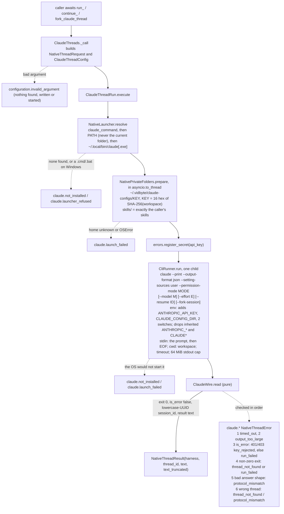

feat(harnesses): run, continue and fork Claude Code threads with the caller's API key
## Summary
This PR replaces #1044's `ClaudeHost` framework with three awaited functions, `run_claude_thread`, `continue_claude_thread` and `fork_claude_thread`. They are exported from `vidbyte.harnesses.native` beside #1036's nine and use the same shared code: one `NativeThreadResult`, one `NativeThreadError` with nine new `claude.*` codes, and a `ClaudeThreadConfig` shaped like `GrokThreadConfig`. Each call checks every argument, runs the installed `claude` CLI once, headless, with the prompt on stdin, and reads its one JSON answer. Continue adds `--resume <id>`, and fork adds `--resume <id> --fork-session`.

The decision that matters most is how the caller's key stays the only credential. The key reaches the child only as `ANTHROPIC_API_KEY`. Every inherited `ANTHROPIC_*` and `CLAUDE*` variable is dropped, except `CLAUDE_CODE_GIT_BASH_PATH`. `CLAUDE_CONFIG_DIR` points at a private folder for each workspace, `~/.vidbyte/claude-configs/<16 hex>`, and `--setting-sources user` makes Claude Code read settings only from there. So neither a stored `claude` login nor a workspace's `.claude/settings.json` (an `env` block, `apiKeyHelper`, hooks) or `.mcp.json` can replace or redirect the key. The cost is that the workspace's own `CLAUDE.md`, skills and MCP servers are not loaded; Claude sees only the skills the caller passes.

The private-folder code is now one hostkit helper, `NativePrivateFolders.prepare`. Grok uses it too, and its behaviour does not change. #1044's host stack is deleted: `ClaudeHost`, the 15 tools, `ClaudeTools`, `ClaudeOperationError` and the `claude-agent-sdk` extra, about 4,070 lines. That code never reached `main`, so it does not appear in this diff. Spec: `docs/spec/claude-thread-functions/spec.md` (r4).

## How to use what this PR introduces
```python
import asyncio
import os
from pathlib import Path

from vidbyte.harnesses.native import (
    ClaudePermissionMode,
    ClaudeThreadConfig,
    NativeThreadError,
    continue_claude_thread,
    fork_claude_thread,
    run_claude_thread,
)

REPO = Path("/work/my-app")               # an absolute, existing folder
SKILL = Path("/work/skills/write-tests")  # a folder holding a SKILL.md
CONFIG = ClaudeThreadConfig(permission_mode=ClaudePermissionMode.ACCEPT_EDITS, timeout_seconds=900.0)


async def main() -> None:
    key = os.environ["MY_ANTHROPIC_KEY"]
    try:
        first = await run_claude_thread("Add a --verbose flag to the CLI.", api_key=key, workspace=REPO, skills=[SKILL], config=CONFIG)
        again = await continue_claude_thread(first.thread_id, "Now add a test for it.", api_key=key, workspace=REPO, skills=[SKILL], config=CONFIG)
        branch = await fork_claude_thread(first.thread_id, "Try it with argparse instead.", api_key=key, workspace=REPO, model="sonnet", skills=[SKILL], config=CONFIG)
    except NativeThreadError as error:
        print(error.failure_code.value, error.next_step)
        return
    print(first.harness.value, again.thread_id == first.thread_id, branch.thread_id != first.thread_id)
    print(branch.text)


asyncio.run(main())
```

This is the spec's §4 snippet unchanged. I ran it on this branch with only `REPO` and `SKILL` pointed at sandbox folders. It used a fake `MY_ANTHROPIC_KEY`, a fresh home folder, and a stand-in `claude` on PATH that echoes the prompt. The shell that ran it was a Claude Code session holding 12 `ANTHROPIC_*`/`CLAUDE*` variables, among them its own `ANTHROPIC_API_KEY`, `CLAUDE_CONFIG_DIR`, `CLAUDECODE` and messaging socket. The output was:

```text
claude True True
answer to: Try it with argparse instead.
```

The stand-in logged three children, and each one saw only the fake key, the private `CLAUDE_CONFIG_DIR` (`…\.vidbyte\claude-configs\16c334a80cd2cc17`, the first 16 hex characters of the SHA-256 of the resolved workspace path), `DISABLE_AUTOUPDATER=1` and `CLAUDE_CODE_DISABLE_NONESSENTIAL_TRAFFIC=1`. Each child also saw `skills/write-tests` and got the prompt on stdin. The fork's argv was `--print --output-format json --setting-sources user --permission-mode acceptEdits --model sonnet --resume <first id> --fork-session`. Nothing was written to the workspace. The developer passes the key on every call and does not need to open or close a host, wait on a handle, or run `claude login`.

## Flow


`ClaudeThreads._call` checks every argument first, so a bad prompt, a thread id that is not a lowercase UUID, a relative workspace, a bad skill folder or the wrong config record stops the call before anything is looked up, written or started. The only state the SDK changes is the private config folder and its `skills/`, prepared off the event loop. Claude Code itself writes its transcripts, its auto-memory notes and `.claude.json` in that folder, and acts in the workspace as the permission mode allows. Failures are caught at five points: the argument check, the launcher, the folder step, the process launch and `ClaudeWire.read`, which classifies in the fixed order shown. Any other exception becomes `runtime.error`, and a cancel stops the process tree and reaches the caller unchanged.

## What changed
| File | Change |
|---|---|
| `vidbyte/harnesses/native/claude/__init__.py` | New. Binds the three public functions to `ClaudeThreads`, as `grok/__init__.py` does. |
| `vidbyte/harnesses/native/claude/threads.py` | New. `ClaudeThreads` (three functions, one guarded `_call`) and `ClaudeThreadRun` (launcher, private folder, environment, argv, run). |
| `vidbyte/harnesses/native/claude/wire.py` | New. `ClaudeWire.read` turns the one JSON answer into a result or a `claude.*` error. |
| `vidbyte/harnesses/native/hostkit/folders.py` | New. `NativePrivateFolders.prepare`, the private per-workspace folder, lifted from Grok's `_prepare_home` with its constants as parameters. |
| `vidbyte/harnesses/native/grok/threads.py` | Calls `NativePrivateFolders.prepare` with Grok's own constants; `_prepare_home` and its now-unused imports are deleted. Same folder, errors and texts. |
| `vidbyte/harnesses/native/__init__.py` | Re-exports the three functions, `ClaudeThreadConfig`, `ClaudePermissionMode` and `ClaudeReasoningEffort` (23 names). |
| `vidbyte/harnesses/native/hostkit/__init__.py` | Exports `NativePrivateFolders`. |
| `vidbyte/harnesses/native/hostkit/errors.py` | Header and the `wrong_thread` comment name Claude Code. No code change. |
| `vidbyte/harnesses/native/hostkit/launcher.py` | Header names `ClaudeThreadRun`. No code change. |
| `vidbyte/harnesses/native/hostkit/skills.py` | Header names both callers through `NativePrivateFolders`. No code change. |
| `vidbyte/lib/enums/native_threads.py` | `NativeHarness.CLAUDE`, three operations, `ClaudePermissionMode` (no approve-everything mode), `ClaudeReasoningEffort`, `ClaudeFlag`, four child variable names. |
| `vidbyte/lib/enums/__init__.py` | Exports the three new enums. |
| `vidbyte/lib/enums/failure.py` | Nine `claude.*` codes appended after `MUSE_WSL_UNAVAILABLE`. |
| `vidbyte/lib/constants/native_threads.py` | Claude program and folders, the lowercase-UUID id pattern, the prompt pattern that refuses NUL and lone surrogates, JSON member names, markers, tested version `2.1.301`, the table rows, and a likely cause and next step for each code. |
| `vidbyte/lib/dataclasses/native_threads.py` | `ClaudeThreadConfig`. The request gives Claude the stdin prompt cap (200,000 characters) and Claude's own prompt and thread-id patterns. |
| `vidbyte/lib/dataclasses/validation.py` | Header lists `ClaudeWire` among the `accepts_text` callers. No code change. |
| `vidbyte/lib/errors/base.py` | One docstring line names Claude Code. No code change. |
| `vidbyte/lib/process/argv.py` | Header names Claude Code among the separate-style callers. No code change. |
| `vidbyte/lib/process/runner.py` | Header names the claude runs. No code change. |
| `vidbyte/harnesses/README.md` | `native/` entry: the functions, the key path, `--setting-sources user` and what it stops loading, what each permission mode allows, auto memory, and the limits. |
| `REPO_MAP.md` | The native section names Claude Code in plain words and adds no function, file, flag or path. |
| `tests/features/harness_threads/test_harness_threads_claude_surface.py` | New. Exports, enums, constants, tables, `ClaudeThreadConfig`, and #1044's stack gone. |
| `tests/features/harness_threads/test_harness_threads_claude_acceptance.py` | New. The §4 snippet, run end to end, hostile workspace settings, README and REPO_MAP. |
| `tests/features/harness_threads/test_harness_threads_claude_threads.py` | New. Continue and fork identity, unknown and foreign threads. |
| `tests/features/harness_threads/test_harness_threads_claude_argv.py` | New. Exact argv for each verb and option, stdin, cwd. |
| `tests/features/harness_threads/test_harness_threads_claude_credentials.py` | New. The child's environment, scrubbing, `repr`. |
| `tests/features/harness_threads/test_harness_threads_claude_errors.py` | New. Every JSON-answer reading and its code. |
| `tests/features/harness_threads/test_harness_threads_claude_process_bounds.py` | New. Timeout with tree stop, output cap, text cap, cancel, the newest thread id. |
| `tests/features/harness_threads/test_harness_threads_claude_launcher.py` | New. PATH, the `~/.local/bin` fallback, batch refusal, an unpreparable folder. |
| `tests/features/harness_threads/test_harness_threads_claude_arguments.py` | New. Every refused argument, including a lone-surrogate prompt, and the boundary values that must pass. |
| `tests/features/harness_threads/test_harness_threads_claude_skills.py` | New. The private folder's `skills/` and the shared helper with Grok's and Claude's constants. |
| `tests/features/harness_threads/fake_harness.py` | The stand-in can also act as `claude`. |
| `tests/features/harness_threads/conftest.py` | A fourth harness in the tables, the private config path, and the shell's `ANTHROPIC_*`/`CLAUDE*` variables dropped for every test. |
| `tests/features/harness_threads/test_harness_threads_surface.py` | Shared pins extended: 12 functions, the new enum values, `FailureCode` = main's 148 + nine `claude.*`. |
| `tests/features/harness_threads/test_harness_threads_errors.py` | `[claude]` cases added to the shared error tests. |
| `tests/features/harness_threads/test_harness_threads_static_policy.py` | The three Claude modules and `hostkit/folders.py` added to the literal-policy check. |
| `tests/features/harness_threads/FEATURE.md`, `README.md` | Pack docs describe the fourth harness. |
| `docs/spec/claude-thread-functions/` | Spec r4, request, test plan, review, verify log, stage reports and this body. |

This diff does not show #1044's deleted code because that code was never on `main`. It was removed on this branch in fdd21650 through 29ec0755, and its `tests/features/claude_host/` pack in 48186352. `pyproject.toml`, `vidbyte/tools/`, `vidbyte/lib/errors/__init__.py`, `lint/`, `contracts/` and root `vidbyte/__init__.py` have no diff against `main`.

## Acceptance criteria → proof
| AC | What it checks (plain words) | Proven by |
|---|---|---|
| AC-1 | The §4 snippet runs as written and prints `claude True True`, then the fork's answer | `test_developer_snippet_runs_as_written_against_a_stand_in_on_path`; also run by hand on this branch (above) |
| AC-2 | A run returns Claude's new session id and its answer, from exactly one child process | `test_run_returns_claudes_new_session_id_and_result_from_one_child` |
| AC-3 | Continue passes `--resume <id>` and returns exactly that id | `test_continue_resumes_the_thread_and_returns_exactly_the_given_id` |
| AC-4 | Fork passes `--resume <id> --fork-session` and returns a new id | `test_fork_resumes_with_fork_session_and_returns_the_new_id` |
| AC-5 | The exact argv for every verb and option; the prompt only on stdin; the child runs in the workspace | `test_argv_matches_the_documented_form_without_options`, `test_every_option_keeps_the_separate_style_and_a_flag_like_prompt_stays_on_stdin`, `test_each_permission_mode_reaches_argv_as_its_vendor_value`, `test_each_reasoning_effort_reaches_argv_as_its_vendor_value`, `test_child_runs_in_the_resolved_workspace_whatever_pwd_says`, `test_runner_gets_plain_strings_the_call_timeout_the_cap_stdin_and_the_overlay` |
| AC-6 | The child sees only the caller's key, the private folder, the two switches and the kept Git Bash path; `os.environ` is unchanged | `test_child_sees_only_the_callers_key_the_private_folder_and_the_switches` [run, continue, fork] |
| AC-7 | The key never appears in argv, stdin, a written file, an error or a `repr`, even when Claude echoes it | `test_key_echoed_by_claude_is_redacted_everywhere_and_never_written`, `test_records_and_invocations_hide_the_key_in_their_repr`, `test_os_environ_never_holds_the_key_while_claude_runs` |
| AC-8 | Every bad argument is refused, naming it, before anything is found, created or started | `test_thread_id_that_is_not_a_lowercase_uuid_is_refused`, `test_invalid_prompt_is_refused` (incl. `[lone-surrogate]`), `test_malformed_api_key_is_refused_without_quoting_it`, `test_invalid_workspace_is_refused`, `test_invalid_model_is_refused`, `test_invalid_skill_list_is_refused_naming_the_item`, `test_config_that_is_not_a_claude_thread_config_is_refused`, `test_argument_check_comes_before_launcher_resolution` |
| AC-9 | Run and continue share one private config folder whose `skills/` holds exactly the passed skills; the workspace gets no new file | `test_run_and_continue_share_one_config_folder_holding_exactly_the_passed_skills`, `test_skills_folder_is_rebuilt_only_when_the_passed_set_changes`, `test_successful_call_writes_only_skills_in_the_private_config_folder` |
| AC-10 | Every failure carries its code, the message parts in order with the label `Claude Code`, and the likely cause and next step written for that code | all of `test_harness_threads_claude_errors.py`, `_launcher.py`, `_process_bounds.py` and the failure tests of `_threads.py`; the `[claude]` cases of `test_harness_threads_errors.py` and `test_every_code_has_its_own_likely_cause_and_next_step` |
| AC-11 | A 401 or 403 answer is `claude.key_rejected` with the answer's session id; other statuses and budget errors are `claude.run_failed` with Claude's text | `test_401_or_403_answer_is_key_rejected_with_the_answers_session`, `test_any_other_error_status_is_run_failed_with_claudes_text`, `test_budget_answer_without_result_is_run_failed_from_its_errors_list` |
| AC-12 | An unknown thread is `claude.thread_not_found` with the caller's id; any other bare non-zero exit is `claude.run_failed` with stderr | `test_unknown_thread_is_thread_not_found_with_the_callers_id` [continue, fork], `test_bare_non_zero_exit_is_run_failed_carrying_stderr` |
| AC-13 | An exit-0 answer the SDK cannot read is `claude.protocol_mismatch` naming the member | `test_exit_zero_without_one_json_object_is_protocol_mismatch`, `test_exit_zero_with_a_bad_member_is_protocol_mismatch_naming_it`, `test_continue_answered_in_upper_case_is_protocol_mismatch` |
| AC-14 | A continue answered on another id is `thread_not_found`; a fork answered with its source id is `protocol_mismatch` | `test_continue_answered_on_another_valid_id_is_thread_not_found`, `test_fork_answered_with_its_source_is_protocol_mismatch` |
| AC-15 | A run past its timeout is `claude.timed_out` after the whole process tree is stopped; stdout past 64 MiB is `claude.output_too_large` | `test_run_past_its_timeout_is_timed_out_with_its_tree_stopped`, `test_stdout_past_the_cap_is_output_too_large_naming_it` |
| AC-16 | A cancel reaches the caller as `CancelledError` after the tree is stopped | `test_cancellation_propagates_after_the_tree_is_stopped` |
| AC-17 | `claude` is found on PATH or at `~/.local/bin`; a missing one is `not_installed`; a `.cmd` or `.bat` is refused | `test_missing_claude_is_not_installed_naming_what_was_searched`, `test_batch_launcher_found_on_path_is_refused`, `test_batch_file_passed_as_claude_command_is_refused`, `test_claude_falls_back_to_the_native_install` |
| AC-18 | Exports, signatures, enum values, `FailureCode` (main's 148, then the nine `claude.*`), table rows and `ClaudeThreadConfig` fields, defaults and refusals | the `test_harness_threads_claude_surface.py` export, enum, constant, table and config tests; `test_native_package_exports_exactly_the_twelve_functions_and_their_records`, `test_thread_functions_are_coroutines_with_the_contract_signature`, `test_vocabularies_are_str_enums_carrying_the_vendor_values`, `test_failure_codes_keep_main_and_append_exactly_the_nine_claude_codes` |
| AC-19 | The Claude modules and `hostkit/folders.py` hold no literals, no module-level code and no `vidbyte.tools` import | `test_only_docstrings_all_entries_and_empty_zero_one_are_literals`, `test_module_level_holds_only_docstring_imports_classes_all_and_init_bindings`, `test_harness_modules_never_import_the_tools_layer` |
| AC-20 | Nothing of #1044's host stack remains, and the protected files match the merge base byte for byte | `test_claude_subpackage_holds_exactly_the_three_modules`, `test_hosts_errors_tools_and_records_of_the_rejected_design_are_gone`, `test_no_module_under_vidbyte_imports_claude_agent_sdk`, `test_branch_changes_only_the_files_the_spec_lists`, `test_errors_base_differs_from_the_merge_base_in_one_docstring_line_only` |
| AC-21 | The full local gate passes with the lint baseline unchanged, and every Grok, opencode and Muse test still passes | The gate, not a test: see Verification |
| AC-22 | A workspace that ships hostile `.claude/settings.json`, `settings.local.json`, `CLAUDE.md`, a skill and `.mcp.json` reaches nothing, and nothing is written to the workspace or `~/.claude` | `test_workspace_claude_settings_instructions_skills_and_mcp_servers_reach_nothing` |
| AC-23 | The harnesses README names the functions, the config folder, `--setting-sources user` and `ClaudeThreadConfig`; the REPO_MAP section describes Claude Code in plain words | `test_harnesses_readme_and_repo_map_describe_the_claude_functions` |

Every name above exists on this branch. `PYTHONPATH=$(pwd) python -m pytest -q -p no:cacheprovider tests/features/harness_threads/ -k claude` gives `200 passed, 437 deselected`, and the whole pack gives `635 passed, 2 skipped` (run at 4e56e377).

## Verification
The last gate matrix ran at ee3b4e88, the last commit that changed code (`docs/spec/claude-thread-functions/verify-log.md`, iteration 2). Every later commit changes only files under `docs/spec/claude-thread-functions/`.

| Gate | Command | Result |
|---|---|---|
| Claude tests | `PYTHONPATH=$(pwd) python -m pytest -q -p no:cacheprovider tests/features/harness_threads/ -k claude` | `200 passed, 437 deselected in 23.83s` |
| Full local gate, source stage | `PYTHONPATH=$(pwd) python scripts/run_ci.py --stage source` | `SDK-LINT: PASS` · `6445 passed, 16 skipped in 147.15s` · `CI passed.` |
| Lint ratchets (inside the source stage) | `python lint/run.py` | Baseline unchanged. S008 19/19, S009 346/350, A006 34/34, A007 255/255, A001 642/642, S015 13/13, S017 79/79, S019 5/5, S051 259/259, C006 104/104, C008 45/45 |
| Import order on the 19 touched `vidbyte/*.py` files | `python -m ruff check <files> --config lint/ruff.toml --select I001 --no-cache` | `All checks passed!` |
| Package stage | `python scripts/run_ci.py --stage package` (no `PYTHONPATH`) | `Installed vidbyte-sdk 0.3.0 passed smoke checks.` · `CI passed.` |
| Semgrep | `semgrep scan --error --config .semgrep/typed-mapping-boundary-policy.yml vidbyte` | `Ran 1 rule on 987 files: 0 findings.` |
| Protected paths | `git diff --stat origin/main...HEAD -- lint/ contracts/ pyproject.toml` | empty |
| Remote CI, dispatched by hand (auto-triggers are off) | `gh workflow run ci.yml` and `gh workflow run static-policy.yml` on `feat/claude-host` | ee3b4e88: Package, Static policy, Source / Python 3.11 and Source / Python 3.12 all `completed success` (runs 38993797470, 38993799112). The same four on 3244af75, the spec-finalize commit (runs 39004603149, 39004604870) |

## Adversarial review
18 findings were confirmed. 15 came from the S4 review across three lenses (spec conformance, repo conventions, engineering), and an independent verifier checked each one: none was refuted and two were downgraded from Major to Minor. 3 more came from the conformance re-review after the repairs. 11 are fixed, R-5 is half fixed, 6 are left as follow-ups, and none is waived. Full record: `docs/spec/claude-thread-functions/review.md`.

| ID | Finding | Fixed in |
|---|---|---|
| R-1 (Major) | `claude.output_too_large` dropped the stderr text that Grok, opencode and Muse attach | bb624cc9 |
| R-2 (Major) | A prompt with a lone surrogate passed validation; `claude` then started with the key, the stdin write failed, and the child was left running | 9398d9ee (test 2c1e233c) |
| R-3 (Major) | A run that printed its answer and then hung reported `claude.timed_out` without the thread id it had printed | b65590a4 (test 2c1e233c) |
| R-4 (Major) | The REPO_MAP entry held function names, a file name, a flag and a path, against the map's code-free rule | 0fd70984 (test 2c1e233c, spec r4 AC-23) |

## Deviations from the spec
- **`ClaudeWire._missing_member`.** Spec §8.5 and §12.3 row 20 give it the signature `(answer, session, text)`. The code takes `(answer, session)`, and `read` checks `text` itself. The `text` parameter was never read (ruff ARG004, review R-8), so 687141f7 dropped it. Spec §17 items 2 and 5 record this.
- **The exit-0 `protocol_mismatch` thread id.** Row 20 says this error carries `thread_id=session`. The code passes the newest id instead: the caller's id on a continue, else the session id. INV-6 requires a continue's error to carry the caller's id. Spec §17 item 1 records this.
- **Two shared sentences.** The README's hostkit sentence also lists the private per-workspace folders, and REPO_MAP says "Plumbing the harnesses share" where it said "the three". This change made both old sentences wrong. Spec §17 item 4 records this.
- **Spec §5 is updated here.** The old text said failures are caught in three places. It missed the private-folder step (`claude.launch_failed`) and the `runtime.error` catch-all. §5 now carries the flow chart above. Its sequence diagram also failed to parse, because two semicolons in one message are statement breaks in Mermaid; they are now commas. Spec §17 item 7 records this.

## Follow-ups
**Questions for you.** Each one defaults to "no", and none is built.
- Q-1: Your open comment on #1036 asks that "all inputs for these should input params into dataclass, and dataclass should have strict input validation … same for all functions for this repo". This PR keeps #1036's keyword signature, validated into `NativeThreadRequest` as the first step, so that all four harnesses stay alike. Making one record the only argument would change all twelve functions at once, in its own PR.
- Q-8: Claude Code's auto memory stays on in the private config folder. Notes from earlier threads of a workspace, forks included, reach its later threads, and a caller cannot turn memory off. Should every call set `CLAUDE_CODE_DISABLE_AUTO_MEMORY=1`?
- Considered and left out: Q-2 (pass the workspace's `CLAUDE.md` another way), Q-3 (choose the thread id up front with `--session-id`), Q-4 (fail a rejected key fast with `CLAUDE_CODE_MAX_RETRIES=0`), Q-5 (more config fields, such as `max_turns`, `max_budget_usd` or `allowed_tools`), Q-6 (a cleanup or a longer sweep for config folders), Q-7 (keep the key out of Claude's own tool commands), Q-9 (`NoDefaultCurrentDirectoryInExePath=1` for the child on Windows).

**Minor review findings left open.**
- R-5: Four functions that lint A002 flags have no `@intent` block. Their merged Grok counterparts have none either.
- R-6: A relative or empty home folder puts the config folder inside the workspace. Grok does the same, so one fix should cover both.
- R-10: `ClaudeThreadRun._fallback` duplicates Grok's.
- R-11: `CLAUDE_INHERITED_ENVIRONMENT_KEPT` holds the raw string `"CLAUDE_CODE_GIT_BASH_PATH"`, not an enum member.
- R-12: The error scrub keeps only the last 1,000 characters, so a long `result` can push the HTTP status out of the message.
- R-13: A member that is present but malformed is reported with the shared "has no … member" sentence, which the sibling harnesses also use.
- R-14 [scope-adding]: If Claude prints the key in a successful answer, `NativeThreadResult.text` holds it verbatim.

**Known limitations.**
- opencode, the other harness that sends its prompt on stdin, has the same lone-surrogate gap on `main` (EC-38). It is not changed here, because this PR leaves the sibling harnesses unchanged (INV-20).
- On a timed-out or capped run, stdout nested deeper than about 1,000 levels raises `RecursionError`, which the call reports as `runtime.error`. opencode behaves the same way.
- Assumptions A-1 to A-3 were checked only offline, with fake keys and the real Claude Code 2.1.301 talking to a local stand-in API, not the real Anthropic API. They cover the env key winning over a stored login, a bad key returning 401 or 403, and the shapes of the error JSON. A smoke test with a real key is still pending.

**Related work.**
- #1055 (`CodexHost`) has the same host shape and would need the same rework.
- A parallel run (`native-thread-compose`) also builds on #1036's shared modules and may conflict with this PR.

🤖 Generated with [Claude Code](https://claude.com/claude-code)
