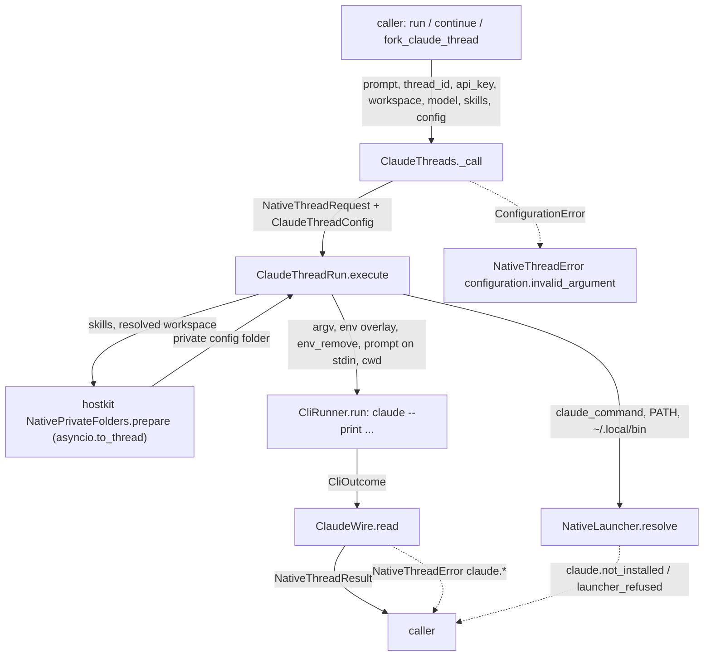

# Spec: Run, continue and fork Claude Code threads with the caller's API key

> **TL;DR** — PR #1044's `ClaudeHost` framework (host object, handles, live sessions, 15 agent tools, `claude-agent-sdk` extra, about 4,070 lines) is deleted and replaced by three plain async functions, `run_claude_thread`, `continue_claude_thread` and `fork_claude_thread`, built exactly like #1036's Grok functions on #1036's shared plumbing. Each call runs the installed `claude` CLI once, headless, with the caller's key only in the child's `ANTHROPIC_API_KEY`. The decision that matters most: every run uses a private per-workspace `CLAUDE_CONFIG_DIR` plus `--setting-sources user`, which is the only verified way to stop a workspace's own `.claude/settings.json` from redirecting, replacing or running code with the caller's key, while still giving Claude exactly the caller's skills.

## §0 User prompts

### 0.1 Invoking request (verbatim)
great, implement this change and update the pr

### 0.2 User replies during the run
_None yet. The orchestrator appends any reply the user sends during the run here verbatim, labeled with the revision it produced._

---

## Part A — Framing

## §1 Goal

What hurts today: PR #1044 is a framework the caller must manage (`async with ClaudeHost() as host:` → `spawn_claude_session(request)` → handle → `wait_claude_turn(handle)`), with 15 public methods, 15 `BaseTool`s and a `ClaudeTools` toolset, a new `claude-agent-sdk` optional extra, and about 4,070 lines of SDK code. It takes no API key at all: it uses whatever `claude` login is on the machine (request.md §C table; code-map §2c note 7: #1044 read `account.apiKeySource` from the machine's login). PR #1036, now on `main` as `f216fdcf`, gives Grok, opencode and Muse the shape the owner asked for: three awaited functions per harness, the caller's key per call, one result record and one error type, on about 305 lines per harness. The owner asked for #1044 "to moreso look like 1036 in the sense of implementing the functions that we can actually use in the code" (request.md §A Prompt 1), and accepted the proposal with "great, implement this change and update the pr" (§0.1).

| ID | Goal (outcome) | How we will know | Source |
|---|---|---|---|
| G-1 | A developer starts, continues and forks a Claude Code thread from Python with three awaited functions named like #1036's, and gets back the thread id and Claude's final answer. | AC-1 (the §4 snippet) runs as written against a stand-in `claude`; AC-2, AC-3, AC-4. | request.md §A Prompt 1; §C proposal "What #1044 would become"; KD-1, KD-2 |
| G-2 | The caller's own Anthropic API key pays for every run. A stored `claude` login, a key or token in the caller's environment, and any file the workspace ships can never supply, replace or redirect the credential. | AC-5, AC-6, AC-7; INV-3, INV-4. | KD-4; weighted word "The key goes only in the child's `ANTHROPIC_API_KEY`" |
| G-3 | Claude Code becomes the fourth harness of #1036's shape: the same result record, the same error type, the same shared launcher, runner, skills and error plumbing, and none of #1044's host framework, tools or extra remain. | AC-18, AC-19, AC-20; NFR-3 (the Claude package stays under 400 lines, against #1044's about 4,070). | KD-3, KD-6, KD-7 |
| G-4 | A failed Claude call tells the developer what happened and what to do, in the same detail as #1036's harnesses. | AC-10 to AC-17; INV-6, INV-7. | KD-6 (#1036's resolved comment "error messages need to be in much more detail") |

## §2 Objective

When this PR merges, `vidbyte.harnesses.native` exports `run_claude_thread`, `continue_claude_thread` and `fork_claude_thread` beside #1036's nine functions, plus `ClaudeThreadConfig`, `ClaudePermissionMode` and `ClaudeReasoningEffort`. A new subpackage `vidbyte.harnesses.native.claude` holds three modules (package init, threads, wire) that mirror `vidbyte.harnesses.native.grok`. One new hostkit module, `hostkit/folders.py`, holds the private per-workspace folder logic, written once. *(r3, R-12)* Both callers use it: Claude, and Grok, whose `GrokThreadRun` stops carrying its own copy (`_prepare_home`) with no change to Grok's behaviour (same folder, errors and texts; D-15, INV-20). The shared native-thread enums, constants, records and `FailureCode` gain the Claude members, nine `claude.*` failure codes and their texts. Every file #1044 added or changed outside `docs/spec/claude-thread-functions/` is gone or byte-identical to the merge base with main (`git merge-base origin/main HEAD`; `72a4ade1` at r1), except the shared files this spec names in §12.3. That includes `ClaudeHost`, `ClaudeOperationError`, the Claude tools and toolset, the `claude` optional extra, the `tests/features/claude_host/` pack and the `docs/spec/claude-host/` record. The Claude tests join #1036's pack `tests/features/harness_threads/`; S2 writes them. PR #1044 is updated in place on branch `feat/claude-host` with base `main` (S6). This PR is the whole slice; the later work the owner mentioned (composition functions, a signature change for all four harnesses) is in §3.

## §3 Non-goals

- **NG-1** — Composition functions such as `run_grok_thread_verify_with_opencode` — *Why not:* the owner said "dont worry about the complex functions for now" (request.md §C, #1036 owner prompt), and a separate run (`native-thread-compose`) is building them.
- **NG-2** — Changing the public signature of all four harnesses to take one validated record (`run_claude_thread(ClaudeThreadRequest(...))`) — *Why not:* unanswered OQ-1; the proposal said the choice "should apply to all four harnesses", so it is one cross-harness change, not part of this PR. Carried as Q-1 with default "no".
- **NG-3** — Driving Claude Code through `claude-agent-sdk`, and the in-process MCP bridge that gave Claude vidbyte's `BaseTool`s — *Why not:* rejected in the accepted proposal (point 2; KD-3); nobody asked for the bridge.
- **NG-4** — Any host object, handle, live session, spawn/wait/result split, steer, interrupt, usage, rate-limit, history-read, readiness or model probe, subagent launcher, or agent tool for Claude — *Why not:* KD-7; the shape #1036's owner rejected.
- **NG-5** — Streaming partial output (`--output-format stream-json`) or returning cost and usage — *Why not:* `NativeThreadResult` is #1036's shared record (harness, thread id, text, truncation flag); nothing in the request asks for more.
- **NG-6** — Bedrock, Vertex, Foundry, `ANTHROPIC_BASE_URL` gateways, `ANTHROPIC_AUTH_TOKEN`, OAuth tokens or a subscription login — *Why not:* the contract is "the user provides their api key" (KD-4); each of those either outranks the caller's key or sends it elsewhere (vendor-facts §3.1), so the SDK strips them (INV-4).
- **NG-7** — Loading the workspace's own `CLAUDE.md`, `.claude/skills`, `.claude/agents`, `.claude/commands` or `.mcp.json` — *Why not:* the only verified control that blocks hostile workspace settings (`--setting-sources user`) also drops these (vendor-facts §8 c2, s8, m2). Passing `CLAUDE.md` another way is optional Q-2, default no.
- **NG-8** — Reworking PR #1055 (`CodexHost`) — *Why not:* request.md §C implementation hints: "It is not part of this run."
- **NG-9** — A minimum-version gate or version probe for the installed `claude` (#1044 had `CLAUDE_MIN_CLI_VERSION = "2.1.296"`) — *Why not:* #1036 has no version gate for any harness; the tested version is named only in `protocol_mismatch` errors (INV-6).
- **NG-10** — Cleaning up or retaining private config folders, transcripts and auto-memory files beyond Claude Code's own behaviour (a 30-day transcript sweep; memory is never swept) — *Why not:* not asked; #1036 leaves Grok homes in place the same way. Documented as EC-28 and EC-37; optional Q-6 and Q-8.
- **NG-11** — Updating `docs/design/session-failure-vocabulary.md`, `skills/failure/vocabulary.md` or `scripts/test-session-failure-vocabulary.py` for the nine new codes — *Why not:* #1036 appended its 28 harness codes without touching them (they name no `grok.*` code at `base_commit`), and AGENTS.md makes `docs/` opaque. The obligation in the `failure.py` header is recorded in §12.4 with this reason.
- **NG-12** — Retargeting PR #1044's base to #1036's branch (KD-8) — *Why not:* superseded; #1036 merged to `main` before this run began (pipeline.md decision 2026-10-15 18:45).
- ~~**NG-13** *(r2, R-4)* — Switching Grok's `GrokThreadRun._prepare_home` to the new hostkit helper `NativePrivateFolders.prepare` — *Why not:* AGENTS.md: "Do not rewrite untouched code just to make it conform; that belongs in its own pull request."~~ *Withdrawn in r3 (R-12):* this PR derives the helper from Grok's method, so keeping Grok's copy would leave the duplicate this PR creates. AGENTS.md principle 5 says to "have every caller use that helper instead of re-implementing the job inline". The Grok switch is now in scope (row 34) and changes no Grok behaviour, constant, text, error code, test or public name. Grok's behaviour stays exactly as at the merge base (INV-20).

## §4 Developer usage

```python
import asyncio
import os
from pathlib import Path

from vidbyte.harnesses.native import (
    ClaudePermissionMode,
    ClaudeThreadConfig,
    NativeThreadError,
    continue_claude_thread,
    fork_claude_thread,
    run_claude_thread,
)

REPO = Path("/work/my-app")               # an absolute, existing folder
SKILL = Path("/work/skills/write-tests")  # a folder holding a SKILL.md
CONFIG = ClaudeThreadConfig(permission_mode=ClaudePermissionMode.ACCEPT_EDITS, timeout_seconds=900.0)


async def main() -> None:
    key = os.environ["MY_ANTHROPIC_KEY"]
    try:
        first = await run_claude_thread("Add a --verbose flag to the CLI.", api_key=key, workspace=REPO, skills=[SKILL], config=CONFIG)
        again = await continue_claude_thread(first.thread_id, "Now add a test for it.", api_key=key, workspace=REPO, skills=[SKILL], config=CONFIG)
        branch = await fork_claude_thread(first.thread_id, "Try it with argparse instead.", api_key=key, workspace=REPO, model="sonnet", skills=[SKILL], config=CONFIG)
    except NativeThreadError as error:
        print(error.failure_code.value, error.next_step)
        return
    print(first.harness.value, again.thread_id == first.thread_id, branch.thread_id != first.thread_id)
    print(branch.text)


asyncio.run(main())
```

On success the first line printed is exactly `claude True True`, and the second is the fork's final answer. The developer passes the key on every call and gets back a `NativeThreadResult`. There is no host to open or close, no handle to wait on, and no `claude login` needed: a stored login, an `ANTHROPIC_*` or `CLAUDE*` variable in the developer's own environment, and the workspace's `.claude/settings.json` play no part in the run (INV-4).

## §5 Flow diagram



```mermaid
sequenceDiagram
  participant Dev as Developer code
  participant SDK as ClaudeThreads / ClaudeThreadRun
  participant CLI as claude (child process)
  participant API as Anthropic API
  Dev->>SDK: await run_claude_thread(prompt, api_key=..., workspace=...)
  SDK->>SDK: validate (NativeThreadRequest), find claude, prepare private config + skills
  SDK->>CLI: start once: --print --output-format json --setting-sources user ...; env ANTHROPIC_API_KEY, CLAUDE_CONFIG_DIR; prompt on stdin, then EOF
  CLI->>API: Messages requests with x-api-key = caller's key
  API-->>CLI: answers
  CLI-->>SDK: exit code + one JSON object on stdout
  SDK-->>Dev: NativeThreadResult(harness, thread_id, text, text_truncated) or NativeThreadError
```

Validation happens first, in `ClaudeThreads._call`, when `NativeThreadRequest` and the config are built; a refused argument raises before anything is found, written or started. The only state the SDK changes is the private config folder's `skills/` (in `NativePrivateFolders.prepare`, off the event loop). Claude Code itself writes its transcript, its auto-memory notes and `.claude.json` in that folder, and acts in the workspace as the permission mode allows. Failures are caught in three places: the launcher (not installed, batch launcher), the runner outcome (launch failure), and `ClaudeWire.read` (timeout, output cap, Claude's error object, exit status, answer shape, wrong thread). Each becomes one `NativeThreadError` built by `NativeErrorFactory`.

---

## Part B — Behavior (this is the spec; everything else is framing)

## §6 Behavior

### 6.1 Invariants

- **INV-1** — Exactly three new public functions exist: `run_claude_thread`, `continue_claude_thread` and `fork_claude_thread`. Each is a coroutine function, importable from `vidbyte.harnesses.native` and from `vidbyte.harnesses.native.claude`. The `__all__` of `vidbyte.harnesses.native` lists exactly #1036's 17 names plus `ClaudePermissionMode`, `ClaudeReasoningEffort`, `ClaudeThreadConfig`, `continue_claude_thread`, `fork_claude_thread` and `run_claude_thread` (23 names). The `__all__` of `vidbyte.harnesses.native.claude` lists exactly the three functions. `ClaudeThreads`, `ClaudeThreadRun`, `ClaudeWire` and `ClaudeFlag` are not exported from either package, and nothing new is exported from root `vidbyte`.
- **INV-2** — The three signatures have exactly the shape of #1036's nine (OQ-1 default, D-2): `run_claude_thread(prompt, *, api_key, workspace, model=None, skills=(), config=None)`, and `continue_claude_thread` / `fork_claude_thread` with `thread_id` as the first positional parameter before `prompt`. `config` is `ClaudeThreadConfig | None`; every function returns `NativeThreadResult`.
- **INV-3** — The caller's `api_key` reaches Claude Code only as the value of `ANTHROPIC_API_KEY` in the child's environment. It never appears in argv, on stdin, in any file the SDK writes, in any `NativeThreadError` message or attribute, in the `repr` of any record (`NativeThreadRequest.api_key` and `CliInvocation.env_overlay` are `repr=False`), or in a log. Vendor output that echoes it is scrubbed (`NativeErrorFactory.register_secret`). The SDK never writes to `os.environ`.
- **INV-4** — The caller's key is the only credential the child can use, through three controls applied on every call:
  1. The child's environment leaves out every name in the caller's environment that starts with `ANTHROPIC_` or `CLAUDE` (`CLAUDE_INHERITED_ENVIRONMENT_PREFIXES`), except the names in `CLAUDE_INHERITED_ENVIRONMENT_KEPT` (`CLAUDE_CODE_GIT_BASH_PATH`). So no inherited `ANTHROPIC_AUTH_TOKEN`, `ANTHROPIC_BASE_URL`, `ANTHROPIC_PROFILE`, `CLAUDE_CODE_OAUTH_TOKEN`, `CLAUDE_CODE_USE_BEDROCK/VERTEX/FOUNDRY`, `CLAUDE_CONFIG_DIR`, `CLAUDECODE` or `CLAUDE_CODE_MESSAGING_*` reaches it (vendor-facts §3.2, §9).
  2. `CLAUDE_CONFIG_DIR` is the private config folder (INV-13), which holds no stored login, because the SDK never writes a credential there.
  3. argv carries `--setting-sources user`, so no project or local settings file of the workspace is read: no `env` block, `apiKeyHelper`, `hooks` or `.mcp.json` server (vendor-facts §8: e2, e7, w2, k4, m2).
- **INV-5** — Every argument is checked before any program is looked up, any folder is created and any process starts. A refusal raises `NativeThreadError` with `failure_code == FailureCode.CONFIGURATION_INVALID_ARGUMENT`, whose message names the argument (`prompt`, `api_key`, `workspace`, `model`, `skills[<i>]`, `skills`, `thread_id` or `config`) and never quotes the key. Claude-specific rules:
  1. `thread_id` for continue and fork must match `CLAUDE_THREAD_ID_PATTERN`, a lowercase UUID. A session title, an uppercase UUID or any other text is refused, so `--resume` can never match a session by title (vendor-facts §6 p13).
  2. The prompt cap is `NATIVE_PROMPT_MAX_CHARS` (200,000), because the prompt travels on stdin. The Windows command-line unit check does not apply to Claude.
  3. A `config` that is not a `ClaudeThreadConfig` (another harness's record, a mapping) is refused naming `config`.
  4. A malformed `ClaudeThreadConfig` field is refused earlier, when the caller builds the record: its constructor raises `ConfigurationError` naming `ClaudeThreadConfig.<field>`.
- **INV-6** — Every Claude `NativeThreadError` carries `failure_code`, `harness` (`NativeHarness.CLAUDE`), `operation` (the function's `NativeThreadOperation`), a non-empty `likely_cause` and `next_step` written for that code, `thread_id`, `exit_code` and `vendor_message`. Its message holds, in #1036's INV-5 order: the function name, the code value, the label `Claude Code`, the workspace and thread id when known, what the SDK observed, the scrubbed and capped vendor text, the likely cause, and the next step. A `protocol_mismatch` names `CLAUDE_TESTED_VERSION` (`2.1.301`). `thread_id` is the newest id the SDK learned: for run and fork, the `session_id` of Claude's JSON answer when it is a valid id, even on a failed run (vendor-facts §4: a failed run still writes a resumable transcript); otherwise the caller's `thread_id` (continue, fork) or `None` (run).
- **INV-7** — Failure classification is closed (every code comes from `NATIVE_THREAD_FAILURE_CODES`) and is checked in this order:
  1. `claude.not_installed`: no launcher found (explicit `claude_command`, then PATH, then `~/.local/bin/claude[.exe]`), or the OS reports the program missing at launch.
  2. `claude.launcher_refused`: on win32, the resolved launcher is a `.cmd` or `.bat` file (INV-15).
  3. `claude.launch_failed`: the private config folder could not be located or prepared, or the OS refused to start the program.
  4. `claude.timed_out`: the run passed `config.timeout_seconds`.
  5. `claude.output_too_large`: stdout passed `NATIVE_PROCESS_MAX_OUTPUT_BYTES`.
  6. `claude.key_rejected`: stdout is one JSON object with `is_error` true and an integer `api_error_status` in `CLAUDE_KEY_REJECTED_STATUSES` (401, 403).
  7. `claude.run_failed`: stdout is one JSON object with `is_error` true and any other status or none; the vendor text is built from `terminal_reason` (else `subtype`), the status, and `result` (else the `errors` list).
  8. `claude.thread_not_found`: a non-zero exit whose stderr contains `CLAUDE_SESSION_NOT_FOUND_MARKER`, or a continue answered on a different session id (INV-12).
  9. `claude.run_failed`: any other non-zero exit, with stderr as the vendor text.
  10. `claude.protocol_mismatch`: exit 0 but stdout is not one JSON object, or `is_error` is not `false`, or `session_id` does not match `CLAUDE_THREAD_ID_PATTERN`, or `result` is not a string, or a fork answered with its source id.

  `subtype` is never used to decide success, because Claude Code reports `"success"` on a 401 (vendor-facts §6).
- **INV-8** — No caller value is ever read as a flag. The prompt travels only on stdin and is never an argv element. Options use the separate style (`--flag`, `value`), and `CliArgv.build` refuses a separate-style value that starts with `-`. `model` must match `NATIVE_MODEL_PATTERN` and `thread_id` must match `CLAUDE_THREAD_ID_PATTERN`; neither allows a leading `-` or whitespace.
- **INV-9** — Every Claude process runs for at most `config.timeout_seconds`. On timeout the whole process tree is stopped (`ProcessStopper`) before the error is raised. Stdout is capped at `NATIVE_PROCESS_MAX_OUTPUT_BYTES`. `NativeThreadResult.text` is cut at `NATIVE_RESULT_TEXT_MAX_CHARS`, and `text_truncated` is then `True`.
- **INV-10** — When the caller cancels, `asyncio.CancelledError` propagates unchanged after the process tree is stopped; it is never turned into a `NativeThreadError`.
- **INV-11** — Each call starts exactly one child process, `claude`, once ("Each call runs `claude` once, headless"). The child gets the prompt on stdin as UTF-8, then EOF, so it never waits on an open pipe (vendor-facts §6 q8). No other program is started.
- **INV-12** — Thread ids:
  - `run_claude_thread` returns the `session_id` Claude created.
  - `continue_claude_thread` returns the `thread_id` it was given. *(r2, R-1)* Claude's answer must carry that same id. A different id that matches `CLAUDE_THREAD_ID_PATTERN` raises `claude.thread_not_found` (`NativeErrorFactory.wrong_thread`). An id outside the pattern, an upper-case spelling included, raises `claude.protocol_mismatch` (INV-7, A-4).
  - `fork_claude_thread` returns a `session_id` different from the source; an answer with the source id raises `claude.protocol_mismatch`.
- **INV-13** — The private config folder is `<user home>/.vidbyte/claude-configs/<key>`, where `<key>` is the first `CLAUDE_CONFIG_KEY_HEX_CHARS` (16) hex characters of the SHA-256 of `os.path.normcase(str(<resolved workspace>))`. The same workspace always maps to the same folder, so continue and fork find threads that run created (vendor-facts §4 p08: another config folder does not find them). The folder is never inside the workspace, unless the workspace contains the user's home folder (EC-31). The hostkit helper `NativePrivateFolders.prepare` locates and prepares it (D-15). Inside it the SDK creates and writes only `skills/`. The SDK writes nothing inside the workspace, the user's `~/.claude` or `~/.claude.json`.
- **INV-14** — The skills Claude sees are exactly the caller's. `skills/` inside the private config folder holds copies of exactly the passed skill folders (`NativeSkillFolders.replace`; rebuilt only when it does not already hold exactly those folders with identical files). Because of `--setting-sources user`, nothing from the workspace or its ancestors is loaded: no project skills, `CLAUDE.md`, agents, commands or `.mcp.json` (vendor-facts §5 s8, c2). A call with no skills leaves `skills/` empty or absent. *(r2, R-6)* This invariant covers skills and workspace files only. Claude Code's own auto memory, which it keeps inside the private folder and shares across a workspace's threads (a fork's notes included, *r3, R-14*), is a documented limitation (EC-37, D-22), not part of this invariant.
- **INV-15** — On win32, a launcher whose resolved program ends in `.cmd` or `.bat` (any case, ignoring trailing dots and spaces) is refused with `claude.launcher_refused` before anything runs: an explicit `claude_command`, a PATH hit or the fallback (`NativeLauncher`).
- **INV-16** — The modules of `vidbyte.harnesses.native.claude` satisfy #1036's mechanical literal policy. At module level they hold only a docstring, imports, class definitions, a literal `__all__` and, in `__init__`, bindings of the public names to `ClaudeThreads` attributes. Their only `str`/`bytes`/`int`/`float` constants are docstrings, `__all__` strings, `""`, `0` and `1`. They do not import `vidbyte.tools`. Every flag is a `ClaudeFlag` member, every environment name a `NativeEnvironmentVariable` member, and every other fixed value a constant in `vidbyte/lib/constants/native_threads.py`.
- **INV-17** — The child's environment always holds `DISABLE_AUTOUPDATER=1` and `CLAUDE_CODE_DISABLE_NONESSENTIAL_TRAFFIC=1`, and the child's working folder is the resolved workspace.
- **INV-18** — The SDK never asks Claude Code to approve everything. `ClaudePermissionMode` has exactly `default`, `acceptEdits`, `dontAsk` and `plan`, with no `bypassPermissions` and no `auto`, and argv never carries `--dangerously-skip-permissions` or `--allow-dangerously-skip-permissions`.
- **INV-19** — None of #1044's host stack remains. `ClaudeHost`, `ClaudeLiveSession`, `ClaudeOperationError`, `vidbyte.lib.constants.claude`, `vidbyte.lib.enums.claude`, `vidbyte.lib.dataclasses.claude`, `vidbyte.lib.dataclasses.claude_host`, `vidbyte.tools.builtins.claude`, `vidbyte.tools.toolsets.claude` and the `claude` optional extra do not exist, and no module under `vidbyte/` imports `claude_agent_sdk`. Every path outside `docs/spec/claude-thread-functions/` and `tests/` that §12.3 does not list is byte-identical to the merge base, `git merge-base origin/main HEAD`. *(r2, R-3)* That is `72a4ade1` until the catch-up merge of `main`, and the merged main commit after it; the comparison is never with `base_commit` alone, which goes stale once `main` is merged in.

**Must not regress:**
- **INV-20** — The nine Grok, opencode and Muse functions behave exactly as at the merge base (`git merge-base origin/main HEAD`; #1095 on main touches none of their files): same argv, environment, files, results, failure codes and texts (`vidbyte/harnesses/native/grok/`, `opencode/`, `muse/`; their tests in `tests/features/harness_threads/` keep passing). *(r3, R-12)* Grok's private home is prepared by the shared helper `NativePrivateFolders.prepare` with Grok's existing constants (`GROK_PRIVATE_HOMES_PARTS`, `GROK_HOME_KEY_HEX_CHARS`, `GROK_SKILLS_DIR`, `GROK_HOME_UNKNOWN_DETAIL`, `GROK_HOME_FAILURE_DETAIL`), which gives the same folder, the same skills copy, the same `grok.launch_failed` errors and the same texts as `GrokThreadRun._prepare_home` did.
- **INV-21** — `FailureCode` keeps every member of the merge base (148 at `72a4ade1`) with the same values and order. They are followed by exactly the nine `claude.*` members in §8.5 order, which is `NativeThreadProblem` order: not_installed, launcher_refused, launch_failed, key_rejected, thread_not_found, timed_out, output_too_large, protocol_mismatch, run_failed (`vidbyte/lib/enums/failure.py`; *r2, R-7*).
- **INV-22** — `import vidbyte` does not import `vidbyte.harnesses.native`. Root `vidbyte.__all__`, `vidbyte/tools/` and `vidbyte/lib/configs/` are as at the merge base (`git merge-base origin/main HEAD`; *r2, R-3*).

### 6.2 Acceptance criteria

| ID | Given | When | Then | Priority | Proof |
|---|---|---|---|---|---|
| AC-1 | a clean checkout of this branch | the §4 snippet runs (with a stand-in `claude` reached through PATH or `claude_command`, and `MY_ANTHROPIC_KEY` set) | it produces exactly the shown result: `claude True True`, then the fork's answer | P0 | `tests/features/harness_threads/test_harness_threads_claude_acceptance.py::test_developer_snippet_runs_as_written_against_a_stand_in_on_path` |
| AC-2 | a stand-in `claude` that exits 0 with one JSON object holding `is_error: false`, a lowercase-UUID `session_id` and a `result` string | `run_claude_thread` is awaited | it returns `NativeThreadResult(harness=NativeHarness.CLAUDE, thread_id=<session_id>, text=<result>, text_truncated=False)`, and exactly one child process was started | P0 | `test_harness_threads_claude_acceptance.py::test_run_returns_claudes_new_session_id_and_result_from_one_child` |
| AC-3 | a thread id returned by a run in workspace W | `continue_claude_thread(<id>, ...)` is awaited in W | argv holds `--resume <id>` and no `--fork-session`; the result's `thread_id` equals the given id exactly | P0 | `test_harness_threads_claude_threads.py::test_continue_resumes_the_thread_and_returns_exactly_the_given_id` |
| AC-4 | a thread id returned by a run in workspace W | `fork_claude_thread(<id>, ...)` is awaited in W | argv holds `--resume <id> --fork-session`; the result's `thread_id` is the stand-in's new id, different from `<id>` | P0 | `test_harness_threads_claude_threads.py::test_fork_resumes_with_fork_session_and_returns_the_new_id` |
| AC-5 | any call | the child starts | argv after the launcher is exactly `--print --output-format json --setting-sources user --permission-mode <mode>`, then `--model <model>` when a model is passed, then `--effort <effort>` when set, then `--resume <thread_id>` for continue and fork, then `--fork-session` for fork; the prompt is not an argv element; stdin carries exactly the prompt and is then closed; the child's working folder is the resolved workspace | P0 | `test_harness_threads_claude_argv.py::test_argv_matches_the_documented_form_without_options`, `::test_every_option_keeps_the_separate_style_and_a_flag_like_prompt_stays_on_stdin`, `::test_each_permission_mode_reaches_argv_as_its_vendor_value`, `::test_each_reasoning_effort_reaches_argv_as_its_vendor_value`, `::test_child_runs_in_the_resolved_workspace_whatever_pwd_says`, `::test_runner_gets_plain_strings_the_call_timeout_the_cap_stdin_and_the_overlay` |
| AC-6 | the caller's own environment holds `ANTHROPIC_API_KEY=<other>`, `ANTHROPIC_AUTH_TOKEN`, `ANTHROPIC_BASE_URL`, `CLAUDE_CODE_OAUTH_TOKEN`, `CLAUDECODE`, `CLAUDE_CONFIG_DIR=<other>`, `CLAUDE_CODE_USE_BEDROCK`, `CLAUDE_CODE_GIT_BASH_PATH` and an unrelated variable | a call runs | the child's `ANTHROPIC_API_KEY` equals `api_key`; `CLAUDE_CONFIG_DIR` equals the private config folder; `DISABLE_AUTOUPDATER` and `CLAUDE_CODE_DISABLE_NONESSENTIAL_TRAFFIC` equal `1`; no other `ANTHROPIC_*` or `CLAUDE*` name is present except `CLAUDE_CODE_GIT_BASH_PATH`, which keeps its value; the unrelated variable passes through; the caller's `os.environ` is unchanged after the call | P0 | `test_harness_threads_claude_credentials.py::test_child_sees_only_the_callers_key_the_private_folder_and_the_switches` [run, continue, fork] |
| AC-7 | a key value K | any call, including one where the stand-in echoes K on stdout and stderr and fails | K appears in no argv element, not on stdin, in no file the SDK wrote, in no `NativeThreadError` message, attribute or `details`, and in no `repr` of `NativeThreadRequest`, `ClaudeThreadConfig` or `CliInvocation` | P0 | `test_harness_threads_claude_credentials.py::test_key_echoed_by_claude_is_redacted_everywhere_and_never_written`, `::test_records_and_invocations_hide_the_key_in_their_repr`, `::test_os_environ_never_holds_the_key_while_claude_runs` |
| AC-8 | an invalid argument: `thread_id` that is a session title, an upper-case UUID, a string with a leading `-`, or not a UUID; a prompt over 200,000 characters, blank, or holding NUL; a malformed `api_key`; a relative or missing `workspace`; a skill folder without `SKILL.md`; a `model` with a leading `-`; a `config` that is a `GrokThreadConfig` or a dict | the function is awaited | it raises `NativeThreadError` with `configuration.invalid_argument` naming that argument; no process was started; no private config folder was created | P0 | `test_harness_threads_claude_arguments.py` (`test_thread_id_that_is_not_a_lowercase_uuid_is_refused`, `test_invalid_prompt_is_refused`, `test_malformed_api_key_is_refused_without_quoting_it`, `test_invalid_workspace_is_refused`, `test_invalid_model_is_refused`, `test_invalid_skill_list_is_refused_naming_the_item`, `test_config_that_is_not_a_claude_thread_config_is_refused`, `test_argument_check_comes_before_launcher_resolution`) |
| AC-9 | skill folders S1 and S2 and workspace W | `run_claude_thread(..., skills=[S1, S2])` runs, then `continue_claude_thread` in W | both children get the same `CLAUDE_CONFIG_DIR` = `<home>/.vidbyte/claude-configs/<first 16 hex of sha256(normcase(resolved W))>`; its `skills/` holds copies of exactly S1 and S2; W holds no new file or folder | P0 | `test_harness_threads_claude_skills.py::test_run_and_continue_share_one_config_folder_holding_exactly_the_passed_skills`, `::test_skills_folder_is_rebuilt_only_when_the_passed_set_changes`, `::test_successful_call_writes_only_skills_in_the_private_config_folder` |
| AC-10 | each failure condition of INV-7 provoked through the stand-in or the environment | the function is awaited | the error carries the INV-7 code; its message holds every INV-6 element in order with the label `Claude Code`; `likely_cause` and `next_step` equal the table texts for that code; a `protocol_mismatch` message names `2.1.301` | P0 | `test_harness_threads_claude_errors.py` (all), `test_harness_threads_claude_launcher.py`, `test_harness_threads_claude_process_bounds.py`, the failure tests of `test_harness_threads_claude_threads.py`, and `test_harness_threads_errors.py` `[claude]` cases + `::test_every_code_has_its_own_likely_cause_and_next_step` |
| AC-11 | the stand-in exits 1 with a JSON object `is_error: true`, `api_error_status: 401`, `terminal_reason: "api_error"`, `result: "Invalid API key · Fix external API key"` and a `session_id` | `run_claude_thread` is awaited | it raises `claude.key_rejected`; `vendor_message` holds the reason, the status and the result text; `thread_id` equals that `session_id`. With status 429, 500 or none, or with no `result` but an `errors` list, it raises `claude.run_failed` with that text | P0 | `test_harness_threads_claude_errors.py::test_401_or_403_answer_is_key_rejected_with_the_answers_session`, `::test_any_other_error_status_is_run_failed_with_claudes_text`, `::test_budget_answer_without_result_is_run_failed_from_its_errors_list` |
| AC-12 | the stand-in exits 1 with empty stdout and stderr `No conversation found with session ID: <id>` | `continue_claude_thread` or `fork_claude_thread` is awaited | it raises `claude.thread_not_found` with `thread_id` equal to the caller's id. Another non-zero exit with no JSON raises `claude.run_failed` carrying stderr | P0 | `test_harness_threads_claude_threads.py::test_unknown_thread_is_thread_not_found_with_the_callers_id` [continue, fork]; `test_harness_threads_claude_errors.py::test_bare_non_zero_exit_is_run_failed_carrying_stderr` |
| AC-13 | the stand-in exits 0 with non-JSON stdout, or a JSON object missing `is_error`, or a `session_id` that is not a lowercase UUID (an upper-case spelling of the caller's id on a continue included), or no `result` string | a function is awaited | it raises `claude.protocol_mismatch` naming the missing or bad member | P0 | `test_harness_threads_claude_errors.py::test_exit_zero_without_one_json_object_is_protocol_mismatch`, `::test_exit_zero_with_a_bad_member_is_protocol_mismatch_naming_it`; `test_harness_threads_claude_threads.py::test_continue_answered_in_upper_case_is_protocol_mismatch` |
| AC-14 | a continue whose stand-in answers on a different session id; a fork whose stand-in answers with the source id | the function is awaited | the continue raises `claude.thread_not_found`; the fork raises `claude.protocol_mismatch` | P0 | `test_harness_threads_claude_threads.py::test_continue_answered_on_another_valid_id_is_thread_not_found`, `::test_fork_answered_with_its_source_is_protocol_mismatch` |
| AC-15 | a stand-in that sleeps past `timeout_seconds` and has started a grandchild; a stand-in that prints more than `NATIVE_PROCESS_MAX_OUTPUT_BYTES` | the function is awaited | the first raises `claude.timed_out` after the whole tree was stopped; the second raises `claude.output_too_large` | P0 | `test_harness_threads_claude_process_bounds.py::test_run_past_its_timeout_is_timed_out_with_its_tree_stopped`, `::test_stdout_past_the_cap_is_output_too_large_naming_it` |
| AC-16 | a running call | the awaiting task is cancelled | `asyncio.CancelledError` propagates and the child tree is stopped | P0 | `test_harness_threads_claude_process_bounds.py::test_cancellation_propagates_after_the_tree_is_stopped` |
| AC-17 | no `claude` on PATH and no `~/.local/bin/claude[.exe]`; on win32 a `claude.cmd` on PATH with no fallback, or as `claude_command`; an empty PATH with an installed fallback | the function is awaited | `claude.not_installed` naming what was searched; `claude.launcher_refused`; the fallback program is started | P0 | `test_harness_threads_claude_launcher.py::test_missing_claude_is_not_installed_naming_what_was_searched`, `::test_batch_launcher_found_on_path_is_refused`, `::test_batch_file_passed_as_claude_command_is_refused`, `::test_claude_falls_back_to_the_native_install` |
| AC-18 | the installed package | its surface is inspected | the exports, the subpackage `__all__` and the INV-2 signatures (non-continue `model` defaults to `None`) hold; the enum members and values of §8.5 hold exactly, in order; `FailureCode` = the merge base's members (148 at `72a4ade1`) then the nine `claude.*` in §8.5 order; every table keyed by harness or code has its Claude rows; `ClaudeThreadConfig` has no `model` field, defaults to `(None, DEFAULT, 1800.0, None)`, and refuses `bypassPermissions`, `auto`, an unknown effort, a non-positive or over-14,400 timeout and a bad `claude_command`, each naming `ClaudeThreadConfig.<field>` | P0 | `test_harness_threads_claude_surface.py` (exports, enums, constants, tables, `ClaudeThreadConfig` tests); `test_harness_threads_surface.py::test_native_package_exports_exactly_the_twelve_functions_and_their_records`, `::test_thread_functions_are_coroutines_with_the_contract_signature`, `::test_vocabularies_are_str_enums_carrying_the_vendor_values`, `::test_failure_codes_keep_main_and_append_exactly_the_nine_claude_codes` |
| AC-19 | the source of `vidbyte/harnesses/native/claude/` | #1036's static-policy check runs over it | it passes: no module-level statements beyond INV-16's, no literal outside the allowed set, no `vidbyte.tools` import | P0 | `test_harness_threads_static_policy.py` (all three tests; `NAMED_MODULES` lists the three claude modules and `hostkit/folders.py`) |
| AC-20 | the branch | it is compared with the merge base (`git merge-base origin/main HEAD`) | every INV-19 path is absent; `pyproject.toml`, `vidbyte/tools/` and `vidbyte/lib/errors/__init__.py` are byte-identical to the merge base; `vidbyte/lib/errors/base.py` differs only in the one docstring line of §12.3 row 28; `docs/spec/claude-host/` and `tests/features/claude_host/` are gone; `git grep claude_agent_sdk -- vidbyte` is empty | P0 | `test_harness_threads_claude_surface.py::test_claude_subpackage_holds_exactly_the_three_modules`, `::test_hosts_errors_tools_and_records_of_the_rejected_design_are_gone`, `::test_no_module_under_vidbyte_imports_claude_agent_sdk`, `::test_branch_changes_only_the_files_the_spec_lists`, `::test_errors_base_differs_from_the_merge_base_in_one_docstring_line_only` |
| AC-21 | the branch with S2's tests | `PYTHONPATH=$(pwd) python scripts/run_ci.py --stage source` and `python scripts/run_ci.py --stage package` run | both pass, lint ends `AGENT-LINT: PASS`/`SDK-LINT: PASS` with no baseline change, and every Grok, opencode and Muse test in `tests/features/harness_threads/` still passes | P0 | Gate, not a test: `scripts/run_ci.py --stage source` and `--stage package` (S3/S4); guard: the pre-existing tests of `tests/features/harness_threads/` (green before and after) |
| AC-22 | a workspace that ships `.claude/settings.json` with an `env` block, `apiKeyHelper` and `hooks`, plus a `CLAUDE.md` and `.mcp.json` | a call runs through the stand-in | argv carries `--setting-sources user`; the SDK reads, copies and passes none of those files; nothing is written into the workspace or into the user's `~/.claude` and `~/.claude.json` | P1 | `test_harness_threads_claude_acceptance.py::test_workspace_claude_settings_instructions_skills_and_mcp_servers_reach_nothing` |
| AC-23 | `vidbyte/harnesses/README.md` and `REPO_MAP.md` | a reader opens the `native/` entry of each | each names the three Claude functions, the private config folder under `~/.vidbyte/claude-configs/` and the `--setting-sources user` consequence (NG-7). The README also states what each permission mode allows in a headless run (EC-20), the EC-21, EC-28 and EC-37 limits, and the folder shared by every caller of one workspace path (T-4; *r3, R-14*). The README stays at or under 40,000 characters | P1 | `test_harness_threads_claude_acceptance.py::test_harnesses_readme_and_repo_map_describe_the_claude_functions` |

### 6.3 Edge cases and failure modes

| ID | Trigger (input + state) | System behavior | User sees | Guarded by (INV-/D-) |
|---|---|---|---|---|
| EC-1 | No `claude` on PATH and no `~/.local/bin/claude[.exe]`; or `claude_command` names a missing file | Launcher resolution fails before any write | `claude.not_installed` naming the program, PATH and the fallback searched, plus the install hint | INV-7, D-20 |
| EC-2 | Win32, npm-installed `claude.cmd` first on PATH | Falls through to the fallback; if none, refused | `claude.launcher_refused` (cmd.exe would re-read the prompt-free argv as a command line) with the next step "install the native build or pass `claude.exe`" | INV-15 |
| EC-3 | The user home cannot be determined, or `~/.vidbyte/claude-configs/<key>` cannot be created or its `skills/` rebuilt (permissions, disk full) | `NativePrivateFolders.prepare` maps `RuntimeError`/`OSError` to a failure; no process starts | `claude.launch_failed` naming the folder and the OS error class and reason | INV-7, INV-13 |
| EC-4 | Wrong, revoked or disabled key | Claude retries the 401 ten times (about 184.5 s, vendor-facts §6 p15) and then prints the 401 JSON | `claude.key_rejected` after about three minutes; with `timeout_seconds` below that, `claude.timed_out` instead. The likely causes of both codes say so. **Accepted** (D-11; optional Q-4) | INV-7, D-11 |
| EC-5 | A well-formed UUID that is not a thread of this workspace's config folder | Claude exits 1, empty stdout, stderr marker (p05, g5) | `claude.thread_not_found` with the caller's id | INV-7 |
| EC-6 | `thread_id` is a session title (`"fix-login"`), an upper-case UUID, `-x`, or empty | Refused by `NativeThreadRequest` before anything runs. Without the guard, `claude --resume fix-login` would resume whichever session carries that title (p13) | `configuration.invalid_argument` naming `thread_id` | INV-5, D-8 |
| EC-7 | Continue or fork from a workspace other than the one that ran the thread | Different config folder; Claude does not find the session (p08) | `claude.thread_not_found`; the next step says to continue only from the workspace that created the thread | INV-13, D-3 |
| EC-8 | A thread older than 30 days | Claude Code's `cleanupPeriodDays` sweep deleted its transcript (vendor-facts §4); *(r2, R-6)* the workspace's auto-memory notes survive the sweep (EC-37) | `claude.thread_not_found`; the likely cause names the 30-day sweep. **Accepted** (optional Q-6) | NG-10 |
| EC-9 | The workspace ships `.claude/settings.json` or `.claude/settings.local.json` with `env.ANTHROPIC_BASE_URL`, `env.ANTHROPIC_API_KEY`, `apiKeyHelper`, `hooks`, or a `.mcp.json` stdio server | Not read: `--setting-sources user` (e2, e7, w2, k4, m2). Without it, in `-p` mode with no trust prompt, the key goes to the workspace's URL, is replaced, or is seen by workspace code | Nothing; the run uses the caller's key against Anthropic | INV-4, D-4 |
| EC-10 | The workspace has its own `CLAUDE.md`, `.claude/skills`, agents or commands | Not loaded (c2, s8) | Claude does not see the repository's own instructions or skills. **Accepted limitation**, documented in the README (NG-7; optional Q-2) | D-4 |
| EC-11 | The caller's process runs inside Claude Code or another agent host (`CLAUDECODE`, `CLAUDE_CODE_ENTRYPOINT`, `CLAUDE_CODE_SESSION_ID`, `CLAUDE_CODE_MESSAGING_SOCKET`/`TOKEN`, `CLAUDE_CONFIG_DIR` inherited) | All dropped from the child's environment; Claude Code has no nested-session refusal (n1, n4) | The call runs normally and never touches the parent session's config folder or messaging pipe | INV-4, D-6 |
| EC-12 | The caller's environment holds `ANTHROPIC_AUTH_TOKEN`, `CLAUDE_CODE_OAUTH_TOKEN`, `ANTHROPIC_BASE_URL`, `CLAUDE_CODE_USE_BEDROCK`, `ANTHROPIC_PROFILE` or `ANTHROPIC_MODEL` | All dropped. Without this, `ANTHROPIC_AUTH_TOKEN` is sent beside the key (a3), Bedrock or a profile outranks it, and the base URL sends it elsewhere | The run bills the caller's key at Anthropic; the `model` argument alone picks the model. Gateways and cloud providers are not supported (NG-6) | INV-4, D-6 |
| EC-13 | Win32 with Git installed outside the default folder and `CLAUDE_CODE_GIT_BASH_PATH` set | That one name is kept (A-6) | Claude's Bash tool works as it does from the user's terminal | INV-4, D-6 |
| EC-14 | The run passes `timeout_seconds` | Tree stopped; no JSON was printed | `claude.timed_out` with the seconds waited; `thread_id` is the caller's id (continue, fork) or `None` (run), because the id is not minted (D-9; optional Q-3) | INV-9, D-9 |
| EC-15 | Stdout passes 64 MiB | Runner stops reading at the cap | `claude.output_too_large` naming the byte cap | INV-9 |
| EC-16 | Exit 0 with non-JSON stdout, a JSON array, no `is_error`, `is_error` not `false`, a non-UUID `session_id`, or no `result` string (a future CLI format change) | Wire refuses the answer | `claude.protocol_mismatch` naming the member and `2.1.301` | INV-7 |
| EC-17 | `is_error: true` with no `result` but `errors: ["Reached maximum budget ..."]` (f7) | Vendor text built from the reason and the `errors` list | `claude.run_failed` with that text | INV-7, D-10 |
| EC-18 | `is_error: true` with `api_error_status` 429, 529, 500 or 400 (billing), or `null` with `"Not logged in"` | Not a key rejection | `claude.run_failed` with reason, status and text | INV-7, D-10 |
| EC-19 | A continue answered on another id; a fork answered with the source id | `wrong_thread` check | `claude.thread_not_found`; `claude.protocol_mismatch` | INV-12 |
| EC-20 | *(r2, R-5)* The task needs a file edit or a shell command that the permission mode does not allow | A `-p` run with no host denies every request that would prompt, and continues (A-2, confirmed by the headless docs); the answer lists `permission_denials`. What each mode allows in a headless run: `DEFAULT`, reads and read-only commands; `ACCEPT_EDITS`, also file edits and common filesystem commands, while other shell commands and network requests are still denied; `DONT_ASK`, denies everything that would prompt, so headless it allows no more than `DEFAULT`; `PLAN`, read-only, never edits | A successful result whose text says what Claude could not do; the SDK does not surface `permission_denials`. For edits, pick `ACCEPT_EDITS`. No mode runs arbitrary commands such as tests or builds: that needs allow rules (optional Q-5 `allowed_tools`, not built). Stated in the README | INV-18, D-12, A-2 |
| EC-21 | Concurrent calls in one workspace whose skill sets differ, or the first calls ever with a set | Each rebuilds the shared `skills/`; the rebuilds can interleave | A spurious `claude.launch_failed`, or a run that cannot load a skill. **Accepted limitation** like #1036's EC-27: run concurrent calls in one workspace only with a skill set an earlier call prepared, or use separate workspaces; stated in the `CLAUDE_LAUNCH_FAILED` likely cause and the README. No locking | D-3 |
| EC-22 | Two concurrent continues of one thread | Untested vendor behavior (vendor-facts §10 gap 5); both append to one transcript | Possibly interleaved history. **Accepted**; the README says not to continue one thread from two calls at once | A-9 |
| EC-23 | A deep workspace path, so `<config>/projects/<mangled cwd>/<id>.jsonl` passes the Windows 260-character path limit | Untested (vendor-facts §10 gap 9) | Whatever Claude reports: `claude.run_failed` or `claude.protocol_mismatch` with the vendor text | A-8 |
| EC-24 | An unknown `model` | Claude still sends it (f4b); the API refuses it | `claude.run_failed` with the vendor text (real API wording unverified) | A-3 |
| EC-25 | A prompt starting with `/name` | Claude treats it as a skill or command invocation (s7c) | The skill or command runs; the SDK does not filter it | INV-8 |
| EC-26 | A prompt starting with `--` | On stdin it is plain text | It runs as a prompt | INV-8, D-5 |
| EC-27 | A prompt longer than 24,000 characters (up to 200,000) on win32 | Accepted: stdin has no command-line limit (q7) | The run proceeds | INV-5, D-5 |
| EC-28 | Every new workspace path | Creates a config folder under `~/.vidbyte/claude-configs/` that the SDK never removes. Its transcripts hold prompts and tool output in plain text, including any secret a tool read (vendor-facts §4), and its auto-memory notes (EC-37) are never swept | Documented in the README: Claude Code sweeps transcripts after 30 days but keeps memory files; delete a folder by hand to forget a workspace's threads and notes | NG-10, T-3 |
| EC-29 | The machine has managed (enterprise) Claude Code settings | They still apply; the SDK neither reads nor fights them (A-7) | Whatever the policy enforces, for example a refused key or tool | A-7 |
| EC-30 | The user's own `~/.claude` settings, permission rules, hooks or `CLAUDE.md` | Not used: SDK runs read the private config folder only | SDK runs follow only `ClaudeThreadConfig`. Documented in the README | INV-13 |
| EC-31 | Workspace contains the user's home folder (for example the workspace is the home itself) | The private config folder lies inside the workspace, as with #1036's EC-42 | The run proceeds. **Accepted** | INV-13 |
| EC-32 | The user updates Claude Code between two calls | `DISABLE_AUTOUPDATER=1` stops background updates during a call only (A-11) | A later call runs the new version; a changed output format surfaces as `claude.protocol_mismatch` naming `2.1.301` | INV-17 |
| EC-33 | Caller cancels mid-run | Tree stopped, `CancelledError` re-raised | Cancellation; the transcript may hold a partial turn, and the thread can be continued | INV-10 |
| EC-34 | A 401 run (or any failed run) | Claude still writes a transcript and returns a `session_id` (p16) | The error's `thread_id` carries that id for run and fork | INV-6 |
| EC-35 | Claude writes text to stderr on success (auto-mode notice, unrecognized-model notice) | Ignored when stdout is a valid success answer | Success | INV-7 |
| EC-36 | `api_error_status` that is not an integer (a list, a string, an object) | Treated as no status | `claude.run_failed` | INV-7 |
| EC-37 | *(r2, R-6; r3, R-14)* Claude Code's auto memory, on by default, saves notes under `<config folder>/projects/<project>/memory/` during a thread. `<project>` is derived from the git repository that holds the workspace (the docs: "all worktrees and subdirectories within the same repo share one auto memory directory"), else from the workspace folder | Every later thread of the same workspace loads its `MEMORY.md` (the first 200 lines or 25 KB), whether it is a run, a continue or a fork. That includes the source's later turns after a fork, so notes a fork saves reach the thread it was copied from. The 30-day sweep never deletes memory files (A-14; Claude Code memory and headless docs; not probed). The SDK drops an inherited `CLAUDE_CODE_DISABLE_AUTO_MEMORY` with every other `CLAUDE*` name (D-6), and `--setting-sources user` keeps the workspace's own `autoMemoryEnabled` and `autoMemoryDirectory` settings from being read, so the caller has no switch that turns memory off | A new thread does not start blank. Notes from earlier threads of the workspace reach the model, including notes a fork saved, text a repository steered Claude into saving, and details of earlier prompts, even those of another caller who passed another key for the same workspace path (T-4). A fork's own transcript copy is independent, but its memory is not. **Accepted limitation**, stated in the README with the remedy (delete the folder's `projects/*/memory/` or the whole config folder); optional Q-8 | D-22, D-6, T-4 |

**Rollback of the user action:** The SDK never undoes what Claude did. Edits Claude made in the workspace (as the permission mode allowed) are reverted with the workspace's own version control. Deleting `~/.vidbyte/claude-configs/<key>` forgets every thread of that workspace, its auto-memory notes and its skill copies. A later continue or fork of those ids then raises `claude.thread_not_found`, and a later run recreates the folder. No other state remains.

## §7 Requirements

**Functional**
| ID | Requirement | Priority | Source (request.md / G-) |
|---|---|---|---|
| FR-1 | `run_claude_thread` starts a new Claude Code thread in the workspace, runs the prompt once and returns its id and final answer as `NativeThreadResult`. | P0 | KD-1, KD-3; G-1 → INV-1, INV-12, AC-2 |
| FR-2 | `continue_claude_thread` runs one more prompt on an existing thread of the same workspace and returns the same id. | P0 | KD-3; G-1 → INV-12, AC-3 |
| FR-3 | `fork_claude_thread` copies an existing thread into a new one, runs the prompt on the copy and returns the new id; the source's transcript is unchanged (p06). *(r3, R-14)* Auto-memory notes the fork saves reach the source's later turns (EC-37); KD-5's "copy, run, new id" still holds. | P0 | KD-5; G-1 → INV-12, AC-4 |
| FR-4 | The functions are named exactly `run_claude_thread`, `continue_claude_thread`, `fork_claude_thread`, exported from `vidbyte.harnesses.native` and its `claude` subpackage, never from root `vidbyte`. | P0 | KD-1, KD-2; weighted word "only thing I definately want is the actual function naming" → INV-1, AC-18 |
| FR-5 | The public signatures have the same shape as #1036's nine functions. | P0 | OQ-1 default; weighted words "same for all functions", "apply to all four harnesses" → INV-2, AC-18; Q-1 |
| FR-6 | Every input is validated strictly, in validated dataclasses (`NativeThreadRequest`, `ClaudeThreadConfig`), before any program is found, any folder is created or any process starts. | P0 | request.md §C constraints; weighted word "dataclass should have strict input validation" → INV-5, AC-8, AC-18 |
| FR-7 | The caller's key reaches Claude Code only through the child's `ANTHROPIC_API_KEY`; a stored login, an inherited variable or a workspace file can never supply, replace or redirect the credential. | P0 | KD-4; weighted word "The key goes only in the child's `ANTHROPIC_API_KEY`"; G-2 → INV-3, INV-4, AC-6, AC-7, AC-22 |
| FR-8 | The caller's skill folders are available to Claude for the call, and only those. | P0 | #1036 contract `skills` (request.md §C); accepted proposal → INV-14, AC-9 |
| FR-9 | Threads live in a private Claude config folder per workspace under the user's home, so continue and fork find them. | P0 | accepted proposal ("private `CLAUDE_CONFIG_DIR` under `~/.vidbyte/`, one per workspace") → INV-13, AC-9 |
| FR-10 | No settings file shipped by the workspace is read by the child. | P0 | repo-forced by FR-7 (vendor-facts §8 shows `-p` honours workspace settings with no trust prompt); OQ-2 → INV-4, AC-5, AC-22 |
| FR-11 | Every failure raises one `NativeThreadError` with a closed `claude.*` code, the harness label, what was observed, the vendor text, and a likely cause and next step written for that code. | P0 | KD-6; G-4 → INV-6, INV-7, AC-10 to AC-17 |
| FR-12 | `ClaudeThreadConfig` carries `reasoning_effort`, `permission_mode`, `timeout_seconds` and `claude_command`, mirroring `GrokThreadConfig`, with no `model` field. | P0 | KD-6, OQ-3 → AC-18 |
| FR-13 | Every Claude flag is a `ClaudeFlag` member and every other fixed value a named constant; the Claude modules hold no literals. | P0 | KD-6 (#1036's resolved comment "define enums for flags/hardcoded strings"); repo rule (static-policy test) → INV-16, AC-19 |
| FR-14 | Delete #1044's host stack, tools, toolset, optional extra, Claude-only error, enums, constants, records, old test pack and old spec record. | P0 | KD-7 → INV-19, AC-20 |
| FR-15 | The harnesses README, `REPO_MAP.md` and every module header that counts the harnesses or the functions describe the fourth harness. | P1 | repo-forced: AGENTS.md (folder README read and maintained; REPO_MAP is the map), lint A001 → AC-23, AC-21 |

**Non-functional**
| ID | Requirement | Priority | Target |
|---|---|---|---|
| NFR-1 | Each call runs `claude` once, headless. | P0 | Exactly one child process per call, started with `--print` (INV-11, AC-2) |
| NFR-2 | No new dependency; the `claude-agent-sdk` extra is removed. | P0 | `pyproject.toml` byte-identical to the merge base (AC-20, D-17) |
| NFR-3 | Small harness. | P1 | `vidbyte/harnesses/native/claude/*.py` total ≤ 400 physical lines (`wc -l`), against Grok's 305 and #1044's about 4,070 |
| NFR-4 | The full local gate passes with no lint baseline change. | P0 | `run_ci.py` source and package stages pass; `lint/baseline.json` unchanged (AC-21) |
| NFR-5 | The SDK makes no network call of its own, and Claude's non-essential traffic is off. | P0 | INV-17; no HTTP client in the Claude modules |
| NFR-6 | File work never blocks the event loop. | P0 | `NativePrivateFolders.prepare` runs through `asyncio.to_thread` (lint S052 passes; *r2, R-4*) |
| NFR-7 | Files stay well below 1,000 lines. | P1 | `vidbyte/lib/constants/native_threads.py` (452 lines at `base_commit`) ≤ 600 after the change; every touched file < 1,000 |

---

## Part C — Design

## §8 Architecture and decisions

### 8.1 Decisions
| ID | Decision | Deciding reason | Runner-up | Flips if |
|---|---|---|---|---|
| D-1 | Run the installed `claude` CLI directly through #1036's `CliRunner`; no `claude-agent-sdk`. | Accepted proposal point 2 (KD-3): one runner and one error path for all four harnesses, no new dependency. | `claude-agent-sdk` with its in-process MCP bridge | the owner asks for vidbyte `BaseTool`s inside Claude runs |
| D-2 | Public signature identical to #1036's: `prompt` (after `thread_id`) plus keyword arguments, validated into `NativeThreadRequest` inside `_call`. | OQ-1 default: all twelve functions share one shape, and a change applies to all four harnesses at once. *(r2, R-11)* There is precedent for the owner's same wording ("pass all of the parameters of the function into a dataclass with strict input validation", PR #690). PR #747 kept the keyword signature and built one validated record as the first step (field guide `strict-config-dataclasses.md`), which is what `_call` does. | One validated record as the only argument, for all four harnesses (the owner's #1036 comment "all inputs for these should input params into dataclass"; field guide "Harness bridge functions take validated lib records") | the owner answers Q-1 "change the signatures"; then a separate cross-harness change |
| D-3 | One private config folder per workspace: `~/.vidbyte/claude-configs/<16 hex of sha256(normcase(resolved workspace))>`. | Continue and fork must reuse the run's config folder (p08); it must sit outside the workspace; per-workspace folders keep the EC-21 skills race and thread visibility to one workspace, as #1036's D-24 chose for Grok. | One shared `~/.vidbyte/claude-config` (sessions are already keyed by cwd inside it, p07) | the owner prefers bounded folder growth over per-workspace skill isolation |
| D-4 | Pass `--setting-sources user` on every call; the "user" source is the private folder, whose `settings.json` the SDK never writes. | The only verified control that blocks a workspace's `env` redirect, key replacement, `apiKeyHelper`, hooks and `.mcp.json` (e2, e7, w2, k4, m2) while keeping the private folder's skills (s8). `--bare`, `--safe-mode` and `disableAllHooks` do not block the env redirect (e3, e5, e9); `--bare` also removes the Skill tool (s2). | `--setting-sources ""` with one `--plugin-dir` per skill (s9, s12): skills would be named `<plugin>:<skill>` | Claude Code stops reading user-source skills under `--setting-sources user` |
| D-5 | The prompt travels on stdin (`CliInvocation.stdin_text`), with no prompt operand. | Works for 40,000 characters (q1, q7); no Windows command-line limit; can never be read as a flag; opencode already does this. Cap 200,000 (`NATIVE_PROMPT_MAX_CHARS`), at most 800,000 UTF-8 bytes, under Claude Code's 10 MB piped-stdin cap (*r3*; headless docs). | Prompt operand after `--` (q3), capped at 24,000 with the Windows unit check | Claude Code stops reading a prompt from stdin in `--print` mode |
| D-6 | The child's environment drops every inherited name starting with `ANTHROPIC_` or `CLAUDE`, except `CLAUDE_CODE_GIT_BASH_PATH`. `ClaudeThreadRun._inherited_names()` computes the names from `os.environ` at call time and passes them as `CliInvocation.env_remove`. | Covers every credential, provider switch, config redirect and parent-session variable in vendor-facts §3 and §9, including ones not listed today; reuses the existing `env_remove` option unchanged. *(r3, R-14)* It also drops the caller's own behaviour switches, such as `CLAUDE_CODE_DISABLE_AUTO_MEMORY` and `CLAUDE_CODE_MAX_RETRIES`, so no inherited variable changes a call (INV-4); EC-37 and the README state the memory consequence. | A fixed list of names (misses future `CLAUDE_CODE_USE_*` switches); or a new `env_remove_prefixes` option on `CliInvocation` and `CliRunner` | a second harness needs prefix removal; then the prefix option moves into `CliInvocation` |
| D-7 | Options use `CliOptionStyle.SEPARATE` (`--flag`, `value`). | The style every probe used (vendor-facts §6 q3, §7). Every value is an enum value, a constant or a pattern-checked id or model, none dash-leading. | `JOINED` (`--flag=value`) | — (not probed) |
| D-8 | Claude thread ids must be lowercase UUIDs (`CLAUDE_THREAD_ID_PATTERN`), on input and in Claude's answer. | `--resume` also matches a session title (p13), and *(r3)* an absolute path to a transcript `.jsonl` file (cli-reference docs), so a free-form id could resume an unrelated titled session or a transcript outside the private folder. Every observed id is a lowercase UUID (A-4). | `NATIVE_THREAD_ID_PATTERN` | Claude Code issues ids that are not lowercase UUIDs (A-4) |
| D-9 | No thread-id minting with `--session-id`. | Mirrors #1036's D-27; the smallest honest rule. | Mint a UUID for run and fork with `--session-id` (verified p09, p11), so a timed-out run reports its id | callers need the id of a timed-out run (Q-3) |
| D-10 | The wire decides by `is_error` first, then `api_error_status` (401, 403 → key rejected), then exit status and the stderr marker; never by `subtype`. | A 401 reports `subtype: "success"` (p16); budget errors carry `errors` and no `result` (f7). | Judge by `subtype` | — |
| D-11 | Keep Claude Code's default retries (no `CLAUDE_CODE_MAX_RETRIES`). | Retries protect real runs from transient overload; the cost is a slow bad-key report (EC-4). | `CLAUDE_CODE_MAX_RETRIES=0`: instant `key_rejected`, but 429/529 fail at once | the owner prefers fast failure (Q-4) |
| D-12 | `ClaudePermissionMode` = `DEFAULT "default"`, `ACCEPT_EDITS "acceptEdits"`, `DONT_ASK "dontAsk"`, `PLAN "plan"`; default `DEFAULT`. No `--permission-prompts none`. *(r2, R-5)* What each mode allows in a headless run is stated in EC-20: only `ACCEPT_EDITS` widens anything (file edits and common filesystem commands); `DONT_ASK` and `PLAN` never do, and no mode runs arbitrary shell commands without allow rules. | Mirrors `GrokPermissionMode`. `default` is accepted by 2.1.301 as a hidden alias (f2) and by older releases. The repo bans approve-everything members (`vidbyte/lib/enums/native_threads.py` header). A `-p` run with no host denies prompting requests and continues (A-2, headless docs), so `--permission-prompts none`, which matters only with a host (help default `host`), adds nothing. | Value `manual` (the listed choice in 2.1.301, f2b) | Claude Code drops the `default` alias (then `DEFAULT = "manual"`) |
| D-13 | `ClaudeThreadConfig` has exactly `reasoning_effort`, `permission_mode`, `timeout_seconds`, `claude_command`. | OQ-3: the smallest set that mirrors `GrokThreadConfig`; `model` stays a call argument (lint C012). | Add `max_turns`, `max_budget_usd`, `append_system_prompt`, `allowed_tools` | the owner asks (Q-5) |
| D-14 | A failed run's or fork's error carries the answer's `session_id` when valid. | #1036's INV-5 rule "the newest thread id the SDK had learned"; Claude prints the id even on failure (p16). | Always the caller's id or `None` | — |
| D-15 | *(r2, R-4: replaces r1's "repeat the expression")* The private per-workspace folder becomes one hostkit helper, `NativePrivateFolders.prepare`, in a new module `vidbyte/harnesses/native/hostkit/folders.py`, used by `ClaudeThreadRun`. It locates the folder under the user's home by a SHA-256 key of the resolved workspace, creates it, rebuilds its skills folder, and maps failures to `launch_failed`. Every harness-specific value is a parameter: folder parts, key length, skills folder name, and two detail templates whose fields (`{home}`, `{error_type}`, `{reason}`) are the ones Grok's templates already use. *(r3, R-12: r2's runner-up (b) is now the decision)* Both `ClaudeThreadRun` and `GrokThreadRun` call it. Grok passes its existing constants, and `GrokThreadRun._prepare_home` is deleted (row 34), so the logic exists once. Grok's behaviour does not change (INV-20). | Claude's folder logic is the same as Grok's `_prepare_home` except for constants (the skills folder name and key length are equal, and the templates differ only in a noun). AGENTS.md principle 5 ("have every caller use that helper instead of re-implementing the job inline"; "whenever a canonical helper … would save writing the same logic a second time, build it that way") and the hostkit header ("Plumbing that a second harness needs goes here, in its own module") apply, and AGENTS.md outranks the field guide. This PR derives the helper from Grok's method, so leaving Grok's copy would keep a duplicate that the PR itself creates; "do not rewrite untouched code" does not cover that case. The switch is test-safe: no test names `_prepare_home`; `conftest.private_home` pins Grok's folder; `test_unpreparable_private_home_is_launch_failed` and `test_undeterminable_user_home_is_launch_failed` (which patches `pathlib.Path.home`, the call the helper makes) pin its errors; the surface test's `CONTRACT_CONSTANTS` pins `GROK_PRIVATE_HOMES_PARTS` and `GROK_HOME_KEY_HEX_CHARS`, which stay as Grok's arguments. | (a) r1: copy `_prepare_home` into `ClaudeThreadRun` (its stated premise, that the constants differ, was false); (b) r2: the helper for Claude only, Grok keeping its copy (NG-13, withdrawn: the duplicate stays) | — (the owner asks to keep the Grok change out of this PR; then row 34 moves to its own PR and the r2 split returns) |
| D-16 | Claude's tests join `tests/features/harness_threads/`; `tests/features/claude_host/` is deleted; `NativeThreadError.relevant_tests` stays `("tests/features/harness_threads",)`. | One pack for one shape; the error class already points there. S2 owns every test change (pipeline decision 18:45). | A new `tests/features/claude_threads/` pack | — |
| D-17 | Remove #1044 by restoring the seven shared files byte-for-byte from the merge base (`git checkout "$(git merge-base origin/main HEAD)" -- <paths>`) and deleting the files it added. *(r2, R-3)* The merge base is `72a4ade1` until the catch-up merge of `main`, and the merged main commit after it. Never restore from an `origin/main` tip that the branch has not merged (now `0754e01f`; #1095 there changed 41 files, among them `vidbyte/lib/enums/__init__.py` and root `vidbyte/__init__.py`). | Field guide `review-scope.md`: rebuild on main, drop every piece of the rejected design, leave main's files byte-identical. | Hand-editing #1044's lines out | — |
| D-18 | `NativeHarness.CLAUDE = "claude"`, label `"Claude Code"`; codes `claude.<problem>`. | The tests derive `NativeHarness(harness)` and `f"{verb}_{harness}_thread"` from one string, and refuse `"claude_code"` (code-map note 16, `test_harness_threads_records.py:97`). | `claude_code` | — |
| D-19 | Fallback launcher `~/.local/bin/claude[.exe]`. | The native installer's location (vendor-facts §1; #1044's `CLAUDE_HOME_CLI_PARTS`). | No fallback | — |
| D-20 | Every child gets `DISABLE_AUTOUPDATER=1` and `CLAUDE_CODE_DISABLE_NONESSENTIAL_TRAFFIC=1`. | A call never self-updates the CLI; all ~80 probes ran with the second one and saw no outbound traffic (vendor-facts §9). | Leave Claude's defaults | — |
| D-21 | PR #1044 keeps base `main`; #1036 is not a separate base. | #1036 is on `main` as `f216fdcf` (pipeline.md 18:45). | Retarget to #1036's branch (KD-8) | — |
| D-22 | *(r2, R-6)* Leave Claude Code's auto memory at its default (on), and document it (EC-37). | Nobody in the conversation mentioned memory, so a switch would be a new control (scope rule: an optional Q-n, not built). It also breaks no stated invariant. The key rule (INV-3, INV-4) and the skills rule (INV-14) still hold, because memory is not a credential, not a skill, and not a workspace file. Every thread can already read the workspace's own files, so memory adds persistence, not a new channel. This is a new risk to state, not a broken guarantee. *(r3, R-14)* Two qualifications. First, memory is a channel between threads: a fork's notes reach its source's later turns, and notes cross between callers who pass different keys for one workspace path (T-4). FR-3's guarantee is narrowed to the source's transcript, and KD-5 ("copy, run, new id") still holds. Second, the caller cannot turn memory off: D-6 drops an inherited `CLAUDE_CODE_DISABLE_AUTO_MEMORY`, and `--setting-sources user` ignores the workspace's `autoMemoryEnabled`. Both are stated in EC-37 and the README. | Set `CLAUDE_CODE_DISABLE_AUTO_MEMORY=1` in the INV-17 overlay (docs-only; not probed) | the owner answers Q-8 "yes" |

### 8.2 Patterns inherited
- **Three public functions as static methods, bound in the package init** — callers import plain functions while the code stays in one class — `vidbyte/harnesses/native/grok/__init__.py` (`run_grok_thread = GrokThreads.run_grok_thread`), field guide `class-bound-helpers.md`.
- **One guarded try per vendor call** — cancellation and `NativeThreadError` pass through, `ConfigurationError` names the argument, anything else is a `runtime.error` named by class — `vidbyte/harnesses/native/grok/threads.py:GrokThreads._call`, field guide `provider-api-contracts.md`.
- **A narrated flow class with flat helpers** — principles 1 and 2 — `grok/threads.py:GrokThreadRun.execute`.
- **A pure wire reader** — no I/O; classification in a fixed order — `grok/wire.py:GrokWire.read`.
- **A private per-workspace vendor home outside the workspace, holding only SDK-copied skills** — `grok/threads.py:GrokThreadRun._prepare_home` (#1036 D-24). It is lifted into the hostkit helper `NativePrivateFolders.prepare`, which Claude and Grok both call (D-15; *r3, R-12*), following the hostkit rule "Plumbing that a second harness needs goes here, in its own module" (`vidbyte/harnesses/native/hostkit/__init__.py` header).
- **Prompt on stdin through the runner** — `vidbyte/harnesses/native/opencode/threads.py` (`stdin_text=request.prompt`, `NATIVE_PROCESS_MAX_OUTPUT_BYTES`).
- **Dropping inherited names with `env_remove`** — `vidbyte/harnesses/native/muse/threads.py` (`env_remove=(NativeEnvironmentVariable.META_API_KEY.value,)`).
- **Closed failure tables** — `vidbyte/lib/constants/native_threads.py:NATIVE_THREAD_FAILURE_CODES`, `NATIVE_THREAD_LIKELY_CAUSES`, `NATIVE_THREAD_NEXT_STEPS`, `NATIVE_HARNESS_LABELS`, `NATIVE_TESTED_VERSIONS`.
- **Validated config record per harness** — `vidbyte/lib/dataclasses/native_threads.py:GrokThreadConfig`; field guide `strict-config-dataclasses.md`.

### 8.3 Smaller design rejected
The simplest design: set only `ANTHROPIC_API_KEY` in the child (keeping the rest of the caller's environment) and run `claude -p --output-format json "<prompt>"` in the workspace with Claude's default config folder. No private folder, no settings flag, no environment stripping. It fails:
- Fails **FR-7 / INV-4**: in `-p` mode a workspace's `.claude/settings.json` `env` block sends the caller's key to any URL or replaces it, and its `apiKeyHelper`, hooks and `.mcp.json` servers run code that sees the key, with no trust prompt (e1, e6, w1, k1, m1). An inherited `ANTHROPIC_AUTH_TOKEN` is sent beside the key (a3), and an inherited `CLAUDE_CONFIG_DIR` puts the run in another session's folder (§9).
- Fails **FR-8 / INV-14**: the model sees the workspace's and every ancestor's skills and `CLAUDE.md` (s1, h2, s11), not exactly the caller's skills, and there is nowhere to put the caller's skills without writing into the workspace or the user's `~/.claude`.
- Fails **INV-13**: it writes transcripts and `.claude.json` into the user's own `~/.claude` (vendor-facts §4).
- Fails **INV-5 / INV-8**: the prompt on argv is capped at 24,000 characters and the Windows command-line limit.

### 8.4 Complexity budget
| Item | Count | Justification for each |
|---|---|---|
| New files | 4 | `vidbyte/harnesses/native/claude/__init__.py`, `threads.py`, `wire.py`: the same three files as the Grok sibling. *(r2, R-4)* `vidbyte/harnesses/native/hostkit/folders.py`: the shared private-folder helper (D-15; the hostkit header asks for "its own module"). Counted against the merge base; S2's test files and the `docs/spec/claude-thread-functions/` record are not counted. *(r3, R-12)* Switching Grok to the helper (row 34) modifies one existing file and adds none. |
| New classes/modules | 8 classes in 4 modules | `ClaudeThreads` (public functions), `ClaudeThreadRun` (flow), `ClaudeWire` (answer reader), `NativePrivateFolders` (hostkit helper); `ClaudeThreadConfig` (placement rule: `lib/dataclasses/native_threads.py`); `ClaudeFlag`, `ClaudePermissionMode`, `ClaudeReasoningEffort` (placement rule: `lib/enums/native_threads.py`). |
| New dependencies | 0 | The CLI is the user's install; #1044's `claude-agent-sdk` extra is removed (net −1 against the branch head). |
| New config keys | 0 | The SDK reads no new environment variable or settings key. The four child variables of §9.3 are set by the SDK, not read from configuration. |
| New collections/tables | 0 | Existing constants tables get Claude rows. |
| New public endpoints/commands | 3 functions | `run_claude_thread`, `continue_claude_thread`, `fork_claude_thread` (plus the re-exported `ClaudeThreadConfig`, `ClaudePermissionMode`, `ClaudeReasoningEffort`). No SDK CLI command (field guide `prebuilt-agents.md`). |

_The implementer may not exceed this budget without stopping and reporting BLOCKED._

### 8.5 Key interfaces

```python
# vidbyte.harnesses.native and vidbyte.harnesses.native.claude
async def run_claude_thread(prompt: str, *, api_key: str, workspace: str | Path, model: str | None = None, skills: Sequence[str | Path] = (), config: ClaudeThreadConfig | None = None) -> NativeThreadResult: ...
async def continue_claude_thread(thread_id: str, prompt: str, *, api_key: str, workspace: str | Path, model: str | None = None, skills: Sequence[str | Path] = (), config: ClaudeThreadConfig | None = None) -> NativeThreadResult: ...
async def fork_claude_thread(thread_id: str, prompt: str, *, api_key: str, workspace: str | Path, model: str | None = None, skills: Sequence[str | Path] = (), config: ClaudeThreadConfig | None = None) -> NativeThreadResult: ...

# vidbyte/lib/dataclasses/native_threads.py
@dataclass(frozen=True, slots=True)
class ClaudeThreadConfig:
    reasoning_effort: ClaudeReasoningEffort | None = None
    permission_mode: ClaudePermissionMode = ClaudePermissionMode.DEFAULT
    timeout_seconds: float = NATIVE_THREAD_DEFAULT_SECONDS        # 1800.0; (0, NATIVE_THREAD_MAX_SECONDS]
    claude_command: tuple[str, ...] | None = None
# NativeThreadResult(harness, thread_id, text, text_truncated) and NativeThreadRequest are #1036's, reused.

# vidbyte/lib/enums/native_threads.py (all StrEnum; members appended after the existing ones)
NativeHarness.CLAUDE = "claude"
NativeThreadOperation.RUN_CLAUDE_THREAD = "run_claude_thread"
NativeThreadOperation.CONTINUE_CLAUDE_THREAD = "continue_claude_thread"
NativeThreadOperation.FORK_CLAUDE_THREAD = "fork_claude_thread"
class ClaudePermissionMode(StrEnum): DEFAULT = "default"; ACCEPT_EDITS = "acceptEdits"; DONT_ASK = "dontAsk"; PLAN = "plan"
class ClaudeReasoningEffort(StrEnum): LOW = "low"; MEDIUM = "medium"; HIGH = "high"; XHIGH = "xhigh"; MAX = "max"
class ClaudeFlag(StrEnum):
    PRINT = "--print"; OUTPUT_FORMAT = "--output-format"; SETTING_SOURCES = "--setting-sources"
    PERMISSION_MODE = "--permission-mode"; MODEL = "--model"; EFFORT = "--effort"
    RESUME = "--resume"; FORK_SESSION = "--fork-session"
NativeEnvironmentVariable.ANTHROPIC_API_KEY = "ANTHROPIC_API_KEY"
NativeEnvironmentVariable.CLAUDE_CONFIG_DIR = "CLAUDE_CONFIG_DIR"
NativeEnvironmentVariable.DISABLE_AUTOUPDATER = "DISABLE_AUTOUPDATER"
NativeEnvironmentVariable.CLAUDE_CODE_DISABLE_NONESSENTIAL_TRAFFIC = "CLAUDE_CODE_DISABLE_NONESSENTIAL_TRAFFIC"

# vidbyte/lib/enums/failure.py (appended after MUSE_WSL_UNAVAILABLE, in this order)
CLAUDE_NOT_INSTALLED = "claude.not_installed"; CLAUDE_LAUNCHER_REFUSED = "claude.launcher_refused"
CLAUDE_LAUNCH_FAILED = "claude.launch_failed"; CLAUDE_KEY_REJECTED = "claude.key_rejected"
CLAUDE_THREAD_NOT_FOUND = "claude.thread_not_found"; CLAUDE_TIMED_OUT = "claude.timed_out"
CLAUDE_OUTPUT_TOO_LARGE = "claude.output_too_large"; CLAUDE_PROTOCOL_MISMATCH = "claude.protocol_mismatch"
CLAUDE_RUN_FAILED = "claude.run_failed"

# vidbyte/lib/constants/native_threads.py (new names and values)
CLAUDE_PROGRAM = "claude"
CLAUDE_INSTALL_FOLDERS = (".local", "bin")
CLAUDE_PRIVATE_CONFIGS_PARTS = (".vidbyte", "claude-configs")
CLAUDE_CONFIG_KEY_HEX_CHARS = 16
CLAUDE_SKILLS_DIR = "skills"
CLAUDE_JSON_OUTPUT_FORMAT = "json"
CLAUDE_USER_SETTING_SOURCE = "user"
CLAUDE_INHERITED_ENVIRONMENT_PREFIXES = ("ANTHROPIC_", "CLAUDE")
CLAUDE_INHERITED_ENVIRONMENT_KEPT = frozenset({"CLAUDE_CODE_GIT_BASH_PATH"})
CLAUDE_THREAD_ID_PATTERN = r"^[0-9a-f]{8}-[0-9a-f]{4}-[0-9a-f]{4}-[0-9a-f]{4}-[0-9a-f]{12}$"
CLAUDE_SESSION_FIELD = "session_id"; CLAUDE_RESULT_FIELD = "result"; CLAUDE_IS_ERROR_FIELD = "is_error"
CLAUDE_API_ERROR_STATUS_FIELD = "api_error_status"; CLAUDE_TERMINAL_REASON_FIELD = "terminal_reason"
CLAUDE_SUBTYPE_FIELD = "subtype"; CLAUDE_ERRORS_FIELD = "errors"
CLAUDE_SESSION_NOT_FOUND_MARKER = "No conversation found with session ID"
CLAUDE_KEY_REJECTED_STATUSES = frozenset({401, 403})
CLAUDE_ERROR_TEXT = "{reason}: {message}"
CLAUDE_ERROR_STATUS_TEXT = "{reason} (status {status}): {message}"
CLAUDE_TESTED_VERSION = "2.1.301"
CLAUDE_CONFIG_FAILURE_DETAIL = "The private Claude Code config folder {home} could not be prepared ({error_type}: {reason})."
CLAUDE_CONFIG_UNKNOWN_DETAIL = "The user home folder, where the private Claude Code config folder lives, could not be determined ({error_type}); set HOME (POSIX) or USERPROFILE (Windows) for this process."
NATIVE_STDIN_PROMPT_HARNESSES = frozenset({NativeHarness.OPENCODE, NativeHarness.CLAUDE})
# plus rows: NATIVE_HARNESS_LABELS[CLAUDE] = "Claude Code"; NATIVE_TESTED_VERSIONS[CLAUDE] = CLAUDE_TESTED_VERSION;
# NATIVE_THREAD_FAILURE_CODES[(CLAUDE, <problem>)] for the nine problems; one likely cause and one next step per code.

# internal (vidbyte/harnesses/native/claude/threads.py, wire.py)
class ClaudeThreads:
    run_claude_thread / continue_claude_thread / fork_claude_thread  # @staticmethod async, as above
    @staticmethod
    async def _call(operation: NativeThreadOperation, verb: NativeThreadVerb, thread_id: str | None, prompt: str, *, api_key: str, workspace: str | Path, model: str | None, skills: Sequence[str | Path], config: ClaudeThreadConfig | None) -> NativeThreadResult: ...
class ClaudeThreadRun:
    @staticmethod
    async def execute(request: NativeThreadRequest, config: ClaudeThreadConfig, errors: NativeErrorFactory) -> NativeThreadResult: ...
    @staticmethod
    def _fallback() -> Path | None: ...
    @staticmethod
    def _environment(request: NativeThreadRequest, config_dir: Path) -> dict[str, str]: ...
    @staticmethod
    def _inherited_names() -> tuple[str, ...]: ...
    @staticmethod
    def _argv(launcher: tuple[str, ...], request: NativeThreadRequest, config: ClaudeThreadConfig) -> tuple[str, ...]: ...
class ClaudeWire:
    @staticmethod
    def read(outcome: CliOutcome, request: NativeThreadRequest, errors: NativeErrorFactory, *, timeout_seconds: float) -> NativeThreadResult: ...
    @staticmethod
    def _answer(stdout: str) -> Mapping[str, object] | None: ...
    @staticmethod
    def _session(answer: Mapping[str, object] | None) -> str | None: ...
    @staticmethod
    def _text(answer: Mapping[str, object] | None) -> str | None: ...          # r3, R-13: `result` when it is a str
    @staticmethod
    def _missing_member(answer: Mapping[str, object], session: str | None, text: str | None) -> str: ...  # r3, R-13
    @staticmethod
    def _error_text(answer: Mapping[str, object]) -> str | None: ...

# internal, shared (vidbyte/harnesses/native/hostkit/folders.py; exported from vidbyte.harnesses.native.hostkit)
# r3, R-12: called by ClaudeThreadRun.execute and GrokThreadRun.execute, each through asyncio.to_thread
class NativePrivateFolders:
    @staticmethod
    def prepare(request: NativeThreadRequest, errors: NativeErrorFactory, *, parts: tuple[str, ...], key_hex_chars: int, skills_dir: str, unknown_detail: str, failure_detail: str) -> Path: ...
    # unknown_detail fields: {error_type}; failure_detail fields: {home}, {error_type}, {reason} (the fields of GROK_HOME_UNKNOWN_DETAIL / GROK_HOME_FAILURE_DETAIL)
```

## §9 Data, API, configuration, migration

### 9.1 Data model
- **`ClaudeThreadConfig`** (new, frozen, slotted, in `vidbyte/lib/dataclasses/native_threads.py`). Fields as in §8.5. `__post_init__`, mirroring `GrokThreadConfig`: `reasoning_effort` (optional) through `RecordFieldConverter.to_enum(..., ClaudeReasoningEffort, "ClaudeThreadConfig.reasoning_effort")`; `permission_mode` through `to_enum(..., ClaudePermissionMode, "ClaudeThreadConfig.permission_mode")`; `timeout_seconds` through `RecordFieldValidator.require_number(..., "ClaudeThreadConfig.timeout_seconds", maximum=NATIVE_THREAD_MAX_SECONDS)`; `claude_command` (optional) through `RecordFieldValidator.require_argv(..., "ClaudeThreadConfig.claude_command")`. No `model` field (lint C012).
- **`NativeThreadRequest`** (changed): the prompt cap is `NATIVE_PROMPT_MAX_CHARS` when `harness in NATIVE_STDIN_PROMPT_HARNESSES`, else `NATIVE_ARGV_PROMPT_MAX_CHARS`. The Windows command-line unit check runs only when `harness not in NATIVE_STDIN_PROMPT_HARNESSES`. `_checked_thread_id` uses `CLAUDE_THREAD_ID_PATTERN` when `harness is NativeHarness.CLAUDE`, else `NATIVE_THREAD_ID_PATTERN` (both within `NATIVE_THREAD_ID_MAX_CHARS`, 160). Grok, opencode and Muse keep exactly their current rules (INV-20).
- **`NativeThreadResult`**: unchanged; it accepts `NativeHarness.CLAUDE` through its existing enum conversion.
- **Private config folder** (on disk, not a record): `<home>/.vidbyte/claude-configs/<key>/`. The SDK creates it and its `skills/` through `NativePrivateFolders.prepare` (`mkdir(parents=True, exist_ok=True)`, then `NativeSkillFolders.replace`). Claude Code writes `.claude.json`, `backups/`, `projects/<mangled cwd>/<id>.jsonl`, `projects/<project>/memory/` (auto memory, where `<project>` comes from the workspace's git repository, else the workspace; *r2, R-6; r3, R-14*) and `sessions/` (vendor-facts §4). Lifecycle: created on a workspace's first call, reused by every later call in that workspace, and never deleted by the SDK. Claude Code sweeps transcripts older than 30 days but never sweeps memory files, and loads `memory/MEMORY.md` into every thread of the workspace (EC-37). Volume: one folder per distinct workspace path; transcripts grow with use (about 270 KB for one short run, vendor-facts §4).

### 9.2 API and interface surface
- **Public functions**: §8.5. Inputs are checked at the boundary by `NativeThreadRequest` and `ClaudeThreadConfig` (INV-5). Outputs: `NativeThreadResult`, or one `NativeThreadError` (INV-6, INV-7); `asyncio.CancelledError` passes through.
- **Child process contract** (one per call):
  - argv: `<launcher...> --print --output-format json --setting-sources user --permission-mode <permission_mode.value> [--model <model>] [--effort <reasoning_effort.value>] [--resume <thread_id>] [--fork-session]`, in that order, built by `CliArgv.build(launcher, options=..., style=CliOptionStyle.SEPARATE)` with no operands.
  - stdin: the prompt, UTF-8, then EOF (`stdin_text=request.prompt`).
  - cwd: the resolved workspace. Timeout: `config.timeout_seconds`. Stdout cap: `NATIVE_PROCESS_MAX_OUTPUT_BYTES`.
  - environment: the caller's environment minus `_inherited_names()`, then the overlay `{ANTHROPIC_API_KEY: api_key, CLAUDE_CONFIG_DIR: str(config folder), DISABLE_AUTOUPDATER: NATIVE_ENABLED_SWITCH, CLAUDE_CODE_DISABLE_NONESSENTIAL_TRAFFIC: NATIVE_ENABLED_SWITCH}`.
- **Answer read** (`ClaudeWire.read`), example success line (vendor-facts §6 p02, abridged): `{"type":"result","subtype":"success","is_error":false,"api_error_status":null,"session_id":"c3f73f50-b50c-4f3a-8369-f97267313173","result":"...","terminal_reason":"completed",...}`. Example key rejection (p16): exit 1, `{"is_error":true,"subtype":"success","api_error_status":401,"terminal_reason":"api_error","result":"Invalid API key · Fix external API key","session_id":"564ebdfc-...",...}`.
- **Errors**: `NativeThreadError` with the nine `claude.*` codes, plus #1036's `configuration.invalid_argument` and `runtime.error`. Labels and texts come from the constants tables. `related_docs` and `relevant_tests` are unchanged.

### 9.3 Configuration and flags
| Variable / key | Required | Default | Purpose | Lives in |
|---|---|---|---|---|
| `ANTHROPIC_API_KEY` (child only) | set by the SDK on every call | the caller's `api_key` | the only credential Claude Code can use | `ClaudeThreadRun._environment` |
| `CLAUDE_CONFIG_DIR` (child only) | set by the SDK on every call | the private config folder | sessions, skills, settings and `.claude.json` of SDK runs, away from `~/.claude` | `ClaudeThreadRun._environment` |
| `DISABLE_AUTOUPDATER` (child only) | set by the SDK | `1` | no self-update during a call | `ClaudeThreadRun._environment` |
| `CLAUDE_CODE_DISABLE_NONESSENTIAL_TRAFFIC` (child only) | set by the SDK | `1` | no telemetry, error reporting or feature-flag traffic | `ClaudeThreadRun._environment` |
| `ClaudeThreadConfig.reasoning_effort` | no | `None` (Claude's default) | `--effort` | caller's code |
| `ClaudeThreadConfig.permission_mode` | no | `ClaudePermissionMode.DEFAULT` | `--permission-mode` | caller's code |
| `ClaudeThreadConfig.timeout_seconds` | no | `1800.0` | the run's time bound | caller's code |
| `ClaudeThreadConfig.claude_command` | no | `None` (PATH, then `~/.local/bin`) | an explicit launcher | caller's code |

The SDK itself reads no environment variable or settings key for this feature; `.env.example` is unaffected.

### 9.4 Migrations and compatibility
No data migration. Public contracts:
- `vidbyte.harnesses.native` gains six names (additive). Root `vidbyte.__all__` and `contracts/sdk-public-api.json` (lint C016) are unchanged.
- `NativeHarness`, `NativeThreadOperation`, `NativeEnvironmentVariable` and `FailureCode` gain members appended at the end; existing values and order are unchanged (INV-21).
- Everything #1044 added (`ClaudeHost`, `ClaudeOperationError`, `vidbyte.lib.*.claude*`, the tools, the toolset, the `claude` extra) is removed with no deprecation path, because #1044 never merged and was never released.
- *(r3, R-12)* The private method `GrokThreadRun._prepare_home` is removed, and Grok calls `NativePrivateFolders.prepare` instead. It was never public (no export, no test reference), and Grok's folders, errors and texts are unchanged (INV-20), so existing `~/.vidbyte/grok-homes/<key>` folders keep working.
- *(r2, R-3)* The branch catches up with `main` (now `0754e01f`) by merge, never rebase, before the S3 push (pipeline.md niche facts). #1095 changed 41 files, among them root `vidbyte/__init__.py` (adds `SystemPromptPreset` to `__all__`), `contracts/sdk-public-api.json`, `vidbyte/lib/enums/__init__.py`, `vidbyte/lib/README.md`, `README.md`, `llms.txt` and many `vidbyte/agents/**` files. None of them is a native-thread file. The only one this spec edits is `vidbyte/lib/enums/__init__.py`, where both sides add lines. Every byte-identity rule (INV-19, INV-22, AC-20, §12.6 P1) compares with `git merge-base origin/main HEAD`, so it holds both before and after that merge. The parallel `native-thread-compose` run touches the same native modules; conflicts are resolved when either PR merges.

## §10 Security and tenancy
| ID | Attacker | Shortest path to harm | Control | Where the control sits |
|---|---|---|---|---|
| T-1 | Careless user | Passes a session title or another workspace's id and resumes the wrong conversation; passes a dash-led model that becomes a flag; passes a huge prompt | UUID-only `thread_id` (D-8); per-workspace config folder (INV-13); patterns, separate-style dash refusal, stdin prompt (INV-8); 200,000 cap (INV-5) | `NativeThreadRequest`, `CliArgv.build`, `ClaudeThreadRun._argv` |
| T-2 | Hostile repository (the workspace's content) | Ships `.claude/settings.json` whose `env` sets `ANTHROPIC_BASE_URL` to its server (key theft) or `ANTHROPIC_API_KEY` to its own key, or an `apiKeyHelper`, hooks or `.mcp.json` server that runs code seeing the key; ships `CLAUDE.md` or skills that steer the model | `--setting-sources user` (D-4; e2, e7, w2, k4, m2, c2); config folder outside the workspace (INV-13). **Residual:** the model's own tool commands (Bash) run in the child's environment, which holds the key, so a prompt-injected model could print it, as when a user runs `claude` by hand with `ANTHROPIC_API_KEY`; the same exposure as #1036's harnesses. Accepted; optional Q-7. *(r2, R-6)* **Residual:** text the repository steers Claude into saving in auto memory reaches every later thread of the workspace (EC-37; optional Q-8) | `ClaudeThreadRun._argv`, `NativePrivateFolders.prepare` |
| T-3 | Compromised teammate / leaked credential | The key leaks through argv (visible to other local processes), an error message, a `repr`, a log, or a file the SDK writes | Env only (INV-3); `repr=False` fields; `register_secret` scrub plus `HarnessRedactor`; the SDK writes no credential file. **Residual:** Claude's transcripts in the private folder hold prompts and tool output in plain text (EC-28), and its auto-memory notes are never swept (EC-37) | `ClaudeThreadRun._environment`, `NativeErrorFactory`, `NativeThreadRequest`, `CliInvocation` |
| T-4 | Another tenant | The SDK is a local library with no server. *(r3, R-14)* It does keep one store per workspace path: the private config folder is shared by every caller in this OS account that passes that workspace path, whatever key each passes. Those callers share its transcripts (any of them can continue or fork a thread whose id it knows) and its auto-memory notes, which reach their threads without any id (EC-37). Another OS user on the same machine cannot reach the private folder beyond what the user's home-folder permissions allow; nothing is placed in a shared temp folder | Folder under the caller's own home (INV-13). **Accepted limitation:** callers who must not share threads or notes use separate workspace paths (or separate OS accounts); README; optional Q-8 for memory | `NativePrivateFolders.prepare` |
| T-5 | The caller's own environment (an agent host, a CI runner) | An inherited `ANTHROPIC_AUTH_TOKEN`, OAuth token, base URL, cloud-provider switch, profile or `CLAUDE_CONFIG_DIR` makes a different credential pay, sends the key elsewhere, or mixes the run into another session's folder | Prefix strip with one kept name (D-6, INV-4) | `ClaudeThreadRun._inherited_names`, `CliRunner` `env_remove` |
| T-6 | A planted program | A `claude.cmd` shim that would re-parse arguments through `cmd.exe`, or a `claude` in the current folder. *(r2, R-10)* Also a `git.exe` the workspace ships: Claude Code starts `git` in the workspace to build its git-status context, and on win32 a program lookup that searches the current folder first would start that file with the key in its environment | `NativeLauncher`: explicit command, then absolute PATH folders only (never the current folder), then the installer path; `.cmd`/`.bat` refused (INV-15). **Unverified residual** for Claude Code's own child processes: how Claude Code looks up `git` was not probed (A-15). Optional Q-9, not built | `NativeLauncher.resolve`, `CliRunner.find_program` |

No endpoint or command is added, so there is no auth surface. Secrets follow the repo's conventions: `repr=False` key fields (`vidbyte/lib/dataclasses/native_threads.py`), `NativeErrorFactory.register_secret` plus `HarnessRedactor` (`vidbyte/harnesses/serialization.py`), no constant named with a password, token or secret word holding a string (lint S054), and no constant text with a credential word followed by `:` or `=` (header of `vidbyte/lib/constants/native_threads.py`).

## §11 Codebase grounding

All paths and line numbers are as of `base_commit` `72a4ade1` unless a line says HEAD (`f6f8d546`, which holds #1044 merged with `72a4ade1`).

- **Rules read:** `AGENTS.md`: principles 1 to 5 (one-level call chains; narrated main functions; layers, `vidbyte/lib/` at the bottom, files well below 1,000 lines; validated frozen dataclasses; canonical helpers in lib); Placement Rules (dataclasses in `vidbyte/lib/dataclasses/<domain>.py`; enums in `vidbyte/lib/enums/<domain>.py` and exported from `vidbyte/lib/enums/__init__.py`, "no exceptions"); `docs/` is opaque; run `python scripts/run_ci.py` before calling a change complete; read a folder's README before changing it (A009 caps it at 40,000 characters). `REPO_MAP.md` lines 159–161 (`##### vidbyte/harnesses/native/`). `vidbyte/harnesses/README.md` (10,972 bytes, sections ending with `## Key modules`; no `## Notes for agents`; no File Index, so lint S020 does not apply). Module headers of every file in `vidbyte/harnesses/native/` and of `vidbyte/lib/{enums,constants,dataclasses}/native_threads.py`, `vidbyte/lib/process/{runner,argv}.py`, `vidbyte/lib/dataclasses/process.py`, `vidbyte/lib/enums/failure.py`.
- **Field-guide entries applied** (`C:/Users/422mi/vidbyte-repos/field-guide/vidbyte-sdk/`):
  - `review-scope.md` — a rejected design is rebuilt on main: restore main's files byte-identical and drop every helper, doc and record whose only purpose was the rejected design (D-17).
  - `class-bound-helpers.md` — public functions are static methods of a helper class, bound as module names in the package init.
  - `provider-api-contracts.md` — one guarded try per provider call with typed branches.
  - `strict-config-dataclasses.md` — config records validate in `__post_init__` and name the field; bounds live in the constants package; harness functions take validated lib records (evidence for Q-1).
  - `comment-format.md` — multi-line comments are ≤ 72-column blocks directly above the code; `# @intent <name>` opens a load-bearing block (lint A002).
  - `blocking-lint-invariants.md` — A003, A006, S060, S012, C002, A007 traps.
  - `local-ci-verification.md` — run the source stage with `PYTHONPATH=$(pwd)` and the package stage without it; never `pip install -e` in a worktree.
  - `cli-backed-source-integrations.md` — provider-specific command construction in the adapter; process execution, timeouts, output bounds and environment-based credential injection in one lib runner.
  - `prebuilt-agents.md` — never add a `vidbyte-sdk` command.
- **Stack (from manifests):** Python ≥ 3.11 (`pyproject.toml`), package `vidbyte` 0.3.0; no database; pytest 8.3.5 with pytest-asyncio 1.3.0 (strict mode, `asyncio_default_fixture_loop_scope = "function"`); ruff 0.16.4; mypy 2.3.1. External program: Claude Code 2.1.301, native `C:\Users\422mi\.local\bin\claude.exe` (vendor-facts §1).
- **Commands (exact, from `context/code-map.md` §1 / AGENTS.md):**
  - Install: `python -m pip install -e ".[dev]"` (never in this worktree: it repoints the shared global install)
  - Lint: `python lint/run.py` (must end `AGENT-LINT: PASS` / `SDK-LINT: PASS`; one rule: `python lint/run.py --rule <ID>`); import order: `python -m ruff check vidbyte --config lint/ruff.toml --select I001 --no-cache`
  - Typecheck: inside the lint run (rule S009, staged mypy contracts; must stay ≤ its baseline)
  - Test (focused): `PYTHONPATH=$(pwd) python -m pytest -q -p no:cacheprovider tests/features/harness_threads` (one file: append `/test_harness_threads_<name>.py`)
  - Test (full): `PYTHONPATH=$(pwd) python -m pytest -q -p no:cacheprovider`
  - Full local gate: `PYTHONPATH=$(pwd) python scripts/run_ci.py --stage source`, then `python scripts/run_ci.py --stage package` with `PYTHONPATH` unset (`python scripts/run_ci.py` runs both)
  - Remote-only checks: Semgrep, `semgrep scan --error --config .semgrep/typed-mapping-boundary-policy.yml vidbyte` (`semgrep==1.170.1` in its own venv; scans git-tracked files only, so `git add` first; CI job `static-policy.yml`). CI is dispatch-only: `gh workflow run ci.yml --ref feat/claude-host` and `gh workflow run static-policy.yml --ref feat/claude-host`.
- **Baseline on clean `origin/main`:** at `base_commit` `72a4ade1`, `tests/features/harness_threads/test_harness_threads_surface.py::test_failure_codes_keep_main_and_append_exactly_the_28_harness_codes` fails on its own (`assert len(main_members) == 120` at line 193 sees 148, because main now holds #1036's 28 codes). At HEAD, five `harness_threads` failures and three `claude_host` failures are all caused by #1044's code and disappear with P1 (S0 merge report). Lint `SDK-LINT: PASS` on the merged tree (S0). `vidbyte/lib/errors/__init__.py` has a known I001 finding (pipeline.md niche facts). *(r2, R-2, R-9)* Lint ratchets in `lint/baseline.json` with zero headroom, so any new finding fails: S008 (C901/PLR0912/PLR0915) 19/19, A007 255, S009 350, S015 13, S051 259, S017 79, S019 5, A006 34, C006 104, C008 45; A001 has 2 left (640 of 642). Nine rules already report IMPROVED for reasons unrelated to this change (A001, A002, C011, C012, S001, S010, S025, S061, S063), and `lint/run.py --update-baseline` is not run in this PR. `origin/main` has since moved to `0754e01f` (#1095, 41 files). `base_commit` stays `72a4ade1` for the line facts here; every byte-identity rule compares with `git merge-base origin/main HEAD` (R-3).
- **Directory layout relevant to this change:**
  ```text
  vidbyte/harnesses/native/
    __init__.py            (re-exports; changes)
    claude/                (HEAD: #1044's 9 files → P1 deletes; P3 creates __init__.py, threads.py, wire.py)
    grok/  opencode/  muse/   (sibling harnesses; r3: grok/threads.py switches one call site to the helper, row 34; behaviour unchanged)
    hostkit/               (errors.py, launcher.py, skills.py: header text only; r2: new folders.py, exported from __init__.py)
  vidbyte/lib/
    constants/native_threads.py   dataclasses/native_threads.py   enums/native_threads.py
    enums/__init__.py   enums/failure.py   errors/base.py   process/{runner,argv}.py
  tests/features/harness_threads/   (S2 extends)   tests/features/claude_host/ (S2 deletes)
  docs/spec/claude-host/ (deleted)  docs/spec/claude-thread-functions/ (this record)
  ```
- **Nearest sibling feature (the template to copy):** `vidbyte/harnesses/native/grok/__init__.py` (22 lines), `grok/threads.py` (188), `grok/wire.py` (95). Copy: the binding init; `GrokThreads` with `_call`; `GrokThreadRun.execute` steps and helpers `_fallback`, `_environment`, `_argv`; `GrokWire.read` ordering and `_answer`. `GrokThreadRun._prepare_home` (lines 134–152) is the body of the new hostkit helper `NativePrivateFolders.prepare`, with its constants turned into parameters, and is then deleted from Grok, whose `execute` calls the helper (D-15, row 34; *r3, R-12*). Take the stdin prompt and the output cap from `opencode/threads.py`, and `env_remove` from `muse/threads.py`.
- **Reusable pieces:**
  - `vidbyte/harnesses/native/hostkit/errors.py:NativeErrorFactory` — `register_secret`, `scrub`, `wrong_thread` (casefold compare; continue mismatch → `THREAD_NOT_FOUND`, fork same id → `PROTOCOL_MISMATCH`), `listing` (joins the `errors` list), `failure(problem, *, request, thread_id, outcome, vendor_text, seconds, cap_bytes, missing_member, searched)`, `from_configuration_error`, `from_unexpected`, `from_launch_failure`.
  - `hostkit/launcher.py:NativeLauncher.resolve(command, *, program, fallback, errors, request)` — explicit, then PATH (never the current folder), then the fallback; refuses `.cmd`/`.bat` on win32.
  - `hostkit/skills.py:NativeSkillFolders.replace(skills, destination)` — makes `skills/` hold exactly the caller's folders, copying only when they differ.
  - `vidbyte/lib/process/argv.py:CliArgv.build` — `SEPARATE` style refuses dash-leading values.
  - `vidbyte/lib/process/runner.py:CliRunner.run` — environment = caller's minus `env_remove`, then `env_overlay`; stdin pipe fed and closed when `stdin_text` is set; UTF-8; output caps; tree stop on timeout and cancel.
  - `vidbyte/lib/dataclasses/process.py:CliOption`, `CliInvocation` (`env_overlay` and `stdin_text` are `repr=False`; `env_remove`), `CliOutcome`.
  - `vidbyte/lib/dataclasses/validation.py:RecordFieldValidator` (`require_text`, `accepts_text`, `require_number`, `require_argv`) and `RecordFieldConverter` (`to_enum`, `require_instance`).
  - `vidbyte/lib/dataclasses/native_threads.py:NativeThreadRequest`, `NativeThreadResult`; `vidbyte/lib/errors/base.py:NativeThreadError`.
  - *(r3)* `NativeErrorFactory.failure(problem, *, request, thread_id=None, ..., missing_member=None, ...)`: when `thread_id` is `None` the error carries `request.thread_id`, and `NATIVE_TESTED_VERSIONS[harness]` feeds the protocol-mismatch sentence (reviewer round 2, held). `NativeErrorFactory.listing(items: Iterable[str])` joins at most `NATIVE_LISTING_MAX_ITEMS` names.
- **Vendor facts added in review round 2** *(r3; Claude Code docs, re-read 2026-10-15; not in vendor-facts.md)*:
  - `--resume` also takes "the absolute path to a session's `.jsonl` transcript file" in place of an id (code.claude.com/docs/en/cli-reference and /headless), besides a session name (p13). `CLAUDE_THREAD_ID_PATTERN` refuses both on input and in the answer (D-8, INV-5).
  - "Piped stdin is capped at 10MB", and a larger input makes Claude Code exit non-zero (code.claude.com/docs/en/headless). The SDK's cap of 200,000 characters (`NATIVE_PROMPT_MAX_CHARS`) is at most 800,000 bytes of UTF-8 (4 bytes per character at worst), well under 10 MB, so the vendor cap is never reached (D-5).
  - When given a session id, `--resume` searches the current project and its git worktrees, then every other project in the same config folder. The SDK keeps one config folder per workspace path, so another workspace's threads stay unreachable (INV-13, EC-7).
  - Auto memory's `<project>` folder is "derived from the git repository, so all worktrees and subdirectories within the same repo share one auto memory directory. Outside a git repo, the project root is used instead" (code.claude.com/docs/en/memory; EC-37).
- **Code-style exemplar** (`vidbyte/harnesses/native/grok/threads.py`, `GrokThreadRun.execute`):
  ```python
      @staticmethod
      async def execute(request: NativeThreadRequest, config: GrokThreadConfig, errors: NativeErrorFactory) -> NativeThreadResult:
          # Find grok: the caller's command, then PATH, then the copy the
          # Grok installer puts under the user's home folder.
          launcher = NativeLauncher.resolve(config.grok_command, program=native_threads.GROK_PROGRAM, fallback=GrokThreadRun._fallback(), errors=errors, request=request)

          # Prepare the private Grok home for this workspace and put the
          # caller's skills in it, off the event loop.
          home = await asyncio.to_thread(GrokThreadRun._prepare_home, request, errors)

          # From here on the key is scrubbed from anything grok prints.
          errors.register_secret(request.api_key)
  ```
- **Domain glossary:** *thread* — one Claude Code conversation (Claude calls it a session); its id is `session_id`. *Harness* — a vendor's own coding-agent CLI. *Run / continue / fork* — start a thread; run one more prompt on it; copy it and run a prompt on the copy. *Workspace* — the absolute existing folder the CLI runs in. *Private config folder* — the SDK-owned `CLAUDE_CONFIG_DIR` of one workspace. *Skill folder* — a folder holding `SKILL.md`. *Launcher* — the argv prefix that starts the CLI. *Wire* — the reader that turns a `CliOutcome` into a result or error. *Stand-in* — `tests/features/harness_threads/fake_harness.py`, a scripted program the tests run as a real child.
- **Prior specs / design docs / ADRs that constrain this:** `docs/spec/harness-thread-functions/spec.md` (#1036, r4): the shape, and that spec's own INV-5/INV-6 error rules, INV-15 literal policy, D-24 private home and D-27 thread-id rule (its IDs, not this spec's). Code wins where they differ. `docs/spec/claude-host/` is the superseded #1044 record and is deleted unread.
- **Conflicts between house style and AGENTS.md:** *(r2, R-4; r3, R-12)* one tension, resolved for AGENTS.md in D-15. Principle 5 and the hostkit header ask for the private-folder logic to be written once, so it becomes `NativePrivateFolders.prepare` and every caller uses it, Grok included. AGENTS.md's "do not rewrite untouched code just to make it conform" does not keep Grok's copy, because this PR is the one that would otherwise duplicate it (NG-13 withdrawn). The field-guide rule "Leave converging the two to a PR about that feature" (`review-scope.md`) applies only when a reviewer says a feature should not be in this PR, and none did.

## §12 Work breakdown — everything this PR has to do

### 12.1 Feature list
| ID | Feature (capability this PR adds) | Serves | Visible to |
|---|---|---|---|
| W-1 | `run_claude_thread`, `continue_claude_thread`, `fork_claude_thread` running the installed `claude` once per call | FR-1, FR-2, FR-3, FR-4, FR-5; AC-1 to AC-5 | developer |
| W-2 | The key and isolation rules: env-only key, inherited-name strip, private per-workspace config folder, `--setting-sources user` | FR-7, FR-9, FR-10; AC-5, AC-6, AC-7, AC-9, AC-22 | developer, security reviewer |
| W-3 | Skills through the private config folder | FR-8; AC-9 | developer |
| W-4 | Strict validation: Claude thread-id pattern, stdin prompt cap, `ClaudeThreadConfig` | FR-6, FR-12; AC-8, AC-18 | developer |
| W-5 | Nine `claude.*` failure codes with labels, tested version, likely causes and next steps; the Claude wire classification | FR-11; AC-10 to AC-17 | developer |
| W-6 | Enums and constants for every Claude flag, variable, member name and marker | FR-13; AC-18, AC-19 | maintainer |
| W-7 | Removal of #1044's host stack, tools, extra, error, records, test pack and spec record, with the gate green and the other harnesses unchanged | FR-14; AC-20, AC-21 | maintainer |
| W-8 | Docs: harnesses README, REPO_MAP, module headers | FR-15; AC-23 | developer, maintainer |

### 12.2 Folder and module map
| Folder | Kind of code (per repo rules) | New? | README / header obligation | May import from |
|---|---|---|---|---|
| `vidbyte/harnesses/native/claude/` | harness subpackage: public functions, flow class, wire reader | yes (#1044's folder of the same name is deleted first) | every module opens with the A001 header; no folder README (Grok has none); described in `vidbyte/harnesses/README.md` | `vidbyte.harnesses.native.hostkit`, `vidbyte.lib.*`; never `vidbyte.tools`, never another harness subpackage |
| `vidbyte/harnesses/native/` | package init that only re-exports | no | header counts and lists change | its harness subpackages, `vidbyte.lib.*` |
| `vidbyte/harnesses/native/grok/` | harness subpackage (Grok) | no; *(r3, R-12)* `threads.py` switches one call site to the hostkit helper | `threads.py` header ROLE and FUNCTION INVENTORY | `vidbyte.harnesses.native.hostkit`, `vidbyte.lib.*` (unchanged) |
| `vidbyte/harnesses/native/hostkit/` | shared plumbing | no; *(r2, R-4)* gains one module, `folders.py` | A001 header on the new module; export from the literal `__all__`; header and comment text in the others | `vidbyte.harnesses.serialization`, `vidbyte.harnesses.native.hostkit.*`, `vidbyte.lib.*`; never a harness subpackage (hostkit header rule 1) |
| `vidbyte/lib/enums/` | enums (bottom layer) | no | export every public enum from `__init__.py` | nothing from `vidbyte` (`native_threads.py` header) |
| `vidbyte/lib/constants/` | constants | no | header | `vidbyte.lib.enums` only |
| `vidbyte/lib/dataclasses/` | validated records | no | header | `vidbyte.lib.constants`, `.enums`, `.errors`, `.dataclasses.validation` |
| `vidbyte/lib/errors/` | error classes | no | restore, then one docstring line | `vidbyte.lib.*` |
| `vidbyte/lib/process/` | canonical process helpers | no | header ROLE lines only | `vidbyte.lib.*` |
| `vidbyte/tools/builtins/`, `vidbyte/tools/toolsets/` | tools | no | restore to the merge base only (D-17) | — |
| repo root (`pyproject.toml`, `REPO_MAP.md`) | manifest, map | no | `REPO_MAP.md` section text | — |
| `docs/spec/claude-host/` | superseded design record | — | deleted | — |
| `tests/features/claude_host/`, `tests/features/harness_threads/` | tests | — | **S2 only** | — |

### 12.3 File-by-file actions
| # | Action | Path | Kind of code | What exactly changes (symbols, signatures, exports, registrations) | Governing standard (AGENTS.md § / placement rule / field-guide file / lint rule ID) | Serves | Phase |
|---|---|---|---|---|---|---|---|
| 1 | MODIFY (restore) | `pyproject.toml` | config | *(r2, R-3)* Byte-identical to the merge base (`git merge-base origin/main HEAD`; `72a4ade1` until the catch-up merge): drops `claude = ["claude-agent-sdk>=0.2.165,<0.3.0"]` (HEAD lines 42–44). Command: `git checkout "$(git merge-base origin/main HEAD)" -- pyproject.toml` | `review-scope.md`; D-17; S036 | FR-14, NFR-2, AC-20 | P1 |
| 2 | MODIFY (restore) | `vidbyte/lib/enums/__init__.py` | enum exports | Byte-identical to the merge base (drops #1044's import block, HEAD lines 41–58, and exports, 202–218). Restore from the merge base, never from an unmerged `origin/main` tip (#1095 changed this file on main after `72a4ade1`) | `review-scope.md`; D-17 | FR-14 | P1 |
| 3 | MODIFY (restore) | `vidbyte/lib/enums/failure.py` | enum | Byte-identical to the merge base (drops the 16 `CLAUDE_*` members at HEAD lines 35–50) | `review-scope.md`; D-17 | FR-14, INV-21 | P1 |
| 4 | MODIFY (restore) | `vidbyte/lib/errors/__init__.py` | exports | Byte-identical to the merge base (drops `ClaudeOperationError`, HEAD lines 35, 85) | `review-scope.md`; D-17 | FR-14, AC-20 | P1 |
| 5 | MODIFY (restore) | `vidbyte/lib/errors/base.py` | errors | Byte-identical to the merge base (drops `ClaudeOperationError`, HEAD from line 250); row 28 then edits one docstring line | `review-scope.md`; D-17 | FR-14 | P1 |
| 6 | MODIFY (restore) | `vidbyte/tools/builtins/__init__.py` | tool registry | Byte-identical to the merge base | `review-scope.md`; INV-22 | FR-14, AC-20 | P1 |
| 7 | MODIFY (restore) | `vidbyte/tools/toolsets/__init__.py` | toolset registry | Byte-identical to the merge base | `review-scope.md`; INV-22 | FR-14, AC-20 | P1 |
| 8 | DELETE | `vidbyte/harnesses/native/claude/` (`__init__.py`, `failures.py`, `history.py`, `host.py`, `options.py`, `probe.py`, `sdk.py`, `session.py`, `tool_server.py`) | harness host | `git rm -r` the whole folder (the three new files are created in P3) | KD-7; `review-scope.md` | FR-14, INV-19 | P1 |
| 9 | DELETE | `vidbyte/lib/constants/claude.py`, `vidbyte/lib/enums/claude.py`, `vidbyte/lib/dataclasses/claude.py`, `vidbyte/lib/dataclasses/claude_host.py` | constants, enums, records | `git rm` | KD-7 | FR-14, INV-19 | P1 |
| 10 | DELETE | `vidbyte/tools/builtins/claude/` (`__init__.py`, `_base.py`, `descriptions.py`, `history.py`, `readiness.py`, `sessions.py`, `turns.py`) and `vidbyte/tools/toolsets/claude.py` | tools | `git rm -r` | KD-7; INV-22 | FR-14, AC-20 | P1 |
| 11 | DELETE | `docs/spec/claude-host/` (24 tracked files) | doc | `git rm -r` without reading | KD-7; `review-scope.md` | FR-14, AC-20 | P1 |
| 12 | DELETE | `tests/features/claude_host/` (14 tracked files) | tests | **Done by S2 (test author), not the implementer.** Listed so the reviewers can check it | pipeline.md decision 18:13/18:45; §14 | FR-14, AC-20 | P1 (S2) |
| 13 | MODIFY | `vidbyte/lib/enums/native_threads.py` | enum | Append `NativeHarness.CLAUDE = "claude"`; append `RUN_CLAUDE_THREAD`, `CONTINUE_CLAUDE_THREAD`, `FORK_CLAUDE_THREAD` to `NativeThreadOperation`; add classes `ClaudePermissionMode` and `ClaudeReasoningEffort` (after `MuseReasoningEffort`) and `ClaudeFlag` (after `MuseFlag`), all `StrEnum`, members and order exactly as §8.5; append `ANTHROPIC_API_KEY`, `CLAUDE_CONFIG_DIR`, `DISABLE_AUTOUPDATER`, `CLAUDE_CODE_DISABLE_NONESSENTIAL_TRAFFIC` to `NativeEnvironmentVariable` (values equal names); add the three class names to the sorted literal `__all__`. Header: PURPOSE, ROLE (re-exports `ClaudePermissionMode`, `ClaudeReasoningEffort`), ARCHITECTURE NOTE (flag values are Claude Code 2.1.301's spellings), FUNCTION INVENTORY, KNOWN EDGE CASES. Keep the "no approve-everything member" rule: no `bypassPermissions`, no `auto` | AGENTS.md Placement Rules (enums); file header rule 1 (no approve-everything); A001; StrEnum rule (header rule 3) | FR-12, FR-13, INV-18, AC-18 | P2 |
| 14 | MODIFY | `vidbyte/lib/enums/__init__.py` | enum exports | Add `ClaudeFlag`, `ClaudePermissionMode`, `ClaudeReasoningEffort` to the `from vidbyte.lib.enums.native_threads import (...)` block (sorted; at `base_commit` lines 111–126) and to `__all__` between `"CircularityVerdict"` and `"CliOptionStyle"` (lines 182–183) | AGENTS.md "every public enum is added to the export list"; S051 (I001); C016 n/a (not root) | FR-13, AC-18 | P2 |
| 15 | MODIFY | `vidbyte/lib/enums/failure.py` | enum | Append after `MUSE_WSL_UNAVAILABLE` (line 172) the nine `CLAUDE_*` members of §8.5 in that order; nothing else changes | header "Add a category-prefixed code"; INV-21 | FR-11, INV-21, AC-18 | P2 |
| 16 | MODIFY | `vidbyte/lib/constants/native_threads.py` | constants | Add every constant of §8.5 in its group (programs and folders; option values; patterns; JSON member names; vendor markers; tested versions; error texts), each under a short comment. *(r2, R-4)* The two config detail templates use exactly the fields `NativePrivateFolders.prepare` fills: `CLAUDE_CONFIG_UNKNOWN_DETAIL` `{error_type}`; `CLAUDE_CONFIG_FAILURE_DETAIL` `{home}`, `{error_type}`, `{reason}` (as `GROK_HOME_UNKNOWN_DETAIL` / `GROK_HOME_FAILURE_DETAIL`). Add `NativeHarness.CLAUDE` rows to `NATIVE_TESTED_VERSIONS` and `NATIVE_HARNESS_LABELS`; nine `(NativeHarness.CLAUDE, <problem>)` rows to `NATIVE_THREAD_FAILURE_CODES`; one likely cause and one next step per `CLAUDE_*` code to `NATIVE_THREAD_LIKELY_CAUSES` and `NATIVE_THREAD_NEXT_STEPS`, written for that code, each unique, none with a credential word followed by `:` or `=`. Content each pair must carry: **not_installed** — Claude Code not on PATH and no `~/.local/bin` install, or a missing `claude_command` / install Claude Code's native build or pass its executable in `ClaudeThreadConfig(claude_command=(...,))`. **launcher_refused** — a `.cmd`/`.bat` shim such as npm's `claude.cmd` / pass the real `claude.exe` or install the native build. **launch_failed** — the OS refused to start `claude`, or `~/.vidbyte/claude-configs` could not be prepared, or concurrent calls in one workspace with different skill sets collided (EC-21) / check `claude --version` runs and the folder is writable; use one skill set per workspace for concurrent calls. **key_rejected** — Anthropic refused `api_key` (wrong, revoked, no permission); a stored `claude` login is never used / pass a valid Anthropic API key as `api_key`. **thread_not_found** — the id is not a thread of this workspace's config folder: another workspace created it, it was swept after 30 days, or it never existed / continue only from the creating workspace with an id a run or fork returned. **timed_out** — the run needed longer than `timeout_seconds`, for example a large task, or a rejected key whose retries take about three minutes / raise `timeout_seconds`, narrow the prompt, check the key. **output_too_large** — Claude printed more than `NATIVE_PROCESS_MAX_OUTPUT_BYTES` / ask for a shorter answer or have Claude write long output to a file. **protocol_mismatch** — the installed Claude Code prints output this SDK cannot read, or a fork returned its source id / run `claude --version` and install the release named in the message. **run_failed** — Claude Code reported its own failure (API error, rate limit, overload, billing, budget, unknown model) / read the vendor text, fix the cause and retry or continue the thread. Header: PURPOSE/ROLE mention Claude Code; ARCHITECTURE NOTE unchanged in substance | `strict-config-dataclasses.md` (bounds in constants); A007; S054; header rules 2 and 4; INV-16; NFR-7 | FR-11, FR-13, INV-6, INV-7, AC-10, AC-18 | P2 |
| 17 | MODIFY | `vidbyte/lib/dataclasses/native_threads.py` | dataclass | Add `ClaudeThreadConfig` (§8.5, §9.1) after `MuseThreadConfig`, with its docstring; add it to the literal `__all__`. In `NativeThreadRequest.__post_init__`: the prompt cap and the Windows unit check key on `NATIVE_STDIN_PROMPT_HARNESSES` (lines 91, 101); update the comment above the cap ("opencode and Claude Code read it from stdin"). In `_checked_thread_id`: Claude uses `CLAUDE_THREAD_ID_PATTERN`. Import the new constants and enums. Header: PURPOSE, ROLE (twelve functions; `claude/threads.py`), KNOWN EDGE CASES (stdin harnesses; Claude ids are lowercase UUIDs) | AGENTS.md principle 4 and Placement Rules (dataclasses); C012 (no `model` on `*Config`); S060; `strict-config-dataclasses.md`; A001 | FR-6, FR-12, INV-5, AC-8, AC-18 | P2 |
| 18 | CREATE | `vidbyte/harnesses/native/claude/__init__.py` | package init | Header (A001 fields, as `grok/__init__.py`); `from vidbyte.harnesses.native.claude.threads import ClaudeThreads`; `run_claude_thread = ClaudeThreads.run_claude_thread`, `continue_claude_thread = ...`, `fork_claude_thread = ...`; `__all__ = ["continue_claude_thread", "fork_claude_thread", "run_claude_thread"]` | `class-bound-helpers.md`; INV-16 rule 1; A001; S015 | FR-4, INV-1, AC-18 | P3 |
| 19 | CREATE | `vidbyte/harnesses/native/claude/threads.py` | public functions + flow | **`ClaudeThreads`**: the three `@staticmethod async` functions of §8.5, each one line calling `_call` with its `NativeThreadOperation` and `NativeThreadVerb`. `_call` copies `GrokThreads._call`: `NativeErrorFactory(NativeHarness.CLAUDE, operation)`; one guarded try that builds `NativeThreadRequest(harness=NativeHarness.CLAUDE, ...)` and the config (`ClaudeThreadConfig()` when `None`, else `RecordFieldConverter.require_instance(config, NATIVE_CONFIG_ARGUMENT, ClaudeThreadConfig)`), then `await ClaudeThreadRun.execute(...)`; `except CancelledError: raise`, `except NativeThreadError: raise`, `ConfigurationError` → `errors.from_configuration_error`, `Exception` → `errors.from_unexpected`. **`ClaudeThreadRun.execute`**, narrated: (1) `NativeLauncher.resolve(config.claude_command, program=CLAUDE_PROGRAM, fallback=_fallback(), errors=errors, request=request)`; (2) *(r2, R-4)* `config_dir = await asyncio.to_thread(NativePrivateFolders.prepare, request, errors, parts=CLAUDE_PRIVATE_CONFIGS_PARTS, key_hex_chars=CLAUDE_CONFIG_KEY_HEX_CHARS, skills_dir=CLAUDE_SKILLS_DIR, unknown_detail=CLAUDE_CONFIG_UNKNOWN_DETAIL, failure_detail=CLAUDE_CONFIG_FAILURE_DETAIL)` (`NativePrivateFolders` imported from `vidbyte.harnesses.native.hostkit`); (3) `errors.register_secret(request.api_key)`; (4) `CliInvocation(argv=_argv(...), env_overlay=_environment(request, config_dir), env_remove=_inherited_names(), timeout_seconds=config.timeout_seconds, max_output_bytes=NATIVE_PROCESS_MAX_OUTPUT_BYTES, cwd=Path(request.workspace), stdin_text=request.prompt)`; (5) `outcome = await CliRunner().run(invocation)`; (6) a launch failure → `errors.from_launch_failure(outcome.launch_failure, program, request=request)`; (7) `return ClaudeWire.read(outcome, request, errors, timeout_seconds=config.timeout_seconds)`. Helpers, none calling another: `_fallback` (`Path.home().joinpath(*CLAUDE_INSTALL_FOLDERS, CLAUDE_PROGRAM + suffix)`, `.exe` suffix on win32, `RuntimeError` → `None`); *(r2, R-4: r1's `_prepare_config` is removed; the folder logic is row 32's helper)* `_environment` (`# @intent claude-key-wins-through-a-private-config`; the four-entry overlay of §9.2 from `NativeEnvironmentVariable` members and `NATIVE_ENABLED_SWITCH`); `_inherited_names` (`# @intent claude-child-drops-inherited-credentials`; `tuple(name for name in os.environ if name.startswith(CLAUDE_INHERITED_ENVIRONMENT_PREFIXES) and name not in CLAUDE_INHERITED_ENVIRONMENT_KEPT)`); `_argv` (`# @intent claude-workspace-settings-never-load`; `CliOption`s in the §9.2 order from `ClaudeFlag`, `CLAUDE_JSON_OUTPUT_FORMAT`, `CLAUDE_USER_SETTING_SOURCE`, then `CliArgv.build(launcher, options=..., style=CliOptionStyle.SEPARATE)`). Header documents EC-4, EC-10, EC-20, EC-21, EC-28, EC-37, A-2 and D-9. No module-level constants; `__all__ = ["ClaudeThreadRun", "ClaudeThreads"]`. `@intent` blocks only on `_environment`, `_inherited_names` and `_argv` | principles 1, 2, 3, 5; `class-bound-helpers.md`; `provider-api-contracts.md`; `comment-format.md`; A001, A002, A007, S012 (no helper named `request`), S052 (the folder helper runs through `asyncio.to_thread`), S055; INV-16 | FR-1 to FR-10, NFR-1, NFR-6; INV-3, INV-4, INV-8, INV-11, INV-13, INV-14, INV-17; AC-2 to AC-9, AC-17 | P3 |
| 20 | CREATE | `vidbyte/harnesses/native/claude/wire.py` | wire reader | **`ClaudeWire.read`**, narrated and pure, in INV-7 order: (1) `timed_out` → `TIMED_OUT` (`vendor_text=stderr`, `seconds=timeout_seconds`); (2) `stdout_truncated` → `OUTPUT_TOO_LARGE` (`cap_bytes=NATIVE_PROCESS_MAX_OUTPUT_BYTES`); (3) `answer = _answer(stdout)`, `session = _session(answer)`, *(r3, R-13)* `text = _text(answer)`; newest id = `session` unless the verb is continue; (4) `if answer is not None and answer.get(CLAUDE_IS_ERROR_FIELD) is True:` → `KEY_REJECTED` when `api_error_status` is an `int` in `CLAUDE_KEY_REJECTED_STATUSES`, else `RUN_FAILED` (*r2, R-2:* the choice is one conditional expression, not an `if`), with `thread_id=<newest>` and `vendor_text=_error_text(answer)`; (5) non-zero exit → `THREAD_NOT_FOUND` when stderr contains `CLAUDE_SESSION_NOT_FOUND_MARKER`, else `RUN_FAILED` (one conditional expression), `vendor_text=stderr`; (6) exit 0: `if answer is None:` → `PROTOCOL_MISMATCH`; then *(r3, R-13)* one combined check, `if answer.get(CLAUDE_IS_ERROR_FIELD) is not False or session is None or text is None:` → `PROTOCOL_MISMATCH` with `missing_member=ClaudeWire._missing_member(answer, session, text)` and `thread_id=session` (`None` when the session member is the one missing; `NativeErrorFactory.failure` then falls back to `request.thread_id`). Because that `if` always raises, mypy narrows `session` and `text` to `str` after it; (7) `NativeErrorFactory.wrong_thread(request, session)` → raise with `NATIVE_WRONG_THREAD_DETAILS[wrong]`; (8) return `NativeThreadResult(harness=NativeHarness.CLAUDE, thread_id=<caller's id on continue, else session>, text=text[:NATIVE_RESULT_TEXT_MAX_CHARS], text_truncated=len(text) > cap)`. Helpers, all leaves: `_answer` (`json.loads` of the whole stdout; a `dict` or `None`); `_session` (`session_id` when it is a `str` accepted by `RecordFieldValidator.accepts_text(..., max_chars=NATIVE_THREAD_ID_MAX_CHARS, pattern=CLAUDE_THREAD_ID_PATTERN)`, else `None`); *(r3, R-13)* `_text` (`result` when it is a `str`, else `None`; `None` for no answer); *(r2, R-2; r3, R-13)* `_missing_member(answer, session, text) -> str` (called only when one member is bad; returns `CLAUDE_IS_ERROR_FIELD` when `is_error` is not `False`, else `CLAUDE_SESSION_FIELD` when `session` is `None`, else `CLAUDE_RESULT_FIELD`); `_error_text` (reason = `terminal_reason`, else `subtype`, each used only when it is a `str`; message = `result` when it is a `str`, else *(r3, R-13)* `NativeErrorFactory.listing(errors)` only when the `errors` member is a `list`; formatted with `CLAUDE_ERROR_STATUS_TEXT` when the status is an `int`, else `CLAUDE_ERROR_TEXT`; `None` when neither reason nor message exists). *(r3, R-13)* **Typing rule:** keep every `isinstance` or `None` check in the function that then uses the value. A check inside a helper does not narrow the caller's variable, so `read` must never use a value that only a helper has checked; `cast` is not allowed. *(r2, R-2)* `read` stays at ruff C901 complexity ≤ 10: seven `if`s, complexity 8 (§12.4). Header like `grok/wire.py`. `__all__ = ["ClaudeWire"]` | principles 1, 2; INV-16; A001; A007; S008 and S009 (both zero headroom) | FR-11; INV-6, INV-7, INV-9, INV-12; AC-10 to AC-15 | P3 |
| 21 | MODIFY | `vidbyte/harnesses/native/__init__.py` | package init | Import the three functions from `vidbyte.harnesses.native.claude`, `ClaudeThreadConfig` from `vidbyte.lib.dataclasses.native_threads`, `ClaudePermissionMode` and `ClaudeReasoningEffort` from `vidbyte.lib.enums.native_threads`; the literal sorted `__all__` gains the six names (23 total). Header: "twelve async functions … Grok Build, opencode, Muse Code and Claude Code", subpackages `(grok, opencode, muse, claude)`, the records list, FUNCTION INVENTORY | INV-1; INV-16 rule 1; S015; S051; A001 | FR-4, AC-18 | P3 |
| 22 | MODIFY | `vidbyte/harnesses/native/hostkit/__init__.py` | package init | *(r2, R-4)* Import `NativePrivateFolders` from `vidbyte.harnesses.native.hostkit.folders` and add it to the literal `__all__` (sorted: `NativeErrorFactory`, `NativeLauncher`, `NativePrivateFolders`, `NativeSkillFolders`). Header PURPOSE: "the Grok, opencode, Muse and Claude Code thread functions", plus `NativePrivateFolders` (prepares the SDK-owned private folder of one workspace); ROLE: imported by `.claude` too, and `NativePrivateFolders` is used by `.grok` and `.claude` (*r3, R-12*); FUNCTION INVENTORY | A001; S015; S051; hostkit header pattern | FR-9, FR-15, INV-20 | P3 |
| 23 | MODIFY | `vidbyte/harnesses/native/hostkit/errors.py` | error factory | Header ROLE adds `claude/threads.py`; FUNCTION INVENTORY "wrong_thread says which problem a Grok, opencode or Claude Code answer on the wrong thread is"; *(r3, R-15)* the comment in `wrong_thread` (line 66) "Grok and opencode fold the case of a thread id; Claude Code ids reach this compare already checked as lowercase UUIDs by ClaudeWire". No behavior change | A001; `comment-format.md` | FR-15 | P4 |
| 24 | MODIFY | `vidbyte/harnesses/native/hostkit/launcher.py` | launcher | Header ROLE adds `ClaudeThreadRun (claude/threads.py)`. No code change | A001 | FR-15 | P4 |
| 25 | MODIFY | `vidbyte/harnesses/native/hostkit/skills.py` | skills helper | *(r3, R-12)* Header ROLE: `NativeSkillFolders.replace` is called by `NativePrivateFolders.prepare` (hostkit/folders.py) for the skills folder of the private Grok home (`GrokThreadRun`) and of the private Claude config folder (`ClaudeThreadRun`), each caller running it through `asyncio.to_thread`, and by `MuseThreadRun` as today. ARCHITECTURE NOTE: the comparing-before-copying reason now covers both shared folders (Grok home and Claude config folder, each shared by every call in one workspace). No code change | A001 | FR-15 | P4 |
| 26 | MODIFY | `vidbyte/lib/process/runner.py` | process helper | Header ROLE (line 4) adds "the claude runs". No code change | A001 | FR-15 | P4 |
| 27 | MODIFY | `vidbyte/lib/process/argv.py` | process helper | Header ROLE (line 4): "Muse, its WSL launcher and Claude Code in the separate style". No code change | A001 | FR-15 | P4 |
| 28 | MODIFY | `vidbyte/lib/errors/base.py` | errors | Line 46 docstring: "Raised by the Grok, opencode, Muse and Claude Code thread functions …". Nothing else (`NativeThreadError` code unchanged) | A001/A003 unaffected | FR-15 | P4 |
| 29 | MODIFY | `vidbyte/harnesses/README.md` | README | Extend the `native/` bullet (line 178): the three Claude functions and `ClaudeThreadConfig`; key rule (the key only in the child's `ANTHROPIC_API_KEY`; inherited `ANTHROPIC_*`/`CLAUDE*` variables dropped; private config folder under `~/.vidbyte/claude-configs/` keyed by workspace; no stored login can win); `--setting-sources user` (EC-9 protection, EC-10 limitation: workspace `CLAUDE.md`, skills, agents, commands and `.mcp.json` are not loaded; the user's `~/.claude` settings do not apply, EC-30); EC-21 concurrent-skills limit; EC-22 one thread, one caller at a time; EC-28 folders never removed by the SDK, transcripts in plain text, 30-day sweep; native `claude.exe` needed on Windows; *(r2, R-5)* what each `ClaudePermissionMode` allows in a headless call (EC-20: `DEFAULT` reads and read-only commands, `ACCEPT_EDITS` adds file edits and common filesystem commands, `DONT_ASK` no wider than `DEFAULT`, `PLAN` read-only; no mode runs other shell or network commands); *(r2, R-6)* auto memory (EC-37: Claude Code keeps notes per workspace in the private folder, every later thread of that workspace loads them, the 30-day sweep does not remove them; *r3, R-14:* notes a fork saves reach the source thread's later turns, the SDK drops an inherited `CLAUDE_CODE_DISABLE_AUTO_MEMORY`, so deleting the folder's `projects/*/memory/` is the only way to clear them, and the memory folder is named after the workspace's git repository, else the workspace); *(r3, R-14)* T-4: every caller who passes the same workspace path shares its config folder, its threads and its notes, whatever key each passes, so callers that must stay apart use separate workspace paths. Stay ≤ 40,000 characters | AGENTS.md (folder READMEs maintained); A009 | FR-15, AC-23 | P4 |
| 30 | MODIFY | `REPO_MAP.md` | repo map | `##### vidbyte/harnesses/native/` paragraph (line 161): "Grok Build, opencode, Muse Code and Claude Code"; Claude's key path (private config folder, settings isolation) | AGENTS.md "Repository Map" (regenerate a wrong entry) | FR-15, AC-23 | P4 |
| 31 | MODIFY | `tests/features/harness_threads/` (pins, fake harness, new Claude tests) | tests | **S2 only** — see §13 | pipeline.md decision 18:45 | AC-2 to AC-22 | (S2) |
| 32 | CREATE | `vidbyte/harnesses/native/hostkit/folders.py` | shared harness helper | *(r2, R-4)* **`NativePrivateFolders.prepare`** with the §8.5 signature. Body = `GrokThreadRun._prepare_home` (`grok/threads.py:134-152`) with its constants turned into the keyword parameters: `# @intent native-private-folder-stays-outside-the-workspace` (the folder lives under the user's home, never in the workspace a repository controls; its key is a hash of the resolved workspace so a continue finds the same folder); key = `hashlib.sha256(os.path.normcase(str(request.workspace)).encode()).hexdigest()[:key_hex_chars]`; folder = `Path.home().joinpath(*parts, key)`; `RuntimeError` → `errors.failure(NativeThreadProblem.LAUNCH_FAILED, request=request, searched=unknown_detail.format(error_type=...))`; `mkdir(parents=True, exist_ok=True)` then `NativeSkillFolders.replace(tuple(Path(skill) for skill in request.skills), folder / skills_dir)`; `OSError` → `LAUNCH_FAILED` with `failure_detail.format(home=folder, error_type=..., reason=exc.strerror or <class name>)`; returns the folder. Synchronous (callers run it through `asyncio.to_thread`). *(r3, R-15)* Imports, all absolute (S040 bans relative imports): `NativeSkillFolders` from `vidbyte.harnesses.native.hostkit.skills` and `NativeErrorFactory` from `vidbyte.harnesses.native.hostkit.errors`, as `hostkit/launcher.py` does (no import of a harness subpackage, no import of the hostkit package `__init__`). A001 header in the hostkit style (*r3, R-12* ROLE: used through `asyncio.to_thread` by `GrokThreadRun` (`grok/threads.py`) for the private Grok home and by `ClaudeThreadRun` (`claude/threads.py`) for the private Claude config folder; the two differ only in the constants they pass); no module-level constants; `__all__ = ["NativePrivateFolders"]` | AGENTS.md principle 5 and the hostkit header ("its own module"); `class-bound-helpers.md`; `comment-format.md`; A001, A002, A006, A007, S015, S040, S050 (SHA-256, not a weak hash), S052 (via the callers' `to_thread`); INV-16 | FR-8, FR-9, INV-13, INV-14, INV-20, AC-9, EC-3 | P3 |
| 33 | MODIFY | `vidbyte/lib/dataclasses/validation.py` | header only | *(r2, R-8)* Line 4 ROLE: the list "GrokWire, OpencodeWire, MuseWire and MuseExecOutput" becomes "GrokWire, OpencodeWire, MuseWire, ClaudeWire and MuseExecOutput" (`ClaudeWire._session` calls `RecordFieldValidator.accepts_text`). No code change | A001 | FR-15 | P4 |
| 34 | MODIFY | `vidbyte/harnesses/native/grok/threads.py` | flow class (call site only) | *(r3, R-12)* Behaviour-preserving switch to the shared helper. In `GrokThreadRun.execute`, step 2 becomes `home = await asyncio.to_thread(NativePrivateFolders.prepare, request, errors, parts=native_threads.GROK_PRIVATE_HOMES_PARTS, key_hex_chars=native_threads.GROK_HOME_KEY_HEX_CHARS, skills_dir=native_threads.GROK_SKILLS_DIR, unknown_detail=native_threads.GROK_HOME_UNKNOWN_DETAIL, failure_detail=native_threads.GROK_HOME_FAILURE_DETAIL)`, keeping its narration comment. Delete `GrokThreadRun._prepare_home` (lines 134–152, with its `@intent grok-home-stays-outside-the-workspace` block, whose policy now lives in the helper's `@intent`). Imports: add `NativePrivateFolders` to the sorted `from vidbyte.harnesses.native.hostkit import (...)` block; remove the imports that only `_prepare_home` used: `hashlib`, `os`, `NativeSkillFolders` and `NativeThreadProblem` (checked at the merge base: lines 141, 145, 148 and 151 are their only uses). Header: ROLE "GrokThreadRun uses NativeLauncher, NativePrivateFolders and NativeErrorFactory from hostkit"; FUNCTION INVENTORY drops "_prepare_home creates the private home and its skills folder" and says that `execute` prepares the home through `NativePrivateFolders.prepare`. No change to any constant, text, failure code, argv, environment, test or public name; `_fallback`, `_environment`, `_argv`, `GrokThreads` and `grok/wire.py` are untouched | AGENTS.md principle 5 ("have every caller use that helper"); principle 2 (narration kept in step); A001; A002; S051 (I001: sorted imports); no unused import left (ruff's `F` family is in `lint/core/ruff.py` SELECTORS); INV-16 | INV-20, FR-15 | P3 |

### 12.4 Standards checklist for this change

- [ ] Every new or changed module opens with the A001 header (FILE, PURPOSE, ROLE IN CODEBASE, ARCHITECTURE NOTE, FUNCTION INVENTORY, COMMON MODIFICATION PATTERNS, WHAT NOT TO DO IN THIS FILE, KNOWN EDGE CASES, RELATED DOCS, TESTS), and every header that counts harnesses or functions is updated — *source:* lint A001; code-map §1.
- [ ] The three new enums live in `vidbyte/lib/enums/native_threads.py`, are `StrEnum`, and are exported from `vidbyte/lib/enums/__init__.py` — *source:* AGENTS.md Placement Rules; `native_threads.py` header rule 3.
- [ ] `ClaudeThreadConfig` lives in `vidbyte/lib/dataclasses/native_threads.py`, is `@dataclass(frozen=True, slots=True)`, validates every field in `__post_init__` naming `ClaudeThreadConfig.<field>`, and has no `model` field — *source:* AGENTS.md principle 4; lint C012; `strict-config-dataclasses.md`.
- [ ] Each permission or closed-set field is an enum, never a plain `str` — *source:* AGENTS.md Placement Rules.
- [ ] No approve-everything member (`bypassPermissions`, `auto`) and no `--dangerously-skip-permissions` — *source:* `vidbyte/lib/enums/native_threads.py` header rule 1.
- [ ] The Claude modules hold no literals beyond docstrings, `__all__` strings, `""`, `0`, `1`; module level is docstring, imports, classes, literal `__all__` and init bindings; no `vidbyte.tools` import — *source:* #1036 INV-15 and `tests/features/harness_threads/test_harness_threads_static_policy.py`.
- [ ] Main functions (`ClaudeThreadRun.execute`, `ClaudeWire.read`, `NativeThreadRequest.__post_init__`) are narrated in plain English; helpers do not call other helpers of their own class; no nested functions — *source:* AGENTS.md principles 1 and 2.
- [ ] Multi-line comments are ≤ 72-column blocks directly above the code; each load-bearing policy block opens with `# @intent <name>` within 20 lines of the function's start (`NativePrivateFolders.prepare`, `ClaudeThreadRun._environment`, `_inherited_names`, `_argv` and any other function A002 flags; *r3, R-12:* Grok's `_prepare_home` intent leaves with the method, and the helper's `@intent` covers both callers) — *source:* `comment-format.md`; lint A002.
- [ ] *(r2, R-2)* Function size: lint S008 (ruff C901, PLR0912, PLR0915) has zero headroom (`lint/baseline.json` S008 = 19, the tree reports 19), so one new finding fails the gate. Ruff's C901 counts `if` statements, not conditional expressions and not `and`/`or` (measured: `GrokWire.read` 9, `MuseWire.read` 10). `ClaudeWire.read` stays at C901 complexity ≤ 10: the key-versus-run choice and the not-found-versus-run choice are conditional expressions, and *(r3, R-13)* the exit-0 member checks are one combined `if`, so `read` has seven `if`s and complexity 8. Check: `python -m ruff check vidbyte/harnesses/native --isolated --select C901,PLR0912,PLR0915` reports nothing new — *source:* lint S008; `lint/baseline.json`.
- [ ] *(r3, R-13)* Types: lint S009 runs `mypy --config-file lint/mypy.ini vidbyte` with `check_untyped_defs = True` and has zero headroom (350). Keep every `isinstance` or `None` check in the function that then uses the value (a check inside a helper does not narrow the caller's variable); no `cast`. Check: `python lint/run.py --rule S009` reports no more than 350 — *source:* lint S009 (`lint/core/mypy.py`); `lint/baseline.json`; reviewer R-13.
- [ ] *(r3)* Imports are absolute: lint S040 (ruff TID252, baseline 0) bans relative imports, so `hostkit/folders.py` imports `vidbyte.harnesses.native.hostkit.errors` and `.skills` by their full paths, as `hostkit/launcher.py` does — *source:* lint S040.
- [ ] *(r2, R-2)* Other ratchets with zero headroom on this tree, where any new finding fails: A007 255, S009 350, S015 13, S051 259, S017 79, S019 5, A006 34, C006 104, C008 45; A001 has 2 left (640 of 642) — *source:* `lint/baseline.json`; `python lint/run.py` on the r1 tree (reviewer R-2). *(r3)* #1044's Claude files add 0 findings to each of these, so P1 frees no headroom; Grok, hostkit and the native records also add 0, so code that copies their patterns adds none (reviewer round 2).
- [ ] One guarded try per vendor call (`ClaudeThreads._call`); `CancelledError` re-raised; raw exception text never in a message — *source:* `provider-api-contracts.md`; lint S017, S019.
- [ ] File work runs through `asyncio.to_thread` — *source:* lint S052.
- [ ] No `subprocess`, no shell; processes start only through `CliRunner` — *source:* lint S055; AGENTS.md principle 5.
- [ ] No constant named with password, token or secret holds a string; no text constant contains a credential word followed by `:` or `=` — *source:* lint S054; `vidbyte/lib/constants/native_threads.py` header.
- [ ] No API host literal (do not pin `api.anthropic.com`) — *source:* lint C018.
- [ ] `vidbyte/lib/` imports nothing from above it; the Claude subpackage imports only hostkit and lib — *source:* AGENTS.md principle 3; lint A006.
- [ ] Imports sorted (`ruff --select I001` clean for the touched files) — *source:* lint S051.
- [ ] Literal `__all__` in every new module and exports match — *source:* lint S015.
- [ ] Every new failure code has its own likely cause and next step, unique within the harness — *source:* `vidbyte/lib/constants/native_threads.py` header rule 4.
- [ ] `FailureCode` header asks for "docs, mapping coverage, and a focused test" per new code: mapping coverage = the constants tables; focused test = S2's; docs (`docs/design/session-failure-vocabulary.md`, `skills/failure/vocabulary.md`) **not updated**, following #1036, which added 28 codes without them (NG-11) — *source:* `vidbyte/lib/enums/failure.py` header.
- [ ] `vidbyte/harnesses/README.md` ≤ 40,000 characters — *source:* lint A009.
- [ ] Files #1044 changed are restored byte-for-byte from the merge base (`git merge-base origin/main HEAD`: `72a4ade1` before the catch-up merge, the merged main commit after it); nothing of the rejected design survives — *source:* `review-scope.md`; D-17.
- [ ] No new dependency and no SDK CLI command — *source:* NFR-2; `prebuilt-agents.md`.
- [ ] Lint baseline unchanged; no `noqa` or suppression added — *source:* `lint/README.md`; pipeline niche facts.

### 12.5 Non-code actions

- Rewrite the `native/` bullet of `vidbyte/harnesses/README.md` (row 29) — *source:* AGENTS.md "Each folder's own README".
- Update the `##### vidbyte/harnesses/native/` section of `REPO_MAP.md` (row 30) — *source:* AGENTS.md Repository Map.
- Exports: `vidbyte/lib/enums/__init__.py` (row 14), `vidbyte/harnesses/native/__init__.py` (row 21), `vidbyte/lib/dataclasses/native_threads.py` `__all__` (row 17) — *source:* AGENTS.md Placement Rules; lint S015.
- `llms.txt`, `artifacts/file_index.md`, `contracts/`, `vidbyte/lib/README.md`: no change; none names the native-thread functions at `base_commit` or at `origin/main` `0754e01f` (`vidbyte/lib/README.md` line 43 describes `process/` generically) — *source:* searched at `base_commit`.
- `.env.example`: no change (§9.3).
- No changelog file in this repo for features; the PR body (S6) carries the §4 snippet.
- *(r2, R-9)* Lint baseline: `lint/baseline.json` stays unchanged (NFR-4, AC-21). Nine rules already report IMPROVED on this tree for reasons unrelated to this PR (A001, A002, C011, C012, S001, S010, S025, S061, S063); those results are pre-existing, and `python lint/run.py --update-baseline` is **not** run in this PR. Tightening the ratchets belongs in its own PR — *source:* NFR-4; reviewer R-9; AGENTS.md "Do not rewrite untouched code just to make it conform".

### 12.6 Phases and dependency order

**P1 — Remove #1044** (ships: the tree equals the merge base, `git merge-base origin/main HEAD`, outside `docs/spec/claude-thread-functions/` and S2's tests; Grok, opencode and Muse tests pass): rows 1–11 (row 12 by S2).
**P2 — Lib layer** (ships: Claude enums, failure codes, constants, `ClaudeThreadConfig` and the request rules; the package imports; Grok, opencode and Muse unchanged): rows 13–17.
**P3 — Claude harness** (ships: the shared folder helper, Grok switched to it with unchanged behaviour, and the three functions, usable end to end): rows 32, 22, 34, 20, 19, 18, 21. *(r3, R-12)* Run the Grok tests right after row 34; they must pass unchanged.
**P4 — Docs and headers** (ships: accurate headers, README and map): rows 23–30 and 33.

**Dependency order:** P1 → P2 → P3 → P4. In P2, row 13 precedes 14, 16 and 17 (they import the new enum members), and row 15 precedes 16 (the tables reference the new codes). In P3, *(r2, R-4)* row 32 precedes 22 (the hostkit init imports the new module), and 22 precedes 19 and *(r3, R-12)* 34 (both import `NativePrivateFolders` from hostkit); row 20 precedes 19 (threads imports wire), and 19 precedes 18 and 21. **Independent:** rows 1–11 among themselves; rows 23–30 and 33 among themselves; row 15 versus row 13; row 32 versus row 20; row 34 versus rows 18–21 (and versus all of P2).

## §13 Test seams (facts for the test author — no tests here)

- **Framework:** pytest 8.3.5 + pytest-asyncio 1.3.0, strict mode (`@pytest.mark.asyncio`), `asyncio_default_fixture_loop_scope = "function"`, `--strict-config --strict-markers`, `testpaths = ["tests"]` (`pyproject.toml`).
- **Layout and naming:** feature packs under `tests/features/<feature>/` with `FEATURE.md`, `README.md`, `conftest.py`, and `test_<feature>_<topic>.py`. Claude joins `tests/features/harness_threads/` (D-16); `NativeThreadError.relevant_tests` already points there. `tests/features/claude_host/` (14 tracked files, plus an untracked `__pycache__/`) is #1044's and is deleted (row 12).
- **Prior art to copy:** `tests/features/harness_threads/test_harness_threads_threads.py`, `_credentials.py`, `_argv.py`, `_errors.py`, `_launcher.py`, `_process_bounds.py`, `_arguments.py`, `_records.py`, `_surface.py`, `_static_policy.py`.
- **Fixtures / factories:** `tests/features/harness_threads/conftest.py`: `HARNESSES = ("grok", "opencode", "muse")`, `VERBS`, `LABELS`, `COMMAND_FIELDS` (`<harness>_command`), `CONFIG_NAMES` (lines 36–40); `private_home()` (the Grok home hash); `Sandbox` (home, workspace, skill sources, bin, tmp, fake logs; `command(scenario)` = `(sys.executable, "-u", fake_harness.py, scenario)`); fixtures `lib_api` (208), `api` (242, HARNESSES × VERBS), `sandbox` (251; sets `USERPROFILE`, `HOME`, `PATH=box.bin`, `tempfile.tempdir`; it does **not** clear `ANTHROPIC_*`/`CLAUDE*` from the test process's environment, and the agent shell running the tests carries `CLAUDE_CONFIG_DIR`, `CLAUDECODE` and a real `ANTHROPIC_API_KEY`), `call` (263; builds the config with `<harness>_command` and timeout 60; passes a model only for opencode), `check_error` (296–328; locks `NativeHarness(harness)` and `NativeThreadOperation(f"{verb}_{harness}_thread")`, compares likely cause and next step with the tables, checks the message order and ≥ 3 sentences), `fast_stop` (332, patches `NATIVE_KILL_WAIT_SECONDS`), `pack` (406). `fake_harness.py`: `main()` dispatches on the program name (grok, opencode, muse, `--as-wsl`, `sh -s`; lines 666–679); `start_record` logs argv, cwd, stdin kind, credential digests, plain variables and the skills listing; `CREDENTIAL_NAMES` (line 34) has no Anthropic name; `PLAIN_NAMES` (35–38). Modes: ok, hold, key_rejected, flood, garbage, fail, stderr_exit, echo_secrets, long_text, missing_session, continue_other_id, continue_upper_id, fork_returns_source, grandchild, stderr_text. *(r2, R-1)* `continue_upper_id` returns `resume.upper()` (`tests/features/harness_threads/fake_harness.py:313`) and is applied to Grok only (`test_harness_threads_threads.py:137-142`). It is not a success case for Claude: an upper-case id in Claude's answer is outside `CLAUDE_THREAD_ID_PATTERN` and is `claude.protocol_mismatch` (INV-12, AC-13).
- **Pins a fourth harness meets** (S2 may extend them additively only; pipeline.md 18:45): `test_harness_threads_surface.py` `FUNCTIONS` (30), `EXPECTED_EXPORTS` (31–34), `EXPECTED_ENUMS` exact values and order (35–50), `PROBLEMS`/`NEW_FAILURE_CODES` (51–52), `CONTRACT_CONSTANTS` (53–60), the `len(main_members) == 120` pin (193; broken at `base_commit` itself, 148), tools-equal-main (224–232), root `__all__` equal (235–258); `test_harness_threads_static_policy.py` `NAMED_MODULES` (20–23; 14 modules, `rglob` covers new files anyway; *r2, R-4:* the new `vidbyte/harnesses/native/hostkit/folders.py` falls under the same `rglob` and may be added to `NAMED_MODULES`, and `conftest.private_home()` is the Grok home hash, whose Claude counterpart uses the same expression with `.vidbyte/claude-configs`); `test_harness_threads_errors.py` table key set (193–204); `test_harness_threads_records.py:97` (`"claude_code"` must stay refused) and `BAD_CONFIG_FIELDS` (20); per-file harness tuples: `_acceptance.py:22-23`, `_arguments.py:20-40` (`PROMPT_CAPS`: Claude is 200,000), `_argv.py:20-23`, `_credentials.py:25-26`, `_errors.py:21-25`, `_process_bounds.py:27-29`, `_threads.py:21`, `_launcher.py:29`.
- **Facts from review round 2** *(r3)*:
  - The Grok switch (row 34) needs no test change. No test names `_prepare_home` (`git grep _prepare_home 72a4ade1 -- tests` is empty). `conftest.private_home` (lines 62–66) pins Grok's folder. `test_unpreparable_private_home_is_launch_failed` (`test_harness_threads_launcher.py:243`) and `test_undeterminable_user_home_is_launch_failed` (:256, which patches `pathlib.Path.home`, the call the helper makes) pin its errors. `CONTRACT_CONSTANTS` (surface test lines 53–60) pins `GROK_PRIVATE_HOMES_PARTS` and `GROK_HOME_KEY_HEX_CHARS`. The same error tests, run for Claude, cover the helper's Claude path.
  - `NativeErrorFactory.failure(..., thread_id=None)` carries `request.thread_id`, so a `protocol_mismatch` for a missing session member on a continue or fork still names the caller's id.
  - An `api_error_status` of `true` is not "no status": `isinstance(True, int)` holds, but `True` is not in `CLAUDE_KEY_REJECTED_STATUSES`, so it is `claude.run_failed`, formatted with `CLAUDE_ERROR_STATUS_TEXT`.
- **Real seams (do not mock):** `CliRunner` starts a real child process (the stand-in) through `asyncio`; the filesystem under the sandbox home and workspace is real; `NativeLauncher` uses the real PATH lookup; `NativeErrorFactory` composes real messages. The real `claude` executable and the Anthropic API are never used in tests (they would spend a key); vendor behaviour is pinned by `context/vendor-facts.md`. The stand-in sees its own name as the program: on win32 it is a copied distlib `t64.exe` launcher named after the program (code-map §3), so a Claude role needs a `claude` name under `box.bin`, and the fallback `~/.local/bin/claude[.exe]` under the sandbox home.
- **Per-area config:** none beyond `pyproject.toml`'s pytest section; tests that compare with the merge base skip when `origin/main` is absent (surface test lines 86–103). The agent shell sets `NoDefaultCurrentDirectoryInExePath`; tests of current-folder lookup must `monkeypatch.delenv` it (pipeline.md niche facts). SDK CI runs on ubuntu only.
- **Facts the Claude stand-in must reproduce** (vendor-facts §6, §7): success = exit 0 and one JSON line with `is_error: false`, `session_id` (lowercase UUID), `result`; in-run errors = exit 1 plus JSON with `is_error: true` (401 shape in §9.2; budget shape with `errors` and no `result`); pre-run errors = exit 1, empty stdout, stderr `No conversation found with session ID: <id>`; the prompt arrives on stdin; continue keeps the id; fork returns a new id.
- **Run one file:** `PYTHONPATH=$(pwd) python -m pytest -q -p no:cacheprovider tests/features/harness_threads/test_harness_threads_surface.py` · **Run all:** `PYTHONPATH=$(pwd) python -m pytest -q -p no:cacheprovider` (pack: `... tests/features/harness_threads`).

## §14 Agent boundaries
- **Always:** restore #1044's files from the merge base, `git checkout "$(git merge-base origin/main HEAD)" -- <paths>` (never from an `origin/main` tip the branch has not merged; D-17); work phase by phase (§12.6) and run `PYTHONPATH=$(pwd) python -m pytest -q -p no:cacheprovider tests/features/harness_threads` after each phase; run `python lint/run.py` until it passes, plus the I001 ruff check; run the full local gate (source stage with `PYTHONPATH`, package stage without) before reporting done; keep edits inside the worktree; stage by explicit path; cite W-/FR-/INV- IDs in commit messages, ending them with the session's attribution trailer.
- **Ask first (stop and report BLOCKED):** modifying any test file, fixture, stand-in or test pin (S2 owns every test; S3 and later may change none); touching a file not in §12.3; exceeding §8.4; adding a flag, environment variable, config field, enum member or failure code not in §8.5 or §9; changing behaviour in `hostkit`, `vidbyte/lib/process/` or the Grok, opencode or Muse modules (*r2, R-4; r3, R-12:* the exceptions are adding `hostkit/folders.py` and its export, rows 32 and 22, and switching Grok's one call site to it, row 34, with no change to Grok's behaviour, constants, texts, codes or tests; any other Grok, opencode or Muse change stays ask-first); changing a public contract beyond §9.4; adding a dependency; a test from S2 that seems to contradict this spec.
- **Never:** commit secrets or a real key; run the real `claude` with a real key or the user's login (it spends money); `pip install -e` in the worktree; `git stash`; rebase or force-push; raise lint baselines or add `noqa`/suppressions; run `python lint/run.py --update-baseline` (*r2, R-9*; IMPROVED results are pre-existing, §12.5); delete, skip or weaken a failing test; add an SDK CLI command; add an approve-everything permission mode; add `claude-agent-sdk` or any other dependency; implement anything in §3 or any optional Q-n; edit `request.md`, `pipeline.md`, `context/code-map.md` or `context/vendor-facts.md`.

## §15 Assumptions and open questions
**Assumptions** (stand unless the user corrects them):
- **A-1** — Against the real Anthropic API, `claude -p` with `ANTHROPIC_API_KEY` set uses that key over any stored login (docs quote "In non-interactive mode (`-p`), the key is always used when present"; a4 with a fake stored login) — *If wrong:* a stored login elsewhere on the machine could pay; INV-4's private folder already holds no login, so only a credential store outside `CLAUDE_CONFIG_DIR` would matter.
- **A-2** — *(r2, R-5: confirmed from the docs)* A `-p` run with no host denies every request that would prompt and continues, instead of waiting. The headless docs (code.claude.com/docs/en/headless, "Auto-approve tools") say "In a `-p` run with no host, these requests are denied either way", and the answer has a `permission_denials` member. Not probed (the stand-in never returned `tool_use`, and running `claude` is outside this stage) — *If wrong:* default-mode runs that need an edit would wait until `claude.timed_out`; the docs make this unlikely, so no flip is planned.
- **A-3** — The real API reports a bad key as `api_error_status` 401 and a key without permission as 403 in the result JSON; an unknown model and billing errors come back as `is_error: true` with another status (stand-in only, vendor-facts §10 gap 1) — *If wrong:* such failures surface as `claude.run_failed` with the vendor text instead of `key_rejected`; extend `CLAUDE_KEY_REJECTED_STATUSES`.
- **A-4** — Claude Code session ids are lowercase UUIDs (every probe) — *If wrong:* valid ids are refused or answers fail as `protocol_mismatch`; widen `CLAUDE_THREAD_ID_PATTERN` to any-case UUIDs.
- **A-5** — Claude Code reads a UTF-8 prompt from stdin correctly on Windows, including non-ASCII text (q1/q7 sent long prompts; non-ASCII was verified on argv, q6, not on stdin) — *If wrong:* non-ASCII prompts arrive garbled; the fix belongs in the runner's encoding or a switch to argv for short prompts.
- **A-6** — `CLAUDE_CODE_GIT_BASH_PATH` is Claude Code's documented Windows setting for the Git Bash location (Claude Code docs; not in vendor-facts) — *If wrong:* the kept name is harmless and can be dropped.
- **A-7** — Managed (enterprise) settings still apply under `--setting-sources user` (they are not a selectable source; none exist on this machine, vendor-facts §1) — *If wrong:* nothing changes for the SDK.
- **A-8** — Claude Code keys sessions by the process working folder (the SDK's `cwd`), as observed (vendor-facts §4); very deep workspace paths were not tested against Windows path limits (EC-23) — *If wrong:* deep workspaces fail as reported by Claude.
- **A-9** — Two concurrent continues of one thread are unsafe or undefined (untested, vendor-facts §10 gap 5) — *If wrong:* EC-22's README warning is only cautious.
- **A-10** — `--print` behaves exactly as `-p` (the help lists them as one option; probes used `-p`) — *If wrong:* switch `ClaudeFlag.PRINT` to `-p`.
- **A-11** — `DISABLE_AUTOUPDATER=1` stops background self-updates during a call; it does not stop a user's own `claude update` between calls (env-vars doc) — *If wrong:* a call may run a version changed mid-call; EC-32 still reports format changes.
- **A-12** — PR #1036 is on `main` (`f216fdcf`), so PR #1044 keeps base `main` and request.md's "still open" and KD-8 retargeting are superseded (pipeline.md 18:45; `git log origin/main`).
- **A-13** — The owner's open #1036 comment ("all inputs for these should input params into dataclass … same for all functions for this repo") is not answered by this PR; the orchestrator's default keeps #1036's signature (Q-1).
- **A-14** — *(r2, R-6)* Claude Code's auto memory is on by default in a `-p` run without `--bare`, lives under `CLAUDE_CONFIG_DIR` at `projects/<project>/memory/` (*r3, R-14:* the docs say "The `<project>` path is derived from the git repository, so all worktrees and subdirectories within the same repo share one auto memory directory. Outside a git repo, the project root is used instead."), loads `MEMORY.md` (first 200 lines or 25 KB) into every session of that project, is excluded from the `cleanupPeriodDays` sweep, and is turned off by `CLAUDE_CODE_DISABLE_AUTO_MEMORY=1` (code.claude.com/docs/en/memory and /headless; vendor-facts §4 saw the `memory/` folder created). Docs only: the reviewer's suggested stand-in probe was not run, because this stage may not run `claude` — *If wrong:* EC-37 overstates the risk; the README sentence is then only cautious.
- **A-15** — *(r2, R-10)* Not probed: on win32, Claude Code builds its git status section by running `git` in the workspace with the key in its environment, and the lookup could start a `git.exe` the workspace ships, if Claude Code's launcher searches the current folder first. The reviewer's probe was not run (it starts `claude`) — *If true:* a hostile workspace runs code that sees the key (T-6 residual); optional Q-9.

**Open questions** (max 5 blocking):
| ID | Question | Blocking? | Default if unanswered |
|---|---|---|---|
| Q-1 | *(r2, R-11)* Your #1036 comment asks that "all inputs for these should input params into dataclass". Which of two readings do you mean? (a) Keep the keyword signature and build one validated record as the first step, as PR #747 did for your same wording on #690 (field guide `strict-config-dataclasses.md`); `_call` already does this with `NativeThreadRequest`, so Claude would follow it with no change. (b) Make one validated record the only public argument (for example `run_claude_thread(ClaudeThreadRequest(...))`), changing all twelve public signatures in one cross-harness PR. | non-blocking | (a): keep #1036's signature for Claude (D-2); (b), if wanted, is a separate cross-harness PR |
| Q-2 | Should the SDK pass the workspace's `CLAUDE.md` to Claude some other way (for example `--append-system-prompt`), since `--setting-sources user` stops Claude from loading it? | non-blocking | No (EC-10, NG-7) |
| Q-3 | Should run and fork choose the thread id up front with `--session-id`, so a timed-out run still reports its id? | non-blocking | No (D-9) |
| Q-4 | Should a rejected key fail in seconds (`CLAUDE_CODE_MAX_RETRIES=0`), at the cost of no automatic retries on overload? | non-blocking | No (D-11, EC-4) |
| Q-5 | Should `ClaudeThreadConfig` gain more settings (`max_turns`, `max_budget_usd`, `allowed_tools`, `append_system_prompt`, a base URL or gateway)? | non-blocking | No (D-13, NG-6) |
| Q-6 | Should the private config folder raise Claude Code's 30-day transcript sweep, or should the SDK offer a cleanup? | non-blocking | No (EC-8, EC-28) |
| Q-7 | Should the SDK look for a vendor switch that keeps the key out of the environment of Claude's own tool commands (T-2 residual)? | non-blocking | No |
| Q-8 | *(r2, R-6; r3, R-14)* [scope-adding] Should every Claude call turn off Claude Code's auto memory (`CLAUDE_CODE_DISABLE_AUTO_MEMORY=1` in the INV-17 overlay), so each thread starts without notes saved by earlier threads of the same workspace (EC-37)? Today two things follow from leaving it on. (a) Notes a fork saves reach the source thread's later turns. (b) A caller cannot turn memory off, because the SDK drops an inherited `CLAUDE_CODE_DISABLE_AUTO_MEMORY` (D-6) and ignores the workspace's settings; deleting the folder is the only remedy. A "yes" is one overlay entry and one `NativeEnvironmentVariable` member. | non-blocking | No (D-22); the README states the behaviour |
| Q-9 | *(r2, R-10)* [scope-adding] Should the child get `NoDefaultCurrentDirectoryInExePath=1` on win32, so programs Claude Code starts by name are never taken from the workspace folder (A-15, T-6)? | non-blocking | No |

Blocking questions: 0.

## §16 Review log
| Round | ID | Severity | Section | Finding (one line) | Disposition | Change made / reason |
|---|---|---|---|---|---|---|
| 1 | R-1 | Blocker | §6.1 INV-12, §6.2 AC-3, AC-13 | AC-3 wanted an upper-case continue id to succeed, but the specified `_session` reads only lowercase UUIDs, and AC-13 makes such an id `protocol_mismatch` | accepted | AC-3's upper-case clause and INV-12's "case-insensitively" removed. INV-12: a continue's answer must carry the same id; a different valid id is `thread_not_found`, an id outside the pattern (upper case included) is `protocol_mismatch`. AC-13 covers upper case. §13 says `continue_upper_id` is Grok-only |
| 1 | R-2 | Major | §12.4, row 20 | S008 has zero headroom and `ClaudeWire.read` was specified at the C901 ceiling | accepted | §12.4 S008 line with the ruff check and the other zero-headroom ratchets; row 20 writes both problem choices as conditional expressions and moves the exit-0 member checks into the leaf `ClaudeWire._missing_member` (§8.5) |
| 1 | R-3 | Major | INV-19, INV-22, AC-20, D-17, §9.4, §12.3 rows 1–7, §12.4, §12.6, §14 | Byte-identity checks pinned to `72a4ade1` turn false after the catch-up merge; §9.4's merge timing disagreed with pipeline.md; the r1 report misdescribed #1095 | accepted | Every byte-identity rule compares with `git merge-base origin/main HEAD`; D-17 restores from the merge base, never from an unmerged `origin/main` tip; §9.4 puts the catch-up merge before the S3 push, as pipeline.md does. The report's #1095 description is corrected (41 files, root `vidbyte/__init__.py` among them) |
| 1 | R-4 | Major | D-15, §8.4, §8.5, §11, §12.3, §14 | D-15 copied Grok's `_prepare_home` on the false premise that its constants differ, against AGENTS.md principle 5 and the hostkit header | accepted | New hostkit module `folders.py` with `NativePrivateFolders.prepare` (row 32, exported by row 22, now P3 code); `ClaudeThreadRun._prepare_config` removed; templates use Grok's fields (`{home}`). Grok is not switched (NG-13: AGENTS.md "do not rewrite untouched code"). Budget 4 files, 8 classes; §14 hostkit exception for rows 22 and 32 only |
| 1 | R-5 | Major | EC-20, D-12, row 29, AC-23, A-2 | `DONT_ASK` and `PLAN` were offered as remedies, but neither allows an edit or a command | accepted | EC-20 and D-12 state each mode's headless reach (only `ACCEPT_EDITS` widens, to edits and common filesystem commands; no mode runs other commands without allow rules, Q-5). EC-20's timeout branch and D-12's A-2 flip dropped; A-2 confirmed from the headless docs; README row 29 and AC-23 carry the semantics |
| 1 | R-6 | Major | §9.1, EC-28, T-3, NG-10, rollback | Claude Code's auto memory is shared by every thread of a workspace and is never swept | accepted, as a new documented risk | Judged against the settled design: memory is not a credential (INV-3, INV-4), not a skill and not a workspace file (INV-14), so no invariant breaks. The workspace's files are already readable by every thread, so memory adds persistence, not a new channel. Hence EC-37 (accepted limitation, README), D-22 (leave it on; runner-up the env switch), INV-14's scope sentence, §9.1, EC-8, EC-28, NG-10, T-2/T-3 residuals, rollback, A-14 (docs only; probe not run, no `claude` runs in S1) and optional Q-8 [scope-adding], default no |
| 1 | R-7 | Minor | INV-21, INV-13, EC-36 | Three cross-references contradicted their targets | accepted | INV-21 uses §8.5 (`NativeThreadProblem`) order; INV-13 cites EC-31; EC-36 no longer lists `true` as "no status" |
| 1 | R-8 | Minor | §12.3 | `vidbyte/lib/dataclasses/validation.py`'s ROLE header would go stale | accepted | Header-only row 33 (P4) adds `ClaudeWire` to the list of `accepts_text` callers |
| 1 | R-9 | Minor | §12.5, §14 | The `--update-baseline` invitation conflicted with NFR-4 | accepted | §12.5: the nine IMPROVED results are pre-existing and `lint/run.py --update-baseline` is not run; §14 Never lists it |
| 1 | R-10 | Minor | §10 T-6 | Claude Code's own `git` lookup on win32 might start a workspace `git.exe` with the key in its environment | accepted | T-6 unverified residual; A-15 (not probed: the probe starts `claude`); optional Q-9 [scope-adding] (`NoDefaultCurrentDirectoryInExePath=1` on win32), default no |
| 1 | R-11 | Minor | §15 Q-1, D-2 | Q-1 left out the #690→#747 precedent for the owner's same wording | accepted | Q-1 states both readings, (a) keep the signature and build one record first (the precedent, what `_call` does) and (b) change all twelve signatures in one cross-harness PR; D-2 cites the precedent; default unchanged |
| 2 | R-12 | Major | D-15, NG-13, §2, §12.3 rows 22, 25, 32, §14 | The new hostkit helper had one caller while an identical copy stayed in Grok | accepted (orchestrator decision: switch Grok) | NG-13 withdrawn (struck through, with the reason); D-15's runner-up (b) became the decision; new row 34 switches `GrokThreadRun.execute` step 2 to `NativePrivateFolders.prepare` with Grok's existing constants, deletes `_prepare_home` and its now-unused imports, and changes no constant, text, code or test; INV-20 states Grok's behaviour is unchanged; rows 22, 25 and 32 name both callers; §2, §8.2, §8.4 note, §11, §12.2, §12.6 (row 34 after row 22) and the §14 exception updated. §8.4 counts are unchanged |
| 2 | R-13 | Major | §8.5, §12.3 row 20, §12.4 | `_missing_member` left `ClaudeWire.read` without type narrowing: +4 mypy errors against S009's zero headroom | accepted | New leaf `ClaudeWire._text`; `read` narrows with `if answer is None` and one combined `if ... is not False or session is None or text is None` that raises with `_missing_member(answer, session, text) -> str`; `_error_text` lists `errors` only when it is a `list`; typing rule for the implementer (narrow in the function that uses the value; no `cast`); §12.4 S009 line with `python lint/run.py --rule S009` ≤ 350. C901 stays 8; §8.4 unchanged |
| 2 | R-14 | Major | FR-3, D-6, D-22, EC-37, A-14, §9.1, T-4, Q-8, row 29, AC-23 | Memory text was wrong or incomplete: fork notes reach the source, D-6 drops the caller's own off switch, the folder is keyed by git repository, and T-4 claimed no shared store | accepted (text only) | FR-3 narrows its guarantee to the source's transcript; EC-37, A-14 and §9.1 give the git-repository path and the fork effect; D-6 and EC-37 say an inherited `CLAUDE_CODE_DISABLE_AUTO_MEMORY` is dropped; D-22 qualified; T-4 names the per-workspace store shared by every caller of a workspace path; Q-8 restated with stakes (a) and (b); README row 29 and AC-23 carry it. No stated invariant breaks: INV-3, INV-4 and INV-14 hold, INV-12 governs ids only, and KD-5 (the user's "copy, run, new id") still holds; FR-3's "source unchanged" was S1's own reading of p06, now narrowed. So Q-8 stays optional, default no |
| 2 | R-15 | Minor | §12.3 rows 23 and 32 | Row 23's comment said Claude folds id case (contradicting R-1); row 32 named a relative import that S040 bans | accepted | Row 23: "Grok and opencode fold the case of a thread id; Claude Code ids reach this compare already checked as lowercase UUIDs by ClaudeWire". Row 32 imports `vidbyte.harnesses.native.hostkit.errors` and `.skills` absolutely; §12.4 S040 line |
| 2 | — | — | §11, §13, D-5, D-8 | Facts carried from the round-2 report and the orchestrator | recorded | S040 bans relative imports; ruff C901 counts `if` statements only; `NativeErrorFactory.failure(thread_id=None)` falls back to `request.thread_id`; `--resume` also accepts a transcript `.jsonl` path, which the UUID pattern blocks (D-8); piped stdin is capped at 10 MB, and the 200,000-character cap is at most 800,000 bytes (D-5) |

## §17 Revision history
| Revision | Date | Stage | Summary |
|---|---|---|---|
| r1 | 2026-10-15 | S1 spec | Initial spec |
| r2 | 2026-10-15 | S1 revision (review round 1) | All 11 findings accepted (§16). Shared hostkit helper `NativePrivateFolders.prepare` in new `hostkit/folders.py` replaces `_prepare_config` (D-15, NG-13, rows 22 and 32, budget 4 files and 8 classes); byte-identity rules and D-17's restore use the merge base, and the catch-up merge comes before the S3 push; AC-3 and INV-12 refuse an upper-case continue id; `ClaudeWire._missing_member` and the S008 headroom line; headless meaning of each permission mode (EC-20, D-12, A-2 confirmed); auto memory as EC-37, D-22, A-14 and optional Q-8; T-6 `git` residual, A-15 and optional Q-9; Q-1 restated; validation.py header row 33; no baseline update |
| r3 | 2026-10-15 | S1 revision (review round 2, final; status approved) | R-12 to R-15 accepted (§16). Grok switched to `NativePrivateFolders.prepare` with unchanged behaviour (row 34, NG-13 withdrawn, D-15, INV-20); `ClaudeWire._text` and one combined narrowing check keep S009 at 350 (row 20, §8.5, §12.4); auto-memory text corrected (FR-3, D-6, D-22, EC-37, A-14, §9.1, T-4, Q-8, README row 29); row 23 comment and row 32 absolute imports; vendor and repo facts added to §11, §13, D-5 and D-8 |
| r3 | 2026-10-15 | S3 implement | All §12.3 rows built in P1 to P4 order, one commit each; 4 new files and 8 classes (at budget), `claude/*.py` 360 lines; pack 630 passed, `SDK-LINT: PASS` with `lint/baseline.json` unchanged, Semgrep 0 findings, package stage `CI passed`; caught up with main twice by merge (`8cfe3e93`, then `b28c3027`) |

**Implementation deviations (S3)**

1. `ClaudeWire.read` step 6: the combined `protocol_mismatch` carries the newest id (the caller's id on continue, else `session`) instead of the literal `thread_id=session`. Run and fork are unchanged; a continue reports the caller's id, as INV-6 requires. Every other `ClaudeWire` error uses the same newest id.
2. `ClaudeWire._missing_member(answer, session, text)` keeps the §8.5 signature and returns exactly what row 20 lists (is_error, else session_id when `session` is None, else result), so `text` is accepted but not read.
3. `output_too_large` is raised with `cap_bytes` only, as row 20 lists; unlike Grok, no stderr text is attached.
4. Beyond the row 29 and row 30 content, the README's hostkit sentence now also lists the private per-workspace folders, and the REPO_MAP section says "Plumbing the harnesses share" instead of "the three", because both were made wrong by this change.
