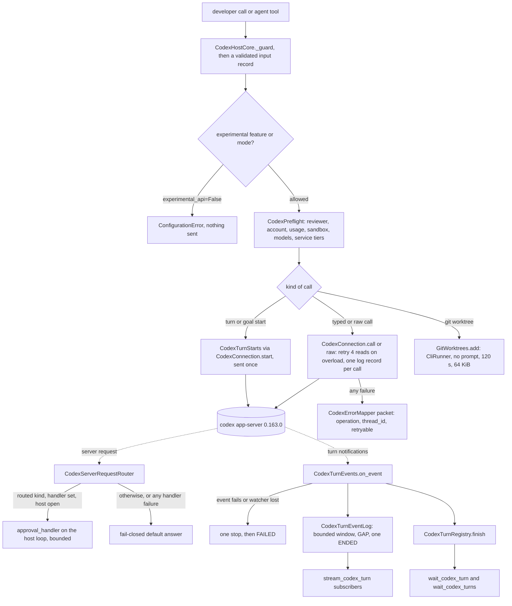

feat(codex-host): production hardening plus 25 first-class Codex functions and 16 tools
## Summary

This PR builds two specs on one branch. Slice 1 is `docs/spec/codex-host-hardening/spec.md` (r6). It makes the 27 existing `CodexHost` functions, the 6 one-shot functions and the 26 tools ready for production. Slice 2 is `docs/spec/codex-host-first-class/spec.md` (r8). It adds 25 first-class Codex functions, each built over its app-server method, plus `collaboration_mode` on spawn requests and 16 agent tools (42 in all).

What slice 1 adds:
- Approvals are no longer auto-accepted. An optional async `approval_handler` answers them, and a router that fails closed answers everything else.
- Every error carries `retryable`.
- Every Codex call writes exactly one log record that holds no private data.
- No turn can stay `RUNNING` forever.
- openai-codex moves to 0.163.0, along with the settings the old functions missed.

How each slash command from the request landed:

| Command | Status | Method, tool or field |
|---|---|---|
| `/plan` | new | `run_codex_plan`, `list_codex_collaboration_modes` and `CodexSpawnRequest.collaboration_mode` |
| `/side` | new | `start_codex_side_chat` |
| `/mcp` | new | `list_codex_mcp_servers` |
| `/memories` | new | `set_codex_thread_memory_mode`, `get_codex_memory_status` and `reset_codex_memories` |
| `/worktree` | new | `create_codex_worktree` |
| `/fast` | new | validated service tiers: `turn_service_tier`, `CodexModelInfo.service_tiers` and `service_tier` on both settings updates |
| `/plugin` | new | `disabled_plugin_ids` on `update_codex_thread_settings` |
| `/review` | hardened | `start_codex_review` (existing): caps and a one-item read-back |
| `/fork` | hardened | `fork_codex_thread` (existing): `before_turn_id` and `defer_goal_continuation` |
| `/compact` | hardened | `compact_codex_thread` (existing): read failures classified correctly |
| `/app` | not built | it is P2, "open in the desktop app" (NG-3) |

> **Stacked PR.** This PR's base is `ai/resolve-pr-1055-comments` (#1178, open, head `8baff351`). It retargets to `main` (`6f5a7310`) once #1178 merges. Review the diff against that base only.

## How to use what this PR introduces

**Slice 2: plan, stream, change settings, side chat and multi-wait** (spec §4, verbatim):

```python
import asyncio

from vidbyte.harnesses.native.codex import CodexHost
from vidbyte.lib.dataclasses.codex_host import CodexSpawnRequest
from vidbyte.lib.dataclasses.codex_host_features import CodexThreadSettingsUpdate
from vidbyte.lib.dataclasses.codex_host_modes import CodexCollaborationMode
from vidbyte.lib.enums.codex import CodexCollaborationModeKind, CodexReasoningEffort, CodexTurnEventKind, CodexTurnWaitMode


async def main() -> None:
    async with CodexHost() as host:
        # Plan first, printing the plan as Codex writes it.
        plan = await host.run_codex_plan("Plan a fix for the failing login test.")
        async for event in host.stream_codex_turn(plan):
            if event.kind is CodexTurnEventKind.PLAN_DELTA:
                print(event.text, end="")
        # Raise the thread's effort, leave plan mode to build, and ask a side question meanwhile.
        await host.update_codex_thread_settings(plan.thread_id, CodexThreadSettingsUpdate(effort=CodexReasoningEffort.HIGH))
        default_mode = CodexSpawnRequest(collaboration_mode=CodexCollaborationMode(mode=CodexCollaborationModeKind.DEFAULT))
        build = await host.continue_codex_thread(plan.thread_id, "Implement the plan.", default_mode)
        side = await host.start_codex_side_chat(plan.thread_id, "Which step of the plan is riskiest?")
        done = await host.wait_codex_turns((build, side), return_when=CodexTurnWaitMode.ALL_COMPLETED)
        print([snapshot.status.value for snapshot in done])
        print([server.name for server in (await host.list_codex_mcp_servers()).servers])


asyncio.run(main())
```

Expected output, in order:
1. the plan text, streamed as it arrives;
2. `['completed', 'completed']`;
3. the names of the MCP servers Codex reports.

On a host opened with `CodexClientSettings(experimental_api=False)`, `run_codex_plan`, `update_codex_thread_settings` and any `collaboration_mode` are refused locally, before any request is sent.

**Slice 1: answer approvals in code** (spec §4, verbatim):

```python
import asyncio

from vidbyte.harnesses.native.codex import CodexHost
from vidbyte.lib.dataclasses.codex_host import CodexServerAnswer, CodexServerRequest, CodexSpawnRequest
from vidbyte.lib.enums.codex import (
    CodexApprovalDecision,
    CodexApprovalsReviewer,
    CodexCommandApprovalKind,
    CodexServerRequestKind,
)


async def answer(request: CodexServerRequest) -> CodexServerAnswer:
    # Allow `git status` as a new command; decline terminal input, every other command, file change and question.
    if (
        request.kind is CodexServerRequestKind.COMMAND_EXECUTION
        and request.approval_kind is CodexCommandApprovalKind.COMMAND
        and request.command == "git status"
    ):
        return CodexServerAnswer(decision=CodexApprovalDecision.ACCEPT)
    return CodexServerAnswer(decision=CodexApprovalDecision.DECLINE)


async def main() -> None:
    async with CodexHost(approval_handler=answer) as host:
        spawn = CodexSpawnRequest(prompt="Run git status and summarize it.", approvals_reviewer=CodexApprovalsReviewer.USER)
        handle = await host.spawn_codex_thread(spawn)
        snapshot = await host.wait_codex_turn(handle)
        print(snapshot.status.value)
        print(await host.forget_codex_turns(handle.thread_id))


asyncio.run(main())
```

Expected output: `completed`, then `1`. Without a handler, each server request gets a fail-closed answer:
- approvals are declined;
- questions get no answers;
- permission requests are granted nothing;
- MCP elicitations are declined.

On a host without a handler, a `USER` reviewer is also refused before any request.

**Did the snippets run? Live run not performed; requires a Codex login.** Both snippets did run verbatim against the suite's fake app-server, and both tests pass at HEAD (3 passed in 1.25 s):
- `test_codex_host_first_class_snippet.py`;
- `test_codex_host_approvals.py::CodexApprovalSnippetTests`.

S6 also ran a local check without Codex:
- every import and record in both snippets builds;
- `CodexHost()` and `CodexHost(approval_handler=answer)` construct without starting a process;
- the handler returns `accept` for `git status` and `decline` for terminal input;
- a sync handler is refused with `ConfigurationError`;
- `CodexHostTools` lists 42 tools;
- all 25 new methods are present on `CodexHost`.

**The 25 new methods.** `CodexHost` inherits them from four mixins that do not import the SDK, all built over `CodexHostCore`:

| Mixin | Methods |
|---|---|
| `CodexSettingsMethods` | `update_codex_thread_settings`, `list_codex_collaboration_modes`, `run_codex_plan`, `list_codex_mcp_servers`, `update_codex_turn_settings`, `set_codex_thread_memory_mode`, `get_codex_memory_status`, `reset_codex_memories` |
| `CodexStreamMethods` | `stream_codex_turn`, `wait_codex_turns` |
| `CodexThreadMethods` | `start_codex_side_chat`, `create_codex_worktree`, `archive_codex_thread`, `unarchive_codex_thread`, `revert_codex_thread`, `rename_codex_thread`, `inject_codex_items`, `list_codex_background_terminals`, `clean_codex_background_terminals`, `search_codex_thread_content`, `list_codex_child_threads` |
| `CodexGoalMethods` | `pause_codex_goal`, `resume_codex_goal`, `edit_codex_goal`, `clear_codex_goal` |

**What a model can and cannot reach.**
- Model tools exist for every new method except nine (D-21): `stream_codex_turn`, `reset_codex_memories`, `revert_codex_thread`, `inject_codex_items`, `create_codex_worktree`, `edit_codex_goal`, `clear_codex_goal`, `set_codex_thread_memory_mode` and `clean_codex_background_terminals`. Each of these is destructive, spawns or kills processes, rewrites history, changes a cost limit, sets a privacy choice, or has no tool shape.
- On the two settings tools, a model can change only the model and the effort.
- The side-chat tool forces a `READ_ONLY` sandbox and the `never` approval policy on both `thread/fork` and `turn/start`.

## Flow



**Calls.** Each call passes its guard and builds its input record, then passes the experimental gate and preflight. It then reaches Codex through one choke point, `CodexConnection`, which:
- retries only `account/read`, `thread/read`, `thread/list` and `thread/name/set`;
- logs one record per call;
- turns any failure into a `CodexAgentError` packet.

A malformed answer to an experimental method is parsed inside the call, so it surfaces as `codex.protocol_mismatch`.

**Server requests.** Every server request is answered exactly once. Approvals go to the developer's handler only when one is set and the host is open; any failure falls back to the fixed default answer.

**Turns.** A turn can now also end `FAILED` when one of its events fails or its watcher is lost. Its events feed a bounded stream window that never slows the turn down. `wait_codex_turns` waits on the turns' own end futures, so it never cancels a turn.

## What changed

Slice 1 is commits `8baff351..a7730107` (85 commits); slice 2 is `a7730107..HEAD`.

| Path | Slice | What changed |
|---|---|---|
| **`vidbyte/harnesses/native/codex/`** | | |
| `host.py` | 1, 2 | `CodexHost(settings, *, approval_handler=)` checked by `CodexHostSetup`; `forget_codex_turns`; failed spawns and launches name the thread and release its tools; limitation docstrings. Slice 2 moves `_guard`, `_owned` and the start helpers out unchanged (D-1, D-2) and inherits the 25 methods: 919 → 786 lines |
| `host_core.py` (new) | 2 | `CodexHostCore`: `_guard`, `_owned` and `_change_idle`, the one idle-thread history change that archive, revert, inject and clear share |
| `settings_methods.py` (new) | 2 | `CodexSettingsMethods`: the 8 settings, plan-mode, MCP and memory methods |
| `stream_methods.py` (new) | 2 | `CodexStreamMethods`: `stream_codex_turn` (a bounded async iterator) and `wait_codex_turns` (uses `asyncio.wait` and never cancels a turn) |
| `thread_methods.py` (new) | 2 | `CodexThreadMethods`: the 11 side-chat, worktree, history, terminal, search and child-thread methods |
| `goal_methods.py` (new) | 2 | `CodexGoalMethods`: pause, resume, edit and clear goal. Every set carries `origin: "user"`, and an edit never sends a status |
| `turn_starts.py` (new) | 2 | `CodexTurnStarts`: the six start helpers moved from the host, the mode-model check, and the goal resume, which cancels from the set onward unless Codex refused it (R-4) |
| `turn_stream.py` (new) | 2 | `CodexTurnEventTranslator` and `CodexTurnEventLog`: per-turn and per-host bounds; one GAP per gap; one ENDED; raw reasoning is never streamed; an oversize event is dropped alone (R-3) |
| `turn_events.py` (new) | 1, 2 | `CodexTurnEvents`: a failed event ends the turn FAILED `protocol_mismatch`. A lost watcher ends it FAILED `api_error` after a grace and one quiet interrupt. Slice 2 feeds the stream log |
| `reviews.py` (new) | 1 | `CodexReviews`, moved out of the host: review caps and a one-item paged read-back. A read-back snapshot that fails ends the review FAILED (R-3) |
| `feature_wire.py` (new) | 2 | `CodexFeatureParamsTranslator` and `CodexFeatureResponseTranslator` for the 15 new wire methods; a malformed answer is `codex.protocol_mismatch` |
| `connection.py` | 1, 2 | `CodexServerRequestRouter` fails closed, bounds the handler by the 300 s tool-call bound, and cancels pending calls on close. One call record per call, cancelled calls included (R-10). Overload retry for 4 reads. Starts are awaited without a shield (R-11). Slice 2 adds `raw(method, params, parse=)` and sends spending raw methods once |
| `errors.py` | 1, 2 | `CodexErrorMapper.relabel`; a `thread/read` refusal and its other failures are told apart; a goal resume's packet names `thread/goal/set` |
| `preflight.py` | 1, 2 | Local user-reviewer refusal; service tiers checked, with one model-list refresh on a miss; slice 2 adds `require_experimental_api`, the mode check and `reject_routed_reviewer` |
| `thread_helpers.py` | 1, 2 | Fork gains `before_turn_id` and `defer_goal_continuation` (both experimental-gated), and its fork point is paged without items; continue gets a goal guard. Slice 2 adds `fork(starts_turn=True)`, which checks the fork's reviewer before sharing tools, and the `load` goal guard |
| `turns.py` | 1, 2 | Registry `forget`, which also drops the usage tracker; the watcher reports a failed read to `on_lost`; slice 2 adds `charge_stream`, the host-wide stream totals (D-39) |
| `wire.py` | 1, 2 | MAX and ULTRA effort, per-turn service tier, sandbox `networkAccess` and `writableRoots`, server and default answers, fork params; slice 2 injects `collaborationMode` after validation, and `final_answer` falls back to the last plan. 839/840 lines |
| `skill_functions.py` | 1, 2 | Wrapper errors carry the wrapper's own operation; skills are listed for `turn.cwd`; slice 2 adds `run_plan`, which picks Codex's first plan preset |
| `oneshot.py` | 1 | The one-shot `list_codex_threads` mirrors `limit`; docstrings say each call starts a process |
| **`vidbyte/lib/`** | | |
| `constants/codex_host.py` | 1, 2 | Every new table, bound, message, cause and next step (C021), among them the retryable codes, the retried methods, the default answers, the four stream bounds, the 15 method names, and the side-chat and worktree texts |
| `constants/codex.py` | 1 | Removes the two auto-accept approval constants; rewords the reviewer text and two next steps |
| `constants/native_threads.py` | 2 | `GIT_*` values for the worktree helper: program, command, ref pattern, and an environment that disables git's prompts |
| `dataclasses/codex_host.py` | 1, 2 | `CodexServerRequest.from_params`, `CodexServerAnswer`, the user-input question, option and answer records, `CodexServiceTier`; spawn fields `turn_service_tier`, `network_access`, `writable_roots` and `collaboration_mode`. 891/900 lines |
| `dataclasses/codex_host_inputs.py` | 1, 2 | `CodexHostSetup`, the new argument fields on #1178's records, and 17 slice-2 input records, among them `CodexSideChatRequest`, `CodexWorktreeRequest` (R-RR1, R-RR2-1), `CodexGoalResumeRequest` and `CodexTurnsWaitRequest` |
| `dataclasses/codex_host_features.py` (new) | 2 | 11 records: `CodexThreadSettingsUpdate`, `CodexTurnEvent`, `CodexPlanStep`, the MCP server, memory status, worktree, background terminal and search records, and their pages |
| `dataclasses/codex_host_modes.py` (new) | 2 | `CodexCollaborationMode` and `CodexCollaborationModePreset` |
| `dataclasses/codex.py` | 1 | `client_version` set to `"0.163.0"` |
| `dataclasses/process.py` | 2 | `GitWorktreeSpec`: absolute paths, safe refs, bounded timeout and output |
| `enums/codex.py` | 1, 2 | `CodexServerRequestKind`, `CodexApprovalDecision`, `CodexCommandApprovalKind`, MAX and ULTRA, 9 feature enums, and the new `CodexHostOperation` members (55 in all) |
| `enums/process.py` | 2 | `GitFlag` |
| `enums/__init__.py` | 1, 2 | Exports for the new enums |
| `errors/base.py` | 1 | `CodexAgentError.retryable` (read from `CODEX_HOST_RETRYABLE_CODES`) and `with_operation` |
| `process/git_worktree.py` (new) | 2 | `GitWorktrees.add`, the canonical `git worktree add` helper over `CliArgv` and `CliRunner`; it never uses a shell and never raises |
| `process/__init__.py` | 2 | Header names the new helper |
| `util/exception_origin.py` (new) | 1 | `ExceptionOrigin.describe`: one `file:function:line` token (R-12) |
| `util/text.py` | 1 | `LogToken.of`: a bounded, space-free log token for ids that Codex or the caller chose (R-9) |
| `util/__init__.py` | 1 | Exports |
| `README.md` | 1, 2 | The folder notes name the new helpers |
| **`vidbyte/tools/`** | | |
| `toolsets/codex.py` | 2 | `CodexHostTools`: 26 → 42 tools |
| `builtins/codex/_base.py` | 1, 2 | An unexpected exception becomes a `codex.api_error` result, logged as `codex_host_tool_failed`; `_resolve_handles`; `_json` drops items from a tuple of snapshots |
| `builtins/codex/controls.py` (new) | 2 | 5 tools: thread settings, collaboration modes, MCP servers, turn settings and memory status |
| `builtins/codex/thread_actions.py` (new) | 2 | 7 tools: side chat (posture narrowed), archive, unarchive, rename, background terminals, content search and child threads |
| `builtins/codex/skill_functions.py` | 2 | `RunCodexPlanTool`, `PauseCodexGoalTool` and `ResumeCodexGoalTool` |
| `builtins/codex/live.py` | 2 | `WaitCodexTurnsTool` |
| `builtins/codex/descriptions.py` | 2 | The 16 tool descriptions and their parameter texts |
| `builtins/codex/__init__.py`, `builtins/__init__.py` | 2 | Exports |
| **root** | | |
| `pyproject.toml` | 1 | `codex = ["openai-codex>=0.163.0,<0.164.0"]` |
| **`tests/features/codex_host/`** (46 files, +10,688 −85; 603 tests collected) | | |
| 11 new slice-1 modules | 1 | 135 tests: `approvals`, `fork_review`, `function_rows`, `hardening_contract`, `hardening_records`, `live_smoke` (opt-in), `liveness`, `observability`, `resilience`, `tool_hardening`, `turn_settings` |
| 14 new slice-2 modules | 2 | 245 tests: `feature_constants`, `feature_contract`, `feature_docs`, `feature_records`, `feature_structure`, `feature_tools`, `first_class_snippet`, `goal_control`, `mcp_memory`, `settings_modes`, `side_chat`, `stream_wait`, `thread_admin`, `worktree` |
| 15 existing modules updated | 1, 2 | Superseded pins rewritten as each spec's §13 lists, for example catalog counts 26 → 42, field tails, and enum rows |
| fakes and support (2 new, 2 updated) | 1, 2 | `codex_host_feature_fakes.py` and `codex_host_feature_support.py` (new); `codex_host_fakes.py` and `codex_host_support.py`. The fake app-server answers every new method |
| `FEATURE.md`, `README.md` | 1, 2 | Test-pack notes |
| **`docs/spec/`** | | |
| `codex-host-hardening/` | 1 | spec r6, request, test plan, review, verify log, stage reports |
| `codex-host-first-class/` | 2 | spec r8, request, code map, test plan, review, verify log, stage reports, this PR body |

## Acceptance criteria → proof

These tables cover every AC row of both specs, with every test each spec names. Test paths are relative to `tests/features/codex_host/`. An independent check parsed each cited test file and resolved every cited id to a defined class or method: 168 of 168 resolve on the branch.

**Slice 1: `codex-host-hardening` (41 ACs)**

| AC | Pri | What it checks | Proof |
|---|---|---|---|
| AC-1 | P0 | The §4 snippet prints `completed`, then `1`; the thread starts with a `user` reviewer | `test_codex_host_approvals.py::CodexApprovalSnippetTests` |
| AC-2 | P0 | A spawn whose first `turn/start` fails names the new thread and unregisters its tools | `test_codex_host_resilience.py::CodexSpawnCleanupTests::test_a_spawn_whose_turn_or_name_fails_names_the_thread_and_unregisters_its_tools`<br>`test_codex_host_resilience.py::CodexSpawnCleanupTests::test_a_cancelled_spawn_whose_start_codex_adopts_keeps_its_tools_for_that_turn` |
| AC-3 | P0 | A launch whose third start fails names the third thread and stops the two started turns once each | `test_codex_host_resilience.py::CodexSpawnCleanupTests::test_a_launch_whose_third_turn_fails_stops_the_two_started_turns_and_unregisters_the_third` |
| AC-4 | P0 | The four read methods retry one overload; a spending method is sent once and raises a retryable `codex.api_error` | `test_codex_host_resilience.py::CodexOverloadRetryTests` |
| AC-5 | P0 | `retryable` is true for exactly five codes, and it is never a `details` key | `test_codex_host_hardening_contract.py::CodexAgentErrorHardeningTests::test_retryable_is_true_exactly_for_the_five_codes_and_never_in_details` |
| AC-6 | P0 | A `thread/read` -32603, or an overload on every attempt, is `codex.api_error`, not `session_not_found` | `test_codex_host_resilience.py::CodexThreadReadFailureTests`<br>`test_codex_host_hardening_contract.py::CodexHardeningClassificationTests` |
| AC-7 | P0 | A turn or goal run whose event processing fails ends FAILED `protocol_mismatch` after one stop | `test_codex_host_liveness.py::CodexEventFailureTests` |
| AC-8 | P0 | A lost watcher ends the turn FAILED `api_error` after the grace and one interrupt; a process death wins | `test_codex_host_liveness.py::CodexLostWatcherTests` |
| AC-9 | P0 | A review whose completion read-back raises ends FAILED, and its wait returns | `test_codex_host_liveness.py::CodexReviewCompletionFailureTests` |
| AC-10 | P0 | Without a handler, every server request gets its fixed fail-closed answer | `test_codex_host_approvals.py::CodexDefaultAnswerTests::test_a_host_without_a_handler_answers_every_server_request_with_its_default`<br>`test_codex_host_router.py::CodexHostRouterTests::test_the_router_answers_every_server_request_and_never_raises` |
| AC-11 | P0 | A handler's accept, session-wide accept and answers reach Codex; the handler sees every request field | `test_codex_host_approvals.py::CodexHandlerRoutingTests`<br>`test_codex_host_hardening_records.py::CodexServerRequestParseTests` |
| AC-12 | P0 | A handler that raises, hangs or answers the wrong request falls back to the default answer, with one WARNING | `test_codex_host_approvals.py::CodexHandlerFallbackTests` |
| AC-13 | P0 | A sync or non-callable handler, or bad settings, is refused when the host is built | `test_codex_host_hardening_contract.py::CodexHostSetupTests`<br>`test_codex_host_approvals.py::CodexHostSetupHostTests` |
| AC-14 | P0 | A `USER` reviewer request builds; without a handler, every call refuses it before any request | `test_codex_host_approvals.py::CodexUserReviewerTests`<br>`test_codex_host_records.py::CodexHostRecordValidationTests::test_user_reviewer_is_refused_when_any_spawn_request_is_built`<br>`test_codex_host_tool_hardening.py::CodexToolUserReviewerTests` |
| AC-15 | P0 | Permission, elicitation and legacy exec approvals never reach the handler | `test_codex_host_approvals.py::CodexDefaultAnswerTests::test_a_host_with_a_handler_never_routes_the_fixed_methods` |
| AC-16 | P0 | `forget_codex_turns` drops ended turns, refuses a busy thread, and sends nothing | `test_codex_host_function_rows.py::CodexForgetTurnsTests`<br>`test_codex_host_inputs.py::CodexHostInputBoundaryTests::test_every_public_method_refuses_a_bad_argument_before_any_request` |
| AC-17 | P0 | A tool whose host method raises a non-Codex exception returns a `codex.api_error` result | `test_codex_host_tool_hardening.py::CodexToolLocalFailureTests` |
| AC-18 | P0 | Every call, server request and tool failure is logged with its fields and no private text | `test_codex_host_observability.py::CodexObservabilityTests`<br>`test_codex_host_observability.py::CodexLogTokenRecordTests`<br>`test_codex_host_observability.py::CodexCallRecordTests`<br>`test_codex_host_hardening_contract.py::CodexLogTokenTests`<br>`test_codex_host_hardening_contract.py::CodexExceptionOriginTests` |
| AC-19 | P0 | `ordinary_usage_allowed=False` makes the readiness check report `codex.usage_limited` | `test_codex_host_function_rows.py::CodexReadinessUsageTests` |
| AC-20 | P1 | A model missing from the cache triggers exactly one `model/list` refresh | `test_codex_host_function_rows.py::CodexModelRefreshTests` |
| AC-21 | P0 | Continue refuses a not-loaded thread whose goal is active, after only two reads | `test_codex_host_function_rows.py::CodexContinueGoalGuardTests` |
| AC-22 | P0 | Fork sends `beforeTurnId` and `deferGoalContinuation`, refuses both fork points, and gates both on `experimental_api` | `test_codex_host_fork_review.py::CodexForkHardeningTests`<br>`test_codex_host_hardening_contract.py::CodexHardeningInputRecordTests::test_fork_takes_one_fork_point_and_refuses_both`<br>`test_codex_host_threads.py::CodexHostLaunchAndForkTests::test_fork_reads_the_turns_first_and_forks_through_a_completed_turn` |
| AC-23 | P1 | `list_codex_threads(limit=)` sends the limit, and a bad limit is refused before any request | `test_codex_host_function_rows.py::CodexListingArgumentTests::test_the_host_sends_a_limit_and_refuses_a_bad_one_before_any_request`<br>`test_codex_host_function_rows.py::CodexListingArgumentTests::test_the_one_shot_mirrors_the_limit`<br>`test_codex_host_hardening_contract.py::CodexHardeningInputRecordTests::test_the_thread_list_limit_is_none_or_an_int_in_range` |
| AC-24 | P1 | Steering a turn that is being interrupted, or one Codex refuses, raises `session_not_found` | `test_codex_host_resilience.py::CodexSteerStoppingTests` |
| AC-25 | P1 | A review honours its time cap and refuses a `turn` | `test_codex_host_fork_review.py::CodexReviewRequestTests::test_a_review_with_a_time_cap_is_interrupted_once_and_labelled_timed_out`<br>`test_codex_host_fork_review.py::CodexReviewRequestTests::test_a_review_request_with_a_turn_is_refused_before_any_request`<br>`test_codex_host_hardening_contract.py::CodexHardeningInputRecordTests::test_a_review_request_takes_only_time_and_token_caps` |
| AC-26 | P1 | The wrapper functions' errors carry the wrapper's own operation | `test_codex_host_resilience.py::CodexWrapperOperationTests`<br>`test_codex_host_goal_skills.py::CodexRunReRaiseTests`<br>`test_codex_host_goal_skills.py::CodexRunGoalTests::test_a_goal_check_that_fails_cancels_the_run_and_keeps_its_error`<br>`test_codex_host_goal_skills.py::CodexSkillReadBackTests::test_a_read_back_that_fails_interrupts_once_and_keeps_its_error`<br>`test_codex_host_helper_lifecycle.py::CodexHelperProtocolTests::test_a_missing_method_is_protocol_mismatch_with_the_functions_own_operation`<br>`test_codex_host_hardening_contract.py::CodexAgentErrorHardeningTests::test_with_operation_changes_the_operation_and_message_and_keeps_the_rest`<br>`test_codex_host_hardening_contract.py::CodexAgentErrorHardeningTests::test_relabel_rewrites_the_head_and_returns_an_error_already_carrying_the_operation` |
| AC-27 | P1 | `force_reload` is sent only when asked | `test_codex_host_function_rows.py::CodexListingArgumentTests::test_force_reload_is_sent_only_when_asked`<br>`test_codex_host_hardening_contract.py::CodexHardeningInputRecordTests::test_skill_listing_takes_a_bool_force_reload`<br>`test_codex_host_helper_surface.py::CodexHelperHostSignatureTests::test_each_method_has_its_section_8_5_signature` |
| AC-28 | P1 | `run_codex_skill` lists skills for `turn.cwd` | `test_codex_host_function_rows.py::CodexSkillFolderTests` |
| AC-29 | P0 | A goal request refuses each turn-only field, naming it | `test_codex_host_turn_settings.py::CodexGoalRunFieldTests`<br>`test_codex_host_hardening_records.py::CodexSpawnRequestHardeningTests::test_a_goal_request_refuses_each_turn_only_field_naming_the_first_one_set`<br>`test_codex_host_hardening_records.py::CodexSpawnRequestHardeningTests::test_a_goal_request_with_thread_settings_and_vidbyte_caps_still_builds`<br>`test_codex_host_hardening_contract.py::CodexHardeningInputRecordTests::test_a_goal_run_request_applies_the_goal_rule_to_its_request`<br>`test_codex_host_tools.py::CodexHostToolArgumentTests::test_spawn_takes_the_posture_from_defaults_and_six_values_from_the_model`<br>`test_codex_host_tool_hardening.py::CodexToolGoalEffortTests` |
| AC-30 | P1 | MAX and ULTRA efforts reach `turn/start` and the tool schemas | `test_codex_host_turn_settings.py::CodexEffortWireTests`<br>`test_codex_host_tool_hardening.py::CodexToolSurfaceGuardTests::test_the_spawn_and_continue_tools_offer_max_and_ultra`<br>`test_codex_host_hardening_records.py::CodexHardeningEnumTests::test_max_and_ultra_follow_xhigh_and_forget_follows_track_usage` |
| AC-31 | P0 | Service tiers are listed and sent per turn; an unknown tier is `codex.model_unknown` | `test_codex_host_turn_settings.py::CodexServiceTierTests`<br>`test_codex_host_hardening_records.py::CodexModelInfoTierTests` |
| AC-32 | P0 | `networkAccess` and `writableRoots` reach the sandbox policy; bad combinations are refused locally | `test_codex_host_turn_settings.py::CodexSandboxAccessTests`<br>`test_codex_host_hardening_records.py::CodexSpawnRequestHardeningTests::test_network_access_needs_a_read_only_or_workspace_write_turn_sandbox`<br>`test_codex_host_hardening_records.py::CodexSpawnRequestHardeningTests::test_writable_roots_need_workspace_write_and_absolute_paths` |
| AC-33 | P0 | Fork and review never read full history; read-backs are one-item pages | `test_codex_host_fork_review.py::CodexReviewRequestTests::test_a_completed_inline_review_is_read_back_by_two_one_item_pages_and_never_by_full_history`<br>`test_codex_host_review_goals.py::CodexHostReviewTests::test_a_review_whose_final_item_was_dropped_is_completed_from_the_completion_read_back`<br>`test_codex_host_review_gaps.py::CodexHostReviewReadBackCancellationTests::test_a_review_cancelled_during_its_read_back_is_watched_and_interrupted_once`<br>`test_codex_host_failures.py::CodexHostLateAcceptanceTests::test_a_review_cancelled_in_flight_is_interrupted_once_and_read_back`<br>`test_codex_host_threads.py::CodexHostLaunchAndForkTests::test_fork_reads_the_turns_first_and_forks_through_a_completed_turn` |
| AC-34 | P0 | The pin is `openai-codex>=0.163.0,<0.164.0`, and the client reports 0.163.0 | `test_codex_host_hardening_contract.py::CodexHardeningPinAndDocsTests::test_the_extra_pins_openai_codex_0_163_and_the_client_reports_it`<br>`test_codex_host_sdk_contract.py::CodexHardeningSdkContractTests`<br>`test_codex_host_sdk_contract.py::CodexHostSdkContractTests` |
| AC-35 | P1 | The live smoke module skips unless opted in, and then calls only reads that spend nothing | `test_codex_host_live_smoke.py::CodexLiveGateTests`<br>`test_codex_host_live_smoke.py::CodexLiveSmokeTests` · `CodexLiveSmokeTests` is opt-in and was not run, because it needs a Codex login |
| AC-36 | P0 | The toolset holds 26 tools and offers no forbidden parameter | `test_codex_host_tool_hardening.py::CodexToolSurfaceGuardTests::test_the_toolset_holds_26_tools_and_offers_no_forbidden_parameter` |
| AC-37 | P0 | The codex_host pack and the `CodexHarnessAgent` suite pass | area run at HEAD: `1 failed, 1306 passed, 3 skipped` (the failure is the inherited test) |
| AC-38 | P1 | Close cancels pending handler calls; a routed request that arrives late gets its default answer | `test_codex_host_approvals.py::CodexCloseHandlerTests` |
| AC-39 | P2 | Docstrings name each documented limitation and deprecation | `test_codex_host_hardening_contract.py::CodexHardeningPinAndDocsTests::test_each_documented_limitation_is_named_in_its_docstring` |
| AC-40 | P0 | New constants are importable from lib, and no native module binds one; C021 passes | `test_codex_host_hardening_contract.py::CodexHardeningConstantTests` · `lint/run.py` → `SDK-LINT: PASS`, C021 `0 0 CLEAN` |
| AC-41 | P0 | Every public method refuses a bad argument, naming `<method> <field>`, before any request | `test_codex_host_function_rows.py::CodexNewArgumentRefusalTests`<br>`test_codex_host_inputs.py::CodexHostInputBoundaryTests`<br>`test_codex_host_inputs.py::CodexHostInputRecordTests::test_every_exported_record_has_a_valid_baseline_that_is_frozen_and_slotted`<br>`test_codex_host_hardening_contract.py::CodexHardeningInputRecordTests` |

**Slice 2: `codex-host-first-class` (44 ACs)**

| AC | Pri | What it checks | Proof |
|---|---|---|---|
| AC-1 | P0 | The §4 snippet prints the streamed plan, then `['completed', 'completed']`, then the server names | `test_codex_host_first_class_snippet.py::CodexFirstClassSnippetTests::test_the_section_4_snippet_prints_the_streamed_plan_then_both_statuses_then_the_server_names` |
| AC-2 | P0 | A thread settings update sends one call that holds only the fields that were set | `test_codex_host_settings_modes.py::CodexThreadSettingsUpdateHostTests::test_an_update_sends_one_settings_call_holding_only_the_fields_that_were_set`<br>`test_codex_host_settings_modes.py::CodexThreadSettingsUpdateHostTests::test_each_other_setting_reaches_its_own_wire_key_and_nothing_else_is_sent` |
| AC-3 | P0 | A not-loaded thread with an active goal is refused before any resume | `test_codex_host_settings_modes.py::CodexThreadSettingsUpdateHostTests::test_a_not_loaded_thread_with_an_active_goal_is_refused_before_any_resume` |
| AC-4 | P0 | An empty update, a tier set together with a clear, or roots without `WORKSPACE_WRITE` is refused when built | `test_codex_host_feature_records.py::CodexThreadSettingsUpdateTests::test_an_update_that_sets_nothing_is_refused_naming_settings`<br>`test_codex_host_feature_records.py::CodexThreadSettingsUpdateTests::test_a_tier_set_together_with_a_clear_is_refused`<br>`test_codex_host_feature_records.py::CodexThreadSettingsUpdateTests::test_writable_roots_must_be_absolute_and_need_a_workspace_write_sandbox` |
| AC-5 | P0 | A plan-mode spawn sends the model Codex resolved and is priced as that model | `test_codex_host_settings_modes.py::CodexCollaborationModeTurnHostTests::test_a_plan_mode_spawn_sends_the_model_codex_resolved_and_is_priced_as_it`<br>`test_codex_host_settings_modes.py::CodexCollaborationModeTurnHostTests::test_the_mode_settings_take_the_first_model_set_and_any_named_effort` |
| AC-6 | P0 | A mode whose model or effort conflicts with the turn's, or a mode of kind `NONE`, is refused when built | `test_codex_host_feature_records.py::CodexSpawnRequestModeTests::test_a_mode_whose_model_or_effort_differs_from_the_turns_is_refused_when_built`<br>`test_codex_host_feature_records.py::CodexCollaborationModeRecordTests::test_a_conflicting_model_is_refused_naming_the_owner_and_an_equal_or_empty_one_is_not`<br>`test_codex_host_feature_records.py::CodexCollaborationModeRecordTests::test_a_conflicting_effort_is_refused_and_a_providers_default_never_conflicts`<br>`test_codex_host_feature_records.py::CodexCollaborationModeRecordTests::test_a_mode_kind_of_none_is_refused_with_the_kind_message` |
| AC-7 | P0 | Every call that cannot send a mode refuses it before any request | `test_codex_host_settings_modes.py::CodexModeRefusalHostTests::test_every_call_that_cannot_send_a_mode_refuses_it_before_any_request`<br>`test_codex_host_feature_records.py::CodexSpawnRequestModeTests::test_a_goal_request_refuses_a_collaboration_mode_naming_the_field` |
| AC-8 | P0 | Without the experimental API, the 11 gated functions and any mode are refused, with no request sent | `test_codex_host_feature_contract.py::CodexFeatureExperimentalGateTests::test_without_the_experimental_api_the_eleven_functions_and_any_mode_are_refused_with_no_request`<br>`test_codex_host_feature_contract.py::CodexFeatureExperimentalGateTests::test_without_the_experimental_api_the_stable_functions_still_talk_to_codex` |
| AC-9 | P0 | Presets come back in Codex's order; a malformed list is `protocol_mismatch` | `test_codex_host_settings_modes.py::CodexCollaborationModeListHostTests::test_the_presets_come_back_in_codex_order_with_nulls_read_as_blank` |
| AC-10 | P0 | `run_codex_plan` lists the presets, then spawns one plan turn whose plan is the answer | `test_codex_host_settings_modes.py::CodexPlanRunHostTests::test_a_plan_run_lists_the_presets_then_spawns_one_plan_turn_whose_plan_is_the_answer`<br>`test_codex_host_settings_modes.py::CodexFinalAnswerPlanFallbackTests::test_the_last_plan_answers_only_when_no_agent_message_does` |
| AC-11 | P0 | With no plan preset, the call is `protocol_mismatch` and sends no `thread/start` | `test_codex_host_settings_modes.py::CodexPlanRunHostTests::test_a_preset_list_without_a_plan_mode_spawns_nothing` |
| AC-12 | P0 | A streamed turn yields each event in order, then one ENDED that equals the wait's snapshot | `test_codex_host_stream_wait.py::CodexTurnStreamHostTests::test_a_streamed_turn_yields_each_event_in_order_then_one_ended` |
| AC-13 | P0 | Raw reasoning never reaches a stream or a log | `test_codex_host_stream_wait.py::CodexTurnStreamHostTests::test_raw_reasoning_text_never_reaches_a_stream_or_a_log` |
| AC-14 | P0 | A stalled subscriber gets one GAP, then the kept window, and never delays the turn | `test_codex_host_stream_wait.py::CodexTurnStreamHostTests::test_a_stalled_subscriber_gets_one_gap_then_the_kept_window_and_never_delays_the_turn` |
| AC-15 | P0 | An ended turn streams only ENDED; an unknown handle is refused at the call | `test_codex_host_stream_wait.py::CodexTurnStreamHostTests::test_an_ended_turn_streams_only_ended_and_an_unknown_handle_is_refused_at_the_call` |
| AC-16 | P0 | A `FIRST_COMPLETED` wait returns every snapshot in order and sends no interrupt | `test_codex_host_stream_wait.py::CodexTurnsWaitHostTests::test_a_first_completed_wait_returns_every_snapshot_in_order_and_touches_no_turn` |
| AC-17 | P0 | An `ALL_COMPLETED` wait returns RUNNING snapshots at its timeout and sends nothing | `test_codex_host_stream_wait.py::CodexTurnsWaitHostTests::test_an_all_completed_wait_returns_running_snapshots_at_its_timeout_and_sends_nothing` |
| AC-18 | P0 | An empty, duplicate, oversize or unknown handle tuple is refused before any wait | `test_codex_host_feature_records.py::CodexFeatureInputRecordTests::test_a_wait_takes_one_to_1024_distinct_handles_and_stores_them_as_a_tuple`<br>`test_codex_host_stream_wait.py::CodexTurnsWaitHostTests::test_bad_handle_tuples_are_refused_before_any_wait` |
| AC-19 | P0 | One MCP server page maps its tools, resources and statuses; it works without the experimental API | `test_codex_host_mcp_memory.py::CodexMcpServerHostTests::test_one_server_page_maps_its_tools_resources_and_statuses`<br>`test_codex_host_mcp_memory.py::CodexMcpServerHostTests::test_the_listing_works_on_a_host_without_the_experimental_api` |
| AC-20 | P1 | A running turn takes one settings update; an ended or unknown turn is refused locally | `test_codex_host_settings_modes.py::CodexTurnSettingsHostTests::test_a_running_turn_takes_one_settings_update_and_returns_codexs_status`<br>`test_codex_host_settings_modes.py::CodexTurnSettingsHostTests::test_an_ended_or_unknown_turn_is_refused_locally_and_sends_nothing` |
| AC-21 | P1 | Setting the memory mode first loads a thread whose goal is paused; the status and reset calls are each sent | `test_codex_host_mcp_memory.py::CodexMemoryHostTests::test_a_paused_goal_thread_is_loaded_then_its_memory_set_then_status_and_reset_are_sent` |
| AC-22 | P1 | A side chat forks the last completed turn, injects the boundary message, and starts its turn on the fork | `test_codex_host_side_chat.py::CodexSideChatFlowTests::test_a_side_chat_forks_the_last_completed_turn_injects_the_boundary_and_starts_its_turn_on_the_fork` |
| AC-23 | P1 | A failed inject names the fork, releases its tools, and registers no turn | `test_codex_host_side_chat.py::CodexSideChatRefusalTests::test_a_failed_inject_names_the_fork_releases_its_tools_and_registers_no_turn` |
| AC-24 | P1 | A worktree is made under `~/.vidbyte/codex-worktrees`; an existing folder, or git missing, is refused | `test_codex_host_worktree.py::CodexWorktreeHostTests::test_a_worktree_is_made_under_the_vidbyte_root_on_a_new_branch_from_head_and_codex_hears_nothing`<br>`test_codex_host_worktree.py::CodexWorktreeHostTests::test_an_existing_target_folder_is_refused_before_git_runs`<br>`test_codex_host_worktree.py::CodexWorktreeHostTests::test_without_git_on_path_the_call_reports_that_git_could_not_start` |
| AC-25 | P1 | Pausing a tracked goal run sends one user set, and the run ends PAUSED | `test_codex_host_goal_control.py::CodexGoalPauseHostTests::test_pausing_a_tracked_goal_run_sends_one_user_set_and_the_run_ends_paused` |
| AC-26 | P1 | A resumable goal resumes with a status-only set; any other goal, or a spent budget, is refused before `thread/resume` | `test_codex_host_goal_control.py::CodexGoalResumeHostTests::test_a_resumable_goal_is_resumed_with_a_status_only_set_and_its_run_is_tracked`<br>`test_codex_host_goal_control.py::CodexGoalResumeHostTests::test_an_active_or_complete_goal_is_refused_before_thread_resume`<br>`test_codex_host_goal_control.py::CodexGoalResumeHostTests::test_a_spent_budget_is_refused_until_edit_raises_it_then_the_goal_resumes` |
| AC-27 | P1 | A resume whose start window elapses is cancelled once and cleaned up | `test_codex_host_goal_control.py::CodexGoalResumeHostTests::test_a_resume_whose_start_window_elapses_is_cancelled_once_and_cleaned_up` |
| AC-28 | P1 | An edit sends only the objective or the budget, with the user origin; a budget echo mismatch is `protocol_mismatch` | `test_codex_host_goal_control.py::CodexGoalEditClearHostTests::test_an_edit_sends_only_the_objective_or_the_budget_with_the_user_origin`<br>`test_codex_host_goal_control.py::CodexGoalEditClearHostTests::test_a_budget_codex_did_not_keep_is_a_protocol_mismatch` |
| AC-29 | P1 | Clearing an idle thread's goal returns `True`; a running thread is refused | `test_codex_host_goal_control.py::CodexGoalEditClearHostTests::test_clearing_an_idle_threads_goal_returns_codexs_cleared`<br>`test_codex_host_goal_control.py::CodexGoalEditClearHostTests::test_clearing_a_running_thread_is_refused_and_no_clear_is_sent` |
| AC-30 | P1 | Archive, unarchive and rename send one call each; a busy thread is refused | `test_codex_host_thread_admin.py::CodexArchiveRenameHostTests::test_archive_unarchive_and_rename_send_their_one_call_each`<br>`test_codex_host_thread_admin.py::CodexArchiveRenameHostTests::test_an_overloaded_rename_is_retried_and_an_overloaded_archive_is_not`<br>`test_codex_host_thread_admin.py::CodexHistoryChangeHostTests::test_history_changing_calls_refuse_a_thread_this_host_is_running_before_any_request` |
| AC-31 | P1 | Revert sends one call after the read, and no revert tool exists | `test_codex_host_thread_admin.py::CodexHistoryChangeHostTests::test_revert_sends_one_call_after_the_read_and_returns_codexs_thread` |
| AC-32 | P1 | Inject sends the items exactly as given; a bad item list is refused when built | `test_codex_host_feature_records.py::CodexFeatureInputRecordTests::test_injected_items_are_json_objects_with_a_type_stored_as_copies`<br>`test_codex_host_thread_admin.py::CodexHistoryChangeHostTests::test_inject_sends_the_items_exactly_as_given_and_logs_none_of_them`<br>`test_codex_host_thread_admin.py::CodexHistoryChangeHostTests::test_inject_refuses_bad_item_lists_before_any_request` |
| AC-33 | P1 | The terminal, content-search and child listings send the specified params and parse the answers strictly | `test_codex_host_thread_admin.py::CodexTerminalSearchChildHostTests::test_background_terminals_are_listed_and_cleaned_after_one_exists_check`<br>`test_codex_host_thread_admin.py::CodexTerminalSearchChildHostTests::test_search_names_every_top_level_source_and_finds_this_hosts_threads`<br>`test_codex_host_thread_admin.py::CodexTerminalSearchChildHostTests::test_child_listing_names_the_parent_or_ancestor_and_every_source_kind` |
| AC-34 | P0 | A JSON-RPC error on each function's own method becomes its own packet, with one failed call record | `test_codex_host_feature_contract.py::CodexFeatureFailureTests::test_a_json_rpc_error_on_each_functions_own_method_is_its_own_packet_with_one_failed_call_record` |
| AC-35 | P0 | 42 tools in order; none offers a forbidden parameter or wraps a function that must have no tool | `test_codex_host_tools.py::CodexHostToolsShapeTests::test_toolset_holds_the_fifteen_tools_with_their_spec_schemas`<br>`test_codex_host_tool_hardening.py::CodexToolSurfaceGuardTests::test_the_toolset_holds_26_tools_and_offers_no_forbidden_parameter`<br>`test_codex_host_feature_tools.py::CodexFeatureToolCatalogTests::test_the_sixteen_tools_follow_the_old_ones_in_function_order_and_none_is_a_no_tool_function`<br>`test_codex_host_feature_tools.py::CodexFeatureToolCatalogTests::test_no_new_schema_offers_a_posture_parameter` |
| AC-36 | P1 | The side-chat tool narrows the posture to read-only, with `never` on both the fork and the turn | `test_codex_host_feature_tools.py::CodexFeatureToolArgumentTests::test_the_side_chat_tool_narrows_the_scope_posture_to_read_only_and_never_asking`<br>`test_codex_host_feature_tools.py::CodexFeatureToolHostTests::test_the_side_chat_tool_sends_never_and_no_reviewer_on_the_fork_and_the_turn`<br>`test_codex_host_feature_tools.py::CodexFeatureToolHostTests::test_the_side_chat_tool_starts_on_a_user_reviewer_parent_because_its_fork_never_asks` |
| AC-37 | P0 | Tools refuse at the cap, never raise, own their handles, and render settings and waits as specified | `test_codex_host_feature_tools.py::CodexFeatureToolScopeTests::test_a_full_cap_refuses_the_plan_side_chat_and_resume_tools_before_the_host`<br>`test_codex_host_tools.py::CodexHostToolErrorTests::test_every_tool_turns_host_errors_into_error_results`<br>`test_codex_host_tool_hardening.py::CodexToolLocalFailureTests::test_a_runtime_or_key_error_becomes_an_api_error_result_naming_only_the_tool_and_type`<br>`test_codex_host_feature_tools.py::CodexFeatureToolScopeTests::test_the_turn_settings_tool_answers_the_status_text_and_sends_no_tier_or_reviewer`<br>`test_codex_host_feature_tools.py::CodexFeatureToolScopeTests::test_the_multi_wait_returns_one_json_snapshot_per_handle_without_items_and_caps_its_wait` |
| AC-38 | P0 | Importing the host and each mixin loads no openai-codex | `test_codex_host_feature_structure.py::CodexFeatureImportSafetyTests::test_importing_the_host_and_each_mixin_loads_no_sdk_and_no_sdk_collaborator`<br>`test_codex_host_feature_structure.py::CodexFeatureImportSafetyTests::test_the_five_sdk_free_modules_import_openai_codex_only_under_type_checking`<br>`test_codex_host_packaging.py::CodexHostImportSafetyTests::test_imports_never_load_the_sdk_and_entering_reports_the_pip_extra` |
| AC-39 | P0 | The full local gate passes except for the inherited failure | source stage at HEAD: `1 failed, 6837 passed, 27 skipped in 138.00s` (the failure is the inherited test); area run: `1 failed, 1306 passed, 3 skipped` |
| AC-40 | P0 | Lint passes with no baseline raised; every file stays within its ceiling; no native module binds a top-level constant | `test_codex_host_feature_structure.py::CodexFeatureFileSizeTests::test_every_touched_or_new_file_stays_within_its_ceiling`<br>`test_codex_host_hardening_contract.py::CodexHardeningConstantTests::test_no_native_host_module_binds_a_top_level_constant` · `lint/run.py` → `SDK-LINT: PASS`, with no baseline raised |
| AC-41 | P0 | A malformed answer from an unmodeled method is `protocol_mismatch` inside the call | `test_codex_host_feature_contract.py::CodexFeatureFailureTests::test_an_unmodeled_answer_missing_a_member_or_with_a_wrong_type_is_a_protocol_mismatch_inside_the_call`<br>`test_codex_host_settings_modes.py::CodexCollaborationModeListHostTests::test_a_malformed_preset_answer_is_a_protocol_mismatch_naming_the_method` |
| AC-42 | P1 | A fork that Codex routes to a user reviewer is refused before the inject, on a host without a handler | `test_codex_host_side_chat.py::CodexSideChatRefusalTests::test_a_fork_codex_routes_to_a_user_reviewer_is_refused_before_the_inject_on_a_host_without_a_handler` |
| AC-43 | P0 | A subscription that is never iterated holds nothing, then reads one GAP followed by ENDED | `test_codex_host_stream_wait.py::CodexTurnStreamHostTests::test_a_subscription_never_iterated_holds_nothing_and_reads_one_gap_then_ended` |
| AC-44 | P1 | The host bound drops each turn's own oldest events and refunds them on release | `test_codex_host_stream_wait.py::CodexTurnStreamHostTests::test_the_host_bound_drops_each_turns_own_oldest_events_and_refunds_them_on_release` |

## Verification

Here `V` is the `venv-codex163` interpreter: an editable install with openai-codex 0.163.0. Every gate runs locally. The last source commit is `bd89e5b8`, and HEAD changes only docs after it.

| Gate | Command | Result |
|---|---|---|
| area tests (S6, at HEAD) | `PYTHONPATH=$(pwd) "$V" -m pytest tests/features/codex_host tests/features/harness_threads tests/test_codex_*.py -q -p no:cacheprovider` | `1 failed, 1306 passed, 3 skipped in 82.81s`; the one failure is the inherited test below |
| §4 snippet tests (S6, at HEAD) | the two AC-1 classes above | `3 passed in 1.25s` |
| AC proof ids (S6) | AST check of every id cited in both §6.2 tables | `TOTAL ids=168 missing=0` |
| full gate, source stage | `PYTHONPATH=$(pwd) "$V" scripts/run_ci.py --stage source`, run alone | `1 failed, 6837 passed, 27 skipped in 138.00s` (the failure is the inherited test); embedded lint `SDK-LINT: PASS`. Iteration 3 at `bd89e5b8` gave the same counts |
| full gate, package stage (iteration 3, `bd89e5b8`) | `"$V" scripts/run_ci.py --stage package` | `No broken requirements found.` · `Installed vidbyte-sdk 0.3.0 passed smoke checks.` · `CI passed.` |
| lint | `PYTHONIOENCODING=utf-8 "$V" lint/run.py` | `SDK-LINT: PASS`, with no baseline raised; C021 CLEAN; A002 IMPROVED 703 → 582 |
| semgrep (iteration 3) | `semgrep-core` per rule over the 38 `vidbyte/*.py` files slice 2 changed (slice 1: 23 files) | `findings=0 errors=0`; the rule's own fixture gives 2 findings |
| 72-column comments (S6) | `awk 'length($0)>72'` over every comment line this PR adds under `vidbyte/` | 0 of 1,172 lines |
| line ceilings (INV-47) | `wc -l`, with carriage returns stripped | `host.py` 786/900 · `wire.py` 839/840 · `lib/dataclasses/codex_host.py` 891/900 · `codex_host_inputs.py` 785/900 |
| test contract | `git diff 2bdb5e95..HEAD -- tests \| wc -l` | `0` (no test changed after the last S2 commit) |
| inherited failure at the merge-base | that test, run from a `git archive` extract of `6f5a7310` | `AssertionError: assert 167 == 120`, so this PR did not cause it |
| remote checks | `gh pr checks https://github.com/cerredz/Vidbyte-SDK/pull/1181` | `no checks reported on the 'feat/codex-host-first-class' branch`: every workflow is `workflow_dispatch` only, so the local gate is authoritative |

The live smoke module (`test_codex_host_live_smoke.py::CodexLiveSmokeTests`) is opt-in through `VIDBYTE_CODEX_LIVE_TESTS=1` and was not run, because it needs a Codex login.

## Adversarial review

Three lenses (conformance, conventions and engineering) reviewed each slice, then a findings verifier re-checked them with its own probes, then re-review rounds checked the fixes. Each slice's `review.md` has the full evidence.

**Slice 1: 4 Blocker and 8 Major, all fixed**

| ID | Severity | Finding | Fixed at |
|---|---|---|---|
| R-1 | Blocker | Six new comment lines were 73 columns wide | `df460ec7` |
| R-2 | Blocker | The `"any model"` text and the fork's experimental field tuple sat in native function bodies, not in lib (C021 lesson) | `a54163dc` |
| R-3 | Blocker | A review whose read-back snapshot failed stayed `RUNNING` forever, and its thread stayed busy | `4a3dd334` |
| R-4 | Blocker | No test could fail if a handler's answers reached the logs | `75bfae7d` (tests) |
| R-5 | Major | The usage tracker that `forget_codex_turns` drops was untested | `75bfae7d` (tests) |
| R-6 | Major | INV-26's in-flight start exception was untested | `75bfae7d` (tests) |
| R-7 | Major | `run_codex_goal`'s turn-field refusal did not name `run_codex_goal` | `7a7dbd69` (spec `be733a0b`) |
| R-8 | Major | Three INV-13 lost-watcher guards could each be deleted with every test green | `75bfae7d` (tests) |
| R-9 | Major | Ids supplied over the wire could forge or bloat router log records | `e4d21a7f`, `4de7eb60` |
| R-10 | Major | A call cancelled after it was sent wrote no INV-7 record | `4882cb66` |
| R-11 | Blocker (re-review 1) | A start that was handed over and then failed let asyncio log its text, including Codex's stderr tail | `8e5c649b` |
| R-12 | Major (re-review 1) | An exception origin such as `<frozen os>` rendered as two log tokens | `b40b6562` |

Slice 1 also had minor findings:
- Fixed: m-1 (`8bf92f33`), the decline half of m-2 (`31622c00`), m-8 (spec r6) and m-9 (`14509eda`).
- Left as follow-ups: the method-key half of m-2, and m-3 to m-7 (see below).
- Re-review round 2 found 0 Blockers and 0 Majors.

**Slice 2: 3 Blocker and 6 Major, all fixed**

| ID | Severity | Finding | Fixed at |
|---|---|---|---|
| R-1 | Blocker | `create_codex_worktree` let a raw `OSError` or `RuntimeError` from the worktree root reach the caller, with the home path in its text | `7fd15f1e` |
| R-2 | Blocker | Fourteen new comment lines were wider than 72 columns | `b83cb6be` |
| R-3 | Major | One oversize stream event emptied a lagging subscriber's window (EC-19) | `f19ff74a` |
| R-4 | Major | A goal resume that Codex applied but answered badly left an untracked paid goal running | `e943f85a` |
| R-5 | Major | The side-chat tool always failed in any scope whose defaults set tools, a name or a personality | `55702409` (spec r6 first) |
| R-6 | Major | INV-22's start point for a mid-turn subscription had no test that could fail | `9ad2771e` (tests) |
| R-7 | Major | The cumulative per-turn and per-host character bounds had no test that could fail | `9ad2771e` (tests) |
| R-8 | Major | 13 new main functions had no narration, though their headers said they did | `e82a0185` |
| R-RR1 | Blocker (re-review 1) | A worktree repository whose `stat` is refused raised a raw `PermissionError` with its path | `2e076b36` |

Re-review Minor:

| ID | Severity | Finding | Fixed at |
|---|---|---|---|
| R-RR2-1 | Minor (re-review 2) | A repository whose `__fspath__` returns neither str nor bytes raised a raw `TypeError` (INV-2) | `bd89e5b8` |

Slice 2 also had minor findings:
- Fixed: m-1 to m-5, the comment half of R-RR2 (`819eed3e`) and R-RR3 (spec r8).
- Left as follow-ups: m-6, m-7 and R-RR2's shared helper.
- The verifier refuted or downgraded none of the slice-2 findings.

## Deviations from the spec

**Slice 2:** spec §17, `### Implementation deviations`, 14 items.
1. A JSON-RPC error inside a goal resume names `thread/goal/set` in the packet and the failed call record, not `resume_goal_operation`.
2. `host_core.py` also holds `_change_idle`, the one idle-thread history change that archive, revert, inject and clear share.
3. `CodexTurnStarts._resume_now` suppresses a failing goal cancel, then still finishes, unregisters and raises the original error.
4. `run_codex_plan`, `start_codex_side_chat` and `resume_codex_goal` replace `request` only when it is `None`, so a wrong-type value is refused.
5. The experimental gate's feature word is the wire method constant, or `"collaboration_mode"`. For `list_codex_child_threads` it is the filter key it sends (`parentThreadId` or `ancestorThreadId`).
6. The stream translator narrows each payload to its SDK class, so `turn_stream` imports openai-codex at module level, as INV-45 allows. The window checks are split into small helpers for lint rule A007.
7. `feature_wire` reads members with `RecordFieldConverter.require_instance`. `hit_thread` returns `CodexThreadInfo`, and `mcp_server` and `hit_thread` are public helpers the spec does not list.
8. Plan steps, search snippets and event text may be blank; the rename takes a one-line name; `GitWorktreeSpec` bounds its timeout and output by the native-thread limits.
9. `CodexParamsTranslator.collaboration_mode` is a public static method; `sandbox_policy` dumps through the SDK model; `CodexLiveTurn.finish` closes the stream after `set_result`.
10. The side chat's turn view is the request unchanged; only the fork view carries the overrides.
11. Three tool texts use the implementer's wording, since §9.2 gives only their role. `TURN_SETTINGS_STATUS_TEXT` is verbatim, and the tool modules' `__all__` lists classes only.
12. `ResumeCodexGoalTool` resets every path of both of its host refusal tables to a fresh record's value.
13. The tool headers and the toolset docstring also name `forget_codex_turns` among the functions with no tool.
14. Slice 1's two inline reviewer refusals now call `self._preflight.reject_routed_reviewer(...)`. Behaviour is identical.

**Slice 1:** spec §17, `### Implementation deviations (S3)`, 11 items.
1. Row 13's `readiness`, `fork_point` and `stored_turn` changes landed in P3, beside their callers.
2. `_reject_bad_list_limit` is one shared module function in `codex_host_inputs.py`.
3. `_reject_goal_fields` dropped its `owner` argument. *Superseded by r5 (R-7): the argument is restored.*
4. The tier problem's "any model" text was a call-site literal. *Superseded by r5 (R-2): it is now `CODEX_HOST_ANY_MODEL_TEXT`.*
5. Interim commit `739eb299` passed `approvals_answered=False`; `91cc7d4d` wires `handler is not None`.
6. The host.py row is split across five commits, so host.py stayed under 940 lines at every commit.
7. `CodexServerRequestRouter.handle` gained `_schedule(coroutine)` to meet lint rules S008 and S024, keeping one lock and one `try` (INV-17).
8. Row 22 uses a local `code = FailureCode.CODEX_API_ERROR.value` rather than a module-level alias.
9. AC-40 says `AGENT-LINT: PASS`, but the runner prints `SDK-LINT: PASS`.
10. `CodexHostOperation.VALIDATE_SPAWN_REQUEST` is unused in source but kept: a test pins it, and removing a member changes the public contract.
11. Semgrep ran through the bundled `semgrep-core.exe`, one file per call, because the global CLI cannot start here.

## Follow-ups

**Slice 1:**
- **AC-39's keyword table.** Add rows for `list_recent_codex_threads`, `list_codex_threads_since` and `search_codex_threads`. m-9 gave them docstrings, but AC-39 checks NG-10 only on `list_codex_threads`, so nothing pins the limit. This is a test change.
- **The method-key half of m-2.** Name the four fixed-method keys of `CODEX_HOST_SERVER_REQUEST_DEFAULT_ANSWERS` with `CODEX_*_METHOD` constants. It needs config keys beyond the §8.4 budget.
- **m-3.** Nine new record refusals are inline texts, and the `CodexServerAnswer` raises set no `details["field"]`. It needs a spec ruling on INV-47's scope.
- **m-4.** Make the router's vocabularies (`handled_by`, fallback reasons, answer labels) enums. It needs a spec change: the §8.4 budget and the `ENUMS_CODEX_ORDER` pin.
- **m-5.** Split `CodexServerRequestRouter.handle` (63 lines). Lint rules S008 and S024 must stay at baseline, and the one-`try` shape must stay (INV-17).
- **m-6.** `thread_fork` and `thread_list` take long lists of positional values, and `_log_call` branches on its optional arguments. This follows #1178's existing style.
- **m-7.** Log a process death that happens while no turn is running. It is scope-adding: a log event the spec does not list.
- **The inherited failure.** `tests/features/harness_threads/test_harness_threads_surface.py::test_failure_codes_keep_main_and_append_exactly_the_28_harness_codes` fails with `167 != 120` at merge-base `6f5a7310` too, so this PR did not cause it. The PR leaves `vidbyte/lib/enums/failure.py` and `tests/features/harness_threads/` untouched.

**Slice 2:**
- **m-6.** Native function bodies hold:
  - three hand-written message subjects;
  - the boundary item's shape;
  - the `"\n\n"` separator;
  - the `"."` path test;
  - the `"collaboration_mode"` feature word.

  Moving them adds config keys beyond §8.4's 46, so the spec author must decide.
- **m-7.** `CodexThreadSettingsUpdate` repeats `CodexSpawnRequest`'s network and writable-roots rule, and two absolute-path checks are hand-written. Two constraints apply:
  - the shared rule would land in `codex_host.py`, which is at 891/900 lines;
  - a `RecordFieldValidator` option would add scope.
- **R-RR2's shared helper.** Give `_CodexHostTool` in `_base.py` one reset helper. The side-chat and resume tools copy the same reset loop, and both modules define `THREAD_FIELD_PREFIX`. By orchestrator decision, this waits for a later PR.

**A separate PR for `vidbyte/lib/dataclasses/validation.py`.** It is the canonical place to map a path that cannot be read. This PR fixed two cases at the record boundary in `CodexWorktreeRequest`, because `validation.py` was outside its scope:
- **`RecordFieldValidator.require_directory` (`:131`).** It should map a refused `stat`. Its other callers, `vidbyte/lib/dataclasses/native_threads.py:120` and `:146`, leak a raw `OSError`, the bug fixed here as R-RR1. An S6 probe confirmed it: `NativeThreadRequest` with a refused `stat` raised `PermissionError`.
- **`RecordFieldConverter.to_path` (`:198`).** It lets `os.fspath`'s `TypeError` escape, the bug fixed here as R-RR2-1. The same probe, given a `__fspath__` that returns an int, raised `TypeError`. The same pattern sits in `to_folder` (`:210`) and `to_files` (`:231`).

That PR should map "the value is not a valid path". It should let a caller's own `__fspath__` exception (`ValueError`, `KeyError`) pass through, as `open()` does.

**Open questions from slice-2 spec §15.** None was built, and each keeps its default:
- **Q-1 (blocking):** the queue methods (`thread/queue/add`, `/list`, `/start`). Default: not built. Inside CodexHost's private app-server they duplicate `continue_codex_thread` and would start untracked turns. Revisit if CodexHost gains a shared-daemon mode.
- **Q-2:** a model-facing stream tool. Default: no.
- **Q-3:** one-shot functions for the MCP list and the memory status. Default: no.
- **Q-4:** a host event bus for notifications that carry no turn id. Default: no.
- **Q-5:** an objective-only model tool for `edit_codex_goal`. Default: no.
- **Q-6:** a configurable worktree root. Default: no.
- **Q-7:** a model tool for `set_codex_thread_memory_mode`. Default: no.
- **Q-8:** unload finished side-chat forks with `thread/unsubscribe`. Default: no.
- **Q-9:** use Codex's exact `/side` texts. Default: no.
- **Q-10:** a background-terminal clean tool limited to the scope's own threads. Default: not built.
- **Q-11:** stop a model's side chat from calling the parent's Vidbyte tools. Default: not built.

**Unverified assumptions (slice-2 spec §15).** Each needs a live Codex check that the pipeline could not make, because it never runs the binary:
- **A-1 and A-19.** A status-only `active` set on a paused, blocked, usage-limited or raised-budget goal starts a goal turn. If not, `resume_codex_goal` ends in its start window with `codex.api_error`.
- **A-13.** Loading a thread whose goal is not active does not restart it. If not, `CODEX_HOST_LOAD_SAFE_GOAL_STATUSES` shrinks to `{COMPLETE}`.
- **A-14.** `thread/inject_items` accepts the Responses-API message shape that the side-chat boundary uses. If not, side chats fail at the inject and release their fork.
- **A-20.** Codex starts no goal continuation on an ephemeral side-chat fork. If it does, those paid turns are untracked, as slice-1 EC-28 already accepts for fork.
- **A-21.** `approvalPolicy: "never"` denies every escalation without asking any reviewer or handler. If not, the side chat's read-only guarantee needs a per-thread router refusal.

🤖 Generated with [Claude Code](https://claude.com/claude-code)
