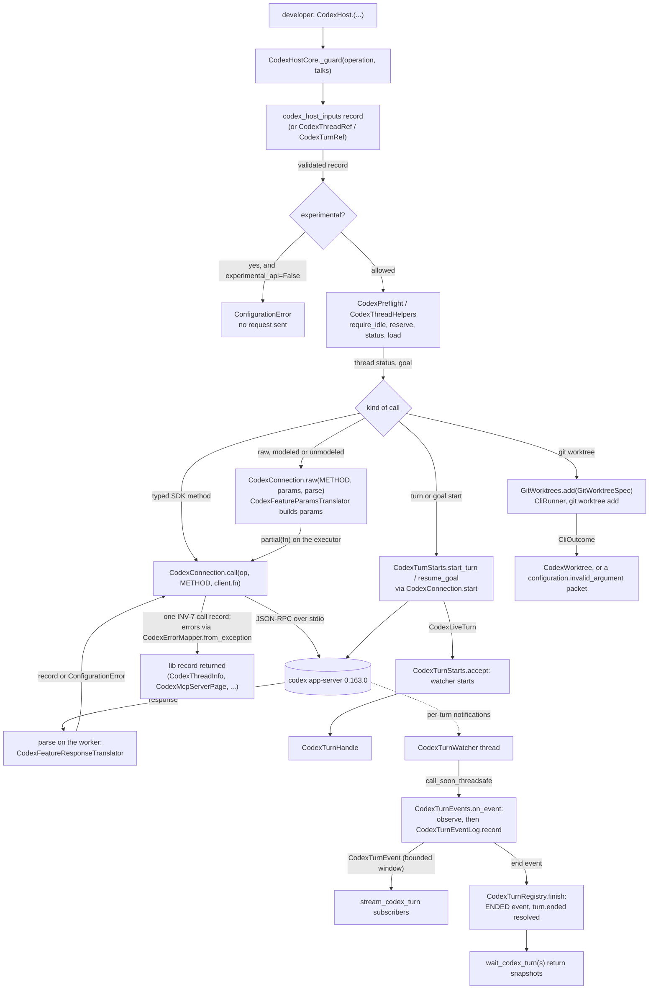

# Spec: CodexHost first-class Codex features (slice 2 of 2)

> **TL;DR** — This slice adds the 25 P0 and P1 Codex functions from request.md §C.10 that slice 1 did not build, plus `collaboration_mode` on spawn, continue, launch and side-chat requests, and 16 agent tools (42 in all). Every function that talks to Codex is built over its app-server method, never slash-command text (the worktree function runs git through a canonical lib helper), and meets slice 1's L1–L16 bar. To do that, each one reuses slice 1's machinery: the input records, the error packet, one call record per Codex call, the canonical retry sets and privacy-safe logs.
>
> What the slice adds:
> - **P0:**
>   - `update_codex_thread_settings`;
>   - plan mode: `list_codex_collaboration_modes`, `run_codex_plan` and `CodexSpawnRequest.collaboration_mode`;
>   - `stream_codex_turn`, a bounded async iterator of typed turn events;
>   - `wait_codex_turns(handles, return_when=...)`;
>   - `list_codex_mcp_servers`.
> - **P1:**
>   - `update_codex_turn_settings`;
>   - memories: set the mode, read the status, reset;
>   - side chats, and git worktrees under a Vidbyte-owned root;
>   - goal pause, resume, edit and clear;
>   - archive, unarchive, revert, rename and item injection;
>   - background terminals: list and clean;
>   - account-wide content search, and child-thread listing.
>
> The queue functions are not built. The evidence and the blocking Q-1 are in §3 NG-1.
>
> **The decision that matters most** is how the experimental methods reach Codex. The stable-only openai-codex 0.163.0 has no response model for most of them, so they go through the existing raw path. A passthrough response class carries each answer, and a translator runs inside the same call. That keeps one call record, one retry policy and one error mapping for every new call, with no hand-written transport. The new public methods live in four SDK-free mixin modules, so the host module shrinks to about 850 lines instead of passing 1,000.

## §0 User prompts

### 0.1 Invoking request (verbatim)
````
great, I am going to merge pr #1055 into the repo,  before you kick off what I am about to say can you make sure to wait that pr #1055 is merged into main. then I want you to create the codex functions that you thought about. Also, the comments that you left on pr #1044, i dont think  that they were clear about what to change/add to the claude code commands, I wanted the same 'first class claude code features" that you added for codex in the list above, using all of claude code's built in skills/settings/functionalities, can you think about all of these and then add some more comments on pr #1044 (do all of this after #1055 merged, just so you are on the same page)
````

The other prompts of the conversation (Prompts 1 and 2), the user's #1055 review comments, the audit (§C.9) and the ranked proposals (§C.10) are in `request.md` §A–§C, verbatim. Prompt 2 states the production bar this slice is held to: "each function to kind of have 'all layers' required to push to production and exception handle everything that could potentially go wrong".

### 0.2 User replies during the run
None yet.

---

## Part A — Framing

## §1 Goal

**The demand.** In Prompt 3 the user asked to "create the codex functions that you thought about". request.md defines those as the ranked P0 and P1 proposals of §C.10. Each one names its app-server method, and slice 1 already built the approval handler and `forget_codex_turns`.

**The pain today**, with evidence (code-map §4.1, §4.3):
- A developer cannot change a thread's model, effort or sandbox between turns.
- A developer cannot run Codex's plan mode. The SDK drops `collaborationMode` (verified).
- A developer cannot watch a turn's progress: `CodexLiveTurn.observe` keeps three notification kinds and drops every delta.
- A developer cannot wait on several turns at once.
- A developer cannot see which MCP servers a thread has, manage memories, open a side chat, or pause or resume a goal.
- A developer cannot archive, revert or rename a thread, list its background terminals, search thread content, or list a thread's child threads.

All of these exist in the codex-cli 0.163.0 app-server.

| ID | Goal (outcome) | How we will know | Source |
|---|---|---|---|
| G-1 | A developer drives every P0 and P1 first-class Codex feature from Python through `CodexHost`, over its app-server method, with the same handle and record vocabulary as the 28 existing functions. | AC-1…AC-33 | Prompt 3; request.md §C.10 "Proposed new functions, ranked" |
| G-2 | Every new function has "all layers" (L1–L16):<br>• a validated input record;<br>• preflight;<br>• timeouts;<br>• safe retries;<br>• typed packet errors naming the operation and thread;<br>• one call record per Codex call;<br>• privacy-safe logs;<br>• docstrings with their limitations;<br>• tests by S2. | AC-34, AC-38…AC-41 | Prompt 2; request.md §B.1 and §C.9 layer legend |
| G-3 | An agent can use every new function the tool rules allow, through a tool that cannot delete, spawn or kill processes, widen approvals or the sandbox, or pick a service tier. | AC-35…AC-37 | request.md "Destructive or unsandboxed functions are never agent tools" |
| G-4 | No setting is ever dropped silently. Each experimental field either reaches the wire or is refused locally before any request, and each unmodeled answer is validated before it is trusted. | AC-5…AC-8, AC-41 | request.md "Experimental protocol fields are added after the openai-codex model validation"; slice-1 INV-27 |
| G-5 | A long-lived host stays bounded. Streaming never blocks a turn, never grows memory without bound, and never exposes private reasoning. | AC-12…AC-15, AC-43 | request.md §C.9 X7 (L11) and X2 (L13); `CodexResultSerializer` `@intent exclude-private-reasoning-before-serialization` |
| G-6 | Every line this slice adds follows the user's #1055 review conventions, so the PR does not draw those comments again. | AC-40 | request.md §B.1 |

## §2 Objective

When this PR merges, the repo has everything below. No existing public name is renamed or removed.

**On `CodexHost`.** The class inherits 25 new public methods from four mixins (`CodexSettingsMethods`, `CodexStreamMethods`, `CodexThreadMethods`, `CodexGoalMethods`) over a shared `CodexHostCore`. Each method:
- builds a strict input record from `codex_host_inputs` right after `_guard`;
- calls Codex only through `CodexConnection`;
- returns a validated lib record.

**Records and enums.**
- `CodexSpawnRequest` gains `collaboration_mode`.
- New records:
  - `vidbyte.lib.dataclasses.codex_host_modes`: the collaboration-mode records;
  - `vidbyte.lib.dataclasses.codex_host_features`: the update record and the output records;
  - `vidbyte.lib.dataclasses.codex_host_inputs`: 17 input records.
- `vidbyte.lib.enums.codex` gains nine enums and 25 `CodexHostOperation` members.

**Collaborators.**
- `CodexTurnStarts` owns turn, goal and goal-resume starts, moved out of the host module.
- The feature translators (`CodexFeatureParamsTranslator` and `CodexFeatureResponseTranslator`) cover the new wire.
- `CodexTurnEventLog` holds each live turn's bounded event window.
- `GitWorktrees` is a canonical lib helper that runs `git worktree add` through `CliRunner`.

**Tools.** `CodexHostTools` offers 16 more tools, 42 in all.

This is **slice 2 of 2**. Slice 1 (the codex-host-hardening spec, verified; §11) hardened the existing functions. S6 opens the single PR #1181 for both.

## §3 Non-goals

- **NG-1** — **The queue functions:** `queue_codex_message`, `thread/queue/add`, `thread/queue/list` and `thread/queue/start`. *Why not:* they are redundant inside CodexHost's private app-server, and unsafe there. The evidence:
  1. Codex's own `codex queue` refuses to run without the shared daemon, "Queuing must discover the shared server to avoid writing through a separate server". It also refuses queuing through an embedded server while a daemon runs (`codex-src/codex-rs/tui/src/session_queue_commands.rs`). CodexHost always runs its own private `codex app-server` over stdio, which is exactly the separate server that check exists to avoid.
  2. The TUI adds to the queue but never calls `thread/queue/start` or `thread/queue/list`. Codex therefore drains the queue itself (an inference), which starts turns no `CodexHost` call started. No turn route is registered for such a turn before it starts (`client.py:650-680` registers one only inside `turn_start`), so its early notifications would be lost. No timer, output cap, pricing or `wait_codex_turn` applies to it, which breaks slice-1 INV-11 ("every turn this host starts is tracked").
  3. Inside one private server, "run this message now" is `continue_codex_thread` or `steer_codex_turn`, and "run it after the current turn" is `wait_codex_turn` followed by `continue_codex_thread`.
  
  The queue only pays off against the shared daemon, which is the larger move named in §15 Q-1. That question is blocking, with the default "not built".
- **NG-2** — **Queue update, delete and reorder.** *Why not:* they are P2 in the research matrix (code-map §4.2 item 2), and request.md says "P2 is not built".
- **NG-3** — **The P2 items:** open in the desktop app, recap, voice/realtime, hooks, feedback, marketplaces and `process/spawn`. *Why not:* request.md §B "Rejected alternatives" and its Q default, "no".
- **NG-4** — **`forget_codex_turns`.** *Why not:* slice 1 built it (request.md slice-2 header).
- **NG-5** — **One-shot mirrors of the new functions.** `vidbyte.harnesses.native.codex.__all__` stays exactly `CodexHost` plus the six one-shot functions. *Why not:*
  - each one-shot starts and closes a whole app-server;
  - most new functions act on a live turn or a loaded thread (stream, wait, turn settings, side chat, goal resume), which that host would close at once;
  - the export list is pinned (`NATIVE_CODEX_EXPORTS`, §13).
  
  This is §15 Q-3, non-blocking.
- **NG-6** — **Named permission profiles** (`permissions`) on `thread/settings/update`. *Why not:* slice 1 left profiles out (its S8 scope). The schema says the field "Cannot be combined with `sandboxPolicy`", and a profile id is an open, account-specific string that no record could validate.
- **NG-7** — **`personality` and `multiAgentMode`** on `thread/settings/update`. *Why not:* the schema marks both deprecated. `multiAgentMode` is "Ignored", and `personality` "no longer select[s] a style".
- **NG-8** — **A model-facing stream tool.** *Why not:* a tool returns one JSON string (`_CodexHostTool._run`), so an iterator has no tool shape. `wait_codex_turn`, `wait_codex_turns` and `get_codex_turn_result` already give a model the outcome. This is §15 Q-2.
- **NG-9** — **Watching notifications that carry no turn id:** `thread/settings/updated`, `mcpServer/startupStatus/updated`, `thread/archived`, `thread/unarchived`, `thread/reverted`, `thread/name/updated` and `thread/goal/cleared` outside a goal run. *Why not:* the liveness monitor discards them by design (the liveness monitor in `CodexConnection`), and a host-level event bus is a separate feature. This is §15 Q-4.
- **NG-10** — **Compatibility with Codex's managed-worktree root, and `codex exec --worktree`.** *Why not:* the managed root is unverified, because the `codex_worktree` crate is not in the scratchpad (code-map §4.4). `codex exec` starts a paid run. `create_codex_worktree` uses Vidbyte's own root and claims nothing about Codex's.
- **NG-11** — **Per-thread occurrence search** (`thread/searchOccurrences`). *Why not:* it is not in the P1 list. `search_codex_thread_content` is the account-wide `thread/search`.
- **NG-12** — **Re-pricing a turn or thread after a mid-run model change.** *Why not:* usage is priced as the model resolved at turn start (`CodexResponseTranslator.pricing`, hardening D-19). `update_codex_turn_settings` and `update_codex_thread_settings` document the gap (EC-23, EC-6).
- **NG-13** — **`collaboration_mode` on `CodexTurnSettings` or `CodexHarnessAgent`.** *Why not:*
  - the `vidbyte.lib.dataclasses.codex` module is 1,205 lines and under "no growth" (slice-1 D-17);
  - `CodexTurnSettings` feeds `CodexHarnessAgent` through the shared `turn_kwargs`;
  - slice 1 put its turn-only fields on `CodexSpawnRequest` for the same reason.
- **NG-14** — **The PR #1044 comments and any Claude Code work.** *Why not:* request.md says "PR #1044 (Claude Code thread functions) is handled separately by review comments only".
- **NG-15** — **Unloading or releasing a thread** (`thread/unsubscribe` or a `release_codex_thread`). *Why not:* it is not in the P1 list. An ephemeral side chat stays loaded in the app-server until the host closes (EC-30).
- **NG-16** — **Reverting files.** *Why not:* `thread/revert` "only changes persisted conversation history. It does not revert local file changes" (schema). The function and its docstring say so.
- **NG-17** — **Tools for `stream_codex_turn`, `reset_codex_memories`, `revert_codex_thread`, `inject_codex_items`, `create_codex_worktree`, `edit_codex_goal`, `clear_codex_goal`, `set_codex_thread_memory_mode` and `clean_codex_background_terminals`.** *Why not:* each is destructive, spawns or kills processes, forges history, changes a cost limit, sets a privacy choice, or has no tool shape. The reasons are in D-21.
- **NG-18** — **A new `FailureCode`.** *Why not:* no free slot exists without editing three pins (code-map §4.3 item 7). Every new failure uses an existing code, with its own likely cause and next step (D-23).
- **NG-19** — **Restyling slice 1 or #1178 code.** The exceptions are the moves D-1 and D-2 need, which keep each moved body unchanged, and the edits §12.3 lists. *Why not:* the AGENTS.md "Existing code" rule; slice-1 NG-21.

## §4 Developer usage

```python
import asyncio

from vidbyte.harnesses.native.codex import CodexHost
from vidbyte.lib.dataclasses.codex_host import CodexSpawnRequest
from vidbyte.lib.dataclasses.codex_host_features import CodexThreadSettingsUpdate
from vidbyte.lib.dataclasses.codex_host_modes import CodexCollaborationMode
from vidbyte.lib.enums.codex import CodexCollaborationModeKind, CodexReasoningEffort, CodexTurnEventKind, CodexTurnWaitMode


async def main() -> None:
    async with CodexHost() as host:
        # Plan first, printing the plan as Codex writes it.
        plan = await host.run_codex_plan("Plan a fix for the failing login test.")
        async for event in host.stream_codex_turn(plan):
            if event.kind is CodexTurnEventKind.PLAN_DELTA:
                print(event.text, end="")
        # Raise the thread's effort, leave plan mode to build, and ask a side question meanwhile.
        await host.update_codex_thread_settings(plan.thread_id, CodexThreadSettingsUpdate(effort=CodexReasoningEffort.HIGH))
        default_mode = CodexSpawnRequest(collaboration_mode=CodexCollaborationMode(mode=CodexCollaborationModeKind.DEFAULT))
        build = await host.continue_codex_thread(plan.thread_id, "Implement the plan.", default_mode)
        side = await host.start_codex_side_chat(plan.thread_id, "Which step of the plan is riskiest?")
        done = await host.wait_codex_turns((build, side), return_when=CodexTurnWaitMode.ALL_COMPLETED)
        print([snapshot.status.value for snapshot in done])
        print([server.name for server in (await host.list_codex_mcp_servers()).servers])


asyncio.run(main())
```

**What the developer sees.** First the plan text, streamed as it arrives. Then `['completed', 'completed']`, the build turn's and the side chat's statuses in the order given. Then the names of the MCP servers Codex reports.

**What they no longer have to do:**
- no polling `get_codex_turn_result` for progress;
- no one task per turn just to wait on two;
- no new thread to change the effort;
- no forking and injecting by hand to ask a side question;
- no plan-mode prompt text, because `run_codex_plan` asks Codex for its own plan preset.

If the host was opened with `CodexClientSettings(experimental_api=False)`, `run_codex_plan`, `update_codex_thread_settings` and `collaboration_mode` are refused locally, before any request (INV-4).

## §5 Flow diagram



```mermaid
sequenceDiagram
  participant Dev as developer
  participant Host as CodexThreadMethods.start_codex_side_chat
  participant Pre as CodexPreflight
  participant Thr as CodexThreadHelpers.fork
  participant Con as CodexConnection
  participant Cx as codex app-server
  Dev->>Host: start_codex_side_chat(thread_id, prompt, request)
  Host->>Host: _guard, CodexSideChatRequest, input items, schema check
  Host->>Pre: run(operation, request) [reviewer, account, usage, sandbox, models]
  Host->>Thr: fork(op, CodexForkRequest(ephemeral view + side-chat instructions), starts_turn=True)
  Thr->>Con: thread/read, thread/turns/list, thread/fork
  Con->>Cx: requests
  Cx-->>Con: forked thread (ephemeral)
  Thr->>Thr: a user reviewer Codex resolved for the fork, with no approval_handler, is refused here
  Thr-->>Host: CodexThreadInfo (only then does the fork share the parent's tool handler)
  Host->>Con: raw thread/inject_items [boundary user message]
  Host->>Con: CodexTurnStarts.start_turn on the fork, sent once
  Con-->>Host: turn accepted
  Host-->>Dev: CodexTurnHandle(fork thread, turn)
  Note over Host,Con: any failure after the fork releases the fork's tool handler; no turn is registered
```

**Walking the diagram.**
- **Validation.** It happens twice before anything is sent: in the input record built right after `_guard`, and in the experimental gate.
- **State changes.** They happen in three places only:
  - `CodexTurnRegistry` (reserve and release, track, finish);
  - the router's tool-handler table (the side-chat fork);
  - `CodexTurnEventLog` (each live turn's bounded event window).
- **Failures.** Every Codex failure is caught once, in `CodexConnection.call` or `start`, and becomes a packet from `CodexErrorMapper`. That includes a malformed unmodeled answer, because its translator runs inside the call (D-3). A git failure becomes a packet in `create_codex_worktree` itself. The stream's `record` never raises (INV-19).

---

## Part B — Behavior (this is the spec; everything else is framing)

## §6 Behavior

### 6.1 Invariants

**Every new function (the production bar)**

- **INV-1** — **The boundary comes first.**
  - **The order.** Every new public method calls `_guard(operation, talks=...)` first. It then builds exactly one input record before anything else: a §9.1 `codex_host_inputs` record, or `CodexThreadRef` / `CodexTurnRef` for a method whose only input is a thread id or a handle. "Anything else" means any request, any registry reservation, any router change, any process start and any filesystem change.
  - **What a bad argument does.** It raises `ConfigurationError` naming `"<method> <field>"`, with `details["field"]` set, and sends nothing.
  - **The exception.** The two methods without arguments (`list_codex_collaboration_modes`, `reset_codex_memories`) build no record.
  - **Which methods talk.** `talks=True` for every method that sends a request. It is `False` for `stream_codex_turn`, `wait_codex_turns` and `create_codex_worktree`.
- **INV-2** — **Failures are typed.**
  - Every failure a new method raises is one of two kinds:
    - a `ConfigurationError` from a record or a local gate;
    - a `CodexAgentError` built by `CodexErrorMapper` in the #1178 packet shape, "`<operation> failed with <code>. <summary> The thread id was <id>. Likely cause: <cause> Next step: <step>`", carrying the method's own operation and, when one is known, the thread id.
  - No `KeyError`, `TypeError`, `AttributeError`, `OSError`, `pydantic.ValidationError` or openai-codex exception ever reaches the caller, and no `RuntimeError` other than the one below.
  - **File-system steps.** `create_codex_worktree`'s home lookup, target check and root `mkdir` raise `OSError` or `RuntimeError` when the root cannot be prepared. The method maps them to a packet and drops the original exception (`from None`), so neither the home path nor the exception text reaches the caller (INV-29, EC-63).
  - **The one exception** is Python's own `RuntimeError` "no running event loop", raised when `stream_codex_turn` is called with no running loop (EC-3). It comes from `_guard`'s loop lookup, before any record or request.
  - **Wrappers.** `run_codex_plan` relabels the errors of the calls it makes (`CodexErrorMapper.relabel`, hardening INV-31). A side chat's errors after the fork carry the fork's thread id.
- **INV-3** — **One call record per Codex call.** Every Codex request a new method sends goes through `CodexConnection.call` or `CodexConnection.start`, so it writes exactly one hardening INV-7 call record:
  - DEBUG `codex_host_call` on success;
  - WARNING `codex_host_call_failed`, with `failure_code`, `error_type` and `origin`, on failure.
  
  No new code calls `connection.client.*` outside such a call. The one exception is `CodexTurnStarts`'s worker function, which runs inside `connection.start`.
- **INV-4** — **The experimental gate.** These need Codex's experimental API: `update_codex_thread_settings`, `list_codex_collaboration_modes`, `run_codex_plan`, `update_codex_turn_settings`, `set_codex_thread_memory_mode`, `get_codex_memory_status`, `reset_codex_memories`, `list_codex_background_terminals`, `clean_codex_background_terminals`, `search_codex_thread_content` and `list_codex_child_threads`. So does any `CodexSpawnRequest` or `CodexThreadSettingsUpdate` whose `collaboration_mode` is set.
  - On a host opened with `CodexClientSettings(experimental_api=False)`, each is refused by `CodexPreflight.require_experimental_api`. The refusal is `ConfigurationError(CODEX_HOST_EXPERIMENTAL_FEATURE_MESSAGE.format(operation=..., feature=...), details={"field": "experimental_api"})`.
  - It comes right after the input record and before any request, so zero requests are sent.
  - The stable functions are never gated: the MCP listing, side chat, goals, archive, unarchive, revert, rename, inject, stream, wait and worktree.
- **INV-5** — **Experimental fields reach the wire.**
  - `collaborationMode` on `turn/start`, and `parentThreadId` or `ancestorThreadId` on `thread/list`, are added to the params dict *after* the SDK model validation and dump. The precedent is `dynamicTools` (`CodexParamsTranslator.thread_start`), so openai-codex cannot drop them.
  - The params of every method the SDK has no params model for are plain dicts. That lets a JSON `null` (a cleared service tier, a removed token budget) reach the wire.
- **INV-6** — **Unmodeled answers are validated inside the call.**
  - For each method in `CODEX_HOST_UNMODELED_RAW_METHODS`, `CodexConnection.raw` uses the passthrough `CodexJsonObjectResponse` and runs the caller's translator (`parse`) on the worker, inside the same call.
  - The translator reads members with `.get` only and builds lib records, which validate themselves.
  - A missing or wrong-typed member therefore becomes `CODEX_PROTOCOL_MISMATCH` naming the method (`errors._local_failure` maps `ConfigurationError` from the worker as it maps `ValidationError`), never a `KeyError`.
  - A modeled raw method also passes its translator as `parse`. Either way, the call record says whether the answer was usable.
- **INV-7** — **Retries are the canonical ones.**
  - Typed calls retry on overload only when their method is in `CODEX_HOST_RETRIED_METHODS`. Of the new typed calls, `thread/name/set` and `thread/list` are in it; `thread/archive` and `thread/unarchive` are not.
  - Raw calls keep openai-codex's overload retries. The exception is a method in `CODEX_HOST_SPENDING_RAW_METHODS` (`review/start`, `thread/goal/set`), which is sent once.
  - Every goal mutation is a `thread/goal/set` or `thread/goal/clear`. Each set is therefore single-attempt; the clear keeps the overload retries, because a second clear ends the same way.
  - No new code writes a retry loop.
- **INV-8** — **Every wait is bounded.**
  - Every Codex request is bounded by `CODEX_HOST_REQUEST_TIMEOUT_SECONDS`, through `connection.call` and `start`.
  - The goal-resume start window is `CODEX_HOST_GOAL_RESUME_START_SECONDS`.
  - `git worktree add` is bounded by `CODEX_HOST_WORKTREE_TIMEOUT_SECONDS` and `CODEX_HOST_WORKTREE_MAX_OUTPUT_BYTES`.
  - The only unbounded waits are the ones the developer chose: `wait_codex_turns(..., timeout_seconds=None)` and an `async for` over a stream, each of which ends when its turns end. A host's close ends every turn (slice-1 INV-7).
- **INV-9** — **Logs stay private.**
  - No new log record carries any of these:
    - a prompt or an objective;
    - an item, delta or plan text, or command output;
    - a memory;
    - an injected item;
    - a path or a branch;
    - git output;
    - an MCP server's error text.
  - Ids go through `LogToken.of(value, CODEX_HOST_LOG_TOKEN_MAX_CHARS)` at the logging call. Log calls use %-style `key=value` tokens and never `exc_info`.
  - The new log events are:
    - `codex_host_stream_event_dropped`, a WARNING with `thread_id`, `turn_id`, `method`, `error_type` and `origin`;
    - `codex_host_worktree_created`, a DEBUG with `operation` and `duration_ms`;
    - `codex_host_worktree_failed`, a WARNING with `operation`, `exit_code`, `timed_out`, `launch_failure` and `duration_ms`.
- **INV-10** — **No setting is dropped unapplied.**
  - Every field of `CodexThreadSettingsUpdate` and of `update_codex_turn_settings` either reaches the wire or makes the record refuse.
  - `collaboration_mode` is refused wherever it cannot be sent:
    - by `fork_codex_thread`, through the FORK row;
    - by `start_codex_review`, through the review row;
    - by a goal request and `run_codex_goal`, through `CODEX_HOST_GOAL_REJECTED_FIELDS`;
    - by the request of `run_codex_plan`, through its `RUN_CODEX_PLAN` row;
    - by `resume_codex_goal`, through the goal rule.
  - Each function's `CODEX_HOST_REJECTED_FIELDS` row names every `CodexSpawnRequest` field it cannot apply (§9.3).

**Thread settings and plan mode**

- **INV-11** — **`update_codex_thread_settings` sends exactly what was set.** It sends exactly one `thread/settings/update`, holding `threadId` and only the fields that were set:
  - `model`, `effort`, `summary`, `cwd`, `approvalPolicy` and `approvalsReviewer` are sent when non-default;
  - `serviceTier` is the tier when set, or JSON `null` when `clear_service_tier`;
  - `sandboxPolicy` is built exactly as the turn's (`CodexParamsTranslator.sandbox_policy`), with `networkAccess` and `writableRoots`;
  - `collaborationMode` is as INV-13, with `settings.model = mode.model or update.model`;
  - `disabledPluginIds` is sent only when not `None`, and `()` sends `[]`, which clears.
  
  It returns `None`. Codex's `thread/settings/updated` notification is not observed (NG-9).
- **INV-12** — **`update_codex_thread_settings` checks before it sends.**
  - **The checks.** They run through `CodexPreflight.run(operation, view, spends=False)` on a `CodexSpawnRequest` view of the update. That covers the reviewer (a `USER` reviewer on a host without an `approval_handler` is refused locally), the experimental gate for `collaboration_mode`, and the model and tier check.
  - **Existence.** The thread must exist; one `thread/read` checks it.
  - **A thread that is not loaded** is loaded first through `CodexThreadHelpers.load`: one `thread/goal/get`, then `thread/resume`. The load has its own goal guard (D-14). It loads when there is no goal, or when the goal's status is in `CODEX_HOST_LOAD_SAFE_GOAL_STATUSES` (paused, blocked, usage-limited, budget-limited or complete), because loading does not restart those (A-13). Any other status, which today means `ACTIVE`, is refused before `thread/resume`. The refusal is `CODEX_GOAL_UNFINISHED` with `CODEX_HOST_LOAD_GOAL_UNFINISHED_MESSAGE`, `CODEX_HOST_LOAD_GOAL_UNFINISHED_CAUSE` and `CODEX_HOST_LOAD_GOAL_UNFINISHED_NEXT_STEP`. Compact's and continue's complete-only guard is unchanged (INV-52).
  - **A thread with a running turn** is allowed; Codex applies settings to "subsequent turns" (schema).
  - **No reservation.** The update does not reserve the thread on this host.
- **INV-13** — **The collaboration mode reaches the wire.** When `request.collaboration_mode` is set, `CodexParamsTranslator.turn_start` adds `collaborationMode: {"mode": <kind>, "settings": {"model": <model>, "reasoning_effort": <effort>}}` after the dump.
  - `<model>` is the first non-empty of three: `mode.model`, `turn.model`, and the model Codex resolved for the thread (`pricing.thread.model`, passed in by `CodexTurnStarts`). If all are empty, `CodexTurnStarts.start_turn` raises `CODEX_PROTOCOL_MISMATCH` (`CODEX_HOST_MODE_MODEL_MISSING_MESSAGE`, naming the thread) before `turn/start`. Codex reported no model, so the schema's required `settings.model` cannot be filled.
  - `reasoning_effort` is sent only when the mode or the turn names one.
  - `developer_instructions` is never sent, which the schema says means "use the built-in instructions for the selected mode" (A-2).
  - The turn is priced as `CodexParamsTranslator.turn_model(request)`, which is `mode.model or turn.model`.
- **INV-14** — **Conflicting mode settings fail at build.** A `CodexSpawnRequest` or `CodexThreadSettingsUpdate` whose collaboration mode names a model or effort that differs from the request's own `turn.model` / `turn.effort` (or the update's `model` / `effort`) is refused when it is built, naming `collaboration_mode`. A mode kind of `NONE` is refused by `CodexCollaborationMode` itself.
- **INV-15** — **`list_codex_collaboration_modes` lists what Codex offers.** It sends one `collaborationMode/list` and returns `tuple[CodexCollaborationModePreset, ...]` in Codex's order.
  - A null `mode` becomes `NONE`.
  - A null `model` or `reasoning_effort` becomes `""`. The effort stays open text, so an effort newer than `CodexReasoningEffort` is shown, not refused.
- **INV-16** — **`run_codex_plan` uses Codex's own plan preset.** It is a run wrapper in `CodexSkillFunctions` that goes only through the host's public API. In order:
  1. the record;
  2. the experimental gate;
  3. the reviewer check;
  4. `list_codex_collaboration_modes()`, then the first preset whose mode is `PLAN`;
  5. `CodexCollaborationMode.from_preset(preset, request.turn)`, which never conflicts with the request: the preset's model and effort are used only where the request's turn sets none;
  6. one `spawn_codex_thread`, with the prompt and that mode.
  
  If no preset is `PLAN`, it raises `CODEX_PROTOCOL_MISMATCH` with `CODEX_HOST_NO_PLAN_MODE_MESSAGE` and sends no `thread/start`. Every error is relabelled `run_codex_plan`.
  
  Plan-mode questions arrive as `item/tool/requestUserInput`. Slice 1's router answers them: through the `approval_handler`, or with the fail-closed `{"answers": {}}`.
- **INV-17** — **A plan-only turn still has an answer.** `wire.final_answer` keeps openai-codex's rule (the last final-answer message, else the last message without a phase). When neither exists, it returns the text of the last `plan` item, so a plan-mode turn that ends in a plan alone still has a `final_response`. Every turn that has an agent message is unchanged.

**Streaming and waiting**

- **INV-18** — **One event log per turn, in order.** Every `CodexLiveTurn` (plain turn, review or goal run) owns one `CodexTurnEventLog` from the moment it is tracked.
  - `CodexTurnEvents.on_event` records each notification right after `turn.observe(note)` and before the end check. It computes `turn.usage_delta()` once per notification and passes that one value to both `turn.over_cap(delta)` and `turn.events.record(note, delta)`, so streaming adds no second usage computation. It skips a turn that already ended, as it does today.
  - Events get consecutive `sequence` numbers from 1, in the order the watcher delivered the notifications.
  - The notification methods that become events, each with its kind, are `CODEX_HOST_STREAM_NOTIFICATION_KINDS` (§9.3). Any other method becomes no event. `item/reasoning/textDelta` is never in that table, so raw reasoning text never reaches a stream.
  - `ITEM_STARTED` and `ITEM_COMPLETED` carry the item as `CodexResultSerializer.items((item,))[0]`, which leaves out a reasoning item's `content`.
- **INV-19** — **Recording never harms the turn.** `CodexTurnEventLog.record` never raises and never awaits. Any exception inside it:
  - is logged once as `codex_host_stream_event_dropped`;
  - counts as one dropped event;
  - leaves the turn's outcome, usage and timers unchanged.
  
  A subscriber that reads slowly, or never, never delays the watcher, `on_event` or the turn's end.
- **INV-20** — **The window is bounded.**
  - **Per turn.** A log keeps at most `CODEX_HOST_STREAM_EVENT_LIMIT` events and at most `CODEX_HOST_STREAM_TEXT_LIMIT_CHARS` characters. The size is each kept event's `text` length plus the length of its item's JSON form.
  - **Per host.** `CodexTurnRegistry._add` attaches every log it tracks to the host's running totals (`attach(registry.charge_stream)`). The log charges each event it keeps to those totals and refunds it when the event is dropped or released. All of one host's logs together keep at most `CODEX_HOST_STREAM_HOST_EVENT_LIMIT` events and `CODEX_HOST_STREAM_HOST_TEXT_LIMIT_CHARS` characters (D-39). A log that was never attached has the per-turn bounds only.
  - **What is dropped.** When a new event would pass a per-turn or a per-host bound, the recording log drops its own oldest events until it fits. When it keeps nothing older and the new event still does not fit, the new event is dropped.
    - **An event too large to fit even on its own** is dropped at once, and no older event is dropped for it (`_fits_alone`: `size <= CODEX_HOST_STREAM_TEXT_LIMIT_CHARS and (self._charge is None or size <= CODEX_HOST_STREAM_HOST_TEXT_LIMIT_CHARS)`).
    - On a log attached to the host, fitting alone means both character bounds, per turn and per host. On a log never attached, it means the per-turn bound only.
    - Such an event costs a lagging subscriber exactly `GAP(dropped=1)` for itself, and the kept window is not emptied (EC-19).
    
    Every dropped event is counted. A log never drops another turn's events.
  - **`ENDED`** is kept outside these bounds: it is never counted, charged or dropped.
  - A subscriber whose next event was dropped first receives one `GAP` event. Its `sequence` is the first missed one, and `dropped` is how many it missed. The subscriber then continues from the oldest kept event.
- **INV-21** — **Every stream ends with exactly one `ENDED`.**
  - **When it happens.** `CodexLiveTurn.finish` closes the log with exactly one `ENDED` event, carrying the snapshot `wait_codex_turn` returns for the turn. It covers every way a turn ends: completion, interrupt, timeout, output cap, a failed event, a lost watcher, close, process death, a review's completion, and a goal finishing.
  - **Who sees it.** Every subscription yields `ENDED` last, then stops. A subscription opened after the turn ended yields only `ENDED`.
  - **Which subscriptions are reading.** A subscription is reading from its first step until its generator finishes. The log keeps an integer count of reading subscriptions: the generator adds one at its first step and subtracts one in its `finally`. Each subscription keeps its next sequence number as a generator local and computes its `GAP` from the log's oldest kept sequence, so the log holds no per-subscription object.
  - **When a generator finishes.** On exhaustion, on `aclose()`, on cancellation, or when asyncio finalizes an abandoned generator: its async-generator hooks schedule `aclose()`, and `asyncio.run` and `IsolatedAsyncioTestCase` run `shutdown_asyncgens` when the loop closes. So a subscription that was created but never iterated is not counted, and holds nothing. A caller that leaves `async for` early should still close the iterator, for example with `contextlib.aclosing`, so the count drops at once rather than at collection; the docstring says so (EC-17).
  - **What is released.** The log checks for release when the turn ends and each time the count drops. Once the turn has ended and the count is 0, the kept events are released and refunded to the host's totals; only `ENDED` remains.
- **INV-22** — **`stream_codex_turn` checks its handle eagerly.** It is a plain `def` that runs `_guard`, `CodexTurnRef` and `_owned` when called, then returns the async iterator. An unknown handle therefore raises `CODEX_SESSION_NOT_FOUND` at the call, before any iteration. Each call returns an independent subscription, and the subscriptions do not share positions. A subscription's start is fixed at the call. Once the turn has ended, it is the `ENDED` event. Before that, it is the oldest event the log keeps, or the next event when it keeps none. An event dropped or released before the subscription reads it is reported in its `GAP` (INV-20). Iterating on a loop other than the host's raises `ConfigurationError(CODEX_HOST_OTHER_LOOP_MESSAGE)` at the first step.
- **INV-23** — **`wait_codex_turns` waits without touching the turns.**
  - **Before waiting.** It validates every handle: the record refuses an empty tuple, a duplicate, or more than `CODEX_HOST_WAIT_MAX_HANDLES` handles, and each must be owned (`_owned`) before any wait.
  - **The wait.** It waits on the turns' `ended` futures with `asyncio.wait`.
    - `FIRST_COMPLETED` returns as soon as one ended, or at once if one already had.
    - `ALL_COMPLETED` returns when all have ended.
    - When `timeout_seconds` elapses, it returns anyway.
  - **The result.** It returns one snapshot per handle, in the order given. A turn still running gets `CodexResponseTranslator.running(handle)`.
  - **What it never does.** It never interrupts, cancels or changes a turn. Cancelling the caller leaves every turn running.

**MCP servers, turn settings and memories**

- **INV-24** — **`list_codex_mcp_servers` returns one page.** It sends one `mcpServerStatus/list` with `detail` and the filters that were set. That method is stable, modeled and never gated. It returns `CodexMcpServerPage(servers, next_cursor)`, with each server mapped as §9.1; a missing `runtimeStatus` becomes `NOT_REPORTED`.
- **INV-25** — **`update_codex_turn_settings` acts on a running turn this host owns.**
  - **Which turn.** The handle must name a turn this host registered and that is still running. Otherwise it is refused locally with `CODEX_SESSION_NOT_FOUND` (`CODEX_HOST_TURN_SETTINGS_FINISHED_MESSAGE`), and nothing is sent.
  - **The checks.** The record refuses an update that changes nothing, and a tier set together with a clear. The reviewer, model and tier are checked as INV-12.
  - **The target.**
    - A plain turn is targeted by its own id.
    - A goal run is targeted by its current physical turn (`state.current_turn()`, as steer does). When no physical turn is running, `TARGET_UNAVAILABLE` is returned without a request.
  - **The result.** It returns Codex's `status` as `CodexTurnSettingsStatus`, and `TARGET_UNAVAILABLE` is a result, not an error. The turn's pricing is unchanged (NG-12).
- **INV-26** — **The memory functions.**
  - `set_codex_thread_memory_mode` checks the thread exists, loads it as INV-12 does (so a paused goal loads and an active one is refused), then sends one `thread/memoryMode/set`.
  - `get_codex_memory_status` sends one `memory/status`, with `minConsolidatedThreads` only when given (1…4096), and returns `CodexMemoryStatus`.
  - `reset_codex_memories` sends one `memory/reset` with no params and returns `None`.
  - `set_codex_thread_memory_mode` and `reset_codex_memories` have no tool (INV-42); `get_codex_memory_status` has the READ tool `GetCodexMemoryStatusTool`.

**Side chat and worktree**

- **INV-27** — **`start_codex_side_chat` follows Codex's own `/side` flow** (`tui/src/app/side.rs`). In order:
  1. the record;
  2. the input items and the schema check;
  3. `preflight.run(operation, request)`, which spends;
  4. `CodexThreadHelpers.fork(operation, forking, starts_turn=True)` of the parent, through its latest completed turn, with `exclude_turns=True`. The fork view is ephemeral, and its developer instructions are the request's own, then a blank line, then `CODEX_HOST_SIDE_CHAT_INSTRUCTIONS`, or only the latter. The fork is never named.
     - **The reviewer Codex resolved.** Preflight sees only the request's own reviewer, not one that comes from `config.toml` or the parent. So, right after `thread/fork` and before the handler is shared, `fork` applies `routes_to_user` to the `ThreadForkResponse` (D-36). On a host without an `approval_handler`, a fork whose approvals would go to a person raises the existing reviewer refusal (`CodexErrorMapper.reviewer_refusal`, `configuration.unsupported_combination`), naming the fork. Spawn and continue run the same check after their thread opens (hardening D-32). A side chat started by `StartCodexSideChatTool` sends `approvalPolicy: "never"` on the fork (INV-43), so `routes_to_user` is false for it and this refusal comes only from a direct method call.
     - **The tools.** The fork then shares the parent's tool handler (hardening INV-28 step 7). So the parent's Vidbyte dynamic tools stay callable from the side chat; they run in Vidbyte, outside Codex's sandbox (D-22, Q-11).
  5. one `thread/inject_items` on the fork, holding the user message `CODEX_HOST_SIDE_CHAT_BOUNDARY`;
  6. `CodexTurnStarts.start_turn` on the fork with the request's turn fields, priced as the fork's resolved model;
  7. `accept`.
  
  The parent is never reserved, resumed, changed or given a turn, so it may be running. The returned handle names the fork.
- **INV-28** — **A failed side chat registers nothing on the host.**
  - The reviewer refusal comes before the fork's handler is registered, so it leaves none.
  - A later failure (inject, or turn start) releases the fork's tool handler through `CodexTurnStarts.release_tools`.
  - Either way no turn is registered, and the error names the fork's thread id.
  - A failure before the fork sends no fork.
  
  The ephemeral fork itself stays loaded in the app-server until the host closes (EC-30). Unloading it is Q-8.
- **INV-29** — **`create_codex_worktree` runs git, never Codex.** It runs exactly one `git -C <repository> worktree add -b <branch> -- <path> <base_ref or HEAD>` through `GitWorktrees.add` → `CliRunner`:
  - the path is under `Path.home()/".vidbyte"/"codex-worktrees"` (`CODEX_HOST_WORKTREE_ROOT_PARTS`), named `<repository folder name>-<branch with every character outside [A-Za-z0-9._-] replaced by "-">`;
  - standard input is the null device;
  - the environment adds `GIT_TERMINAL_PROMPT=0`;
  - the time and output are bounded (INV-8).
  
  The root folder is created if missing. An existing target folder is refused before git runs, by `CodexThreadMethods` alone; `GitWorktreeSpec` checks only that its paths are absolute (§9.1). A folder that appears between that check and git's run makes git exit nonzero (EC-34).
  
  **When the root cannot be prepared.** Three file-system steps come before git: resolving `Path.home()`, checking the target, and the root's `mkdir(parents=True, exist_ok=True)`.
  - Any `OSError` or `RuntimeError` from them is mapped to `CONFIGURATION_INVALID_ARGUMENT`, raised `from None`. Examples: no home folder can be found, `~/.vidbyte` is a file, or the home folder is read-only.
  - The packet carries `CODEX_HOST_WORKTREE_ROOT_MESSAGE` formatted with `error_type=type(exc).__name__`, and its own cause and next step (§9.2, EC-63).
  - The text names only the root `~/.vidbyte/codex-worktrees` and the exception's type name. It never names the absolute home path or the exception's text, because both can carry the user's name (NFR-7). So `CODEX_HOST_WORKTREE_FAILED_MESSAGE` stays the one message that quotes stderr.
  - The existing-folder refusal is a `CodexAgentError`, not an `OSError`, so it passes through unchanged.
  - Like that refusal, this path writes no log record. INV-9's event list is unchanged.
  - The `mkdir` stays before git, because git makes the branch before it finds the target folder taken (EC-34). A root failure therefore leaves no branch and runs no git.
  
  It returns `CodexWorktree(path, branch, base_ref, repository)`. Every failure raises `CONFIGURATION_INVALID_ARGUMENT` with its own message, likely cause and next step: a worktree root that cannot be prepared, an existing folder, git missing, timed out, or nonzero exit (with git's first stderr line, at most `CODEX_HOST_WORKTREE_DETAIL_MAX_CHARS`).
  
  It never runs `codex`, never sends a Codex request, and has no tool.

**Goals**

- **INV-30** — **Goal changes are the user's.** Every goal change this slice sends carries `origin: "user"` (`CODEX_HOST_GOAL_MUTATION_ORIGIN`), because "Missing provenance does not supply user authorization" (schema). The changes are pause, resume, edit and clear.
  
  **`pause_codex_goal`:**
  - it requires a stored goal (`CodexThreadHelpers.goal`; none means `CODEX_SESSION_NOT_FOUND` with `CODEX_HOST_NO_STORED_GOAL_MESSAGE`);
  - it sends one `thread/goal/set {threadId, status: "paused", origin}` and returns the echoed `CodexThreadGoal`;
  - a goal run this host tracks on the thread ends through its finish rule (PAUSED is terminal), after any physical turn already running finishes.
- **INV-31** — **`resume_codex_goal` resumes the stored goal; it never starts a new one.**
  - **The checks, in order:**
    1. the record;
    2. `require_idle` and a reservation;
    3. `preflight.run`, which spends;
    4. the stored goal, which must exist and be `PAUSED`, `BLOCKED`, `USAGE_LIMITED` or `BUDGET_LIMITED` (`CODEX_HOST_GOAL_RESUME_FROM_STATUSES`). Any other status is refused with `CONFIGURATION_INVALID_ARGUMENT`, `CODEX_HOST_GOAL_NOT_RESUMABLE_MESSAGE` and its cause and next step, before `thread/resume`;
    5. the budget: a `BUDGET_LIMITED` goal whose `token_budget` is set and not above `tokens_used` is refused the same way, with `CODEX_HOST_GOAL_BUDGET_SPENT_MESSAGE` and its cause and next step, before `thread/resume`. Codex would only stop it again. The order for a budget-limited goal is therefore: raise the budget with `edit_codex_goal` (or remove it), then call `resume_codex_goal`. This is how Codex's TUI continues one: its edit sets a budget-limited goal back to active (`goal_menu.rs:133-143`, D-38).
  - **The resume.** It sends `thread/resume` (as continue does), then the reviewer check. `CodexTurnStarts.resume_goal` then runs one worker step inside `connection.start` under `CODEX_GOAL_RESUME_CALL`:
    1. `reserve_goal_operation`;
    2. `activate_turn_routing`;
    3. one single-attempt `thread/goal/set {status: "active", origin}`;
    4. `wait_for_start(CODEX_HOST_GOAL_RESUME_START_SECONDS)`.
  - **What it never does.** It never clears the goal and never sends `objective` or `tokenBudget`, so the goal's budget and usage are kept.
  - **What it returns.** The run is tracked exactly like `run_codex_goal`'s (`track_goal`, `accept`), and the method returns its handle.
  - **When the start fails.** The goal operation is always finished and unregistered (EC-37, EC-38). Whether it is also cancelled (a pause set, then at most one `turn/interrupt`) depends on when the failure comes:
    - **Before the set is sent** (`reserve_goal_operation` or `activate_turn_routing`): no cancel.
    - **From the moment the set is sent:** the operation is cancelled, unless the failure is Codex's JSON-RPC error answer to the set (`JsonRpcError`). That answer means Codex refused the set and the status never changed (EC-37).
    - **What counts as sent.** The host cannot tell whether Codex applied a set whose answer it could not use. So an answer that does not validate, a transport failure after sending, and an elapsed start window all count as sent and are cancelled (EC-64).
    - **The SDK's rule.** The SDK's own goal start also cancels unless Codex refused the request, but it exempts only `InvalidRequestError` (`openai_codex/client.py:643-645`). This host exempts every JSON-RPC error answer, because none of them applies the set.
    
    A start window that elapses is `CODEX_API_ERROR`, because `CODEX_GOAL_RESUME_CALL` is in `CODEX_HOST_GOAL_START_CALLS`.
- **INV-32** — **`edit_codex_goal` changes the objective and budget, never the status.** It requires a stored goal and sends one `thread/goal/set {threadId, objective?, tokenBudget?, origin}`:
  - `tokenBudget` is the number, or JSON `null` when `clear_token_budget`;
  - `status` is never sent, so an edit never starts a goal turn and every goal turn stays tracked. A budget-limited goal keeps its status after an edit, and `resume_codex_goal` continues it (INV-31 step 5);
  - an echoed budget that differs from the one sent is `CODEX_PROTOCOL_MISMATCH` with `CODEX_HOST_BUDGET_ECHO_MESSAGE`.
- **INV-33** — **`clear_codex_goal` clears a stored goal on an idle thread.** It follows INV-34, then sends one `thread/goal/clear {threadId, origin}` and returns Codex's `cleared`.

**Thread lifecycle, terminals, search and listing**

- **INV-34** — **History-changing calls need an idle thread.** `archive_codex_thread`, `revert_codex_thread`, `inject_codex_items` and `clear_codex_goal` change stored state that a running turn uses. Each one, in order:
  1. runs `require_idle` and reserves the thread before its first await;
  2. reads the thread's status (`CodexThreadHelpers.idle_status`), which refuses `ACTIVE` from any client with `CODEX_SESSION_BUSY` and `CODEX_HOST_THREAD_RUNNING_MESSAGE.format(operation=...)`;
  3. for revert and inject only, loads a thread that is not loaded (INV-12);
  4. sends one call;
  5. releases the reservation in `finally`.
- **INV-35** — **Archive, unarchive and rename.**
  - `archive_codex_thread` sends one typed `thread_archive` and returns `None`.
  - `unarchive_codex_thread` sends one typed `thread_unarchive`, with no read first, and returns the thread's `CodexThreadInfo`.
  - `rename_codex_thread` checks the thread exists, then sends one typed `thread_set_name`. That call is retried, as today.
- **INV-36** — **`revert_codex_thread` changes history only.** It sends one `thread/revert {threadId, beforeTurnId}` and returns the `CodexThreadInfo` Codex reports. Files on disk are untouched (NG-16). The snapshots of turns this host tracked are not rewritten (EC-44).
- **INV-37** — **`inject_codex_items` sends the items exactly as given.** It sends one `thread/inject_items {threadId, items}` with the items in the order given. Each item is a JSON-serializable mapping with a non-empty string `type`, and there are 1…`CODEX_HOST_INJECT_MAX_ITEMS` of them. It returns `None`.
- **INV-38** — **Background terminals.** `list_codex_background_terminals` and `clean_codex_background_terminals` check the thread exists, then send one `thread/backgroundTerminals/list` or `/clean`. A thread that is not loaded is not loaded first (EC-47). The listing returns `CodexBackgroundTerminalPage`. The clean stops processes and cannot be undone, so it has no tool (INV-42).
- **INV-39** — **`search_codex_thread_content` searches the account.** It sends one `thread/search {searchTerm, sourceKinds, archived?, cursor?, limit?}` and returns `CodexThreadSearchPage`. `archived` is sent as `true` only when `archived=True`, and omitted when it is `False`, which the schema treats the same as `false` ("If false or null, only non-archived threads are returned").
  - `sourceKinds` is always the values of `CODEX_HOST_HELPER_SOURCE_KINDS`, every top-level source (D-35). Omitted or empty, Codex searches interactive sources only, CLI and VS Code (schema `ThreadSearchParams`), which would never find the app-server threads CodexHost creates.
  - Sub-agent threads are left out, as in the helper listings. `list_codex_child_threads` reaches them.
  - Each hit's thread goes through `v2_all.Thread.model_validate` and `CodexResponseTranslator.thread_info`, so it has the same shape as `read_codex_thread`'s.
- **INV-40** — **`list_codex_child_threads` lists every child.** It checks the parent exists, then sends one typed `thread_list` whose params are `CodexParamsTranslator.thread_list` plus three injected keys:
  - `parentThreadId` (direct children), or `ancestorThreadId` when `descendants=True` (every depth);
  - `sourceKinds`, set to every `CodexThreadSourceKind` value, so the sub-agent children the default interactive filter hides are listed.
  
  It returns `CodexThreadPage`.

**Agent tools**

- **INV-41** — **The catalog grows by 16 tools, appended.**
  - `CodexHostTools` holds 42 tools: the 26 of today in their order, then the 16 of §9.2 in function order.
  - Each new tool's name is its operation's value. READ or WRITE is as §9.2, and every WRITE description says it starts or changes paid Codex work.
  - No new tool schema offers any name in the test literal `FORBIDDEN_PARAMETERS`, nor a service tier, sandbox, approval, cwd, plugin, collaboration-mode or memory-mode parameter.
- **INV-42** — **Nine functions have no tool:** `stream_codex_turn`, `reset_codex_memories`, `revert_codex_thread`, `inject_codex_items`, `create_codex_worktree`, `edit_codex_goal`, `clear_codex_goal`, `set_codex_thread_memory_mode` and `clean_codex_background_terminals` (D-21). `delete_codex_thread` and `forget_codex_turns` still have none.
- **INV-43** — **Tools that start turns hold a cap slot.**
  - **Cap slots.** `RunCodexPlanTool`, `StartCodexSideChatTool` and `ResumeCodexGoalTool` hold one slot while the host starts the turn, release it in `finally`, and own the returned handle (the `RunCodexGoalTool` pattern). Each takes its posture only from `scope.spawn_defaults`.
  - **The side chat's posture.** `StartCodexSideChatTool` builds its request from `spawn_defaults` and only narrows it:
    - **The refused fields.** Every path in the `START_CODEX_SIDE_CHAT` row of `CODEX_HOST_REJECTED_FIELDS` goes back to a fresh `CodexSpawnRequest`'s or `CodexThreadSettings`' value. The paths are `prompt`, `goal`, `name`, `tools`, `thread.ephemeral`, `thread.personality`, `thread.service_name` and `thread.session_start_source`.
      - The method refuses each of them for a side chat (INV-27), so without the reset a scope whose defaults set `tools`, a name or a personality could never start a side chat through the tool.
      - This is what `ContinueCodexThreadTool` and `ResumeCodexGoalTool` already do for their own rows (for the resume tool, implementation deviation 12).
      - No reset widens a posture: the fork is always ephemeral and shares the parent's tools, and the other fields only name or label a new thread;
    - the thread and turn sandbox are `READ_ONLY`, `writable_roots` is empty and `network_access` is `None`;
    - `thread.approval_mode` and `turn.approval_mode` are `DENY_ALL`, and `approval_policy` and `approvals_reviewer` are reset to `PROVIDER_DEFAULT`, because the record refuses explicit approval fields together with a mode (`codex_host.py:228-231`).
    
    Every other field of `spawn_defaults` is kept. `DENY_ALL` maps to `approvalPolicy: "never"` with no reviewer (`CODEX_APPROVAL_MODE_WIRE`). `thread/fork` sends it from the thread's mode and `turn/start` from the turn's, because `turn_start` never sends the explicit fields (`wire.py` `turn_start`). So Codex sends no command or file-change approval request in the side chat; a blocked command fails back to the model. A sandbox escape is never approved by `auto_review`, a guardian subagent or the host's `approval_handler`, which serves every thread (`connection.py:293-294`), and Codex's own commands and patches cannot write files (D-22, A-21).
  - **What the posture does not cover.** The parent's Vidbyte dynamic tools stay callable from the fork, because it shares the parent's tool handler (INV-27 step 4). Those tools run in Vidbyte, outside Codex's sandbox. The tool's description and the method's docstring say so (D-22). Refusing such a parent, or not sharing the handler, is Q-11.
  - **Handles.** `WaitCodexTurnsTool` and `UpdateCodexTurnSettingsTool` accept only handles the scope owns. `WaitCodexTurnsTool` caps its wait at `CODEX_HOST_TOOL_MAX_WAIT_SECONDS`.
- **INV-44** — **Tools never raise** (slice-1 `_run`). Every host error becomes an error result with its code and next step.

**Structure**

- **INV-45** — **Importing the host loads no SDK.**
  - `import vidbyte.harnesses.native.codex` still loads no `openai_codex` module.
  - the modules `host_core`, `settings_methods`, `stream_methods`, `thread_methods` and `goal_methods` import no `openai_codex` at module level; SDK types appear only under `TYPE_CHECKING`.
  - the modules `turn_starts`, `feature_wire` and `turn_stream` are imported only inside `CodexHost._open`, or by modules that only `_open` imports.
- **INV-46** — **No literals in the native package.** No module of the `vidbyte.harnesses.native` package gains a top-level UPPER_CASE binding (C021). No function body there holds a message text or a field-rule tuple: every fixed value is in `vidbyte.lib.constants.codex_host` or, for git, `vidbyte.lib.constants.native_threads`.
- **INV-47** — **Every touched or new file stays well below 1,000 lines:**
  - the `vidbyte.harnesses.native.codex.host` module ≤ 900 lines;
  - the `vidbyte.harnesses.native.codex.wire` module ≤ 840 lines;
  - the `vidbyte.lib.dataclasses.codex_host` module ≤ 900 lines;
  - the `vidbyte.lib.dataclasses.codex` module does not change (slice-1 D-17; D-5 here).

**Must not regress:**

- **INV-48** — **The 28 existing host functions keep their signatures, records and behaviour.** There are three exceptions:
  - spawn, continue, launch and side chat accept `collaboration_mode`;
  - `final_answer`'s plan fallback applies only when no agent message exists;
  - `CodexPreflight.run` gains the mode gate and the mode model.
  
  The relevant code is `host.py:273-728`, `skill_functions.py` and `thread_helpers.py`.
- **INV-49** — **The 26 existing tools keep their names, order, schemas and permissions.** See `toolsets/codex.py:72-99` and `codex_host_support.py:141-193`.
- **INV-50** — **The pinned orders hold.**
  - The 12 helper methods directly after `start_codex_review` in `vars(CodexHost)` are unchanged, because the new methods are inherited, not defined on `CodexHost`.
  - The `CodexHostOperation` members after `START_CODEX_REVIEW` are exactly the 12 helpers; the 25 new members go between `FORGET_CODEX_TURNS` and `LAUNCH_CODEX_SUBAGENTS`.
  - The pins are at `test_codex_host_helper_surface.py:245-251,301-306`.
- **INV-51** — **`run_codex_goal` and `CodexGoalTurn` are unchanged.** `run_codex_goal` still starts through `start_goal_operation`, whose window is still `CODEX_API_ERROR`. `CodexGoalTurn` and `CodexGoalFinishRule` are unchanged (`turns.py:217-279`).
- **INV-52** — **The compact, delete and continue goal guards keep their texts and codes** (`thread_helpers.py:149-195`, `CODEX_HOST_RUNNING_THREAD_MESSAGE`, `CODEX_HOST_GOAL_UNFINISHED_MESSAGE`).
- **INV-53** — **The export lists are unchanged:** `vidbyte.harnesses.native.codex.__all__`, `vidbyte.lib.dataclasses.codex_host.__all__` (26 names) and `vidbyte.lib.process.__all__` (pinned at `test_harness_threads_surface.py:212`).
- **INV-54** — **`CodexHarnessAgent` and every `CodexTurnSettings` user are untouched** (`vidbyte/agents/codex/config.py:185-206`).
- **INV-55** — **Server requests keep slice 1's answers:** with no handler, the fail-closed answers in `CODEX_HOST_SERVER_REQUEST_DEFAULT_ANSWERS`; with a handler, its answers. Plan-mode questions are not special-cased.

### 6.2 Acceptance criteria

| ID | Given | When | Then | Priority | Proof |
|---|---|---|---|---|---|
| AC-1 | a clean checkout of this branch, with the fake app-server answering every method the snippet uses | the §4 snippet runs | it prints the streamed plan text, then `['completed', 'completed']`, then the server names, exactly as §4 says, and no test file is needed beyond the fake's handlers | P0 | `tests/features/codex_host/test_codex_host_first_class_snippet.py::CodexFirstClassSnippetTests::test_the_section_4_snippet_prints_the_streamed_plan_then_both_statuses_then_the_server_names` |
| AC-2 | an open host and a stored, loaded thread | `update_codex_thread_settings(thread_id, CodexThreadSettingsUpdate(model=m, effort=HIGH, clear_service_tier=True, disabled_plugin_ids=()))` | exactly one `thread/settings/update` is sent, with `threadId`, `model`, `effort: "high"`, `serviceTier: null` and `disabledPluginIds: []` and no other setting key; it returns `None`; one `codex_host_call` record names the method | P0 | `tests/features/codex_host/test_codex_host_settings_modes.py::CodexThreadSettingsUpdateHostTests::test_an_update_sends_one_settings_call_holding_only_the_fields_that_were_set`; `tests/features/codex_host/test_codex_host_settings_modes.py::CodexThreadSettingsUpdateHostTests::test_each_other_setting_reaches_its_own_wire_key_and_nothing_else_is_sent` |
| AC-3 | a thread Codex reports `notLoaded` whose stored goal is `active` | `update_codex_thread_settings(thread_id, CodexThreadSettingsUpdate(effort=HIGH))` | it raises `codex.goal_unfinished`, naming the thread; the requests are only `thread/read` and `thread/goal/get`; no `thread/resume` or `thread/settings/update` is sent | P0 | `tests/features/codex_host/test_codex_host_settings_modes.py::CodexThreadSettingsUpdateHostTests::test_a_not_loaded_thread_with_an_active_goal_is_refused_before_any_resume` |
| AC-4 | a host | `CodexThreadSettingsUpdate()` with nothing set, or with `service_tier` and `clear_service_tier` both set, or with `writable_roots` and no `WORKSPACE_WRITE` sandbox | each is refused when built with `ConfigurationError` naming the field; no request is sent | P0 | `tests/features/codex_host/test_codex_host_feature_records.py::CodexThreadSettingsUpdateTests::test_an_update_that_sets_nothing_is_refused_naming_settings`; `tests/features/codex_host/test_codex_host_feature_records.py::CodexThreadSettingsUpdateTests::test_a_tier_set_together_with_a_clear_is_refused`; `tests/features/codex_host/test_codex_host_feature_records.py::CodexThreadSettingsUpdateTests::test_writable_roots_must_be_absolute_and_need_a_workspace_write_sandbox` |
| AC-5 | a host with the experimental API | `spawn_codex_thread(CodexSpawnRequest(prompt=p, collaboration_mode=CodexCollaborationMode(mode=PLAN)))` | the `turn/start` params hold `collaborationMode: {"mode": "plan", "settings": {"model": <the model thread/start reported>}}`, with no `developer_instructions` and no `reasoning_effort`; the turn is priced as that model | P0 | `tests/features/codex_host/test_codex_host_settings_modes.py::CodexCollaborationModeTurnHostTests::test_a_plan_mode_spawn_sends_the_model_codex_resolved_and_is_priced_as_it`; `tests/features/codex_host/test_codex_host_settings_modes.py::CodexCollaborationModeTurnHostTests::test_the_mode_settings_take_the_first_model_set_and_any_named_effort` |
| AC-6 | a host | a `CodexSpawnRequest` whose `collaboration_mode.model` differs from a non-empty `turn.model`, or whose mode efforts conflict | it is refused when built, naming `collaboration_mode`; a `CodexCollaborationMode(mode=NONE)` is refused when built | P0 | `tests/features/codex_host/test_codex_host_feature_records.py::CodexSpawnRequestModeTests::test_a_mode_whose_model_or_effort_differs_from_the_turns_is_refused_when_built`; `tests/features/codex_host/test_codex_host_feature_records.py::CodexCollaborationModeRecordTests::test_a_conflicting_model_is_refused_naming_the_owner_and_an_equal_or_empty_one_is_not`; `tests/features/codex_host/test_codex_host_feature_records.py::CodexCollaborationModeRecordTests::test_a_conflicting_effort_is_refused_and_a_providers_default_never_conflicts`; `tests/features/codex_host/test_codex_host_feature_records.py::CodexCollaborationModeRecordTests::test_a_mode_kind_of_none_is_refused_with_the_kind_message` |
| AC-7 | a host | `fork_codex_thread`, `start_codex_review`, a goal spawn, `run_codex_goal`, `run_codex_plan` or `resume_codex_goal` with a request carrying `collaboration_mode` | each is refused locally, naming `collaboration_mode`, with zero requests | P0 | `tests/features/codex_host/test_codex_host_settings_modes.py::CodexModeRefusalHostTests::test_every_call_that_cannot_send_a_mode_refuses_it_before_any_request`; `tests/features/codex_host/test_codex_host_feature_records.py::CodexSpawnRequestModeTests::test_a_goal_request_refuses_a_collaboration_mode_naming_the_field` |
| AC-8 | a host opened with `CodexClientSettings(experimental_api=False)` | each of the 11 INV-4 functions, and a spawn, continue, launch or side chat whose request carries `collaboration_mode` | each raises `ConfigurationError` with `CODEX_HOST_EXPERIMENTAL_FEATURE_MESSAGE` and `details["field"] == "experimental_api"`, and zero requests reach the fake; `list_codex_mcp_servers` and the goal, thread and side-chat functions without a mode still work | P0 | `tests/features/codex_host/test_codex_host_feature_contract.py::CodexFeatureExperimentalGateTests::test_without_the_experimental_api_the_eleven_functions_and_any_mode_are_refused_with_no_request`; `tests/features/codex_host/test_codex_host_feature_contract.py::CodexFeatureExperimentalGateTests::test_without_the_experimental_api_the_stable_functions_still_talk_to_codex` |
| AC-9 | Codex answers `collaborationMode/list` with two masks, one `{name, mode: "plan", model: null, reasoning_effort: "medium"}` | `list_codex_collaboration_modes()` | it returns two presets in that order; the plan preset has `mode is PLAN`, `model == ""` and `reasoning_effort == "medium"`; an answer whose `data` is not a list, or an item without `name`, raises `codex.protocol_mismatch` naming `collaborationMode/list`, never `KeyError` | P0 | `tests/features/codex_host/test_codex_host_settings_modes.py::CodexCollaborationModeListHostTests::test_the_presets_come_back_in_codex_order_with_nulls_read_as_blank` |
| AC-10 | the fake offers a plan preset and its plan turn ends with only a `plan` item | `run_codex_plan(prompt)`, then `wait_codex_turn` | the requests are `collaborationMode/list`, then the spawn's preflight, `thread/start` and `turn/start` with `collaborationMode.mode == "plan"`; the snapshot is COMPLETED and `result.final_response` is the plan item's text | P0 | `tests/features/codex_host/test_codex_host_settings_modes.py::CodexPlanRunHostTests::test_a_plan_run_lists_the_presets_then_spawns_one_plan_turn_whose_plan_is_the_answer`; `tests/features/codex_host/test_codex_host_settings_modes.py::CodexFinalAnswerPlanFallbackTests::test_the_last_plan_answers_only_when_no_agent_message_does` |
| AC-11 | the fake's preset list has no `plan` mode | `run_codex_plan(prompt)` | it raises `codex.protocol_mismatch` with operation `run_codex_plan` and `CODEX_HOST_NO_PLAN_MODE_MESSAGE`; no `thread/start` is sent | P0 | `tests/features/codex_host/test_codex_host_settings_modes.py::CodexPlanRunHostTests::test_a_preset_list_without_a_plan_mode_spawns_nothing` |
| AC-12 | a running turn whose fake emits `item/started`, three `item/agentMessage/delta`, `item/plan/delta`, `turn/plan/updated`, `thread/tokenUsage/updated`, `item/completed` and `turn/completed` | `async for event in host.stream_codex_turn(handle)` | the kinds arrive in that order, with consecutive sequences from 1; the last event is `ENDED`, whose `snapshot` equals `wait_codex_turn(handle)`; the loop then stops | P0 | `tests/features/codex_host/test_codex_host_stream_wait.py::CodexTurnStreamHostTests::test_a_streamed_turn_yields_each_event_in_order_then_one_ended` |
| AC-13 | a running turn whose fake emits `item/reasoning/textDelta` and a completed reasoning item with `content` | the turn is streamed | no event carries the raw reasoning text; the reasoning `ITEM_COMPLETED` item has no `content` field; a log canary in the delta appears in no log record | P0 | `tests/features/codex_host/test_codex_host_stream_wait.py::CodexTurnStreamHostTests::test_raw_reasoning_text_never_reaches_a_stream_or_a_log` |
| AC-14 | `CODEX_HOST_STREAM_EVENT_LIMIT` patched small, and a subscriber that takes the first event, then reads nothing until the turn ends | the fake emits more events than the limit, then completes | the turn ends on time, with the same snapshot as an unstreamed turn; after its first event, the subscriber's next event is `GAP`, with `dropped` equal to the missed count, then the kept events, then `ENDED` | P0 | `tests/features/codex_host/test_codex_host_stream_wait.py::CodexTurnStreamHostTests::test_a_stalled_subscriber_gets_one_gap_then_the_kept_window_and_never_delays_the_turn` |
| AC-15 | a turn that already ended, and a handle this host never registered | `stream_codex_turn` on each | the ended turn's stream yields only `ENDED`; the unknown handle raises `codex.session_not_found` at the call, before any iteration, and sends nothing | P0 | `tests/features/codex_host/test_codex_host_stream_wait.py::CodexTurnStreamHostTests::test_an_ended_turn_streams_only_ended_and_an_unknown_handle_is_refused_at_the_call` |
| AC-16 | three running turns | `wait_codex_turns((a, b, c))` (FIRST_COMPLETED), and the fake completes `b` | it returns three snapshots in the order a, b, c: `b` COMPLETED and `a`, `c` RUNNING; no `turn/interrupt` is sent; `a` and `c` keep running | P0 | `tests/features/codex_host/test_codex_host_stream_wait.py::CodexTurnsWaitHostTests::test_a_first_completed_wait_returns_every_snapshot_in_order_and_touches_no_turn` |
| AC-17 | two running turns | `wait_codex_turns((a, b), return_when=CodexTurnWaitMode.ALL_COMPLETED, timeout_seconds=0.2)` and neither ends | it returns after the timeout with two RUNNING snapshots and sends nothing | P0 | `tests/features/codex_host/test_codex_host_stream_wait.py::CodexTurnsWaitHostTests::test_an_all_completed_wait_returns_running_snapshots_at_its_timeout_and_sends_nothing` |
| AC-18 | a host | `wait_codex_turns(())`, a duplicate handle, `CODEX_HOST_WAIT_MAX_HANDLES + 1` handles, or a tuple holding an unknown handle | the first three are refused when the record is built, naming `handles`; the unknown handle raises `codex.session_not_found` before any wait | P0 | `tests/features/codex_host/test_codex_host_feature_records.py::CodexFeatureInputRecordTests::test_a_wait_takes_one_to_1024_distinct_handles_and_stores_them_as_a_tuple`; `tests/features/codex_host/test_codex_host_stream_wait.py::CodexTurnsWaitHostTests::test_bad_handle_tuples_are_refused_before_any_wait` |
| AC-19 | the fake answers `mcpServerStatus/list` with one server: two tools, one resource, `authStatus: "oAuth"`, no `runtimeStatus` | `list_codex_mcp_servers(thread_id=t)` | it returns one `CodexMcpServer` with sorted `tool_names`, `resource_count == 1`, `auth_status is OAUTH` and `connection_status is NOT_REPORTED`; the params hold `threadId` and `detail: "full"`; it works with `experimental_api=False` | P0 | `tests/features/codex_host/test_codex_host_mcp_memory.py::CodexMcpServerHostTests::test_one_server_page_maps_its_tools_resources_and_statuses`; `tests/features/codex_host/test_codex_host_mcp_memory.py::CodexMcpServerHostTests::test_the_listing_works_on_a_host_without_the_experimental_api` |
| AC-20 | a running turn this host owns, and one that ended | `update_codex_turn_settings(handle, effort=LOW)` on each | the running one sends one `turn/settings/update {threadId, turnId, effort: "low"}` and returns Codex's status (`APPLIED`, or `TARGET_UNAVAILABLE` without raising); the ended one raises `codex.session_not_found` with `CODEX_HOST_TURN_SETTINGS_FINISHED_MESSAGE` and sends nothing | P1 | `tests/features/codex_host/test_codex_host_settings_modes.py::CodexTurnSettingsHostTests::test_a_running_turn_takes_one_settings_update_and_returns_codexs_status`; `tests/features/codex_host/test_codex_host_settings_modes.py::CodexTurnSettingsHostTests::test_an_ended_or_unknown_turn_is_refused_locally_and_sends_nothing` |
| AC-21 | a not-loaded thread whose stored goal is `paused` | `set_codex_thread_memory_mode(t, DISABLED)`, then `get_codex_memory_status(5)`, then `reset_codex_memories()` | the requests are, in order: `thread/read`, `thread/goal/get`, `thread/resume`, `thread/memoryMode/set {threadId, mode: "disabled"}`, `memory/status {minConsolidatedThreads: 5}` and `memory/reset` with no params; the paused goal is not refused and stays paused; the status returns `CodexMemoryStatus`; the toolset holds no memory-mode or reset tool | P1 | `tests/features/codex_host/test_codex_host_mcp_memory.py::CodexMemoryHostTests::test_a_paused_goal_thread_is_loaded_then_its_memory_set_then_status_and_reset_are_sent` |
| AC-22 | a parent thread with a completed turn and a running one | `start_codex_side_chat(parent, prompt)` | the requests on the fork are `thread/fork` (`ephemeral: true`, `developerInstructions` ending with `CODEX_HOST_SIDE_CHAT_INSTRUCTIONS`, the latest *completed* turn as the fork point), then `thread/inject_items` with exactly the boundary message, then `turn/start` on the fork; the handle names the fork; no `turn/start`, `thread/resume` or settings call names the parent | P1 | `tests/features/codex_host/test_codex_host_side_chat.py::CodexSideChatFlowTests::test_a_side_chat_forks_the_last_completed_turn_injects_the_boundary_and_starts_its_turn_on_the_fork` |
| AC-23 | `thread/inject_items` is failed by the fake | `start_codex_side_chat` | it raises `codex.api_error` naming the fork's thread id; the router holds no handler for the fork; the registry holds no turn on it | P1 | `tests/features/codex_host/test_codex_host_side_chat.py::CodexSideChatRefusalTests::test_a_failed_inject_names_the_fork_releases_its_tools_and_registers_no_turn` |
| AC-24 | a temporary git repository, with `Path.home()` patched to a temporary folder | `create_codex_worktree(repo, "feat/x")`, then the same again, then once with git missing from `PATH` | the first returns `CodexWorktree` whose path is `<home>/.vidbyte/codex-worktrees/<repo name>-feat-x` and is a git worktree on branch `feat/x`; the second is refused with `configuration.invalid_argument` (existing folder) before git runs; the third gives `configuration.invalid_argument` with the git-missing cause; the fake receives no request | P1 | `tests/features/codex_host/test_codex_host_worktree.py::CodexWorktreeHostTests::test_a_worktree_is_made_under_the_vidbyte_root_on_a_new_branch_from_head_and_codex_hears_nothing`; `tests/features/codex_host/test_codex_host_worktree.py::CodexWorktreeHostTests::test_an_existing_target_folder_is_refused_before_git_runs`; `tests/features/codex_host/test_codex_host_worktree.py::CodexWorktreeHostTests::test_without_git_on_path_the_call_reports_that_git_could_not_start` |
| AC-25 | a goal run this host tracks, with a physical turn running | `pause_codex_goal(thread)`, and the fake emits the paused goal update and the turn's completion | one `thread/goal/set {threadId, status: "paused", origin: "user"}` is sent; it returns the echoed goal; the run's snapshot ends with `goal_status is PAUSED` | P1 | `tests/features/codex_host/test_codex_host_goal_control.py::CodexGoalPauseHostTests::test_pausing_a_tracked_goal_run_sends_one_user_set_and_the_run_ends_paused` |
| AC-26 | stored goals that are `paused`, `active` and `complete`; a `budgetLimited` goal whose budget was raised above its use; and a `budgetLimited` goal whose use reached its budget | `resume_codex_goal` on each | the paused one sends `thread/resume`, then `thread/goal/set {status: "active", origin: "user"}`, with no `objective`, no `tokenBudget` and no `thread/goal/clear`, and returns a handle whose `wait_codex_turn` follows the goal run; the raised budget-limited one is resumed the same way; `active` and `complete` raise `configuration.invalid_argument` with `CODEX_HOST_GOAL_NOT_RESUMABLE_MESSAGE`, `CODEX_HOST_GOAL_NOT_RESUMABLE_CAUSE` and `CODEX_HOST_GOAL_NOT_RESUMABLE_NEXT_STEP` (which names `pause_codex_goal` then `resume_codex_goal` for an active goal nothing runs), and the spent budget-limited one with `CODEX_HOST_GOAL_BUDGET_SPENT_MESSAGE`, each before any `thread/resume` | P1 | `tests/features/codex_host/test_codex_host_goal_control.py::CodexGoalResumeHostTests::test_a_resumable_goal_is_resumed_with_a_status_only_set_and_its_run_is_tracked`; `tests/features/codex_host/test_codex_host_goal_control.py::CodexGoalResumeHostTests::test_an_active_or_complete_goal_is_refused_before_thread_resume`; `tests/features/codex_host/test_codex_host_goal_control.py::CodexGoalResumeHostTests::test_a_spent_budget_is_refused_until_edit_raises_it_then_the_goal_resumes` |
| AC-27 | a paused goal whose resume starts no turn, with `CODEX_HOST_GOAL_RESUME_START_SECONDS` patched small | `resume_codex_goal` | it raises `codex.api_error` with operation `resume_codex_goal`; the goal operation is cancelled once (a pause set, then at most one interrupt), finished and unregistered; the registry holds no turn | P1 | `tests/features/codex_host/test_codex_host_goal_control.py::CodexGoalResumeHostTests::test_a_resume_whose_start_window_elapses_is_cancelled_once_and_cleaned_up` |
| AC-28 | a stored goal | `edit_codex_goal(t, objective="New aim.")`, then `edit_codex_goal(t, clear_token_budget=True)` | the sets carry `{objective, origin: "user"}` and `{tokenBudget: null, origin: "user"}`; neither carries `status`; an echoed budget that differs raises `codex.protocol_mismatch` | P1 | `tests/features/codex_host/test_codex_host_goal_control.py::CodexGoalEditClearHostTests::test_an_edit_sends_only_the_objective_or_the_budget_with_the_user_origin`; `tests/features/codex_host/test_codex_host_goal_control.py::CodexGoalEditClearHostTests::test_a_budget_codex_did_not_keep_is_a_protocol_mismatch` |
| AC-29 | an idle thread with a goal, and a thread Codex reports `active` | `clear_codex_goal` on each | the idle one sends `thread/goal/clear {threadId, origin: "user"}` and returns `True`; the active one raises `codex.session_busy` with `CODEX_HOST_THREAD_RUNNING_MESSAGE`, and no clear is sent | P1 | `tests/features/codex_host/test_codex_host_goal_control.py::CodexGoalEditClearHostTests::test_clearing_an_idle_threads_goal_returns_codexs_cleared`; `tests/features/codex_host/test_codex_host_goal_control.py::CodexGoalEditClearHostTests::test_clearing_a_running_thread_is_refused_and_no_clear_is_sent` |
| AC-30 | stored threads | `archive_codex_thread(t)`, `unarchive_codex_thread(t)`, `rename_codex_thread(t, "New name")`, and `archive_codex_thread` on a thread this host is running a turn on | the first three send `thread/archive`, `thread/unarchive` (and return the thread's `CodexThreadInfo`) and `thread/name/set`; the busy archive raises `codex.session_busy` before any request | P1 | `tests/features/codex_host/test_codex_host_thread_admin.py::CodexArchiveRenameHostTests::test_archive_unarchive_and_rename_send_their_one_call_each`; `tests/features/codex_host/test_codex_host_thread_admin.py::CodexArchiveRenameHostTests::test_an_overloaded_rename_is_retried_and_an_overloaded_archive_is_not`; `tests/features/codex_host/test_codex_host_thread_admin.py::CodexHistoryChangeHostTests::test_history_changing_calls_refuse_a_thread_this_host_is_running_before_any_request` |
| AC-31 | an idle stored thread with three turns | `revert_codex_thread(t, before_turn_id=turn_2)` | one `thread/revert {threadId, beforeTurnId}` is sent after `thread/read`; it returns `CodexThreadInfo`; no tool named `revert_codex_thread` exists; the docstring says files are not reverted | P1 | `tests/features/codex_host/test_codex_host_thread_admin.py::CodexHistoryChangeHostTests::test_revert_sends_one_call_after_the_read_and_returns_codexs_thread` |
| AC-32 | an idle loaded thread | `inject_codex_items(t, [item1, item2])`, then with `[]`, with an item without `type`, and with a non-JSON item | the first sends one `thread/inject_items` with exactly `[item1, item2]`; the others are refused when the record is built, with zero requests | P1 | `tests/features/codex_host/test_codex_host_feature_records.py::CodexFeatureInputRecordTests::test_injected_items_are_json_objects_with_a_type_stored_as_copies`; `tests/features/codex_host/test_codex_host_thread_admin.py::CodexHistoryChangeHostTests::test_inject_sends_the_items_exactly_as_given_and_logs_none_of_them`; `tests/features/codex_host/test_codex_host_thread_admin.py::CodexHistoryChangeHostTests::test_inject_refuses_bad_item_lists_before_any_request` |
| AC-33 | stored threads, with a parent that has a subagent child | `list_codex_background_terminals(t)`, `clean_codex_background_terminals(t)`, `search_codex_thread_content("login")` and `list_codex_child_threads(parent)` | each sends one request after any exists-check read; the listing params hold `parentThreadId` (or `ancestorThreadId` with `descendants=True`) and every `CodexThreadSourceKind` value as `sourceKinds`; the search params hold `searchTerm` and the `CODEX_HOST_HELPER_SOURCE_KINDS` values as `sourceKinds`, and a stored thread whose source is `appServer` is among the hits; the search hits carry `CodexThreadInfo` and snippets; malformed answers raise `codex.protocol_mismatch` | P1 | `tests/features/codex_host/test_codex_host_thread_admin.py::CodexTerminalSearchChildHostTests::test_background_terminals_are_listed_and_cleaned_after_one_exists_check`; `tests/features/codex_host/test_codex_host_thread_admin.py::CodexTerminalSearchChildHostTests::test_search_names_every_top_level_source_and_finds_this_hosts_threads`; `tests/features/codex_host/test_codex_host_thread_admin.py::CodexTerminalSearchChildHostTests::test_child_listing_names_the_parent_or_ancestor_and_every_source_kind` |
| AC-34 | each new function that talks to Codex, with the fake failing its method with a JSON-RPC error | the function runs, with logs captured | it raises a `CodexAgentError` whose message head is `<its own operation> failed with <code>.` and whose tail names the thread when known, built by `CodexErrorMapper`; exactly one `codex_host_call_failed` record names the method; no log record holds the prompt, item, objective, path or memory canaries | P0 | `tests/features/codex_host/test_codex_host_feature_contract.py::CodexFeatureFailureTests::test_a_json_rpc_error_on_each_functions_own_method_is_its_own_packet_with_one_failed_call_record` |
| AC-35 | `CodexHostTools(host, scope)` | its tools are listed | there are 42 tools: the 26 of today in order, then the 16 of §9.2 in that order, with those names, permissions and parameters; no tool schema offers a `FORBIDDEN_PARAMETERS` name; none is named after an INV-42 function | P0 | `tests/features/codex_host/test_codex_host_tools.py::CodexHostToolsShapeTests::test_toolset_holds_the_fifteen_tools_with_their_spec_schemas`; `tests/features/codex_host/test_codex_host_tool_hardening.py::CodexToolSurfaceGuardTests::test_the_toolset_holds_26_tools_and_offers_no_forbidden_parameter`; `tests/features/codex_host/test_codex_host_feature_tools.py::CodexFeatureToolCatalogTests::test_the_sixteen_tools_follow_the_old_ones_in_function_order_and_none_is_a_no_tool_function`; `tests/features/codex_host/test_codex_host_feature_tools.py::CodexFeatureToolCatalogTests::test_no_new_schema_offers_a_posture_parameter` |
| AC-36 | a scope whose `spawn_defaults` have a `WORKSPACE_WRITE` thread and turn sandbox, writable roots, `approval_policy=ON_REQUEST` and `approvals_reviewer=AUTO_REVIEW`, and also one Vidbyte tool in `tools`, a `name` and a `thread.personality` | the side-chat tool runs, once on a stub host and once on a real host over the fake | the stub host receives a request whose thread and turn sandbox are `READ_ONLY`, whose `writable_roots` is empty, whose thread and turn `approval_mode` are `DENY_ALL` and whose `approval_policy` and `approvals_reviewer` are `PROVIDER_DEFAULT`, with every path of the `START_CODEX_SIDE_CHAT` rejected-fields row at a fresh request's value and every other field as in `spawn_defaults`; the real host starts the side chat rather than refusing a field; the fake receives `approvalPolicy: "never"` and no `approvalsReviewer` on both `thread/fork` and `turn/start`; the tool's description says the parent thread's Vidbyte tools stay callable | P1 | `tests/features/codex_host/test_codex_host_feature_tools.py::CodexFeatureToolArgumentTests::test_the_side_chat_tool_narrows_the_scope_posture_to_read_only_and_never_asking`; `tests/features/codex_host/test_codex_host_feature_tools.py::CodexFeatureToolHostTests::test_the_side_chat_tool_sends_never_and_no_reviewer_on_the_fork_and_the_turn`; `tests/features/codex_host/test_codex_host_feature_tools.py::CodexFeatureToolHostTests::test_the_side_chat_tool_starts_on_a_user_reviewer_parent_because_its_fork_never_asks` |
| AC-37 | the plan, side-chat and resume tools, with the scope at its live-turn cap; every new tool with a stub host raising `CodexAgentError` and then `RuntimeError`; and a stub host whose `update_codex_turn_settings` returns `APPLIED` and whose `wait_codex_turns` returns two snapshots that carry items | each tool runs | the cap refuses before the host is called; each tool returns an error result and never raises; a successful turn-starting tool owns its handle; the wait tool refuses a handle the scope does not own; the turn-settings tool returns a non-error result equal to `TURN_SETTINGS_STATUS_TEXT` formatted with `applied` and the handle; the multi-wait tool returns a JSON array of two snapshots, neither with `result.items` | P0 | `tests/features/codex_host/test_codex_host_feature_tools.py::CodexFeatureToolScopeTests::test_a_full_cap_refuses_the_plan_side_chat_and_resume_tools_before_the_host`; `tests/features/codex_host/test_codex_host_tools.py::CodexHostToolErrorTests::test_every_tool_turns_host_errors_into_error_results`; `tests/features/codex_host/test_codex_host_tool_hardening.py::CodexToolLocalFailureTests::test_a_runtime_or_key_error_becomes_an_api_error_result_naming_only_the_tool_and_type`; `tests/features/codex_host/test_codex_host_feature_tools.py::CodexFeatureToolScopeTests::test_the_turn_settings_tool_answers_the_status_text_and_sends_no_tier_or_reviewer`; `tests/features/codex_host/test_codex_host_feature_tools.py::CodexFeatureToolScopeTests::test_the_multi_wait_returns_one_json_snapshot_per_handle_without_items_and_caps_its_wait` |
| AC-38 | a fresh interpreter without openai-codex loaded | `import vidbyte.harnesses.native.codex`, then each new mixin module | no `openai_codex` module is loaded; the five SDK-free modules have no module-level openai-codex import (AST) | P0 | `tests/features/codex_host/test_codex_host_feature_structure.py::CodexFeatureImportSafetyTests::test_importing_the_host_and_each_mixin_loads_no_sdk_and_no_sdk_collaborator`; `tests/features/codex_host/test_codex_host_feature_structure.py::CodexFeatureImportSafetyTests::test_the_five_sdk_free_modules_import_openai_codex_only_under_type_checking`; `tests/features/codex_host/test_codex_host_packaging.py::CodexHostImportSafetyTests::test_imports_never_load_the_sdk_and_entering_reports_the_pip_extra` |
| AC-39 | the full local gate | it runs | every test passes except the inherited `harness_threads` failure and the §13 superseded tests in their new form | P0 | the run itself: `PYTHONPATH=$(pwd) python -m pytest -q tests/features/codex_host tests/features/harness_threads tests/test_codex_*.py`, then `python scripts/run_ci.py`; every test passes except the inherited `tests/features/harness_threads/test_harness_threads_surface.py::test_failure_codes_keep_main_and_append_exactly_the_28_harness_codes` |
| AC-40 | the branch | the lint gate (§11), C021 after `git add`, the S051 import sort, semgrep, and `wc -l` | lint ends `SDK-LINT: PASS`, with no baseline raised and no suppression; every file is within INV-47 | P0 | `python lint/run.py` ends `SDK-LINT: PASS` with no baseline raised; `tests/features/codex_host/test_codex_host_feature_structure.py::CodexFeatureFileSizeTests::test_every_touched_or_new_file_stays_within_its_ceiling`; `tests/features/codex_host/test_codex_host_hardening_contract.py::CodexHardeningConstantTests::test_no_native_host_module_binds_a_top_level_constant` (C021 by AST) |
| AC-41 | each unmodeled method's answer, with one required member missing or of the wrong type | the function runs | it raises `codex.protocol_mismatch` naming the method; the call record is `codex_host_call_failed` with `error_type=ConfigurationError` | P0 | `tests/features/codex_host/test_codex_host_feature_contract.py::CodexFeatureFailureTests::test_an_unmodeled_answer_missing_a_member_or_with_a_wrong_type_is_a_protocol_mismatch_inside_the_call`; `tests/features/codex_host/test_codex_host_settings_modes.py::CodexCollaborationModeListHostTests::test_a_malformed_preset_answer_is_a_protocol_mismatch_naming_the_method` |
| AC-42 | a host without an `approval_handler`, and a parent thread whose resolved reviewer is `user` with a policy other than `never` (the request names no reviewer) | `start_codex_side_chat(parent, prompt)` | it raises `configuration.unsupported_combination` (the reviewer refusal) naming the fork's thread id; `thread/fork` was sent, but no `thread/inject_items` or `turn/start`; the router holds no handler for the fork and the registry no turn | P1 | `tests/features/codex_host/test_codex_host_side_chat.py::CodexSideChatRefusalTests::test_a_fork_codex_routes_to_a_user_reviewer_is_refused_before_the_inject_on_a_host_without_a_handler` |
| AC-43 | a running turn, and a subscription created with `stream_codex_turn(handle)` that is never iterated | the fake emits events, then completes the turn | after the turn ends the log keeps only `ENDED`; iterating the subscription afterwards yields one `GAP`, whose `dropped` counts every event from the subscription's start up to `ENDED`, then `ENDED`, then stops | P0 | `tests/features/codex_host/test_codex_host_stream_wait.py::CodexTurnStreamHostTests::test_a_subscription_never_iterated_holds_nothing_and_reads_one_gap_then_ended` |
| AC-44 | `turn_stream.CODEX_HOST_STREAM_HOST_EVENT_LIMIT` patched to 3, and two running turns on one host, each with a subscriber that takes its turn's first event, then reads nothing until both turns end | the fake emits four more `item/completed` events on each turn, then completes both | after their first events, the two subscribers together receive at most 3 events other than `GAP` and `ENDED`; each receives a `GAP` counting what it missed, then its turn's kept events, then its own `ENDED`, whose snapshot equals `wait_codex_turn`; after both subscriptions finish, `charge_stream(0, 0)` on the host's registry returns `(0, 0)` | P1 | `tests/features/codex_host/test_codex_host_stream_wait.py::CodexTurnStreamHostTests::test_the_host_bound_drops_each_turns_own_oldest_events_and_refunds_them_on_release` |

### 6.3 Edge cases and failure modes

| ID | Trigger (input + state) | System behavior | User sees | Guarded by (INV-/D-) |
|---|---|---|---|---|
| EC-1 | Any new method called before `async with` or after close | `_guard` refuses, before the record | `ConfigurationError` "not open" (or `process_exited` when `talks` and the host is closing) | INV-1 |
| EC-2 | Any new method called from a loop other than the host's | `_guard` refuses | `ConfigurationError` `CODEX_HOST_OTHER_LOOP_MESSAGE` | INV-1 |
| EC-3 | `stream_codex_turn` called from plain synchronous code with no running loop | `_guard`'s `asyncio.get_running_loop()` raises | Python's own `RuntimeError` "no running event loop"; the method is documented as loop-only | INV-22, D-10 |
| EC-4 | The app-server dies during any new call | `from_exception` with `dead=True` | `codex.process_exited` naming the method and thread; every running turn ends exited and every stream yields `ENDED` | INV-2, INV-21 |
| EC-5 | `update_codex_thread_settings` on a thread with a turn running | The update is sent; Codex applies it to later turns | `None`; the running turn keeps its settings | INV-12 |
| EC-6 | `update_codex_thread_settings(model=m2)` on a thread this host priced as `m1` | Later turns started by this host are priced from `thread/resume`'s or the fork's reported model; turns already running keep `m1` | Usage of a turn that was running when the model changed may be priced as the old model (NG-12) | D-32 |
| EC-7 | Settings update with `collaboration_mode` but no model in the mode and no `model` | The record refuses, because the wire needs `settings.model` and an update resolves no thread model | `ConfigurationError` `CODEX_HOST_SETTINGS_MODE_MODEL_MESSAGE` | INV-14, D-6 |
| EC-8 | Settings update naming a model Codex does not list | Preflight step 4 refuses | `codex.model_unknown`; no update sent | INV-12 |
| EC-9 | Settings update with `approvals_reviewer=USER` on a host without `approval_handler` | `reject_user_reviewer` refuses locally | `configuration.unsupported_combination` with the reviewer next step | INV-12 |
| EC-10 | Codex refuses `thread/settings/update` with `-32600` (for example `permissions` set elsewhere conflicting) | Mapped by `_rpc_code` | `codex.api_error` with Codex's own message | INV-2 |
| EC-11 | The fake or a newer CLI does not know `collaborationMode/list` (`-32601`) | malformed → protocol mismatch | `codex.protocol_mismatch` naming the method; `run_codex_plan` relabels it and spawns nothing | INV-2, INV-16 |
| EC-12 | A plan preset whose `reasoning_effort` is a value `CodexReasoningEffort` lacks | The preset keeps the text; `from_preset` uses `PROVIDER_DEFAULT` for the mode, so Codex's own default applies | The plan runs; nothing is refused | INV-15, D-7 |
| EC-13 | `run_codex_plan` with `request.turn.model` set | `from_preset` leaves the mode's model empty, so `settings.model` is the turn's model | The plan runs on the caller's model | INV-16 |
| EC-14 | A collaboration-mode turn on a thread whose `thread/start` reported an empty model and with no mode or turn model | `start_turn` refuses before `turn/start`; spawn releases the thread's tools as for any failed start | `codex.protocol_mismatch` `CODEX_HOST_MODE_MODEL_MISSING_MESSAGE` naming the thread | INV-13 |
| EC-15 | A later `continue_codex_thread` on a plan thread with no `collaboration_mode` | Nothing is sent for the mode; Codex keeps or drops plan mode by its own rules (A-11) | The docstring of `run_codex_plan` says to pass `CodexCollaborationMode(mode=DEFAULT)` to leave plan mode (as §4 does) | A-11 |
| EC-16 | Plan mode asks a question on a host without an `approval_handler` | Slice 1's router answers `{"answers": {}}` | The plan continues with no answer; the docstring points to `approval_handler` | INV-55 |
| EC-17 | A stream subscriber breaks out of `async for` early | The generator's `finally` lowers the reading count when the iterator is closed, at once with `contextlib.aclosing` or `aclose()`, else when asyncio finalizes it; the log releases its events at end when the count is 0 | No leak once the iterator is closed or dropped; the turn is unaffected; the docstring recommends `contextlib.aclosing` | INV-21 |
| EC-18 | Two subscribers on one turn, one fast and one stalled | Each has its own position; the stalled one gets `GAP` once events it had not read are dropped | Fast subscriber sees every event; stalled one sees `GAP` then the window | INV-20, D-11 |
| EC-19 | One `turn/diff/updated` whose diff alone exceeds `CODEX_HOST_STREAM_TEXT_LIMIT_CHARS` | That event is dropped and counted | Subscribers see `GAP(dropped=1)` in its place; the final snapshot's items are unaffected | INV-20 |
| EC-20 | Translating a notification raises (an SDK payload of an unexpected shape) | `record` catches it, logs `codex_host_stream_event_dropped` once, counts one dropped | The stream shows a `GAP`; the turn ends normally | INV-19 |
| EC-21 | `wait_codex_turns` with handles from another host | `_owned` refuses the first unknown handle, before any wait | `codex.session_not_found` naming that handle | INV-23 |
| EC-22 | The caller of `wait_codex_turns` is cancelled | `asyncio.wait` is cancelled; the turns' futures are not | Every turn keeps running and can be waited on again | INV-23, D-13 |
| EC-23 | `update_codex_turn_settings(model=m2)` | The turn's pricing stays the model resolved at its start | Usage priced as the start model; documented in the docstring (NG-12) | INV-25, D-32 |
| EC-24 | `update_codex_turn_settings` on a goal run between physical turns | No request; `TARGET_UNAVAILABLE` returned | `CodexTurnSettingsStatus.TARGET_UNAVAILABLE` | INV-25 |
| EC-25 | `update_codex_turn_settings` with a field Codex does not support for the turn | Codex rejects it ("Unsupported fields are rejected rather than silently ignored") | `codex.api_error` or `codex.protocol_mismatch` with Codex's message | INV-2 |
| EC-26 | `list_codex_mcp_servers` with an unknown `thread_id` | Codex's refusal is mapped | `codex.api_error` with Codex's message (no exists-check read, because the filter is optional) | INV-24 |
| EC-27 | `list_codex_mcp_servers` starting a server that needs sign-in | Codex reports it; `startupStatus` notifications are discarded (NG-9) | `connection_status` `AUTHENTICATION_REQUIRED` or `STARTING`, and `auth_status` `NOT_LOGGED_IN` | INV-24, A-6 |
| EC-28 | `get_codex_memory_status(0)` or `(5000)` | The record refuses (1…4096, the schema's stated range) | `ConfigurationError` naming `min_consolidated_threads` | INV-1 |
| EC-29 | `set_codex_thread_memory_mode` on a not-loaded thread with an active goal | Refused before `thread/resume` | `codex.goal_unfinished`, whose next step (pause or clear the goal) clears the refusal | INV-26, INV-12 |
| EC-30 | A side chat finishes | The ephemeral fork stays loaded in the app-server until the host closes (no unload method is used); its turns can be forgotten with `forget_codex_turns` | Memory in the app-server grows with each side chat on a very long-lived host; documented | INV-28, NG-15 |
| EC-31 | `start_codex_side_chat` on a parent with no completed turn | The fork point walk finds none and refuses before `thread/fork` (hardening INV-28 step 5) | `codex.fork_failed` from the fork step, with the side chat's operation | INV-27 |
| EC-32 | `start_codex_side_chat` with `request.name`, `tools` or `thread.ephemeral` set | The `START_CODEX_SIDE_CHAT` row refuses (Codex side chats cannot be renamed; the fork shares the parent's tools; it is always ephemeral) | `ConfigurationError` naming the field | INV-10 |
| EC-33 | The side chat's `turn/start` caller is cancelled after Codex accepted the turn | `connection.start`'s hand-over adopts and stops the late turn (slice-1 INV-11) | The turn is tracked, then interrupted once | INV-27, D-2 |
| EC-34 | `create_codex_worktree` with a repository that is not a git work tree, or a branch that already exists | git exits nonzero | `configuration.invalid_argument` with git's first stderr line (at most `CODEX_HOST_WORKTREE_DETAIL_MAX_CHARS`) and the nonzero-exit cause | INV-29 |
| EC-35 | `create_codex_worktree` branch `"-x"`, `"a..b"`, `"a b"` or longer than the cap | The record refuses with the git-ref pattern | `ConfigurationError` naming `branch`; git never runs | INV-29, D-19 |
| EC-36 | git hangs (a credential helper or a hook) | `CliRunner` stops the tree at `CODEX_HOST_WORKTREE_TIMEOUT_SECONDS`; `GIT_TERMINAL_PROMPT=0` and null stdin prevent prompts | `configuration.invalid_argument` with the timed-out cause; a half-made folder may remain, and the next step says to remove it | INV-29 |
| EC-37 | `resume_codex_goal`'s `thread/goal/set` is refused by Codex with a JSON-RPC error answer (`JsonRpcError`) | The status was never set, so no cancel is sent; the operation is finished and unregistered | `codex.api_error` with Codex's message | INV-31, D-17 |
| EC-38 | `resume_codex_goal`'s caller is cancelled after the set was sent | `connection.start`'s hand-over adopts the late goal run (`adopt_late_goal`) and stops it | The run is tracked and stopped once, as for `run_codex_goal` | INV-31 |
| EC-39 | `resume_codex_goal` on a thread this host is running a turn on | `require_idle` refuses | `codex.session_busy` | INV-31 |
| EC-40 | `pause_codex_goal` on a thread with no stored goal | Refused after the goal read | `codex.session_not_found` `CODEX_HOST_NO_STORED_GOAL_MESSAGE` with its own next step | INV-30 |
| EC-41 | `edit_codex_goal(t)` with nothing set, or with `token_budget` and `clear_token_budget` both set | The record refuses | `ConfigurationError` | INV-32 |
| EC-42 | `archive_codex_thread` on a thread another client is running | `idle_status` reads `active` | `codex.session_busy` `CODEX_HOST_THREAD_RUNNING_MESSAGE` | INV-34 |
| EC-43 | `unarchive_codex_thread` on a thread that is not archived or does not exist | Codex refuses | `codex.api_error` with Codex's message (the two causes cannot be told apart without a read Codex may not answer for archived threads, A-8) | INV-35 |
| EC-44 | `revert_codex_thread` past turns this host tracked | History changes in Codex; the registry's ended snapshots stay as they were | Old handles still return their snapshots; `list_codex_turns` shows the reverted history | INV-36 |
| EC-45 | `revert_codex_thread` with an unknown `before_turn_id` | Codex refuses | `codex.api_error` with Codex's message | INV-36 |
| EC-46 | `inject_codex_items` with more than `CODEX_HOST_INJECT_MAX_ITEMS` items | The record refuses | `ConfigurationError` naming `items` | INV-37 |
| EC-47 | `list_codex_background_terminals` on a thread that is not loaded | No load (loading could resume work); Codex answers for the stored thread | An empty page, or Codex's refusal as `codex.api_error` | INV-38 |
| EC-48 | `search_codex_thread_content` with an empty or blank query | The record refuses | `ConfigurationError` naming `query` | INV-1 |
| EC-49 | `list_codex_child_threads` on a parent with a child whose source kind is newer than `CodexThreadSourceKind` | That child is not listed, because `sourceKinds` names only the known kinds | A documented limitation (A-7) | INV-40 |
| EC-50 | `list_codex_child_threads` with an unknown parent | The exists check (`thread/read`) refuses | `codex.session_not_found` | INV-40 |
| EC-51 | A page request with `limit` 0 or above `CODEX_HOST_THREAD_LIST_MAX_LIMIT`, or a non-string cursor | The record refuses with the listing rule | `ConfigurationError` naming `limit` or `cursor` | INV-1 |
| EC-52 | A tool given a `turn_id` the scope does not own (wait, turn settings) | `scope.require_owned` refuses | An error result naming the handle; the host is not called | INV-43 |
| EC-53 | A scope's `spawn_defaults` carry `collaboration_mode` and the plan tool runs | `run_codex_plan`'s record refuses it | An error result naming `collaboration_mode` | INV-43, INV-10 |
| EC-54 | A tool over a host whose experimental API is off | The host's gate refuses | An error result (`configuration.invalid_argument`) naming the feature | INV-4, INV-44 |
| EC-55 | A slow `approval_handler` while a stream is open | The handler blocks the SDK reader (slice-1 EC-1); events wait in the router | The stream pauses with the turn; nothing is lost | INV-19 |
| EC-56 | `search_codex_thread_content` when the matching threads were created by this host (source `appServer`) or by `codex exec` | `sourceKinds` names every top-level source, so Codex searches them | They are among the hits; sub-agent threads are not, and `list_codex_child_threads` lists them | INV-39, D-35 |
| EC-57 | `update_codex_thread_settings`, `set_codex_thread_memory_mode`, `revert_codex_thread` or `inject_codex_items` on a not-loaded thread whose goal is paused, blocked, usage-limited, budget-limited or complete | The load guard allows it: `thread/goal/get`, `thread/resume`, then the call | The call succeeds; the goal keeps its status | INV-12, D-14, A-13 |
| EC-58 | `resume_codex_goal` on a budget-limited goal whose budget was not raised (`tokens_used` ≥ `token_budget`) | Refused after the goal read, before `thread/resume` | `configuration.invalid_argument` with `CODEX_HOST_GOAL_BUDGET_SPENT_MESSAGE`; the next step says to raise or remove the budget with `edit_codex_goal`, then resume | INV-31, D-38 |
| EC-59 | The method `start_codex_side_chat`, called directly on a host without an `approval_handler`, where Codex resolves the fork's reviewer to `user` from `config.toml` or the parent. The tool cannot reach this case, because its fork's policy is `never` (INV-43). | `fork` refuses right after `thread/fork`, before sharing the handler | `configuration.unsupported_combination` naming the fork; nothing is injected and no turn starts; the fork stays loaded (EC-30) | INV-27, INV-28, D-36 |
| EC-60 | A subscription created but never iterated, or one abandoned mid-stream without `aclose()` | The first is never counted as reading. The second's `finally` lowers the count when asyncio finalizes the generator | After the turn ends the log keeps only `ENDED`; the turn's memory is released and refunded to the host's totals | INV-21, D-37 |
| EC-61 | `start_codex_side_chat` on a parent whose stored goal is active | The fork may carry the goal. Codex's own `/side` forks with goal continuation "start if idle" (`app_server_session.rs:1001-1019`), and the schema says a fork carries the goal unless `deferGoalContinuation` is set | If Codex starts the goal's automatic continuation on the fork, those turns are paid turns this host does not track, as slice-1 EC-28 accepted for `fork_codex_thread`; documented in the docstring | A-20 |
| EC-62 | Many turns on one host keep events until the host's totals reach `CODEX_HOST_STREAM_HOST_EVENT_LIMIT` or `CODEX_HOST_STREAM_HOST_TEXT_LIMIT_CHARS`, for example live turns, or ended turns whose subscribers read slowly | Each new event makes its own log drop its oldest kept events; a log that keeps nothing older drops the new event | Its subscribers see `GAP`; no turn's outcome, usage or snapshot changes; the totals never pass the limits; once the turns have ended and nothing reads them, both totals return to 0 | INV-20, D-39 |
| EC-63 | `create_codex_worktree` when the worktree root cannot be prepared: no home folder can be found, `~/.vidbyte` is a file, or the home folder is read-only | The home lookup, the target check or the root's `mkdir` raises `RuntimeError` or `OSError` (for example `FileExistsError` or `PermissionError`), which is mapped and raised `from None` | `configuration.invalid_argument` with `CODEX_HOST_WORKTREE_ROOT_MESSAGE` naming the exception's type only, and its cause and next step. The text holds neither the home path nor the exception's text. git never runs, so no branch is made; no log record and no Codex request | INV-2, INV-29, NFR-7 |
| EC-64 | `resume_codex_goal`'s `thread/goal/set` is applied by Codex, but its answer does not validate (for example an echoed goal status the SDK does not know) | The set was sent and the failure is not a JSON-RPC error answer, so the goal cancel runs (a pause set, then at most one `turn/interrupt`); the operation is then finished and unregistered | `codex.protocol_mismatch` with `resume_codex_goal`'s operation; the goal is paused at Codex, no untracked goal turn keeps running, and the host is not busy on the thread | INV-31 |

**Rollback of the user action:**
- **Settings.** A thread settings change is undone by another `update_codex_thread_settings`, and a turn settings change by another `update_codex_turn_settings`. `clear_service_tier` and `disabled_plugin_ids=()` restore the defaults.
- **Memories.** The memory mode is undone by setting the other mode. `reset_codex_memories` cannot be undone, which is why it has no tool.
- **Goals.** A pause is undone by `resume_codex_goal`, an edit by another edit, and a clear by `run_codex_goal`, which sets a new goal with fresh usage.
- **Threads.**
  - An archive is undone by `unarchive_codex_thread`, and a rename by another rename.
  - A revert cannot be undone through CodexHost; Codex keeps no redo. Files are never changed.
  - Injected items cannot be removed, except by reverting before the turn that follows them.
- **Background terminals.** A cleaned terminal is gone, and the thread can start it again.
- **Worktrees.** A worktree is removed with `git worktree remove <path>` by the developer. The branch stays.
- **Side chats.** A side chat's fork is ephemeral, so nothing stays stored once the host closes.
## §7 Requirements

**Functional**
| ID | Requirement | Priority | Source (request.md / G-) |
|---|---|---|---|
| FR-1 | `update_codex_thread_settings(thread_id, settings: CodexThreadSettingsUpdate) -> None` sends `thread/settings/update` with exactly the set fields, after the INV-12 checks | P0 | §C.10 P0; G-1, G-4 |
| FR-2 | `CodexSpawnRequest.collaboration_mode: CodexCollaborationMode \| None = None` is sent on `turn/start` after validation (INV-13), and refused where it cannot be sent (INV-10, INV-14) | P0 | §C.10 S4 and P0 "collaboration_mode on turn settings"; G-4 |
| FR-3 | `list_codex_collaboration_modes() -> tuple[CodexCollaborationModePreset, ...]` | P0 | §C.10 P0 |
| FR-4 | `run_codex_plan(prompt, request=None) -> CodexTurnHandle` runs one plan-mode turn on a new thread through Codex's own plan preset (INV-16), and a plan-only turn has a `final_response` (INV-17) | P0 | §C.10 P0 |
| FR-5 | `stream_codex_turn(handle) -> AsyncIterator[CodexTurnEvent]` streams the turn's events, bounded, in order, ending with exactly one `ENDED` (INV-18…INV-22) | P0 | §C.10 P0 "stream_codex_turn(handle) -> AsyncIterator[CodexTurnEvent]" |
| FR-6 | `wait_codex_turns(handles, return_when=FIRST_COMPLETED, timeout_seconds=None) -> tuple[CodexTurnSnapshot, ...]` (INV-23) | P0 | §C.10 P0 |
| FR-7 | `list_codex_mcp_servers(thread_id="", server_name="", detail=FULL, cursor="", limit=None) -> CodexMcpServerPage` (INV-24) | P0 | §C.10 P0 |
| FR-8 | `update_codex_turn_settings(handle, model="", effort=PROVIDER_DEFAULT, summary=PROVIDER_DEFAULT, service_tier="", clear_service_tier=False, approvals_reviewer=PROVIDER_DEFAULT) -> CodexTurnSettingsStatus` (INV-25) | P1 | §C.10 P1 |
| FR-9 | `set_codex_thread_memory_mode(thread_id, mode: CodexMemoryMode) -> None` (INV-26) | P1 | §C.10 P1 "Memories" |
| FR-10 | `get_codex_memory_status(min_consolidated_threads=None) -> CodexMemoryStatus` (INV-26) | P1 | §C.10 P1 |
| FR-11 | `reset_codex_memories() -> None`, never a tool (INV-26, INV-42) | P1 | §C.10 P1 "(never a tool)" |
| FR-12 | `start_codex_side_chat(thread_id, prompt, request=None) -> CodexTurnHandle` (INV-27, INV-28) | P1 | §C.10 P1; Prompt 2 "/side" |
| FR-13 | `create_codex_worktree(repository, branch, base_ref="") -> CodexWorktree` through the canonical `GitWorktrees` helper, never a tool (INV-29) | P1 | §C.10 P1; Prompt 2 "/worktree"; pipeline.md 23:05 decision |
| FR-14 | `pause_codex_goal(thread_id) -> CodexThreadGoal` (INV-30) | P1 | §C.10 P1 "Goal control" |
| FR-15 | `resume_codex_goal(thread_id, request=None) -> CodexTurnHandle` (INV-31) | P1 | §C.10 P1 |
| FR-16 | `edit_codex_goal(thread_id, objective="", token_budget=None, clear_token_budget=False) -> CodexThreadGoal` (INV-32) | P1 | §C.10 P1 |
| FR-17 | `clear_codex_goal(thread_id) -> bool` (INV-33) | P1 | §C.10 P1 |
| FR-18 | `archive_codex_thread(thread_id) -> None` and `unarchive_codex_thread(thread_id) -> CodexThreadInfo` (INV-34, INV-35) | P1 | §C.10 P1 |
| FR-19 | `revert_codex_thread(thread_id, before_turn_id) -> CodexThreadInfo`, history only, never a tool (INV-36) | P1 | §C.10 P1; request.md "revert … never a tool" |
| FR-20 | `rename_codex_thread(thread_id, name) -> None` (INV-35) | P1 | §C.10 P1 |
| FR-21 | `inject_codex_items(thread_id, items: Sequence[Mapping[str, Any]]) -> None`, never a tool (INV-37) | P1 | §C.10 P1 |
| FR-22 | `list_codex_background_terminals(thread_id, cursor="", limit=None) -> CodexBackgroundTerminalPage` and `clean_codex_background_terminals(thread_id) -> None`, the clean never a tool (INV-38, INV-42) | P1 | §C.10 P1; request.md "Destructive or unsandboxed functions are never agent tools" |
| FR-23 | `search_codex_thread_content(query, archived=False, cursor="", limit=None) -> CodexThreadSearchPage` (INV-39) | P1 | §C.10 P1 |
| FR-24 | `list_codex_child_threads(thread_id, descendants=False, cursor="", limit=None) -> CodexThreadPage` (INV-40) | P1 | §C.10 P1 |
| FR-25 | Every experimental function and field is refused locally when `experimental_api=False`, before any request (INV-4) | P0 | request.md "refused locally"; G-4 |
| FR-26 | The raw path carries unmodeled methods with a passthrough response class and a translator run in the call (INV-6); `parse` is an optional third argument of `CodexConnection.raw` | P0 | G-2, G-4; code-map §4.3 item 1 |
| FR-27 | "Every" new function that takes input builds one validated input record right after `_guard`, and every new record is frozen, slotted and validated in `__post_init__` (INV-1) | P0 | request.md §B.1; `strict-config-dataclasses.md:75` |
| FR-28 | "Every" failure is a typed packet with the function's own operation (INV-2); a worker `ConfigurationError` maps to `codex.protocol_mismatch`; the goal-resume window maps to `codex.api_error` | P0 | Prompt 2 "exception handle everything"; G-2 |
| FR-29 | "Every" Codex call writes one call record and no new log line carries private data (INV-3, INV-9) | P0 | §C.9 X2 / L13 |
| FR-30 | 16 new agent tools (§9.2) are appended to `CodexHostTools`, each with a 4–5 sentence description and parameter descriptions (INV-41, INV-43) | P0 (the tools of P0 functions), P1 (the rest) | request.md "Each gets its agent tool where the tool rules … allow one"; G-3 |
| FR-31 | The INV-42 functions have no tool; no tool "ever" offers a forbidden, tier, sandbox, approval, cwd, plugin, mode or memory-mode parameter | P0 | request.md tool rules; G-3 |
| FR-32 | `wire.final_answer` falls back to the last plan item's text (INV-17) | P0 | G-1 (plan runs have a result) |
| FR-33 | Every new public method has a docstring that names its limitations (the EC rows marked "documented"), and every touched module's FILE header is current | P1 | L16 docs; A001 |
| FR-34 | The new public methods live in four SDK-free mixins over `CodexHostCore`, and the turn starts move into `CodexTurnStarts`, so the host module shrinks (INV-45, INV-47) | P0 | AGENTS.md §3 "split … before adding more"; code-map §4.3 item 2 |
| FR-35 | `GitWorktrees.add(spec: GitWorktreeSpec) -> CliOutcome` in `vidbyte.lib.process.git_worktree` is the one place a git worktree is created | P1 | AGENTS.md §5; field guide `cli-backed-source-integrations.md` |
| FR-36 | `CodexThreadHelpers` gains `status`, `idle_status` and `load`; `CodexPreflight` gains `require_experimental_api` and the `experimental_api` keyword | P0 | AGENTS.md §5 (reuse, extend) |

**Non-functional**
| ID | Requirement | Priority | Target |
|---|---|---|---|
| NFR-1 | File sizes | P0 | The INV-47 ceilings. Each new module stays under 600 lines, and the `codex_host_inputs` module stays under 900. |
| NFR-2 | Import safety | P0 | `import vidbyte.harnesses.native.codex` loads 0 `openai_codex` modules (INV-45). |
| NFR-3 | Stream memory and latency | P0 | **Per turn:** at most `CODEX_HOST_STREAM_EVENT_LIMIT` (4,096) kept events and `CODEX_HOST_STREAM_TEXT_LIMIT_CHARS` (2,000,000) kept characters.<br>**Per host:** at most `CODEX_HOST_STREAM_HOST_EVENT_LIMIT` (65,536) kept events and `CODEX_HOST_STREAM_HOST_TEXT_LIMIT_CHARS` (32,000,000) kept characters across all of its logs, enforced in `record` through `CodexTurnRegistry.charge_stream` (INV-20, D-39). An ended turn that no subscription reads keeps only its `ENDED` event, which is not counted (INV-21).<br>The character counts leave out Python's per-object overhead; the event limits bound it.<br>**Work:** `record` does amortized O(1) work plus the item's JSON size, adds no usage computation (INV-18), and never awaits. The turn's end is never delayed by a subscriber. |
| NFR-4 | Bounded waits | P0 | Every Codex request ≤ `CODEX_HOST_REQUEST_TIMEOUT_SECONDS` (300 s); the goal-resume window = 30 s; git ≤ 120 s and 65,536 output bytes per stream. |
| NFR-5 | Refusals are free | P0 | Every local refusal (record, gate, idle, ownership, existing folder) sends 0 requests and starts 0 processes. |
| NFR-6 | Lint | P0 | The lint gate (§11) ends `SDK-LINT: PASS`. No baseline is raised, no suppression or path exception is added, and C021 stays at 0. |
| NFR-7 | Privacy | P0 | The test canaries (prompt, item text, delta, objective, memory, path, git stderr) appear in 0 log records. |
| NFR-8 | Full gate | P0 | The source stage passes except the one inherited failure, and the package stage prints `CI passed.` |
| NFR-9 | Tool text | P1 | Each new tool and parameter description is 4–5 general sentences with no concrete examples, and each WRITE tool says it starts or changes paid Codex work (the tool-text module's own rule). |
| NFR-10 | Compatibility | P0 | A caller that does not use `collaboration_mode` or any new method sees byte-identical requests and the same results (INV-48). |
| NFR-11 | Generous local caps | P1 | `CODEX_HOST_WAIT_MAX_HANDLES = 1024` and `CODEX_HOST_INJECT_MAX_ITEMS = 1024`; the memory range is the schema's 1…4096 (field guide `strict-config-dataclasses.md:53`). |
| NFR-12 | No paid work in tests | P0 | No test runs the `codex` binary or a paid turn. Every new behaviour is reachable through the fake app-server, `CliRunner` with a real `git`, or a stub host. |

---

## Part C — Design

## §8 Architecture and decisions

### 8.1 Decisions
| ID | Decision | Deciding reason | Runner-up | Flips if |
|---|---|---|---|---|
| D-1 | The 25 new public methods live in four mixin classes over `CodexHostCore`, each in its own SDK-free module: `CodexSettingsMethods`, `CodexStreamMethods`, `CodexThreadMethods` and `CodexGoalMethods`. `CodexHostCore` holds the attribute declarations and the moved `_guard` and `_owned`. `CodexHost` inherits all four. | The `host` module is at 937 lines, and AGENTS.md §3 says to split "before adding more". Inherited methods leave `vars(CodexHost)` unchanged, so the helper-order pin holds (INV-50). `inspect.getmembers` still sees them, so the boundary pin covers them (INV-1). | Collaborator classes with thin `CodexHost` forwarders: that adds 25 forwarders, about 250 lines, back into the `host` module, which is already past AGENTS.md §3's "split before adding more" point | A test pins `CodexHost.__mro__` or `__bases__` |
| D-2 | `_start_turn`, `_start_goal`, `_accept`, `_adopt_late_turn`, `_adopt_late_goal` and `_release_tools` move, unchanged, into a new collaborator, `CodexTurnStarts`. Its public methods are `start_turn`, `start_goal`, `accept` and `release_tools`, plus the new `resume_goal`. | Side chat and goal resume need the same starts as spawn and continue. A mixin cannot reach them as host-private helpers without breaking AGENTS.md §1. The move also takes about 110 lines out of the `host` module. No test references these privates (grep). | Leave them on `CodexHost` and call `self._start_turn` from the mixins: that is a private cross-class contract, and the `host` module keeps growing | — |
| D-3 | Methods openai-codex has no response model for go through `CodexConnection.raw`. For them `raw` uses `CodexJsonObjectResponse`, whose `model_validate` returns a read-only mapping. `raw(method, params, parse=None)` runs `parse` on the worker, inside the call. Unmodeled methods are listed in `CODEX_HOST_UNMODELED_RAW_METHODS`. | It keeps one call record, one bound, one retry policy and one error mapping, and the SDK still checks that the answer is a JSON object (`client` `request`). A translator failure inside the call becomes a mapped `codex.protocol_mismatch` that names the method (INV-6). | Hand-written pydantic models for the 9 unmodeled responses: more code, a second schema to keep in step, and a lib layer that cannot hold them. Translating after the call: a malformed answer would escape as a raw `ConfigurationError`, with a "success" call record. | openai-codex ships models for these methods; then the names move into `CODEX_HOST_RAW_RESPONSE_MODELS` |
| D-4 | `CodexErrorMapper._local_failure` maps `ConfigurationError` like `ValidationError`, to `codex.protocol_mismatch` with `CODEX_HOST_MODEL_MISMATCH_MESSAGE`. | On the worker, only response parsing runs Vidbyte record code, so a record refusing there is always a malformed answer. | A new failure code: no free slot (NG-18) | Some other worker path raises `ConfigurationError` |
| D-5 | `collaboration_mode` is a field of `CodexSpawnRequest`, appended after `writable_roots`. Its records live in the new leaf module `codex_host_modes`, which `codex_host` imports; `codex_host_features` imports it too. | `CodexTurnSettings` is in the over-limit `vidbyte.lib.dataclasses.codex` module and is shared with `CodexHarnessAgent` (NG-13). The `codex_host` record module is at 873 lines. A leaf module avoids a cycle, because `codex_host_features` imports `CodexTurnSnapshot` from `codex_host`. | Put the records in `codex_host_features`: that makes `codex_host` ↔ `codex_host_features` a cycle | — |
| D-6 | `settings.model` is `mode.model or turn.model or` the thread's resolved model. `developer_instructions` is omitted. A settings update needs an explicit model. | The schema requires `settings.model`. Codex's own TUI sends the current model with every mode (`app_server_session.rs:1603-1641`). The schema says `null` means "built-in instructions", and an omitted optional field reads as null (A-2). An update has no resolved model at hand without an extra read. | Always read `thread/read` for the model on settings updates: one more request for a rare case | A-2 is false; then the dict sends an explicit `"developer_instructions": None` |
| D-7 | `run_codex_plan` asks `collaborationMode/list` for Codex's own plan preset, then spawns with it. | Codex owns the plan preset's model and effort, and it may change them per account. Hard-coding them would drift. | Send `{mode: "plan"}` with the caller's model only: it skips one request, but ignores Codex's preset effort | Codex stops listing presets |
| D-8 | `run_codex_plan`'s run lives in `CodexSkillFunctions.run_plan`, through the `CodexSkillHost` Protocol. The mixin method does the guard, the record, the gate and the reviewer check. | It is a run wrapper like `run_codex_skill`: public API only, `relabel`, no host import (`CodexSkillFunctions`). | Put the run inside the settings mixin: it would call `self.spawn_codex_thread` from a mixin that cannot declare it | — |
| D-9 | Streaming is a host-side, bounded `CodexTurnEventLog` per `CodexLiveTurn`, fed in `CodexTurnEvents.on_event` right after `observe`. | The watcher already receives every per-turn notification (`CodexTurnWatcher`), so no second consumer is needed. The SDK's only multi-consumer subscription is private (`client`). The router and its queues are unbounded (code-map §2.2). | `client._subscribe_turn_notifications`: private, unbounded, and a second reader thread per stream | openai-codex makes a bounded multi-consumer subscription public |
| D-10 | `stream_codex_turn` is a plain `def` that validates at once and returns `turn.events.subscribe()`. | An `async def … yield` method would defer every check to the first `__anext__`. The eager form refuses an unknown handle at the call. Neither form is selected by the boundary pin, which uses `iscoroutinefunction`, so §13 asks S2 for a dedicated `stream_codex_turn` boundary test. | An async generator method | — |
| D-11 | A full window drops the oldest events, and each lagging subscriber gets one `GAP` with the count. | The turn must never wait for a reader (INV-19). The newest events and `ENDED` matter most. The count makes the loss visible rather than silent. | Block the producer: it stalls the SDK reader for every turn on the host. Drop the newest: it loses the end. | — |
| D-12 | `item/reasoning/textDelta` is never streamed, and items go through `CodexResultSerializer.items`, which leaves out a reasoning item's `content`. Reasoning *summary* deltas are streamed. | The repo's own rule is `@intent exclude-private-reasoning-before-serialization` (`CodexResultSerializer.items`). Summaries are the public form. | Stream raw reasoning behind a flag: a privacy surface the repo has refused | The user asks for raw reasoning on an opt-in basis |
| D-13 | `wait_codex_turns` calls `asyncio.wait` on the turns' `ended` futures. `CodexTurnWaitMode`'s values equal asyncio's constants, so `return_when=asyncio.FIRST_COMPLETED` also works. | `asyncio.wait` never cancels its futures, on timeout or when its caller is cancelled (INV-23). Equal values give one vocabulary for developers and tools. | `asyncio.gather` over `wait_codex_turn`: it cannot return at the first completion | — |
| D-14 | Settings update, memory mode, revert and inject load a thread that is not loaded first. Their load guard refuses only a goal whose status is outside `CODEX_HOST_LOAD_SAFE_GOAL_STATUSES`, which today means `ACTIVE`; compact's and continue's complete-only guard is unchanged. A settings update and the memory mode allow a running thread. | The TUI calls these only on the loaded current thread (A-4). Loading a thread with an active goal could start paid work (hardening INV-27). Loading a paused, blocked or limited goal does not restart it (A-13), which `resume_codex_goal` already relies on. A complete-only guard would refuse a paused goal and tell the caller to pause it, a loop with no exit except clearing or spending. The set is an allow-list. A goal status Codex adds later fails even earlier, when openai-codex validates the `thread/goal/get` answer against its status enum (`codex.protocol_mismatch`), so such a thread is never loaded either way. The schema applies settings to "subsequent turns". | Compact's complete-only guard with a rewritten next step: it blocks these four calls on every paused or limited goal | A-4 is false (no harm: one extra resume); A-13 is false (the guard becomes complete-only, and pause, edit and clear are the exits) |
| D-15 | The experimental gate is `CodexPreflight.require_experimental_api(operation, feature, *, used=True)`, called right after the record. `run` calls it with `used=request.collaboration_mode is not None`. | One canonical gate (AGENTS.md §5). It adds no branch to `run` (S008). It is local, so it sends nothing. | A gate in each mixin: 11 copies | — |
| D-16 | Goal pause, resume, edit and clear go through the raw `thread/goal/set` / `thread/goal/clear` with `origin: "user"`. | The typed `thread_goal_set` and `thread_goal_clear` send no `origin` and no `tokenBudget` (`client`). The schema says missing provenance is not user authorization. The TUI always sends `origin: User`. | The typed calls: no origin, no budget edit | openai-codex's typed calls gain `origin` |
| D-17 | `resume_codex_goal` runs `reserve_goal_operation`, `activate_turn_routing`, one status-only `thread/goal/set`, and `wait_for_start`, in one worker step under `connection.start`. The host's own per-thread reservation serializes it. | `start_goal_operation` always clears the goal first (`client` `_start_goal_operation`), which would discard the budget and usage. Without a registered goal operation, the run's goal events would not reach a `CodexGoalTurn`. The SDK's `_thread_start_lock` is private; the host's `require_idle` and `reserve` already keep one start per thread. | A plain status set with no operation: the run is untracked, which breaks slice-1 INV-11 | A-1 is false: a status-only set starts no turn |
| D-18 | The side chat mirrors Codex's `/side`: an ephemeral fork with appended developer instructions, an injected user boundary message, then the turn. The texts are Vidbyte's own (`CODEX_HOST_SIDE_CHAT_INSTRUCTIONS`, `CODEX_HOST_SIDE_CHAT_BOUNDARY`). | It is the flow Codex itself uses (`side.rs:44,609-611,637,780`). The instructions keep the side question from acting on the parent's task. The texts are adapted rather than copied, because they are Vidbyte's model-facing text. | A plain `fork_codex_thread` plus `continue_codex_thread`: no instructions and no boundary, and it reserves and changes the parent | The user asks for Codex's exact texts (Q-9) |
| D-19 | `create_codex_worktree` runs `git worktree add` through the canonical `GitWorktrees.add`, a static helper in `vidbyte.lib.process.git_worktree` over `CliArgv` and `CliRunner`, under `~/.vidbyte/codex-worktrees/`. `GitWorktrees` is imported from its module and is not added to `vidbyte.lib.process.__all__`. | The research's own proposal (pipeline.md 23:05). The field guide says one library runner owns time, output, environment and cancellation (`cli-backed-source-integrations.md`). `~/.vidbyte/grok-homes/` is the precedent for a Vidbyte-owned root (`GROK_PRIVATE_HOMES_PARTS`). `vidbyte.lib.process.__all__` is pinned (INV-53). | `codex exec --worktree`: it starts a paid run (NG-10). `subprocess.run` inline: it duplicates the runner. | The pin is lifted; then the package exports it, as its header's pattern says |
| D-20 | The queue functions are not built. | The NG-1 evidence: redundant inside a private server, and turns would start untracked. | Build add, list and start over raw | The user answers Q-1 yes, or CodexHost gains a shared-daemon mode |
| D-21 | The 16 tools of §9.2. No tool for: stream (no tool shape); reset memories, revert and clear goal (destructive, unrecoverable); inject (forges model-visible history, including developer or system items); worktree (spawns a process); edit goal (changes a cost limit, the budget, like the developer-only tier); memory mode (a privacy choice for the developer); terminals clean (kills background processes on any thread of the account, which cannot be undone, and a thread id is never checked against the host, so a confused or prompt-injected model could stop a user's own CLI session's dev server or build). | request.md's tool rules: "Destructive or unsandboxed functions are never agent tools", and killing processes is as irreversible as the deletion and process spawning that rule names. "Each gets its agent tool where the tool rules … allow one", so every function the rules allow has one, including `resume_codex_goal` (cap slot) and `pause_codex_goal`. | A clean tool limited to threads this toolset's scope started (Q-10) | The user answers Q-10 yes, or narrows the set |
| D-22 | `StartCodexSideChatTool` first resets the fields the method refuses for a side chat, the `START_CODEX_SIDE_CHAT` row of `CODEX_HOST_REJECTED_FIELDS`, to a fresh request's values, as the continue and resume tools do for their rows (implementation deviation 12). It then forces `READ_ONLY` sandboxes, empty `writable_roots`, no `network_access`, and the `DENY_ALL` approval mode on thread and turn, with the explicit approval fields reset to `PROVIDER_DEFAULT` (INV-43). Every other field of `spawn_defaults` is kept. `thread/fork` and `turn/start` then both carry `approvalPolicy: "never"`, so Codex's own commands and patches stay read-only and no one is asked to approve an escape. The parent's Vidbyte dynamic tools stay callable, because the fork shares the parent's handler, and they run outside Codex's sandbox. The tool's description and the method's docstring say so. | A side chat runs beside its parent on the same files, and the parent may be mid-turn. The tool must never let a model add a second Codex writer. A sandbox alone does not ensure that: the 0.163.0 schema routes sandbox escapes to the approvals reviewer (`ApprovalsReviewer`), and the host's one `approval_handler` answers every thread. `never` returns a blocked command to the model instead. Every change narrows `spawn_defaults`, so tools still never widen a posture. The reset matters because, without it, a scope whose defaults give spawned threads tools, a name or a personality could never start a side chat through the tool, and the refusal would tell the model to change a field it cannot reach (S4 review R-5). The reset fields cannot apply to a side chat anyway: the fork is ephemeral and shares the parent's tools. `DENY_ALL` is used rather than an explicit `approval_policy=NEVER`, because `turn_start` sends only the turn's mode; the explicit field would reach `thread/fork` alone. A fork inherits its parent's tools in Codex, so sharing the handler keeps the side chat a faithful copy. | Use `spawn_defaults` as given, or narrow only the sandbox (an escape can still be approved). Explicit `approval_policy=NEVER` (on `thread/fork` only). Or refuse a parent with a registered handler, or do not share it: scope the request never asked for (Q-11) | The user answers Q-11 yes, or A-21 is false |
| D-23 | No new `FailureCode`. The new refusals use existing codes with their own messages and, where the code's next step would mislead, their own `likely_cause` and `next_step` overrides: `CODEX_SESSION_NOT_FOUND`, `CODEX_SESSION_BUSY`, `CONFIGURATION_INVALID_ARGUMENT`, `CODEX_PROTOCOL_MISMATCH`, `CODEX_API_ERROR` and `CODEX_GOAL_UNFINISHED`. The overrides include the causes of the load goal guard (`CODEX_HOST_LOAD_GOAL_UNFINISHED_CAUSE`, which names `{operation}`), the not-resumable refusal (`CODEX_HOST_GOAL_NOT_RESUMABLE_CAUSE`) and the spent-budget refusal (`CODEX_HOST_GOAL_BUDGET_SPENT_CAUSE`). | Three pins fix the code layout (code-map §4.3 item 7). `CodexErrorMapper.error` takes overrides. The default causes would mislead: `codex.goal_unfinished`'s names compact, and `configuration.invalid_argument`'s says nothing was sent, while a resume refusal comes after the preflight and goal reads. `CONFIGURATION_UNSUPPORTED_COMBINATION` is avoided for new refusals, because its next step is the reviewer text; the side chat's reviewer refusal is that very case (D-36). | New codes: three superseded pins and three table rows each | — |
| D-24 | `list_codex_child_threads` uses the typed `thread_list` with params from `CodexParamsTranslator.thread_list` plus injected `parentThreadId` / `ancestorThreadId` and every `CodexThreadSourceKind` value as `sourceKinds`. | `thread/list` is retried (`CODEX_HOST_RETRIED_METHODS`) and translated by the existing `page`. The SDK passes dicts through (`client`). Omitted `sourceKinds` means "interactive sources only", which would hide sub-agent children. | A raw call: loses the typed retry | — |
| D-25 | Search hits validate their `thread` with `v2_all.Thread.model_validate` and reuse `CodexResponseTranslator.thread_info`. | One thread shape across the host; the SDK's `Thread` model exists, and only the envelope is unmodeled. | Parse the thread JSON by hand | — |
| D-26 | `mcpServerStatus/list` is raw and modeled (`ListMcpServerStatusResponse`), stable, and never gated. | The models exist, but there is no typed method (code-map §4.1). | — | — |
| D-27 | Archive, revert, inject and clear goal follow compact's idle pattern: `require_idle`, `reserve`, `idle_status` (refusing `ACTIVE` from any client), one call, `release`. Unarchive, rename, pause, edit, terminals, search and listing do not reserve. | Those four change stored state that a running turn uses. The rest are reads, idempotent changes, or goal changes the goal machinery itself handles. | Reserve for all of them: it would refuse a pause on a running goal run, the main reason to pause | — |
| D-28 | The new method names and every new value are constants in `vidbyte.lib.constants.codex_host`, whose `__all__` stays sorted. The git values go in `vidbyte.lib.constants.native_threads`, beside the other process-helper values, plus a `GitFlag` enum in `vidbyte.lib.enums.process`. | C021. The tail of `vidbyte.lib.constants.codex.__all__` is pinned. `vidbyte.lib.constants.native_threads` "holds every fixed value and text of … the canonical process helpers", and vendor CLI flags are `StrEnum` members (`GrokFlag` in the native-threads enums), and a process-helper flag goes beside `CliOptionStyle` in the process enums. | Put the git constants in `codex_host`: a lib process helper would then read Codex constants | — |
| D-29 | The 25 new `CodexHostOperation` members go between `FORGET_CODEX_TURNS` and `LAUNCH_CODEX_SUBAGENTS`, in function order. | The members after `START_CODEX_REVIEW` are pinned to the 12 helpers; `FORGET_CODEX_TURNS` set this precedent. | — | — |
| D-30 | The output records and the developer-built `CodexThreadSettingsUpdate` go in the new `codex_host_features`. The input records go in `codex_host_inputs`. | The `codex_host` record module is at 873 lines and its `__all__` is pinned at 26 names. `codex_host_inputs` holds the internal input records (#1178 convention). | Grow `codex_host` past 1,000 | — |
| D-31 | There are no one-shot mirrors (NG-5). | NG-5 | Mirrors for the stateless ones (MCP list, memory status) | The user answers Q-3 yes |
| D-32 | A mid-thread or mid-turn model change does not re-price usage. | Pricing is fixed at turn start from Codex's own resolved model (hardening D-19), and Codex reports no per-turn model after a settings update. | Re-price from the update: it would guess what Codex applied | Codex reports the applied model |
| D-33 | `wire.final_answer` falls back to the last `plan` item's text only when no agent message qualifies. | A plan-mode turn may end in a plan item alone (A-15), and its run would otherwise have no answer. Every other turn is unchanged. | A plan-specific snapshot field: a new record shape for one case | — |
| D-34 | `CodexThreadHelpers` gains three public methods: `status` (exists, then status), `idle_status` (refuses `ACTIVE` with the caller's operation) and `load` (when not loaded: the D-14 goal guard, then resume), reusing its private `_stored_goal` and `_resume`. `load` checks the goal itself against `CODEX_HOST_LOAD_SAFE_GOAL_STATUSES` and raises with its own cause and next step. `fork` gains the keyword `starts_turn` (D-36). | Write once (AGENTS.md §5); compact and continue already use these pieces. `_stored_status`'s message names compact and delete, so it stays theirs (INV-52). `_refuse_unfinished` stays compact's and continue's, with its complete-only set and no overrides (INV-52). | Copy the pieces into each mixin method | — |
| D-35 | `search_codex_thread_content` always sends `sourceKinds` = the `CODEX_HOST_HELPER_SOURCE_KINDS` values (CLI, VS Code, exec, app-server, unknown). | The schema: omitted or empty `sourceKinds` "defaults to interactive sources" (`ThreadSearchParams.json:85-86`). Interactive means CLI and VS Code (`tui/src/lib.rs:779-784`), and Codex's own task search sends an empty list for that default (`task_mentions.rs:80`). CodexHost's threads are app-server sourced, so without the key the search never finds them. The helper listings already send this set ("every top-level source"), so a search finds what `list_codex_threads` lists. | Every `CodexThreadSourceKind` value, as D-24: it adds review, compact and spawn sub-agent threads, whose internal content would crowd the hits; `list_codex_child_threads` reaches them | The user wants sub-agent hits; then the set becomes every value, as D-24 |
| D-36 | The side chat checks the reviewer Codex resolved for the fork inside `CodexThreadHelpers.fork(..., starts_turn=True)`. Right after `thread/fork` and before step 7 shares the handler, it calls `CodexPreflight.reject_routed_reviewer(operation, fork_id, self._responses.routes_to_user(forked))`. `routes_to_user` accepts `ThreadForkResponse`. | `fork` returns only `CodexThreadInfo`, so the mixin cannot see the reviewer. `ThreadForkResponse` carries `approval_policy` and `approvals_reviewer`, the same fields as `ThreadStartResponse` (checked with `V -I`). Checking before the handler is registered leaves nothing to release. The refusal is the existing `reviewer_refusal`, as spawn and continue raise it (hardening D-32). `fork_codex_thread` passes `starts_turn=False` and is unchanged, because a fork alone spends nothing (INV-48). | Widen `fork`'s return to the raw response, and release the handler after a later check in the mixin: a second return shape and a release step | — |
| D-37 | A stream subscription counts as reading only while its generator runs. The log keeps an integer count, which the generator raises at its first step and lowers in `finally`. Its position is a generator local, and its start is fixed when `stream_codex_turn` is called (INV-22). | A subscription counted at `subscribe()` would make an un-iterated or abandoned subscription pin the whole window until `forget_codex_turns`. A generator's body runs only from its first step, and asyncio finalizes abandoned async generators with `aclose()`, so `finally` covers every exit. The S1 review checked five abandonment paths under `V`, and `finally` ran in each. An integer needs no class and no weak reference. A start fixed at the call keeps `GAP` honest for a subscription read late. | Count at `subscribe()` and rely on callers to `aclose()`: one forgotten `aclose()` holds the window for the turn's tracked lifetime. A `weakref.WeakSet` of cursor objects (r2) does nothing `finally` misses, and a slotted or plain dataclass cannot join one (`TypeError`), so it would need a 70th class | — |
| D-38 | `resume_codex_goal` accepts a `BUDGET_LIMITED` goal, and refuses one locally when its `token_budget` is set and not above `tokens_used`. `edit_codex_goal` stays status-free. | Codex's TUI continues a budget-limited goal by editing it back to active (`goal_menu.rs:133-143`) and offers no resume for it (`:113-115`). Without this, a budget-limited goal could only be continued through `run_codex_goal`, which clears it first and loses its usage. Keeping the status change in `resume_codex_goal` keeps every goal turn tracked. The local refusal turns a resume Codex would stop at once into a free, clear error. | Let `edit_codex_goal` send `status: active` as the TUI does: an edit would then start an untracked goal turn | A-19 is false |
| D-39 | The host-wide stream bound is enforced with two running totals on `CodexTurnRegistry`, kept characters and kept events. Every log the registry tracks charges and refunds them through one bound method, `charge_stream(chars, events) -> (chars, events)`, which `_add` passes to `CodexTurnEventLog.attach`. A log whose new event would pass `CODEX_HOST_STREAM_HOST_EVENT_LIMIT` or `CODEX_HOST_STREAM_HOST_TEXT_LIMIT_CHARS` drops its own oldest events, then the new one (INV-20). The exception is an event whose size alone passes `CODEX_HOST_STREAM_TEXT_LIMIT_CHARS`, or `CODEX_HOST_STREAM_HOST_TEXT_LIMIT_CHARS` on an attached log (`_fits_alone`). It is dropped at once and drops nothing older (INV-20, EC-19). | NFR-3 needs an enforced bound per host, and nothing caps a host's live turns: `CodexToolScope.max_live_turns` covers only tool-started ones. The registry already owns every turn of one host and runs on its loop, so two integers and one method need no lock and no new class. `_add` runs for plain, review and goal turns, so `CodexGoalTurn` stays unchanged (INV-51). Dropping the recorder's own oldest events keeps `record` amortized O(1) and never touches another turn's subscribers. `turn_stream` sees only a `Callable`, so it never imports `turns`. | Cap live turns per host: it refuses paid work that is otherwise valid. Evict from the largest log on the host: a scan of every turn per event. A shared accumulator class: a 70th class for two integers. Keep the formula: not enforced (S1 review r2) | Streams on a busy host report frequent `GAP` events |
| D-40 | `CodexMcpAuthStatus` names the wire value `"bearerToken"` `BEARER`, not `BEARER_TOKEN`. | Lint rule S054 (ruff S105, baseline allowance 3) flags `BEARER_TOKEN = "bearerToken"` as a possible hardcoded password from the name alone. The member holds no credential; the baseline may not be raised for a new violation, and §14 forbids suppressions. The wire value and behaviour are unchanged. | `BEARER_TOKEN` with a suppression or a raised baseline: both forbidden | — |

### 8.2 Patterns inherited
- **The thin host method** (guard → input record → collaborator → one call → translator). It is a narrated main function per feature. It is used today in `vidbyte/harnesses/native/codex/host.py:get_codex_goal` and `:delete_codex_thread`.
- **The idle mutation** (`require_idle` → `reserve` → stored status → call → `release` in `finally`). Archive, revert, inject and clear goal use it, and it is used today in `vidbyte/harnesses/native/codex/thread_helpers.py:CodexThreadHelpers.compact`.
- **Post-validation injection with a local experimental gate.** It is used for collaboration mode and the child-thread filters, and used today in `vidbyte/harnesses/native/codex/wire.py:CodexParamsTranslator.thread_start` (`dynamicTools`), `:thread_fork`, and `host.py:_reject_experimental_fork_fields`.
- **The raw path with the response model named in lib.** It is extended with passthrough and parse (D-3). It is used today in `vidbyte/harnesses/native/codex/connection.py:CodexConnection.raw`, with `CODEX_HOST_RAW_RESPONSE_MODELS`.
- **The run wrapper over the public API with relabel.** `run_codex_plan` uses it, and it is used today in `vidbyte/harnesses/native/codex/skill_functions.py:CodexSkillFunctions.run_skill`.
- **The spending start with late adoption.** Side-chat and resume starts use it, and it is used today in `host.py:_start_turn` and `_start_goal`, with `connection.py:CodexConnection.start`.
- **The turn-event consumer.** The stream tap uses it, and it is used today in `vidbyte/harnesses/native/codex/turn_events.py:CodexTurnEvents.on_event`.
- **The canonical process runner with fixed subcommands.** `GitWorktrees` uses it, and it is used today in `vidbyte/lib/process/runner.py:CliRunner.run` and `vidbyte/lib/process/argv.py:CliArgv.build`, called by `vidbyte/harnesses/native/grok/`.
- **A tool as one `_CodexHostTool` subclass,** with `spec`, `execute` → `_run` and `_perform`. Cap-slot tools follow the `RunCodexGoalTool` pattern. The pattern is used today in `vidbyte/tools/builtins/codex/thread_helpers.py`, and the cap-slot form in `skill_functions.py:RunCodexGoalTool._perform`.
- **The record-from-wire class method.** `CodexCollaborationMode.from_preset` follows it, and it is used today in `vidbyte/lib/dataclasses/codex_host.py:CodexServerRequest.from_params`.

### 8.3 Smaller design rejected
The smallest design, with one method each, was:
- put the 25 methods straight on `CodexHost`;
- send every experimental method by adding fake response-model names (for example `"ThreadDeleteResponse"`, an empty model) to `CODEX_HOST_RAW_RESPONSE_MODELS`;
- implement `stream_codex_turn` over the SDK's private `_subscribe_turn_notifications`;
- implement goal resume with the typed `thread_goal_set`.

It fails on several counts:
- **INV-47 / FR-34.** The `host` module would pass 1,300 lines.
- **INV-6 / G-4.** An empty stand-in model silently drops every member of a non-empty answer (pydantic ignores extras). Collaboration presets, memory status, terminals, search hits and the turn-settings status would all read as empty.
- **INV-19 / INV-20 / NFR-3.** The private subscription is unbounded and needs a second reader thread per stream.
- **INV-30 / INV-31.** The typed set sends no `origin` and cannot be a tracked run.

The second-smallest design kept the mixins but skipped `CodexTurnStarts`. It fails AGENTS.md §1: a mixin would call `CodexHost` private start helpers that sit two levels down.

### 8.4 Complexity budget
| Item | Count | Justification for each |
|---|---|---|
| New files | 13 | **Native (8):** `host_core`, `settings_methods`, `stream_methods`, `thread_methods` and `goal_methods` (D-1); `turn_starts` (D-2); `feature_wire` (the new wire; the `wire` module is at 797, D-3); `turn_stream` (D-9).<br>**Lib (3):** `vidbyte.lib.dataclasses.codex_host_modes` (D-5), `vidbyte.lib.dataclasses.codex_host_features` (D-30), `vidbyte.lib.process.git_worktree` (D-19).<br>**Tools (2):** `vidbyte.tools.builtins.codex.controls` and `thread_actions`, because `threads` (335 lines) and `thread_helpers` (240) would pass a readable size.<br>Test files are S2's and are not counted. |
| New classes/modules | 69 | **Native collaborators (11):** `CodexHostCore`, the four mixins, `CodexTurnStarts`, `CodexFeatureParamsTranslator`, `CodexFeatureResponseTranslator`, `CodexTurnEventLog`, `CodexTurnEventTranslator` and `CodexJsonObjectResponse` (D-1…D-3, D-9).<br>**Lib helper (1):** `GitWorktrees` (D-19).<br>**Records (14):** in `codex_host_modes`, `CodexCollaborationMode` and `CodexCollaborationModePreset`; in `codex_host_features`, `CodexThreadSettingsUpdate`, `CodexPlanStep`, `CodexTurnEvent`, `CodexMcpServer`, `CodexMcpServerPage`, `CodexMemoryStatus`, `CodexWorktree`, `CodexBackgroundTerminal`, `CodexBackgroundTerminalPage`, `CodexThreadSearchHit` and `CodexThreadSearchPage`; in `process`, `GitWorktreeSpec`.<br>**Input records (17)** (§9.1; AGENTS.md §4, #1178).<br>**Enums (10):** the nine of §8.5 plus `GitFlag`. Each is a closed wire set (AGENTS.md "closed set … typed with an enum").<br>**Tools (16)** (§9.2).<br>Each record mirrors one wire shape or one input shape; none is speculative. |
| New dependencies | 0 | `git` is a runtime program the developer already has. It is checked when the method runs, not at install time. |
| New config keys | 46 | The non-message constants of §9.3, each with its purpose there; r3 adds the two host-wide stream limits (D-39). The message texts and the tool-module texts are in §9.2 and are not config. r6's worktree-root triple (`CODEX_HOST_WORKTREE_ROOT_MESSAGE`, `_CAUSE`, `_NEXT_STEP`, EC-63) is a §9.2 message with its cause and next step, like the four worktree triples before it, so the count stays 46. It reuses `CODEX_HOST_WORKTREE_ROOT_PARTS` and adds no setting. |
| New collections/tables | 0 | N/A: no persistence. The event window is in memory. |
| New public endpoints/commands | 42 | 25 `CodexHost` methods, the `CodexSpawnRequest.collaboration_mode` field and 16 tools. |

_The implementer may not exceed this budget without stopping and reporting BLOCKED._

### 8.5 Key interfaces

```python
# ---- vidbyte.lib.enums.codex (new enums: str, Enum; exported from vidbyte.lib.enums) ----
class CodexCollaborationModeKind(str, Enum):   # wire ModeKind; NONE = Codex sent null
    NONE = ""
    PLAN = "plan"
    DEFAULT = "default"

class CodexMemoryMode(str, Enum):              # wire ThreadMemoryMode
    ENABLED = "enabled"
    DISABLED = "disabled"

class CodexMcpAuthStatus(str, Enum):           # wire McpAuthStatus
    UNKNOWN = "unknown"
    UNSUPPORTED = "unsupported"
    NOT_LOGGED_IN = "notLoggedIn"
    BEARER = "bearerToken"                     # not BEARER_TOKEN: a name-only lint S054 false positive (D-40)
    OAUTH = "oAuth"

class CodexMcpConnectionStatus(str, Enum):     # wire McpServerConnectionStatus; NOT_REPORTED = absent
    NOT_REPORTED = ""
    NOT_STARTED = "notStarted"
    STARTING = "starting"
    CONNECTED = "connected"
    AUTHENTICATION_REQUIRED = "authenticationRequired"
    FAILED = "failed"
    CANCELLED = "cancelled"
    DISABLED = "disabled"

class CodexMcpServerDetail(str, Enum):         # wire McpServerStatusDetail
    FULL = "full"
    TOOLS_AND_AUTH_ONLY = "toolsAndAuthOnly"

class CodexTurnSettingsStatus(str, Enum):      # wire TurnSettingsUpdateStatus (no SDK model)
    APPLIED = "applied"
    TARGET_UNAVAILABLE = "targetUnavailable"

class CodexTurnEventKind(str, Enum):
    ITEM_STARTED = "item_started"
    ITEM_COMPLETED = "item_completed"
    MESSAGE_DELTA = "message_delta"
    REASONING_SUMMARY_DELTA = "reasoning_summary_delta"
    PLAN_DELTA = "plan_delta"
    COMMAND_OUTPUT_DELTA = "command_output_delta"
    FILE_CHANGE_DELTA = "file_change_delta"
    PLAN_UPDATED = "plan_updated"
    DIFF_UPDATED = "diff_updated"
    USAGE_UPDATED = "usage_updated"
    GAP = "gap"
    ENDED = "ended"

class CodexPlanStepStatus(str, Enum):          # wire TurnPlanStepStatus
    PENDING = "pending"
    IN_PROGRESS = "inProgress"
    COMPLETED = "completed"

class CodexTurnWaitMode(str, Enum):            # values equal asyncio.FIRST_COMPLETED / ALL_COMPLETED
    FIRST_COMPLETED = "FIRST_COMPLETED"
    ALL_COMPLETED = "ALL_COMPLETED"

class CodexHostOperation(str, Enum):  # gains, in this order, after FORGET_CODEX_TURNS, before LAUNCH_CODEX_SUBAGENTS
    UPDATE_CODEX_THREAD_SETTINGS = "update_codex_thread_settings"
    LIST_CODEX_COLLABORATION_MODES = "list_codex_collaboration_modes"
    RUN_CODEX_PLAN = "run_codex_plan"
    STREAM_CODEX_TURN = "stream_codex_turn"
    WAIT_CODEX_TURNS = "wait_codex_turns"
    LIST_CODEX_MCP_SERVERS = "list_codex_mcp_servers"
    UPDATE_CODEX_TURN_SETTINGS = "update_codex_turn_settings"
    SET_CODEX_THREAD_MEMORY_MODE = "set_codex_thread_memory_mode"
    GET_CODEX_MEMORY_STATUS = "get_codex_memory_status"
    RESET_CODEX_MEMORIES = "reset_codex_memories"
    START_CODEX_SIDE_CHAT = "start_codex_side_chat"
    CREATE_CODEX_WORKTREE = "create_codex_worktree"
    PAUSE_CODEX_GOAL = "pause_codex_goal"
    RESUME_CODEX_GOAL = "resume_codex_goal"
    EDIT_CODEX_GOAL = "edit_codex_goal"
    CLEAR_CODEX_GOAL = "clear_codex_goal"
    ARCHIVE_CODEX_THREAD = "archive_codex_thread"
    UNARCHIVE_CODEX_THREAD = "unarchive_codex_thread"
    REVERT_CODEX_THREAD = "revert_codex_thread"
    RENAME_CODEX_THREAD = "rename_codex_thread"
    INJECT_CODEX_ITEMS = "inject_codex_items"
    LIST_CODEX_BACKGROUND_TERMINALS = "list_codex_background_terminals"
    CLEAN_CODEX_BACKGROUND_TERMINALS = "clean_codex_background_terminals"
    SEARCH_CODEX_THREAD_CONTENT = "search_codex_thread_content"
    LIST_CODEX_CHILD_THREADS = "list_codex_child_threads"

# ---- vidbyte.lib.enums.process ----
class GitFlag(StrEnum):
    REPOSITORY = "-C"
    NEW_BRANCH = "-b"

# ---- vidbyte.lib.dataclasses.codex_host_modes (leaf: imports lib.enums, lib.constants, lib.dataclasses.codex, validation) ----
@dataclass(frozen=True, slots=True)
class CodexCollaborationMode:
    mode: CodexCollaborationModeKind              # PLAN or DEFAULT; NONE is refused
    model: str = ""                               # "" = the turn's model, else the thread's
    reasoning_effort: CodexReasoningEffort = CodexReasoningEffort.PROVIDER_DEFAULT
    @classmethod
    def from_preset(cls, preset: CodexCollaborationModePreset, turn: CodexTurnSettings) -> CodexCollaborationMode: ...
    def reject_conflict(self, owner: str, model: str, effort: CodexReasoningEffort) -> None: ...  # raises ConfigurationError naming collaboration_mode

@dataclass(frozen=True, slots=True)
class CodexCollaborationModePreset:
    name: str
    mode: CodexCollaborationModeKind              # NONE when Codex sent null
    model: str = ""
    reasoning_effort: str = ""                    # open text: Codex owns the set

# ---- vidbyte.lib.dataclasses.codex_host (changed) ----
class CodexSpawnRequest:  # gains, after writable_roots:
    collaboration_mode: CodexCollaborationMode | None = None

# ---- vidbyte.lib.dataclasses.codex_host_features ----
@dataclass(frozen=True, slots=True)
class CodexThreadSettingsUpdate:
    model: str = ""
    effort: CodexReasoningEffort = CodexReasoningEffort.PROVIDER_DEFAULT
    summary: CodexReasoningSummary = CodexReasoningSummary.PROVIDER_DEFAULT
    service_tier: str = ""
    clear_service_tier: bool = False
    cwd: str = ""                                  # absolute when set
    approval_policy: CodexApprovalPolicy = CodexApprovalPolicy.PROVIDER_DEFAULT
    approvals_reviewer: CodexApprovalsReviewer = CodexApprovalsReviewer.PROVIDER_DEFAULT
    sandbox: CodexSandbox = CodexSandbox.PROVIDER_DEFAULT
    network_access: bool | None = None             # needs sandbox READ_ONLY or WORKSPACE_WRITE
    writable_roots: tuple[str, ...] = ()           # absolute; needs sandbox WORKSPACE_WRITE
    collaboration_mode: CodexCollaborationMode | None = None  # needs mode.model or model
    disabled_plugin_ids: tuple[str, ...] | None = None        # None = unchanged, () = clear

@dataclass(frozen=True, slots=True)
class CodexPlanStep:
    step: str
    status: CodexPlanStepStatus

@dataclass(frozen=True, slots=True)
class CodexTurnEvent:
    sequence: int                                  # >= 1, consecutive per turn
    kind: CodexTurnEventKind
    handle: CodexTurnHandle
    item_id: str = ""
    item_type: str = ""
    text: str = ""                                 # the delta, the diff, or the plan explanation
    item: CodexItem | None = None                  # ITEM_STARTED / ITEM_COMPLETED only
    usage: CodexUsage | None = None                # USAGE_UPDATED: the turn's own usage so far
    plan_steps: tuple[CodexPlanStep, ...] = ()     # PLAN_UPDATED only
    snapshot: CodexTurnSnapshot | None = None      # ENDED only, and always there
    dropped: int = 0                               # GAP only, and >= 1

@dataclass(frozen=True, slots=True)
class CodexMcpServer:
    name: str
    auth_status: CodexMcpAuthStatus
    connection_status: CodexMcpConnectionStatus
    tool_names: tuple[str, ...]                    # sorted keys of the server's tools
    resource_count: int
    resource_template_count: int
    plugin_id: str = ""
    http_origin: str = ""
    tools_error: str = ""
    version: str = ""                              # serverInfo.version, "" when absent

@dataclass(frozen=True, slots=True)
class CodexMcpServerPage:
    servers: tuple[CodexMcpServer, ...]
    next_cursor: str

@dataclass(frozen=True, slots=True)
class CodexMemoryStatus:
    consolidated_threads: int
    ready: bool

@dataclass(frozen=True, slots=True)
class CodexWorktree:
    path: str
    branch: str
    base_ref: str                                  # "HEAD" when none was given
    repository: str

@dataclass(frozen=True, slots=True)
class CodexBackgroundTerminal:
    process_id: str
    item_id: str
    command: str
    cwd: str
    os_pid: int | None = None
    cpu_percent: float | None = None
    rss_kb: int | None = None

@dataclass(frozen=True, slots=True)
class CodexBackgroundTerminalPage:
    terminals: tuple[CodexBackgroundTerminal, ...]
    next_cursor: str

@dataclass(frozen=True, slots=True)
class CodexThreadSearchHit:
    thread: CodexThreadInfo
    snippet: str

@dataclass(frozen=True, slots=True)
class CodexThreadSearchPage:
    hits: tuple[CodexThreadSearchHit, ...]
    next_cursor: str
    backwards_cursor: str

# ---- vidbyte.lib.dataclasses.process (gains) ----
@dataclass(frozen=True, slots=True)
class GitWorktreeSpec:
    repository: Path            # absolute (no filesystem check in the record)
    branch: str                 # GIT_REF_PATTERN, at most GIT_REF_MAX_CHARS
    path: Path                  # absolute; the host refuses an existing folder before building this
    timeout_seconds: float
    max_output_bytes: int
    base_ref: str = ""          # "" = HEAD; GIT_REF_PATTERN when set

# ---- vidbyte.lib.process.git_worktree ----
class GitWorktrees:
    @staticmethod
    async def add(spec: GitWorktreeSpec) -> CliOutcome: ...   # git -C <repo> worktree add -b <branch> -- <path> <base>

# ---- vidbyte.harnesses.native.codex (CodexHost inherits these; names and signatures are the contract) ----
class CodexSettingsMethods(CodexHostCore):
    async def update_codex_thread_settings(self, thread_id: str, settings: CodexThreadSettingsUpdate) -> None: ...
    async def list_codex_collaboration_modes(self) -> tuple[CodexCollaborationModePreset, ...]: ...
    async def run_codex_plan(self, prompt: str | CodexRunInput, request: CodexSpawnRequest | None = None) -> CodexTurnHandle: ...
    async def list_codex_mcp_servers(self, thread_id: str = "", server_name: str = "", detail: CodexMcpServerDetail = CodexMcpServerDetail.FULL, cursor: str = "", limit: int | None = None) -> CodexMcpServerPage: ...
    async def update_codex_turn_settings(self, handle: CodexTurnHandle, model: str = "", effort: CodexReasoningEffort = CodexReasoningEffort.PROVIDER_DEFAULT, summary: CodexReasoningSummary = CodexReasoningSummary.PROVIDER_DEFAULT, service_tier: str = "", clear_service_tier: bool = False, approvals_reviewer: CodexApprovalsReviewer = CodexApprovalsReviewer.PROVIDER_DEFAULT) -> CodexTurnSettingsStatus: ...
    async def set_codex_thread_memory_mode(self, thread_id: str, mode: CodexMemoryMode) -> None: ...
    async def get_codex_memory_status(self, min_consolidated_threads: int | None = None) -> CodexMemoryStatus: ...
    async def reset_codex_memories(self) -> None: ...

class CodexStreamMethods(CodexHostCore):
    def stream_codex_turn(self, handle: CodexTurnHandle) -> AsyncIterator[CodexTurnEvent]: ...   # plain def (D-10)
    async def wait_codex_turns(self, handles: Sequence[CodexTurnHandle], return_when: CodexTurnWaitMode = CodexTurnWaitMode.FIRST_COMPLETED, timeout_seconds: float | None = None) -> tuple[CodexTurnSnapshot, ...]: ...

class CodexThreadMethods(CodexHostCore):
    async def start_codex_side_chat(self, thread_id: str, prompt: str | CodexRunInput, request: CodexSpawnRequest | None = None) -> CodexTurnHandle: ...
    async def create_codex_worktree(self, repository: str | Path, branch: str, base_ref: str = "") -> CodexWorktree: ...
    async def archive_codex_thread(self, thread_id: str) -> None: ...
    async def unarchive_codex_thread(self, thread_id: str) -> CodexThreadInfo: ...
    async def revert_codex_thread(self, thread_id: str, before_turn_id: str) -> CodexThreadInfo: ...
    async def rename_codex_thread(self, thread_id: str, name: str) -> None: ...
    async def inject_codex_items(self, thread_id: str, items: Sequence[Mapping[str, Any]]) -> None: ...
    async def list_codex_background_terminals(self, thread_id: str, cursor: str = "", limit: int | None = None) -> CodexBackgroundTerminalPage: ...
    async def clean_codex_background_terminals(self, thread_id: str) -> None: ...
    async def search_codex_thread_content(self, query: str, archived: bool = False, cursor: str = "", limit: int | None = None) -> CodexThreadSearchPage: ...
    async def list_codex_child_threads(self, thread_id: str, descendants: bool = False, cursor: str = "", limit: int | None = None) -> CodexThreadPage: ...

class CodexGoalMethods(CodexHostCore):
    async def pause_codex_goal(self, thread_id: str) -> CodexThreadGoal: ...
    async def resume_codex_goal(self, thread_id: str, request: CodexSpawnRequest | None = None) -> CodexTurnHandle: ...
    async def edit_codex_goal(self, thread_id: str, objective: str = "", token_budget: int | None = None, clear_token_budget: bool = False) -> CodexThreadGoal: ...
    async def clear_codex_goal(self, thread_id: str) -> bool: ...

class CodexHost(CodexSettingsMethods, CodexStreamMethods, CodexThreadMethods, CodexGoalMethods): ...  # __init__, _open, close unchanged in shape

class CodexHostCore:   # host_core module; SDK types under TYPE_CHECKING only
    _settings: CodexClientSettings; _approval_handler: ...; _loop: asyncio.AbstractEventLoop | None
    _opened: bool; _closing: bool; _connection: CodexConnection; _params: CodexParamsTranslator
    _responses: CodexResponseTranslator; _registry: CodexTurnRegistry; _preflight: CodexPreflight
    _threads: CodexThreadHelpers; _events: CodexTurnEvents; _reviews: CodexReviews; _skills: CodexSkillFunctions
    _starts: CodexTurnStarts; _feature_params: CodexFeatureParamsTranslator; _feature_responses: CodexFeatureResponseTranslator
    def _guard(self, operation: CodexHostOperation, *, talks: bool) -> None: ...          # moved unchanged
    def _owned(self, operation: CodexHostOperation, handle: CodexTurnHandle) -> CodexLiveTurn: ...  # moved unchanged

# ---- collaborators (SDK-loading; imported in CodexHost._open) ----
class CodexTurnStarts:          # turn_starts module
    def __init__(self, connection, params, responses, registry, events) -> None: ...
    async def start_turn(self, operation, thread_id: str, request: CodexSpawnRequest, items: list[dict[str, Any]], pricing: CodexAgentSettings) -> CodexLiveTurn: ...
    async def start_goal(self, operation, thread_id: str, request: CodexSpawnRequest, goal: CodexGoal, pricing: CodexAgentSettings) -> CodexLiveTurn: ...
    async def resume_goal(self, operation, thread_id: str, request: CodexSpawnRequest, pricing: CodexAgentSettings) -> CodexLiveTurn: ...
    def accept(self, operation, turn: CodexLiveTurn) -> CodexTurnHandle: ...
    def release_tools(self, thread_id: str) -> None: ...

class CodexFeatureParamsTranslator:   # feature_wire module; static methods; params are plain dicts (INV-5)
    thread_settings(thread_id, settings) -> dict[str, Any]
    turn_settings(update: CodexTurnSettingsRequest, turn_id: str) -> dict[str, Any]
    mcp_servers(listing: CodexMcpServerListRequest) -> dict[str, Any]
    memory_mode(thread_id, mode) -> dict[str, Any];  memory_status(request) -> dict[str, Any]
    goal_change(thread_id, *, status: CodexGoalStatus | None = None, objective: str = "", token_budget: int | None = None, clear_token_budget: bool = False) -> dict[str, Any]
    goal_clear(thread_id) -> dict[str, Any];  revert(thread_id, before_turn_id) -> dict[str, Any]
    inject(thread_id, items) -> dict[str, Any];  side_chat_boundary(thread_id) -> dict[str, Any]
    side_chat_views(request: CodexSpawnRequest) -> tuple[CodexSpawnRequest, CodexSpawnRequest]   # (fork view, turn view)
    terminals(listing) -> dict[str, Any];  search(request) -> dict[str, Any]
    child_threads(params: dict[str, Any], request: CodexChildThreadsRequest) -> dict[str, Any]

class CodexFeatureResponseTranslator:  # feature_wire module; each method is a `parse` (runs on the worker)
    def __init__(self, responses: CodexResponseTranslator) -> None: ...
    modes(answer: Mapping[str, Any]) -> tuple[CodexCollaborationModePreset, ...]
    mcp_page(answer: ListMcpServerStatusResponse) -> CodexMcpServerPage
    turn_settings_status(answer: Mapping[str, Any]) -> CodexTurnSettingsStatus
    memory_status(answer: Mapping[str, Any]) -> CodexMemoryStatus
    terminals(answer: Mapping[str, Any]) -> CodexBackgroundTerminalPage
    search(answer: Mapping[str, Any]) -> CodexThreadSearchPage
    goal(answer: ThreadGoalSetResponse) -> CodexThreadGoal;  cleared(answer: ThreadGoalClearResponse) -> bool
    reverted(answer: ThreadRevertResponse) -> CodexThreadInfo;  empty(answer: object) -> None

class CodexTurnEventLog:        # turn_stream module; one per CodexLiveTurn (attribute `events`)
    def __init__(self, handle: CodexTurnHandle, loop: asyncio.AbstractEventLoop) -> None: ...
    def attach(self, charge: Callable[[int, int], tuple[int, int]]) -> None: ...  # the host's totals (D-39); called once, by CodexTurnRegistry._add
    def record(self, note: Notification, usage: CodexUsage | None) -> None: ...   # never raises, never awaits; usage computed once by on_event
    def close(self, snapshot: CodexTurnSnapshot) -> None: ...                      # exactly one ENDED; releases when no subscription is reading
    def subscribe(self) -> AsyncIterator[CodexTurnEvent]: ...                     # plain method: fixes the start now, returns an async generator
                                                                                  # that counts itself reading from its first step to its finally (an int, D-37)

class CodexTurnEventTranslator:  # turn_stream module
    @staticmethod
    def event(note: Notification, handle: CodexTurnHandle, sequence: int, usage: CodexUsage | None) -> CodexTurnEvent | None: ...

class CodexJsonObjectResponse:   # connection module
    @staticmethod
    def model_validate(value: Mapping[str, Any]) -> Mapping[str, Any]: ...   # MappingProxyType(dict(value))

# changed signatures
CodexConnection.raw(self, method: str, params: Mapping[str, Any] | None, parse: Callable[[Any], Any] | None = None) -> Callable[[], Any]
CodexPreflight.__init__(..., *, approvals_answered: bool, experimental_api: bool = True)
CodexPreflight.require_experimental_api(self, operation: CodexHostOperation, feature: str, *, used: bool = True) -> None
CodexThreadHelpers.status(self, operation, thread_id: str) -> CodexThreadStatus
CodexThreadHelpers.idle_status(self, operation, thread_id: str) -> CodexThreadStatus   # ACTIVE -> codex.session_busy
CodexThreadHelpers.load(self, operation, thread_id: str, status: CodexThreadStatus) -> None   # D-14 guard: CODEX_HOST_LOAD_SAFE_GOAL_STATUSES
CodexThreadHelpers.fork(self, operation, forking: CodexForkRequest, *, starts_turn: bool = False) -> CodexThreadInfo   # True: reviewer check before the handler is shared (D-36)
CodexPreflight.reject_routed_reviewer(self, operation: CodexHostOperation, thread_id: str, routed: bool) -> None   # routed and no approval_handler -> reviewer_refusal
CodexResponseTranslator.routes_to_user(response: ThreadStartResponse | ThreadResumeResponse | ThreadForkResponse) -> bool   # static; annotation widened only
CodexLiveTurn.over_cap(self, delta: CodexUsage | None) -> bool   # takes the delta on_event computed once (INV-18)
CodexTurnRegistry.charge_stream(self, chars: int, events: int) -> tuple[int, int]   # new: adds to the host's kept stream totals, returns (chars, events) (D-39)
CodexParamsTranslator.turn_start(self, thread_id: str, request: CodexSpawnRequest, resolved_model: str = "") -> dict[str, Any]
CodexParamsTranslator.sandbox_policy(sandbox: CodexSandbox, network_access: bool | None, writable_roots: tuple[str, ...]) -> dict[str, Any] | None   # static
CodexParamsTranslator.turn_model(request: CodexSpawnRequest) -> str   # static: mode.model or turn.model
CodexSkillFunctions.run_plan(self, plan_run: CodexPlanRunRequest) -> CodexTurnHandle
CodexSkillHost.list_codex_collaboration_modes(self) -> tuple[CodexCollaborationModePreset, ...]   # Protocol gains
```

**The tool classes** are in §9.2: 16 `_CodexHostTool` subclasses with the names given there, in `vidbyte.tools.builtins.codex.controls`, `thread_actions`, `live` and `skill_functions`. `vidbyte.tools.builtins.codex._base` gains `_resolve_handles(call, name, *, required) -> tuple[CodexTurnHandle, ...]`, which reads an array of `{thread_id, turn_id}` objects.

## §9 Data, API, configuration, migration

### 9.1 Data model
**Storage: N/A.** Nothing is persisted, so there are no tables, indexes or natural keys. Every record below is an in-memory `@dataclass(frozen=True, slots=True)` that checks itself in `__post_init__` through `RecordFieldValidator` and `RecordFieldConverter`. A failed check raises `ConfigurationError` naming `"<owner> <field>"`, with `details["field"]` set. Codex and the event log keep the only state.

**Collaboration-mode records** (the `codex_host_modes` leaf). The owner in their messages is `collaboration_mode`.

| Record.field | Type | Default | Check |
|---|---|---|---|
| `CodexCollaborationMode.mode` | `CodexCollaborationModeKind` | required | enum; `NONE` is refused (`CODEX_HOST_MODE_KIND_MESSAGE`) |
| `.model` | `str` | `""` | one-line text, blank allowed |
| `.reasoning_effort` | `CodexReasoningEffort` | `PROVIDER_DEFAULT` | enum |
| `CodexCollaborationMode.from_preset(preset, turn)` | class method | — | Uses `preset.mode`. The model is `""` when `turn.model` is set, else `preset.model`. The effort is `PROVIDER_DEFAULT` when `turn.effort` is set, else the `CodexReasoningEffort` member whose value is `preset.reasoning_effort`, or `PROVIDER_DEFAULT` when no member has it (EC-12). The result never conflicts with `turn` (INV-16). |
| `CodexCollaborationMode.reject_conflict(owner, model, effort)` | method | — | Raises `ConfigurationError(CODEX_HOST_MODE_CONFLICT_MESSAGE)` naming `"<owner> collaboration_mode"` when both models are non-empty and differ, or both efforts are not `PROVIDER_DEFAULT` and differ (INV-14) |
| `CodexCollaborationModePreset.name` | `str` | required | non-empty one-line text |
| `.mode` | `CodexCollaborationModeKind` | required | enum; `NONE` stands for Codex's `null` |
| `.model`, `.reasoning_effort` | `str` | `""` | one-line text, blank allowed; `reasoning_effort` stays open text (INV-15) |

**Changed: `CodexSpawnRequest`** (in `codex_host`).
- It gains `collaboration_mode: CodexCollaborationMode | None = None` as its last field, so positional construction is unchanged.
- `__post_init__` gains one step, `_reject_bad_mode`. It does `require_instance` when the field is set, then `mode.reject_conflict("Codex spawn request", self.turn.model, self.turn.effort)`.
- The class docstring's list of goal-refused fields gains `collaboration_mode`.

**Feature records** (`codex_host_features`). The owner of `CodexThreadSettingsUpdate` is `update_codex_thread_settings`. Every other record here is built by a translator from a Codex answer. A failed check therefore surfaces as `codex.protocol_mismatch` (INV-6).

| Record.field | Type | Default | Check |
|---|---|---|---|
| `CodexThreadSettingsUpdate.model`, `.service_tier` | `str` | `""` | one-line text, blank allowed |
| `.effort` / `.summary` / `.approval_policy` / `.approvals_reviewer` / `.sandbox` | the existing enums | `PROVIDER_DEFAULT` | enum |
| `.clear_service_tier` | `bool` | `False` | bool; set together with `service_tier` it is refused (`CODEX_HOST_TIER_CLEAR_CONFLICT_MESSAGE`) |
| `.cwd` | `str` | `""` | blank, or absolute path text |
| `.network_access` | `bool \| None` | `None` | bool when set; needs `sandbox` `READ_ONLY` or `WORKSPACE_WRITE` (`CODEX_HOST_SETTINGS_NETWORK_ACCESS_MESSAGE`) |
| `.writable_roots` | `tuple[str, ...]` | `()` | tuple of non-empty absolute paths; needs `sandbox` `WORKSPACE_WRITE` (`CODEX_HOST_SETTINGS_WRITABLE_ROOTS_MESSAGE`) |
| `.collaboration_mode` | `CodexCollaborationMode \| None` | `None` | instance; needs `mode.model` or `model` (`CODEX_HOST_SETTINGS_MODE_MODEL_MESSAGE`); then `reject_conflict("update_codex_thread_settings", model, effort)` |
| `.disabled_plugin_ids` | `tuple[str, ...] \| None` | `None` | `None` means unchanged; otherwise a tuple of non-empty one-line text, where `()` clears |
| (whole record) | — | — | Every field at its default is refused (`CODEX_HOST_SETTINGS_EMPTY_MESSAGE`, `field` = `settings`) |
| `CodexPlanStep.step` / `.status` | `str` / `CodexPlanStepStatus` | required | text / enum |
| `CodexTurnEvent.sequence` | `int` | required | ≥ 1 |
| `.kind` / `.handle` | `CodexTurnEventKind` / `CodexTurnHandle` | required | enum / instance |
| `.item_id`, `.item_type`, `.text` | `str` | `""` | text, blank allowed |
| `.item` / `.usage` / `.snapshot` | `CodexItem` / `CodexUsage` / `CodexTurnSnapshot`, each `\| None` | `None` | Instance when set. `snapshot` is set exactly when `kind` is `ENDED`. `item` is set only for `ITEM_STARTED` and `ITEM_COMPLETED`. |
| `.plan_steps` | `tuple[CodexPlanStep, ...]` | `()` | tuple of instances |
| `.dropped` | `int` | `0` | ≥ 1 exactly when `kind` is `GAP`, else 0 |
| `CodexMcpServer.name` | `str` | required | non-empty text |
| `.auth_status` / `.connection_status` | `CodexMcpAuthStatus` / `CodexMcpConnectionStatus` | required | enum; an absent `runtimeStatus` is `NOT_REPORTED` |
| `.tool_names` | `tuple[str, ...]` | required | sorted keys of the answer's `tools` |
| `.resource_count`, `.resource_template_count` | `int` | required | ≥ 0 |
| `.plugin_id`, `.http_origin`, `.tools_error`, `.version` | `str` | `""` | text, blank allowed; Codex's `null` is `""` |
| `CodexMcpServerPage.servers` / `.next_cursor` | `tuple[CodexMcpServer, ...]` / `str` | required | `null` cursor is `""` |
| `CodexMemoryStatus.consolidated_threads` / `.ready` | `int` / `bool` | required | ≥ 0 / bool |
| `CodexWorktree.path`, `.branch`, `.base_ref`, `.repository` | `str` | required | non-empty text |
| `CodexBackgroundTerminal.process_id`, `.item_id`, `.command`, `.cwd` | `str` | required, all four, as in §8.5 and the wire's `ThreadBackgroundTerminal`, which requires `command` and `cwd` | text (`process_id`, `item_id`) / text, blank allowed (`command`, `cwd`) |
| `.os_pid`, `.rss_kb` / `.cpu_percent` | `int \| None` / `float \| None` | `None` | ≥ 0 when set |
| `CodexBackgroundTerminalPage.terminals` / `.next_cursor` | tuple / `str` | required | `null` cursor is `""` |
| `CodexThreadSearchHit.thread` / `.snippet` | `CodexThreadInfo` / `str` | required | instance / text |
| `CodexThreadSearchPage.hits` / `.next_cursor` / `.backwards_cursor` | tuple / `str` / `str` | required | `null` cursors are `""` |

**`GitWorktreeSpec`** (`process`). The owner is `GitWorktreeSpec`.

| Field | Type | Default | Check |
|---|---|---|---|
| `repository` | `Path` | required | absolute. No filesystem check: `CodexWorktreeRequest` already checked the folder exists, and git refuses one that is gone (EC-34). |
| `branch` | `str` | required | `re.fullmatch(GIT_REF_PATTERN)`, at most `GIT_REF_MAX_CHARS` |
| `path` | `Path` | required | absolute. No filesystem check: the host refuses an existing folder with its packet before building the record (INV-29). |
| `timeout_seconds` / `max_output_bytes` | `float` / `int` | required | > 0 / ≥ 1 |
| `base_ref` | `str` | `""` | blank, or `GIT_REF_PATTERN` |

**The 17 input records** (`codex_host_inputs`, one per function, AGENTS.md §4). Each message starts with the function's name. "page" means `cursor: str = ""` (one-line, blank allowed) plus `limit: int | None = None`, checked with `_reject_bad_list_limit(operation, limit)` (1…`CODEX_HOST_THREAD_LIST_MAX_LIMIT`). `thread_id` is non-empty one-line text.

| # | Record | Function | Fields (default) and checks |
|---|---|---|---|
| 1 | `CodexThreadSettingsRequest` | `update_codex_thread_settings` | `thread_id`; `settings: CodexThreadSettingsUpdate` (instance) |
| 2 | `CodexPlanRunRequest` | `run_codex_plan` | `prompt: str \| CodexRunInput` (`_run_input`); `request: CodexSpawnRequest` (default). `_reject_unused_fields(RUN_CODEX_PLAN, request)` refuses `prompt`, `goal` and `collaboration_mode`. |
| 3 | `CodexTurnsWaitRequest` | `wait_codex_turns` | `handles`: a sequence (never a str) of 1…`CODEX_HOST_WAIT_MAX_HANDLES` distinct `CodexTurnHandle`, stored as a tuple (`CODEX_HOST_WAIT_HANDLES_MESSAGE`). `return_when`: a `CodexTurnWaitMode` or its value (`FIRST_COMPLETED`). `timeout_seconds: float \| None` (`_reject_bad_seconds`). |
| 4 | `CodexMcpServerListRequest` | `list_codex_mcp_servers` | `thread_id` (`""`, blank allowed); `server_name` (`""`); `detail: CodexMcpServerDetail` (`FULL`); page |
| 5 | `CodexTurnSettingsRequest` | `update_codex_turn_settings` | `handle`; `model` (`""`); `effort`, `summary`, `approvals_reviewer` (`PROVIDER_DEFAULT`); `service_tier` (`""`); `clear_service_tier` (`False`). All at default is refused (`CODEX_HOST_SETTINGS_EMPTY_MESSAGE`); a tier set together with a clear is refused (`CODEX_HOST_TIER_CLEAR_CONFLICT_MESSAGE`). |
| 6 | `CodexMemoryModeRequest` | `set_codex_thread_memory_mode` | `thread_id`; `mode: CodexMemoryMode` |
| 7 | `CodexMemoryStatusRequest` | `get_codex_memory_status` | `min_consolidated_threads: int \| None` (`None`), from `CODEX_HOST_MEMORY_MIN_CONSOLIDATED_THREADS` to `CODEX_HOST_MEMORY_MAX_CONSOLIDATED_THREADS` |
| 8 | `CodexSideChatRequest` | `start_codex_side_chat` | `thread_id`; `prompt` (`_run_input`); `request` (default). The `START_CODEX_SIDE_CHAT` row applies. |
| 9 | `CodexWorktreeRequest` | `create_codex_worktree` | `repository: str \| Path`, stored as a `Path` that must be absolute and an existing folder (`CODEX_HOST_WORKTREE_REPOSITORY_MESSAGE`). `branch` and `base_ref` (`""`) follow `GIT_REF_PATTERN` and `GIT_REF_MAX_CHARS` (`CODEX_HOST_WORKTREE_REF_MESSAGE`). |
| 10 | `CodexGoalResumeRequest` | `resume_codex_goal` | `thread_id`; `request` (default). The `RESUME_CODEX_GOAL` row applies, then `_reject_goal_fields("resume_codex_goal request", request)`. |
| 11 | `CodexGoalEditRequest` | `edit_codex_goal` | `thread_id`; `objective` (`""`, checked by `CodexGoal`'s own objective rule when set); `token_budget: int \| None` (`CodexGoal`'s budget rule when set); `clear_token_budget` (`False`). Nothing set is refused (`CODEX_HOST_GOAL_EDIT_EMPTY_MESSAGE`); a budget set together with a clear is refused (`CODEX_HOST_BUDGET_CLEAR_CONFLICT_MESSAGE`). |
| 12 | `CodexThreadRevertRequest` | `revert_codex_thread` | `thread_id`; `before_turn_id` (non-empty one-line) |
| 13 | `CodexThreadRenameRequest` | `rename_codex_thread` | `thread_id`; `name`, checked by the rule `CodexSpawnRequest.name` uses, but non-empty |
| 14 | `CodexItemsInjectRequest` | `inject_codex_items` | `thread_id`; `items`: a sequence (never a str or a mapping) of 1…`CODEX_HOST_INJECT_MAX_ITEMS` mappings, each with a non-empty str `type` and JSON-serializable with `allow_nan=False`. They are stored as a tuple of JSON round-trip copies, so a later change by the caller changes nothing sent (`CODEX_HOST_INJECT_ITEMS_MESSAGE`). |
| 15 | `CodexTerminalListRequest` | `list_codex_background_terminals` | `thread_id`; page |
| 16 | `CodexThreadSearchRequest` | `search_codex_thread_content` | `query` (non-blank); `archived` (`False`); page |
| 17 | `CodexChildThreadsRequest` | `list_codex_child_threads` | `thread_id`; `descendants` (`False`); page |

The rest take one id or one handle, or nothing at all:
- These reuse `CodexThreadRef`: pause, clear goal, archive, unarchive, clean terminals.
- `stream_codex_turn` reuses `CodexTurnRef`.
- `list_codex_collaboration_modes` and `reset_codex_memories` take no argument.

**Lifecycle: one live turn's `CodexTurnEventLog`.**
```
created and attached by CodexTurnRegistry.track ──▶ OPEN ──(record: append, charge; drop own oldest past a turn or host bound, refund)──▶ OPEN
OPEN ──(CodexLiveTurn.finish: close(snapshot), appends ENDED)──▶ CLOSED
CLOSED ──(the reading count reaches 0, or was 0)──▶ RELEASED (only ENDED kept; the rest refunded)
```
- `subscribe()` fixes a subscription's start (INV-22) and returns its generator. The generator adds one to the log's reading count at its first step, keeps its next sequence as a local, and subtracts one in its `finally` (D-37). So a subscription that is never iterated, or is abandoned and finalized, holds nothing open.
- `record` and `close` run only on the host loop, from `on_event` and `finish`. Subscriptions wait on one `asyncio.Event` per log, which is set on every append and reset when nothing is unread. So no lock is needed (single loop, slice-1 INV-12).

**Lifecycle: a stored goal under this slice's calls.** Codex owns the goal state; the host only asks for these transitions:
```
ACTIVE ──pause──▶ PAUSED ──resume──▶ ACTIVE (a tracked goal run starts)
BLOCKED / USAGE_LIMITED ──resume──▶ ACTIVE
BUDGET_LIMITED ──edit (raise or remove the budget)──▶ BUDGET_LIMITED ──resume──▶ ACTIVE
any ──edit──▶ same status, new objective and/or budget
any (thread idle) ──clear──▶ no goal
```

**Volume and bounds.**
- Per turn, at most 4,096 events and 2,000,000 characters are kept, and only while the turn is live or a subscription is reading. Per host, at most 65,536 events and 32,000,000 characters are kept across all logs (NFR-3, D-39).
- At most 1,024 handles per wait and 1,024 items per inject.
- MCP, terminal, search and child pages are one Codex page each, capped by Codex's page and by `limit` ≤ 1,000.
- There are no unbounded arrays. The one exception is the tuples Codex returns, which are each a single bounded page.

### 9.2 API and interface surface
**Auth.** It is unchanged. Every method runs on a `CodexHost` the developer opened with their own signed-in Codex CLI, and the tools run with the scope the developer built (§10).

**Boundary.** Each method runs `_guard`, then its record, then the experimental gate where one applies, and only then anything else (INV-1, INV-4).

**Errors** are always one of two kinds: a `ConfigurationError` from a record or local gate, or a `CodexAgentError` packet (INV-2).

**The 25 methods** (all inherited by `CodexHost`). "EXP" means gated by `require_experimental_api`. "(typed)" means a `CodexClient` method through `connection.call`. "(raw)" means `connection.raw` with a modeled response class, and "(raw, unmodeled)" means one with the passthrough response class.

**The "Requests, in order" column is normative.** It lists the exact ordered sequence each method sends on success, and S2 asserts it. A refusal stops the sequence where its check sits. Three shorthands are used:
- **preflight** is the spending preflight, exactly as `spawn_codex_thread` sends it before `thread/start`: `account/read`; `account/rateLimits/read`; `windowsSandbox/readiness` on Windows only, unless the sandbox is full access; then the model check.
- **model check** is `model/list` (every page), sent only when a model or tier is named and the host's cached list is empty or lacks it (hardening INV-25).
- **load** is, for a thread Codex reports `notLoaded`, `thread/goal/get` then `thread/resume` (the D-14 guard sits between them). It sends nothing for a loaded thread.

| Method | Record | Gate | Requests, in order | Returns | Refused locally / mapped |
|---|---|---|---|---|---|
| `update_codex_thread_settings` | 1 | EXP | model check; `thread/read`; load; `thread/settings/update` (raw, unmodeled) | `None` | record, gate, reviewer, model, tier, not found, load goal guard |
| `list_codex_collaboration_modes` | — | EXP | `collaborationMode/list` (raw, unmodeled) | `tuple[CodexCollaborationModePreset, ...]` | gate |
| `run_codex_plan` | 2 | EXP | `collaborationMode/list`; then exactly `spawn_codex_thread`'s sequence: preflight; `thread/start`; `thread/name/set` when named; `turn/start` with `collaborationMode` | `CodexTurnHandle` | record, gate, reviewer, no plan preset; relabelled `run_codex_plan` |
| `stream_codex_turn` | `CodexTurnRef` | — | none | `AsyncIterator[CodexTurnEvent]` | unknown handle (at the call) |
| `wait_codex_turns` | 3 | — | none | `tuple[CodexTurnSnapshot, ...]` | record, unknown handle |
| `list_codex_mcp_servers` | 4 | — | `mcpServerStatus/list` (raw, `ListMcpServerStatusResponse`) | `CodexMcpServerPage` | record |
| `update_codex_turn_settings` | 5 | EXP | model check; `turn/settings/update` (raw, unmodeled), or nothing when a goal run has no physical turn running | `CodexTurnSettingsStatus` | record, gate, not running or not owned, reviewer, model, tier |
| `set_codex_thread_memory_mode` | 6 | EXP | `thread/read`; load; `thread/memoryMode/set` (raw, unmodeled) | `None` | record, gate, not found, load goal guard |
| `get_codex_memory_status` | 7 | EXP | `memory/status` (raw, unmodeled) | `CodexMemoryStatus` | record, gate |
| `reset_codex_memories` | — | EXP | `memory/reset` (raw, unmodeled; params `None`) | `None` | gate |
| `start_codex_side_chat` | 8 | EXP only with `collaboration_mode` | preflight; `thread/read`; `thread/turns/list` (pages until the fork point); `thread/fork`; `thread/inject_items` (raw, `ThreadInjectItemsResponse`); `turn/start`. The fork's own model check reuses the list the preflight read. | `CodexTurnHandle` (the fork's) | record, schema, preflight, not found, no completed turn, the fork's reviewer (D-36) |
| `create_codex_worktree` | 9 | — | none to Codex; one `git worktree add` | `CodexWorktree` | record, root not prepared (EC-63), existing folder, git missing, timeout, nonzero exit |
| `pause_codex_goal` | `CodexThreadRef` | — | `thread/read`; `thread/goal/get`; `thread/goal/set` (raw, single attempt) | `CodexThreadGoal` | not found, no goal |
| `resume_codex_goal` | 10 | — | preflight; `thread/read`; `thread/goal/get`; `thread/resume`; `thread/goal/set {status: active, origin}` under `connection.start`. If the start then fails after the set was sent, the SDK's goal cancel follows: a pause set, then at most one `turn/interrupt`. The one exception is Codex's JSON-RPC error answer to the set, which is a refusal (EC-37). An answer that does not validate is not a refusal, so it is cancelled (INV-31, EC-64). | `CodexTurnHandle` | record, busy, preflight, not found, no goal, not resumable, budget spent, reviewer, start window |
| `edit_codex_goal` | 11 | — | `thread/read`; `thread/goal/get`; `thread/goal/set` (raw, single attempt) | `CodexThreadGoal` | record, not found, no goal, budget echo |
| `clear_codex_goal` | `CodexThreadRef` | — | `thread/read`; `thread/goal/clear` (raw, `ThreadGoalClearResponse`) | `bool` | busy, not found, running |
| `archive_codex_thread` | `CodexThreadRef` | — | `thread/read`; `thread/archive` (typed `thread_archive`) | `None` | busy, not found, running |
| `unarchive_codex_thread` | `CodexThreadRef` | — | `thread/unarchive` (typed `thread_unarchive`) | `CodexThreadInfo` | — |
| `revert_codex_thread` | 12 | — | `thread/read`; load; `thread/revert` (raw, `ThreadRevertResponse`) | `CodexThreadInfo` | record, busy, not found, running, load goal guard |
| `rename_codex_thread` | 13 | — | `thread/read`; `thread/name/set` (typed, retried) | `None` | record, not found |
| `inject_codex_items` | 14 | — | `thread/read`; load; `thread/inject_items` (raw, `ThreadInjectItemsResponse`) | `None` | record, busy, not found, running, load goal guard |
| `list_codex_background_terminals` | 15 | EXP | `thread/read`; `thread/backgroundTerminals/list` (raw, unmodeled) | `CodexBackgroundTerminalPage` | record, gate, not found |
| `clean_codex_background_terminals` | `CodexThreadRef` | EXP | `thread/read`; `thread/backgroundTerminals/clean` (raw, unmodeled) | `None` | gate, not found |
| `search_codex_thread_content` | 16 | EXP | `thread/search` (raw, unmodeled) | `CodexThreadSearchPage` | record, gate |
| `list_codex_child_threads` | 17 | EXP | `thread/read`; `thread/list` (typed, retried) | `CodexThreadPage` | record, gate, not found |

**Wire params** that are not plain field copies:
- `thread/settings/update`: `{threadId, model?, effort?, summary?, serviceTier? (str or null), cwd?, approvalPolicy?, approvalsReviewer?, sandboxPolicy?, collaborationMode?, disabledPluginIds?}`.
- `turn/settings/update`: `{threadId, turnId, model?, effort?, summary?, serviceTier? (str or null), approvalsReviewer?}`.
- `mcpServerStatus/list`: `{detail, threadId?, serverName?, cursor?, limit?}`.
- `memory/status`: `{minConsolidatedThreads?}`.
- `thread/memoryMode/set`: `{threadId, mode}`.
- `thread/goal/set`: `{threadId, status?, objective?, tokenBudget? (int or null), origin: "user"}`.
- `thread/goal/clear`: `{threadId, origin: "user"}`.
- `thread/revert`: `{threadId, beforeTurnId}`.
- `thread/inject_items`: `{threadId, items}`.
- `thread/backgroundTerminals/list`: `{threadId, cursor?, limit?}`, and `/clean`: `{threadId}`.
- `thread/search`: `{searchTerm, sourceKinds, archived?, cursor?, limit?}`, where `sourceKinds` is always the `CODEX_HOST_HELPER_SOURCE_KINDS` values (D-35), and `archived` appears only as `true` (omitted for `archived=False`, INV-39).
- `turn/start` gains `collaborationMode: {mode, settings: {model, reasoning_effort?}}`. The settings keys are snake_case on the wire.

**The 16 tools** are appended to `CodexHostTools` in this order after the 26 of today. The "#" column is the catalog position. Each name is its operation's value. "*" marks a required parameter. Each tool calls its host method once. Reused parameter texts are the existing `THREAD_ID_DESCRIPTION`, `TURN_ID_DESCRIPTION` and `CURSOR_DESCRIPTION`; every other text is new in the `descriptions` module.

| # | Tool name | Class | Module | Perm | Parameters (schema type; description constant) | Host call and scope rule |
|---|---|---|---|---|---|---|
| 27 | `update_codex_thread_settings` | `UpdateCodexThreadSettingsTool` | `controls` | WRITE | `thread_id`* (string), `model` (string; `SETTINGS_MODEL_DESCRIPTION`), `effort` (string enum of `CodexReasoningEffort` without `PROVIDER_DEFAULT`; `SETTINGS_EFFORT_DESCRIPTION`) | `CodexThreadSettingsUpdate(model=, effort=)`; no other field reachable |
| 28 | `list_codex_collaboration_modes` | `ListCodexCollaborationModesTool` | `controls` | READ | none | — |
| 29 | `run_codex_plan` | `RunCodexPlanTool` | `skill_functions` | WRITE | `prompt`* (string; `PLAN_PROMPT_DESCRIPTION`) | Holds a cap slot and owns the handle; the request is `scope.spawn_defaults` |
| 30 | `wait_codex_turns` | `WaitCodexTurnsTool` | `live` | READ | `turns`* (array of `{thread_id*, turn_id*}`, 1…`CODEX_HOST_WAIT_MAX_HANDLES`; `WAIT_TURNS_DESCRIPTION`), `return_when` (string enum of `CodexTurnWaitMode`; `RETURN_WHEN_DESCRIPTION`), `timeout_seconds` (number; `TURNS_WAIT_TIMEOUT_DESCRIPTION`) | Each handle needs `scope.require_owned`; the wait is capped at `CODEX_HOST_TOOL_MAX_WAIT_SECONDS` |
| 31 | `list_codex_mcp_servers` | `ListCodexMcpServersTool` | `controls` | READ | `thread_id` (string; `MCP_THREAD_ID_DESCRIPTION`), `server_name` (string; `SERVER_NAME_DESCRIPTION`), `cursor` (string) | `detail` is always `FULL` |
| 32 | `update_codex_turn_settings` | `UpdateCodexTurnSettingsTool` | `controls` | WRITE | `thread_id`*, `turn_id`*, `model` (`TURN_SETTINGS_MODEL_DESCRIPTION`), `effort` (`TURN_SETTINGS_EFFORT_DESCRIPTION`) | `scope.require_owned`; no tier or reviewer |
| 33 | `get_codex_memory_status` | `GetCodexMemoryStatusTool` | `controls` | READ | none | `min_consolidated_threads=None` |
| 34 | `start_codex_side_chat` | `StartCodexSideChatTool` | `thread_actions` | WRITE | `thread_id`*, `prompt`* (string; `SIDE_CHAT_PROMPT_DESCRIPTION`) | Holds a cap slot and owns the handle. The request is `spawn_defaults` with every path of `CODEX_HOST_REJECTED_FIELDS[START_CODEX_SIDE_CHAT]` reset to a fresh request's value, as row 36 does for resume, and with `thread.sandbox` and `turn.sandbox` set to `READ_ONLY`, `writable_roots=()`, `network_access=None`, `thread.approval_mode` and `turn.approval_mode` set to `DENY_ALL`, and `approval_policy` and `approvals_reviewer` set to `PROVIDER_DEFAULT` (INV-43). Every other field is kept. That covers Codex's own commands only; the parent's Vidbyte tools stay callable (D-22). |
| 35 | `pause_codex_goal` | `PauseCodexGoalTool` | `skill_functions` | WRITE | `thread_id`* | — |
| 36 | `resume_codex_goal` | `ResumeCodexGoalTool` | `skill_functions` | WRITE | `thread_id`* | Holds a cap slot and owns the handle; the request is `spawn_defaults` with every path of `CODEX_HOST_REJECTED_FIELDS[RESUME_CODEX_GOAL]` and `CODEX_HOST_GOAL_REJECTED_FIELDS` reset to a fresh request's value, and every other field kept (implementation deviation 12) |
| 37 | `archive_codex_thread` | `ArchiveCodexThreadTool` | `thread_actions` | WRITE | `thread_id`* | — |
| 38 | `unarchive_codex_thread` | `UnarchiveCodexThreadTool` | `thread_actions` | WRITE | `thread_id`* | — |
| 39 | `rename_codex_thread` | `RenameCodexThreadTool` | `thread_actions` | WRITE | `thread_id`*, `name`* (string; `NEW_THREAD_NAME_DESCRIPTION`) | — |
| 40 | `list_codex_background_terminals` | `ListCodexBackgroundTerminalsTool` | `thread_actions` | READ | `thread_id`*, `cursor`, `limit` (integer; `PAGE_LIMIT_DESCRIPTION`) | — |
| 41 | `search_codex_thread_content` | `SearchCodexThreadContentTool` | `thread_actions` | READ | `query`* (string; `CONTENT_QUERY_DESCRIPTION`), `archived` (boolean; `CONTENT_ARCHIVED_DESCRIPTION`), `cursor`, `limit` | — |
| 42 | `list_codex_child_threads` | `ListCodexChildThreadsTool` | `thread_actions` | READ | `thread_id`*, `descendants` (boolean; `DESCENDANTS_DESCRIPTION`), `cursor`, `limit` | — |

Each tool's description constant is `<OPERATION_NAME>_DESCRIPTION`, for example `UPDATE_CODEX_THREAD_SETTINGS_DESCRIPTION`, and has 4–5 sentences. The rules for every tool:
- every schema is `{"type": "object", "additionalProperties": false}`;
- no schema has a parameter named in `FORBIDDEN_PARAMETERS`, nor `collaboration_mode`, `mode`, `memory_mode`, `cwd` or `disabled_plugin_ids`;
- each tool returns `self._json(record)`, except the four below, because `_json` calls `dataclasses.asdict`, which accepts only a record or a tuple of records;
- the tools whose method returns `None` (thread settings, archive, rename) return a one-sentence confirmation instead, as compact does with its module-level `COMPACT_STARTED_TEXT`. Their texts are module-level constants in their tool module: `THREAD_SETTINGS_UPDATED_TEXT`, `THREAD_ARCHIVED_TEXT` and `THREAD_RENAMED_TEXT`, each formatted with `thread_id`;
- `update_codex_turn_settings` returns `TURN_SETTINGS_STATUS_TEXT.format(status=status.value, turn_id=..., thread_id=...)`, because its method returns the enum `CodexTurnSettingsStatus`. The text is a module-level constant in `controls`: `"Codex answered {status} to the settings update for turn {turn_id} on thread {thread_id}, where applied means the running turn takes the change and targetUnavailable means no turn was running to take it."` `TARGET_UNAVAILABLE` is a normal result, not an error result (INV-25);
- `wait_codex_turns` returns `self._json(snapshots, without_items=True)`, which leaves out each snapshot's `result.items`, as `wait_codex_turn` does for its one snapshot (§12.3 row 31);
- `START_CODEX_SIDE_CHAT_DESCRIPTION` says that the side chat's Codex commands are read-only and never ask for approval, but the Vidbyte tools the parent thread was given stay callable from it (D-22).

**Messages** (all in `vidbyte.lib.constants.codex_host`). Exact texts:
| Constant | Text | Raised as |
|---|---|---|
| `CODEX_HOST_EXPERIMENTAL_FEATURE_MESSAGE` | `"{operation} needs Codex's experimental API for {feature}, but this CodexHost was opened with experimental_api=False. Open the host with CodexClientSettings(experimental_api=True) to use it."` | `ConfigurationError`, field `experimental_api` |
| `CODEX_HOST_MODE_KIND_MESSAGE` | `"collaboration_mode mode must be CodexCollaborationModeKind.PLAN or CodexCollaborationModeKind.DEFAULT."` | `ConfigurationError`, field `mode` |
| `CODEX_HOST_MODE_CONFLICT_MESSAGE` | `"{owner} collaboration_mode sets {name} to a different value than {owner} does. Set {name} in one place only, because Codex lets the collaboration mode take precedence."` | `ConfigurationError`, field `collaboration_mode`. `{name}` is the conflicting `CodexCollaborationMode` field: `model`, or `reasoning_effort` for an effort conflict (the owner's own field is `model` or `effort`) |
| `CODEX_HOST_SETTINGS_MODE_MODEL_MESSAGE` | `"update_codex_thread_settings collaboration_mode needs a model, so set collaboration_mode.model or model, because Codex requires a model with every collaboration mode."` | `ConfigurationError`, field `collaboration_mode` |
| `CODEX_HOST_SETTINGS_EMPTY_MESSAGE` | `"{operation} was given no setting to change; set at least one field."` | `ConfigurationError`, field `settings` |
| `CODEX_HOST_TIER_CLEAR_CONFLICT_MESSAGE` | `"{operation} sets service_tier and clear_service_tier together; set a tier or clear it, not both."` | `ConfigurationError`, field `clear_service_tier` |
| `CODEX_HOST_SETTINGS_NETWORK_ACCESS_MESSAGE` | `"update_codex_thread_settings network_access needs sandbox READ_ONLY or WORKSPACE_WRITE, because only those sandbox policies take it, and it got sandbox {sandbox}."` | `ConfigurationError`, field `network_access`. `{sandbox}` is the `CodexSandbox` member's `.name` (for example `PROVIDER_DEFAULT` or `FULL_ACCESS`), matching the member names the text lists; `.value` would leave the slot empty for `PROVIDER_DEFAULT` |
| `CODEX_HOST_SETTINGS_WRITABLE_ROOTS_MESSAGE` | `"update_codex_thread_settings writable_roots must be a tuple of non-empty absolute paths, and it needs sandbox WORKSPACE_WRITE."` | `ConfigurationError`, field `writable_roots` |
| `CODEX_HOST_WAIT_HANDLES_MESSAGE` | `"wait_codex_turns handles must hold between 1 and {maximum} distinct CodexTurnHandle values."` | `ConfigurationError`, field `handles` |
| `CODEX_HOST_INJECT_ITEMS_MESSAGE` | `"inject_codex_items items must hold between 1 and {maximum} JSON objects, each with a non-empty string type."` | `ConfigurationError`, field `items` |
| `CODEX_HOST_GOAL_EDIT_EMPTY_MESSAGE` | `"edit_codex_goal was given nothing to change; set objective, token_budget or clear_token_budget."` | `ConfigurationError`, field `objective` |
| `CODEX_HOST_BUDGET_CLEAR_CONFLICT_MESSAGE` | `"edit_codex_goal sets token_budget and clear_token_budget together; set a budget or clear it, not both."` | `ConfigurationError`, field `clear_token_budget` |
| `CODEX_HOST_WORKTREE_REPOSITORY_MESSAGE` | `"create_codex_worktree repository must be the absolute path of an existing folder."` | `ConfigurationError`, field `repository` |
| `CODEX_HOST_WORKTREE_REF_MESSAGE` | `"create_codex_worktree {field} must be a git branch or ref name of 1 to {maximum} characters that starts with a letter or digit and uses only letters, digits, '.', '_', '-' and '/', without '..', '//' or a trailing '.', '/' or '.lock'."` | `ConfigurationError`, field `branch` or `base_ref` |
| `CODEX_HOST_NO_PLAN_MODE_MESSAGE` | `"Codex listed no collaboration mode preset whose mode is plan, so no plan-mode turn was started."` | packet `codex.protocol_mismatch` |
| `CODEX_HOST_MODE_MODEL_MISSING_MESSAGE` | `"Codex reported no model for the thread, and neither the collaboration mode nor the turn names one, so the collaboration mode's required model cannot be sent."` | packet `codex.protocol_mismatch`, with `CODEX_HOST_MODE_MODEL_MISSING_CAUSE` = `"The thread was started without a resolved model, and a collaboration mode must name one."` and `CODEX_HOST_MODE_MODEL_MISSING_NEXT_STEP` = `"Set collaboration_mode.model or turn.model, then call again."` |
| `CODEX_HOST_TURN_SETTINGS_FINISHED_MESSAGE` | `"update_codex_turn_settings changes only a running turn this host started, and turn {turn_id} on thread {thread_id} is not running on this host."` | packet `codex.session_not_found`, built with `thread_id=handle.thread_id` for an ended turn and an unregistered handle alike, so the summary is followed by the standard thread sentence ("The thread id was <id>."), as slice 1's steer refusal of a finished turn is (`host.py:481`) |
| `CODEX_HOST_NO_STORED_GOAL_MESSAGE` | `"{operation} needs a goal on the thread, and Codex stores none."` | packet `codex.session_not_found`, with `CODEX_HOST_NO_GOAL_CAUSE` = `"The thread exists, but no goal was ever set on it, or the goal was cleared."` and `CODEX_HOST_NO_GOAL_NEXT_STEP` = `"Start a goal with run_codex_goal, or check the thread with get_codex_goal."`. The existing `CODEX_HOST_NO_GOAL_MESSAGE` ("Codex reports no goal on the thread after the goal run started.", used by `run_codex_goal`, pinned at `test_codex_host_helper_surface.py:94`) is a different message and stays unchanged (INV-48). |
| `CODEX_HOST_GOAL_NOT_RESUMABLE_MESSAGE` | `"resume_codex_goal resumes only a paused, blocked, usage-limited or budget-limited goal, and this goal is {status}."` | packet `configuration.invalid_argument`, with `CODEX_HOST_GOAL_NOT_RESUMABLE_CAUSE` = `"Codex stores the goal with a status resume cannot continue."` and `CODEX_HOST_GOAL_NOT_RESUMABLE_NEXT_STEP` = `"Read the goal with get_codex_goal. A complete goal is finished, so start a new one with run_codex_goal. An active goal that no client is running, for example after a host stopped, continues with pause_codex_goal and then resume_codex_goal."` A stored goal can be `active` with nothing running it: a process death sends nothing (`host.py:923-934`), while a graceful close pauses goal runs (`connection.py:523-530`). `run_codex_goal` would clear it and lose its usage. |
| `CODEX_HOST_GOAL_BUDGET_SPENT_MESSAGE` | `"resume_codex_goal did not resume the goal, because it has used {used} tokens of its {budget}-token budget."` | packet `configuration.invalid_argument`, with `CODEX_HOST_GOAL_BUDGET_SPENT_CAUSE` = `"The goal stopped at its token budget, and the budget has not been raised since."` and `CODEX_HOST_GOAL_BUDGET_SPENT_NEXT_STEP` = `"Raise the budget with edit_codex_goal(token_budget=...) or remove it with edit_codex_goal(clear_token_budget=True), then call resume_codex_goal again."` |
| `CODEX_HOST_THREAD_RUNNING_MESSAGE` | `"Codex reports a running turn on the thread, so {operation} cannot change it until that turn ends."` | packet `codex.session_busy` |
| `CODEX_HOST_LOAD_GOAL_UNFINISHED_MESSAGE` | `"Codex reports an unfinished goal (status {status}) on the thread, and loading the thread for {operation} could let Codex continue that goal."` | packet `codex.goal_unfinished`, with `CODEX_HOST_LOAD_GOAL_UNFINISHED_CAUSE` = `"The thread is not loaded in this host's app-server, and loading it for {operation} could let Codex continue its active goal as paid turns this host does not track."` and `CODEX_HOST_LOAD_GOAL_UNFINISHED_NEXT_STEP` = `"Pause the goal with pause_codex_goal or clear it with clear_codex_goal, then call again."` |
| `CODEX_HOST_WORKTREE_ROOT_MESSAGE` | `"create_codex_worktree did not run git, because preparing the worktree root ~/.vidbyte/codex-worktrees raised {error_type}."` | packet `configuration.invalid_argument`, with `CODEX_HOST_WORKTREE_ROOT_CAUSE` = `"The home folder cannot be found, a file stands where ~/.vidbyte or ~/.vidbyte/codex-worktrees should be a folder, or this process may not read or create folders there."` and `CODEX_HOST_WORKTREE_ROOT_NEXT_STEP` = `"Make sure the home folder exists and that ~/.vidbyte/codex-worktrees is a folder this process can write to, moving aside any file in its place, then call again."`. `{error_type}` is `type(exc).__name__` of the caught `OSError` or `RuntimeError`, for example `FileExistsError`, `PermissionError` or `RuntimeError`. The text names the default root literally, as the method's docstring does (a configurable root is Q-6). It never holds the absolute home path or the exception's text (INV-29, EC-63). |
| `CODEX_HOST_WORKTREE_EXISTS_MESSAGE` | `"create_codex_worktree did not run git, because the worktree folder for this repository and branch already exists under the Vidbyte worktree root."` | packet `configuration.invalid_argument`, with `CODEX_HOST_WORKTREE_EXISTS_CAUSE` = `"A worktree for the same repository folder name and branch was created before."` and `CODEX_HOST_WORKTREE_EXISTS_NEXT_STEP` = `"Use the existing worktree, choose another branch name, or remove the old one with git worktree remove."` |
| `CODEX_HOST_WORKTREE_GIT_MISSING_MESSAGE` | `"create_codex_worktree could not start the git program."` | packet `configuration.invalid_argument`, with `CODEX_HOST_WORKTREE_GIT_MISSING_CAUSE` = `"git is not installed, is not on PATH, or cannot be run by this process."` and `CODEX_HOST_WORKTREE_GIT_MISSING_NEXT_STEP` = `"Install git or put it on PATH, then call again."` |
| `CODEX_HOST_WORKTREE_TIMED_OUT_MESSAGE` | `"git worktree add did not finish within {seconds} seconds, so create_codex_worktree stopped it."` | packet `configuration.invalid_argument`, with `CODEX_HOST_WORKTREE_TIMED_OUT_CAUSE` = `"A git hook, a credential helper or a slow file system kept git waiting."` and `CODEX_HOST_WORKTREE_TIMED_OUT_NEXT_STEP` = `"Run git worktree add in the repository by hand to see what it waits for, remove any half-made worktree folder with git worktree remove, then call again."` |
| `CODEX_HOST_WORKTREE_FAILED_MESSAGE` | `"git worktree add exited with code {exit_code}: {detail}"` | packet `configuration.invalid_argument`, with `CODEX_HOST_WORKTREE_FAILED_CAUSE` = `"The folder is not inside a git work tree, the branch already exists, or the base ref is unknown."` and `CODEX_HOST_WORKTREE_FAILED_NEXT_STEP` = `"Fix the repository, branch or base ref that git names, then call again."` |

**Error mapping changes:**
- `_local_failure` maps `ConfigurationError` to `CODEX_PROTOCOL_MISMATCH` with `CODEX_HOST_MODEL_MISMATCH_MESSAGE` (D-4).
- `from_exception` treats a plain `CodexError` whose call is in `CODEX_HOST_GOAL_START_CALLS` as `CODEX_API_ERROR`. Today the test is `== CODEX_GOAL_START_CALL`.
- `_rpc_code` is unchanged. A JSON-RPC refusal of a new method is `codex.api_error` (`-32600`, `-32602`), or `codex.protocol_mismatch` for `-32601`.

### 9.3 Configuration and flags
None of these is an environment variable or a user setting. Each is a module constant, read at call time where §13 says it is patchable. `CodexClientSettings.experimental_api` (existing, default `True`) is the only switch these features read.

| Variable / key | Required | Default | Purpose | Lives in |
|---|---|---|---|---|
| The 15 method names, each in `__all__`, none in `vidbyte.lib.constants.codex`, named like the existing `CODEX_GOAL_SET_METHOD`: `CODEX_THREAD_SETTINGS_UPDATE_METHOD`, `CODEX_TURN_SETTINGS_UPDATE_METHOD`, `CODEX_COLLABORATION_MODE_LIST_METHOD`, `CODEX_MCP_SERVER_STATUS_LIST_METHOD`, `CODEX_THREAD_MEMORY_MODE_SET_METHOD`, `CODEX_MEMORY_STATUS_METHOD`, `CODEX_MEMORY_RESET_METHOD`, `CODEX_THREAD_INJECT_ITEMS_METHOD`, `CODEX_THREAD_ARCHIVE_METHOD`, `CODEX_THREAD_UNARCHIVE_METHOD`, `CODEX_THREAD_REVERT_METHOD`, `CODEX_GOAL_CLEAR_METHOD`, `CODEX_THREAD_BACKGROUND_TERMINALS_LIST_METHOD`, `CODEX_THREAD_BACKGROUND_TERMINALS_CLEAN_METHOD`, `CODEX_THREAD_SEARCH_METHOD` | yes | in the same order: `"thread/settings/update"`, `"turn/settings/update"`, `"collaborationMode/list"`, `"mcpServerStatus/list"`, `"thread/memoryMode/set"`, `"memory/status"`, `"memory/reset"`, `"thread/inject_items"`, `"thread/archive"`, `"thread/unarchive"`, `"thread/revert"`, `"thread/goal/clear"`, `"thread/backgroundTerminals/list"`, `"thread/backgroundTerminals/clean"`, `"thread/search"` | The method name in each call and call record | `vidbyte.lib.constants.codex_host` |
| `CODEX_GOAL_RESUME_CALL` | yes | `"resume_goal_operation"` | The call name of the resume start, so its window maps to `codex.api_error` | same |
| `CODEX_HOST_UNMODELED_RAW_METHODS` | yes | the 9 unmodeled methods of §9.2 | Selects the passthrough response class (D-3) | same |
| `CODEX_HOST_GOAL_START_CALLS` | yes | `{CODEX_GOAL_START_CALL, CODEX_GOAL_RESUME_CALL}` | Goal start windows that map to `codex.api_error` | same |
| `CODEX_HOST_STREAM_NOTIFICATION_KINDS` | yes | `item/started`→`ITEM_STARTED`, `item/completed`→`ITEM_COMPLETED`, `item/agentMessage/delta`→`MESSAGE_DELTA`, `item/reasoning/summaryTextDelta`→`REASONING_SUMMARY_DELTA`, `item/plan/delta`→`PLAN_DELTA`, `item/commandExecution/outputDelta`→`COMMAND_OUTPUT_DELTA`, `item/fileChange/outputDelta`→`FILE_CHANGE_DELTA`, `turn/plan/updated`→`PLAN_UPDATED`, `turn/diff/updated`→`DIFF_UPDATED`, `thread/tokenUsage/updated`→`USAGE_UPDATED` (a read-only mapping) | Which notifications become events (INV-18) | same |
| `CODEX_HOST_GOAL_RESUME_FROM_STATUSES` | yes | `{PAUSED, BLOCKED, USAGE_LIMITED, BUDGET_LIMITED}` (`CodexGoalStatus`) | Which goals `resume_codex_goal` accepts (INV-31, D-38) | same |
| `CODEX_HOST_LOAD_SAFE_GOAL_STATUSES` | yes | `{PAUSED, BLOCKED, USAGE_LIMITED, BUDGET_LIMITED, COMPLETE}` (`CodexGoalStatus`) | The goal statuses with which `CodexThreadHelpers.load` loads a `notLoaded` thread; any other status is refused, so a status Codex adds later fails closed (INV-12, D-14) | same |
| `CODEX_HOST_GOAL_RESUME_START_SECONDS` | yes | `30.0` | The resume start window, matching openai-codex's goal start | same |
| `CODEX_HOST_GOAL_MUTATION_ORIGIN` | yes | `"user"` | `origin` on every goal set and clear (INV-30) | same |
| `CODEX_HOST_STREAM_EVENT_LIMIT` | yes | `4096` | Events kept per live turn | same |
| `CODEX_HOST_STREAM_TEXT_LIMIT_CHARS` | yes | `2_000_000` | Characters kept per live turn | same |
| `CODEX_HOST_STREAM_HOST_EVENT_LIMIT` | yes | `65_536` | Events kept across all of one host's logs, 16 full windows (D-39) | same |
| `CODEX_HOST_STREAM_HOST_TEXT_LIMIT_CHARS` | yes | `32_000_000` | Characters kept across all of one host's logs, 16 full windows (D-39) | same |
| `CODEX_HOST_WAIT_MAX_HANDLES` | yes | `1024` | Handles per `wait_codex_turns` call | same |
| `CODEX_HOST_INJECT_MAX_ITEMS` | yes | `1024` | Items per `inject_codex_items` call | same |
| `CODEX_HOST_MEMORY_MIN_CONSOLIDATED_THREADS` / `_MAX_` | yes | `1` / `4096` | The schema's range for `minConsolidatedThreads` | same |
| `CODEX_HOST_SIDE_CHAT_INSTRUCTIONS` | yes | Vidbyte's text (below) | Developer instructions appended to the side-chat fork | same |
| `CODEX_HOST_SIDE_CHAT_BOUNDARY` | yes | Vidbyte's text (below) | The injected user message that marks where the side chat starts | same |
| `CODEX_HOST_WORKTREE_ROOT_PARTS` | yes | `(".vidbyte", "codex-worktrees")` | Path parts of the worktree root under `Path.home()` | same |
| `CODEX_HOST_WORKTREE_TIMEOUT_SECONDS` | yes | `120.0` | The git time bound | same |
| `CODEX_HOST_WORKTREE_MAX_OUTPUT_BYTES` | yes | `65536` | The git output bound per stream | same |
| `CODEX_HOST_WORKTREE_DETAIL_MAX_CHARS` | yes | `500` | The longest git stderr line shown in a failure message | same |
| `CODEX_HOST_WORKTREE_UNSAFE_NAME_PATTERN` / `CODEX_HOST_WORKTREE_NAME_SEPARATOR` | yes | `r"[^A-Za-z0-9._-]"` / `"-"` | Build the folder name `<repository name>-<branch>` | same |
| `GIT_PROGRAM` | yes | `"git"` | The program `CliRunner.find_program` looks up | `vidbyte.lib.constants.native_threads` |
| `GIT_WORKTREE_ADD_COMMAND` | yes | `("worktree", "add")` | The fixed subcommand words | same |
| `GIT_END_OF_OPTIONS` | yes | `"--"` | Placed before the path operand | same |
| `GIT_DEFAULT_BASE_REF` | yes | `"HEAD"` | The base when none is given | same |
| `GIT_NO_PROMPT_ENV` | yes | `{"GIT_TERMINAL_PROMPT": "0"}` (read-only) | `env_overlay`, so git never asks for credentials | same |
| `GIT_REF_PATTERN` | yes | `r"^(?!.*\.\.)(?!.*//)(?!.*\.lock$)[A-Za-z0-9][A-Za-z0-9._/-]*(?<![./])$"` | The branch and base-ref rule (`re.fullmatch`) | same |
| `GIT_REF_MAX_CHARS` | yes | `200` | The branch and base-ref length cap | same |
| `GitFlag.REPOSITORY` / `GitFlag.NEW_BRANCH` | yes | `"-C"` / `"-b"` | The git flags | `vidbyte.lib.enums.process` |

These existing tables change:
- `CODEX_HOST_RAW_RESPONSE_MODELS` gains `mcpServerStatus/list`→`"ListMcpServerStatusResponse"`, `thread/inject_items`→`"ThreadInjectItemsResponse"`, `thread/revert`→`"ThreadRevertResponse"` and `thread/goal/clear`→`"ThreadGoalClearResponse"`.
- `CODEX_HOST_REJECTED_FIELDS` gains the following:
  - `RUN_CODEX_PLAN: ("prompt", "goal", "collaboration_mode")`;
  - `START_CODEX_SIDE_CHAT: ("prompt", "goal", "name", "tools", "thread.ephemeral", "thread.personality", "thread.service_name", "thread.session_start_source")`;
  - `RESUME_CODEX_GOAL`, the same tuple as `CONTINUE_CODEX_THREAD`;
  - `"collaboration_mode"` appended to the `FORK_CODEX_THREAD` and `START_CODEX_REVIEW` rows.
- `CODEX_HOST_GOAL_REJECTED_FIELDS` gains `"collaboration_mode"` at the end.

**The side-chat texts** (Vidbyte's own, adapted from Codex's `/side` and not copied):
- `CODEX_HOST_SIDE_CHAT_INSTRUCTIONS` = `"This thread is a side conversation forked from another thread so the user can ask a quick question without changing the main work. Answer the side question using the inherited history as background only. Do not continue, finish or change the main task, and do not edit files unless the user explicitly asks for that in this side conversation."`
- `CODEX_HOST_SIDE_CHAT_BOUNDARY` = `"The side conversation starts here. Everything above is history from the main thread, given as background; the messages below belong only to this side conversation."`

### 9.4 Migrations and compatibility
**Data migration: N/A.** No stored data exists, so there is no expand, backfill or contract step.

**Public contracts:**
- **Additive.** These are new: the 25 methods, `CodexSpawnRequest.collaboration_mode`, the new records, 9 enums plus `GitFlag`, the 25 `CodexHostOperation` members, 16 tools, and the constants. A caller that uses none of them sends byte-identical requests (NFR-10).
- **Changed behaviour, with no deprecation path because it is no regression:**
  - A plan-only turn's `final_response` was `""` and is now the plan text (INV-17).
  - A worker-side `ConfigurationError` was `codex.api_error` and is now `codex.protocol_mismatch` (D-4). Today no worker path raises one (A-18).
  - `CodexHostTools` grows from 26 to 42 tools, appended. A consumer that indexes tools by position keeps the first 26.
- **Existing pinned literals that must change** are listed in §13. They are spec-superseded: S2 rewrites them, and the implementer never edits a test.
- **Unchanged:**
  - `vidbyte.harnesses.native.codex.__all__`;
  - `vidbyte.lib.dataclasses.codex_host.__all__`, because the new records live in new modules;
  - `vidbyte.lib.process.__all__`;
  - `vidbyte.lib.constants.codex.__all__`;
  - `FailureCode`;
  - the 26 tools;
  - `CodexHarnessAgent`.

## §10 Security and tenancy
**Tenancy: N/A.** There are no tenants. A `CodexHost` speaks only for the developer's own signed-in Codex account, on their machine.

| ID | Attacker | Shortest path to harm | Control | Where the control sits |
|---|---|---|---|---|
| T-1 | Careless user (developer) | `revert_codex_thread`, `clear_codex_goal` or `clean_codex_background_terminals` on the wrong thread, or `reset_codex_memories`, loses history, a goal, running processes or memories for good | Developer-only: these functions have no tool (INV-42). Revert, inject and clear goal refuse a running thread (INV-34). Each docstring names the loss. | `CodexThreadMethods`, `CodexGoalMethods`, and the catalog `CodexHostTools` |
| T-2 | Hostile or confused model, through the tools | Widen its own posture: raise the sandbox, approvals, tier or plugins through a settings tool, have Codex write files from a side chat, kill another thread's background processes, or start unbounded paid turns | The settings tools offer only model and effort (INV-41). The side-chat tool forces `READ_ONLY` on Codex's own commands and the `never` approval policy, so no reviewer or handler can approve an escape (D-22). Turn-starting tools hold a cap slot (INV-43). Handle tools accept only owned handles. No tool reaches inject, revert, memory, worktree, delete, edit goal or the terminal clean (INV-42). **Residual risk:** a side chat can still call the Vidbyte dynamic tools its parent was given, because the fork shares the parent's handler; those run outside Codex's sandbox. The developer chose those tools for the parent, and the tool description says so; Q-11 holds the stricter option. | The tool modules over `CodexToolScope` |
| T-3 | Hostile model, through history | Forge model-visible history, such as a fake developer or system item, to steer later turns | `inject_codex_items` is developer-only (no tool, INV-42). The side-chat boundary is a fixed Vidbyte text. | `CodexThreadMethods.inject_codex_items` |
| T-4 | Another tenant | N/A: a host runs one account's private app-server | — | — |
| T-5 | Crafted input to the worktree function (a branch or base ref from untrusted text) | An option injection such as `--upload-pack=…`, or a path escape out of the worktree root, runs code or writes outside `~/.vidbyte/codex-worktrees` | `GIT_REF_PATTERN` refuses a leading `-`, `..`, `//` and spaces. The folder name replaces every unsafe character. `--` goes before the path. The argv is built from fixed subcommands by `CliArgv`, never a shell. `GIT_TERMINAL_PROMPT=0` is set and standard input is null. Time and output are bounded. There is no tool. | `CodexWorktreeRequest`, `GitWorktreeSpec`, `GitWorktrees.add` |
| T-6 | Anyone with the log stream (a leaked log, a log shipper) | Read prompts, deltas, plan text, memories, injected items, paths, branches or git output | No new log carries them (INV-9). Ids are `LogToken.of`-bounded, with %-style tokens, no `exc_info` and no exception text (S043, S044). | Every new log call, plus the `capture_logs` canaries in tests (NFR-7) |
| T-7 | Compromised teammate or leaked credential | Use a leaked Codex sign-in to run paid turns | Out of scope. The host never reads or stores a credential; Codex owns sign-in (slice 1). No new function touches auth. | Codex CLI |
| T-8 | Hostile MCP server named in the developer's config | `list_codex_mcp_servers` starts it and its tools appear | Listing only reports; it calls no MCP tool. A server's error text is returned to the caller but never logged (INV-9). That starting a server is a side effect is a documented limitation (A-6, EC-27). | `CodexSettingsMethods.list_codex_mcp_servers` docstring |

**Auth on every new command.** All 25 methods run under the host's single signed-in account. They add no new auth path, and the tools inherit the scope's own limits.

**Secrets and PII.** They follow the repo conventions: `LogToken.of` for ids, `ExceptionOrigin.describe` for failure origins, and the strict `key=value` log format (S043, S044, slice-1 INV-9).

## §11 Codebase grounding
All paths are true as of `base_commit` a7730107. The worktree HEAD a79675c9 adds only `docs/spec/codex-host-first-class/`. `V` is `C:/Users/422mi/AppData/Local/Temp/claude/C--Users-422mi-vidbyte-repos/bc193043-e6a6-4003-b534-2ea6e3af726a/scratchpad/venv-codex163/Scripts/python.exe`, the editable worktree install with openai-codex 0.163.0 (`docs/spec/codex-host-first-class/pipeline.md:41`).

- **Rules read:**
  - **`AGENTS.md`:**
    - §1, one level of calls;
    - §2, narrated main functions;
    - §3, layers, `vidbyte/lib/` at the bottom, and "Keep files well below 1,000 lines … split … before adding more";
    - §4, frozen, slotted, validated dataclasses with closed sets as enums;
    - §5, write once in `vidbyte/lib/` and extend a close helper;
    - the Placement Rules: dataclasses in `vidbyte/lib/dataclasses/<domain>.py`, and enums in `vidbyte/lib/enums/<domain>.py`, exported from `vidbyte/lib/enums/__init__.py` with "no exceptions";
    - the full gate before done.
  - **Folder READMEs:** none of the touched folders has a `## Notes for agents` section (`docs/spec/codex-host-first-class/context/code-map.md` §2.7). `vidbyte/harnesses/native/codex/` has no README.
  - **Bindings:**
    - `vidbyte/lib/README.md:44` (the process-helpers bullet);
    - `vidbyte/lib/process/__init__.py:7`, which says "Add a new helper in its own module here and export it from this literal __all__", against the pin; see Conflicts;
    - `vidbyte/lib/constants/native_threads.py:3-6`, which says the module "Holds every fixed value and text of … the canonical process helpers".
  - **Lint rules** (`lint/baseline.json`):
    - C021 (0): no top-level UPPER_CASE under `vidbyte/harnesses/native/`;
    - S008 (19): complexity ≤ 10 and branches ≤ 12;
    - S024 (25): nesting ≤ 3;
    - S012: no method named `request`;
    - A001: the file header;
    - A002 (703): `# @intent` within 20 lines of its `def`;
    - A006: layering;
    - A007: named constants;
    - S043 / S044: no f-strings and no exception text in logs;
    - S060 / S039: no `dict[str, Any]` encoder on a lib record and no TypedDict;
    - S051: import sort.
    - Source comments wrap at 72 columns (`C:/Users/422mi/vidbyte-repos/field-guide/vidbyte-sdk/comment-format.md:3-8`).
- **Field-guide entries applied** (`C:/Users/422mi/vidbyte-repos/field-guide/vidbyte-sdk/`):
  - `cli-backed-source-integrations.md`: one library runner owns time, output, environment and cancellation; fixed subcommands; no command strings from model input. This gives `GitWorktrees` over `CliRunner`, with no tool.
  - `strict-config-dataclasses.md:53`: caps are generous (1,024 handles and items).
  - `strict-config-dataclasses.md:61`: validate through `RecordFieldValidator` / `RecordFieldConverter`.
  - `strict-config-dataclasses.md:75`: the host builds the record after its guard, and messages read "<method> <field>".
  - `model-facing-tool-contracts.md:3-15`: 4–5 general sentences per tool and parameter, no examples, and vocabularies as `vidbyte/lib/enums` members.
  - `class-bound-helpers.md:59`: extend an existing lib module; static-method surface; a `TESTS:` line.
  - `blocking-lint-invariants.md:68-73`: an SDK type named by string in lib and resolved at the call.
  - `blocking-lint-invariants.md:72`: `git add` new modules before lint.
  - `local-ci-verification.md:3-8,66-71`: the two-stage gate and the inherited failure.
  - `comment-format.md`.
- **Stack (from manifests):**
  - Python `>=3.11` (`pyproject.toml:10`), with `pydantic>=2,<3` (`:36`);
  - the extra `codex = ["openai-codex>=0.163.0,<0.164.0"]` (`:43`), installed 0.163.0 in `V`, and the Codex CLI 0.163.0 schema;
  - `pytest==8.3.5` and `pytest-asyncio==1.3.0` (`:48-49`), with tests written as `unittest` classes run by pytest;
  - no database.
- **Commands** (exact, from `docs/spec/codex-host-first-class/context/code-map.md` §1 and `pipeline.md:41-49`). Run from the worktree root.
  - Install: none. `V` is already the editable install. Never use pip.
  - Lint: `"$V" lint/run.py`, whose last line must be `SDK-LINT: PASS`. Run `git add` on new modules first. One rule: `"$V" lint/run.py --rule C021`.
  - Typecheck: N/A. The repo has no typecheck gate.
  - Semgrep: `C:/Users/422mi/AppData/Local/Programs/Python/Python311/Lib/site-packages/semgrep/bin/semgrep-core.exe -rules .semgrep/<rule>.yml -lang python -json <file>`, which scans tracked files.
  - Test (focused): `PYTHONPATH=$(pwd) "$V" -m pytest -q tests/features/codex_host/test_codex_host_<x>.py -p no:cacheprovider`
  - Test (area): `PYTHONPATH=$(pwd) "$V" -m pytest tests/features/codex_host tests/features/harness_threads tests/test_codex_*.py -q -p no:cacheprovider`
  - Full local gate: `PYTHONPATH=$(pwd) "$V" scripts/run_ci.py --stage source`, then `"$V" scripts/run_ci.py --stage package` with no PYTHONPATH. Run them one at a time.
  - Remote-only checks: none. Workflows run on `workflow_dispatch` only, so the local gate is authoritative (`pipeline.md:73`).
- **Baseline on a7730107:**
  - The source stage gives `1 failed (inherited), 6588 passed, 27 skipped`, and the package stage gives `CI passed.` (`pipeline.md:47`).
  - The inherited failure is `tests/features/harness_threads/test_harness_threads_surface.py::test_failure_codes_keep_main_and_append_exactly_the_28_harness_codes` (`assert 167 == 120`).
  - Lint: `SDK-LINT: PASS`.
- **Directory layout relevant to this change:**
  ```
  vidbyte/harnesses/native/codex/   host.py(937) wire.py(797) connection.py(604) turns.py(456) thread_helpers.py(351)
                                    errors.py(240) skill_functions.py(225) preflight.py(210) turn_events.py(157) reviews.py(156)
                                    + host_core.py settings_methods.py stream_methods.py thread_methods.py goal_methods.py
                                    + turn_starts.py feature_wire.py turn_stream.py
  vidbyte/lib/dataclasses/          codex_host.py(873) codex_host_inputs.py(424) codex.py(1205, untouched) process.py
                                    + codex_host_modes.py codex_host_features.py
  vidbyte/lib/constants/            codex_host.py(475) native_threads.py
  vidbyte/lib/enums/                codex.py(330) process.py __init__.py(341)
  vidbyte/lib/process/              argv.py runner.py __init__.py  + git_worktree.py
  vidbyte/tools/builtins/codex/     _base.py descriptions.py live.py skill_functions.py __init__.py  + controls.py thread_actions.py
  vidbyte/tools/toolsets/codex.py   vidbyte/tools/builtins/__init__.py
  ```
- **Nearest sibling features (the templates to copy):**
  - `vidbyte/harnesses/native/codex/thread_helpers.py:CodexThreadHelpers` (`compact` :149-174, `delete` :176-195): the idle-mutation shape and the goal-guarded load.
  - `vidbyte/harnesses/native/codex/skill_functions.py:CodexSkillFunctions`: the run wrapper over the public API with `relabel`; `run_codex_plan` copies `run_skill`.
  - `vidbyte/harnesses/native/codex/turn_events.py:CodexTurnEvents.on_event` (:64-91): where the stream tap goes.
  - `vidbyte/tools/builtins/codex/thread_helpers.py` and `skill_functions.py:RunCodexGoalTool`: the plain and cap-slot tool shapes.
  - The spec they came from is `docs/spec/codex-host-thread-helpers/spec.md`.
- **Reusable pieces:**
  - `vidbyte/harnesses/native/codex/connection.py:CodexConnection.call` (:318-362), `.raw` (:364-374) and `.start` (:391-433): every Codex call, the call record, the bounds and the error mapping. `raw` gains `parse`.
  - `vidbyte/harnesses/native/codex/errors.py:CodexErrorMapper.error` (:75-109), `.from_exception` (:112), `._local_failure` (:163) and `.relabel` (:173): the packet builder and the mapping.
  - `vidbyte/harnesses/native/codex/preflight.py:CodexPreflight.run` (:83, `spends=`), `.reject_user_reviewer` (:131), `.require_idle` (:173) and `.require_thread` (:180).
  - `vidbyte/harnesses/native/codex/thread_helpers.py:CodexThreadHelpers.fork` (:203), `._stored_status` (:295), `._stored_goal` (:304), `._refuse_unfinished` (:312), `._resume` (:343) and `.goal`.
  - `vidbyte/harnesses/native/codex/turns.py:CodexLiveTurn` (:73; `observe` :101, `usage_delta` :123, `finish` :144), `CodexTurnRegistry` (:332; `track` :359, `finish` :391, `reserve`, `release`, `track_goal`) and `CodexGoalTurn` (:217).
  - `vidbyte/harnesses/native/codex/wire.py:CodexParamsTranslator.turn_start` (:256-281), `.thread_list` (:307-331), `.thread_params` (:334) and `._approvals` (:436); `CodexResponseTranslator.thread_info` (:570-599), `.page`, `.goal` (:620-636) and `.running`; `final_answer` (:148).
  - `vidbyte/agents/codex/result.py:CodexResultSerializer.items` (:81-100), which leaves out a reasoning item's private `content`.
  - `vidbyte/lib/process/runner.py:CliRunner.run` (:186) and `.find_program` (:241); `vidbyte/lib/process/argv.py:CliArgv.build` (:26); `vidbyte/lib/dataclasses/process.py:CliInvocation` (:51) and `CliOutcome` (:73), which carries `launch_failure`.
  - `vidbyte/lib/dataclasses/codex_host_inputs.py:_run_input` (:68), `_reject_unused_fields` (:78) and `_reject_bad_list_limit` (:90); `vidbyte/lib/dataclasses/codex_host.py:_reject_goal_fields` (:276), `_reject_bad_seconds` and `_reject_small_int`.
  - `vidbyte/tools/builtins/codex/_base.py:CodexToolScope` (:55-109: `reserve`, `release`, `own` and `require_owned`), `_CodexHostTool._run` (:120-141), the `_resolve_*` helpers (:153-221) and `_json` (:231).
  - `vidbyte/lib/constants/native_threads.py:GROK_PRIVATE_HOMES_PARTS` (:113) and `vidbyte/harnesses/native/grok/threads.py:143`: the Vidbyte-owned home root precedent, `Path.home().joinpath(*PARTS, key)` read at call time.
- **Code-style exemplar** (`vidbyte/harnesses/native/codex/thread_helpers.py:159-174`, verbatim):
  ```python
          operation, thread_id = ref.operation, ref.thread_id
          self._preflight.require_idle(operation, thread_id)
          self._registry.reserve(thread_id)
          try:
              # The thread must exist, with no turn Codex reports running.
              status = await self._stored_status(operation, thread_id)
              # A thread not loaded here is loaded only when it has no
              # goal, or a complete one, exactly as continue loads it.
              if status is CodexThreadStatus.NOT_LOADED:
                  self._refuse_unfinished(operation, thread_id, await self._stored_goal(operation, thread_id), CODEX_HOST_GOAL_UNFINISHED_MESSAGE)
                  await self._resume(operation, thread_id)
              # One compaction request, never retried; Codex compacts in
              # the background once it accepts.
              connection = self._connection
              await connection.call(operation, CODEX_THREAD_COMPACT_METHOD, connection.client.thread_compact, thread_id, thread_id=thread_id)
          finally:
              self._registry.release(thread_id)
  ```
- **Domain glossary:**
  - **thread**: a stored Codex conversation.
  - **turn**: one model run on a thread.
  - **handle** (`CodexTurnHandle`): `(thread_id, turn_id)` of a turn this host started.
  - **live turn** (`CodexLiveTurn`): the host's record of a running turn.
  - **goal run** (`CodexGoalTurn`): a tracked run of several physical turns driven by a thread goal.
  - **loaded / notLoaded**: whether the app-server holds the thread in memory; a stored thread is resumed to load it.
  - **experimental API**: methods and fields absent from `schema-stable/ClientRequest.json`, sent only after `capabilities.experimentalApi`.
  - **raw path**: `CodexConnection.raw`, for methods with no typed `CodexClient` method.
  - **post-validation injection**: adding a key to a params dict after the SDK model's dump, so the SDK cannot drop it.
  - **packet**: the #1178 error text shape.
  - **cap slot**: one unit of `CodexToolScope.max_live_turns`.
  - **side chat**: Codex's `/side`, an ephemeral fork for a side question.
  - **collaboration mode**: Codex's `plan` or `default` turn mode.
- **Evidence outside this repo, cited by short name in §1–§10:**
  - "schema" is the Codex CLI 0.163.0 app-server schema at `…/scratchpad/codex-research/schema-exp/codex_app_server_protocol.v2.schemas.json`, with stability decided by `…/scratchpad/codex-research/schema-stable/ClientRequest.json`; "`methods.txt`" is `…/scratchpad/codex-research/methods.txt`.
  - "`client.py`", "`api.py`", "`_message_router.py`" and "`_approval_mode.py`" are under `…/scratchpad/venv-codex163/Lib/site-packages/openai_codex/`.
  - "`side.rs`" (and "`tui/src/app/side.rs`") is `…/scratchpad/codex-research/codex-src/codex-rs/tui/src/app/side.rs`, and "`app_server_session.rs`", "`session_queue_commands.rs`", "`task_mentions.rs`" and "`lib.rs`" (also "`tui/src/lib.rs`") are under `…/scratchpad/codex-research/codex-src/codex-rs/tui/src/`.
  - "`goal_menu.rs`" is `…/scratchpad/codex-research/codex-src/codex-rs/tui/src/chatwidget/goal_menu.rs`, and "`thread_goal_actions.rs`" is `…/scratchpad/codex-research/codex-src/codex-rs/tui/src/app/thread_goal_actions.rs`.
  - "`ThreadSearchParams.json`" (also "schema `ThreadSearchParams`") is `…/scratchpad/codex-research/schema-exp/v2/ThreadSearchParams.json`.
  - "the gap report" is `docs/spec/codex-host-hardening/context/codex-gap-report.md`.
  - "code-map" is `docs/spec/codex-host-first-class/context/code-map.md`.
  - `…` is `C:/Users/422mi/AppData/Local/Temp/claude/C--Users-422mi-vidbyte-repos/bc193043-e6a6-4003-b534-2ea6e3af726a`.
- **Prior specs and design docs that constrain this:**
  - `docs/spec/codex-host/spec.md` (the base host, per-operation field rules);
  - `docs/spec/codex-host-thread-helpers/spec.md` (the 12 helpers and the tool description rules);
  - `docs/spec/codex-host-hardening/spec.md` (slice 1: #1178 records, packets, call records, the router, D-17 "no growth" of `vidbyte/lib/dataclasses/codex.py`);
  - `docs/spec/codex-host-first-class/request.md` (the user's words);
  - `docs/spec/codex-host-first-class/context/code-map.md`;
  - `docs/spec/codex-host-hardening/context/codex-gap-report.md`.
- **Conflicts between house style and AGENTS.md:**
  1. **The process package's export.** `vidbyte/lib/process/__init__.py:7` says to export a new helper from its `__all__`, while `tests/features/harness_threads/test_harness_threads_surface.py:212` pins that list to three names. `GitWorktrees` is therefore imported from `vidbyte.lib.process.git_worktree` and not exported (D-19). The header's line gains "(except git_worktree, whose export the harness-threads surface pin forbids until it is lifted)". AGENTS.md is silent, so the pin wins as the stricter rule.
  2. **Where `GitFlag` lives.** `vidbyte/lib/constants/native_threads.py:5` says vendor flags are enum members in `vidbyte/lib/enums/native_threads.py`. `GitFlag` belongs to a process helper, so it goes beside `CliOptionStyle` in `vidbyte/lib/enums/process.py`, which is AGENTS.md's "`<domain>`" rule.
  3. **`vidbyte/lib/dataclasses/codex.py` (1,205 lines) is over the ceiling,** and slice 1's D-17 froze it. `collaboration_mode` therefore goes on `CodexSpawnRequest`, not `CodexTurnSettings` (D-5, NG-13).
  4. **`vidbyte/agents/codex/config.py` has no A001 header.** It is untouched.

## §12 Work breakdown — everything this PR has to do

### 12.1 Feature list
| ID | Feature (capability this PR adds) | Serves | Visible to |
|---|---|---|---|
| W-1 | Change a thread's settings in place (`update_codex_thread_settings`) | FR-1, AC-2…AC-4 | developer, model (model and effort only) |
| W-2 | A collaboration mode on spawn, continue, launch and side chat (`CodexSpawnRequest.collaboration_mode`), refused where it cannot apply | FR-2, AC-5…AC-8 | developer |
| W-3 | List Codex's collaboration-mode presets | FR-3, AC-9 | developer, model |
| W-4 | Run one plan-mode turn through Codex's own preset, with a plan-only answer fallback | FR-4, FR-32, AC-1, AC-10, AC-11 | developer, model |
| W-5 | Stream a turn's events, bounded, in order, ending in one `ENDED` | FR-5, AC-1, AC-12…AC-15, AC-43, AC-44 | developer |
| W-6 | Wait on many turns at once | FR-6, AC-1, AC-16…AC-18 | developer, model |
| W-7 | List MCP servers and their status | FR-7, AC-1, AC-19 | developer, model |
| W-8 | Change a running turn's settings | FR-8, AC-20 | developer, model (model and effort only) |
| W-9 | Memory mode, memory status and memory reset | FR-9…FR-11, AC-21 | developer (status also to model) |
| W-10 | A side chat beside a thread | FR-12, AC-1, AC-22, AC-23, AC-36, AC-42 | developer, model (read-only Codex sandbox, approvals `never`) |
| W-11 | Create a git worktree under the Vidbyte root, through a canonical lib helper | FR-13, FR-35, AC-24 | developer |
| W-12 | Pause, resume, edit and clear a stored goal | FR-14…FR-17, AC-25…AC-29 | developer (pause and resume also to model) |
| W-13 | Archive, unarchive and rename a thread | FR-18, FR-20, AC-30 | developer, model |
| W-14 | Revert history, and inject items | FR-19, FR-21, AC-31, AC-32 | developer |
| W-15 | Background terminals, content search, child threads | FR-22…FR-24, AC-33 | developer, model (no terminal-clean tool) |
| W-16 | The experimental gate, the raw passthrough with in-call parsing, and the error-mapping changes | FR-25, FR-26, FR-28, FR-29, AC-8, AC-34, AC-41 | developer |
| W-17 | The 16 agent tools | FR-30, FR-31, AC-35…AC-37 | model |
| W-18 | The structure: four method mixins, `CodexTurnStarts`, file sizes and import safety | FR-34, FR-36, NFR-1, NFR-2, AC-38…AC-40 | maintainer |
| W-19 | Docstrings that name limitations, current file headers, and READMEs | FR-33 | developer, maintainer |

### 12.2 Folder and module map
| Folder | Kind of code (per repo rules) | New? | README / header obligation | May import from |
|---|---|---|---|---|
| `vidbyte/lib/enums/` | every enum, exported from `__init__.py` | no | A001 header current in each touched module | stdlib only |
| `vidbyte/lib/constants/` | fixed values and texts (C021 home for the native host) | no | header current; `codex_host.py` `__all__` stays ASCII-sorted | `vidbyte.lib.enums` |
| `vidbyte/lib/dataclasses/` | every dataclass | no (2 new modules) | A001 header on each new module; `vidbyte/lib/README.md` lists modules if it does today | `vidbyte.lib.constants`, `.enums`, `.errors`, `.dataclasses` (no cycle: `codex_host_modes` is a leaf below `codex_host`, which is below `codex_host_features` and `codex_host_inputs`) |
| `vidbyte/lib/process/` | canonical process helpers | no (1 new module) | A001 header; `vidbyte/lib/README.md:44` bullet | `vidbyte.lib.*` and stdlib only (A006) |
| `vidbyte/harnesses/native/codex/` | the host and its collaborators; no top-level UPPER_CASE (C021) | no (8 new modules) | A001 header on each new module; no README exists, and none is created | `vidbyte.lib.*`, `vidbyte.agents.codex.*`, `vidbyte.providers.*`, openai-codex (only in the SDK-loading modules) |
| `vidbyte/tools/builtins/codex/` | model-facing tools | no (2 new modules) | A001 header; package `__init__` header count | `vidbyte.harnesses.native.codex` (types only, as today), `vidbyte.lib.*`, `vidbyte.tools.base` |
| `vidbyte/tools/toolsets/` | catalogs | no | header count in `codex.py` | `vidbyte.tools.builtins` |

Only these paths under `vidbyte/tools/` may change: `vidbyte/tools/builtins/codex/**`, `vidbyte/tools/builtins/__init__.py` and `vidbyte/tools/toolsets/codex.py`. Any other change under `vidbyte/tools/` or `vidbyte/lib/configs/` fails the branch-scope check `test_branch_leaves_the_tools_and_configs_packages_as_main_has_them`. That includes `vidbyte/tools/README.md` and `vidbyte/tools/base.py`.

### 12.3 File-by-file actions
| # | Action | Path | Kind of code | What exactly changes (symbols, signatures, exports, registrations) | Governing standard | Serves | Phase |
|---|---|---|---|---|---|---|---|
| 1 | MODIFY | `vidbyte/lib/enums/codex.py` | enum | **Enums (9 new, §8.5):** `CodexCollaborationModeKind`, `CodexMemoryMode`, `CodexMcpAuthStatus`, `CodexMcpConnectionStatus`, `CodexMcpServerDetail`, `CodexTurnSettingsStatus`, `CodexTurnEventKind`, `CodexPlanStepStatus`, `CodexTurnWaitMode`, each a `str, Enum` with a docstring.<br>**`CodexHostOperation`:** 25 members inserted after `FORGET_CODEX_TURNS` and before `LAUNCH_CODEX_SUBAGENTS`, in §8.5 order.<br>**`__all__`:** `CodexFailureClass` first, the rest sorted.<br>**Header:** the counts. | AGENTS.md Placement "Enums go in `vidbyte/lib/enums/`"; §4 closed sets; field guide `model-facing-tool-contracts.md` (vocabularies as enums); D-29 | W-2…W-17, INV-50 | P1 |
| 2 | MODIFY | `vidbyte/lib/enums/process.py` | enum | `GitFlag(StrEnum)` {`REPOSITORY = "-C"`, `NEW_BRANCH = "-b"`}, with a docstring; added to `__all__` | AGENTS.md Placement (enums); D-28; `vidbyte/lib/process/argv.py` header ("every flag enum is a StrEnum") | W-11 | P1 |
| 3 | MODIFY | `vidbyte/lib/enums/__init__.py` | export | Import and export the 10 new enums, each in its ASCII-sorted place in the import block and in `__all__` | AGENTS.md "every public enum is added to the export list … no exceptions" | W-18 | P1 |
| 4 | MODIFY | `vidbyte/lib/constants/codex_host.py` | constants | **New:** every `vidbyte.lib.constants.codex_host` constant of §9.3, and every message, cause and next step of §9.2.<br>**Changed:** `CODEX_HOST_RAW_RESPONSE_MODELS` gains 4 rows; `CODEX_HOST_REJECTED_FIELDS` gains 3 rows and 2 tail entries; `CODEX_HOST_GOAL_REJECTED_FIELDS` gains its tail entry.<br>Each block opens with a `#` comment that cites its INV or D. `__all__` stays ASCII-sorted. The header is updated. ≤ 900 lines. | C021 (constants live in lib); A007; `test_codex_host_hardening_contract.py:519-520` (`__all__` sorted); S054 (no credential word in a name); comment-format | W-1…W-17 | P1 |
| 5 | MODIFY | `vidbyte/lib/constants/native_threads.py` | constants | The 7 `GIT_*` constants of §9.3, in the "process helper values" group, with `GIT_NO_PROMPT_ENV` as a `MappingProxyType`. The header's inventory line is updated. | That module's header ("every fixed value … of the canonical process helpers"); A007; D-28 | W-11 | P1 |
| 6 | CREATE | `vidbyte/lib/dataclasses/codex_host_modes.py` | dataclass | `CodexCollaborationMode` (with `from_preset` and `reject_conflict`) and `CodexCollaborationModePreset`, as §9.1.<br>It is a leaf: it imports only `vidbyte.lib.constants.codex_host`, `vidbyte.lib.dataclasses.codex` (`CodexTurnSettings`), `vidbyte.lib.dataclasses.validation`, `vidbyte.lib.enums.codex` and `vidbyte.lib.errors`.<br>It has a literal `__all__` and an A001 header with a `TESTS:` line. | AGENTS.md Placement (dataclasses), §4; field guide `strict-config-dataclasses.md:61` (validators); A001; A006; D-5 | W-2, W-4 | P1 |
| 7 | MODIFY | `vidbyte/lib/dataclasses/codex_host.py` | dataclass | **`CodexSpawnRequest`:** gains `collaboration_mode: CodexCollaborationMode \| None = None` as its last field; `__post_init__` gains `self._reject_bad_mode()`; the docstring gains the goal-refusal entry.<br>Imports `CodexCollaborationMode` from `codex_host_modes`.<br>`__all__` unchanged (26 names). ≤ 900 lines. | AGENTS.md §4; INV-53 (`RECORD_EXPORTS` pin); slice-1 rule that a request refuses what it cannot apply (INV-10) | W-2 | P1 |
| 8 | CREATE | `vidbyte/lib/dataclasses/codex_host_features.py` | dataclass | The 11 records of §8.5 and §9.1 (`CodexThreadSettingsUpdate` … `CodexThreadSearchPage`), each frozen, slotted and validated, with a literal `__all__` and an A001 header.<br>It imports `codex_host` (`CodexTurnHandle`, `CodexTurnSnapshot`, `CodexThreadInfo`), `codex_host_modes` and `codex` (`CodexItem`, `CodexUsage`). It holds no `dict[str, Any]` encoder. | AGENTS.md Placement and §4; S060 / S039; `class-bound-helpers.md:59`; D-30 | W-1, W-5, W-7, W-9, W-11, W-15 | P1 |
| 9 | MODIFY | `vidbyte/lib/dataclasses/codex_host_inputs.py` | dataclass | **New:** the 17 input records of §9.1, each with a one-line docstring and messages that start with its function's name. They reuse `_run_input`, `_reject_unused_fields`, `_reject_bad_list_limit`, `_reject_goal_fields`, `_reject_bad_seconds` and `_reject_small_int`.<br>**`__all__`:** gains the 17 names, sorted.<br>**Header:** "seventeen" becomes "thirty-four". < 900 lines. | `strict-config-dataclasses.md:75`; #1178 convention "every host function builds a validated input record right after `_guard`"; S008 | W-1…W-17 | P1 |
| 10 | MODIFY | `vidbyte/lib/dataclasses/process.py` | dataclass | `GitWorktreeSpec` (§9.1), plus the header update | AGENTS.md Placement; §4 | W-11 | P1 |
| 11 | CREATE | `vidbyte/lib/process/git_worktree.py` | canonical helper | **`class GitWorktrees`** with `@staticmethod async def add(spec: GitWorktreeSpec) -> CliOutcome`, a narrated main function:<br>• argv[0] is `GIT_PROGRAM`, which `CliRunner.run` resolves itself; a missing git comes back as `CliOutcome.launch_failure` (`NOT_FOUND`), and `CliRunner` stops the process tree on timeout or cancellation;<br>• `CliArgv.build((GIT_PROGRAM, GitFlag.REPOSITORY, str(spec.repository)), command=GIT_WORKTREE_ADD_COMMAND, options=(CliOption(GitFlag.NEW_BRANCH, spec.branch),), style=CliOptionStyle.SEPARATE, operands=(GIT_END_OF_OPTIONS, str(spec.path), spec.base_ref or GIT_DEFAULT_BASE_REF))`;<br>• `CliRunner().run(CliInvocation(argv, env_overlay=GIT_NO_PROMPT_ENV, timeout_seconds=spec.timeout_seconds, max_output_bytes=spec.max_output_bytes))`.<br>It raises nothing of its own beyond the records' checks. A001 header with `TESTS:`. It is not exported from `vidbyte.lib.process`. | AGENTS.md §5 (canonical helper in `lib/`, takes what it needs as arguments); `cli-backed-source-integrations.md`; A006; D-19; T-5 | W-11 | P1 |
| 12 | MODIFY | `vidbyte/lib/process/__init__.py` | export | Header only. COMMON MODIFICATION PATTERNS notes that `git_worktree` is imported from its module, because `__all__` is pinned. `__all__` is unchanged. | INV-53; §11 Conflicts 1 | W-11 | P1 |
| 13 | MODIFY | `vidbyte/lib/README.md` | doc | The process bullet (`:44`) names `GitWorktrees`. The dataclasses list names `codex_host_modes` and `codex_host_features`, if the README lists the modules. ≤ 40,000 characters (A009). | AGENTS.md Repository Map (folder READMEs); A009 | W-19 | P1 |
| 14 | MODIFY | `vidbyte/harnesses/native/codex/connection.py` | transport | **`CodexJsonObjectResponse`:** a new class whose `@staticmethod model_validate(value)` returns `MappingProxyType(dict(value))`.<br>**`CodexConnection.raw(method, params, parse=None)`:** the response class is `CodexJsonObjectResponse` when `method in CODEX_HOST_UNMODELED_RAW_METHODS`, else `getattr(v2_all, CODEX_HOST_RAW_RESPONSE_MODELS[method])`. The returned function runs `parse(answer)` when `parse` is given, inside the worker.<br>No other change. The header is updated. | D-3; INV-6; INV-3; C021 (no new top-level names except the class); AGENTS.md §1 | W-16 | P2 |
| 15 | MODIFY | `vidbyte/harnesses/native/codex/errors.py` | error mapping | `_local_failure` maps `ConfigurationError` as it maps `ValidationError`. `from_exception` tests `method in CODEX_HOST_GOAL_START_CALLS`. | D-4; INV-2; INV-31 | W-16, W-12 | P2 |
| 16 | MODIFY | `vidbyte/harnesses/native/codex/wire.py` | translator | **`final_answer`:** gains the plan-item fallback (INV-17).<br>**`CodexParamsTranslator.turn_start(thread_id, request, resolved_model="")`:** injects `collaborationMode` after the dump (INV-13).<br>**New static methods:** `sandbox_policy(sandbox, network_access, writable_roots)`, extracted from `turn_start` unchanged in behaviour, and `turn_model(request)`.<br>**`CodexResponseTranslator.routes_to_user`:** its annotation also accepts `ThreadForkResponse` (D-36); the body is unchanged.<br>≤ 840 lines; header updated. | INV-5 (post-validation injection), INV-13, INV-17; AGENTS.md §1; NFR-1 | W-2, W-4 | P2 |
| 17 | CREATE | `vidbyte/harnesses/native/codex/feature_wire.py` | translator | **`CodexFeatureParamsTranslator`:** static methods; params are plain dicts so that JSON `null` survives (INV-5).<br>**`CodexFeatureResponseTranslator(responses)`:** each method is a `parse` that reads members with `.get` and builds §9.1 records. Search hits use `v2_all.Thread.model_validate` and `responses.thread_info`; revert and unarchive use `thread_info`.<br>Signatures as §8.5. It imports openai-codex and is imported only from `CodexHost._open` or SDK-loading modules. A001 header. < 600 lines. | D-3, D-25, INV-6; C021; INV-45; S008 / S024 | W-1, W-3, W-7…W-9, W-12, W-14, W-15 | P2 |
| 18 | CREATE | `vidbyte/harnesses/native/codex/turn_stream.py` | stream | **`CodexTurnEventLog`:** `attach`, `record`, `close`, `subscribe`. It keeps a bounded `collections.deque`, a text counter, an integer count of reading subscriptions, one `asyncio.Event`, and the host's `charge` once `attach` gives it. It reads its four limits as module globals at call time, so the §13 patches apply. `record` charges each kept event and refunds each dropped one, and drops its own oldest events past a per-turn or per-host limit (INV-20, D-39). `subscribe` is a plain method that fixes the start (INV-22) and returns a private async generator. That generator raises the count at its first step, keeps its next sequence as a local and lowers the count in `finally`; the log checks for release then and at `close`, and refunds what it releases (INV-21, D-37). No `weakref` and no cursor class. The docstring recommends `contextlib.aclosing` for early exits (EC-17).<br>**`CodexTurnEventTranslator.event`:** maps one notification to a `CodexTurnEvent` through `CODEX_HOST_STREAM_NOTIFICATION_KINDS` and `CodexResultSerializer.items`.<br>The drop log is `codex_host_stream_event_dropped` (INV-9). A001 header. | D-9…D-12, D-37, D-39, INV-18…INV-22; NFR-3; AGENTS.md §1, §2; S043 / S044 | W-5 | P2 |
| 19 | MODIFY | `vidbyte/harnesses/native/codex/turns.py` | registry | `CodexLiveTurn` gains `events: CodexTurnEventLog`, built in `__init__` from its handle and loop. `finish` calls `self.events.close(snapshot)` exactly once, after the snapshot is built. `over_cap(delta)` takes the usage delta as an argument instead of computing it (no test calls it). `CodexGoalTurn` inherits all of it unchanged.<br>**`CodexTurnRegistry`:** `__init__` sets two private totals to 0; the new `charge_stream(chars, events)` adds to them and returns both; `_add` calls `turn.events.attach(self.charge_stream)` before the handle is returned, so plain, review and goal turns are all attached (D-39). Header updated. | INV-18, INV-20, INV-21, INV-51 (`CodexGoalTurn` and `CodexGoalFinishRule` unchanged); NFR-3; D-39 | W-5 | P2 |
| 20 | MODIFY | `vidbyte/harnesses/native/codex/turn_events.py` | event consumer | `on_event` computes `delta = turn.usage_delta()` once, right after `turn.observe(note)`, then calls `turn.over_cap(delta)` and `turn.events.record(note, delta)`, in that order, before the end check. No new import, so the module still exports exactly one class and loads no SDK. | INV-18; NFR-3; pin `test_codex_host_hardening_contract.py:568-583` | W-5 | P2 |
| 21 | CREATE | `vidbyte/harnesses/native/codex/host_core.py` | host base | `CodexHostCore`: the attribute annotations of §8.5 (SDK types under `TYPE_CHECKING`), with `_guard` and `_owned` moved unchanged from `host.py`. No openai-codex import at module level. A001 header. | D-1; INV-45; AGENTS.md §3 | W-18 | P3 |
| 22 | CREATE | `vidbyte/harnesses/native/codex/turn_starts.py` | collaborator | **`CodexTurnStarts(connection, params, responses, registry, events)`:**<br>• `start_turn`, `start_goal`, `accept` and `release_tools` are the moved bodies of `_start_turn`, `_start_goal`, `_accept` and `_release_tools`, with the two adopt-late helpers moved as its private methods;<br>• `start_turn` also passes `pricing.thread.model` as `resolved_model`, and refuses a mode with no model (INV-13);<br>• new: `resume_goal` (INV-31, D-17), whose worker is one function inside `connection.start` under `CODEX_GOAL_RESUME_CALL`.<br>SDK-loading; imported in `_open`. A001 header. | D-2, D-17; AGENTS.md §1 (no cross-class private calls); INV-3; INV-8 | W-10, W-12, W-18 | P3 |
| 23 | MODIFY | `vidbyte/harnesses/native/codex/preflight.py` | checks | `__init__` gains `experimental_api: bool = True` (keyword). New: `require_experimental_api(operation, feature, *, used=True)`, and `reject_routed_reviewer(operation, thread_id, routed)`, which raises `CodexErrorMapper.reviewer_refusal(operation, thread_id)` when `routed` and the host has no `approval_handler` (D-36). `run` calls it for `collaboration_mode`, and its model check includes `collaboration_mode.model` when set. Header and KNOWN EDGE CASES updated. | D-15, INV-4; AGENTS.md §5 (one canonical gate); S008 | W-16, W-2 | P3 |
| 24 | MODIFY | `vidbyte/harnesses/native/codex/thread_helpers.py` | collaborator | **New public methods:**<br>• `status(operation, thread_id)`;<br>• `idle_status(operation, thread_id)`: `ACTIVE` gives `codex.session_busy` with `CODEX_HOST_THREAD_RUNNING_MESSAGE`;<br>• `load(operation, thread_id, status)`: when not loaded, `_stored_goal`, then the D-14 guard against `CODEX_HOST_LOAD_SAFE_GOAL_STATUSES` with `CODEX_HOST_LOAD_GOAL_UNFINISHED_MESSAGE`, its cause and its next step, then `_resume`.<br>**`fork`:** gains the keyword `starts_turn: bool = False`. When `True`, right after `thread/fork` and before step 7 shares the handler, it calls `self._preflight.reject_routed_reviewer(operation, fork_id, self._responses.routes_to_user(forked))` (D-36).<br>`compact`, `delete`, `_refuse_unfinished` and `fork_codex_thread`'s behaviour are unchanged. Header updated. | D-14, D-34, D-36; INV-12, INV-27, INV-34, INV-48, INV-52; AGENTS.md §5; S008 | W-1, W-9, W-10, W-12…W-15 | P3 |
| 25 | MODIFY | `vidbyte/harnesses/native/codex/skill_functions.py` | run wrapper | `CodexSkillHost` gains `list_codex_collaboration_modes`. `CodexSkillFunctions.run_plan(plan_run: CodexPlanRunRequest) -> CodexTurnHandle` follows INV-16 and relabels with `RUN_CODEX_PLAN`. It never imports `host.py`. Header updated. | D-8; the `run_skill` pattern; AGENTS.md §1 | W-4 | P3 |
| 26 | CREATE | `vidbyte/harnesses/native/codex/settings_methods.py` | host mixin | `CodexSettingsMethods(CodexHostCore)`: the 8 methods of §8.5, each a thin narrated main function (guard, record, gate, collaborator, one call, translator) with a docstring that names its limitations. SDK-free at module level. A001 header. < 600 lines. | D-1; INV-1, INV-4; AGENTS.md §1, §2; FR-33; C021; S012 | W-1, W-3, W-4, W-7…W-9 | P3 |
| 27 | CREATE | `vidbyte/harnesses/native/codex/stream_methods.py` | host mixin | `CodexStreamMethods(CodexHostCore)`: `stream_codex_turn` (a plain `def`, D-10) and `wait_codex_turns` (D-13). SDK-free. A001 header. | D-10, D-13; INV-22, INV-23 | W-5, W-6 | P3 |
| 28 | CREATE | `vidbyte/harnesses/native/codex/thread_methods.py` | host mixin | `CodexThreadMethods(CodexHostCore)`: the 11 methods of §8.5. The worktree method builds the target path from `Path.home()` and `CODEX_HOST_WORKTREE_ROOT_PARTS` at call time, refuses an existing folder, and calls `GitWorktrees.add`. The home lookup, the target check and the root's `mkdir` sit in one `try`. An `OSError` or `RuntimeError` from them becomes `configuration.invalid_argument` with `CODEX_HOST_WORKTREE_ROOT_MESSAGE` (formatted with the exception's type name), its cause and next step, raised `from None` (INV-2, INV-29, EC-63). The `mkdir` stays before git, because git makes the branch before it finds the folder taken. It maps a `CliOutcome` failure to its packet and writes the INV-9 logs. The side chat forks with `starts_turn=True`. SDK-free. A001 header. < 600 lines. | D-18, D-19, D-24, D-25, D-27, D-35, D-36; INV-27…INV-29, INV-34…INV-40; EC-63; T-5 | W-10, W-11, W-13…W-15 | P3 |
| 29 | CREATE | `vidbyte/harnesses/native/codex/goal_methods.py` | host mixin | `CodexGoalMethods(CodexHostCore)`: pause, resume, edit and clear (§8.5). Resume refuses a status outside `CODEX_HOST_GOAL_RESUME_FROM_STATUSES` and a spent budget before `thread/resume`. SDK-free. A001 header. | D-16, D-17, D-38; INV-30…INV-33 | W-12 | P3 |
| 30 | MODIFY | `vidbyte/harnesses/native/codex/host.py` | host | **The class:** `class CodexHost(CodexSettingsMethods, CodexStreamMethods, CodexThreadMethods, CodexGoalMethods)`.<br>**Moved out:** `_guard` and `_owned` go to `CodexHostCore`; the six start helpers go to `CodexTurnStarts`.<br>**`_open`:** builds `self._starts`, `self._feature_params` and `self._feature_responses`, and passes `experimental_api=self._settings.experimental_api` to `CodexPreflight`.<br>**Call sites:** spawn, continue and launch call `self._starts.*`, and price with `self._params.turn_model(request)`.<br>No public method is added, removed or reordered. Header updated. ≤ 900 lines. | AGENTS.md §3 ("split … before adding more"); INV-47, INV-48, INV-50; D-1, D-2 | W-18, W-2 | P3 |
| 31 | MODIFY | `vidbyte/tools/builtins/codex/_base.py` | tool base | **New:** `_resolve_handles(call, name, *, required) -> tuple[CodexTurnHandle, ...]`: reads an array of `{thread_id, turn_id}` objects and refuses a malformed entry with `ToolExecutionError`.<br>**`_json(record, *, without_items=False)`:** with `without_items`, it also removes `result.items` from each element when the record is a tuple; a single record is handled as today, so `wait_codex_turn` and `get_codex_turn_result` are unchanged. Header updated. | `model-facing-tool-contracts.md`; INV-44; §9.2 tool rules | W-17 | P4 |
| 32 | MODIFY | `vidbyte/tools/builtins/codex/descriptions.py` | tool text | 16 tool descriptions (`<OPERATION>_DESCRIPTION`) and the 16 new parameter descriptions named in §9.2. Each is one literal of 4–5 sentences with no examples, and each WRITE one says it starts or changes paid Codex work. `START_CODEX_SIDE_CHAT_DESCRIPTION` also says its Codex commands are read-only and never ask for approval, and that the parent's Vidbyte tools stay callable (D-22). The header count goes from 26 to 42. | `descriptions.py:5`; `model-facing-tool-contracts.md:3-15`; NFR-9 | W-17 | P4 |
| 33 | CREATE | `vidbyte/tools/builtins/codex/controls.py` | tools | `UpdateCodexThreadSettingsTool`, `ListCodexCollaborationModesTool`, `ListCodexMcpServersTool`, `UpdateCodexTurnSettingsTool`, `GetCodexMemoryStatusTool` (§9.2), plus `THREAD_SETTINGS_UPDATED_TEXT` and `TURN_SETTINGS_STATUS_TEXT`, which `UpdateCodexTurnSettingsTool` returns instead of `_json` (§9.2 tool rules). A001 header. | the `_CodexHostTool` pattern; INV-41, INV-43 | W-17 | P4 |
| 34 | CREATE | `vidbyte/tools/builtins/codex/thread_actions.py` | tools | `StartCodexSideChatTool`, `ArchiveCodexThreadTool`, `UnarchiveCodexThreadTool`, `RenameCodexThreadTool`, `ListCodexBackgroundTerminalsTool`, `SearchCodexThreadContentTool`, `ListCodexChildThreadsTool` (§9.2), plus `THREAD_ARCHIVED_TEXT` and `THREAD_RENAMED_TEXT`. No tool for the terminal clean (INV-42). A001 header. | INV-41…INV-44; D-21, D-22 | W-17 | P4 |
| 35 | MODIFY | `vidbyte/tools/builtins/codex/live.py` | tools | `WaitCodexTurnsTool` (§9.2), which returns `self._json(snapshots, without_items=True)`, so no snapshot carries `result.items` (row 31) | INV-43 (owned handles, capped wait); §9.2 tool rules | W-17 | P4 |
| 36 | MODIFY | `vidbyte/tools/builtins/codex/skill_functions.py` | tools | `RunCodexPlanTool`, `PauseCodexGoalTool`, `ResumeCodexGoalTool` (cap slot as `RunCodexGoalTool`) | INV-43 | W-17 | P4 |
| 37 | MODIFY | `vidbyte/tools/builtins/codex/__init__.py` | export | Import the 16 classes and add them to `__all__`, sorted. The header count goes from 26 to 42 and keeps naming the functions with no tool. | code-map §2.4 registration step 1; pin `TOOL_TABLE` | W-17 | P4 |
| 38 | MODIFY | `vidbyte/tools/builtins/__init__.py` | export | Re-export the 16 classes (imports and `__all__`, sorted). The docstring bullet (`:11`, "- Codex host tools from builtins.codex.") stays as is: it holds no count, and it is pinned verbatim at `test_codex_host_packaging.py:253-255` | pins `test_codex_host_packaging.py:250-252` and `:253-255` | W-17 | P4 |
| 39 | MODIFY | `vidbyte/tools/toolsets/codex.py` | catalog | `CodexHostTools.tool_classes` appends the 16 classes in §9.2 order. The header (`:3,5`) and the comment (`:101`) give 42 tools and name the functions without one. | INV-41, INV-49 | W-17 | P4 |

New files: 13 (rows 6, 8, 11, 17, 18, 21, 22, 26–29, 33, 34). This matches §8.4.

### 12.4 Standards checklist for this change
- [ ] Every new enum lives in `vidbyte/lib/enums/<domain>.py` and is exported from `vidbyte/lib/enums/__init__.py` in sorted order — *source:* AGENTS.md Placement Rules
- [ ] Every new dataclass lives in `vidbyte/lib/dataclasses/<domain>.py`, is `frozen=True, slots=True` and validates in `__post_init__` with messages naming the field — *source:* AGENTS.md §4 and Placement Rules
- [ ] No module under `vidbyte/harnesses/native/` gains a top-level UPPER_CASE name, and no function there holds a message text or a field tuple — *source:* C021, INV-46
- [ ] `vidbyte/lib/constants/codex_host.py.__all__` stays ASCII-sorted, and no new name goes into `vidbyte/lib/constants/codex.py` — *source:* `test_codex_host_hardening_contract.py:519-520`; `test_codex_host_helper_surface.py:286-288`
- [ ] Every new module opens with the A001 header (FILE, PURPOSE, ROLE IN CODEBASE, ARCHITECTURE NOTE, COMMON MODIFICATION PATTERNS, KNOWN EDGE CASES, RELATED DOCS, TESTS), and every touched module's header still tells the truth (counts, inventories) — *source:* A001, FR-33
- [ ] Every main function is narrated in plain-English comments, every helper calls no helper of its own, and no function is nested — *source:* AGENTS.md §1, §2
- [ ] Every `# @intent` sits within 20 lines of its `def`, and every source comment wraps at 72 columns — *source:* A002; `comment-format.md`
- [ ] Complexity ≤ 10, branches ≤ 12, nesting ≤ 3, and no method named `request` — *source:* S008, S024, S012
- [ ] No `vidbyte/lib/` module imports from a higher layer, and there is no import cycle among the `codex_host*` modules — *source:* AGENTS.md §3, A006
- [ ] The five SDK-free host modules import no openai-codex at module level; the three SDK modules load only from `_open` — *source:* INV-45
- [ ] Every log call uses %-style `event key=value` tokens, `LogToken.of` for ids and no `exc_info`, and logs no prompt, text, path, branch or git output — *source:* S043, S044, INV-9
- [ ] Every Codex request goes through `connection.call` or `connection.start`, and no new retry loop is written — *source:* INV-3, INV-7
- [ ] Every host method builds its input record right after `_guard` — *source:* #1178 convention, INV-1
- [ ] Every tool description and parameter description is 4–5 general sentences with no examples, and each WRITE tool says it spends — *source:* `descriptions.py:5`, `model-facing-tool-contracts.md`
- [ ] No tool schema offers a `FORBIDDEN_PARAMETERS` name, a tier, sandbox, approval, cwd, plugin, mode or memory-mode parameter — *source:* request.md tool rules, INV-41
- [ ] Nothing outside `vidbyte/tools/builtins/codex/**`, `vidbyte/tools/builtins/__init__.py` and `vidbyte/tools/toolsets/codex.py` changes under `vidbyte/tools/` — *source:* `test_harness_threads_surface.py:224-233`
- [ ] `vidbyte/harnesses/README.md`, `REPO_MAP.md` and `vidbyte/harnesses/native/__init__.py` are not touched — *source:* the verbatim and SHA pins at `test_codex_host_packaging.py:26,109-110,198-215`
- [ ] Each touched file stays within its §6 INV-47 ceiling and each new module under 600 lines — *source:* AGENTS.md §3, NFR-1
- [ ] Run `git add` on new modules before `lint/run.py`, and make sure lint ends `SDK-LINT: PASS` with no baseline raised — *source:* `blocking-lint-invariants.md:72`, NFR-6

### 12.5 Non-code actions
- Update the process-helpers bullet, and the module list if the README has one — `vidbyte/lib/README.md` — *source:* AGENTS.md Repository Map
- Update the header counts to 42 tools — `vidbyte/tools/builtins/codex/__init__.py`, `vidbyte/tools/toolsets/codex.py`, `vidbyte/tools/builtins/codex/descriptions.py` — *source:* A001 (headers tell the truth)
- Update the `codex_host` test docs (`tests/features/codex_host/README.md` File Index and `## Logs`, and `FEATURE.md` Test Suite Map) — **owned by S2**, the test author, not the implementer — *source:* those files' own index rules; §14 "never modify a test file"
- No `.env.example`, changelog, `llms.txt` or lint-baseline change — N/A, because the repo keeps no changelog, the feature adds no environment variable, and no baseline improves.
- No PR-body work in this stage. S3 and S6 own the PR, which reprints §4.

### 12.6 Phases and dependency order
**P1 — lib layer** (ships: every enum, constant, record and the git helper, importable and unused, so the suite still passes except the §13 superseded pins): rows 1–13.
**P2 — transport, wire and stream** (ships: the passthrough raw path, the new error mapping, the plan fallback, the mode injection and per-turn event logs, with existing behaviour unchanged): rows 14–20.
**P3 — host and collaborators** (ships: all 25 methods and `collaboration_mode`): rows 21–30.
**P4 — tools** (ships: the 16 tools in the catalog): rows 31–39.

**Dependency order:**
- Rows 1–5 come before 6–11 (records read enums and constants).
- 6 comes before 7, and 7 before 8 and 9 (the leaf comes first).
- 14–18 come before 19–20, and before 22.
- 21 comes before 26–29 and 30.
- 22–25 come before 26–30.
- 30 comes last in P3.
- 31–32 come before 33–36, then 37–39.

**Independent:**
- Rows 2, 5, 10 and 11 (git) are independent of the Codex rows.
- Rows 15 and 16 are independent of each other.
- Within P4, rows 33–36 are independent of each other.

## §13 Test seams (facts for the test author — no tests here)
- **Framework:**
  - `pytest==8.3.5` runs `unittest` classes; `pytest-asyncio==1.3.0` is installed.
  - Host tests subclass `HostTestCase` (`unittest.IsolatedAsyncioTestCase`).
  - Modules that need openai-codex use the `requires_sdk` skip.
  - CI installs only the dev extra, so SDK tests are skipped there and run locally under `V`.
- **Layout and naming:** `tests/features/codex_host/test_codex_host_<area>.py`. Each file opens with an A001-style header carrying its own `TESTS:` command, and test names are sentences. The folder's `README.md` File Index and `## Logs`, and `FEATURE.md`'s Test Suite Map, list every file.
- **Prior art to copy:**
  - `tests/features/codex_host/test_codex_host_helper_lifecycle.py` and `test_codex_host_helper_surface.py`, for a function family end to end and its pins;
  - `test_codex_host_hardening_records.py`, for record checks;
  - `test_codex_host_tool_hardening.py`, for tool limits;
  - `tests/features/harness_threads/test_harness_threads_runner.py`, for a real `CliRunner` child process.
- **Fixtures and factories:**
  - **The fake app-server.** `tests/features/codex_host/codex_host_fakes.py` holds `FakeAppServer` and `client_class(server)`, plus `hold`, `fail`, `before_response`, `emit`, `item_note`, `completion_notes`, `complete_turn`, `goal_update`, `server_request`, `die`, `seed_thread` and `new_thread`. Its helper mixin is `codex_host_helper_fakes.py:HelperHandlers`.
  - **Support.** `codex_host_support.py` holds `HostTestCase.open_host`, `capture_logs`, `log_fields` (strict `key=value`), `assert_codex_error`, `mapped_summary`, `assert_no_canary`, `StubCodexHost` and the spec literals.
- **Real seams (do not mock):**
  - **Codex.** The only Codex seam is `mock.patch("vidbyte.harnesses.native.codex.connection.CodexClient", client_class(server))`, which `HostTestCase` applies. The fake subclasses the real `openai_codex.client.CodexClient`, so the SDK's own request, retry and validation code runs. Never mock `CodexConnection`, `CodexErrorMapper`, the translators or the registry.
  - **Git.** Use the real `git` on a temporary repository, with `Path.home` patched to a temporary folder. `CliRunner` and `CliArgv` stay real.
  - **Never paid work.** Never run the `codex` binary and never set `VIDBYTE_CODEX_LIVE_TESTS` (NFR-12).
- **Facts about the fake as of a7730107:**
  - It answers none of the slice-2 methods: each gets `-32601 method not found`. That includes `thread/settings/update`, `turn/settings/update`, `collaborationMode/list`, `mcpServerStatus/list`, the three memory methods, `thread/archive`, `thread/unarchive`, `thread/revert`, `thread/inject_items`, the two background-terminal methods and `thread/search`.
  - It answers `thread/goal/set`, `thread/goal/get`, `thread/goal/clear`, `thread/list`, `thread/name/set`, `thread/fork` and `thread/turns/list` today.
  - `codex_host_fakes.py` is at 902 lines, so new handlers belong in a stateless mixin module, as `HelperHandlers` is (§11 field guide `class-bound-helpers.md`).
  - The fake does not model `capabilities.experimentalApi`. The experimental gate is the host's local refusal, which sends nothing, so it is observable with `server.requests`.
  - `FakeThread.source` defaults to `"appServer"` (`codex_host_fakes.py:161`). The new `thread/search` handler should apply Codex's default filter, where omitted or empty `sourceKinds` means `cli` and `vscode` only (schema `ThreadSearchParams`). Then dropping the key fails AC-33 instead of passing silently (D-35).
  - The fake's `thread/fork` copies the parent's `reviewer` and `policy` unless the params override them (`codex_host_fakes.py:857`). So a parent seeded with reviewer `user` exercises AC-42 without changing the request. A sent `approvalPolicy` replaces the parent's, so the tool's `never` (AC-36) shows in the fork's response, and `server.requests` shows it on `thread/fork` and `turn/start`.
  - `FAKE_VERSION` is `"0.162.1"`.
  - `codex_host_support.py` is at 828 lines; each new tool needs one `StubCodexHost` method.
- **Patchable bounds** (each is read at call time from the module namespace named):
  - `vidbyte.harnesses.native.codex.turn_stream.CODEX_HOST_STREAM_EVENT_LIMIT`, `.CODEX_HOST_STREAM_TEXT_LIMIT_CHARS`, `.CODEX_HOST_STREAM_HOST_EVENT_LIMIT` and `.CODEX_HOST_STREAM_HOST_TEXT_LIMIT_CHARS`;
  - `vidbyte.harnesses.native.codex.turn_starts.CODEX_HOST_GOAL_RESUME_START_SECONDS`;
  - `vidbyte.harnesses.native.codex.thread_methods.CODEX_HOST_WORKTREE_TIMEOUT_SECONDS`;
  - `pathlib.Path.home`.
  - `HostTestCase.patch_connection(name, value)` patches names in the connection module only.
- **Privacy canaries:** `assert_no_canary` and the canaries at `codex_host_support.py:48-52`. The new canary sources are prompt text, item text, deltas, the plan text, the objective, memory text, injected items, the worktree path and branch, and git stderr (NFR-7).
- **Pinned literals this spec supersedes.** They must be rewritten by S2; the implementer never edits them:

  | Test (file::class::test) | Today | After this spec |
  |---|---|---|
  | `test_codex_host_hardening_contract.py::CodexHardeningConstantTests::test_the_changed_texts_and_rejected_field_rows_hold_their_new_values` | fork-row tail `{"turn_service_tier", "network_access", "writable_roots"}` | the tail gains `"collaboration_mode"`; the review-row check computes from `dataclasses.fields(CodexSpawnRequest)` and holds once the row gains it |
  | `test_codex_host_hardening_records.py::CodexSpawnRequestHardeningTests::test_a_goal_request_refuses_each_turn_only_field_naming_the_first_one_set`, and the `GOAL_REJECTED_FIELDS` literal at `codex_host_support.py:263-275` | 6 fields | 7, ending `"collaboration_mode"` |
  | `test_codex_host_hardening_records.py::CodexSpawnRequestHardeningTests::test_the_new_fields_default_to_unset_and_build_with_the_sandbox_they_need` (`:356`) | the fields after `name` in `dataclasses.fields(CodexSpawnRequest)` are `["turn_service_tier", "network_access", "writable_roots"]` | `["turn_service_tier", "network_access", "writable_roots", "collaboration_mode"]`: D-5 and §12.3 row 7 append `collaboration_mode` as the last field |
  | `test_codex_host_records.py::CodexHostEnumTests::test_new_enums_have_exactly_the_spec_members_and_values` (`EXPECTED_ENUMS`) | `CodexHostOperation` = `OPEN_HOST`, `VALIDATE_SPAWN_REQUEST`, one per `TOOL_NAMES`, `DELETE_CODEX_THREAD`, `FORGET_CODEX_TURNS` | It also needs explicit entries for the 9 no-tool operations (25 methods − 16 tools): `STREAM_CODEX_TURN`, `SET_CODEX_THREAD_MEMORY_MODE`, `RESET_CODEX_MEMORIES`, `CREATE_CODEX_WORKTREE`, `EDIT_CODEX_GOAL`, `CLEAR_CODEX_GOAL`, `REVERT_CODEX_THREAD`, `INJECT_CODEX_ITEMS` and `CLEAN_CODEX_BACKGROUND_TERMINALS`. The 9 new enums may join it. Its `CodexMcpAuthStatus` row (`:83`) names the member `BEARER`, not `BEARER_TOKEN`, value `"bearerToken"` (D-40) |
  | `test_codex_host_mcp_memory.py` (`:83`, the expected `CodexMcpServer` built with `auth_status=CodexMcpAuthStatus.BEARER_TOKEN`) | `CodexMcpAuthStatus.BEARER_TOKEN` | `CodexMcpAuthStatus.BEARER`, same value `"bearerToken"` (D-40) |
  | `test_codex_host_packaging.py::…::test_existing_export_lists_gain_only_the_new_names_in_place` (`ENUMS_CODEX_ORDER`) | 26 names | 35 names, ASCII-sorted (§12.3 row 3) |
  | `test_codex_host_packaging.py::CodexHostImportSafetyTests::test_imports_never_load_the_sdk_and_entering_reports_the_pip_extra` | `(26, "check_codex_ready")` | `(42, "check_codex_ready")` |
| `test_codex_host_lifecycle.py::CodexHostSnippetTests::test_the_section_4_snippet_prints_its_three_lines` (`:101`) | last line `"26 check_codex_ready"` | `"42 check_codex_ready"` (it prints `len(tools)` and the first tool name) |
| `test_codex_host_helper_lifecycle.py::CodexHelperSnippetTests::test_the_section_4_snippet_prints_its_seven_lines` (`:109`) | last line `"26 False"` | `"42 False"` (it prints `len(tools)` and whether `delete_codex_thread` is a tool) |
  | `test_codex_host_tools.py::…::test_toolset_holds_the_fifteen_tools_with_their_spec_schemas` (:151), `test_codex_host_helper_tools.py::…::test_the_toolset_appends_eleven_tools_and_none_is_delete` (:127), `test_codex_host_tool_hardening.py::…::test_the_toolset_holds_26_tools_and_offers_no_forbidden_parameter` (:125) | `len(tools) == 26` | 42. `NEW_ROWS = TOOL_TABLE[15:]` would also take the 16 new rows, so its slice ends at 26. |
  | `TOOL_TABLE` / `TOOL_NAMES` (`codex_host_support.py:141-194`) | 26 rows | plus the 16 rows of §9.2, in order |
  | `test_codex_host_tools.py::_valid_arguments` (:42) with `test_default_policy_allows_the_read_tools_and_denies_the_write_tools` (:165) and `test_every_tool_turns_host_errors_into_error_results` (:184); `StubCodexHost`; `NO_HANDLE_ARGUMENTS` (`test_codex_host_tool_hardening.py:38`) | 26 tools | one valid-argument row and one stub method per new tool |
  | `test_codex_host_inputs.py::CodexHostInputBoundaryTests::test_every_public_method_refuses_a_bad_argument_before_any_request` | rows for today's coroutine methods | Plus 22 rows: every new coroutine method with an argument. `stream_codex_turn` is a plain `def`, which `inspect.iscoroutinefunction` does not select, so it needs its own boundary test: a non-handle argument raises `ConfigurationError` and an unknown handle raises `codex.session_not_found`, both at the call, with nothing sent (INV-1, INV-22, D-10). The two no-argument methods have none. |
  | `test_codex_host_inputs.py::CodexHostInputRecordTests::test_every_exported_record_has_a_valid_baseline_that_is_frozen_and_slotted` (`VALID_RECORDS`) | 17 records | 34 |
  | `test_codex_host_sdk_contract.py` `CALL_LIST` (:22-48) | today's typed calls | Plus `thread_archive`, `thread_unarchive`, `reserve_goal_operation`, `unregister_goal_operation` and `cancel_goal_operation`, and the goal-state hooks `activate_turn_routing`, `wait_for_start` and `current_turn` with their parameters. `SDK_WIRE_SOURCES` (`test_codex_host_records.py:73-87`) may gain `ModeKind`, `McpAuthStatus`, `McpServerConnectionStatus`, `McpServerStatusDetail`, `ThreadMemoryMode` and `TurnPlanStepStatus`. |
- **Literals that must not change** (each pins an INV):
  - `HELPER_METHODS` and `HOST_SIGNATURES` (`test_codex_host_helper_surface.py`): INV-50.
  - `NEXT_STEPS` and `NEW_FAILURE_CODES`: NG-18.
  - `RECORD_EXPORTS` and `NATIVE_CODEX_EXPORTS`: INV-53.
  - `FORBIDDEN_PARAMETERS`: INV-41.
  - `README_BULLET` and `REPO_MAP_SECTION`.
  - The builtins docstring bullet "- Codex host tools from builtins.codex." (`test_codex_host_packaging.py:253-255`; §12.3 row 38).
  - The `lib.process.__all__` pin: INV-53.
  - The `turn_events.py` / `reviews.py` one-class pin.
- **Per-area config:** `[tool.pytest.ini_options]` in `pyproject.toml:78`. `tests/features/harness_threads/test_harness_threads_static_policy.py` skips `native/codex`. The branch-scope test fails on any `vidbyte/tools` change outside §12.2's list.
- **Run one file:** `PYTHONPATH=$(pwd) "$V" -m pytest -q tests/features/codex_host/test_codex_host_<x>.py -p no:cacheprovider` · **Run all:** `PYTHONPATH=$(pwd) "$V" scripts/run_ci.py --stage source`, then `"$V" scripts/run_ci.py --stage package`

## §14 Agent boundaries
- **Always:**
  - Use `V` and the commands of §11.
  - Run the focused tests after each W-item.
  - Run `git add` on new modules, then `"$V" lint/run.py`, before every commit, and expect `SDK-LINT: PASS`.
  - Run both gate stages, one at a time, before any push.
  - Keep every edit inside the worktree.
  - Cite W, FR, INV and D IDs in commit messages, and end each commit with the session's `Co-Authored-By` line.
  - Read a folder's README to the end before changing that folder.
  - Narrate each main function and keep each touched header true.
  - Check every file against its INV-47 ceiling (`wc -l`).
- **Ask first (stop and report BLOCKED):**
  - **Modifying any test file,** including `codex_host_fakes.py`, `codex_host_helper_fakes.py`, `codex_host_support.py`, the §13 superseded tests and the `codex_host` README or FEATURE docs. S2 owns them.
  - Exceeding the §8.4 budget.
  - Touching any file not in §12.3.
  - Changing a public contract not in §9.2, a name in §4, §8.5 or §12.3, or a §9.2 message text.
  - A new `FailureCode`.
  - A new dependency.
  - A file over its INV-47 ceiling: `host.py` > 900, `wire.py` > 840, `vidbyte/lib/dataclasses/codex_host.py` > 900, or a new module > 600.
  - Any edit to `vidbyte/lib/dataclasses/codex.py`, `CodexTurnSettings` or `vidbyte/agents/codex/config.py`.
  - Exporting `GitWorktrees` from `vidbyte.lib.process`.
  - Any behaviour change to the 28 existing functions beyond the INV-48 exceptions.
  - Finding that an A-n is false, for example the fake or the schema contradicting it.
- **Never:**
  - Commit secrets or the user's email anywhere but attribution.
  - Delete, skip or weaken a failing test.
  - Raise a lint baseline or add a suppression, `# noqa` or path exception.
  - Push to main, force-push, or use a bare `git stash`.
  - Run the `codex` binary, set `VIDBYTE_CODEX_LIVE_TESTS`, or start any paid turn.
  - Use pip.
  - Use `codex exec --worktree` or claim Codex's managed-worktree root.
  - Give a tool to an INV-42 function, or add a tool parameter that widens approvals, the sandbox, the tier, plugins, the mode or memory.
  - Implement anything not in §12: the queue, P2, `forget`, queue update, delete or reorder, the one-shot mirrors, or turn-less notification watching.
  - Edit `vidbyte/harnesses/README.md`, `REPO_MAP.md`, `vidbyte/harnesses/native/__init__.py`, or anything under `vidbyte/tools/` outside §12.2's list.

## §15 Assumptions and open questions
**Assumptions** (stand unless the user corrects them):
- **A-1** — A status-only `thread/goal/set {status: "active"}` on a paused, blocked or usage-limited goal makes Codex start a goal turn, as a full set does (code-map §4.4: unverified on the binary). Codex's TUI resumes a paused goal exactly this way, "Mark it active and continue when idle" (`goal_menu.rs:44-58`). — *If wrong:* `resume_codex_goal` always ends in its start window with `codex.api_error` (EC-37 path) and starts nothing. It would then need the objective resent, which keeps the budget only if Codex does not reset usage; W-12 is re-specified.
- **A-2** — An omitted `Settings.developer_instructions` behaves as `null`, "use the built-in instructions for the selected mode" (code-map §4.4). — *If wrong:* `CodexFeatureParamsTranslator` sends an explicit `"developer_instructions": None` in the mode settings (D-6 flips). This is one line, with no contract change.
- **A-3** — `thread/goal/get`, `/set` and `/clear` work on a thread that is not loaded, as `get_codex_goal` already assumes (slice-1 INV-20). — *If wrong:* pause, edit and clear load the thread first through `CodexThreadHelpers.load`, behind the same goal guard. That rules out pausing a not-loaded active goal: the guard refuses it.
- **A-4** — `thread/settings/update`, `thread/memoryMode/set`, `thread/revert` and `thread/inject_items` need a loaded thread, because the TUI calls them only on its current thread. — *If wrong:* the extra `thread/resume` is harmless, and the goal guard is merely stricter than needed (D-14).
- **A-5** — `mcpServerStatus/list` without `threadId` reports the app-server's own configured servers (the schema field has no description, code-map §4.4). — *If wrong:* the docstring changes, and a tool caller passes `thread_id`.
- **A-6** — Listing MCP servers may start servers that were not running, as Codex's status call does in the TUI. — *If wrong:* nothing changes, and the limitation note in the docstring is dropped.
- **A-7** — `CodexThreadSourceKind` lists every source kind of Codex 0.163.0, so naming them all in `sourceKinds` lists every child. — *If wrong:* a child of a newer kind is missing (EC-49). The enum gains the member; that is an additive change.
- **A-8** — `thread/read` may refuse an archived thread, so `unarchive_codex_thread` does no read first. — *If wrong:* nothing breaks. A read could be added to tell "not found" from "not archived".
- **A-9** — The answers of the 9 unmodeled methods match the 0.163.0 schema shapes used in §9.1. — *If wrong:* the call raises `codex.protocol_mismatch` naming the method (INV-6) rather than returning a wrong record.
- **A-10** — `thread/backgroundTerminals/list` on a stored thread that is not loaded answers an empty page, not an error (EC-47). — *If wrong:* the caller sees Codex's refusal as `codex.api_error`. The function still loads nothing.
- **A-11** — A collaboration mode sent on `turn/start` persists to the thread's later turns until another mode is sent, as the schema's "subsequent turns" wording for settings suggests. — *If wrong:* each continue must pass the mode again. The `run_codex_plan` docstring says so, and §4 already passes `DEFAULT` explicitly.
- **A-12** — A fork's `developer_instructions` replace the parent's rather than append to them, so the side chat repeats the request's own instructions before `CODEX_HOST_SIDE_CHAT_INSTRUCTIONS`. — *If wrong:* the parent's instructions would appear twice, which is harmless, and the join is dropped.
- **A-13** — Loading (`thread/resume`) a thread whose goal is `paused`, `blocked`, `usageLimited`, `budgetLimited` or `complete` does not restart it; only `active` does. openai-codex treats all five as terminal goal statuses (`_terminal_goal_status`). Codex's TUI, after it loads a thread, asks the user before resuming a paused, blocked or usage-limited goal (`thread_goal_actions.rs:78-84`), so loading alone does not restart them. — *If wrong:* `resume_codex_goal`'s resume could start an untracked turn before the tracked set, and so could the D-14 load. `CODEX_HOST_LOAD_SAFE_GOAL_STATUSES` would then shrink to `{COMPLETE}`, as compact's guard is. The load guard's next step would then have to name only `clear_codex_goal`, because "pause" would send a paused goal straight back to the same refusal; clear and edit need no load (A-3). Resume would skip `thread/resume`.
- **A-14** — `thread/inject_items` accepts Responses-API item objects such as `{"type": "message", "role": "user", "content": [{"type": "input_text", "text": …}]}`, which the side-chat boundary uses. — *If wrong:* the side chat fails at inject with `codex.api_error`, its fork is released (INV-28), and the boundary shape is re-specified.
- **A-15** — A plan-mode turn's plan arrives as a `plan` item, possibly with no agent message. — *If wrong:* the INV-17 fallback is never used; that is harmless.
- **A-16** — `turn/settings/update` sends no notification the host must observe (code-map §4.4). — *If wrong:* the notification is ignored, as other unknown per-turn methods are (INV-18).
- **A-17** — `thread/fork` works while the parent is running, so a side chat beside a running turn succeeds, as Codex's `/side` does. — *If wrong:* the side chat on a running parent raises Codex's refusal (`codex.fork_failed` or `codex.api_error`), and the docstring says to wait.
- **A-18** — No code path that runs on the worker raises `ConfigurationError` at a7730107; translators run after the call today. — *If wrong:* that path's failure code changes from `codex.api_error` to `codex.protocol_mismatch` (D-4). The implementer reports it.
- **A-19** — A status-only `active` set on a budget-limited goal whose budget was raised above its use, or removed, starts a goal turn, as A-1 says for a paused goal. Codex's TUI continues such a goal by setting it back to active (`goal_menu.rs:133-143`), though through its edit rather than a separate set. — *If wrong:* resuming a budget-limited goal ends in the start window with `codex.api_error` (EC-37 path) and starts nothing. `BUDGET_LIMITED` then leaves `CODEX_HOST_GOAL_RESUME_FROM_STATUSES`, and D-38 is re-specified.
- **A-20** — Codex does not start a goal's automatic continuation on an ephemeral side-chat fork of a parent whose goal is active. Codex's own `/side` forks with goal continuation "start if idle" (`app_server_session.rs:1001-1019`), and the schema says a fork carries the source's goal unless `deferGoalContinuation` is set. Against that, Codex refuses goal calls on an ephemeral thread ("ephemeral thread does not support goals", `thread_goal_actions.rs:353-366`), which makes this likelier. It stays unverified, and the binary is never run here. — *If wrong:* a side chat on such a parent can start paid goal turns on the fork that this host does not track, as slice-1 EC-28 already accepted for `fork_codex_thread` (EC-61). The docstring says so. Refusing a parent with an active goal would then be the fix, and it needs a user decision.
- **A-21** — `approvalPolicy: "never"` makes Codex deny every escalated permission request itself, with no request to a reviewer or to the host's `approval_handler`, so a command the `READ_ONLY` sandbox blocks fails back to the model. openai-codex calls this mode `deny_all`, "approval behavior for escalated permission requests", and maps it to `never` with no reviewer (`_approval_mode.py:13-16,34-35`). The binary is never run here. — *If wrong:* a side chat's escape could still reach `auto_review` or the host's handler, so INV-43's guarantee would hold only where no auto reviewer is configured and the handler refuses escapes. The fix would be a per-thread refusal in the host's approval router for side-chat forks, which needs a user decision.

**Open questions** (max 5 blocking):
| ID | Question | Blocking? | Default if unanswered |
|---|---|---|---|
| Q-1 | Build `thread/queue/add`, `/list` and `/start` (P1 in the research) even though, inside CodexHost's private app-server, they duplicate `continue_codex_thread` and would start untracked turns (NG-1)? | blocking | Not built. Revisit if CodexHost gains a shared-daemon mode. |
| Q-2 | Add a model-facing stream tool that returns events since a cursor (NG-8)? | non-blocking | no |
| Q-3 | Add one-shot module functions for the stateless reads, such as the MCP list and memory status (NG-5)? | non-blocking | no |
| Q-4 | Observe turn-less notifications such as `thread/settings/updated` or MCP startup status through a host event bus (NG-9)? | non-blocking | no |
| Q-5 | Give `edit_codex_goal` a model tool limited to the objective, with no budget (D-21)? | non-blocking | no |
| Q-6 | Make the worktree root configurable instead of `~/.vidbyte/codex-worktrees` (D-19)? | non-blocking | no |
| Q-7 | Give `set_codex_thread_memory_mode` a model tool (D-21)? | non-blocking | no |
| Q-8 | Unload finished or failed ephemeral side-chat forks with `thread/unsubscribe` (NG-15, EC-30, INV-28)? Codex's own `/side` discards a fork by interrupting it, then calling `thread_unsubscribe` (`side.rs:426-446`), and `thread/unsubscribe` is stable (`methods.txt:14`). | non-blocking | no |
| Q-9 | Use Codex's exact `/side` texts instead of Vidbyte's adapted ones (D-18)? | non-blocking | no |
| Q-10 | Give `clean_codex_background_terminals` a model tool limited to threads this toolset's scope started (D-21)? Optional and scope-adding: the request never asked for per-scope thread ownership. | non-blocking | Not built |
| Q-11 | Make `StartCodexSideChatTool` refuse a parent that has a registered Vidbyte tool handler, or have the side chat not share the parent's handler, so a model's side chat cannot call the parent's write tools (D-22, T-2)? Optional and scope-adding. | non-blocking | Not built |

## §16 Review log
| Round | ID | Severity | Section | Finding (one line) | Disposition | Change made / reason |
|---|---|---|---|---|---|---|
| r1-1 | R-1 | Blocker | §6 INV-39, §9.2 | Content search omits `sourceKinds`, so Codex searches CLI and VS Code only and never finds CodexHost's app-server threads | accepted | INV-39 and the §9.2 wire params always send the `CODEX_HOST_HELPER_SOURCE_KINDS` values (D-35: top-level sources, the helper listings' set; sub-agent threads are left out and `list_codex_child_threads` reaches them). AC-33 asserts the key and an `appServer` hit; EC-56 added; §13 tells S2 to make the fake's search apply Codex's default filter. Evidence re-checked: `ThreadSearchParams.json:85-86`, `task_mentions.rs:80`, `lib.rs:779-784`. |
| r1-2 | R-2 | Major | §6 INV-12 (and INV-14, INV-26, INV-35…INV-37 via the guard) | The load guard reuses compact's complete-only set, so a paused goal blocks settings, memory, revert and inject, and its next step loops | accepted | The slice-2 load guard gets its own allow-list, `CODEX_HOST_LOAD_SAFE_GOAL_STATUSES` (every status but `ACTIVE`), consistent with A-13, which resume already relies on. Compact's set is unchanged (INV-52). The next step drops "let it finish", and the cause names `{operation}` (R-10). D-14, D-34, INV-12, INV-26, A-13 and §9.3 updated; AC-21 now starts from a paused goal; EC-29 reworded; EC-57 added. |
| r1-3 | R-3 | Major | §6 INV-31/INV-32, §9.3 | A budget-limited goal can never be continued without `run_codex_goal`, which loses its usage | accepted | `BUDGET_LIMITED` joins `CODEX_HOST_GOAL_RESUME_FROM_STATUSES`. INV-31 step 5 refuses a spent budget locally (`CODEX_HOST_GOAL_BUDGET_SPENT_MESSAGE`, its cause and next step) and documents the order: edit, then resume. INV-32 says so too; edit stays status-free so every goal turn stays tracked (D-38). AC-26 gains both budget-limited cases; EC-58, A-19 and the goal lifecycle row added; A-1 now cites `goal_menu.rs:44-58`. |
| r1-4 | R-4 | Major | §9.2 tool 41, D-21 | `CleanCodexBackgroundTerminalsTool` lets a model kill background processes on any thread of the account | accepted; scope-adding part → Q-10 | Took D-21's runner-up, per the settled rule that destructive functions are never tools: no tool, as #1055 did for `delete_codex_thread`. 16 tools, 42 in all; INV-41/42, NG-17, G-3, D-21, FR-22, FR-30, T-1, T-2, §8.4 (69 classes, 42 endpoints), §8.5, §9.2 (positions 41–42 renumbered), §9.4, §12 rows 32, 34, 37–39, §12.5/12.6 and the §13 pins (9 no-tool operations; `(42, …)`; 42 tools) updated. `TERMINALS_CLEANED_TEXT` dropped. Q-10 (a scope-limited clean tool) is optional, default not built. |
| r1-5 | R-5 | Major | §6 INV-27, D-22, T-2 | The read-only side chat can still write through the parent's Vidbyte tools, because the fork shares the parent's handler | accepted (claims narrowed); scope-adding part → Q-11 | INV-27 step 4, INV-43, D-22, T-2 (with a residual-risk note), the §9.2 tool row and rules, and §12.3 row 32 now say `READ_ONLY` covers Codex's own commands only and the parent's Vidbyte tools stay callable. The tool description and docstring must say so; AC-36 checks the description. Q-11 (refuse such a parent, or do not share the handler) is optional, default not built. |
| r1-6 | R-6 | Major | §6 INV-27 | The side chat starts a turn without the resolved-reviewer check that spawn, continue and resume run | accepted (placed inside `fork`, before the handler is shared) | `CodexThreadHelpers.fork` gains `starts_turn` (default `False`, so `fork_codex_thread` is unchanged). With `True`, right after `thread/fork`, `CodexPreflight.reject_routed_reviewer` applies `routes_to_user` to the `ThreadForkResponse` and raises the existing reviewer refusal naming the fork. No handler is registered yet, so nothing needs releasing (D-36; `ThreadForkResponse` fields re-checked with `V -I`). INV-27/28, §5, §8.5, §12.3 rows 16, 23, 24 and 28 updated; AC-42 and EC-59 added; §13 notes the fake's fork copies the parent's reviewer. |
| r1-7 | R-7 | Major | §6 INV-18…INV-22, NFR-3 | The stream window's lifetime is undefined, an abandoned subscription can pin it, there is no host-wide bound, and usage is computed twice per notification | accepted | A cursor exists from a subscription's first step to its generator's `finally`, held weakly; a never-iterated subscription holds nothing (INV-21, D-37). The start is fixed at the call (INV-22), and AC-14 now takes one event first. NFR-3 states the host-wide worst case and the uncounted object overhead. `on_event` computes the usage delta once for `over_cap(delta)` and `record` (INV-18; §8.5 and §12.3 rows 18–20). AC-43 and EC-60 added; §9.1 lifecycle updated. |
| r1-8 | R-8 | Minor | §6 INV-28 | "A failed side chat leaves nothing behind" is false, because the fork stays loaded | accepted | Retitled "A failed side chat registers nothing on the host". Q-8 now cites `side.rs:426-446` and the stable `thread/unsubscribe` (`methods.txt:14`); still non-blocking, default no. |
| r1-9 | R-9 | Minor | §9.2 method table | The "Codex requests" column leaves out the load guard's goal read and the existence read, so it cannot be the test oracle | accepted | Every cell now lists the exact ordered sequence, with three defined shorthands (preflight, model check, load), and the column is declared normative. That adds the existence `thread/read` to pause, edit and resume, and the goal read inside load. |
| r1-10 | R-10 | Minor | D-23, §9.2 messages | The load guard and the not-resumable refusal keep default causes that name the wrong operation or say nothing was sent | accepted | Added `CODEX_HOST_LOAD_GOAL_UNFINISHED_CAUSE` (names `{operation}`), `CODEX_HOST_GOAL_NOT_RESUMABLE_CAUSE` and, for R-3, `CODEX_HOST_GOAL_BUDGET_SPENT_CAUSE`; D-23 lists them. |
| r1-11 | R-11 | Minor | §9.1 `GitWorktreeSpec`, INV-29 | The existing-folder refusal sits in both the record and the host, and their order decides AC-24's error shape | accepted | `GitWorktreeSpec` keeps only "absolute" for `repository` and `path` (no filesystem I/O in `__post_init__`). The host's packet refusal is the only existing-folder check, and git's own refusal covers a folder that appears in between (INV-29, EC-34). §8.5 comments updated. |
| r1-12 | R-12 | Minor | D-1, §8.3 | "Forwarders break the pinned `vars` order" is false; the pin takes only a slice after `start_codex_review` | accepted | The clause is deleted from D-1 and §8.3. The size and AGENTS.md §3 rationale stand alone. |
| r1-13 | R-13 | Minor | §6 INV-2, D-10 | A `RuntimeError` reaches the caller although INV-2 admits two kinds, and D-10's pin-escape reason applies to the chosen form too | accepted | INV-2 gains the EC-3 carve-out. D-10 drops the pin reason and points to the dedicated `stream_codex_turn` boundary test, which §13 now asks S2 for. |
| r1-14 | — (author) | Minor | §6.3, §15 | Found while checking R-5 and R-6: a side-chat fork of a parent with an active goal may carry the goal, and Codex's `/side` forks with continuation "start if idle", so untracked goal turns on the fork are possible | added as a documented limitation | EC-61 and A-20 added, matching slice-1 EC-28's acceptance for `fork_codex_thread`. Refusing such a parent needs a user decision, so it is not built. |
| r2-1 | R-14 | Major | §9.2 tool 34, D-22, INV-43, T-2, AC-36 | The side chat's `READ_ONLY` sandbox does not make Codex's own commands read-only, because the inherited approval policy still lets `auto_review`, a guardian subagent or the host's handler approve a sandbox escape | accepted, in a different form: the `DENY_ALL` mode on thread and turn, not an explicit `approval_policy=NEVER` | `turn_start` never sends the explicit approval fields (`wire.py` `turn_start`), so an explicit `NEVER` would reach `thread/fork` only and AC-36 could not see it on `turn/start`. `DENY_ALL` maps to `approvalPolicy: "never"` with no reviewer (`CODEX_APPROVAL_MODE_WIRE`), so both requests carry it. The explicit fields are reset to `PROVIDER_DEFAULT` because the record refuses them with a mode (`codex_host.py:228-231`). It only narrows. INV-27 step 4, INV-43, D-22 (with why a sandbox alone fails), the §9.2 tool row and description rule, §12.3 row 32, T-2 and W-10 updated. AC-36 now asserts the request and `never` on both requests; EC-59 is reachable only by a direct method call; §13 notes the fake honours a sent `approvalPolicy`. A-21 records that `never` denies escalations without asking anyone (openai-codex `_approval_mode.py`; the binary is not run). This completes r1-5, which the review held only partly. |
| r2-2 | R-15 | Major | D-37, INV-21, §8.5 `subscribe`, §9.1 lifecycle, §12.3 row 18, §8.4, NFR-3 | The weakly held cursor needs a 70th class (a slotted or plain dataclass raises `TypeError` in a `WeakSet`), the weak hold does no work, and NFR-3's host-wide figure is a formula, not an enforced bound | accepted | The log keeps an integer count of reading subscriptions: raised at the generator's first step, lowered in its `finally`; each subscription's position is a generator local (INV-21, D-37, §8.5, §9.1, row 18; EC-17, EC-18 and EC-60 reworded; `contextlib.aclosing` recommended). Still 69 classes. The host-wide bound is now enforced (D-39): `CodexTurnRegistry.charge_stream` keeps two totals, `_add` attaches every log, and a log past `CODEX_HOST_STREAM_HOST_EVENT_LIMIT` (65,536) or `CODEX_HOST_STREAM_HOST_TEXT_LIMIT_CHARS` (32,000,000) drops its own oldest events, then the new one. `ENDED` is never counted. Config keys 44 → 46 (§8.4, §9.3, §13 patch points); INV-20, NFR-3, row 19 updated; AC-44 and EC-62 added. A 70th class was rejected: two integers and a bound method do the job. This completes r1-7, which the review held only partly. |
| r2-3 | R-16 | Major | §9.2 tool rules (tools 30 and 32), §12.3 rows 31, 33, 35 | `update_codex_turn_settings` returns an enum, which `_json`'s `asdict` rejects, so every success becomes `codex.api_error`; `wait_codex_turns` returns every snapshot's items, because `without_items` strips only a dict | accepted | Tool 32 returns `TURN_SETTINGS_STATUS_TEXT` (exact text in §9.2, a module constant in `controls`, row 33). Tool 30 returns `self._json(snapshots, without_items=True)`, and row 31 extends `without_items` to each element of a tuple; single records are unchanged. The §9.2 rule now names its four exceptions and why. AC-37 asserts both outputs. |
| r2-4 | R-17 | Minor | §9.2 `CODEX_HOST_GOAL_NOT_RESUMABLE_NEXT_STEP`, AC-26 | The next step sends an active goal that nothing runs to `run_codex_goal`, which clears it and its usage | accepted | The reviewer's wording, verbatim: a complete goal starts anew with `run_codex_goal`; an active goal no client runs continues with `pause_codex_goal`, then `resume_codex_goal`. The row says why a stored goal can be active with nothing running (`host.py:923-934`, `connection.py:523-530`). AC-26 asserts the next step. |
| r2-5 | R-18 | Minor | §12.3 row 38 | Row 38 tells the implementer to edit a docstring bullet that a test pins verbatim | accepted | Row 38: the bullet stays as is, pinned at `test_codex_host_packaging.py:253-255`; §13 lists it under literals that must not change. |
| r2-6 | — (author, from the review's verified claims) | Minor | A-13, A-20, D-14, §11 | A-13's "If wrong" path would bring back the pause loop; D-14's fail-closed claim holds through a different path than stated; two new Codex citations support A-13 and A-20 | accepted | A-13's "If wrong" now names only `clear_codex_goal` as the exit and cites `thread_goal_actions.rs:78-84`. A-20 cites `thread_goal_actions.rs:353-366` ("ephemeral thread does not support goals"). D-14 says a later status fails at openai-codex's enum validation (`codex.protocol_mismatch`). §11 indexes the file. |
| S2-1 | test-plan.md "Spec defects and ambiguities" item 2 | Major (defect) | §13 superseded pins | Two catalog-count pins are missing from §13: `test_codex_host_lifecycle.py:101` (`"26 check_codex_ready"`) and `test_codex_host_helper_lifecycle.py:109` (`"26 False"`) | accepted | Both added to §13's table (26 → 42). A sweep of `tests/features/codex_host`, `tests/features/harness_threads` and `tests/test_codex_*.py` for any other literal counting the catalog or `CodexHostOperation` found no third pin. The operation-order pins (`test_codex_host_helper_surface.py:245-251`, `test_codex_host_hardening_records.py:108-115`) hold, because the 25 operations go in before `LAUNCH_CODEX_SUBAGENTS` and `START_CODEX_REVIEW`. Only prose in `tests/features/codex_host/FEATURE.md` (`:190`, `:207`) and `README.md` (`:51`) still says "26-tool", and no test asserts it. |
| S2-2 | test-plan.md item 1 | Major (defect) | §6 INV-30, EC-40, §9.2 messages | r3's new pause/resume/edit message reused the name `CODEX_HOST_NO_GOAL_MESSAGE`, which exists with another text, is used by `run_codex_goal` (`skill_functions.py:217`) and is pinned (`test_codex_host_helper_surface.py:94`, INV-48) | accepted | The new message is renamed `CODEX_HOST_NO_STORED_GOAL_MESSAGE`, with the same text. `CODEX_HOST_NO_GOAL_CAUSE` and `CODEX_HOST_NO_GOAL_NEXT_STEP` keep their names, which S2 pins (`test_codex_host_feature_constants.py:49-50`). The existing message is untouched, and the §9.2 row says so. |
| S2-3 | test-plan.md item 3 | Minor (ambiguity) | §9.3 | 13 of the 15 method-name constants were unnamed | accepted | All 15 are named in §9.3, in the naming style of the pinned first and last (`CODEX_THREAD_SETTINGS_UPDATE_METHOD`, `CODEX_THREAD_SEARCH_METHOD`) and of `CODEX_GOAL_SET_METHOD`, with their exact wire strings. Still 46 config keys, because the row already counted 15. |
| S2-4 | test-plan.md item 4 | Minor (ambiguity) | §9.2 `CODEX_HOST_MODE_CONFLICT_MESSAGE` | The effort conflict's `{name}` could be `effort` or `reasoning_effort` | resolved: `reasoning_effort` | The sentence says the collaboration mode "sets {name}", and `CodexCollaborationMode`'s field is `reasoning_effort`. The owner's field (`effort`) is noted in the row. |
| S2-5 | test-plan.md item 5 | Minor (ambiguity) | §9.2 `CODEX_HOST_SETTINGS_NETWORK_ACCESS_MESSAGE` | `{sandbox}` could be the member's name, value or str | resolved: `.name` | The text names members (`READ_ONLY`, `WORKSPACE_WRITE`), and the refused `PROVIDER_DEFAULT` has the value `""`, which would leave "it got sandbox ." |
| S2-6 | test-plan.md item 6 | Minor (ambiguity) | §8.5 vs §9.1 `CodexBackgroundTerminal` | `command` and `cwd` were required in §8.5 but defaulted to `""` in §9.1 | resolved: required (§8.5) | §9.1 now matches §8.5 and the wire's `ThreadBackgroundTerminal`, which requires both. Blank text stays allowed, as before. |
| S2-7 | test-plan.md item 7 | Minor (ambiguity) | §9.2 `CODEX_HOST_TURN_SETTINGS_FINISHED_MESSAGE`, INV-25 | Whether the ended-turn packet ends with the thread sentence | resolved: yes | The packet is built with `handle.thread_id`, as slice 1's steer refusal of a finished turn is (`host.py:481`), so `CodexErrorMapper.error` adds "The thread id was <id>.". INV-25 gives the unregistered handle the same message, so it shares the call. |
| S2-8 | test-plan.md item 8 | Minor (ambiguity) | INV-39, §9.2 `thread/search` | Whether `archived=False` sends `false` or nothing | resolved: omitted | The schema treats `false` and null alike, and omission matches the `exclude_none` style. `true` is sent only for `archived=True`. |
| S3-1 | `reports/S3-implementer.md` B-1 (coordinator A1) | Major (defect) | §13 superseded pins | A third missed pin: `test_codex_host_hardening_records.py:356` requires the fields after `name` in `CodexSpawnRequest` to be exactly `turn_service_tier`, `network_access` and `writable_roots`, but D-5 and row 7 append `collaboration_mode` | accepted | Row added to §13 (the tail gains `"collaboration_mode"`). A sweep of `tests/features/codex_host` and `tests/features/harness_threads` for `turn_service_tier`, `writable_roots`, `network_access` and `dataclasses.fields(`, each hit read, found no other pin on the request's field list or order. The fork-row tail, the computed review row and `GOAL_REJECTED_FIELDS` are already superseded and rewritten. The other `dataclasses.fields(` hits read other records (`CodexForkRequest`, `CodexThreadListRequest`, `CodexThreadInfo`, the helper records) or only the first field. Nothing outside `tests/features/codex_host` names `CodexSpawnRequest`. |
| S3-2 | `reports/S3-implementer.md` B-5 (coordinator A2) | Minor (defect) | §8.5 `CodexMcpAuthStatus` | `BEARER_TOKEN = "bearerToken"` trips lint S054 (ruff S105) on its name alone | accepted | Renamed `BEARER`, keeping the value `"bearerToken"` (§8.5, D-40). §13 lists the two pins that name the member, for S2 to update: the `EXPECTED_ENUMS` row (`test_codex_host_records.py:83`, already superseded) and `test_codex_host_mcp_memory.py:83`. No other spec text named the member. S3's other blockers are test defects that S2 fixes with no spec change, recorded here for traceability only: B-2 (a helper builds a COMPLETED snapshot without a result), B-3 (a test omits `includeTurns`, which openai-codex always sends) and B-4 (a stub's `name=` keyword collides with `_enter(name, ...)`). |
| S4-1 | `review.md` R-1 (R-C1 + R-E1) | Blocker (defect) | §6 INV-2, INV-29, EC-63; §8.4; §9.2 messages and method row; §12.3 row 28 | `create_codex_worktree`'s home lookup, target check and root `mkdir` (`thread_methods.py:162-166`) let a raw `RuntimeError`, `FileExistsError` or `PermissionError` reach the caller, with the absolute home path in its text | accepted | **INV-29.** A new paragraph says those three steps map any `OSError` or `RuntimeError` to `configuration.invalid_argument`, raised `from None`, with the new §9.2 triple `CODEX_HOST_WORKTREE_ROOT_MESSAGE` / `_CAUSE` / `_NEXT_STEP`. A grep of `vidbyte/` and `tests/` found none of the three names in use.<br>**Privacy.** The text names only `~/.vidbyte/codex-worktrees` and `{error_type}`, the type name. So NFR-7 holds, and `CODEX_HOST_WORKTREE_FAILED_MESSAGE` stays the one message that quotes stderr (m-4).<br>**Kept.** The `mkdir` stays before git, because git makes the branch first.<br>**Elsewhere.** INV-2 adds `OSError`, and any `RuntimeError` but EC-3's, to what never reaches the caller. EC-63 added; the §9.2 method row and §12.3 row 28 updated.<br>**§8.4.** Still 46 config keys, because a §9.2 message triple is not a config key (the §8.4 row says so, and the review agrees). The review suggested recording the triple as deviation 14, but it is now spec text, so deviation 14 is S4-4's. |
| S4-2 | `review.md` R-5 (R-E6) | Major (spec gap) | §6 INV-43, AC-36; D-22; §9.2 rows 34, 36 | The side-chat tool keeps the `START_CODEX_SIDE_CHAT` rejected fields from `spawn_defaults`, so in any scope whose defaults set `tools`, `name` or `thread.personality` the method refuses the tool's own request | accepted | **The reset.** INV-43, D-22 and row 34 now say the tool first resets every path of that row to a fresh request's value, as the continue and resume tools do (deviation 12), then narrows as before; every other field is kept.<br>**Unchanged.** The R-14 posture stays as it was: `READ_ONLY`, `writable_roots=()`, `network_access=None`, `DENY_ALL`, and explicit approvals at `PROVIDER_DEFAULT`.<br>**Row 36** now names its tables, matching deviation 12.<br>**AC-36.** Its defaults gain a tool, a name and a personality, and it asserts the reset and a started side chat, for S2's regression row.<br>**Order:** spec, then S2, then code (review "Fix interactions"). |
| S4-3 | `review.md` R-4 (R-E2) | Major (defect; wording made explicit) | §6 INV-31, EC-37, EC-64; §9.2 resume row | When Codex applies `thread/goal/set` but its answer does not validate, the host raises `codex.protocol_mismatch` with no cancel, leaving an active goal that nobody tracks | accepted | **Checked first.** §9.2's resume row already required the cancel ("fails after the set was sent"). But INV-31's "only if the status was set" could be read as needing proof that Codex set it, and EC-37 did not say what a refusal is.<br>**The rule.** INV-31 now states it. Before the set, no cancel. From the set on, cancel, unless the failure is Codex's JSON-RPC error answer (`JsonRpcError`, EC-37). A malformed answer, a transport failure after sending and an elapsed window all count as sent.<br>**The SDK's own rule** is cited (`client.py:643-645`, which exempts only `InvalidRequestError`).<br>**Elsewhere.** EC-37 names the JSON-RPC answer, EC-64 added, and the §9.2 row names the exception. The code fix is the review's. |
| S4-4 | `review.md` m-1 (R-C2) | Minor | §17 implementation deviations | Slice 1's two inline reviewer refusals (`host.py:347`, `:749`) were restyled to `self._preflight.reject_routed_reviewer(...)`, but this was not recorded | accepted | Recorded as implementation deviation 14. Behaviour is identical, because `host.py:202` passes `approvals_answered=handler is not None` and `preflight.py:164-165` refuses only when routed and unanswered. |
| S5-1 | S5 repair iteration 1, `review.md` m-2 (R-C3) follow-through | Minor (stale text) | §17 implementation deviation 5 | Deviation 5 still said `list_codex_child_threads`'s gate feature word is `thread/list`, but commit 2aa6eb0b made it the experimental filter key | accepted | Deviation 5 now matches HEAD (`thread_methods.py:345`, `feature_wire.py:239-243`): `child_filter_key` gives `parentThreadId`, or `ancestorThreadId` when `descendants=True`. A grep found no other spec line with the old wording. |
| S5-2 | Re-review round 1 R-RR3 (follows `review.md` R-3, R-E3) | Minor (stale text) | §6 INV-20; D-39 | INV-20's "What is dropped" and D-39 still let an event that cannot fit even alone evict every kept event, against EC-19; r6 never added the sentence R-3 asked for | accepted | INV-20 and D-39 now state the `_fits_alone` rule of `turn_stream.py` at HEAD (commit f19ff74a), quoted exactly. Such an event is dropped at once and drops nothing older, so a lagging subscriber sees exactly `GAP(dropped=1)` for it and the kept window is not emptied (EC-19). "Fitting alone" means both character bounds on an attached log, and the per-turn bound only on a log never attached. |

## §17 Revision history
| Revision | Date | Stage | Summary |
|---|---|---|---|
| r1 | 2026-10-17 | S1 spec | Initial spec: 25 host functions over four SDK-free mixins and `CodexTurnStarts`, `collaboration_mode` on `CodexSpawnRequest`, a bounded per-turn event stream, a canonical git-worktree helper, and 17 tools. The queue is out (Q-1). |
| r2 | 2026-10-17 | S1 review round 1 | Applied R-1…R-13 (1 Blocker, 6 Major, 6 Minor), all accepted. The changes:<br>• content search sends `sourceKinds`;<br>• a load guard of its own (only an active goal refused);<br>• budget-limited goals resumable, with a local spent-budget refusal;<br>• no tool for the terminal clean (16 tools, 42 in all);<br>• side-chat claims narrowed, and its fork's resolved reviewer checked;<br>• a defined stream-cursor lifetime with a host-wide bound;<br>• exact request sequences in §9.2;<br>• new causes, `GitWorktreeSpec` without filesystem checks, D-1 and INV-2 corrections.<br>Also added: D-35…D-38, AC-42, AC-43, EC-56…EC-61, A-19, A-20, and optional Q-10 and Q-11 (not built). |
| r3 | 2026-10-17 | S1 review round 2 (final); approved | Applied R-14…R-18 (3 Major, 2 Minor), all accepted, R-14 in the `DENY_ALL` form (§16 r2-1). The changes:<br>• the side-chat tool also forces approvals to `never` on `thread/fork` and `turn/start`;<br>• the stream cursor's weak set becomes an integer reading count (still 69 classes);<br>• an enforced host-wide stream bound through `CodexTurnRegistry.charge_stream` (D-39; 46 config keys);<br>• the turn-settings tool returns a text, and the multi-wait tool leaves out items;<br>• a goal next step that keeps the goal;<br>• the pinned builtins docstring bullet is left alone.<br>Also: A-13, A-20 and D-14 refined. Added D-39, AC-44, EC-62 and A-21. No new open question. Status set to approved. |
| r4 | 2026-10-18 | Amendment from S2's findings (not a review round; status stays approved) | Two defects fixed (§16 S2-1, S2-2):<br>• §13 gains the two missed catalog-count pins (`test_codex_host_lifecycle.py:101`, `test_codex_host_helper_lifecycle.py:109`; 26 → 42); a sweep found no others;<br>• the new no-stored-goal message is renamed `CODEX_HOST_NO_STORED_GOAL_MESSAGE`, so the existing `CODEX_HOST_NO_GOAL_MESSAGE` stays as it is.<br>Six ambiguities resolved (S2-3…S2-8):<br>• all 15 method-name constants named;<br>• `{name}` = `reasoning_effort`;<br>• `{sandbox}` = the member's `.name`;<br>• terminal `command` and `cwd` required;<br>• the ended-turn packet carries the thread sentence;<br>• `archived=False` is omitted.<br>No count changed. |
| r5 | 2026-10-18 | Amendment from S3's findings (not a review round; status stays approved) | Two items fixed (§16 S3-1, S3-2):<br>• §13 gains the missed `CodexSpawnRequest` field-tail pin (`test_codex_host_hardening_records.py:356`; the tail gains `"collaboration_mode"`); a sweep found no other pin on the request's fields;<br>• `CodexMcpAuthStatus.BEARER_TOKEN` is renamed `BEARER`, value `"bearerToken"` unchanged, to clear a name-only lint S054 hit (D-40), and §13 names its two test pins.<br>S3's B-2…B-4 are test defects, cited only. Added D-40. No budget count changed. |
| r5 | 2026-10-18 | S3 implement | All 39 §12.3 rows implemented in §12.6 phase order (commits 43ebb0bb…b5ffd64d), with D-40 applied (`CodexMcpAuthStatus.BEARER`, value `"bearerToken"`). Budget met: 13 new files, 69 new classes, 0 new dependencies, 42 new public endpoints, every touched file under its INV-47 ceiling. `git diff e3d41513..HEAD -- tests` is empty. Lint ends `SDK-LINT: PASS`; `run_ci.py --stage source` fails only on the inherited `test_failure_codes_keep_main_and_append_exactly_the_28_harness_codes` (1 failed, 6824 passed, 27 skipped) and `--stage package` ends `CI passed.` Status set to implemented. Thirteen deviations, listed below. |
| r6 | 2026-10-18 | Amendment from the S4 adversarial review (not a review round) | Four items (§16 S4-1…S4-4, from `review.md`):<br>• **Worktree root (R-1).** The worktree root's file-system failures map to `configuration.invalid_argument` with the new triple `CODEX_HOST_WORKTREE_ROOT_MESSAGE` / `_CAUSE` / `_NEXT_STEP`. Its text names only the root and the exception's type. Changed: INV-2, INV-29, EC-63, row 28.<br>• **Side-chat tool (R-5).** It resets its rejected-fields row to fresh-request values, then narrows as before. Changed: INV-43, D-22, rows 34 and 36, AC-36.<br>• **Goal resume (R-4).** A goal resume cancels from the set on, unless Codex answered the set with a JSON-RPC error. Changed: INV-31, EC-37, EC-64, the §9.2 resume row.<br>• **Deviation 14 (m-1)** recorded.<br>Added EC-63 and EC-64. No budget count changed: 13 files, 69 classes, 0 dependencies, 46 config keys (a message is not config), 0 tables, 42 endpoints. Status set to reviewed. |
| r7 | 2026-10-18 | Docs correction from S5 repair iteration 1 (not a review round; status stays reviewed) | Deviation 5 now names `list_codex_child_threads`'s gate word as the experimental filter key (`parentThreadId` or `ancestorThreadId`, from `child_filter_key`) instead of `thread/list`, matching m-2's fix in 2aa6eb0b (§16 S5-1). No other change; no count changed. |
| r8 | 2026-10-18 | Docs correction from re-review round 1, R-RR3 (not a review round; status stays reviewed) | INV-20 and D-39 gain the oversize-event rule (§16 S5-2). An event too large to fit even on its own (`_fits_alone`) is dropped at once without dropping older events, costing a lagging subscriber exactly `GAP(dropped=1)` (EC-19). No other change; no count changed. |

### Implementation deviations
1. **Goal-resume error naming** (`errors.py`, `connection.py`). A JSON-RPC error inside the goal resume's start names `thread/goal/set`, the one request Codex refused, in the packet summary and on the `codex_host_call_failed` record, not `resume_goal_operation` (EC-37).
2. **`host_core.py` holds a third shared helper**, `_change_idle`: the one idle-thread history change that archive, revert, inject and clear share (INV-34). All four mixins need it.
3. **`CodexTurnStarts._resume_now`** suppresses a failing goal cancel, then still finishes, unregisters and raises the original error, so a failed cleanup never hides the start's own failure.
4. **Defaults apply only to `None`.** `run_codex_plan`, `start_codex_side_chat` and `resume_codex_goal` replace `request` only when it is `None`; a wrong-type value such as `{}` reaches the record and is refused.
5. **Gate feature words.** The `require_experimental_api` feature word is the wire method constant (`collaborationMode/list` for `run_codex_plan`) or the literal `"collaboration_mode"` for a mode. The exception is `list_codex_child_threads`. Its word is the experimental filter key the listing sends, from `CodexFeatureParamsTranslator.child_filter_key`: `parentThreadId`, or `ancestorThreadId` when `descendants=True`. `thread/list` itself is stable, and only that filter is experimental (D-24; S4 review m-2, fixed in 2aa6eb0b).
6. **The stream translator narrows by type.** It narrows each payload to its openai-codex notification class and raises `TypeError(<payload type>)` for a delta delivered as `UnknownNotification` (EC-20), which `record` logs once and shows as a GAP. So `turn_stream` loads openai-codex at module level, as INV-45's list of SDK modules allows. The window checks are split into `_fits`, `_drop_oldest`, `_size` and `_log_drop` (lint A007).
7. **`feature_wire` reads with `RecordFieldConverter.require_instance`** in `memory_status` and `hit_thread`, so a missing or wrong-type member is still a `ConfigurationError` and mypy sees typed values. `hit_thread` returns `CodexThreadInfo` (not optional); `mcp_server` and `hit_thread` are public helpers the spec does not list; `goal()` returns `CodexThreadGoal | None`.
8. **Records.** `CodexPlanStep.step`, the search snippet and the event's `item_id`, `item_type` and `text` allow blank text; the rename record takes a one-line name; `GitWorktreeSpec` bounds its timeout by `NATIVE_THREAD_MAX_SECONDS` and its output by `NATIVE_PROCESS_MAX_OUTPUT_BYTES`.
9. **Wire.** `CodexParamsTranslator.collaboration_mode` is a public static method, reused by `feature_wire`; `sandbox_policy` dumps through openai-codex's `SandboxPolicy` model; `CodexLiveTurn.finish` closes the stream after `set_result`, so the ENDED event carries the final snapshot.
10. **Side chat.** The side chat's turn view is the request unchanged; the fork view carries the overrides.
11. **Tool texts.** `THREAD_SETTINGS_UPDATED_TEXT`, `THREAD_ARCHIVED_TEXT` and `THREAD_RENAMED_TEXT` are one sentence each in the implementer's wording (§9.2 gives only their role). `TURN_SETTINGS_STATUS_TEXT` is the §9.2 text verbatim. The tool modules' `__all__` lists classes only.
12. **Resume tool.** `ResumeCodexGoalTool` resets every path in `CODEX_HOST_REJECTED_FIELDS[RESUME_CODEX_GOAL]` and `CODEX_HOST_GOAL_REJECTED_FIELDS` to a fresh record's value, so it follows the host's own tables.
13. **Tool headers.** The tool headers and the `CodexHostTools` docstring name `forget_codex_turns` as well as `delete_codex_thread` and the nine INV-42 functions, since none of them has a tool.
14. **Slice 1's reviewer refusals** (`host.py:347` in `continue_codex_thread`, `:749` in `_open_thread`). Both inline checks now call the canonical `self._preflight.reject_routed_reviewer(...)` (AGENTS.md §5), which the goal resume (`goal_methods.py:103`) and the side chat's fork (`thread_helpers.py:270`) also call (D-36). §12.3 row 30 does not list this edit (NG-19; S4 review m-1). The behaviour is identical: `host.py:202` builds the preflight with `approvals_answered=handler is not None`, and `preflight.py:164-165` refuses only a routed reviewer on a host without a handler, as the inline checks did.
