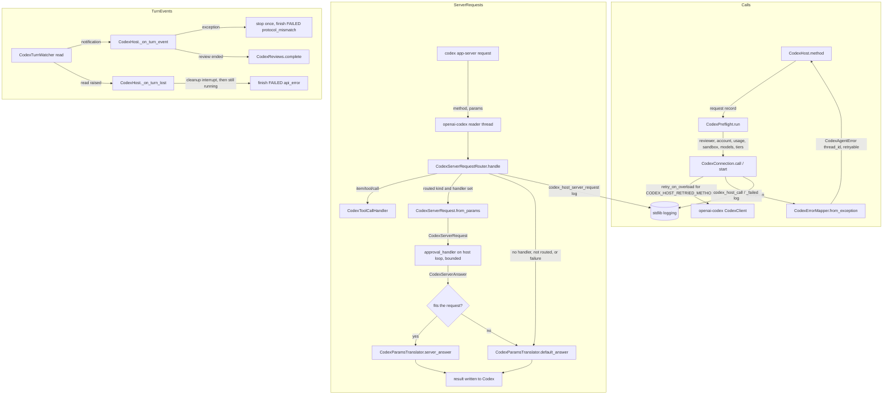

# Spec: CodexHost production hardening and missed settings (slice 1 of 2)

> **TL;DR** — This slice makes the 27 existing `CodexHost` functions, the 6 one-shot functions and the 26 tools ready for production. Every error names its thread and says whether it is transient. Every call and every server request is logged without private data. No turn can be left `RUNNING` forever. Ended turns can be released with `forget_codex_turns`, and tools never raise. Approvals stop being auto-accepted: a developer passes `CodexHost(approval_handler=...)` to answer command, file-change and user-input requests in code. Without a handler, every request gets a fail-closed, schema-valid answer. The slice also adds the Codex 0.163.0 settings the functions missed (S1–S3, S6–S10). **The decision that matters most:** the handler is an async function given once, when the host is built. It runs on the host's own loop behind the same bounded bridge that dynamic tools use, and any failure in it falls back to the fail-closed answer for that request. A `USER` reviewer is refused only on a host that has no handler.

## §0 User prompts

### 0.1 Invoking request (verbatim)
````
great, I am going to merge pr #1055 into the repo,  before you kick off what I am about to say can you make sure to wait that pr #1055 is merged into main. then I want you to create the codex functions that you thought about. Also, the comments that you left on pr #1044, i dont think  that they were clear about what to change/add to the claude code commands, I wanted the same 'first class claude code features" that you added for codex in the list above, using all of claude code's built in skills/settings/functionalities, can you think about all of these and then add some more comments on pr #1044 (do all of this after #1055 merged, just so you are on the same page)
````

### 0.2 User replies during the run
None yet.

---

## Part A — Framing

## §1 Goal

The user's bar, from Prompt 2 (request.md §D): each function should have "all layers" required to push to production, and should "exception handle everything that could potentially go wrong". The audit in request.md §C.9/§C.10 found that every gap below is still present at `base_commit` (code-map §4, each with path:line). X1, X4, X5, X6/S5 and X8 were reproduced in-process.

| ID | Goal (outcome) | How we will know | Source |
|---|---|---|---|
| G-1 | Every failure is typed, attributable and recoverable. Each error names the thread it left behind (`thread_id`) and says whether retrying can help (`retryable`). A missing thread is never confused with a busy or failing server. | AC-2…AC-6, AC-24, AC-26 | request.md §C.9 X1, X4, X5, rows 11, 24, 26, 27 |
| G-2 | No turn is ever stuck `RUNNING`, no tool raises into the agent loop, and a long-lived host can release memory it no longer needs. | AC-7…AC-9, AC-16, AC-17 | §C.9 X3, X7, X8, row 9 |
| G-3 | Approval and user-input requests are answered by the developer's code or refused safely, never silently approved, and every server request gets an answer its schema accepts. | AC-10…AC-15, AC-38 | §C.9 X6, §C.10 S5 and P0 "approval / user-input handler" |
| G-4 | An operator can see what the host did and why it failed, without any private data appearing in logs. | AC-18 | §C.9 X2 |
| G-5 | The existing functions accept the Codex 0.163.0 settings they missed, and still never drop a setting silently. | AC-19…AC-23, AC-25, AC-27…AC-34 | §C.9 rows 1, 3, 4–7, 15, 25, 26; §C.10 S1–S3, S6–S10 |
| G-6 | Drift between the SDK and the installed CLI is detectable without spending anything. | AC-34, AC-35 | §C.9 X9, §C.10 S10 |

## §2 Objective

When this PR's slice-1 commits merge, the following will exist that does not exist today.

- **New public API.** `CodexHost(settings, *, approval_handler=...)` routes command-execution, file-change and user-input requests to an async developer callback. Six new validated records and two new enums carry those requests and their answers.
- **Fail-closed router.** Every server request gets a schema-valid answer: decline, empty answers, no permissions, or the current time.
- **Errors.** Every `CodexAgentError` raised by the host carries `thread_id` and a derived `retryable` flag. Four read-only methods get the SDK's overload retry. `thread/read` failures are classified correctly.
- **Turn safety.** A turn whose event handling fails, or whose watcher dies, ends `FAILED` instead of hanging. `forget_codex_turns` releases a thread's ended turns. Tools convert any exception into an error result.
- **Logging.** The connection, the router, the turn registry and the tools log through stdlib loggers with ids and codes only.
- **Per-function rows.** The per-function rows of §C.9 that call for a change are implemented. The rest are documented as accepted (§3).
- **Settings.** The settings S1–S3 and S6–S10 are added or validated, and the SDK pin moves to 0.163.
- **Review code.** The review code moves out of the `vidbyte.harnesses.native.codex.host` module into one new collaborator module.

The opt-in live smoke test (X9) is written by the S2 test author against this spec.

This is **slice 1 of 2** on one branch and one PR. Slice 2 (`codex-host-first-class`, a later spec) builds the remaining P0 and P1 functions on these commits (NG-1).

## §3 Non-goals

- **NG-1 — Slice-2 functions.** These are: `update_codex_thread_settings`, plan mode (`list_codex_collaboration_modes`, `run_codex_plan`, `collaboration_mode`, which is S4), `stream_codex_turn`, `wait_codex_turns`, `list_codex_mcp_servers`, and all of P1 except `forget_codex_turns`. *Why not:* request.md says slice 2 builds them on slice 1's commits, and slice 1 closes X7 itself.
- **NG-2 — P2 items.** These are: open in app, recap, voice/realtime, hooks, feedback, marketplaces and `process/spawn`. *Why not:* request.md "Rejected alternatives" ranks them niche. Building them is Q-1 (default no).
- **NG-3 — New agent tools or new tool arguments.** The toolset stays at exactly 26 tools with today's schemas. `approval_handler`, `forget_codex_turns`, `before_turn_id`, `defer_goal_continuation`, `limit`, `force_reload`, the service tier, the network/writable-root fields and the review caps get no tool and no tool argument. The only tool change is X8. *Why not:* request.md "Key decisions": tools must never let a model widen approvals or the sandbox, and the service tier stays developer-only. Exposing the rest is Q-9 and Q-10 (default no).
- **NG-4 — Routing permission requests and MCP elicitations to the handler.** Both get fixed, schema-valid refusals. *Why not:* the P0 item is "an approval / user-input handler". A permission grant would need a mapping from requested to granted profile that the conversation never specified. Routing them is Q-4 and Q-5 (default no).
- **NG-5 — A stored-turn fallback for `get_codex_turn_result` after a restart (row 10).** *Why not:* a handle belongs to the host that started its turn (codex-host INV-23). `list_codex_turns` already reads stored turns.
- **NG-6 — An "interrupt and wait for confirmation" option (row 12).** *Why not:* `wait_codex_turn(handle)` after `interrupt_codex_turn` already confirms the interrupt, and the tool output already says so.
- **NG-7 — Stored or past usage, and Codex's own subagent spend, in `track_codex_thread_usage` (row 13).** *Why not:* there is no usage-history method in this slice's scope. Subagent spend is unverified (A-8).
- **NG-8 — Concurrent `launch_codex_subagents` or a default fan-out cap (row 14).** *Why not:* serial starts keep cleanup ordered (codex-host INV-37). The existing `limit` is the cap. A default cap is Q-11 (default no).
- **NG-9 — Model, effort or tier for reviews (part of S7).** *Why not:* `ReviewStartParams` in the 0.163.0 schema has only `threadId`, `target` and `delivery` (code-map §4.5). Only Vidbyte-side caps can be added (FR-24).
- **NG-10 — Content search (rows 16–18 match titles only).** *Why not:* the `searchTerm` schema text says it filters titles. Content search is P1 `search_codex_thread_content` (slice 2).
- **NG-11 — Waiting for or confirming a compaction (row 21).** *Why not:* thread-helpers EC-41 and Q-16 stand.
- **NG-12 — An archive alternative and a dangling-child check for delete (row 22).** *Why not:* archive is P1 (slice 2). A missing parent already ends a lineage walk (INV-5).
- **NG-13 — Images, mentions or several skills per `run_codex_skill` (row 26).** *Why not:* these are new inputs the conversation lists only as gaps. They are documented as limitations.
- **NG-14 — Named permission profiles (part of S8).** *Why not:* they are experimental-only (code-map §4.3). Q-12 does not cover them; they stay out.
- **NG-15 — `TracerBase` spans for direct host calls (part of X2).** *Why not:* the agent runtime already opens a `tool.call` span around every tool (code-map §4.1), and logs cover direct calls. Adding a `tracer=` option is Q-12 (default no).
- **NG-16 — Changing `CodexHarnessAgent` beyond the shared effort enum and the SDK pin.** *Why not:* the `CodexHarnessAgent` test suite must keep passing (codex-host NG-5; its command is in §11). The new turn fields therefore live on `CodexSpawnRequest`, not on `CodexTurnSettings` (D-17).
- **NG-17 — Paid turns in any test, and live calls in CI.** *Why not:* request.md "Constraints". CI installs no codex extra and has manual triggers only.
- **NG-18 — A default `wait_codex_turn` timeout (row 9).** *Why not:* INV-14 removes the hang. The caller's `timeout_seconds` and the turn's own `timeout_seconds` remain the bounds.
- **NG-19 — Several folders in one `list_codex_skills` call (row 25).** *Why not:* calling once per folder already works.

## §4 Developer usage

```python
import asyncio

from vidbyte.harnesses.native.codex import CodexHost
from vidbyte.lib.dataclasses.codex_host import CodexServerAnswer, CodexServerRequest, CodexSpawnRequest
from vidbyte.lib.enums.codex import CodexApprovalDecision, CodexApprovalsReviewer, CodexServerRequestKind


async def answer(request: CodexServerRequest) -> CodexServerAnswer:
    # Allow `git status`; decline every other command, file change and question.
    if request.kind is CodexServerRequestKind.COMMAND_EXECUTION and request.command == "git status":
        return CodexServerAnswer(decision=CodexApprovalDecision.ACCEPT)
    return CodexServerAnswer(decision=CodexApprovalDecision.DECLINE)


async def main() -> None:
    async with CodexHost(approval_handler=answer) as host:
        spawn = CodexSpawnRequest(prompt="Run git status and summarize it.", approvals_reviewer=CodexApprovalsReviewer.USER)
        handle = await host.spawn_codex_thread(spawn)
        snapshot = await host.wait_codex_turn(handle)
        print(snapshot.status.value)
        print(await host.forget_codex_turns(handle.thread_id))


asyncio.run(main())
```

Against a Codex that completes the turn, this prints `completed` and then `1`. The developer no longer has to worry about two things:

- Approvals for this thread no longer bypass them. Today a `USER` reviewer is refused, and anything that still reaches the host is auto-accepted.
- A long-lived host no longer keeps every finished turn until it closes.

If the spawn fails, the `CodexAgentError` carries `thread_id` (when a thread was created) and `retryable`, so the caller can find the thread or decide whether to retry.

## §5 Flow diagram



**How a call flows.** A host method validates its arguments locally, then runs `CodexPreflight.run`, which now starts with the reviewer check. It then sends each call through `CodexConnection.call` or `CodexConnection.start`. That is the one bounded choke point: it retries the four read-only methods on overload, logs one record per call, and maps any failure to a `CodexAgentError` that carries the thread id.

**How a server request flows.** Each server request arrives on openai-codex's single reader thread. The router answers it exactly once. It sends a routed request to the developer's handler on the host loop, within the tool-call bound. If that path fails for any reason, the router writes the fixed default answer for the method.

**How a turn ends.** A turn can now end in two more ways:

- One of its events fails to process. The host sends one interrupt and ends the turn `FAILED` with `codex.protocol_mismatch`.
- Its watcher's read fails. The host sends one cleanup interrupt and ends the turn `FAILED` with `codex.api_error`. A close or a process death that happens first wins instead.

---

## Part B — Behavior

## §6 Behavior

### 6.1 Invariants

**Errors (X1, X4, X5, row 11)**

- **INV-1** — **An error names the thread it left behind.** Every `CodexAgentError` the host raises about a thread that exists names it twice: in `thread_id`, and in the message suffix `" Thread: <id>."`. This covers `CodexErrorMapper.error`, every mapped call failure given a thread id, reviewer refusals, the launch re-raise, and failures after `thread/start` or `thread/fork` succeeded.
- **INV-2** — **`retryable` says whether the failure is transient.**
  - `CodexAgentError.retryable` is a read-only property. It is `True` exactly when `CODEX_FAILURE_CLASSIFICATION[failure_code][0]` is `CodexFailureClass.TRANSIENT`. It is `False` for every other class and for any code without a row.
  - It is derived from `failure_code`, so it survives every re-raise that keeps the code. It never appears in `details`.
  - It means "the condition is transient". It does not mean "the call had no effect": a spending call that failed transiently may still have started a thread (see `thread_id`).
- **INV-3** — **Only idempotent reads are retried.**
  - The typed calls in `CODEX_HOST_RETRIED_METHODS` run through openai-codex's `retry_on_overload` with its default policy. These are `account/read`, `thread/read`, `thread/list` and `thread/name/set`. The existing bound of `CodexConnection.call` covers the whole retry loop.
  - These are sent exactly once: every other typed call (`initialize`, `thread/start`, `thread/resume`, `thread/fork`, `thread/compact/start`, `turn/start`, `turn/steer`, `turn/interrupt`, and the goal start and cancel), and every method in `SPENDING_RAW_METHODS`.
  - Non-spending raw calls keep `request_with_retry_on_overload`, unchanged.
- **INV-4** — **How `thread/read` errors are classified.**
  - A JSON-RPC `InvalidRequest` (-32600) or `InvalidParams` (-32602) error on `thread/read` means `codex.session_not_found`.
  - Every other JSON-RPC error on `thread/read` follows the general rule: method-not-found or parse errors are `codex.protocol_mismatch`; overload after retries, internal and any other errors are `codex.api_error`.
  - Timeouts stay `codex.api_error`, and a dead process stays `codex.process_exited`.
  - This supersedes the `thread/read` clause of codex-host D-13, the last bullet of thread-helpers INV-16, and the refusal clause of thread-helpers EC-14.
- **INV-5** — **Lineage stops only at a missing parent.** A parent read that raises `codex.session_not_found` ends the walk, as today. Any other failure propagates, including an overload that persists after the retries.
- **INV-6** — **A turn being stopped cannot be steered.**
  - `steer_codex_turn` on a turn whose stop is in flight (`stop_pending`) raises `codex.session_not_found` with `STEER_STOPPING_MESSAGE` and sends nothing.
  - A `turn/steer` that Codex refuses with `InvalidRequest` (-32600) maps to `codex.session_not_found`, because the turn ended between the check and the steer. Any other steer error keeps the general rule.

**Observability (X2)**

- **INV-7** — **Every call is logged once.**
  - Each call through `CodexConnection.call` or `CodexConnection.start` emits exactly one record on the connection module's logger. A success logs DEBUG `codex_host_call operation=%s method=%s thread_id=%s duration_ms=%d`. A failure logs WARNING `codex_host_call_failed operation=%s method=%s thread_id=%s failure_code=%s error_type=%s origin=%s duration_ms=%d`.
  - `origin` is `ExceptionOrigin.describe(exc)`: the innermost traceback frame as `file.py:function:line`, or `""` when there is none.
- **INV-8** — **Every server request is logged once.**
  - Each server request the router answers emits one INFO `codex_host_server_request method=%s thread_id=%s turn_id=%s item_id=%s handled_by=%s answer=%s`.
  - `handled_by` is `handler`, `default` or `tool`. `answer` is a short label of what was sent: the decision value, `answers`, `no_permissions`, `current_time`, `empty`, `success` or `failure`.
  - When a routed request falls back to its default, the router also emits one WARNING `codex_host_server_request_fallback method=%s thread_id=%s reason=%s error_type=%s origin=%s`. `reason` is one of `parse_failed`, `handler_failed`, `handler_timed_out`, `answer_invalid` or `loop_closed`.
- **INV-9** — **Turn items and turn ends are logged.** Each `item/completed` a live turn observes emits DEBUG `codex_host_turn_item thread_id=%s turn_id=%s item_id=%s item_type=%s`. The first `CodexTurnRegistry.finish` of a turn emits INFO `codex_host_turn_ended thread_id=%s turn_id=%s status=%s failure_code=%s`, with `""` when there is no problem.
- **INV-10** — **Logs carry no private data.** Every logger is `logging.getLogger(__name__)`. Messages are %-style with arguments, never f-strings, and never contain exception text. No record carries any of these:
  - the account email, any prompt or input text, command text, a cwd, a reason, a question or an answer;
  - tool arguments or output, model output, stderr, environment values, or anything read from the Codex home folder.
  Logging never changes behaviour.

**Turn liveness (X3)**

- **INV-11** — **A failing event never leaves a turn running.**
  - If handling one of a running turn's notifications raises `Exception`, the host does four things in order:
    1. logs WARNING `codex_host_turn_event_failed thread_id=%s turn_id=%s error_type=%s origin=%s`;
    2. calls `turn.stop(connection, None)`, which sends at most one quiet interrupt;
    3. finishes the turn `FAILED` with `codex.protocol_mismatch` and `EVENT_FAILED_MESSAGE`;
    4. closes a goal run's stream.
  - Later notifications for that turn change nothing (codex-host INV-15).
- **INV-12** — **A failing review completion never leaves a review running.** If `CodexReviews.complete` raises anything other than the `CodexAgentError` it already tolerates, the review turn ends `FAILED` with `codex.protocol_mismatch` and `EVENT_FAILED_MESSAGE`, and the failure is logged as in INV-11. Cancellation propagates.
- **INV-13** — **A lost watcher never leaves a turn running.** When a `CodexTurnWatcher` read raises, the watcher posts `on_lost` to the loop. `RuntimeError` from a closed loop is suppressed. The host then runs `_end_lost_turn`:
  1. **(a)** If the turn already has a snapshot, or the connection is stopped (closing or dead), it does nothing.
  2. **(b)** Otherwise it logs WARNING `codex_host_turn_lost thread_id=%s turn_id=%s`.
  3. **(c)** Unless a stop was already sent, it marks the stop sent and awaits one quiet cleanup interrupt (`CodexConnection.interrupt(..., cleanup=True, quiet=True)`, bounded by `CODEX_HOST_CLOSE_INTERRUPT_SECONDS`).
  4. **(d)** If the turn still has no snapshot and the connection is still not stopped, it finishes the turn `FAILED` with `codex.api_error` and `LOST_EVENTS_MESSAGE`, then closes a goal run's stream.

  A close or a death that lands before (d) wins, and the turn ends `codex.process_exited` as today.
- **INV-14** — **Waiting always ends.** `wait_codex_turn(handle)` with no timeout returns for every turn the host registered once one of these happens: Codex reports the turn's end, the host closes, the process dies, an event fails (INV-11, INV-12), or the watcher is lost (INV-13).

**Server requests (X6, S5)**

- **INV-15** — **Every server request gets one answer, and the router never raises.** `CodexServerRequestRouter.handle` returns exactly one answer per request:

  | Method | Handler set and kind routed | Otherwise (the default) |
  |---|---|---|
  | `item/commandExecution/requestApproval` | `{"decision": <CodexApprovalDecision value>}` | `{"decision": "decline"}` |
  | `item/fileChange/requestApproval` | `{"decision": <value>}` | `{"decision": "decline"}` |
  | `item/tool/requestUserInput` | ACCEPT: `{"answers": {<question_id>: {"answers": [<str>, ...]}}}`; DECLINE or CANCEL: `{"answers": {}}` | `{"answers": {}}` |
  | `item/permissions/requestApproval` | never routed | `{"permissions": {}}` |
  | `mcpServer/elicitation/request` | never routed | `{"action": "decline"}` |
  | `applyPatchApproval`, `execCommandApproval` | never routed | `{"decision": "denied"}` |
  | `currentTime/read` | never routed | `{"currentTimeAt": <int(time.time())>}` |
  | `item/tool/call` | unchanged: the thread's `CodexToolCallHandler`, else the unregistered-tool answer | — |
  | any other method (`account/chatgptAuthTokens/refresh`, `attestation/generate`, unknown) | never routed | `{}` (EC-10) |

  Each answer is a fresh object, never the shared constant.
- **INV-16** — **Without a handler, every routed request is refused.** On a host built without `approval_handler`, command and file-change approvals are declined and user-input requests get empty answers. This supersedes the accept fallback of codex-host INV-28 and D-16.
- **INV-17** — **How a routed request reaches the handler, and how it falls back.**
  - With `approval_handler` set, a request whose method is a `CodexServerRequestKind` value is parsed with `CodexServerRequest.from_params(kind, params)`. The handler is scheduled on the host's loop with `asyncio.run_coroutine_threadsafe`, and the reader thread waits at most `CODEX_TOOL_CALL_TIMEOUT_SECONDS`.
  - One `try` spans parsing, scheduling and waiting. A single `finally` cancels the future, or closes a coroutine that was never scheduled.
  - The default answer for the method is sent instead (INV-8 fallback log) when any of these happens:
    - the parse fails;
    - the loop is closed;
    - the handler raises or times out;
    - the handler returns something other than a `CodexServerAnswer`;
    - the answer does not fit the request (INV-18).
- **INV-18** — **When an answer fits its request.** A `CodexServerAnswer` fits a `CodexServerRequest` exactly when all of these hold:
  - for `COMMAND_EXECUTION` and `FILE_CHANGE`, `answers` is empty;
  - when `available_decisions` is not empty, the decision is in it;
  - for `USER_INPUT`, the decision is ACCEPT, DECLINE or CANCEL;
  - every `question_id` in `answers` names one of the request's questions.
- **INV-19** — **The handler is checked when the host is built.** `approval_handler` must be `None`, or a callable for which `inspect.iscoroutinefunction` is true of it or of its `__call__`. Anything else raises `ConfigurationError(APPROVAL_HANDLER_MESSAGE)` from `CodexHost.__init__`, before anything starts.
- **INV-20** — **A `USER` reviewer is refused only where nothing can answer it.**
  - `CodexSpawnRequest(approvals_reviewer=USER)` constructs.
  - On a host without a handler, `CodexPreflight.run` refuses a request whose `approvals_reviewer` is `USER`, as its first step and before any request. The refusal is `CodexAgentError` with `configuration.unsupported_combination`, the calling function's own operation, `USER_REVIEWER_MESSAGE` and the next step `CODEX_HOST_USER_REVIEWER_TEXT`. This covers spawn, continue, launch, fork, `run_codex_goal`, `run_codex_skill` and `run_codex_openai_docs`.
  - The D-32 check of the reviewer Codex reports after `thread/start` or `thread/resume` refuses only on a host without a handler. With a handler, the thread proceeds and its approvals reach the handler.
- **INV-21** — **Close cancels pending handler calls.** At close, and when the process dies, the router cancels every handler future still pending, alongside the existing tool-handler cancellation (codex-host INV-7 step 1). Each such request then gets its default answer, and no handler coroutine outlives the host.

**Retention (X7)**

- **INV-22** — **`forget_codex_turns` releases a thread's ended turns.**
  - `forget_codex_turns(thread_id)` is local only (`_guard(talks=False)`) and sends nothing to Codex. It refuses an empty or non-string `thread_id` with `ConfigurationError(FORGET_THREAD_MESSAGE)`.
  - A thread that is busy (running or reserved turn, or a start in flight) is refused with `codex.session_busy` through `require_idle`, and nothing is dropped.
  - Otherwise it drops every turn the host registered on the thread, plus the thread's usage ledger and tracker, and returns how many turns it dropped. An unknown thread returns 0.
  - Afterwards, each dropped handle raises `codex.session_not_found` with `UNKNOWN_HANDLE_MESSAGE`, and `track_codex_thread_usage(thread_id)` raises `codex.session_not_found` with `NEVER_RAN_MESSAGE`.
  - The thread's dynamic-tool registration is kept.
  - It works on a closed host.
  - This supersedes codex-host EC-65.

**Tools (X8)**

- **INV-23** — **Tools never raise.** `_CodexHostTool._run` turns any other `Exception` (not `BaseException`) into `ToolResult.error(name, "codex.api_error: <TOOL_FAILED_MESSAGE> Next step: <CODEX_NEXT_STEPS[codex.api_error]>", metadata={"code": "codex.api_error", "next_step": ...})`. It also logs WARNING `codex_host_tool_failed tool=%s error_type=%s origin=%s`. Cancellation propagates. This completes codex-host INV-10.

**Per-function rows**

- **INV-24** — **(row 1) Readiness reports used-up usage.** `check_codex_ready` reads the usage allowance, as preflight step 2 does. When Codex reports `ordinary_usage_allowed is False`, it adds a `codex.usage_limited` problem (`USAGE_LIMITED_MESSAGE`, its next step) between the sign-in problem and the sandbox problem. `None`, or a failed read, adds nothing. `ready` stays exactly `not problems`.
- **INV-25** — **(row 3) An unknown model or tier triggers one fresh read.** When the preflight's cached model list names no model, or no tier, that the request asks for, the preflight reads the list once more, replaces the cache, and checks again before refusing. A request whose names are all known causes no read.
- **INV-26** — **(row 4, X1) A failed spawn leaves no tool registration behind.**
  - `_open_thread` runs in this order: `thread/start`, then the reviewer check, then `thread/name/set`, then registering the dynamic-tool handler. A failure at any step therefore leaves no registration.
  - When the turn or goal start that follows fails, spawn and launch unregister that thread's handler. The exception: a start for that thread is still in flight (`CodexConnection.starting`), and the registration stays for the adopted turn.
  - The error carries the thread id (INV-1).
- **INV-27** — **(row 5) Continue checks the stored goal first.** `continue_codex_thread` reads the thread first. When Codex reports it `notLoaded`, the host reads the stored goal before `thread/resume`. Any goal status but `complete` refuses with `codex.goal_unfinished` and `CONTINUE_GOAL_UNFINISHED_MESSAGE`. The refusal releases the reservation and leaves the thread `notLoaded`. This uses the same complete-only rule as compact (thread-helpers INV-18, D-13).
- **INV-28** — **(row 6, S6, S9) Fork runs its checks in a fixed order.**
  1. Unusable fields, then argument checks. `from_turn_id` together with `before_turn_id` raises `ConfigurationError(FORK_POINTS_MESSAGE)`.
  2. The thread must exist: one metadata `thread/read`, without turns.
  3. `CodexPreflight.run(..., spends=False)`: the reviewer check, plus the model and tier check.
  4. The fork point. With `before_turn_id`, it is sent as given and no `lastTurnId` is sent. Otherwise `CodexThreadHelpers.fork_point` pages `thread/turns/list` (newest first, `itemsView` `notLoaded`) with today's rule: an empty `from_turn_id` means the last completed turn, and an unknown or non-completed `from_turn_id`, or no completed turn, raises `codex.fork_failed` before `thread/fork`.
  5. `thread/fork`, with `beforeTurnId` and `deferGoalContinuation: true` added after validation when set.
  6. Register the parent's handler for the fork.
  7. `thread/name/set`. A failure here unregisters the fork's handler and raises with the fork's `thread_id`.
- **INV-29** — **(row 7) `list_codex_threads` checks its arguments.**
  - Before any request, it raises `ConfigurationError(LIST_ARGUMENT_MESSAGE)` for any of these:
    - `cwd`, `search` or `cursor` that is not a `str`;
    - `archived` that is not a `bool`;
    - `source_kinds` that is not a tuple of `CodexThreadSourceKind`;
    - `sort` or `sort_direction` of the wrong enum;
    - `limit` that is neither `None` nor an int from `CODEX_HOST_MIN_LIST_LIMIT` to `CODEX_HOST_THREAD_LIST_MAX_LIMIT`, with `bool` refused.
  - A `limit` is sent when given. Empty strings, an empty tuple and `archived=False` are still left out.
- **INV-30** — **(row 15, S7) A review can be capped.** `start_codex_review(..., request=...)` accepts a `CodexSpawnRequest` that sets only `timeout_seconds` and `max_output_tokens`. Any other non-default field raises `ConfigurationError` before any request. The review turn is tracked with that request, so the caps apply as they do to any turn (codex-host D-7). `None` keeps today's uncapped review.
- **INV-31** — **(rows 24, 26, 27) Wrapper errors carry the wrapper's operation.** Every `CodexAgentError` escaping `run_codex_goal`, `run_codex_skill` or `run_codex_openai_docs` carries that function's own operation. This covers the inner spawn, the skill listing and the read-back. Every other field is kept: code, `thread_id`, `error_type`, next step, and the message with any `GOAL_UNCHECKED_MESSAGE` or `SKILL_UNCHECKED_MESSAGE` suffix. This supersedes the "operation" element of thread-helpers INV-22 and INV-35.
- **INV-32** — **(row 25) `force_reload` is sent only when asked.** `list_codex_skills(cwd, force_reload)` sends `forceReload: true` only when `force_reload` is `True`. The params are otherwise unchanged.
- **INV-33** — **(row 26) Skills resolve in the folder the turn runs in.** `run_codex_skill` and `run_codex_openai_docs` resolve the skill in `request.turn.cwd or request.thread.cwd`.

**Settings**

- **INV-34** — **(S1) A goal run refuses turn-only fields.** When `request.goal` is set, `CodexPreflight.reject_unusable_fields` raises `ConfigurationError(GOAL_FIELD_MESSAGE)` for the first non-default field of `GOAL_REJECTED_FIELDS`, before any request. Those fields are `turn`, `output_schema`, `disabled_plugin_ids`, `turn_service_tier`, `network_access` and `writable_roots`. Spawn now calls `reject_unusable_fields`. This restores codex-host INV-27 for goal runs.
- **INV-35** — **(S2) Two more efforts.** `CodexReasoningEffort` accepts `max` and `ultra`. They are sent as those strings, through the existing `CodexContentTranslator` mapping.
- **INV-36** — **(S3) Service tiers are listed, sent and checked.**
  - `CodexModelInfo` carries `service_tiers` and `default_service_tier` from `model/list`.
  - `CodexSpawnRequest.turn_service_tier` is sent as `serviceTierForTurn` on `turn/start` when non-empty.
  - Preflight checks `thread.service_tier`, `turn.service_tier` and `turn_service_tier`, ignoring `""` and `CODEX_DEFAULT_SERVICE_TIER`. They are checked against the tier ids of the named models, or against all listed models when none is named, after INV-25's single refresh. An unlisted tier raises `codex.model_unknown` with `UNKNOWN_TIER_MESSAGE`.
  - The check is skipped when `thread.model_provider` is set, or when the relevant models list no tiers.
- **INV-37** — **(S8) Network access and writable roots.**
  - `network_access` and `writable_roots` are checked when the `CodexSpawnRequest` is built. `network_access` needs `turn.sandbox` of `READ_ONLY` or `WORKSPACE_WRITE`. `writable_roots` needs `WORKSPACE_WRITE`, and each root must be a non-empty absolute path.
  - They are sent inside the turn's `sandbox_policy` as `networkAccess` and `writableRoots`.
  - Fork, review and goal runs reject them.
- **INV-38** — **(S9) Only `read_codex_thread` asks for full history.** No host path sends `thread/read` with `includeTurns: true` except `read_codex_thread(include_turns=True)`. Fork uses INV-28. The review registration and completion read-backs use one `thread/turns/list` page (newest first, `itemsView` `full`, `limit` `CODEX_HOST_REVIEW_READ_BACK_LIMIT`), matched by turn id.
- **INV-39** — **(S10) The SDK pin moves to 0.163.** The optional extra pins `openai-codex>=0.163.0,<0.164.0`. `CodexClientSettings.client_version` defaults to `"0.163.0"`.
- **INV-40** — **One-shots mirror the host.** The one-shot `list_codex_threads` and `fork_codex_thread` take exactly the host method's arguments, including `limit`, `before_turn_id` and `defer_goal_continuation`, plus the keyword-only `settings`.

**Must not regress:**
- **INV-41** — Importing `vidbyte.harnesses.native.codex` never loads openai-codex (codex-host INV-1). New SDK imports stay in modules only `CodexHost._open` loads, or inside functions.
- **INV-42** — No private data in errors, results or tool outputs (codex-host INV-9). INV-10 extends the rule to logs.
- **INV-43** — Spending calls are sent once, and a start that outlives its caller is adopted and stopped once (codex-host INV-11, `CodexConnection.start`).
- **INV-44** — The toolset holds exactly 26 tools with today's schemas, apart from the `effort` enum gaining `max` and `ultra` through `EFFORTS`. No tool lets a model set a reviewer, approval policy, sandbox, network access, writable roots, service tier or handler.
- **INV-45** — The close and death paths end running turns `codex.process_exited`, as today (codex-host D-27; pinned by the turn-outcome test listed in §13).
- **INV-46** — `CodexHarnessAgent` behaviour is unchanged, apart from accepting the two new efforts. The `CodexHarnessAgent` test suite (§11) passes.

### 6.2 Acceptance criteria

| ID | Given | When | Then | Priority | Proof |
|---|---|---|---|---|---|
| AC-1 | a clean checkout of this branch | the §4 snippet runs against a Codex that completes the turn | it prints `completed` then `1`; the thread started with `approvalsReviewer` `user` | P0 | |
| AC-2 | `thread/start` succeeds and the first `turn/start` fails with a JSON-RPC error, on a spawn with dynamic tools | `spawn_codex_thread` raises | `error.thread_id` is the new thread's id, the message ends with `" Thread: <id>."`, and a later `item/tool/call` for that thread gets the unregistered-tool answer | P0 | |
| AC-3 | the third `turn/start` of a three-prompt launch fails | `launch_codex_subagents` raises | `error.thread_id` is the third thread's id (non-empty); the two started turns get one interrupt each | P0 | |
| AC-4 | `account/read`, `thread/read`, `thread/list` or `thread/name/set` answers overloaded once | the calling function runs | it succeeds, with exactly two requests of that method; while `thread/start`, `thread/resume`, `thread/fork`, `thread/compact/start`, `turn/start` or `turn/steer` answering overloaded once is sent exactly once and raises `codex.api_error` with `retryable is True` | P0 | |
| AC-5 | a `CodexAgentError` for each code in `CODEX_FAILURE_CLASSIFICATION`, plus a configuration code | `.retryable` is read | it is `True` exactly for the TRANSIENT-class codes, and `"retryable"` is not a key of `details` | P0 | |
| AC-6 | `thread/read` answers -32603, or overloaded on every attempt | `read_codex_thread`, `continue_codex_thread`, `compact_codex_thread`, `delete_codex_thread` or `get_codex_goal` runs | it raises `codex.api_error`, not `codex.session_not_found`; -32600 and -32602 still raise `codex.session_not_found`; a lineage walk whose parent read is overloaded raises instead of ending early | P0 | |
| AC-7 | a running plain turn and a running goal run | processing one of their notifications raises | each ends `FAILED` with `codex.protocol_mismatch` and `EVENT_FAILED_MESSAGE`; exactly one interrupt (or goal cancel) is sent; `wait_codex_turn(handle)` with no timeout returns | P0 | |
| AC-8 | a running turn whose watcher read raises while the host is open and the process is alive | the loop runs | one cleanup interrupt is sent and the turn ends `FAILED` with `codex.api_error` and `LOST_EVENTS_MESSAGE`; when the process died instead, the turn ends `codex.process_exited` and no lost-turn failure is recorded | P0 | |
| AC-9 | a completed review whose completion read-back raises a non-Codex exception | the completion runs | the review ends `FAILED` with `codex.protocol_mismatch`; its wait returns | P0 | |
| AC-10 | a host without `approval_handler` | each method of the INV-15 table is sent as a server request | each gets exactly its "Otherwise" answer (`currentTimeAt` within 5 s of now); `item/somethingNew/request` gets `{}`; the reader thread survives | P0 | |
| AC-11 | a handler that returns ACCEPT, ACCEPT_FOR_SESSION, or ACCEPT with answers | a command approval, a file-change approval, and a user-input request with questions `q1` and `q2` arrive | the answers are `{"decision": "accept"}`, `{"decision": "acceptForSession"}` and `{"answers": {"q1": {"answers": ["yes"]}}}`; the handler saw `kind`, `thread_id`, `turn_id`, `item_id`, `command`, `cwd`, `reason`, `available_decisions`, `grant_root`, `questions` and `is_blocking` as sent | P0 | |
| AC-12 | a handler that raises, sleeps past the bound, returns a dict, returns a decision outside a non-empty `available_decisions`, returns answers on an approval, or answers an unknown question id | the request arrives | the default answer for that method is sent, one fallback WARNING is logged, and the next request is still answered | P0 | |
| AC-13 | a sync function, a lambda, or a non-callable | passed as `approval_handler` | `CodexHost(...)` raises `ConfigurationError(APPROVAL_HANDLER_MESSAGE)`, and no process starts | P0 | |
| AC-14 | `CodexSpawnRequest(approvals_reviewer=USER)` | it is built, then used by spawn, continue, launch, fork and `run_codex_goal` on a host without a handler, and by spawn on a host with one | it builds. Without a handler, each call raises `configuration.unsupported_combination` with its own operation and the new `CODEX_HOST_USER_REVIEWER_TEXT`, before any request. With a handler, the spawn sends `approvalsReviewer: "user"` and returns a handle | P0 | |
| AC-15 | a host with a handler | `item/permissions/requestApproval`, `mcpServer/elicitation/request` and `execCommandApproval` arrive | the handler is never called, and the fixed answers are sent | P0 | |
| AC-16 | an idle thread with two ended turns, and a thread with a running turn | `forget_codex_turns` is called on each, then on an unknown id | it returns 2; the two old handles raise `codex.session_not_found`; usage tracking raises `codex.session_not_found`; the busy thread raises `codex.session_busy` and keeps its turns; the unknown id returns 0; no request is sent | P0 | |
| AC-17 | a host method that raises `RuntimeError` or `KeyError` under a tool | the tool executes | it returns an error result `codex.api_error: <tool> failed with RuntimeError. Next step: …` with code metadata, and logs one WARNING; a `CancelledError` propagates | P0 | |
| AC-18 | logging captured at DEBUG for the package and the tools, with the privacy canaries of codex-host INV-9 seeded | a spawn, a failed call, a server request and a tool failure run | each event in INV-7 to INV-9 and INV-23 appears with its fields; no record contains a canary, a prompt, command text or any exception message | P0 | |
| AC-19 | `ordinary_usage_allowed` is `False` | `check_codex_ready` runs | `ready is False` and the problems are `[codex.usage_limited]`, ordered sign-in, usage, sandbox when several apply; `None` or a failed read adds none | P0 | |
| AC-20 | the preflight cached a model list, and Codex then adds a model | a spawn names the new model, and another names a model that is still missing | the first passes after exactly one extra `model/list` walk; the second raises `codex.model_unknown` after exactly one refresh | P1 | |
| AC-21 | a `notLoaded` thread whose stored goal is `active`, one with a `complete` goal, and one with none | `continue_codex_thread` runs on each | the first raises `codex.goal_unfinished` (`CONTINUE_GOAL_UNFINISHED_MESSAGE`) after exactly `thread/read` and `thread/goal/get` on it, leaves it `notLoaded` and frees it; the others resume and start a turn | P0 | |
| AC-22 | a thread with completed turns | fork runs with `before_turn_id`; with both points; with `defer_goal_continuation=True`; with an unknown override model; and with a failing name set | no `thread/read` carries `includeTurns`. `beforeTurnId` is sent with no `lastTurnId`. Both points raise `ConfigurationError` before any request. `deferGoalContinuation: true` is sent. The unknown model raises `codex.model_unknown` before `thread/fork`. The name-set failure raises with the fork's `thread_id`, and the fork's handler is gone | P0 | |
| AC-23 | `list_codex_threads(limit=5)` and bad arguments (`cwd=None`, `archived="yes"`, `limit=0`, `limit=1001`, `limit=True`) | each is called, on the host and the one-shot | `limit: 5` is sent; each bad call raises `ConfigurationError` before any request | P1 | |
| AC-24 | a turn whose user interrupt is in flight; separately, a `turn/steer` answered -32600 | `steer_codex_turn` runs | the first raises `codex.session_not_found` (`STEER_STOPPING_MESSAGE`) and sends nothing; the second raises `codex.session_not_found` | P1 | |
| AC-25 | `start_codex_review(..., request=CodexSpawnRequest(timeout_seconds=1.0))`, and one with `turn=CodexTurnSettings(model="x")` | each runs | the first review turn gets one interrupt after 1 s and is labelled `codex.turn_timed_out` if Codex reports it interrupted; the second raises `ConfigurationError` before any request | P1 | |
| AC-26 | a spawn failure, a goal read-back failure, a skill read-back failure and a skill-listing failure inside the wrappers | `run_codex_goal`, `run_codex_skill` and `run_codex_openai_docs` raise | `error.operation` is the wrapper's own operation; code, `thread_id`, `error_type`, next step and message suffix are unchanged | P1 | |
| AC-27 | `list_codex_skills("C:/w", force_reload=True)` and `list_codex_skills("C:/w")` | each runs | the params are `{"cwds": ["C:/w"], "forceReload": true}` and `{"cwds": ["C:/w"]}` | P1 | |
| AC-28 | `run_codex_skill` with `turn.cwd` A and `thread.cwd` B | it runs | `skills/list` is sent for A | P1 | |
| AC-29 | a request with a goal and a non-default `turn`, `output_schema`, `disabled_plugin_ids`, `turn_service_tier`, `network_access` or `writable_roots` | spawn or `run_codex_goal` runs | `ConfigurationError` naming the field, before any request; thread settings still reach `thread/start` | P0 | |
| AC-30 | `CodexTurnSettings(effort=CodexReasoningEffort.MAX)` and `ULTRA` | a turn starts | `turn/start` carries `effort: "max"` or `"ultra"`; the spawn and continue tool schemas list both | P1 | |
| AC-31 | a model listing tiers `fast` and `flex` with default `flex` | models are listed; a spawn sets `turn_service_tier="fast"`, `"default"` and `"warp"` | `CodexModelInfo.service_tiers` and `default_service_tier` mirror the list; `serviceTierForTurn` is `fast` or `default`; `warp` raises `codex.model_unknown` before `thread/start`; with a custom provider nothing is checked | P0 | |
| AC-32 | `turn.sandbox=WORKSPACE_WRITE`, `network_access=True`, `writable_roots=(<abs path>,)` | a turn starts | `sandboxPolicy` is `{"type": "workspaceWrite", "networkAccess": true, "writableRoots": [...]}`; a relative root, `network_access` with `FULL_ACCESS`, or the fields on fork or review raise `ConfigurationError` | P0 | |
| AC-33 | fork, a review started inline, and a review that completes | each runs | no `thread/read` with `includeTurns: true` is sent; review read-backs are `thread/turns/list` with `sortDirection: "desc"`, `itemsView: "full"`, `limit: 1` | P0 | |
| AC-34 | the pyproject extra and `CodexClientSettings()` | they are read | the pin is `openai-codex>=0.163.0,<0.164.0` and `client_version == "0.163.0"`; the SDK contract test passes against openai-codex 0.163.0 | P0 | |
| AC-35 | `VIDBYTE_CODEX_LIVE_TESTS` unset; separately, set to `1` with `codex` on PATH and signed in | the live smoke module is collected | unset, it is skipped with a reason; set, it opens a real host and calls only non-spending reads, never `thread/start`, `thread/resume`, `turn/start`, `review/start`, `thread/goal/set`, `thread/compact/start` or `thread/delete` | P1 | |
| AC-36 | the built toolset | its specs are listed | exactly 26 tools, with no parameter for a reviewer, approval policy, sandbox, network access, writable roots, service tier, handler, `before_turn_id`, `defer_goal_continuation`, `limit` on fork, or `force_reload` (negative) | P0 | |
| AC-37 | the codex_host test pack and the `CodexHarnessAgent` test suite (§11) | they run after the §13 superseded tests are updated | all pass | P0 | |
| AC-38 | a handler call pending on a host that then closes | close runs | the pending future is cancelled, the request gets its default answer, and close finishes within its existing bounds | P1 | |
| AC-39 | the docstrings of `CodexHost`, its methods, the one-shot functions and the enums | they are read | `wait_codex_turn`, `get_codex_turn_result`, `interrupt_codex_turn`, `track_codex_thread_usage`, `launch_codex_subagents`, `list_codex_threads`, `compact_codex_thread` and `delete_codex_thread` each name their §3 limitation; `read_codex_thread` (`include_turns`), `CodexReviewDelivery.DETACHED` and `CodexPersonality` carry their 0.163 deprecation notes; each one-shot function says it starts a process per call; the `CodexHost` docstring names EC-1 and EC-2 | P2 | |

### 6.3 Edge cases and failure modes

| ID | Trigger (input + state) | System behavior | User sees | Guarded by (INV-/D-) |
|---|---|---|---|---|
| EC-1 | The handler awaits a method of the same host that talks to Codex | The reader thread is blocked waiting for the handler, so the call's response is never read. Both sides time out, and the request gets its default answer after `CODEX_TOOL_CALL_TIMEOUT_SECONDS`. | A 300 s stall and a declined request; the docstring says never to call the same host from the handler | accepted, D-2 |
| EC-2 | The handler takes a long time | Every other response and notification on that host waits, because the SDK has one reader thread | Other turns on the host pause; the docstring says to give approval-gated threads their own host | accepted, D-2 |
| EC-3 | A server request arrives after close began, or the loop is closed | `run_coroutine_threadsafe` raises `RuntimeError`, and the default answer is sent | Nothing; the request is declined | INV-17, INV-21 |
| EC-4 | A routed request lacks `threadId`, or `questions` is not a list | `from_params` raises `ConfigurationError`; the default answer is sent with fallback reason `parse_failed` | The request is declined; one WARNING | INV-17 |
| EC-5 | `availableDecisions` holds object decisions (exec-policy or network-policy amendments) | They are left out of `available_decisions`; the handler cannot choose them | The handler sees only the string decisions | accepted, D-4 |
| EC-6 | `availableDecisions` is absent or null | `available_decisions == ()`, and any decision valid for the kind fits | — | INV-18 |
| EC-7 | A user-input question has `isSecret: true` | The handler gets `is_secret=True`; answers are never logged | — | INV-10 |
| EC-8 | The handler answers a user-input request with DECLINE or CANCEL | `{"answers": {}}` is sent | Codex sees no answers | INV-15 |
| EC-9 | A permission request arrives on a host with a handler | It is never routed; `{"permissions": {}}` is sent, granting nothing | The permission is not granted | INV-15, NG-4 |
| EC-10 | `account/chatgptAuthTokens/refresh` or `attestation/generate` arrives | `{}` is sent, which is not schema-valid; CodexHost never uses external token login, and no refusal shape exists | Codex may fail that flow; one INFO record | accepted, D-3 |
| EC-11 | A review of a thread whose reviewer is `user`, on a host without a handler (codex-host EC-77) | Its approval requests are declined, where today they were accepted | The review cannot run escalated commands | INV-16, D-3 |
| EC-12 | `thread/start` or `turn/start` answers overloaded | Sent once; `codex.api_error` with `retryable=True` | The caller may retry; it checks `thread_id` first, because `retryable` does not mean "no effect" | INV-2, INV-3 |
| EC-13 | `account/read` answers overloaded on all three attempts | The SDK retries with backoff inside one bound, then the call maps to `codex.api_error` | `retryable=True` | INV-3 |
| EC-14 | A retry's backoff would run past the request bound | `asyncio.wait_for` ends the wait (the worker may finish later); `codex.api_error` "did not answer … within 300 seconds" | Same as any timeout | INV-3 |
| EC-15 | `thread/read` answers -32600 because the server is shutting down | Mapped to `codex.session_not_found` | A wrong "not found" during shutdown | accepted, D-8 |
| EC-16 | A watcher read fails because the host is closing or the process died | `_end_lost_turn` sees a snapshot or a stopped connection and does nothing; close or death ends the turn | `codex.process_exited` as today | INV-13, INV-45 |
| EC-17 | Processing a goal-run event raises | One goal cancel, then `FAILED` `codex.protocol_mismatch`; the goal stream is closed | The goal run fails visibly instead of hanging | INV-11 |
| EC-18 | The lost-turn cleanup interrupt fails or times out | Ignored quietly; the turn still ends `FAILED` `codex.api_error` | Codex may finish the turn unobserved; its tokens are not counted | INV-13 |
| EC-19 | `forget_codex_turns` is called while a handed-over start is still in flight | `require_idle` sees `starting(thread_id)` and raises `codex.session_busy` | Retry after the start lands | INV-22 |
| EC-20 | A forgotten handle is passed to `get_codex_turn_result`, `wait_codex_turn`, `steer_codex_turn` or `interrupt_codex_turn` | `codex.session_not_found` with `UNKNOWN_HANDLE_MESSAGE` | The thread is still in Codex: `continue_codex_thread` and `list_codex_turns` work | INV-22 |
| EC-21 | A continued thread after `forget_codex_turns` calls its dynamic tools | The registration was kept, so the calls are answered | — | INV-22 |
| EC-22 | `forget_codex_turns` is called twice on the same thread | The second call returns 0 | — | INV-22 |
| EC-23 | A spawn is cancelled while its `turn/start` is in flight | The start is handed over; the tool registration stays for the adopted turn, which gets one interrupt | — | INV-26, INV-43 |
| EC-24 | An orphan thread spawned with dynamic tools is later continued on the same host | Its registration was removed, so its tool calls get the unregistered-tool answer | Tool calls fail inside Codex; spawn again instead | accepted, D-11 |
| EC-25 | A fork's `thread/name/set` fails | The fork exists; its handler is unregistered; the error carries the fork id; the parent's handler stays | The caller can rename or delete the fork | INV-28, INV-1 |
| EC-26 | A fork from an old `from_turn_id` on a very long thread | `fork_point` pages newest first with item-less turns until it finds the id; it stops at a repeated cursor or after `CODEX_HOST_THREAD_LIST_MAX_PAGES` pages | The fork point is found, or `codex.fork_failed` | INV-28 |
| EC-27 | `before_turn_id` names no turn of the thread | Codex refuses `thread/fork` (-32600 or -32602), which maps to `codex.fork_failed` | `codex.fork_failed` | INV-28, codex-host D-13 |
| EC-28 | A fork of a thread whose goal is active, with `defer_goal_continuation=False` | Codex may start the goal's automatic continuation on the fork, as paid turns this host does not track | Untracked turns on the fork | accepted, Q-8 |
| EC-29 | A fork on an account whose usage is used up | No usage check runs (`spends=False`); the fork proceeds | The fork exists; its first continue is refused | D-21 |
| EC-30 | Continue on a thread loaded in this host's process (status `idle`) with an active goal | No goal check, the same as compact | Codex continues as it does today | accepted, INV-27 |
| EC-31 | The goal read during continue fails | Its error propagates (e.g. `codex.api_error`); nothing is resumed; the reservation is released | The error | INV-27 |
| EC-32 | A goal run through the tools when `spawn_defaults.turn` is non-default | `ConfigurationError` → tool error result `configuration.invalid_argument` naming `turn` | The developer moves the posture to `thread` settings | INV-34 |
| EC-33 | The spawn tool is called with `goal_objective` and `effort` | The tool puts the effort on `turn`, so the host refuses | An error result; the model retries without effort | INV-34 |
| EC-34 | A tier is set with a custom `thread.model_provider` | Not checked; Codex decides | Whatever Codex answers | INV-36 |
| EC-35 | The named model lists no tiers | Not checked | Whatever Codex answers | INV-36 |
| EC-36 | `turn_service_tier` on an unversioned (`0.0.0`) CLI launched by a custom command | The SDK's runtime-field check raises `CodexError` → `codex.protocol_mismatch` | `codex.protocol_mismatch` | existing SDK check, A-6 |
| EC-37 | `writable_roots=("src",)` | `ConfigurationError` when the record is built | Names `writable_roots` | INV-37 |
| EC-38 | `network_access=True` with `turn.sandbox` `FULL_ACCESS` or `PROVIDER_DEFAULT` | `ConfigurationError` when the record is built | Names `network_access` | INV-37 |
| EC-39 | The newest stored turn is not the review turn when it is read back | `stored_turn` finds nothing; the review is watched, as when today's read-back fails | — | INV-38 |
| EC-40 | A steer lands after the interrupt was answered but before `turn/completed` | Codex refuses with -32600 → `codex.session_not_found` | "continue a finished turn instead of steering it" | INV-6 |
| EC-41 | `list_codex_threads(limit=None)` | No `limit` is sent; Codex uses its own page size | — | INV-29 |
| EC-42 | `force_reload=True` on a large repo | Slower listing | Caller's choice | INV-32 |
| EC-43 | A translator raises `KeyError` after a successful call under a tool | Tool error result `codex.api_error` plus a WARNING carrying the origin | The model can retry; the operator can locate the bug | INV-23 |
| EC-44 | A logging handler raises | Stdlib logging handles it (`logging.raiseExceptions` prints to stderr; nothing propagates to the caller) | — | INV-10 |
| EC-45 | The live smoke test is enabled but `codex` is not on PATH or the SDK is missing | It skips with a reason | — | FR-17 |
| EC-46 | Tool `spawn_defaults` set `approvals_reviewer=USER` on a host without a handler | Every spawn tool call returns `configuration.unsupported_combination` | The developer adds a handler or changes the reviewer | INV-20 |
| EC-47 | `thread/delete` is retried after an overloaded answer that had in fact deleted the thread | The retry answers not found → `codex.session_not_found` | The thread is gone; the error says not found | accepted (pre-existing, row 22) |
| EC-48 | The handler returns ACCEPT_FOR_SESSION but Codex offered only `accept` and `decline` | Does not fit → `{"decision": "decline"}` with reason `answer_invalid` | Declined | INV-18 |
| EC-49 | A thread with a `user` reviewer, on a host with a handler, runs a review | Its approvals go to the handler | — | INV-17, INV-20 |
| EC-50 | Two server requests arrive back to back while the handler is slow | The SDK reader handles one at a time; the second waits | Serial answers | accepted, D-2 |

**Rollback of the user action:**
- `forget_codex_turns` is irreversible for the host: the handles and the host-side usage ledger are gone. The thread and its stored turns stay in Codex and are readable with `read_codex_thread` and `list_codex_turns`.
- A declined approval is final for that item. Codex continues the turn (decline) or interrupts it (cancel).
- Rolling back the release means pinning the previous Vidbyte version, whose extra pins openai-codex `<0.163.0`.

## §7 Requirements

**Functional**

| ID | Requirement | Priority | Source (request.md / G-) |
|---|---|---|---|
| FR-1 | `CodexErrorMapper.error` passes `thread_id` to `CodexAgentError`, so every host error that names a thread carries it (INV-1) | P0 | X1, G-1 |
| FR-2 | A thread whose turn or goal start, name set or reviewer check failed after `thread/start` or `thread/fork` keeps no tool registration, except for an adopted in-flight start (INV-26, INV-28) | P0 | X1, row 4, row 6 |
| FR-3 | One DEBUG or WARNING record per app-server call, with no private data in any record (INV-7, INV-10) | P0 | X2, G-4 |
| FR-4 | One INFO record per server request, plus a WARNING per fallback (INV-8) | P0 | X2, X6 |
| FR-5 | DEBUG item records and one INFO turn-end record per turn (INV-9) | P1 | X2 ("trace capture of turn items") |
| FR-6 | A failing event ends its turn `FAILED` with one interrupt, so every wait ends (INV-11, INV-14) | P0 | X3 |
| FR-7 | A lost watcher ends its turn `FAILED` after one cleanup interrupt, unless close or death wins (INV-13) | P0 | X3 |
| FR-8 | A failing review completion ends the review `FAILED` (INV-12) | P0 | X3 |
| FR-9 | Overload retry for the four idempotent typed reads, inside the existing bound (INV-3) | P0 | X4 |
| FR-10 | `CodexAgentError.retryable` (INV-2) | P0 | X4 |
| FR-11 | `thread/read` refusal-only classification, and lineage propagation (INV-4, INV-5) | P0 | X5, row 19 |
| FR-12 | `CodexHost(approval_handler=...)` with the records, enums, bridge and fit rules of INV-17 to INV-19 | P0 | X6, P0 handler |
| FR-13 | Schema-valid, fail-closed default answers for every server request (INV-15, INV-16) | P0 | X6, S5 |
| FR-14 | A `USER` reviewer is accepted with a handler and refused before any request without one (INV-20) | P0 | X6, codex-host D-16 |
| FR-15 | `forget_codex_turns` (INV-22) | P0 | X7 |
| FR-16 | Tools turn any `Exception` into an error result (INV-23) | P0 | X8 |
| FR-17 | An opt-in live smoke test, skipped unless `VIDBYTE_CODEX_LIVE_TESTS=1` and the codex extra and CLI are present. It uses only non-spending reads and never prints account data. **Owned by the S2 test author.** | P1 | X9, G-6 |
| FR-18 | Readiness includes the usage allowance (INV-24) | P0 | row 1 |
| FR-19 | Refresh-on-miss for the preflight model and tier check (INV-25) | P1 | row 3 |
| FR-20 | Continue's stored-goal guard (INV-27) | P0 | row 5 |
| FR-21 | Fork order, model check, `thread/turns/list` fork point, `before_turn_id`, `defer_goal_continuation`, and orphan handling (INV-28) | P0 | row 6, S6, S9 |
| FR-22 | `list_codex_threads` argument validation and `limit` (INV-29) | P1 | row 7 |
| FR-23 | Steer refuses while a stop is in flight, and steer refusals map to not found (INV-6) | P1 | row 11 |
| FR-24 | `start_codex_review(request=...)` with time and token caps only (INV-30) | P1 | row 15, S7 |
| FR-25 | Wrapper errors carry the wrapper's operation (INV-31) | P1 | rows 24, 26, 27 |
| FR-26 | `list_codex_skills(force_reload=...)` (INV-32) | P1 | row 25 |
| FR-27 | Skill resolution in the turn's folder (INV-33) | P1 | row 26 |
| FR-28 | Goal runs reject turn-only fields (INV-34) | P0 | S1 |
| FR-29 | Efforts `max` and `ultra` (INV-35) | P1 | S2 |
| FR-30 | Model tiers listed, `turn_service_tier` sent, tiers validated (INV-36) | P0 | S3 |
| FR-31 | `before_turn_id` and `defer_goal_continuation` on fork, added after validation (INV-28) | P0 | S6 |
| FR-32 | `network_access` and `writable_roots` (INV-37) | P0 | S8 |
| FR-33 | No full-history reads on host paths; deprecation notes on DETACHED, the personalities and `include_turns` (INV-38) | P1 | S9 |
| FR-34 | SDK pin and `client_version` (INV-39) | P0 | S10 |
| FR-35 | The one-shot functions mirror the new arguments (INV-40), and their module header and docstrings say each call starts a process, so they are unsuitable for loops | P1 | one-shot row |
| FR-36 | The accepted rows (9, 10, 12, 13, 14, 16–18, 21, 22) are documented in the docstrings of their functions (§3 NG-5…NG-12; AC-39) | P2 | rows 9–22 |
| FR-37 | Close and death cancel pending handler calls (INV-21) | P1 | X6, L11 |

**Non-functional**

| ID | Requirement | Priority | Target |
|---|---|---|---|
| NFR-1 | "exception handle everything that could potentially go wrong" (request.md §D) | P0 | Every EC in §6.3 ends in a typed error, a typed result, a fixed answer, or a named accepted limitation. Zero exceptions escape a tool (INV-23), a callback on an SDK thread (INV-15, INV-17), or a loop callback (INV-11 to INV-13). |
| NFR-2 | "all layers" (request.md §D) | P0 | Each of L1–L16 in request.md §C.9 maps to at least one FR or NFR: L1 FR-12/24/26/31; L2 FR-22/28/32, INV-19; L3 FR-18; L4 FR-15/19/20; L5 FR-30/31/32/33; L6 FR-6/7/8; L7 INV-18; L8 FR-1/10/11/25; L9 FR-9; L10 FR-24; L11 FR-2/15/37; L12 FR-12/13/14; L13 FR-3/4/5; L14 FR-16, INV-44; L15 FR-17 and §13; L16 FR-33/35/36 and §12.5. |
| NFR-3 | Privacy of logs | P0 | 0 occurrences of the codex-host INV-9 canaries, prompt text, command text or exception text across every captured record (AC-18) |
| NFR-4 | Bounded waits | P0 | No new unbounded wait. The handler is bounded at `CODEX_TOOL_CALL_TIMEOUT_SECONDS` (300 s), the lost-turn interrupt at `CODEX_HOST_CLOSE_INTERRUPT_SECONDS` (5 s), and retries inside the 300 s call bound. |
| NFR-5 | No paid turn in any test | P0 | 0 tests send `turn/start`, `review/start`, `thread/goal/set` or `thread/compact/start` to a real app-server. The live module is skipped by default. |
| NFR-6 | File size (AGENTS.md §3) | P0 | Every touched module stays under 1,000 lines. The host module is expected at about 920 lines after the review code moves out. |
| NFR-7 | Fork cost | P1 | A fork reads item-less turns newest first and stops at the fork point. It never hydrates full history (S9). |
| NFR-8 | Compatibility | P0 | Every existing positional call of a changed function keeps working: new parameters are appended with defaults, and new record fields are appended with defaults. |
| NFR-9 | Import safety | P0 | `python -c "import vidbyte.harnesses.native.codex"` loads no `openai_codex` module (INV-41) |
| NFR-10 | Gates | P0 | The agent lint (§11 command) ends `AGENT-LINT: PASS`; the full local gate passes, apart from the inherited `harness_threads` failure (§11) |

---

## Part C — Design

## §8 Architecture and decisions

### 8.1 Decisions

| ID | Decision | Deciding reason | Runner-up | Flips if |
|---|---|---|---|---|
| D-1 | **The handler is a constructor keyword:** `CodexHost(settings, *, approval_handler=None)`, checked in `__init__` (INV-19) and passed through `CodexConnection` to `CodexServerRequestRouter(loop, approval_handler)` | The router is built when the client is built (`CodexConnection.__init__`), and the client starts in `__aenter__`. One handler for the host's lifetime has no swap race and no open-host or other-loop rules. It matches `CodexHarnessAgentSettings`, which takes its parts when built. | `set_codex_approval_handler(handler)` (the name codex-host D-16 used). It needs its own open, loop and swap semantics, plus a lock read on the reader thread. | Slice 2 needs per-thread handlers. The router then gains a per-thread map beside the host-wide one. |
| D-2 | **An async handler, bridged like dynamic tools.** One `try` spans parsing, `asyncio.run_coroutine_threadsafe(handler(request), loop)` and `future.result(timeout=CODEX_TOOL_CALL_TIMEOUT_SECONDS)`. Typed `except` clauses map to the default answer. `finally` cancels the future or closes the coroutine. The tool-call bound is reused. | openai-codex calls the handler synchronously on its only reader thread, cannot send a JSON-RPC error, and kills the host on any exception (code-map §4.4). The field guide's class-bound-helpers entry gives this exact pattern, and `CodexToolCallHandler.handle` already uses it. One bound for both kinds of blocking server request keeps a single knob. | A sync handler run on the reader thread. That would let developer code block or crash the reader directly, and it could not await anything on the host loop. A new timeout constant would add a knob nobody asked for. | Codex adds an async-answer protocol. |
| D-3 | **Fail-closed defaults.** Approvals are declined, user input gets `{"answers": {}}`, permissions `{"permissions": {}}`, elicitations `{"action": "decline"}`, legacy approvals `{"decision": "denied"}`, `currentTime/read` the time, everything else `{}`. `CODEX_ACCEPTED_APPROVAL_METHODS` and `CODEX_APPROVAL_ACCEPT_DECISION` are removed. | X6: auto-accept is a security gap. S5: `{}` is schema-invalid for the three methods with required fields (code-map §4.4). The schemas of both binaries offer `decline` and `cancel`, which contradicts codex-host D-16's "no decline decision" premise (scout). This supersedes codex-host D-16's accept fallback and INV-28's last bullet. | Keep `accept` as the default for backward compatibility. That contradicts the user's bar and the reason D-16 refused `USER` in the first place. | — |
| D-4 | **Routed kinds:** command execution, file change and user input (`CodexServerRequestKind`). Records mirror the scalar wire fields plus the decision strings. Object fields (`additionalPermissions`, `networkApprovalContext`, amendments, `commandActions`) are not mirrored. | These are the P0 "approval / user-input" requests. Mirroring scalars covers what a decision needs (field guide: mirror the provider's schema). The object decisions need policy objects that the conversation never specified. | Route all approvals, including permissions and elicitation. That needs a granted-profile mapping and elicitation content (NG-4, Q-4, Q-5). | Q-4 or Q-5 is answered yes. |
| D-5 | **The `USER` reviewer refusal moves from record construction to `CodexPreflight.run` step 0**, active only when `approvals_answered` is False. The D-32 post-start check is skipped with a handler. `VALIDATE_SPAWN_REQUEST` stays as an enum member that is no longer raised. | The record cannot know whether its host has a handler. Preflight runs before any request in every operation that takes a request. This supersedes codex-host D-16's "rejected when the request is built" clause. | A record-level flag such as `allow_user_reviewer`. That is a knob the conversation never had, and it is redundant with the handler's presence. | — |
| D-6 | **`retryable` is a property derived from `CODEX_FAILURE_CLASSIFICATION`, imported inside the property body.** | It cannot drift from the code, survives every copy, and leaves `details` alone (that test pin stays, AC-5). A module-level import from `vidbyte.lib.errors.base` would create a runtime cycle through `vidbyte.lib.enums`, whose package init imports `native_threads`, which imports the errors module. The function-level edge `lib.errors.base` → `lib.constants.codex` → `lib.enums.codex` has no A006 cycle. | A `retryable=` constructor keyword set by the mapper. Every re-raise site would have to copy it, and the launch and wrapper re-raises already copy fields by hand. | — |
| D-7 | **Typed reads are retried with openai-codex's `retry_on_overload` in `CodexConnection.call` when `method in CODEX_HOST_RETRIED_METHODS`.** | AGENTS.md §5 says to reuse the canonical helper, here the SDK's. S012's baseline of 0 forbids `client.request(...)`, and codex-host D-2 says the same. A loop written inside the package with a sleep would need an S064 deadline. The existing `wait_for` already bounds the whole loop. The four methods are idempotent. | Call `request_with_retry_on_overload` for these methods, which means raw calls with the response models. That loses the typed methods' runtime-field checks and duplicates `RAW_RESPONSES`. | A4 (A-3) is wrong for one of them; it then leaves the set. |
| D-8 | **`thread/read` means not found only on InvalidRequest or InvalidParams (`refused`).** | X5: overload and internal errors are not "missing". The fake answers an unknown id with -32600 and a malformed id with -32602, so both stay not found, and the lineage test listed in §13 stays green. This supersedes codex-host D-13 (thread/read clause), thread-helpers INV-16 (last bullet) and thread-helpers EC-14 (refusal clause). | Map only -32600 to not found. That would turn a malformed id into a protocol mismatch, which the thread-helpers spec rejected. | A-1 is wrong: the real binary uses another code for an unknown thread. |
| D-9 | **X3: guard both loop callbacks, and add `on_lost` to the watcher.** A lost turn awaits one cleanup interrupt before it is finished. | The interrupt stops spend that can no longer be watched. Awaiting it first lets a close or death that is already under way win, so the turn-outcome test listed in §13 keeps `process_exited` (INV-45). | Finish at once as `FAILED` with no interrupt. Codex would keep spending on a turn nobody watches, and it would race the death path. | — |
| D-10 | **X7: explicit `forget_codex_turns(thread_id) -> int`, with no automatic eviction.** | An automatic cap would evict results a caller has not read yet, which breaks codex-host INV-23 silently. An explicit, per-thread call keeps ownership with the caller. It is the "smallest sufficient" mechanism request.md names, and it needs no tool (NG-3). This supersedes codex-host EC-65. | An LRU or count cap on ended turns. It would silently lose handles and usage (Q-16, default no). | Q-16 is answered yes. |
| D-11 | **X1: the mapper carries `thread_id`; `_open_thread` registers tools last; failed starts unregister.** `CodexServerRequestRouter.unregister(thread_id)` pops without closing. | X1 is a one-line root cause (scout reproduced it). Registering last means an early failure leaves nothing to clean up. A fork shares its parent's handler object, so closing it would cancel the parent's tool calls. | Keep registrations until close (today). That is the row 4 leak. | — |
| D-12 | **X2: stdlib logging with fixed event names and id-only fields.** Turn items are logged by id and type, and the full items stay on results. | It is the repo's logger precedent (`vidbyte.lib.jev.managed`) and is lint-clean under S043/S044. The request asks for a "redacted debug log" with method, duration, ids and failure code. The agent runtime already spans every tool call. | A `tracer=` option on `CodexHost` emitting `TracerBase` spans. That is a new knob with no span prefix in `TraceController` (Q-12, default no). | Q-12 is answered yes. |
| D-13 | **One canonical origin helper, `ExceptionOrigin.describe(exc)`, in `vidbyte.lib.util`.** It is shared by the connection, router, host and tools. | `raise … from None` (codex-host INV-9) drops the cause, so the only way to keep a root cause without text is its location. Two layers need it (the harness and the tools), so AGENTS.md §5 places it in `lib/util` ("small canonical helpers"). `lib/errors` holds only the exception hierarchy, and A003 scans that folder. | Log `exc_info=True`. That would write exception messages, which can carry private values (pydantic input values, SDK stderr tails). | — |
| D-14 | **The review subsystem moves into a new `CodexReviews` collaborator in a new module.** It covers start, late adoption, tracking, the registration read-back and completion. | The host module is 893 lines, and this slice adds about 120. AGENTS.md §3 says to "split … along subsystem lines before adding more". Reviews are a self-contained subsystem with their own read-back rules (D-23 of codex-host). Nothing in the tests references the moved private methods (verified by grep). | Leave reviews in the host module. That gives roughly 1,010 lines. | — |
| D-15 | **S1: goal runs reject turn-only fields.** They are not applied. | Codex starts goal turns itself (`thread/goal/set` carries only objective, status and budget, per the 0.163.0 schema). So `turn.sandbox` or `turn.model` would be silently ignored. A goal could then run under a looser sandbox than the developer set, or be priced as the wrong model. | Copy turn settings into thread settings for goal spawns. That changes meanings silently. | Codex adds per-goal turn settings. |
| D-16 | **S3: `turn_service_tier: str` on `CodexSpawnRequest`, sent as `serviceTierForTurn`; tiers validated against `model/list`.** | `service_tier_for_turn` is a stable SDK field, so no injection is needed (code-map §4.3). The name matches the SDK's `Thread.turn(turn_service_tier=...)`. Ids are open vendor text, so they stay `str`. They are checked against the list rather than an enum. | A `CodexServiceTier` enum. That would close an open, per-model set. | — |
| D-17 | **New turn-level fields go on `CodexSpawnRequest`, not `CodexTurnSettings`.** | `CodexTurnSettings` lives in the 1,205-line `vidbyte.lib.dataclasses.codex` and is shared with `CodexHarnessAgent` (NG-16). The precedent is `disabled_plugin_ids`, which is also a turn-only field on the spawn request. | Put them on `CodexTurnSettings`. That grows an over-limit file and changes the harness agent. | — |
| D-18 | **S9: fork point and review read-backs use `thread/turns/list`.** | The 0.163.0 schema deprecates full-history `includeTurns` for paginated threads. Item-less, newest-first pages make the fork cost proportional to how far back the fork point is (NFR-7). | Keep `includeTurns=True`. It is deprecated, and heavy on long threads (row 6). | — |
| D-19 | **S6: `before_turn_id` and `defer_goal_continuation` are added after validation**, and `before_turn_id` excludes `lastTurnId` and `from_turn_id`. | The SDK's `ThreadForkParams` lacks both fields, and its typed `thread_fork` passes a dict through unchanged (`_params_dict`). The schema says `beforeTurnId` "Cannot be combined with `last_turn_id`". This is the same pattern as `dynamicTools`. | Raw `thread/fork`. That loses the typed path and its runtime checks. | — |
| D-20 | **Continue uses the same complete-only goal rule as compact.** | Thread-helpers D-13 and INV-18 already decided which statuses are safe to load. Row 5 asks for "compact's guard". | Widen to `paused` (thread-helpers Q-17, Q-7 here, default no). | Q-7 is answered yes. |
| D-21 | **Fork order: the thread exists, then preflight with `spends=False`.** | Row 6 asks for the model check. A fork starts no turn, so sign-in, usage and sandbox checks would only add round trips and refuse a free operation (EC-29). Reading the thread first keeps the one-shot lifecycle test green (`fork_codex_thread("thr-missing")` → not found while `account/read` fails). | The full preflight. That refuses forks when usage is used up. | — |
| D-22 | **Wrapper errors carry the wrapper's operation.** This covers the spawn, listing and read-back. | Every other host function already reports its own operation, including errors from its preflight and helpers. Rows 24, 26 and 27 call the inner label a telemetry misattribution. The inner step stays identifiable from the message suffix and the INV-7 call log. This supersedes the operation element of thread-helpers INV-22 and INV-35. | Relabel only the inner spawn. That leaves `get_codex_goal`, `list_codex_turns` and `list_codex_skills` labels on wrapper errors. | The user prefers inner labels. Then the five §13 tests in group G revert. |
| D-23 | **Steer refuses only while `stop_pending`**, and the steer refusal (-32600) maps to `codex.session_not_found`. | Row 11 names exactly these two gaps. `stop_sent` stays `True` after a failed user interrupt, and that turn may still run and be steerable. | Refuse whenever `stop_sent`. That would block steering after a failed stop. | — |
| D-24 | **S10: pin `openai-codex>=0.163.0,<0.164.0`.** | The binary is ground truth (request.md), and the PATH `codex` is 0.163.0. The wheel's bundled binary then matches it, and slice 2 may need 0.163-only generated models. The hand-written SDK modules are byte-identical between 0.162.1 and 0.163.0 (compared in this stage), so behaviour does not change. | `>=0.162.1,<0.164.0`. It allows a bundled 0.162.1 binary that differs from ground truth. | 0.163.0 is yanked from PyPI. |
| D-25 | **Readiness reuses the preflight's usage read** (`CodexPreflight.usage_problem`), and the preflight keeps the message. | One copy of the step-2 rule and its text. `CodexResponseTranslator.readiness` only orders the problems. | Duplicate the rate-limit read in `check_codex_ready`. | — |
| D-26 | **Model-list refresh-on-miss, with no TTL** (row 3). | A miss is the only case where staleness hurts. A TTL would add a knob and reads on every spawn. | A TTL constant. | — |
| D-27 | **No new `FailureCode` members.** | Every new failure fits an existing code: `protocol_mismatch`, `api_error`, `session_not_found`, `session_busy`, `goal_unfinished`, `model_unknown`, `unsupported_combination`. Two tests pin the code slots, and the `harness_threads` count is already off. | New codes such as `codex.turn_lost`. | — |
| D-28 | **X9: one opt-in env var, `VIDBYTE_CODEX_LIVE_TESTS`, gated with `unittest.skipUnless`.** | Repo env names use the `VIDBYTE_` prefix (`VIDBYTE_API_KEY`, `VIDBYTE_MANAGED`). The pack gates with `unittest.skipUnless` (its `requires_sdk` gate, §13). A custom pytest marker would fail under `--strict-markers` (code-map §3). | A pytest marker. Not registered, so collection fails. | Q-2 picks another name. |
| D-29 | **Tools unchanged except X8.** `EFFORTS` widens on its own because it is derived from the enum. | NG-3, and the request's tool rules. Changes to `vidbyte.tools` outside the codex excludes would also trip the `harness_threads` surface test (§11 baseline). | Add the new arguments to tools (Q-9, Q-10). | Those Qs are answered yes. |
| D-30 | **`list_codex_skills(cwd="", force_reload=False)` is positional-or-keyword**, and the `CodexSkillHost` Protocol mirrors it. | The helper-surface test requires `POSITIONAL_OR_KEYWORD` for the 12 helpers, and the existing positional `list_codex_skills(cwd)` callers keep working. | Keyword-only `force_reload`. That breaks that test's kind assertion. | — |

### 8.2 Patterns inherited

- **One `try` for a must-not-raise callback that parses, schedules and waits.** It fits the SDK's synchronous reader-thread handler. It is used in `vidbyte.agents.codex.tools.CodexToolCallHandler.handle`.
- **Parse a server request into a lib record that mirrors the wire.** It keeps parsing out of the router and validates at the boundary. It is used in `vidbyte.lib.dataclasses.codex.CodexToolCallRequest.from_params`.
- **Add experimental fields after `model_validate(...).model_dump(...)`.** The SDK models drop unknown fields. It is used in `vidbyte.harnesses.native.codex.wire.CodexParamsTranslator.thread_start` (`dynamicTools`).
- **A thin helper: guard → argument checks → busy/exists checks → one call → record.** It is how `fork_point`, `review_turn` and `forget_codex_turns` are shaped. It is used in `vidbyte.harnesses.native.codex.thread_helpers.CodexThreadHelpers`.
- **A collaborator built in `_open` and given the host's parts.** It is how the review subsystem leaves the host module. It is used in `vidbyte.harnesses.native.codex.thread_helpers.CodexThreadHelpers` and `vidbyte.harnesses.native.codex.skill_functions.CodexSkillFunctions`.
- **The per-operation rejected-fields table.** It is how S1 and S7 avoid silently dropped settings. It is used in `vidbyte.harnesses.native.codex.preflight.REJECTED_FIELDS` / `CodexPreflight.reject_unusable_fields`.
- **The complete-only stored-goal guard.** It is reused for continue (row 5). It is used in `vidbyte.harnesses.native.codex.thread_helpers.CodexThreadHelpers._refuse_unfinished`.
- **Logger per module, with structured %-style messages.** It is used in `vidbyte.lib.jev.managed`.
- **A static-method-only helper class in `vidbyte.lib.util`.** It is used in `vidbyte.lib.util.math.MathHelper`.

### 8.3 Smaller design rejected

The smallest design:

- the router always declines;
- no handler;
- the record keeps refusing `USER`;
- `thread_id` is fixed in the mapper;
- `except Exception` in `_on_turn_event` and `_run`;
- no logging;
- no `forget_codex_turns`;
- settings left alone.

It fails these requirements:

- **FR-12 and FR-14:** the P0 handler is in slice 1's scope by orchestrator decision, and X6 says "There is no approval callback for the developer".
- **FR-15:** request.md says X7 is "closed in this slice".
- **FR-3:** X2 "Needs a redacted debug log for each call".
- **FR-7:** X3 "if a watcher ends before its turn completes, finish the turn with a problem".

A second smaller variant drops the `CodexReviews` move. It fails NFR-6: AGENTS.md §3 says to split before a file heads to four digits, and the host module would reach about 1,010 lines.

### 8.4 Complexity budget

| Item | Count | Justification for each |
|---|---|---|
| New files | 2 | `vidbyte.harnesses.native.codex.reviews`: D-14 (the size limit). `vidbyte.lib.util.exception_origin`: D-13 (two layers share it; lib placement). The live smoke test module is a test file owned by S2 and is not counted here. |
| New classes/modules | 10 | `CodexReviews` (D-14); `ExceptionOrigin` (D-13); the records `CodexServiceTier` (S3), `CodexUserInputOption`, `CodexUserInputQuestion`, `CodexServerRequest`, `CodexUserInputAnswer` and `CodexServerAnswer` (D-4, which mirror the wire); the enums `CodexServerRequestKind` and `CodexApprovalDecision` (closed wire sets, AGENTS.md §4). |
| New dependencies | 0 | `openai-codex` is already the optional extra. Only its pin moves (D-24). |
| New config keys | 6 | These constants go in `vidbyte.lib.constants.codex`: `CODEX_HOST_RETRIED_METHODS` (D-7), `CODEX_SERVER_REQUEST_DEFAULT_ANSWERS` (D-3), `CODEX_CURRENT_TIME_READ_METHOD` (D-3), `CODEX_TURN_ITEMS_VIEW_NOT_LOADED` (D-18), `CODEX_HOST_REVIEW_READ_BACK_LIMIT` (D-18) and `CODEX_DEFAULT_SERVICE_TIER` (D-16). Two are removed (D-3), and three values change (§9.3). The test-only env var is in §9.3. |
| New collections/tables | 0 | N/A: no persistence. |
| New public endpoints/commands | 9 | The `approval_handler` keyword; `forget_codex_turns`; `CodexAgentError.retryable`. New parameters: `fork_codex_thread(before_turn_id, defer_goal_continuation)`, `list_codex_threads(limit)`, `start_codex_review(request)` and `list_codex_skills(force_reload)`, each mirrored by its one-shot where one exists. New fields: `CodexSpawnRequest(turn_service_tier, network_access, writable_roots)` and `CodexModelInfo(service_tiers, default_service_tier)`. New members: `CodexReasoningEffort.MAX`/`ULTRA` and `CodexHostOperation.FORGET_CODEX_TURNS`. |

_The implementer may not exceed this budget without stopping and reporting BLOCKED._

### 8.5 Key interfaces

```python
# vidbyte.lib.enums.codex
class CodexServerRequestKind(str, Enum):
    COMMAND_EXECUTION = "item/commandExecution/requestApproval"
    FILE_CHANGE = "item/fileChange/requestApproval"
    USER_INPUT = "item/tool/requestUserInput"

class CodexApprovalDecision(str, Enum):
    ACCEPT = "accept"
    ACCEPT_FOR_SESSION = "acceptForSession"
    DECLINE = "decline"
    CANCEL = "cancel"

class CodexReasoningEffort(str, Enum):  # gains, after XHIGH
    MAX = "max"
    ULTRA = "ultra"

class CodexHostOperation(str, Enum):  # gains, right after TRACK_CODEX_THREAD_USAGE
    FORGET_CODEX_TURNS = "forget_codex_turns"

# vidbyte.lib.dataclasses.codex_host (all frozen, slots, validated in __post_init__)
class CodexServiceTier:        tier_id: str; name: str = ""; description: str = ""
class CodexUserInputOption:    label: str; description: str = ""
class CodexUserInputQuestion:  question_id: str; header: str; question: str
                               options: tuple[CodexUserInputOption, ...] = (); is_other: bool = False; is_secret: bool = False
class CodexServerRequest:      kind: CodexServerRequestKind; thread_id: str; turn_id: str; item_id: str
                               reason: str = ""; command: str = ""; cwd: str = ""; grant_root: str = ""
                               available_decisions: tuple[CodexApprovalDecision, ...] = ()
                               questions: tuple[CodexUserInputQuestion, ...] = (); is_blocking: bool = False
    @classmethod
    def from_params(cls, kind: CodexServerRequestKind, params: Mapping[str, Any] | None) -> CodexServerRequest: ...
class CodexUserInputAnswer:    question_id: str; answers: tuple[str, ...]
class CodexServerAnswer:       decision: CodexApprovalDecision; answers: tuple[CodexUserInputAnswer, ...] = ()
class CodexModelInfo:          ...  # appended: service_tiers: tuple[CodexServiceTier, ...] = (); default_service_tier: str = ""
class CodexSpawnRequest:       ...  # appended after name: turn_service_tier: str = ""; network_access: bool | None = None
                                    #                     writable_roots: tuple[str, ...] = ()

# vidbyte.lib.errors.base
class CodexAgentError(AgentExecutionError):
    @property
    def retryable(self) -> bool: ...

# vidbyte.lib.util.exception_origin
class ExceptionOrigin:
    @staticmethod
    def describe(exc: BaseException) -> str: ...  # "file.py:function:line" of the innermost frame, or ""

# vidbyte.harnesses.native.codex.host
ApprovalHandler = Callable[[CodexServerRequest], Awaitable[CodexServerAnswer]]  # illustrative only; not a public alias
class CodexHost:
    def __init__(self, settings: CodexClientSettings | None = None, *,
                 approval_handler: Callable[[CodexServerRequest], Awaitable[CodexServerAnswer]] | None = None) -> None: ...
    async def fork_codex_thread(self, thread_id: str, from_turn_id: str = "", exclude_turns: bool = False,
                                overrides: CodexSpawnRequest | None = None, before_turn_id: str = "",
                                defer_goal_continuation: bool = False) -> CodexThreadInfo: ...
    async def list_codex_threads(self, cwd: str = "", search: str = "", archived: bool = False,
                                 source_kinds: tuple[CodexThreadSourceKind, ...] = (),
                                 sort: CodexThreadSortKey = CodexThreadSortKey.PROVIDER_DEFAULT,
                                 sort_direction: CodexSortDirection = CodexSortDirection.PROVIDER_DEFAULT,
                                 cursor: str = "", limit: int | None = None) -> CodexThreadPage: ...
    async def track_codex_thread_usage(self, thread_id: str) -> CodexThreadUsage: ...   # unchanged, then:
    async def forget_codex_turns(self, thread_id: str) -> int: ...                       # defined here, before launch
    async def start_codex_review(self, thread_id: str, target: CodexReviewTarget,
                                 delivery: CodexReviewDelivery = CodexReviewDelivery.INLINE,
                                 request: CodexSpawnRequest | None = None) -> CodexTurnHandle: ...
    async def list_codex_skills(self, cwd: str = "", force_reload: bool = False) -> tuple[CodexSkillInfo, ...]: ...

# vidbyte.harnesses.native.codex.oneshot (mirrors; settings stays keyword-only and last)
async def list_codex_threads(cwd="", search="", archived=False, source_kinds=(), sort=..., sort_direction=...,
                             cursor="", limit: int | None = None, *, settings=None) -> CodexThreadPage: ...
async def fork_codex_thread(thread_id, from_turn_id="", exclude_turns=False, overrides=None,
                            before_turn_id="", defer_goal_continuation=False, *, settings=None) -> CodexThreadInfo: ...

# Collaborators (internal contracts the tests may reach through the public API only)
class CodexServerRequestRouter:
    def __init__(self, loop: asyncio.AbstractEventLoop,
                 approval_handler: Callable[[CodexServerRequest], Awaitable[CodexServerAnswer]] | None) -> None: ...
    def unregister(self, thread_id: str) -> None: ...      # pops, never closes (shared fork handler)
    def cancel_pending(self) -> None: ...                  # INV-21
    def handle(self, method: str, params: Mapping[str, Any] | None) -> dict[str, Any]: ...
class CodexConnection:
    def __init__(self, config: CodexConfig, loop: asyncio.AbstractEventLoop,
                 approval_handler: Callable[[CodexServerRequest], Awaitable[CodexServerAnswer]] | None = None) -> None: ...
class CodexPreflight:
    def __init__(self, connection, params, responses, registry, *, approvals_answered: bool) -> None: ...
    async def run(self, operation, request, *, check_model: bool = True, spends: bool = True) -> None: ...
    async def usage_problem(self, operation) -> CodexProblem | None: ...
class CodexThreadHelpers:
    async def fork_point(self, operation, thread_id: str, from_turn_id: str) -> str: ...
    async def review_turn(self, operation, thread_id: str, turn_id: str) -> Turn | None: ...
    async def refuse_unfinished_goal(self, operation, thread_id: str) -> None: ...
    @staticmethod
    def reject_list_arguments(operation, cwd, search, archived, source_kinds, sort, sort_direction, cursor, limit) -> None: ...
class CodexReviews:
    def __init__(self, connection, params, responses, preflight, registry, threads,
                 on_event: Callable[[CodexLiveTurn, Notification], None],
                 on_lost: Callable[[CodexLiveTurn], None]) -> None: ...
    async def start(self, operation, thread_id, target, delivery, request: CodexSpawnRequest) -> CodexTurnHandle: ...
    async def complete(self, turn: CodexLiveTurn) -> None: ...
class CodexLiveTurn:
    def watch(self, connection, on_event, on_lost: Callable[[CodexLiveTurn], None]) -> None: ...
class CodexTurnWatcher(threading.Thread):
    def __init__(self, read, on_event, loop, cleanup, *, until_completed: bool, on_lost: Callable[[], None]) -> None: ...
class CodexTurnRegistry:
    def forget(self, thread_id: str) -> int: ...
class CodexParamsTranslator:
    def thread_fork(self, thread_id, last_turn_id, exclude_turns, request, before_turn_id: str = "",
                    defer_goal_continuation: bool = False) -> dict[str, Any]: ...
    @staticmethod
    def skills_list(cwd: str, force_reload: bool = False) -> dict[str, Any]: ...
    @staticmethod
    def turns_scan(thread_id: str, cursor: str) -> dict[str, Any]: ...            # desc, notLoaded
    @staticmethod
    def review_read_back(thread_id: str) -> dict[str, Any]: ...                   # desc, full, limit 1
    @staticmethod
    def server_answer(kind: CodexServerRequestKind, answer: CodexServerAnswer) -> dict[str, Any]: ...
    @staticmethod
    def default_answer(method: str) -> dict[str, Any]: ...
class CodexResponseTranslator:
    def readiness(self, version, response, usage: CodexProblem | None, sandbox) -> CodexReadiness: ...
    @staticmethod
    def fork_point(turns: Sequence[Turn], from_turn_id: str) -> str: ...          # was (thread, from_turn_id)
    @staticmethod
    def stored_turn(turns: Sequence[Turn], turn_id: str) -> Turn | None: ...      # was (thread, turn_id)
    @staticmethod
    def failed(handle: CodexTurnHandle, code: FailureCode, message: str) -> CodexTurnSnapshot: ...
```

**Seams slice 2 builds on (named here so they are not renamed):**
1. **Server-request handling.** `CodexServerRequestRouter.handle`, the `CodexServerRequestKind` routing set, `CodexParamsTranslator.server_answer` and `default_answer`, and `CODEX_SERVER_REQUEST_DEFAULT_ANSWERS`. A new routed kind adds one enum member, one parse branch in `CodexServerRequest.from_params`, one encoding branch, and one default.
2. **Post-validation injection of experimental params.** `CodexParamsTranslator.thread_start` (`dynamicTools`) and `CodexParamsTranslator.thread_fork` (`beforeTurnId`, `deferGoalContinuation`) add keys to the dict after `model_validate(...).model_dump(by_alias=True, exclude_none=True, mode="json")`. Slice 2's `collaborationMode` follows the same pattern in `turn_start` (S4).
3. **The overload-retry path.** `CodexConnection.call`, with `CODEX_HOST_RETRIED_METHODS` for typed idempotent reads, and `CodexConnection.raw` with `SPENDING_RAW_METHODS` for raw calls. A new read joins one set or the other and never retries a spending call.
4. **Also stable for slice 2:**
   - the watcher's `on_event` and `on_lost` callbacks and `CodexHost._on_turn_event`, which `stream_codex_turn` will observe;
   - `CodexTurnRegistry.forget`;
   - the INV-7 to INV-9 log event names.

## §9 Data, API, configuration, migration

### 9.1 Data model

All of these are in-memory, frozen, slotted records in `vidbyte.lib.dataclasses.codex_host`. There is no persistence. Each `__post_init__` raises `ConfigurationError` naming the field, using the module's existing `_require_text`, `_optional_text`, `_require_bool`, `_reject_bad_tuple`, `_reject_wrong_type` and `_reject_non_str` helpers.

| Record | Field | Type | Required / default | Validation |
|---|---|---|---|---|
| `CodexServiceTier` | `tier_id` | `str` | required | non-empty |
| | `name`, `description` | `str` | `""` | str |
| `CodexUserInputOption` | `label` | `str` | required | non-empty |
| | `description` | `str` | `""` | str |
| `CodexUserInputQuestion` | `question_id`, `header`, `question` | `str` | required | `question_id` non-empty; others str |
| | `options` | `tuple[CodexUserInputOption, ...]` | `()` | tuple of the record |
| | `is_other`, `is_secret` | `bool` | `False` | bool |
| `CodexServerRequest` | `kind` | `CodexServerRequestKind` | required | enum |
| | `thread_id`, `turn_id`, `item_id` | `str` | required | non-empty |
| | `reason`, `command`, `cwd`, `grant_root` | `str` | `""` | str (wire `null` → `""`) |
| | `available_decisions` | `tuple[CodexApprovalDecision, ...]` | `()` | tuple of the enum; `from_params` keeps known string values and drops the rest (EC-5) |
| | `questions` | `tuple[CodexUserInputQuestion, ...]` | `()` | non-empty only for `USER_INPUT` |
| | `is_blocking` | `bool` | `False` | bool |
| `CodexUserInputAnswer` | `question_id` | `str` | required | non-empty |
| | `answers` | `tuple[str, ...]` | required | tuple of str |
| `CodexServerAnswer` | `decision` | `CodexApprovalDecision` | required | enum |
| | `answers` | `tuple[CodexUserInputAnswer, ...]` | `()` | tuple of the record; `question_id`s unique; non-empty only with `ACCEPT` |
| `CodexModelInfo` (+) | `service_tiers` | `tuple[CodexServiceTier, ...]` | `()` | tuple of the record |
| | `default_service_tier` | `str` | `""` | str |
| `CodexSpawnRequest` (+) | `turn_service_tier` | `str` | `""` | str |
| | `network_access` | `bool \| None` | `None` | bool or None; when not None, needs `turn.sandbox` in {`READ_ONLY`, `WORKSPACE_WRITE`} |
| | `writable_roots` | `tuple[str, ...]` | `()` | tuple of non-empty `os.path.isabs` strings; when non-empty, needs `turn.sandbox` `WORKSPACE_WRITE` |
| `CodexSpawnRequest` (−) | `approvals_reviewer` | — | — | `USER` no longer raises; the type check stays (D-5) |

How `from_params` maps the wire (0.163.0 schema): `threadId`, `turnId`, `itemId`, `reason`, `command`, `cwd`, `grantRoot`, `availableDecisions`, `questions[].{id, header, question, options[].{label, description}, isOther, isSecret}`, `isBlocking`. Unknown keys are ignored.

**Volume and lifecycle.**
- Request and answer records live only for one server request.
- `CodexTurnRegistry` keeps one `CodexLiveTurn` per started turn until `forget_codex_turns` or close. The lifecycle is: registered (`RUNNING`), then finished (snapshot set, ledger entry filed), then forgotten (dropped).
- No array is unbounded per request. `questions` and `available_decisions` are bounded by Codex's own request.

### 9.2 API and interface surface

**Public library functions** (signatures in §8.5):

| Surface | Validation at the boundary | Errors |
|---|---|---|
| `CodexHost(..., approval_handler=)` | INV-19 | `ConfigurationError(APPROVAL_HANDLER_MESSAGE)` |
| `forget_codex_turns(thread_id)` | non-empty str | `ConfigurationError(FORGET_THREAD_MESSAGE)`; `codex.session_busy` (BUSY_MESSAGE) |
| `fork_codex_thread(..., before_turn_id, defer_goal_continuation)` | rejected fields, `FORK_POINTS_MESSAGE`, `before_turn_id` str, `defer_goal_continuation` bool | `ConfigurationError`; `codex.session_not_found`; `configuration.unsupported_combination`; `codex.model_unknown`; `codex.fork_failed` |
| `list_codex_threads(..., limit)` | INV-29 | `ConfigurationError(LIST_ARGUMENT_MESSAGE)` |
| `start_codex_review(..., request)` | `REJECTED_FIELDS[START_CODEX_REVIEW]` | `ConfigurationError` |
| `list_codex_skills(cwd, force_reload)` | `force_reload` bool | `ConfigurationError` |
| `continue_codex_thread` | + INV-27 | `codex.goal_unfinished` |
| `steer_codex_turn` | + INV-6 | `codex.session_not_found` (`STEER_STOPPING_MESSAGE`) |
| `spawn_codex_thread`, `run_codex_goal` | + INV-34, INV-36 | `ConfigurationError(GOAL_FIELD_MESSAGE)`; `codex.model_unknown` (`UNKNOWN_TIER_MESSAGE`) |
| every preflighted operation | + INV-20 | `configuration.unsupported_combination` (`USER_REVIEWER_MESSAGE`) |
| `CodexAgentError.retryable` | — | — |

**Wire mapping added by this slice:**

| Field | Wire | Where |
|---|---|---|
| `turn_service_tier` | `turn/start` `serviceTierForTurn` | `CodexParamsTranslator.turn_start` (stable SDK field) |
| `network_access`, `writable_roots` | `turn/start` `sandboxPolicy.networkAccess`, `.writableRoots` | `CodexParamsTranslator.turn_start` (stable SDK fields) |
| `before_turn_id`, `defer_goal_continuation` | `thread/fork` `beforeTurnId`, `deferGoalContinuation: true` | `CodexParamsTranslator.thread_fork`, added after validation |
| `limit` | `thread/list` `limit` | `CodexParamsTranslator.thread_list` (already accepts it) |
| `force_reload` | `skills/list` `forceReload: true` | `CodexParamsTranslator.skills_list` |
| fork scan | `thread/turns/list` `{threadId, sortDirection: "desc", itemsView: "notLoaded", cursor?}` | `CodexParamsTranslator.turns_scan` |
| review read-back | `thread/turns/list` `{threadId, sortDirection: "desc", itemsView: "full", limit: 1}` | `CodexParamsTranslator.review_read_back` |
| `Model.service_tiers`, `default_service_tier` | `model/list` | `CodexResponseTranslator.model_info` |

**Message constants** (module-level, exact text; implementers copy verbatim):

| Constant | Module | Text |
|---|---|---|
| `APPROVAL_HANDLER_MESSAGE` | host | `approval_handler must be None or an async function that takes a CodexServerRequest and returns a CodexServerAnswer.` |
| `STEER_STOPPING_MESSAGE` | host | `The turn is being interrupted, so it cannot be steered; wait for it to end, then continue the thread.` |
| `FORK_POINTS_MESSAGE` | host | `fork_codex_thread takes from_turn_id or before_turn_id, not both.` |
| `FORGET_THREAD_MESSAGE` | host | `forget_codex_turns thread_id must be a non-empty string.` |
| `EVENT_FAILED_MESSAGE` | wire | `CodexHost could not process one of the turn's events, so it stopped the turn.` |
| `LOST_EVENTS_MESSAGE` | wire | `CodexHost stopped receiving the turn's events before it ended, so it stopped the turn.` |
| `USER_REVIEWER_MESSAGE` | preflight | `approvals_reviewer=USER sends approval requests to this process, and this CodexHost has no approval_handler to answer them.` |
| `GOAL_FIELD_MESSAGE` | preflight | `A goal run does not use the CodexSpawnRequest field {name}, because Codex starts goal turns itself with the thread's settings; leave it at its default, or set the matching thread setting.` |
| `UNKNOWN_TIER_MESSAGE` | preflight | `Codex lists no service tier {tier} for {models}. Listed tiers: {tiers}.` (`{models}` is the comma-joined named models, or `any model`; `{tiers}` is comma-joined listed ids) |
| `CONTINUE_GOAL_UNFINISHED_MESSAGE` | thread_helpers | `Codex reports an unfinished goal (status {status}) on the thread, and loading the thread to continue it could let Codex continue that goal outside the turn this host tracks.` |
| `LIST_ARGUMENT_MESSAGE` | thread_helpers | `list_codex_threads {name} must be {expected}.` |
| `TOOL_FAILED_MESSAGE` | tools `_base` | `{tool} failed with {error_type}.` |

`GOAL_UNFINISHED_MESSAGE` (compact) is unchanged and is still pinned verbatim.

### 9.3 Configuration and flags

| Variable / key | Required | Default | Purpose | Lives in |
|---|---|---|---|---|
| `CODEX_HOST_RETRIED_METHODS` | — | `frozenset({CODEX_ACCOUNT_READ_METHOD, CODEX_THREAD_READ_METHOD, CODEX_THREAD_LIST_METHOD, CODEX_THREAD_NAME_SET_METHOD})` | typed calls that get overload retries (D-7) | `vidbyte.lib.constants.codex` |
| `CODEX_SERVER_REQUEST_DEFAULT_ANSWERS` | — | `Mapping[str, Mapping[str, Any]]`. Command and file-change approvals map to `{"decision": "decline"}`; user input to `{"answers": {}}`; permissions to `{"permissions": {}}`; elicitation to `{"action": "decline"}`; `applyPatchApproval` and `execCommandApproval` to `{"decision": "denied"}`. | fixed fail-closed answers (D-3); the router returns copies | same |
| `CODEX_CURRENT_TIME_READ_METHOD` | — | `"currentTime/read"` | answered with `{"currentTimeAt": int(time.time())}` in whole Unix seconds (schema) | same |
| `CODEX_TURN_ITEMS_VIEW_NOT_LOADED` | — | `"notLoaded"` | fork scan pages (D-18) | same |
| `CODEX_HOST_REVIEW_READ_BACK_LIMIT` | — | `1` | review read-back page size (D-18, A007) | same |
| `CODEX_DEFAULT_SERVICE_TIER` | — | `"default"` | the tier value that is always allowed ("Use 'default' for standard speed", schema) | same |
| `CODEX_HOST_USER_REVIEWER_TEXT` (changed) | — | `Set approvals_reviewer=AUTO_REVIEW or GUARDIAN_SUBAGENT, and set it whenever approval_policy is set. To continue a thread whose reviewer is user, pass overrides=CodexSpawnRequest(approvals_reviewer=AUTO_REVIEW), or set it in the CodexHostTools spawn_defaults. To answer approval requests in code instead, open the host as CodexHost(approval_handler=...).` | next step of the reviewer refusal | same |
| `CODEX_NEXT_STEPS["codex.model_unknown"]` (changed) | — | `Pick a model, and a service tier it lists, from list_codex_models.` | covers tier refusals | same |
| `CODEX_NEXT_STEPS["codex.goal_unfinished"]` (changed) | — | `Let the goal finish or clear it from a Codex client, then call again.` | no longer circular, now that continue refuses too | same |
| `CODEX_ACCEPTED_APPROVAL_METHODS`, `CODEX_APPROVAL_ACCEPT_DECISION` | — | **removed** | D-3 | same |
| `[project.optional-dependencies] codex` | — | `"openai-codex>=0.163.0,<0.164.0"` | D-24 | the package manifest (§12.3 row 20) |
| `CodexClientSettings.client_version` | — | `"0.163.0"` | D-24 | `vidbyte.lib.dataclasses.codex` |
| `VIDBYTE_CODEX_LIVE_TESTS` | no (tests only) | unset → skipped | enables the X9 live smoke module when `"1"` (D-28) | environment, read only by the S2 test module |

**`__all__` placement.** The new names are inserted in the constants module's `__all__` immediately before `"CODEX_HOST_THREAD_LIST_DEFAULT_LIMIT"`. The thread-helpers block therefore stays the tail of the list, which `test_section_9_3_constants_hold_their_values_and_are_appended_to_all` pins.

### 9.4 Migrations and compatibility

There is no data migration. Public contract changes, with their path (alpha, so no deprecation window, but each is listed in the PR body):

1. **Approvals that reach a host without a handler are declined, not accepted** (D-3). Path: pass `approval_handler=` to keep approving, selectively, in code.
2. **`CodexSpawnRequest(approvals_reviewer=USER)` now constructs** (D-5). Code that relied on the construction-time `CodexAgentError` now gets it from the first host call, with that call's operation instead of `validate_spawn_request`. `CodexHostOperation.VALIDATE_SPAWN_REQUEST` stays as a member but is no longer raised.
3. **`CODEX_ACCEPTED_APPROVAL_METHODS` and `CODEX_APPROVAL_ACCEPT_DECISION` are removed** from `vidbyte.lib.constants.codex` and its `__all__`. Neither is re-exported by `vidbyte.lib.constants` (grep).
4. **`thread/read` failures other than -32600 and -32602 now raise `codex.api_error` or `codex.protocol_mismatch`** instead of `codex.session_not_found` (D-8). Callers that treated "not found" as a catch-all should check `retryable`.
5. **Wrapper errors carry the wrapper's operation** (D-22).
6. **Goal runs refuse turn-only fields** (D-15). Path: move model, sandbox, cwd and personality to `thread` settings.
7. **Fork no longer reads full history.** It runs the reviewer, model and tier checks, so an unknown override model is `codex.model_unknown` instead of `codex.fork_failed`.
8. **Three constant values change** (§9.3), and two NEXT_STEPS texts change.
9. **The `openai-codex` extra floor moves to 0.163.0** (D-24). Installs that pin 0.162.x must upgrade. The SDK's hand-written modules are byte-identical across the two versions.
10. **Purely additive.** New keyword, method, parameters, fields, records, enums and enum members.

## §10 Security and tenancy

| ID | Attacker | Shortest path to harm | Control | Where the control sits |
|---|---|---|---|---|
| T-1 | Careless user (developer) | Sets `approvals_reviewer=USER`, or relies on the fallback, and approvals are silently granted | The default answer declines (D-3); `USER` without a handler is refused before any request (INV-20); a sync handler is refused when the host is built (INV-19) | server-side: `CodexServerRequestRouter`, `CodexPreflight.run`, `CodexHost.__init__` |
| T-2 | Hostile user (a prompt-injected model driving the tools) | Asks to run a goal so it escapes the developer's `turn.sandbox`, or to set network access, writable roots, a reviewer or a Fast tier | No tool parameter for any of those (INV-44, NG-3); goal runs refuse turn posture instead of silently widening it (INV-34); `network_access` and `writable_roots` are developer-only and validated (INV-37) | server-side: the tool schemas, `CodexPreflight.reject_unusable_fields`, the record's `__post_init__` |
| T-3 | Compromised teammate / leaked credential, or a compromised Codex/MCP server sending crafted server requests (huge question lists, unknown decisions, injection in command text, a `currentTime/read` flood) | Crash the reader thread, or trick the router into an accept | One try, one answer, never raises (INV-15, INV-17); unknown decisions are dropped (EC-5); an answer must fit its request (INV-18); the handler is bounded (NFR-4); nothing a request contains is logged (INV-10) | server-side: `CodexServerRequestRouter.handle`, `CodexServerRequest.from_params` |
| T-4 | Another tenant | N/A — CodexHost is a single-process library that runs as the developer's OS user against one Codex account; it has no tenant boundary | — | — |
| T-5 | An operator or log pipeline with access to logs | Reads prompts, commands, emails or secrets from logs | Logs carry ids, codes, type names and code locations only (INV-10); `exc_info` is never used (D-13) | server-side: every logger call site |
| T-6 | A hostile model asking for secret user input (`isSecret`) | Gets the developer's handler to answer with a secret that then leaks | Answers are passed only to Codex, never logged (EC-7); the handler decides | server-side: the router; the handler is the developer's own |

No new endpoint or command exists. Auth is the signed-in Codex account, checked by the preflight as today. Secrets and PII follow codex-host INV-9 and its canary tests. `CodexAgentError` keeps the safe `details` packet (A003).

## §11 Codebase grounding

- **Rules read:**
  - `AGENTS.md`: the Repository Map rules ("Do not grep, glob, or read files under `docs/`…"; run `python scripts/run_ci.py`); §1 one-level call chains; §2 narrated main functions; §3 layers and files "well below 1,000 lines"; §4 validated frozen dataclasses and enums; §5 canonical helpers in `vidbyte/lib/`; the placement rules for dataclasses and enums.
  - `lint/README.md`: the commands, and "Existing allowances may never be raised".
  - Folder READMEs: `vidbyte/harnesses/README.md`, `vidbyte/lib/README.md`, `vidbyte/tools/README.md`, `vidbyte/agents/codex/README.md` and `vidbyte/trace/README.md`. None has a `## Notes for agents` section (code-map §1).
  - Pinned verbatim, so they must not change: `vidbyte/harnesses/README.md:178` and the `REPO_MAP.md` native section (`test_codex_host_packaging.py:192-206`).
- **Field-guide entries applied** (`C:/Users/422mi/vidbyte-repos/field-guide/vidbyte-sdk/`):
  - `class-bound-helpers.md`: "Read a provider's server request as the provider shapes it", and "A must-not-raise callback gets one try spanning parse, schedule, and wait" (D-2, D-4).
  - `provider-api-contracts.md`: "Never catch `BaseException`, so cancellation propagates" (INV-11, INV-23).
  - `blocking-lint-invariants.md`:
    - S012's baseline of 0 forbids a method named `request` (D-7).
    - A003 diagnostic packet (D-6, D-13).
    - "Lib records can't expose a `dict[str, Any]` wire encoder", so encoding lives in `CodexParamsTranslator` (D-4).
    - "A007 flags `read(CAP + 1)`", so every literal gets a named constant.
  - `model-facing-tool-contracts.md`: the canonical values are `str, Enum`, and tool choices are derived from them (`EFFORTS`).
  - `comment-format.md`: wrap at 72 columns; `# @intent` on the first line within 20 lines of `def` (A002).
  - `local-ci-verification.md`: the `PYTHONPATH` rules, semgrep on tracked files only, S051 over the whole tree, and the `harness_threads` failures counted as pre-existing.
  - `tracing-shape-contracts.md`: considered for X2 and not used (D-12).
- **Stack (from manifests):**
  - Python `>=3.11`; the package is `vidbyte`.
  - Optional extra `openai-codex` (`pyproject.toml:42-44`, today `>=0.162.1,<0.163.0`; installed locally 0.162.1, `pip show`).
  - Dev extra: pytest 8.3.5, pytest-asyncio 1.3.0, ruff 0.16.4, mypy 2.3.1, build 1.5.0, twine 6.2.0.
  - pytest runs `--strict-config --strict-markers` with no registered markers.
  - The PATH `codex` is `codex-cli 0.163.0`; the wheel bundles 0.162.1 (code-map §4.5).
- **Commands (exact, from `context/code-map.md` §1 and §3, and AGENTS.md):**
  - Install: `python -m pip install -e ".[dev]"`. S10 also needs a local `python -m pip install "openai-codex==0.163.0"` before the gates (§14).
  - Lint: `python lint/run.py` (focused: `python lint/run.py --rule S012`; the last line must be `AGENT-LINT: PASS`).
  - Import sorting (S051): `python -m ruff check vidbyte --config lint/ruff.toml --select I001 --no-cache`.
  - Typecheck: N/A. `scripts/run_ci.py` runs no type checker (grep finds no `mypy`). mypy is only in the dev extra.
  - Test (focused): `PYTHONPATH=$(pwd) python -m pytest -q tests/features/codex_host/test_codex_host_router.py`.
  - Test (area): `PYTHONPATH=$(pwd) python -m pytest -q tests/features/codex_host`. Harness agent: `PYTHONPATH=$(pwd) python -m pytest -q tests/test_codex_*.py`.
  - Full local gate: `PYTHONPATH=$(pwd) python scripts/run_ci.py --stage source`, then `python scripts/run_ci.py --stage package` with no `PYTHONPATH`. AGENTS.md names `python scripts/run_ci.py`.
  - Semgrep (field guide `local-ci-verification.md`): `git add -A`, then `semgrep scan --error --config .semgrep/typed-mapping-boundary-policy.yml vidbyte` (`semgrep==1.170.1`).
  - Remote-only checks:
    - `.github/workflows/ci.yml` runs `python scripts/run_ci.py --stage source` and `--stage package`, with no codex extra.
    - `.github/workflows/static-policy.yml` runs semgrep.
    - Both have manual triggers only.
- **Baseline on clean `origin/main`:**
  - Not run in S0 or S1 (no gate was run in either stage).
  - Known pre-existing failure, independent of this slice: `tests/features/harness_threads/test_harness_threads_surface.py:193` (expects 120 `FailureCode` members; there are 167).
  - `:224-232` of that file fails for any `vidbyte/tools` change outside the codex excludes. This slice changes only `vidbyte/tools/builtins/codex/_base.py`, which is excluded.
  - Every `requires_sdk` class skips on CI.
- **Directory layout relevant to this change:**
  ```
  vidbyte/
    harnesses/native/codex/  host.py connection.py errors.py preflight.py turns.py wire.py
                             thread_helpers.py skill_functions.py oneshot.py reviews.py(new) __init__.py
    lib/constants/codex.py   lib/enums/{codex.py,__init__.py}   lib/errors/base.py
    lib/dataclasses/{codex_host.py,codex.py}   lib/util/{exception_origin.py(new),__init__.py}   lib/README.md
    tools/builtins/codex/_base.py
  pyproject.toml
  tests/features/codex_host/   (S2 only)
  ```
- **Nearest sibling feature (the template to copy):**
  - `vidbyte/harnesses/native/codex/thread_helpers.py` and `skill_functions.py` (#1055 slice 2): a collaborator built in `_open`, one call per step, records out. `CodexReviews` copies their constructor shape.
  - `vidbyte/agents/codex/tools.py:CodexToolCallHandler.handle` is the template for the handler bridge.
- **Reusable pieces:**
  - `openai_codex.retry.retry_on_overload` (D-7).
  - `CodexConnection.call` / `start` / `interrupt(..., cleanup=True, quiet=True)` / `starting` / `spawn_task`.
  - `CodexPreflight.require_idle` / `require_thread` / `models` / `reject_unusable_fields`.
  - `CodexThreadHelpers._stored_status` / `_stored_goal` / `_refuse_unfinished` (row 5).
  - `CodexTurnRegistry.finish` (the first outcome wins).
  - `CodexResponseTranslator.exited` (the model for `failed`).
  - `CodexToolCallRequest.from_params` (the parse precedent).
  - `RecordFieldValidator.require_int` (used by `_reject_listing` for limits).
  - `CODEX_MILLISECONDS_PER_SECOND` (for `duration_ms`).
  - `CODEX_TOOL_CALL_TIMEOUT_SECONDS` (the handler bound).
  - `CODEX_HOST_THREAD_LIST_MAX_PAGES` (the fork scan bound).
- **Code-style exemplar** (`vidbyte/harnesses/native/codex/connection.py`, `CodexConnection.raw`):
  ```python
      def raw(self, method: str, params: Mapping[str, Any] | None) -> Callable[[], Any]:
          # @intent raw-calls-that-spend-are-sent-once
          # The raw path, for the calls openai-codex has no typed method
          # for. A call that spends usage gets a single attempt; the
          # others keep the SDK's own overload retries (D-2).
          payload = dict(params) if params is not None else None
          send = partial(self.client.request_with_retry_on_overload, method, payload, response_model=RAW_RESPONSES[method])
          return partial(send, max_attempts=CODEX_HOST_SINGLE_ATTEMPT) if method in SPENDING_RAW_METHODS else send
  ```
- **Domain glossary:**
  - **Server request:** a JSON-RPC request Codex sends to the client, answered by the SDK's `approval_handler` callback on its reader thread.
  - **Routed kind:** a `CodexServerRequestKind` the developer's handler may answer.
  - **Default answer:** the fixed, fail-closed answer for a method.
  - **Fits:** INV-18.
  - **Lost watcher:** a `CodexTurnWatcher` whose read raised.
  - **Forget:** drop a thread's ended turns from the host.
  - **Spends:** a call that can start paid Codex work.
  - **Tier:** a Codex service tier id from `model/list`.
  - Also: handle and snapshot, L1–L16, X1–X9, S1–S10 (request.md "Terminology").
- **Prior specs that constrain this:**
  - `docs/spec/codex-host/spec.md`: INV-9, INV-10, INV-23, INV-27, INV-28, INV-36; D-2, D-13, D-16, D-32; EC-65. Read by grep and ID range only.
  - `docs/spec/codex-host-thread-helpers/spec.md`: INV-16, INV-18, INV-22, INV-35; D-13, D-16, D-17; EC-14.
  - Superseded here: codex-host D-13 (thread/read clause), D-16 (construction refusal and accept fallback), INV-28 (last two bullets), EC-65; thread-helpers INV-16 (last bullet), EC-14 (refusal clause), INV-22 and INV-35 (operation element).
- **Conflicts between house style and AGENTS.md:** none found. `vidbyte/lib/dataclasses/codex.py` is already at 1,205 lines, so it receives only the `client_version` value change (D-17).

## §12 Work breakdown — everything this PR has to do

### 12.1 Feature list

| ID | Feature (capability this PR adds) | Serves | Visible to |
|---|---|---|---|
| W-1 | Errors name their thread, and orphan tool registrations are cleaned up | FR-1, FR-2, AC-2, AC-3, AC-22 | developer |
| W-2 | `CodexAgentError.retryable`, plus overload retry for the idempotent typed reads | FR-9, FR-10, AC-4, AC-5 | developer |
| W-3 | Correct `thread/read` and `turn/steer` classification | FR-11, FR-23, AC-6, AC-24 | developer |
| W-4 | Redacted logging for calls, server requests, turns and tools, with `ExceptionOrigin` | FR-3, FR-4, FR-5, AC-18 | operator |
| W-5 | Turn liveness: event guard, lost watcher, review guard | FR-6, FR-7, FR-8, AC-7, AC-8, AC-9 | developer |
| W-6 | The approval and user-input handler, the fail-closed router, and the `USER` reviewer rules | FR-12, FR-13, FR-14, FR-37, AC-1, AC-10…AC-15, AC-38 | developer |
| W-7 | `forget_codex_turns` | FR-15, AC-1, AC-16 | developer |
| W-8 | Tools never raise, and the toolset stays as it is | FR-16, AC-17, AC-36 | end user (agent) |
| W-9 | Per-function rows: readiness, model refresh, continue goal guard, fork, listing, steer, review caps, wrapper operations, skills | FR-18…FR-27, AC-19…AC-28 | developer |
| W-10 | Settings: goal field rules, efforts, tiers, sandbox fields, deprecations, SDK pin | FR-28…FR-34, AC-29…AC-34 | developer |
| W-11 | One-shot mirrors and docstrings, including the accepted rows | FR-33, FR-35, FR-36, AC-23, AC-39 | developer |
| W-12 | The review subsystem moves to `CodexReviews`, with no regression | NFR-6, NFR-8, AC-9, AC-25, AC-33, AC-37 | — (internal) |
| W-13 | The opt-in live smoke test and the pack README/FEATURE updates. **Owner: the S2 test author** (no §12.3 row; §13) | FR-17, AC-35 | maintainer |

### 12.2 Folder and module map

| Folder | Kind of code (per repo rules) | New? | README / header obligation | May import from |
|---|---|---|---|---|
| `vidbyte/lib/enums/` | enums (placement rule: every enum lives here) | no | FILE header of `codex.py` (A001) | stdlib `enum` only |
| `vidbyte/lib/constants/` | constants | no | FILE header of `codex.py` | `vidbyte.lib.enums` |
| `vidbyte/lib/dataclasses/` | validated records (placement rule) | no | FILE header of `codex_host.py` ("twenty" becomes "twenty-six"; the ARCHITECTURE NOTE loses the USER exception) | `vidbyte.lib.*` only |
| `vidbyte/lib/errors/` | the exception hierarchy | no | `base.py` header unchanged; the `CodexAgentError` docstring gains `retryable` | `vidbyte.lib.*`; the `retryable` import is function-level (D-6) |
| `vidbyte/lib/util/` | small canonical helpers | no | new module header (A001); `__init__.py` header names `ExceptionOrigin`; `vidbyte/lib/README.md` `util/` bullet | stdlib only |
| `vidbyte/harnesses/native/codex/` | the CodexHost package (orchestration layer) | no | FILE headers of every touched module; new `reviews.py` header | `vidbyte.lib.*`, openai-codex (lazy or in modules loaded by `_open`), sibling modules with no cycle (`reviews` → `errors`; TYPE_CHECKING for connection, wire, turns, preflight, thread_helpers) |
| `vidbyte/tools/builtins/codex/` | model-facing tools | no | `_base.py` header (logging, X8) | `vidbyte.lib.*`; `CodexHost` under TYPE_CHECKING only |
| repo root | packaging | no | — | — |

### 12.3 File-by-file actions

| # | Action | Path | Kind of code | What exactly changes (symbols, signatures, exports, registrations) | Governing standard (AGENTS.md § / placement rule / field-guide file / lint rule ID) | Serves | Phase |
|---|---|---|---|---|---|---|---|
| 1 | MODIFY | `vidbyte/lib/enums/codex.py` | enum | Add `CodexServerRequestKind` and `CodexApprovalDecision` (§8.5). Add `CodexReasoningEffort.MAX`, `ULTRA` after `XHIGH`, and update its docstring. Add `CodexHostOperation.FORGET_CODEX_TURNS` right after `TRACK_CODEX_THREAD_USAGE`. Add a docstring note on `CodexPersonality` (FRIENDLY and PRAGMATIC no longer select a style in 0.163, but can replace a `none` setting) and on `CodexReviewDelivery.DETACHED` (deprecated). `__all__`: `CodexFailureClass` stays first, then alphabetical. | Placement rule "Enums go in `vidbyte/lib/enums/`"; AGENTS.md §4; `model-facing-tool-contracts.md`; S015 | FR-12, FR-15, FR-29, FR-33 | P1 |
| 2 | MODIFY | `vidbyte/lib/enums/__init__.py` | enum export | Import and export the two new enums in the alphabetical `Codex*` block (`CodexApprovalDecision` before `CodexApprovalMode`; `CodexServerRequestKind` after `CodexSandboxReadiness`) | Placement rule: "every public enum is added to the export list"; S015 | FR-12 | P1 |
| 3 | MODIFY | `vidbyte/lib/constants/codex.py` | constants | Add the six constants of §9.3, with `CODEX_HOST_RETRIED_METHODS` defined after the method constants it names. Change `CODEX_HOST_USER_REVIEWER_TEXT` and two `CODEX_NEXT_STEPS` values (§9.3). Remove `CODEX_ACCEPTED_APPROVAL_METHODS` and `CODEX_APPROVAL_ACCEPT_DECISION`, and their comment (in phase P2, together with row 10). `__all__` placement as in §9.3. Update the FILE header. | A007 (named constants); AGENTS.md §5; §9.3 placement | FR-9, FR-13, FR-14, FR-21, FR-30, FR-33 | P1 (adds), P2 (removal) |
| 4 | MODIFY | `vidbyte/lib/dataclasses/codex_host.py` | dataclass | Add the six records of §9.1, with `CodexServerRequest.from_params(kind, params: Mapping[str, Any] \| None)`. Append `CodexModelInfo.service_tiers` and `default_service_tier`, and `CodexSpawnRequest.turn_service_tier`, `network_access` and `writable_roots`, with validation. Add docstrings covering the goal posture and sandbox fields. In P3, remove the `USER` raise from `_reject_bad_approvals` and drop the imports it alone used. Update `__all__` (alphabetical) and the FILE header. | Placement rule "Dataclasses go in `vidbyte/lib/dataclasses/`"; AGENTS.md §4; S060 (`Mapping`, not `dict`, in public signatures); field guide "Lib records can't expose a dict encoder"; A006 | FR-12, FR-14, FR-30, FR-32 | P1 (+), P3 (USER removal) |
| 5 | MODIFY | `vidbyte/lib/dataclasses/codex.py` | dataclass | `CodexClientSettings.client_version` default becomes `"0.163.0"`. Nothing else (D-17). | AGENTS.md §3 (the file is over the limit: no growth) | FR-34 | P1 |
| 6 | MODIFY | `vidbyte/lib/errors/base.py` | error | `CodexAgentError.retryable` property (D-6), with a function-level import of `CODEX_FAILURE_CLASSIFICATION` and `CodexFailureClass`. Docstring: transient, not "no effect". `DIAGNOSTIC_FIELDS` and `details` unchanged. | A003; A006 (no cycle); AGENTS.md §3 (`lib` imports only `lib`) | FR-10 | P1 |
| 7 | CREATE | `vidbyte/lib/util/exception_origin.py` | helper | `ExceptionOrigin.describe(exc: BaseException) -> str`: the innermost frame of `exc.__traceback__` as `basename:function:line`, or `""`. Stdlib `traceback` and `os.path` only. | AGENTS.md §5 (canonical helper in lib); A001 header; `vidbyte/lib/util/math.py` static-class precedent | FR-3, FR-16 | P1 |
| 8 | MODIFY | `vidbyte/lib/util/__init__.py` | export | Re-export `ExceptionOrigin`, and name it in the header | S015; folder convention (the header lists every re-export) | FR-3 | P1 |
| 9 | MODIFY | `vidbyte/harnesses/native/codex/errors.py` | service | `error()` passes `thread_id=thread_id`. `_rpc_code`: `thread/read` means not found only if `refused`; `turn/steer` with `refused and not malformed` means `CODEX_SESSION_NOT_FOUND`. Update the FILE header and comments (D-13 superseded by D-8). | AGENTS.md §2 (comments track behaviour); codex-host INV-9 (still no SDK text) | FR-1, FR-11, FR-23 | P2 |
| 10 | MODIFY | `vidbyte/harnesses/native/codex/connection.py` | service | **Router.** `CodexServerRequestRouter(loop, approval_handler)` routes the `CodexServerRequestKind` methods to the handler (INV-17, INV-18), answers everything else with `CodexParamsTranslator.default_answer`, and adds `unregister` and `cancel_pending`. It logs INV-8 and keeps one `try` and never raises.<br>**Connection.** `CodexConnection(config, loop, approval_handler=None)`. `call` wraps `partial(function, *args)` in `retry_on_overload` when `method in CODEX_HOST_RETRIED_METHODS` (module-level `from openai_codex.retry import retry_on_overload`). `call` and `start` log INV-7 with `ExceptionOrigin`. Logger: `logging.getLogger(__name__)`.<br>Update the FILE header. | Field guide `class-bound-helpers.md` (one try); S012; S043; S044; S064 (no hand-written loop); S019; A005; A007 (`CODEX_MILLISECONDS_PER_SECOND`); AGENTS.md §1 (one-level helpers) | FR-3, FR-4, FR-9, FR-12, FR-13, FR-37 | P2 |
| 11 | MODIFY | `vidbyte/harnesses/native/codex/wire.py` | translator | **`CodexParamsTranslator`.**<br>• `turn_start` adds `service_tier_for_turn`, and `sandbox_policy` gains `networkAccess` and `writableRoots`.<br>• `thread_fork(..., before_turn_id="", defer_goal_continuation=False)` adds both after validation and omits `last_turn_id` when `before_turn_id` is set.<br>• `skills_list(cwd, force_reload=False)`.<br>• New: `turns_scan`, `review_read_back`, `server_answer`, `default_answer`.<br>**`CodexResponseTranslator`.**<br>• `readiness(version, response, usage, sandbox)`.<br>• `model_info` fills the tiers.<br>• `fork_point` and `stored_turn` take `Sequence[Turn]`.<br>• New: `failed(handle, code, message)`.<br>**Messages.** `EVENT_FAILED_MESSAGE` and `LOST_EVENTS_MESSAGE`.<br>Update the FILE header. | Pattern "add experimental fields after validation" (`thread_start`); field guide (no dict encoder on lib records); A007 | FR-13, FR-18, FR-21, FR-26, FR-30, FR-31, FR-32, FR-33 | P2 |
| 12 | MODIFY | `vidbyte/harnesses/native/codex/preflight.py` | service | **Constructor.** Adds `approvals_answered`.<br>**`run(..., check_model=True, spends=True)`.** Step 0 is the reviewer check (INV-20). Steps 1–3 run only when `spends`. Step 2 goes through the new `usage_problem(operation)`. Step 4 adds refresh-on-miss (INV-25) and the tier check (INV-36).<br>**`reject_unusable_fields`.** Adds the goal rule (`GOAL_REJECTED_FIELDS`). `REJECTED_FIELDS` gains a `START_CODEX_REVIEW` row (every field but `timeout_seconds` and `max_output_tokens`), and the fork row gains `turn_service_tier`, `network_access` and `writable_roots`.<br>**Messages.** `USER_REVIEWER_MESSAGE`, `GOAL_FIELD_MESSAGE`, `UNKNOWN_TIER_MESSAGE`.<br>Update the FILE header. | `@intent no-setting-is-silently-ignored`; codex-host INV-27; AGENTS.md §1, §2 | FR-14, FR-18, FR-19, FR-21, FR-24, FR-28, FR-30, FR-32 | P3 |
| 13 | MODIFY | `vidbyte/harnesses/native/codex/turns.py` | service | **Watcher.** `CodexTurnWatcher(..., on_lost=)`: `_relay`'s `except` posts `on_lost`, suppressing `RuntimeError`.<br>**`CodexLiveTurn`.** `watch(connection, on_event, on_lost)`. `observe` logs `codex_host_turn_item`.<br>**`CodexTurnRegistry`.** New `forget(thread_id) -> int`. `finish` logs `codex_host_turn_ended` on its first outcome.<br>Update the comment "kept until the host is gone (EC-65)" to name `forget_codex_turns`. Logger. Update the FILE header. | S044; INV-10; AGENTS.md §1 | FR-5, FR-7, FR-15 | P3 |
| 14 | MODIFY | `vidbyte/harnesses/native/codex/thread_helpers.py` | service | New public `fork_point(operation, thread_id, from_turn_id)` (pages `turns_scan`, with a cursor-repeat stop and a `CODEX_HOST_THREAD_LIST_MAX_PAGES` bound), `review_turn(operation, thread_id, turn_id)`, `refuse_unfinished_goal(operation, thread_id)` (continue message) and static `reject_list_arguments(...)`. New messages `CONTINUE_GOAL_UNFINISHED_MESSAGE` and `LIST_ARGUMENT_MESSAGE`. Rewrite the `_ancestor` comment for INV-5. `GOAL_UNFINISHED_MESSAGE` text unchanged. Update the FILE header. | request.md "Pattern to follow for a new thin helper"; AGENTS.md §1 | FR-11, FR-20, FR-21, FR-22, FR-33 | P3 |
| 15 | CREATE | `vidbyte/harnesses/native/codex/reviews.py` | service | `CodexReviews` (§8.5) holding the moved `REVIEW_REQUEST`, start, `_track`, `_accept` (read-back via `CodexThreadHelpers.review_turn`), `_adopt_late` and `complete` (guarded per INV-12, with a logger). `start` takes the request with caps (INV-30). `__all__ = ["CodexReviews"]`. | AGENTS.md §3 (split along subsystem lines); A001; A002; D-14 | FR-8, FR-24, FR-33, NFR-6 | P3 |
| 16 | MODIFY | `vidbyte/harnesses/native/codex/host.py` | service | **Constructor and `_open`.**<br>• `__init__(settings=None, *, approval_handler=None)` with the INV-19 check.<br>• `_open` passes the handler to `CodexConnection`, `approvals_answered` to `CodexPreflight`, and builds `CodexReviews`.<br>**Public methods.**<br>• `spawn` and `launch`: reject unusable fields (goal rule), and unregister a failed start's thread (INV-26).<br>• `continue`: goal guard (INV-27), reviewer check conditional.<br>• `fork_codex_thread`: per INV-28.<br>• `list_codex_threads(limit)`: per INV-29.<br>• `steer`: per INV-6.<br>• `forget_codex_turns`: new, placed after `track_codex_thread_usage`.<br>• `start_codex_review(request)`: guard plus field check plus delegation.<br>• `list_codex_skills(force_reload)`.<br>• `read_codex_thread`: docstring.<br>**Private helpers.**<br>• `_open_thread` reordered (INV-26).<br>• `_on_turn_event` guarded (INV-11).<br>• New `_on_turn_lost` and `_end_lost_turn` (INV-13).<br>• `_end_running_turns` calls `router.cancel_pending()`.<br>• Remove the five review helpers.<br>**Messages and docs.** Four messages (§9.2). Class docstring covers the handler limitations EC-1, EC-2 and the accepted rows. Update the FILE header. | AGENTS.md §1, §2, §3; A002; NFR-6 (< 1,000 lines) | FR-1, FR-2, FR-6, FR-7, FR-12, FR-14, FR-15, FR-20…FR-24, FR-26, FR-36 | P3 |
| 17 | MODIFY | `vidbyte/harnesses/native/codex/skill_functions.py` | service | `CodexSkillHost.list_codex_skills(self, cwd="", force_reload=False)`. `run_goal` and `run_skill` relabel every `CodexAgentError` from spawn, listing and read-back with their own operation, keeping all other fields (INV-31; `_unchecked` takes the operation). The skill is resolved in `spawn.turn.cwd or spawn.thread.cwd` (INV-33). Update the FILE header. | thread-helpers re-raise precedent; AGENTS.md §1 | FR-25, FR-27 | P3 |
| 18 | MODIFY | `vidbyte/harnesses/native/codex/oneshot.py` | service | `list_codex_threads(..., cursor="", limit=None, *, settings=None)` and `fork_codex_thread(..., before_turn_id="", defer_goal_continuation=False, *, settings=None)` pass through. The FILE header KNOWN EDGE CASES gains "each call starts and initializes a whole app-server process, so these functions are unsuitable for loops", and each docstring gains one sentence saying so. | header COMMON MODIFICATION PATTERNS ("mirrors one CodexHost method") | FR-35 | P3 |
| 19 | MODIFY | `vidbyte/tools/builtins/codex/_base.py` | tool base | `_run` adds `except Exception as exc` → `_failure(name, CODEX_API_ERROR, TOOL_FAILED_MESSAGE.format(...), CODEX_NEXT_STEPS[...])` and logs `codex_host_tool_failed` with `ExceptionOrigin`. Never catch `BaseException`. Logger. Update the FILE header. | codex-host INV-10; S017 (type name only); S019; S043/S044; `provider-api-contracts.md` | FR-16 | P4 |
| 20 | MODIFY | `pyproject.toml` | config | `codex` extra becomes `"openai-codex>=0.163.0,<0.164.0",` | D-24; §14 (local install) | FR-34 | P1 |
| 21 | MODIFY | `vidbyte/lib/README.md` | doc | The `util/` bullet also names `ExceptionOrigin` (the innermost frame of an exception for redacted logs) | AGENTS.md "Each folder's own README"; A009 (40,000 characters) | FR-3 | P4 |

New-file count in this table: **2** (rows 7 and 15), which equals §8.4.

### 12.4 Standards checklist for this change

- [ ] Every new enum lives in `vidbyte/lib/enums/codex.py` and is exported from `vidbyte/lib/enums/__init__.py` in the alphabetical `Codex*` block. *Source:* AGENTS.md "Enums go in `vidbyte/lib/enums/`".
- [ ] Every new record is `@dataclass(frozen=True, slots=True)` in `vidbyte/lib/dataclasses/codex_host.py`, validates in `__post_init__`, and raises `ConfigurationError` naming the field. *Source:* AGENTS.md §4 and the placement rules.
- [ ] No public signature under `vidbyte/lib/dataclasses/` takes or returns `dict[str, Any]`; parsers take `Mapping[str, Any] | None`. *Source:* S060; field guide `blocking-lint-invariants.md`.
- [ ] No `vidbyte/lib/` module imports from `vidbyte/harnesses`, `vidbyte/tools` or `vidbyte/agents`. *Source:* AGENTS.md §3; A006.
- [ ] No module-level import of `vidbyte.lib.constants` is added to `vidbyte/lib/errors/base.py`; the `retryable` import is function-level. *Source:* D-6.
- [ ] Every new or changed main function opens with `# @intent <name>` within 20 lines of its `def`, and is narrated in plain English; comments wrap at 72 columns. *Source:* AGENTS.md §2; A002; `comment-format.md`.
- [ ] Call chains stay one level deep: a main function calls a flat list of helpers. This applies to `CodexServerRequestRouter.handle`, `CodexHost.fork_codex_thread`, `CodexPreflight.run` and `CodexReviews.start`. *Source:* AGENTS.md §1.
- [ ] Every touched module's FILE header (PURPOSE, inventories, KNOWN EDGE CASES, TESTS) describes the new behaviour; new modules carry the full header. *Source:* A001.
- [ ] Every numeric literal in an operational context is a named constant (limits, timeouts, the ms conversion). *Source:* A007.
- [ ] No f-string, and no exception text, in any logging call. *Source:* S044, S043.
- [ ] No method named `request` is called, and no hand-written retry loop with a sleep is added. *Source:* S012 (baseline 0), S064, codex-host D-2.
- [ ] No `except BaseException` that swallows; cancellation propagates everywhere except where an existing pattern re-raises after cleanup. *Source:* S019; `provider-api-contracts.md`.
- [ ] Tool error texts carry type names only, never exception messages. *Source:* S017; codex-host INV-9.
- [ ] `print` is never used. *Source:* A008.
- [ ] Importing `vidbyte.harnesses.native.codex` still loads no `openai_codex` (the `retry_on_overload` import goes in `connection.py`, which only `_open` loads). *Source:* codex-host INV-1; `test_codex_host_packaging.py:169-182`.
- [ ] `vidbyte/harnesses/README.md:178` and the `REPO_MAP.md` native section are not edited. *Source:* `test_codex_host_packaging.py:192-206`.
- [ ] Every file stays under 1,000 lines; `vidbyte/lib/dataclasses/codex.py` does not grow. *Source:* AGENTS.md §3.
- [ ] S051 import sorting passes over the whole `vidbyte` tree, and semgrep passes after `git add`. *Source:* `local-ci-verification.md`.
- [ ] Constant names are inserted in `__all__` before the thread-helpers block. *Source:* §9.3; `test_codex_host_helper_surface.py:272-288`.
- [ ] The new `CodexHostOperation` member goes before `START_CODEX_REVIEW`, and `forget_codex_turns` is defined before `start_codex_review` in `CodexHost`. *Source:* `test_codex_host_helper_surface.py:245-251,301-306`.
- [ ] Focused lint after each phase: `python lint/run.py --rule A001`, `A002`, `A003`, `A006`, `A007`, `S012`, `S015`, `S017`, `S019`, `S043`, `S044`, `S058`, `S060`, `S064`. *Source:* `lint/README.md`.

### 12.5 Non-code actions

- Add the `ExceptionOrigin` line to the `util/` bullet — `vidbyte/lib/README.md` — *AGENTS.md "read [and keep] each folder's README"* (row 21).
- Re-export from the util package — `vidbyte/lib/util/__init__.py` — *S015 and the folder's header convention* (row 8).
- Exports for the two new enums — `vidbyte/lib/enums/__init__.py` — *placement rule* (row 2). Exports for the six records — `vidbyte/lib/dataclasses/codex_host.py` `__all__` (row 4). No new name is added to `vidbyte/harnesses/native/codex/__init__.py`; its export list stays pinned.
- Local environment: `python -m pip install "openai-codex==0.163.0"` before the gates — *D-24, §14*.
- The PR body lists the contract changes of §9.4 and reprints §4 — *S6 (deferred to the end of slice 2)*.
- Owned by S2, not the implementer:
  - `tests/features/codex_host/README.md` and `FEATURE.md` (the Non-Goals "Do not run `codex`…" and "live runs are manual QA" change for X9);
  - the support literals (`USER_REVIEWER_TEXT`, `NEXT_STEPS`, `RECORD_EXPORTS`, `ENUMS_CODEX_ORDER`, `EXPECTED_ENUMS`, `HOST_SIGNATURES`);
  - `StubCodexHost` signatures.
- N/A: `llms.txt`, `REPO_MAP.md` and `artifacts/file_index.md` describe folders, not these files, and the pinned native section must not change. `.env.example` is N/A: the env var is test-only. There is no changelog file in the repo root (none found).

### 12.6 Phases and dependency order

**P1 — Lib foundation** (ships: the new enums, records, constants, `retryable`, `ExceptionOrigin`, the pin; everything still builds because nothing yet uses them): rows 1, 2, 3 (adds only), 4 (adds only), 5, 6, 7, 8, 20.

**P2 — Transport and translation** (ships: the fail-closed router with the handler bridge, the retries, call logs, `thread_id` on errors, and the classification fixes): rows 9, 10, 11, and row 3's removal of the two approval constants, done in the same commit as row 10 so `connection.py` never imports a missing name. Row 10 needs `CodexParamsTranslator.default_answer` and `server_answer` from row 11, so rows 10 and 11 land together.

**P3 — Host behaviour** (ships: every INV of §6.1 except X8): rows 12, 13, 14, 15, 16, 17, 18, and row 4's removal of the `USER` raise, in the same commit as row 12's step 0 so a `USER` reviewer is never unrefused in between.

**P4 — Tools and docs** (ships: X8 and the README line): rows 19, 21.

**Dependency order:** P1 → P2 → P3 → P4. Inside P3: 13 and 14 before 15, and 12, 14 and 15 before 16.

**Independent:** row 19 (it needs only rows 3 and 7) and row 21 can land at any time after P1. Rows 5 and 20 are independent of everything else.

## §13 Test seams (facts for the test author — no tests here)

- **Framework.** pytest 8.3.5 collecting `unittest.IsolatedAsyncioTestCase` classes; pytest-asyncio 1.3.0 with `asyncio_default_fixture_loop_scope = "function"`; `--strict-config --strict-markers` with no registered markers, so a custom marker fails collection. Every wait is bounded: `WAIT_SECONDS = 10.0`, `CLOSE_SECONDS = 30.0` (`codex_host_support.py:31,33`).
- **Layout and naming.** `tests/features/codex_host/test_codex_host_*.py`. Each module has a FILE header with a `TESTS:` line. The pack's `README.md` and `FEATURE.md` are kept in step.
- **Prior art to copy:**
  - Router tests: `tests/features/codex_host/test_codex_host_router.py`, which uses `HostTestCase.ask(method, params)` to send a server request through the real reader thread.
  - Wrapper error-field tests: `test_codex_host_goal_skills.py::CodexRunReRaiseTests`, which uses `FieldCarryingMapper` and `changed_error_fields`.
  - Preflight-order tests: `test_codex_host_turns.py::CodexHostSpawnTests`.
- **Fixtures and factories.**
  - `tests/features/codex_host/codex_host_support.py`: `HostTestCase`, `StubCodexHost`, `FieldCarryingMapper`, `NEXT_STEPS`, `USER_REVIEWER_TEXT`, `TOOL_TABLE`, the privacy canaries and `assert_no_canary`.
  - `codex_host_fakes.py`:
    - control and inspection: `FakeAppServer`, `fail(method, FakeRpcError(code, msg, data), times=, predicate=)`, `overloaded_error()` (-32001, which the SDK retries), `hold(method, predicate)`, `server_request(...)`, `requests`, `matching`, `count`;
    - switches: `default_reviewer = "user"`, `ordinary_usage_allowed`, `FAKE_VERSION = "0.162.1"`.
  - `codex_host_helper_fakes.py:HelperHandlers`: `thread/turns/list` already honours `sortDirection` (desc) and `itemsView` (`notLoaded`/`full`) at `:214-224`.
  - The fake's `_thread_fork` ignores `beforeTurnId` and `deferGoalContinuation` (code-map §3), so tests of S6 assert the sent params or extend the fake.
  - Unknown methods answer -32601, so `currentTime/read` and the other server-request methods are sent *to* the client with `ask`, not handled by the fake.
- **Real seams (do not mock):**
  - The test seam is `mock.patch("vidbyte.harnesses.native.codex.connection.CodexClient", codex_host_fakes.client_class(server))`, plus `shutil.which`. The real SDK reader thread, router, `retry_on_overload` and goal routing run.
  - Do not mock `CodexServerRequestRouter`, `CodexConnection.call`, the SDK retry helper or `CodexErrorMapper`. Observe them through the fake's request log and through log capture (`assertLogs` on the module loggers).
  - `patch_connection(name, value)` patches module-level bounds such as `CODEX_TOOL_CALL_TIMEOUT_SECONDS` or `CODEX_HOST_WORKER_THREADS`, which keeps handler-timeout tests fast.
- **Per-area config.**
  - `requires_sdk = unittest.skipUnless(SDK_AVAILABLE, ...)` (`codex_host_support.py:35-36`).
  - CI installs no codex extra, so host-driving tests run only locally. After S10 that means against openai-codex 0.163.0.
  - The live module gates on `VIDBYTE_CODEX_LIVE_TESTS == "1"` (D-28), plus the SDK and `shutil.which("codex")`. It may call only `CodexHost` open (`initialize`), `check_codex_ready`, `get_codex_rate_limits`, `list_codex_models`, `list_codex_threads(limit=1)` and `list_codex_skills()`. It must never print account fields (codex-host INV-9; the real `account/read` returns the email).
- **Run one file:** `PYTHONPATH=$(pwd) python -m pytest -q tests/features/codex_host/test_codex_host_router.py`. **Run all:** `PYTHONPATH=$(pwd) python -m pytest -q tests/features/codex_host`, then `PYTHONPATH=$(pwd) python -m pytest -q tests/test_codex_*.py`, then the full gate (§11).
- **Pins that stay green by construction** (do not edit them):
  - `test_codex_host_helper_surface.py::CodexHelperEnumTests::test_the_twelve_operations_follow_start_codex_review_in_method_order` (the new member sits before `START_CODEX_REVIEW`).
  - `::CodexHelperHostSignatureTests::test_the_twelve_methods_follow_start_codex_review_in_order` (`forget_codex_turns` is defined before `start_codex_review`).
  - `::CodexHelperEnumTests::test_the_four_codes_sit_between_turn_timed_out_and_input_empty` (no new codes).
  - `::CodexHelperConstantTests::test_section_9_3_constants_hold_their_values_and_are_appended_to_all` (§9.3 placement).
  - `::CodexHelperConstantTests::test_message_and_tool_texts_live_in_their_modules_verbatim` (`GOAL_UNFINISHED_MESSAGE` unchanged).
  - `test_codex_host_records.py::CodexHostErrorContractTests::test_next_step_is_the_repair_approach_and_old_calls_keep_their_packet` (`retryable` is not in `details`).
  - `test_codex_host_thread_helpers.py::CodexThreadLineageTests::test_an_unknown_or_refused_ancestor_ends_the_walk_without_an_error` (-32602 is still not found) and `::test_an_ancestor_read_that_times_out_propagates`.
  - `test_codex_host_lifecycle.py::CodexHostModuleFunctionTests::test_each_module_function_opens_and_closes_one_host_whether_it_succeeds_or_fails` (fork reads the thread before preflight).
  - `test_codex_host_threads.py::CodexHostContinueTests::test_continue_reads_resumes_without_turns_then_starts_a_turn` (the seeded thread is `idle`, so there is no goal read).
  - `test_codex_host_thread_helpers.py::CodexThreadCompactTests::test_a_not_loaded_thread_without_a_goal_is_checked_then_resumed_as_continue_resumes` (it compares resume params only).
  - `test_codex_host_threads.py::CodexHostReviewerTests::*` (a host without a handler still refuses). Their next-step literal follows `USER_REVIEWER_TEXT` in support.
  - `test_codex_host_turns.py::CodexHostTurnOutcomeTests::test_a_non_json_stdout_line_kills_the_host_without_leaking_the_line` (INV-45, D-9).
  - `test_codex_host_sdk_contract.py` is extended, not superseded: add `openai_codex.retry.retry_on_overload` if its signature is pinned there, and rerun it first after the S10 bump.

**Existing tests this slice deliberately supersedes.** Only the S2 test author may edit these. The implementer never touches tests (§14).

| # | Test (`path::Class::test`) | Superseded by | New expected behaviour |
|---|---|---|---|
| A1 | `tests/features/codex_host/test_codex_host_router.py::CodexHostRouterTests::test_the_router_answers_every_server_request_and_never_raises` | INV-15, INV-16, D-3 | Both approval methods get `{"decision": "decline"}` on a host without a handler; `item/somethingNew/request` still gets `{}` |
| A2 | `tests/features/codex_host/test_codex_host_records.py::CodexHostRecordValidationTests::test_user_reviewer_is_refused_when_any_spawn_request_is_built` | INV-20, D-5 | `CodexSpawnRequest(approvals_reviewer=USER)` constructs; the refusal comes from the first preflighted host call, with that call's operation |
| A3 | `tests/features/codex_host/test_codex_host_records.py::CodexHostErrorContractTests::test_section_9_3_constants_hold_their_spec_values` | §9.3, D-3 | `CODEX_APPROVAL_ACCEPT_DECISION` and `CODEX_ACCEPTED_APPROVAL_METHODS` no longer exist; `CODEX_HOST_USER_REVIEWER_TEXT` has the §9.3 value (`codex_host_support.USER_REVIEWER_TEXT` changes) |
| A4 | `tests/features/codex_host/test_codex_host_records.py::CodexHostErrorContractTests::test_each_new_code_has_its_classification_row_and_next_step` | §9.3 | `CODEX_NEXT_STEPS` equals the support table with the two new texts for `codex.model_unknown` and `codex.goal_unfinished` (`codex_host_support.NEXT_STEPS` changes) |
| A5 | `tests/features/codex_host/test_codex_host_records.py::CodexHostEnumTests::test_new_enums_have_exactly_the_spec_members_and_values` | §8.5, INV-22 | `CodexHostOperation` also has `FORGET_CODEX_TURNS = "forget_codex_turns"` (`EXPECTED_ENUMS`) |
| A6 | `tests/features/codex_host/test_codex_host_packaging.py::CodexHostExportTests::test_new_packages_export_exactly_their_spec_lists` | §8.5, row 4 | `RECORD_EXPORTS` gains `CodexServerAnswer`, `CodexServerRequest`, `CodexServiceTier`, `CodexUserInputAnswer`, `CodexUserInputOption`, `CodexUserInputQuestion` in alphabetical order; `NATIVE_CODEX_EXPORTS` unchanged |
| A7 | `tests/features/codex_host/test_codex_host_packaging.py::CodexHostExportTests::test_existing_export_lists_gain_only_the_new_names_in_place` | row 2 | `ENUMS_CODEX_ORDER` gains `CodexApprovalDecision` (before `CodexApprovalMode`) and `CodexServerRequestKind` (after `CodexSandboxReadiness`) |
| A8 | `tests/features/codex_host/test_codex_host_helper_surface.py::CodexHelperHostSignatureTests::test_each_method_has_its_section_8_5_signature` | INV-32, D-30 | `list_codex_skills` is `(("cwd", ""), ("force_reload", False))`, both `POSITIONAL_OR_KEYWORD` (`HOST_SIGNATURES`) |
| B1 | `tests/features/codex_host/test_codex_host_threads.py::CodexHostLaunchAndForkTests::test_fork_reads_the_turns_first_and_forks_through_a_completed_turn` | INV-28, INV-38, D-18, D-21 | The thread's methods are `["thread/read", "thread/turns/list", "thread/fork"]`; the `thread/read` carries no `includeTurns`; the fork-point rules and the `thread/fork` params assertions are unchanged |
| C1 | `tests/features/codex_host/test_codex_host_review_goals.py::CodexHostReviewTests::test_a_review_whose_final_item_was_dropped_is_completed_from_the_completion_read_back` | INV-38, D-18 | The hold and the count of "include-turns reads after review" become `thread/turns/list` reads with `sortDirection: "desc"`, `itemsView: "full"`, `limit: 1` (still 2) |
| C2 | `tests/features/codex_host/test_codex_host_review_gaps.py::CodexHostReviewReadBackCancellationTests::test_a_review_cancelled_during_its_read_back_is_watched_and_interrupted_once` | INV-38, D-18 | Hold `thread/turns/list` (the review read-back) instead of `thread/read` with `includeTurns` |
| C3 | `tests/features/codex_host/test_codex_host_failures.py::CodexHostLateAcceptanceTests::test_a_review_cancelled_in_flight_is_interrupted_once_and_read_back` | INV-38, D-18 | Wait for the `thread/turns/list` read-back of the thread instead of `thread/read` with `includeTurns` |
| G1 | `tests/features/codex_host/test_codex_host_goal_skills.py::CodexRunReRaiseTests::test_a_goal_check_error_keeps_every_field_it_carried` | INV-31, D-22 | `error.operation == "run_codex_goal"`; every other kept field equals the original's; the original is found by its own operation `get_codex_goal` |
| G2 | `tests/features/codex_host/test_codex_host_goal_skills.py::CodexRunReRaiseTests::test_a_skill_read_back_error_keeps_every_field_it_carried` | INV-31, D-22 | `error.operation == "run_codex_skill"`; other kept fields equal (the original is `list_codex_turns`) |
| G3 | `tests/features/codex_host/test_codex_host_goal_skills.py::CodexRunGoalTests::test_a_goal_check_that_fails_cancels_the_run_and_keeps_its_error` | INV-31 | `error.operation == "run_codex_goal"`; the suffix, next step and single cancel are unchanged |
| G4 | `tests/features/codex_host/test_codex_host_goal_skills.py::CodexSkillReadBackTests::test_a_read_back_that_fails_interrupts_once_and_keeps_its_error` | INV-31 | `error.operation == "run_codex_skill"`; the suffix, next step and single interrupt are unchanged |
| G5 | `tests/features/codex_host/test_codex_host_helper_lifecycle.py::CodexHelperProtocolTests::test_a_missing_method_is_protocol_mismatch_with_the_functions_own_operation` | INV-31 | In its second loop, a skill run's listing failure carries `run_codex_skill` or `run_codex_openai_docs`; the first loop is unchanged |

Plus the support literals S2 changes alongside: `USER_REVIEWER_TEXT`, `NEXT_STEPS`, `EXPECTED_ENUMS`, `RECORD_EXPORTS`, `ENUMS_CODEX_ORDER`, `HOST_SIGNATURES`, the `StubCodexHost.list_codex_skills` signature, and the `FieldCarryingMapper` docstring (`codex_host_support.py:280-285`), which says no host path sets `thread_id`. That stops being true (INV-1).

## §14 Agent boundaries

- **Always:**
  - Work only inside the worktree on `feat/codex-host-first-class`. Build phase by phase (§12.6).
  - After each phase, run the focused lint rules of §12.4, the codex_host test pack and the `CodexHarnessAgent` test suite, with the commands in §11.
  - Before pushing, run the full local gate exactly as §11 gives it (source stage with `PYTHONPATH`, package stage without), plus S051 and semgrep after `git add`.
  - Cite the spec IDs (W-, FR-, INV-, D-) in commit messages.
  - End every commit with `Co-Authored-By: Claude Opus 5.5 <noreply@anthropic.com>`.
  - Install `openai-codex==0.163.0` locally before running the gates. This upgrade of the existing optional extra is pre-authorized by D-24. It is not a new dependency.
  - Push only with `git push -u origin feat/codex-host-first-class`, never a bare `git push` (the branch has no upstream on purpose).
- **Ask first (stop and report BLOCKED):**
  - modifying any test file, test support module, fake, or the test pack's README or FEATURE notes. The §13 superseded tests belong to the S2 test author alone; report the failing test name and the spec ID instead;
  - exceeding the §8.4 budget, or adding a `FailureCode` member (D-27);
  - touching a file not in §12.3;
  - changing a public contract not listed in §9.2 and §9.4;
  - adding a tool or a tool argument (NG-3);
  - any new dependency beyond the openai-codex pin;
  - editing the pinned harnesses README line or the repository map's native section (both named in §11);
  - the host module reaching 1,000 lines;
  - any lint suppression or path exception.
- **Never:**
  - commit secrets or account data;
  - run a paid turn or start a real app-server outside the opt-in live module;
  - delete, skip or weaken a failing test;
  - raise a lint baseline;
  - push to `main`;
  - use a bare `git stash`;
  - implement anything in §3 (slice 2, P2, routing permissions or elicitation, tracer spans);
  - send the user's email anywhere.

## §15 Assumptions and open questions

**Assumptions** (stand unless the user corrects them):
- **A-1** — The real binary answers `thread/read` for an unknown thread with -32600 or -32602. The fake uses -32600, and a malformed id uses -32602 (code-map §4.7, unverified). *If wrong:* unknown threads read as `codex.api_error`, and `CODEX_NEXT_STEPS`/D-8 must add that code.
- **A-2** — The real binary refuses `turn/steer` on an ended turn with -32600. The fake says "expected active turn id". *If wrong:* the race in row 11 keeps returning `codex.api_error`; INV-6's first half still holds.
- **A-3** — `account/read`, `thread/read`, `thread/list` and `thread/name/set` have no side effect that a retry could duplicate. Setting the same name twice is idempotent. *If wrong:* that method leaves `CODEX_HOST_RETRIED_METHODS`.
- **A-4** — Codex sends approval requests to the client only for a `user` reviewer with a policy other than `never` (codex-host D-32 evidence). *If wrong:* hosts without a handler decline approvals that previously auto-reviewed, so behaviour gets stricter, never looser.
- **A-5** — Codex treats `{"answers": {}}`, `{"permissions": {}}` and `{"action": "decline"}` as "no answer / nothing granted / declined". They are schema-valid (0.163.0 schema), but the runtime reaction was not run (code-map §4.7). *If wrong:* the turn fails at Codex instead of continuing; still fail-closed.
- **A-6** — openai-codex 0.163.0 is installable from PyPI, and its hand-written modules (`openai_codex.client`, `.retry`, `.errors`, `._runtime_requirements`, `.api`, `.async_client`) equal 0.162.1's. S1 compared them byte for byte against the downloaded 0.163.0 wheel, and its generated models carry every stable field this spec sends (`max`/`ultra`, `service_tiers`, `serviceTierForTurn`, `networkAccess`, `writableRoots`, `forceReload`, the turns-list fields) but not `beforeTurnId` or `deferGoalContinuation`. Installing the wheel was not tried. *If wrong:* D-24 falls back to `>=0.162.1,<0.164.0`.
- **A-7** — Whether `thread.config` overrides apply when resuming an already-loaded thread, and whether `review_model` is read from thread config, is unverified (request.md open question; research report §10). Nothing in this slice depends on either: review model selection is NG-9. *If wrong:* no change here; slice 2's `update_codex_thread_settings` is the place.
- **A-8** — Spend by Codex's own subagents may not appear in the parent turn's `thread/tokenUsage/updated` (row 13, unverified). *If wrong:* no change; NG-7.
- **A-9** — A fork without `deferGoalContinuation` of a thread with an active goal starts Codex's automatic goal continuation on the fork. This rests on the schema text "without starting its initial automatic continuation". *If wrong:* EC-28 disappears.
- **A-10** — Outside close and death, watcher reads fail rarely (a misrouted unregister, an SDK state error). INV-13 is a safety net, not a hot path. *If wrong:* the WARNING log volume reveals it.
- **A-11** — `inspect.iscoroutinefunction` is true for `async def` functions and for `functools.partial` objects wrapping them (Python ≥3.8 unwraps partials). The `__call__` check covers callable objects with an async `__call__`. *If wrong:* such handlers are refused when the host is built, with a clear message.
- **A-12** — Tier ids from `Model.service_tiers[].id` are the values `serviceTier` and `serviceTierForTurn` accept, and `"default"` is always accepted (schema text). *If wrong:* a valid tier is refused as `codex.model_unknown`, and its listed tiers show the fix.

**Open questions** (max 5 blocking; **none** of these blocks):

| ID | Question | Blocking? | Default if unanswered |
|---|---|---|---|
| Q-1 | Build any P2 item (open in app, recap, voice, hooks, feedback, marketplaces, `process/spawn`)? | non-blocking | **no** |
| Q-2 | The env var gating the live smoke test? | non-blocking | `VIDBYTE_CODEX_LIVE_TESTS`, enabled when `"1"` |
| Q-3 | Do `thread.config` overrides apply on resume of a loaded thread, and is `review_model` read from thread config (request.md)? | non-blocking | Unresolved; A-7; nothing depends on it |
| Q-4 | Route `item/permissions/requestApproval` to the handler (granting the requested profile on ACCEPT)? | non-blocking | **no** (fixed `{"permissions": {}}`) |
| Q-5 | Route `mcpServer/elicitation/request` to the handler? | non-blocking | **no** (fixed decline) |
| Q-6 | Validate `effort` against the model's listed efforts in preflight? | non-blocking | **no** |
| Q-7 | Widen the continue and compact goal rule beyond `complete` (thread-helpers Q-17)? | non-blocking | **no** |
| Q-8 | Make fork refuse a source with an unfinished goal unless `defer_goal_continuation=True` (EC-28)? | non-blocking | **no** (documented limitation) |
| Q-9 | Expose `before_turn_id`, `defer_goal_continuation`, `limit` or `force_reload` on the tools? | non-blocking | **no** |
| Q-10 | Pass the `spawn_defaults` caps to the `start_codex_review` tool? | non-blocking | **no** |
| Q-11 | A default fan-out cap for `launch_codex_subagents`? | non-blocking | **no** |
| Q-12 | A `tracer=` option that emits `TracerBase` spans for direct host calls? | non-blocking | **no** |
| Q-13 | Leave service tiers out of the `list_codex_models` tool's output (they are read-only data there)? | non-blocking | **no** (shown; no tool sets a tier) |
| Q-14 | Withhold `max` and `ultra` from the tools' `effort` enum? | non-blocking | **no** |
| Q-15 | Should `forget_codex_turns` also drop the thread's dynamic-tool registration? | non-blocking | **no** |
| Q-16 | Automatic retention (evict the oldest ended turns past a cap)? | non-blocking | **no** |

## §16 Review log

| Round | ID | Severity | Section | Finding (one line) | Disposition | Change made / reason |
|---|---|---|---|---|---|---|

## §17 Revision history

| Revision | Date | Stage | Summary |
|---|---|---|---|
| r1 | 2026-10-17 | S1 spec | Initial spec |
