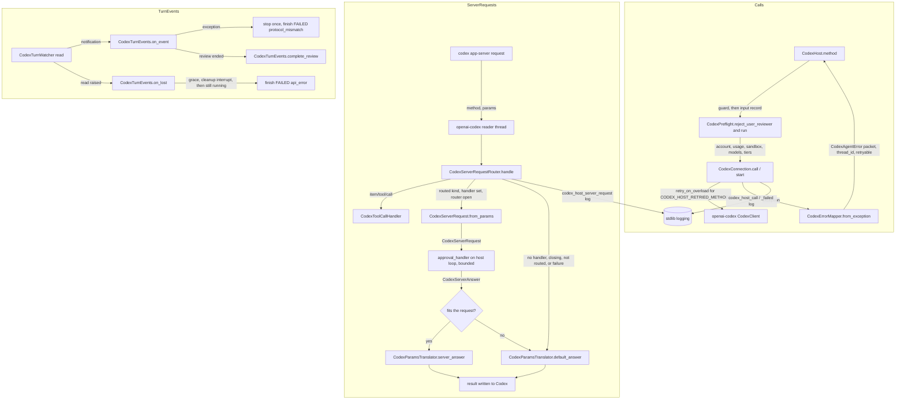

# Spec: CodexHost production hardening and missed settings (slice 1 of 2)

> **TL;DR** — This slice makes the 27 existing `CodexHost` functions, the 6 one-shot functions and the 26 tools ready for production. It is stacked on the user's open PR #1178, which already applied the user's #1055 review: every fixed value in lib constants (lint C021), every error in the lib packet shape, and every input on a validated record. This slice follows those conventions for every line it adds.
>
> What the slice adds:
> - **Errors.** Every error says whether retrying the same call can help (`retryable`).
> - **Logging.** Every call and every server request is logged without private data.
> - **Turns and tools.** No turn can be left `RUNNING` forever, ended turns can be released with `forget_codex_turns`, and tools never raise.
> - **Approvals.** They stop being auto-accepted. A developer passes `CodexHost(approval_handler=...)` to answer command, file-change and user-input requests in code. Without a handler, every request gets a fail-closed answer.
> - **Settings.** The Codex 0.163.0 settings the functions missed (S1–S3, S6–S10).
>
> **The decision that matters most:** the handler is an async function given once, when the host is built. It runs on the host's own loop behind the same bounded bridge that dynamic tools use. Any failure in it, and any request that arrives once close has begun, falls back to the fail-closed answer for that request. A `USER` reviewer is refused, before any request, only on a host that has no handler.

## §0 User prompts

### 0.1 Invoking request (verbatim)
````
great, I am going to merge pr #1055 into the repo,  before you kick off what I am about to say can you make sure to wait that pr #1055 is merged into main. then I want you to create the codex functions that you thought about. Also, the comments that you left on pr #1044, i dont think  that they were clear about what to change/add to the claude code commands, I wanted the same 'first class claude code features" that you added for codex in the list above, using all of claude code's built in skills/settings/functionalities, can you think about all of these and then add some more comments on pr #1044 (do all of this after #1055 merged, just so you are on the same page)
````

### 0.2 User replies during the run
None yet.

---

## Part A — Framing

## §1 Goal

**The bar.** The user's bar comes from Prompt 2 (request.md §D): each function should have "all layers" required to push to production, and should "exception handle everything that could potentially go wrong".

**The conventions.** The user's own #1055 review comments (request.md §B.1, D-31…D-33) set the conventions every new line follows.

**The evidence.** The audit in request.md §C.9/§C.10 found every gap below still present at `base_commit` (code-map §4, each with path:line). X1's mapper half is already fixed by #1178. X4, X5, X6/S5 and X8 were reproduced in-process.

| ID | Goal (outcome) | How we will know | Source |
|---|---|---|---|
| G-1 | Every failure is typed, attributable and recoverable. Each error names the thread it left behind (`thread_id`) and says whether the same call can succeed once the condition clears (`retryable`). A missing thread is never confused with a busy or failing server. | AC-2…AC-6, AC-24, AC-26 | request.md §C.9 X1, X4, X5, rows 11, 24, 26, 27 |
| G-2 | No turn is ever stuck `RUNNING`, no tool raises into the agent loop, and a long-lived host can release memory it no longer needs. | AC-7…AC-9, AC-16, AC-17 | §C.9 X3, X7, X8, row 9 |
| G-3 | Approval and user-input requests are answered by the developer's code or refused safely, never silently approved. Every server request whose schema defines a refusal gets an answer that schema accepts. The two methods with no refusal shape get `{}` (EC-10). | AC-10…AC-15, AC-38 | §C.9 X6, §C.10 S5 and P0 "approval / user-input handler" |
| G-4 | An operator can see what the host did and why it failed, without any private data appearing in logs. | AC-18 | §C.9 X2 |
| G-5 | The existing functions accept the Codex 0.163.0 settings they missed, and still never drop a setting silently. | AC-19…AC-23, AC-25, AC-27…AC-34 | §C.9 rows 1, 3, 4–7, 15, 25, 26; §C.10 S1–S3, S6–S10 |
| G-6 | Drift between the SDK and the installed CLI is detectable without spending anything. | AC-34, AC-35 | §C.9 X9, §C.10 S10 |
| G-7 | Every line this slice adds follows the user's #1055 review conventions, so the PR does not draw those comments again. | AC-40, AC-41 | request.md §B.1 |

## §2 Objective

When this PR's slice-1 commits merge, the following will exist that does not exist today.

- **New public API.** `CodexHost(settings, *, approval_handler=...)` routes command-execution, file-change and user-input requests to an async developer callback. Six new validated records and three new enums carry those requests and their answers.
- **Fail-closed router.** Every server request gets a fixed, fail-closed answer: decline, empty answers, no permissions, or the current time. Close drops the handler before it cancels the pending calls.
- **Errors.**
  - Every `CodexAgentError` carries a `retryable` flag decided code by code.
  - Four read-only methods get the SDK's overload retry.
  - `thread/read` failures are classified correctly.
  - Wrapper errors carry the wrapper's operation in their field and in their message head.
- **Turn safety.**
  - A turn whose event handling fails, or whose watcher dies, ends `FAILED` instead of hanging.
  - `forget_codex_turns` releases a thread's ended turns.
  - Tools turn any exception into an error result.
  - A failed spawn, launch or fork leaves no tool registration behind.
- **Logging.** The connection, the router, the turn events and the tools log through stdlib loggers, with ids and codes only.
- **Per-function rows.** The per-function rows of §C.9 that call for a change are implemented. The rest are documented as accepted (§3).
- **Settings.** The settings S1–S3 and S6–S10 are added or validated, and the SDK pin moves to 0.163.
- **Smaller host module.** The review code and the turn-event handling move out of the `vidbyte.harnesses.native.codex.host` module into two new collaborator modules. The fork body moves into `CodexThreadHelpers`, beside compact and delete.

The opt-in live smoke test (X9) is written by the S2 test author against this spec.

This is **slice 1 of 2** on one branch and one PR. Slice 2 (`codex-host-first-class`, a later spec) builds the remaining P0 and P1 functions on these commits (NG-1).

## §3 Non-goals

- **NG-1 — Slice-2 functions.** These are: `update_codex_thread_settings`, plan mode (`list_codex_collaboration_modes`, `run_codex_plan`, `collaboration_mode`, which is S4), `stream_codex_turn`, `wait_codex_turns`, `list_codex_mcp_servers`, and all of P1 except `forget_codex_turns`. *Why not:* request.md says slice 2 builds them on slice 1's commits, and slice 1 closes X7 itself.
- **NG-2 — P2 items.** These are: open in app, recap, voice/realtime, hooks, feedback, marketplaces and `process/spawn`. *Why not:* request.md "Rejected alternatives" ranks them niche. Building them is Q-1 (default no).
- **NG-3 — New agent tools or new tool arguments.** The toolset stays at exactly 26 tools with today's schemas.
  - No tool or tool argument for: `approval_handler`, `forget_codex_turns`, `before_turn_id`, `defer_goal_continuation`, `limit`, `force_reload`, the service tier, the network and writable-root fields, or the review caps.
  - The only tool change is X8.
  - *Why not:* request.md "Key decisions": tools must never let a model widen approvals or the sandbox, and the service tier stays developer-only. Exposing the rest is Q-9 and Q-10 (default no).
- **NG-4 — Routing permission requests and MCP elicitations to the handler.** Both get fixed, schema-valid refusals. *Why not:* the P0 item is "an approval / user-input handler". A permission grant would need a mapping from requested to granted profile that the conversation never specified. Routing them is Q-4 and Q-5 (default no).
- **NG-5 — A stored-turn fallback for `get_codex_turn_result` after a restart (row 10).** *Why not:* a handle belongs to the host that started its turn (codex-host INV-23). `list_codex_turns` already reads stored turns.
- **NG-6 — An "interrupt and wait for confirmation" option (row 12).** *Why not:* `wait_codex_turn(handle)` after `interrupt_codex_turn` already confirms the interrupt, and the tool output already says so.
- **NG-7 — Stored or past usage, and Codex's own subagent spend, in `track_codex_thread_usage` (row 13).** *Why not:* there is no usage-history method in this slice's scope. Subagent spend is unverified (A-8).
- **NG-8 — Concurrent `launch_codex_subagents` or a default fan-out cap (row 14).** *Why not:* serial starts keep cleanup ordered (codex-host INV-37). The existing `limit` is the cap. A default cap is Q-11 (default no).
- **NG-9 — Model, effort or tier for reviews (part of S7).** *Why not:* `ReviewStartParams` in the 0.163.0 schema has only `threadId`, `target` and `delivery` (code-map §4.5). Only Vidbyte-side caps can be added (FR-24).
- **NG-10 — Content search (rows 16–18 match titles only).** *Why not:* the `searchTerm` schema text says it filters titles. Content search is P1 `search_codex_thread_content` (slice 2).
- **NG-11 — Waiting for or confirming a compaction (row 21).** *Why not:* thread-helpers EC-41 and Q-16 stand.
- **NG-12 — An archive alternative and a dangling-child check for delete (row 22).** *Why not:* archive is P1 (slice 2). A missing parent already ends a lineage walk (INV-5).
- **NG-13 — Images, mentions or several skills per `run_codex_skill` (row 26).** *Why not:* these are new inputs the conversation lists only as gaps. They are documented as limitations.
- **NG-14 — Named permission profiles (part of S8).** *Why not:* they are experimental-only (code-map §4.3), and no question covers them, so they stay out.
- **NG-15 — `TracerBase` spans for direct host calls (part of X2).** *Why not:* the agent runtime already opens a `tool.call` span around every tool (code-map §4.1), and logs cover direct calls. Adding a `tracer=` option is Q-12 (default no).
- **NG-16 — Changing `CodexHarnessAgent` beyond the shared effort enum and the SDK pin.** *Why not:* the `CodexHarnessAgent` test suite must keep passing (codex-host NG-5; its command is in §11). The new turn fields therefore live on `CodexSpawnRequest`, not on `CodexTurnSettings` (D-17).
- **NG-17 — Paid turns in any test, and live calls in CI.** *Why not:* request.md "Constraints". CI installs no codex extra and has manual triggers only.
- **NG-18 — A default `wait_codex_turn` timeout (row 9).** *Why not:* INV-14 removes the hang. The caller's `timeout_seconds` and the turn's own `timeout_seconds` remain the bounds.
- **NG-19 — Several folders in one `list_codex_skills` call (row 25).** *Why not:* calling once per folder already works.
- **NG-20 — Fewer preflight round trips per spawn (row 4, L10: "3–4 uncached preflight round trips run before every spawn").** *Why not:* the account and usage reads must be fresh, because sign-in and the usage allowance change between calls. The model list is already cached, and is refreshed only on a miss (D-26). The sandbox read is Windows-only. Documented on `spawn_codex_thread` (FR-36).
- **NG-21 — Redoing #1178.** Moving existing constants, rewriting existing messages, or restyling existing records is #1178's work. This slice extends #1178's modules in place and changes only the values it lists in §9.3 (D-34).

## §4 Developer usage

```python
import asyncio

from vidbyte.harnesses.native.codex import CodexHost
from vidbyte.lib.dataclasses.codex_host import CodexServerAnswer, CodexServerRequest, CodexSpawnRequest
from vidbyte.lib.enums.codex import (
    CodexApprovalDecision,
    CodexApprovalsReviewer,
    CodexCommandApprovalKind,
    CodexServerRequestKind,
)


async def answer(request: CodexServerRequest) -> CodexServerAnswer:
    # Allow `git status` as a new command; decline terminal input, every other command, file change and question.
    if (
        request.kind is CodexServerRequestKind.COMMAND_EXECUTION
        and request.approval_kind is CodexCommandApprovalKind.COMMAND
        and request.command == "git status"
    ):
        return CodexServerAnswer(decision=CodexApprovalDecision.ACCEPT)
    return CodexServerAnswer(decision=CodexApprovalDecision.DECLINE)


async def main() -> None:
    async with CodexHost(approval_handler=answer) as host:
        spawn = CodexSpawnRequest(prompt="Run git status and summarize it.", approvals_reviewer=CodexApprovalsReviewer.USER)
        handle = await host.spawn_codex_thread(spawn)
        snapshot = await host.wait_codex_turn(handle)
        print(snapshot.status.value)
        print(await host.forget_codex_turns(handle.thread_id))


asyncio.run(main())
```

Against a Codex that completes the turn, this prints `completed` and then `1`. Three things change for the developer:

- Approvals for this thread no longer bypass them. Today a `USER` reviewer is refused, and anything that still reaches the host is auto-accepted.
- A rule written for commands cannot approve input typed into a running terminal, because `approval_kind` tells the two apart.
- A long-lived host no longer keeps every finished turn until it closes.

If the spawn fails, the `CodexAgentError` carries `thread_id` (when a thread was created) and `retryable`. The caller can find the thread, or decide whether to retry the same call.

## §5 Flow diagram



**How a call flows.** A host method passes its guard and builds its input record (#1178). For a call that can send work to Codex, it then runs the local reviewer check. Next it runs `CodexPreflight.run` and sends each call through `CodexConnection.call` or `CodexConnection.start`. That is the one bounded choke point:

- it retries the four read-only methods on overload;
- it logs one record per call;
- it maps any failure to a packet-shaped `CodexAgentError` that carries the thread id.

**How a server request flows.** Each server request arrives on openai-codex's single reader thread, and the router answers it exactly once.

- A routed request goes to the developer's handler on the host loop, within the tool-call bound.
- If that path fails for any reason, or the router has closed, the router writes the fixed default answer for the method.

**How a turn ends.** A turn can now end in two more ways:

- One of its events fails to process. The host sends one interrupt and ends the turn `FAILED` with `codex.protocol_mismatch`.
- Its watcher's read fails. After a short grace, the host sends one cleanup interrupt and ends the turn `FAILED` with `codex.api_error`. A close or a process death that happens first wins instead.

---

## Part B — Behavior

## §6 Behavior

### 6.1 Invariants

**Errors (X1, X4, X5, row 11)**

- **INV-1** — **An error names the thread it left behind.**
  - Every `CodexAgentError` the host raises about a thread that exists carries the id twice:
    - in `thread_id`;
    - in the packet sentence `The thread id was <id>.`, built by `CodexErrorMapper.error`.
  - #1178 already does this for the mapper and the launch re-raise. This slice keeps it for every error path it adds, and checks it as a regression.
  - The rest of X1 is the orphan cleanup in INV-26 and INV-28.
- **INV-2** — **`retryable` says whether the same call can succeed unchanged.**
  - `CodexAgentError.retryable` is a read-only property. It is `True` exactly when `failure_code` is in `CODEX_HOST_RETRYABLE_CODES`: `codex.api_error`, `codex.session_busy`, `codex.usage_limited`, `codex.thread_resume_failed` and `codex.response_invalid`. It is `False` for every other code.
  - Three codes are excluded although `CODEX_FAILURE_CLASSIFICATION` calls them TRANSIENT:
    - `codex.fork_failed`, because the fork point is refused deterministically;
    - `codex.process_exited`, because only a new host can succeed;
    - `codex.turn_timed_out`, because only a changed `timeout_seconds` can succeed.
  - The flag is derived from `failure_code`, so it survives every re-raise that keeps the code. It never appears in `details`.
  - It means "the same call on the same host, unchanged, can succeed once the condition clears". It does not mean "the call had no effect": a spending call that failed may still have started a thread (see `thread_id`).
- **INV-3** — **Only idempotent reads are retried.**
  - The typed calls in `CODEX_HOST_RETRIED_METHODS` run through openai-codex's `retry_on_overload` with its default policy. These are `account/read`, `thread/read`, `thread/list` and `thread/name/set`. The existing bound of `CodexConnection.call` covers the whole retry loop.
  - These are sent exactly once:
    - every other typed call: `initialize`, `thread/start`, `thread/resume`, `thread/fork`, `thread/compact/start`, `turn/start`, `turn/steer`, `turn/interrupt`, and the goal start and cancel;
    - every method in `CODEX_HOST_SPENDING_RAW_METHODS`.
  - Non-spending raw calls keep `request_with_retry_on_overload`, unchanged.
- **INV-4** — **How `thread/read` errors are classified.**
  - A JSON-RPC `InvalidRequest` (-32600) or `InvalidParams` (-32602) error on `thread/read` means `codex.session_not_found`.
  - Every other JSON-RPC error on `thread/read` follows the general rule. Method-not-found and parse errors are `codex.protocol_mismatch`. Overload after the retries, internal errors and any other errors are `codex.api_error`.
  - Timeouts stay `codex.api_error`, and a dead process stays `codex.process_exited`.
  - This supersedes:
    - the `thread/read` clause of codex-host D-13;
    - the last bullet of thread-helpers INV-16;
    - the refusal clause of thread-helpers EC-14.
- **INV-5** — **Lineage stops only at a missing parent.** A parent read that raises `codex.session_not_found` ends the walk, as today. Any other failure propagates, including an overload that persists after the retries.
- **INV-6** — **A turn being stopped cannot be steered.**
  - `steer_codex_turn` on a turn whose stop is in flight (`stop_pending`) raises `codex.session_not_found` with `CODEX_HOST_STEER_STOPPING_MESSAGE`, and sends nothing.
  - A `turn/steer` that Codex refuses with `InvalidRequest` (-32600) maps to `codex.session_not_found`, because the turn ended between the check and the steer. Any other steer error keeps the general rule.

**Observability (X2)**

- **INV-7** — **Every call is logged once.**
  - Each call that `CodexConnection.call` or `CodexConnection.start` sends to Codex emits exactly one record on the connection module's logger. That includes a call whose caller was cancelled after it was sent:
    - a success logs DEBUG `codex_host_call operation=%s method=%s thread_id=%s duration_ms=%d`;
    - a failure logs WARNING `codex_host_call_failed operation=%s method=%s thread_id=%s failure_code=%s error_type=%s origin=%s duration_ms=%d`.
  - `origin` is `ExceptionOrigin.describe(exc)`: the innermost traceback frame as `file.py:function:line`, or `""` when there is none. `describe` replaces each run of whitespace in the frame's file basename and function name with `_`, so the origin is always one space-free token: a frame in `my script.py` at line 1 of `<module>` gives `my_script.py:<module>:1`, and a frozen stdlib frame such as `<frozen os>` becomes `<frozen_os>` (S5 R-12). Origins do not go through `LogToken.of`, which would rewrite `<module>` and cut long values; they become one token through `describe` itself.
  - **A cancelled caller (S4 R-10).** The record waits for the call's outcome, not for its caller.
    - `call` submits its work to the host's executor and waits on `asyncio.wrap_future`, as `start` does. When its caller is cancelled after the work began, a done-callback on the worker's future writes the record once the worker returns: DEBUG on success, or the WARNING for the error the outcome maps to.
    - A spending `start` that is handed over because its caller was cancelled passes its operation, method and start time to the hand-over. The hand-over registers the record's own done-callback before `_post_late`'s. Done-callbacks run in the order they were registered, so the record exists before the late outcome is posted back to the loop: DEBUG when Codex accepted the start, or the mapped WARNING when it failed. `_post_late` only posts. Folding the record into `_post_late` would make a three-deep call chain (AGENTS.md §1).
    - Both callbacks write the record themselves, before any post to the loop, so a loop that has already closed cannot drop it. A future withdrawn while still queued writes nothing (EC-57). Neither callback raises.
    - A call or start whose bound ran out has already written its timeout WARNING, so its late outcome writes no second record.
    - `duration_ms` runs from the send to the outcome.
  - **Accepted limitation: a call refused before it is sent writes no record** (EC-57). This covers three cases:
    - a call refused by `CodexHost._guard` (a closed host or the wrong loop);
    - a call or start refused by the connection's closing or dead check;
    - a queued call or start withdrawn before its worker ran.
    - The reason: nothing reached Codex, so no app-server call took place to log (FR-3 counts app-server calls), and the refusal or the cancellation is raised to the caller, who sees it directly.
- **INV-8** — **Every server request is logged once.**
  - Each server request the router answers emits one INFO `codex_host_server_request method=%s thread_id=%s turn_id=%s item_id=%s handled_by=%s answer=%s`.
  - `handled_by` is `handler`, `default` or `tool`. It names whose answer was sent: `handler` only when the handler's own answer was sent, and `default` whenever the default answer was sent, including after any fallback. The tests accept either value after a handler failure, and they pin `answer`.
  - `answer` is a short label of what was sent: the decision value, `answers`, `no_permissions`, `current_time`, `empty`, `success` or `failure`.
  - When a routed request falls back to its default, the router also emits one WARNING `codex_host_server_request_fallback method=%s thread_id=%s reason=%s error_type=%s origin=%s`. `reason` is one of `parse_failed`, `handler_failed`, `handler_timed_out`, `answer_invalid` or `closing`.
    - **`closing`.** A request that arrives once `cancel_pending` has run gets `closing`, and so does a pending handler call that `cancel_pending` cancels. Any other cancellation of the handler is `handler_failed`. The tests assert only the late request's reason.
    - **Who writes it.** Only a router built with a handler writes this WARNING. On a host built without one, the default answer is the designed answer, not a fallback, so that host writes no fallback WARNING. The same holds for never-routed methods.
- **INV-9** — **Turn items and turn ends are logged.**
  - Each `item/completed` a live turn observes emits DEBUG `codex_host_turn_item thread_id=%s turn_id=%s item_id=%s item_type=%s`.
  - The first `CodexTurnRegistry.finish` of a turn emits INFO `codex_host_turn_ended thread_id=%s turn_id=%s status=%s failure_code=%s`. `status` is the snapshot's `CodexTurnStatus` value, the wire string: `completed`, `interrupted` or `failed`. `failure_code` is the problem's code value, such as `codex.process_exited`, or `""` when there is no problem.
- **INV-10** — **Logs carry no private data.**
  - Every logger is `logging.getLogger(__name__)`.
  - Messages are %-style with arguments, never f-strings, and never contain exception text.
  - **The record shape the tests read.**
    - A record's `msg` is the literal format string, and its first word is the event name.
    - The remaining words are `key=%s` or `key=%d` tokens, separated by single spaces.
    - Each value renders as one token with no spaces. That holds for ids, codes, labels, type names and `file.py:function:line`.
    - **One token, even from a hostile peer (S4 R-9).** Codex chooses the ids it sends and a caller chooses the ids it passes, so neither is trusted to be one token. Each such value goes through `LogToken.of(value, CODEX_HOST_LOG_TOKEN_MAX_CHARS)` from `vidbyte.lib.util.text`, at the logging call. That covers:
      - the server request's `method`, `thread_id`, `turn_id` and `item_id` in `codex_host_server_request` and `codex_host_server_request_fallback`;
      - `thread_id` in `codex_host_call` and `codex_host_call_failed`;
      - `thread_id`, `turn_id`, `item_id` and `item_type` in `codex_host_turn_item`;
      - the handle's `thread_id` and `turn_id` in `codex_host_turn_ended`, `codex_host_turn_lost` and `codex_host_turn_event_failed`, because `CodexTurnHandle` checks only that they are non-empty text.
    - Only the log argument changes. Routing, answers, errors and every other use keep the raw value.
    - Values the host makes itself need not pass through it: the operation, the INV-7 method constants, failure codes, `handled_by`, answer labels, reasons, statuses, type names, origins and the tool name. An origin is one token through `ExceptionOrigin.describe` itself (INV-7, S5 R-12).
    - **`LogToken.of(value: str, limit: int) -> str`** applies two rules, in order:
      1. Each character outside the ASCII set `A`–`Z`, `a`–`z`, `0`–`9`, `_`, `.`, `:`, `/` and `-` becomes `_`. That covers every space, tab, carriage return, newline, `=`, `%`, quote and non-ASCII character.
      2. When the result is longer than `limit`, it keeps the first `limit` characters and appends `...`. A token is therefore at most `limit + 3` characters.
    - **What it leaves alone.** `""` stays `""`, which renders as `key=`. A value made only of those characters, and no longer than `limit`, comes back unchanged, so every normal id, method and item type logs as before. It never raises on a `str`, and applying it twice with the same `limit` gives the same token.
    - **Example.** `LogToken.of("item-1 handled_by=handler answer=accept\ncodex_host_server_request", 128)` returns `item-1_handled_by_handler_answer_accept_codex_host_server_request`. `LogToken.of("a" * 200, 128)` returns 128 `a` characters followed by `...`.
    - An empty value renders as `key=`, which the tests read as `""`.
    - No record uses `exc_info` or `stack_info`.
  - No record carries any of these:
    - the account email, any prompt or input text, command text, a cwd, a reason, a question or an answer;
    - tool arguments or output, model output, stderr, environment values, or anything read from the Codex home folder.
  - **No other logger carries a failure's text either (S5 R-11).** No record from the `asyncio` or `concurrent.futures` loggers ever carries the text of a call's or start's failure. That covers asyncio's "Future exception was never retrieved" for a call or start that was handed over on cancel or timeout, and the callback error that `concurrent.futures` writes for one whose loop has already closed (EC-58). `start` awaits its worker future the way `call` does, with no `asyncio.shield`, so cancelling the caller, or running out the bound, cancels the asyncio wrapper too, and the late outcome is never stored on a future that nothing reads. The host's own callbacks read it from the worker's future.
  - Logging never changes behaviour.

**Turn liveness (X3)**

- **INV-11** — **A failing event never leaves a turn running.**
  - If `CodexTurnEvents.on_event` raises `Exception` while handling one of a running turn's notifications, it does four things in order:
    1. logs WARNING `codex_host_turn_event_failed thread_id=%s turn_id=%s error_type=%s origin=%s`;
    2. calls `turn.stop(connection, None)`, which sends at most one quiet interrupt;
    3. finishes the turn `FAILED` with `codex.protocol_mismatch` and `CODEX_HOST_EVENT_FAILED_MESSAGE`;
    4. closes a goal run's stream.
  - Later notifications for that turn change nothing (codex-host INV-15).
- **INV-12** — **A failing review completion never leaves a review running.**
  - `CodexTurnEvents.complete_review` already tolerates a `CodexAgentError` from its read-back. If it raises anything else, the review turn ends `FAILED` with `codex.protocol_mismatch` and `CODEX_HOST_EVENT_FAILED_MESSAGE`, and the failure is logged as in INV-11.
  - Cancellation propagates.
- **INV-13** — **A lost watcher never leaves a turn running.**
  - When a `CodexTurnWatcher` read raises, the watcher posts `on_lost` to the loop. A `RuntimeError` from a closed loop is suppressed.
  - `CodexTurnEvents.on_lost` then runs `_end_lost_turn`:
    1. **(a)** If the turn already has a snapshot, or the connection is stopped (closing or dead), it does nothing. This check runs first, with no wait. It is the normal path for every goal run: a goal run's watcher read always ends by raising (openai-codex queues `_GoalStreamClosed`, an `Exception`), and that happens only after the host has finished the turn, because the host finishes a goal run before it closes the goal stream.
    2. **(b)** It waits `CODEX_HOST_LOST_TURN_GRACE_SECONDS`, so a process death has time to reach the liveness monitor. Then it checks (a) again.
    3. **(c)** Unless a stop was already sent, it marks the stop sent and awaits one quiet cleanup interrupt (`CodexConnection.interrupt(..., cleanup=True, quiet=True)`, bounded by `CODEX_HOST_CLOSE_INTERRUPT_SECONDS`).
    4. **(d)** If the turn still has no snapshot and the connection is still not stopped, it does three things: it logs WARNING `codex_host_turn_lost thread_id=%s turn_id=%s`, finishes the turn `FAILED` with `codex.api_error` and `CODEX_HOST_LOST_EVENTS_MESSAGE`, and closes a goal run's stream.
  - The WARNING is written only in step (d), so an ordinary death, and an ordinary goal-run end, never log it.
  - Every path that ends a goal run finishes the turn before it closes the goal stream: the existing completion, close, death and stopped-at-start paths of the host module today and the new INV-11 and INV-13 step (d) paths. So step (a) always sees the snapshot, and that order must be kept.
  - A close or a death that lands before (d) wins, and the turn ends `codex.process_exited` as today.
- **INV-14** — **Waiting always ends.** `wait_codex_turn(handle)` with no timeout returns for every turn the host registered, once any of these happens:
  - Codex reports the turn's end;
  - the host closes, or the process dies;
  - an event fails (INV-11, INV-12);
  - the watcher is lost (INV-13).

**Server requests (X6, S5)**

- **INV-15** — **Every server request gets one answer, and the router never raises.** `CodexServerRequestRouter.handle` returns exactly one answer per request:

  | Method | Handler set, router open, kind routed | Otherwise (the default, from `CODEX_HOST_SERVER_REQUEST_DEFAULT_ANSWERS`) |
  |---|---|---|
  | `item/commandExecution/requestApproval` | `{"decision": <CodexApprovalDecision value>}` | `{"decision": "decline"}` |
  | `item/fileChange/requestApproval` | `{"decision": <value>}` | `{"decision": "decline"}` |
  | `item/tool/requestUserInput` | ACCEPT: `{"answers": {<question_id>: {"answers": [<str>, ...]}}}`; DECLINE or CANCEL: `{"answers": {}}` | `{"answers": {}}` |
  | `item/permissions/requestApproval` | never routed | `{"permissions": {}}` |
  | `mcpServer/elicitation/request` | never routed | `{"action": "decline"}` |
  | `applyPatchApproval`, `execCommandApproval` | never routed | `{"decision": "denied"}` |
  | `currentTime/read` | never routed | `{"currentTimeAt": <int(time.time())>}` |
  | `item/tool/call` | unchanged: the thread's `CodexToolCallHandler`, else the unregistered-tool answer | — |
  | any other method (`account/chatgptAuthTokens/refresh`, `attestation/generate`, unknown) | never routed | `{}` (EC-10) |

  Each answer is a fresh object, never the shared constant.
- **INV-16** — **Without a handler, every routed request is refused.** On a host built without `approval_handler`, command and file-change approvals are declined, and user-input requests get empty answers. This supersedes the accept fallback of codex-host INV-28 and D-16.
- **INV-17** — **How a routed request reaches the handler, and how it falls back.**
  - **Routing.** The router holds the handler, a `_closed` flag and a set of pending futures, all guarded by one lock. For a request whose method is a `CodexServerRequestKind` value, it takes the lock and checks the flag and the handler.
    - If the router is closed, or has no handler, the default answer is sent and the handler is never called.
    - Otherwise it parses the request with `CodexServerRequest.from_params(kind, params)`. Then, still holding the lock, it schedules the handler on the host's loop with `asyncio.run_coroutine_threadsafe` and adds the future to the pending set.
  - **Waiting.** The reader thread waits at most `CODEX_TOOL_CALL_TIMEOUT_SECONDS`, read from the connection module at call time. One `try` spans parsing, scheduling and waiting. A single `finally` removes the future from the pending set and cancels it, or closes a coroutine that was never scheduled.
  - **The lock's span.** The lock covers only the closed and handler check, the parse, the scheduling and the add, and it is released before `future.result()`. The lock is never held while waiting, because `cancel_pending` takes it on the loop thread that the handler itself needs. The `finally` takes the lock again to discard the future.
  - **Fallback.** The default answer for the method is sent instead (INV-8 fallback log) when any of these happens:
    - the parse fails;
    - the router closes, or the loop is closed;
    - the handler raises, times out or is cancelled;
    - the handler returns something other than a `CodexServerAnswer`;
    - the answer does not fit the request (INV-18).
- **INV-18** — **When an answer fits its request.** A `CodexServerAnswer` fits a `CodexServerRequest` exactly when all of these hold:
  - for `COMMAND_EXECUTION` and `FILE_CHANGE`, `answers` is empty;
  - for `USER_INPUT`, the decision is ACCEPT, DECLINE or CANCEL;
  - when `available_decisions` is not `None`, the decision is DECLINE, CANCEL or one of the listed decisions. An empty tuple therefore allows only DECLINE and CANCEL. `None` means Codex sent no list, so any decision valid for the kind fits;
  - every `question_id` in `answers` names one of the request's questions.
- **INV-19** — **The handler is checked when the host is built.**
  - `CodexHost.__init__` builds `CodexHostSetup(settings, approval_handler)` first, before anything starts.
  - `settings` must be `None` or a `CodexClientSettings`.
  - `approval_handler` must be `None`, or a callable for which `inspect.iscoroutinefunction` is true of it or of its `__call__`.
  - Anything else raises `ConfigurationError` with `details["field"]`. The handler refusal uses `CODEX_HOST_APPROVAL_HANDLER_MESSAGE`.
- **INV-20** — **A `USER` reviewer is refused only where nothing can answer it, and before any request.**
  - `CodexSpawnRequest(approvals_reviewer=USER)` constructs.
  - `CodexPreflight.reject_user_reviewer(operation, request)` is local and sends nothing.
    - On a host without a handler, it refuses a request whose `approvals_reviewer` is `USER`.
    - The refusal is a packet-shaped `CodexAgentError` with `configuration.unsupported_combination`, the calling function's own operation, `CODEX_HOST_USER_REVIEWER_MESSAGE` and the next step `CODEX_HOST_USER_REVIEWER_TEXT`.
  - It runs before each operation's first request:
    - as step 0 of `CodexPreflight.run`, which covers spawn, continue and launch;
    - in fork, right after the input record and its experimental gate (INV-28 step 2);
    - in `run_codex_goal`, `run_codex_skill` and `run_codex_openai_docs`, right after their records and before the skill listing.
  - Codex reports a thread's reviewer after `thread/start` and `thread/resume` (codex-host D-32). That check now refuses only on a host without a handler. With a handler, the thread proceeds and its approvals reach the handler.
- **INV-21** — **Close stops the handler before anything else.**
  - At close, and when the process dies, `_end_running_turns` calls `router.cancel_pending()` first, alongside the existing tool-handler cancellation (codex-host INV-7 step 1).
  - Under the router's lock, `cancel_pending()` does three things: it sets `_closed`, drops the handler, and cancels every future in a snapshot of the pending set (`tuple(self._pending)`). It never iterates the live set, because a cancelled request's `finally` discards from it.
  - Every routed request that arrives after that point gets its default answer without the handler being called. That includes requests for turns still waiting for their cleanup interrupt.
  - No handler coroutine outlives the host.

**Retention (X7)**

- **INV-22** — **`forget_codex_turns` releases a thread's ended turns.**
  - `forget_codex_turns(thread_id)` is local only (`_guard(talks=False)`) and sends nothing to Codex.
  - It builds `CodexThreadRef(operation=FORGET_CODEX_TURNS, thread_id=thread_id)` right after the guard. A bad id is refused with `ConfigurationError` naming `forget_codex_turns thread_id`.
  - A thread that is busy (a running or reserved turn, or a start in flight) is refused with `codex.session_busy` through `require_idle`, and nothing is dropped.
  - Otherwise it drops every turn the host registered on the thread, plus the thread's usage ledger and tracker, and returns how many turns it dropped. An unknown thread returns 0.
  - Afterwards:
    - each dropped handle raises `codex.session_not_found` with `CODEX_HOST_UNKNOWN_HANDLE_MESSAGE`;
    - `track_codex_thread_usage(thread_id)` raises `codex.session_not_found` with `CODEX_HOST_NEVER_RAN_MESSAGE`.
  - The thread's dynamic-tool registration is kept.
  - It works on a closed host.
  - This supersedes codex-host EC-65.

**Tools (X8)**

- **INV-23** — **Tools never raise.**
  - `_CodexHostTool._run` turns any other `Exception` (not `BaseException`) into `_failure(name, "codex.api_error", CODEX_HOST_LOCAL_FAILURE_MESSAGE.format(method=<tool name>, error_type=<type name>), CODEX_NEXT_STEPS["codex.api_error"])`. `_failure` appends the next step once.
  - It also logs WARNING `codex_host_tool_failed tool=%s error_type=%s origin=%s`.
  - Cancellation propagates.
  - This completes codex-host INV-10.

**Per-function rows**

- **INV-24** — **(row 1) Readiness reports used-up usage.**
  - `check_codex_ready` reads the usage allowance through `CodexPreflight.usage_problem`, which is preflight step 2's own read.
  - When Codex reports `ordinary_usage_allowed is False`, it adds a `codex.usage_limited` problem between the sign-in problem and the sandbox problem. `None`, or a failed read, adds nothing.
  - `ready` stays exactly `not problems`.
- **INV-25** — **(row 3) An unknown model or tier triggers one fresh read.** When the preflight's cached model list does not include a model, or a tier, that the request asks for, the preflight does three things before refusing: it reads the list once more, replaces the cache, and checks again. A request whose names are all known causes no read. Only a list taken from the cache is refreshed. A list that this same check has just fetched, because nothing was cached, is not read again, so a miss on a fresh host costs one `model/list` walk.
- **INV-26** — **(row 4, X1) A failed spawn leaves no tool registration behind.**
  - `_open_thread` runs in this order: `thread/start`, then the reviewer check (skipped with a handler), then `thread/name/set`, then registering the dynamic-tool handler. A failure at any step therefore leaves no registration.
  - When the turn or goal start that follows fails, spawn and launch unregister that thread's handler.
  - The exception is a start for that thread still in flight (`CodexConnection.starting`): the registration then stays for the adopted turn.
  - The error carries the thread id (INV-1).
- **INV-27** — **(row 5) Continue checks the stored goal first.**
  - `continue_codex_thread` reads the thread's metadata first. When Codex reports it `notLoaded`, the host reads the stored goal before `thread/resume`.
  - Any goal status except `complete` is refused with `codex.goal_unfinished` and `CODEX_HOST_CONTINUE_GOAL_UNFINISHED_MESSAGE`. The refusal releases the reservation and leaves the thread `notLoaded`.
  - This is the same complete-only rule compact uses (thread-helpers INV-18, D-13).
- **INV-28** — **(row 6, S6, S9) Fork runs its checks in a fixed order.** `fork_codex_thread` builds its record, then hands it to `CodexThreadHelpers.fork`.
  1. **The record, then the experimental gate.**
     - `CodexForkRequest` checks every argument and the rejected fields. `from_turn_id` together with `before_turn_id` raises `ConfigurationError(CODEX_HOST_FORK_POINTS_MESSAGE)` with `details["field"] == "before_turn_id"`.
     - `beforeTurnId` and `deferGoalContinuation` exist only in Codex's experimental API. So on a host whose `CodexClientSettings.experimental_api` is `False`, the host refuses a non-empty `before_turn_id`, then a `True` `defer_goal_continuation`, with `ConfigurationError(CODEX_HOST_FORK_EXPERIMENTAL_MESSAGE)` and `details["field"]` naming the field. This happens before any request. It is the same local gate that `dynamicTools` gets (`CODEX_HOST_EXPERIMENTAL_API_TEXT`). Without it, Codex answers -32600 "requires experimentalApi capability", which reads as `codex.fork_failed` with the wrong next step (EC-56).
  2. **The reviewer.** `reject_user_reviewer` runs. It is local, so a refusal sends nothing (INV-20).
  3. **The thread must exist.** One metadata `thread/read`, without turns.
  4. **The model and tier check.** `CodexPreflight.run(..., spends=False)`.
  5. **The fork point.**
     - With `before_turn_id`, it is sent as given, and no `lastTurnId` is sent.
     - Otherwise the helper pages `thread/turns/list` (newest first, `itemsView` `notLoaded`) with today's rule. An empty `from_turn_id` means the latest completed turn.
     - An unknown or non-completed `from_turn_id`, or no completed turn at all, raises `codex.fork_failed` before `thread/fork`.
  6. **The fork.** `thread/fork`, with `beforeTurnId` and `deferGoalContinuation: true` added after validation when set.
  7. **The tools.** The parent's handler is registered for the fork.
  8. **The name.** `thread/name/set`. A failure here unregisters the fork's handler and raises with the fork's `thread_id`.
- **INV-29** — **(row 7) `list_codex_threads` takes a validated `limit`.**
  - `CodexThreadListRequest` gains `limit`. It must be `None` or an int from `CODEX_HOST_MIN_LIST_LIMIT` to `CODEX_HOST_THREAD_LIST_MAX_LIMIT`, with `bool` refused, and is refused with `CODEX_HOST_LIMIT_MESSAGE`.
  - A `limit` is sent when given.
  - The record already checks every other argument (#1178), and empty values are still left out.
- **INV-30** — **(row 15, S7) A review can be capped.**
  - `start_codex_review(..., request=...)` puts the request on `CodexReviewRequest`. Its `_reject_unused_fields(START_CODEX_REVIEW, request)` refuses any non-default field except `timeout_seconds` and `max_output_tokens`, before any request.
  - The review turn is tracked with that request, so the caps apply as they do to any turn (codex-host D-7).
  - `None` keeps today's uncapped review. The host substitutes `CodexSpawnRequest()` only when `request is None`, and passes any other value to the record unchanged. That is unlike the `x or CodexSpawnRequest()` idiom of the other host methods, which would turn a falsy bad value such as `{}` into the default.
- **INV-31** — **(rows 24, 26, 27) Wrapper errors carry the wrapper's operation.**
  - This covers every `CodexAgentError` escaping `run_codex_goal`, `run_codex_skill` or `run_codex_openai_docs`: the inner spawn, the skill listing and the read-back.
  - Each one carries that function's own operation in the `operation` field and in the message head `<operation> failed with <code>.`
  - Every other field is kept: code, `thread_id`, `error_type`, `method`, likely cause, next step, and the rest of the message, including any `CODEX_HOST_GOAL_UNCHECKED_SENTENCE` or `CODEX_HOST_SKILL_UNCHECKED_SENTENCE`.
  - This supersedes the "operation" element of thread-helpers INV-22 and INV-35.
- **INV-32** — **(row 25) `force_reload` is sent only when asked.** `CodexSkillListRequest` gains `force_reload: bool`. `list_codex_skills(cwd, force_reload)` sends `forceReload: true` only when it is `True`. The params are otherwise unchanged.
- **INV-33** — **(row 26) Skills resolve in the folder the turn runs in.** `run_codex_skill` and `run_codex_openai_docs` resolve the skill in `request.turn.cwd or request.thread.cwd`.

**Settings**

- **INV-34** — **(S1) A goal run refuses turn-only fields.**
  - A `CodexSpawnRequest` with a `goal` raises `ConfigurationError(CODEX_HOST_GOAL_FIELD_MESSAGE)`, with the owner `Codex spawn request goal`, for the first non-default field of `CODEX_HOST_GOAL_REJECTED_FIELDS`, when it is built. Those fields are `turn`, `output_schema`, `disabled_plugin_ids`, `turn_service_tier`, `network_access` and `writable_roots`.
  - `CodexGoalRunRequest` applies the same rule to its request, with the owner `run_codex_goal request`. So `run_codex_goal` refuses before any request, and its refusal names the method (INV-48, S4 R-7).
  - **Order against INV-37.** Inside `CodexSpawnRequest.__post_init__`, the INV-37 checks are their own group and run before the goal group, keeping the existing order of the per-group checks first and the goal rule last. A goal request that sets `network_access` with a default `turn` is therefore refused with `CODEX_HOST_NETWORK_ACCESS_MESSAGE`. Conformance needs only a `ConfigurationError` that names the field, and the tests accept either message.
  - This restores codex-host INV-27 for goal runs.
- **INV-35** — **(S2) Two more efforts.** `CodexReasoningEffort` accepts `max` and `ultra`. They are sent as those strings, through the existing `CodexContentTranslator` mapping.
- **INV-36** — **(S3) Service tiers are listed, sent and checked.**
  - `CodexModelInfo` carries `service_tiers` and `default_service_tier` from `model/list`.
  - `CodexSpawnRequest.turn_service_tier` is sent as `serviceTierForTurn` on `turn/start` when it is non-empty.
  - Preflight checks `thread.service_tier`, `turn.service_tier` and `turn_service_tier`, ignoring `""` and `CODEX_DEFAULT_SERVICE_TIER`.
    - They are checked against the tier ids of the named models, or of all listed models when none is named, after INV-25's single refresh.
    - An unlisted tier raises `codex.model_unknown` with `CODEX_HOST_UNKNOWN_TIER_MESSAGE`.
  - The check is skipped when `thread.model_provider` is set, or when the relevant models list no tiers.
- **INV-37** — **(S8) Network access and writable roots.**
  - `network_access` and `writable_roots` are checked when the `CodexSpawnRequest` is built.
    - `network_access` needs `turn.sandbox` of `READ_ONLY` or `WORKSPACE_WRITE` (`CODEX_HOST_NETWORK_ACCESS_MESSAGE`).
    - `writable_roots` needs `WORKSPACE_WRITE`, and each root must be a non-empty absolute path (`CODEX_HOST_WRITABLE_ROOTS_MESSAGE`).
  - The `{sandbox}` in `CODEX_HOST_NETWORK_ACCESS_MESSAGE` is the `CodexSandbox` member name, such as `FULL_ACCESS` or `PROVIDER_DEFAULT`, which matches the names the message already uses. The value would render `PROVIDER_DEFAULT` as an empty string. The tests accept the name or the value.
  - They are sent inside the turn's `sandbox_policy` as `networkAccess` and `writableRoots`. openai-codex's dump of the policy also carries its other keys, `excludeSlashTmp` and `excludeTmpdirEnvVar`, at their default, `false`.
  - These reject them: fork (the FORK row of `CODEX_HOST_REJECTED_FIELDS`), review (its START_CODEX_REVIEW row) and goal runs (`CODEX_HOST_GOAL_REJECTED_FIELDS`). Both fields need a non-default `turn`, and those three operations check `turn` earlier in their tables. So in practice such a request is refused naming `turn`, and the sandbox-field rows are defence in depth. The contract is a `ConfigurationError` before any request.
- **INV-38** — **(S9) Only `read_codex_thread` asks for full history.**
  - No host path sends `thread/read` with `includeTurns: true`, except `read_codex_thread(include_turns=True)`.
  - Fork uses INV-28.
  - The review registration and completion read-backs use one `thread/turns/list` page through `CodexThreadHelpers.review_turn`. The page is newest first, with `itemsView` `full` and `limit` `CODEX_HOST_REVIEW_READ_BACK_LIMIT`, and is matched by turn id.
- **INV-39** — **(S10) The SDK pin moves to 0.163.** The optional extra pins `openai-codex>=0.163.0,<0.164.0`. `CodexClientSettings.client_version` defaults to `"0.163.0"`.
- **INV-40** — **One-shots mirror the host.** The one-shot `list_codex_threads` and `fork_codex_thread` take exactly the host method's arguments, plus the keyword-only `settings`. That includes `limit`, `before_turn_id` and `defer_goal_continuation`.

**Conventions (#1178, D-31…D-33)**

- **INV-47** — **No fixed value lives in the native host.**
  - No module under `vidbyte.harnesses.native` gains a top-level UPPER_CASE binding (lint C021, baseline 0).
  - Every new table, bound, field rule and message text lives in `vidbyte.lib.constants.codex_host`. The only exception is a value change to a name that already lives in `vidbyte.lib.constants.codex`.
  - Log format strings are call-site literals (D-12).
  - Every new host error is built by `CodexErrorMapper.error` in the lib packet shape `<operation> failed with <code>. <summary> [The thread id was <id>.] Likely cause: <cause> Next step: <step>`.
- **INV-48** — **Every new or changed input is checked by a record.**
  - Every public `CodexHost` method that takes input builds its record from `vidbyte.lib.dataclasses.codex_host_inputs` right after `_guard`, before any request or reservation. `forget_codex_turns` is included.
  - The constructor builds `CodexHostSetup` first.
  - New parameters are fields on #1178's existing records, extended in place.
  - A refusal names `"<method> <field>"` and sets `details["field"]`.

**Must not regress:**
- **INV-41** — Importing `vidbyte.harnesses.native.codex` never loads openai-codex (codex-host INV-1). New SDK imports stay in modules that only `CodexHost._open` loads, or inside functions.
- **INV-42** — No private data in errors, results or tool outputs (codex-host INV-9). INV-10 extends the rule to logs.
- **INV-43** — Spending calls are sent once, and a start that outlives its caller is adopted and stopped once (codex-host INV-11, `CodexConnection.start`).
- **INV-44** — The toolset holds exactly 26 tools with today's schemas, apart from the `effort` enum gaining `max` and `ultra` through `EFFORTS`. No tool lets a model set a reviewer, approval policy, sandbox, network access, writable roots, service tier or handler.
- **INV-45** — The close and death paths end running turns `codex.process_exited`, as today (codex-host D-27; pinned by the turn-outcome test listed in §13).
- **INV-46** — `CodexHarnessAgent` behaviour is unchanged, apart from accepting the two new efforts. The `CodexHarnessAgent` test suite (§11) passes.

### 6.2 Acceptance criteria

| ID | Given | When | Then | Priority | Proof |
|---|---|---|---|---|---|
| AC-1 | a clean checkout of this branch | the §4 snippet runs against a Codex that completes the turn | it prints `completed` then `1`; the thread started with `approvalsReviewer` `user` | P0 | `tests/features/codex_host/test_codex_host_approvals.py::CodexApprovalSnippetTests` |
| AC-2 | `thread/start` succeeds and the first `turn/start` fails with a JSON-RPC error, on a spawn with dynamic tools | `spawn_codex_thread` raises | `error.thread_id` is the new thread's id and the message contains `The thread id was <id>.` (regression, #1178); a later `item/tool/call` for that thread gets the unregistered-tool answer | P0 | `tests/features/codex_host/test_codex_host_resilience.py::CodexSpawnCleanupTests::test_a_spawn_whose_turn_or_name_fails_names_the_thread_and_unregisters_its_tools`; S4 R-6 (INV-26's in-flight exception, EC-23): `tests/features/codex_host/test_codex_host_resilience.py::CodexSpawnCleanupTests::test_a_cancelled_spawn_whose_start_codex_adopts_keeps_its_tools_for_that_turn` |
| AC-3 | the third `turn/start` of a three-prompt launch fails | `launch_codex_subagents` raises | `error.thread_id` is the third thread's id (non-empty; regression, #1178); the two started turns get one interrupt each; the third thread's tool registration is gone | P0 | `tests/features/codex_host/test_codex_host_resilience.py::CodexSpawnCleanupTests::test_a_launch_whose_third_turn_fails_stops_the_two_started_turns_and_unregisters_the_third` |
| AC-4 | `account/read`, `thread/read`, `thread/list` or `thread/name/set` answers overloaded once | the calling function runs | it succeeds, with exactly two requests of that method; while `thread/start`, `thread/resume`, `thread/fork`, `thread/compact/start`, `turn/start` or `turn/steer` answering overloaded once is sent exactly once and raises `codex.api_error` with `retryable is True` | P0 | `tests/features/codex_host/test_codex_host_resilience.py::CodexOverloadRetryTests` |
| AC-5 | a `CodexAgentError` for each code in `CODEX_FAILURE_CLASSIFICATION`, plus a configuration code | `.retryable` is read | it is `True` exactly for `codex.api_error`, `codex.session_busy`, `codex.usage_limited`, `codex.thread_resume_failed` and `codex.response_invalid`; `False` for `codex.fork_failed`, `codex.process_exited`, `codex.turn_timed_out` and every other code; `"retryable"` is not a key of `details` | P0 | `tests/features/codex_host/test_codex_host_hardening_contract.py::CodexAgentErrorHardeningTests::test_retryable_is_true_exactly_for_the_five_codes_and_never_in_details` |
| AC-6 | `thread/read` answers -32603, or overloaded on every attempt | `read_codex_thread`, `continue_codex_thread`, `compact_codex_thread`, `delete_codex_thread` or `get_codex_goal` runs | it raises `codex.api_error`, not `codex.session_not_found`; -32600 and -32602 still raise `codex.session_not_found`; a lineage walk whose parent read is overloaded raises instead of ending early | P0 | `tests/features/codex_host/test_codex_host_resilience.py::CodexThreadReadFailureTests`; `tests/features/codex_host/test_codex_host_hardening_contract.py::CodexHardeningClassificationTests` |
| AC-7 | a running plain turn and a running goal run | processing one of their notifications raises | each ends `FAILED` with `codex.protocol_mismatch` and `CODEX_HOST_EVENT_FAILED_MESSAGE`; exactly one interrupt (or goal cancel) is sent; `wait_codex_turn(handle)` with no timeout returns | P0 | `tests/features/codex_host/test_codex_host_liveness.py::CodexEventFailureTests` |
| AC-8 | a running turn whose watcher read raises while the host is open and the process is alive; separately, a process death | the loop runs | the first: after the grace, one cleanup interrupt is sent and the turn ends `FAILED` with `codex.api_error` and `CODEX_HOST_LOST_EVENTS_MESSAGE`, with one `codex_host_turn_lost` WARNING. The death: the turn ends `codex.process_exited`, no `codex_host_turn_lost` record is written, and the fake records no `write_after_close`. Separately, a goal run that ends normally sends no `turn/interrupt` and no goal cancel, writes no `codex_host_turn_lost` record, and its wait returns without waiting out the grace | P0 | `tests/features/codex_host/test_codex_host_liveness.py::CodexLostWatcherTests` |
| AC-9 | a completed review whose completion read-back raises a non-Codex exception | the completion runs | the review ends `FAILED` with `codex.protocol_mismatch`; its wait returns | P0 | `tests/features/codex_host/test_codex_host_liveness.py::CodexReviewCompletionFailureTests` |
| AC-10 | a host without `approval_handler` | each method of the INV-15 table is sent as a server request | each gets exactly its "Otherwise" answer (`currentTimeAt` within 5 s of now); `item/somethingNew/request` gets `{}`; the reader thread survives | P0 | `tests/features/codex_host/test_codex_host_approvals.py::CodexDefaultAnswerTests::test_a_host_without_a_handler_answers_every_server_request_with_its_default`; `tests/features/codex_host/test_codex_host_router.py::CodexHostRouterTests::test_the_router_answers_every_server_request_and_never_raises` |
| AC-11 | a handler that returns ACCEPT, ACCEPT_FOR_SESSION, or ACCEPT with answers | a command approval (`kind` `command`), a `writeStdin` command approval, a file-change approval, and a user-input request with questions `q1` and `q2` arrive | the answers are `{"decision": "accept"}`, `{"decision": "acceptForSession"}` and `{"answers": {"q1": {"answers": ["yes"]}}}`. The handler saw, as sent: `kind`, `approval_kind` (`COMMAND`, then `WRITE_STDIN`), `approval_id`, `environment_id`, `started_at_ms`, `thread_id`, `turn_id`, `item_id`, `command`, `cwd`, `reason`, `available_decisions`, `grant_root`, `questions` and `is_blocking`. A question sent with `options: null` and no `isOther` or `isSecret` reaches the handler with `options == ()`, `is_other is False` and `is_secret is False` | P0 | `tests/features/codex_host/test_codex_host_approvals.py::CodexHandlerRoutingTests`; `tests/features/codex_host/test_codex_host_hardening_records.py::CodexServerRequestParseTests` |
| AC-12 | a handler that does any of these: raises; sleeps past the bound; returns a dict; returns a decision outside a present `available_decisions`; returns ACCEPT when `availableDecisions` holds only object decisions; returns answers on an approval; answers an unknown question id | the request arrives | the default answer for that method is sent, one fallback WARNING is logged, and the next request is still answered | P0 | `tests/features/codex_host/test_codex_host_approvals.py::CodexHandlerFallbackTests` |
| AC-13 | a sync function, a lambda, a non-callable, or `settings="x"` | passed to `CodexHost(...)` | `ConfigurationError` naming `CodexHost approval_handler` (`CODEX_HOST_APPROVAL_HANDLER_MESSAGE`) or `CodexHost settings`, with `details["field"]`; no process starts | P0 | `tests/features/codex_host/test_codex_host_hardening_contract.py::CodexHostSetupTests`; `tests/features/codex_host/test_codex_host_approvals.py::CodexHostSetupHostTests` |
| AC-14 | `CodexSpawnRequest(approvals_reviewer=USER)`, also as fork `overrides` | it is built, then used by spawn, continue, launch, fork, `run_codex_goal`, `run_codex_skill` and `run_codex_openai_docs` on a host without a handler, and by spawn on a host with one | it builds. Without a handler, each call raises `configuration.unsupported_combination` with its own operation, `CODEX_HOST_USER_REVIEWER_MESSAGE` and the new `CODEX_HOST_USER_REVIEWER_TEXT`, and sends no request at all. With a handler, the spawn sends `approvalsReviewer: "user"` and returns a handle | P0 | `tests/features/codex_host/test_codex_host_approvals.py::CodexUserReviewerTests`; `tests/features/codex_host/test_codex_host_records.py::CodexHostRecordValidationTests::test_user_reviewer_is_refused_when_any_spawn_request_is_built`; `tests/features/codex_host/test_codex_host_tool_hardening.py::CodexToolUserReviewerTests` |
| AC-15 | a host with a handler | `item/permissions/requestApproval`, `mcpServer/elicitation/request` and `execCommandApproval` arrive | the handler is never called, and the fixed answers are sent | P0 | `tests/features/codex_host/test_codex_host_approvals.py::CodexDefaultAnswerTests::test_a_host_with_a_handler_never_routes_the_fixed_methods` |
| AC-16 | an idle thread with two ended turns, and a thread with a running turn | `forget_codex_turns` is called on each, then on an unknown id, then with `""` | it returns 2; the two old handles raise `codex.session_not_found`; usage tracking raises `codex.session_not_found`; the busy thread raises `codex.session_busy` and keeps its turns; the unknown id returns 0; `""` raises `ConfigurationError` naming `forget_codex_turns thread_id`; no request is sent | P0 | `tests/features/codex_host/test_codex_host_function_rows.py::CodexForgetTurnsTests`; `tests/features/codex_host/test_codex_host_inputs.py::CodexHostInputBoundaryTests::test_every_public_method_refuses_a_bad_argument_before_any_request` |
| AC-17 | a host method that raises `RuntimeError` or `KeyError` under a tool | the tool executes | it returns an error result `codex.api_error: <tool> failed with RuntimeError. Next step: …` with code metadata, the next step stated once, and logs one WARNING; a `CancelledError` propagates | P0 | `tests/features/codex_host/test_codex_host_tool_hardening.py::CodexToolLocalFailureTests` |
| AC-18 | logging captured at DEBUG for the package and the tools, with the privacy canaries of codex-host INV-9 seeded | a spawn, a failed call, a server request and a tool failure run | each event in INV-7 to INV-9 and INV-23 appears with its fields; no record contains a canary, a prompt, command text or any exception message | P0 | `tests/features/codex_host/test_codex_host_observability.py::CodexObservabilityTests`; S4 R-4, R-9 and R-10 (INV-7, INV-10, EC-57): `tests/features/codex_host/test_codex_host_observability.py::CodexLogTokenRecordTests`, `tests/features/codex_host/test_codex_host_observability.py::CodexCallRecordTests`, `tests/features/codex_host/test_codex_host_hardening_contract.py::CodexLogTokenTests`; S5 R-11 and R-12 (INV-7, INV-10, EC-58): the R-11 rows of `CodexCallRecordTests` and the R-12 rows of `CodexLogTokenRecordTests` above, and `tests/features/codex_host/test_codex_host_hardening_contract.py::CodexExceptionOriginTests` |
| AC-19 | `ordinary_usage_allowed` is `False` | `check_codex_ready` runs | `ready is False` and the problems are `[codex.usage_limited]`, ordered sign-in, usage, sandbox when several apply; `None` or a failed read adds none | P0 | `tests/features/codex_host/test_codex_host_function_rows.py::CodexReadinessUsageTests` |
| AC-20 | the preflight cached a model list, and Codex then adds a model | a spawn names the new model, and another names a model that is still missing | the first passes after exactly one extra `model/list` walk; the second raises `codex.model_unknown` after exactly one refresh. On a fresh host with nothing cached, a spawn naming a missing model raises `codex.model_unknown` after exactly one `model/list` walk | P1 | `tests/features/codex_host/test_codex_host_function_rows.py::CodexModelRefreshTests` |
| AC-21 | a `notLoaded` thread whose stored goal is `active`, one with a `complete` goal, and one with none | `continue_codex_thread` runs on each | the first raises `codex.goal_unfinished` (`CODEX_HOST_CONTINUE_GOAL_UNFINISHED_MESSAGE`) after exactly `thread/read` and `thread/goal/get` on it, leaves it `notLoaded` and frees it; the others resume and start a turn | P0 | `tests/features/codex_host/test_codex_host_function_rows.py::CodexContinueGoalGuardTests` |
| AC-22 | a thread with completed turns | fork runs with `before_turn_id`; with both points; with `defer_goal_continuation=True`; with an unknown override model; and with a failing name set | no `thread/read` sends `includeTurns: true` (openai-codex's typed `thread_read` always sends the key, as `false`). `beforeTurnId` is sent with no `lastTurnId`. Both points raise `ConfigurationError` naming `before_turn_id` before any request. `deferGoalContinuation: true` is sent. The unknown model raises `codex.model_unknown` before `thread/fork`. The name-set failure raises with the fork's `thread_id`, and the fork's handler is gone. On a host built with `CodexClientSettings(experimental_api=False)`, `before_turn_id` and `defer_goal_continuation=True` each raise `ConfigurationError` naming the field (`CODEX_HOST_FORK_EXPERIMENTAL_MESSAGE`), and no request is sent at all | P0 | `tests/features/codex_host/test_codex_host_fork_review.py::CodexForkHardeningTests`; `tests/features/codex_host/test_codex_host_hardening_contract.py::CodexHardeningInputRecordTests::test_fork_takes_one_fork_point_and_refuses_both`; `tests/features/codex_host/test_codex_host_threads.py::CodexHostLaunchAndForkTests::test_fork_reads_the_turns_first_and_forks_through_a_completed_turn` |
| AC-23 | `list_codex_threads(limit=5)` and bad limits (`0`, `1001`, `True`, `"5"`) | each is called, on the host and the one-shot | `limit: 5` is sent; each bad call raises `ConfigurationError` naming `list_codex_threads limit` before any request | P1 | `tests/features/codex_host/test_codex_host_function_rows.py::CodexListingArgumentTests::test_the_host_sends_a_limit_and_refuses_a_bad_one_before_any_request`; `tests/features/codex_host/test_codex_host_function_rows.py::CodexListingArgumentTests::test_the_one_shot_mirrors_the_limit`; `tests/features/codex_host/test_codex_host_hardening_contract.py::CodexHardeningInputRecordTests::test_the_thread_list_limit_is_none_or_an_int_in_range` |
| AC-24 | a turn whose user interrupt is in flight; separately, a `turn/steer` answered -32600 | `steer_codex_turn` runs | the first raises `codex.session_not_found` (`CODEX_HOST_STEER_STOPPING_MESSAGE`) and sends nothing; the second raises `codex.session_not_found` | P1 | `tests/features/codex_host/test_codex_host_resilience.py::CodexSteerStoppingTests` |
| AC-25 | `start_codex_review(..., request=CodexSpawnRequest(timeout_seconds=1.0))`, and one with `turn=CodexTurnSettings(model="x")` | each runs | the first review turn gets one interrupt after 1 s and is labelled `codex.turn_timed_out` if Codex reports it interrupted; the second raises `ConfigurationError` naming `turn` before any request | P1 | `tests/features/codex_host/test_codex_host_fork_review.py::CodexReviewRequestTests::test_a_review_with_a_time_cap_is_interrupted_once_and_labelled_timed_out`; `tests/features/codex_host/test_codex_host_fork_review.py::CodexReviewRequestTests::test_a_review_request_with_a_turn_is_refused_before_any_request`; `tests/features/codex_host/test_codex_host_hardening_contract.py::CodexHardeningInputRecordTests::test_a_review_request_takes_only_time_and_token_caps` |
| AC-26 | a spawn failure, a goal read-back failure, a skill read-back failure and a skill-listing failure inside the wrappers | `run_codex_goal`, `run_codex_skill` and `run_codex_openai_docs` raise | `error.operation` is the wrapper's own operation, and the message starts `<wrapper> failed with <code>.`; code, `thread_id`, `error_type`, `method`, next step and the message tail (including the unchecked sentence) are unchanged | P1 | `tests/features/codex_host/test_codex_host_resilience.py::CodexWrapperOperationTests`; `tests/features/codex_host/test_codex_host_goal_skills.py::CodexRunReRaiseTests`; `tests/features/codex_host/test_codex_host_goal_skills.py::CodexRunGoalTests::test_a_goal_check_that_fails_cancels_the_run_and_keeps_its_error`; `tests/features/codex_host/test_codex_host_goal_skills.py::CodexSkillReadBackTests::test_a_read_back_that_fails_interrupts_once_and_keeps_its_error`; `tests/features/codex_host/test_codex_host_helper_lifecycle.py::CodexHelperProtocolTests::test_a_missing_method_is_protocol_mismatch_with_the_functions_own_operation`; `tests/features/codex_host/test_codex_host_hardening_contract.py::CodexAgentErrorHardeningTests::test_with_operation_changes_the_operation_and_message_and_keeps_the_rest`; `tests/features/codex_host/test_codex_host_hardening_contract.py::CodexAgentErrorHardeningTests::test_relabel_rewrites_the_head_and_returns_an_error_already_carrying_the_operation` |
| AC-27 | `list_codex_skills("C:/w", force_reload=True)` and `list_codex_skills("C:/w")` | each runs | the params are `{"cwds": ["C:/w"], "forceReload": true}` and `{"cwds": ["C:/w"]}` | P1 | `tests/features/codex_host/test_codex_host_function_rows.py::CodexListingArgumentTests::test_force_reload_is_sent_only_when_asked`; `tests/features/codex_host/test_codex_host_hardening_contract.py::CodexHardeningInputRecordTests::test_skill_listing_takes_a_bool_force_reload`; `tests/features/codex_host/test_codex_host_helper_surface.py::CodexHelperHostSignatureTests::test_each_method_has_its_section_8_5_signature` |
| AC-28 | `run_codex_skill` with `turn.cwd` A and `thread.cwd` B | it runs | `skills/list` is sent for A | P1 | `tests/features/codex_host/test_codex_host_function_rows.py::CodexSkillFolderTests` |
| AC-29 | a request with a goal and a non-default `turn`, `output_schema`, `disabled_plugin_ids`, `turn_service_tier`, `network_access` or `writable_roots` | it is built, or `run_codex_goal` runs with it | `ConfigurationError` naming the field, before any request; a goal request with only thread settings still reaches `thread/start` | P0 | `tests/features/codex_host/test_codex_host_turn_settings.py::CodexGoalRunFieldTests`; `tests/features/codex_host/test_codex_host_hardening_records.py::CodexSpawnRequestHardeningTests::test_a_goal_request_refuses_each_turn_only_field_naming_the_first_one_set`; `tests/features/codex_host/test_codex_host_hardening_records.py::CodexSpawnRequestHardeningTests::test_a_goal_request_with_thread_settings_and_vidbyte_caps_still_builds`; `tests/features/codex_host/test_codex_host_hardening_contract.py::CodexHardeningInputRecordTests::test_a_goal_run_request_applies_the_goal_rule_to_its_request`; `tests/features/codex_host/test_codex_host_tools.py::CodexHostToolArgumentTests::test_spawn_takes_the_posture_from_defaults_and_six_values_from_the_model`; `tests/features/codex_host/test_codex_host_tool_hardening.py::CodexToolGoalEffortTests` |
| AC-30 | `CodexTurnSettings(effort=CodexReasoningEffort.MAX)` and `ULTRA` | a turn starts | `turn/start` carries `effort: "max"` or `"ultra"`; the spawn and continue tool schemas list both | P1 | `tests/features/codex_host/test_codex_host_turn_settings.py::CodexEffortWireTests`; `tests/features/codex_host/test_codex_host_tool_hardening.py::CodexToolSurfaceGuardTests::test_the_spawn_and_continue_tools_offer_max_and_ultra`; `tests/features/codex_host/test_codex_host_hardening_records.py::CodexHardeningEnumTests::test_max_and_ultra_follow_xhigh_and_forget_follows_track_usage` |
| AC-31 | a model listing tiers `fast` and `flex` with default `flex` | models are listed; a spawn sets `turn_service_tier="fast"`, `"default"` and `"warp"` | `CodexModelInfo.service_tiers` and `default_service_tier` mirror the list; `serviceTierForTurn` is `fast` or `default`; `warp` raises `codex.model_unknown` before `thread/start`; with a custom provider nothing is checked | P0 | `tests/features/codex_host/test_codex_host_turn_settings.py::CodexServiceTierTests`; `tests/features/codex_host/test_codex_host_hardening_records.py::CodexModelInfoTierTests` |
| AC-32 | `turn.sandbox=WORKSPACE_WRITE`, `network_access=True`, `writable_roots=(<abs path>,)` | a turn starts | `sandboxPolicy` has `type: "workspaceWrite"`, `networkAccess: true` and `writableRoots: [...]`, and every other key is `false` (openai-codex also sends `excludeSlashTmp` and `excludeTmpdirEnvVar`, both `false`); a relative root, `network_access` with `FULL_ACCESS`, or the fields on fork, review or `run_codex_goal` raise `ConfigurationError` before any request (on those three, the non-default `turn` the fields need is refused first, INV-37) | P0 | `tests/features/codex_host/test_codex_host_turn_settings.py::CodexSandboxAccessTests`; `tests/features/codex_host/test_codex_host_hardening_records.py::CodexSpawnRequestHardeningTests::test_network_access_needs_a_read_only_or_workspace_write_turn_sandbox`; `tests/features/codex_host/test_codex_host_hardening_records.py::CodexSpawnRequestHardeningTests::test_writable_roots_need_workspace_write_and_absolute_paths` |
| AC-33 | fork, a review started inline, and a review that completes | each runs | no `thread/read` with `includeTurns: true` is sent; review read-backs are `thread/turns/list` with `sortDirection: "desc"`, `itemsView: "full"`, `limit: 1` | P0 | `tests/features/codex_host/test_codex_host_fork_review.py::CodexReviewRequestTests::test_a_completed_inline_review_is_read_back_by_two_one_item_pages_and_never_by_full_history`; `tests/features/codex_host/test_codex_host_review_goals.py::CodexHostReviewTests::test_a_review_whose_final_item_was_dropped_is_completed_from_the_completion_read_back`; `tests/features/codex_host/test_codex_host_review_gaps.py::CodexHostReviewReadBackCancellationTests::test_a_review_cancelled_during_its_read_back_is_watched_and_interrupted_once`; `tests/features/codex_host/test_codex_host_failures.py::CodexHostLateAcceptanceTests::test_a_review_cancelled_in_flight_is_interrupted_once_and_read_back`; `tests/features/codex_host/test_codex_host_threads.py::CodexHostLaunchAndForkTests::test_fork_reads_the_turns_first_and_forks_through_a_completed_turn` |
| AC-34 | the pyproject extra and `CodexClientSettings()` | they are read | the pin is `openai-codex>=0.163.0,<0.164.0` and `client_version == "0.163.0"`; the SDK contract test passes against openai-codex 0.163.0 | P0 | `tests/features/codex_host/test_codex_host_hardening_contract.py::CodexHardeningPinAndDocsTests::test_the_extra_pins_openai_codex_0_163_and_the_client_reports_it`; `tests/features/codex_host/test_codex_host_sdk_contract.py::CodexHardeningSdkContractTests`; `tests/features/codex_host/test_codex_host_sdk_contract.py::CodexHostSdkContractTests` |
| AC-35 | `VIDBYTE_CODEX_LIVE_TESTS` unset; separately, set to `1` with `codex` on PATH and signed in | the live smoke module is collected | unset, it is skipped with a reason; set, it opens a real host and calls only non-spending reads, never `thread/start`, `thread/resume`, `turn/start`, `review/start`, `thread/goal/set`, `thread/compact/start` or `thread/delete` | P1 | `tests/features/codex_host/test_codex_host_live_smoke.py::CodexLiveGateTests`; `tests/features/codex_host/test_codex_host_live_smoke.py::CodexLiveSmokeTests` (opt-in, `VIDBYTE_CODEX_LIVE_TESTS=1`) |
| AC-36 | the built toolset | its specs are listed | exactly 26 tools, with no parameter for a reviewer, approval policy, sandbox, network access, writable roots, service tier, handler, `before_turn_id`, `defer_goal_continuation`, `limit` on fork, or `force_reload` (negative) | P0 | `tests/features/codex_host/test_codex_host_tool_hardening.py::CodexToolSurfaceGuardTests::test_the_toolset_holds_26_tools_and_offers_no_forbidden_parameter` |
| AC-37 | the codex_host test pack and the `CodexHarnessAgent` test suite (§11) | they run after the §13 superseded tests are updated | all pass | P0 | `PYTHONPATH=$(pwd) python -m pytest -q tests/features/codex_host`, then `PYTHONPATH=$(pwd) python -m pytest -q tests/test_codex_*.py` (test-plan.md, Red run) |
| AC-38 | a handler call pending on a host that then closes; separately, a routed request that arrives after close began, for a turn still awaiting its cleanup interrupt | close runs | the pending future is cancelled and its request gets its default answer; the late request gets its default answer and the handler is never called for it; close finishes within its existing bounds | P1 | `tests/features/codex_host/test_codex_host_approvals.py::CodexCloseHandlerTests` |
| AC-39 | the docstrings of `CodexHost`, its methods, the one-shot functions and the enums | they are read | `spawn_codex_thread`, `wait_codex_turn`, `get_codex_turn_result`, `interrupt_codex_turn`, `track_codex_thread_usage`, `launch_codex_subagents`, `list_codex_threads`, `compact_codex_thread` and `delete_codex_thread` each name their §3 limitation; `read_codex_thread` (`include_turns`), `CodexReviewDelivery.DETACHED` and `CodexPersonality` carry their 0.163 deprecation notes; each one-shot function says it starts a process per call; the `CodexHost` docstring names EC-1 and EC-2 | P2 | `tests/features/codex_host/test_codex_host_hardening_contract.py::CodexHardeningPinAndDocsTests::test_each_documented_limitation_is_named_in_its_docstring` |
| AC-40 | the slice's diff | the agent lint runs | the focused C021 lint run (§11 command) ends `AGENT-LINT: PASS`, with no new allowance; every new constant named in §9.2 and §9.3 is importable from `vidbyte.lib.constants.codex_host` and listed in its sorted `__all__`; no module under `vidbyte.harnesses.native` defines one | P0 | `tests/features/codex_host/test_codex_host_hardening_contract.py::CodexHardeningConstantTests`; `python lint/run.py --rule C021` (command, not a test): ends `SDK-LINT: PASS` at `2f31b1fc` (the runner prints `SDK-LINT`, not `AGENT-LINT`) |
| AC-41 | an open host | each public method that takes input is called with one bad argument, including `forget_codex_turns("")`, `fork_codex_thread("thr-1", before_turn_id=5)`, `list_codex_threads(limit=0)`, `start_codex_review("thr-1", target, request={})` and `list_codex_skills(force_reload="yes")` | each raises `ConfigurationError` whose text names `"<method> <field>"` and whose `details["field"]` is set, and no request is sent | P0 | `tests/features/codex_host/test_codex_host_function_rows.py::CodexNewArgumentRefusalTests`; `tests/features/codex_host/test_codex_host_inputs.py::CodexHostInputBoundaryTests`; `tests/features/codex_host/test_codex_host_inputs.py::CodexHostInputRecordTests::test_every_exported_record_has_a_valid_baseline_that_is_frozen_and_slotted`; `tests/features/codex_host/test_codex_host_hardening_contract.py::CodexHardeningInputRecordTests` |

### 6.3 Edge cases and failure modes

| ID | Trigger (input + state) | System behavior | User sees | Guarded by (INV-/D-) |
|---|---|---|---|---|
| EC-1 | The handler awaits a method of the same host that talks to Codex | The reader thread is blocked waiting for the handler, so the call's response is never read. Both sides time out, and the request gets its default answer after `CODEX_TOOL_CALL_TIMEOUT_SECONDS`. | A 300 s stall and a declined request; the docstring says never to call the same host from the handler | accepted, D-2, Q-18 |
| EC-2 | The handler takes a long time | Every other response and notification on that host waits, because the SDK has one reader thread | Other turns on the host pause; the docstring says to give approval-gated threads their own host | accepted, D-2 |
| EC-3 | A routed request arrives after close began (the loop is still running), or after the loop closed | `cancel_pending` already set `_closed` and dropped the handler under the router's lock, so the router sends the default answer without scheduling anything; a closed loop makes scheduling raise `RuntimeError`, which takes the same fallback | Nothing; the request is declined | INV-17, INV-21 |
| EC-4 | A routed request lacks `threadId`, `turnId` or `itemId`, or `questions` is not a list | `from_params` raises `ConfigurationError`; the default answer is sent with fallback reason `parse_failed`. An absent or null optional field (a question's `options`, `isOther`, `isSecret`, or the string fields) is not a parse failure, and §9.1 maps it to its default | The request is declined; one WARNING | INV-17 |
| EC-5 | `availableDecisions` holds object decisions (exec-policy or network-policy amendments) | They are left out of `available_decisions`; the handler cannot choose them. A list made only of object decisions becomes `()`, so only DECLINE and CANCEL fit | The handler sees only the string decisions | INV-18, D-4 |
| EC-6 | `availableDecisions` is absent or null | `available_decisions is None`, and any decision valid for the kind fits | — | INV-18 |
| EC-7 | A user-input question has `isSecret: true` | The handler gets `is_secret=True`; answers are never logged | — | INV-10 |
| EC-8 | The handler answers a user-input request with DECLINE or CANCEL | `{"answers": {}}` is sent | Codex sees no answers | INV-15 |
| EC-9 | A permission request arrives on a host with a handler | It is never routed; `{"permissions": {}}` is sent, granting nothing | The permission is not granted | INV-15, NG-4 |
| EC-10 | `account/chatgptAuthTokens/refresh` or `attestation/generate` arrives | `{}` is sent, which is not schema-valid (their responses require `accessToken`/`chatgptAccountId` and `token`); CodexHost never uses external token login, and no refusal shape exists | Codex may fail that flow; one INFO record | accepted, D-3 |
| EC-11 | A review of a thread whose reviewer is `user`, on a host without a handler (codex-host EC-77) | Its approval requests are declined, where today they were accepted | The review cannot run escalated commands | INV-16, D-3 |
| EC-12 | `thread/start` or `turn/start` answers overloaded | Sent once; `codex.api_error` with `retryable=True` | The caller may retry; it checks `thread_id` first, because `retryable` does not mean "no effect" | INV-2, INV-3 |
| EC-13 | `account/read` answers overloaded on all three attempts | The SDK retries with backoff inside one bound, then the call maps to `codex.api_error` | `retryable=True` | INV-3 |
| EC-14 | A retry's backoff would run past the request bound | `asyncio.wait_for` ends the wait (the worker may finish later); `codex.api_error` "did not answer … within 300 seconds" | Same as any timeout | INV-3 |
| EC-15 | `thread/read` answers -32600 because the server is shutting down | Mapped to `codex.session_not_found` | A wrong "not found" during shutdown | accepted, D-8 |
| EC-16 | A watcher read fails because the host is closing or the process died | Step (a), or the re-check after the grace in step (b), sees a snapshot or a stopped connection and does nothing; close or death ends the turn. If the death flag is still unset after the grace, at most one quiet cleanup interrupt is attempted, and `call` refuses it once the flag is set; no WARNING is written unless step (d) finishes the turn | `codex.process_exited` as today | INV-13, INV-45, D-9 |
| EC-17 | Processing a goal-run event raises | One goal cancel, then `FAILED` `codex.protocol_mismatch`; the goal stream is closed | The goal run fails visibly instead of hanging | INV-11 |
| EC-18 | The lost-turn cleanup interrupt fails or times out | Ignored quietly; the turn still ends `FAILED` `codex.api_error` | Codex may finish the turn unobserved; its tokens are not counted | INV-13 |
| EC-19 | `forget_codex_turns` is called while a handed-over start is still in flight | `require_idle` sees `starting(thread_id)` and raises `codex.session_busy` | Retry after the start lands | INV-22 |
| EC-20 | A forgotten handle is passed to `get_codex_turn_result`, `wait_codex_turn`, `steer_codex_turn` or `interrupt_codex_turn` | `codex.session_not_found` with `CODEX_HOST_UNKNOWN_HANDLE_MESSAGE` | The thread is still in Codex: `continue_codex_thread` and `list_codex_turns` work | INV-22 |
| EC-21 | A continued thread after `forget_codex_turns` calls its dynamic tools | The registration was kept, so the calls are answered | — | INV-22 |
| EC-22 | `forget_codex_turns` is called twice on the same thread | The second call returns 0 | — | INV-22 |
| EC-23 | A spawn is cancelled while its `turn/start` is in flight | The start is handed over; the tool registration stays for the adopted turn, which gets one interrupt | — | INV-26, INV-43 |
| EC-24 | An orphan thread spawned with dynamic tools is later continued on the same host | Its registration was removed, so its tool calls get the unregistered-tool answer | Tool calls fail inside Codex; spawn again instead | accepted, D-11 |
| EC-25 | A fork's `thread/name/set` fails | The fork exists; its handler is unregistered; the error carries the fork id; the parent's handler stays | The caller can rename or delete the fork | INV-28, INV-1 |
| EC-26 | A fork from an old `from_turn_id` on a very long thread | The fork-point scan pages newest first with item-less turns until a page decides; it stops at a repeated cursor or after `CODEX_HOST_THREAD_LIST_MAX_PAGES` pages | The fork point is found, or `codex.fork_failed` | INV-28 |
| EC-27 | `before_turn_id` names no turn of the thread | Codex refuses `thread/fork` (-32600 or -32602), which maps to `codex.fork_failed` | `codex.fork_failed`, `retryable=False` | INV-28, INV-2, codex-host D-13 |
| EC-28 | A fork of a thread whose goal is active, with `defer_goal_continuation=False` | Codex may start the goal's automatic continuation on the fork, as paid turns this host does not track | Untracked turns on the fork | accepted, Q-8 |
| EC-29 | A fork on an account whose usage is used up | No usage check runs (`spends=False`); the fork proceeds | The fork exists; its first continue is refused | D-21 |
| EC-30 | Continue on a thread loaded in this host's process (status `idle`) with an active goal | No goal check, the same as compact | Codex continues as it does today | accepted, INV-27 |
| EC-31 | The goal read during continue fails | Its error propagates (e.g. `codex.api_error`); nothing is resumed; the reservation is released | The error | INV-27 |
| EC-32 | A goal run through the tools when `spawn_defaults.turn` is non-default | The goal request fails when it is built → tool error result `configuration.invalid_argument` naming `turn` | The developer moves the posture to `thread` settings | INV-34, Q-19 |
| EC-33 | The spawn tool is called with `goal_objective` and `effort` | The tool puts the effort on `turn`, so the request is refused when built | An error result; the model retries without effort | INV-34 |
| EC-34 | A tier is set with a custom `thread.model_provider` | Not checked; Codex decides | Whatever Codex answers | INV-36 |
| EC-35 | The named model lists no tiers | Not checked | Whatever Codex answers | INV-36 |
| EC-36 | `turn_service_tier` on an unversioned (`0.0.0`) CLI launched by a custom command | The SDK's runtime-field check raises `CodexError` → `codex.protocol_mismatch` | `codex.protocol_mismatch` | existing SDK check, A-6 |
| EC-37 | `writable_roots=("src",)` | `ConfigurationError` when the record is built | Names `writable_roots` | INV-37 |
| EC-38 | `network_access=True` with `turn.sandbox` `FULL_ACCESS` or `PROVIDER_DEFAULT` | `ConfigurationError` when the record is built | Names `network_access` | INV-37 |
| EC-39 | The newest stored turn is not the review turn when it is read back | `stored_turn` finds nothing; the review is watched, as when today's read-back fails | — | INV-38 |
| EC-40 | A steer lands after the interrupt was answered but before `turn/completed` | Codex refuses with -32600 → `codex.session_not_found` | "continue a finished turn instead of steering it" | INV-6 |
| EC-41 | `list_codex_threads(limit=None)` | No `limit` is sent; Codex uses its own page size | — | INV-29 |
| EC-42 | `force_reload=True` on a large repo | Slower listing | Caller's choice | INV-32 |
| EC-43 | A translator raises `KeyError` after a successful call under a tool | Tool error result `codex.api_error` plus a WARNING carrying the origin | The model can retry; the operator can locate the bug | INV-23 |
| EC-44 | A logging handler raises | Stdlib logging handles it (`logging.raiseExceptions` prints to stderr; nothing propagates to the caller) | — | INV-10 |
| EC-45 | The live smoke test is enabled but `codex` is not on PATH or the SDK is missing | It skips with a reason | — | FR-17 |
| EC-46 | Tool `spawn_defaults` set `approvals_reviewer=USER` on a host without a handler | Every spawn tool call returns `configuration.unsupported_combination` | The developer adds a handler or changes the reviewer | INV-20 |
| EC-47 | `thread/delete` is retried after an overloaded answer that had in fact deleted the thread | The retry answers not found → `codex.session_not_found` | The thread is gone; the error says not found | accepted (pre-existing, row 22) |
| EC-48 | The handler returns ACCEPT_FOR_SESSION but Codex offered only `accept` and `decline` | Does not fit → `{"decision": "decline"}` with reason `answer_invalid` | Declined | INV-18 |
| EC-49 | A thread with a `user` reviewer, on a host with a handler, runs a review | Its approvals go to the handler | — | INV-17, INV-20 |
| EC-50 | Two server requests arrive back to back while the handler is slow | The SDK reader handles one at a time; the second waits | Serial answers | accepted, D-2 |
| EC-51 | Codex asks to approve input typed into a terminal that is already running (`kind: "writeStdin"`) | The request reaches the handler with `approval_kind=WRITE_STDIN`; a handler that checks only `command` would treat it as a command approval | The §4 snippet declines it | INV-17, D-4 |
| EC-52 | Two approval callbacks arrive for one `itemId` | Each carries its own `approval_id`, so the handler can tell them apart | — | D-4 |
| EC-53 | A watcher read fails on a healthy host | The turn ends `FAILED` after at least `CODEX_HOST_LOST_TURN_GRACE_SECONDS` plus the cleanup interrupt | A short delay before the failure is visible | INV-13, D-9 |
| EC-54 | A fork is called with both `from_turn_id` and `before_turn_id` | `CodexForkRequest` refuses it when built | `ConfigurationError` naming `before_turn_id`; nothing sent | INV-28, INV-48 |
| EC-55 | A wrapper error was already built with the wrapper's own operation (a skill-not-found refusal) | `CodexErrorMapper.relabel` returns it unchanged | The same error | INV-31 |
| EC-56 | A fork with `before_turn_id` or `defer_goal_continuation=True` on a host built with `experimental_api=False` | Refused locally before any request. Sent instead, Codex would answer -32600 "requires experimentalApi capability", which `_rpc_code` maps to `codex.fork_failed` with the next step "Fork from a completed turn." | `ConfigurationError` naming the field and the setting to change | INV-28, D-19 |
| EC-57 | A call is refused before anything is sent: by `CodexHost._guard` (a closed host or the wrong loop), by the connection's closing or dead check, or withdrawn while still queued after its caller was cancelled | No INV-7 record is written. The refusal, or the cancellation, is raised to the caller | The refusal itself. Codex received nothing, so there is no call to log | accepted (S4 R-10), INV-7 |
| EC-58 | A handed-over start fails after its caller left (it was cancelled, or its bound ran out), including after the loop has closed | Only the host's own callbacks read the failure, from the worker's future. The asyncio wrapper was cancelled with the caller, so neither `asyncio` nor `concurrent.futures` writes a record about it | The INV-7 record only: the cancel hand-over's late WARNING, or the WARNING the timeout already wrote | INV-7, INV-10 |

**Rollback of the user action:**
- `forget_codex_turns` is irreversible for the host: the handles and the host-side usage ledger are gone. The thread and its stored turns stay in Codex and are readable with `read_codex_thread` and `list_codex_turns`.
- A declined approval is final for that item. Codex continues the turn (decline) or interrupts it (cancel).
- Rolling back the release means pinning the previous Vidbyte version, whose extra pins openai-codex `<0.163.0`.

## §7 Requirements

**Functional**

| ID | Requirement | Priority | Source (request.md / G-) |
|---|---|---|---|
| FR-1 | Every host error that names a thread keeps carrying `thread_id` and the packet's thread sentence on every path this slice adds (INV-1; #1178 regression) | P0 | X1, G-1 |
| FR-2 | A thread whose turn or goal start, name set or reviewer check failed after `thread/start` or `thread/fork` keeps no tool registration, except for an adopted in-flight start (INV-26, INV-28) | P0 | X1, row 4, row 6 |
| FR-3 | One DEBUG or WARNING record per app-server call, with no private data in any record (INV-7, INV-10) | P0 | X2, G-4 |
| FR-4 | One INFO record per server request, plus a WARNING per fallback (INV-8) | P0 | X2, X6 |
| FR-5 | DEBUG item records and one INFO turn-end record per turn (INV-9) | P1 | X2 ("trace capture of turn items") |
| FR-6 | A failing event ends its turn `FAILED` with one interrupt, so every wait ends (INV-11, INV-14) | P0 | X3 |
| FR-7 | A lost watcher ends its turn `FAILED` after the grace and one cleanup interrupt, unless close or death wins (INV-13) | P0 | X3 |
| FR-8 | A failing review completion ends the review `FAILED` (INV-12) | P0 | X3 |
| FR-9 | Overload retry for the four idempotent typed reads, inside the existing bound (INV-3) | P0 | X4 |
| FR-10 | `CodexAgentError.retryable`, decided code by code (INV-2) | P0 | X4 |
| FR-11 | `thread/read` refusal-only classification, and lineage propagation (INV-4, INV-5) | P0 | X5, row 19 |
| FR-12 | `CodexHost(approval_handler=...)` with the records, enums, bridge and fit rules of INV-17, INV-18 and INV-19 | P0 | X6, P0 handler |
| FR-13 | Fail-closed default answers for every server request, schema-valid for every method whose schema defines a refusal (INV-15, INV-16; EC-10 for the two that do not) | P0 | X6, S5 |
| FR-14 | A `USER` reviewer is accepted with a handler, and refused before any request without one (INV-20) | P0 | X6, codex-host D-16 |
| FR-15 | `forget_codex_turns` (INV-22) | P0 | X7 |
| FR-16 | Tools turn any `Exception` into an error result (INV-23) | P0 | X8 |
| FR-17 | An opt-in live smoke test, skipped unless `VIDBYTE_CODEX_LIVE_TESTS=1` and the codex extra and CLI are present. It uses only non-spending reads and never prints account data. **Owned by the S2 test author.** | P1 | X9, G-6 |
| FR-18 | Readiness includes the usage allowance (INV-24) | P0 | row 1 |
| FR-19 | Refresh-on-miss for the preflight model and tier check (INV-25) | P1 | row 3 |
| FR-20 | Continue's stored-goal guard (INV-27) | P0 | row 5 |
| FR-21 | Fork order, model check, `thread/turns/list` fork point, `before_turn_id`, `defer_goal_continuation`, and orphan handling (INV-28) | P0 | row 6, S6, S9 |
| FR-22 | `list_codex_threads(limit)` on its record (INV-29) | P1 | row 7 |
| FR-23 | Steer refuses while a stop is in flight, and steer refusals map to not found (INV-6) | P1 | row 11 |
| FR-24 | `start_codex_review(request=...)` with time and token caps only (INV-30) | P1 | row 15, S7 |
| FR-25 | Wrapper errors carry the wrapper's operation in the field and the message head (INV-31) | P1 | rows 24, 26, 27 |
| FR-26 | `list_codex_skills(force_reload=...)` (INV-32) | P1 | row 25 |
| FR-27 | Skill resolution in the turn's folder (INV-33) | P1 | row 26 |
| FR-28 | Goal runs reject turn-only fields (INV-34) | P0 | S1 |
| FR-29 | Efforts `max` and `ultra` (INV-35) | P1 | S2 |
| FR-30 | Model tiers listed, `turn_service_tier` sent, tiers validated (INV-36) | P0 | S3 |
| FR-31 | `before_turn_id` and `defer_goal_continuation` on fork, added after validation and gated on `experimental_api` (INV-28) | P0 | S6 |
| FR-32 | `network_access` and `writable_roots` (INV-37) | P0 | S8 |
| FR-33 | No full-history reads on host paths; deprecation notes on DETACHED, the personalities and `include_turns` (INV-38) | P1 | S9 |
| FR-34 | SDK pin and `client_version` (INV-39) | P0 | S10 |
| FR-35 | The one-shot functions mirror the new arguments (INV-40), and their module header and docstrings say each call starts a process, so they are unsuitable for loops | P1 | one-shot row |
| FR-36 | The accepted rows (4's round trips, 9, 10, 12, 13, 14, 16–18, 21, 22) are documented in the docstrings of their functions (§3 NG-5…NG-12, NG-20; AC-39) | P2 | rows 4, 9–22 |
| FR-37 | Close and death stop the handler and cancel pending handler calls (INV-21) | P1 | X6, L11 |

**Non-functional**

| ID | Requirement | Priority | Target |
|---|---|---|---|
| NFR-1 | "exception handle everything that could potentially go wrong" (request.md §D) | P0 | Every EC in §6.3 ends in a typed error, a typed result, a fixed answer, or a named accepted limitation. Zero exceptions escape a tool (INV-23), a callback on an SDK thread (INV-15, INV-17), or a loop callback (INV-11 to INV-13). |
| NFR-2 | "all layers" (request.md §D) | P0 | Each of L1–L16 in request.md §C.9 maps to at least one FR or NFR: L1 FR-12/24/26/31; L2 FR-22/28/32, INV-19, INV-48; L3 FR-18; L4 FR-15/19/20; L5 FR-30/31/32/33; L6 FR-6/7/8; L7 INV-18; L8 FR-1/10/11/25; L9 FR-9; L10 FR-24, NG-20; L11 FR-2/15/37; L12 FR-12/13/14; L13 FR-3/4/5; L14 FR-16, INV-44; L15 FR-17 and §13; L16 FR-33/35/36 and §12.5. |
| NFR-3 | Privacy of logs | P0 | 0 occurrences of the codex-host INV-9 canaries, prompt text, command text or exception text across every captured record (AC-18) |
| NFR-4 | Bounded waits | P0 | No new unbounded wait. The handler is bounded at `CODEX_TOOL_CALL_TIMEOUT_SECONDS` (300 s); the lost-turn path at `CODEX_HOST_LOST_TURN_GRACE_SECONDS` plus `CODEX_HOST_CLOSE_INTERRUPT_SECONDS` (5 s); retries inside the 300 s call bound. |
| NFR-5 | No paid turn in any test | P0 | 0 tests send `turn/start`, `review/start`, `thread/goal/set` or `thread/compact/start` to a real app-server. The live module is skipped by default. |
| NFR-6 | File size (AGENTS.md §3) | P0 | Every touched module stays well under 1,000 lines. Expected after this slice (from today's 919, 344, 705, 415, 146, 258, 616, 372, 342, 652): the host module about 900; connection about 460; wire about 780; turns about 450; preflight about 210; thread helpers about 350; `vidbyte.lib.dataclasses.codex_host` about 820; `vidbyte.lib.dataclasses.codex_host_inputs` about 430; `vidbyte.lib.constants.codex_host` about 390; `vidbyte.lib.errors.base` about 690. `vidbyte.lib.dataclasses.codex` does not grow. |
| NFR-7 | Fork cost | P1 | A fork reads item-less turns newest first and stops at the fork point. It never hydrates full history (S9). |
| NFR-8 | Compatibility | P0 | Every existing positional call of a changed function keeps working: new parameters are appended with defaults, and new record fields are appended with defaults. |
| NFR-9 | Import safety | P0 | `python -c "import vidbyte.harnesses.native.codex"` loads no `openai_codex` module (INV-41) |
| NFR-10 | Gates | P0 | The agent lint (§11 command) ends `AGENT-LINT: PASS`; the full local gate passes, apart from the inherited `harness_threads` failure (§11) |
| NFR-11 | The #1178 conventions (D-31…D-33) | P0 | C021 passes at baseline 0 (INV-47, AC-40); every new error is packet-shaped (INV-47); every new or changed input is a record field (INV-48, AC-41) |

---

## Part C — Design

## §8 Architecture and decisions

### 8.1 Decisions

| ID | Decision | Deciding reason | Runner-up | Flips if |
|---|---|---|---|---|
| D-1 | **The handler is a constructor keyword:** `CodexHost(settings, *, approval_handler=None)`, checked by `CodexHostSetup` in `__init__` (INV-19) and passed through `CodexConnection` to `CodexServerRequestRouter(loop, approval_handler)` | The router is built when the client is built (`CodexConnection.__init__`), and the client starts in `__aenter__`. One handler for the host's lifetime has no swap race and no open-host or other-loop rules. It matches `CodexHarnessAgentSettings`, which takes its parts when built. | `set_codex_approval_handler(handler)` (the name codex-host D-16 used). It needs its own open, loop and swap semantics, plus a lock read on the reader thread. | Slice 2 needs per-thread handlers. The router then gains a per-thread map beside the host-wide one. |
| D-2 | **An async handler, bridged like dynamic tools.** One `try` spans parsing, `asyncio.run_coroutine_threadsafe(handler(request), loop)` and `future.result(timeout=CODEX_TOOL_CALL_TIMEOUT_SECONDS)`. Typed `except` clauses map to the default answer. `finally` cancels the future or closes the coroutine. The tool-call bound is reused; the connection module imports it by name and reads it at call time. | openai-codex calls the handler synchronously on its only reader thread, cannot send a JSON-RPC error, and kills the host on any exception (code-map §4.4). The field guide's class-bound-helpers entry gives this exact pattern, and `CodexToolCallHandler.handle` already uses it. One bound for both kinds of blocking server request keeps a single knob. | A sync handler run on the reader thread. That would let developer code block or crash the reader directly, and it could not await anything on the host loop. A new timeout constant would add a knob nobody asked for. | Codex adds an async-answer protocol. |
| D-3 | **Fail-closed defaults**, from `CODEX_HOST_SERVER_REQUEST_DEFAULT_ANSWERS` in lib:<br>• approvals are declined;<br>• user input gets `{"answers": {}}`;<br>• permissions get `{"permissions": {}}`;<br>• elicitations get `{"action": "decline"}`;<br>• legacy approvals get `{"decision": "denied"}`;<br>• `currentTime/read` gets the time;<br>• everything else gets `{}`.<br>`CODEX_ACCEPTED_APPROVAL_METHODS` and `CODEX_APPROVAL_ACCEPT_DECISION` are removed. | X6: auto-accept is a security gap.<br>S5: `{}` is schema-invalid for the three methods with required fields (code-map §4.4).<br>The schemas of both binaries offer `decline` and `cancel`, which contradicts codex-host D-16's "no decline decision" premise (scout).<br>This supersedes codex-host D-16's accept fallback and the last bullet of INV-28. | Keep `accept` as the default for backward compatibility. That contradicts the user's bar and the reason D-16 refused `USER` in the first place. | — |
| D-4 | **Routed kinds:** command execution, file change and user input (`CodexServerRequestKind`).<br>**The record mirrors every scalar field** that identifies or describes the approval:<br>• the ids `threadId`, `turnId`, `itemId`, `approvalId`, `environmentId`;<br>• `kind` (`CodexCommandApprovalKind`) and `startedAtMs`;<br>• `reason`, `command`, `cwd`, `grantRoot`;<br>• the string values of `availableDecisions`, keeping "absent" (`None`) apart from "present" (a tuple);<br>• the questions and `isBlocking`.<br>**Not mirrored:** the object fields `additionalPermissions`, `networkApprovalContext`, the amendments and `commandActions`. | These are the P0 "approval / user-input" requests (R-3).<br>`kind` and `approvalId` decide what is being approved: a new command or terminal input, and which callback of one item. A handler cannot decide safely without them.<br>The object fields serve the object decisions, which need policy objects the conversation never specified. That is a deliberate departure from the field guide's "field for field", limited to fields no answer this slice can send would use. | Route all approvals, including permissions and elicitation. That needs a granted-profile mapping and elicitation content (NG-4, Q-4, Q-5). | Q-4 or Q-5 is answered yes. |
| D-5 | **The `USER` reviewer refusal moves from record construction to `CodexPreflight.reject_user_reviewer`.**<br>• The check is local and active only when the host has no handler.<br>• It is step 0 of `CodexPreflight.run`.<br>• It is also called directly wherever an operation's first request is not the preflight: in fork, after the record, and in the three run wrappers.<br>The D-32 post-start check is skipped with a handler. `VALIDATE_SPAWN_REQUEST` stays as an enum member that is no longer raised. | The record cannot know whether its host has a handler. A local check makes "before any request" literally true for every operation (R-2), while D-21's thread-first order for fork stays. This supersedes codex-host D-16's "rejected when the request is built" clause. | A record-level flag such as `allow_user_reviewer`. That is a knob the conversation never had, and it is redundant with the handler's presence. | — |
| D-6 | **`retryable` is a property that reads `CODEX_HOST_RETRYABLE_CODES`, imported inside the property body.** The set is chosen code by code: the same call, unchanged, on the same host can succeed once the condition clears. | A set cannot drift silently, and it leaves `details` alone (the A003 packet pin stays, AC-5).<br>Deriving it from the TRANSIENT class was wrong for `fork_failed`, `process_exited` and `turn_timed_out` (R-4).<br>The function-level import keeps the generic exception module from loading Codex host constants for every error class. A module-level import was tried in a copy of the tree at `base_commit` and imports cleanly, so this is a coupling choice, not a cycle fix. That corrects r1's import-path reason. | Keep the TRANSIENT derivation and list the exceptions in the docstring. A caller reading only the flag would still retry a deterministic refusal. | A new code is added; it joins the set only if it meets the same test. |
| D-7 | **Typed reads are retried with openai-codex's `retry_on_overload`** in `CodexConnection.call` when `method in CODEX_HOST_RETRIED_METHODS`. | AGENTS.md §5 says to reuse the canonical helper, here the SDK's.<br>S012's baseline of 0 forbids `client.request(...)`, and codex-host D-2 says the same.<br>A loop written inside the package with a sleep would need an S064 deadline. The existing `wait_for` already bounds the whole loop.<br>The four methods are idempotent. | Call `request_with_retry_on_overload` for these methods, which means raw calls with the response models. That loses the typed methods' runtime-field checks and duplicates `CODEX_HOST_RAW_RESPONSE_MODELS`. | A-3 is wrong for one of them; that method then leaves the set. |
| D-8 | **`thread/read` means not found only on InvalidRequest or InvalidParams (`refused`).** | X5: overload and internal errors are not "missing". The fake answers an unknown id with -32600 and a malformed id with -32602, so both stay not found, and the lineage test listed in §13 stays green.<br>This supersedes codex-host D-13 (the thread/read clause), thread-helpers INV-16 (the last bullet) and thread-helpers EC-14 (the refusal clause). | Map only -32600 to not found. That would turn a malformed id into a protocol mismatch, which the thread-helpers spec rejected. | A-1 is wrong: the real binary uses another code for an unknown thread. |
| D-9 | **X3: guard both loop callbacks, and add `on_lost` to the watcher.** A lost turn waits `CODEX_HOST_LOST_TURN_GRACE_SECONDS`, re-checks, awaits one cleanup interrupt, and only then finishes the turn and logs. | The interrupt stops spend that can no longer be watched.<br>The grace lets a process death reach the liveness monitor first, because a reader failure wakes the watcher and the monitor on independent threads (R-6).<br>With the grace, the interrupt is not normally attempted after a death, so the death tests' empty `write_after_close` holds (INV-45). | The reviewer's minimal fix: log the WARNING only in step (d), with no grace. That allows one stray, refused interrupt after a death, which can race the reap. | — |
| D-10 | **X7: explicit `forget_codex_turns(thread_id) -> int`, with no automatic eviction.** | An automatic cap would evict results a caller has not read yet, which breaks codex-host INV-23 silently. An explicit, per-thread call keeps ownership with the caller. It is the "smallest sufficient" mechanism request.md names, and it needs no tool (NG-3). This supersedes codex-host EC-65. | An LRU or count cap on ended turns. It would silently lose handles and usage (Q-16, default no). | Q-16 is answered yes. |
| D-11 | **X1's remaining half.**<br>• `_open_thread` registers tools last.<br>• Failed spawn and launch starts unregister.<br>• A failed fork name set unregisters.<br>`CodexServerRequestRouter.unregister(thread_id)` pops without closing. #1178 already passes `thread_id` from the mapper. | The scout reproduced the mapper half, and #1178 fixed it.<br>Registering last means an early failure leaves nothing to clean up.<br>A fork shares its parent's handler object, so closing it would cancel the parent's tool calls. | Keep registrations until close (today). That is the row 4 leak. | — |
| D-12 | **X2: stdlib logging with fixed event names and id-only fields.** Format strings are literals at the call site. Turn items are logged by id and type, and the full items stay on results. | It is the repo's logger precedent (`vidbyte.lib.jev.managed`) and is lint-clean under S043/S044.<br>C021 flags only top-level bindings, so a call-site literal needs no lib constant.<br>The request asks for a "redacted debug log" with method, duration, ids and failure code. The agent runtime already spans every tool call. | A `tracer=` option on `CodexHost` emitting `TracerBase` spans. That is a new knob with no span prefix in `TraceController` (Q-12, default no). | Q-12 is answered yes. |
| D-13 | **One canonical origin helper, `ExceptionOrigin.describe(exc)`, in `vidbyte.lib.util`.** The connection, the router, the turn events and the tools share it. | `raise … from None` (codex-host INV-9) drops the cause, so the only way to keep a root cause without text is its location.<br>Two layers need it (the harness and the tools), so AGENTS.md §5 places it in `vidbyte.lib.util` ("small canonical helpers").<br>`vidbyte.lib.errors` holds only the exception hierarchy, and A003 scans that folder. | Log `exc_info=True`. That would write exception messages, which can carry private values (pydantic input values, SDK stderr tails). | — |
| D-14 | **Three moves keep the host module well under 1,000 lines.**<br>• The review subsystem moves into a new `CodexReviews`: start, late adoption, tracking and the registration read-back.<br>• Turn-event handling moves into a new `CodexTurnEvents`: the guarded event handler, the lost-turn path and the guarded review completion.<br>• The fork body moves into `CodexThreadHelpers.fork`, beside compact and delete.<br>Both new collaborators are imported inside `_open`. | The host module is 919 lines at `base_commit` (#1178 added 26), and this slice adds about 100. AGENTS.md §3 says to "split … along subsystem lines before adding more".<br>Reviews and turn events are self-contained subsystems. The fork is being re-sequenced anyway (INV-28) and follows the thin-helper shape compact and delete use.<br>The dependency is one-way: reviews → events → thread helpers. No test references the moved private methods (grep). | Move only reviews, as r1 did. The host would land near 920. | — |
| D-15 | **S1: goal runs reject turn-only fields when the request is built.** The fields are not applied. The rule lives in `CodexSpawnRequest._reject_bad_goal`, using `CODEX_HOST_GOAL_REJECTED_FIELDS`, and `CodexGoalRunRequest` applies the same rule. | Codex starts goal turns itself: `thread/goal/set` carries only the objective, status and budget, per the 0.163.0 schema. So `turn.sandbox` or `turn.model` would be silently ignored. A goal could then run under a looser sandbox than the developer set, or be priced as the wrong model.<br>#1178 moved every field rule onto the records; the preflight has no field check left. | Copy turn settings into thread settings for goal spawns. That changes meanings silently. | Codex adds per-goal turn settings. |
| D-16 | **S3: `turn_service_tier: str` on `CodexSpawnRequest`, sent as `serviceTierForTurn`; tiers validated against `model/list`.** | `service_tier_for_turn` is a stable SDK field, so no injection is needed (code-map §4.3; checked against the installed `TurnStartParams`). The name matches the SDK's `Thread.turn(turn_service_tier=...)`. Ids are open vendor text, so they stay `str` and are checked against the list rather than an enum. | A `CodexServiceTier` enum. That would close an open, per-model set. | — |
| D-17 | **New turn-level fields go on `CodexSpawnRequest`, not `CodexTurnSettings`.** | `CodexTurnSettings` lives in the 1,205-line `vidbyte.lib.dataclasses.codex` and is shared with `CodexHarnessAgent` (NG-16). The precedent is `disabled_plugin_ids`, which is also a turn-only field on the spawn request. | Put them on `CodexTurnSettings`. That grows an over-limit file and changes the harness agent. | — |
| D-18 | **S9: the fork point and the review read-backs use `thread/turns/list`.** | The 0.163.0 schema deprecates full-history `includeTurns` for paginated threads. Item-less, newest-first pages make the fork cost proportional to how far back the fork point is (NFR-7). | Keep `includeTurns=True`. It is deprecated, and heavy on long threads (row 6). | — |
| D-19 | **S6: `before_turn_id` and `defer_goal_continuation` are added after validation**, and `before_turn_id` excludes `lastTurnId` and `from_turn_id`. | The SDK's `ThreadForkParams` lacks both fields, and its typed `thread_fork` passes a dict through unchanged (`_params_dict`). `lastTurnId` is optional there (checked). The schema says `beforeTurnId` "Cannot be combined with `last_turn_id`". Both fields exist only in the experimental schema (`codex app-server generate-json-schema` with and without `--experimental`, 0.163.0). So, like `dynamicTools`, they are added after validation **and** gated locally on `CodexClientSettings.experimental_api` (INV-28 step 1, EC-56). | Raw `thread/fork`. That loses the typed path and its runtime checks. | Codex moves both fields to the stable schema; the gate is then removed. |
| D-20 | **Continue uses the same complete-only goal rule as compact.** | Thread-helpers D-13 and INV-18 already decided which statuses are safe to load. Row 5 asks for "compact's guard". | Widen to `paused` (thread-helpers Q-17, Q-7 here, default no). | Q-7 is answered yes. |
| D-21 | **Fork order: record, then reviewer, then the thread exists, then preflight with `spends=False`.** | Row 6 asks for the model check. A fork starts no turn, so sign-in, usage and sandbox checks would only add round trips and refuse a free operation (EC-29). Reading the thread before the preflight keeps the one-shot lifecycle test green: there, `fork_codex_thread("thr-missing")` is not found while `account/read` and `model/list` fail. | The full preflight. That refuses forks when usage is used up. | — |
| D-22 | **Wrapper errors carry the wrapper's operation, in the field and in the message head.** `run_goal` and `run_skill` pass every escaping `CodexAgentError` through `CodexErrorMapper.relabel(error, operation)`. That rewrites the leading `CODEX_HOST_MESSAGE_HEAD` and calls the new `CodexAgentError.with_operation(operation, message)`, which keeps every other field. | Every other host function already reports its own operation. Rows 24, 26 and 27 call the inner label a telemetry misattribution.<br>Under the packet shape, a changed field with the old head would contradict itself (R-1).<br>The inner step stays identifiable from `method`, the unchecked sentence and the INV-7 call log.<br>This supersedes the operation element of thread-helpers INV-22 and INV-35. | Relabel only the inner spawn. That leaves `get_codex_goal`, `list_codex_turns` and `list_codex_skills` labels on wrapper errors. | The user prefers inner labels. Then the five §13 tests in group G revert. |
| D-23 | **Steer refuses only while `stop_pending`**, and the steer refusal (-32600) maps to `codex.session_not_found`. | Row 11 names exactly these two gaps. `stop_sent` stays `True` after a failed user interrupt, and that turn may still run and be steerable. | Refuse whenever `stop_sent`. That would block steering after a failed stop. | — |
| D-24 | **S10: pin `openai-codex>=0.163.0,<0.164.0`.** | The binary is ground truth (request.md), and the PATH `codex` is 0.163.0. The wheel's bundled binary then matches it, and slice 2 may need 0.163-only generated models. The hand-written SDK modules are byte-identical between 0.162.1 and 0.163.0 (compared in S1), so behaviour does not change. | `>=0.162.1,<0.164.0`. It allows a bundled 0.162.1 binary that differs from ground truth. | 0.163.0 is yanked from PyPI. |
| D-25 | **Readiness reuses the preflight's usage read** (`CodexPreflight.usage_problem`), and the preflight keeps the message. | One copy of the step-2 rule and its text. `CodexResponseTranslator.readiness` only orders the problems. | Duplicate the rate-limit read in `check_codex_ready`. | — |
| D-26 | **Model-list refresh-on-miss, with no TTL** (row 3). Only a cached list is refreshed; a list fetched by the same check is not. | A miss on a cached list is the only case where staleness hurts. A list read milliseconds earlier is not stale, so reading it again would only double the cost of a typo. A TTL would add a knob and reads on every spawn. | A TTL constant. | — |
| D-27 | **No new `FailureCode` members.** | Every new failure fits an existing code: `protocol_mismatch`, `api_error`, `session_not_found`, `session_busy`, `goal_unfinished`, `model_unknown`, `unsupported_combination`. Two tests pin the code slots, and the `harness_threads` count is already off. | New codes such as `codex.turn_lost`. | — |
| D-28 | **X9: one opt-in env var, `VIDBYTE_CODEX_LIVE_TESTS`, gated with `unittest.skipUnless`.** | Repo env names use the `VIDBYTE_` prefix (`VIDBYTE_API_KEY`, `VIDBYTE_MANAGED`). The pack gates with `unittest.skipUnless` (its `requires_sdk` gate, §13). A custom pytest marker would fail under `--strict-markers` (code-map §3). | A pytest marker. Not registered, so collection fails. | Q-2 picks another name. |
| D-29 | **Tools unchanged except X8.** `EFFORTS` widens on its own, because it is derived from the enum. | NG-3, and the request's tool rules. Changes to `vidbyte.tools` outside the codex excludes would also trip the `harness_threads` surface test (§11 baseline). | Add the new arguments to tools (Q-9, Q-10). | Those Qs are answered yes. |
| D-30 | **`list_codex_skills(cwd="", force_reload=False)` is positional-or-keyword**, and the `CodexSkillHost` Protocol mirrors it. | The helper-surface test requires `POSITIONAL_OR_KEYWORD` for the 12 helpers, and the existing positional `list_codex_skills(cwd)` callers keep working. | Keyword-only `force_reload`. That breaks that test's kind assertion. | — |
| D-31 | **(user decision, #1055 review, comments 4301484278, 4301488494, 4301744297) Every new fixed value lives in lib.**<br>• New tables, bounds, field rules and message texts go in `vidbyte.lib.constants.codex_host`, with a domain prefix, in its sorted `__all__`.<br>• `vidbyte.lib.constants.codex` gets only value changes and two removals.<br>• `REVIEW_REQUEST` no longer exists (#1178). The review's default request is built in `CodexReviews`. | The user flagged a wrong file location three times, each time pointing to lib: "put inside of lib", "shold be in lib folder" and "in lib folder". #1178 encodes this as lint C021 (blocking, baseline 0), and the field guide records it (its blocking-lint entry for C021, §11).<br>The `codex_host` module header names itself the home of "every fixed value CodexHost and its collaborators use". | Put host-only values in `vidbyte.lib.constants.codex`. Its `__all__` tail is pinned by a test, and its header scopes it to shared Codex values. | — |
| D-32 | **(user decision, #1055 review, comments 4301488494, 4301489517) Every new error uses the lib packet shape.** New host errors go through `CodexErrorMapper.error(code, summary, operation, thread_id)`. No error invents its own suffix: r1's `" Thread: <id>."` is dropped. | The user wrote "error messages need to go into way more details, the way we havve them formatted in erorr folder in lib folder". #1178 turned that into `<operation> failed with <code>. <summary> The thread id was <id>. Likely cause: <cause> Next step: <step>`, and the field guide records it (its diagnostic-context entry, §11). | — | — |
| D-33 | **(user decision, #1055 review, comment 4301496612) Every new or changed input is a field on a validated record** in `vidbyte.lib.dataclasses.codex_host_inputs`, built right after `_guard`.<br>• #1178's records are extended in place: `CodexForkRequest`, `CodexThreadListRequest`, `CodexReviewRequest`, `CodexSkillListRequest`, `CodexGoalRunRequest`.<br>• `forget_codex_turns` reuses `CodexThreadRef`.<br>• The constructor gets `CodexHostSetup`. | The user wrote "all these functions in this file should have dataclasses with strict input validation". #1178 built one record per input shape, and the field guide records it (its strict-config-dataclasses entry, §11). Two #1178 tests enforce it: every public method with input has a refusal row, and every exported record has a baseline. | Inline checks in the host or a helper, such as r1's `reject_list_arguments`. That is rejected by the same review. | — |
| D-34 | **(orchestrator decision, S1 review round 1) The branch is stacked on #1178.** The base is #1178's head `8baff351`. When #1178 merges, main comes in with `git merge origin/main`, never a rebase and force-push. This slice extends #1178's modules in place and does not redo or restyle them (NG-21). | #1178 edits 11 of the files this slice changes. Building beside it would conflict in each one, and would fail C021 once it merges (R-1). | Build on `main` and rebase later. That means conflicts in every shared file, plus a C021 failure. | #1178 is closed unmerged; the slice then carries #1178's conventions itself. |

### 8.2 Patterns inherited

- **One `try` for a must-not-raise callback that parses, schedules and waits.** It fits the SDK's synchronous reader-thread handler. It is used in `vidbyte.agents.codex.tools.CodexToolCallHandler.handle`.
- **Parse a server request into a lib record that mirrors the wire.** It keeps parsing out of the router and validates at the boundary. It is used in `vidbyte.lib.dataclasses.codex.CodexToolCallRequest.from_params`.
- **Add experimental fields after `model_validate(...).model_dump(...)`.** The SDK models drop unknown fields. It is used in `vidbyte.harnesses.native.codex.wire.CodexParamsTranslator.thread_start` (`dynamicTools`).
- **A thin helper: guard → record → busy/exists checks → one call → record.** It is how `CodexThreadHelpers.fork`, `review_turn` and `forget_codex_turns` are shaped. It is used in `vidbyte.harnesses.native.codex.thread_helpers.CodexThreadHelpers.compact` and `.delete`.
- **A collaborator built in `_open` and given the host's parts.** It is how reviews and turn events leave the host module. It is used in `vidbyte.harnesses.native.codex.thread_helpers.CodexThreadHelpers` and `vidbyte.harnesses.native.codex.skill_functions.CodexSkillFunctions`.
- **One input record per public method, built after the guard.** It is used in `vidbyte.lib.dataclasses.codex_host_inputs.CodexForkRequest` and `.CodexThreadRef`.
- **The per-operation rejected-fields table, checked by the record.** It is how S7 and S8 avoid silently dropped settings. It is used in `vidbyte.lib.constants.codex_host.CODEX_HOST_REJECTED_FIELDS` and `vidbyte.lib.dataclasses.codex_host_inputs._reject_unused_fields`.
- **The packet-shaped error builder.** It is used in `vidbyte.harnesses.native.codex.errors.CodexErrorMapper.error`.
- **Copy an error, changing one part.** It is used in `vidbyte.lib.errors.base.CodexAgentError.with_sentence`, which `with_operation` mirrors.
- **The complete-only stored-goal guard.** It is reused for continue (row 5). It is used in `vidbyte.harnesses.native.codex.thread_helpers.CodexThreadHelpers._refuse_unfinished`.
- **Logger per module, with structured %-style messages.** It is used in `vidbyte.lib.jev.managed`.
- **A static-method-only helper class in `vidbyte.lib.util`.** It is used in `vidbyte.lib.util.math.MathHelper`.

### 8.3 Smaller design rejected

The smallest design:

- the router always declines;
- no handler;
- the record keeps refusing `USER`;
- `except Exception` in the event handler and in `_run`;
- no logging;
- no `forget_codex_turns`;
- settings left alone.

It fails these requirements:

- **FR-12 and FR-14:** the P0 handler is in slice 1's scope by orchestrator decision, and X6 says "There is no approval callback for the developer".
- **FR-15:** request.md says X7 is "closed in this slice".
- **FR-3:** X2 "Needs a redacted debug log for each call".
- **FR-7:** X3 "if a watcher ends before its turn completes, finish the turn with a problem".

A second smaller variant drops the `CodexTurnEvents` split and the fork move. It fails NFR-6: AGENTS.md §3 says to split before a file heads to four digits, and the host module would land near 920 lines.

### 8.4 Complexity budget

| Item | Count | Justification for each |
|---|---|---|
| New files | 3 | `vidbyte.harnesses.native.codex.reviews` and `vidbyte.harnesses.native.codex.turn_events`: D-14 (the size limit). `vidbyte.lib.util.exception_origin`: D-13 (two layers share it; lib placement). `LogToken` goes in the existing `vidbyte.lib.util.text`, so it adds no file. The live smoke test module is a test file owned by S2 and is not counted here. |
| New classes/modules | 14 | **Collaborators and helpers:** `CodexReviews`, `CodexTurnEvents` (D-14), `ExceptionOrigin` (D-13) and `LogToken` (S4 R-9: the one log-token helper, a static-method class like its siblings in `vidbyte.lib.util.text`).<br>**Wire-mirroring records** (D-4): `CodexServiceTier` (S3), `CodexUserInputOption`, `CodexUserInputQuestion`, `CodexServerRequest`, `CodexUserInputAnswer` and `CodexServerAnswer`.<br>**Input record:** `CodexHostSetup` (D-33).<br>**Enums** (closed wire sets, AGENTS.md §4): `CodexServerRequestKind`, `CodexApprovalDecision` and `CodexCommandApprovalKind`. |
| New dependencies | 0 | `openai-codex` is already the optional extra. Only its pin moves (D-24). |
| New config keys | 11 | Non-message constants in `vidbyte.lib.constants.codex_host` (§9.3), each justified there:<br>• `CODEX_HOST_RETRIED_METHODS` (D-7) and `CODEX_HOST_RETRYABLE_CODES` (D-6);<br>• `CODEX_HOST_SERVER_REQUEST_DEFAULT_ANSWERS` and `CODEX_CURRENT_TIME_READ_METHOD` (D-3);<br>• `CODEX_TURN_ITEMS_VIEW_NOT_LOADED` and `CODEX_HOST_REVIEW_READ_BACK_LIMIT` (D-18);<br>• `CODEX_DEFAULT_SERVICE_TIER` (D-16), `CODEX_HOST_GOAL_REJECTED_FIELDS` (D-15) and `CODEX_HOST_LOST_TURN_GRACE_SECONDS` (D-9);<br>• `CODEX_HOST_FORK_EXPERIMENTAL_FIELDS` (INV-28 step 1, S4 R-2) and `CODEX_HOST_LOG_TOKEN_MAX_CHARS` (INV-10, S4 R-9).<br>The 13 new message texts are in §9.2. Two constants are removed (D-3), and the changed values are in §9.3. The test-only env var is also in §9.3. |
| New collections/tables | 0 | N/A: no persistence. |
| New public endpoints/commands | 9 | **New API:** the `approval_handler` keyword; `forget_codex_turns`; `CodexAgentError.retryable` and `.with_operation`.<br>**New parameters:** `fork_codex_thread(before_turn_id, defer_goal_continuation)`, `list_codex_threads(limit)`, `start_codex_review(request)` and `list_codex_skills(force_reload)`, each mirrored by its one-shot where one exists.<br>**New fields:** `CodexSpawnRequest(turn_service_tier, network_access, writable_roots)` and `CodexModelInfo(service_tiers, default_service_tier)`.<br>**New members:** `CodexReasoningEffort.MAX`/`ULTRA` and `CodexHostOperation.FORGET_CODEX_TURNS`. |

_The implementer may not exceed this budget without stopping and reporting BLOCKED._

### 8.5 Key interfaces

```python
# vidbyte.lib.enums.codex
class CodexServerRequestKind(str, Enum):
    COMMAND_EXECUTION = "item/commandExecution/requestApproval"
    FILE_CHANGE = "item/fileChange/requestApproval"
    USER_INPUT = "item/tool/requestUserInput"

class CodexApprovalDecision(str, Enum):
    ACCEPT = "accept"
    ACCEPT_FOR_SESSION = "acceptForSession"
    DECLINE = "decline"
    CANCEL = "cancel"

class CodexCommandApprovalKind(str, Enum):     # the wire's CommandExecutionApprovalKind
    COMMAND = "command"
    WRITE_STDIN = "writeStdin"

class CodexReasoningEffort(str, Enum):  # gains, after XHIGH
    MAX = "max"
    ULTRA = "ultra"

class CodexHostOperation(str, Enum):  # gains, right after TRACK_CODEX_THREAD_USAGE
    FORGET_CODEX_TURNS = "forget_codex_turns"

# vidbyte.lib.dataclasses.codex_host (all frozen, slots, validated in __post_init__)
class CodexServiceTier:        tier_id: str; name: str = ""; description: str = ""
class CodexUserInputOption:    label: str; description: str = ""
class CodexUserInputQuestion:  question_id: str; header: str; question: str
                               options: tuple[CodexUserInputOption, ...] = (); is_other: bool = False; is_secret: bool = False
class CodexServerRequest:      kind: CodexServerRequestKind; thread_id: str; turn_id: str; item_id: str
                               approval_kind: CodexCommandApprovalKind = CodexCommandApprovalKind.COMMAND
                               approval_id: str = ""; environment_id: str = ""; started_at_ms: int = 0
                               reason: str = ""; command: str = ""; cwd: str = ""; grant_root: str = ""
                               available_decisions: tuple[CodexApprovalDecision, ...] | None = None
                               questions: tuple[CodexUserInputQuestion, ...] = (); is_blocking: bool = False
    @classmethod
    def from_params(cls, kind: CodexServerRequestKind, params: Mapping[str, Any] | None) -> CodexServerRequest: ...
class CodexUserInputAnswer:    question_id: str; answers: tuple[str, ...]
class CodexServerAnswer:       decision: CodexApprovalDecision; answers: tuple[CodexUserInputAnswer, ...] = ()
class CodexModelInfo:          ...  # appended: service_tiers: tuple[CodexServiceTier, ...] = (); default_service_tier: str = ""
class CodexSpawnRequest:       ...  # appended after name: turn_service_tier: str = ""; network_access: bool | None = None
                                    #                     writable_roots: tuple[str, ...] = ()
# owner: "Codex spawn request goal" from CodexSpawnRequest, "run_codex_goal request" from CodexGoalRunRequest (S4 R-7)
def _reject_goal_fields(owner: str, request: CodexSpawnRequest) -> None: ...  # private; shared with codex_host_inputs

# vidbyte.lib.dataclasses.codex_host_inputs (all frozen, slots; "<method> <field>" messages, details["field"])
class CodexHostSetup:          settings: CodexClientSettings | None = None
                               approval_handler: Callable[[CodexServerRequest], Awaitable[CodexServerAnswer]] | None = None
class CodexForkRequest:        ...  # appended: before_turn_id: str = ""; defer_goal_continuation: bool = False
class CodexThreadListRequest:  ...  # appended: limit: int | None = None
class CodexReviewRequest:      ...  # appended: request: CodexSpawnRequest = field(default_factory=CodexSpawnRequest)
class CodexSkillListRequest:   ...  # appended: force_reload: bool = False
class CodexGoalRunRequest:     ...  # __post_init__ also calls _reject_goal_fields("run_codex_goal request", self.request)

# vidbyte.lib.errors.base
class CodexAgentError(AgentExecutionError):
    @property
    def retryable(self) -> bool: ...
    def with_operation(self, operation: str, message: str) -> CodexAgentError: ...   # every other field kept

# vidbyte.lib.util.exception_origin
class ExceptionOrigin:
    @staticmethod
    def describe(exc: BaseException) -> str: ...  # "file.py:function:line" of the innermost frame as one token (whitespace runs -> "_"), or ""

# vidbyte.lib.util.text (beside SubstringCounter and TokenEstimate)
class LogToken:
    @staticmethod
    def of(value: str, limit: int) -> str: ...  # one space-free log token of at most limit + 3 characters (INV-10)

# vidbyte.harnesses.native.codex.host
class CodexHost:
    def __init__(self, settings: CodexClientSettings | None = None, *,
                 approval_handler: Callable[[CodexServerRequest], Awaitable[CodexServerAnswer]] | None = None) -> None: ...
    async def fork_codex_thread(self, thread_id: str, from_turn_id: str = "", exclude_turns: bool = False,
                                overrides: CodexSpawnRequest | None = None, before_turn_id: str = "",
                                defer_goal_continuation: bool = False) -> CodexThreadInfo: ...
    async def list_codex_threads(self, cwd: str = "", search: str = "", archived: bool = False,
                                 source_kinds: tuple[CodexThreadSourceKind, ...] = (),
                                 sort: CodexThreadSortKey = CodexThreadSortKey.PROVIDER_DEFAULT,
                                 sort_direction: CodexSortDirection = CodexSortDirection.PROVIDER_DEFAULT,
                                 cursor: str = "", limit: int | None = None) -> CodexThreadPage: ...
    async def track_codex_thread_usage(self, thread_id: str) -> CodexThreadUsage: ...   # unchanged, then:
    async def forget_codex_turns(self, thread_id: str) -> int: ...                       # defined here, before launch
    async def start_codex_review(self, thread_id: str, target: CodexReviewTarget,
                                 delivery: CodexReviewDelivery = CodexReviewDelivery.INLINE,
                                 request: CodexSpawnRequest | None = None) -> CodexTurnHandle: ...
    async def list_codex_skills(self, cwd: str = "", force_reload: bool = False) -> tuple[CodexSkillInfo, ...]: ...

# vidbyte.harnesses.native.codex.oneshot (mirrors; settings stays keyword-only and last)
async def list_codex_threads(cwd="", search="", archived=False, source_kinds=(), sort=..., sort_direction=...,
                             cursor="", limit: int | None = None, *, settings=None) -> CodexThreadPage: ...
async def fork_codex_thread(thread_id, from_turn_id="", exclude_turns=False, overrides=None,
                            before_turn_id="", defer_goal_continuation=False, *, settings=None) -> CodexThreadInfo: ...

# Collaborators (internal contracts the tests may reach through the public API only)
class CodexServerRequestRouter:
    def __init__(self, loop: asyncio.AbstractEventLoop,
                 approval_handler: Callable[[CodexServerRequest], Awaitable[CodexServerAnswer]] | None) -> None: ...
    def unregister(self, thread_id: str) -> None: ...      # pops, never closes (shared fork handler)
    def cancel_pending(self) -> None: ...                  # INV-21: under the lock, closed, handler dropped, futures cancelled
    def handle(self, method: str, params: Mapping[str, Any] | None) -> dict[str, Any]: ...
class CodexConnection:
    # Module-level names the tests patch or check by identity (§13): retry_on_overload (openai_codex.retry's own
    # object) and CODEX_TOOL_CALL_TIMEOUT_SECONDS (read inside CodexServerRequestRouter.handle at call time).
    def __init__(self, config: CodexConfig, loop: asyncio.AbstractEventLoop,
                 approval_handler: Callable[[CodexServerRequest], Awaitable[CodexServerAnswer]] | None = None) -> None: ...
class CodexErrorMapper:
    @staticmethod
    def relabel(error: CodexAgentError, operation: CodexHostOperation) -> CodexAgentError: ...  # INV-31
class CodexPreflight:
    def __init__(self, connection, params, responses, registry, *, approvals_answered: bool) -> None: ...
    def reject_user_reviewer(self, operation, request: CodexSpawnRequest) -> None: ...      # local, INV-20
    async def run(self, operation, request, *, check_model: bool = True, spends: bool = True) -> None: ...
    async def usage_problem(self, operation) -> CodexProblem | None: ...
class CodexThreadHelpers:
    async def fork(self, operation, forking: CodexForkRequest) -> CodexThreadInfo: ...     # INV-28 steps 2-8
    async def review_turn(self, operation, thread_id: str, turn_id: str) -> Turn | None: ...
    async def refuse_unfinished_goal(self, operation, thread: Thread) -> None: ...         # continue's guard
class CodexTurnEvents:
    # turn_events binds CODEX_HOST_LOST_TURN_GRACE_SECONDS by name at module level and reads it at call time (§13).
    def __init__(self, connection, responses, registry, threads) -> None: ...
    def on_event(self, turn: CodexLiveTurn, note: Notification) -> None: ...              # INV-11
    def on_lost(self, turn: CodexLiveTurn) -> None: ...                                   # INV-13
    async def complete_review(self, turn: CodexLiveTurn) -> None: ...                     # INV-12
class CodexReviews:
    def __init__(self, connection, params, responses, preflight, registry, threads, events: CodexTurnEvents) -> None: ...
    async def start(self, operation, review: CodexReviewRequest) -> CodexTurnHandle: ...
class CodexLiveTurn:
    def watch(self, connection, on_event, on_lost: Callable[[CodexLiveTurn], None]) -> None: ...
class CodexTurnWatcher(threading.Thread):   # keeps its thread name "codex-host-watcher"; the tests join watchers by it
    def __init__(self, read, on_event, loop, cleanup, *, until_completed: bool, on_lost: Callable[[], None]) -> None: ...
class CodexTurnRegistry:
    def forget(self, thread_id: str) -> int: ...
class CodexParamsTranslator:
    def thread_fork(self, thread_id, last_turn_id, exclude_turns, request, before_turn_id: str = "",
                    defer_goal_continuation: bool = False) -> dict[str, Any]: ...
    @staticmethod
    def skills_list(cwd: str, force_reload: bool = False) -> dict[str, Any]: ...
    @staticmethod
    def turns_scan(thread_id: str, cursor: str) -> dict[str, Any]: ...            # desc, notLoaded
    @staticmethod
    def review_read_back(thread_id: str) -> dict[str, Any]: ...                   # desc, full, limit 1
    @staticmethod
    def server_answer(kind: CodexServerRequestKind, answer: CodexServerAnswer) -> dict[str, Any]: ...
    @staticmethod
    def default_answer(method: str) -> dict[str, Any]: ...
class CodexResponseTranslator:
    def readiness(self, version, response, usage: CodexProblem | None, sandbox) -> CodexReadiness: ...
    @staticmethod
    def fork_point(turns: Sequence[Turn], from_turn_id: str) -> str | None: ...
        # turns newest first (was (thread, from_turn_id), oldest first). An empty from_turn_id means the
        # first completed turn in the sequence. Returns the id to fork through; "" when these turns decide
        # there is none (the named turn is present but not completed); None when they do not decide.
    @staticmethod
    def stored_turn(turns: Sequence[Turn], turn_id: str) -> Turn | None: ...      # was (thread, turn_id)
    @staticmethod
    def failed(handle: CodexTurnHandle, code: FailureCode, message: str) -> CodexTurnSnapshot: ...
```

**Seams slice 2 builds on (named here so they are not renamed):**
1. **Server-request handling.** `CodexServerRequestRouter.handle`, the `CodexServerRequestKind` routing set, `CodexParamsTranslator.server_answer` and `default_answer`, and `CODEX_HOST_SERVER_REQUEST_DEFAULT_ANSWERS`. A new routed kind adds one enum member, one parse branch in `CodexServerRequest.from_params`, one encoding branch, and one default.
2. **Post-validation injection of experimental params.** `CodexParamsTranslator.thread_start` (`dynamicTools`) and `CodexParamsTranslator.thread_fork` (`beforeTurnId`, `deferGoalContinuation`) add keys to the dict after `model_validate(...).model_dump(by_alias=True, exclude_none=True, mode="json")`. Each experimental field is also gated locally on `CodexClientSettings.experimental_api` before any request (`_tool_bridge` for `dynamicTools`; the fork gate for `beforeTurnId` and `deferGoalContinuation`). Slice 2's `collaborationMode`, which is also experimental-only in 0.163.0, follows both halves in `turn_start` (S4).
3. **The overload-retry path.** `CodexConnection.call`, with `CODEX_HOST_RETRIED_METHODS` for typed idempotent reads, and `CodexConnection.raw` with `CODEX_HOST_SPENDING_RAW_METHODS` for raw calls. A new read joins one set or the other and never retries a spending call.
4. **Also stable for slice 2:**
   - the watcher's `on_event` and `on_lost` callbacks and `CodexTurnEvents.on_event`, which `stream_codex_turn` will observe;
   - `CodexTurnRegistry.forget`;
   - the INV-7 to INV-9 log event names;
   - the input-record pattern (`vidbyte.lib.dataclasses.codex_host_inputs`) and lib constant placement (D-31…D-33).

## §9 Data, API, configuration, migration

### 9.1 Data model

All of these are in-memory, frozen, slotted records. There is no persistence.

- **Where they live.** The wire-mirroring records live in `vidbyte.lib.dataclasses.codex_host`, and the input records in `vidbyte.lib.dataclasses.codex_host_inputs`.
- **How they fail.** Each `__post_init__` raises `ConfigurationError` naming the field, using the modules' existing helpers. In `codex_host` those are `_require_text`, `_optional_text`, `_require_bool`, `_reject_bad_tuple`, `_reject_wrong_type` and `_reject_non_str`. In `codex_host_inputs` they are `RecordFieldValidator`, `RecordFieldConverter`, `_reject_small_int` and `_reject_unused_fields`.
- **Input-record messages.** They read `"<method> <field>"` and set `details["field"]`.

| Record | Field | Type | Required / default | Validation |
|---|---|---|---|---|
| `CodexServiceTier` | `tier_id` | `str` | required | non-empty |
| | `name`, `description` | `str` | `""` | str |
| `CodexUserInputOption` | `label` | `str` | required | non-empty |
| | `description` | `str` | `""` | str |
| `CodexUserInputQuestion` | `question_id`, `header`, `question` | `str` | required | `question_id` non-empty; others str |
| | `options` | `tuple[CodexUserInputOption, ...]` | `()` | tuple of the record |
| | `is_other`, `is_secret` | `bool` | `False` | bool |
| `CodexServerRequest` | `kind` | `CodexServerRequestKind` | required | enum |
| | `thread_id`, `turn_id`, `item_id` | `str` | required | non-empty |
| | `approval_kind` | `CodexCommandApprovalKind` | `COMMAND` (the wire default) | enum |
| | `approval_id`, `environment_id` | `str` | `""` | str (wire `null` → `""`) |
| | `started_at_ms` | `int` | `0` | int ≥ 0, `bool` refused |
| | `reason`, `command`, `cwd`, `grant_root` | `str` | `""` | str (wire `null` → `""`) |
| | `available_decisions` | `tuple[CodexApprovalDecision, ...] \| None` | `None` | `None` or a tuple of the enum; `from_params` maps an absent or null list to `None`, and a present list to its known string values (EC-5) |
| | `questions` | `tuple[CodexUserInputQuestion, ...]` | `()` | non-empty only for `USER_INPUT` |
| | `is_blocking` | `bool` | `False` | bool |
| `CodexUserInputAnswer` | `question_id` | `str` | required | non-empty |
| | `answers` | `tuple[str, ...]` | required | tuple of str |
| `CodexServerAnswer` | `decision` | `CodexApprovalDecision` | required | enum |
| | `answers` | `tuple[CodexUserInputAnswer, ...]` | `()` | tuple of the record; `question_id`s unique; non-empty only with `ACCEPT` |
| `CodexModelInfo` (+) | `service_tiers` | `tuple[CodexServiceTier, ...]` | `()` | tuple of the record |
| | `default_service_tier` | `str` | `""` | str |
| `CodexSpawnRequest` (+) | `turn_service_tier` | `str` | `""` | str |
| | `network_access` | `bool \| None` | `None` | bool or None; when not None, needs `turn.sandbox` in {`READ_ONLY`, `WORKSPACE_WRITE`} (`CODEX_HOST_NETWORK_ACCESS_MESSAGE`) |
| | `writable_roots` | `tuple[str, ...]` | `()` | tuple of non-empty `os.path.isabs` strings; when non-empty, needs `turn.sandbox` `WORKSPACE_WRITE` (`CODEX_HOST_WRITABLE_ROOTS_MESSAGE`) |
| | (goal rule) | — | — | with `goal` set, every `CODEX_HOST_GOAL_REJECTED_FIELDS` field keeps its default (`CODEX_HOST_GOAL_FIELD_MESSAGE` with the owner `Codex spawn request goal`, `details["field"]`) |
| `CodexSpawnRequest` (−) | `approvals_reviewer` | — | — | `USER` no longer raises; the type check stays (D-5) |
| `CodexHostSetup` (new) | `settings` | `CodexClientSettings \| None` | `None` | `None` or the record (`CodexHost settings`) |
| | `approval_handler` | async callable `\| None` | `None` | INV-19 (`CODEX_HOST_APPROVAL_HANDLER_MESSAGE`, `details["field"] == "approval_handler"`) |
| `CodexForkRequest` (+) | `before_turn_id` | `str` | `""` | one-line str, blank allowed; non-empty together with a non-empty `from_turn_id` → `CODEX_HOST_FORK_POINTS_MESSAGE` |
| | `defer_goal_continuation` | `bool` | `False` | bool |
| `CodexThreadListRequest` (+) | `limit` | `int \| None` | `None` | `None` or an int from `CODEX_HOST_MIN_LIST_LIMIT` to `CODEX_HOST_THREAD_LIST_MAX_LIMIT`, `bool` refused (`CODEX_HOST_LIMIT_MESSAGE`) |
| `CodexReviewRequest` (+) | `request` | `CodexSpawnRequest` | `CodexSpawnRequest()` | `_reject_unused_fields(START_CODEX_REVIEW, request)` |
| `CodexSkillListRequest` (+) | `force_reload` | `bool` | `False` | bool |
| `CodexGoalRunRequest` (±) | `request` | — | — | also `_reject_goal_fields` with the owner `run_codex_goal request` (INV-34) |

**How `from_params` maps the wire** (0.163.0 schema):
- `threadId`, `turnId`, `itemId`, `approvalId`, `environmentId`, `kind`, `startedAtMs`;
- `reason`, `command`, `cwd`, `grantRoot`, `availableDecisions`;
- `questions[].{id, header, question, options[].{label, description}, isOther, isSecret}`, `isBlocking`.

Absent and null values map to the record defaults:
- a question's `options` → `()`;
- `isOther`, `isSecret` and `isBlocking` → `False`;
- an option's `description`, and the string fields `reason`, `command`, `cwd`, `grantRoot`, `approvalId` and `environmentId` → `""`;
- `startedAtMs` → `0`;
- `kind` → `command`;
- `availableDecisions` → `None`.

Only a missing `threadId`, `turnId` or `itemId`, a wrong type, or an unknown `kind` value is a parse failure, which falls back to the default answer (EC-4). Unknown keys are ignored.

**Volume and lifecycle.**
- Request and answer records live only for one server request.
- `CodexTurnRegistry` keeps one `CodexLiveTurn` per started turn until `forget_codex_turns` or close. The lifecycle is: registered (`RUNNING`), then finished (snapshot set, ledger entry filed), then forgotten (dropped).
- No array is unbounded per request. `questions` and `available_decisions` are bounded by Codex's own request.

### 9.2 API and interface surface

**Public library functions** (signatures in §8.5):

| Surface | Validation at the boundary | Errors |
|---|---|---|
| `CodexHost(settings, approval_handler=)` | `CodexHostSetup` (INV-19) | `ConfigurationError` (`CODEX_HOST_APPROVAL_HANDLER_MESSAGE`, or `CodexHost settings`) |
| `forget_codex_turns(thread_id)` | `CodexThreadRef` | `ConfigurationError` (`forget_codex_turns thread_id`); `codex.session_busy` (`CODEX_HOST_BUSY_MESSAGE`) |
| `fork_codex_thread(..., before_turn_id, defer_goal_continuation)` | `CodexForkRequest` (rejected fields, `CODEX_HOST_FORK_POINTS_MESSAGE`); then the experimental gate (`CODEX_HOST_FORK_EXPERIMENTAL_MESSAGE`) | `ConfigurationError`; `configuration.unsupported_combination`; `codex.session_not_found`; `codex.model_unknown`; `codex.fork_failed` |
| `list_codex_threads(..., limit)` | `CodexThreadListRequest` (INV-29) | `ConfigurationError` (`CODEX_HOST_LIMIT_MESSAGE`) |
| `start_codex_review(..., request)` | `CodexReviewRequest` (`CODEX_HOST_REJECTED_FIELDS[START_CODEX_REVIEW]`) | `ConfigurationError` (`CODEX_HOST_UNUSED_FIELD_MESSAGE`) |
| `list_codex_skills(cwd, force_reload)` | `CodexSkillListRequest` | `ConfigurationError` |
| `continue_codex_thread` | + INV-27 | `codex.goal_unfinished` |
| `steer_codex_turn` | + INV-6 | `codex.session_not_found` (`CODEX_HOST_STEER_STOPPING_MESSAGE`) |
| `spawn_codex_thread`, `run_codex_goal` | + INV-34 (record), INV-36 | `ConfigurationError` (`CODEX_HOST_GOAL_FIELD_MESSAGE`); `codex.model_unknown` (`CODEX_HOST_UNKNOWN_TIER_MESSAGE`) |
| spawn, continue, launch, fork and the three run wrappers | + INV-20 | `configuration.unsupported_combination` (`CODEX_HOST_USER_REVIEWER_MESSAGE`) |
| `CodexAgentError.retryable`, `.with_operation` | — | — |

**Wire mapping added by this slice:**

| Field | Wire | Where |
|---|---|---|
| `turn_service_tier` | `turn/start` `serviceTierForTurn` | `CodexParamsTranslator.turn_start` (stable SDK field) |
| `network_access`, `writable_roots` | `turn/start` `sandboxPolicy.networkAccess`, `.writableRoots` | `CodexParamsTranslator.turn_start` (stable SDK fields) |
| `before_turn_id`, `defer_goal_continuation` | `thread/fork` `beforeTurnId`, `deferGoalContinuation: true` | `CodexParamsTranslator.thread_fork`, added after validation |
| `limit` | `thread/list` `limit` | `CodexParamsTranslator.thread_list` (already accepts it) |
| `force_reload` | `skills/list` `forceReload: true` | `CodexParamsTranslator.skills_list` |
| fork scan | `thread/turns/list` `{threadId, sortDirection: "desc", itemsView: "notLoaded", cursor?}` | `CodexParamsTranslator.turns_scan` |
| review read-back | `thread/turns/list` `{threadId, sortDirection: "desc", itemsView: "full", limit: 1}` | `CodexParamsTranslator.review_read_back` |
| `Model.service_tiers`, `default_service_tier` | `model/list` | `CodexResponseTranslator.model_info` |

**New message constants.** All are in `vidbyte.lib.constants.codex_host` (D-31), with exact text that implementers copy verbatim. A summary sentence goes inside the packet built by `CodexErrorMapper.error`. A record message is the whole `ConfigurationError` text.

| Constant | Text |
|---|---|
| `CODEX_HOST_APPROVAL_HANDLER_MESSAGE` | `CodexHost approval_handler must be None or an async function that takes a CodexServerRequest and returns a CodexServerAnswer, and it got a value of type {kind}.` |
| `CODEX_HOST_STEER_STOPPING_MESSAGE` | `Turn {turn_id} is being interrupted, so it cannot be steered; wait for it to end with wait_codex_turn, then add the input with continue_codex_thread.` |
| `CODEX_HOST_FORK_POINTS_MESSAGE` | `fork_codex_thread before_turn_id cannot be combined with from_turn_id; pass from_turn_id to fork through a completed turn, or before_turn_id to fork just before a turn.` |
| `CODEX_HOST_EVENT_FAILED_MESSAGE` | `CodexHost could not process one of the turn's events, so it stopped the turn.` |
| `CODEX_HOST_LOST_EVENTS_MESSAGE` | `CodexHost stopped receiving the turn's events before it ended, so it stopped the turn.` |
| `CODEX_HOST_USER_REVIEWER_MESSAGE` | `approvals_reviewer=USER sends the thread's approval requests to this process, and this CodexHost was built without an approval_handler to answer them.` |
| `CODEX_HOST_GOAL_FIELD_MESSAGE` | `{owner} does not use the field {name}, because Codex starts goal turns itself with the thread's settings; leave {name} at its default, or set the matching thread setting.` (`{owner}` is `Codex spawn request goal` from `CodexSpawnRequest`, or `run_codex_goal request` from `CodexGoalRunRequest`. `{name}` is the field, which is also `details["field"]`. For `run_codex_goal` with `turn` set, the text is `run_codex_goal request does not use the field turn, because Codex starts goal turns itself with the thread's settings; leave turn at its default, or set the matching thread setting.` The `CodexSpawnRequest` text is unchanged from r4. S4 R-7) |
| `CODEX_HOST_UNKNOWN_TIER_MESSAGE` | `Codex lists no service tier {tier} for {models}. Listed tiers: {tiers}.` (`{tier}` is the first unlisted of `thread.service_tier`, `turn.service_tier` and `turn_service_tier`, in that order. `{models}` is the named models, sorted and joined with `CODEX_HOST_LIST_SEPARATOR`, or `CODEX_HOST_ANY_MODEL_TEXT` when none is named. `{tiers}` is the listed tier ids of those models, sorted, de-duplicated and joined with `CODEX_HOST_LIST_SEPARATOR`. The tests check by keyword: the tier and each listed id) |
| `CODEX_HOST_ANY_MODEL_TEXT` | `any model` (a fragment, not a whole message: the `{models}` value of `CODEX_HOST_UNKNOWN_TIER_MESSAGE` when no model is named. S4 R-2) |
| `CODEX_HOST_CONTINUE_GOAL_UNFINISHED_MESSAGE` | `Codex reports an unfinished goal (status {status}) on the thread, and loading the thread to continue it could let Codex continue that goal outside the turn this host tracks.` |
| `CODEX_HOST_NETWORK_ACCESS_MESSAGE` | `Codex spawn request network_access needs turn.sandbox READ_ONLY or WORKSPACE_WRITE, because only those sandbox policies take it, and it got turn.sandbox {sandbox}.` |
| `CODEX_HOST_WRITABLE_ROOTS_MESSAGE` | `Codex spawn request writable_roots must be a tuple of non-empty absolute paths, and it needs turn.sandbox WORKSPACE_WRITE.` |
| `CODEX_HOST_FORK_EXPERIMENTAL_MESSAGE` | `fork_codex_thread {field} needs CodexClientSettings(experimental_api=True), because Codex accepts it only from clients that opt in to its experimental API.` |

**Changed lib texts:**
- `CODEX_HOST_REVIEWER_MESSAGE` becomes `Codex routes this thread's approval requests to a user reviewer, and this CodexHost has no approval_handler to answer them.`
- Three rows of `CODEX_HOST_LIKELY_CAUSES` change. Each stays unique and ends with "." (the error-details test).
  - `configuration.unsupported_combination`: `The thread's approval requests go to a user reviewer, and this CodexHost was built without an approval_handler that could answer them.`
  - `codex.goal_unfinished`: `The thread is not loaded on this host and still holds an unfinished goal, and loading it to compact or continue could let Codex resume that goal as untracked paid turns.`
  - `codex.model_unknown`: `The model or service tier named in the thread or turn settings is not in the model list Codex reports for this account, often because of a typo or a model or tier the account cannot use.`
- `CODEX_HOST_GOAL_UNFINISHED_MESSAGE` (compact) is unchanged and still pinned verbatim.
- The tool failure (X8) reuses `CODEX_HOST_LOCAL_FAILURE_MESSAGE`.

### 9.3 Configuration and flags

| Variable / key | Required | Default | Purpose | Lives in |
|---|---|---|---|---|
| `CODEX_HOST_RETRIED_METHODS` | — | `frozenset({CODEX_ACCOUNT_READ_METHOD, CODEX_THREAD_READ_METHOD, CODEX_THREAD_LIST_METHOD, CODEX_THREAD_NAME_SET_METHOD})` | typed calls that get overload retries (D-7) | `vidbyte.lib.constants.codex_host` |
| `CODEX_HOST_RETRYABLE_CODES` | — | `frozenset` of the values of `FailureCode.CODEX_API_ERROR`, `CODEX_SESSION_BUSY`, `CODEX_USAGE_LIMITED`, `CODEX_THREAD_RESUME_FAILED`, `CODEX_RESPONSE_INVALID` | `CodexAgentError.retryable` (D-6) | same |
| `CODEX_HOST_SERVER_REQUEST_DEFAULT_ANSWERS` | — | `Mapping[str, Mapping[str, Any]]`:<br>• command and file-change approvals → `{"decision": "decline"}`;<br>• user input → `{"answers": {}}`;<br>• permissions → `{"permissions": {}}`;<br>• elicitation → `{"action": "decline"}`;<br>• `applyPatchApproval` and `execCommandApproval` → `{"decision": "denied"}`. | fixed fail-closed answers (D-3); the translator returns copies | same |
| `CODEX_CURRENT_TIME_READ_METHOD` | — | `"currentTime/read"` | answered with `{"currentTimeAt": int(time.time())}` in whole Unix seconds. This is in the experimental schema only, so Codex sends it only to clients that negotiate the experimental API, which `CodexClientSettings` does by default | same |
| `CODEX_TURN_ITEMS_VIEW_NOT_LOADED` | — | `"notLoaded"` | fork scan pages (D-18); the twin of `CODEX_TURN_ITEMS_VIEW_FULL` | same |
| `CODEX_HOST_REVIEW_READ_BACK_LIMIT` | — | `1` | review read-back page size (D-18, A007) | same |
| `CODEX_DEFAULT_SERVICE_TIER` | — | `"default"` | the tier value that is always allowed ("Use 'default' for standard speed", schema) | same |
| `CODEX_HOST_GOAL_REJECTED_FIELDS` | — | `("turn", "output_schema", "disabled_plugin_ids", "turn_service_tier", "network_access", "writable_roots")` | the S1 goal rule (D-15) | same |
| `CODEX_HOST_LOST_TURN_GRACE_SECONDS` | — | `0.5` | the lost-turn grace before the cleanup interrupt (D-9, A-14) | same |
| `CODEX_HOST_FORK_EXPERIMENTAL_FIELDS` | — | `("before_turn_id", "defer_goal_continuation")` | the fork fields that need `experimental_api`, refused in this order (INV-28 step 1); the fork twin of `CODEX_HOST_GOAL_REJECTED_FIELDS` (S4 R-2) | same |
| `CODEX_HOST_LOG_TOKEN_MAX_CHARS` | — | `128` | the longest logged value before `LogToken.of` cuts it (INV-10, S4 R-9). A Codex thread id is a 36-character UUID (the 0.163.0 app-server README's examples), and the longest method in the 0.163.0 schema, `item/commandExecution/terminalInteraction`, has 41 characters. So 128 leaves room for longer turn and item ids, while a crafted 100,000-character id can no longer fill a record | same |
| `CODEX_HOST_REJECTED_FIELDS` (changed) | — | gains a `START_CODEX_REVIEW` row: every `CodexSpawnRequest` field except `timeout_seconds` and `max_output_tokens`; the `FORK_CODEX_THREAD` row gains `turn_service_tier`, `network_access` and `writable_roots` | S7, S8 | same |
| `CODEX_HOST_USER_REVIEWER_TEXT` (changed) | — | `Set approvals_reviewer=AUTO_REVIEW or GUARDIAN_SUBAGENT, and set it whenever approval_policy is set. To continue a thread whose reviewer is user, pass overrides=CodexSpawnRequest(approvals_reviewer=AUTO_REVIEW), or set it in the CodexHostTools spawn_defaults. To answer approval requests in code instead, open the host as CodexHost(approval_handler=...).` | next step of the reviewer refusal | `vidbyte.lib.constants.codex` |
| `CODEX_NEXT_STEPS["codex.model_unknown"]` (changed) | — | `Pick a model, and a service tier it lists, from list_codex_models.` | covers tier refusals | same |
| `CODEX_NEXT_STEPS["codex.goal_unfinished"]` (changed) | — | `Let the goal finish or clear it from a Codex client, then call again.` | no longer circular, now that continue refuses too | same |
| `CODEX_ACCEPTED_APPROVAL_METHODS`, `CODEX_APPROVAL_ACCEPT_DECISION` | — | **removed** | D-3 | same |
| `[project.optional-dependencies] codex` | — | `"openai-codex>=0.163.0,<0.164.0"` | D-24 | the package manifest (§12.3 row 23) |
| `CodexClientSettings.client_version` | — | `"0.163.0"` | D-24 | `vidbyte.lib.dataclasses.codex` |
| `VIDBYTE_CODEX_LIVE_TESTS` | no (tests only) | unset → skipped | enables the X9 live smoke module when `"1"` (D-28) | environment, read only by the S2 test module |

**`__all__` placement.**
- Every new name goes into the alphabetically sorted `__all__` of `vidbyte.lib.constants.codex_host`.
- `vidbyte.lib.constants.codex` only loses the two removed names, which sit before the thread-helpers tail. That tail, which `test_section_9_3_constants_hold_their_values_and_are_appended_to_all` pins, is unchanged.

### 9.4 Migrations and compatibility

There is no data migration. Public contract changes, with their path (alpha, so no deprecation window, but each is listed in the PR body):

1. **Approvals that reach a host without a handler are declined, not accepted** (D-3). Path: pass `approval_handler=` to keep approving, selectively, in code.
2. **`CodexSpawnRequest(approvals_reviewer=USER)` now constructs** (D-5). Code that relied on the construction-time `CodexAgentError` now gets it from the first host call, with that call's operation instead of `validate_spawn_request`. `CodexHostOperation.VALIDATE_SPAWN_REQUEST` stays as a member but is no longer raised.
3. **`CODEX_ACCEPTED_APPROVAL_METHODS` and `CODEX_APPROVAL_ACCEPT_DECISION` are removed** from `vidbyte.lib.constants.codex` and its `__all__`. Neither is re-exported by `vidbyte.lib.constants` (grep).
4. **`thread/read` failures other than -32600 and -32602 now raise `codex.api_error` or `codex.protocol_mismatch`** instead of `codex.session_not_found` (D-8). Callers that treated "not found" as a catch-all should check `retryable`.
5. **Wrapper errors carry the wrapper's operation**, in the field and in the message head (D-22).
6. **Goal runs refuse turn-only fields when the request is built** (D-15). Path: move model, sandbox, cwd and personality to `thread` settings.
7. **Fork no longer reads full history.** It runs the reviewer, model and tier checks, so an unknown override model is `codex.model_unknown` instead of `codex.fork_failed`.
8. **Lib text changes.** Three constant values change (§9.3), two `CODEX_NEXT_STEPS` texts change, and four lib texts change (§9.2).
9. **The `openai-codex` extra floor moves to 0.163.0** (D-24). Installs that pin 0.162.x must upgrade. The SDK's hand-written modules are byte-identical across the two versions.
10. **`CodexHost(settings=...)` now refuses a value that is not a `CodexClientSettings` when it is built.** Previously such a value failed later, inside `__aenter__`.
11. **Purely additive.** The new keyword, method, parameters, fields, records, enums and enum members.

## §10 Security and tenancy

| ID | Attacker | Shortest path to harm | Control | Where the control sits |
|---|---|---|---|---|
| T-1 | Careless user (developer) | Sets `approvals_reviewer=USER`, relies on the fallback, or writes a command rule that also matches terminal input, and approvals are silently granted | The default answer declines (D-3); `USER` without a handler is refused before any request (INV-20); a sync handler is refused when the host is built (INV-19); `approval_kind` separates command from stdin approvals (D-4) | server-side: `CodexServerRequestRouter`, `CodexPreflight.reject_user_reviewer`, `CodexHostSetup` |
| T-2 | Hostile user (a prompt-injected model driving the tools) | Asks to run a goal so it escapes the developer's `turn.sandbox`, or to set network access, writable roots, a reviewer or a Fast tier | No tool parameter for any of those (INV-44, NG-3); goal requests refuse turn posture instead of silently widening it (INV-34); `network_access` and `writable_roots` are developer-only and validated (INV-37) | server-side: the tool schemas, `CodexSpawnRequest.__post_init__`, the input records |
| T-3 | Compromised teammate / leaked credential, or a compromised Codex/MCP server sending crafted server requests (huge question lists, unknown decisions, injection in command text, a `currentTime/read` flood, requests during close) | Crash the reader thread, trick the router into an accept, or keep a handler running after close | One try, one answer, never raises (INV-15, INV-17); unknown decisions are dropped, and a list with no known decision allows only decline or cancel (EC-5); an answer must fit its request (INV-18); the handler is bounded (NFR-4) and dropped at close (INV-21); nothing a request contains is logged, and each id it carries is logged as one bounded token through `LogToken.of`, so a crafted id cannot split or forge a record (INV-10, S4 R-9) | server-side: `CodexServerRequestRouter.handle`, `CodexServerRequest.from_params`, `LogToken.of` |
| T-4 | Another tenant | N/A — CodexHost is a single-process library that runs as the developer's OS user against one Codex account; it has no tenant boundary | — | — |
| T-5 | An operator or log pipeline with access to logs | Reads prompts, commands, emails or secrets from logs | Logs carry ids, codes, type names and code locations only (INV-10); `exc_info` is never used (D-13); no `asyncio` or `concurrent.futures` record carries a call's or start's failure text (INV-10, EC-58) | server-side: every logger call site, `CodexConnection.start` |
| T-6 | A hostile model asking for secret user input (`isSecret`) | Gets the developer's handler to answer with a secret that then leaks | Answers are passed only to Codex, never logged (EC-7); the handler decides | server-side: the router; the handler is the developer's own |

**Other controls.**
- No new endpoint or command exists.
- Auth is the signed-in Codex account, checked by the preflight as today.
- Secrets and PII follow codex-host INV-9 and its canary tests.
- `CodexAgentError` keeps the safe `details` packet (A003).

## §11 Codebase grounding

- **Rules read:**
  - `AGENTS.md`:
    - the Repository Map rules ("Do not grep, glob, or read files under `docs/`…"; run `python scripts/run_ci.py`);
    - §1 one-level call chains; §2 narrated main functions; §3 layers and files "well below 1,000 lines"; §4 validated frozen dataclasses and enums; §5 canonical helpers in `vidbyte/lib/`;
    - the placement rules for dataclasses and enums.
  - `lint/README.md`: the commands, and "Existing allowances may never be raised".
  - `lint/rules/c021_native_host_constants_in_lib.py` (#1178). It is blocking, at baseline 0, and scoped to the prefix `vidbyte/harnesses/native/`. It flags every top-level `_?[A-Z][A-Z0-9_]*` `Assign`/`AnnAssign`; `__all__` and class attributes are exempt. Its fix is `vidbyte/lib/constants/<domain>.py` with a domain prefix and a sorted `__all__`.
  - Folder READMEs: `vidbyte/harnesses/README.md`, `vidbyte/lib/README.md`, `vidbyte/tools/README.md`, `vidbyte/agents/codex/README.md` and `vidbyte/trace/README.md`. None has a `## Notes for agents` section (code-map §1).
  - Pinned verbatim, so they must not change:
    - `vidbyte/harnesses/README.md:178`;
    - the `REPO_MAP.md` native section at `:163` (`test_codex_host_packaging.py:192-205`).
- **User decisions (request.md §B.1, verbatim comments on #1055) and what #1178 made of them:** D-31…D-33. Evidence in #1178's tree:
  - `vidbyte/lib/constants/codex_host.py` (342 lines, sorted `__all__`). It holds `CODEX_HOST_REJECTED_FIELDS` (`:64-89`), `CODEX_HOST_LIKELY_CAUSES` (`:126-150`), `CODEX_HOST_LOCAL_FAILURE_MESSAGE` (`:158`), `CODEX_HOST_REVIEWER_MESSAGE` (`:164`) and `CODEX_HOST_GOAL_UNFINISHED_MESSAGE` (`:204`).
  - `vidbyte/lib/dataclasses/codex_host_inputs.py` (372 lines, 16 records). Relevant parts:
    - helpers `_run_input` `:62` and `_reject_unused_fields` `:72`;
    - records `CodexThreadRef` `:95`, `CodexForkRequest` `:145`, `CodexThreadListRequest` `:162`, `CodexReviewRequest` `:233`, `CodexGoalRunRequest` `:303` and `CodexSkillListRequest` `:319`.
  - `CodexErrorMapper.error` at `vidbyte/harnesses/native/codex/errors.py:74-109` builds the packet. `_rpc_code` is at `:145`.
  - `CodexAgentError` and `with_sentence` are at `vidbyte/lib/errors/base.py:138-206`.
- **Field-guide entries applied** (`C:/Users/422mi/vidbyte-repos/field-guide/vidbyte-sdk/`):
  - `blocking-lint-invariants.md`:
    - `:68` C021 (D-31, INV-47). "Lint scans only git-tracked files, so `git add` new modules first."
    - S012's baseline of 0 forbids a method named `request` (D-7).
    - The A003 diagnostic packet (D-6, D-13).
    - "Lib records can't expose a `dict[str, Any]` wire encoder", so encoding lives in `CodexParamsTranslator` (D-4).
    - "A007 flags `read(CAP + 1)`", so every literal gets a named constant.
  - `diagnostic-context.md:10`: "A harness host's errors use the lib error-packet shape, with a likely cause per failure code" (D-32, D-22).
  - `strict-config-dataclasses.md:75`: "A host's public methods keep their keyword signatures and build one validated record right after the call guard" (D-33, INV-48).
  - `class-bound-helpers.md`: `:45` "Read a provider's server request as the provider shapes it", and `:52` "A must-not-raise callback gets one try spanning parse, schedule, and wait" (D-2, D-4).
  - `provider-api-contracts.md`: "Never catch `BaseException`, so cancellation propagates" (INV-11, INV-23).
  - `model-facing-tool-contracts.md`: the canonical values are `str, Enum`, and tool choices are derived from them (`EFFORTS`).
  - `comment-format.md`: wrap at 72 columns; `# @intent` on the first line within 20 lines of `def` (A002).
  - `local-ci-verification.md`: the `PYTHONPATH` rules, semgrep on tracked files only, S051 over the whole tree, and the `harness_threads` failures counted as pre-existing.
  - `tracing-shape-contracts.md`: considered for X2 and not used (D-12).
- **Stack (from manifests):**
  - Python `>=3.11`; the package is `vidbyte`.
  - Optional extra `openai-codex` (`pyproject.toml:42-44`, today `>=0.162.1,<0.163.0`; installed locally 0.162.1).
  - Installed `ThreadForkParams.last_turn_id` and `TurnStartParams.service_tier_for_turn` are optional fields (checked against the installed 0.162.1 models).
  - Dev extra: pytest 8.3.5, pytest-asyncio 1.3.0, ruff 0.16.4, mypy 2.3.1, build 1.5.0, twine 6.2.0.
  - pytest runs `--strict-config --strict-markers` with no registered markers.
  - The PATH `codex` is `codex-cli 0.163.0`; the wheel bundles 0.162.1 (code-map §4.5).
- **Commands (exact, from `context/code-map.md` §1 and §3, AGENTS.md and the field guide):**
  - Install: `python -m pip install -e ".[dev]"`. S10 also needs a local `python -m pip install "openai-codex==0.163.0"` before the gates (§14).
  - Lint: `python lint/run.py` (focused: `python lint/run.py --rule C021`; the last line must be `AGENT-LINT: PASS`). Run `git add` on new modules first.
  - Import sorting (S051): `python -m ruff check vidbyte --config lint/ruff.toml --select I001 --no-cache`.
  - Typecheck: N/A. `scripts/run_ci.py` runs no type checker (grep finds no `mypy`). mypy is only in the dev extra.
  - Test (focused): `PYTHONPATH=$(pwd) python -m pytest -q tests/features/codex_host/test_codex_host_router.py`.
  - Test (area): `PYTHONPATH=$(pwd) python -m pytest -q tests/features/codex_host`. Harness agent: `PYTHONPATH=$(pwd) python -m pytest -q tests/test_codex_*.py`.
  - Full local gate: `PYTHONPATH=$(pwd) python scripts/run_ci.py --stage source`, then `python scripts/run_ci.py --stage package` with no `PYTHONPATH`. AGENTS.md names `python scripts/run_ci.py`.
  - Semgrep (field guide `local-ci-verification.md`): `git add -A`, then `semgrep scan --error --config .semgrep/typed-mapping-boundary-policy.yml vidbyte` (`semgrep==1.170.1`).
  - Remote-only checks:
    - `.github/workflows/ci.yml` runs `python scripts/run_ci.py --stage source` and `--stage package`, with no codex extra.
    - `.github/workflows/static-policy.yml` runs semgrep.
    - Both have manual triggers only.
- **Baseline at `base_commit`:**
  - No gate was run in S0 or S1.
  - Known pre-existing failure, independent of this slice: `tests/features/harness_threads/test_harness_threads_surface.py:193` expects 120 `FailureCode` members, and there are 167. #1178's PR body reports the same failure on main.
  - `:224-232` of that file fails for any `vidbyte/tools` change outside the codex excludes. This slice changes only `vidbyte/tools/builtins/codex/_base.py`, which is excluded.
  - Every `requires_sdk` class skips on CI.
- **Directory layout relevant to this change:**
  ```
  vidbyte/
    harnesses/native/codex/  host.py connection.py errors.py preflight.py turns.py wire.py thread_helpers.py
                             skill_functions.py oneshot.py reviews.py(new) turn_events.py(new) __init__.py
    lib/constants/{codex.py,codex_host.py}   lib/enums/{codex.py,__init__.py}   lib/errors/base.py
    lib/dataclasses/{codex_host.py,codex_host_inputs.py,codex.py}
    lib/util/{exception_origin.py(new),__init__.py}   lib/README.md
    tools/builtins/codex/_base.py
  pyproject.toml
  tests/features/codex_host/   (S2 only)
  ```
- **Nearest sibling feature (the template to copy):**
  - `vidbyte/harnesses/native/codex/thread_helpers.py` and `skill_functions.py` (#1055 slice 2, restyled by #1178): a collaborator built in `_open`, one call per step, records in and out. `CodexReviews` and `CodexTurnEvents` copy their constructor shape.
  - `vidbyte/agents/codex/tools.py:142-185` (`CodexToolCallHandler.handle`) is the template for the handler bridge.
- **Where the changes land at `base_commit`:**
  - `host.py` (919 lines):
    - `__init__` `:138`, `_open` `:176-218` (it imports `connection`, `turns` and `wire` inside one `try` at `:180-188`, which maps `ImportError` to the missing-SDK error);
    - `check_codex_ready` `:253`, spawn `:279`, continue `:305`, fork `:340-375`, `list_codex_threads` `:377`, steer `:430`, `track_codex_thread_usage` `:464`, launch `:474` (`with_sentence` at `:508`), `start_codex_review` `:511-540`;
    - `list_codex_skills` `:621`, `run_codex_skill` `:632`, `_guard` `:649`, `_open_thread` `:680-696`;
    - the review helpers `:803-866`, `_on_turn_event` `:868-889`, `_end_running_turns` `:891`, `_on_death` `:905`.
  - `connection.py` (344 lines):
    - the router `:61-110` (`register` `:69`, `handler_for` `:74`, `remove_all` `:78`, `handle` `:86`);
    - `CodexConnection.__init__` `:116`, `call` `:146`, `raw` `:170`, `start` `:197`, `starting` `:227`, `interrupt` `:254`, `_monitor` `:280`.
  - `preflight.py` (146 lines): `run` `:69`, `models` `:116`, `require_idle` `:132`, `require_thread` `:139`.
  - `turns.py` (415 lines): `CodexLiveTurn.observe` `:94`, `watch` `:142`, `CodexTurnWatcher` `:264` (`_relay` `:297`), `CodexTurnRegistry` `:309`.
  - `wire.py` (705 lines):
    - params: `thread_fork` `:215`, `turn_start` `:229`, `thread_list` `:272`, `turns_page` `:304`, `skills_list` `:315`;
    - responses: `readiness` `:437`, `model_info` `:474`, `fork_point` `:589` (today `next(reversed(completed), "")` assumes oldest first), `stored_turn` `:599`, `exited` `:621`.
  - `thread_helpers.py` (258 lines): `compact` `:141`, `delete` `:168`, `_ancestor` `:215`, `_stored_goal` `:236`, `_refuse_unfinished` `:244`.
  - `skill_functions.py` (213 lines): the Protocol's `list_codex_skills` `:73`, `run_goal` `:89`, `run_skill` `:116` (`cwd = spawn.thread.cwd` at `:129`).
  - `vidbyte/lib/constants/codex.py` (647 lines):
    - `CODEX_TOOL_CALL_TIMEOUT_SECONDS` `:319`, `CODEX_MILLISECONDS_PER_SECOND` `:329`, `CODEX_HOST_USER_REVIEWER_TEXT` `:374`;
    - the approval constants `:466-471`, `CODEX_NEXT_STEPS` rows `:501`, `:515` and `:519`, and the method constants `:527-534`;
    - `__all__` from `:542`, with the removed names at `:609-610` and the thread-helpers tail from `:626`.
  - `vidbyte/lib/dataclasses/codex_host.py` (616 lines): `CodexSpawnRequest` `:123`, its `_reject_bad_approvals` `:192` and `_reject_bad_goal` `:227`, and `CodexModelInfo` `:348`.
  - `vidbyte/lib/dataclasses/codex.py`: 1,205 lines, with `client_version` at `:112`.
  - `vidbyte/lib/errors/base.py`: 652 lines.
  - `vidbyte/lib/enums/codex.py` (292 lines): `XHIGH` `:43`, `TRACK_CODEX_THREAD_USAGE` `:250`, `START_CODEX_REVIEW` `:252`.
  - `vidbyte/tools/builtins/codex/_base.py` (235 lines): `_run` `:113`, `_failure` `:128`.
- **Reusable pieces:**
  - `openai_codex.retry.retry_on_overload` (D-7).
  - `CodexConnection.call` / `start` / `interrupt(..., cleanup=True, quiet=True)` / `starting` / `spawn_task`.
  - `CodexPreflight.require_idle` / `require_thread` / `models`.
  - `CodexThreadHelpers._stored_goal` / `_refuse_unfinished` (row 5).
  - `CodexTurnRegistry.finish` (the first outcome wins).
  - `CodexResponseTranslator.exited` (the model for `failed`).
  - `CodexToolCallRequest.from_params` (the parse precedent).
  - `RecordFieldValidator.require_int` with `CODEX_HOST_LIMIT_MESSAGE`, as `CodexThreadListing.__post_init__` uses them, for `limit`.
  - `_reject_unused_fields` (the review row).
  - `CodexErrorMapper.error` (every new error).
  - `CodexAgentError.with_sentence` (the model for `with_operation`).
  - Constants: `CODEX_MILLISECONDS_PER_SECOND` (for `duration_ms`), `CODEX_TOOL_CALL_TIMEOUT_SECONDS` (the handler bound), `CODEX_HOST_THREAD_LIST_MAX_PAGES` (the fork scan bound).
- **Code-style exemplar** (`vidbyte/harnesses/native/codex/connection.py:170-180`, `CodexConnection.raw` at `base_commit`):
  ```python
      def raw(self, method: str, params: Mapping[str, Any] | None) -> Callable[[], Any]:
          # @intent raw-calls-that-spend-are-sent-once
          # The raw path, for the calls openai-codex has no typed method
          # for. A call that spends usage gets a single attempt; the
          # others keep the SDK's own overload retries (D-2). The lib
          # table names each response model, and the class is read from
          # openai-codex's generated models here.
          payload = dict(params) if params is not None else None
          model = getattr(v2_all, CODEX_HOST_RAW_RESPONSE_MODELS[method])
          send = partial(self.client.request_with_retry_on_overload, method, payload, response_model=model)
          return partial(send, max_attempts=CODEX_HOST_SINGLE_ATTEMPT) if method in CODEX_HOST_SPENDING_RAW_METHODS else send
  ```
- **Domain glossary:**
  - **Server request:** a JSON-RPC request Codex sends to the client, answered by the SDK's `approval_handler` callback on its reader thread.
  - **Routed kind:** a `CodexServerRequestKind` the developer's handler may answer.
  - **Default answer:** the fixed, fail-closed answer for a method.
  - **Fits:** INV-18.
  - **Lost watcher:** a `CodexTurnWatcher` whose read raised.
  - **Forget:** drop a thread's ended turns from the host.
  - **Spends:** a call that can start paid Codex work.
  - **Tier:** a Codex service tier id from `model/list`.
  - **Packet:** the lib error-packet message and fields `CodexErrorMapper.error` builds.
  - **Input record:** a `vidbyte.lib.dataclasses.codex_host_inputs` record.
  - Also: handle and snapshot, L1–L16, X1–X9, S1–S10 (request.md "Terminology").
- **Prior specs that constrain this:**
  - `docs/spec/codex-host/spec.md`: INV-9, INV-10, INV-23, INV-27, INV-28, INV-36; D-2, D-13, D-16, D-32; EC-65. Read by grep and ID range only.
  - `docs/spec/codex-host-thread-helpers/spec.md`: INV-16, INV-18, INV-22, INV-35; D-13, D-16, D-17; EC-14.
  - Superseded here:
    - codex-host: D-13 (the thread/read clause), D-16 (the construction refusal and the accept fallback), INV-28 (the last two bullets), EC-65;
    - thread-helpers: INV-16 (the last bullet), EC-14 (the refusal clause), INV-22 and INV-35 (the operation element).
- **Conflicts between house style and AGENTS.md:** none found. `vidbyte/lib/dataclasses/codex.py` is already at 1,205 lines, so it receives only the `client_version` value change (D-17).

## §12 Work breakdown — everything this PR has to do

### 12.1 Feature list

| ID | Feature (capability this PR adds) | Serves | Visible to |
|---|---|---|---|
| W-1 | Errors keep naming their thread, and orphan tool registrations are cleaned up | FR-1, FR-2, AC-2, AC-3, AC-22 | developer |
| W-2 | `CodexAgentError.retryable`, plus overload retry for the idempotent typed reads | FR-9, FR-10, AC-4, AC-5 | developer |
| W-3 | Correct `thread/read` and `turn/steer` classification | FR-11, FR-23, AC-6, AC-24 | developer |
| W-4 | Redacted logging for calls, server requests, turns and tools, with `ExceptionOrigin` | FR-3, FR-4, FR-5, AC-18 | operator |
| W-5 | Turn liveness: event guard, lost watcher, review guard (`CodexTurnEvents`) | FR-6, FR-7, FR-8, AC-7, AC-8, AC-9 | developer |
| W-6 | The approval and user-input handler, the fail-closed router, close handling and the `USER` reviewer rules | FR-12, FR-13, FR-14, FR-37, AC-1, AC-10…AC-15, AC-38 | developer |
| W-7 | `forget_codex_turns` | FR-15, AC-1, AC-16 | developer |
| W-8 | Tools never raise, and the toolset stays as it is | FR-16, AC-17, AC-36 | end user (agent) |
| W-9 | Per-function rows: readiness, model refresh, continue goal guard, fork, listing, steer, review caps, wrapper operations, skills | FR-18…FR-27, AC-19…AC-28 | developer |
| W-10 | Settings: goal field rules, efforts, tiers, sandbox fields, deprecations, SDK pin | FR-28…FR-34, AC-29…AC-34 | developer |
| W-11 | One-shot mirrors and docstrings, including the accepted rows | FR-33, FR-35, FR-36, AC-23, AC-39 | developer |
| W-12 | The review subsystem moves to `CodexReviews`, turn events to `CodexTurnEvents`, and the fork body to `CodexThreadHelpers`, with no regression | NFR-6, NFR-8, AC-9, AC-25, AC-33, AC-37 | — (internal) |
| W-13 | The opt-in live smoke test and the pack README/FEATURE updates. **Owner: the S2 test author** (no §12.3 row; §13) | FR-17, AC-35 | maintainer |
| W-14 | The #1178 conventions for every new line: lib constants, packet errors, input records | NFR-11, AC-40, AC-41 | — (reviewer) |

### 12.2 Folder and module map

| Folder | Kind of code (per repo rules) | New? | README / header obligation | May import from |
|---|---|---|---|---|
| `vidbyte/lib/enums/` | enums (placement rule: every enum lives here) | no | FILE header of `codex.py` (A001) | stdlib `enum` only |
| `vidbyte/lib/constants/` | constants (C021's home for host values) | no | FILE headers of `codex_host.py` and `codex.py` | `vidbyte.lib.enums`, `vidbyte.lib.constants.codex` |
| `vidbyte/lib/dataclasses/` | validated records (placement rule) | no | FILE headers of `codex_host.py` (the ARCHITECTURE NOTE loses the USER exception) and `codex_host_inputs.py` ("sixteen" becomes "seventeen") | `vidbyte.lib.*` only |
| `vidbyte/lib/errors/` | the exception hierarchy | no | `base.py` header unchanged; the `CodexAgentError` docstring gains `retryable` and `with_operation` | `vidbyte.lib.*`; the `retryable` import is function-level (D-6) |
| `vidbyte/lib/util/` | small canonical helpers | no | new module header (A001); `__init__.py` header names `ExceptionOrigin`; `vidbyte/lib/README.md` `util/` bullet | stdlib only |
| `vidbyte/harnesses/native/codex/` | the CodexHost package (orchestration layer); no module-level UPPER_CASE binding (C021) | no | FILE headers of every touched module; new `reviews.py` and `turn_events.py` headers | `vidbyte.lib.*`; openai-codex lazily, or in modules loaded by `_open`; sibling modules with no cycle (`reviews` → `turn_events` → `errors`; TYPE_CHECKING for connection, wire, turns, preflight, thread_helpers) |
| `vidbyte/tools/builtins/codex/` | model-facing tools | no | `_base.py` header (logging, X8) | `vidbyte.lib.*`; `CodexHost` under TYPE_CHECKING only |
| repo root | packaging | no | — | — |

### 12.3 File-by-file actions

| # | Action | Path | Kind of code | What exactly changes (symbols, signatures, exports, registrations) | Governing standard (AGENTS.md § / placement rule / field-guide file / lint rule ID) | Serves | Phase |
|---|---|---|---|---|---|---|---|
| 1 | MODIFY | `vidbyte/lib/enums/codex.py` | enum | **New enums:** `CodexServerRequestKind`, `CodexApprovalDecision` and `CodexCommandApprovalKind` (§8.5).<br>**New members:** `CodexReasoningEffort.MAX` and `ULTRA` after `XHIGH` (and update its docstring); `CodexHostOperation.FORGET_CODEX_TURNS` right after `TRACK_CODEX_THREAD_USAGE`.<br>**Docstring notes:** on `CodexPersonality` (FRIENDLY and PRAGMATIC no longer select a style in 0.163, but can replace a `none` setting) and on `CodexReviewDelivery.DETACHED` (deprecated).<br>**`__all__`:** `CodexFailureClass` stays first, then alphabetical. | Placement rule "Enums go in `vidbyte/lib/enums/`"; AGENTS.md §4; `model-facing-tool-contracts.md`; S015 | FR-12, FR-15, FR-29, FR-33 | P1 |
| 2 | MODIFY | `vidbyte/lib/enums/__init__.py` | enum export | Import and export the three new enums in the alphabetical `Codex*` block: `CodexApprovalDecision` before `CodexApprovalMode`; `CodexCommandApprovalKind` after `CodexApprovalsReviewer`; `CodexServerRequestKind` after `CodexSandboxReadiness` | Placement rule: "every public enum is added to the export list"; S015 | FR-12 | P1 |
| 3 | MODIFY | `vidbyte/lib/constants/codex_host.py` | constants | **New constants:** the eleven non-message constants of §9.3 (import the four method constants and `FailureCode` they name) and the 13 message constants of §9.2. These include `CODEX_HOST_ANY_MODEL_TEXT` and `CODEX_HOST_FORK_EXPERIMENTAL_FIELDS` (S4 R-2), `CODEX_HOST_LOG_TOKEN_MAX_CHARS` (S4 R-9), and the `{owner}` slot of `CODEX_HOST_GOAL_FIELD_MESSAGE` (S4 R-7).<br>**Changed values:** `CODEX_HOST_REVIEWER_MESSAGE`, three `CODEX_HOST_LIKELY_CAUSES` rows (§9.2), and `CODEX_HOST_REJECTED_FIELDS` (the new `START_CODEX_REVIEW` row; the FORK row gains three fields).<br>**`__all__`:** every new name in alphabetical order.<br>**Header:** update the FILE header (the server-request answers, the retry sets, the lost-turn grace). | C021 and its fix text; D-31; A007 (named constants); AGENTS.md §5 | FR-3, FR-9, FR-10, FR-13, FR-14, FR-21, FR-24, FR-28, FR-30, FR-32, FR-33, NFR-11 | P1 |
| 4 | MODIFY | `vidbyte/lib/constants/codex.py` | constants | **Value changes:** `CODEX_HOST_USER_REVIEWER_TEXT`, and the two `CODEX_NEXT_STEPS` rows (§9.3).<br>**Removals:** `CODEX_ACCEPTED_APPROVAL_METHODS` and `CODEX_APPROVAL_ACCEPT_DECISION`, their comment, and their two `__all__` entries (phase P2, together with row 12). No other name is added.<br>**Header:** note the removal in the FILE header. | D-31 (value changes only); §9.3 placement | FR-13, FR-14, FR-30 | P1 (values), P2 (removal) |
| 5 | MODIFY | `vidbyte/lib/dataclasses/codex_host.py` | dataclass | **New records** (§9.1): `CodexServiceTier`, `CodexUserInputOption`, `CodexUserInputQuestion`, `CodexServerRequest` (with `approval_kind`, `approval_id`, `environment_id`, `started_at_ms` and the tri-state `available_decisions`), `CodexUserInputAnswer` and `CodexServerAnswer`, with `CodexServerRequest.from_params(kind, params: Mapping[str, Any] \| None)`.<br>**New fields:** append `CodexModelInfo.service_tiers` and `default_service_tier`, and `CodexSpawnRequest.turn_service_tier`, `network_access` and `writable_roots`, with validation and docstrings covering the goal posture and sandbox fields.<br>**P3:**<br>• add the private `_reject_goal_fields(owner, request)` (the S1 rule, using `CODEX_HOST_GOAL_REJECTED_FIELDS` and `CODEX_HOST_GOAL_FIELD_MESSAGE.format(owner=owner, name=name)`), called from `_reject_bad_goal` with the owner `"Codex spawn request goal"` (S4 R-7);<br>• remove the `USER` raise from `_reject_bad_approvals`, and drop the imports only it used.<br>**`__all__`:** alphabetical.<br>**Header:** update the FILE header. | Placement rule "Dataclasses go in `vidbyte/lib/dataclasses/`"; AGENTS.md §4; S060 (`Mapping`, not `dict`, in public signatures); field guide "Lib records can't expose a dict encoder"; `class-bound-helpers.md:45`; A006 | FR-12, FR-14, FR-28, FR-30, FR-32 | P1 (+), P3 (goal rule, USER removal) |
| 6 | MODIFY | `vidbyte/lib/dataclasses/codex_host_inputs.py` | dataclass | **New record:** `CodexHostSetup(settings, approval_handler)` (INV-19).<br>**Extended in place:**<br>• `CodexForkRequest`: append `before_turn_id` and `defer_goal_continuation`, with the both-points refusal;<br>• `CodexThreadListRequest`: append `limit` (the `CodexThreadListing` limit pattern);<br>• `CodexReviewRequest`: append `request`, with `_reject_unused_fields(START_CODEX_REVIEW, …)`;<br>• `CodexSkillListRequest`: append `force_reload`;<br>• `CodexGoalRunRequest`: also call `_reject_goal_fields("run_codex_goal request", self.request)` (in P3), so its refusal names the method (INV-48, S4 R-7).<br>**`__all__`:** gains `CodexHostSetup` (alphabetical).<br>**Header:** "sixteen" becomes "seventeen". | D-33; `strict-config-dataclasses.md:75`; placement rule; AGENTS.md §4 | FR-12, FR-15, FR-21, FR-22, FR-24, FR-26, FR-28, FR-31, NFR-11 | P1 (P3 for the goal call) |
| 7 | MODIFY | `vidbyte/lib/dataclasses/codex.py` | dataclass | `CodexClientSettings.client_version` default becomes `"0.163.0"`. Nothing else (D-17). | AGENTS.md §3 (the file is over the limit: no growth) | FR-34 | P1 |
| 8 | MODIFY | `vidbyte/lib/errors/base.py` | error | **`CodexAgentError.retryable`** (D-6): a property with a function-level import of `CODEX_HOST_RETRYABLE_CODES`. Its docstring says "the same call can succeed unchanged", not "no effect".<br>**`CodexAgentError.with_operation(operation, message)`:** a copy with every other field kept, mirroring `with_sentence`.<br>`DIAGNOSTIC_FIELDS` and `details` are unchanged. | A003; A006 (no cycle); AGENTS.md §3 (`lib` imports only `lib`) | FR-10, FR-25 | P1 |
| 9 | CREATE | `vidbyte/lib/util/exception_origin.py` | helper | `ExceptionOrigin.describe(exc: BaseException) -> str`: the innermost frame of `exc.__traceback__` as `basename:function:line`, or `""`. Each run of whitespace in the basename or the function name becomes `_`, so the result is always one space-free token: a frame in `my script.py` at line 1 of `<module>` gives `my_script.py:<module>:1`, and `<frozen os>` becomes `<frozen_os>`. The header's KNOWN EDGE CASES gains that line (S5 R-12). Stdlib `traceback` and `os.path` only. | AGENTS.md §5 (canonical helper in lib); A001 header; `vidbyte/lib/util/math.py` static-class precedent | FR-3, FR-16 | P1 |
| 10 | MODIFY | `vidbyte/lib/util/__init__.py` | export | Re-export `ExceptionOrigin` and `LogToken` in the alphabetical `__all__`, and name both in the header | S015; folder convention (the header lists every re-export) | FR-3 | P1 |
| 11 | MODIFY | `vidbyte/harnesses/native/codex/errors.py` | service | **`_rpc_code`:** `thread/read` means not found only if `refused`; `turn/steer` with `refused and not malformed` means `CODEX_SESSION_NOT_FOUND`.<br>**New static `relabel(error, operation)`:** if the operation differs, it rewrites the leading `CODEX_HOST_MESSAGE_HEAD` and returns `error.with_operation(...)`; otherwise it returns the error as is.<br>**Comments:** update the FILE header and comments (D-13 superseded by D-8). | D-32; AGENTS.md §2 (comments track behaviour); codex-host INV-9 (still no SDK text); C021 | FR-11, FR-23, FR-25 | P2 |
| 12 | MODIFY | `vidbyte/harnesses/native/codex/connection.py` | service | **Router.** `CodexServerRequestRouter(loop, approval_handler)`:<br>• routes the `CodexServerRequestKind` methods to the handler, under a lock with `_closed`, `_pending` and the handler (INV-17, INV-18, INV-21). The lock is never held across `future.result()`, and `cancel_pending` cancels a snapshot;<br>• answers everything else with `CodexParamsTranslator.default_answer`;<br>• adds `unregister` and `cancel_pending`;<br>• logs INV-8, keeps one `try`, and never raises.<br>**Connection.**<br>• `CodexConnection(config, loop, approval_handler=None)`.<br>• `call` wraps `partial(function, *args)` in `retry_on_overload` when `method in CODEX_HOST_RETRIED_METHODS` (module-level `from openai_codex.retry import retry_on_overload`).<br>• `call` and `start` log INV-7 with `ExceptionOrigin`.<br>• `call` submits to `self._executor` and waits on `asyncio.wrap_future`, inside the same `asyncio.wait_for` bound. On a `CancelledError` after the send, a done-callback writes the record when the worker returns. `start`'s cancel hand-over carries the operation, method and start time, and registers the record's own done-callback before `_post_late`'s, so the record is written before the post. `_post_late` only posts, because folding the record into it would make a three-deep call chain (AGENTS.md §1; S5 m-8). The timeout hand-over writes none. `start` awaits `asyncio.wait_for(asyncio.wrap_future(future), bound)`, as `call` does, with no `asyncio.shield`, so no late outcome is left on an unread asyncio future; the FILE header and the `@intent` narration drop "shielded" (INV-10, EC-58, S5 R-11). The FILE header's KNOWN EDGE CASES keeps only the refused-before-send carve-out (INV-7, EC-57, S4 R-10).<br>• Every Codex-sourced or caller-supplied id in the router's two records and in `_log_call` goes through `LogToken.of(value, CODEX_HOST_LOG_TOKEN_MAX_CHARS)`, at the logging call only. Routing keeps the raw values (INV-10, S4 R-9).<br>**Imports and logger.** Import `CODEX_TOOL_CALL_TIMEOUT_SECONDS` by name and read it inside `handle` at call time. Drop the two removed imports. Logger: `logging.getLogger(__name__)`.<br>**Header:** update the FILE header. | C021; field guide `class-bound-helpers.md:52` (one try); S012; S043; S044; S064 (no hand-written loop); S019; A005; A007 (`CODEX_MILLISECONDS_PER_SECOND`); AGENTS.md §1 (one-level helpers) | FR-3, FR-4, FR-9, FR-12, FR-13, FR-37 | P2 |
| 13 | MODIFY | `vidbyte/harnesses/native/codex/wire.py` | translator | **`CodexParamsTranslator`.**<br>• `turn_start` adds `service_tier_for_turn`, and `sandbox_policy` gains `networkAccess` and `writableRoots`.<br>• `thread_fork(..., before_turn_id="", defer_goal_continuation=False)` adds both after validation and omits `last_turn_id` when `before_turn_id` is set.<br>• `skills_list(cwd, force_reload=False)`.<br>• New: `turns_scan`, `review_read_back`, `server_answer`, `default_answer` (a copy from `CODEX_HOST_SERVER_REQUEST_DEFAULT_ANSWERS`, or the current time, or `{}`).<br>**`CodexResponseTranslator`.**<br>• `readiness(version, response, usage, sandbox)`.<br>• `model_info` fills the tiers.<br>• `fork_point` and `stored_turn` take `Sequence[Turn]`. The `fork_point` body changes to newest-first order and the tri-state result of §8.5.<br>• New: `failed(handle, code, message)`.<br>**Header:** update the FILE header. | Pattern "add experimental fields after validation" (`thread_start`); field guide (no dict encoder on lib records); A007; C021 | FR-13, FR-18, FR-21, FR-26, FR-30, FR-31, FR-32, FR-33 | P2 |
| 14 | MODIFY | `vidbyte/harnesses/native/codex/preflight.py` | service | **Constructor.** Adds the keyword `approvals_answered`.<br>**New `reject_user_reviewer(operation, request)`** (local, INV-20).<br>**`run(..., check_model=True, spends=True)`.**<br>• Step 0 calls `reject_user_reviewer`.<br>• Steps 1–3 run only when `spends`.<br>• Step 2 goes through the new `usage_problem(operation)`.<br>• Step 4 adds refresh-on-miss (INV-25) and the tier check (INV-36), skipped together with a custom provider. The tier refusal's `{models}` is `CODEX_HOST_ANY_MODEL_TEXT` when no model is named, never a literal in the body (S4 R-2).<br>**Header:** update the FILE header. | D-5; D-31 (messages from lib); AGENTS.md §1, §2 | FR-14, FR-18, FR-19, FR-21, FR-30 | P3 |
| 15 | MODIFY | `vidbyte/harnesses/native/codex/turns.py` | service | **Watcher.** `CodexTurnWatcher(..., on_lost=)`: `_relay`'s `except` posts `on_lost`, suppressing `RuntimeError`.<br>**`CodexLiveTurn`.** `watch(connection, on_event, on_lost)`. `observe` logs `codex_host_turn_item`, with each value through `LogToken.of` (INV-10, S4 R-9).<br>**`CodexTurnRegistry`.** New `forget(thread_id) -> int`. `finish` logs `codex_host_turn_ended` on its first outcome, with the handle ids through `LogToken.of`.<br>**Comments, logger, header.** Update the comment "kept until the host is gone (EC-65)" to name `forget_codex_turns`, add the logger, and update the FILE header. | S044; INV-10; AGENTS.md §1; C021 | FR-5, FR-7, FR-15 | P3 |
| 16 | MODIFY | `vidbyte/harnesses/native/codex/thread_helpers.py` | service | **New public methods:**<br>• `fork(operation, forking)`: INV-28 steps 2–8, which call `reject_user_reviewer`, `require_thread`, `run(spends=False)`, a private `_fork_point` (pages `turns_scan`, stops at a repeated cursor and after `CODEX_HOST_THREAD_LIST_MAX_PAGES` pages), `thread/fork`, `register`, then the name set with `unregister` on failure;<br>• `review_turn(operation, thread_id, turn_id)`;<br>• `refuse_unfinished_goal(operation, thread)` (continue's guard, with `CODEX_HOST_CONTINUE_GOAL_UNFINISHED_MESSAGE`).<br>**Changed:** `_refuse_unfinished` takes the message as a parameter, so compact keeps `CODEX_HOST_GOAL_UNFINISHED_MESSAGE` unchanged. Rewrite the `_ancestor` comment for INV-5.<br>**Header:** update the FILE header. | request.md "Pattern to follow for a new thin helper"; AGENTS.md §1; D-14; D-31 | FR-2, FR-11, FR-20, FR-21, FR-31, FR-33 | P3 |
| 17 | CREATE | `vidbyte/harnesses/native/codex/turn_events.py` | service | `CodexTurnEvents` (§8.5): `on_event` (the moved event handler, guarded per INV-11); `on_lost` and `_end_lost_turn` (INV-13); and `complete_review` (the moved review completion, guarded per INV-12), which reads back via `CodexThreadHelpers.review_turn`. Module logger; both warnings render the handle ids through `LogToken.of` (INV-10, S4 R-9). No module-level openai-codex import. `__all__ = ["CodexTurnEvents"]`. | AGENTS.md §3 (split along subsystem lines); A001; A002; C021; D-14 | FR-6, FR-7, FR-8, NFR-6 | P3 |
| 18 | CREATE | `vidbyte/harnesses/native/codex/reviews.py` | service | `CodexReviews` (§8.5): the moved review start, `_track`, `_accept` (read-back via `CodexThreadHelpers.review_turn`) and `_adopt_late`. Watches go through `CodexTurnEvents`. `start` tracks the review with `review.request` (INV-30). No module-level openai-codex import. `__all__ = ["CodexReviews"]`. | AGENTS.md §3; A001; A002; C021; D-14 | FR-8, FR-24, FR-33, NFR-6 | P3 |
| 19 | MODIFY | `vidbyte/harnesses/native/codex/host.py` | service | **Constructor and `_open`.**<br>• `__init__(settings=None, *, approval_handler=None)` builds `CodexHostSetup` first.<br>• `_open` imports `CodexTurnEvents` and `CodexReviews` inside its existing import `try`, beside `CodexConnection` (INV-41). It passes the handler to `CodexConnection` and `approvals_answered` to `CodexPreflight`, then builds the events and the reviews.<br>**Public methods.**<br>• `check_codex_ready`: adds the usage read (INV-24).<br>• `spawn` and `launch`: unregister a failed start's thread (INV-26).<br>• `continue`: goal guard (INV-27); reviewer check only without a handler.<br>• `fork_codex_thread`: new parameters on the record, then the experimental gate in a private `_reject_experimental_fork_fields(forking)` (INV-28 step 1, mirroring `_tool_bridge`'s check of `self._settings.experimental_api`). It walks `CODEX_HOST_FORK_EXPERIMENTAL_FIELDS` in order and refuses the first set field, with no inline field tuple (S4 R-2). Then `self._threads.fork`.<br>• `list_codex_threads(limit)`.<br>• `steer`: INV-6.<br>• `forget_codex_turns`: new, placed after `track_codex_thread_usage`, with the record after the guard.<br>• `start_codex_review(request)`: guard, then the record with `CodexSpawnRequest()` substituted only when `request is None` (INV-30), then delegate to `self._reviews.start`.<br>• `list_codex_skills(force_reload)`.<br>• the three run wrappers call `reject_user_reviewer` after their record.<br>**Private helpers.**<br>• `_open_thread` reordered (INV-26).<br>• Watches use `self._events.on_event` and `on_lost`.<br>• `_end_running_turns` calls `router.cancel_pending()` first.<br>• Remove the review helpers and the event handler.<br>**Docs.** The class docstring covers the handler limitations EC-1 and EC-2. The method docstrings name the accepted rows (FR-36). Update the FILE header.<br>**Constants.** No module-level constant (C021). | AGENTS.md §1, §2, §3; A002; C021; D-33; NFR-6 (< 1,000 lines) | FR-1, FR-2, FR-6, FR-7, FR-12, FR-14, FR-15, FR-18, FR-20…FR-24, FR-26, FR-36, FR-37 | P3 |
| 20 | MODIFY | `vidbyte/harnesses/native/codex/skill_functions.py` | service | **Protocol:** `CodexSkillHost.list_codex_skills(self, cwd="", force_reload=False)`.<br>**Relabel:** `run_goal` and `run_skill` pass every `CodexAgentError` from spawn, listing and read-back through `CodexErrorMapper.relabel(exc, operation)` (INV-31).<br>**Folder:** the skill is resolved in `spawn.turn.cwd or spawn.thread.cwd` (INV-33).<br>**Header:** update the FILE header. | D-22; D-32; AGENTS.md §1 | FR-25, FR-27 | P3 |
| 21 | MODIFY | `vidbyte/harnesses/native/codex/oneshot.py` | service | **Pass-through:** `list_codex_threads(..., cursor="", limit=None, *, settings=None)` and `fork_codex_thread(..., before_turn_id="", defer_goal_continuation=False, *, settings=None)`.<br>**Docs:** the FILE header KNOWN EDGE CASES gains "each call starts and initializes a whole app-server process, so these functions are unsuitable for loops", and each docstring gains one sentence saying so. | header COMMON MODIFICATION PATTERNS ("mirrors one CodexHost method"); C021 | FR-35 | P3 |
| 22 | MODIFY | `vidbyte/tools/builtins/codex/_base.py` | tool base | **`_run`:** adds `except Exception as exc`, which calls `_failure(name, CODEX_API_ERROR, CODEX_HOST_LOCAL_FAILURE_MESSAGE.format(method=name, error_type=type(exc).__name__), CODEX_NEXT_STEPS[CODEX_API_ERROR])` and logs `codex_host_tool_failed` with `ExceptionOrigin`. Never catch `BaseException`.<br>**Logger and header:** add the logger and update the FILE header. | codex-host INV-10; S017 (type name only); S019; S043/S044; `provider-api-contracts.md` | FR-16 | P4 |
| 23 | MODIFY | `pyproject.toml` | config | The `codex` extra becomes `"openai-codex>=0.163.0,<0.164.0",` | D-24; §14 (local install) | FR-34 | P1 |
| 24 | MODIFY | `vidbyte/lib/README.md` | doc | The `util/` bullet also names `ExceptionOrigin` (the innermost frame of an exception, for redacted logs) and `LogToken` (any text as one bounded, space-free log token) | AGENTS.md "Each folder's own README"; A009 (40,000 characters) | FR-3 | P4 |
| 25 | MODIFY | `vidbyte/lib/util/text.py` | helper | **New class** `LogToken`, with the static `of(value: str, limit: int) -> str` and the INV-10 rules (S4 R-9). It uses str methods only, so the header's "Calls only str methods and math.ceil" stays true, and it adds no module constant: each caller passes its own limit, the Codex host `CODEX_HOST_LOG_TOKEN_MAX_CHARS`.<br>**`__all__`:** `LogToken` goes after `TOKEN_ESTIMATE_CHARS_PER_TOKEN`, before `SubstringCounter`.<br>**Header:** PURPOSE, ROLE IN CODEBASE and the FUNCTION INVENTORY name it. | AGENTS.md §5 (one canonical helper in lib, its setting passed as an option); the module header ("Add another general text helper as a @staticmethod here"); A001; S015 | FR-3 | P1 |

New-file count in this table: **3** (rows 9, 17 and 18), which equals §8.4.

### 12.4 Standards checklist for this change

- [ ] No module under `vidbyte/harnesses/native/` gains a top-level UPPER_CASE binding. Every new fixed value is in `vidbyte/lib/constants/codex_host.py`, in its sorted `__all__`. `git add` the new modules, then run `python lint/run.py --rule C021`. *Source:* C021; D-31; `blocking-lint-invariants.md:68`.
- [ ] Every new host error comes from `CodexErrorMapper.error` (packet shape), with no hand-written suffix. *Source:* D-32; `diagnostic-context.md:10`.
- [ ] Every new or changed public input is a field on a `vidbyte/lib/dataclasses/codex_host_inputs.py` record, built right after `_guard`. Its message reads `"<method> <field>"`, with `details["field"]`. *Source:* D-33; `strict-config-dataclasses.md:75`.
- [ ] Every new enum lives in `vidbyte/lib/enums/codex.py` and is exported from `vidbyte/lib/enums/__init__.py` in the alphabetical `Codex*` block. *Source:* AGENTS.md "Enums go in `vidbyte/lib/enums/`".
- [ ] Every new record is `@dataclass(frozen=True, slots=True)`, validates in `__post_init__`, and raises `ConfigurationError` naming the field. *Source:* AGENTS.md §4 and the placement rules.
- [ ] No public signature under `vidbyte/lib/dataclasses/` takes or returns `dict[str, Any]`; parsers take `Mapping[str, Any] | None`. *Source:* S060; field guide `blocking-lint-invariants.md`.
- [ ] No `vidbyte/lib/` module imports from `vidbyte/harnesses`, `vidbyte/tools` or `vidbyte/agents`. *Source:* AGENTS.md §3; A006.
- [ ] The `retryable` import in `vidbyte/lib/errors/base.py` is function-level. *Source:* D-6.
- [ ] Every new or changed main function opens with `# @intent <name>` within 20 lines of its `def`, and is narrated in plain English; comments wrap at 72 columns. *Source:* AGENTS.md §2; A002; `comment-format.md`.
- [ ] Call chains stay one level deep: a main function calls a flat list of helpers. This applies to `CodexServerRequestRouter.handle`, `CodexThreadHelpers.fork`, `CodexPreflight.run`, `CodexTurnEvents._end_lost_turn` and `CodexReviews.start`. *Source:* AGENTS.md §1.
- [ ] Every touched module's FILE header (PURPOSE, inventories, KNOWN EDGE CASES, TESTS) describes the new behaviour; new modules carry the full header. *Source:* A001.
- [ ] Every numeric literal in an operational context is a named lib constant (limits, timeouts, the grace, the ms conversion). *Source:* A007; C021.
- [ ] No f-string, and no exception text, in any logging call. *Source:* S044, S043.
- [ ] Every log argument that comes from Codex or from a caller-supplied id goes through `LogToken.of(value, CODEX_HOST_LOG_TOKEN_MAX_CHARS)` at the logging call. Routing, answers and errors keep the raw value. *Source:* INV-10; T-3; S4 R-9.
- [ ] No message text, fragment or field-rule tuple sits inside a function body under `vidbyte/harnesses/native/` either. C021 sees only top-level bindings, so read the diff's bodies: the literals that may stay there are field labels, wire keys, log format strings and the INV-8 log labels. *Source:* INV-47; D-31; field guide `blocking-lint-invariants.md` (C021 entry); S4 R-2.
- [ ] No method named `request` is called, and no hand-written retry loop with a sleep is added. *Source:* S012 (baseline 0), S064, codex-host D-2.
- [ ] No `except BaseException` that swallows; cancellation propagates everywhere except where an existing pattern re-raises after cleanup. *Source:* S019; `provider-api-contracts.md`.
- [ ] Tool error texts carry type names only, never exception messages. *Source:* S017; codex-host INV-9.
- [ ] `print` is never used. *Source:* A008.
- [ ] Importing `vidbyte.harnesses.native.codex` still loads no `openai_codex`. Three things keep it so:
  - the `retry_on_overload` import goes in `connection.py`, which only `_open` loads;
  - `CodexTurnEvents` and `CodexReviews` are imported inside `_open`, beside `CodexConnection`, `CodexTurnRegistry` and the translators;
  - neither module imports openai-codex at module level.
  *Source:* codex-host INV-1; `test_codex_host_packaging.py:169-182`.
- [ ] `vidbyte/harnesses/README.md:178` and the `REPO_MAP.md` native section are not edited. *Source:* `test_codex_host_packaging.py:192-205`.
- [ ] Every file stays well under 1,000 lines (NFR-6); `vidbyte/lib/dataclasses/codex.py` does not grow. *Source:* AGENTS.md §3.
- [ ] S051 import sorting passes over the whole `vidbyte` tree, and semgrep passes after `git add`. *Source:* `local-ci-verification.md`.
- [ ] `vidbyte/lib/constants/codex.py` `__all__` only loses the two removed names; its thread-helpers tail is untouched. *Source:* §9.3; `test_codex_host_helper_surface.py:271-287`.
- [ ] Two order pins: the new `CodexHostOperation` member goes before `START_CODEX_REVIEW`, and `forget_codex_turns` is defined before `start_codex_review` in `CodexHost`. *Source:* `test_codex_host_helper_surface.py:244-251,300-305`.
- [ ] Focused lint after each phase: `python lint/run.py --rule A001`, `A002`, `A003`, `A006`, `A007`, `C021`, `S012`, `S015`, `S017`, `S019`, `S043`, `S044`, `S058`, `S060`, `S064`. *Source:* `lint/README.md`.

### 12.5 Non-code actions

- Add the `ExceptionOrigin` and `LogToken` lines to the `util/` bullet — `vidbyte/lib/README.md` — *AGENTS.md "read [and keep] each folder's README"* (row 24).
- Re-export `ExceptionOrigin` and `LogToken` from the util package — `vidbyte/lib/util/__init__.py` — *S015 and the folder's header convention* (row 10).
- **Exports.**
  - The three new enums — `vidbyte/lib/enums/__init__.py` — *placement rule* (row 2).
  - The six records — `vidbyte/lib/dataclasses/codex_host.py` `__all__` (row 5).
  - `CodexHostSetup` — `vidbyte/lib/dataclasses/codex_host_inputs.py` `__all__` (row 6).
  - No new name is added to `vidbyte/harnesses/native/codex/__init__.py`; its export list stays pinned.
- Local environment: `python -m pip install "openai-codex==0.163.0"` before the gates — *D-24, §14*.
- The PR body lists the contract changes of §9.4 and reprints §4. That is *S6, deferred to the end of slice 2*. When #1178 merges first, the PR body also says the branch took main by merge (D-34).
- Owned by S2, not the implementer:
  - `tests/features/codex_host/README.md` and `FEATURE.md` (the Non-Goals "Do not run `codex`…" and "live runs are manual QA" change for X9);
  - the support literals (`USER_REVIEWER_TEXT`, `NEXT_STEPS`, `RECORD_EXPORTS`, `ENUMS_CODEX_ORDER`, `EXPECTED_ENUMS`, `HOST_SIGNATURES`);
  - the `StubCodexHost.list_codex_skills` signature;
  - a host-opening helper that passes `approval_handler`.
- N/A:
  - `llms.txt`, `REPO_MAP.md` and `artifacts/file_index.md` describe folders, not these files, and the pinned native section must not change.
  - `.env.example`: the env var is test-only.
  - There is no changelog file in the repo root (none found).

### 12.6 Phases and dependency order

**P1 — Lib foundation.**
- *Ships:* the new enums, records and input-record fields, the lib constants and the changed values, `retryable` and `with_operation`, `ExceptionOrigin` and `LogToken`, and the pin. Everything still builds, because nothing uses them yet.
- *Rows:* 1, 2, 3, 4 (values only), 5 (additions only), 6 (except the goal call), 7, 8, 9, 10, 23 and 25.

**P2 — Transport and translation.**
- *Ships:* the fail-closed router with the handler bridge and close handling, the retries, the call logs, the classification fixes and `relabel`.
- *Rows:* 11, 12 and 13, plus row 4's removal of the two approval constants. The removal lands in the same commit as row 12, so `connection.py` never imports a missing name.
- Row 12 needs `CodexParamsTranslator.default_answer` and `server_answer` from row 13, so rows 12 and 13 land together.

**P3 — Host behaviour.**
- *Ships:* every INV of §6.1 except X8.
- *Rows:* 14, 15, 16, 17, 18, 19, 20 and 21.
- Row 5's goal rule and `USER` removal, and row 6's goal call, also land here. The `USER` removal goes in the same commit as row 14's step 0, so a `USER` reviewer is never left unrefused in between.

**P4 — Tools and docs.**
- *Ships:* X8 and the README line.
- *Rows:* 22 and 24.

**Dependency order.**
- Across phases: P1 → P2 → P3 → P4.
- Inside P3: 15 and 16 come before 17, 17 before 18, and 14, 16, 17 and 18 before 19.

**Independent rows.**
- Row 22 needs only rows 3 and 9, and row 24 can land at any time after P1.
- Rows 7 and 23 are independent of everything else.

## §13 Test seams (facts for the test author — no tests here)

- **Framework.**
  - pytest 8.3.5 collects `unittest.IsolatedAsyncioTestCase` classes.
  - pytest-asyncio 1.3.0 runs with `asyncio_default_fixture_loop_scope = "function"`.
  - `--strict-config --strict-markers` is on with no registered markers, so a custom marker fails collection.
  - Every wait is bounded: `WAIT_SECONDS = 10.0` and `CLOSE_SECONDS = 30.0` (`codex_host_support.py:32,34`).
- **Layout and naming.** `tests/features/codex_host/test_codex_host_*.py`. Each module has a FILE header with a `TESTS:` line. The pack's `README.md` and `FEATURE.md` are kept in step.
- **Prior art to copy:**
  - Router tests: `tests/features/codex_host/test_codex_host_router.py:49`, which uses `HostTestCase.ask(method, params)` (`codex_host_support.py:382`) to send a server request through the real reader thread.
  - Wrapper error-field tests: `test_codex_host_goal_skills.py::CodexRunReRaiseTests`, which uses `FieldCarryingMapper` (`codex_host_support.py:295`), `mapped_summary` (`:241`) and `thread_suffix` (`:236`, now `" The thread id was <id>."`).
  - Input-record tests (#1178): `test_codex_host_inputs.py` (`VALID_RECORDS`, `INVALID_ROWS`, and the boundary rows at `:178-208`).
  - Likely-cause tests (#1178): `test_codex_host_error_details.py`. It reads `CODEX_HOST_LIKELY_CAUSES` from lib, and needs causes that are unique, end with "." and have keys equal to `NEXT_STEPS`.
  - Preflight-order tests: `test_codex_host_turns.py::CodexHostSpawnTests`.
- **Fixtures and factories.**
  - `tests/features/codex_host/codex_host_support.py`:
    - `HostTestCase` (`:326`) and its `open_host(settings)` (`:391`), which builds `CodexHost(settings)` only; a handler test builds `CodexHost(settings, approval_handler=...)` the same way;
    - `StubCodexHost` (`:481`, `list_codex_skills` at `:709`) and `FieldCarryingMapper`;
    - the literals `NEXT_STEPS` (`:62`), `USER_REVIEWER_TEXT` (`:57`) and `TOOL_TABLE`;
    - the privacy canaries and `assert_no_canary`.
  - `codex_host_fakes.py`:
    - control and inspection: `FakeAppServer`, `fail(method, FakeRpcError(code, msg, data), times=, predicate=)` (`:638`), `overloaded_error()` (`:81`, -32001, which the SDK retries), `hold(method, predicate)` (`:625`), `server_request(...)` (`:710`), `requests`, `matching`, `count`, `kinds("write_after_close")`;
    - switches: `default_reviewer = "user"` (`:457`), `ordinary_usage_allowed` (`:451`), `FAKE_VERSION = "0.162.1"` (`:33`).
  - `codex_host_helper_fakes.py`: `HelperHandlers._turns_list` already honours `sortDirection` (desc), `limit`, `cursor` and `itemsView` (`notLoaded`/`full`) at `:214-224`.
  - The fake does not model Codex's experimental-API capability. It accepts `beforeTurnId` and `deferGoalContinuation` from any client and never answers -32600 "requires experimentalApi capability". So the INV-28 step 1 gate is tested as a local refusal on `open_host(CodexClientSettings(experimental_api=False))` that sends no request at all (precedent: `test_codex_host_threads.py:444`).
  - The fake's `_thread_fork` (`codex_host_fakes.py:840`) ignores `beforeTurnId` and `deferGoalContinuation`, and answers an unknown `lastTurnId` with -32602. Tests of S6 therefore assert the sent params, or extend the fake.
  - Unknown methods answer -32601. `currentTime/read` and the other server-request methods are therefore sent *to* the client with `ask`, not handled by the fake.
- **Real seams (do not mock):**
  - The test seam is `mock.patch("vidbyte.harnesses.native.codex.connection.CodexClient", codex_host_fakes.client_class(server))`, plus `shutil.which`. The real SDK reader thread, router, `retry_on_overload` and goal routing run.
  - Do not mock `CodexServerRequestRouter`, `CodexConnection.call`, the SDK retry helper or `CodexErrorMapper`. Observe them through the fake's request log and through log capture (`assertLogs` on the module loggers).
  - `patch_connection(name, value)` (`codex_host_support.py:356`) is `mock.patch` without `create=True`. It patches module-level names of the connection module. After row 12, that includes `CODEX_TOOL_CALL_TIMEOUT_SECONDS`, which row 12 imports by name and reads inside `handle`, so handler-timeout tests stay fast.
  - `CODEX_HOST_LOST_TURN_GRACE_SECONDS` is imported by name into `vidbyte.harnesses.native.codex.turn_events` and read at call time. A test may patch it there with `mock.patch`.
  - **Names the tests require, exactly:**
    - `vidbyte.harnesses.native.codex.turn_events.CODEX_HOST_LOST_TURN_GRACE_SECONDS`;
    - `vidbyte.harnesses.native.codex.connection.CODEX_TOOL_CALL_TIMEOUT_SECONDS`, read inside the router's `handle`;
    - `vidbyte.harnesses.native.codex.connection.retry_on_overload`, which must be `openai_codex.retry.retry_on_overload` itself (`assertIs`).
    - Watcher threads keep the name `"codex-host-watcher"`, because the liveness tests join them by that name before they read the logs.
    - Log events are read as INV-10 states: the first word of `record.msg`, then `key=value` tokens split on spaces.
- **Fault-injection seams for AC-7, AC-8 and AC-9.** The precedent is `mock.patch.object(self.server.client, "account_read", side_effect=…)` (`test_codex_host_failures.py:244`).
  - **AC-8 (lost watcher).** Patch `self.server.client.next_turn_notification`, or `next_goal_notification` for a goal run, with a raising `side_effect` *before* the spawn. The watcher binds the read at `watch` time (`turns.py:155-160`).
  - **AC-7 (failing event).** Patch `vidbyte.harnesses.native.codex.wire.CodexResponseTranslator.turn_snapshot`, or `goal_snapshot` for a goal run, to raise. Then let the fake complete the turn. The INV-11 path finishes the turn through `failed`, which is not patched.
  - **AC-9 (failing review completion).** Patch `CodexResponseTranslator.stored_turn` so it returns `None` on its first call (the registration read-back) and raises a non-Codex exception on its second (the completion read-back).
- **Per-area config.**
  - `requires_sdk = unittest.skipUnless(SDK_AVAILABLE, ...)` (`codex_host_support.py:37`).
  - CI installs no codex extra, so host-driving tests run only locally. After S10 that means against openai-codex 0.163.0.
  - The live module gates on `VIDBYTE_CODEX_LIVE_TESTS == "1"` (D-28), plus the SDK and `shutil.which("codex")`.
    - It may call only: `CodexHost` open (`initialize`), `check_codex_ready`, `get_codex_rate_limits`, `list_codex_models`, `list_codex_threads(limit=1)` and `list_codex_skills()`.
    - It must never print account fields (codex-host INV-9; the real `account/read` returns the email).
- **Run one file:** `PYTHONPATH=$(pwd) python -m pytest -q tests/features/codex_host/test_codex_host_router.py`. **Run all:** `PYTHONPATH=$(pwd) python -m pytest -q tests/features/codex_host`, then `PYTHONPATH=$(pwd) python -m pytest -q tests/test_codex_*.py`, then the full gate (§11).
- **How some ACs are proved** (S2 clarifications; the spec values stand):
  - AC-39 is proved by keyword checks of the docstrings, so the wording is the implementer's.
  - AC-40's lint half is the C021 command (§11), not a test. In the suite, an `ast` scan of `vidbyte.harnesses.native` stands in for it.
  - AC-25 runs with `timeout_seconds=0.2` instead of 1.0, and AC-27 with an absolute path instead of `"C:/w"`, for speed and portability.
  - AC-20's fresh-host row also passes on today's code, because it guards only against a double walk. The cached-list row is what proves INV-25.
- **Pins that stay green by construction** (do not edit them):
  - **Helper-surface pins** (`test_codex_host_helper_surface.py`):
    - `::CodexHelperEnumTests::test_the_twelve_operations_follow_start_codex_review_in_method_order` (`:244`; the new member sits before `START_CODEX_REVIEW`);
    - `::CodexHelperHostSignatureTests::test_the_twelve_methods_follow_start_codex_review_in_order` (`:300`; `forget_codex_turns` is defined before `start_codex_review`);
    - `::CodexHelperEnumTests::test_the_four_codes_sit_between_turn_timed_out_and_input_empty` (`:252`; no new codes);
    - `::CodexHelperConstantTests::test_section_9_3_constants_hold_their_values_and_are_appended_to_all` (`:271`; `vidbyte/lib/constants/codex.py` gains no name);
    - `::CodexHelperConstantTests::test_message_and_tool_texts_live_in_their_modules_verbatim` (`:289`; no pinned text changes, and `CODEX_HOST_GOAL_UNFINISHED_MESSAGE` is unchanged).
  - **Record and error pins:**
    - `test_codex_host_records.py::CodexHostErrorContractTests::test_next_step_is_the_repair_approach_and_old_calls_keep_their_packet` (`retryable` is not in `details`);
    - `test_codex_host_error_details.py::*` (the three changed likely causes stay unique and end with ".");
    - `test_codex_host_records.py::CodexHostRecordValidationTests::test_valid_baselines_construct_frozen_slotted_records` (`RECORD_NAMES` is a literal; the new fields have defaults).
  - **Thread pins:**
    - `test_codex_host_thread_helpers.py::CodexThreadLineageTests::test_an_unknown_or_refused_ancestor_ends_the_walk_without_an_error` (`:308`; -32602 is still not found) and `::test_an_ancestor_read_that_times_out_propagates` (`:353`);
    - `test_codex_host_lifecycle.py::CodexHostModuleFunctionTests::test_each_module_function_opens_and_closes_one_host_whether_it_succeeds_or_fails` (`:312`; fork reads the thread before the preflight, and readiness reads usage after the account);
    - `test_codex_host_threads.py::CodexHostContinueTests::test_continue_reads_resumes_without_turns_then_starts_a_turn` (the seeded thread is `idle`, so there is no goal read);
    - `test_codex_host_thread_helpers.py::CodexThreadCompactTests::test_a_not_loaded_thread_without_a_goal_is_checked_then_resumed_as_continue_resumes` (it compares resume params only);
    - `test_codex_host_threads.py::CodexHostReviewerTests::*` (`:367`; a host without a handler still refuses, the thread id is still in the message, and no thread method follows the refusal). Their next-step literal follows `USER_REVIEWER_TEXT` in support.
  - **Turn-outcome pins:** `test_codex_host_turns.py::CodexHostTurnOutcomeTests::test_a_non_json_stdout_line_kills_the_host_without_leaking_the_line` (`:333`), plus the death tests asserting no `write_after_close` (`:329`, `:343`) (INV-45, D-9).
  - **SDK contract:** `test_codex_host_sdk_contract.py` is extended, not superseded. Add `openai_codex.retry.retry_on_overload` if its signature is pinned there, and rerun it first after the S10 bump.

**Existing tests this slice deliberately supersedes.** Only the S2 test author may edit these. The implementer never touches tests (§14).

| # | Test (`path::Class::test`) | Superseded by | New expected behaviour |
|---|---|---|---|
| A1 | `tests/features/codex_host/test_codex_host_router.py::CodexHostRouterTests::test_the_router_answers_every_server_request_and_never_raises` | INV-15, INV-16, D-3 | Both approval methods get `{"decision": "decline"}` on a host without a handler; `item/somethingNew/request` still gets `{}` |
| A2 | `tests/features/codex_host/test_codex_host_records.py::CodexHostRecordValidationTests::test_user_reviewer_is_refused_when_any_spawn_request_is_built` | INV-20, D-5 | `CodexSpawnRequest(approvals_reviewer=USER)` constructs; the refusal comes from the first host call, with that call's operation, before any request |
| A3 | `tests/features/codex_host/test_codex_host_records.py::CodexHostErrorContractTests::test_section_9_3_constants_hold_their_spec_values` | §9.3, D-3 | `CODEX_APPROVAL_ACCEPT_DECISION` and `CODEX_ACCEPTED_APPROVAL_METHODS` no longer exist; `CODEX_HOST_USER_REVIEWER_TEXT` has the §9.3 value (`codex_host_support.USER_REVIEWER_TEXT` changes) |
| A4 | `tests/features/codex_host/test_codex_host_records.py::CodexHostErrorContractTests::test_each_new_code_has_its_classification_row_and_next_step` | §9.3 | `CODEX_NEXT_STEPS` equals the support table with the two new texts for `codex.model_unknown` and `codex.goal_unfinished` (`codex_host_support.NEXT_STEPS` changes) |
| A5 | `tests/features/codex_host/test_codex_host_records.py::CodexHostEnumTests::test_new_enums_have_exactly_the_spec_members_and_values` | §8.5, INV-22 | `CodexHostOperation` also has `FORGET_CODEX_TURNS = "forget_codex_turns"` (`EXPECTED_ENUMS`) |
| A6 | `tests/features/codex_host/test_codex_host_packaging.py::CodexHostExportTests::test_new_packages_export_exactly_their_spec_lists` | §8.5, row 5 | `RECORD_EXPORTS` gains `CodexServerAnswer`, `CodexServerRequest`, `CodexServiceTier`, `CodexUserInputAnswer`, `CodexUserInputOption`, `CodexUserInputQuestion` in alphabetical order; `NATIVE_CODEX_EXPORTS` unchanged |
| A7 | `tests/features/codex_host/test_codex_host_packaging.py::CodexHostExportTests::test_existing_export_lists_gain_only_the_new_names_in_place` | row 2 | `ENUMS_CODEX_ORDER` gains `CodexApprovalDecision` (before `CodexApprovalMode`), `CodexCommandApprovalKind` (after `CodexApprovalsReviewer`) and `CodexServerRequestKind` (after `CodexSandboxReadiness`) |
| A8 | `tests/features/codex_host/test_codex_host_helper_surface.py::CodexHelperHostSignatureTests::test_each_method_has_its_section_8_5_signature` | INV-32, D-30 | `list_codex_skills` is `(("cwd", ""), ("force_reload", False))`, both `POSITIONAL_OR_KEYWORD` (`HOST_SIGNATURES`) |
| B1 | `tests/features/codex_host/test_codex_host_threads.py::CodexHostLaunchAndForkTests::test_fork_reads_the_turns_first_and_forks_through_a_completed_turn` | INV-28, INV-38, D-18, D-21 | The thread's methods are `["thread/read", "thread/turns/list", "thread/fork"]`; the `thread/read`'s `includeTurns` is never true (the SDK sends `false`); the fork-point rules and the `thread/fork` params assertions are unchanged |
| C1 | `tests/features/codex_host/test_codex_host_review_goals.py::CodexHostReviewTests::test_a_review_whose_final_item_was_dropped_is_completed_from_the_completion_read_back` | INV-38, D-18 | The hold and the count of "include-turns reads after review" become `thread/turns/list` reads with `sortDirection: "desc"`, `itemsView: "full"`, `limit: 1` (still 2) |
| C2 | `tests/features/codex_host/test_codex_host_review_gaps.py::CodexHostReviewReadBackCancellationTests::test_a_review_cancelled_during_its_read_back_is_watched_and_interrupted_once` | INV-38, D-18 | Hold `thread/turns/list` (the review read-back) instead of `thread/read` with `includeTurns` |
| C3 | `tests/features/codex_host/test_codex_host_failures.py::CodexHostLateAcceptanceTests::test_a_review_cancelled_in_flight_is_interrupted_once_and_read_back` | INV-38, D-18 | Wait for the `thread/turns/list` read-back of the thread instead of `thread/read` with `includeTurns` |
| G1 | `tests/features/codex_host/test_codex_host_goal_skills.py::CodexRunReRaiseTests::test_a_goal_check_error_keeps_every_field_it_carried` | INV-31, D-22 | `error.operation == "run_codex_goal"` and the message head names it; every other kept field equals the original's; the original is found by its own operation `get_codex_goal` |
| G2 | `tests/features/codex_host/test_codex_host_goal_skills.py::CodexRunReRaiseTests::test_a_skill_read_back_error_keeps_every_field_it_carried` | INV-31, D-22 | `error.operation == "run_codex_skill"` and the message head names it; other kept fields equal (the original is `list_codex_turns`) |
| G3 | `tests/features/codex_host/test_codex_host_goal_skills.py::CodexRunGoalTests::test_a_goal_check_that_fails_cancels_the_run_and_keeps_its_error` | INV-31 | `error.operation == "run_codex_goal"`; the summary (`mapped_summary`, which checks the head against `error.operation`), next step and single cancel are unchanged |
| G4 | `tests/features/codex_host/test_codex_host_goal_skills.py::CodexSkillReadBackTests::test_a_read_back_that_fails_interrupts_once_and_keeps_its_error` | INV-31 | `error.operation == "run_codex_skill"`; the summary, next step and single interrupt are unchanged |
| G5 | `tests/features/codex_host/test_codex_host_helper_lifecycle.py::CodexHelperProtocolTests::test_a_missing_method_is_protocol_mismatch_with_the_functions_own_operation` | INV-31 | In its second loop, a skill run's listing failure carries `run_codex_skill` or `run_codex_openai_docs`; the first loop is unchanged |
| I1 | `tests/features/codex_host/test_codex_host_inputs.py::CodexHostInputBoundaryTests::test_every_public_method_refuses_a_bad_argument_before_any_request` | INV-22, INV-48 | The rows must equal the public coroutine methods with input, which now include `forget_codex_turns`: add the row `forget_codex_turns("")` → `forget_codex_turns thread_id` |
| I2 | `tests/features/codex_host/test_codex_host_inputs.py::CodexHostInputRecordTests::test_every_exported_record_has_a_valid_baseline_that_is_frozen_and_slotted` | INV-19, INV-48 | `VALID_RECORDS` must equal `codex_host_inputs.__all__`, which gains `CodexHostSetup`: add a `CodexHostSetup()` baseline |
| T1 | `tests/features/codex_host/test_codex_host_tools.py::CodexHostToolArgumentTests::test_spawn_takes_the_posture_from_defaults_and_six_values_from_the_model` | INV-34, D-15, Q-19 | Its goal call (`:310`) runs with `_defaults()`, whose `turn` is non-default (`effort=LOW`, `summary=CONCISE`). That call now returns `configuration.invalid_argument` naming `turn`. A goal call that should succeed uses defaults without a turn posture |

**Support literals S2 changes alongside:**
- `USER_REVIEWER_TEXT`, `NEXT_STEPS`, `EXPECTED_ENUMS`, `RECORD_EXPORTS`, `ENUMS_CODEX_ORDER` and `HOST_SIGNATURES`;
- the `StubCodexHost.list_codex_skills` signature.

The `FieldCarryingMapper` docstring is no longer on this list: #1178 rewrote it to match the mapper that sets `thread_id`.

## §14 Agent boundaries

- **Always:**
  - Work only inside the worktree on `feat/codex-host-first-class`. Build phase by phase (§12.6).
  - After each phase, run the focused lint rules of §12.4 (with `C021` after `git add`), the codex_host test pack and the `CodexHarnessAgent` test suite, with the commands in §11.
  - Before pushing, run the full local gate exactly as §11 gives it (source stage with `PYTHONPATH`, package stage without), plus S051 and semgrep after `git add`.
  - Cite the spec IDs (W-, FR-, INV-, D-) in commit messages.
  - End every commit with `Co-Authored-By: Claude Opus 5.5 <noreply@anthropic.com>`.
  - Install `openai-codex==0.163.0` locally before running the gates. This upgrade of the existing optional extra is pre-authorized by D-24. It is not a new dependency.
  - Push only with `git push -u origin feat/codex-host-first-class`, never a bare `git push` (the branch has no upstream on purpose).
  - When #1178 merges into main, bring main in with `git merge origin/main`, never a rebase and force-push (D-34).
- **Ask first (stop and report BLOCKED):**
  - modifying any test file, test support module, fake, or the test pack's README or FEATURE notes. The §13 superseded tests belong to the S2 test author alone; report the failing test name and the spec ID instead;
  - exceeding the §8.4 budget, or adding a `FailureCode` member (D-27);
  - touching a file not in §12.3;
  - changing a public contract not listed in §9.2 and §9.4;
  - adding a tool or a tool argument (NG-3);
  - any new dependency beyond the openai-codex pin;
  - editing the pinned harnesses README line or the repository map's native section (both named in §11);
  - the host module reaching 940 lines, or any touched file reaching 950;
  - moving, renaming or restyling an existing #1178 constant, message or record (NG-21);
  - any lint suppression, allowance or path exception, including for C021.
- **Never:**
  - commit secrets or account data;
  - run a paid turn or start a real app-server outside the opt-in live module;
  - delete, skip or weaken a failing test;
  - raise a lint baseline;
  - push to `main`, rebase the branch, or force-push;
  - use a bare `git stash`;
  - add a top-level UPPER_CASE binding under `vidbyte/harnesses/native/`;
  - implement anything in §3 (slice 2, P2, routing permissions or elicitation, tracer spans);
  - send the user's email anywhere.

## §15 Assumptions and open questions

**Assumptions** (stand unless the user corrects them):
- **A-1** — The real binary answers `thread/read` for an unknown thread with -32600 or -32602. The fake uses -32600, and a malformed id uses -32602 (code-map §4.7, unverified). *If wrong:* unknown threads read as `codex.api_error`, and `CODEX_NEXT_STEPS`/D-8 must add that code.
- **A-2** — The real binary refuses `turn/steer` on an ended turn with -32600. The fake says "expected active turn id". *If wrong:* the race in row 11 keeps returning `codex.api_error`; INV-6's first half still holds.
- **A-3** — `account/read`, `thread/read`, `thread/list` and `thread/name/set` have no side effect that a retry could duplicate. Setting the same name twice is idempotent. *If wrong:* that method leaves `CODEX_HOST_RETRIED_METHODS`.
- **A-4** — Codex sends approval requests to the client only for a `user` reviewer with a policy other than `never` (codex-host D-32 evidence). *If wrong:* hosts without a handler decline approvals that previously auto-reviewed, so behaviour gets stricter, never looser.
- **A-5** — Codex treats `{"answers": {}}`, `{"permissions": {}}` and `{"action": "decline"}` as "no answer / nothing granted / declined". They are schema-valid (0.163.0 schema), but the runtime reaction was not run (code-map §4.7). *If wrong:* the turn fails at Codex instead of continuing; still fail-closed.
- **A-6** — openai-codex 0.163.0 is installable from PyPI, and its hand-written modules equal 0.162.1's: `openai_codex.client`, `.retry`, `.errors`, `._runtime_requirements`, `.api` and `.async_client`.
  - S1 compared them byte for byte against the downloaded 0.163.0 wheel.
  - Its generated models carry every stable field this spec sends: `max`/`ultra`, `service_tiers`, `serviceTierForTurn`, `networkAccess`, `writableRoots`, `forceReload` and the turns-list fields. They do not carry `beforeTurnId` or `deferGoalContinuation`.
  - Installing the wheel was not tried.
  - *If wrong:* D-24 falls back to `>=0.162.1,<0.164.0`.
- **A-7** — Two things are unverified (request.md open question; research report §10):
  - whether `thread.config` overrides apply when resuming an already-loaded thread;
  - whether `review_model` is read from thread config.
  Nothing in this slice depends on either, because review model selection is NG-9. *If wrong:* no change here; slice 2's `update_codex_thread_settings` is the place.
- **A-8** — Spend by Codex's own subagents may not appear in the parent turn's `thread/tokenUsage/updated` (row 13, unverified). *If wrong:* no change; NG-7.
- **A-9** — A fork without `deferGoalContinuation` of a thread with an active goal starts Codex's automatic goal continuation on the fork. This rests on the schema text "without starting its initial automatic continuation". *If wrong:* EC-28 disappears.
- **A-10** — For plain turns, outside close and death, watcher reads fail rarely (a misrouted unregister, an SDK state error). Every goal run, however, ends with exactly one watcher read failure (`_GoalStreamClosed`), and that failure comes after its snapshot is set. So INV-13 step (a) runs once per goal run and returns at once, with no wait, no interrupt and no log. *If wrong:* for plain turns, the `codex_host_turn_lost` WARNING volume reveals it. For goal runs, AC-8's normal-end clause catches a grace wait or an interrupt.
- **A-11** — `inspect.iscoroutinefunction` is true for `async def` functions and for `functools.partial` objects wrapping them (Python ≥3.8 unwraps partials). The `__call__` check covers callable objects with an async `__call__`. *If wrong:* such handlers are refused when the host is built, with a clear message.
- **A-12** — Tier ids from `Model.service_tiers[].id` are the values `serviceTier` and `serviceTierForTurn` accept, and `"default"` is always accepted (schema text). *If wrong:* a valid tier is refused as `codex.model_unknown`, and its listed tiers show the fix.
- **A-13** — PR #1178 (head `8baff351`) is still open, and this branch is stacked on it (D-34). Its conventions and file layout are the ones this spec cites. *If wrong:* if #1178 changes before it merges, the implementer re-reads the files in §11 and reports BLOCKED on any conflict with §12.3. If it closes unmerged, the slice carries #1178's conventions itself (D-34 "Flips if").
- **A-14** — A process death reaches the liveness monitor within `CODEX_HOST_LOST_TURN_GRACE_SECONDS` (0.5 s) of the reader failure that also woke the watchers. Both are woken by the SDK's `fail_all`; the delay was not measured. *If wrong:* a death can still cost one quiet, refused interrupt attempt (EC-16), and the value is raised in lib.
- **A-15** — Codex accepts `decline` and `cancel` even when a present `availableDecisions` omits them. Both are always in the response schema's decision enum; the runtime was not run. *If wrong:* such an answer fails at Codex, and the item is still not approved (fail-closed).

**Open questions** (max 5 blocking; **none** of these blocks):

| ID | Question | Blocking? | Default if unanswered |
|---|---|---|---|
| Q-1 | Build any P2 item (open in app, recap, voice, hooks, feedback, marketplaces, `process/spawn`)? | non-blocking | **no** |
| Q-2 | The env var gating the live smoke test? | non-blocking | `VIDBYTE_CODEX_LIVE_TESTS`, enabled when `"1"` |
| Q-3 | Do `thread.config` overrides apply on resume of a loaded thread, and is `review_model` read from thread config (request.md)? | non-blocking | Unresolved; A-7; nothing depends on it |
| Q-4 | Route `item/permissions/requestApproval` to the handler (granting the requested profile on ACCEPT)? | non-blocking | **no** (fixed `{"permissions": {}}`) |
| Q-5 | Route `mcpServer/elicitation/request` to the handler? | non-blocking | **no** (fixed decline) |
| Q-6 | Validate `effort` against the model's listed efforts in preflight? | non-blocking | **no** |
| Q-7 | Widen the continue and compact goal rule beyond `complete` (thread-helpers Q-17)? | non-blocking | **no** |
| Q-8 | Make fork refuse a source with an unfinished goal unless `defer_goal_continuation=True` (EC-28)? | non-blocking | **no** (documented limitation) |
| Q-9 | Expose `before_turn_id`, `defer_goal_continuation`, `limit` or `force_reload` on the tools? | non-blocking | **no** |
| Q-10 | Pass the `spawn_defaults` caps to the `start_codex_review` tool? | non-blocking | **no** |
| Q-11 | A default fan-out cap for `launch_codex_subagents`? | non-blocking | **no** |
| Q-12 | A `tracer=` option that emits `TracerBase` spans for direct host calls? | non-blocking | **no** |
| Q-13 | Leave service tiers out of the `list_codex_models` tool's output (they are read-only data there)? | non-blocking | **no** (shown; no tool sets a tier) |
| Q-14 | Withhold `max` and `ultra` from the tools' `effort` enum? | non-blocking | **no** |
| Q-15 | Should `forget_codex_turns` also drop the thread's dynamic-tool registration? | non-blocking | **no** |
| Q-16 | Automatic retention (evict the oldest ended turns past a cap)? | non-blocking | **no** |
| Q-18 | Mark handler calls with a contextvar set when the router schedules the handler, and have `_guard(talks=True)` raise `ConfigurationError` at once inside a handler, instead of the 300 s stall of EC-1? | non-blocking | **no** (not built; EC-1 documented) |
| Q-19 | Should the spawn tool's goal path drop the `spawn_defaults` turn posture instead of refusing (EC-32)? | non-blocking | **no** (refuse, per INV-34; silently dropping a posture is what D-15 forbids) |

## §16 Review log

| Round | ID | Severity | Section | Finding (one line) | Disposition | Change made / reason |
|---|---|---|---|---|---|---|
| 1 | R-1 | Blocker | §9.2, §12.3, INV-1, INV-29 | New constants and messages placed in native-host modules, an invented `" Thread: <id>."` suffix, and inline argument checks; the #1055 review and #1178's C021 reject all three | accepted | Stacked on #1178 (D-34, A-13; this closes the reviewer's Q-17 as an orchestrator decision, not an open question). Every new value is in `vidbyte.lib.constants.codex_host` (D-31, §9.2, §9.3, INV-47, AC-40). Errors use the packet sentence (D-32, INV-1, AC-2). New inputs are fields on #1178's records, plus `CodexHostSetup` (D-33, INV-48, AC-41); `reject_list_arguments` is dropped. `REVIEW_REQUEST` no longer exists at base. INV-31 also rewrites the message head (D-22). The field-guide entries are cited in §11. |
| 1 | R-2 | Major | INV-20, AC-14 | "Refused before any request" is false for fork and the two skill runs | accepted (the reviewer's alternative) | New local `CodexPreflight.reject_user_reviewer`. It is step 0 of `run`, and is called in fork right after the record and in the three run wrappers before the listing (INV-20, INV-28 step 2, D-5). AC-14 now covers fork, `run_codex_skill` and `run_codex_openai_docs`, with no request at all. D-21's thread-first order is kept. |
| 1 | R-3 | Major | §9.1, D-4, §4 | `CodexServerRequest` drops `kind` (`command`/`writeStdin`), `approvalId`, `environmentId` and `startedAtMs`; an all-object decision list collapses to "anything fits" | accepted | New `CodexCommandApprovalKind`. The record gains `approval_kind`, `approval_id`, `environment_id` and `started_at_ms`. `available_decisions` is `None` when absent, and a tuple when present (an empty tuple allows only decline and cancel) (INV-18, EC-5, EC-6, EC-51, EC-52). The §4 snippet checks `approval_kind`. D-4 is restated. Budget +1 class. |
| 1 | R-4 | Major | INV-2, AC-5 | Deriving `retryable` from TRANSIENT marks `fork_failed` and `process_exited` retryable | accepted | `CODEX_HOST_RETRYABLE_CODES` is chosen code by code; it excludes `fork_failed`, `process_exited` and `turn_timed_out` (INV-2, D-6, AC-5). |
| 1 | R-5 | Major | INV-21, EC-3, AC-38 | Close leaves the router routing to the handler, and EC-3's `RuntimeError` premise is false while the loop runs | accepted | The router keeps `_closed`, `_pending` and the handler under one lock. `cancel_pending` sets closed, drops the handler and cancels the futures, as the first step of `_end_running_turns` (INV-17, INV-21). EC-3 is rewritten. AC-38 adds the late-request case. |
| 1 | R-6 | Minor | INV-13, EC-16 | On a death, the lost-turn path can log a false WARNING and attempt a stray interrupt | accepted, strengthened | The WARNING moves to step (d). A grace (`CODEX_HOST_LOST_TURN_GRACE_SECONDS`) and a re-check come before the interrupt, so a death normally wins before any write (INV-13, D-9, EC-16, A-14). AC-8 asserts no lost WARNING and no `write_after_close` on a death. The reviewer's minimal fix is D-9's runner-up. |
| 1 | R-7 | Minor | §3, FR-36 | Row 4's "3–4 uncached preflight round trips" has no FR or limitation | accepted | NG-20 is added. Row 4 joins FR-36, NFR-2 L10 and AC-39 (the `spawn_codex_thread` docstring). |
| 1 | R-8 | Minor | §8.5 `fork_point` | The order of `turns` is unstated, and today's body assumes oldest first | accepted | §8.5 states newest first and the tri-state result. Row 13 says the body changes accordingly. |
| 1 | R-9 | Minor | §13 | The fault-injection seams for AC-7, AC-8 and AC-9 and the handler-timeout patch are unnamed | accepted | §13 names the seams (precedent `test_codex_host_failures.py:244`). Row 12 imports `CODEX_TOOL_CALL_TIMEOUT_SECONDS` by name and reads it at call time. The grace constant is patchable in `turn_events`. |
| 1 | R-10 | Minor | rows 15/16, §12.4 | Nothing says `reviews.py` must be loaded inside `_open` | accepted | Rows 17, 18 and 19 and the §12.4 import-safety item require `CodexTurnEvents` and `CodexReviews` to be imported inside `_open`, with no module-level openai-codex import. |
| 1 | R-11 | Minor (scope-adding) | EC-1, D-2 | A handler that awaits its own host freezes every turn on it for 300 s | deferred to Q-18 | Not built (the default is no). EC-1 stays accepted and documented, and now cites Q-18. |
| 1 | V-1 | note | D-6 | The import path D-6 gave (through `native_threads`) is wrong | accepted | D-6 is restated. A module-level import was tried in a copy of the tree and imports cleanly. The import stays function-level as a coupling choice, not a cycle fix. |
| 1 | V-2 | note | G-3, FR-13 | "every server request gets an answer its schema accepts" is not true for EC-10's two methods | accepted | G-3 and FR-13 are qualified to the methods whose schema defines a refusal. EC-10 names the two required fields. |
| 2 | R-12 | Major | D-19, INV-28 step 6, §8.5 seam 2, AC-22 | Fork sends the experimental-only `beforeTurnId` and `deferGoalContinuation` without the `experimental_api` gate that `dynamicTools` gets, so a host with `experimental_api=False` gets a misleading `codex.fork_failed` | accepted (copies an existing control, not scope-adding) | Confirmed by generating the 0.163.0 schema with and without `--experimental`: both fields are experimental-only. INV-28 step 1 adds the local gate. New `CODEX_HOST_FORK_EXPERIMENTAL_MESSAGE` (12 messages), new EC-56, and an AC-22 clause. D-19 and seam 2 now name both halves of the pattern. Row 19 names `_reject_experimental_fork_fields`. §13 records the fake's blind spot. |
| 2 | R-13 | Minor | INV-17, INV-21 | The router lock's end is unstated: held across the wait it freezes the loop, and an unlocked discard breaks a live-set iteration | accepted | INV-17 gains "The lock's span": check, parse, schedule and add only, released before `future.result()`, and taken again in the `finally`. INV-21 and row 12 cancel a snapshot (`tuple(self._pending)`). |
| 2 | R-14 | Minor | AC-41, row 19, INV-30 | `request={}` becomes the default review under the host's `x or CodexSpawnRequest()` idiom | accepted | INV-30 and row 19: the host substitutes `CodexSpawnRequest()` only when `request is None`. The sibling call sites stay as #1178 wrote them (NG-21). |
| 2 | R-15 | Minor | §9.1, EC-4 | A null or absent question `options` is not mapped, and EC-4 invites a parse failure | accepted | §9.1 lists every absent or null mapping (`options` → `()`, the booleans → `False`, strings → `""`). EC-4 is narrowed to missing ids, wrong types and an unknown `kind`. AC-11 gains the `options: null` clause. Confirmed in the stable schema: `options` is `["array","null"]` and not required. |
| 2 | R-16 | Minor | INV-25, D-26, AC-20 | Refresh-on-miss does not say whether a list fetched by the same check is refreshed | accepted | INV-25 and D-26: only a cached list is refreshed. AC-20 gains the fresh-host case (one walk). |
| 2 | R-17 | Minor | A-10, INV-13 | A-10 is false for goal runs: every goal run's watcher read raises `_GoalStreamClosed` at its normal end | accepted | Confirmed (`openai_codex/_goal.py` `next_notification` raises a queued exception). A-10 is restated. INV-13 step (a) runs first, with no wait, and the finish-before-close order of every goal path is stated as kept. AC-8 gains the normal goal-end clause. |
| 2 | — | note (author) | §9.3 | `currentTime/read` is in the experimental schema only | accepted | §9.3 says so; the default answer is unchanged. The effort values are open strings in 0.163.0 (`ReasoningEffort` is "a non-empty reasoning effort value advertised by the model"), so `max` and `ultra` need no gate. |
| S2 | S2-1…S2-14 | note (S2 clarifications) | AC-22, AC-32, INV-8…INV-10, INV-34, INV-37, §8.5, §9.2, §13 | The S2 test author found 14 non-blocking places where the spec was silent or misstated what the tests had to choose (S2 report §6) | accepted; no FR, INV, AC or EC meaning changed beyond these clarifications | 1: AC-22 and B1 say `includeTurns` is never true, because the SDK always sends `false`. 2: AC-32 and INV-37 name the three keys and say every other key is `false` (`excludeSlashTmp`, `excludeTmpdirEnvVar`). 3: INV-34 says the INV-37 checks run before the goal rule; either message conforms if it names the field. 4: `{sandbox}` renders the member name. 7: INV-37 and AC-32 say sandbox fields on fork, review and goal runs are refused at `turn` first. 8: a pending call cancelled at close logs `closing`. 9: `handled_by` is `default` whenever the default was sent. 10: `status` is the wire value. 11: a host without a handler writes no fallback WARNING. 13: the `{tier}`, `{models}` and `{tiers}` rendering. 5, 6, 12 and 14 are §13 notes. Test-imposed names (watcher thread name, log record shape, three patch names) are in INV-10, §8.5 and §13. No test choice contradicts the 0.163.0 schema or protocol. |
| S4 | R-1…R-10 | 4 Blocker, 6 Major (verified) | INV-7, INV-10, INV-34, INV-47, INV-48, §8.4, §9.2, §9.3, §12.3, §12.4 | The S4 reviewers and the findings verifier confirmed 10 findings against code head `c9150d63` (review.md, `0c040d1f`) | routed | **To code:** R-1 (six comment lines at 73 columns), R-2 (the `any model` text and the fork field tuple sit in native function bodies), R-3 (an unguarded `turn_snapshot` in the `reviews` module, plus an S2 row), R-9 (wire ids can forge log records, plus an S2 row) and R-10 (a cancelled call writes no INV-7 record, plus an S2 row).<br>**To tests (S2):** R-4 (handler answers stay out of logs), R-5 (forget's tracker), R-6 (INV-26's in-flight exception) and R-8 (three INV-13 guards).<br>**To spec (r5):** R-7 (the goal refusal names `run_codex_goal`: `{owner}` slot, §8.5's `owner` kept). r5 also records what the code fixes need: the R-2 and R-9 constants, `LogToken`, the budget (14 classes, 11 config keys, 13 messages), and R-10's refused-before-send limitation (EC-57).<br>Minors m-1…m-7 are follow-ups. |
| S5 re-review 1 | R-11, R-12, m-8 | Blocker, Major, Minor (verified) | INV-7, INV-10, T-5, §8.5, §12.3 rows 9 and 12 | The post-repair conformance re-review and its scoped verifier confirmed two findings and one minor against `efb19043` (review.md, "Post-repair re-review round 1") | routed | **R-11** (a handed-over call's or start's late failure reaches the `asyncio` or `concurrent.futures` logger with its text): test, then code. r6 states the rule in INV-10 and T-5, and adds EC-58.<br>**R-12** (an origin such as `<frozen os>` renders as two tokens): spec text (r6: INV-7, INV-10, §8.5, row 9), then test, then code.<br>**m-8** (INV-7 and row 12 said `_post_late` writes the start's late record): spec, done in r6.<br>m-3…m-7 stay follow-ups. |

## §17 Revision history

| Revision | Date | Stage | Summary |
|---|---|---|---|
| r1 | 2026-10-17 | S1 spec | Initial spec |
| r2 | 2026-10-17 | S1 spec (review round 1) | Re-grounded on #1178 (`8baff351`), with every `path:line` and size re-verified. Adopted the user's #1055 conventions (D-31…D-34; INV-47, INV-48; NFR-11; AC-40, AC-41). Applied R-1…R-10, deferred R-11 to Q-18, and added Q-19. Split turn events into `CodexTurnEvents` and moved the fork body into `CodexThreadHelpers` (3 new files, 13 classes). Re-derived §13: 20 superseded tests (I1, I2 and T1 are new). |
| r3 | 2026-10-17 | S1 spec (review round 2, final) | Applied R-12…R-17. Added the local `experimental_api` gate for fork's two experimental fields (INV-28 step 1, EC-56, `CODEX_HOST_FORK_EXPERIMENTAL_MESSAGE`). Stated the router lock's span and the snapshot cancel (INV-17, INV-21). The review default applies only to `None` (INV-30). Null and absent question fields map to defaults (§9.1, EC-4). Only a cached model list is refreshed (INV-25). Every goal run ends with one watcher read failure (A-10, INV-13). Status: approved. |
| r4 | 2026-10-17 | S1 spec (S2 clarifications) | Text-only alignment with the S2 tests: corrected AC-22/B1 (`includeTurns` never true) and AC-32 (every other policy key `false`). Recorded the tests' choices for check order, `{sandbox}`, sandbox fields on fork/review/goal, fallback `closing`, `handled_by`, turn-end `status`, no fallback WARNING without a handler, and the tier message rendering. Wrote the test-imposed names (watcher thread, log record shape, three patch seams) into INV-10, §8.5 and §13, and added §13 notes for AC-20/25/27/39/40. Status stays approved. |
| r4 | 2026-10-17 | S3 implement | All 24 §12.3 rows built in P1→P4 order (ea3fad66…2f31b1fc) with no test edits; the source gate leaves only the inherited `harness_threads` surface failure, the package gate passes, and the draft PR is open. |
| r5 | 2026-10-17 | S1 spec (S4 findings) | The spec side of S4's verified review. R-7: `CODEX_HOST_GOAL_FIELD_MESSAGE` gains an `{owner}` slot, so `run_codex_goal`'s refusal names `run_codex_goal request`, and §8.5's `_reject_goal_fields(owner, request)` stays (INV-34, §9.2, rows 5 and 6). R-2: `CODEX_HOST_ANY_MODEL_TEXT` and `CODEX_HOST_FORK_EXPERIMENTAL_FIELDS` (§9.2, §9.3, rows 3, 14 and 19). R-9: `LogToken.of` in `vidbyte.lib.util.text` with `CODEX_HOST_LOG_TOKEN_MAX_CHARS` (INV-10, T-3, row 25, §12.4). R-10: a cancelled call logs its outcome, and the refused-before-send limitation is recorded (INV-7, EC-57). Budget: 3 files, 14 classes, 11 config keys, 13 messages, 0 dependencies. The 10 findings are in §16. Status stays reviewed. |
| r6 | 2026-10-17 | S1 spec (S5 re-review round 1) | Text only; the budget is unchanged (3 files, 14 classes, 11 config keys, 13 messages, 0 dependencies). R-12: `ExceptionOrigin.describe` turns each whitespace run in the basename and function name into `_`, so an origin is always one token (INV-7, INV-10, §8.5, row 9). R-11: no `asyncio` or `concurrent.futures` record carries a call's or start's failure text, because `start` awaits without `asyncio.shield` (INV-10, T-5, EC-58, row 12). m-8: the start's late record is its own done-callback, registered before `_post_late`'s (INV-7, row 12). The findings are in §16. Status stays reviewed. |

### Implementation deviations (S3)

- Row 13's `readiness`, `fork_point` and `stored_turn` changes landed in P3 (739eb299, 74837c68) beside their callers, not in P2, so no commit left an unused helper.
- `_reject_bad_list_limit` is one shared module function in `codex_host_inputs.py` (P1) for the records that take a `limit`.
- `_reject_goal_fields(request)` takes no `owner` argument: `CODEX_HOST_GOAL_FIELD_MESSAGE` has only a `{name}` slot. *Superseded by r5 (S4 R-7): the message gains an `{owner}` slot and the `owner` argument is restored.*
- The tier problem's "any model" text is a call-site literal in `preflight.py`, per §9.2's slot text; no constant was added. *Superseded by r5 (S4 R-2): the text is `CODEX_HOST_ANY_MODEL_TEXT`.*
- Interim commit 739eb299 passed `approvals_answered=False` to `CodexPreflight`; 91cc7d4d wires `approvals_answered=handler is not None`.
- Row 19 (host.py) is split across 739eb299, 74837c68, 67973d2b, 5dda8707 and 91cc7d4d. The handler wiring and docstrings landed last, after the review and event moves shrank the file, so host.py stayed under 940 lines at every commit (923 at the end).
- Row 12 follow-up 2f31b1fc: the full lint found `CodexServerRequestRouter.handle` over S008 and S024. `_schedule(coroutine)` now holds `run_coroutine_threadsafe` and the pending add. The close check, the parse and the scheduling stay under one lock in one `try`, and the single `finally` still closes a coroutine that was never scheduled (INV-17).
- Row 22 uses a local `code = FailureCode.CODEX_API_ERROR.value` rather than a new module-level alias.
- AC-40's text says `AGENT-LINT: PASS`; the runner prints `SDK-LINT: PASS`.
- `CodexHostOperation.VALIDATE_SPAWN_REQUEST` is no longer used in source after the `USER` removal, but it stays because `test_codex_host_records.py` pins it and removing a member is a public contract change.
- Semgrep: the global CLI cannot start here (mcp 2.x), so `.semgrep/typed-mapping-boundary-policy.yml` was run with the bundled `semgrep-core.exe`, one changed file per call: 0 results and 0 errors on all 23, and 1 result on a positive control.
