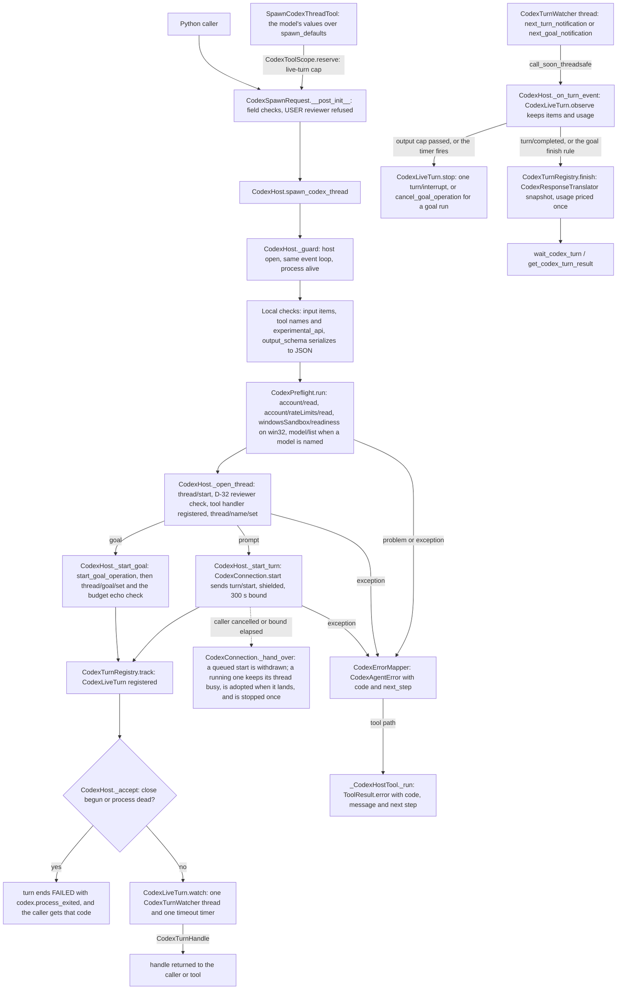
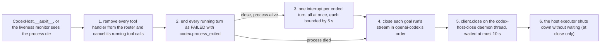
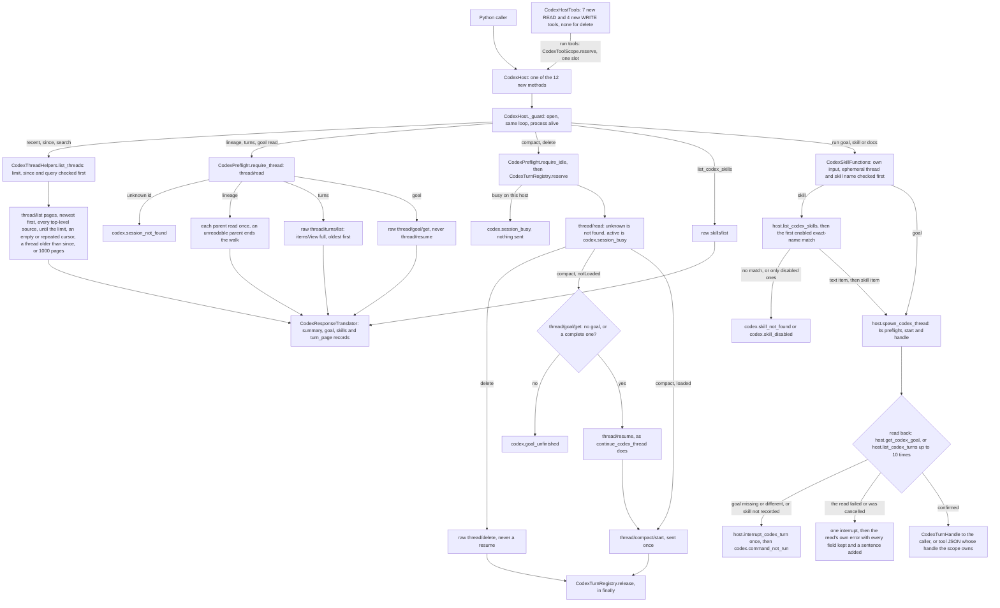

feat(harnesses): add CodexHost with agent tools, thread helpers and skill functions

## Summary

This PR adds `CodexHost`, an async context manager in `vidbyte.harnesses.native.codex`. It runs one installed `codex app-server` process and offers 27 small async functions over it:

- **The host (15).** Readiness, rate limits, models, spawn, continue, fork, list, read, wait, get, steer, interrupt, usage, launch subagents and review. Starting work returns a `CodexTurnHandle` as soon as Codex accepts the turn; `wait_codex_turn` or `get_codex_turn_result` returns a validated `CodexTurnSnapshot` later.
- **Thread helpers (7, this update).** `list_recent_codex_threads`, `list_codex_threads_since`, `search_codex_threads`, `get_codex_thread_lineage`, `list_codex_turns` (the full transcript), `compact_codex_thread` and `delete_codex_thread`.
- **Built-in skill functions (5, this update).** `get_codex_goal`, `run_codex_goal`, `list_codex_skills`, `run_codex_skill` and `run_codex_openai_docs`.

Every failure reaches the caller as a `CodexAgentError` with a `codex.*` code and a next step. Every function except `delete_codex_thread` is also one READ or WRITE agent tool, 26 in all, bundled as `CodexHostTools`, so no model can delete a thread. Two decisions matter most. The host drives openai-codex's sync `CodexClient` directly, runs every call on its own worker pool under a 300 s bound, and keeps owning a turn-starting call that outlives its caller, stopping it with one interrupt, so no paid turn runs unowned. The goal and skill runs use Codex's own protocol (`thread/goal/set`, a `SkillUserInput` item), never slash-command text, and return only after reading the stored goal or the recorded input back; a run that did not take is interrupted once and raises `codex.command_not_run`. Specs: `docs/spec/codex-host/spec.md` (r6) and `docs/spec/codex-host-thread-helpers/spec.md` (r3).

## Motivation

Before this PR the only Codex entry point was `CodexHarnessAgent`, which opens one app-server per run and keeps no handle, so nothing outside the run can wait on, steer, interrupt or fork a turn. openai-codex 0.162.1 has no high-level call for rate limits, sandbox readiness, review, goal budgets, fork-from-a-turn or model paging, and its failures arrive as raw SDK exceptions. The update is the Codex half of the cross-harness thread catalog: listing recent threads meant hand-paging `list_codex_threads`, whose default source filter hides every thread the SDK started; `read_codex_thread` drops every item; compact and delete needed raw JSON-RPC; and nothing confirmed that a goal or skill took, while a slash-command prefix fails silently (thread-helpers request.md §E). The Grok, opencode and Muse half is the branch `feat/harness-thread-helpers-skills`. ClaudeHost (draft PR #1044) and the unstarred catalog rows are separate PRs.

## How to use what this PR introduces

### The host and its tools (codex-host spec §4)

```python
import asyncio

from vidbyte.harnesses.native.codex import CodexHost
from vidbyte.lib.dataclasses.codex import CodexThreadSettings
from vidbyte.lib.dataclasses.codex_host import CodexSpawnRequest
from vidbyte.lib.enums.codex import CodexSandbox
from vidbyte.tools.toolsets import CodexHostTools

async def main() -> None:
    async with CodexHost() as host:  # runs the `codex` on PATH; codex_bin overrides it
        readiness = await host.check_codex_ready()
        print(readiness.ready)  # True, or False with readiness.problems
        handle = await host.spawn_codex_thread(CodexSpawnRequest(
            prompt="Summarize the project readme in one sentence.",
            thread=CodexThreadSettings(sandbox=CodexSandbox.READ_ONLY),
            max_output_tokens=2_000,  # Vidbyte interrupts the turn past this
        ))
        outcome = await host.wait_codex_turn(handle, timeout_seconds=600.0)
        print(outcome.status.value, outcome.result.final_response)
        tools = CodexHostTools(host, max_live_turns=2)  # one tool per function, delete excepted
        print(len(tools), tools.names()[0])  # 26 check_codex_ready

asyncio.run(main())
```

I ran it on this branch at the seam the AC-1 tests use: the in-memory app-server in `tests/features/codex_host/codex_host_fakes.py`, behind a subclass of the real openai-codex 0.162.1 `CodexClient`, on win32. The fake supplied the answer. It printed:

```text
True
completed The readme describes the SDK.
26 check_codex_ready
```

The fake logged `initialize`, `account/read` and `windowsSandbox/readiness` for readiness, then `account/read`, `account/rateLimits/read`, `windowsSandbox/readiness`, `thread/start` and `turn/start` for the spawn. The original run, on the 15-function head `5c65eec8`, printed `15 check_codex_ready` last and showed `thread/start` sending `approvalPolicy: on-request`, `approvalsReviewer: auto_review` and `sandbox: read-only`, every request on worker `codex-host_0`, and the close on the `codex-host-close` thread.

### Thread helpers and skill functions (thread-helpers spec §4)

```python
import asyncio

from vidbyte.harnesses.native.codex import CodexHost
from vidbyte.tools.toolsets import CodexHostTools


async def main() -> None:
    async with CodexHost() as host:
        for summary in await host.list_recent_codex_threads("", limit=3):  # "" = every folder
            print(summary.harness, summary.thread_id, summary.title, summary.updated_at)
        goal_run = await host.run_codex_goal("Make the failing tests pass.", token_budget=200_000)
        goal = await host.get_codex_goal(goal_run.thread_id)  # None when a thread has no goal
        print(goal.status.value, goal.token_budget)
        docs = await host.run_codex_openai_docs("Which Responses API event streams text deltas?")
        outcome = await host.wait_codex_turn(docs, timeout_seconds=600.0)
        print(outcome.status.value, outcome.result.final_response)
        page = await host.list_codex_turns(docs.thread_id)  # oldest turn first, every item
        print(len(page.turns), page.turns[0].status.value, len(page.turns[0].items))
        await host.delete_codex_thread(docs.thread_id)  # a plain function, never a tool
        tools = CodexHostTools(host, max_live_turns=2)
        print(len(tools), "delete_codex_thread" in tools.names())


asyncio.run(main())
```

This is spec §4 exactly as written. I ran it at the same fake seam, set up as `test_codex_host_helper_lifecycle.py::test_the_section_4_snippet_prints_its_seven_lines` sets it up: four stored threads, `openai-docs` listed as an enabled system skill, each turn's input recorded, and each turn finished at once with a fixed answer. Ids, times and the answer come from the fake. It printed:

```text
codex thr-2 Release notes 1760000040
codex thr-3 None 1760000030
codex thr-4 None 1760000020
active 200000
completed Use the response.output_text.delta event.
1 completed 2
26 False
```

The fake's request log shows the path. The listing sent one `thread/list` with `sourceKinds` `cli, vscode, exec, appServer, unknown`, `updated_at` `desc` and `limit: 3`, and no usage check. `run_codex_goal` took spawn's goal path (preflight, `thread/start`, openai-codex's `thread/read` and `thread/goal/clear`, `thread/goal/set` with `status: active`, then with `tokenBudget: 200000`) and read the goal back (`thread/read`, `thread/goal/get`). `run_codex_openai_docs` sent `skills/list {}`, then spawn's prompt path with input `[{text, type: text}, {name: openai-docs, path: …\SKILL.md, type: skill}]`, then one read-back `thread/turns/list` with `limit: 1`. Delete sent `thread/read`, then `thread/delete`. At close, the still-active goal run got `thread/goal/set {status: paused}` and one `turn/interrupt`.

A live run spends the user's plan, so it is manual QA and was not run. The developer no longer writes JSON-RPC, parses SDK exceptions, blocks an agent inside one long tool call, pages cursors, guesses a skill's path, or trusts a `/goal` prefix: a turn comes back as a handle, and a goal or skill run comes back only once Codex has recorded it.

## Flow

The host, spawn to result (unchanged by the update):



The close, or a process death:



The thread helpers and skill functions (this update):



- **Validation** comes before anything spends. Host: the `CodexSpawnRequest` constructor, local checks of input, tool names and answer schema, then `CodexPreflight`; the D-32 check stops before any name, turn or goal request if Codex reports approvals going to a person. Helpers: `_guard`, the argument checks in both collaborators, `CodexGoal` and `CodexSpawnRequest` construction, and the run tools' cap reservation.
- **State** changes only on the event loop. A turn is registered before its handle is returned, and `CodexLiveTurn.finish` ends it once, so the first outcome wins. The helpers change stored state only at compact's `thread/resume` (a `notLoaded` thread with no unfinished goal), at `thread/compact/start` or `thread/delete`, and at spawn's start of a goal or skill turn. Compact and delete hold the thread's reservation until `finally`. No READ helper loads a thread or runs the usage preflight.
- **Failures** are caught in `CodexConnection` and built in one place, `CodexErrorMapper`, always raised `from None`; tools turn them into error results, and only cancellation propagates. Close steps 4 to 6 run in a `finally`. The helpers return an empty since window as `()`, end a lineage at an unreadable ancestor, and return `None` for no goal. Errors from a reused host function keep its operation (D-3).

## What changed

"Update" marks the files this update created or changed (first-parent commits after merge `c181be65`); "merge" marks a line a merge with main resolved.

| File | Change | Update |
|---|---|---|
| **`vidbyte/harnesses/native/codex/`** | | |
| `host.py` | `CodexHost`: open and close, 27 methods, late acceptance of starts, process death. Each new method is the guard, then one delegation. 893 lines (cap about 900). | changed |
| `thread_helpers.py` | `CodexThreadHelpers`: the bounded listing walk, lineage, transcript page, compact, delete, goal read. | new |
| `skill_functions.py` | `CodexSkillFunctions` and its `CodexSkillHost` Protocol: goal and skill runs through the host's public functions, with read-back and one interrupt. | new |
| `connection.py` | `CodexConnection` (client, 32-worker executor, bounded calls, shielded starts, liveness monitor, close thread) and `CodexServerRequestRouter`; plus four raw response models. | changed |
| `wire.py` | `CodexParamsTranslator` and `CodexResponseTranslator`; plus listing `limit`, turn-page, skills and thread params, and four record translations. | changed |
| `turns.py`, `preflight.py`, `errors.py` | The turn registry, watchers and usage ledger; the sign-in, usage, sandbox, model, busy and existence checks; the SDK-exception-to-`codex.*` mapping. | |
| `oneshot.py`, `__init__.py` | Six module functions that each open a host for one call, and the exports. | |
| **`vidbyte/lib/`, `vidbyte/agents/codex/`** | | |
| `lib/dataclasses/codex_host.py` | 20 frozen, slotted, self-validating records; plus `CodexThreadSummary`, `CodexThreadGoal`, `CodexSkillInfo`, `CodexStoredTurn`, `CodexTurnPage`. | changed |
| `lib/enums/codex.py`, `lib/enums/__init__.py` | 14 new `str, Enum` classes with wire values, exported in sorted place; plus `CodexSkillScope` and 12 `CodexHostOperation` members. | changed |
| `lib/enums/failure.py` | 19 `codex.*` codes in one block after `CODEX_RUN_OPTION_UNSUPPORTED`; the update's 4 follow `CODEX_TURN_TIMED_OUT`. | changed |
| `lib/constants/codex.py` | Classification rows, next steps, host bounds, method names, wire tables; plus helper bounds, 5 methods, 4 rows and next steps, `CODEX_USER_MESSAGE_ITEM_TYPE`. | changed |
| `lib/errors/base.py` | A keyword-only `next_step` on `CodexAgentError`; merge `b96b64cc` made the signature a union with main's `thread_id`. | merge |
| `agents/codex/tools.py` | Extracts `validate_names` and `handler` so the host can reuse them. No behaviour change. | |
| `agents/codex/result.py` | `CodexResultSerializer.items`, a public entry over `_item`'s reasoning-free rule. | changed |
| **`vidbyte/tools/`** | | |
| `builtins/codex/_base.py` | `CodexToolScope` (cap, spawn defaults, owned handles) and `_CodexHostTool`; plus `_resolve_timestamp`. | changed |
| `builtins/codex/descriptions.py` | Model-facing texts; plus 11 tool and 11 parameter texts. | changed |
| `builtins/codex/readiness.py`, `threads.py`, `live.py`, `delegation.py` | The first 15 tools. | |
| `builtins/codex/thread_helpers.py` | Recent, since, search, lineage, turns (READ); compact (WRITE). | new |
| `builtins/codex/skill_functions.py` | Goal read, skills list (READ); goal, skill and docs runs (WRITE), each holding one cap slot. | new |
| `builtins/codex/__init__.py`, `builtins/__init__.py`, `toolsets/codex.py`, `toolsets/__init__.py` | Export the 26 tools; `CodexHostTools` builds them over one host and one scope, with no delete tool. | changed |
| **Shared files** | | |
| `vidbyte/harnesses/native/__init__.py`, `vidbyte/harnesses/README.md`, `REPO_MAP.md` | Text naming the Codex host beside main's #1036 thread functions, merged in `c181be65`, byte-pinned by the packaging tests. | |
| `tests/features/harness_threads/` (2 files) | #1036's scans skip the `codex` subpackage and the four Codex tool paths (merge `c181be65`). | |
| **`tests/features/codex_host/`** (200 tests) | | |
| `codex_host_fakes.py`, `codex_host_helper_fakes.py` | An in-memory app-server behind a subclass of the real `CodexClient`; plus listings, goals, skills, recorded input and stored turns, split in two (894 and 237 lines). | changed, new |
| `codex_host_support.py` | `HostTestCase`, a stub host, spec literals, privacy canaries, `HELPER_METHODS`. | changed |
| `test_codex_host_thread_helpers.py`, `test_codex_host_goal_skills.py` | 31 and 26 tests: listings, lineage, turns, compact, delete; goals, skills, docs, read-back, the R-17 re-raise. | new |
| `test_codex_host_helper_tools.py`, `_helper_surface.py`, `_helper_lifecycle.py` | 11, 10 and 5 tests: the tools and cap slots; records, codes, constants, signatures; the §4 snippet, guards, no preflight, -32601, privacy. | new |
| `test_codex_host_` `lifecycle` (13), `threads` (19), `turns` (13), `review_goals` (9), `failures` (6), `tools` (17), `records` (11), `packaging` (7), `sdk_contract` (3), `bridge` (2), `router` (1) | The first 101 tests. The update edited only spec tables and count pins (15 → 26 tools, 15 → 20 records, the new enum and operations) in five of them. | changed |
| `test_codex_host_review_gaps.py`, `FEATURE.md`, `README.md` | 15 codex-host regression tests plus R-18's; the pack's map and how to run it. | changed |
| **`docs/spec/`** | | |
| `codex-host/` | The first record: spec r6, request, test plan, review, verify log, the earlier `pr-body.md`, 18 stage reports. | |
| `codex-host-thread-helpers/` | This update's record: `spec.md` r3 (`pr-open`), request, test plan, review, verify log, pipeline, code map, this `pr-body.md`, 19 stage reports. | new |

## Compatibility

- **Packaging.** `pyproject.toml` is unchanged; the `codex` extra (`openai-codex>=0.162.1,<0.163.0`, pyproject.toml:42-44) already exists, and there is no new dependency. Importing `vidbyte`, `vidbyte.harnesses.native.codex`, `vidbyte.tools.builtins` or `vidbyte.tools.toolsets`, or building `CodexHostTools`, never loads openai-codex (AC-2, thread-helpers INV-31); it loads when a host opens. The wheel carries all 21 new modules.
- **Runtime.** The host needs `vidbyte-sdk[codex]` and an installed Codex CLI. `__aenter__` launches the absolute path from `shutil.which(settings.codex_bin or "codex")`, or `launch_args_override` as given, and never falls back to openai-codex's bundled binary (D-4). No match, or a failed start, is `codex.not_installed`, whose next step names `npm install -g @openai/codex` or `CodexClientSettings(codex_bin=...)`; a missing openai-codex names `pip install "vidbyte-sdk[codex]"`. A runtime below 0.151.0 is `codex.version_unsupported`. One that lacks an update method (`thread/compact/start`, `thread/delete`, `thread/goal/get`, `skills/list`, `thread/turns/list`) is `codex.protocol_mismatch` from that function (AC-37).
- **Public API.** Only subpackages gain names: `vidbyte.harnesses.native.codex` (`CodexHost` and six functions, unchanged by the update), `vidbyte.tools.builtins.codex` (26 tools and `CodexToolScope`, the tools also re-exported from `vidbyte.tools.builtins`), `vidbyte.tools.toolsets` (`CodexHostTools`), `vidbyte.lib.dataclasses.codex_host` (20 records), `vidbyte.lib.enums` (14 enums) and `FailureCode` (19 `codex.*` members). The root package gains nothing, `contracts/sdk-public-api.json` is unchanged and `--check` passes (640 exports). Every touched `__all__` only gains entries.
- **`lib/errors/base.py`** (+3/−2). `CodexAgentError.__init__` gains a keyword-only `next_step=""`; without it the packet is as on main. **`agents/codex/tools.py`** (+16/−2) runs the same checks and messages in the same order, and `tests/test_codex_tools.py` passes unchanged.
- **Existing `CodexHost` behaviour** is unchanged by the update, except that `launch_codex_subagents`' partial-failure error now keeps `error_type` and `thread_id` (R-18). No path sets them today, so nothing visible changes yet.
- **Merge order with PR #1044 (ClaudeHost, draft).** It shares eight non-doc files with this PR: `REPO_MAP.md`, `vidbyte/harnesses/README.md`, `vidbyte/harnesses/native/__init__.py`, the two `harness_threads` test files, `vidbyte/lib/enums/__init__.py`, `vidbyte/lib/enums/failure.py` and `vidbyte/lib/errors/base.py`. None is byte-identical any more, since main's #1036 changed the three that were. Whichever PR merges second needs a catch-up merge from main (merge, do not rebase), keeping both PRs' entries in each conflict.

## Acceptance criteria → proof

Tests live in `tests/features/codex_host/`, named here without the `test_codex_host_` prefix: `turns.py::test_x` is `tests/features/codex_host/test_codex_host_turns.py::test_x`, and `::test_y` is in the same file. Every cited name exists on this branch (checked with `grep` against every `def test_` under `tests/`), and every one passes in the area run under Verification.

### CodexHost (`docs/spec/codex-host/spec.md` r6)

| AC | What it checks (plain words) | Proven by |
|---|---|---|
| AC-1 | The §4 snippet prints `True`, `completed <answer>`, `26 check_codex_ready` (`15` before the update) | `lifecycle.py::test_the_section_4_snippet_prints_its_three_lines` (fake seam; live is manual QA) |
| AC-2 | Imports and the toolset never load openai-codex; opening without it names the pip extra | `packaging.py::test_imports_never_load_the_sdk_and_entering_reports_the_pip_extra`, `::test_imports_leave_an_installed_sdk_unloaded` |
| AC-3 | A missing `codex` is `codex.not_installed` and starts nothing; an override skips the lookup | `lifecycle.py::test_a_missing_codex_binary_is_not_installed_and_starts_nothing`, `::test_the_resolved_path_is_launched_and_a_launch_override_skips_resolution`, `::test_a_process_that_cannot_start_is_not_installed_naming_the_path` |
| AC-4 | A runtime below 0.151.0, or unreadable, is refused and the client closed | `lifecycle.py::test_versions_below_the_minimum_or_unparseable_are_refused_and_the_client_closed` |
| AC-5 | Spawn sends the right params and returns while the turn runs | `turns.py::test_spawn_sends_the_section_9_2_params_and_returns_while_the_turn_runs` |
| AC-6 | A failed preflight check stops every spending operation before it spends | `turns.py::test_a_failed_preflight_check_stops_every_spending_operation_before_it_spends`, `::test_preflight_passes_on_unknown_states_and_skips_checks_that_do_not_apply` |
| AC-7 | A bounded wait returns RUNNING and leaves the turn running | `turns.py::test_a_bounded_wait_returns_running_and_never_touches_the_turn` |
| AC-8 | A completed turn reports answer and usage; get never waits | `turns.py::test_a_completed_turn_reports_its_answer_and_usage_and_get_never_waits` |
| AC-9 | A timeout sends one interrupt, labelled `codex.turn_timed_out` | `turns.py::test_a_timeout_sends_one_interrupt_and_labels_only_a_turn_codex_reports_interrupted` |
| AC-10 | Passing `max_output_tokens` sends one interrupt with `codex.budget_exhausted` | `turns.py::test_the_output_cap_counts_only_the_turns_own_tokens_and_interrupts_once` |
| AC-11 | A dead app-server fails turns and calls with `codex.process_exited`, leaking nothing | `turns.py::test_process_death_fails_the_running_turn_and_later_calls_without_leaking_stderr`, `::test_a_non_json_stdout_line_kills_the_host_without_leaking_the_line` |
| AC-12 | Each `codexErrorInfo` maps to its code; an unknown one to `codex.api_error` | `turns.py::test_a_failed_turn_maps_each_codex_error_info_to_its_code` |
| AC-13 | Valid answers parse; invalid ones are `codex.schema_violation`; missing is `codex.response_invalid` | `turns.py::test_structured_output_is_validated_and_a_missing_answer_is_invalid` |
| AC-14 | Continue reads, resumes, starts a turn; busy, unknown and bad overrides are refused first | `threads.py::test_continue_reads_resumes_without_turns_then_starts_a_turn`, `::test_continue_and_review_refuse_a_busy_or_unknown_thread`, `::test_two_concurrent_continues_on_one_idle_thread_start_one_turn`, `::test_fields_an_operation_cannot_apply_are_rejected_before_any_request` |
| AC-15 | Fork goes through a completed turn; a bad fork point fails first | `threads.py::test_fork_reads_the_turns_first_and_forks_through_a_completed_turn`, `::test_fork_maps_codex_refusals_and_unknown_threads` |
| AC-16 | Steer and interrupt act only on a running turn this host returned | `turns.py::test_steer_and_interrupt_act_only_on_a_running_turn_this_host_returned` |
| AC-17 | Usage lists ended turns with their own deltas, sum and cost | `turns.py::test_usage_tracking_lists_terminal_turns_with_their_own_deltas_and_rollup_cost` |
| AC-18 | Launch starts one thread per prompt; over the limit nothing; a mid-way failure interrupts what started | `threads.py::test_launch_starts_one_thread_per_prompt_in_order_after_one_preflight`, `::test_a_launch_that_fails_midway_interrupts_each_turn_it_started_once`, `::test_fields_an_operation_cannot_apply_are_rejected_before_any_request` |
| AC-19 | A review is sent once and tracked to its end, both races included | `review_goals.py::test_a_review_is_sent_once_with_its_target_and_tracked_to_completion`, `::test_a_review_turn_that_finished_before_registration_is_read_back`, `::test_a_review_whose_final_item_was_dropped_is_completed_from_the_completion_read_back` |
| AC-20 | A goal starts, then its budget is set once; failures clean up in openai-codex's order | `review_goals.py::test_a_goal_spawn_starts_goal_mode_then_sets_the_budget_once`, `::test_a_failed_budget_set_cleans_up_in_openai_codex_start_failure_order`, `::test_a_finished_goal_run_maps_the_goal_table_and_closes_its_stream`; `records.py::test_each_invalid_record_raises_configuration_error_naming_the_field` |
| AC-21 | List sends set filters only; read returns turn summaries only when asked | `threads.py::test_list_sends_every_set_argument_and_omits_the_empty_ones`, `::test_read_returns_turn_summaries_only_when_asked` |
| AC-22 | Readiness has no email; rate limits keep `None`; models cover every page | `threads.py::test_readiness_reports_account_and_sandbox_without_the_email`, `::test_rate_limits_and_models_are_translated_across_pages` |
| AC-23 | The tools in order (now 26); the default policy allows READ (now 15) and denies WRITE (now 11) | `tools.py::test_toolset_holds_the_fifteen_tools_with_their_spec_schemas`, `::test_default_policy_allows_the_read_tools_and_denies_the_write_tools` |
| AC-24 | Host errors become error results; cancellation propagates and frees the slot | `tools.py::test_every_tool_turns_host_errors_into_error_results`, `::test_cancellation_propagates_and_frees_the_reserved_slot` |
| AC-25 | The cap refuses before the host; handle tools accept only their scope's handles | `tools.py::test_cap_refuses_turn_starting_tools_without_reaching_the_host`, `::test_handle_tools_accept_only_their_own_scope_while_thread_tools_accept_any_thread` |
| AC-26 | The spawn tool takes posture from `spawn_defaults` and six values from the model | `tools.py::test_spawn_takes_the_posture_from_defaults_and_six_values_from_the_model`, `::test_spawn_needs_exactly_one_of_prompt_and_goal_objective` |
| AC-27 | The MCP server lists and runs the toolset unchanged | `tools.py::test_mcp_server_lists_and_runs_the_toolset` |
| AC-28 | `CodexHarnessAgent`'s tool tests pass unchanged; the extracted helpers keep their messages | `tests/test_codex_tools.py` (unchanged; source stage); `bridge.py::test_validate_names_raises_the_two_existing_messages`, `::test_handler_runs_tools_under_the_bridge_policy_and_falls_back_otherwise` |
| AC-29 | The 15 codes sit in place with a row and a next step each | `records.py::test_new_failure_codes_sit_right_after_run_option_unsupported`, `::test_each_new_code_has_its_classification_row_and_next_step` |
| AC-30 | The router answers every server request and never raises | `router.py::test_the_router_answers_every_server_request_and_never_raises` |
| AC-31 | Each module function opens and closes one host | `lifecycle.py::test_each_module_function_opens_and_closes_one_host_whether_it_succeeds_or_fails`, `::test_module_check_codex_ready_reports_a_missing_binary_instead_of_raising` |
| AC-32 | A start that outlives its caller is owned and stopped once; a queued one is never sent | `failures.py::test_a_spawn_cancelled_while_turn_start_is_in_flight_owns_the_turn`, `::test_a_spawn_whose_start_outlives_the_request_bound_gets_api_error_and_the_turn_is_owned`, `::test_a_review_cancelled_in_flight_is_interrupted_once_and_read_back`, `::test_a_start_still_queued_behind_a_blocked_worker_is_never_sent`, `::test_a_start_that_returns_after_close_began_is_registered_failed_and_sends_nothing` |
| AC-33 | The guards, and the close order for turns, tool calls and goal runs | `lifecycle.py::test_a_host_answers_only_while_open_and_opens_at_most_once`, `::test_a_closed_host_answers_local_reads_and_refuses_calls_that_talk_to_codex`, `::test_a_call_from_another_event_loop_is_refused`, `::test_close_interrupts_a_running_turn_once_then_closes_on_a_daemon_thread`, `::test_close_cancels_a_running_tool_call_before_sending_interrupts`, `::test_close_ends_a_goal_run_in_openai_codex_order_and_its_watcher_exits` |
| AC-34 | No error, record or tool output carries the email, a secret or stderr | `failures.py::test_no_error_record_or_tool_output_carries_a_private_value`; `turns.py::test_process_death_fails_the_running_turn_and_later_calls_without_leaking_stderr`, `::test_a_non_json_stdout_line_kills_the_host_without_leaking_the_line`; `threads.py::test_readiness_reports_account_and_sandbox_without_the_email` |
| AC-35 | Each invalid record names its field; a USER reviewer is refused | `records.py::test_each_invalid_record_raises_configuration_error_naming_the_field`, `::test_user_reviewer_is_refused_when_any_spawn_request_is_built`, `::test_review_target_fields_follow_their_kind_exhaustively`, `::test_snapshot_status_result_and_problem_rule_exhaustively` |
| AC-36 | The gate and Semgrep pass; shared files hold their pinned bytes and sorted entries | `packaging.py::test_native_package_marker_has_the_fixed_bytes`, `::test_repo_map_section_sits_between_the_harnesses_paragraph_and_stores`, `::test_harnesses_readme_bullet_follows_the_serialization_bullet`, `::test_new_packages_export_exactly_their_spec_lists`, `::test_existing_export_lists_gain_only_the_new_names_in_place`; the gate rows |
| AC-37 | A `user` reviewer Codex reports stops spawn, goal, launch and continue before any turn | `threads.py::test_a_user_reviewer_reported_after_thread_start_stops_spawn_goal_and_launch`, `::test_the_reported_policy_decides_whether_a_user_reviewer_may_start`, `::test_continue_checks_the_reviewer_resume_reports_and_an_override_fixes_it` |

### Thread helpers and skill functions (`docs/spec/codex-host-thread-helpers/spec.md` r3)

| AC | What it checks (plain words) | Proven by |
|---|---|---|
| AC-1 | The §4 snippet prints its seven lines | `helper_lifecycle.py::test_the_section_4_snippet_prints_its_seven_lines` (fake seam; live is manual QA) |
| AC-2 | Recent is newest first from every top-level source, no `subAgent`, no preflight | `thread_helpers.py::test_recent_threads_come_newest_first_without_sub_agents_or_a_preflight` |
| AC-3 | A `cwd` goes on every page; `""` sends none | `thread_helpers.py::test_a_cwd_goes_on_every_page_and_an_empty_cwd_sends_none` |
| AC-4 | Each page asks for the remaining count with the last cursor | `thread_helpers.py::test_the_walk_asks_for_the_remaining_count_with_each_cursor` |
| AC-5 | A repeated cursor ends the walk, with no thread twice | `thread_helpers.py::test_a_repeated_cursor_ends_the_walk_without_duplicates` |
| AC-6 | Since is inclusive and stops at the first older thread | `thread_helpers.py::test_since_returns_the_inclusive_window_and_stops_at_the_first_older_thread` |
| AC-7 | An empty since window is `()` | `thread_helpers.py::test_an_empty_window_is_an_empty_tuple_and_milliseconds_lie_in_the_future` |
| AC-8 | Search sends `searchTerm`; a blank query sends nothing | `thread_helpers.py::test_search_sends_the_search_term_and_refuses_a_blank_query` |
| AC-9 | A bad `limit` or `since` is refused before any request, in host and tools | `thread_helpers.py::test_bad_limits_and_timestamps_are_refused_before_any_request`; `helper_tools.py::test_bad_arguments_are_refused_before_the_host` |
| AC-10 | Titles, parents and models map as §6.1 says; `harness` is `"codex"` | `thread_helpers.py::test_titles_parents_and_models_map_as_section_6_1_says`; `helper_surface.py::test_the_summary_harness_is_fixed_to_codex` |
| AC-11 | Lineage walks fork and spawn parents to the root, one read each | `thread_helpers.py::test_the_lineage_walks_fork_and_spawn_parents_to_the_root` |
| AC-12 | An unknown or refused ancestor ends the walk quietly | `thread_helpers.py::test_an_unknown_or_refused_ancestor_ends_the_walk_without_an_error` |
| AC-13 | An unknown start is not found; a cycle reads each thread once | `thread_helpers.py::test_an_unknown_start_is_not_found_and_a_cycle_reads_each_thread_once` |
| AC-14 | A deeper chain returns exactly the depth bound | `thread_helpers.py::test_a_chain_deeper_than_the_bound_returns_exactly_the_bound` |
| AC-15 | Turns carry every item, no reasoning content; cursor and limit pass through | `thread_helpers.py::test_turns_come_with_their_items_and_the_cursor_and_limit_pass_through` |
| AC-16 | An unknown thread is not found before any turn listing | `thread_helpers.py::test_an_unknown_thread_is_not_found_before_any_turn_listing` |
| AC-17 | An idle loaded thread is compacted in one request, no resume or preflight | `thread_helpers.py::test_an_idle_or_failed_thread_is_compacted_without_a_goal_check_or_resume`; `helper_lifecycle.py::test_helpers_send_no_check_and_reads_leave_a_not_loaded_thread_unloaded` |
| AC-18 | A `notLoaded` thread with no goal is checked, resumed, compacted; the goal read never resumes | `thread_helpers.py::test_a_not_loaded_thread_without_a_goal_is_checked_then_resumed_as_continue_resumes` |
| AC-19 | A turn running here, or `active` in Codex, refuses compact and delete | `thread_helpers.py::test_this_hosts_own_running_turn_refuses_compact_and_delete_before_any_request`, `::test_a_thread_codex_reports_active_refuses_compact_and_delete_after_one_read` |
| AC-20 | An unknown id is not found for compact and delete | `thread_helpers.py::test_an_unknown_thread_is_not_found_and_a_second_delete_finds_nothing` |
| AC-21 | Delete sends one `thread/delete`, never resumes, and no tool reaches it | `thread_helpers.py::test_delete_never_resumes_and_a_deleted_thread_is_gone_but_its_usage_stays`; `helper_tools.py::test_the_toolset_appends_eleven_tools_and_none_is_delete`, `::test_no_tool_reaches_delete_codex_thread` |
| AC-22 | A second delete is not found | `thread_helpers.py::test_an_unknown_thread_is_not_found_and_a_second_delete_finds_nothing` |
| AC-23 | A compact in flight holds the thread; a failed or cancelled one frees it | `thread_helpers.py::test_a_compact_in_flight_holds_the_thread_until_it_ends`, `::test_a_failed_or_cancelled_compact_releases_the_thread` |
| AC-24 | The goal record mirrors the stored goal; none is `None`; unknown is not found | `goal_skills.py::test_the_goal_record_mirrors_the_stored_goal_for_every_status` |
| AC-25 | A goal run sets goal, then budget, then reads it back, with no `/` prefix | `goal_skills.py::test_a_goal_run_starts_goal_mode_sets_the_budget_and_reads_the_goal_back` |
| AC-26 | A goal that did not take gets one cancel and `codex.command_not_run` | `goal_skills.py::test_a_goal_that_did_not_take_is_cancelled_once_and_reported` |
| AC-27 | A failed goal check cancels once and keeps its error, plus a sentence | `goal_skills.py::test_a_goal_check_that_fails_cancels_the_run_and_keeps_its_error` |
| AC-28 | Bad goal arguments send nothing | `goal_skills.py::test_bad_goal_arguments_are_refused_before_any_request` |
| AC-29 | Skills list for a folder or the app-server's own, no preflight | `goal_skills.py::test_skills_are_listed_for_a_folder_or_for_the_app_servers_own` |
| AC-30 | A skill run lists skills first, sends text then the skill, confirms once | `goal_skills.py::test_a_skill_run_sends_the_skill_as_input_and_confirms_it_once`, `::test_a_skill_run_keeps_the_callers_posture_and_lists_skills_for_its_folder` |
| AC-31 | An unknown or disabled skill starts no thread; the name list is bounded | `goal_skills.py::test_an_unknown_or_disabled_skill_is_refused_before_any_thread_starts`, `::test_the_not_found_message_names_the_folder_and_bounds_the_list` |
| AC-32 | The docs run is the skill run for `openai-docs` | `goal_skills.py::test_the_docs_run_is_the_skill_run_for_openai_docs` |
| AC-33 | 26 tools with their schemas; run tools hold a cap slot; errors become results | `helper_tools.py::test_the_toolset_appends_eleven_tools_and_none_is_delete`, `::test_a_full_cap_refuses_every_run_tool_without_reaching_the_host`, `::test_new_codes_become_error_results_with_their_next_steps`; `tools.py::test_toolset_holds_the_fifteen_tools_with_their_spec_schemas`, `::test_every_tool_turns_host_errors_into_error_results` |
| AC-34 | Every new method refuses before open, after close, from another loop | `helper_lifecycle.py::test_every_new_method_refuses_before_open_after_close_and_from_another_loop` |
| AC-35 | The existing pack passes with only count pins edited | the area run under Verification, with `threads.py::test_list_sends_every_set_argument_and_omits_the_empty_ones` and `::test_read_returns_turn_summaries_only_when_asked` unedited |
| AC-36 | The four codes follow `codex.turn_timed_out`, each with a row and next step | `helper_surface.py::test_the_four_codes_sit_between_turn_timed_out_and_input_empty`; `records.py::test_new_failure_codes_sit_right_after_run_option_unsupported`, `::test_each_new_code_has_its_classification_row_and_next_step` |
| AC-37 | `-32601` is `codex.protocol_mismatch` with the function's own operation | `helper_lifecycle.py::test_a_missing_method_is_protocol_mismatch_with_the_functions_own_operation` |
| AC-38 | A `notLoaded` thread with an unfinished goal is refused before any resume | `thread_helpers.py::test_a_not_loaded_thread_with_an_unfinished_goal_is_refused_before_any_resume` |
| AC-39 | Input never recorded, or without the skill, stops the run once | `goal_skills.py::test_input_never_recorded_or_recorded_without_the_skill_stops_the_run_once` |
| AC-40 | A failed read-back interrupts once and keeps its error | `goal_skills.py::test_a_read_back_that_fails_interrupts_once_and_keeps_its_error` |
| AC-41 | The turns tool asks for 3 turns by default; the method sends no limit | `helper_tools.py::test_the_turns_tool_asks_for_a_small_page_unless_given_a_limit`; `thread_helpers.py::test_turns_come_with_their_items_and_the_cursor_and_limit_pass_through` |
| AC-42 | An ephemeral skill or docs run sends nothing | `goal_skills.py::test_bad_skill_arguments_are_refused_before_any_request` |
| AC-43 | A deadline shorter than the poll interval allows one read | `goal_skills.py::test_a_deadline_shorter_than_the_interval_allows_one_read` |

## Verification

I ran the local rows on `5218b423`, whose code equals this PR's head (the commits after it change only `docs/spec/codex-host-thread-helpers/`), with the branch merged with main `f7f32b19`. `$VPY` is the worktree venv with `.[dev,codex]` and openai-codex 0.162.1; `$W` is the worktree.

| Gate | Command | Result |
|---|---|---|
| Area tests | `PYTHONPATH=$W $VPY -m pytest -q tests/features/codex_host tests/features/harness_threads tests/test_codex_output_contracts.py` | `1 failed, 686 passed, 2 skipped in 59.01s`; the failure is inherited (below) |
| Feature pack | `PYTHONPATH=$W $VPY -m pytest -q tests/features/codex_host` | `200 passed in 13.24s` |
| Pack, CI view | the same, with `sys.modules['openai_codex'] = None` | `57 passed, 143 skipped in 2.47s` |
| Both §4 snippets | each at the fake seam, printing to stdout | the output under "How to use" |
| Lint | `$VPY lint/run.py` | `SDK-LINT: PASS`; 7 rules IMPROVED, none REGRESSED |
| Public API | `PYTHONPATH=$W $VPY scripts/generate-sdk-public-api.py --check` | `contracts/sdk-public-api.json is current at d08e89ef75ff4a6ee07465ee5097363e7d0d26c4 (vidbyte-sdk 0.3.0, 640 exports).` |
| Source stage | `PYTHONPATH=$W $VPY scripts/run_ci.py --stage source` | `1 failed, 6236 passed, 26 skipped in 116.26s (0:01:56)` / `CI failed: …`, on the inherited test alone |
| Package stage | `$VPY scripts/run_ci.py --stage package` (no `PYTHONPATH`) | `Installed vidbyte-sdk 0.3.0 passed smoke checks.` / `CI passed.`; the build log adds all 21 new modules |
| Semgrep | `pysemgrep --test` on the fixture; `pysemgrep scan --error --config .semgrep/typed-mapping-boundary-policy.yml vidbyte` | `1/1: ✓ All tests passed` / `Ran 1 rule on 986 files: 0 findings.` |
| mypy | `mypy --follow-imports=silent` on `host.py`, both collaborators, both new tool modules | `Success: no issues found in 5 source files` |
| Remote checks | `gh workflow run ci.yml` and `static-policy.yml --ref feat/codex-host` on `40eeebc4` (code equal to this head; runs 38942773026, 38942776154), then its check-runs | `Package completed success` · `Static policy completed success` · `Source / Python 3.11 completed success` · `Source / Python 3.12 completed success`. The docs-only head is dispatched again after this commit |
| Mergeability | `gh pr view 1055 --json mergeable,mergeStateStatus` | `MERGEABLE`, `BEHIND` (below) |

**The inherited failure.** `tests/features/harness_threads/test_harness_threads_surface.py::test_failure_codes_keep_main_and_append_exactly_the_28_harness_codes` fails with `assert 148 == 120`. It fails the same way on plain origin/main `72a4ade1`, `cb554ed3` and `f7f32b19`, each checked in a scratch worktree (verify-log.md), and main's `FailureCode` still has 148 members at `6983afd2` (this branch has 167: those plus the 19 `codex.*` codes). CI passes it because its shallow clone has no merge base.

**Branch state.** GitHub reports the PR `BEHIND` main, which has gained four commits since the last merge `f7f32b19` (`d5c1532d` #1162, `7ab22063` #1163, `1a73a19e` #1161, `6983afd2` #1164). None touches a file this PR changes, and `git merge-tree --write-tree HEAD origin/main` is clean, so there are 0 conflicts and `mergeable` is `MERGEABLE`. This stage changes no source, so it did not merge main. Apart from that, `mergeStateStatus` is `BLOCKED` by branch protection: dispatched runs do not count toward it, so the owner merges with `--admin`. `gh pr checks` reports no checks for the same reason, so results are read from each commit's check-runs.

Remote CI installs `.[dev]` without the `codex` extra, so there the pack runs as in the CI-view row (57 run, 143 skip). The 200-test run and both snippets need the extra, and I ran them locally.

- [x] Repository checks pass: both local `run_ci` stages (source fails only on the inherited test), Semgrep, and the four remote check-runs.
- [x] The built wheel has all 21 new modules.
- [x] Docs and examples reflect the change: the `REPO_MAP.md` section, the harnesses README bullet, an A001 header in every new file, and both usage examples above.
- [x] No credentials, private data, bytecode or unrelated changes: a scan of the added lines finds no key, token or email pattern, `git ls-files` lists 0 `.pyc` files, and every path is under `vidbyte/`, `tests/features/codex_host/`, `tests/features/harness_threads/`, `docs/spec/codex-host/`, `docs/spec/codex-host-thread-helpers/`, or is `REPO_MAP.md`.

## Adversarial review

### CodexHost

An independent verifier confirmed 32 findings: 25 from the first review (lenses: spec conformance, repo conventions, engineering) and 7 from two scoped conformance re-reviews. 17 were must-fix (5 Blockers, 12 Majors) and 15 Minors. 24 are fixed (23 in code or tests, R-29 in spec r6), 0 waived, and 8 Minors are Follow-ups. The last fix, `888db88f` (R-30, R-31), changes only `#` comment lines (9 added, 5 removed) and landed after the final re-review; going on without a third round was the user's decision. Full record: `docs/spec/codex-host/review.md`.

| ID | Finding | Fixed in |
|---|---|---|
| R-1 (Blocker) | A review cancelled during its read-back was never watched or interrupted and kept its thread busy | `2f098372` |
| R-2 (Blocker) | An unusable `output_schema` failed only after `thread/start` had stored a thread | `6856645b` |
| R-3 (Blocker) | Goal status, sandbox readiness and the approval default traveled as `str` although enums exist | `8f6975e8` |
| R-4 (Blocker) | `CodexHost` helpers called helpers two and three levels deep | `846ce849` |
| R-5 (Blocker) | 172 added comment lines were wider than 72 columns | `08d498d8` |
| R-6 (Major) | A cancelled launch left its started turns running, unowned and outside the cap | `4d597f91` |
| R-7 (Major) | A close cancelled during its interrupts never closed the client | `52e9e313` |
| R-8 (Major) | Two argument checks were reshaped to dodge lint C002 | `f2e9db7e` (deviation withdrawn in spec r5, `bbe9672f`) |
| R-9 (Major) | Seven new functions lacked `# @intent`, hidden by A002's baseline slack | `fad8c55f` |
| R-10 (Major) | Continue and review freed the thread while their start was in flight, so a retry could start a second paid turn | `874bd5a3` |
| R-11 (Major) | 16 JSON-RPC method names were inline literals the error mapping depends on | `528e5ef6` |
| R-12 (Major) | A tool description promised a schema check a mapping `output_schema` never gets | spec r5 `bbe9672f`; code and tests `4a9ecc49` |
| R-13 (Major) | The late-acceptance tests checked only the status, so two mutants survived | `d894d87a` |
| R-14 (Major) | No test proved the launch tool frees its cap slots on failure or cancellation | `168282f4` |
| R-26 (Major) | R-2's refusal put a library exception's text into the error and chained it | `30109e89`; cyclic schema `736d4a58` |
| R-27 (Major) | After any failed stop, every later user interrupt became a silent no-op | `ad363725` |
| R-30 (Major) | R-27's fix left `interrupt_codex_turn` without its `# @intent` line | `888db88f` (comment-only) |

### Thread helpers and skill functions (this update)

The first review used the same three lenses; its verifier confirmed 4 Majors and 11 Minors (R-1 to R-15, one Major downgraded to R-8). Conformance re-review 1 (`reports/S5-rereview-1.md`) was SOUND with one Minor, R-16. After merge `b96b64cc` gave `CodexAgentError` main's `thread_id`, two rebuilds that append a sentence were found dropping `error_type` and `thread_id`: R-17 and R-18. Re-review 2, the last (`reports/S5-rereview-2.md`), was SOUND with 0 findings: it confirmed R-16 to R-18 and found all three main merges exact in both directions. Of the 18, all 4 Majors and 8 Minors are fixed, 0 waived, and R-10 to R-15 are Follow-ups. Full record: `docs/spec/codex-host-thread-helpers/review.md`.

| ID | Finding | Fixed in |
|---|---|---|
| R-1 (Major) | No test proved a failed or cancelled `run_codex_goal` tool call frees its cap slot | `6c5eca2a` (test) |
| R-2 (Major) | The wire value `"userMessage"` was defined in a feature module | `54f599de` |
| R-3 (Major) | Six new numeric tool schemas had no bounds, unlike every older Codex schema | `dd3fe2c2` |
| R-4 (Major) | No test proved delete holds the thread, or frees it on failure or cancellation | `6a434afd` (test) |

Minors fixed: R-5 `3d1ff4e2` (spec), R-6 `c3a3ef98`, R-7 `4fbc88b6`, R-8 `30a0a0ac` (test), R-9 `549c7475`, R-16 `ddc432fe`, and R-17 and R-18, shown red by `f9c987dc` and `b769621c` and fixed in `5e30a226` (`skill_functions.py`) and `804bbc91` (`host.py`).

**Mutation proof.** Each mutant that survived the S4 suite (`864 passed`) is now killed by its own test (`1 failed, 868 passed`; reports/S2-test-author-r2.md): V36, the goal tool freeing its slot only on success, by `helper_tools.py::test_a_failed_or_cancelled_goal_run_releases_its_slot`; V05 and V05b, delete without a reservation or releasing only on success, by `thread_helpers.py::test_a_delete_in_flight_holds_the_thread_until_it_ends` and `::test_a_failed_or_cancelled_delete_releases_the_thread`; V02, a read-back that accepts any turn, by `goal_skills.py::test_input_recorded_on_another_turn_does_not_confirm_the_run`; V03 and V04, any or case-folded skill name, by `::test_a_skill_recorded_under_another_name_stops_the_run_once`. Re-review 2's own mutants of the R-17 and R-18 lines are killed by `CodexRunReRaiseTests` and `CodexHostLaunchRebuildFieldTests`.

## Deviations from the spec

### CodexHost (spec r6)

- **S3's deviation 1 is withdrawn.** R-8 (`f2e9db7e`) replaced the two reshaped checks with the shared `_reject_bad_seconds` and `_reject_small_int`.
- **A process death also closes goal streams** (§17 deviation 2). D-27 runs close steps 1 and 2 on death; the code also closes each ended goal run's stream, so its watcher exits, then reaps the process (host.py:879-890).
- **The one stop lives on `CodexLiveTurn`** (R-4). §12.3 row 15 puts the interrupt in the host's late-acceptance handler; `CodexLiveTurn.stop` sends it (turns.py:166). The outcome is the same: one interrupt, first stop wins.
- **A handed-over start keeps its thread busy** (R-10). INV-24 names only running and reserved turns. `CodexConnection` also tracks threads whose start outlived its caller (connection.py:162, :262-280), and `require_idle` counts them as busy.
- **Interrupt also skips while a stop is pending** (R-16, R-27). §9.2 skips only a finished turn; the code also sends nothing while an earlier stop is still awaited (host.py:426). A failed stop blocks nothing.
- **A cyclic schema is refused** (`736d4a58`): a mapping `output_schema` with a cycle under `properties` or `items` gets the EC-82 `ConfigurationError` ("… Got RecursionError.") before any request.
- **The notification-name constants are not read.** §9.3 says the watcher reads the six `CODEX_*_NOTIFICATION` constants; it matches openai-codex's typed models instead (turns.py:102-107). The constants (constants/codex.py:442-447) are pinned by `test_codex_host_records.py` but read by no source file.
- **§5 was redrawn** to match the first chart above, at that spec's S6 (its §17).

### Thread helpers and skill functions (spec r3)

- **An empty since window returns `()`** (D-9). Request §C lists "empty since-window" among the error cases. The spec returns `()`, as every other listing does when it finds nothing (Q-11 can flip it).
- **An idle loaded thread may be deleted** (D-14). Request §C lists "delete of a loaded thread" among the error cases. The code refuses only a thread with a turn running here or reported `active`, with `codex.session_busy`, because every thread this host just ran is loaded (Q-14 can flip it).
- **The listing `limit` check has a canonical owner** (§17 deviation 1, `96b572d9`): `RecordFieldValidator.require_int`, with the same `LIMIT_MESSAGE` re-raised `from None`.
- **`CODEX_USER_MESSAGE_ITEM_TYPE` is outside §9.3's constant list** (R-2, §17 deviation 8). It sits beside its precedent `CODEX_COMPACTION_ITEM_TYPE` in `vidbyte/lib/constants/codex.py` and in `__all__`.
- **Both rebuilt errors keep every field** (R-17, R-18, §17 deviation 9). INV-22 and INV-35 first named only code, operation and next step; spec `04aa8cbe` now says every field is kept and only the message grows. `error_type` is read from `safe_runtime_details`, because `CodexAgentError` has no such attribute.
- **One pinned line is now false** (NG-14, Q-18). `vidbyte/tools/toolsets/__init__.py:11` says "CodexHostTools: One tool per CodexHost function over one host.", but there are 27 functions and 26 tools. `test_codex_host_packaging.py` pins it, so it stays; the class docstring, header and narration name the exception (R-6).
- **§5 was redrawn at S6.** Its flowchart now matches the third chart above: compact and delete check `require_idle` and reserve before the existence read, a failed read-back keeps its own error, and the records come from `CodexResponseTranslator`.

## Follow-ups

**From this update** (`docs/spec/codex-host-thread-helpers/review.md` and the verify log):
- **R-10.** `delegation.py:4` still says "CodexHostTools lists these last" (milder: `errors.py:4`, `preflight.py:4`).
- **R-11.** `GOAL_UNCHECKED_MESSAGE` and `SKILL_UNCHECKED_MESSAGE` say the run "was interrupted" even when the interrupt failed and was ignored, and no scope owns a turn that survived. Both are pinned spec strings.
- **R-12.** `INPUT_NOT_RECORDED_MESSAGE` prints the 10 s deadline, but 10 reads 0.5 s apart end after about 4.5 s. The text and counts are spec-mandated.
- **R-13.** Per-folder load errors from `skills/list` are dropped, so a skill that failed to load is reported as `codex.skill_not_found`, with advice that cannot help.
- **R-14.** The READ `list_codex_turns` tool returns full item payloads (command output, diffs) for any thread on the account. Say so in its description, or scope it to threads this host owns.
- **R-15.** The `list_codex_skills` tool has no output bound; one probe saw 284 user skills, about 100 KB.
- **Lint baselines.** Seven rules report IMPROVED: A002 703 → 563, C012 24 → 23, S001 59 → 56, S010 5 → 0, S025 263 → 261, S061 6 → 5, S063 4 → 3. Lowering them needs `python lint/run.py --rule <ID> --update-baseline`, an owner decision.
- **R-17 and R-18 are latent.** `CodexErrorMapper.error` (`vidbyte/harnesses/native/codex/errors.py:65`) sets neither `thread_id` nor `error_type`, so no host error carries them today. Setting them is the owner's design call.
- **A canonical "same error, new message" helper** on `CodexAgentError` (AGENTS.md principle 5) would replace both rebuilds. It touches `vidbyte/lib/errors/base.py`, outside this update's §12.3.
- **Main's #1121** runs host dynamic tools under the `PermissionCeiling` active when the thread was spawned, for the thread's whole life. That only tightens; a per-turn ceiling would change `vidbyte/agents/codex/tools.py`.
- **The inherited failing test** belongs to main and #1036.
- **Spec questions not built** (Q-1 to Q-19, all default no), notably archive and unarchive, rename, set, pause and clear goal, `list_codex_subagent_threads`, and the ClaudeHost twin.
- **Manual QA.** Run the second §4 snippet against a signed-in `codex` 0.162.1. It spends the user's plan, and checks what the fake cannot: that Codex records the skill entry (A-20) within the read-back window (A-19), and that resuming a thread with no unfinished goal starts no turn (A-17).

**From the CodexHost review** (`docs/spec/codex-host/review.md`):
- **R-19.** A finished turn keeps its item list after the snapshot copied it, doubling item memory for the host's life (turns.py:82).
- **R-20.** The rule that a prompt carries no context is written twice, with two messages (codex_host.py:173-181, wire.py:255-259).
- **R-21, R-22.** Some `# @intent` tags narrate the code instead of giving the reason, and the internal flags `late`, `cleanup` and `quiet` switch behaviour inside one function.
- **R-23.** At close, `shutdown(cancel_futures=True)` gives a still-queued caller `CancelledError` instead of `codex.process_exited`; it needs every worker blocked (connection.py:371).
- **R-24.** Two boundary mutants survive: launch `limit` checked with `>=`, and a user interrupt that does not set `stop_sent`.
- **R-32.** No test pins `stop_pending` when a second user interrupt arrives while the first is in flight. `FEATURE.md:128` and the class docstring at `test_codex_host_review_gaps.py:424` say it is covered, but only Vidbyte's own timeout stop in flight is tested (:454).
- **R-25, optional (Q-10, default no).** Validate a mapping `output_schema` answer locally. It needs a new dependency or a change to the shared `OutputSchemaFormatter`.
- **Accepted residuals.** A review that finished before registration, whose caller is also cancelled during the read-back, stays RUNNING until close (R-1). A second user interrupt can send a second `turn/interrupt` while the first is still on a worker past its bound (R-31); the turn still ends INTERRUPTED.
- **Windows (A-1, EC-69).** `shutil.which("codex")` finds npm's `codex.CMD`, and `CodexClient.close()` ends only that launcher; the app-server stops when stdin closes, after close has interrupted every turn.
- **EC-68.** openai-codex runs a dynamic tool call on its one reader thread, stalling every other event on that host; the docstrings say to keep tools short or give such threads their own host.
- **Notification constants.** Remove the six unread constants, or correct §9.3.
- **Manual QA.** Run the first §4 snippet against a signed-in `codex` 0.151.0 or newer; it spends the user's plan.
- **Open questions, default no** (codex-host §15): Q-4 root exports; Q-7 a permission check on the MCP path; Q-8 thread tools limited to their own toolset's threads; Q-9 `spawn_defaults` caps as ceilings; Q-10 (R-25).

🤖 Generated with [Claude Code](https://claude.com/claude-code)
