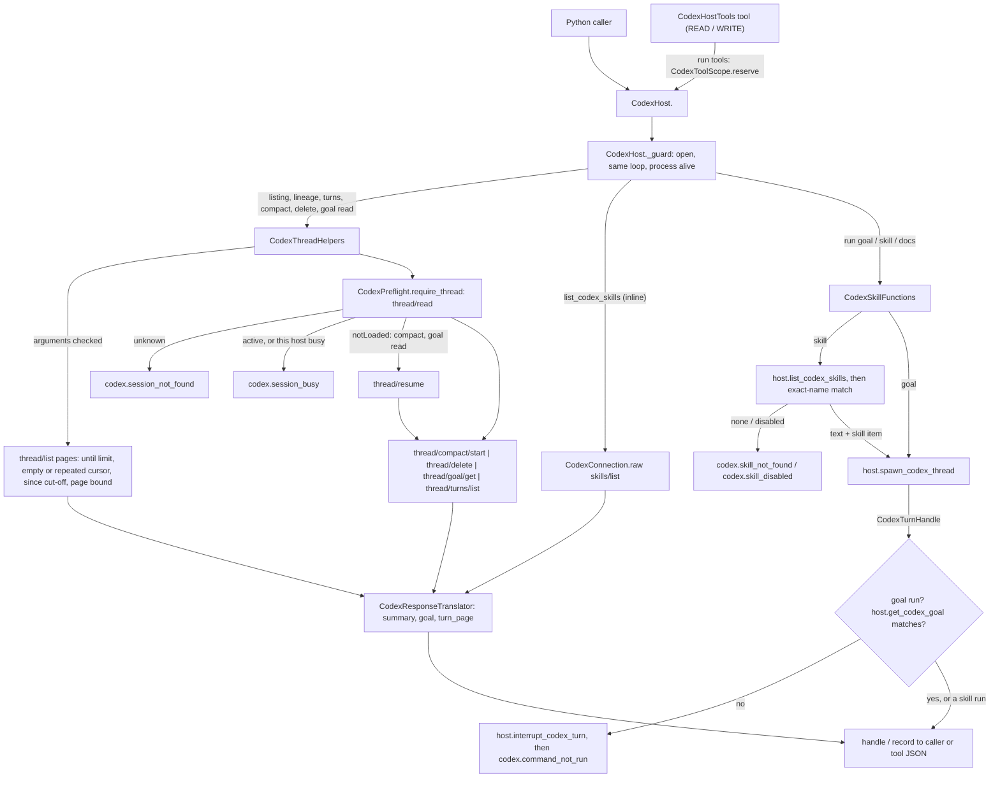
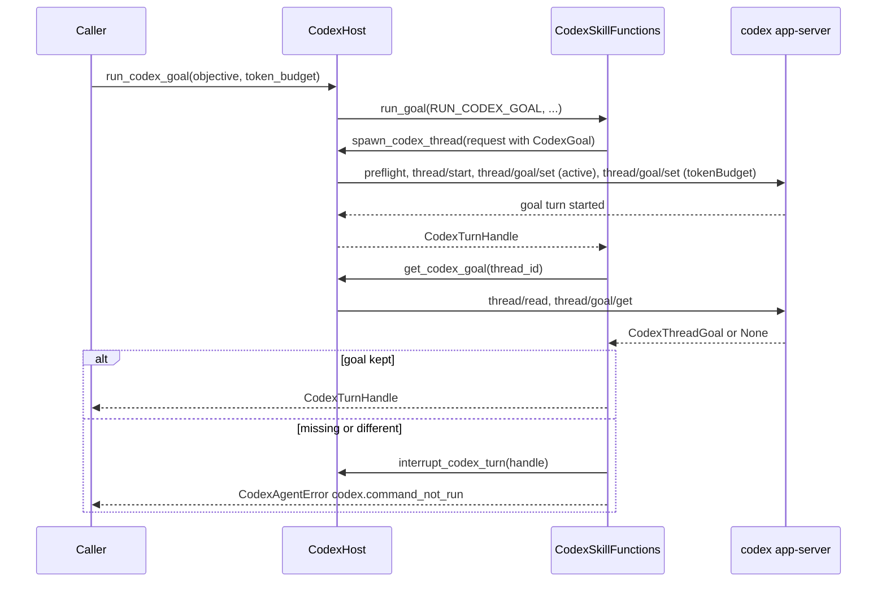

# Spec: CodexHost thread helpers and built-in skill functions

> **TL;DR** — `CodexHost` (PR #1055) gains 12 functions, the Codex half of the cross-harness catalog. Seven are thread helpers: recent, since, search, lineage, a full-transcript reader, compact, and delete, which is a plain function and never a tool. Five are built-in skill functions: get and run a goal, list and run a skill, and a named wrapper for the bundled `openai-docs` skill. Each runs on Codex's own protocol (`thread/goal/set`, a `SkillUserInput` item), never on slash-command text. `run_codex_goal` reads the goal back and raises `codex.command_not_run` when it did not take. The deciding design choice is two small collaborator classes under `native/codex/`, `CodexThreadHelpers` and `CodexSkillFunctions`. Each host method stays "guard, then delegate", so `host.py` stays under 900 lines, and the run wrappers reuse `spawn_codex_thread` without breaking the one-level call-chain rule.

## §0 User prompts

The full record is in `docs/spec/codex-host-thread-helpers/request.md`: every prompt in order, the structured notes in §C, the weighted words in §D, and the accepted catalog reply in §E. Prompt 5 invoked the pipeline. Prompt 6 asked for this run on PR #1055. Both are reproduced verbatim below, typos included.

### 0.1 Invoking request (verbatim)

**Prompt 5** (22:11, /spec-pipeline args):
great, can you implement all of these helper functions/skill functions in grok, opencode, muse, and whichever other harnesses we have in the repo/sdk. Make sure the local main is up to date as we recently merged pr 1036 into main

**Prompt 6** (~22:25, sent mid-turn):
note, ccan you also in a subagent launch this "spec-pipeline" process for pr #1055 and explain the changes that we want to make with the implementation of the existing pr

### 0.2 User replies during the run
_None yet. The orchestrator appends any reply the user sends during the run here verbatim, labeled with the revision it produced._

---

## Part A — Framing

## §1 Goal

Today a `CodexHost` caller can list one page of threads, read one thread's turn summaries, and start goal runs and reviews. Several things in the accepted catalog (request.md §E) have no Codex equivalent:

- Asking "what did I work on recently" or "since Monday" means hand-paging `list_codex_threads`. Even then, the default source filter hides every thread the SDK itself started: `descriptions.py:20` says so, and the S1 probe confirmed it (default sources returned `cli` and `vscode` threads only).
- `read_codex_thread(include_turns=True)` drops every item (`wire.py:457-485`), so no full transcript is available.
- Compacting or deleting a thread means writing raw JSON-RPC.
- The only way to run Codex's goal or skill features by name is `CodexSpawnRequest` plumbing. Nothing confirms that a goal took. The sibling research found that a slash-command prefix fails silently (request.md §E: Muse echoed `/goal …` as plain text).

| ID | Goal (outcome) | How we will know | Source |
|---|---|---|---|
| G-1 | A developer or agent can find Codex threads by recency, by time window, by title and by ancestry, and can read a thread's full transcript. Threads the SDK started are included. | §4 snippet; AC-2 to AC-16 | request.md §A Prompt 3 ("view recent sessions, view sessions in last N time period"), §C item 1 |
| G-2 | A developer can compact a thread from Python or through a tool, and can delete a thread from Python only, with every refusal explained. | AC-17 to AC-23 | request.md §C item 1 |
| G-3 | A developer or agent runs Codex's first-class goal and skill features by name, through their real protocol surface. The call fails loudly instead of reporting success when the feature did not take. | AC-24 to AC-32 | request.md §A Prompt 4; §C item 2; §E "Check that the command actually ran" |
| G-4 | The Codex names and summary record line up with the sibling Grok/opencode/Muse catalog, so a later cross-harness merge is mechanical. | §8.5 names; `CodexThreadSummary` fields equal `NativeThreadSummary`'s | request.md §C "Key decisions"; §E §1 notes |
| G-5 | Every failure of every new function tells the caller what broke and what to do next. | §9.2 error table; AC-13, AC-16, AC-19 to AC-22, AC-26 to AC-28, AC-31, AC-36, AC-37 | request.md §D: "extensively handle errors for every single function" |

## §2 Objective

When this PR merges, the existing branch `feat/codex-host` (PR #1055) has these additions:

- **Twelve new public `CodexHost` methods**, listed in §8.5 in the order they appear in the class.
- **Eleven new READ/WRITE agent tools** in `CodexHostTools`, one per method except `delete_codex_thread`, for 26 tools in all.
- **New lib surface:** five validated records in `vidbyte.lib.dataclasses.codex_host`, one enum (`CodexSkillScope`), three `codex.*` failure codes with their classification rows and next steps, twelve `CodexHostOperation` members, and the constants listed in §9.3.
- **Wire support** for five app-server methods the host has never called: `thread/compact/start`, `thread/delete`, `thread/goal/get`, `skills/list` and `thread/turns/list`.
- **Code shape:** two collaborator classes in the `vidbyte.harnesses.native.codex` package, two tool modules, and one public serializer entry point (`CodexResultSerializer.items`).
- **Gates:** the full local gate is green except the one inherited failure (§11). The tests are written by S2 against this spec.

This is the Codex slice of the cross-harness catalog. The Grok/opencode/Muse slice is the sibling pipeline on `feat/harness-thread-helpers-skills`. A later cross-harness merge (`list_threads(workspace)` over all four harnesses) is out of scope (NG-10).

Prompt 5's "Make sure the local main is up to date" is already satisfied for this branch: merge commit `c181be65` brought origin/main, including #1036, into `feat/codex-host` before this spec (reports/S0-merge-main.md).

## §3 Non-goals

- **NG-1** — No `archive_codex_thread`/`unarchive_codex_thread`, `rename_codex_thread` or `revert_codex_thread`. *Why not:* listed as rejected in request.md §C. They remain optional Q-1, default no.
- **NG-2** — No `list_codex_subagent_threads`, and no subagent source kinds in the helper listings. *Why not:* rejected in request.md §C. Subagent threads are still reachable through lineage and through `list_codex_threads(source_kinds=...)`. Optional Q-2.
- **NG-3** — No set, pause or clear goal functions; only `get_codex_goal` and `run_codex_goal`. *Why not:* rejected in request.md §C. Optional Q-3.
- **NG-4** — None of the other unstarred rows of `docs/spec/codex-host/request.md` are built: `list_codex_items`, `export_codex_transcript`, `list_loaded_codex_threads`, `find_or_spawn_codex_thread` and the rest. *Why not:* request.md §C. Optional Q-4.
- **NG-5** — No ClaudeHost and no base class shared across hosts. *Why not:* request.md §C. Optional Q-5.
- **NG-6** — No usage, balance or rate-limit check is added to any new function, and spawn's existing preflight is neither changed nor removed. *Why not:* the owner asked "why do we even need usage or balance checks inside of the pr?" (request.md §D). The run wrappers reuse `spawn_codex_thread` as it is (D-2). Optional Q-6.
- **NG-7** — No slash-command prefix (`/goal`, `/compact`, `/review` …) is ever added to a prompt. *Why not:* that failure is silent (request.md §E, Muse evidence). Codex's goal, compact and skill features have real protocol methods.
- **NG-8** — Existing `codex/` modules are not refactored to #1036's static rules (INV-15/INV-20 of that PR). *Why not:* request.md §C. The `native/codex/` subpackage is exempt from that policy (`test_harness_threads_static_policy.py:27`). Optional Q-7.
- **NG-9** — No new module functions in `oneshot.py` and no new names in `vidbyte.harnesses.native.codex.__all__`. *Why not:* not requested, and `NATIVE_CODEX_EXPORTS` is pinned at 7 (`test_codex_host_packaging.py:28`). Optional Q-8.
- **NG-10** — No import of `NativeThreadSummary`, no `CODEX` member in `NativeHarness`, and no cross-harness `list_threads`. *Why not:* `NativeThreadSummary` exists only on the sibling branch. `NativeHarness` members are pinned (`test_harness_threads_surface.py:36`). The merge is a later PR.
- **NG-11** — No named wrappers for `imagegen`, `review-agent`, `skill-creator` or `skill-installer`. *Why not:* each fails the catalog's headless rule (§9.2 bundled-skill table). `run_codex_skill` can still run any of them by name. Optional Q-9 for imagegen.
- **NG-12** — The compaction turn is not registered or tracked. *Why not:* unrequested. It would add notification handling to `turns.py` (EC-20, Q-13).
- **NG-13** — `list_codex_threads`, `read_codex_thread`, `start_codex_review`, their tools and their descriptions are unchanged. That includes the existing `SEARCH_DESCRIPTION` overstatement ("names or previews"). *Why not:* request.md §C says do not duplicate or rename them, and fixing unrelated text is scope creep. Optional Q-12.
- **NG-14** — No edits to `vidbyte/harnesses/native/__init__.py`, the `REPO_MAP.md` `native/` section or the `vidbyte/harnesses/README.md` `native/` bullet. *Why not:* all three are byte-pinned (`test_codex_host_packaging.py:26,91-92`), and their generic text stays true.
- **NG-15** — No live or paid Codex call in any test. *Why not:* request.md §C security constraint. Tests use the fake app-server (§13).
- **NG-16** — No edit to `vidbyte/lib/dataclasses/codex.py`. *Why not:* it is 1,205 lines. The codex-host spec's NG-12 and D-26 forbid growing it.

## §4 Developer usage

```python
import asyncio

from vidbyte.harnesses.native.codex import CodexHost
from vidbyte.tools.toolsets import CodexHostTools


async def main() -> None:
    async with CodexHost() as host:
        for summary in await host.list_recent_codex_threads("", limit=3):  # "" = every folder
            print(summary.harness, summary.thread_id, summary.title, summary.updated_at)
        goal_run = await host.run_codex_goal("Make the failing tests pass.", token_budget=200_000)
        goal = await host.get_codex_goal(goal_run.thread_id)  # None when a thread has no goal
        print(goal.status.value, goal.token_budget)
        docs = await host.run_codex_openai_docs("Which Responses API event streams text deltas?")
        outcome = await host.wait_codex_turn(docs, timeout_seconds=600.0)
        print(outcome.status.value, outcome.result.final_response)
        page = await host.list_codex_turns(docs.thread_id)  # oldest turn first, every item
        print(len(page.turns), page.turns[0].status.value, len(page.turns[0].items))
        await host.delete_codex_thread(docs.thread_id)  # a plain function, never a tool
        tools = CodexHostTools(host, max_live_turns=2)
        print(len(tools), "delete_codex_thread" in tools.names())


asyncio.run(main())
```

Output, on a machine with a signed-in `codex` 0.151.0 or newer (manual QA; it spends the user's plan):

```text
codex <thread id> <thread name, or None> <updated_at in Unix seconds>   (up to three lines, newest first)
active 200000
completed <the answer Codex wrote, citing OpenAI docs>
1 completed <number of items in that turn>
26 False
```

The developer gets four things without hand-written JSON-RPC: the threads they and the SDK worked on, a goal run that is proven to have taken, a bundled skill run by name through Codex's first-class skill input, and the full transcript. They no longer page cursors by hand, guess a skill's path, or trust a `/goal` prefix that may be passed through as plain text. The goal run is still active when the block exits, so the host's close interrupts it (codex-host INV-7).

## §5 Flow diagram





Validation happens first, in four places:
- `_guard`;
- the argument checks in `CodexThreadHelpers` and `CodexSkillFunctions`;
- `CodexGoal` and `CodexSpawnRequest` construction;
- the run tools' cap reservation.

State changes only at three points: `thread/resume` (it loads the thread here), `thread/compact/start` and `thread/delete`, and spawn's start of a goal or skill turn. Compact and delete hold a registry reservation while they run. Failures are caught in two layers. `CodexConnection.call` maps every app-server exception to a `CodexAgentError`. The two collaborators turn the cases that are not errors into results: an empty window, an unreadable ancestor, a missing goal. They turn the rest into the new codes. A goal run whose read-back fails is interrupted before the error leaves.

---

## Part B — Behavior (this is the spec; everything else is framing)

## §6 Behavior

### 6.1 Invariants

**Surface and naming**
- **INV-1** — **Exactly twelve new public methods.** `CodexHost` gains exactly the twelve methods of §8.5, with those names and signatures, placed after `start_codex_review` in §8.5 order. None of the fifteen existing public methods changes name, signature or behavior.
- **INV-2** — **One tool per function, except delete.**
  - Every new method except `delete_codex_thread` is exactly one tool in `CodexHostTools`. Tool name equals method name equals `CodexHostOperation` value. Permission, parameters and required parameters are those of the §9.2 tool table.
  - `CodexHostTools` holds 26 tools: the existing 15 in their order, then the 11 new ones in §9.2 order.
  - No toolset and no tool reaches `delete_codex_thread`.
- **INV-3** — **One operation per method.**
  - Every new method has a `CodexHostOperation` member whose value is the method name. `DELETE_CODEX_THREAD` is the one member with no tool.
  - Every `CodexAgentError` that a new method raises itself carries that method's operation.
  - An error that comes from a reused public method keeps that method's operation (D-3). Spawn errors inside `run_codex_goal` carry `spawn_codex_thread`, for example.

**Guards and the error contract**
- **INV-4** — **Guards run first.** Every new method runs `CodexHost._guard(operation, talks=True)` before anything else (codex-host INV-6):
  - before open, or on another event loop, it raises `ConfigurationError`;
  - after close began or after the process died, it raises `codex.process_exited` and sends nothing.
- **INV-5** — **Only three exception types escape** (codex-host INV-8):
  - `CodexAgentError` with a `failure_code` from the §9.2 error table, an `operation` that is a `CodexHostOperation` value, and a non-empty `next_step`;
  - `ConfigurationError`, for an invalid argument;
  - `asyncio.CancelledError`.
- **INV-6** — **Arguments are checked before any request.** These raise `ConfigurationError`, and no app-server request is sent:
  - a `limit` outside 1..`CODEX_HOST_THREAD_LIST_MAX_LIMIT` (bool refused) for recent, since and search;
  - a `since` that is not a non-negative int (bool refused);
  - an empty or blank `query`;
  - a `list_codex_turns` `limit` that is not None or an int ≥ 1;
  - an empty `objective`, a `token_budget` < 1, or a goal on an ephemeral thread (rules of `CodexGoal` and `CodexSpawnRequest`);
  - an empty `prompt` or `question`, or an empty `skill`;
  - a `request` that carries its own `prompt` or `goal`.
- **INV-7** — **An unknown thread means `codex.session_not_found`.**
  - `get_codex_thread_lineage` (its start id), `list_codex_turns`, `compact_codex_thread`, `delete_codex_thread` and `get_codex_goal` first read the thread through `CodexPreflight.require_thread`.
  - An unknown or malformed id raises `codex.session_not_found`, the message names the id, and nothing else is sent for that thread.
- **INV-8** — **Busy threads are refused.** `compact_codex_thread` and `delete_codex_thread` raise `codex.session_busy` and send neither `thread/compact/start` nor `thread/delete` when:
  - (a) this host has a running, reserved or starting turn on the thread. This check is `CodexPreflight.require_idle` and runs before any request.
  - (b) the thread read reports `CodexThreadStatus.ACTIVE`.
- **INV-9** — **Compact and delete hold the thread.**
  - While `compact_codex_thread` or `delete_codex_thread` runs, the thread is reserved in `CodexTurnRegistry`.
  - A `continue_codex_thread`, a `start_codex_review`, or a second compact or delete on the same thread from this host is refused with `codex.session_busy`.
  - The reservation is released on every outcome: success, failure or cancellation.

**No spend preflight**
- **INV-10** — **The new helpers send no check request.**
  - These nine send no `account/read`, `account/rateLimits/read`, `windowsSandbox/readiness` or `model/list` request: `list_recent_codex_threads`, `list_codex_threads_since`, `search_codex_threads`, `get_codex_thread_lineage`, `list_codex_turns`, `compact_codex_thread`, `delete_codex_thread`, `get_codex_goal` and `list_codex_skills`.
  - `run_codex_goal`, `run_codex_skill` and `run_codex_openai_docs` add no check of their own. The only checks they cause are `spawn_codex_thread`'s, unchanged.

**Listing helpers**
- **INV-11** — **Listing requests.**
  - Every `thread/list` that recent, since and search send carries exactly these keys:
    - `sortKey: "updated_at"`, `sortDirection: "desc"`;
    - `sourceKinds: ["cli","vscode","exec","appServer","unknown"]`;
    - `limit`: the number of summaries still wanted;
    - `cwd`, only when the caller's `cwd` is non-empty;
    - `searchTerm`, only for `search_codex_threads`;
    - `cursor`, only from the second page on.
  - `archived` is never sent.
- **INV-12** — **Listing results.**
  - Summaries come in the order Codex returned them: newest `updated_at` first.
  - There are at most `limit` of them.
  - No `thread_id` appears twice.
- **INV-13** — **The walk always ends.** A listing stops at the first of these:
  - `limit` summaries were collected;
  - Codex returned an empty `nextCursor`, or a cursor this walk already sent;
  - for since, a thread with `updated_at < since` was reached;
  - `CODEX_HOST_THREAD_LIST_MAX_PAGES` pages were read.

  It never sends more `thread/list` requests than that bound.
- **INV-14** — **The since window is inclusive and exact.**
  - A thread with `updated_at == since` is returned. No thread with `updated_at < since` is ever returned.
  - An empty window returns `()` and is not an error.
- **INV-15** — **Summary mapping.** `CodexThreadSummary` takes its fields from `Thread`:
  - `harness` = `"codex"`;
  - `thread_id` = `id`;
  - `title` = `name`, or `None` when `name` is null or `""`;
  - `created_at` and `updated_at` as Codex reports them (Unix seconds);
  - `parent_thread_id` = `forkedFromId`, else `parentThreadId`, else `None`;
  - `model` = `model`, or `""` when null.

**Lineage**
- **INV-16** — **Lineage walk.**
  - The result starts with the thread itself, followed by each parent in order, each read once with `thread/read` (no turns).
  - The walk stops when a summary has no parent, when a parent read raises `codex.session_not_found`, when a parent id was already visited, or when `CODEX_HOST_LINEAGE_MAX_DEPTH` summaries were collected.
  - The chain is complete exactly when the last summary's `parent_thread_id` is `None`.
  - Any other failure while reading an ancestor propagates.

**Transcript**
- **INV-17** — **`list_codex_turns` request and result.**
  - After the existence read, it sends one `thread/turns/list` with `threadId`, `itemsView: "full"` and `sortDirection: "asc"`. `cursor` is added only when non-empty, and `limit` only when not None.
  - It returns a `CodexTurnPage`. Turns are oldest first, and each holds every item Codex returned, in order.
  - Items are serialized by `CodexResultSerializer`'s rule: reasoning `content` is excluded, and payloads are kept only for `CODEX_SUPPORTED_ITEM_TYPES`.
  - `next_cursor` is `""` when Codex sends none.

**Compact and delete**
- **INV-18** — **Compact.**
  - A `NOT_LOADED` thread is first resumed, exactly as `continue_codex_thread` resumes with no overrides: `thread/resume` with `CodexParamsTranslator.thread_resume(thread_id, CodexSpawnRequest())`.
  - An `IDLE` or `SYSTEM_ERROR` thread is not resumed.
  - `thread/compact/start` is sent exactly once (typed `thread_compact`, no retry). The method returns `None` once Codex accepts.
- **INV-19** — **Delete.**
  - `thread/delete` is sent exactly once per call, through the raw path.
  - The thread is never resumed first.
  - The method returns `None`.

**Goal functions**
- **INV-20** — **`get_codex_goal`.**
  - A `NOT_LOADED` thread is resumed first, as in INV-18.
  - One `thread/goal/get` follows.
  - It returns `None` when Codex reports no goal. Otherwise it returns a `CodexThreadGoal` whose fields mirror `ThreadGoal`.
- **INV-21** — **`run_codex_goal` starts the goal and reads it back.**
  - It starts the goal through `spawn_codex_thread`'s goal path: `start_goal_operation` sends `thread/goal/set` with `objective` and `status: active`, followed by the budget `thread/goal/set` when a budget is given. It never sends a text prompt.
  - Before returning, it calls `get_codex_goal` on the new thread.
  - It returns the handle only when the stored goal exists, has exactly the sent objective, and, when a budget was given, has exactly that `token_budget`.
- **INV-22** — **A failed goal check stops the run.**
  - If the stored goal is missing or differs, the goal run gets exactly one interrupt through `interrupt_codex_turn`, which cancels a goal run. A failure of that interrupt is ignored. Then `codex.command_not_run` is raised with operation `run_codex_goal`, and the message names the thread.
  - If the check itself raises or is cancelled, the run gets the same single interrupt and the original exception propagates. A `CodexAgentError` keeps its code, operation and next step, and its message gains `GOAL_UNCHECKED_MESSAGE` (§9.2).

**Skill functions**
- **INV-23** — **`list_codex_skills`.**
  - It sends one `skills/list`: `{"cwds": [cwd]}` when `cwd` is non-empty, `{}` otherwise.
  - It returns every skill of every entry, in Codex's order, as `CodexSkillInfo`.
- **INV-24** — **A skill is resolved before any thread starts.**
  - `run_codex_skill` calls `list_codex_skills(request.thread.cwd)` and matches `skill` exactly by name.
  - The first enabled match supplies the `path`.
  - With no match at all it raises `codex.skill_not_found`; when only disabled matches exist it raises `codex.skill_disabled`. Neither case sends `thread/start` or `turn/start`.
- **INV-25** — **Skill input is first-class.**
  - The skill turn's input is exactly two items, in this order: `{"text": prompt, "type": "text"}`, then `{"name": <name>, "path": <listed path>, "type": "skill"}`.
  - The caller's text is sent unchanged, with no prefix and no added words.
- **INV-26** — **`run_codex_openai_docs` is `run_codex_skill` for one skill.** It is `run_codex_skill` with `skill = CODEX_OPENAI_DOCS_SKILL_NAME` (`"openai-docs"`) and `prompt = question`. The `codex.skill_*` errors it raises carry operation `run_codex_openai_docs`.
- **INV-27** — **The run functions keep the caller's posture.**
  - `run_codex_goal`, `run_codex_skill` and `run_codex_openai_docs` use the caller's `request`, or `CodexSpawnRequest()`, unchanged except for the one field each sets: `goal` or `prompt`.
  - Their tools pass the scope's `spawn_defaults` and hold one cap slot while the turn starts. When the cap is full they are refused with `codex.session_busy` without contacting Codex, and they own the returned handle (codex-host INV-32 to INV-34).

**Tools**
- **INV-28** — **Tool output, and tools never raise.**
  - A successful tool returns the JSON of the returned record or tuple: enums as values, nested records as objects (codex-host INV-35).
  - `compact_codex_thread` returns `COMPACT_STARTED_TEXT`.
  - `get_codex_goal` returns `NO_GOAL_TEXT` when the thread has no goal.
  - Every failure becomes an error result with its code and next step (codex-host INV-10).

**Privacy**
- **INV-29** — **No secrets, and no data the host reads itself.**
  - No new function puts an API key or token on argv, in a file, or in error text.
  - A new error message carries only thread ids, skill names, the caller's `cwd`, counts, and Codex's own error message or JSON-RPC code (codex-host INV-9).
  - Results carry only what Codex's own answers contain. The host reads nothing from the Codex home folder itself (D-24).

**Must not regress:**
- **INV-30** — The fifteen existing functions and tools behave as before:
  - `list_codex_threads` sends exactly its current params, with no `limit` key (`wire.py:267-287`; `test_codex_host_threads.py:246-268`);
  - `read_codex_thread` output is unchanged (`wire.py:457-485`);
  - `start_codex_review` is untouched (`host.py:463-491`).
- **INV-31** — Importing `vidbyte.harnesses.native.codex` still loads no openai-codex module (codex-host D-21). The two new host modules import openai-codex only under `TYPE_CHECKING`.
- **INV-32** — `CodexResultSerializer.from_sdk` output is unchanged. `CodexResultSerializer._item` keeps its name and behavior, because `tests/test_codex_output_contracts.py:322` calls it.

### 6.2 Acceptance criteria

"The fake" means `tests/features/codex_host/codex_host_fakes.py` behind the real `CodexClient` subclass (§13). S2 extends it with the capabilities §13 lists.

| ID | Given | When | Then | Priority | Proof |
|---|---|---|---|---|---|
| AC-1 | A clean checkout with the `codex` extra installed, and either a signed-in `codex` ≥ 0.151.0 on PATH (manual run) or the fake at the §13 seam (automated run) | the §4 snippet runs | it prints, in order: one line per recent thread in the form `codex <id> <title or None> <updated_at>`; `active 200000`; `completed <answer>`; `1 completed <item count>`; `26 False` | P0 | |
| AC-2 | The fake stores 8 threads with distinct `updatedAt` values and sources `cli`, `vscode`, `exec`, `appServer`, `unknown` and `subAgent` | `list_recent_codex_threads("", limit=5)` | It returns 5 `CodexThreadSummary`s, newest first, and none from `subAgent`. The first `thread/list` params equal `{"sortKey":"updated_at","sortDirection":"desc","sourceKinds":["cli","vscode","exec","appServer","unknown"],"limit":5}`. No `account/read`, `account/rateLimits/read`, `windowsSandbox/readiness` or `model/list` was sent. | P0 | |
| AC-3 | The same store | `list_recent_codex_threads("/work/a", limit=5)` | Every `thread/list` carries `"cwd": "/work/a"`. With `""`, no `cwd` key is sent. | P0 | |
| AC-4 | The fake pages 2 threads per page with distinct cursors, 10 threads in all | `list_recent_codex_threads("", limit=5)` | 3 `thread/list` requests are sent, with `limit` 5, 3 and 1. The 2nd and 3rd carry the previous `nextCursor`. The result has 5 summaries. | P0 | |
| AC-5 | The fake answers every page with the same non-empty `nextCursor` (its current behavior) | any listing with `limit=50` | The walk stops after the cursor repeats: at most 2 requests. No `thread_id` appears twice. | P0 | |
| AC-6 | Threads updated at T+100, T+50, T and T−1, served newest first | `list_codex_threads_since("", T, limit=10)` | It returns the three summaries with `updated_at` ≥ T. No summary has `updated_at` < T, and no `thread/list` follows the page holding T−1. | P0 | |
| AC-7 | Any store | `list_codex_threads_since("", <now + 1 day>)` | It returns `()` and raises nothing. | P1 | |
| AC-8 | Any store | `search_codex_threads("", "fix", limit=3)`; then a query of `""` or `"   "` | The first call's `thread/list` carries `"searchTerm": "fix"` plus the INV-11 keys. A blank query raises `ConfigurationError`, and no request is sent. | P0 | |
| AC-9 | An open host | a listing with `limit` 0, −1, `True` or 1001, or `list_codex_threads_since` with `since` −1, `True` or 1.5 | `ConfigurationError` names the function and the field. No request is sent. | P0 | |
| AC-10 | Thread X with `name` null and `forkedFromId` F; thread Y with `parentThreadId` P and no fork; thread Z with `model` null | they are listed or read into summaries | X has `title is None` and `parent_thread_id == "F"`. Y has `parent_thread_id == "P"`. Z has `model == ""`. Every summary has `harness == "codex"`. | P0 | |
| AC-11 | A forked from B, B forked from C, C a root | `get_codex_thread_lineage("A")` | It returns summaries for A, B and C in that order, and C's `parent_thread_id` is None. Exactly 3 `thread/read` requests are sent, without turns. | P0 | |
| AC-12 | A forked from B, and B's fork parent D unknown to the fake | `get_codex_thread_lineage("A")` | It returns (A, B), and B's `parent_thread_id == "D"`. Nothing is raised. | P0 | |
| AC-13 | An unknown id, or a cycle (A's parent B, B's parent A) | `get_codex_thread_lineage` | The unknown id raises `codex.session_not_found` with operation `get_codex_thread_lineage` and the id in the message. The cycle returns (A, B) after 2 reads. | P0 | |
| AC-14 | A chain deeper than `CODEX_HOST_LINEAGE_MAX_DEPTH` | `get_codex_thread_lineage` | It returns exactly `CODEX_HOST_LINEAGE_MAX_DEPTH` summaries, and the last one has a non-None parent. | P2 | |
| AC-15 | A thread with 2 stored turns holding a userMessage, a reasoning item with content, and an agentMessage | `list_codex_turns(id)`; then `list_codex_turns(id, cursor="c1", limit=1)` | The first call sends exactly `{"threadId": id, "itemsView":"full","sortDirection":"asc"}` and returns 2 `CodexStoredTurn`s in Codex order. Their item types are preserved, no item `fields` holds reasoning `content`, `final_response` is the agent's final answer, and `next_cursor` is `""` when Codex sends null. The second call also carries `"cursor":"c1"` and `"limit":1`. | P0 | |
| AC-16 | An unknown id | `list_codex_turns` | `codex.session_not_found` is raised, and no `thread/turns/list` is sent. | P0 | |
| AC-17 | An idle thread loaded on this host | `compact_codex_thread(id)` | Exactly one `thread/compact/start` `{"threadId": id}` is sent, with no `thread/resume` and no preflight request. It returns None. | P0 | |
| AC-18 | A stored thread whose read reports `notLoaded` | `compact_codex_thread(id)` | The thread requests are, in order, `thread/read`, `thread/resume` and `thread/compact/start`. `get_codex_goal` on such a thread sends, in order, `thread/read`, `thread/resume` and `thread/goal/get`. | P0 | |
| AC-19 | A thread with a running turn on this host; separately, a thread whose read reports `active` | `compact_codex_thread` and `delete_codex_thread` | Both raise `codex.session_busy`. For this host's own turn, no request at all is sent. For the `active` read, no compact or delete request is sent. | P0 | |
| AC-20 | An unknown id | `compact_codex_thread` / `delete_codex_thread` | `codex.session_not_found` is raised, with no compact or delete request sent. | P0 | |
| AC-21 | An idle stored thread | `delete_codex_thread(id)` | Exactly one `thread/delete` `{"threadId": id}` is sent, with no `thread/resume`. It returns None. No tool of `CodexHostTools` is named `delete_codex_thread`, and no tool calls it. | P0 | |
| AC-22 | A thread deleted once | `delete_codex_thread` again | `codex.session_not_found` is raised. | P1 | |
| AC-23 | `compact_codex_thread(id)` is waiting on Codex (the fake holds its `thread/compact/start`) | `continue_codex_thread(id, "x")` is called on the same host | The continue raises `codex.session_busy` before any request. Once the compact ends, the thread is free again. | P1 | |
| AC-24 | A thread with a goal; a thread without one; an unknown id | `get_codex_goal` | It returns a `CodexThreadGoal` whose 8 fields mirror the stored goal, with `status` a `CodexGoalStatus`; then `None`; then `codex.session_not_found`. | P0 | |
| AC-25 | A fake that stores goals as sent | `run_codex_goal("ship it", token_budget=500)` | Requests include `thread/goal/set` with `objective:"ship it"` and `status:"active"`, then one with `tokenBudget: 500`, then `thread/read` and `thread/goal/get` for the new thread. No `turn/start` carries text starting with `/`. It returns a `CodexTurnHandle` for that thread. | P0 | |
| AC-26 | The fake's `thread/goal/get` answers a different objective, a different budget, or `goal: null` | `run_codex_goal` | `codex.command_not_run` is raised with operation `run_codex_goal`, the thread id in the message, and next step `CODEX_NEXT_STEPS["codex.command_not_run"]`. Exactly one goal cancel (interrupt) is sent for the run. | P0 | |
| AC-27 | The fake fails `thread/goal/get` with -32603 | `run_codex_goal` | One goal cancel is sent. `codex.api_error` is raised with operation `get_codex_goal`, and the message ends with `GOAL_UNCHECKED_MESSAGE` for that thread. | P1 | |
| AC-28 | An open host | `run_codex_goal("")`, `run_codex_goal("x", token_budget=0)`, `run_codex_goal("x", request=CodexSpawnRequest(prompt="p"))`, or `run_codex_goal("x", request=<ephemeral thread>)` | Each raises `ConfigurationError`, and no request is sent. | P0 | |
| AC-29 | The fake lists skills for `/w` | `list_codex_skills("/w")`; then `list_codex_skills()` | The first sends `{"cwds":["/w"]}` and the second sends `{}`. Each returns `CodexSkillInfo`s with `scope` a `CodexSkillScope` and `enabled` a bool, in the fake's order. No preflight request is sent. | P0 | |
| AC-30 | The fake lists an enabled skill `s` with path `/p/SKILL.md` | `run_codex_skill("s", "do it")` | `skills/list` is sent before `thread/start`. The `turn/start` input equals `[{"text":"do it","type":"text"},{"name":"s","path":"/p/SKILL.md","type":"skill"}]`. It returns a handle. | P0 | |
| AC-31 | The fake lists no skill `zz`; separately, it lists `rv` disabled only | `run_codex_skill("zz", "x")`; then `run_codex_skill("rv", "x")` | The first raises `codex.skill_not_found`; its message names `zz` and the listed enabled names (at most `CODEX_HOST_SKILL_NAMES_IN_ERROR`, then "and N more"). The second raises `codex.skill_disabled`. Neither sends `thread/start`. | P0 | |
| AC-32 | The fake lists `openai-docs` enabled; separately, not at all | `run_codex_openai_docs("q")` | The first behaves as AC-30 with name `openai-docs` and text `q`. The second raises `codex.skill_not_found` with operation `run_codex_openai_docs`. | P0 | |
| AC-33 | `CodexHostTools(StubCodexHost(), max_live_turns=1)` | it is built and every new tool is called | It holds 26 tools in §9.2 order, and each schema matches the §9.2 tool table. The run tools hold a cap slot: a second run while one is live is refused with `codex.session_busy` without calling the host. A host failure becomes an error result with the code and next step. No tool raises. | P0 | |
| AC-34 | A host not yet opened; a closed host | each new method | Not yet opened: `ConfigurationError`. Closed: `codex.process_exited`, and nothing is sent. | P0 | |
| AC-35 | This branch after the change | the existing pack runs with the §13 count pins updated | `list_codex_threads` params, `read_codex_thread` output, and every existing test still pass. The one exception is the inherited failure (§11). | P0 | |
| AC-36 | `FailureCode` | it is inspected | `CODEX_COMMAND_NOT_RUN`, `CODEX_SKILL_NOT_FOUND` and `CODEX_SKILL_DISABLED` sit between `CODEX_TURN_TIMED_OUT` and `INPUT_EMPTY`. Each value has a dot, a `CODEX_FAILURE_CLASSIFICATION` row and a `CODEX_NEXT_STEPS` entry equal to §9.2. | P0 | |
| AC-37 | The fake answers -32601 for one of the five new methods | the function that sends it | `codex.protocol_mismatch` is raised, with the function's own operation. | P1 | |

### 6.3 Edge cases and failure modes

| ID | Trigger (input + state) | System behavior | User sees | Guarded by (INV-/D-) |
|---|---|---|---|---|
| EC-1 | `limit` is 0, negative, `True` or greater than 1000 | Refused before any request. Without the guard, 0 would be dropped as falsy and Codex would apply its own page size (the probe returned 1 thread for `limit:0`), and the walk would never reach a stopping limit. | `ConfigurationError` naming the function and `limit` | INV-6 |
| EC-2 | `since` is −1, `True` or `1.5` | Refused. A float would compare silently against int timestamps. | `ConfigurationError` | INV-6 |
| EC-3 | `query` is `""` or whitespace | Refused. Without the guard, `searchTerm` would be dropped as falsy and every thread would be listed as a "match". | `ConfigurationError` | INV-6 |
| EC-4 | The server repeats the same `nextCursor` forever (the fake today) | The walk stops when the cursor repeats. The `preflight.models` precedent does the same. | The threads collected so far, with no duplicates | INV-13, D-8 |
| EC-5 | The server returns new cursors forever, or returns empty pages with cursors (a title filter applied per page) | The walk stops after `CODEX_HOST_THREAD_LIST_MAX_PAGES` pages. A search can then miss matches beyond that page; recent and since cannot, because the page bound is at least `limit`. | Up to `limit` matches. A missed match is an accepted limitation (D-8). | INV-13, D-8 |
| EC-6 | The same thread appears on two pages | It is kept once. | No duplicate summaries | INV-12 |
| EC-7 | A thread is updated while the walk pages | Codex's cursor is positional, so the thread may be skipped or seen once; it never appears twice. | A result that is a near-point-in-time view (accepted) | INV-12 |
| EC-8 | A thread has `name` null or `""` | `title is None`. | `None`, never `""` | INV-15 |
| EC-9 | No thread changed since `since` | The walk returns at the first older thread or at the end of the list. | `()` and no error (Q-11) | INV-14, D-9 |
| EC-10 | `since` given in milliseconds | It is treated as seconds, so it lies in the future. | `()`. The docstring and the tool description say "Unix seconds" (A-3). | D-9 |
| EC-11 | A lineage ancestor was deleted | `thread/read` refuses it, the walk stops, and the last summary keeps its parent id. | A chain whose last `parent_thread_id` is not None, meaning incomplete | INV-16 |
| EC-12 | Corrupted parent links form a cycle | The walk stops at the first id it already visited. | Each thread once | INV-16 |
| EC-13 | The chain is deeper than 100 | The walk stops at 100. | Incomplete chain, visible in the same way as EC-11 | INV-16, D-20 |
| EC-14 | An ancestor read fails with `api_error` or the process dies | The error propagates; the walk is never silently truncated. | `codex.api_error` / `codex.process_exited` | INV-16 |
| EC-15 | `list_codex_turns` on a thread with a running turn | The in-progress turn is returned with the items Codex has so far. | `status` RUNNING (`inProgress`), partial items | INV-17 |
| EC-16 | `list_codex_turns` on a stored thread that is `notLoaded` | No resume is sent; `thread/turns/list` reads persisted history (A-5). | Turns, or `codex.api_error` if A-5 is wrong (flip in D-12) | D-12 |
| EC-17 | Compact or delete while this host's own turn or goal run is on the thread | `require_idle` refuses before any request. | `codex.session_busy` with `BUSY_MESSAGE` | INV-8 |
| EC-18 | Compact or delete while another client's turn runs on a thread loaded here | The read reports `active`, and the call is refused. | `codex.session_busy` with `RUNNING_THREAD_MESSAGE` | INV-8 |
| EC-19 | Compact on a thread the user has open in the TUI (another process) | This app-server sees it `notLoaded`, resumes it and compacts it. Two processes then hold the thread. | Success. This is an accepted limitation shared with `continue_codex_thread` (A-12, T-1). | — accepted |
| EC-20 | `continue_codex_thread` right after `compact_codex_thread` returns, while the compaction turn runs | The host's registry no longer holds the thread, so the host lets the continue through. Codex then queues or refuses the turn (A-13). | Success, or `codex.api_error` from Codex. Accepted, with optional Q-13. | — accepted |
| EC-21 | A turn starts between the existence read and the compact or delete | Codex's refusal maps through `_rpc_code`. | `codex.api_error` (accepted race) | D-4 |
| EC-22 | Delete of an idle thread loaded on this host | It is deleted. Later `continue_codex_thread` and `read_codex_thread` raise `codex.session_not_found`. `track_codex_thread_usage` still answers from local records. | Success | D-14, Q-14 |
| EC-23 | Delete of the same id twice | The second read refuses. | `codex.session_not_found` | INV-7 |
| EC-24 | `thread/delete` meets a server-overload error | The SDK retries up to 3 times (raw path, not a spending method). Overload is rejected before the work runs (A-14). | Success, or `codex.api_error` once retries are exhausted | D-14 |
| EC-25 | `get_codex_goal` on a thread that never had a goal | Codex answers `goal: null`. | `None`, not an error | INV-20 |
| EC-26 | `run_codex_goal` with an ephemeral thread setting | `CodexSpawnRequest` refuses it when the goal is set. | `ConfigurationError` before any request | INV-6 |
| EC-27 | The goal completes before the read-back | The goal is still stored, with status `complete` (A-15). | The handle is returned | INV-21 |
| EC-28 | The caller cancels `run_codex_goal` during the read-back | One interrupt is sent, failures ignored, and `CancelledError` propagates. The goal run does not keep spending unseen. | `CancelledError` | INV-22 |
| EC-29 | The read-back shows a different objective, a different budget or no goal, and the interrupt also fails | The interrupt failure is ignored, and the mismatch is still reported. | `codex.command_not_run` | INV-22 |
| EC-30 | `run_codex_skill("OpenAI-Docs", …)` | Matching is exact. | `codex.skill_not_found` listing `openai-docs` among the enabled names | INV-24 |
| EC-31 | Two listed skills share a name across scopes | The first enabled one in Codex's order is used (A-9). | That skill runs | INV-24 |
| EC-32 | `run_codex_skill("review-agent", …)` on a machine where it is disabled (the probe found `enabled: false`) | Refused. | `codex.skill_disabled` | INV-24 |
| EC-33 | A skill's `SKILL.md` is removed after it was listed | The turn starts with the stale path, and Codex decides what happens (A-7). | Codex's own turn outcome | — accepted |
| EC-34 | More than 50 enabled skills (the probe found 284 user skills) | The message lists 50 names, then "and N more". | A bounded error message | D-20 |
| EC-35 | A runtime without one of the five methods (older than the probed 0.162.1) | -32601 maps to `protocol_mismatch` in `_rpc_code`. | `codex.protocol_mismatch`, whose next step says to match versions | INV-5 |
| EC-36 | The host closes while a listing walk or lineage walk runs | The next call raises `codex.process_exited`, and the partial result is discarded. | `codex.process_exited` | INV-4 |
| EC-37 | `run_codex_skill(…, request=CodexSpawnRequest(goal=…))` | Refused, because the input would be ambiguous. | `ConfigurationError` (`OWN_INPUT_MESSAGE`) | INV-6, INV-27 |
| EC-38 | A model calls a run tool while the scope's cap is full | `CodexToolScope.reserve` refuses without calling the host. | An error result with `codex.session_busy` | INV-27 |
| EC-39 | A prompt-injected model tries to delete a thread | No tool exists for it. | The catalog has no such tool name | INV-2, T-2 |
| EC-40 | `cwd` names a folder with no threads, or a relative path | Codex matches `cwd` exactly. | `()` | INV-14 |

**Rollback of the user action:**
- `delete_codex_thread` cannot be undone: Codex removes the stored thread (rollout). Callers who may need the thread later should read its transcript with `list_codex_turns` first.
- `compact_codex_thread` replaces the thread's context with Codex's summary. The SDK cannot undo that, but the thread can still be continued, and `fork_codex_thread` from an earlier turn keeps a pre-compaction copy only if made beforehand.
- A goal run, skill run or docs run is stopped with `interrupt_codex_turn(handle)`. The thread and what it produced remain.
- No other new function changes state, except the resume of a not-loaded thread that compact and `get_codex_goal` perform. That resume only loads the thread into this host's app-server; it ends when the host closes.

## §7 Requirements

**Functional**

| ID | Requirement | Priority | Source (request.md / G-) |
|---|---|---|---|
| FR-1 | `list_recent_codex_threads(cwd, limit=20)` returns up to `limit` `CodexThreadSummary`s, newest `updated_at` first. Results include threads started by the SDK (the `appServer` source) and exclude subagent threads. (INV-10 to INV-15) | P0 | §A Prompt 3 "view recent sessions"; §C 1; G-1 |
| FR-2 | `list_codex_threads_since(cwd, since, limit=20)` returns the threads updated at or after `since` (Unix seconds). It pages `nextCursor` and filters on the client, because `thread/list` has no time filter. (INV-13, INV-14) | P0 | §A Prompt 3 "view sessions in last N time period"; §C 1; G-1 |
| FR-3 | `search_codex_threads(cwd, query, limit=20)` returns summaries whose title contains `query`, using Codex's `searchTerm`. It is a thin same-named wrapper, for parity with the sibling's `search_grok_threads`/`search_opencode_threads` (D-6; INV-6, INV-11 to INV-13; AC-8). | P0 | §C 1; G-1, G-4 |
| FR-4 | `get_codex_thread_lineage(thread_id)` returns the thread and its fork or subagent ancestors as summaries, with completeness visible. (INV-16) | P0 | §C 1; §E `get_<h>_thread_lineage`; G-1 |
| FR-5 | `list_codex_turns(thread_id, cursor="", limit=None)` returns one page of the full transcript: turns oldest first, each with all of its items. (INV-17) | P0 | §C 1 "read transcript"; §E `read_<h>_thread` "the full transcript"; G-1 |
| FR-6 | `compact_codex_thread(thread_id)` starts Codex's compaction through `thread/compact/start`. It refuses unknown and busy threads. (INV-7 to INV-9, INV-18) | P0 | §C 1; G-2 |
| FR-7 | `delete_codex_thread(thread_id)` deletes a stored thread through `thread/delete`. It is a plain function and never a tool. It refuses unknown and busy threads. (INV-2, INV-7 to INV-9, INV-19) | P0 | §C 1 and Key decisions; codex-host catalog row "✗"; G-2 |
| FR-8 | `get_codex_goal(thread_id)` returns the thread's goal as `CodexThreadGoal`, or None. (INV-20) | P0 | §C 2; G-3 |
| FR-9 | `run_codex_goal(objective, token_budget=None, request=None)` starts a goal run on a new thread through the goal protocol, verifies with `get_codex_goal` that the goal took, and otherwise stops the run and raises `codex.command_not_run`. (INV-21, INV-22) | P0 | §A Prompt 4 "run_grok_goal … simply runs the user's request with the built in /goal"; §C 2; §E "Check that the command actually ran"; G-3 |
| FR-10 | `list_codex_skills(cwd="")` returns the skills Codex lists for a folder. (INV-23) | P0 | §C 2; codex-host catalog row; G-3 |
| FR-11 | `run_codex_skill(skill, prompt, request=None)` starts a new thread whose first turn carries a first-class skill item resolved through `skills/list`. An unknown skill raises `codex.skill_not_found` and a disabled one raises `codex.skill_disabled`, each with a detailed message. (INV-24, INV-25) | P0 | §A Prompt 4 "built in first-class skills"; §C 2; G-3 |
| FR-12 | `run_codex_openai_docs(question, request=None)` is the named wrapper for the one bundled skill that completes headless. Each other bundled skill is ✗, with its reason in the §9.2 table. (INV-26) | P0 | §C 2 "Named wrappers … mark the rest ✗ with the reason"; G-3 |
| FR-13 | `CodexThreadSummary` mirrors `NativeThreadSummary(harness, thread_id, title, created_at, updated_at, parent_thread_id, model)` field for field, without importing it. (INV-15) | P0 | §C Key decisions; §E; G-4 |
| FR-14 | Each new function except delete is exactly one READ or WRITE tool in `CodexHostTools`, as listed in the §9.2 tool table. (INV-2, INV-27, INV-28) | P0 | §C 3; G-4 |
| FR-15 | Every failure of every new function is a `CodexAgentError` with a specific `codex.*` code and a next step (§9.2 error table). The new codes are `codex.command_not_run`, `codex.skill_not_found` and `codex.skill_disabled`. Invalid arguments stay `ConfigurationError` (D-5). (INV-5 to INV-8, INV-22, INV-24) | P0 | §D "extensively handle errors for every single function"; G-5 |
| FR-16 | Every Codex-applicable catalog row in request.md §E is resolved: built, reused, or ✗/deferred with a reason (§9.2 catalog table). Every built row is covered by AC-2 to AC-33, and the reused rows by AC-35. | P0 | §A Prompt 5 "implement all of these helper functions/skill functions"; Prompt 4 "list out all of the thread helpers" |
| FR-17 | `start_codex_review`, `list_codex_threads` and `read_codex_thread` are reused, not duplicated or renamed. (INV-30) | P0 | §C 2 and Key decisions |

**Non-functional**

| ID | Requirement | Priority | Target |
|---|---|---|---|
| NFR-1 | Read-only and management helpers never run the spend preflight. | P0 | INV-10. Zero `account/read`, `account/rateLimits/read`, `windowsSandbox/readiness` or `model/list` requests are sent by the nine helpers (AC-2, AC-17, AC-29). |
| NFR-2 | File sizes stay within AGENTS.md principle 3. | P0 | `host.py` ≤ 900 lines (771 today). Every new or modified file < 1,000 lines. New modules ≤ 400 lines each. |
| NFR-3 | No new dependency, and the SDK import boundary holds. | P0 | `pyproject.toml` is unchanged. The openai-codex pin stays `>=0.162.1,<0.163.0`. INV-31. |
| NFR-4 | Gates are green. | P0 | `PYTHONPATH=$(pwd) <venv python> scripts/run_ci.py --stage source` and `<venv python> scripts/run_ci.py --stage package` pass, except for the one inherited failure (§11). `SDK-LINT: PASS`. No baseline raised. Semgrep is clean. |
| NFR-5 | Every helper's request count is bounded. | P0 | Listings: ≤ `CODEX_HOST_THREAD_LIST_MAX_PAGES` `thread/list` calls. Lineage: ≤ `CODEX_HOST_LINEAGE_MAX_DEPTH` `thread/read` calls. Every call is bounded by `CODEX_HOST_REQUEST_TIMEOUT_SECONDS` (connection D-1). |
| NFR-6 | Security. | P0 | No API key or token on argv, in files or in error text (INV-29). Tests use the fake only, never a live paid turn (NG-15). |
| NFR-7 | Model-facing text. | P0 | Each new tool description and each new parameter description has 4 or 5 general sentences and no concrete examples. WRITE tool descriptions say they start or change paid Codex work (field guide `model-facing-tool-contracts.md`; `descriptions.py:6`). |
| NFR-8 | House code style. | P0 | Call chains are one level deep. Main functions are narrated. `#` comments wrap at 72 columns. Files carry the A001 header, and an `@intent` block sits within 20 lines of every A002 policy function (§12.4). |
| NFR-9 | Simple wrappers. | P1 | Every new `CodexHost` method body is guard plus one delegation, at most 6 statements. The exception is `list_codex_skills`, which inlines one raw call as `get_codex_rate_limits` does. |

Weighted words from request.md §D, and where each lands:
- "simple functions" / "simply runs" → NFR-9 and D-1.
- "actually using the capabilities" / "built in first-class skills" → INV-21, INV-25 and NG-7.
- "view recent sessions, view sessions in last N time period" → FR-1, FR-2, AC-2 and AC-6.
- "list out all of the thread helpers" and "implement all of these" → FR-16 and the §9.2 catalog table.
- "run_grok_goal … with the built in "/goal" skill attached" → FR-9 and INV-21; the goal protocol, never a `/goal` prefix.
- "Make sure the local main is up to date" → done in `c181be65` (§2, §11).
- "only thing I definately want is the actual function naming" → INV-1 and §8.5.
- "extensively handle errors for every single function" → FR-15, INV-5 to INV-8, and the §9.2 error table.
- "why do we even need usage or balance checks" → NFR-1, INV-10 and NG-6.

---

## Part C — Design

## §8 Architecture and decisions

### 8.1 Decisions

| ID | Decision | Deciding reason | Runner-up | Flips if |
|---|---|---|---|---|
| D-1 | **Two collaborator classes; host methods only guard and delegate.** `CodexThreadHelpers` holds the seven Codex-talking helpers: listings, lineage, turns, compact, delete and goal read. `CodexSkillFunctions` holds the run wrappers. Both are built in `CodexHost._open()` next to `CodexPreflight`. Each new host method is operation, `_guard`, then one delegation (the `CodexHost.list_codex_models` precedent). | The `CodexHost` module is 771 lines, and AGENTS.md principle 3 says to split before a file heads toward four digits. The request (§C Constraints) asks for new modules. One collaborator per subsystem matches principle 3, "small, single-purpose classes". | Inline every method in the `CodexHost` module (about 1,050 lines). This fails NFR-2 and, for the run wrappers, AGENTS principle 1 (D-2). | The `CodexHost` module shrinks enough to hold the helpers inline under 900 lines. |
| D-2 | **`CodexSkillFunctions` composes the host's public methods.** It calls `spawn_codex_thread`, `list_codex_skills`, `get_codex_goal` and `interrupt_codex_turn`, and holds a `CodexHost` imported under `TYPE_CHECKING` only. | AGENTS principle 1: `run_codex_goal` calling `self.spawn_codex_thread`, which calls `_open_thread`, is three levels. "Calls out to another class … do not count." Reusing spawn keeps one goal path (request §C "reuse existing functions"). Lint A006 skips `TYPE_CHECKING` edges, so there is no runtime cycle (rule A006's own note). | Re-sequence spawn's private helpers, as `launch_codex_subagents` does. That copies spawn's body into three methods. | A reviewer requires operation relabeling that only private access allows (Q-10). |
| D-3 | **Errors keep the operation that raised them.** Errors from reused public methods keep their own operation (`spawn_codex_thread`, `list_codex_skills`, `get_codex_goal`). Only errors a wrapper raises itself carry the wrapper's operation. | The operation names the step that failed, and the next step stays correct for that step. `assert_codex_error` only requires a `CodexHostOperation` value (the pack's `assert_codex_error` helper). | Relabel every error with the wrapper's operation (Q-10). | The owner wants the outer operation everywhere (Q-10). |
| D-4 | **Three new codes; everything else reuses existing codes. No `CodexErrorMapper` change.** Unknown ids are caught by the `thread/read` existence check (any `thread/read` error is `session_not_found` in `CodexErrorMapper._rpc_code`). Busy threads are caught by `require_idle` plus the `ACTIVE` read. Other refusals map to `api_error`, and a missing method or bad params to `protocol_mismatch`. | The probe showed every unknown or malformed id gives -32600 on all five new methods. Without the existence check they would become `api_error`. One read per call avoids context overrides that would also relabel unrelated refusals. | `_rpc_code` overrides: a refused `thread/delete`, `thread/compact/start`, `thread/goal/get` or `thread/turns/list` would become `session_not_found`. That needs no extra read, but mislabels a busy or invalid refusal. | Live QA shows Codex refuses a busy compact with a distinct code that the host should map to `session_busy`. |
| D-5 | **Invalid arguments are `ConfigurationError`, as in codex-host INV-8. Tools turn them into `configuration.invalid_argument` results.** | That is the PR's own error contract (`_CodexHostTool._run`). `CodexAgentError` is for Codex failures. | `CodexAgentError` with `configuration.invalid_argument` | The owner asks for argument errors as `CodexAgentError`. |
| D-6 | **`search_codex_threads` is a thin same-named wrapper over the shared walk.** It is not a pointer to `list_codex_threads(search=...)`. | Name parity with the sibling (G-4). It returns summaries, sees threads started by the SDK, and honors `limit`. `list_codex_threads` does none of these and must stay unchanged (FR-17). | Reuse `list_codex_threads(search=…)` with no new name (§8.3). | Cross-harness naming is dropped. |
| D-7 | **Helper listings send explicit `sourceKinds` `CODEX_HOST_HELPER_SOURCE_KINDS` = cli, vscode, exec, appServer, unknown.** | Codex's default "interactive sources" leaves out `appServer`, which is every thread the SDK starts (the existing `LIST_CODEX_THREADS_DESCRIPTION` says so; the probe's default listing returned only `cli`/`vscode` threads). Subagent kinds are children; lineage reaches them (NG-2). | Omit `sourceKinds` and use Codex's default. That misses SDK threads. | Codex changes the default to all top-level sources. |
| D-8 | **One paging walk serves recent, since and search.** Each page asks for `limit` = the summaries still wanted. The walk dedupes by id, stops on an empty or repeated cursor (the `CodexPreflight.models` precedent) or on the since cut-off, and has a hard bound `CODEX_HOST_THREAD_LIST_MAX_PAGES`. On the bound it returns what it collected. | One canonical loop (AGENTS principle 5, pagination named). The bound is required: the fake repeats cursors forever. A bound ≥ max limit means a walk without a search term always reaches its limit, so only a sparse search can stop early, which is the accepted EC-5. | Raise `codex.protocol_mismatch` at the bound. That loses every collected match, and its next step (match versions) is wrong advice for a large history. | Live QA shows Codex's title search returns empty pages often enough that searches stop short. Then raise the bound or add a `complete` flag (a new record shape). |
| D-9 | **`since` is filtered on the client, inclusive, in Unix seconds, and an empty window is `()`.** | `ThreadListParams` has no time filter (request.md §C verified fact). `Thread.updatedAt` is integer seconds (`CodexThreadInfo` treats it so). A list call that finds nothing is not a failure. | Raise on an empty window (Q-11). | The owner wants an error for an empty window (Q-11). |
| D-10 | **The summary record `CodexThreadSummary` mirrors `NativeThreadSummary`'s seven fields in order.** `harness` is a `str` field with `default=CODEX_THREAD_SUMMARY_HARNESS` and `init=False`, after the `CodexTextInput.type` precedent. The parent is the fork parent first, then the subagent parent. | `NativeHarness` has no CODEX member and is pinned (NG-10). A `str` `"codex"` compares equal to a future `NativeHarness.CODEX = "codex"` because `NativeHarness` is a `str` enum. A fork is the lineage edge the catalog's `forkedFrom`/`parent_session_id` mean. | A `harness: CodexHarness` enum with one member. A one-member enum is ceremony. | The cross-harness merge adds `NativeHarness.CODEX`. Then the field type changes in that PR. |
| D-11 | **Lineage is a plain tuple of summaries; it is complete iff the last summary has no parent.** | It keeps parity with the sibling's return shape (a list of summaries). Completeness is derivable from the data, so a flag record is unneeded. | A `CodexThreadLineage(threads, complete)` record | A caller needs the stop reason (deleted versus depth). |
| D-12 | **The transcript reader is `list_codex_turns`, over `thread/turns/list` (`itemsView: full`, ascending), with no resume.** `read_codex_thread` stays unchanged. Items go through a new public `CodexResultSerializer.items(values)`, which reuses `_item`'s rule. | `read_codex_thread(include_turns=True)` drops items (`CodexResponseTranslator.thread_info`). The name is PR #1055's own catalog row (codex-host request.md, "list_codex_turns … transcript, page by page"). The schema calls full-history hydration through `includeTurns` deprecated for paginated threads, and points to `thread/turns/list`. Write once (AGENTS principle 5): `_item` already excludes private reasoning, and an existing output-contract test keeps `_item` named as it is. | Extend `CodexTurnSummary` with `items`. That changes `read_codex_thread`'s JSON and an existing record. | Live QA shows `thread/turns/list` refuses a `notLoaded` thread (A-5). Then add the D-13 resume step. |
| D-13 | **Compact.** The steps are guard, `require_idle`, reserve, the existence read, `ACTIVE` → busy, `NOT_LOADED` → resume (continue's no-override resume), then a typed `thread_compact` sent once, then release. There is no preflight, and the compaction turn is not tracked. | The vendor's own API compacts a `Thread` it got from start or resume (openai-codex `Thread.compact`). The probe answered "thread not found" for compact on an unknown id, while `thread/read` said "thread not loaded", which implies a lookup in the loaded map (A-4). Reserving keeps this host from racing its own continue. | Send compact without a resume. That fails on every thread this host did not load. | Live QA shows compact works on `notLoaded` threads; the resume then becomes a harmless extra call. |
| D-14 | **Delete is a plain host method with operation `DELETE_CODEX_THREAD` and no tool.** It applies compact's checks without the resume, then sends one raw `thread/delete`, which keeps the SDK's overload retries. An idle loaded thread is deleted. | PR #1055's catalog marks delete ✗ (codex-host request.md, row `delete_codex_thread`). The probe's unknown-id message ("no rollout found") shows delete works from stored history. An overload is rejected before work (A-14). Refusing idle loaded threads would block the common flow of spawn, wait, then clean up. | Refuse any thread loaded here (Q-14). | Live QA shows Codex corrupts or refuses a loaded idle thread (A-6, Q-14). |
| D-15 | **`get_codex_goal`: the existence read, a resume if `NOT_LOADED`, then a raw `thread/goal/get`; `goal: null` means `None`.** | The probe answered "thread not found" on `thread/goal/get` for an unknown id, the same loaded-map lookup as compact (A-4). The vendor's goal operations require a loaded, idle thread (openai-codex `CodexClient._start_goal_operation`). | No resume | Live QA shows `thread/goal/get` answers for `notLoaded` threads; then drop the resume. |
| D-16 | **`run_codex_goal`** runs spawn's goal path, then reads back with `get_codex_goal`. A mismatch means one interrupt, then `codex.command_not_run`. A failed or cancelled check means one interrupt, then the original error, with `GOAL_UNCHECKED_MESSAGE` appended to a `CodexAgentError`. | This is the catalog's "check that the command actually ran" rule (request.md §E). The error name `command_not_run` is the catalog's own. The re-raise shape is the `launch_codex_subagents` precedent. The interrupt keeps an unverified goal from spending unseen. | Trust `start_goal_operation` and skip the read-back. That fails FR-9. | — |
| D-17 | **`run_codex_skill`** resolves the skill through `list_codex_skills(request.thread.cwd)`, using the first enabled exact-name match. The input is the text item, then the skill item. There is no read-back after the turn starts. | `SkillUserInput` needs `name`, `path` and `type` (the generated `SkillUserInput` model), and only `skills/list` knows the path. Resolving against the same server's registry before sending is the proof available without a model call. Text first, then the skill, is the order Codex's own TUI is believed to send; that belief is unverified here (A-7). | A `thread/turns/list` read-back of the userMessage item. That proves Codex stored the input, not that it used the skill, and costs a call. | Codex is found to drop a listed, enabled skill item silently. Then add the read-back, which raises `command_not_run`. |
| D-18 | **Named wrappers: only `run_codex_openai_docs`.** `imagegen`, `review-agent`, `skill-creator` and `skill-installer` are ✗ (§9.2 table). | This is the catalog's headless rule (request.md §E legend "✗: needs a person to answer questions"), applied to each SKILL.md. | Wrap `imagegen` too (Q-9). | A live check shows `image_gen` works in app-server turns and the skill never asks (Q-9). |
| D-19 | **Five new records and one enum.** The records are `CodexThreadSummary`, `CodexThreadGoal`, `CodexSkillInfo`, `CodexStoredTurn` and `CodexTurnPage`, in `vidbyte.lib.dataclasses.codex_host`. The enum is `CodexSkillScope`, in `vidbyte.lib.enums.codex`. | AGENTS principle 4 says core inputs and outputs are validated frozen dataclasses, and a closed set (user/repo/system/admin) is an enum. Placement rules put each in the right file. The Codex dataclass module is not grown (NG-16). | Return generated SDK models. That breaks D-21 and the PR's record contract. | — |
| D-20 | **Bounds.** Default `limit` is 20 (the catalog's `limit=20`). The maximum `limit` is 1,000, and the maximum number of pages is 1,000 (at least the maximum limit, D-8). The lineage depth is 100. At most 50 skill names go into an error message. | Field guide (strict config dataclasses): caps are generous and named in the constants module. Codex documents no maximum page size. A message listing 284 names would be about 5,000 characters. | Tighter caps | Codex publishes a page or depth limit. Then derive the caps from it. |
| D-21 | **Tool placement and the cap.** Two new tool modules in the Codex builtins package: `thread_helpers` (6 tools) and `skill_functions` (5 tools). The run tools hold one cap slot and pass `spawn_defaults`. Compact holds no slot, because it returns no handle. | "Each tool module holds one group of tools" (the Codex builtins package's architecture note). The threads tool module would pass 600 lines. INV-21 of #1036 allows any module in the Codex builtins package. | Append to the threads and delegation tool modules | — |
| D-22 | **No module functions, no root exports, no edits to pinned docs.** | NG-9 and NG-14. The codex-host spec's D-25 says no root exports. | Add module functions in the one-shot module (Q-8) | Q-8 is answered yes. |
| D-23 | **`CompactCodexThreadTool` and `GetCodexGoalTool` (when there is no goal) return fixed sentences, and `_CodexHostTool._json` is unchanged.** | This is the `InterruptCodexTurnTool` precedent. `_json(None)` would fail, because `asdict` refuses None. | Teach `_json` to write `null` | — |
| D-24 | **Skill listings return what `skills/list` answers: name, description, path, scope and enabled. The host reads no Codex-home file itself.** | Codex-host INV-9 bans data the host reads from the Codex home, and the host reads nothing. `list_codex_threads` already returns Codex-answered previews and working folders of the same kind. An error message names skills, never paths or descriptions. | Leave out `path` and `description`. Then a developer cannot build a `CodexSkillInput` by hand. | The owner treats skill paths as private. |

### 8.2 Patterns inherited

- **Guard, then delegate.** The host method stays a one-screen narrated main function. `CodexHost.list_codex_models` (`host.py:238-242`) delegates to `CodexPreflight.models`.
- **Collaborator built in `_open()`.** It keeps openai-codex out of import time (codex-host D-21). `CodexPreflight` is imported at module level and built in `_open()` (`host.py:22,175`).
- **Cursor paging that ends on an empty or repeated cursor.** Paging with a bound is the standard keyset/cursor pagination pattern. `CodexPreflight.models` (`preflight.py:146-160`) uses it.
- **Existence check by `thread/read`.** One mapped `session_not_found` covers every unknown id. `CodexPreflight.require_thread` (`preflight.py:169-173`) does this, and `continue_codex_thread` and `start_codex_review` use it.
- **Busy check with a reservation.** It closes the race between this host's own calls (codex-host INV-24). `continue_codex_thread` (`host.py:281-299`) runs `require_idle`, then `registry.reserve`, with `release` in `finally`.
- **Inline raw call with a generated response model.** It suits methods that openai-codex has no typed call for. `CodexHost.get_codex_rate_limits` (`host.py:229-236`) and `CodexConnection.raw` (`connection.py:190-197`) are the precedent.
- **Failure, then interrupt, then re-raise with a sentence.** Work started for a failed operation never runs on unseen. `launch_codex_subagents` (`host.py:452-460`) does this.
- **A tool that holds a cap slot.** A tool-started turn counts against the cap (codex-host INV-32). `StartCodexReviewTool._perform` (`delegation.py:123-130`) is the precedent.
- **A fixed `type` field with `init=False`.** A record carries a constant discriminator the caller cannot set. `CodexTextInput.type` and `CodexSkillInput.type` (`vidbyte/lib/dataclasses/codex.py:421,455`) are the precedent.
- **One classification row and one next step per code.** A missing row is a test failure, not a silent default. See `CODEX_FAILURE_CLASSIFICATION` and `CODEX_NEXT_STEPS` (`vidbyte/lib/constants/codex.py:99-272,420-440`).

### 8.3 Smaller design rejected

The smallest design is pure reuse:
- search becomes `list_codex_threads(search=…)`, the transcript becomes `read_codex_thread(include_turns=True)`, and the goal wrapper becomes `spawn_codex_thread(CodexSpawnRequest(goal=…))`;
- only compact, delete, goal-get and skills-list get new methods, all inline in the `CodexHost` module, with no new records and no new codes.

It fails these requirements:
- **FR-1, FR-2 and D-7:** `list_codex_threads` returns one page, has no `limit`, and by default hides the SDK's own threads.
- **FR-5:** `read_codex_thread` drops every item, so there is no transcript.
- **FR-9 and INV-21:** spawn never reads the goal back, so there is no proof that the goal took.
- **FR-13:** it returns no `NativeThreadSummary`-shaped record.
- **FR-3 and G-4:** it has no cross-harness names.
- **AGENTS principle 1:** a goal wrapper inline in the host chains three levels deep.

A second smaller design adds only methods to `CodexHost`, either inline or as mixins. Inline fails NFR-2, because the `CodexHost` module would reach about 1,050 lines. Mixins need shared private state across classes, which mypy's S009 ratchet and the one-class-per-subsystem rule (AGENTS principle 3) both work against.

### 8.4 Complexity budget

| Item | Count | Justification for each |
|---|---|---|
| New files | 4 | `vidbyte.harnesses.native.codex.thread_helpers` and `vidbyte.harnesses.native.codex.skill_functions` keep the `CodexHost` module ≤ 900 lines (D-1, D-2). `vidbyte.tools.builtins.codex.thread_helpers` and `vidbyte.tools.builtins.codex.skill_functions` keep one group of tools per module (D-21). Test files are S2's and are not counted here. |
| New classes/modules | 4 modules; 18 classes | `CodexThreadHelpers` and `CodexSkillFunctions` (D-1). Eleven tool classes, one per function (FR-14). Five records (D-19). One enum, `CodexSkillScope` (D-19). |
| New dependencies | 0 | — |
| New config keys | 0 | Bounds are constants in `vidbyte.lib.constants.codex` (§9.3). No settings field and no environment variable. |
| New collections/tables | 0 | N/A. There is no datastore. |
| New public endpoints/commands | 12 methods, 11 tools | §8.5. Also 3 `FailureCode`s, 12 `CodexHostOperation` members and one public classmethod, `CodexResultSerializer.items`. |

_The implementer may not exceed this budget without stopping and reporting BLOCKED._

### 8.5 Key interfaces

The tests bind to the public names below: the `CodexHost` methods, the records, the enum, the codes, the constants and the tool classes. The collaborator and translator methods are design seams, and tests must not import them.

```python
# vidbyte.harnesses.native.codex.host — CodexHost, after start_codex_review, in this order
async def list_recent_codex_threads(self, cwd: str, limit: int = CODEX_HOST_THREAD_LIST_DEFAULT_LIMIT) -> tuple[CodexThreadSummary, ...]: ...
async def list_codex_threads_since(self, cwd: str, since: int, limit: int = CODEX_HOST_THREAD_LIST_DEFAULT_LIMIT) -> tuple[CodexThreadSummary, ...]: ...
async def search_codex_threads(self, cwd: str, query: str, limit: int = CODEX_HOST_THREAD_LIST_DEFAULT_LIMIT) -> tuple[CodexThreadSummary, ...]: ...
async def get_codex_thread_lineage(self, thread_id: str) -> tuple[CodexThreadSummary, ...]: ...
async def list_codex_turns(self, thread_id: str, cursor: str = "", limit: int | None = None) -> CodexTurnPage: ...
async def compact_codex_thread(self, thread_id: str) -> None: ...
async def delete_codex_thread(self, thread_id: str) -> None: ...            # plain function, never a tool
async def get_codex_goal(self, thread_id: str) -> CodexThreadGoal | None: ...
async def run_codex_goal(self, objective: str, token_budget: int | None = None, request: CodexSpawnRequest | None = None) -> CodexTurnHandle: ...
async def list_codex_skills(self, cwd: str = "") -> tuple[CodexSkillInfo, ...]: ...
async def run_codex_skill(self, skill: str, prompt: str, request: CodexSpawnRequest | None = None) -> CodexTurnHandle: ...
async def run_codex_openai_docs(self, question: str, request: CodexSpawnRequest | None = None) -> CodexTurnHandle: ...

# vidbyte.lib.dataclasses.codex_host — frozen, slots, validated in __post_init__
class CodexThreadSummary:   # harness: str = field(default=CODEX_THREAD_SUMMARY_HARNESS, init=False)
    harness: str; thread_id: str; title: str | None; created_at: int; updated_at: int; parent_thread_id: str | None; model: str
class CodexThreadGoal:
    thread_id: str; objective: str; status: CodexGoalStatus; token_budget: int | None; tokens_used: int; time_used_seconds: int; created_at: int; updated_at: int
class CodexSkillInfo:
    name: str; description: str; path: str; scope: CodexSkillScope; enabled: bool
class CodexStoredTurn:
    turn_id: str; status: CodexTurnStatus; final_response: str; error_message: str; started_at: int | None; completed_at: int | None; items: tuple[CodexItem, ...]
class CodexTurnPage:
    turns: tuple[CodexStoredTurn, ...]; next_cursor: str

# vidbyte.lib.enums.codex
class CodexSkillScope(str, Enum): USER = "user"; REPO = "repo"; SYSTEM = "system"; ADMIN = "admin"
class CodexHostOperation(str, Enum):  # appended after START_CODEX_REVIEW, value = method name
    LIST_RECENT_CODEX_THREADS; LIST_CODEX_THREADS_SINCE; SEARCH_CODEX_THREADS; GET_CODEX_THREAD_LINEAGE; LIST_CODEX_TURNS
    COMPACT_CODEX_THREAD; DELETE_CODEX_THREAD; GET_CODEX_GOAL; RUN_CODEX_GOAL; LIST_CODEX_SKILLS; RUN_CODEX_SKILL; RUN_CODEX_OPENAI_DOCS

# vidbyte.lib.enums.failure — after CODEX_TURN_TIMED_OUT, before INPUT_EMPTY
CODEX_COMMAND_NOT_RUN = "codex.command_not_run"; CODEX_SKILL_NOT_FOUND = "codex.skill_not_found"; CODEX_SKILL_DISABLED = "codex.skill_disabled"

# vidbyte.tools.builtins.codex — exported from the package and from vidbyte.tools.builtins
ListRecentCodexThreadsTool, ListCodexThreadsSinceTool, SearchCodexThreadsTool, GetCodexThreadLineageTool, ListCodexTurnsTool, CompactCodexThreadTool   # module thread_helpers
GetCodexGoalTool, RunCodexGoalTool, ListCodexSkillsTool, RunCodexSkillTool, RunCodexOpenaiDocsTool                                              # module skill_functions

# --- design seams (not test-facing) ---
class CodexThreadHelpers:   # vidbyte.harnesses.native.codex.thread_helpers
    def __init__(self, connection: CodexConnection, params: CodexParamsTranslator, responses: CodexResponseTranslator, preflight: CodexPreflight, registry: CodexTurnRegistry) -> None: ...
    async def list_threads(self, operation: CodexHostOperation, cwd: str, search: str, since: int | None, limit: int) -> tuple[CodexThreadSummary, ...]: ...
    async def lineage(self, operation: CodexHostOperation, thread_id: str) -> tuple[CodexThreadSummary, ...]: ...
    async def turns(self, operation: CodexHostOperation, thread_id: str, cursor: str, limit: int | None) -> CodexTurnPage: ...
    async def compact(self, operation: CodexHostOperation, thread_id: str) -> None: ...
    async def delete(self, operation: CodexHostOperation, thread_id: str) -> None: ...
    async def goal(self, operation: CodexHostOperation, thread_id: str) -> CodexThreadGoal | None: ...
class CodexSkillFunctions:  # vidbyte.harnesses.native.codex.skill_functions
    def __init__(self, host: CodexHost) -> None: ...
    async def run_goal(self, operation: CodexHostOperation, objective: str, token_budget: int | None, request: CodexSpawnRequest | None) -> CodexTurnHandle: ...
    async def run_skill(self, operation: CodexHostOperation, skill: str, prompt: str, request: CodexSpawnRequest | None) -> CodexTurnHandle: ...
# vidbyte.harnesses.native.codex.wire: CodexParamsTranslator.thread_list(..., cursor, limit: int = 0) | thread_params(thread_id) | turns_page(thread_id, cursor, limit) | skills_list(cwd)
#          CodexResponseTranslator.summary(thread) | goal(response) | skills(response) | turn_page(response)
# vidbyte.agents.codex.result: CodexResultSerializer.items(values: Sequence[ThreadItem]) -> tuple[CodexItem, ...]   (classmethod)
# vidbyte.tools.builtins.codex._base: _CodexHostTool._resolve_timestamp(call: ToolCall, name: str) -> int        (staticmethod)
```

## §9 Data, API, configuration, migration

### 9.1 Data model

All records are `@dataclass(frozen=True, slots=True)` in `vidbyte.lib.dataclasses.codex_host`. Each validates itself in `__post_init__` with the file's existing helpers and raises `ConfigurationError` naming the field. All are in-memory values. Nothing is persisted, and there are no indexes.

| Record | Field | Type | Rule (helper) |
|---|---|---|---|
| `CodexThreadSummary` | `harness` | `str`, `init=False`, default `CODEX_THREAD_SUMMARY_HARNESS` | fixed; the caller cannot set it |
| | `thread_id` | `str` | non-empty (`_require_text`) |
| | `title` | `str \| None` | `_reject_wrong_type(..., str, optional=True)` |
| | `created_at`, `updated_at` | `int` | `_require_non_negative_int` |
| | `parent_thread_id` | `str \| None` | `_reject_wrong_type(..., str, optional=True)` |
| | `model` | `str` | `_reject_non_str` (may be `""`) |
| `CodexThreadGoal` | `thread_id`, `objective` | `str` | non-empty (`_require_text`) |
| | `status` | `CodexGoalStatus` | an enum member other than `NONE` |
| | `token_budget` | `int \| None` | `_reject_optional_count` |
| | `tokens_used`, `time_used_seconds`, `created_at`, `updated_at` | `int` | `_require_non_negative_int` |
| `CodexSkillInfo` | `name`, `path` | `str` | non-empty (`_require_text`) |
| | `description` | `str` | `_reject_non_str` |
| | `scope` | `CodexSkillScope` | `_reject_wrong_type` |
| | `enabled` | `bool` | `_require_bool` (never an inline isinstance; lint C002) |
| `CodexStoredTurn` | `turn_id` | `str` | non-empty |
| | `status` | `CodexTurnStatus` | `_reject_wrong_type` |
| | `final_response`, `error_message` | `str` | `_reject_non_str` |
| | `started_at`, `completed_at` | `int \| None` | `_reject_optional_count` |
| | `items` | `tuple[CodexItem, ...]` | `_reject_bad_tuple` |
| `CodexTurnPage` | `turns` | `tuple[CodexStoredTurn, ...]` | `_reject_bad_tuple` |
| | `next_cursor` | `str` | `_reject_non_str` |

Tuple sizes are bounded:
- summaries: by `limit` (≤ 1,000) and `CODEX_HOST_LINEAGE_MAX_DEPTH` (100);
- skills: by what Codex lists for one folder;
- turns: by Codex's page size, or by the caller's `limit`;
- items: by one turn's stored items.

New enum (`vidbyte.lib.enums.codex`): `CodexSkillScope(str, Enum)` with USER `"user"`, REPO `"repo"`, SYSTEM `"system"` and ADMIN `"admin"`. It mirrors the generated `SkillScope`, and its docstring is one line.

### 9.2 API and interface surface

**Wire calls per function.** Each function sends exactly the requests in its row, in order. "Typed" means a `CodexClient` method; "raw" means `CodexConnection.raw` with a `RAW_RESPONSES` model.

| Function | Requests (method: params) |
|---|---|
| `list_recent_codex_threads`, `list_codex_threads_since`, `search_codex_threads` | `thread/list` (typed `thread_list`) per page: `{"sortKey":"updated_at","sortDirection":"desc","sourceKinds":["cli","vscode","exec","appServer","unknown"],"limit":<remaining>}`, plus `"cwd"` when non-empty, plus `"searchTerm": query` for search only, plus `"cursor"` from page 2 on |
| `get_codex_thread_lineage` | `thread/read` (typed `thread_read(id, False)`) per thread in the chain |
| `list_codex_turns` | `thread/read`, then raw `thread/turns/list`: `{"threadId", "itemsView":"full", "sortDirection":"asc"}`, plus `"cursor"` when non-empty, plus `"limit"` when not None |
| `compact_codex_thread` | `thread/read`; `thread/resume` (typed, `NOT_LOADED` only) with `thread_resume(thread_id, CodexSpawnRequest())`; then typed `thread_compact(thread_id)`, which sends `{"threadId"}` |
| `delete_codex_thread` | `thread/read`; then raw `thread/delete`: `{"threadId"}` |
| `get_codex_goal` | `thread/read`; `thread/resume` (`NOT_LOADED` only); then raw `thread/goal/get`: `{"threadId"}` |
| `run_codex_goal` | `spawn_codex_thread`'s goal path, unchanged (its preflight, `thread/start`, then openai-codex's `thread/read`, `thread/goal/clear` and `thread/goal/set {objective, status: active}`, and the budget `thread/goal/set` when given). Then `get_codex_goal`'s requests. On a failed check, one goal cancel. |
| `list_codex_skills` | raw `skills/list`: `{"cwds":[cwd]}`, or `{}` |
| `run_codex_skill`, `run_codex_openai_docs` | `list_codex_skills(request.thread.cwd)`'s request, then `spawn_codex_thread`'s prompt path, unchanged, with input `[{"text": prompt, "type":"text"}, {"name", "path", "type":"skill"}]` |

**Per-function errors.** Each code below carries the listed operation and its `CODEX_NEXT_STEPS` text. Every function can also raise `ConfigurationError` from its guard (INV-4) and `codex.process_exited` (closed host or a dead process).

| Function | Failure → code (operation) |
|---|---|
| recent / since / search | bad `limit`, `since` or `query` → `ConfigurationError`. Codex refusal or timeout → `codex.api_error`. `-32601`/`-32602`, or a response that fails validation → `codex.protocol_mismatch`. All carry the function's own operation. |
| `get_codex_thread_lineage` | unknown start → `codex.session_not_found`. An ancestor not found ends the walk without an error. Other ancestor failures → `api_error` / `protocol_mismatch`. |
| `list_codex_turns` | bad `limit` → `ConfigurationError`. Unknown thread → `codex.session_not_found`. Refusal → `api_error`. Method missing → `protocol_mismatch`. |
| `compact_codex_thread` | unknown → `session_not_found`. This host busy, or Codex reports `active` → `codex.session_busy`. A resume or compact refusal → `api_error`. Method missing → `protocol_mismatch`. |
| `delete_codex_thread` | unknown → `session_not_found`. Busy → `session_busy`. Refusal → `api_error`. Method missing → `protocol_mismatch`. |
| `get_codex_goal` | unknown → `session_not_found`. A resume or goal-get refusal → `api_error`. Method missing → `protocol_mismatch`. |
| `run_codex_goal` | bad `objective`, budget or request → `ConfigurationError`. Every spawn failure keeps its code with operation `spawn_codex_thread` (for example `usage_limited`, `not_signed_in`, `model_unknown`, `sandbox_not_ready` or `api_error`). Check failures keep their code with operation `get_codex_goal`, and the message gains `GOAL_UNCHECKED_MESSAGE`. A stored goal missing or different → `codex.command_not_run` (`run_codex_goal`). |
| `list_codex_skills` | refusal → `api_error`. Method missing → `protocol_mismatch`. |
| `run_codex_skill` | bad `skill`, `prompt` or request → `ConfigurationError`. Listing failures keep their code with operation `list_codex_skills`. Unknown name → `codex.skill_not_found` (`run_codex_skill`). Only disabled matches → `codex.skill_disabled` (`run_codex_skill`). Spawn failures keep operation `spawn_codex_thread`. |
| `run_codex_openai_docs` | as `run_codex_skill`, but `skill_not_found` and `skill_disabled` carry operation `run_codex_openai_docs`. |

**New failure codes.**

| Code | Classification `(class, phase, severity, disposition)` | `CODEX_NEXT_STEPS` text (exact) |
|---|---|---|
| `codex.command_not_run` | `("terminal", "session", "error", "raise")` | `Read the thread's goal with get_codex_goal, then start the goal again with run_codex_goal.` |
| `codex.skill_not_found` | `("terminal", "configuration", "error", "raise")` | `Pick a skill that list_codex_skills reports for the same working folder, and pass its exact name.` |
| `codex.skill_disabled` | `("terminal", "configuration", "error", "raise")` | `Enable the skill in your Codex configuration, or pick an enabled skill that list_codex_skills reports.` |

**Message constants.** The exact text is listed below. `CodexErrorMapper.error` appends ` Thread: <id>.` when it gets a thread id.

`vidbyte.harnesses.native.codex.thread_helpers`:
- `RUNNING_THREAD_MESSAGE = "Codex reports a running turn on the thread, so it cannot be compacted or deleted until that turn ends."`
- `LIMIT_MESSAGE = "{operation} limit must be an integer from {minimum} to {maximum}."`
- `SINCE_MESSAGE = "{operation} since must be a non-negative integer number of Unix seconds."`
- `QUERY_MESSAGE = "{operation} query must be a non-empty string."`
- The `list_codex_turns` `limit` check reuses `_reject_small_int("list_codex_turns", "limit", limit, CODEX_HOST_MIN_LIST_LIMIT)`.

`vidbyte.harnesses.native.codex.skill_functions`:
- `OWN_INPUT_MESSAGE = "{operation} takes its input as arguments; leave request.prompt and request.goal at their defaults."`
- `SKILL_NAME_MESSAGE = "{operation} skill must be a non-empty string."`
- `SKILL_NOT_FOUND_MESSAGE = "Codex lists no skill named '{skill}' for {place}. Enabled skills: {names}."`
  - `{names}` is at most `CODEX_HOST_SKILL_NAMES_IN_ERROR` names, comma-separated, followed by ` and {count} more` when capped.
  - When nothing is enabled, `{names}` is `none`.
  - `{place}` is `the folder {cwd}`, or `the app-server's working folder` when `cwd` is `""`.
- `SKILL_DISABLED_MESSAGE = "The Codex skill '{skill}' is disabled for {place}."`
- `NO_GOAL_MESSAGE = "Codex reports no goal on the thread after the goal run started."`
- `OBJECTIVE_DIFFERS_MESSAGE = "Codex reports a goal objective different from the one sent."`
- `BUDGET_DIFFERS_MESSAGE = "Codex reports a goal token budget of {stored}, not the {sent} that was sent."`
- `GOAL_UNCHECKED_MESSAGE = " The goal run on thread {thread_id} was interrupted because its goal could not be checked."`

Tool texts, in `vidbyte.tools.builtins.codex.thread_helpers` and `vidbyte.tools.builtins.codex.skill_functions`:
- `COMPACT_STARTED_TEXT = "Compaction started on thread {thread_id}; Codex compacts its history in the background."`
- `NO_GOAL_TEXT = "Thread {thread_id} has no goal."`

**Tool table.** The new tools follow the existing 15 in this order. Parameters are listed in schema order. Every schema has `"type":"object","additionalProperties":false`.

| # | Tool name | Class | Permission | Parameters | Required | Calls |
|---|---|---|---|---|---|---|
| 16 | `list_recent_codex_threads` | `ListRecentCodexThreadsTool` | read | `cwd` (string), `limit` (integer) | — | `host.list_recent_codex_threads(cwd or "", limit or default)` |
| 17 | `list_codex_threads_since` | `ListCodexThreadsSinceTool` | read | `since` (integer), `cwd` (string), `limit` (integer) | `since` | `host.list_codex_threads_since(...)` |
| 18 | `search_codex_threads` | `SearchCodexThreadsTool` | read | `query` (string), `cwd` (string), `limit` (integer) | `query` | `host.search_codex_threads(...)` |
| 19 | `get_codex_thread_lineage` | `GetCodexThreadLineageTool` | read | `thread_id` (string) | `thread_id` | `host.get_codex_thread_lineage(...)` |
| 20 | `list_codex_turns` | `ListCodexTurnsTool` | read | `thread_id` (string), `cursor` (string), `limit` (integer) | `thread_id` | `host.list_codex_turns(...)` |
| 21 | `compact_codex_thread` | `CompactCodexThreadTool` | write | `thread_id` (string) | `thread_id` | `host.compact_codex_thread(...)`, which returns `COMPACT_STARTED_TEXT` |
| 22 | `get_codex_goal` | `GetCodexGoalTool` | read | `thread_id` (string) | `thread_id` | `host.get_codex_goal(...)`; the JSON, or `NO_GOAL_TEXT` |
| 23 | `run_codex_goal` | `RunCodexGoalTool` | write | `objective` (string), `token_budget` (integer) | `objective` | reserve 1 slot; `host.run_codex_goal(objective, token_budget, request=scope.spawn_defaults)`; release; own |
| 24 | `list_codex_skills` | `ListCodexSkillsTool` | read | `cwd` (string) | — | `host.list_codex_skills(cwd or "")` |
| 25 | `run_codex_skill` | `RunCodexSkillTool` | write | `skill` (string), `prompt` (string) | `skill`, `prompt` | reserve 1; `host.run_codex_skill(skill, prompt, request=scope.spawn_defaults)`; release; own |
| 26 | `run_codex_openai_docs` | `RunCodexOpenaiDocsTool` | write | `question` (string) | `question` | reserve 1; `host.run_codex_openai_docs(question, request=scope.spawn_defaults)`; release; own |

Argument readers: text uses `_resolve_text`. `limit` and `token_budget` use `_resolve_count`, which allows a whole number ≥ 1 or omission. `since` uses the new `_resolve_timestamp`, which requires a whole number ≥ 0. The `limit` upper bound is enforced by the host, and a breach becomes a `configuration.invalid_argument` result. `delete_codex_thread` has no row: it is not a tool.

Descriptions (the Codex builtins `descriptions` module):
- One tool constant per tool: `LIST_RECENT_CODEX_THREADS_DESCRIPTION`, `LIST_CODEX_THREADS_SINCE_DESCRIPTION`, `SEARCH_CODEX_THREADS_DESCRIPTION`, `GET_CODEX_THREAD_LINEAGE_DESCRIPTION`, `LIST_CODEX_TURNS_DESCRIPTION`, `COMPACT_CODEX_THREAD_DESCRIPTION`, `GET_CODEX_GOAL_DESCRIPTION`, `RUN_CODEX_GOAL_DESCRIPTION`, `LIST_CODEX_SKILLS_DESCRIPTION`, `RUN_CODEX_SKILL_DESCRIPTION`, `RUN_CODEX_OPENAI_DOCS_DESCRIPTION`.
- New parameter constants: `LIMIT_DESCRIPTION`, `SINCE_DESCRIPTION`, `QUERY_DESCRIPTION`, `TURN_CURSOR_DESCRIPTION`, `TURN_LIMIT_DESCRIPTION`, `RUN_GOAL_OBJECTIVE_DESCRIPTION`, `RUN_GOAL_BUDGET_DESCRIPTION`, `SKILLS_CWD_DESCRIPTION`, `SKILL_NAME_DESCRIPTION`, `SKILL_PROMPT_DESCRIPTION`, `QUESTION_DESCRIPTION`.
- Reused: `CWD_DESCRIPTION` for the thread-helper `cwd`, and `THREAD_ID_DESCRIPTION`.

Content rules for the descriptions:
- `QUERY_DESCRIPTION` says Codex matches the thread title, as the schema says. It does not say "names or previews".
- `SINCE_DESCRIPTION` says Unix seconds.
- The listing descriptions say they include threads that tools start.
- `COMPACT_CODEX_THREAD_DESCRIPTION` says it changes the stored thread and uses Codex model work.
- The run descriptions say they start paid Codex work.
- No constant name contains `TOKEN` (lint S054). The budget parameter is `RUN_GOAL_BUDGET_DESCRIPTION`.

**Bundled system skills.** Codex ships five, in the system skills folder under `$CODEX_HOME/skills/`. The probe reported all five with `scope: "system"` and an absolute `path` ending in `SKILL.md`.

| Skill | Verdict | Reason (paraphrased from its bundled SKILL.md and agent config, and from the probe) |
|---|---|---|
| `openai-docs` | **`run_codex_openai_docs`** | It has no question step: its first action is to search the official OpenAI documentation. The docs need no API key. The probe reported it enabled. |
| `imagegen` | ✗ | It asks the user when a critical detail is missing, and before switching models. Its command-line fallback needs an OpenAI API key and runs only on the user's explicit request. It writes to `$CODEX_HOME/generated_images`. It is unverified that the built-in `image_gen` tool exists in app-server turns. Q-9. |
| `review-agent` | ✗ | Its agent config forbids implicit invocation, and `skills/list` reported `enabled: false` on this machine. It duplicates `start_codex_review`, which request.md §C says not to duplicate. |
| `skill-creator` | ✗ | It asks the user clarifying questions when information is missing, and asks for approval before evaluations, and it writes into `$CODEX_HOME/skills`, outside the workspace. |
| `skill-installer` | ✗ | It ends its listing step by asking the user which skills to install. It needs network and sandbox escalation, and it installs into `$CODEX_HOME/skills`. |

**Catalog resolution (FR-16).** Each request.md §E row is shown with its Codex resolution.

| §E row | Codex function | Status |
|---|---|---|
| `list_<h>_threads(workspace, since, limit)` | `list_codex_threads` (existing, one page; NG-13) | reused; not duplicated |
| `list_recent_<h>_threads` / `list_<h>_threads_since` | `list_recent_codex_threads` / `list_codex_threads_since` | new (FR-1, FR-2) |
| `get_<h>_thread(id)` | `read_codex_thread(thread_id)` | reused |
| `read_<h>_thread(id)`, the full transcript | `list_codex_turns` (the name `read_codex_thread` is taken; PR #1055 catalog row) | new (FR-5) |
| `get_<h>_thread_lineage` | `get_codex_thread_lineage` | new (FR-4) |
| `search_<h>_threads` | `search_codex_threads` | new thin wrapper (FR-3, D-6) |
| `delete_<h>_thread` | `delete_codex_thread` | new, plain function, ✗ tool (FR-7) |
| `compact_<h>_thread` | `compact_codex_thread` | new, WRITE tool (FR-6) |
| `run_<h>_goal` | `run_codex_goal` + `get_codex_goal` | new (FR-8, FR-9) |
| `run_<h>_review` | `start_codex_review` | reused (FR-17) |
| `run_<h>_skill` | `list_codex_skills` + `run_codex_skill` | new (FR-10, FR-11) |
| `run_<h>_command(name, args)` | ✗: Codex TUI slash commands have no app-server method. The commands that do (compact, review, goal) are covered above. | ✗ (NG-7) |
| Named bundled-skill wrappers | `run_codex_openai_docs`; the other four are ✗ | table above (FR-12) |

### 9.3 Configuration and flags

No environment variable and no settings field. The new constants go in `vidbyte.lib.constants.codex`, each with a one-line comment, appended to `__all__` at its end in definition order:

| Variable / key | Required | Default | Purpose | Lives in |
|---|---|---|---|---|
| `CODEX_THREAD_COMPACT_METHOD` | — | `"thread/compact/start"` | method name for the typed compact call (with the typed-method block) | `vidbyte.lib.constants.codex` |
| `CODEX_THREAD_DELETE_METHOD` | — | `"thread/delete"` | raw method (with the raw-method block) | `vidbyte.lib.constants.codex` |
| `CODEX_GOAL_GET_METHOD` | — | `"thread/goal/get"` | raw method | `vidbyte.lib.constants.codex` |
| `CODEX_SKILLS_LIST_METHOD` | — | `"skills/list"` | raw method | `vidbyte.lib.constants.codex` |
| `CODEX_THREAD_TURNS_LIST_METHOD` | — | `"thread/turns/list"` | raw method | `vidbyte.lib.constants.codex` |
| `CODEX_HOST_THREAD_LIST_DEFAULT_LIMIT` | — | `20` | default `limit` (catalog's `limit=20`) | `vidbyte.lib.constants.codex` |
| `CODEX_HOST_THREAD_LIST_MAX_LIMIT` | — | `1000` | largest `limit` | `vidbyte.lib.constants.codex` |
| `CODEX_HOST_THREAD_LIST_MAX_PAGES` | — | `1000` | page bound of one walk (≥ the maximum limit, D-8) | `vidbyte.lib.constants.codex` |
| `CODEX_HOST_MIN_LIST_LIMIT` | — | `1` | smallest `limit` for listings and turn pages | `vidbyte.lib.constants.codex` |
| `CODEX_HOST_LINEAGE_MAX_DEPTH` | — | `100` | most summaries one lineage returns | `vidbyte.lib.constants.codex` |
| `CODEX_HOST_SKILL_NAMES_IN_ERROR` | — | `50` | most skill names one error message lists | `vidbyte.lib.constants.codex` |
| `CODEX_HOST_HELPER_SOURCE_KINDS` | — | `(CodexThreadSourceKind.CLI, VSCODE, EXEC, APP_SERVER, UNKNOWN)` | `sourceKinds` the helper listings send (D-7) | `vidbyte.lib.constants.codex` |
| `CODEX_THREAD_SUMMARY_HARNESS` | — | `"codex"` | `CodexThreadSummary.harness` | `vidbyte.lib.constants.codex` |
| `CODEX_OPENAI_DOCS_SKILL_NAME` | — | `"openai-docs"` | the skill `run_codex_openai_docs` runs | `vidbyte.lib.constants.codex` |
| `CODEX_TURN_ITEMS_VIEW_FULL` | — | `"full"` | `itemsView` for the transcript | `vidbyte.lib.constants.codex` |
| `CODEX_FAILURE_CLASSIFICATION` | — | +3 rows (§9.2) | classification of the new codes | `vidbyte.lib.constants.codex` |
| `CODEX_NEXT_STEPS` | — | +3 entries (§9.2) | next steps of the new codes | `vidbyte.lib.constants.codex` |

### 9.4 Migrations and compatibility

N/A for data: nothing is stored.

Public contract changes are all additive:
- the new names in §8.5;
- `CodexHostTools` grows from 15 to 26 tools, appended after the existing ones, so existing tool positions are unchanged;
- `RECORD_EXPORTS` grows from 15 to 20, `ENUMS_CODEX_ORDER` from 22 to 23, and `FailureCode` by 3.

`CodexParamsTranslator.thread_list` gains a trailing `limit: int = 0`, so existing callers are unchanged. The SDK public-API contract lists no Codex host name, so it needs no regeneration. The public-API check (§11) confirms this. There is no deprecation path, because nothing is removed.

## §10 Security and tenancy

| ID | Attacker | Shortest path to harm | Control | Where the control sits |
|---|---|---|---|---|
| T-1 | Careless user | Deletes the wrong thread, or compacts a thread they have open in the TUI | Delete and compact require an exact id, read it first (INV-7) and refuse busy threads (INV-8). Delete is documented as irreversible in its docstring. The cross-process TUI case cannot be detected from this app-server and is an accepted limitation (EC-19, A-12). | `CodexThreadHelpers` (host side, before any write) |
| T-2 | Hostile or prompt-injected model holding `CodexHostTools` | Deletes threads; floods paid compactions or skill runs; loosens the sandbox | There is no delete tool (INV-2). Compact and the run tools are WRITE, which Codex's default `PermissionPolicy` does not allow (codex-host request.md:339). Run tools count against `max_live_turns` (INV-27). Thread posture comes only from `spawn_defaults`, so the model cannot loosen the sandbox or approvals (codex-host INV-34). Compact holds no cap slot, an accepted gap: it is WRITE-gated. | `CodexToolScope`, `ToolSpec.permission`, `CodexHostTools` |
| T-3 | Compromised teammate or leaked credential | Exfiltrates a key through error text, or through a skill or turn result | No new function reads, holds or prints a credential (INV-29). Messages carry ids, names, the caller's `cwd`, counts and Codex's own message. Turn items exclude reasoning content (INV-17). Skill paths reveal the home folder name to whoever reads the result, the same class of data as the thread `cwd` that `list_codex_threads` returns (D-24). | the message constants of the two new host modules; `CodexResultSerializer._item` |
| T-4 | Another tenant | — | N/A: the host is one local process using the caller's own Codex sign-in. Every listing is scoped to that account by Codex, and there is no shared server. | — |
| T-5 | Malicious repo-scope skill in an untrusted working folder | The model or developer runs a skill whose `SKILL.md` instructs harmful actions | The caller names the skill, and `list_codex_skills` shows its `scope`. The thread runs under the developer's sandbox and approvals posture. A repo-scope skill is Codex's own trust decision. | `run_codex_skill` (exact-name match), `spawn_defaults` posture |

Auth: every new method runs `_guard`, so a closed host or another event loop is refused. There is no new endpoint and no new credential path. Secrets follow the existing conventions: the Codex sign-in stays in Codex, and INV-9 of codex-host and INV-29 here apply.

## §11 Codebase grounding

- **Rules read:**
  - AGENTS.md, all of it (81 lines). §"Two rules for every change": run the full gate, and do not read `docs/`.
  - §1 "Keep Call Chains One Level Deep" (line 21): "Calls out to another class, a lower layer, or the standard library do not count".
  - §2 Narrate Main Functions.
  - §3 Layers of Small, Single-Purpose Classes (line 29): files well below 1,000 lines, and no import cycles.
  - §4 Validated Dataclasses: closed sets become enums.
  - §5 Write Shared Logic Once.
  - Placement Rules (line 43): dataclasses go in `lib/dataclasses/<domain>.py`, and enums go in `lib/enums/<domain>.py` and are exported.
  - "Existing code" (line 79).
  - No folder README exists in `vidbyte/harnesses/native/codex/` or `vidbyte/tools/builtins/codex/`. `vidbyte/harnesses/README.md:178` describes the codex host generically and is byte-pinned.
- **Field-guide entries applied:**
  - `field-guide/vidbyte-sdk/comment-format.md`: wrap `#` comments at 72 columns, and keep `@intent` within 20 lines of the def.
  - `model-facing-tool-contracts.md`: 4 or 5 sentence descriptions with no examples, and categorical values as `str, Enum` in `lib/enums`.
  - `strict-config-dataclasses.md`: generous bounds named in the constants module, and validation inside the record.
  - `blocking-lint-invariants.md`: A003 (do not add an error class), S060/S039 (no dict encoder or TypedDict on a lib record), S012 (no method named `request`).
  - `local-ci-verification.md`: run the source stage with `PYTHONPATH` and the package stage without it, and run semgrep after `git add -A`.
  - `class-bound-helpers.md`: `__all__` exports the class, not peer free functions, and emitted argument names are compared against the installed SDK.
  - `provider-api-contracts.md`: never swallow cancellation.
  - `review-scope.md`: keep the merged #1036 files byte-identical.
- **Stack (from manifests):**
  - Python 3.11.0 (the venv).
  - openai-codex 0.162.1 (the `codex` extra, pinned `>=0.162.1,<0.163.0`).
  - pydantic generated models (`openai_codex/generated/v2_all.py`).
  - pytest 8.3.5 and pytest-asyncio 1.3.0. The pack uses `unittest.IsolatedAsyncioTestCase`.
  - No database.
- **Commands** (`<venv python>` = `C:/Users/422mi/vidbyte-repos/worktrees/.venvs/codex-host-thread-helpers/Scripts/python`; copied from code-map.md §1.2 and §3; each script exists at the path shown):
  - Install: already done. The venv holds an editable install of this worktree with `.[dev,codex]`. Never `pip install -e` into the global Python.
  - Lint: `<venv python> lint/run.py` (focus with `--rule <ID>`). The final line must read `SDK-LINT: PASS`.
  - Typecheck: inside lint, rule S009 is the package-wide mypy ratchet. Any new mypy error fails it.
  - Test (focused): `PYTHONPATH=$(pwd) <venv python> -m pytest -q tests/features/codex_host/test_codex_host_<topic>.py`, or the area with `PYTHONPATH=$(pwd) <venv python> -m pytest -q tests/features/codex_host`.
  - Test (full): `PYTHONPATH=$(pwd) <venv python> -m pytest -q`.
  - Full local gate (worktree form): `PYTHONPATH=$(pwd) <venv python> scripts/run_ci.py --stage source`, then `<venv python> scripts/run_ci.py --stage package` with no `PYTHONPATH`. AGENTS.md names `python scripts/run_ci.py`.
  - Also: `<venv python> scripts/generate-sdk-public-api.py --check`. Semgrep 1.170.1: `git add -A`, then `semgrep scan --error --config .semgrep/typed-mapping-boundary-policy.yml vidbyte`. On 2026-10-15, semgrep was in neither the venv nor PATH, and S1 installs nothing, so this command is unverified here. `uvx` is on PATH, so the same scan is `uvx --from semgrep==1.170.1 semgrep scan --error --config .semgrep/typed-mapping-boundary-policy.yml vidbyte`. Otherwise rely on the `static-policy.yml` dispatch, which pins and installs that version itself. Ruff import order: `<venv python> -m ruff check vidbyte --config lint/ruff.toml --select I001 --no-cache`.
  - Remote-only checks: CI is dispatch-only, with `gh workflow run ci.yml --ref feat/codex-host` and `gh workflow run static-policy.yml --ref feat/codex-host`. Actions billing may block it, and then the local gate is the evidence. CI installs only `.[dev]`, so host tests skip there.
- **Baseline on `c181be65`** (reports/S0-merge-main.md):
  - Lint gives `SDK-LINT: PASS`. S061 and S063 report IMPROVED; leave them.
  - The source stage fails exactly one test: `tests/features/harness_threads/test_harness_threads_surface.py::test_failure_codes_keep_main_and_append_exactly_the_28_harness_codes`, with `assert 148 == 120` at line 193. It also fails on plain origin/main, it is inherited, and it stays failing for the same reason.
  - Everything else passes: 5,876 passed and 25 skipped.
- **Directory layout relevant to this change:**
  ```
  vidbyte/lib/{enums/codex.py, enums/__init__.py, enums/failure.py, constants/codex.py, dataclasses/codex_host.py}
  vidbyte/agents/codex/result.py
  vidbyte/harnesses/native/codex/{host.py, connection.py, wire.py, preflight.py, errors.py, turns.py, + thread_helpers.py, + skill_functions.py}
  vidbyte/tools/builtins/codex/{_base.py, descriptions.py, __init__.py, + thread_helpers.py, + skill_functions.py}
  vidbyte/tools/builtins/__init__.py; vidbyte/tools/toolsets/codex.py
  tests/features/codex_host/ (S2)
  ```
- **Nearest sibling feature (the template to copy):**
  - `CodexHost.list_codex_threads`/`read_codex_thread` (`host.py:335-360`) for read methods.
  - `CodexPreflight.models` (`preflight.py:146-160`) for paging.
  - `continue_codex_thread` (`host.py:267-299`) for busy checks, the reservation and resume.
  - `launch_codex_subagents` (`host.py:428-461`) for interrupt-and-re-raise.
  - `get_codex_rate_limits` (`host.py:229-236`) for an inline raw call.
  - `ListCodexThreadsTool`/`ReadCodexThreadTool` (`tools/builtins/codex/threads.py`) and `StartCodexReviewTool` (`delegation.py`) for tools.
- **Reusable pieces:**
  - `CodexPreflight.require_thread` / `require_idle`: the existence and busy checks.
  - `CodexTurnRegistry.reserve` / `release`: hold a thread.
  - `CodexConnection.call` / `raw`: a bounded, mapped call. `raw` uses `RAW_RESPONSES[method]`.
  - `CodexParamsTranslator.thread_list` and `thread_resume`.
  - `final_answer(items)` (`wire.py:134`): the turn's final answer.
  - `CodexResultSerializer._item` (`result.py:81-95`): the item rule.
  - `CodexErrorMapper.error(code, message, operation, thread_id)` (`errors.py:61`).
  - `_reject_*` validators (`codex_host.py:57-105`) and the `_require_*` helpers from `codex.py`.
  - `CodexToolScope.reserve` / `release` / `own` (`_base.py:69-96`).
  - `_CodexHostTool._run`, `_resolve_*` and `_json` (`_base.py:112-216`).
- **Code-style exemplar** (`vidbyte/harnesses/native/codex/host.py:335-353`):
  ```python
      async def list_codex_threads(
          self,
          cwd: str = "",
          search: str = "",
          archived: bool = False,
          source_kinds: tuple[CodexThreadSourceKind, ...] = (),
          sort: CodexThreadSortKey = CodexThreadSortKey.PROVIDER_DEFAULT,
          sort_direction: CodexSortDirection = CodexSortDirection.PROVIDER_DEFAULT,
          cursor: str = "",
      ) -> CodexThreadPage:
          # @intent list-one-page-without-empty-filters
          # One page of stored threads. Empty arguments are left out, so
          # Codex applies its own default for each filter not given.
          operation = CodexHostOperation.LIST_CODEX_THREADS
          self._guard(operation, talks=True)
          connection = self._connection
          listing = self._params.thread_list(cwd, search, archived, source_kinds, sort, sort_direction, cursor)
          page = await connection.call(operation, CODEX_THREAD_LIST_METHOD, connection.client.thread_list, listing)
          return self._responses.page(page)
  ```
- **Domain glossary:**
  - Thread: one Codex conversation.
  - Turn: one input and the agent's work on it.
  - Item: one entry of a turn (userMessage, agentMessage, commandExecution …).
  - Loaded: held in memory by this host's own app-server. `notLoaded` means stored but not loaded here.
  - Goal run: one logical turn over the physical turns Codex starts until the goal ends.
  - Skill: a folder with a `SKILL.md`, listed by `skills/list`.
  - READ/WRITE tool: a tool's permission class. ✗ means a plain function and never a tool.
  - Cap slot: one unit of `CodexToolScope.max_live_turns`.
- **Prior specs / design docs / ADRs that constrain this:** `docs/spec/codex-host/spec.md`, the PR #1055 spec. Its IDs are cited here as "codex-host INV-n / D-n". Also `docs/spec/codex-host/request.md` (the catalog rows) and `docs/spec/codex-host/pr-body.md`.
- **Live facts (S1 probe, 2026-10-15, `codex app-server` 0.162.1, non-spending calls only; real ids, titles and paths not recorded):**
  - `skills/list` answers `{data:[{cwd, errors, skills}]}`. Skill keys are description, enabled, interface, name, path, pluginId, scope and shortDescription. The five system skills have `scope:"system"` and a `path` ending in `SKILL.md`. `review-agent` has `enabled:false`. The scope counts on this machine were user 284 and system 5. A call with no `cwds` also answers.
  - `thread/list` answers data, nextCursor and backwardsCursor. With the default sources it returned `cli` and `vscode` threads only. `sourceKinds:["appServer"]` was accepted and returned 0 threads here. Listed threads were `notLoaded`. `updatedAt` is an int. `limit:0` returned 1 thread. `name` was null on some threads.
  - Unknown random UUIDs give -32600 on every method: `thread/read` says "thread not loaded: <id>", `thread/goal/get` and `thread/compact/start` say "thread not found: <id>", `thread/delete` says "no rollout found for thread id <id>", and `thread/turns/list` says "thread not loaded: <id>".
  - A malformed id gives -32600 "invalid thread id: …" on goal/get, delete, compact and turns/list.
- **Evidence anchors for §8** (true at `base_commit`):
  - `CodexHost.list_codex_models`: `vidbyte/harnesses/native/codex/host.py:238-242`. `CodexHost.launch_codex_subagents`: `host.py:428-461`, with its re-raise at `host.py:452-460`. `CodexHost._start_goal`'s cancel-then-raise: `host.py:592-602`. `CodexHost._open`: `host.py:146-185`.
  - `CodexErrorMapper.error`: `vidbyte/harnesses/native/codex/errors.py:61`. `_rpc_code` maps any `thread/read` failure to `session_not_found`: `errors.py:97-102`.
  - `CodexPreflight.models`: `vidbyte/harnesses/native/codex/preflight.py:146-160`. `require_idle` (per thread): `preflight.py:162-167`. `require_thread`: `preflight.py:169-173`.
  - `CodexResponseTranslator.thread_info`: `vidbyte/harnesses/native/codex/wire.py:457-485`. `CodexParamsTranslator.thread_list`: `wire.py:267-287`. `thread_resume`: `wire.py:198`. `final_answer`: `wire.py:134`.
  - `CodexTextInput.type` / `CodexSkillInput.type`: `vidbyte/lib/dataclasses/codex.py:421,455`.
  - `_CodexHostTool._run`: `vidbyte/tools/builtins/codex/_base.py:112-127`. `LIST_CODEX_THREADS_DESCRIPTION` and `SOURCE_KINDS_DESCRIPTION` (the default hides app-server threads): `descriptions.py:20,48`. `InterruptCodexTurnTool`'s fixed sentence: `live.py:149-154`.
  - The pack's `assert_codex_error`: `tests/features/codex_host/codex_host_support.py:287-299`. `CodexResultSerializer._item` is called by `tests/test_codex_output_contracts.py:322`. #1036's INV-21 scope: `tests/features/harness_threads/test_harness_threads_surface.py:228`.
  - Rule A006 skips `TYPE_CHECKING` edges: `lint/rules/a006_directed_dependency_graph.py:8`.
  - openai-codex 0.162.1: `Thread.compact` is in `openai_codex/api.py:675`. `SkillUserInput(name, path, type)` is in `openai_codex/generated/v2_all.py:6491`. `SkillScope` is at `v2_all.py:4894`.
  - codex-host request.md catalog rows: `delete_codex_thread` ✗ at line 366, `list_codex_turns` READ at line 369. The default `PermissionPolicy` allows only SAFE and READ: line 339.
- **Conflicts between house style and AGENTS.md:** none. The workspace file `vidbyte-gates.md` says `AGENT-LINT: PASS`, but this repo prints `SDK-LINT: PASS`. The repo wins.

## §12 Work breakdown — everything this PR has to do

### 12.1 Feature list

| ID | Feature (capability this PR adds) | Serves | Visible to |
|---|---|---|---|
| W-1 | Listing helpers: recent, since and search over one bounded walk | FR-1, FR-2, FR-3; AC-2 to AC-10 | developer, agent |
| W-2 | Thread lineage | FR-4; AC-11 to AC-14 | developer, agent |
| W-3 | Full transcript reader | FR-5; AC-15, AC-16 | developer, agent |
| W-4 | Compact a thread | FR-6; AC-17 to AC-20, AC-23 | developer, agent |
| W-5 | Delete a thread (plain function) | FR-7; AC-19 to AC-22 | developer |
| W-6 | Goal read and verified goal run | FR-8, FR-9; AC-24 to AC-28 | developer, agent |
| W-7 | Skill listing, skill run and the `openai-docs` wrapper | FR-10, FR-11, FR-12; AC-29 to AC-32 | developer, agent |
| W-8 | Records, enum and constants | FR-13; INV-15; §9.1, §9.3 | developer |
| W-9 | Error vocabulary | FR-15; AC-36, AC-37 | developer, agent |
| W-10 | Eleven tools in `CodexHostTools` | FR-14; AC-33 | agent |
| W-11 | Wire, connection and serializer support | INV-11, INV-17, INV-23, INV-25; NFR-3 | — |
| W-12 | Headers and counts in docs | NFR-8; §12.5 | maintainer |

AC-1, AC-34 and AC-35 cut across items. AC-1 (the §4 snippet) exercises W-1, W-3, W-5, W-6, W-7 and W-10. AC-34 (guards) covers every host function, which means §12.3 rows 9 to 11. AC-35 (no regression) covers the whole change, §12.3 rows 1 to 18.

### 12.2 Folder and module map

| Folder | Kind of code (per repo rules) | New? | README / header obligation | May import from |
|---|---|---|---|---|
| `vidbyte/lib/enums/` | enums, `str, Enum`, exported from `__init__` | no | A001 header already present; `__all__` order rules (§12.4) | stdlib only |
| `vidbyte/lib/constants/` | constants, bounds, method names | no | A001 header present; append to `__all__` | `vidbyte.lib.enums` |
| `vidbyte/lib/dataclasses/` | validated frozen records | no | `codex_host.py` header counts updated | `vidbyte.lib.*` only; never a higher layer |
| `vidbyte/agents/codex/` | Codex SDK translation (result serializer) | no | header unchanged; a classmethod added | `vidbyte.lib`, openai-codex under TYPE_CHECKING |
| `vidbyte/harnesses/native/codex/` | host layer: host, collaborators, wire, connection | no | Every new file gets the A001 header. No folder README exists or is required. The subpackage is exempt from #1036's static policy. | `vidbyte.lib`, `vidbyte.agents.codex`, sibling codex modules; openai-codex only in `connection`/`wire`/`turns` at runtime (D-21); `vidbyte.tools.catalog` only from `host.py` (existing) |
| `vidbyte/tools/builtins/codex/` | model-facing tools | no | A001 headers; counts "fifteen" → "twenty-six" | `vidbyte.lib`, `vidbyte.tools.base/types`; `CodexHost` under TYPE_CHECKING only |
| `vidbyte/tools/builtins/`, `vidbyte/tools/toolsets/` | re-exports, catalog | no | docstring bullets unchanged | the codex builtins |

### 12.3 File-by-file actions

| # | Action | Path | Kind of code | What exactly changes (symbols, signatures, exports, registrations) | Governing standard | Serves | Phase |
|---|---|---|---|---|---|---|---|
| 1 | MODIFY | `vidbyte/lib/enums/failure.py` | enum | Insert `CODEX_COMMAND_NOT_RUN = "codex.command_not_run"`, `CODEX_SKILL_NOT_FOUND = "codex.skill_not_found"` and `CODEX_SKILL_DISABLED = "codex.skill_disabled"` right after `CODEX_TURN_TIMED_OUT` (line 61) and before `INPUT_EMPTY`. Nothing else moves. | Placement: enums in `lib/enums` (AGENTS.md:59). Values carry a dot (`tests/test_session_failures.py:143`). The tail after `RULE_EVALUATION_FAILED` is pinned to #1036's 28 codes (`test_harness_threads_surface.py:176-193`), and the host-code slice is pinned (`test_codex_host_records.py:395`). | FR-15; W-9; AC-36 | P1 |
| 2 | MODIFY | `vidbyte/lib/enums/codex.py` | enum | Add `class CodexSkillScope(str, Enum)` (§9.1) after `CodexGoalStatus`, with a one-line docstring. Append the 12 `CodexHostOperation` members in §8.5 order after `START_CODEX_REVIEW`. Insert `"CodexSkillScope"` into `__all__` between `"CodexSandboxReadiness"` and `"CodexSortDirection"`. | AGENTS.md §4 (closed set → enum) and Placement (line 59). `__all__` keeps `CodexFailureClass` first, then alphabetical (code-map §2.2). Field guide `model-facing-tool-contracts.md` (vocabularies in `lib/enums`). | FR-11, FR-14; W-8; INV-3 | P1 |
| 3 | MODIFY | `vidbyte/lib/enums/__init__.py` | enum export | Import `CodexSkillScope` from `.codex` and add `"CodexSkillScope"` to `__all__`, both in sorted position between `CodexSandboxReadiness` and `CodexSortDirection`. Insert only these entries. | AGENTS.md Placement: "every public enum is added to the export list" (line 59). `ENUMS_CODEX_ORDER` pin (S2 updates). | W-8 | P1 |
| 4 | MODIFY | `vidbyte/lib/constants/codex.py` | constants | Add every §9.3 constant with a one-line comment. Raw method names go after `CODEX_MODEL_LIST_METHOD`, and `CODEX_THREAD_COMPACT_METHOD` goes in the typed-method block after `CODEX_TURN_INTERRUPT_METHOD`. Host bounds and values go after `CODEX_HOST_DEFAULT_APPROVAL_MODE`. Add the 3 `CODEX_FAILURE_CLASSIFICATION` rows after `CODEX_TURN_TIMED_OUT`'s and the 3 `CODEX_NEXT_STEPS` entries after `CODEX_TURN_TIMED_OUT`'s, using the exact text in §9.2. Import `CodexThreadSourceKind` from `vidbyte.lib.enums.codex`. Append every new name to the end of `__all__` in definition order. | Placement: constants in the feature constants module (code-map §2.2; prior spec §12.3 row 4: "Add every new name at the end of `__all__`"). Field guide `strict-config-dataclasses.md` (named, generous bounds). S054: no constant name with a `token` segment holding a string literal. `tests/test_codex_failure_recovery.py:190-203` needs a classification row for every code. `CodexErrorMapper.error` raises `KeyError` without a next step (`errors.py:61`). | FR-15, NFR-5; W-8, W-9 | P1 |
| 5 | MODIFY | `vidbyte/lib/dataclasses/codex_host.py` | dataclass | Add `CodexThreadSummary`, `CodexThreadGoal`, `CodexSkillInfo`, `CodexStoredTurn` and `CodexTurnPage` (§9.1), each with a one-line docstring and `__post_init__` checks using the file's validators. Import `CodexItem` from `vidbyte.lib.dataclasses.codex`, `CodexSkillScope` from `vidbyte.lib.enums.codex`, and `CODEX_THREAD_SUMMARY_HARNESS` from the constants. Add the 5 names to the alphabetical `__all__`. Header line 3: "fifteen validated records" → "twenty validated records", with the new records named. Add this spec to RELATED DOCS. | AGENTS.md §4 (frozen, slots, `__post_init__`) and Placement (line 45). The file's own pattern (header line 6). Lint C002: no inline `isinstance(x, bool)`; use `_require_bool`. S060/S039: no dict encoder or TypedDict. NG-16: never edit `codex.py`. | FR-13; W-8; INV-15 | P1 |
| 6 | MODIFY | `vidbyte/agents/codex/result.py` | translation | Add `@classmethod def items(cls, values: Sequence[ThreadItem]) -> tuple[CodexItem, ...]`, which returns `tuple(cls._item(value) for value in values)`, with a one-line narrated comment. `from_sdk` uses `items=cls.items(result.items)`. `_item` is unchanged. Import `Sequence` from `collections.abc`. | AGENTS.md §5 (write shared logic once). INV-32 (`tests/test_codex_output_contracts.py:322` calls `_item`). The A001 header exists and needs no new field. | FR-5; W-11; INV-17 | P2 |
| 7 | MODIFY | `vidbyte/harnesses/native/codex/connection.py` | transport | Add 4 `RAW_RESPONSES` rows: `CODEX_THREAD_DELETE_METHOD: ThreadDeleteResponse`, `CODEX_GOAL_GET_METHOD: ThreadGoalGetResponse`, `CODEX_SKILLS_LIST_METHOD: SkillsListResponse` and `CODEX_THREAD_TURNS_LIST_METHOD: ThreadTurnsListResponse`. Add the imports from `openai_codex.generated.v2_all` and the constants. `SPENDING_RAW_METHODS` is unchanged. Update the comment above `RAW_RESPONSES` to cite this spec's §9.2. | The file's own pattern (header line 6: "through raw() with its generated response model"). Codex-host D-2 and D-21: SDK imports stay in this module. | INV-19, INV-20, INV-23, INV-17; W-11 | P2 |
| 8 | MODIFY | `vidbyte/harnesses/native/codex/wire.py` | translation | **`CodexParamsTranslator`:** `thread_list` gains a trailing `limit: int = 0`, sent as `"limit"` only when > 0 (falsy values are already dropped). New static methods: `thread_params(thread_id) -> dict` (`{"threadId": …}`), `turns_page(thread_id, cursor, limit) -> dict` (INV-17 keys; `itemsView` from `CODEX_TURN_ITEMS_VIEW_FULL`, `sortDirection` from `CodexSortDirection.ASC.value`) and `skills_list(cwd) -> dict` (INV-23). **`CodexResponseTranslator`:** new static methods `summary(thread: Thread) -> CodexThreadSummary` (INV-15), `goal(response: ThreadGoalGetResponse) -> CodexThreadGoal \| None`, `skills(response: SkillsListResponse) -> tuple[CodexSkillInfo, ...]` (`path` from `skill.path.root`, scope from `CodexSkillScope(skill.scope.value)`) and `turn_page(response: ThreadTurnsListResponse) -> CodexTurnPage` (`final_answer(turn.items) or ""`, the error message as in `thread_info`, items via `CodexResultSerializer.items`). Add the imports and update the header's RELATED DOCS. | The file's own pattern: "a new record gets one CodexResponseTranslator method that reads the generated model's typed fields" (header). One staticmethod per wire shape. Field guide `class-bound-helpers.md`: compare argument names against the installed SDK. Comments wrap at 72. | INV-11, INV-15, INV-17, INV-20, INV-23; W-11 | P2 |
| 9 | CREATE | `vidbyte/harnesses/native/codex/thread_helpers.py` | service (host collaborator) | **`class CodexThreadHelpers`** (§8.5). Methods: `list_threads` (validate per INV-6 with `LIMIT_MESSAGE`/`SINCE_MESSAGE`/`QUERY_MESSAGE`, then the INV-11 to INV-14 walk with typed `thread_list` calls and `responses.summary`), `lineage` (INV-16; catch `CodexAgentError` whose `failure_code` is `session_not_found` only for ancestors), `turns` (INV-17), `compact` (INV-8, INV-9, INV-18), `delete` (INV-8, INV-9, INV-19) and `goal` (INV-20). Flat private helpers: read status through `responses.thread_info(thread).status`, resume (typed `thread_resume`) and refuse running (`RUNNING_THREAD_MESSAGE`). Module message constants as in §9.2. `__all__ = ["CodexThreadHelpers"]`. Runtime imports: `vidbyte.lib.*`, `vidbyte.harnesses.native.codex.errors`. `CodexConnection`, the translators, `CodexPreflight`, `CodexTurnRegistry` and openai-codex types are imported under `TYPE_CHECKING` only. | A001 header: `FILE` plus the seven fields PURPOSE, ROLE IN CODEBASE, ARCHITECTURE NOTE, COMMON MODIFICATION PATTERNS, KNOWN EDGE CASES, RELATED DOCS and TESTS. AGENTS.md §1 (one level) and §2 (narrate each public method). A002 `@intent` within 20 lines on methods whose identifiers hit policy words (`request`, `send`, `transition` …). Comments ≤ 72 columns. Codex-host D-21 (no SDK import at load). Static-policy exempt path (`test_harness_threads_static_policy.py:27`). ≤ 400 lines. | W-1 to W-6; FR-1 to FR-8 | P3 |
| 10 | CREATE | `vidbyte/harnesses/native/codex/skill_functions.py` | service (host collaborator) | **`class CodexSkillFunctions`** (§8.5). `run_goal`: refuse a request with a prompt or goal (`OWN_INPUT_MESSAGE`); build `CodexGoal`; call `host.spawn_codex_thread(replace(spawn, goal=goal))`; check with `host.get_codex_goal`; on a mismatch, `with suppress(CodexAgentError): await host.interrupt_codex_turn(handle)` and then `CodexErrorMapper.error(FailureCode.CODEX_COMMAND_NOT_RUN, …, operation, thread_id)`; on a check failure, interrupt and then re-raise (a `CodexAgentError` is rebuilt with `GOAL_UNCHECKED_MESSAGE` appended, as at `host.py:458-460`). `run_skill`: own-input check, `SKILL_NAME_MESSAGE`, build `CodexTextInput(text=prompt)` first, `host.list_codex_skills(spawn.thread.cwd)`, exact-name pick (INV-24), `CodexRunInput(items=(CodexTextInput(...), CodexSkillInput(name=…, path=…)))`, then `host.spawn_codex_thread(replace(spawn, prompt=run_input))`. `CodexHost` is imported under `TYPE_CHECKING` only. `__all__ = ["CodexSkillFunctions"]`. | As row 9. AGENTS.md §1: the run functions call the host's public methods, which are another class (D-2). Lint A006 skips `TYPE_CHECKING` edges. Field guide `provider-api-contracts.md`: cancellation propagates, with `except BaseException` only around the interrupt-then-raise (`host.py:592-602` precedent). A002: `run_goal` and `run_skill` take `request`, so each needs an `@intent`. | W-6, W-7; FR-9, FR-11, FR-12 | P3 |
| 11 | MODIFY | `vidbyte/harnesses/native/codex/host.py` | service (host) | Import `CodexThreadHelpers` and `CodexSkillFunctions` at module level, plus the new records and constants it uses. In `__init__`, declare `self._threads: CodexThreadHelpers` and `self._skills: CodexSkillFunctions`. In `_open()`, after `self._preflight = …`, build `self._threads = CodexThreadHelpers(self._connection, self._params, self._responses, self._preflight, self._registry)` and `self._skills = CodexSkillFunctions(self)`. Add the 12 public methods of §8.5 after `start_codex_review`. Each is a narrated comment, `operation = CodexHostOperation.<MEMBER>`, `self._guard(operation, talks=True)` and one `return await self._threads.<m>(operation, …)` / `self._skills.<m>(operation, …)`. `run_codex_openai_docs` passes `CODEX_OPENAI_DOCS_SKILL_NAME`. `list_codex_skills` is inline: `raw(CODEX_SKILLS_LIST_METHOD, self._params.skills_list(cwd))`, one `connection.call`, then `self._responses.skills(...)`. `delete_codex_thread`'s docstring or comment says it is irreversible and never a tool. Update the header PURPOSE, ARCHITECTURE NOTE (the two collaborators), RELATED DOCS (add this spec) and TESTS (the test files S2 adds). | AGENTS.md §1, §2 and §3 (≤ 900 lines, NFR-2). The file's own pattern (header line 6). Codex-host INV-6 (guard first). A002 on any method naming `request` (the run methods). NFR-9. | FR-1 to FR-12, FR-17; INV-1, INV-3, INV-4 | P3 |
| 12 | MODIFY | `vidbyte/tools/builtins/codex/descriptions.py` | doc constants (model-facing) | Add the 11 tool and 11 parameter constants of §9.2, each a single literal of 4 or 5 general sentences with no examples. WRITE tool texts say they start or change paid Codex work. Header: "fifteen" → "twenty-six". | Field guide `model-facing-tool-contracts.md`. The file's header rules (lines 3-7). S062: no implicit concatenation. S054 naming. | FR-14; NFR-7; W-10 | P4 |
| 13 | MODIFY | `vidbyte/tools/builtins/codex/_base.py` | tool base | Add `@staticmethod _resolve_timestamp(call, name) -> int`: a required whole number ≥ 0, with bool refused. Otherwise raise `ToolExecutionError(f"'{name}' must be a whole number of Unix seconds of at least 0.", details={"parameter": name})`. Header: "fifteen" → "twenty-six". | The file's pattern: "A new argument type gets one _resolve_ helper here" (header line 6). | FR-2; W-10 | P4 |
| 14 | CREATE | `vidbyte/tools/builtins/codex/thread_helpers.py` | tool module | Tools 16 to 21 of §9.2: `ListRecentCodexThreadsTool`, `ListCodexThreadsSinceTool`, `SearchCodexThreadsTool`, `GetCodexThreadLineageTool`, `ListCodexTurnsTool` and `CompactCodexThreadTool`. Each has `spec()` (ToolSpec name = operation value), `execute()` returning through `_run`, and `_perform()`. Module constants hold the operation aliases and `COMPACT_STARTED_TEXT`. `__all__` is sorted. | A001 header. Pattern of `threads.py`/`live.py` (`spec`/`execute`/`_perform`). INV-21 of #1036 allows `builtins/codex/*`. `CodexHost` under TYPE_CHECKING only (`_base.py` architecture note). | FR-14; W-10; AC-33 | P4 |
| 15 | CREATE | `vidbyte/tools/builtins/codex/skill_functions.py` | tool module | Tools 22 to 26: `GetCodexGoalTool` (`NO_GOAL_TEXT` when there is no goal), `RunCodexGoalTool`, `ListCodexSkillsTool`, `RunCodexSkillTool` and `RunCodexOpenaiDocsTool`. The three run tools reserve `ONE_TURN = 1`, call the host with `request=self._scope.spawn_defaults`, release in `finally`, then `own((handle,))`, as `StartCodexReviewTool` does. `__all__` is sorted. | As row 14. Codex-host INV-32 to INV-34 (cap, ownership, posture). | FR-14; W-10; INV-27 | P4 |
| 16 | MODIFY | `vidbyte/tools/builtins/codex/__init__.py` | export | Import the 11 tools from their modules and add them to the sorted `__all__`. Header: "fifteen" → "twenty-six", and add the two groups to the module list. | The file's pattern: "A new tool is imported here from its module and added to __all__ in sorted order". Packaging pin (S2). | FR-14; W-10 | P4 |
| 17 | MODIFY | `vidbyte/tools/builtins/__init__.py` | export | Add the 11 tools to the `from vidbyte.tools.builtins.codex import (...)` block and to `__all__`, each in sorted position. The docstring bullet "Codex host tools from builtins.codex." is unchanged. | INV-21 of #1036 allows this file. Existing sorted-export convention (lines 32-47, 219-346). | FR-14 | P4 |
| 18 | MODIFY | `vidbyte/tools/toolsets/codex.py` | toolset | Append the 11 classes to `tool_classes` after `StartCodexReviewTool`, in §9.2 order, with imports. Comment "Hand the fifteen tools to the catalog" → "Hand the twenty-six tools to the catalog". Header lines 3 and 5: "fifteen" → "twenty-six", noting that `delete_codex_thread` has no tool. | The file's pattern: "A new CodexHost function adds its tool … and one line here, at its place in the function order" (line 6). INV-2. | FR-14; INV-2; AC-33 | P4 |

No other file changes. `preflight.py`, `errors.py`, `turns.py`, `oneshot.py`, `native/codex/__init__.py`, `native/__init__.py`, `toolsets/__init__.py`, `REPO_MAP.md`, `vidbyte/harnesses/README.md`, `contracts/sdk-public-api.json` and `pyproject.toml` stay as they are. The count of new files is 4 (rows 9, 10, 14 and 15), which matches §8.4.

### 12.4 Standards checklist for this change

- [ ] Every new `.py` file opens with the A001 header: `FILE`, `PURPOSE`, `ROLE IN CODEBASE`, `ARCHITECTURE NOTE`, `COMMON MODIFICATION PATTERNS`, `KNOWN EDGE CASES`, `RELATED DOCS` (this spec) and `TESTS`. Modified files keep theirs, with counts updated. — *source:* `lint/rules/a001_agent_readable_file_headers.py:23-31`; code-map §1.4
- [ ] Every function whose identifiers contain an A002 policy word (`request`, `send`, `retry`, `attempt`, `transport`, `provider`, `persist`, `transition`, `fetch` …) has a `# @intent <name>` block within 20 lines of its `def`. Expect it on the run methods, `run_goal`/`run_skill`, and helpers that name `request`. — *source:* `lint/rules/a002_intent_comments.py:24-49,84-88`
- [ ] Main functions are narrated in plain English: every public host method and every collaborator method has short step comments. — *source:* AGENTS.md §2
- [ ] Call chains are one level deep. A collaborator method calls its own flat helpers, which call only other classes (connection, preflight, translators, host). The host's new methods call only collaborators or connection. — *source:* AGENTS.md §1 (line 23)
- [ ] `host.py` ≤ 900 lines; each new module ≤ 400 lines; no file ≥ 1,000. — *source:* AGENTS.md §3; request.md §C Constraints
- [ ] New records are `@dataclass(frozen=True, slots=True)`, validated in `__post_init__` with `ConfigurationError` naming the field, and live in `vidbyte/lib/dataclasses/codex_host.py`. Every bool is checked with `_require_bool`, never an inline `isinstance(x, bool)`. — *source:* AGENTS.md §4 and Placement; lint C002
- [ ] `CodexSkillScope` lives in `vidbyte/lib/enums/codex.py` and is exported from `vidbyte/lib/enums/__init__.py` in sorted position. The module `__all__` keeps `CodexFailureClass` first. — *source:* AGENTS.md Placement (line 59)
- [ ] Every bound, method name and fixed value is a named constant in `vidbyte/lib/constants/codex.py`, appended to `__all__`. No bare meaningful literal in the host, collaborators or tools, except message text constants. — *source:* house style; field guide `strict-config-dataclasses.md`
- [ ] No constant whose name has a `token` segment holds a string literal. — *source:* lint S054 (`descriptions.py:7` note)
- [ ] No implicit string concatenation, in code or in tests. — *source:* lint S062
- [ ] No method or function named `request`. — *source:* lint S012 (baseline 0)
- [ ] No new error class. Every failure is `CodexAgentError` via `CodexErrorMapper.error`, or `ConfigurationError`. — *source:* lint A003; field guide `blocking-lint-invariants.md`
- [ ] Each new `FailureCode` has a dot, a classification row and a next step. — *source:* `tests/test_session_failures.py:143`, `tests/test_codex_failure_recovery.py:190-203`, `errors.py:61`
- [ ] Messages quote only Codex's own message or code, ids, skill names, the caller's `cwd` and counts. They never use `str(exc)` from openai-codex, a path or a description. — *source:* codex-host INV-9; `errors.py` pattern
- [ ] `except BaseException` appears only where cleanup then re-raise is needed (the goal-check interrupt), and cancellation always propagates. — *source:* field guide `provider-api-contracts.md`; `host.py:592-602`
- [ ] The new host modules import openai-codex only under `TYPE_CHECKING`. `host.py` stays SDK-free at import. — *source:* codex-host D-21; `native/codex/__init__.py` architecture note
- [ ] No `vidbyte.tools` import from the new host modules. Tool code changes only under `vidbyte/tools/builtins/codex/`, `builtins/__init__.py` and `toolsets/codex.py`. — *source:* #1036 INV-21 (`test_harness_threads_surface.py:228`); static-policy note
- [ ] Every tool and parameter description has 4 or 5 general sentences and no examples, and WRITE descriptions mention paid Codex work. — *source:* field guide `model-facing-tool-contracts.md`; `descriptions.py:3-7`
- [ ] Every `#` comment line is ≤ 72 columns, counting the indent. — *source:* field guide `comment-format.md` (check: `awk 'length($0) > 72' <file> | grep -E '^\s*#'` prints nothing)
- [ ] Imports are sorted: ruff I001 is clean on the touched paths. — *source:* lint S051; field guide `local-ci-verification.md`
- [ ] No dict encoder and no `TypedDict` on any lib record. — *source:* lint S060/S039
- [ ] mypy has no new errors: every new function is typed, and collaborators are typed with the real classes under `TYPE_CHECKING`. — *source:* lint S009 ratchet
- [ ] No lint baseline is raised and no suppression is added. — *source:* `vidbyte-gates.md`; house style "Things never to do"

### 12.5 Non-code actions

- Header counts and texts: `codex_host.py:3` "fifteen" → "twenty"; "fifteen" → "twenty-six" in `tools/builtins/codex/__init__.py:3`, `_base.py:3`, `descriptions.py:3`, and `toolsets/codex.py:3,5` plus its comment at line 78; the host header PURPOSE and ARCHITECTURE NOTE. — *source:* A001 headers must stay true (code-map §4.e).
- `RELATED DOCS:` of every modified codex file adds `docs/spec/codex-host-thread-helpers/spec.md`. — *source:* A001.
- `TESTS:` lines of the new and modified files name the test files S2 created in `tests/features/codex_host/`. Read them from the folder, not from this spec. — *source:* A001.
- No README, `REPO_MAP.md` or `llms.txt` edits: no folder README exists in the touched folders, and the two describing texts are pinned and stay true (NG-14). — *source:* `test_codex_host_packaging.py:91-92,185-197`.
- Do not regenerate `contracts/sdk-public-api.json`. Run `generate-sdk-public-api.py --check` and quote its result. — *source:* code-map §2.4; D-22.
- Do not touch `lint/baseline.json`, including the existing S061/S063 IMPROVED notes, which this PR did not cause. — *source:* `vidbyte-gates.md` ratchet rule.
- `tests/features/codex_host/README.md` "File Index" and `FEATURE.md` "Test Suite Map" and counts are test-side (S2). The implementer does not edit them. — *source:* §14.

### 12.6 Phases and dependency order

**P1 — Lib surface** (ships: the codes, enum, operations, constants and records import and validate): rows 1, 2, 3, 4, 5.
**P2 — Wire support** (ships: the translators and raw responses for the five new methods, and `CodexResultSerializer.items`): rows 6, 7, 8.
**P3 — Host functions** (ships: all 12 `CodexHost` methods, usable from Python): rows 9, 10, 11.
**P4 — Tools** (ships: 26 tools in `CodexHostTools`): rows 12, 13, 14, 15, 16, 17, 18.
**P5 — Gates** (ships: the verified PR): run lint, the source stage, the package stage, semgrep and the API check (§11). Quote the final lines.

**Dependency order:** P1 → P2 → P3 → P4 → P5. Row 4 needs row 1 (codes) and row 2 (`CodexThreadSourceKind` is existing). Row 5 needs rows 2 and 4. Row 8 needs rows 5 and 6. Rows 9 and 10 need row 8. Row 11 needs rows 9 and 10. Rows 14 and 15 need rows 12 and 13.

**Independent:** rows 1 to 3; rows 6 and 7; rows 9 and 10 (each depends only on P2); rows 12 and 13; rows 14 and 15; rows 16 to 18 once rows 14 and 15 exist.

## §13 Test seams (facts for the test author — no tests here)

- **Framework:** pytest 8.3.5 with pytest-asyncio 1.3.0. The pack uses `unittest.TestCase` / `unittest.IsolatedAsyncioTestCase`, with the base class `HostTestCase` (`tests/features/codex_host/codex_host_support.py:196`). Host tests are gated by `requires_sdk` (`codex_host_support.py:36`). CI installs only `.[dev]`, so they skip there and run locally in the venv.
- **Layout and naming:** `tests/features/codex_host/test_codex_host_<topic>.py`. The pack has no `__init__.py` and no `conftest.py`. A new file needs a bullet in `README.md` "## File Index" (lint S020) and a line in its "Logs", plus a row in `FEATURE.md`'s "Test Suite Map".
- **Prior art to copy:**
  - `test_codex_host_threads.py`: list and read; exact params at 246-268.
  - `test_codex_host_review_goals.py`: the goal path and its request order on the thread.
  - `test_codex_host_tools.py`: the tool table, cap and error results; `len(tools)` at 141.
  - `test_codex_host_failures.py`: error codes.
  - `test_codex_host_lifecycle.py`: the §4 snippet at 101 and module functions at 312-353.
- **Fixtures / factories:**
  - `tests/features/codex_host/codex_host_fakes.py`:
    - `FakeAppServer`, with request log `server.requests`, `matching(method, predicate)` (639), `fail(method, FakeRpcError(code, msg), times=, predicate=)` (619), `hold()`/`release_all()`, `seed_thread(...)` (727), `thread_or_error` (741: -32600 "thread not found: <id>") and `repeat_last_cursor` (447);
    - `client_class(server)` (389): the real `CodexClient` subclass that swaps only the subprocess.
  - `codex_host_support.py`:
    - `NEXT_STEPS` (61), `NEW_FAILURE_CODES` (84), `CLASSIFICATION_ROWS` (103), `TOOL_TABLE`/`TOOL_NAMES` (121-163);
    - `assert_codex_error` (287): it checks the code, that the operation is a `CodexHostOperation` value, and that the next step equals `NEXT_STEPS[code]`;
    - `StubCodexHost` (345).
- **Real seams (do not mock):** patch only `vidbyte.harnesses.native.codex.connection.CodexClient` (with `client_class(server)`) and `shutil.which`, as the pack does. Never mock `CodexHost`, its collaborators, `CodexConnection` or the translators. Tool tests use `StubCodexHost`. No live app-server and no paid call (NG-15).
- **What the fake cannot do today, and the new behavior needs it** (facts, code-map §3.3):
  - `_handlers` (`codex_host_fakes.py:449-467`) has no `thread/compact/start`, `thread/delete`, `thread/goal/get`, `skills/list` or `thread/turns/list`. They answer -32601.
  - `_thread_list` (835) ignores every param and always returns `nextCursor: "cursor-after-page"`.
  - `FakeThread.wire` (158-181) gives every thread `updatedAt` = BASE_TIME+60 and `source: "appServer"`. It never sends `parentThreadId` or a `notLoaded`/`systemError` status, and sends `name` only when set.
  - `_turn_start` (842) ignores `input`.
  - `_goal_set` (882) stores the goal dict that a `thread/goal/get` handler can return.
  - So the following must be supplied before the new behavior is observable: per-thread `updatedAt`, `source`, `name`, `forkedFromId` and `parentThreadId`; a `notLoaded` status; a `thread/list` that honors `sourceKinds`, `searchTerm`, `cwd`, `limit` and cursor pages ending in null; stored turns with items for `thread/turns/list`; a skills registry for `skills/list`, including a disabled skill; and recorded `turn/start` input.
- **Existing pins the new surface necessarily changes** (the orchestrator authorized S2 to update these and only these):
  - `TOOL_TABLE`/`TOOL_NAMES` gain 11 rows in §9.2 order (`codex_host_support.py:121-163`).
  - `len(tools) == 15` → 26 (`test_codex_host_tools.py:141`).
  - The packaging probe `(15, "check_codex_ready")` → `(26, "check_codex_ready")` (`test_codex_host_packaging.py:165`).
  - The codex-host §4 snippet line `"15 check_codex_ready"` → `"26 check_codex_ready"` (`test_codex_host_lifecycle.py:101`).
  - The `CodexHostOperation` expectation (`test_codex_host_records.py:61`) is derived from `TOOL_NAMES`. It must also include `"DELETE_CODEX_THREAD": "delete_codex_thread"`, which has no tool.
  - `NEXT_STEPS` gains 3 entries and `CLASSIFICATION_ROWS` 3 rows (§9.2). `NEW_FAILURE_CODES` and the slice at `test_codex_host_records.py:395` may extend to 18. The 15-code slice still holds, because the 3 codes follow `CODEX_TURN_TIMED_OUT`.
  - `RECORD_EXPORTS`/`RECORD_NAMES` grow from 15 to 20, `ENUMS_CODEX_ORDER` from 22 to 23 (+`CodexSkillScope`), and `NEW_ENUMS` gains `CodexSkillScope`.
  - `SDK_WIRE_SOURCES` gains `"CodexSkillScope": ("SkillScope", "enum")` (`test_codex_host_records.py:64+`).
  - `CALL_LIST` gains `"thread_compact": ("thread_id",)` (`test_codex_host_sdk_contract.py:22-46`). `thread_resume`, `thread_read`, `thread_list` and `request_with_retry_on_overload` are already listed.
  - `StubCodexHost` gains one method per new host function (12, delete included).
  - `builtin_codex.__all__` = `TOOL_TABLE` classes + `CodexToolScope` (`test_codex_host_packaging.py:212`).
  - The §9.3 constants dict (`test_codex_host_records.py:414-450`) may add the new constants.
  - The README/FEATURE "fifteen" counts.
- **Pins that must stay untouched:**
  - `NATIVE_CODEX_EXPORTS` (7);
  - `NATIVE_INIT_SHA256`, `REPO_MAP_SECTION` and `README_BULLET`;
  - `toolsets.__all__`;
  - the `list_codex_threads` exact params (no `limit`);
  - the spawn goal request order;
  - #1036's static-policy and INV-21 tests;
  - the inherited failing test, `test_failure_codes_keep_main_and_append_exactly_the_28_harness_codes`, which stays failing for its existing reason.
- **Per-area config:** none. The fake's timing constant is `WAIT_SECONDS` in `codex_host_support.py`.
- **Run one file:** `PYTHONPATH=$(pwd) <venv python> -m pytest -q tests/features/codex_host/test_codex_host_<topic>.py` · **Run all:** `PYTHONPATH=$(pwd) <venv python> -m pytest -q`

## §14 Agent boundaries

- **Always:**
  - Work only in `C:/Users/422mi/vidbyte-repos/worktrees/vidbyte-sdk-codex-host-thread-helpers` with `<venv python>`.
  - Build §12.3 exactly, phase by phase, and run the codex_host pack after each phase.
  - Cite FR-, AC- and W- IDs in commit messages, and end each commit with `Co-Authored-By: Claude Opus 5.5 <noreply@anthropic.com>`.
  - Run lint, the source stage, the package stage, semgrep and the public-API check before reporting done, and quote their final lines.
- **Ask first (stop and report BLOCKED):**
  - Any file outside §12.3.
  - Exceeding the §8.4 budget (4 new files).
  - A new dependency.
  - Any change to an existing public signature or behavior (INV-30).
  - Editing a pinned text (NG-14).
  - Adding an error class.
  - Any fake or live behavior that contradicts an A-n.
  - `host.py` passing 900 lines.
  - **Modifying any test file.** Tests belong to S2. The implementer may not touch `tests/`.
- **Never:**
  - Commit secrets or put a key or token on argv, in a file or in error text.
  - Call a live paid Codex turn from a test.
  - Delete, skip, xfail or weaken a test.
  - Raise a lint baseline or add a suppression.
  - Push to main, force-push, merge PR #1055 or mark it ready.
  - Edit the main checkout or the sibling worktree.
  - Read under `docs/` beyond this spec folder.
  - Implement anything not in §12, including any Q-n defaulted to no.

## §15 Assumptions and open questions

**Assumptions** (stand unless the user corrects them):
- **A-1** — An explicit `sourceKinds` `[cli, vscode, exec, appServer, unknown]` returns threads of every listed kind. The probe confirmed `["appServer"]` is accepted. *If wrong:* the helper listings miss a kind. Adjust `CODEX_HOST_HELPER_SOURCE_KINDS`.
- **A-2** — `thread/list` sorted by `updated_at desc` stays ordered across cursor pages. The probe verified a single page only. *If wrong:* the since cut-off could stop early. Then filter whole pages instead of stopping at the first older thread.
- **A-3** — `Thread.updatedAt` and `since` are Unix seconds. *If wrong:* the since comparisons are off by 1,000×. Convert in `CodexResponseTranslator.summary`.
- **A-4** — `thread/compact/start` and `thread/goal/get` act only on threads loaded in this app-server, so a `notLoaded` thread is resumed first. Inferred from the probe's "thread not found" against `thread/read`'s "thread not loaded", and from the vendor exposing `compact()` only on a started or resumed `Thread`. *If wrong:* the resume is a harmless extra call (D-13, D-15 flips).
- **A-5** — `thread/turns/list` with `itemsView: full` reads persisted history and works on a `notLoaded` thread. The schema says "every ThreadItem available from persisted app-server history". *If wrong:* `list_codex_turns` on an unloaded thread raises `api_error`. Add the resume step (D-12 flip).
- **A-6** — `thread/delete` deletes a stored thread whether or not it is loaded here, and deleting an idle loaded thread leaves this app-server consistent. *If wrong:* refuse loaded threads with `session_busy` (Q-14).
- **A-7** — Codex applies a skill input item `{name, path}` wherever it sits in the input. It loads that `SKILL.md` for the turn, Text-then-skill is believed to match the TUI's order. Neither point was verifiable without a paid turn. *If wrong:* add the D-17 read-back.
- **A-8** — Codex stores the objective byte-for-byte and the token budget as sent. The existing budget echo check relies on the same. *If wrong:* `run_codex_goal` reports `command_not_run` for a goal that took. Compare normalized whitespace.
- **A-9** — The first enabled match in `skills/list` order is the skill Codex itself would pick for that name. *If wrong:* prefer `scope` in a fixed order (repo, user, system, admin).
- **A-10** — `openai-docs` completes without a person. Verified by reading SKILL.md: no question step, and docs need no key. Network search must be available to the thread. *If wrong:* it becomes ✗ and the wrapper is removed.
- **A-11** — Resuming with `CodexSpawnRequest()` applies exactly what `continue_codex_thread` applies with no overrides. The thread keeps its own approvals (`wire.py:198-208`). *If wrong:* compact or goal-read could change stored thread settings. Then send a resume with only `threadId`.
- **A-12** — A thread open in another process appears as `notLoaded` to this app-server. Unverified. *If wrong:* compact sees `active` and refuses, which is safer.
- **A-13** — The compaction runs as its own turn after `thread/compact/start` returns. A turn started meanwhile is queued or refused by Codex. *If wrong:* track it (Q-13).
- **A-14** — An overload error from the raw path is raised before Codex acts, so a retried `thread/delete` never deletes twice and never reports a false not-found. *If wrong:* add `thread/delete` to a single-attempt set.
- **A-15** — A completed goal stays readable through `thread/goal/get` until cleared. *If wrong:* a very fast goal could read back as None. Accept `complete` from the turn snapshot instead.

**Open questions** (max 5 blocking):

| ID | Question | Blocking? | Default if unanswered |
|---|---|---|---|
| Q-1 | Add archive/unarchive, rename or revert? | non-blocking | No (NG-1) |
| Q-2 | Add `list_codex_subagent_threads`, or subagent kinds in the helper listings? | non-blocking | No (NG-2) |
| Q-3 | Add set, pause or clear goal functions? | non-blocking | No (NG-3) |
| Q-4 | Add other unstarred catalog rows (`list_codex_items`, `export_codex_transcript`, `list_loaded_codex_threads`, `find_or_spawn_codex_thread`)? | non-blocking | No (NG-4) |
| Q-5 | Add ClaudeHost, or a base class shared across hosts? | non-blocking | No (NG-5) |
| Q-6 | Add usage or balance checks to the new helpers, or drop spawn's preflight from the run wrappers? | non-blocking | No; the wrappers keep spawn's existing behavior (NG-6) |
| Q-7 | Refactor existing `codex/` modules to #1036's static rules? | non-blocking | No (NG-8) |
| Q-8 | Add module functions in `oneshot.py` for the new functions? | non-blocking | No (NG-9) |
| Q-9 | Add a named `imagegen` wrapper after a live check that `image_gen` works in app-server turns? | non-blocking | No (NG-11) |
| Q-10 | Relabel errors from the reused spawn, list and goal-get calls with the wrapper's operation? | non-blocking | No (D-3) |
| Q-11 | Raise an error on an empty since window instead of returning `()`? | non-blocking | No (D-9) |
| Q-12 | Fix the existing `SEARCH_DESCRIPTION` ("names or previews"; the schema says title)? | non-blocking | No (NG-13) |
| Q-13 | Track the compaction turn so the host refuses new turns until it ends? | non-blocking | No (NG-12) |
| Q-14 | Refuse delete of an idle thread that is loaded on this host? | non-blocking | No (D-14) |
| Q-15 | Accept a `datetime` for `since`? | non-blocking | No (D-9) |

Blocking questions: 0.

## §16 Review log

| Round | ID | Severity | Section | Finding (one line) | Disposition | Change made / reason |
|---|---|---|---|---|---|---|

## §17 Revision history

| Revision | Date | Stage | Summary |
|---|---|---|---|
| r1 | 2026-10-15 | S1 spec | Initial spec. 12 CodexHost functions (7 thread helpers, 5 built-in skill functions), 11 tools, 5 records, 1 enum and 3 failure codes, in two collaborator modules and two tool modules. |
