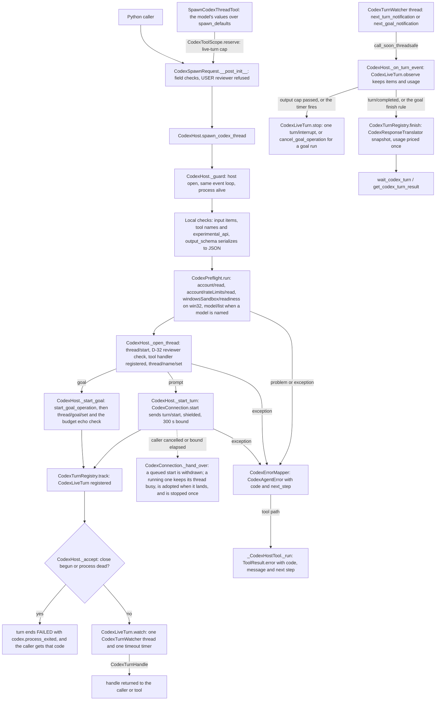
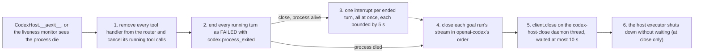

feat(harnesses): add CodexHost with one agent tool per Codex function

## Summary

This PR adds `CodexHost`, an async context manager in `vidbyte.harnesses.native.codex`. It runs one installed `codex app-server` process and offers 15 small async functions over it: readiness, rate limits, models, spawn, continue, fork, list, read, wait, get, steer, interrupt, usage, launch subagents and review. Starting work returns a `CodexTurnHandle` as soon as Codex accepts the turn, and `wait_codex_turn` or `get_codex_turn_result` returns a validated `CodexTurnSnapshot` later. Every failure reaches the caller as a `CodexAgentError` with a `codex.*` failure code and a next step, and every function is also one READ or WRITE agent tool, bundled as `CodexHostTools`. The decision that matters most: the host drives openai-codex's sync `CodexClient` directly, runs every call on its own worker pool under a 300 s bound, and keeps owning a turn-starting call that outlives its caller, stopping that turn with one interrupt, so no paid turn is left running unowned. Spec: `docs/spec/codex-host/spec.md` (r6).

## Motivation

Today the only Codex entry point in the SDK is `CodexHarnessAgent`. It opens one app-server per run and keeps no handle, so nothing outside the run can wait on, steer, interrupt or fork a turn. openai-codex 0.162.1 has no high-level call for rate limits, Windows sandbox readiness, review, goal token budgets, fork-from-a-turn or model paging, and its failures arrive as raw SDK exceptions, some of which quote the app-server's stderr. The request was a small vocabulary of atomic Codex functions that each handle their own errors with semantic messages, each exposed as a tool under `vidbyte/tools`, running the user's installed `codex` (request.md §C). This PR covers the ★ rows of that request only. The unstarred functions, ClaudeHost (draft PR #1044) and any base shared by the two hosts are separate PRs.

## How to use what this PR introduces

```python
import asyncio

from vidbyte.harnesses.native.codex import CodexHost
from vidbyte.lib.dataclasses.codex import CodexThreadSettings
from vidbyte.lib.dataclasses.codex_host import CodexSpawnRequest
from vidbyte.lib.enums.codex import CodexSandbox
from vidbyte.tools.toolsets import CodexHostTools

async def main() -> None:
    async with CodexHost() as host:  # runs the `codex` on PATH; codex_bin overrides it
        readiness = await host.check_codex_ready()
        print(readiness.ready)  # True, or False with readiness.problems
        handle = await host.spawn_codex_thread(CodexSpawnRequest(
            prompt="Summarize the project readme in one sentence.",
            thread=CodexThreadSettings(sandbox=CodexSandbox.READ_ONLY),
            max_output_tokens=2_000,  # Vidbyte interrupts the turn past this
        ))
        outcome = await host.wait_codex_turn(handle, timeout_seconds=600.0)
        print(outcome.status.value, outcome.result.final_response)
        tools = CodexHostTools(host, max_live_turns=2)  # one tool per function
        print(len(tools), tools.names()[0])  # 15 check_codex_ready

asyncio.run(main())
```

This is spec §4 exactly as written. I ran it on this branch at the test seam the AC-1 test uses: the in-memory app-server in `tests/features/codex_host/codex_host_fakes.py`, behind a subclass of the real openai-codex `CodexClient`. The fake supplied the answer text. It printed:

```text
True
completed The readme describes the SDK.
15 check_codex_ready
```

The fake logged `initialize` and `account/read`, then `windowsSandbox/readiness`, because the run was on win32. The spawn then sent `account/read`, `account/rateLimits/read`, `windowsSandbox/readiness`, `thread/start` (with `approvalPolicy: on-request`, `approvalsReviewer: auto_review` and `sandbox: read-only`) and `turn/start`. Every request ran on the host's own worker thread, `codex-host_0`, and the client closed on the `codex-host-close` thread. A live run against a signed-in `codex` spends the user's plan, so it is manual QA and was not run. The developer no longer writes JSON-RPC by hand, parses SDK exceptions, or blocks an agent inside one long tool call: the turn comes back as a handle, and its result comes later.

## Flow





- **Validation** happens before anything spends, in three places: the `CodexSpawnRequest` constructor, the host's local checks of the input, tool names and answer schema, and `CodexPreflight`. The D-32 check then reads the reviewer Codex reports on `thread/start` or `thread/resume`, and stops before any name, turn or goal request if approvals would go to a person.
- **State** changes only on the event loop. A turn is registered before its handle is returned, and `CodexLiveTurn.finish` ends it once, so the first outcome wins. Watcher threads and the liveness monitor only read and post with `call_soon_threadsafe`.
- **Failures** are caught where Codex is called, in `CodexConnection`, and built in one place, `CodexErrorMapper`, always raised `from None`. Tools turn them into error results, and only cancellation propagates. Steps 4 to 6 of the close run in a `finally`, so a cancelled close still closes the client.

## What changed

| File | Change |
|---|---|
| `vidbyte/harnesses/native/__init__.py` | New parent package for native coding-harness hosts. Its bytes are fixed by the request and identical in PR #1044. |
| `vidbyte/harnesses/native/codex/__init__.py` | Exports `CodexHost` and the six module functions. |
| `vidbyte/harnesses/native/codex/host.py` | `CodexHost`: open and close, the 15 methods, late acceptance of starts, and process-death handling. |
| `vidbyte/harnesses/native/codex/connection.py` | `CodexConnection` (the client, a 32-worker executor, bounded calls, shielded starts, the liveness monitor, the close thread) and `CodexServerRequestRouter`. |
| `vidbyte/harnesses/native/codex/turns.py` | `CodexLiveTurn`, `CodexGoalTurn`, `CodexGoalFinishRule`, `CodexTurnWatcher` and `CodexTurnRegistry`, with a usage ledger per thread. |
| `vidbyte/harnesses/native/codex/wire.py` | `CodexParamsTranslator` and `CodexResponseTranslator`: params out, records and snapshots in. |
| `vidbyte/harnesses/native/codex/preflight.py` | `CodexPreflight`: sign-in, usage, Windows sandbox, model, busy and existence checks, and the per-operation field rules. |
| `vidbyte/harnesses/native/codex/errors.py` | `CodexErrorMapper`: problem records, errors, and the mapping from SDK exceptions to `codex.*` codes. |
| `vidbyte/harnesses/native/codex/oneshot.py` | Six module functions that each open a host for one read or fork. |
| `vidbyte/lib/dataclasses/codex_host.py` | 15 frozen, slotted, self-validating records, such as `CodexSpawnRequest`, `CodexTurnHandle` and `CodexTurnSnapshot`. |
| `vidbyte/lib/enums/codex.py` | 13 new `str, Enum` classes with openai-codex wire values. |
| `vidbyte/lib/enums/__init__.py` | Exports the 13 enums at their sorted positions. |
| `vidbyte/lib/enums/failure.py` | 15 `codex.*` `FailureCode` members, right after `CODEX_RUN_OPTION_UNSUPPORTED`. |
| `vidbyte/lib/constants/codex.py` | Classification rows and next steps for the new codes, the host bounds, the JSON-RPC method names and the wire tables. |
| `vidbyte/lib/errors/base.py` | A keyword-only `next_step` on `CodexAgentError`. |
| `vidbyte/agents/codex/tools.py` | Extracts `CodexToolTranslator.validate_names` and `CodexToolBridge.handler` so the host can reuse them. No behaviour change. |
| `vidbyte/tools/builtins/codex/_base.py` | `CodexToolScope` (the live-turn cap, the developer's spawn defaults, the handles it owns) and the `_CodexHostTool` base. |
| `vidbyte/tools/builtins/codex/descriptions.py` | Model-facing descriptions for every tool and parameter. |
| `vidbyte/tools/builtins/codex/readiness.py` | Three READ tools: readiness, rate limits, models. |
| `vidbyte/tools/builtins/codex/threads.py` | Spawn, continue and fork (WRITE); list and read (READ). |
| `vidbyte/tools/builtins/codex/live.py` | Wait, get and usage (READ); steer and interrupt (WRITE). |
| `vidbyte/tools/builtins/codex/delegation.py` | Launch subagents and review (WRITE). |
| `vidbyte/tools/builtins/codex/__init__.py` | Exports the 15 tools and `CodexToolScope`. |
| `vidbyte/tools/builtins/__init__.py` | Re-exports the 15 tools. |
| `vidbyte/tools/toolsets/codex.py` | `CodexHostTools`, the 15 tools over one host and one scope. |
| `vidbyte/tools/toolsets/__init__.py` | Exports `CodexHostTools`. |
| `vidbyte/harnesses/README.md` | One `native/` bullet (fixed text, identical in PR #1044). |
| `REPO_MAP.md` | One `vidbyte/harnesses/native/` section (fixed text, identical in PR #1044). |
| `tests/features/codex_host/codex_host_fakes.py` | An in-memory app-server behind a subclass of the real `CodexClient`, so the SDK's reader thread and routing run for real. |
| `tests/features/codex_host/codex_host_support.py` | `HostTestCase`, a stub host, the spec literals and privacy canaries. |
| `tests/features/codex_host/test_codex_host_lifecycle.py` | 13 tests: the §4 snippet, open, guards, close order, the module functions. |
| `tests/features/codex_host/test_codex_host_threads.py` | 19 tests: readiness, models, continue, fork, list, read, launch, field rules, the reviewer check. |
| `tests/features/codex_host/test_codex_host_turns.py` | 13 tests: spawn params, preflight, wait, timeout, output cap, errors, schema, steer, interrupt, usage, process death. |
| `tests/features/codex_host/test_codex_host_review_goals.py` | 9 tests: review and goal runs. |
| `tests/features/codex_host/test_codex_host_failures.py` | 6 tests: late acceptance and privacy. |
| `tests/features/codex_host/test_codex_host_tools.py` | 17 tests: the toolset, permissions, error results, the cap, ownership, MCP. |
| `tests/features/codex_host/test_codex_host_records.py` | 11 tests: record validation, failure codes, constants. |
| `tests/features/codex_host/test_codex_host_packaging.py` | 7 tests: no SDK import, the shared-file bytes, the export lists. |
| `tests/features/codex_host/test_codex_host_sdk_contract.py` | 3 tests that pin the openai-codex surface the host uses. |
| `tests/features/codex_host/test_codex_host_bridge.py` | 2 tests for the extracted bridge helpers. |
| `tests/features/codex_host/test_codex_host_router.py` | 1 test: the router answers every server request and never raises. |
| `tests/features/codex_host/test_codex_host_review_gaps.py` | 15 regression tests for review findings R-1, R-2, R-6, R-7, R-10, R-12 to R-14, R-26 and R-27. |
| `tests/features/codex_host/FEATURE.md`, `README.md` | The pack's map and how to run it. |
| `docs/spec/codex-host/spec.md` | The spec, r6, now `status: pr-open`, with §5 redrawn to match this flow. |
| `docs/spec/codex-host/` (other files) | The pipeline record: `request.md`, `test-plan.md`, `review.md`, `verify-log.md`, `pipeline.md`, `context/code-map.md`, this `pr-body.md`, and 18 stage reports under `reports/`. |

## Compatibility

- **Packaging.** `pyproject.toml` is not changed (`git diff origin/main...HEAD -- pyproject.toml` is empty). The `codex` extra, `openai-codex>=0.162.1,<0.163.0` (pyproject.toml:42-44), already exists on main, and there is no new dependency. Importing `vidbyte`, `vidbyte.harnesses.native.codex`, `vidbyte.tools.builtins` or `vidbyte.tools.toolsets` never loads openai-codex (AC-2). The SDK is imported only when a host opens. The built wheel carries all 18 new modules.
- **Runtime.** Using the host needs the `vidbyte-sdk[codex]` extra and an installed Codex CLI.
  - **Finding the binary.** `CodexHost.__aenter__` resolves it, not preflight (host.py:159-167). It runs `shutil.which(settings.codex_bin or "codex")` and launches the absolute path that comes back. When `launch_args_override` is set, that command runs as given and nothing is looked up. Unlike `CodexHarnessAgent`, the host never falls back to openai-codex's bundled binary (D-4).
  - **When the binary is missing.** No match raises `CodexAgentError` with `codex.not_installed`: "The Codex CLI could not be started from codex.", with the next step "Install the Codex CLI (npm install -g @openai/codex) or pass CodexClientSettings(codex_bin=...)." A process that fails to start with an `OSError` gets the same code and names the path. A missing openai-codex also gets `codex.not_installed`, with the next step `pip install "vidbyte-sdk[codex]"`.
  - **Version.** A runtime older than 0.151.0, or one whose version cannot be read, is refused with `codex.version_unsupported`, and the client is closed.
- **Public API.** The new names live only in subpackages:
  - `vidbyte.harnesses.native.codex`: `CodexHost` and the six functions;
  - `vidbyte.tools.builtins.codex`: the 15 tools and `CodexToolScope` (the tools are also re-exported from `vidbyte.tools.builtins`);
  - `vidbyte.tools.toolsets`: `CodexHostTools`;
  - `vidbyte.lib.dataclasses.codex_host`: 15 records;
  - `vidbyte.lib.enums`: 13 enums;
  - `FailureCode`: 15 `codex.*` members.

  The root `vidbyte` package gains no export. `contracts/sdk-public-api.json` is unchanged, and `--check` passes (606 exports). No existing export is removed or renamed: every touched `__all__` only gains entries.
- **`vidbyte/lib/errors/base.py`** (+4/−1). `CodexAgentError.__init__` gains a keyword-only `next_step=""`. When `next_step` is not passed, the error's packet and `repair_approaches` are the same as on main, so existing callers see no change.
- **`vidbyte/agents/codex/tools.py`** (+15/−3). `translate` and `attach` now call the two extracted helpers. They run the same checks, with the same messages, in the same order. `tests/test_codex_tools.py` passes unchanged, so `CodexHarnessAgent` behaves as before.
- **Merge order with PR #1044 (ClaudeHost).** The two branches touch eight of the same files.
  - Three are byte-identical on both branches: `vidbyte/harnesses/native/__init__.py`, `REPO_MAP.md` and `vidbyte/harnesses/README.md`. They merge cleanly.
  - Five get entries from both PRs in their sorted export lists or neighbouring blocks: `vidbyte/lib/enums/__init__.py`, `vidbyte/lib/enums/failure.py`, `vidbyte/lib/errors/base.py`, `vidbyte/tools/builtins/__init__.py` and `vidbyte/tools/toolsets/__init__.py`.

  Whichever PR merges second needs a catch-up merge from main. Merge it, do not rebase it. Expect small conflicts in those five files, and resolve them by keeping both PRs' entries in sorted order.

## Acceptance criteria → proof

Test files are in `tests/features/codex_host/`. All 78 test names below exist on this branch.

| AC | What it checks (plain words) | Proven by |
|---|---|---|
| AC-1 | The §4 snippet prints `True`, `completed <answer>`, `15 check_codex_ready` | `test_codex_host_lifecycle.py::test_the_section_4_snippet_prints_its_three_lines` (fake seam; a live run is manual QA) |
| AC-2 | Importing the packages and building the toolset never loads openai-codex; opening without it names the pip extra | `test_codex_host_packaging.py::test_imports_never_load_the_sdk_and_entering_reports_the_pip_extra`, `::test_imports_leave_an_installed_sdk_unloaded` |
| AC-3 | A missing `codex` is `codex.not_installed` and starts nothing; an override skips the lookup; the found path is what runs | `test_codex_host_lifecycle.py::test_a_missing_codex_binary_is_not_installed_and_starts_nothing`, `::test_the_resolved_path_is_launched_and_a_launch_override_skips_resolution`, `::test_a_process_that_cannot_start_is_not_installed_naming_the_path` |
| AC-4 | A runtime below 0.151.0, or with an unreadable version, is refused and the client closed | `test_codex_host_lifecycle.py::test_versions_below_the_minimum_or_unparseable_are_refused_and_the_client_closed` |
| AC-5 | Spawn sends the right `thread/start`, `thread/name/set` and `turn/start` params, and returns while the turn runs | `test_codex_host_turns.py::test_spawn_sends_the_section_9_2_params_and_returns_while_the_turn_runs` |
| AC-6 | Each failed preflight check stops spawn, continue, review and launch before anything spends | `test_codex_host_turns.py::test_a_failed_preflight_check_stops_every_spending_operation_before_it_spends`, `::test_preflight_passes_on_unknown_states_and_skips_checks_that_do_not_apply` |
| AC-7 | A bounded wait returns RUNNING and leaves the turn running | `test_codex_host_turns.py::test_a_bounded_wait_returns_running_and_never_touches_the_turn` |
| AC-8 | A completed turn reports its answer and usage, and get never waits | `test_codex_host_turns.py::test_a_completed_turn_reports_its_answer_and_usage_and_get_never_waits` |
| AC-9 | A timeout sends one interrupt and labels the turn `codex.turn_timed_out` | `test_codex_host_turns.py::test_a_timeout_sends_one_interrupt_and_labels_only_a_turn_codex_reports_interrupted` |
| AC-10 | Passing `max_output_tokens` sends one interrupt and labels `codex.budget_exhausted`; staying at or under it sends none | `test_codex_host_turns.py::test_the_output_cap_counts_only_the_turns_own_tokens_and_interrupts_once` |
| AC-11 | A dead app-server fails the running turn and later calls with `codex.process_exited`, without leaking stderr or a raw stdout line | `test_codex_host_turns.py::test_process_death_fails_the_running_turn_and_later_calls_without_leaking_stderr`, `::test_a_non_json_stdout_line_kills_the_host_without_leaking_the_line` |
| AC-12 | Each `codexErrorInfo` maps to its code, and an unknown one to `codex.api_error` | `test_codex_host_turns.py::test_a_failed_turn_maps_each_codex_error_info_to_its_code` |
| AC-13 | A valid answer is parsed, an invalid one keeps its text with `codex.schema_violation`, a missing one is `codex.response_invalid` | `test_codex_host_turns.py::test_structured_output_is_validated_and_a_missing_answer_is_invalid` |
| AC-14 | Continue reads, resumes without turns and starts a turn; a busy or unknown thread and unusable overrides are refused first | `test_codex_host_threads.py::test_continue_reads_resumes_without_turns_then_starts_a_turn`, `::test_continue_and_review_refuse_a_busy_or_unknown_thread`, `::test_two_concurrent_continues_on_one_idle_thread_start_one_turn`, `::test_fields_an_operation_cannot_apply_are_rejected_before_any_request` |
| AC-15 | Fork goes through a completed turn; a bad fork point fails before `thread/fork` | `test_codex_host_threads.py::test_fork_reads_the_turns_first_and_forks_through_a_completed_turn`, `::test_fork_maps_codex_refusals_and_unknown_threads` |
| AC-16 | Steer sends `expectedTurnId`; interrupt sends one `turn/interrupt`; a finished turn is refused or ignored | `test_codex_host_turns.py::test_steer_and_interrupt_act_only_on_a_running_turn_this_host_returned` |
| AC-17 | Usage lists the ended turns with their own deltas, their sum and the rollup cost | `test_codex_host_turns.py::test_usage_tracking_lists_terminal_turns_with_their_own_deltas_and_rollup_cost` |
| AC-18 | Launch starts one thread per prompt in order; over the limit it starts nothing; a mid-way failure interrupts what started | `test_codex_host_threads.py::test_launch_starts_one_thread_per_prompt_in_order_after_one_preflight`, `::test_a_launch_that_fails_midway_interrupts_each_turn_it_started_once`, `::test_fields_an_operation_cannot_apply_are_rejected_before_any_request` |
| AC-19 | A review is sent once and tracked to its end, including both registration races | `test_codex_host_review_goals.py::test_a_review_is_sent_once_with_its_target_and_tracked_to_completion`, `::test_a_review_turn_that_finished_before_registration_is_read_back`, `::test_a_review_whose_final_item_was_dropped_is_completed_from_the_completion_read_back` |
| AC-20 | A goal starts, then its budget is set once; a mismatch or failure cleans up in openai-codex's order; goal states map to outcomes | `test_codex_host_review_goals.py::test_a_goal_spawn_starts_goal_mode_then_sets_the_budget_once`, `::test_a_failed_budget_set_cleans_up_in_openai_codex_start_failure_order`, `::test_a_finished_goal_run_maps_the_goal_table_and_closes_its_stream`; `test_codex_host_records.py::test_each_invalid_record_raises_configuration_error_naming_the_field` |
| AC-21 | List sends every set filter and leaves empty ones out; read returns turn summaries only when asked | `test_codex_host_threads.py::test_list_sends_every_set_argument_and_omits_the_empty_ones`, `::test_read_returns_turn_summaries_only_when_asked` |
| AC-22 | Readiness has no email; rate limits keep a `None` allowance; models cover every page | `test_codex_host_threads.py::test_readiness_reports_account_and_sandbox_without_the_email`, `::test_rate_limits_and_models_are_translated_across_pages` |
| AC-23 | 15 tools in order; the default policy allows the 8 READ tools and denies the 7 WRITE tools | `test_codex_host_tools.py::test_toolset_holds_the_fifteen_tools_with_their_spec_schemas`, `::test_default_policy_allows_the_read_tools_and_denies_the_write_tools` |
| AC-24 | Every host error becomes an error result with code and next step; cancellation propagates and frees the slot | `test_codex_host_tools.py::test_every_tool_turns_host_errors_into_error_results`, `::test_cancellation_propagates_and_frees_the_reserved_slot` |
| AC-25 | The cap refuses turn-starting tools before the host; handle tools accept only their own scope's handles | `test_codex_host_tools.py::test_cap_refuses_turn_starting_tools_without_reaching_the_host`, `::test_handle_tools_accept_only_their_own_scope_while_thread_tools_accept_any_thread` |
| AC-26 | The spawn tool takes the posture from `spawn_defaults` and six values from the model; exactly one of prompt and goal | `test_codex_host_tools.py::test_spawn_takes_the_posture_from_defaults_and_six_values_from_the_model`, `::test_spawn_needs_exactly_one_of_prompt_and_goal_objective` |
| AC-27 | The existing MCP server lists and runs the toolset with no MCP code change | `test_codex_host_tools.py::test_mcp_server_lists_and_runs_the_toolset` |
| AC-28 | `CodexHarnessAgent`'s tool tests pass unchanged, and the extracted helpers keep their messages | `tests/test_codex_tools.py` (unchanged, passes in the source stage); `test_codex_host_bridge.py::test_validate_names_raises_the_two_existing_messages`, `::test_handler_runs_tools_under_the_bridge_policy_and_falls_back_otherwise` |
| AC-29 | The 15 failure codes sit in place, each with a classification row and a next step | `test_codex_host_records.py::test_new_failure_codes_sit_right_after_run_option_unsupported`, `::test_each_new_code_has_its_classification_row_and_next_step` |
| AC-30 | The router answers every server request and never raises | `test_codex_host_router.py::test_the_router_answers_every_server_request_and_never_raises` |
| AC-31 | Each module function opens and closes one host; module `check_codex_ready` reports a missing binary instead of raising | `test_codex_host_lifecycle.py::test_each_module_function_opens_and_closes_one_host_whether_it_succeeds_or_fails`, `::test_module_check_codex_ready_reports_a_missing_binary_instead_of_raising` |
| AC-32 | A start that outlives its caller or bound is owned and interrupted once; a queued one is never sent; one after close is FAILED | `test_codex_host_failures.py::test_a_spawn_cancelled_while_turn_start_is_in_flight_owns_the_turn`, `::test_a_spawn_whose_start_outlives_the_request_bound_gets_api_error_and_the_turn_is_owned`, `::test_a_review_cancelled_in_flight_is_interrupted_once_and_read_back`, `::test_a_start_still_queued_behind_a_blocked_worker_is_never_sent`, `::test_a_start_that_returns_after_close_began_is_registered_failed_and_sends_nothing` |
| AC-33 | The guards (not open, closed, opened twice, another loop) and the close order for turns, tool calls and goal runs | `test_codex_host_lifecycle.py::test_a_host_answers_only_while_open_and_opens_at_most_once`, `::test_a_closed_host_answers_local_reads_and_refuses_calls_that_talk_to_codex`, `::test_a_call_from_another_event_loop_is_refused`, `::test_close_interrupts_a_running_turn_once_then_closes_on_a_daemon_thread`, `::test_close_cancels_a_running_tool_call_before_sending_interrupts`, `::test_close_ends_a_goal_run_in_openai_codex_order_and_its_watcher_exits` |
| AC-34 | No error, record or tool output carries the email, a secret or stderr text | `test_codex_host_failures.py::test_no_error_record_or_tool_output_carries_a_private_value`; `test_codex_host_turns.py::test_process_death_fails_the_running_turn_and_later_calls_without_leaking_stderr`, `::test_a_non_json_stdout_line_kills_the_host_without_leaking_the_line`; `test_codex_host_threads.py::test_readiness_reports_account_and_sandbox_without_the_email` |
| AC-35 | Each invalid record names its field; a USER reviewer raises `configuration.unsupported_combination` | `test_codex_host_records.py::test_each_invalid_record_raises_configuration_error_naming_the_field`, `::test_user_reviewer_is_refused_when_any_spawn_request_is_built`, `::test_review_target_fields_follow_their_kind_exhaustively`, `::test_snapshot_status_result_and_problem_rule_exhaustively` |
| AC-36 | The full gate and Semgrep pass, and the shared files hold their fixed bytes and sorted entries | `test_codex_host_packaging.py::test_native_package_marker_has_the_fixed_bytes`, `::test_repo_map_section_sits_between_the_harnesses_paragraph_and_stores`, `::test_harnesses_readme_bullet_follows_the_serialization_bullet`, `::test_new_packages_export_exactly_their_spec_lists`, `::test_existing_export_lists_gain_only_the_new_names_in_place`; the gate rows under Verification |
| AC-37 | A `user` reviewer that Codex reports stops spawn, goal, launch and continue before any turn; an override fixes continue | `test_codex_host_threads.py::test_a_user_reviewer_reported_after_thread_start_stops_spawn_goal_and_launch`, `::test_the_reported_policy_decides_whether_a_user_reviewer_may_start`, `::test_continue_checks_the_reviewer_resume_reports_and_an_override_fixes_it` |

## Verification

I ran the local rows on `5c65eec8`, whose code equals this PR's head: the commits after it change only `docs/spec/codex-host/`. `$W` is the worktree, and the Python is a venv with `.[dev,codex]` and openai-codex 0.162.1.

| Gate | Command | Result |
|---|---|---|
| Feature pack | `PYTHONPATH=$W python -P -m pytest tests/features/codex_host -q` | `116 passed in 7.90s` |
| Feature pack, CI view | the same, with `sys.modules['openai_codex'] = None` | `36 passed, 80 skipped in 1.87s` |
| §4 snippet | the AC-1 test body at the fake seam, printing to stdout | `True` / `completed The readme describes the SDK.` / `15 check_codex_ready` |
| Local gate, source stage | `PYTHONPATH=$W python scripts/run_ci.py --stage source` | `SDK-LINT: PASS` … `4122 passed, 22 skipped in 42.91s` / `CI passed.` |
| Local gate, package stage | `python scripts/run_ci.py --stage package` (no `PYTHONPATH`) | `Installed vidbyte-sdk 0.2.1 passed smoke checks.` / `CI passed.` |
| Public API contract | `python scripts/generate-sdk-public-api.py --check` | `contracts/sdk-public-api.json is current at f7a02bae175913f4ab1cd25d89bfce5ae78e86d0 (vidbyte-sdk 0.2.1, 606 exports).` |
| A002, the 27 branch files | `python lint/run.py --rule A002 --all --format json`, filtered to `git diff --name-only $(git merge-base origin/main HEAD) HEAD -- vidbyte` | `found 579 baseline 703 verdict IMPROVED`. The 4 rows in branch files are main's own `lib/errors/base.py` `__init__` methods, none of them on a line the branch added |
| Remote CI | `gh workflow run ci.yml --ref feat/codex-host` → run 38621314395 on `601daff9` | `Source / Python 3.12`: `4045 passed, 99 skipped, 19 warnings in 43.35s` / `CI passed.` `Source / Python 3.11` failed twice on timeouts in files this PR does not touch (below). `Package` was skipped, because it waits on both source jobs |
| Remote static policy (Semgrep) | `gh workflow run static-policy.yml --ref feat/codex-host` → run 38621318168 on `601daff9` | success: `Ran 1 rule on 911 files: 0 findings.` |
| Remote CI, earlier head | run 38530861705 on `780c26f4`, whose code is identical | success: `Source / Python 3.11` (`4045 passed, 99 skipped in 45.26s`), `Source / Python 3.12`, `Package` |
| `gh pr checks` | `gh pr checks https://github.com/cerredz/Vidbyte-SDK/pull/1055` | `no checks reported on the 'feat/codex-host' branch`. Both workflows run only on dispatch, so their results are read with `gh run view` |

On `601daff9`, the 3.11 job's first attempt ended `1 failed, 4044 passed, 99 skipped in 44.45s`. The failure was `tests/test_mcp_stdio_transport.py::McpStdioTransportHardeningTests::test_cancelled_waiter_does_not_break_transport`, which raised `MCP request timed out` after its 5 s bound. A rerun of the failed job ended `2 failed, 4043 passed, 99 skipped in 70.76s`: the same test, plus the known flake `test_coding_agent_environment.py::test_real_bash_reports_its_version_and_git` ("bash did not finish within 15 seconds"). Both tests wait on a child process under a fixed timeout. This PR touches neither file, and both passed on `780c26f4`. Locally, the pack's CI view followed by `tests/test_mcp_stdio_transport.py`, in one process, passed 3 runs out of 3 (`58 passed, 80 skipped`).

Remote CI installs `.[dev]` without the `codex` extra. There, the pack runs as in the CI-view row: 36 tests run and the 80 host tests skip. The 116-test run and the §4 snippet need the extra, and I ran them locally. Semgrep was not run locally, because this machine's global Semgrep install is broken by an `mcp` 2.x import. The static-policy run is the Semgrep evidence.

- [x] Existing repository checks pass: both local `run_ci` stages, the remote `static-policy.yml` run, and the remote `ci.yml` run on `780c26f4`, whose code is identical. On `601daff9`, the 3.11 job failed only on the two timeouts described above.
- [x] New or changed package assets are present in the built wheel: the package-stage build log adds all 18 new modules, from `vidbyte/harnesses/native/__init__.py` to `vidbyte/tools/toolsets/codex.py`.
- [x] Documentation and examples reflect the change: the `REPO_MAP.md` section, the `vidbyte/harnesses/README.md` bullet, an A001 header in every new file, and the usage example above. The repo has no `examples/` folder. `llms.txt` and `artifacts/file_index.md` are untouched, and the spec's file list (§12.3) does not name them.
- [x] No credentials, private data, generated bytecode, build output, or unrelated changes are included: a scan of the added lines finds no key, token or email pattern; `git ls-files` lists 0 `.pyc` files; and every changed path is under `vidbyte/`, `tests/features/codex_host/`, `docs/spec/codex-host/` or is `REPO_MAP.md`.

## Adversarial review

An independent verifier confirmed 32 findings. 25 came from the first review, which used three lenses: spec conformance, repo conventions and engineering. 7 came from two scoped re-review rounds, which used the conformance lens. Of the 32, 17 were must-fix (5 Blockers and 12 Majors) and 15 were Minors. 24 are fixed: 23 in code or tests, and R-29 in spec r6. 0 were waived, and 8 Minors are listed under Follow-ups. The last fix commit, `888db88f` (R-30 and R-31), changes only `#` comment lines under `vidbyte/` (9 added, 5 removed). It landed after the second and final re-review, so no independent reviewer has read it. Going on without a third round was the user's decision. Full record: `docs/spec/codex-host/review.md`.

| ID | Finding | Fixed in |
|---|---|---|
| R-1 (Blocker) | A review whose caller was cancelled during its read-back was never watched or interrupted, so it stayed RUNNING and kept its thread busy | `2f098372` |
| R-2 (Blocker) | An unusable `output_schema` failed only after `thread/start` had created a stored thread | `6856645b` |
| R-3 (Blocker) | Goal status, sandbox readiness and the approval default traveled as plain `str` although their enums exist | `8f6975e8` |
| R-4 (Blocker) | `CodexHost` helpers called helpers two and three levels deep | `846ce849` |
| R-5 (Blocker) | 172 added comment lines were wider than 72 columns | `08d498d8` |
| R-6 (Major) | A cancelled launch left the turns it had started running, unowned and outside the cap | `4d597f91` |
| R-7 (Major) | A close cancelled during its interrupts never closed the client, which leaked the process | `52e9e313` |
| R-8 (Major) | Two argument checks were reshaped to dodge lint C002, excused by a wrong spec deviation | `f2e9db7e` (deviation withdrawn in spec r5, `bbe9672f`) |
| R-9 (Major) | Seven new functions lacked the `# @intent` marker, hidden by A002's baseline slack | `fad8c55f` |
| R-10 (Major) | Continue and review freed the thread while their start was still in flight, so a retry could start a second paid turn | `874bd5a3` |
| R-11 (Major) | 16 JSON-RPC method names were inline literals that the error mapping depends on | `528e5ef6` |
| R-12 (Major) | The tool description promised a schema check that a mapping `output_schema` never gets | spec r5 `bbe9672f`; code and tests `4a9ecc49` |
| R-13 (Major) | The late-acceptance tests checked only the status, so two mutants survived | `d894d87a` |
| R-14 (Major) | No test proved that the launch tool frees its cap slots on failure or cancellation | `168282f4` |
| R-26 (Major) | R-2's refusal put a library exception's text into the error and chained it | `30109e89`; a cyclic schema's `RecursionError` was fixed in `736d4a58` |
| R-27 (Major) | After any failed stop, every later user interrupt became a silent no-op | `ad363725` |
| R-30 (Major) | R-27's fix left `interrupt_codex_turn` without its `# @intent` line | `888db88f` (comment-only; not re-reviewed) |

## Deviations from the spec

- **S3's deviation 1 is withdrawn.** Two argument checks were reshaped for lint C002. R-8 (`f2e9db7e`) replaced them with the shared `_reject_bad_seconds` and `_reject_small_int` helpers, so nothing deviates there now.
- **A process death also closes goal streams** (§17 deviation 2). D-27 runs close steps 1 and 2 on death. The code also closes each ended goal run's stream (step 4), so its watcher thread exits, and then reaps the process (host.py:757-768).
- **The one stop lives on `CodexLiveTurn`** (R-4). §12.3 row 15 says the host's late-acceptance handler sends the interrupt. In the code, `CodexLiveTurn.stop` sends it (turns.py:166), so the host's helpers stay one call deep. The outcome is the same: one interrupt, and the first stop wins.
- **A handed-over start keeps its thread busy** (R-10). INV-24 names only running and reserved turns. `CodexConnection` also keeps a set of threads whose start outlived its caller (connection.py:149, :244-269), and `CodexPreflight.require_idle` counts them as busy.
- **Interrupt also skips while a stop is still pending** (R-16, R-27). §9.2's interrupt row skips only a finished turn. The code also returns `None`, sending nothing, while an earlier stop of that turn is still being awaited (host.py:410). A stop that failed blocks nothing.
- **A cyclic schema is refused, beyond the review packet** (`736d4a58`). A mapping `output_schema` with a cycle under `properties` or `items` is refused before any request with the EC-82 `ConfigurationError` ("… Got RecursionError."). Before the fix, it raised `RecursionError`.
- **The notification-name constants are not read.** §9.3 calls the six `CODEX_*_NOTIFICATION` constants "notification names the watcher reads". The watcher matches openai-codex's typed notification models instead (turns.py:102-107). The constants (constants/codex.py:366-371) are defined and pinned by `test_codex_host_records.py`, but no source file reads them.
- **§5 is redrawn.** Spec §5 showed preflight before the params translator, with no schema check, no hand-over and one shared stop. This PR's last spec commit redraws it to match the flow above (§17).

## Follow-ups

- **R-19.** A finished turn keeps its item list after the snapshot copied it, so item memory doubles for the host's lifetime (turns.py:82).
- **R-20.** The rule that a prompt carries no context is written twice, with two messages (codex_host.py:170-178, wire.py:247-249).
- **R-21.** Several `# @intent` tags narrate the code instead of giving the rule's reason.
- **R-22.** The internal boolean flags `late`, `cleanup` and `quiet` switch behaviour inside one function.
- **R-23.** At close, `shutdown(cancel_futures=True)` gives a caller whose call is still queued `CancelledError` instead of `codex.process_exited`. This needs every host worker blocked (connection.py:358).
- **R-24.** Two boundary mutants survive the pack: launch `limit` checked with `>=`, and a user interrupt that does not set `stop_sent`. Two tests would pin them.
- **R-32.** No test pins `stop_pending` on the user path, where a second user interrupt arrives while the first is in flight. `FEATURE.md:100` and `test_codex_host_review_gaps.py:395` say it is covered, but only Vidbyte's own timeout stop in flight is tested.
- **R-25, an optional idea (default no; Q-10).** Validate a mapping `output_schema` answer locally against its JSON Schema. It needs a new dependency, or a change to the shared `OutputSchemaFormatter` that would also change `CodexHarnessAgent`.
- **Accepted residual (R-1).** A review that finished before its registration, and whose caller is also cancelled during the read-back, stays RUNNING until close.
- **Accepted residual (R-31's window).** Take a user interrupt whose await was cancelled or outlived its 300 s bound while its request was still on a worker, or Vidbyte's own timeout stop past that bound. A second user interrupt then sends a second `turn/interrupt`. The turn still ends INTERRUPTED, and the first stop's label stays.
- **Known limitation on Windows (A-1, EC-69).** `shutil.which("codex")` returns npm's launcher; on this machine that is `…\AppData\Roaming\npm\codex.CMD`. openai-codex's `CodexClient.close()` closes stdin, then terminates only the process it launched, which is that launcher. It does no process-tree kill. The app-server stops when it sees stdin close, and close first sends every running turn one interrupt. A process-tree kill is not built.
- **Known limitation (EC-68).** openai-codex answers a dynamic tool call on its single reader thread, so while a tool runs, every other event and response on that host waits. The `CodexHostTools` and `CodexSpawnRequest` docstrings say to keep tools short, or to give tool-using threads their own host.
- **Notification constants.** The six unread `CODEX_*_NOTIFICATION` constants (see Deviations) could be removed, or §9.3 corrected.
- **Manual QA.** Run the §4 snippet against a signed-in `codex` 0.151.0 or newer. It spends the user's plan.
- **Open questions with "no" as their default** (spec §15):
  - Q-4: root `vidbyte` exports.
  - Q-7: a permission check on the MCP path.
  - Q-8: restricting the thread tools to threads their own toolset started.
  - Q-9: making `spawn_defaults` caps ceilings that model values cannot raise.
  - Q-10: R-25 above.

🤖 Generated with [Claude Code](https://claude.com/claude-code)
