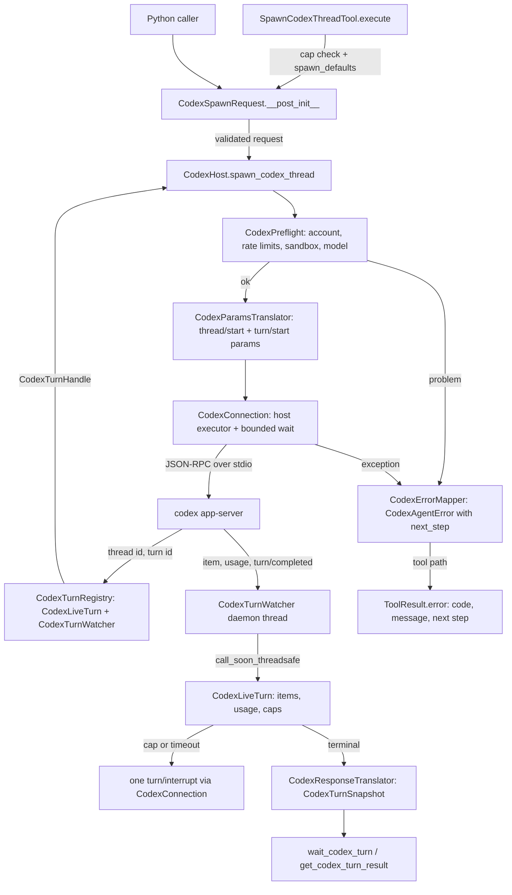
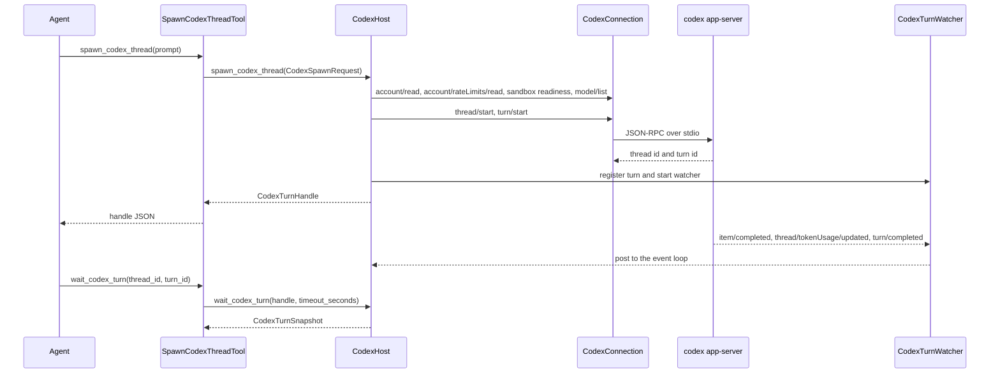

# Spec: CodexHost: small atomic Codex functions with one agent tool per function

> **TL;DR** — This PR adds `CodexHost`, an async context manager in `vidbyte.harnesses.native.codex`. It owns one Codex app-server process and exposes the 15 ★ functions as small async methods. Spawning returns a handle at once and `wait_codex_turn` collects the result later. Every failure becomes a `codex.<problem>` code with a next step. Each function also gets one READ or WRITE agent tool, and `CodexHostTools` bundles all fifteen. The decision that matters most is the transport: the host drives openai-codex's sync `CodexClient` directly, an underscore-free class that the package root does not export. Each call runs on a worker thread the host owns, under a bounded wait. That reaches the calls the high-level SDK API does not offer (rate limits, sandbox readiness, review, goal budget, fork from a turn, paged models) without reading any private attribute, and S012 stays at zero.

## §0 User prompts

### 0.1 Invoking request (verbatim)

```text
great, using the spec-pipeline skill file do you think that you can implement the Codexhost and ClaudeHost functionality in the vidbyte-sdk/ in parallel in 2 seperate prs. Coordinate 2 sets of subagents that use the skill file to develope the 2 features in parallel
```

### 0.2 User replies during the run

None yet. The orchestrator appends any reply the user sends during the run here verbatim, labeled with the revision it produced.

---

## Part A — Framing

## §1 Goal

**What hurts today.** The only Codex entry point in the SDK is `CodexHarnessAgent`.
- **Every run owns its own app-server.** Its transport opens one app-server per run, and no handle survives the call. So there is no way to wait on, steer or interrupt a turn from outside, and no way to fork from an earlier turn (code-map §2.4, C5).
- **Wire calls are left to the developer.** openai-codex 0.162.1 has no high-level wrapper for:
  - rate limits;
  - Windows sandbox readiness;
  - `review/start`;
  - goal token budgets;
  - fork-from-turn;
  - model paging.

  A developer has to drop to the low-level client and hand-build the JSON-RPC params for each one (code-map C4, C5, C24).
- **Failures arrive raw.** They surface as the SDK's own exceptions, such as `RuntimeError(turn.error.message)`, or as `TransportClosedError` carrying the app-server's stderr tail (code-map C13).
- **The user's goal.** In their words: "come up with a "vocabulary" for "launching a codex agent", forking a codex agent, launching a codex agent with x tools" (Prompt 1). They also want "simple agents" (Prompt 1) and "small, atomic, rueusable, and helper functions for interacting with codex in this class" (Prompt 2).

| ID | Goal (outcome) | How we will know | Source |
|---|---|---|---|
| G-1 | A developer drives Codex from Python with one small function per verb: check readiness, read rate limits and models, spawn, continue, fork, list, read, wait, steer, interrupt, track usage, fan out, and review. All of it runs against the user's installed `codex`. | The §4 snippet works (AC-1), and all 15 ★ functions exist on `CodexHost` with the §8.5 signatures (AC-5 to AC-22). | request.md §C (★ list); Prompt 2 |
| G-2 | Every failure reaches the caller as a semantic `codex.<problem>` code with a next step, never as a raw SDK exception. | INV-8, AC-12, AC-24 and AC-29 hold. | Prompt 2 ("return semantic error messages … each funciton shoulllld make sure to handle errors") |
| G-3 | Agents get each function as a tool, so they call a tool instead of improvising shell commands mid-run. | `CodexHostTools` holds 15 tools named after the functions (AC-23). | Prompt 2 ("connect each individual function to the vidbyte/tools folder …") |
| G-4 | Spending stays under the developer's control. | WRITE tools are denied by the default policy. Live tool turns are capped. Preflight checks run before any spend. Output-token caps and timeouts are enforced (INV-12, INV-18, INV-19, INV-32, AC-6, AC-9, AC-10, AC-23, AC-25). | request.md §C (Budgets, Tool permissions); R2 "What could go wrong" |
| G-5 | The same toolset serves MCP clients through the existing server with no new server code: the "agent terminal toolset mcp". | AC-27 | Prompt 1; request.md §C (MCP) |

## §2 Objective

When this PR merges, the SDK will have:
- **The native package.** `vidbyte.harnesses.native`, a parent package whose `__init__` holds the fixed shared bytes.
- **The Codex host.** `vidbyte.harnesses.native.codex`, which exports `CodexHost` and six module-level one-shot functions. `CodexHost` is an async context manager that owns one app-server and carries the 15 ★ methods of request.md §C.
- **Lib-layer contracts:**
  - 15 new records in a new Codex host records module beside the existing Codex dataclass module, including `CodexSpawnRequest`, which composes the existing Codex settings;
  - 13 new Codex enums;
  - 15 new `codex.*` `FailureCode` members, each with a classification row and a next step;
  - a keyword-only `next_step` on `CodexAgentError`;
  - the host's constants.
- **A behaviour-preserving extraction** of two helpers in `CodexHarnessAgent`'s tools module.
- **The tools.** Fifteen agent tools plus `CodexToolScope` in `vidbyte.tools.builtins.codex`, and the `CodexHostTools` toolset.
- **Documentation.** One repository-map section and one harnesses-README bullet.
- **Tests.** The S2 test pack's contract tests pass, and the full local gate passes.

This PR is slice 1 of the CodexHost catalog: the ★ rows. Later slices are the unstarred R3 rows, the ClaudeHost sibling (PR B, built in parallel) and a shared-pieces extraction PR. Each of these is a non-goal below.

## §3 Non-goals

- **NG-1** — The unstarred CodexHost functions from R3, such as:
  - `get_codex_version` and `run_codex_doctor`;
  - revert, compact and archive;
  - the goal get, pause and clear functions;
  - stream, diff and plan;
  - exec in the sandbox;
  - the MCP, skills, plugins, apps and config functions;
  - the cloud functions.

  *Why not:* R3's legend says "★ = first PR for that host" (request.md §C).
- **NG-2** — ClaudeHost, and any base class, module or helper shared between the two hosts (error envelope, tool base, handle registry). *Why not:* ClaudeHost is the sibling PR B. request.md §C says "There is no shared base module or extraction in either PR".
- **NG-3** — ⚑ functions. *Why not:* ⚑ marks Claude-only private-API functions, and they are deferred (request.md §C, Q1).
- **NG-4** — Root `vidbyte` exports and any change to the public-API contract file. *Why not:* every root export changes the contract and conflicts at the second parallel merge (request.md §C, open question "Root export"). Callers import from the subpackages (Q-4).
- **NG-5** — Any change to `CodexHarnessAgent`'s behaviour. *Why not:* request.md §C says "do not change `CodexHarnessAgent`'s behavior". Only two behaviour-preserving extractions are made (W-4).
- **NG-6** — Code in the MCP server package, a permission check on the MCP path, or a new CLI command. *Why not:*
  - request.md §C says "Add code there only if it cannot already serve a toolset", and it can (AC-27).
  - A permission check on the MCP path is an unrequested control (Q-7).
  - Nobody asked for a CLI command.
- **NG-7** — New dependencies, a pin change, or any change to the project manifest. *Why not:* request.md §C forbids any change to the project manifest in this PR.
- **NG-8** — An approval callback (`set_codex_approval_handler`). *Why not:* it is unstarred and marked ✗. Instead, a `user` reviewer is refused, whether the request names it or Codex reports it (D-16, D-32), and approval requests that still reach the host get the SDK's `accept` as a fallback (Q-3 resolved r2).
- **NG-9** — Editing the shared agent base module so that every agent automatically gets its own tool copy. *Why not:* that module is shared with PR B and is not on request.md §C's list of shared files (code-map C18). Instead, one toolset per agent is the developer's choice (D-10).
- **NG-10** — Restricting the continue, fork, read, review and track tools to threads their own toolset started. *Why not:* it is an unrequested control (Q-8). The residual risk is recorded under T-2.
- **NG-11** — A queueing concurrency cap for `launch_codex_subagents`, or an invented default limit. *Why not:* request.md §C says "Measure first; do not invent a threshold". `limit` defaults to `None` (Q-5).
- **NG-12** — Splitting, moving or editing anything in the existing 1,205-line Codex dataclass module. *Why not:* AGENTS.md ("Existing code") makes moving existing code a change of its own. The new records go in a new `codex_host` domain module instead, so the old module does not grow (D-26; Q-1 resolved r2).
- **NG-13** — Live Codex calls in automated tests, and CI credentials. *Why not:* request.md §C says "Automated tests make no live calls, and CI has no Codex credentials".
- **NG-14** — A folder README for the native package, or design documents. *Why not:* request.md §C forbids a README in the native package, and AGENTS.md ("Repository Map") treats the docs folder as opaque.
- **NG-15** — Developer-set ceilings that model-supplied `max_output_tokens` or `timeout_seconds` cannot raise. *Why not:* it is an unrequested control (Q-9). A model-supplied value replaces the default (D-12).

## §4 Developer usage

```python
import asyncio

from vidbyte.harnesses.native.codex import CodexHost
from vidbyte.lib.dataclasses.codex import CodexThreadSettings
from vidbyte.lib.dataclasses.codex_host import CodexSpawnRequest
from vidbyte.lib.enums.codex import CodexSandbox
from vidbyte.tools.toolsets import CodexHostTools

async def main() -> None:
    async with CodexHost() as host:  # runs the `codex` on PATH; codex_bin overrides it
        readiness = await host.check_codex_ready()
        print(readiness.ready)  # True, or False with readiness.problems
        handle = await host.spawn_codex_thread(CodexSpawnRequest(
            prompt="Summarize the project readme in one sentence.",
            thread=CodexThreadSettings(sandbox=CodexSandbox.READ_ONLY),
            max_output_tokens=2_000,  # Vidbyte interrupts the turn past this
        ))
        outcome = await host.wait_codex_turn(handle, timeout_seconds=600.0)
        print(outcome.status.value, outcome.result.final_response)
        tools = CodexHostTools(host, max_live_turns=2)  # one tool per function
        print(len(tools), tools.names()[0])  # 15 check_codex_ready

asyncio.run(main())
```

Output, on a machine with a signed-in `codex` 0.151.0 or newer:

```text
True
completed <the one-sentence summary Codex wrote>
15 check_codex_ready
```

The developer gets a running Codex turn back as a handle, and its validated result later. They no longer hand-write JSON-RPC, parse SDK exceptions, or block an agent inside one long tool call. The same host then backs fifteen agent tools.

## §5 Flow diagram





The diagrams follow one spawn from the tool or caller to its result.
- **Validation** happens in the request record's constructor and in `CodexPreflight`, and both run before any spending request. The D-32 reviewer check then runs on the `thread/start` or `thread/resume` response, before any turn starts.
- **State changes** in `CodexTurnRegistry`. A turn is registered before its handle is returned, and the loop-side `CodexLiveTurn` changes it exactly once, to a terminal status.
- **Failures** are caught in one place, `CodexErrorMapper`. It turns them into `CodexAgentError` for Python callers and into an error `ToolResult` on the tool path.

---

## Part B — Behavior (this is the spec; everything else is framing)

## §6 Behavior

### 6.1 Invariants

**Lifecycle**
- **INV-1** — **Importing never loads the SDK.** These imports never load `openai_codex`:
  - `vidbyte`;
  - `vidbyte.harnesses.native`;
  - `vidbyte.harnesses.native.codex`;
  - `vidbyte.tools.builtins`;
  - `vidbyte.tools.builtins.codex`;
  - `vidbyte.tools.toolsets`.

  The SDK is first imported inside `CodexHost.__aenter__`.
- **INV-2** — **A host opens once.** A `CodexHost` opens at most once. Entering it a second time, whether concurrently, after a failed open or after close, raises `ConfigurationError` and starts no process.
- **INV-3** — **Binary resolution.** The host launches the absolute path returned by `shutil.which(settings.codex_bin or CODEX_HOST_BINARY_NAME)`.
  - It never falls back to the SDK's bundled binary.
  - When resolution returns nothing, open raises `codex.not_installed` and starts no process.
  - A non-empty `launch_args_override` is passed through verbatim and skips resolution.
  - Open loads openai-codex before it resolves the binary, so a missing SDK is reported (with the pip next step) even when `codex` is missing too.
- **INV-4** — **Version check.** After `initialize`, the reported version is parsed. If it cannot be parsed, or it is below `CODEX_HOST_MINIMUM_VERSION` (`0.0.0` included), open raises `codex.version_unsupported`, naming the found and the minimum versions.
- **INV-5** — **Failed opens clean up.** Any failure while opening closes the started process before the error propagates, and leaves the host closed.
- **INV-6** — **Call guards.**
  - A method called before open raises `ConfigurationError`.
  - A method that talks to Codex, called once close has begun or after the app-server died, raises `codex.process_exited` without sending anything.
  - The three local reads, `wait_codex_turn`, `get_codex_turn_result` and `track_codex_thread_usage`, send nothing, so after close or death they keep answering from what the host recorded. Every turn is terminal by then (INV-7).
  - A method called from a different event loop than the one that opened the host raises `ConfigurationError`.
  - These guards run before any other check, so after close `interrupt_codex_turn` raises `codex.process_exited` rather than returning `None`.
- **INV-7** — **Close cancels tool calls, interrupts running turns, then closes.** `__aexit__` runs its steps once; calling it again does nothing. It first marks the host as closing (INV-11 reads that mark). Then, in order, it:
  1. removes every thread's tool handler from `CodexServerRequestRouter` and calls `close()` on each one, which cancels its running tool calls, as `CodexHarnessAgent`'s transport does. The reader thread then answers those calls at once, so it is free to read the interrupt responses, and any later tool call gets `CODEX_UNREGISTERED_TOOL_TEXT` (EC-80);
  2. cancels every timeout timer, unregisters each plain turn's notifications, which ends its watcher's blocked read, and finalizes every still-running turn as FAILED with `codex.process_exited`. Goal runs stay registered with openai-codex in this step, so their cancel can still find the active turn;
  3. sends each of those turns one interrupt (`cancel_goal_operation` for a goal run) on the host's executor, each bounded by `CODEX_HOST_CLOSE_INTERRUPT_SECONDS`, and ignores every failure and timeout;
  4. closes each goal run the way openai-codex closes its own goal stream: `finish()` and then `wake_notification_reader()` on the goal state, then `unregister_goal_operation`. The wake makes the watcher's blocked read raise, so no watcher thread is stranded (EC-81);
  5. closes the app-server on a dedicated daemon thread, waiting for that thread for at most `CODEX_HOST_CLOSE_WAIT_SECONDS`;
  6. shuts the host's executor down without waiting for its workers.

  The interrupts go out before the close because closing does not always stop the process tree (A-1, EC-69). When the app-server dies while the host is open, the host runs steps 1 and 2 at once, without waiting for close, and reaps the process on the same kind of dedicated thread (D-27). openai-codex has already failed every registered goal state by then, which ends each goal watcher's read.

**Error contract**
- **INV-8** — **Only three exception types escape.** Every public `CodexHost` method and module function raises only:
  - `CodexAgentError`, whose `failure_code` is a §9.2 code, whose `operation` is a `CodexHostOperation` value, and whose `next_step` is non-empty. When a thread was already created, the message names its thread id.
  - `ConfigurationError`, for invalid arguments, a host that is not open, or the wrong loop. Its message names the field or the condition.
  - `asyncio.CancelledError`.

  No SDK exception, `RuntimeError`, `TimeoutError`, `OSError` or pydantic `ValidationError` escapes.
- **INV-9** — **No private data in errors or results.**
  - No error message, `CodexProblem`, snapshot, readiness report or tool output contains the account email, any environment variable value, the app-server's stderr, or anything read from the user's Codex home folder.
  - Messages carry only Codex's own error message, the method, the JSON-RPC code, or an exception's type name.
- **INV-10** — **Tools never raise.**
  - Every tool's `execute` returns a `ToolResult`.
  - A `CodexAgentError`, `ConfigurationError` or `ToolExecutionError` becomes `ToolResult.error(name, "<code>: <message> Next step: <next_step>", metadata={"code": <code>, "next_step": <next_step>})`.
  - `ConfigurationError` and `ToolExecutionError` use the code `configuration.invalid_argument`.
  - Only cancellation propagates.
- **INV-11** — **Cancellation.**
  - Cancelling a host call re-raises `CancelledError` to the caller.
  - **Late acceptance.** A spawn, continue, review, goal start or launch item can lose its caller before its start request returns: the caller is cancelled, or the request outlives `CODEX_HOST_REQUEST_TIMEOUT_SECONDS` and the caller gets `codex.api_error`. Then:
    - **A start still queued is withdrawn.** If the start has not left the host executor's queue, it is cancelled there and never sent (EC-78).
    - **A start already sent is owned.** If Codex then accepts the turn, the host registers it when the request returns and sends it exactly one interrupt (`cancel_goal_operation` for a goal). A late review also gets D-23's registration read-back. So no accepted turn is left unowned, and a wait or get reaches it with a handle rebuilt from its ids (INV-23).
    - **No stop reason.** That interrupt is the turn's only one, and it records no stop reason, as `interrupt_codex_turn` does. So when Codex reports the turn `interrupted`, it ends INTERRUPTED with no problem (D-35).
    - **Close wins.** Once close has begun or the process has died, a turn that any start returns, late or not, is registered as FAILED with `codex.process_exited`, and nothing more is sent for it. A caller still waiting gets `codex.process_exited` naming the thread id. The closing process ends the turn (A-1, EC-79).
  - Cancelling `wait_codex_turn` never affects the turn.

**Spending order**
- **INV-12** — **Preflight before spending.** Spawn, continue, review and launch run their §9.2 preflight checks before the first spending request:
  - `thread/start`;
  - `thread/resume`;
  - `turn/start`;
  - `review/start`;
  - goal start.

  A failed check sends no spending request.
- **INV-13** — **Handles come back immediately.** Spawn, continue, review and each launch item return as soon as Codex accepts the turn. They never wait for it to finish.
- **INV-14** — **Every turn is registered.** Each turn the host starts is registered before its handle is returned. Its terminal transition is observed even when nobody waits on it.

**Outcomes**
- **INV-15** — **Exactly one terminal transition.** Each turn moves from RUNNING to exactly one of COMPLETED, INTERRUPTED or FAILED, exactly once. Later events for that turn are ignored.
- **INV-16** — **Waits are bounded.** `wait_codex_turn(handle, timeout_seconds)` returns:
  - the terminal snapshot as soon as the turn ends; or
  - a RUNNING snapshot once `timeout_seconds` elapses.

  It never raises because time elapsed, and it never polls. With `timeout_seconds=None` it waits for the terminal state, or for host close or process death.
- **INV-17** — **`get_codex_turn_result` never waits.** It returns the current snapshot.
- **INV-18** — **Timeouts.** When a request's `timeout_seconds` elapses before the turn ends, the host sends one interrupt. If Codex then reports the turn `interrupted`, it ends INTERRUPTED with `codex.turn_timed_out`.
- **INV-19** — **The output-token cap.** When the turn's own output tokens pass `max_output_tokens`, the host sends one interrupt. If Codex then reports the turn `interrupted`, it ends INTERRUPTED with `codex.budget_exhausted`.
  - The cap is enforced by Vidbyte, not by Codex.
  - Tokens produced before the interrupt lands still count.
  - The `CodexSpawnRequest` docstring says both of these.
- **INV-20** — **Missing final answer.** A completed turn with no final answer ends FAILED with `codex.response_invalid` and `result=None`.
- **INV-21** — **Structured output.** When `output_schema` is set, `turn/start` sends it to Codex as `outputSchema`, and a completed final answer is checked locally with `OutputSchemaFormatter.validate`, the check `CodexHarnessAgent` uses: a Pydantic model type must accept the whole answer, while a mapping schema only requires the answer to parse as JSON and leaves its shape to Codex's `outputSchema` (D-36); an answer that passes sets `result.structured` to the model instance or the parsed JSON, and one that fails stays COMPLETED with `codex.schema_violation`, `result.structured=None` and the raw text in `result.final_response`.
- **INV-22** — **Failed turns.** A failed turn ends FAILED, with the problem mapped from its `codexErrorInfo` (§9.2) and Codex's message.
- **INV-23** — **Host handle ownership, by value.** Wait, get, steer and interrupt accept a handle when its `(thread_id, turn_id)` pair names a turn this host registered (INV-14). That includes late-accepted turns (INV-11), whose callers never received a handle. A handle rebuilt as `CodexTurnHandle(thread_id=…, turn_id=…)` equals the one the host returned, so it is accepted too (D-33). Any other handle raises `codex.session_not_found`.
- **INV-24** — **One running turn per thread.** The host never starts a second turn on a thread where its own turn is running or reserved. Such a call raises `codex.session_busy` before any request.

**Goal runs**
- **INV-25** — **Goals.**
  - A request with `goal` starts Codex goal mode with the objective, then sets `token_budget`. A goal whose `token_budget` is `None` sends no budget request.
  - **Budget check.** The budget Codex echoes back must equal the one requested; otherwise `codex.protocol_mismatch` is raised. If the budget request itself fails or outlives its bound, its mapped error is raised instead (EC-74).
  - **Failed-start cleanup.** Before either error propagates, the goal is cleaned up in openai-codex's own start-failure order: `cancel_goal_operation`, bounded by `CODEX_HOST_CLOSE_INTERRUPT_SECONDS`, then `finish()` on the goal state, then `unregister_goal_operation`. So no goal keeps running without an owner, and the thread's goal route is released. The run is registered, and its watcher started, only after the budget check passes, so no watcher waits on a cleaned-up goal.
  - **Goal close.** When a registered goal run finishes, and at host close (INV-7 step 4), the host closes its goal stream the way openai-codex closes its own: `finish()`, then `wake_notification_reader()`, then `unregister_goal_operation`.
  - The handle names the goal's first turn.
  - The run finishes per the §9.2 goal table.
  - `prompt` and `goal` are mutually exclusive.

**Requests**
- **INV-26** — **Records validate themselves.** Every new record rejects, with a `ConfigurationError` naming the field:
  - wrong types;
  - `bool` where an int is expected;
  - NaN or infinite numbers;
  - out-of-range values;
  - conflicting fields.

  An invalid record never reaches Codex. The one exception to the error type is `CodexSpawnRequest(approvals_reviewer=USER)`, which raises `CodexAgentError` with `configuration.unsupported_combination`, operation `validate_spawn_request` and the next step `CODEX_HOST_USER_REVIEWER_TEXT` (D-16), because `ConfigurationError` carries no code.
- **INV-27** — **Fields that do not apply are rejected.** Continue, fork and launch reject any `CodexSpawnRequest` field that the operation cannot apply, per the §9.2 field-rules table. They raise `ConfigurationError` before any request, so no field is silently dropped.
- **INV-28** — **Approvals.**
  - `thread/start` sends `approval_policy` and `approvals_reviewer` as given. If neither is set, it maps `thread.approval_mode` through `CODEX_APPROVAL_MODE_WIRE`. If that is also unset, it sends `on-request` plus `auto_review`, the SDK's own `thread_start` default.
  - Resume, fork and `turn/start` send approval fields only when the caller set them.
  - **A `user` reviewer fails closed.** Nothing in this PR can answer approvals in code, and openai-codex's default answer is `accept`, so a `user` reviewer would silently approve every escalation. So:
    - `approvals_reviewer=USER` is rejected when a `CodexSpawnRequest` is built (D-16).
    - After `thread/start` and `thread/resume`, and before any `thread/name/set`, `turn/start` or goal start, the host reads the reviewer and the policy that Codex reports in the response. If the reviewer is `user` and the policy is anything but `never`, granular policies included, the host sends nothing more and raises the rejection, naming the thread id (D-32).
    - Both rejections raise `CodexAgentError` with `configuration.unsupported_combination` and the next step `CODEX_HOST_USER_REVIEWER_TEXT`.
  - Command and file-change approval requests that still reach the host are answered `accept`, as the SDK's default handler does. This is a fallback, not a feature: it covers a review of a thread whose reviewer is `user`, which sends no resume to check (EC-77), and A-7 being wrong. Any other unknown server request is answered `{}`.
- **INV-29** — **Dynamic tools.** `CodexSpawnRequest.tools` are registered on `thread/start`.
  - They need `experimental_api=True` on the host's `CodexClientSettings`, or `ConfigurationError` is raised with `CODEX_HOST_EXPERIMENTAL_API_TEXT`, which names that setting. Their names must pass `CodexToolTranslator.validate_names`, which raises its two existing messages. Both checks run before any request.
  - Calls for that thread run through `ToolExecutor` under `tool_permission_policy`, on the host's loop.
  - The SDK reader thread is blocked for at most `CODEX_TOOL_CALL_TIMEOUT_SECONDS` per call. openai-codex has one reader per app-server, and it answers each tool call before it reads anything else. So while a tool runs, no other turn's event and no response on this host is read (EC-68). The `CodexSpawnRequest.tools` and `CodexHostTools` docstrings say to keep tools short, or to give tool-using threads their own `CodexHost`.
  - A tool call for a thread with no registered tools gets a failed tool response, never an exception.
- **INV-30** — **The `agents` config is left alone.** The host never writes Codex's `agents` thread config unless the request sets `subagents`.
  - With `subagents` set, `config["agents"]` is the translation of `subagents`, exactly as `CodexHarnessAgent` sends it.
  - With `subagents` unset, the caller's own `thread.config["agents"]` is sent unchanged when present, and otherwise no `agents` key is sent.
  - A `config` left empty is omitted.

**Toolset**
- **INV-31** — **Toolset shape.** `CodexHostTools` holds exactly 15 tools.
  - They are named exactly as the 15 functions and listed in R3 order.
  - The 8 R functions are `ToolPermission.READ` and the 7 W functions are `ToolPermission.WRITE` (§9.2 tool table).
- **INV-32** — **Live-turn cap.** A tool that would start turns is refused with `codex.session_busy`, without contacting Codex, when the scope's running turns plus reserved slots plus the new turns would exceed `max_live_turns`. Two concurrent calls can never together exceed it.
- **INV-33** — **Tool ownership.** The wait, get, steer and interrupt tools accept only handles that their own `CodexToolScope` created. Any other handle gets `codex.session_not_found`.
- **INV-34** — **Model-facing fields.** The spawn, continue and launch tools expose only the §9.2 parameters.
  - Sandbox, approvals, cwd, config, developer instructions, dynamic tools, model provider and the binary come only from the developer's `spawn_defaults`.
  - JSON `null` means the argument was omitted.
  - Tools validate their own arguments, because the MCP path never calls `validate_call`.
- **INV-35** — **Tool output.** A successful tool returns the JSON of the returned record: enums as their values, and nested records as objects.
  - The wait and get tools leave out `result.items`.
  - The interrupt tool returns the fixed sentence of §9.2.

**Usage, launch, module functions**
- **INV-36** — **Usage reports.** `track_codex_thread_usage` reports only terminal turns this host ran on that thread.
  - Each turn appears with its own token delta, and `total` is their sum.
  - `cost_usd` and `cost_complete` come from `UsageTracker.rollup()`.
  - `cost_complete` is False whenever any listed turn reported no usage.
  - `cost_usd` is `None` when nothing was priced, for example on a custom model provider.
- **INV-37** — **Launch.** `launch_codex_subagents` validates every prompt, the request and `limit` before any request.
  - If starting item k+1 fails, it interrupts the k turns it already started and raises an error that says k turns were started and interrupted.
  - Handles come back in prompt order.
- **INV-38** — **Module functions.** Each of the six module functions opens its own `CodexHost(settings)`, calls the method of the same name once, and closes the host even if the call raises. The module `check_codex_ready` returns `ready=False` with the problem instead of raising a `CodexAgentError`.

**Must not regress:**
- **INV-39** — **`CodexHarnessAgent` tools are unchanged.**
  - `vidbyte.agents.codex.tools.CodexToolTranslator.translate` raises the same three `ConfigurationError` messages for the same inputs.
  - `CodexToolBridge.attach` installs a handler that falls back to the SDK's original approval handler, exactly as today.
- **INV-40** — **Failure codes are unchanged.** Every existing `vidbyte.lib.enums.failure.FailureCode` value and every existing `vidbyte.lib.constants.codex.CODEX_FAILURE_CLASSIFICATION` row stays the same. Every new value contains a dot and has exactly one classification row. The existing failure-code tests named in §13 already enforce both rules.
- **INV-41** — **Existing errors keep their packet.** Existing `vidbyte.lib.errors.base.CodexAgentError(message, failure_code=…, operation=…)` calls produce the same diagnostic packet as before. With no `next_step`, `repair_approaches` is unchanged.
- **INV-42** — **Nothing outside the change moves.**
  - `import vidbyte` works without the `codex` extra (the package-stage smoke test).
  - The project manifest and the public-API contract file are byte-unchanged (both named in §12.5).
  - The committed blob of the native package `__init__`, whose bytes have LF line endings, matches the SHA-256 in request.md §C. The working copy on a `core.autocrlf` machine has CRLF endings and hashes differently, so it is never the thing checked.

### 6.2 Acceptance criteria

| ID | Given | When | Then | Priority | Proof |
|---|---|---|---|---|---|
| AC-1 | A clean checkout of this branch with the `codex` extra installed, plus either a signed-in `codex` ≥ 0.151.0 on PATH (manual run) or the scripted fake client at the §13 seam (automated run) | the §4 snippet runs | it prints `True`, then `completed` followed by the final response, then `15 check_codex_ready` | P0 | `test_codex_host_lifecycle.py::test_the_section_4_snippet_prints_its_three_lines` (the scripted fake at the §13 seam); manual QA for the live run with a signed-in `codex`, which spends the user's plan (NG-13) |
| AC-2 | A fresh interpreter in which `openai_codex` cannot be imported | `vidbyte`, `vidbyte.harnesses.native.codex`, `vidbyte.tools.builtins` and `vidbyte.tools.toolsets` are imported and `CodexHostTools` is built over a stub host; then `CodexHost()` is entered | no `openai_codex` module is loaded by the imports; entering raises `CodexAgentError` with `codex.not_installed` and a next step naming `pip install "vidbyte-sdk[codex]"` | P0 | `test_codex_host_packaging.py::test_imports_never_load_the_sdk_and_entering_reports_the_pip_extra`, `test_codex_host_packaging.py::test_imports_leave_an_installed_sdk_unloaded` |
| AC-3 | `shutil.which` returns `None` for the configured name | the host opens | `codex.not_installed` is raised and the fake client is never started. With `launch_args_override` set, `shutil.which` is not consulted. With `which` returning a path, that absolute path is the `codex_bin` given to `CodexConfig` | P0 | `test_codex_host_lifecycle.py::test_a_missing_codex_binary_is_not_installed_and_starts_nothing`, `test_codex_host_lifecycle.py::test_the_resolved_path_is_launched_and_a_launch_override_skips_resolution`, `test_codex_host_lifecycle.py::test_a_process_that_cannot_start_is_not_installed_naming_the_path` |
| AC-4 | `initialize` reports `0.150.9`, `0.0.0`, an empty version, or `garbage` | the host opens | `codex.version_unsupported` names the found and minimum versions, and the client is closed. Versions `0.151.0` and `0.162.1` open | P0 | `test_codex_host_lifecycle.py::test_versions_below_the_minimum_or_unparseable_are_refused_and_the_client_closed` |
| AC-5 | A request with `model`, `turn.effort`, `thread.sandbox=READ_ONLY`, `developer_instructions`, `name`, `disabled_plugin_ids`, `output_schema`, no approvals and no `subagents` | `spawn_codex_thread` runs | `thread/start` carries `model`, `sandbox: "read-only"`, `approvalPolicy: "on-request"`, `approvalsReviewer: "auto_review"`, `developerInstructions` and no `config.agents`. `thread/name/set` comes before `turn/start`. `turn/start` carries `effort`, `disabledPluginIds` and `outputSchema`. The handle comes back while the fake turn is still running | P0 | `test_codex_host_turns.py::test_spawn_sends_the_section_9_2_params_and_returns_while_the_turn_runs` |
| AC-6 | One check fails at a time: no account with auth required; `ordinary_usage_allowed` False; win32 sandbox `notConfigured`; or a model absent from every `model/list` page | spawn, continue, review or launch is called | the matching code is raised: `not_signed_in`, `usage_limited`, `sandbox_not_ready`, or `model_unknown` listing the available ids. No `thread/start`, `thread/resume`, `turn/start`, `review/start` or goal request was sent | P0 | `test_codex_host_turns.py::test_a_failed_preflight_check_stops_every_spending_operation_before_it_spends`, `test_codex_host_turns.py::test_preflight_passes_on_unknown_states_and_skips_checks_that_do_not_apply` |
| AC-7 | A running turn | `wait_codex_turn(handle, timeout_seconds=small)` runs | a RUNNING snapshot returns; the turn keeps running; a later wait returns the terminal snapshot | P0 | `test_codex_host_turns.py::test_a_bounded_wait_returns_running_and_never_touches_the_turn` |
| AC-8 | Codex completes the turn with a final answer and token usage | the caller waits, then calls `get_codex_turn_result` | the snapshot is COMPLETED, `result.final_response` is set, and `result.usage` is filled in. The get returns the same snapshot without waiting | P0 | `test_codex_host_turns.py::test_a_completed_turn_reports_its_answer_and_usage_and_get_never_waits` |
| AC-9 | `timeout_seconds` is small and the fake ends the turn only when interrupted | the timer fires | exactly one `turn/interrupt` is sent, and the snapshot is INTERRUPTED with `codex.turn_timed_out` | P0 | `test_codex_host_turns.py::test_a_timeout_sends_one_interrupt_and_labels_only_a_turn_codex_reports_interrupted` |
| AC-10 | `max_output_tokens=N` and the fake reports usage crossing N | the crossing notification arrives | exactly one `turn/interrupt` is sent, and the snapshot is INTERRUPTED with `codex.budget_exhausted`. When usage stays at or below N, no interrupt is sent | P0 | `test_codex_host_turns.py::test_the_output_cap_counts_only_the_turns_own_tokens_and_interrupts_once` |
| AC-11 | A running turn, then the fake transport fails with `TransportClosedError` (stderr text included) | the caller waits, then calls other methods | the wait returns FAILED with `codex.process_exited` and does not hang. Later calls that talk to Codex raise `codex.process_exited`, while `get_codex_turn_result` still returns the FAILED snapshot. No message contains the stderr text. The same holds when the reader dies on a stdout line that is not JSON: once the death is recorded, failing calls raise `codex.process_exited`, and no message contains that line | P0 | `test_codex_host_turns.py::test_process_death_fails_the_running_turn_and_later_calls_without_leaking_stderr`, `test_codex_host_turns.py::test_a_non_json_stdout_line_kills_the_host_without_leaking_the_line` |
| AC-12 | The fake fails a turn with each `codexErrorInfo` of the §9.2 table, plus one unknown value | the caller waits | the snapshot is FAILED with the mapped code, and with `codex.api_error` for the unknown value | P0 | `test_codex_host_turns.py::test_a_failed_turn_maps_each_codex_error_info_to_its_code` |
| AC-13 | `output_schema` is set and the final answer is valid, invalid, or missing | the caller waits | valid: `structured` is set. Invalid: COMPLETED with `codex.schema_violation` and the raw text kept. Missing: FAILED with `codex.response_invalid` | P0 | `test_codex_host_turns.py::test_structured_output_is_validated_and_a_missing_answer_is_invalid` |
| AC-14 | A thread with a completed turn | `continue_codex_thread` runs | `thread/read`, `thread/resume` (with `excludeTurns: true`) and `turn/start` are sent, and a new handle is returned. If this host is running a turn on that thread: `codex.session_busy` and no request. Unknown thread: `codex.session_not_found`. `overrides` carrying `tools`, `goal` or `name`: `ConfigurationError` before any request | P0 | `test_codex_host_threads.py::test_continue_reads_resumes_without_turns_then_starts_a_turn`, `test_codex_host_threads.py::test_continue_and_review_refuse_a_busy_or_unknown_thread`, `test_codex_host_threads.py::test_two_concurrent_continues_on_one_idle_thread_start_one_turn`, `test_codex_host_threads.py::test_fields_an_operation_cannot_apply_are_rejected_before_any_request` |
| AC-15 | A thread with completed turns `t1` and `t2` | `fork_codex_thread(thread_id, from_turn_id="t1", exclude_turns=True)` runs | `thread/fork` carries `lastTurnId: "t1"` and `excludeTurns: true`, and the result is a `CodexThreadInfo` for the new thread. No completed turn, an unknown `from_turn_id` or an in-progress one: `codex.fork_failed` before `thread/fork`. An empty `from_turn_id` while the last turn runs forks through the last completed turn | P0 | `test_codex_host_threads.py::test_fork_reads_the_turns_first_and_forks_through_a_completed_turn`, `test_codex_host_threads.py::test_fork_maps_codex_refusals_and_unknown_threads` |
| AC-16 | A running turn | `steer_codex_turn` runs, then `interrupt_codex_turn` | `turn/steer` carries `expectedTurnId` set to the handle's turn id, and the same handle is returned. One `turn/interrupt` is sent, and the turn ends INTERRUPTED with no problem. Steer on a finished turn: `codex.session_not_found`. Interrupt on a finished turn: returns `None` and sends nothing | P0 | `test_codex_host_turns.py::test_steer_and_interrupt_act_only_on_a_running_turn_this_host_returned` |
| AC-17 | A thread with two completed turns that reported usage, and one still-running turn | `track_codex_thread_usage` runs | two per-turn deltas, a total equal to their sum, and `cost_usd` and `cost_complete` from the rollup. The running turn is not listed. A thread this host never ran: `codex.session_not_found`. A custom `model_provider`: `cost_usd` is `None` | P0 | `test_codex_host_turns.py::test_usage_tracking_lists_terminal_turns_with_their_own_deltas_and_rollup_cost` |
| AC-18 | Three prompts and `limit=None` | `launch_codex_subagents` runs | three threads start in order and three handles come back in prompt order. With `limit=2`: `ConfigurationError` before any request. If the third start fails: the two started turns each get one interrupt, and the error says 2 were started. A request carrying `prompt` or `goal`: `ConfigurationError` | P0 | `test_codex_host_threads.py::test_launch_starts_one_thread_per_prompt_in_order_after_one_preflight`, `test_codex_host_threads.py::test_a_launch_that_fails_midway_interrupts_each_turn_it_started_once`, `test_codex_host_threads.py::test_fields_an_operation_cannot_apply_are_rejected_before_any_request` |
| AC-19 | A thread and a `CodexReviewTarget` of kind COMMIT | `start_codex_review` runs | `review/start` is sent once with no retry. The handle is `(review_thread_id, turn.id)` and is tracked to a terminal snapshot, including when the turn had already completed before registration (read-back), and when its final item arrived before registration and was dropped (the completion read-back supplies the final answer) | P0 | `test_codex_host_review_goals.py::test_a_review_is_sent_once_with_its_target_and_tracked_to_completion`, `test_codex_host_review_goals.py::test_a_review_turn_that_finished_before_registration_is_read_back`, `test_codex_host_review_goals.py::test_a_review_whose_final_item_was_dropped_is_completed_from_the_completion_read_back` |
| AC-20 | A request with `goal=CodexGoal(objective, token_budget=B)` | spawn runs and the fake drives the goal | goal start comes first, then `thread/goal/set` with `tokenBudget: B`. Echo mismatch: `codex.protocol_mismatch`. A failing budget request: its mapped error. Either way, `cancel_goal_operation`, then `finish()` on the goal state, then `unregister_goal_operation` run first, in that order, and no watcher was started. Status `budgetLimited`: INTERRUPTED with `codex.budget_exhausted`. Status `complete`: COMPLETED. `goal` with `thread.ephemeral=True`: `ConfigurationError` at construction | P0 | `test_codex_host_review_goals.py::test_a_goal_spawn_starts_goal_mode_then_sets_the_budget_once`, `test_codex_host_review_goals.py::test_a_failed_budget_set_cleans_up_in_openai_codex_start_failure_order`, `test_codex_host_review_goals.py::test_a_finished_goal_run_maps_the_goal_table_and_closes_its_stream`, `test_codex_host_records.py::test_each_invalid_record_raises_configuration_error_naming_the_field` (goal with an ephemeral thread) |
| AC-21 | Threads exist in the fake | `list_codex_threads` and `read_codex_thread` run with every argument | the params carry `cwd`, `searchTerm`, `archived`, `sourceKinds`, `sortKey`, `sortDirection` and `cursor`. A `CodexThreadPage` comes back with `next_cursor`. `include_turns=True` returns `CodexTurnSummary` rows. An unknown id: `codex.session_not_found` | P0 | `test_codex_host_threads.py::test_list_sends_every_set_argument_and_omits_the_empty_ones`, `test_codex_host_threads.py::test_read_returns_turn_summaries_only_when_asked` |
| AC-22 | The fake answers `account/read`, `account/rateLimits/read`, `windowsSandbox/readiness` and a two-page `model/list` | `check_codex_ready`, `get_codex_rate_limits` and `list_codex_models` run | readiness reports the version, sign-in, account kind, plan type and sandbox, with no email. The rate-limit windows are mapped, and `ordinary_usage_allowed=None` stays `None`. The models cover both pages | P0 | `test_codex_host_threads.py::test_readiness_reports_account_and_sandbox_without_the_email`, `test_codex_host_threads.py::test_rate_limits_and_models_are_translated_across_pages` |
| AC-23 | `CodexHostTools(host, max_live_turns=2)` | it is inspected and run under the default `PermissionPolicy` | 15 tools in R3 order with the §9.2 names and permissions. The 8 READ tools are allowed and the 7 WRITE tools are denied | P0 | `test_codex_host_tools.py::test_toolset_holds_the_fifteen_tools_with_their_spec_schemas`, `test_codex_host_tools.py::test_default_policy_allows_the_read_tools_and_denies_the_write_tools` |
| AC-24 | The host raises `CodexAgentError`, `ConfigurationError` or `ToolExecutionError` | any tool executes | the result has error status, the output `"<code>: <message> Next step: <next_step>"`, and metadata `code` and `next_step`. No exception escapes `execute` | P0 | `test_codex_host_tools.py::test_every_tool_turns_host_errors_into_error_results`, `test_codex_host_tools.py::test_cancellation_propagates_and_frees_the_reserved_slot` |
| AC-25 | `max_live_turns=1`, with one tool-started turn running | the spawn, continue, launch and review tools are called | each returns `codex.session_busy` with no Codex request. Wait, get, steer or interrupt with a handle this scope did not create return `codex.session_not_found` | P0 | `test_codex_host_tools.py::test_cap_refuses_turn_starting_tools_without_reaching_the_host`, `test_codex_host_tools.py::test_handle_tools_accept_only_their_own_scope_while_thread_tools_accept_any_thread` |
| AC-26 | `spawn_defaults` sets sandbox, approvals, cwd, tools and developer instructions | the model calls the spawn tool with only the §9.2 parameters, including JSON `null` values | the request carries the defaults' posture. Model values replace only `model`, `effort`, `name`, `max_output_tokens`, `timeout_seconds` and `output_schema`. Nulls act as omitted. Both or neither of `prompt` and `goal_objective`: `configuration.invalid_argument` | P0 | `test_codex_host_tools.py::test_spawn_takes_the_posture_from_defaults_and_six_values_from_the_model`, `test_codex_host_tools.py::test_spawn_needs_exactly_one_of_prompt_and_goal_objective` |
| AC-27 | `McpStudioServer(tools=CodexHostTools(...))` built in-process | the MCP tool list is read and one READ tool is called | the 15 tools are listed and the call reaches the host, with no change to the MCP server package | P1 | `test_codex_host_tools.py::test_mcp_server_lists_and_runs_the_toolset` |
| AC-28 | The existing `CodexHarnessAgent` tool tests | the suite runs | they pass unchanged, and `translate` and `attach` behave as before | P0 | `tests/test_codex_tools.py` (existing, unchanged, passes); `test_codex_host_bridge.py::test_validate_names_raises_the_two_existing_messages`, `test_codex_host_bridge.py::test_handler_runs_tools_under_the_bridge_policy_and_falls_back_otherwise` |
| AC-29 | The `FailureCode` enum and the constants | they are inspected | the 15 new members have `codex.<snake>` values and sit right after `CODEX_RUN_OPTION_UNSUPPORTED`. Each has one classification row as in §9.2, and each has a `CODEX_NEXT_STEPS` entry | P0 | `test_codex_host_records.py::test_new_failure_codes_sit_right_after_run_option_unsupported`, `test_codex_host_records.py::test_each_new_code_has_its_classification_row_and_next_step` |
| AC-30 | A registered thread tool, an unregistered thread, two approval methods, an unknown method, and a handler that raises | the router answers each one on the reader thread | the tool runs; the unregistered call fails with `CODEX_UNREGISTERED_TOOL_TEXT`; approvals get `{"decision": "accept"}`; the unknown method gets `{}`; the call whose handler raises gets a failed tool response. The router never raises | P0 | `test_codex_host_router.py::test_the_router_answers_every_server_request_and_never_raises` |
| AC-31 | Any of the six module functions | it is called, on success and on failure | the fake client is started once and closed once. With no `codex` on PATH, the module `check_codex_ready` returns `ready=False` with `codex.not_installed` instead of raising | P0 | `test_codex_host_lifecycle.py::test_each_module_function_opens_and_closes_one_host_whether_it_succeeds_or_fails`, `test_codex_host_lifecycle.py::test_module_check_codex_ready_reports_a_missing_binary_instead_of_raising` |
| AC-32 | The fake's `turn/start` or `review/start` returns only after the caller is cancelled, or only after `CODEX_HOST_REQUEST_TIMEOUT_SECONDS` (patched small on the connection module) has elapsed. Separately: every host worker is blocked so the start is still queued; or close begins before the start returns | the spawn or review task is cancelled mid-request, or the bound elapses | `CancelledError`, or `codex.api_error` for the bound, reaches the caller. When the start then returns, the turn is registered and exactly one interrupt is sent, and a review is also read back with its turns (D-23). A start still queued never reaches the fake. A start that returns after close began is registered FAILED with `codex.process_exited`, and nothing more is sent for it | P1 | `test_codex_host_failures.py::test_a_spawn_cancelled_while_turn_start_is_in_flight_owns_the_turn`, `test_codex_host_failures.py::test_a_spawn_whose_start_outlives_the_request_bound_gets_api_error_and_the_turn_is_owned`, `test_codex_host_failures.py::test_a_review_cancelled_in_flight_is_interrupted_once_and_read_back`, `test_codex_host_failures.py::test_a_start_still_queued_behind_a_blocked_worker_is_never_sent`, `test_codex_host_failures.py::test_a_start_that_returns_after_close_began_is_registered_failed_and_sends_nothing` |
| AC-33 | A host that is not open, a closed host, a second `async with`, a different loop, and a turn still running at close | the corresponding calls are made | not open: `ConfigurationError`. Closed: `codex.process_exited` from a method that talks to Codex, while `get_codex_turn_result` returns the recorded snapshot. Second `async with`: `ConfigurationError`. Different loop: `ConfigurationError`. The turn running at close: its snapshot is FAILED with `codex.process_exited`, and exactly one interrupt for it is sent before the client's `close`. A dynamic tool call running at close (driven through the router from a worker thread): it is cancelled before the interrupts are sent, the reader gets a failed tool response, and a later `item/tool/call` for that thread gets `CODEX_UNREGISTERED_TOOL_TEXT`. A goal run running at close: `cancel_goal_operation` is sent, then the host calls `finish()` and `wake_notification_reader()` on its goal state and then `unregister_goal_operation`, in that order, and its watcher thread exits | P0 | `test_codex_host_lifecycle.py::test_a_host_answers_only_while_open_and_opens_at_most_once`, `test_codex_host_lifecycle.py::test_a_closed_host_answers_local_reads_and_refuses_calls_that_talk_to_codex`, `test_codex_host_lifecycle.py::test_a_call_from_another_event_loop_is_refused`, `test_codex_host_lifecycle.py::test_close_interrupts_a_running_turn_once_then_closes_on_a_daemon_thread`, `test_codex_host_lifecycle.py::test_close_cancels_a_running_tool_call_before_sending_interrupts`, `test_codex_host_lifecycle.py::test_close_ends_a_goal_run_in_openai_codex_order_and_its_watcher_exits` |
| AC-34 | The fake account has an email, the env has a secret value, and stderr has text | every error, snapshot, readiness report and tool output is produced | none of them contains the email, the secret value or the stderr text | P0 | `test_codex_host_failures.py::test_no_error_record_or_tool_output_carries_a_private_value`, `test_codex_host_turns.py::test_process_death_fails_the_running_turn_and_later_calls_without_leaking_stderr`, `test_codex_host_turns.py::test_a_non_json_stdout_line_kills_the_host_without_leaking_the_line`, `test_codex_host_threads.py::test_readiness_reports_account_and_sandbox_without_the_email` |
| AC-35 | Each invalid record from §9.1 (one rule at a time) | the record is constructed | `ConfigurationError` names the field, and no host is needed. The one exception: `CodexSpawnRequest(approvals_reviewer=USER)` raises `CodexAgentError` with `failure_code` `configuration.unsupported_combination`, `operation` `validate_spawn_request` and `next_step` equal to `CODEX_HOST_USER_REVIEWER_TEXT` | P0 | `test_codex_host_records.py::test_each_invalid_record_raises_configuration_error_naming_the_field`, `test_codex_host_records.py::test_user_reviewer_is_refused_when_any_spawn_request_is_built`, `test_codex_host_records.py::test_review_target_fields_follow_their_kind_exhaustively`, `test_codex_host_records.py::test_snapshot_status_result_and_problem_rule_exhaustively` |
| AC-36 | This branch | the full local gate and the Semgrep policy run | `CI passed.` from the source and package stages; Semgrep reports 0 findings; no lint rule regresses; the public-API contract check (§11) passes; the SHA-256 of the native `__init__`'s git blob (LF bytes, the §11 command) matches | P0 | `test_codex_host_packaging.py::test_native_package_marker_has_the_fixed_bytes`, `test_codex_host_packaging.py::test_repo_map_section_sits_between_the_harnesses_paragraph_and_stores`, `test_codex_host_packaging.py::test_harnesses_readme_bullet_follows_the_serialization_bullet`, `test_codex_host_packaging.py::test_new_packages_export_exactly_their_spec_lists`, `test_codex_host_packaging.py::test_existing_export_lists_gain_only_the_new_names_in_place` (early signal). The rest is not testable here: `CI passed.`, Semgrep, the lint ratchets, the public-API check and the §11 git-blob SHA-256 are gate steps (`python scripts/run_ci.py`, the static-policy workflow) run in S3–S5 |
| AC-37 | The fake's `thread/start` or `thread/resume` response reports the reviewer `user` with the policy `on-request`, with a granular policy, or with `never`; and, separately, the reviewer `auto_review` | spawn with only `approval_policy=UNTRUSTED` set, a goal spawn, a launch, or a continue with no approval overrides runs | with `on-request` or a granular policy: `CodexAgentError` with `configuration.unsupported_combination`, the thread id in the message and `CODEX_HOST_USER_REVIEWER_TEXT` as the next step, and no `thread/name/set`, `turn/start` or goal request is sent. With `never`, or with `auto_review`, the turn starts. A continue with `overrides=CodexSpawnRequest(approvals_reviewer=AUTO_REVIEW)` sends `approvalsReviewer: "auto_review"` on `thread/resume` | P0 | `test_codex_host_threads.py::test_a_user_reviewer_reported_after_thread_start_stops_spawn_goal_and_launch`, `test_codex_host_threads.py::test_the_reported_policy_decides_whether_a_user_reviewer_may_start`, `test_codex_host_threads.py::test_continue_checks_the_reviewer_resume_reports_and_an_override_fixes_it` |

### 6.3 Edge cases and failure modes

| ID | Trigger (input + state) | System behavior | User sees | Guarded by (INV-/D-) |
|---|---|---|---|---|
| EC-1 | openai-codex not installed; `async with CodexHost()` | the lazy import fails inside `__aenter__`, before binary resolution; no process starts | `codex.not_installed`, next step `pip install "vidbyte-sdk[codex]"` | INV-1, D-21 |
| EC-2 | no `codex` on PATH, or `codex_bin` names nothing `shutil.which` finds | open stops before starting a process | `codex.not_installed` naming the name searched; next step install the CLI or pass `codex_bin` | INV-3, D-4 |
| EC-3 | Windows, where PATH `codex` is npm's `.cmd` launcher | `shutil.which` returns the launcher's path; the client starts cmd.exe, which runs Node, whose script starts the native executable with inherited stdio | the host opens and works; closing it is EC-69 | D-4 |
| EC-4 | `initialize` reports a version below 0.151.0, `0.0.0`, or nothing parseable | the process is closed and open fails | `codex.version_unsupported` with the found and minimum versions | INV-4, D-5 |
| EC-5 | the app-server starts but never answers `initialize` | the bounded wait elapses and the process is closed | `codex.api_error` after 300 s | D-3, INV-5 |
| EC-6 | the user is signed out (`account/read`: no account, auth required) | readiness reports it; spawn, continue, review and launch stop in preflight | ready False with `codex.not_signed_in`; spawning raises it; no thread is created | INV-12 |
| EC-7 | the plan window is used up (`ordinary_usage_allowed` False) | preflight stops before any spending | `codex.usage_limited` | INV-12 |
| EC-8 | `ordinary_usage_allowed` is None, or the rate-limit read errors (for example on an API-key login) | preflight passes; it infers neither exhaustion nor recovery | spawn proceeds; `get_codex_rate_limits` reports None or raises the mapped error | D-28, A-9 |
| EC-9 | Windows sandbox `notConfigured` or `updateRequired`, and the effective sandbox is not FULL_ACCESS | preflight stops | `codex.sandbox_not_ready` | INV-12, D-28 |
| EC-10 | Windows, with the effective sandbox left at PROVIDER_DEFAULT while the user's Codex config grants full access | preflight still checks readiness | `codex.sandbox_not_ready`; the fix is to set `sandbox=FULL_ACCESS` explicitly | accepted (D-28): the host never reads the user's Codex config (T-3) |
| EC-11 | the runtime does not know the Windows readiness method (JSON-RPC error) | readiness is treated as unknown; preflight passes | readiness `sandbox` is NOT_CHECKED | D-28 |
| EC-12 | the requested model is on no `model/list` page | preflight stops | `codex.model_unknown` listing the visible model ids | INV-12, D-20 |
| EC-13 | a model set together with a custom `model_provider` | the model check is skipped, because the list describes the default provider | Codex's own answer, mapped | D-28 |
| EC-14 | `model/list` returns a cursor it already returned | paging stops | the models gathered so far | D-20, A-5 |
| EC-15 | continue or review on a thread where this host's turn is running | stopped before any request | `codex.session_busy` | INV-24 |
| EC-16 | two concurrent continue calls on one idle thread | the first reserves the thread synchronously, and the second sees the reservation | the second call raises `codex.session_busy` | INV-24 |
| EC-17 | continue or review on a thread whose turn another process started | Codex's own rejection is mapped | `codex.api_error` with Codex's message | accepted: the host knows only its own turns |
| EC-18 | a thread id Codex does not know | the existence `thread/read` fails | `codex.session_not_found` | D-13 (context override) |
| EC-19 | fork of a thread with no completed turn | stopped before `thread/fork` | `codex.fork_failed` | D-29 |
| EC-20 | fork with a `from_turn_id` that is unknown or in progress | stopped before `thread/fork` | `codex.fork_failed` | D-29 |
| EC-21 | fork with an empty `from_turn_id` while the last turn is running | forks through the last completed turn | a new thread without the running turn | D-29 |
| EC-22 | the developer expects `exclude_turns=True` to drop turns from the fork | it only leaves turns out of the response; the fork still holds every turn through `from_turn_id` | `CodexThreadInfo.turns == ()`; the docstring says so | D-29 |
| EC-23 | steer after the turn finished, which the host already knows | no request is sent | `codex.session_not_found` with the next step to continue instead | INV-23 |
| EC-24 | a steer races completion on the wire, and Codex rejects `expectedTurnId` | Codex's error is mapped | `codex.api_error` with Codex's message | accepted: the race window is one request round trip |
| EC-25 | interrupt on a finished turn | no request is sent | returns `None`; the snapshot is unchanged | INV-15 |
| EC-26 | the interrupt request fails because the process died | the death path finalizes the turn | `codex.process_exited` | INV-6, INV-7 |
| EC-27 | the timeout fires but its interrupt request fails | the interrupt is not retried, and the turn continues | the final status Codex reports, with no `turn_timed_out` label unless the turn ended `interrupted` | D-7 |
| EC-28 | no `thread/tokenUsage/updated` notifications arrive | the cap cannot fire, and usage is unavailable | the turn runs to completion or timeout; `usage_available` is False; track marks that turn | D-7, INV-36 |
| EC-29 | tokens are produced between the crossing notification and the interrupt landing | they are counted | output can pass `max_output_tokens` by up to one model call, plus the duration of any dynamic tool call running on the same host (EC-68) | accepted: the cap is Vidbyte-enforced (INV-19) |
| EC-30 | the cap and the timeout both fire | the first stop reason wins, and one interrupt is sent | INTERRUPTED with the first label | D-7, INV-15 |
| EC-31 | a completed turn without a final answer | finalized as failed | FAILED with `codex.response_invalid` and result None | INV-20 |
| EC-32 | the final answer is not valid JSON, or a Pydantic model `output_schema` rejects it | the raw text is kept | COMPLETED with `codex.schema_violation`; `structured` is None | INV-21 |
| EC-33 | a failed turn with an unknown `codexErrorInfo` (a new value or an object variant) | the default branch applies | FAILED with `codex.api_error` and Codex's message | INV-22 |
| EC-34 | the app-server dies mid-turn | the monitor and watchers see the transport fail, and every running turn is finalized | waits return FAILED with `codex.process_exited` and do not hang; later calls that talk to Codex raise it | INV-6, INV-7, D-27 |
| EC-35 | the app-server stays alive but silent mid-turn | no events arrive | a wait with a timeout returns RUNNING; the request's `timeout_seconds` interrupts; host calls end at 300 s with `codex.api_error`, and each blocked call keeps one host worker until the server answers or dies (EC-70) | D-3, INV-16, INV-18 |
| EC-36 | Codex accepts `turn/start` or `review/start` after the 300 s bound elapsed | the caller already got `codex.api_error`; when the request returns, the host registers the turn and sends it one interrupt, and a late review also gets D-23's registration read-back | the turn ends interrupted, with no problem (D-35), instead of running unowned; `read_codex_thread` shows it, and so does a wait or get with a handle rebuilt from its ids (INV-23) | INV-11, INV-23, D-1, D-23, D-35 |
| EC-37 | the event loop closes while watcher threads still run | each watcher exits on its next event | nothing | D-6 |
| EC-38 | a goal on an ephemeral thread | construction fails | `ConfigurationError` naming `goal` | INV-26 |
| EC-39 | the runtime never activates goal mode (the turn completes with no goal status) | the goal is cancelled | FAILED with `codex.protocol_mismatch` | INV-25, D-8 |
| EC-40 | the goal budget Codex echoes differs from the requested `token_budget` | the goal is cleaned up as in EC-74 | spawn raises `codex.protocol_mismatch` | INV-25, A-6 |
| EC-41 | the goal's first turn starts before the budget is set, because setting the budget is a second request | tokens used in between count toward the goal | the goal can stop slightly past the budget | accepted (D-8): goal start clears earlier goals first |
| EC-42 | the goal reaches `blocked` | finalized | INTERRUPTED, `goal_status` BLOCKED, no problem | INV-25 (§9.2 goal table) |
| EC-43 | Codex's goal behaviour diverges, so the host's finish rule never fires | the watcher stays blocked until close | a wait with a timeout returns RUNNING; close finalizes the run | accepted (D-8): bounded by the host's lifetime |
| EC-44 | the review turn completes before the host registers for its events; or it completes after registration, but its final `item/completed` arrived before registration and openai-codex dropped it | the registration read-back finds the turn finished; or, at completion, the host reads the review thread back with its turns and builds the result from that turn's items before INV-20 applies | a snapshot built from the read-back, not FAILED `codex.response_invalid`; usage unavailable for that turn | D-23, A-14 |
| EC-45 | review usage notifications are sent before registration | they are lost | track under-counts that review turn | accepted (D-23) |
| EC-46 | a review with `delivery=DETACHED` | Codex emits a deprecation notice and reviews in a new thread | the handle names the new thread | accepted: Codex deprecated detached delivery, and the enum docstring says so |
| EC-47 | a dynamic tool call for a thread with no tools registered on this host | the router answers with a failed tool result | Codex sees `CODEX_UNREGISTERED_TOOL_TEXT` and continues | INV-29 |
| EC-48 | a host's own `CodexHostTools` passed as dynamic `tools` to a thread on that same host | the reader thread blocks inside the tool call, and the tool waits on that same reader | the tool call fails after 300 s and Codex continues | accepted: documented on `CodexSpawnRequest.tools` and `CodexHostTools`; use a second `CodexHost` |
| EC-49 | spawn with `tools` while `experimental_api=False`, or with a bad tool name | checked before any request | `ConfigurationError`: `CODEX_HOST_EXPERIMENTAL_API_TEXT`, which names `CodexClientSettings(experimental_api=True)`, or one of `validate_names`' two existing name messages | INV-29, D-18 |
| EC-50 | a YAML document names a codex tool | `ComponentRegistry` builds it without a host or scope | `ConfigurationError` from the registry | accepted: these tools are built in code |
| EC-51 | launch with no prompts, a bad prompt, a `limit` below 1 or a bool, more prompts than `limit`, or a request carrying `prompt` or `goal` | validated before any request | `ConfigurationError` | INV-37 |
| EC-52 | launch fails while starting item k+1 | each of the k started turns gets one interrupt | the mapped error, saying k turns were started and interrupted | INV-37, D-22 |
| EC-53 | the model sends JSON `null` for an optional argument | treated as omitted | the default applies | INV-34 |
| EC-54 | the model sends a wrong type: a string or bool where an integer goes, NaN, or a timeout ≤ 0 | the tool rejects it before calling the host | error result `configuration.invalid_argument` | INV-10, INV-34 |
| EC-55 | the wait tool is asked to wait longer than `CODEX_HOST_TOOL_MAX_WAIT_SECONDS` (240 s) | the wait is clamped | waits at most 240 s, then reports RUNNING | D-31 |
| EC-56 | one `CodexHostTools` shared by two agents | the scope is shared | both agents share the cap and can act on each other's handles | accepted (D-10): build one toolset per agent |
| EC-57 | `CodexHostTools` built with a bad `max_live_turns`, or with `spawn_defaults` carrying a prompt or goal | construction fails | `ConfigurationError` | INV-32, D-11 |
| EC-58 | a tool called before the host opened, or after it closed | the host's guard applies | before open, an error result `configuration.invalid_argument` ("CodexHost is not open"); after close, `codex.process_exited` from tools that talk to Codex, while the wait, get and track tools still report recorded turns | INV-6, INV-10 |
| EC-59 | the host used from a different event loop | the guard applies | `ConfigurationError` | INV-6 |
| EC-60 | `CodexHost` entered twice | the guard applies | `ConfigurationError`; no second process | INV-2 |
| EC-61 | the host's client `cwd` differs from a request's thread `cwd` | passed through, since Codex accepts different cwd values | the thread runs in its own cwd | D-30 |
| EC-62 | `thread/start` succeeds, then `thread/name/set` or `turn/start` fails | no handle is returned | the mapped error, naming the created thread id | INV-8 |
| EC-63 | `approvals_reviewer=USER` in any `CodexSpawnRequest`: a request, `overrides` or `spawn_defaults` | construction fails, so no thread ever asks for a human reviewer that nothing answers | `CodexAgentError` with `configuration.unsupported_combination`, operation `validate_spawn_request`, and the next step `CODEX_HOST_USER_REVIEWER_TEXT`. That text says to use `AUTO_REVIEW` or `GUARDIAN_SUBAGENT`, and that answering approvals in code needs `set_codex_approval_handler`, which this PR does not include | INV-26, INV-28, D-16 |
| EC-64 | an MCP client calls a WRITE tool | the MCP server runs it with no permission check | the tool runs; the cap and `spawn_defaults` still apply | accepted (Q-7, T-5) |
| EC-65 | a long-lived host starts many turns | the registry, ledgers and ownership sets grow by one entry per turn | memory grows until close | accepted: released at close; a host is scoped by `async with` |
| EC-66 | `list_codex_threads()` with the default `source_kinds` after spawning | Codex hides app-server threads by default | the spawned threads are missing from the page | accepted (A-4): pass `source_kinds=(CodexThreadSourceKind.APP_SERVER,)`; the docstring says so |
| EC-67 | spawn is cancelled after Codex accepted the turn | the turn is registered and interrupted once | `CancelledError` propagates. The caller never got a handle, so a later wait or get uses one rebuilt from the turn's ids and shows the turn's terminal status: INTERRUPTED with no problem when Codex reports it interrupted | INV-11, INV-23, D-33, D-35 |
| EC-68 | a dynamic tool call runs for a long time, up to `CODEX_TOOL_CALL_TIMEOUT_SECONDS`, while other turns run on the same host | openai-codex's single reader thread answers the tool call before it reads anything else | for up to 300 s, every other turn's events and every response on this host wait. A cap crossing is seen late, a finished turn shows RUNNING to a timed wait, and host calls can reach their bound | accepted: openai-codex answers server requests synchronously on its one reader. The `CodexSpawnRequest.tools` and `CodexHostTools` docstrings say to keep tools short, or to give tool-using threads their own `CodexHost` |
| EC-69 | Windows with npm's launcher, and the host is closed while turns run | each running tool call was cancelled and each running turn got one interrupt first (INV-7). `CodexClient.close()` then terminates cmd.exe only; Node and the native executable keep running until the app-server exits on its stdin end-of-file | the turns were interrupted. If the app-server does not exit (A-1 wrong), it lingers: the SDK reader never sees end-of-file, so the monitor and any blocked host workers stay blocked, and interpreter exit can wait on those workers. The watchers have already ended at close steps 2 and 4 | accepted (A-1); a process-tree kill is the fix if A-1 is wrong |
| EC-70 | the app-server is alive but silent, and several calls are in flight | each blocked call keeps one host worker until the server answers or the process dies | once all `CODEX_HOST_WORKER_THREADS` workers are blocked, further host calls queue and end at the 300 s bound with `codex.api_error`. The loop's default executor, other hosts and close are unaffected | D-1, D-3, INV-7 |
| EC-71 | a Codex model calls the wait tool with no `timeout_seconds` on a turn that runs longer than 300 s, through `CodexHarnessAgent`'s bridge or through a second host's toolset | the wait returns at `CODEX_HOST_TOOL_MAX_WAIT_SECONDS` (240 s), before the bridge's own 300 s cutoff | a RUNNING snapshot, never "Tool call timed out after 300 seconds." | D-31 |
| EC-72 | the SDK reader dies on a stdout line that is not JSON | openai-codex fails every waiter with an error that quotes the line; the monitor records the death before it posts to the loop | calls that fail after the record raise `codex.process_exited` with fixed text. A call that fails in the instant before the record raises `codex.protocol_mismatch`, also with fixed text. Running turns end FAILED with `codex.process_exited`. No message contains the line | D-27, §9.2 exception table |
| EC-73 | a goal's first turn does not start within openai-codex's 30 s start window | the SDK cancels the goal and raises a plain `CodexError` | spawn raises `codex.api_error`, whose next step is to retry, not to update versions | D-13, D-8 |
| EC-74 | the goal budget request fails or outlives its bound after the goal started | before the error propagates, the goal is cleaned up in openai-codex's start-failure order: `cancel_goal_operation`, bounded by `CODEX_HOST_CLOSE_INTERRUPT_SECONDS`, then `finish()` on the goal state, then `unregister_goal_operation`. This happens even when Codex rejects the pause | spawn raises the mapped error, within the request bound plus the interrupt bound. No goal keeps running without its budget or an owner, and the thread's goal route is released, so a later continue on that thread is not refused for an active goal | INV-25, D-8 |
| EC-75 | spawn or launch sets `approval_policy` but not `approvals_reviewer`, and Codex's configured default reviewer is `user` | `thread/start` creates the thread and reports the reviewer `user` with that policy, so the host sends no `thread/name/set`, `turn/start` or goal request | `CodexAgentError` with `configuration.unsupported_combination`, naming the created thread id, with the next step `CODEX_HOST_USER_REVIEWER_TEXT`. A `user` reviewer with a granular policy is refused the same way. With `never`, the turn starts, because Codex then asks nobody | INV-28, D-32 |
| EC-76 | continue on a thread whose reviewer is `user`, such as one started in the interactive CLI, with no reviewer in `overrides` (on the tool path, `spawn_defaults` sets none) | `thread/resume` reports the reviewer `user` with a policy other than `never`, so no `turn/start` is sent | `configuration.unsupported_combination` naming the thread. The next step is to pass `overrides=CodexSpawnRequest(approvals_reviewer=AUTO_REVIEW)`, which `thread/resume` applies; on the tool path the developer sets it in `spawn_defaults` | INV-28, D-32, A-16 |
| EC-77 | `start_codex_review` on a thread whose reviewer is `user` | review sends no `thread/resume`, and `thread/read` reports no approval fields, so the D-32 check cannot run | the review runs. Approval requests that reach the host get the SDK's `accept` fallback | accepted (A-7, T-6): D-32's one residual |
| EC-78 | every host worker is blocked (EC-68, EC-70), so a spawn's `turn/start` waits in the executor queue, and its caller is cancelled or its bound elapses | the connection cancels the queued call before it starts | `CancelledError` or `codex.api_error`. No `turn/start` is ever sent, so no paid turn starts; a thread already created stays without a turn | INV-11, D-1 |
| EC-79 | Codex accepts a start after close has begun, or after the process died, whether or not its caller is still waiting | the host registers the turn FAILED with `codex.process_exited` and sends nothing more for it, so nothing reaches the shut-down executor | a caller still waiting gets `codex.process_exited` naming the thread id; a caller already gone saw only its `CancelledError` or `codex.api_error`. The closing process ends the turn (A-1) | INV-11, INV-7, INV-6 |
| EC-80 | a dynamic tool call is running when the host closes | close step 1 removes the thread's tool handler and calls its `close()`, which cancels the tool coroutine. The reader answers the call with a failed result, and can then read the interrupt responses | the tool stops before `__aexit__` returns, and Codex gets a failed tool result. A later tool call for that thread gets `CODEX_UNREGISTERED_TOOL_TEXT` | INV-7, D-18 |
| EC-81 | a goal run is running when the host closes | the run stays registered through its `cancel_goal_operation` (step 3), then its goal state gets `finish()`, `wake_notification_reader()` and `unregister_goal_operation` (step 4) | the snapshot is FAILED with `codex.process_exited`. The goal watcher's blocked read raises and its thread exits, so no thread is stranded | INV-7, INV-25, D-8 |
| EC-82 | an `output_schema` that cannot be used: a type that is not a Pydantic model, or a mapping that cannot be serialized to JSON | spawn, continue and launch refuse it before any request. A value that is neither a type nor a mapping is already refused when the record is built | `ConfigurationError` naming `output_schema`; nothing is sent and no thread is created | INV-8, INV-12, INV-26 |
| EC-83 | a completed final answer is valid JSON but does not match a mapping `output_schema`, which happens only if Codex did not hold the answer to its `outputSchema` | only JSON parsing runs locally, so the mismatch is not detected | COMPLETED with no problem; `structured` holds the parsed JSON as Codex returned it | accepted (D-36): a local JSON Schema check is Q-10 |

**Rollback of the user action:**
- **Threads persist.** Spawned threads stay in Codex's own history, unless the thread was ephemeral. Archiving or deleting them is an unstarred function, so the user does it in Codex directly.
- **Stopping work.** `interrupt_codex_turn` stops a running turn. Closing the host cancels running dynamic tool calls and interrupts every running turn, then closes the app-server (INV-7). On Windows with npm's launcher, close terminates only the launcher, so the app-server itself stops when it sees its input close (A-1, EC-69).
- **Workspace changes.** Edits Codex made inside the sandbox are not reverted by this PR; use git or Codex itself.
- **Spending.** Tokens already spent are not refundable.
- **Vidbyte state.** Vidbyte persists nothing, so reverting the PR leaves no state behind.

## §7 Requirements

**Functional**
| ID | Requirement | Priority | Source (request.md / G-) |
|---|---|---|---|
| FR-1 | `CodexHost` is an async context manager that owns one app-server. It opens on enter and closes on exit (INV-2, INV-5–INV-7; AC-33). | P0 | request.md §C "One host class"; G-1 |
| FR-2 | `check_codex_ready()` reports the binary, version, sign-in and Windows sandbox state (AC-22, AC-31). | P0 | request.md §C ★ list; G-1 |
| FR-3 | `get_codex_rate_limits()` reports the usage windows, reset times and whether normal usage is allowed (AC-22). | P0 | request.md §C ★ list |
| FR-4 | `list_codex_models(include_hidden)` returns models from every page (AC-22). | P0 | request.md §C ★ list |
| FR-5 | `spawn_codex_thread(request)` returns a handle as soon as Codex accepts the turn (INV-13, AC-5). | P0 | request.md §C "Spawn returns a handle immediately" |
| FR-6 | `continue_codex_thread(thread_id, input, overrides)` resumes the thread and starts a turn (AC-14). | P0 | request.md §C ★ list |
| FR-7 | `fork_codex_thread(thread_id, from_turn_id, exclude_turns, overrides)` forks through a completed turn (AC-15). | P0 | request.md §C ★ list; code-map C5 |
| FR-8 | `list_codex_threads(cwd, search, archived, source_kinds, sort, sort_direction, cursor)` returns one page (AC-21). | P0 | request.md §C ★ list; code-map C25 |
| FR-9 | `read_codex_thread(thread_id, include_turns)` (AC-21). | P0 | request.md §C ★ list |
| FR-10 | `wait_codex_turn(handle, timeout_seconds)` and `get_codex_turn_result(handle)` (INV-16, INV-17; AC-7, AC-8). | P0 | request.md §C ★ list; code-map C23 |
| FR-11 | `steer_codex_turn(handle, input)` uses `expected_turn_id` (AC-16). | P0 | request.md §C ★ list |
| FR-12 | `interrupt_codex_turn(handle)` (AC-16). | P0 | request.md §C ★ list |
| FR-13 | `track_codex_thread_usage(thread_id)` reports per-turn and total tokens with prices through `CodexMetricsTranslator` (INV-36, AC-17). | P0 | request.md §C ★ list |
| FR-14 | `launch_codex_subagents(prompts, request, limit)` makes Vidbyte start exactly N threads (INV-37, AC-18). | P0 | request.md §C ★ list; Prompt 2 |
| FR-15 | `start_codex_review(thread_id, target, delivery)` (AC-19). | P0 | request.md §C ★ list |
| FR-16 | `CodexSpawnRequest` carries every R3 field: it composes the existing thread, turn and subagent settings, adds the new fields, and takes process fields from `CodexClientSettings` (AC-5, AC-35, AC-37). | P0 | request.md §C "CodexSpawnRequest fields" |
| FR-17 | A goal (objective + `token_budget`) goes through goal start plus `thread/goal/set` (INV-25, AC-20). | P0 | request.md §C "Budgets" |
| FR-18 | `max_output_tokens` is enforced by a Vidbyte interrupt, and the docstring says so (INV-19, AC-10). | P0 | request.md §C "Budgets" |
| FR-19 | `timeout_seconds` is enforced by a Vidbyte interrupt (INV-18, AC-9). | P0 | request.md §C ★ fields |
| FR-20 | Every function maps its failures to `codex.<problem>` with a next step (INV-8; AC-12, AC-29). | P0 | Prompt 2; request.md §C "Errors" |
| FR-21 | `codex_bin` defaults to the installed `codex`, with a minimum-version check (INV-3, INV-4; AC-3, AC-4). | P0 | request.md §C Q3 answer |
| FR-22 | Module-level functions wrap the six one-shot methods (INV-38, AC-31). | P0 | request.md §C "module-level functions wrap the one-shot methods" |
| FR-23 | One agent tool per function, READ or WRITE per R3 (INV-31, AC-23). | P0 | Prompt 2; request.md §C "Tool permissions" |
| FR-24 | The `CodexHostTools` toolset bundles the 15 tools (INV-31; AC-1, AC-23). | P0 | request.md §C "One tool per function" |
| FR-25 | Tools return error results instead of raising (INV-10, AC-24). | P0 | request.md §C "Errors" |
| FR-26 | Tools bind one host and a scope with a live-turn cap and handle ownership (INV-32, INV-33; AC-25). | P0 | request.md §C "Tools hold one CodexHost"; R2 guards |
| FR-27 | The toolset is servable through the existing `McpStudioServer` with no new server code (AC-27). | P1 | Prompt 1; request.md §C "MCP" |
| FR-28 | Dynamic tools on spawn run under a permission policy (INV-29, AC-30). | P0 | request.md §C `tools` field |
| FR-29 | Native subagents are configured through `subagents` without overriding the user's own `agents` config (INV-30, AC-5). | P1 | request.md §C `config`/`agents.*` field |
| FR-30 | The shared-file contract holds: the native `__init__` bytes are exact; the shared files only gain insertions, with each new export name at its sorted position and no existing entry reordered or rewrapped; and the repo-map section and harnesses-README bullet are request.md §C's fixed texts, byte for byte (INV-42, AC-36). | P0 | request.md §C "Shared-file contract" |

**Non-functional**
| ID | Requirement | Priority | Target |
|---|---|---|---|
| NFR-1 | Imports stay safe without the extra | P0 | 0 `openai_codex` modules loaded by the INV-1 imports (AC-2) |
| NFR-2 | Spawn does not wait for the work | P0 | spawn returns before `turn/completed` for its turn (AC-5) |
| NFR-3 | No hang | P0 | process death resolves every wait in the same event-loop pass in which the failure is seen. A wait returns no later than its `timeout_seconds` plus scheduling delay (AC-7, AC-11) |
| NFR-4 | Every app-server call is bounded | P0 | ≤ `CODEX_HOST_REQUEST_TIMEOUT_SECONDS` (300 s) per call (EC-5, EC-35) |
| NFR-5 | Gate | P0 | `CI passed.` from the source and package stages; Semgrep 0 findings; no rule above its baseline; S009 (mypy) adds no error, both with the `codex` extra installed and without it (CI) (AC-36) |
| NFR-6 | Privacy | P0 | 0 occurrences of email, env values or stderr in any output (AC-34) |
| NFR-7 | Tool descriptions | P0 | every tool and parameter description has ≥ 4 sentences and no concrete examples (S025; field guide) |
| NFR-8 | Compatibility | P0 | openai-codex pin unchanged (`>=0.162.1,<0.163.0`); runtime ≥ 0.151.0 accepted (AC-4) |
| NFR-9 | Threads | P1 | one daemon watcher thread per live turn, one monitor thread per host, one host-owned executor of at most `CODEX_HOST_WORKER_THREADS` workers for calls, and one daemon thread per close; nothing runs on the loop's default executor; no polling loops |
| NFR-10 | File size | P1 | each new file < 1,000 lines, and no existing file of 1,000 lines or more gains lines (AGENTS.md coding principle 3) |

**Weighted words traced (request.md §D)**
| Weighted words | Where they become testable |
|---|---|
| "all the params needed to launch a codex thread according to their sdk" | FR-16; AC-5, AC-35 |
| "return semantic error messages if something goes wrong" | INV-8, INV-10; AC-12, AC-24, AC-29 |
| "each funciton shoulllld make sure to handle errors" | INV-8 (every method), INV-38; AC-31 |
| "connect each individual function to the vidbyte/tools folder … not have to rely on them actually trying to do these things during their agent run" | INV-31; AC-23 |
| "small, atomic, rueusable, and helper functions … in this class" | FR-1 to FR-15 (one method per verb); NFR-10; AC-1 |
| "all that you can think of? before implementation" | answered by R3 before this run; this PR's ★ slice is NG-1 |
| "very simple agents" / "just want to pump out simple agents" | AC-1 (one context manager and one request record) |
| "launching a codex thread with 3 codex subagents … only a few functions" | FR-14; INV-37; AC-18 |
| "package all of these into tools … "agent terminal toolset mcp"" | FR-24, FR-27; AC-23, AC-27 |
| "full implementation subspace of functions" (ClaudeHost) | sibling PR B (NG-2) |
| "in parallel in 2 seperate prs" | FR-30; INV-42; AC-36 |

---

## Part C — Design

## §8 Architecture and decisions

### 8.1 Decisions
| ID | Decision | Deciding reason | Runner-up | Flips if |
|---|---|---|---|---|
| D-1 | **Transport.** `CodexConnection` builds `openai_codex.client.CodexClient(config, approval_handler=router.handle)` itself and owns a `ThreadPoolExecutor` of `CODEX_HOST_WORKER_THREADS` workers.<br>• Every call runs as `asyncio.wait_for(loop.run_in_executor(executor, call), CODEX_HOST_REQUEST_TIMEOUT_SECONDS)`.<br>• Spending start calls are submitted to the executor and awaited by the connection through a shield, so that INV-11 can withdraw a start still queued or own one that Codex accepts late.<br>• `close()` runs on a dedicated daemon thread (INV-7).<br>• Nothing runs on the loop's default executor. | `CodexClient` is the only object that offers `pending_turn` turn routing, goal operations, a constructor approval handler and a non-`request` raw path.<br>• Its name and every method used have no underscore, but the package root does not export the class (the `openai_codex` package imports only `CodexConfig` from `openai_codex.client`), and goal operations return the private `_GoalOperationState`. No private attribute is read.<br>• A host-owned pool means a silent app-server blocks only this host's workers, never the developer's default executor, and close never queues behind a blocked call. openai-codex's own `_TURN_START_EXECUTOR` and goal-cleanup daemon threads are the precedent. | `AsyncCodex` plus its private `_client` attribute | A pin bump moves `CodexClient` or changes a method's signature; the SDK signature checks in §13 catch this |
| D-2 | **Typed methods first, then one raw path.** Each typed `CodexClient` method takes the full generated params model, so the typed methods carry every field they accept: `thread_fork(thread_id, params)` carries `lastTurnId` and `excludeTurns`, and `thread_start(params)` carries `approvalsReviewer` and `developerInstructions`. The five calls with no typed method, or whose typed method lacks a needed field, go through `request_with_retry_on_overload`: rate limits, sandbox readiness, paged `model/list`, `review/start`, and the goal budget set. The two spending ones, `review/start` and the budget set, use `max_attempts=CODEX_HOST_SINGLE_ATTEMPT`. No code calls a method named `request` (§12.4 lists every call). | S012 (baseline 0) fails any call to a method named `request` without a `timeout=` or `timeout_seconds=` keyword, and the SDK's `request` accepts neither. Retries are safe only for reads. | `.request(` with a suppression; this is forbidden | S012 learns to recognise the SDK signature |
| D-3 | **Bounded calls.** Each app-server call is bounded by `CODEX_HOST_REQUEST_TIMEOUT_SECONDS` (= `CODEX_TOOL_CALL_TIMEOUT_SECONDS`, 300 s). When the bound elapses, the call raises `codex.api_error`. Its worker stays blocked until the server answers or dies (EC-70), and a spending start that Codex accepts late is handled by INV-11. A bound that elapses during open closes the process. | The SDK's request has no timeout, and the 0.147 cancel-hang showed the cost of unbounded waits. 300 s is the repo's existing Codex call bound, not a new number. | Unbounded calls | The SDK gains a timeout |
| D-4 | **Binary.** `shutil.which(codex_bin or "codex")` is run at open time, and its absolute path goes into `CodexConfig.codex_bin`. There is no bundled fallback. | request.md §C (Q3) asks for this. On Windows, CreateProcess ignores PATHEXT, which is the `tools.mcp.transport` precedent. The SDK accepts only an existing path. | SDK resolution, which falls back to the bundled binary | The user wants the bundled binary (Q3 reversed) |
| D-5 | **Minimum version.** The minimum is `0.151.0`, openai-codex's own `MINIMUM_RUNTIME_VERSION`, checked at open. | Below it, the SDK refuses `excludeTurns`, which resume and fork send. There is no other measured floor. | `0.162.1`, the pin | Q-2 |
| D-6 | **Live turns.** Spawn returns at acceptance. One `CodexTurnWatcher` daemon thread per live turn reads that turn's notifications and posts them to the loop with `call_soon_threadsafe`. | Handles are requested (request.md §C). Dedicated threads never hold one of the host executor's workers for the length of a turn. | An asyncio task per turn awaiting the next event in an executor, which holds a worker for minutes | Thread count becomes a problem (measure) |
| D-7 | **Budgets.** `loop.call_later` sends one interrupt on timeout. Usage notifications send one interrupt when the output cap is crossed. The first stop reason wins, failed interrupts are not retried, and only turns that Codex reports `interrupted` get the label. | Codex has no output-token parameter (request.md §C "Budgets"). | A goal `token_budget` on every run, which changes the semantics to goal mode | Codex adds an output cap |
| D-8 | **Goal runs.** Spawn calls the SDK's `start_goal_operation`, then sends a raw `thread/goal/set {threadId, tokenBudget}` once and checks the budget echoed back. `CodexGoalFinishRule` mirrors the SDK's private goal-cursor finish rule. Interrupting a goal calls `cancel_goal_operation`.<br>**Cleanup copies openai-codex's own two orders** (INV-25):<br>• A budget echo mismatch, or a budget request that fails or outlives its bound, runs the start-failure order: `cancel_goal_operation` (bounded by `CODEX_HOST_CLOSE_INTERRUPT_SECONDS`), `finish()`, `unregister_goal_operation`.<br>• A registered run that finishes, or is closed with the host, gets the goal-stream close: `finish()`, `wake_notification_reader()`, `unregister_goal_operation`. | `thread_goal_set` has no budget parameter, `_GoalStreamCursor` is private, and `start_goal_operation` clears earlier goals first. openai-codex's own goal start uses the start-failure order when it fails, and its goal stream uses the close order. A goal state left registered takes every turn event of its thread and makes `turn_start` refuse the thread. Unregistering alone never wakes a reader blocked on the state's queue, while `wake_notification_reader` does. | Driving goal routing through the private router | The SDK adds a budget parameter |
| D-9 | **`prompt` XOR `goal`** in one request. | Goal mode starts its own turn, and the SDK refuses `turn/start` while a goal runs. | Prompt first, then goal | Q-6 |
| D-10 | **Tool binding.** Tools bind `(host, scope)`, and `CodexHostTools` builds one shared `CodexToolScope`. The agent base module is not edited. The developer builds one toolset per agent and closes the host with their own `async with`; the toolset never closes it. | The agent base module is shared with PR B. This answers request.md §C's "who closes the host". | Per-agent copies through the agent base module's built-in lists | The user wants automatic per-agent isolation |
| D-11 | **The cap is required.** `max_live_turns` (≥ 1) has no default, and slots are reserved synchronously. | R2 says "the tool takes a cap on live turns", and request.md §C says "do not invent a threshold". | A default of 1 | The user picks a default |
| D-12 | **Model-facing parameters.** The spawn, continue and launch tools expose only the §9.2 parameters, and the posture comes from `spawn_defaults`. Model values replace defaults rather than being capped by them (Q-9). Tools that take a thread id accept any thread. | T-2: the model cannot loosen the sandbox or approvals. Restricting thread ownership would be an unrequested control (Q-8). | The full `CodexSpawnRequest` as tool parameters | Q-8 or Q-9 answered yes |
| D-13 | **Error vocabulary.** 15 new codes, from R3's table plus R2's `turn_timed_out`. `codex.fork_failed`, `codex.response_invalid`, `configuration.invalid_argument` and `configuration.unsupported_combination` are reused. `auth_mode_unsupported`, `billing_error`, `mcp_server_failed` and `checkpointing_disabled` are not added, because no ★ function detects them. Context overrides: errors from `thread/read` mean `session_not_found`; invalid-request or invalid-params errors from `thread/fork` mean `fork_failed`; and a plain `CodexError` from the SDK goal start, which is its 30 s start window elapsing, means `api_error`. | R3 "One error vocabulary for both hosts" supersedes R2. Scope. | R2's names (`thread_busy`, `host_exited`, …) | The shared vocabulary changes |
| D-14 | **Error class.** `CodexAgentError` gains a keyword-only `next_step`, stored on the error and used as its single repair approach. No new error class is added. | The A003 packet already exists, `CodexFailureTranslator` keeps working, and the change is additive. | A new `CodexHostError`, which needs an A003 packet and export churn | A later PR extracts a shared envelope |
| D-15 | **Tool errors** are `ToolResult.error` with `"<code>: <message> Next step: <next_step>"` plus metadata. | request.md §C says tools return error results, and `ToolResult` has no code field. | A JSON error body | `ToolResult` gains a code field |
| D-16 | **Approvals mirror the SDK, and a `user` reviewer fails closed.** `thread/start` defaults to `on-request` plus `auto_review`. Resume, fork and `turn/start` send approvals only when they are set.<br>• `approvals_reviewer=USER` is rejected when the `CodexSpawnRequest` is built, and so is a `user` reviewer that Codex reports after start or resume (D-32).<br>• The rejection is `CodexAgentError` with the existing, so far unused `configuration.unsupported_combination` and the next step `CODEX_HOST_USER_REVIEWER_TEXT` (orchestrator decisions, 2026-10-13: review rounds 1 and 2, R-5). At construction no host method runs, so the operation is `CodexHostOperation.VALIDATE_SPAWN_REQUEST`.<br>• The field and its USER member stay, because they are R3's vocabulary. Approval requests that still reach the host get the SDK's `accept` as a fallback, and there is no callback. | openai-codex's `AsyncCodex.thread_start` defaults to auto_review, and its resume, fork, run and turn calls default to None. openai-codex 0.162.1 has no decline decision, its public `ApprovalMode` never routes approvals to the client, and its default handler answers `accept`. So a USER reviewer with no handler would silently approve every escalation, the opposite of what the setting asks for. The callback, `set_codex_approval_handler`, is ✗ in R3 and not in this PR. `ConfigurationError` has no code field, so only the spec's own `CodexAgentError` can carry the code the decision names. | Accepting USER and auto-accepting its requests (r1); a code-less `ConfigurationError` (r2) | `set_codex_approval_handler` is built in a later PR |
| D-17 | **`config["agents"]`** is written only when `subagents` is set. | `_thread_common` always writes the agents defaults, which would override the user's own Codex config. | Always writing it | never |
| D-18 | **Dynamic tools** go through `CodexToolBridge`: `dynamic_tools` plus a new `handler()`. The router dispatches `item/tool/call` by `threadId`, and `CodexToolTranslator.validate_names` is extracted. Close, and process death, first remove every handler from the router and call its `close()` (INV-7 step 1), as `CodexHarnessAgent`'s transport cancels unfinished tool calls before its connection closes. | Reuse without patching a client (request.md §C "Reuse its translators and bridge"). A handler left open keeps its tool coroutine running on the developer's loop after the host has closed. | Patching the client the way `attach` does | — |
| D-19 | **Usage.** A `UsageTracker` per thread, fed by `CodexMetricsTranslator.record_usage` with each terminal turn's own delta. Pricing uses the model Codex resolved, unless the resolved provider differs from `CODEX_USAGE_PROVIDER`, in which case the turn is unpriced. | Reuse the existing pricing (request.md §C), and never price another provider at OpenAI rates. | Separate pricing code | — |
| D-20 | **Model paging.** `model/list` is paged until `next_cursor` is empty or repeats. Preflight caches the all-pages list (hidden models included) for the host's lifetime. | The SDK's `model_list` reads one page (code-map C24). | The first page only | The SDK pages for us |
| D-21 | **SDK import boundary.**<br>• `connection`, `wire` and `turns` import openai-codex at module level, and they are imported only inside `CodexHost.__aenter__`.<br>• `errors` imports `openai_codex.errors` inside its one exception-mapping method.<br>• `host`, `preflight`, `oneshot` and the package `__init__` never import openai-codex.<br>• Tools import `CodexHost` only under `TYPE_CHECKING`. | The package-stage smoke test runs without the extra, and the YAML registry imports the builtins. | One `_load_sdk` types record, as `CodexTransport` has | — |
| D-22 | **Launch.** `limit` is a refusal cap (`None` means no cap). Launch starts fresh threads in order after one preflight, and interrupts the started ones on a partial failure. | "Measure first". The signature has no parent thread, so fork × N is `fork_codex_thread` plus continue. | A queueing cap | Q-5 |
| D-23 | **Review.** A raw `review/start` is sent once, its turn is registered right after the response, and the review thread is read back with its turns to close the registration race. A review registered late (INV-11) gets the same read-back. When the review turn completes, the host reads the review thread with its turns once more and builds the result from that turn's items, then applies INV-20. | The router drops the events of a turn that has no subscriber while its thread has no pending turn request, and raw `review/start` opens no pending turn (code-map C12). So the final `item/completed` can be dropped even when `turn/completed` arrives after registration. | `wait_for_turn_completed`, which blocks | The SDK adds a pending-registered review wrapper |
| D-24 | **Module functions** are thin wrappers, each opening its own `CodexHost(settings)`. | request.md §C. | A static helper class (field guide) | A reviewer insists on the field-guide form |
| D-25 | **No root exports.** | Contract churn and conflicts at the second merge. | Root exports plus a regenerated contract | Q-4 |
| D-26 | **Records go in a new `vidbyte.lib.dataclasses.codex_host` domain module.** It imports the existing settings and result records, and the shared validation helpers, from `vidbyte.lib.dataclasses.codex`, which is not edited. Its `__all__` is a list literal of its own 15 records. | AGENTS.md:31: the existing module has 1,205 lines, and a file heading toward four digits is split before more is added. The placement rule lets `<domain>` name a subsystem. Repo-forced (orchestrator decision, 2026-10-13). Copying the old module's `__all__` comprehension would re-export the imported settings records. | Adding the records to the existing module (r1) | never; a repo rule decides it |
| D-27 | **Liveness monitor.** A host daemon thread drains `next_notification()`. When that call raises, the monitor first sets the connection's death flag, a `threading.Event`, from its own thread, and then posts the death to the loop. The loop marks the host dead and runs INV-7's steps 1 and 2 (tool handlers closed, turns finalized), and the process is reaped on a dedicated close thread. From the moment the flag is set, every call failure maps to `codex.process_exited` with fixed text (§9.2). | The global queue must be drained, and death must be seen even when no turn is live. openai-codex fails every waiter with the exception that killed its reader, which can quote a raw stdout line. | Relying on the watchers only, which miss deaths while idle | — |
| D-28 | **Preflight rules.**<br>• The check set per operation is in §9.2.<br>• A rate-limit read error or a `None` allowance passes, so preflight never infers either exhaustion or recovery.<br>• The Windows readiness check runs only on win32. It passes on a JSON-RPC error, and it is skipped when the effective sandbox (turn, else thread) is FULL_ACCESS.<br>• The model check covers `thread.model` and `turn.model`, whichever are set. A name passes when it equals the `id` or the `model` of any listed model, hidden ones included. The check is skipped when `thread.model_provider` is set.<br>• "Signed out" means `account/read` returned no account while `requiresOpenaiAuth` is true. | R2: "Precondition checks run before any money is spent". The SDK documents that a `None` allowance must not be read as recovery. | Failing closed on unknown states | — |
| D-29 | **Fork rules.** The source thread is read with its turns. There must be at least one completed turn. `from_turn_id` must be a completed turn, and when it is empty the last completed turn is used. `exclude_turns` only shapes the response. The parent thread's tool handler is registered for the fork too. | `last_turn_id` is "fork through, inclusive", and the referenced turn may not be in progress (openai-codex's generated `ThreadForkParams`). | Sending `lastTurnId` blind and mapping Codex's error | — |
| D-30 | **No cwd-agreement rule.** | `CodexSettingsValidator` itself says differing cwd values "are legal in Codex", and one host serves threads in many folders. | Applying `CodexSettingsValidator` | — |
| D-31 | **Tool wait clamp.** The wait tool's `timeout_seconds` defaults to `CODEX_HOST_TOOL_MAX_WAIT_SECONDS` (240 s) and is clamped to it. The clamp is strictly below `CODEX_TOOL_CALL_TIMEOUT_SECONDS` (300 s), a 60 s margin. | A tool call must not hold the calling agent indefinitely. A Codex caller's bridge (`CodexToolCallHandler`) cuts tool calls off at 300 s, with a clock that starts before the tool's own wait, so a clamp equal to 300 s always loses to it. The margin keeps the RUNNING snapshot ahead of that cutoff (EC-71). | A clamp equal to the 300 s bridge bound (r1) | The bridge bound changes; the clamp must stay strictly below it |
| D-32 | **The effective-reviewer check, and the default path.** After `thread/start` and `thread/resume`, and before any `thread/name/set`, `turn/start` or goal start, the host reads `approvalsReviewer` and `approvalPolicy` from the response. A `user` reviewer with any policy but `never`, granular policies included, stops the operation with D-16's rejection, naming the thread id.<br>**The default path keeps the SDK's own behaviour, and adds no field or setting:**<br>• Spawn and launch with no approval field and no `approval_mode` send `on-request` plus `auto_review`, as INV-28 already says. Codex reports `auto_review` (A-15), so the §4 snippet passes the check.<br>• Continue sends no approval field unless one is set, so the thread keeps its reviewer (A-16), and a host-spawned thread passes. A `user` thread is refused with the next step `overrides=CodexSpawnRequest(approvals_reviewer=AUTO_REVIEW)`. On the tool path, the developer sets that reviewer in `spawn_defaults`, which flows into the continue overrides.<br>• A spawn that sets only `approval_policy` gets Codex's configured default reviewer. When that default is `user`, the spawn is refused after `thread/start` (EC-75).<br>• Fork starts no turn, so the next continue on the fork checks it. Review sends no resume, so it is not checked (EC-77). | **Evidence from openai-codex 0.162.1:**<br>• `ThreadStartResponse`, `ThreadResumeResponse` and `ThreadForkResponse` each carry a required `approvals_reviewer`, the "Reviewer currently used for approval requests on this thread", and a required `approval_policy`. The `Thread` that `thread/read` returns carries neither.<br>• A thread that is sent no reviewer takes Codex's configured default ("Optional default for where approval requests are routed for review").<br>• The SDK's `thread_start` defaults to `ApprovalMode.auto_review`, which sends `on-request` plus `auto_review`. Its `thread_resume` and `thread_fork` default to no approval mode and send no approval fields. `deny_all` sends `never` with no reviewer, and no `ApprovalMode` sends `user`.<br>• A turn cannot reroute approvals to a user after the check. `approvals_reviewer=USER` never gets past construction, the explicit fields a request sets are already applied by the checked start or resume, and `turn.approval_mode` maps through `CODEX_APPROVAL_MODE_WIRE`, which never names `user`.<br>This applies D-16's rule to the reviewer Codex reports, so it is not a new control (orchestrator decision, 2026-10-13; review round 2, R-1). | Sending `auto_review` on every resume that sets no reviewer, which would silently replace a human reviewer with Codex's automatic one | `set_codex_approval_handler` is built, so a `user` reviewer can be answered in code |
| D-33 | **Handles are owned by value.** Wait, get, steer and interrupt look up the handle's `(thread_id, turn_id)` pair among the turns this host registered (INV-23). A late-accepted turn (INV-11) is registered, so it is found even though its caller never received a handle. `CodexTurnHandle` is a frozen record that compares by its two ids, so a handle rebuilt from them equals the returned one. The tool scope's own rule (INV-33) is separate and unchanged. | INV-11 and EC-67 register a cancelled spawn's turn and require a later get to report it, but that spawn never returned a handle, so r3's "handles this host returned" contradicted them. A frozen dataclass already compares by value, so the registry lookup is the whole check and needs no extra code (S2 test author, forwarded by orchestrator, 2026-10-13: S2-1). | Accepting only handles the host returned (r3), which leaves a late-accepted turn unreadable | never |
| D-34 | **Where `limit_reached` comes from.** `CodexRateLimits.limit_reached` is the wire value of `rateLimits.rateLimitReachedType`, in the single-bucket `rateLimits` view of the `account/rateLimits/read` response. In openai-codex 0.162.1 that is `GetAccountRateLimitsResponse.rate_limits.rate_limit_reached_type`, an optional `RateLimitReachedType` whose values include `rate_limit_reached` and `workspace_member_credits_depleted`. When the field is absent or null, `limit_reached` is `""`. The field keeps its name and its `str` type. | It is the field that names which limit was reached. The record holds one bucket, so it reads the single-bucket view, which openai-codex keeps for backward compatibility, rather than choosing among the buckets of `rateLimitsByLimitId`. The vendor's enum can grow, so the record keeps `str`, as it does for `plan_type`. `""` is the empty value of a `str` field, while `None` would change the declared type (S2 test author, forwarded by orchestrator, 2026-10-13: S2-2). | `spendControlReached`, a bool that names no limit; a Vidbyte enum mirroring `RateLimitReachedType`; `None` when absent | A pin bump renames or drops the field |
| D-35 | **A late-accepted turn's interrupt has no stop reason.** The one interrupt INV-11 sends a late-accepted turn records no stop reason, as `interrupt_codex_turn` does (AC-16). So when Codex reports the turn `interrupted`, the snapshot is INTERRUPTED with `problem=None`.<br>• It stays the turn's only interrupt. A timeout or output-cap crossing after it sends nothing more and adds no label, because the first stop wins (D-7).<br>• If Codex completes or fails the turn before the interrupt lands, the §9.1 mapping applies unchanged.<br>• A late-accepted goal run ends per the §9.2 goal table with no Vidbyte stop reason, so a `paused` or `interrupted` finish has no problem.<br>• The caller's `CancelledError` or `codex.api_error` is never copied onto the snapshot, and close still wins (INV-7, EC-79). | D-7 labels a turn only for Vidbyte's timeout and output cap, the two budgets the developer set, and the late-acceptance interrupt enforces neither. It only stops a turn whose caller has gone, as `interrupt_codex_turn` stops one on request. The caller already received its error, so copying it would report one failure twice (S2 test author, forwarded by orchestrator, 2026-10-13: S2-3). | Labelling the snapshot with the caller's `codex.api_error`; a new failure code, which adds vocabulary nobody asked for | A later PR gives host-initiated stops a label of their own |
| D-36 | **A mapping `output_schema` is only parsed locally.** The local check is the shared `OutputSchemaFormatter.validate`. It removes a surrounding markdown code fence and parses the answer as JSON, and it validates the answer against the schema only when the schema is a Pydantic model type. So a mapping's shape is left to Codex, which receives the schema as `outputSchema`, documented as "used to constrain the final assistant message for this turn". A valid-JSON answer that does not match a mapping is COMPLETED with no problem (EC-83).<br>**What the texts say.** The `output_schema` tool parameter's description says that Codex is asked to answer in the schema's shape, that the answer is checked only for being valid JSON and is not compared with the schema, and that an answer that is not valid JSON is reported with a schema problem and keeps its raw text (NFR-7 still applies). The `CodexSpawnRequest` docstring says the same and adds that a Pydantic model type is also validated against the answer. | The shared helper validates only Pydantic model types, and the repo has no JSON Schema validator. A real one needs a new dependency (NG-7), or a change to the shared helper that would also change `CodexHarnessAgent` (NG-5). request.md §C calls `schema_violation` a "local check"; for a mapping, that check is JSON parsing. The tool path always passes a mapping, so its description must not promise a schema check (S4 review, R-12). | Validating a mapping's answer locally against its JSON Schema (R-25), which is Q-10 | Q-10 is answered yes |

### 8.2 Patterns inherited
- **Lazy optional-SDK import.** Importing the package must stay possible without the extra, and the precedent is `vidbyte.agents.codex.transport:CodexTransport._load_sdk`.
- **A must-not-raise reader-thread callback with one try** spanning parse, schedule and wait. The SDK reader thread dies on any raise. Precedent: `vidbyte.agents.codex.tools:CodexToolCallHandler.handle`.
- **A bound tool with a developer cap.** The live-turn cap follows the pause tool's `max_seconds`. Precedent: `vidbyte.tools.builtins.pause:PauseAgentTool`.
- **A tool base that binds a shared dependency.** The tools hold a host the way session tools hold a store. Precedent: `vidbyte.tools.builtins.sessions._base:_SessionBuiltinTool`. Copy the structure only (code-map C2).
- **A toolset as a `Tools` subclass** with a narrated `__init__`. Precedent: `vidbyte.tools.toolsets.coding:CodingAgentTools`.
- **Validated frozen records with `PROVIDER_DEFAULT` enum sentinels.** These keep request knobs omitted unless set. Precedents: `vidbyte.lib.dataclasses.codex:CodexThreadSettings` and `vidbyte.lib.enums.codex:CodexSandbox`.
- **A failure code plus a classification row,** so recovery code can branch on the class. Precedent: `vidbyte.lib.constants.codex:CODEX_FAILURE_CLASSIFICATION`.
- **Shape-checking higher-layer types inside lib**, because lib cannot import tools. Precedent: `vidbyte.lib.dataclasses.codex:_is_tool_shaped` with the `TYPE_CHECKING` `ToolInput`.
- **Windows launcher resolution with `shutil.which`.** Precedent: `vidbyte.tools.mcp.transport` (commit d3389d80).
- **A dedicated executor and daemon cleanup threads for blocking SDK calls,** so a blocked call never holds the loop's default executor and cleanup outlives an asyncio waiter. Precedent: openai-codex's own `async_client._TURN_START_EXECUTOR` and its goal-start cleanup threads.
- **Static helper classes over free functions.** Error mapping and wire translation are classes. Precedent: the field guide's class-bound helpers entry.

### 8.3 Smaller design rejected
- **No host, one app-server per call.** Every function would open a process, make its calls and close it. This is the one-shot module-function shape used for everything. It fails:
  - FR-5 and INV-13: the spawned turn must outlive the call that returns its handle;
  - FR-10, FR-11 and FR-12: wait, steer and interrupt need the process that runs the turn;
  - FR-13: usage notifications reach only the process that ran the turn.
- **A blocking spawn.** It fails INV-13. It would also hold the calling agent inside one tool call past `CodexHarnessAgent`'s 300 s cancellation.
- **The high-level `AsyncCodex` API only.** It fails FR-3, FR-7, FR-15, FR-17 and FR-4, because there is no wrapper for rate limits, `lastTurnId`, review, the goal budget or paging. Reaching them needs the private `_client` attribute plus a call to its `request` method, and S012 fails that call because the method accepts no timeout keyword.

### 8.4 Complexity budget
| Item | Count | Justification for each |
|---|---|---|
| New files | 18 | Shared native marker (1, fixed by request.md §C). Host records module (1), because the existing Codex dataclass module is already 1,205 lines (D-26). Codex host package (8): package exports, host, preflight, turns, connection, wire, errors, oneshot. Each owns one subsystem and keeps files well under 1,000 lines; connection, wire and turns are split out so that only they import the SDK (D-21). Tools package (7): exports, `_base`, `descriptions` (the sessions layout, request.md §C), and four group files (readiness, threads, live, delegation). Toolset (1). The S2 test pack (§13) belongs to the test author and is not counted. |
| New classes/modules | 18 modules; 30 classes; 15 records; 13 enums | Harness classes (12): `CodexHost`, `CodexPreflight`, `CodexLiveTurn`, `CodexGoalTurn`, `CodexGoalFinishRule`, `CodexTurnWatcher`, `CodexTurnRegistry`, `CodexConnection`, `CodexServerRequestRouter`, `CodexParamsTranslator`, `CodexResponseTranslator`, `CodexErrorMapper`. Tool classes (17): one per function, plus `CodexToolScope` and `_CodexHostTool`. Toolset (1). Records and enums are listed in §8.5. No new error class (D-14). |
| New dependencies | 0 | openai-codex is already the `codex` extra |
| New config keys | 0 | Only module constants; no environment variables or config files |
| New collections/tables | 0 | All state is in memory, per host |
| New public endpoints/commands | 15 methods + 6 module functions + 15 tools + 1 toolset + `CodexToolScope`; 0 CLI commands; 0 MCP server changes; 0 root exports | One per ★ function, as request.md §C asks |

_The implementer may not exceed this budget without stopping and reporting BLOCKED._

### 8.5 Key interfaces

```python
# vidbyte.harnesses.native.codex  (package exports: CodexHost + the six functions)
class CodexHost:
    def __init__(self, settings: CodexClientSettings | None = None) -> None: ...
    async def __aenter__(self) -> "CodexHost": ...
    async def __aexit__(self, exc_type: type[BaseException] | None,
                        exc: BaseException | None, tb: TracebackType | None) -> None: ...
    async def check_codex_ready(self) -> CodexReadiness: ...
    async def get_codex_rate_limits(self) -> CodexRateLimits: ...
    async def list_codex_models(self, include_hidden: bool = False) -> tuple[CodexModelInfo, ...]: ...
    async def spawn_codex_thread(self, request: CodexSpawnRequest) -> CodexTurnHandle: ...
    async def continue_codex_thread(self, thread_id: str, input: str | CodexRunInput,
                                    overrides: CodexSpawnRequest | None = None) -> CodexTurnHandle: ...
    async def fork_codex_thread(self, thread_id: str, from_turn_id: str = "", exclude_turns: bool = False,
                                overrides: CodexSpawnRequest | None = None) -> CodexThreadInfo: ...
    async def list_codex_threads(self, cwd: str = "", search: str = "", archived: bool = False,
                                 source_kinds: tuple[CodexThreadSourceKind, ...] = (),
                                 sort: CodexThreadSortKey = CodexThreadSortKey.PROVIDER_DEFAULT,
                                 sort_direction: CodexSortDirection = CodexSortDirection.PROVIDER_DEFAULT,
                                 cursor: str = "") -> CodexThreadPage: ...
    async def read_codex_thread(self, thread_id: str, include_turns: bool = False) -> CodexThreadInfo: ...
    async def wait_codex_turn(self, handle: CodexTurnHandle,
                              timeout_seconds: float | None = None) -> CodexTurnSnapshot: ...
    async def get_codex_turn_result(self, handle: CodexTurnHandle) -> CodexTurnSnapshot: ...
    async def steer_codex_turn(self, handle: CodexTurnHandle, input: str | CodexRunInput) -> CodexTurnHandle: ...
    async def interrupt_codex_turn(self, handle: CodexTurnHandle) -> None: ...
    async def track_codex_thread_usage(self, thread_id: str) -> CodexThreadUsage: ...
    async def launch_codex_subagents(self, prompts: Sequence[str | CodexRunInput],
                                     request: CodexSpawnRequest | None = None,
                                     limit: int | None = None) -> tuple[CodexTurnHandle, ...]: ...
    async def start_codex_review(self, thread_id: str, target: CodexReviewTarget,
                                 delivery: CodexReviewDelivery = CodexReviewDelivery.INLINE) -> CodexTurnHandle: ...

# module functions: each opens and closes its own CodexHost
async def check_codex_ready(*, settings: CodexClientSettings | None = None) -> CodexReadiness: ...
async def get_codex_rate_limits(*, settings: CodexClientSettings | None = None) -> CodexRateLimits: ...
async def list_codex_models(include_hidden: bool = False, *,
                            settings: CodexClientSettings | None = None) -> tuple[CodexModelInfo, ...]: ...
async def list_codex_threads(cwd: str = "", search: str = "", archived: bool = False,
                             source_kinds: tuple[CodexThreadSourceKind, ...] = (),
                             sort: CodexThreadSortKey = CodexThreadSortKey.PROVIDER_DEFAULT,
                             sort_direction: CodexSortDirection = CodexSortDirection.PROVIDER_DEFAULT,
                             cursor: str = "", *, settings: CodexClientSettings | None = None) -> CodexThreadPage: ...
async def read_codex_thread(thread_id: str, include_turns: bool = False, *,
                            settings: CodexClientSettings | None = None) -> CodexThreadInfo: ...
async def fork_codex_thread(thread_id: str, from_turn_id: str = "", exclude_turns: bool = False,
                            overrides: CodexSpawnRequest | None = None, *,
                            settings: CodexClientSettings | None = None) -> CodexThreadInfo: ...

# Internal harness classes (names are contract; their methods are the implementer's):
# CodexPreflight, CodexLiveTurn, CodexGoalTurn, CodexGoalFinishRule, CodexTurnWatcher,
# CodexTurnRegistry, CodexConnection, CodexServerRequestRouter, CodexParamsTranslator,
# CodexResponseTranslator, CodexErrorMapper.  Test seam: the module attribute
# vidbyte.harnesses.native.codex.connection.CodexClient (see §13).

# vidbyte.tools.builtins.codex
class CodexToolScope:
    def __init__(self, *, max_live_turns: int, spawn_defaults: CodexSpawnRequest | None = None) -> None: ...
class CheckCodexReadyTool(BaseTool):            # every one of the 15 tools has this constructor
    def __init__(self, host: CodexHost, scope: CodexToolScope) -> None: ...
# GetCodexRateLimitsTool, ListCodexModelsTool, SpawnCodexThreadTool, ContinueCodexThreadTool,
# ForkCodexThreadTool, ListCodexThreadsTool, ReadCodexThreadTool, WaitCodexTurnTool,
# GetCodexTurnResultTool, SteerCodexTurnTool, InterruptCodexTurnTool, TrackCodexThreadUsageTool,
# LaunchCodexSubagentsTool, StartCodexReviewTool

# vidbyte.tools.toolsets
class CodexHostTools(Tools):
    def __init__(self, host: CodexHost, *, max_live_turns: int,
                 spawn_defaults: CodexSpawnRequest | None = None) -> None: ...

# vidbyte.lib.errors (additive)
class CodexAgentError(AgentExecutionError):
    next_step: str
    def __init__(self, message: str, *, failure_code: str, operation: str,
                 error_type: str = "", next_step: str = "") -> None: ...

# vidbyte.agents.codex.tools (behaviour-preserving additions)
class CodexToolTranslator:
    @staticmethod
    def validate_names(catalog: Tools) -> None: ...
class CodexToolBridge:
    def handler(self, loop: asyncio.AbstractEventLoop, fallback: ServerRequestHandler) -> CodexToolCallHandler: ...

# vidbyte.lib.dataclasses.codex_host (new module) — all @dataclass(frozen=True, slots=True).
# The settings, input, result and usage records they use come from vidbyte.lib.dataclasses.codex.
class CodexGoal:            objective: str; token_budget: int | None = None
class CodexSpawnRequest:
    prompt: str | CodexRunInput = ""
    thread: CodexThreadSettings = field(default_factory=CodexThreadSettings)
    turn: CodexTurnSettings = field(default_factory=CodexTurnSettings)
    subagents: CodexSubagentSettings | None = None
    developer_instructions: str = ""
    approval_policy: CodexApprovalPolicy = CodexApprovalPolicy.PROVIDER_DEFAULT
    approvals_reviewer: CodexApprovalsReviewer = CodexApprovalsReviewer.PROVIDER_DEFAULT  # USER is rejected (D-16)
    tools: tuple[ToolInput, ...] = ()
    tool_permission_policy: PermissionPolicy = field(default_factory=PermissionPolicy)
    disabled_plugin_ids: tuple[str, ...] | None = None
    output_schema: type | Mapping[str, Any] | None = None
    goal: CodexGoal | None = None
    max_output_tokens: int | None = None     # Vidbyte-enforced by one interrupt
    timeout_seconds: float | None = None     # Vidbyte-enforced by one interrupt
    name: str = ""
class CodexTurnHandle:      thread_id: str; turn_id: str
class CodexProblem:         code: FailureCode; message: str; next_step: str
class CodexTurnSnapshot:    handle: CodexTurnHandle; status: CodexTurnStatus
                            result: CodexRunResult | None = None; problem: CodexProblem | None = None
                            goal_status: CodexGoalStatus = CodexGoalStatus.NONE
class CodexReadiness:       ready: bool; version: str; minimum_version: str; signed_in: bool
                            account: CodexAccountKind; plan_type: str
                            sandbox: CodexSandboxReadiness; problems: tuple[CodexProblem, ...]
class CodexRateLimitWindow: used_percent: int; resets_at: int | None; window_minutes: int | None
class CodexRateLimits:      ordinary_usage_allowed: bool | None; plan_type: str; limit_reached: str
                            primary: CodexRateLimitWindow | None; secondary: CodexRateLimitWindow | None
class CodexModelInfo:       model_id: str; model: str; display_name: str; description: str
                            hidden: bool; is_default: bool; default_effort: str; efforts: tuple[str, ...]
class CodexTurnSummary:     turn_id: str; status: CodexTurnStatus; final_response: str
                            error_message: str; started_at: int | None; completed_at: int | None
class CodexThreadInfo:      thread_id: str; name: str; preview: str; cwd: str; status: CodexThreadStatus
                            model: str; model_provider: str; created_at: int; updated_at: int
                            forked_from_id: str; ephemeral: bool; turns: tuple[CodexTurnSummary, ...] = ()
class CodexThreadPage:      threads: tuple[CodexThreadInfo, ...]; next_cursor: str
class CodexTurnUsage:       turn_id: str; status: CodexTurnStatus; usage: CodexUsage; usage_available: bool
class CodexThreadUsage:     thread_id: str; total: CodexUsage; turns: tuple[CodexTurnUsage, ...]
                            cost_usd: float | None; cost_complete: bool
class CodexReviewTarget:    kind: CodexReviewTargetKind; branch: str = ""; sha: str = ""
                            title: str = ""; instructions: str = ""

# vidbyte.lib.enums.codex — all `str, Enum`
class CodexApprovalPolicy:    PROVIDER_DEFAULT = ""; UNTRUSTED = "untrusted"; ON_REQUEST = "on-request"; NEVER = "never"
class CodexApprovalsReviewer: PROVIDER_DEFAULT = ""; USER = "user"; AUTO_REVIEW = "auto_review"; GUARDIAN_SUBAGENT = "guardian_subagent"
class CodexTurnStatus:        RUNNING = "inProgress"; COMPLETED = "completed"; INTERRUPTED = "interrupted"; FAILED = "failed"
class CodexSandboxReadiness:  NOT_CHECKED = ""; READY = "ready"; NOT_CONFIGURED = "notConfigured"; UPDATE_REQUIRED = "updateRequired"
class CodexAccountKind:       NONE = ""; API_KEY = "apiKey"; CHATGPT = "chatgpt"; AMAZON_BEDROCK = "amazonBedrock"
class CodexThreadStatus:      NOT_LOADED = "notLoaded"; IDLE = "idle"; SYSTEM_ERROR = "systemError"; ACTIVE = "active"
class CodexThreadSortKey:     PROVIDER_DEFAULT = ""; CREATED_AT = "created_at"; UPDATED_AT = "updated_at"
                              RECENCY_AT = "recency_at"; SECTION_POSITION = "section_position"
class CodexSortDirection:     PROVIDER_DEFAULT = ""; ASC = "asc"; DESC = "desc"
class CodexThreadSourceKind:  CLI = "cli"; VSCODE = "vscode"; EXEC = "exec"; APP_SERVER = "appServer"
                              SUB_AGENT = "subAgent"; SUB_AGENT_REVIEW = "subAgentReview"
                              SUB_AGENT_COMPACT = "subAgentCompact"; SUB_AGENT_THREAD_SPAWN = "subAgentThreadSpawn"
                              SUB_AGENT_OTHER = "subAgentOther"; UNKNOWN = "unknown"
class CodexReviewTargetKind:  UNCOMMITTED_CHANGES = "uncommittedChanges"; BASE_BRANCH = "baseBranch"
                              COMMIT = "commit"; CUSTOM = "custom"
class CodexReviewDelivery:    INLINE = "inline"; DETACHED = "detached"   # Codex deprecated DETACHED
class CodexGoalStatus:        NONE = ""; ACTIVE = "active"; PAUSED = "paused"; BLOCKED = "blocked"
                              USAGE_LIMITED = "usageLimited"; BUDGET_LIMITED = "budgetLimited"; COMPLETE = "complete"
class CodexHostOperation:     OPEN_HOST = "open_host"; VALIDATE_SPAWN_REQUEST = "validate_spawn_request"  # D-16
                              # plus one member per function, value = the function name:
                              # CHECK_CODEX_READY = "check_codex_ready", …, START_CODEX_REVIEW = "start_codex_review"
```

## §9 Data, API, configuration, migration

### 9.1 Data model

**Records.** The fields are listed in §8.5.
- Every record lives in the new `vidbyte.lib.dataclasses.codex_host` module (D-26), is frozen with slots, and validates in `__post_init__`.
- On failure it raises `ConfigurationError` naming the field (INV-26). The USER reviewer rejection is the one exception (D-16).
- Range checks reject `bool`, NaN and inf first (C006).
- The module's list-literal `__all__` names its 15 records in alphabetical order. It does not copy the old module's `Codex*` comprehension, which would re-export the imported settings records.

| Record | Validation rules |
|---|---|
| `CodexGoal` | `objective` is non-empty text. `token_budget` is `None` or an int ≥ `CODEX_HOST_MIN_TOKEN_LIMIT` (not bool). |
| `CodexSpawnRequest` | **Prompt.** `prompt` is a `str` (it may be empty) or a `CodexRunInput` whose context items, context manager and context placements are all empty. Only its `items` are sent.<br>**Settings.** `thread`, `turn` and `subagents` (or `None`) have the existing settings types. `developer_instructions` and `name` are optional text.<br>**Approvals.** `approval_policy` and `approvals_reviewer` are their enums. `approvals_reviewer=USER` is rejected with `CodexAgentError(message, failure_code=FailureCode.CONFIGURATION_UNSUPPORTED_COMBINATION.value, operation=CodexHostOperation.VALIDATE_SPAWN_REQUEST.value, next_step=CODEX_HOST_USER_REVIEWER_TEXT)`, whose message names the field (D-16). When either field is set, `thread.approval_mode` and `turn.approval_mode` must both be PROVIDER_DEFAULT.<br>**Dynamic tools.** `tools` is a tuple whose entries are each callable (an `@tool` function) or pass `_is_tool_shaped`, the same check `CodexHarnessAgentSettings` applies, and `tool_permission_policy` is a `PermissionPolicy`.<br>**Other fields.** `disabled_plugin_ids` is `None` or a tuple of non-empty strings. `output_schema` is `None`, a type, or a mapping. `goal` is `None` or a `CodexGoal`.<br>**Goal conflicts.** `goal` cannot be combined with a non-empty prompt or with `thread.ephemeral`.<br>**Budgets.** `max_output_tokens` is `None` or an int ≥ `CODEX_HOST_MIN_TOKEN_LIMIT`. `timeout_seconds` is `None` or a finite number > `CODEX_HOST_MIN_EXCLUSIVE_SECONDS`.<br>**Docstring.** It states that `max_output_tokens` and `timeout_seconds` are enforced by Vidbyte with one interrupt, and that tokens already produced still count. It also states, for `tools`, that a running tool call blocks every other event and response on the same host (EC-68), so tools should be short, or tool-using threads should get their own `CodexHost`.<br>**Helpers.** Validation helpers avoid C008 names (use `_reject_*` or `_guard_*`), and each stays within S008 complexity. |
| `CodexTurnHandle` | `thread_id` and `turn_id` are non-empty text. The record is hashable (frozen) and is used as a key. It compares by value, so a handle rebuilt from the same two ids equals the one the host returned and finds the same registered turn (INV-23, D-33). |
| `CodexProblem` | `code` is a `FailureCode`. `message` and `next_step` are non-empty text. |
| `CodexTurnSnapshot` | The fields have their declared types. RUNNING means `result` and `problem` are both `None`. COMPLETED requires a `result`. FAILED requires a `problem`. |
| `CodexReadiness` | `ready == (len(problems) == 0)`. `minimum_version` is non-empty. The enums and bools are checked. |
| `CodexRateLimitWindow` | `used_percent` is an int ≥ 0. `resets_at` and `window_minutes` are `None` or ints ≥ 0. |
| `CodexRateLimits` | `ordinary_usage_allowed` is a bool or `None`. `plan_type` and `limit_reached` are text; they stay `str` because the vendor owns these open sets. `limit_reached` is the wire value of the response's `rateLimits.rateLimitReachedType`, or `""` when that field is absent or null (D-34). The windows are records or `None`. |
| `CodexModelInfo` | `model_id` and `model` are non-empty. The other text fields are text, the flags are bools, and `efforts` is a tuple of text. The efforts stay `str` because the wire set is open (it includes values like `max` that `CodexReasoningEffort` lacks). |
| `CodexTurnSummary`, `CodexThreadInfo`, `CodexThreadPage` | The ids are non-empty. Timestamps are ints ≥ 0, or `None` where declared. The enums, bools and tuples are typed. |
| `CodexTurnUsage`, `CodexThreadUsage` | The ids are non-empty and `usage` and `total` are `CodexUsage`. `cost_usd` is `None` or a finite number ≥ 0. `cost_complete` is a bool. |
| `CodexReviewTarget` | BASE_BRANCH needs `branch`. COMMIT needs `sha`, and `title` is optional. CUSTOM needs `instructions`. UNCOMMITTED_CHANGES needs none of them. Fields the kind does not use must stay empty. |

**Enums.** There are 13 enums, listed in §8.5.
- Input enums use `PROVIDER_DEFAULT = ""` to mean "omit", like the existing ones.
- Output enums use `NONE` or `NOT_CHECKED` for the empty value.
- Values match openai-codex 0.162.1 wire values exactly, as the enum module's header requires. So `CodexTurnStatus.RUNNING` has the value `inProgress`, Codex's own name for a running turn, and `CodexThreadStatus` values are the `type` tags of Codex's thread-status union.

**Failure codes.** There are 15 new `FailureCode` members. Their values are listed in §12.3 row 1, and each has a classification row in §9.2.

**Lifecycles.**
- **Host.** It starts NEW.
  - A successful `__aenter__` moves it to OPEN.
  - Process death moves an OPEN host to DEAD.
  - `__aexit__` moves OPEN or DEAD to CLOSING while its INV-7 steps run, then to CLOSED. A failed `__aenter__` moves NEW to CLOSED.
  - CLOSED is final (INV-2).
- **Turn.** A turn is RUNNING from acceptance. It then moves exactly once (INV-15) to one of:
  - COMPLETED, when Codex completes it with a final answer;
  - FAILED with `codex.response_invalid`, when Codex completes it without a final answer;
  - INTERRUPTED, when Codex reports it interrupted. The problem is Vidbyte's stop reason when its timeout or output cap sent the interrupt (`codex.turn_timed_out` or `codex.budget_exhausted`, D-7). Otherwise it is `None`, as after `interrupt_codex_turn` or a late-acceptance interrupt (D-35);
  - FAILED with the mapped problem, when Codex reports it failed;
  - FAILED with `codex.process_exited`, on host close or process death.

  Goal runs follow the §9.2 goal table.
- **Snapshot result.**
  - `result` is set whenever Codex reported how the turn ended: always for COMPLETED, and for INTERRUPTED or FAILED turns that Codex ended itself (the items so far; `final_response` may be `None`).
  - It is `None` while RUNNING, for `codex.response_invalid`, and for turns finalized by close or process death.
  - Inside `result`, `usage` keeps the serializer's meaning (the thread's cumulative totals). `last_usage` is this turn's own token delta, which is what `CodexMetricsTranslator` records (D-19), and for a goal run it is the delta across the whole goal. `structured` is set only as INV-21 describes.

**Volume.**
- Everything is held in memory for the host's lifetime and released at close.
- Each started turn adds one registry entry and one usage-ledger entry (EC-65).
- Vidbyte persists nothing. Codex persists threads in its own home folder.
- `CodexThreadInfo.turns` holds only summaries, not items.

### 9.2 API and interface surface

**Host methods.** All methods are async and need an open host. "Preflight" uses the D-28 rules. Every method can also raise `codex.process_exited`, `codex.protocol_mismatch` and `codex.api_error`.

| Method | Wire calls, in order | Preflight | Returns | Extra codes |
|---|---|---|---|---|
| `check_codex_ready()` | `account/read`; on win32 also `windowsSandbox/readiness` | — | `CodexReadiness`. The version comes from open. `signed_in` means an account is present. `account` is the account kind and `plan_type` is the ChatGPT plan; the email is never read. | — (problems are reported in the result: `not_signed_in`, `sandbox_not_ready`) |
| `get_codex_rate_limits()` | `account/rateLimits/read` (default retries) | — | `CodexRateLimits`. `limit_reached` is `rateLimits.rateLimitReachedType`, or `""` when absent (D-34). | — |
| `list_codex_models(include_hidden)` | `model/list` with `includeHidden` and `cursor`, page by page (default retries) | — | a tuple of `CodexModelInfo` | — |
| `spawn_codex_thread(request)` | Prompt runs: [`model/list`], `thread/start` (plus `dynamicTools`), the D-32 reviewer check, [`thread/name/set`], `turn/start`.<br>Goal runs: `thread/start`, the D-32 check, [`thread/name/set`], SDK goal start (`thread/read`, `thread/goal/clear`, `thread/goal/set` active), then the raw `thread/goal/set {threadId, tokenBudget}`, single attempt. | account, rate limits, sandbox, model | `CodexTurnHandle` | `not_signed_in`, `usage_limited`, `sandbox_not_ready`, `model_unknown`, `configuration.unsupported_combination`; `ConfigurationError` |
| `continue_codex_thread(thread_id, input, overrides)` | `thread/read`, `thread/resume` (`excludeTurns: true`), the D-32 check, `turn/start` | busy, account, rate limits, sandbox, model, existence | `CodexTurnHandle` | + `session_busy`, `session_not_found` |
| `fork_codex_thread(thread_id, from_turn_id, exclude_turns, overrides)` | `thread/read` (with turns), `thread/fork` (`lastTurnId`, plus `excludeTurns: true` only when requested) | existence | `CodexThreadInfo` of the new thread | `session_not_found`, `fork_failed` |
| `list_codex_threads(...)` | `thread/list` with `cwd`, `searchTerm`, `archived` (sent only when True), `sourceKinds`, `sortKey`, `sortDirection` and `cursor`; empty values are omitted | — | `CodexThreadPage`. With `source_kinds=()`, Codex lists interactive sources only, so pass `APP_SERVER` to see host-spawned threads (A-4). | — |
| `read_codex_thread(thread_id, include_turns)` | `thread/read` | — | `CodexThreadInfo` | `session_not_found` |
| `wait_codex_turn(handle, timeout_seconds)` | none | — | `CodexTurnSnapshot` | `session_not_found` (a handle naming no turn this host registered, INV-23); `ConfigurationError` (bad timeout) |
| `get_codex_turn_result(handle)` | none | — | `CodexTurnSnapshot` | `session_not_found` |
| `steer_codex_turn(handle, input)` | `turn/steer` with `expectedTurnId` set to the running physical turn | — | the same handle | `session_not_found` (not running) |
| `interrupt_codex_turn(handle)` | `turn/interrupt`; for goal runs `cancel_goal_operation` instead (pause plus interrupt). Nothing is sent when the turn has already finished. | — | `None` | `session_not_found` (a handle naming no turn this host registered) |
| `track_codex_thread_usage(thread_id)` | none | — | `CodexThreadUsage` | `session_not_found` (a thread this host never ran) |
| `launch_codex_subagents(prompts, request, limit)` | for each prompt, as spawn, in order | once: account, rate limits, sandbox, model | handles in prompt order | as spawn; `ConfigurationError` |
| `start_codex_review(thread_id, target, delivery)` | `thread/read`, raw `review/start` (single attempt), registration, then `thread/read` of `review_thread_id` with turns. When the review turn completes, one more `thread/read` of `review_thread_id` with turns supplies its items (D-23) | busy, account, rate limits, sandbox, existence | the handle (`review_thread_id`, review turn id) | as continue, except `model_unknown` and `configuration.unsupported_combination`: review has no model check and no resume to check (EC-77) |

**Per-operation field rules for `CodexSpawnRequest`** (INV-27). "use" means the field is applied. "reject" means `ConfigurationError` before any request, raised when the value is not the default.

| Field | spawn | launch `request` | continue `overrides` | fork `overrides` |
|---|---|---|---|---|
| `prompt` | prompt XOR goal; at least one is required | reject (the prompts come separately) | reject (`input` comes separately) | reject |
| `goal` | XOR prompt | reject | reject | reject |
| `thread.approval_mode`, `base_instructions`, `config`, `cwd`, `model`, `model_provider`, `sandbox`, `service_tier` | use | use | use | use |
| `thread.personality` | use | use | use | reject (`ThreadForkParams` has no personality) |
| `thread.ephemeral` | use | use | reject | use |
| `thread.thread_source` | use | use | reject | use |
| `thread.service_name`, `thread.session_start_source` | use | use | reject | reject |
| `turn` (any field) | use | use | use | reject |
| `subagents`, `developer_instructions`, `approval_policy`, `approvals_reviewer` | use | use | use | use |
| `tools` (with `tool_permission_policy`) | use | use | reject | reject (the fork inherits the parent's tools, D-29) |
| `disabled_plugin_ids`, `output_schema`, `max_output_tokens`, `timeout_seconds` | use | use | use | reject |
| `name` | use (`thread/name/set` before the turn) | use (the same name on every thread) | reject | use (on the new thread) |

`tool_permission_policy` is ignored when `tools` is empty.

**Wire translation.**
- `CodexParamsTranslator` builds params with `CodexContentTranslator`, using the `thread_start_kwargs`, `thread_resume_kwargs`, `thread_fork_kwargs` and `turn_kwargs` of a `CodexAgentSettings(client, thread, turn, subagents or CodexSubagentSettings())`, with `developer_instructions` as the system prompt.
- It then converts them to wire params:
  - `approval_mode` becomes `approvalPolicy` plus `approvalsReviewer` through `CODEX_APPROVAL_MODE_WIRE`.
  - The thread `sandbox` becomes `CODEX_SANDBOX_THREAD_MODE`.
  - The turn `sandbox` becomes `sandboxPolicy {type: CODEX_SANDBOX_TURN_POLICY[...]}`.
  - Explicit `approval_policy` and `approvals_reviewer` are sent as given.
  - `CodexContentTranslator` always overwrites `config["agents"]` with the subagent defaults. So when `subagents` is unset, the translator puts back the caller's own `thread.config["agents"]` if it had one and otherwise deletes the key, and it omits a `config` that ends up empty (INV-30).
- Each params dict is validated with the generated params model and dumped `by_alias=True, exclude_none=True, mode="json"`.
- `dynamicTools` (`CODEX_DYNAMIC_TOOLS_PARAM`) is added after validation.
- Input items become the wire inputs `{type: "text", text}`, `{type: "image", url}`, `{type: "localImage", path}`, `{type: "skill", name, path}` and `{type: "mention", name, path}`.

**Error codes.** Each code's classification row is CodexFailureClass / FailurePhase / FailureSeverity / FailureDisposition. The next-step text is `CODEX_NEXT_STEPS[value]`.

| Code (value) | Classification row | Detected by | Next step |
|---|---|---|---|
| `codex.not_installed` | TERMINAL / CONFIGURATION / CRITICAL / RAISE | open: `shutil.which` finds nothing, the process fails to start (`FileNotFoundError`, `OSError`), or openai-codex fails to import | "Install the Codex CLI (npm install -g @openai/codex) or pass CodexClientSettings(codex_bin=...)." When openai-codex is missing: "Install the Python SDK extra: pip install \"vidbyte-sdk[codex]\"." (built from `CODEX_SDK_EXTRA`) |
| `codex.version_unsupported` | TERMINAL / CONFIGURATION / CRITICAL / RAISE | open: the `initialize` version cannot be parsed or is below the minimum | "Run codex update, then open a new CodexHost." |
| `codex.not_signed_in` | TERMINAL / CONFIGURATION / ERROR / RAISE | `account/read` returns no account while auth is required; turn error `unauthorized` | "Run codex login, then retry." |
| `codex.usage_limited` | TRANSIENT / RESOURCE / ERROR / STOP | preflight finds `ordinary_usage_allowed` False; turn error `usageLimitExceeded` or `rateLimitExceeded`; goal `usageLimited` | "Wait until the usage window resets, or sign Codex in with an API key." |
| `codex.model_unknown` | TERMINAL / CONFIGURATION / ERROR / RAISE | preflight model check | "Pick a model from list_codex_models." |
| `codex.session_not_found` | TERMINAL / SESSION / ERROR / RAISE | a `thread/read` error; a handle naming no turn this host registered (INV-23); steering a finished turn; tracking a thread the host never ran | "Find the thread with list_codex_threads, or use a handle this host returned; continue a finished turn instead of steering it." |
| `codex.session_busy` | TRANSIENT / SESSION / WARNING / ROUTE | a running or reserved turn in the registry; the tool scope's cap | "Steer or wait on the running turn, or fork the thread." |
| `codex.budget_exhausted` | TERMINAL / RESOURCE / WARNING / STOP | Vidbyte's output cap; goal `budgetLimited`; turn error `sessionBudgetExceeded` or `contextWindowExceeded` | "Raise max_output_tokens or the goal token_budget, or split the work." |
| `codex.api_error` | TRANSIENT / MODEL / ERROR / ROUTE | JSON-RPC server errors, overload, the 300 s bound, unknown turn errors, unexpected exceptions | "Retry with backoff, and check the service status if it persists." |
| `codex.permission_denied` | TERMINAL / ACTION / ERROR / STOP | turn error `tooManyDenials`, `cyberPolicy` or `misalignmentPolicyViolation` | "Allow the action (approval_policy, approvals_reviewer or sandbox), or ask for work that does not need it." |
| `codex.sandbox_not_ready` | TERMINAL / CONFIGURATION / ERROR / RAISE | Windows readiness check; turn error `sandboxError` | "Set up the Codex Windows sandbox, or run with sandbox=FULL_ACCESS." |
| `codex.schema_violation` | MODEL_RETRYABLE / OUTPUT / ERROR / ROUTE | the local check of a completed final answer (INV-21): it is not valid JSON, or a Pydantic model `output_schema` rejects it. A mapping's shape is not checked locally (D-36) | "Continue the thread and ask for output that matches the schema; the raw text is in result.final_response." |
| `codex.process_exited` | TRANSIENT / RESOURCE / CRITICAL / ROUTE | the transport closed; the host is closed or dead; turns still running at close or death | "Open a new CodexHost and continue the thread by id." |
| `codex.protocol_mismatch` | TERMINAL / CONFIGURATION / CRITICAL / RAISE | the SDK rejects params or a response; the version gate; goal mode not activated; the budget echo differs | "Match the Codex CLI and openai-codex versions (codex update), then open a new CodexHost." |
| `codex.turn_timed_out` | TRANSIENT / RESOURCE / WARNING / STOP | Vidbyte's timeout interrupt | "Raise timeout_seconds, or continue the thread to finish the work." |
| `codex.fork_failed` (existing) | existing row | fork rules (D-29); `thread/fork` returns an invalid-request or invalid-params error | "Fork from a completed turn." |
| `codex.response_invalid` (existing) | existing row | a completed turn with no final answer | "Continue the thread and ask for a final answer." |
| `configuration.invalid_argument` (existing; tools only) | — | a `ConfigurationError` or `ToolExecutionError` at the tool boundary | "Fix the argument or setup named in the message, then call again." |
| `configuration.unsupported_combination` (existing, so far unused) | — (only `codex.*` codes have rows; the Codex failure translator applies its unclassified rule) | `approvals_reviewer=USER` in a `CodexSpawnRequest` (D-16); a `thread/start` or `thread/resume` response whose reviewer is `user` with any policy but `never` (D-32) | `CODEX_HOST_USER_REVIEWER_TEXT` (§9.3) |

**Exceptions to codes** (`CodexErrorMapper`). Typed branches are applied in this order. `BaseException` is never caught.

| Raised while talking to Codex | Code | Message carries |
|---|---|---|
| any `Exception`, once the connection's death flag is set (D-27) | `process_exited` | fixed text, never the exception's message |
| `ImportError` loading openai-codex | `not_installed` (pip next step) | fixed text |
| `FileNotFoundError` or `OSError` starting the process | `not_installed` | the resolved path |
| `TransportClosedError` | `process_exited` | fixed text, never the stderr tail |
| `ServerBusyError`, `RetryLimitExceededError` | `api_error` | Codex's message |
| `InvalidParamsError`, `MethodNotFoundError`, `ParseError` | `protocol_mismatch` | the method and Codex's message |
| `InvalidRequestError`, `InternalRpcError`, any other `JsonRpcError` | `api_error`, after the D-13 context overrides | Codex's message and the JSON-RPC code |
| a plain `CodexError` from the SDK goal start, which is its 30 s start window elapsing (D-13) | `api_error` | fixed text and the method |
| any other `CodexError`, for example the runtime-version gate | `protocol_mismatch` | fixed text and the method, never the exception's message, because a reader-death error quotes a raw stdout line (EC-72) |
| pydantic `ValidationError` | `protocol_mismatch` | the method, plus the fact that the response did not match the SDK model |
| `TimeoutError` from the bounded wait | `api_error` | the method and the bound |
| any other `Exception` | `api_error` | the exception's type name only |
| `asyncio.CancelledError` | re-raised unchanged | — |

A plain `CodexError` is an instance of exactly that class, not of one of its subclasses.

**Turn errors.** The key is `TurnError.codex_error_info`: the string value, or the single key of an object variant. Keys in `CODEX_ERROR_INFO_CODES` map as follows; every other key, including `serverOverloaded`, `internalServerError`, `badRequest`, `flexUnavailable`, `threadRollbackFailed`, `other`, the connection-failure variants and unknown values, maps to `codex.api_error`.

| `codexErrorInfo` key | Code |
|---|---|
| `usageLimitExceeded`, `rateLimitExceeded` | `codex.usage_limited` |
| `sessionBudgetExceeded`, `contextWindowExceeded` | `codex.budget_exhausted` |
| `unauthorized` | `codex.not_signed_in` |
| `sandboxError` | `codex.sandbox_not_ready` |
| `tooManyDenials`, `cyberPolicy`, `misalignmentPolicyViolation` | `codex.permission_denied` |

**Goal finish rule** (`CodexGoalFinishRule`, mirroring openai-codex's private `_GoalStreamCursor.process`). It finishes when any of these happens:
- a physical turn completes `interrupted`;
- a physical turn completes `failed` while the goal is cleared or its status is in `CODEX_GOAL_TERMINAL_STATUSES` (otherwise the failure is remembered);
- a physical turn completes `completed` while the goal is cleared or terminal;
- a goal update or clear arrives after the last completion while no turn is active.

A `completed` turn while the goal's status is still unknown and it was never cleared means `codex.protocol_mismatch`.

| Goal state at finish | Snapshot status | `goal_status` | Problem |
|---|---|---|---|
| `complete` | COMPLETED | COMPLETE | none |
| `budgetLimited` | INTERRUPTED | BUDGET_LIMITED | `codex.budget_exhausted` |
| `usageLimited` | INTERRUPTED | USAGE_LIMITED | `codex.usage_limited` |
| `paused` | INTERRUPTED | PAUSED | Vidbyte's stop reason, if its timeout or output cap paused it (D-7); otherwise none, as after `interrupt_codex_turn` or a late-acceptance pause (D-35) |
| `blocked` | INTERRUPTED | BLOCKED | none |
| cleared | the last physical turn's status | NONE | as that turn |
| physical turn `interrupted` | INTERRUPTED | current | Vidbyte's stop reason, if any |
| remembered `failed` turn | FAILED | current | mapped from that turn's error |

The result of a goal run is built from every item its turns completed. The final-answer rule applies across all of them, and the usage is the delta across the whole goal.

**Tools.** Each tool's name equals its `CodexHostOperation` value.
- Parameters are JSON-schema properties declared in `input_schema`. Parameters marked † are required.
- JSON `null` means omitted (INV-34).
- Outputs follow INV-35.

| # | Tool class | Name | Permission | Parameters | Output |
|---|---|---|---|---|---|
| 1 | `CheckCodexReadyTool` | `check_codex_ready` | READ | none | `CodexReadiness` JSON |
| 2 | `GetCodexRateLimitsTool` | `get_codex_rate_limits` | READ | none | `CodexRateLimits` JSON |
| 3 | `ListCodexModelsTool` | `list_codex_models` | READ | `include_hidden` (boolean) | array of `CodexModelInfo` |
| 4 | `SpawnCodexThreadTool` | `spawn_codex_thread` | WRITE | `prompt`, `goal_objective`, `goal_token_budget` (integer ≥ 1; only with `goal_objective`), `model` (replaces `thread.model`), `effort` (a `CodexReasoningEffort` value), `name`, `max_output_tokens` (integer ≥ 1), `timeout_seconds` (number > 0), `output_schema` (object). Exactly one of `prompt` and `goal_objective`. | handle JSON `{thread_id, turn_id}` |
| 5 | `ContinueCodexThreadTool` | `continue_codex_thread` | WRITE | `thread_id`†, `prompt`†, `model` (replaces `turn.model`), `effort`, `max_output_tokens`, `timeout_seconds`. The overrides are `spawn_defaults` with every continue-rejected field cleared. | handle JSON |
| 6 | `ForkCodexThreadTool` | `fork_codex_thread` | WRITE | `thread_id`†, `from_turn_id`, `exclude_turns` (boolean); no overrides | `CodexThreadInfo` JSON |
| 7 | `ListCodexThreadsTool` | `list_codex_threads` | READ | `cwd`, `search`, `archived` (boolean), `source_kinds` (array of `CodexThreadSourceKind` values), `sort` (`CodexThreadSortKey` value), `sort_direction` (`asc` or `desc`), `cursor` | `CodexThreadPage` JSON |
| 8 | `ReadCodexThreadTool` | `read_codex_thread` | READ | `thread_id`†, `include_turns` (boolean) | `CodexThreadInfo` JSON |
| 9 | `WaitCodexTurnTool` | `wait_codex_turn` | READ | `thread_id`†, `turn_id`†, `timeout_seconds` (number > 0; defaults to and is clamped at `CODEX_HOST_TOOL_MAX_WAIT_SECONDS`) | snapshot JSON without `result.items` |
| 10 | `GetCodexTurnResultTool` | `get_codex_turn_result` | READ | `thread_id`†, `turn_id`† | snapshot JSON without `result.items` |
| 11 | `SteerCodexTurnTool` | `steer_codex_turn` | WRITE | `thread_id`†, `turn_id`†, `prompt`† | handle JSON |
| 12 | `InterruptCodexTurnTool` | `interrupt_codex_turn` | WRITE | `thread_id`†, `turn_id`† | "Interrupt requested for turn <turn_id>; call wait_codex_turn to collect its result." |
| 13 | `TrackCodexThreadUsageTool` | `track_codex_thread_usage` | READ | `thread_id`† | `CodexThreadUsage` JSON |
| 14 | `LaunchCodexSubagentsTool` | `launch_codex_subagents` | WRITE | `prompts`† (array of strings, ≥ 1). The request is `spawn_defaults`, and `limit` is `None`. | array of handle JSON |
| 15 | `StartCodexReviewTool` | `start_codex_review` | WRITE | `thread_id`†, `target_kind`† (a `CodexReviewTargetKind` value), `branch`, `sha`, `title`, `instructions`, `delivery` (`inline` or `detached`, default `inline`) | handle JSON |

**Scope rules.**
- Tools 4, 5, 14 and 15 reserve cap slots synchronously before calling the host and release them when the call fails (INV-32).
- Tools 9 to 12 accept only handles their scope created (INV-33).
- Tools 5, 6, 8, 13 and 15 accept any thread id (D-12).

**MCP.** `McpStudioServer(tools=CodexHostTools(...))` serves all fifteen tools with no MCP server change. A developer who wants a read-only MCP surface passes `CodexHostTools(...).subset(names)` (T-5).

### 9.3 Configuration and flags

There are no new environment variables, config files or config keys. The developer-facing knobs are constructor arguments; the constants live in `vidbyte.lib.constants.codex` and are not configurable.

| Variable / key | Required | Default | Purpose | Lives in |
|---|---|---|---|---|
| `CodexHost(settings=CodexClientSettings(...))` | no | `CodexClientSettings()` | Process options: `codex_bin`, `env`, `config_overrides`, `experimental_api`, `launch_args_override`, `cwd` (request.md §C "Process", C10) | existing record, `vidbyte.lib.dataclasses.codex` |
| `CodexHostTools(max_live_turns=...)` | yes | none (D-11) | the cap on live tool-started turns | `vidbyte.tools.toolsets.codex` |
| `CodexHostTools(spawn_defaults=...)` | no | `CodexSpawnRequest()` | the developer's posture for tool-started turns | `vidbyte.tools.toolsets.codex` |
| `CODEX_HOST_REQUEST_TIMEOUT_SECONDS` | — | `= CODEX_TOOL_CALL_TIMEOUT_SECONDS` (300.0) | bound per app-server call (D-3) | constants |
| `CODEX_HOST_TOOL_MAX_WAIT_SECONDS` | — | `240.0`, strictly below `CODEX_TOOL_CALL_TIMEOUT_SECONDS` (300.0) | the wait tool's default and clamp (D-31) | constants |
| `CODEX_HOST_WORKER_THREADS` | — | `32` | the size of each host's own call executor. 32 is the ceiling of the standard library's default pool size, min(32, CPU count + 4), which openai-codex's `_TURN_START_EXECUTOR` gets by passing no `max_workers`; workers start only when needed (D-1) | constants |
| `CODEX_HOST_CLOSE_INTERRUPT_SECONDS` | — | `5.0` | the bound on each interrupt sent at close (INV-7), and on the goal cancel after a failed goal start (INV-25). A live app-server answers an interrupt at once; the bound only stops a silent one from holding close or a failing spawn | constants |
| `CODEX_HOST_CLOSE_WAIT_SECONDS` | — | `10.0` | how long `__aexit__` waits for the close thread. `CodexClient.close()` bounds itself to about 3 s: a 2 s process wait plus two 0.5 s thread joins (INV-7) | constants |
| `CODEX_HOST_EXPERIMENTAL_API_TEXT` | — | `"Dynamic tools on CodexHost require CodexClientSettings(experimental_api=True)."` | the host's dynamic-tools opt-in message (INV-29) | constants |
| `CODEX_HOST_USER_REVIEWER_TEXT` | — | `"Set approvals_reviewer=AUTO_REVIEW or GUARDIAN_SUBAGENT, and set it whenever approval_policy is set. To continue a thread whose reviewer is user, pass overrides=CodexSpawnRequest(approvals_reviewer=AUTO_REVIEW), or set it in the CodexHostTools spawn_defaults. Answering approval requests in code needs set_codex_approval_handler, which this release does not include."` | the next step of every `configuration.unsupported_combination` rejection: at construction (D-16) and after the reviewer check (D-32). It is also that code's `CODEX_NEXT_STEPS` entry | constants |
| `CODEX_HOST_MINIMUM_VERSION` | — | `"0.151.0"` | minimum `codex` runtime (D-5) | constants |
| `CODEX_HOST_BINARY_NAME` | — | `"codex"` | the name resolved on PATH (D-4) | constants |
| `CODEX_HOST_SINGLE_ATTEMPT` | — | `1` | `max_attempts` for spending raw calls (D-2) | constants |
| `CODEX_HOST_MIN_LIVE_TURNS`, `CODEX_HOST_MIN_TOKEN_LIMIT` | — | `1`, `1` | lower bounds for `max_live_turns`, `token_budget` and `max_output_tokens` | constants |
| `CODEX_HOST_MIN_EXCLUSIVE_SECONDS` | — | `0.0` | timeouts must be strictly greater than this | constants |
| `CODEX_HOST_DEFAULT_APPROVAL_MODE` | — | `"auto_review"` | the `thread/start` approval default (D-16) | constants |
| `CODEX_RATE_LIMITS_READ_METHOD`, `CODEX_SANDBOX_READINESS_METHOD`, `CODEX_REVIEW_START_METHOD`, `CODEX_GOAL_SET_METHOD`, `CODEX_MODEL_LIST_METHOD` | — | `"account/rateLimits/read"`, `"windowsSandbox/readiness"`, `"review/start"`, `"thread/goal/set"`, `"model/list"` | names of the raw methods | constants |
| `CODEX_TURN_STARTED_NOTIFICATION`, `CODEX_TURN_COMPLETED_NOTIFICATION`, `CODEX_ITEM_COMPLETED_NOTIFICATION`, `CODEX_USAGE_UPDATED_NOTIFICATION`, `CODEX_GOAL_UPDATED_NOTIFICATION`, `CODEX_GOAL_CLEARED_NOTIFICATION` | — | `"turn/started"`, `"turn/completed"`, `"item/completed"`, `"thread/tokenUsage/updated"`, `"thread/goal/updated"`, `"thread/goal/cleared"` | notification names the watcher reads | constants |
| `CODEX_APPROVAL_MODE_WIRE` | — | `{"auto_review": ("on-request", "auto_review"), "deny_all": ("never", "")}` | maps `approval_mode` to the wire approval fields | constants |
| `CODEX_SANDBOX_THREAD_MODE`, `CODEX_SANDBOX_TURN_POLICY` | — | `read-only`, `workspace-write`, `danger-full-access`; and `readOnly`, `workspaceWrite`, `dangerFullAccess` | sandbox wire values | constants |
| `CODEX_ACCEPTED_APPROVAL_METHODS`, `CODEX_APPROVAL_ACCEPT_DECISION` | — | `{"item/commandExecution/requestApproval", "item/fileChange/requestApproval"}`, `"accept"` | the approval answers (D-16) | constants |
| `CODEX_ERROR_INFO_CODES`, `CODEX_GOAL_TERMINAL_STATUSES`, `CODEX_NEXT_STEPS` | — | the §9.2 tables | mapping tables | constants |
| `CODEX_UNREGISTERED_TOOL_TEXT` | — | `"No Vidbyte tool is registered for this thread on this host."` | the router's answer to an unregistered tool call | constants |

### 9.4 Migrations and compatibility

N/A for data. Nothing is stored, and no schema or config file changes. Compatibility:
- **`CodexAgentError.__init__`** gains a keyword-only `next_step` with a default. Every existing call site and packet is unchanged (INV-41).
- **`FailureCode`** gains members. This is additive, and the existing values are unchanged (INV-40).
- **New public names** live only in subpackages. The root `vidbyte` export list and the public-API contract are unchanged (INV-42); the contract records only the root export names.
- **`CodexHarnessAgent`** behaviour is unchanged (INV-39).
- **The openai-codex pin** is unchanged. The host requires runtime ≥ 0.151.0, the SDK's own floor.
- **Second merge with PR B.** The shared export lists (§12.3 rows 3, 24, 26) take each new name at its sorted position, as request.md §C's export-list rule says. PR B's `Claude*` names sort just before the `Codex*` names, so the lines at that boundary, and the docstring bullets both PRs add, are where the two PRs can conflict. Resolve by keeping both insertions in sorted order. The repo-map section and README bullet (rows 27, 28) are request.md §C's fixed texts, which both PRs insert byte for byte at the same spots, so git merges them cleanly. The native `__init__` is byte-identical in both PRs, so it never conflicts. The branch catches up by merging origin/main, never by rebasing after the first push (request.md §C).

## §10 Security and tenancy
| ID | Attacker | Shortest path to harm | Control | Where the control sits |
|---|---|---|---|---|
| T-1 | Careless user | An agent loops on the spawn tool and runs many paid turns on the user's plan. | The default `PermissionPolicy` denies WRITE tools. `max_live_turns` is required, with synchronous reservation (INV-32). Preflight usage checks run first (INV-12). `timeout_seconds` and `max_output_tokens` interrupts apply (INV-18, INV-19). Launch has a `limit`. Residual: model values replace the default caps (Q-9). | Tool layer (`CodexToolScope`); `PermissionPolicy` in `ToolExecutor`; `CodexPreflight`; `CodexLiveTurn` |
| T-2 | Hostile user (prompt injection reaching the calling model) | Injected text makes the model spawn a turn with `danger-full-access` and approvals off. | The tool input schemas carry no sandbox, approval, cwd, config, developer-instruction, tool or provider fields, and posture comes only from `spawn_defaults` (INV-34). Handle ownership is per scope (INV-33). Continue refuses a thread whose reported reviewer is `user` (D-32). Residual: continue, fork and custom review run on any thread id under that thread's stored or default posture (Q-8), and a review of a `user` thread is not checked, so its approval requests get the `accept` fallback (EC-77). | Tool classes (`_CodexHostTool` argument resolution) |
| T-3 | Compromised teammate / leaked credential | Errors or tool output leak the account email, env secrets or app-server stderr into logs or model context. | The mapper builds messages from fixed text, Codex's error message, the method and type names only. Stderr, env values and the email are never read into records, and the Codex home folder is never read (INV-9). A plain `CodexError` message is never passed on, and after reader death every failure gets fixed text, so a raw stdout line never reaches a message (EC-72). `env` passes to the process only. | `CodexErrorMapper`; `CodexResponseTranslator` (`account` maps to kind and plan only) |
| T-4 | Another tenant | Another user on the machine talks to the host's app-server. | The app-server listens on stdio only (`app-server --listen stdio://`, the SDK's launch args), so there is no network listener. The host runs under the developer's OS user and login. There is no multi-tenant surface. | `CodexConnection` (SDK launch) |
| T-5 | MCP client | A connected MCP client calls WRITE tools; the MCP server applies no `PermissionPolicy`. | WRITE tools still enforce the scope cap and the `spawn_defaults` posture. The developer serves a READ subset with `Tools.subset`, as documented. Residual: no policy check on the MCP path (Q-7). | Tool layer; developer configuration |
| T-6 | Codex model inside a spawned thread | It requests a command or file change and expects a human reviewer. | The default reviewer is Codex's `auto_review` (D-16), and the sandbox comes from the developer's posture. `approvals_reviewer=USER` is rejected when the request is built (EC-63). The reviewer Codex reports after `thread/start` and `thread/resume` is checked too, and no turn or goal starts on a thread whose reviewer is `user` with any policy but `never` (D-32, EC-75, EC-76). So no host-started turn asks for a human gate that nothing answers. Residual: approval requests from a review of a `user` thread, which sends no resume to check (EC-77), and from checked threads if A-7 is wrong, are accepted, mirroring the SDK's default handler. | `CodexSpawnRequest.__post_init__`; `CodexParamsTranslator`; `CodexResponseTranslator` (the reported reviewer); `CodexHost` (the refusal); `CodexServerRequestRouter` |
| T-7 | Windows `.cmd` launcher | Developer-supplied `config_overrides` are parsed by cmd.exe when the npm launcher runs (BatBadBut). | No tool parameter reaches `config_overrides` or `env`; only developer code sets `CodexClientSettings` (INV-34). | Tool input schemas |
| T-8 | Dynamic tools | Codex calls a Vidbyte tool beyond what the developer allowed. | Calls run through `ToolExecutor` under `tool_permission_policy` (INV-29). Threads without registered tools get a failed response. Close and process death cancel running calls and remove every handler first, so no tool keeps running after the host is gone (INV-7, EC-80). | `CodexServerRequestRouter`; `CodexToolCallHandler` |

There are no new endpoints. Secrets follow the existing conventions: `CodexClientSettings.env` goes only to the subprocess, and errors carry the safe `DIAGNOSTIC_FIELDS` packet. Tenant isolation is N/A: this is a single-user local process.

## §11 Codebase grounding

- **Rules read:**
  - **AGENTS.md:**
    - :9, the repo map;
    - :11, folder READMEs and A009;
    - :13, `docs/` is opaque and `python scripts/run_ci.py` is the full gate;
    - :21-27, call chains one level deep and narrated main functions;
    - :31, layers, `lib` at the bottom, files under 1,000 lines;
    - :35, validated frozen dataclasses;
    - :41, canonical helpers in `lib`;
    - :45-57, dataclasses in `vidbyte/lib/dataclasses/<domain>.py`;
    - :59-63, enums in `vidbyte/lib/enums/<domain>.py`, exported, closed sets typed;
    - :79-81, existing code is not precedent.
  - **`CLAUDE.md`** is `@AGENTS.md`.
  - **Folder READMEs:**
    - `vidbyte/harnesses/README.md` (8,605 characters in the LF blob; no File Index);
    - `vidbyte/tools/README.md` (no File Index);
    - `vidbyte/agents/codex/README.md` (has a File Index, so S020 parity applies; this PR adds no file there).
  - No README exists in `vidbyte/tools/builtins/`, `vidbyte/tools/toolsets/`, `vidbyte/lib/{enums,dataclasses,constants,errors}/`, `tests/` or `tests/features/`.
- **Field-guide entries applied** (`C:/Users/422mi/vidbyte-repos/field-guide/vidbyte-sdk/`):
  - `local-ci-verification.md` — run the source stage with `PYTHONPATH`, the package stage without it, and stage new files before lint, because Semgrep and lint see tracked files only.
  - `blocking-lint-invariants.md` — S012 flags any call to a method named `request` (or `request_bytes`, `stream_request`, `upload_multipart`, `urlopen`) that passes no `timeout=` or `timeout_seconds=` keyword (`lint/rules/s012_explicit_outbound_timeout.py:22-23`); A003 packet; lib records shape-check higher-layer objects; no `TypedDict`; A007 flags literals.
  - `strict-config-dataclasses.md` — bridges take validated lib records, private SDK access stays out of lib, and bounds go in shared constants.
  - `class-bound-helpers.md` — use static helper classes, separate abstraction translation from provider serialization, and give must-not-raise callbacks one try.
  - `model-facing-tool-contracts.md` — 4–5 sentence general descriptions with no examples; categorical parameters are enums.
  - `provider-api-contracts.md` — one guarded try per provider call with typed branches; never catch `BaseException`.
  - `comment-format.md` — comments wrap at 72 columns above the code they explain; `# @intent` goes on its own first line.
- **Stack (from manifests):**
  - Python ≥ 3.11; pydantic ≥ 2,<3.
  - openai-codex `>=0.162.1,<0.163.0` as the `codex` extra (`pyproject.toml:42-44`; installed 0.162.1).
  - The PATH `codex` is npm's launcher (`C:/Users/422mi/AppData/Roaming/npm/codex.cmd`), and `codex --version` prints `codex-cli 0.162.1` (run by the S1 reviewer). request.md §C's "0.161.0" is stale; nothing in this spec depends on either number, because the floor is 0.151.0 (D-5).
  - pytest 8.3.5 with pytest-asyncio 1.3.0 (dev extra); pytest config at `pyproject.toml:78-81` (`--strict-config --strict-markers`, `asyncio_default_fixture_loop_scope = "function"`).
  - mypy settings in `lint/mypy.ini` (`ignore_missing_imports = True`, `disallow_any_generics = True`).
  - Package version 0.2.1. There is no DB.
- **Commands** (exact; run from the worktree root in Git Bash; verified against `scripts/run_ci.py:260-272`, `lint/run.py:36-39`, `scripts/generate-sdk-public-api.py:146` and `.github/workflows/static-policy.yml:23-30`):
  - Install, in the run venv `C:/Users/422mi/vidbyte-repos/.venvs/sdk-codex-host` that S2 creates: `python -m pip install -e ".[dev,codex]"`
  - Lint: `python lint/run.py`. It ends `SDK-LINT: PASS`. One rule: `python lint/run.py --rule A002`.
  - Typecheck: `python lint/run.py --rule S009` (mypy over `vidbyte` with `lint/mypy.ini`).
  - Test (focused): `PYTHONPATH=$(pwd) python -m pytest -q tests/features/codex_host`
  - Test (full): `PYTHONPATH=$(pwd) python -m pytest -q`
  - Full local gate: `PYTHONPATH=$(pwd) python scripts/run_ci.py --stage source`, then `python scripts/run_ci.py --stage package` with no `PYTHONPATH`. Each ends `CI passed.`
  - Semgrep: `C:/Users/422mi/vidbyte-repos/.venvs/semgrep-1.170.1/Scripts/semgrep.exe scan --error --config .semgrep/typed-mapping-boundary-policy.yml vidbyte`
  - Public API: `python scripts/generate-sdk-public-api.py --check`
  - Native bytes: hash the git blob, never the working copy.
    - Staged: `python -I -c "import hashlib,subprocess;print(hashlib.sha256(subprocess.run(['git','cat-file','-p',':vidbyte/harnesses/native/__init__.py'],capture_output=True,check=True).stdout).hexdigest())"`
    - Committed: the same command with `'HEAD:vidbyte/harnesses/native/__init__.py'` as the last list item.
    - Either must print `0374a2c899318e4fdb31c065d951266feaffff5aa736ecde616c4a66942f497a`.
    - Why: `git config core.autocrlf` is `true` on this machine, and only `contracts/` and `lint/contracts/` have a `.gitattributes`, so the working copy is CRLF and hashes to `fbf12a15…` even when the committed LF bytes are right. Do not add a `.gitattributes` under `vidbyte/harnesses/native/`: it would be a shared file outside the contract.
    - Why no shell pipe: the review's `git cat-file -p … | python …` form is right in Git Bash, but Windows PowerShell 5.1 re-encodes bytes piped between two programs and prints a different hash for correct bytes. The command above reads the blob inside Python, and was checked to print the same hash in both shells (on `vidbyte/harnesses/README.md`).
  - Remote-only checks, all `workflow_dispatch` only:
    - `.github/workflows/ci.yml` installs `.[dev]` without the codex extra, runs the source stage on 3.11 and 3.12, and the package stage on 3.11;
    - `.github/workflows/static-policy.yml` (Semgrep);
    - `.github/workflows/agents-md-placement.yml`.
- **Baseline on clean `origin/main`:** not measured. S0 and S1 are read-only by rule and ran no gate. S2 runs the full gate in the run venv before writing tests and records any pre-existing failure by name. The lint allowances come from `lint/baseline.json`, which must never be edited.
- **Directory layout relevant to this change:**
  ```
  vidbyte/
    harnesses/README.md                 MODIFY (Key modules bullet)
    harnesses/native/__init__.py        CREATE (fixed bytes)
    harnesses/native/codex/             CREATE: __init__, host, preflight, turns, connection, wire, errors, oneshot
    agents/codex/tools.py               MODIFY (two extractions)
    lib/constants/codex.py              MODIFY
    lib/dataclasses/codex_host.py       CREATE (15 records; lib/dataclasses/codex.py is not edited)
    lib/enums/codex.py, failure.py, __init__.py   MODIFY
    lib/errors/base.py                  MODIFY (next_step)
    tools/builtins/__init__.py          MODIFY (exports)
    tools/builtins/codex/               CREATE: __init__, _base, descriptions, readiness, threads, live, delegation
    tools/toolsets/__init__.py          MODIFY (exports)
    tools/toolsets/codex.py             CREATE
  REPO_MAP.md                           MODIFY (native section)
  tests/features/codex_host/            CREATE by S2 (see §13)
  ```
- **Nearest sibling feature (the template to copy):**
  - `vidbyte/agents/codex/` (`CodexHarnessAgent`): how to wrap openai-codex, the lazy load (`transport.py:215-259`), the tool bridge (`tools.py`), and the translators. Copy its patterns, not its single-run lifecycle.
  - `vidbyte/tools/builtins/sessions/`: the tool package layout (`_base.py` binding a dependency, one file per group, `descriptions.py`). Copy the structure only (code-map C2).
  - `vidbyte/tools/toolsets/coding.py`: the toolset.
  - `vidbyte/tools/builtins/pause.py:86-96`: a tool with a developer cap.
- **Reusable pieces:**
  - **Translators:**
    - `vidbyte/agents/codex/config.py:CodexContentTranslator` (`client_kwargs` 125, `thread_start_kwargs` 144, `thread_resume_kwargs` 164, `thread_fork_kwargs` 177, `turn_kwargs` 185; signatures take `(system_prompt, settings, sdk)`) — the knob translation. Its output is `AsyncCodex`-level kwargs, which `CodexParamsTranslator` converts to wire params.
    - `vidbyte/agents/codex/config.py:CodexVidbyteTranslator` (`translate_input` 99, `output_schema`) — prompt normalisation and schema resolution.
    - `vidbyte/agents/codex/result.py:CodexResultSerializer.from_sdk` — `TurnResult` to `CodexRunResult`, raising `codex.response_invalid` for a completed turn with no answer.
    - `vidbyte/agents/codex/metrics.py:CodexMetricsTranslator.record_usage` (37-50) — records `last_usage`, and returns `None` for a custom `model_provider` or missing usage.
  - **Usage:** `vidbyte/agents/pricing/tracker.py:UsageTracker` (`record_call` 76, `rollup` 168).
  - **Tools machinery:**
    - `vidbyte/agents/codex/tools.py:CodexToolBridge` (`dynamic_tools`, plus the new `handler`), `CodexToolCallHandler.handle` (132-172), and `CodexToolTranslator` (the new `validate_names`);
    - `vidbyte/tools/catalog.py:Tools` (`names` 48, `subset` 95);
    - `vidbyte/tools/executor.py:ToolExecutor`;
    - `vidbyte/tools/base.py:BaseTool` (`_resolve_bool_argument` 99, `_optional_argument` 111, `validate_call` 86);
    - `vidbyte/lib/dataclasses/tools.py:ToolResult.error` (314), `ToolSpec` (115), `ToolPermission`.
  - **Lib helpers and constants:**
    - `vidbyte/lib/dataclasses/codex.py`: `_require_text` 55, `_optional_text` 60, `_require_non_negative_int` 69, `_require_bool` 76, `_is_tool_shaped` 81, `_is_json_value` 88;
    - `vidbyte/lib/constants/codex.py`: `CODEX_TOOL_CALL_TIMEOUT_SECONDS`, `CODEX_DYNAMIC_TOOLS_PARAM`, `CODEX_TOOL_CALL_METHOD`, `CODEX_USAGE_PROVIDER` ("openai"), `CODEX_SDK_EXTRA`.
  - **MCP:** `vidbyte/mcp_server/server/core.py:McpStudioServer(tools=...)` (75-118).
  - **openai-codex 0.162.1** (`C:/Users/422mi/vidbyte-repos/vidbyte-cli/.venv/Lib/site-packages/openai_codex/`):
    - `client.py:CodexClient`: `start` 242, `close` 283, `initialize` 304, `next_notification` 394, `register_turn_notifications` 413, `unregister_turn_notifications` 417, `next_turn_notification` 421, `unregister_goal_operation` 433, `next_goal_notification` 437, `account_read` 465, `thread_start` 478, `thread_resume` 485, `thread_list` 493, `thread_read` 498, `thread_fork` 505, `thread_set_name` 527, `cancel_goal_operation` 572, `start_goal_operation` 599, `turn_start` 650, `turn_interrupt` 701, `turn_steer` 708, `request_with_retry_on_overload` 731, `_default_approval_handler` 833;
    - `_run.py:TurnResult` 22 and `_final_assistant_response_from_items` 45;
    - `_goal.py:_GoalStreamCursor.process` 260;
    - `_runtime_requirements.py:MINIMUM_RUNTIME_VERSION` 13;
    - `generated/v2_all.py`: `ReviewStartParams` 9114, `ThreadForkParams` 9859, `ThreadGoalSetParams` 9938, `ThreadListParams` 10121, `GetAccountRateLimitsResponse` 10965 (its required `rate_limits` is a `RateLimitSnapshot`, 9038, whose optional `rate_limit_reached_type` is a `RateLimitReachedType`, 3639; D-34), `CodexErrorInfoValue` 525, `ThreadStartResponse` 12458 (carries the resolved `model` and `model_provider`).
- **Code-style exemplar** (`vidbyte/tools/toolsets/coding.py:45-55`):
  ```python
  class CodingAgentTools(Tools):
      """Catalog of the seven tools a CodingAgent starts with, all over one root folder."""

      def __init__(self, settings: CodingAgentSettings) -> None:
          # Give the one supplied key to its fetch provider, or use the
          # keyless direct HTTP fetch when the caller supplied no key.
          fetch_tool = self.authenticate_tools(settings)

          # Put bash and the five file and search tools over the root
          # folder first, and the fetch tool last.
          super().__init__(self.get_tools(Path(settings.root_dir), fetch_tool, settings.max_rewrite_lines))
  ```
- **Domain glossary:**
  - **host:** `CodexHost`, the owner of one app-server and the turns it started.
  - **handle:** `CodexTurnHandle`, a (thread id, turn id) pair returned when a turn is accepted.
  - **thread / turn:** Codex's conversation and one request–response cycle in it. Only one turn runs per thread at a time.
  - **goal run:** Codex goal mode. Codex runs turns until the goal is complete or a limit is hit, and the handle names the first turn.
  - **app-server:** `codex app-server`, the JSON-RPC process the SDK talks to over stdio.
  - **dynamic tools:** Vidbyte tools registered on `thread/start` and called back through `item/tool/call`.
  - **native subagents:** Codex's own `agents.*` config.
  - **Vidbyte-run subagents:** threads started by `launch_codex_subagents`.
  - **preflight:** the checks run before spending.
  - **posture:** sandbox, approvals, cwd, config, developer instructions, dynamic tools and model provider.
  - **scope:** `CodexToolScope`, the cap and ownership shared by one toolset.
  - **R / W:** READ / WRITE tool permission.
  - **★:** first-PR function.
- **Prior specs / design docs / ADRs that constrain this:** none named by the orchestrator. `docs/` is opaque (AGENTS.md:13), and `docs/design/codex-harness-agent.md` was deliberately not read.
- **Conflicts between house style and AGENTS.md:**
  1. **File size.** AGENTS.md:31 says to split a file heading toward four digits before adding more, but request.md §C's R2 line places the records in `vidbyte/lib/dataclasses/codex.py`, which is already 1,205 lines. AGENTS.md wins (orchestrator decision, 2026-10-13; review round 1, R-9): the records go in a new `vidbyte/lib/dataclasses/codex_host.py`, which the placement rule allows because `<domain>` may name a subsystem (D-26). Q-1 is resolved.
  2. **Module functions.** The field guide's "Prefer a static helper class over a bag of module-level free functions" conflicts with request.md §C's module functions. The request wins, because the functions are six thin wrappers (D-24).
  3. **Sessions tools.** The sessions tools carry A001, S062 and S017 debt. AGENTS.md's "Existing code … Do not copy them as precedent" wins: copy their structure only.

## §12 Work breakdown — everything this PR has to do

### 12.1 Feature list
| ID | Feature (capability this PR adds) | Serves | Visible to |
|---|---|---|---|
| W-1 | Shared native package marker with the fixed bytes | FR-30, AC-36 | developer |
| W-2 | Lib contracts: 15 records in a new host records module, 13 enums, 15 failure codes with classification rows, host constants | FR-16, FR-20, AC-29, AC-35 | developer |
| W-3 | `next_step` on `CodexAgentError` | FR-20, AC-29, INV-41 | developer |
| W-4 | Behaviour-preserving extraction (`validate_names`, `handler`) in the `CodexHarnessAgent` tools module | FR-28, AC-28, AC-30 | developer |
| W-5 | Host lifecycle: open, the host executor, close (tool calls cancelled, interrupts, goal streams closed, then the close thread), binary, version, guards, liveness monitor and death flag, cancellation and late acceptance | FR-1, FR-21, AC-2, AC-3, AC-4, AC-11, AC-32, AC-33 | developer |
| W-6 | Readiness, rate limits and models | FR-2, FR-3, FR-4, AC-22 | developer |
| W-7 | Spawn, continue and fork, with preflight, wire translation, the effective-reviewer check, dynamic tools and subagents | FR-5, FR-6, FR-7, FR-16, FR-28, FR-29, AC-5, AC-6, AC-14, AC-15, AC-30, AC-37 | developer |
| W-8 | List and read threads | FR-8, FR-9, AC-21 | developer |
| W-9 | Live turns: watcher, wait and get, steer, interrupt, timeout and output cap, result and schema handling | FR-10, FR-11, FR-12, FR-18, FR-19, AC-7, AC-8, AC-9, AC-10, AC-12, AC-13, AC-16 | developer |
| W-10 | Usage ledger and `track_codex_thread_usage` | FR-13, AC-17 | developer |
| W-11 | `launch_codex_subagents` | FR-14, AC-18 | developer |
| W-12 | `start_codex_review` | FR-15, AC-19 | developer |
| W-13 | Goal runs, with openai-codex's goal cleanup orders | FR-17, AC-20 | developer |
| W-14 | Error mapper and next steps | FR-20, AC-12, AC-29, AC-34 | developer, end user (agent) |
| W-15 | Six module functions | FR-22, AC-31 | developer |
| W-16 | 15 tools, `CodexToolScope` and descriptions | FR-23, FR-25, FR-26, AC-23, AC-24, AC-25, AC-26 | end user (agent) |
| W-17 | `CodexHostTools` and the export lines | FR-24, AC-1, AC-23 | developer |
| W-18 | MCP reachability through the existing server; no file, proven by AC-27 | FR-27, AC-27 | operator |
| W-19 | Repo map section and harnesses README bullet, both request.md §C's fixed texts | FR-30 | developer |
| W-20 | Full local gate green | NFR-5, AC-36 | operator |

### 12.2 Folder and module map
| Folder | Kind of code (per repo rules) | New? | README / header obligation | May import from |
|---|---|---|---|---|
| `vidbyte/harnesses/native/` | parent package for native coding-harness hosts (orchestration layer, beside the `Harness` envelope) | yes | the fixed A001-compliant bytes; **no README** (request.md §C) | nothing |
| `vidbyte/harnesses/native/codex/` | the Codex host: lifecycle, functions, translation, errors | yes | an A001 header in every file; no README (no rule requires one; A009 only caps size) | `vidbyte.lib.*`; `vidbyte.agents.codex.*` (translators, bridge); `vidbyte.agents.pricing` (`UsageTracker`); `vidbyte.tools.catalog` (`Tools`); `openai_codex` only in `connection`, `wire`, `turns` and one method of `errors` (D-21). Never `vidbyte.tools.builtins`. |
| `vidbyte/tools/builtins/codex/` | model-facing tools, one per host function | yes | an A001 header in every file; no README | `vidbyte.lib.*`; `vidbyte.tools.base`; `vidbyte.harnesses.native.codex` **only under `TYPE_CHECKING`** |
| `vidbyte/tools/toolsets/` | prepackaged tool catalogs | no | an A001 header on the new file | `vidbyte.tools.*`, `vidbyte.lib.*`; the host under `TYPE_CHECKING` |
| `vidbyte/lib/{dataclasses,enums,constants,errors}/` | the bottom layer: records, enums, constants, errors | no (one new module, `dataclasses/codex_host.py`) | the existing headers are kept; the new module gets an A001 header | `vidbyte.lib.*` only, with runtime imports never pointing upward (A006); `ToolInput` stays a `TYPE_CHECKING` import |
| `vidbyte/agents/codex/` | `CodexHarnessAgent` | no | the header is kept; the README File Index is unchanged (no new file) | unchanged |
| repository root | repo map | no | — | — |

### 12.3 File-by-file actions
| # | Action | Path | Kind of code | What exactly changes (symbols, signatures, exports, registrations) | Governing standard (AGENTS.md § / placement rule / field-guide file / lint rule ID) | Serves | Phase |
|---|---|---|---|---|---|---|---|
| 1 | MODIFY | `vidbyte/lib/enums/failure.py` | enum | Insert 15 `FailureCode` members immediately after `CODEX_RUN_OPTION_UNSUPPORTED` (line 46), in this order: `CODEX_NOT_INSTALLED = "codex.not_installed"`, `CODEX_VERSION_UNSUPPORTED = "codex.version_unsupported"`, `CODEX_NOT_SIGNED_IN = "codex.not_signed_in"`, `CODEX_USAGE_LIMITED = "codex.usage_limited"`, `CODEX_MODEL_UNKNOWN = "codex.model_unknown"`, `CODEX_SESSION_NOT_FOUND = "codex.session_not_found"`, `CODEX_SESSION_BUSY = "codex.session_busy"`, `CODEX_BUDGET_EXHAUSTED = "codex.budget_exhausted"`, `CODEX_API_ERROR = "codex.api_error"`, `CODEX_PERMISSION_DENIED = "codex.permission_denied"`, `CODEX_SANDBOX_NOT_READY = "codex.sandbox_not_ready"`, `CODEX_SCHEMA_VIOLATION = "codex.schema_violation"`, `CODEX_PROCESS_EXITED = "codex.process_exited"`, `CODEX_PROTOCOL_MISMATCH = "codex.protocol_mismatch"`, `CODEX_TURN_TIMED_OUT = "codex.turn_timed_out"`. Nothing else changes. | request.md §C (failure.py insertion point); AGENTS.md:59-63; `tests/test_session_failures.py:137-139` (dot rule) | FR-20, AC-29, W-2 | P1 |
| 2 | MODIFY | `vidbyte/lib/enums/codex.py` | enum | Add the 13 enums of §8.5 after `CodexContextAnchor`. Each is `str, Enum` with UPPER members and wire-exact values, and each has a one-line docstring; `CodexReviewDelivery`'s docstring says Codex deprecated DETACHED. Insert each of the 13 names into the module `__all__` at its alphabetical position among the existing `Codex*` names; that list is alphabetical after its first entry, `CodexFailureClass`, which stays where it is. Existing enums and entries are untouched, never reordered or rewrapped. | AGENTS.md:59-63; this module's header ("Enum values must match openai-codex 0.162 wire values exactly"); A001 | FR-8, FR-15, FR-16, AC-21, W-2 | P1 |
| 3 | MODIFY | `vidbyte/lib/enums/__init__.py` | export list | Insert the 13 names into the existing `from vidbyte.lib.enums.codex import (…)` block (lines 41-51) and into `__all__` (lines 153-161), each at its sorted position. The resulting `Codex*` order in both lists is: `CodexAccountKind`, `CodexApprovalMode`, `CodexApprovalPolicy`, `CodexApprovalsReviewer`, `CodexContextAnchor`, `CodexGoalStatus`, `CodexHostOperation`, `CodexInputType`, `CodexPersonality`, `CodexReasoningEffort`, `CodexReasoningSummary`, `CodexReviewDelivery`, `CodexReviewTargetKind`, `CodexSandbox`, `CodexSandboxReadiness`, `CodexSortDirection`, `CodexThreadSortKey`, `CodexThreadSource`, `CodexThreadSourceKind`, `CodexThreadStartSource`, `CodexThreadStatus`, `CodexTurnStatus`. Never reorder or rewrap existing entries. | AGENTS.md:61; request.md §C export-list rule (insert only your own entries, where the file's own ordering puts them); S015; S051 (I001) | FR-16, W-2 | P1 |
| 4 | MODIFY | `vidbyte/lib/constants/codex.py` | constants | (a) Add 15 rows inside `CODEX_FAILURE_CLASSIFICATION`, before its closing brace (line 174), with the §9.2 classification. (b) After `CODEX_MAX_CONCURRENT_TURNS` (line 226), add every §9.3 constant, each with a one-line comment; `CODEX_NEXT_STEPS` covers the 15 new codes plus `codex.fork_failed`, `codex.response_invalid`, `configuration.invalid_argument` and `configuration.unsupported_combination`, whose entry is `CODEX_HOST_USER_REVIEWER_TEXT`, so that constant is defined first. (c) Add every new name at the end of `__all__`: that list is in definition order rather than sorted, and PR B does not share it. Never reorder existing entries. Imports stay within `vidbyte.lib.enums`. Every new name follows the §12.4 S054 naming rule; `CODEX_USAGE_UPDATED_NOTIFICATION` keeps that name, because a `CODEX_TOKEN_USAGE_…` name would trip S105. | `tests/test_codex_failure_recovery.py:192-202` (one row per code); A007; field guide `strict-config-dataclasses.md`; A006; S054 (ruff S105) | FR-18, FR-19, FR-20, AC-29, W-2 | P1 |
| 5 | MODIFY | `vidbyte/lib/errors/base.py` | error class | `CodexAgentError.__init__` gains keyword-only `next_step: str = ""`. It sets `self.next_step = next_step`, and `self.repair_approaches = (next_step,)` when `next_step` is non-empty, else the existing tuple. The literal `DIAGNOSTIC_FIELDS` and every other field are unchanged. | A003 (literal packet kept); INV-41 | FR-20, AC-29, W-3 | P1 |
| 6 | CREATE | `vidbyte/lib/dataclasses/codex_host.py` | dataclass | A new domain module with an A001 header. It defines the 15 records of §8.5, validated per §9.1, and ends with a list-literal `__all__` of those 15 names in alphabetical order; it does not copy `codex.py`'s `Codex*` comprehension, which would re-export the imported records.<br>**Imports:**<br>• from `vidbyte.lib.dataclasses.codex`: the records the new fields use, `CodexThreadSettings`, `CodexTurnSettings`, `CodexSubagentSettings`, `CodexRunInput`, `CodexRunResult` and `CodexUsage` (no record has a `CodexClientSettings` field, so it is not imported; ruff F401), plus the helpers `_require_text`, `_optional_text`, `_require_bool`, `_require_non_negative_int` and `_is_tool_shaped`. Reusing them means no validator is copied (C008); no rule forbids the import, because S015 checks package `__init__` files only.<br>• `math`, `ConfigurationError` and `CodexAgentError` (`vidbyte.lib.errors`), `FailureCode`, `PermissionPolicy` (`vidbyte.lib.dataclasses.security`, as `codex.py` imports it), the new enums (`CodexHostOperation` among them) and the new constants (`CODEX_HOST_USER_REVIEWER_TEXT` among them). `ToolInput` (`vidbyte.tools.adapters`) is imported only under `TYPE_CHECKING`, as `codex.py` does, so every runtime import stays inside `vidbyte.lib` (AGENTS.md:31 layering).<br>**USER rejection:** `CodexSpawnRequest` rejects `approvals_reviewer=USER` with the D-16 `CodexAgentError`, which uses row 5's `next_step`, so row 5 is built first (§12.6).<br>**Docstring:** the `CodexSpawnRequest` docstring carries the INV-19 cap text and the EC-68 tools warning.<br>`vidbyte/lib/dataclasses/codex.py` is not edited. | AGENTS.md:31 (split before adding to a 1,205-line file), 35, 45-52 (a new `<domain>` module may name a subsystem); A001; C002, C006, C007, C008; A006 (`ToolInput` stays under `TYPE_CHECKING`; `_is_tool_shaped`); S060; S008; S054; ruff F401 (every import used); INV-26 and D-16 (the USER rejection's error type) | FR-16, FR-17, FR-18, AC-35, W-2 | P1 |
| 7 | MODIFY | `vidbyte/agents/codex/tools.py` | service (extraction) | Add `CodexToolTranslator.validate_names(catalog: Tools) -> None`, a staticmethod holding the existing name loop and its two messages, and make `translate` call it. `translate` keeps its experimental-API check, which reads `settings.codex.client.experimental_api` and so cannot move into `validate_names`. Add `CodexToolBridge.handler(self, loop, fallback) -> CodexToolCallHandler` with a `# @intent` line, and make `attach` call `self.handler(request.loop, client._approval_handler)`. Nothing else changes. | request.md §C ("do not change CodexHarnessAgent's behavior"); A002 (`fallback`); INV-39 | FR-28, AC-28, AC-30, W-4 | P2 |
| 8 | CREATE | `vidbyte/harnesses/native/__init__.py` | package marker | Exactly the fenced bytes of request.md §C: LF line endings, a final newline, no imports and no `__all__`. SHA-256 `0374a2c899318e4fdb31c065d951266feaffff5aa736ecde616c4a66942f497a`. | request.md §C (shared-file contract); A001 | FR-30, AC-36, W-1 | P3 |
| 9 | CREATE | `vidbyte/harnesses/native/codex/__init__.py` | package exports | A001 header. Import `CodexHost` from `vidbyte.harnesses.native.codex.host` and the six functions from `vidbyte.harnesses.native.codex.oneshot`, as absolute imports like the repo's other package `__init__` files. List-literal `__all__ = ["CodexHost", "check_codex_ready", "fork_codex_thread", "get_codex_rate_limits", "list_codex_models", "list_codex_threads", "read_codex_thread"]`. Imports nothing that imports openai-codex. | request.md §C (import hosts from their own subpackage); S015; INV-1 | FR-1, FR-22, AC-1, AC-2, W-5, W-15 | P3 |
| 10 | CREATE | `vidbyte/harnesses/native/codex/errors.py` | service (error mapping) | `CodexErrorMapper`, a static helper class. It builds `CodexProblem` and `CodexAgentError` (with `operation` set to a `CodexHostOperation` value and `next_step` from `CODEX_NEXT_STEPS`). It maps exceptions with the §9.2 typed branches, importing `openai_codex.errors` inside that one method. The first branch checks the connection's death flag (D-27): once it is set, every exception maps to `codex.process_exited` with fixed text. It applies the D-13 context overrides, including a plain `CodexError` from the goal start mapping to `codex.api_error`, and maps `codexErrorInfo` and goal states. It also builds the D-32 refusal: `configuration.unsupported_combination` with the operation's value, a message naming the thread id, and the next step `CODEX_HOST_USER_REVIEWER_TEXT`.<br>**No exception text travels.** No message includes stderr, env values, the email, a plain `CodexError`'s own message, or any `str(exc)`, `repr(exc)` or `f"{exc}"`. Codex's own message is read from a JSON-RPC error's `message` attribute. Every caller raises the mapped error `from None`, never `from exc`, so no exception's text travels with it as a cause; that includes the stderr tail inside a `TransportClosedError`. | field guide `provider-api-contracts.md`, `class-bound-helpers.md`; ruff B904 (`from None` satisfies it; lint runner selectors); S017's rule (its scan covers `vidbyte/tools/` but not `vidbyte/harnesses/`, so review holds it here); INV-8, INV-9; D-21 | FR-20, AC-12, AC-29, AC-34, AC-37, W-14 | P3 |
| 11 | CREATE | `vidbyte/harnesses/native/codex/wire.py` | service (wire translation) | Module-level openai-codex imports: the generated params, responses and notifications, and `TurnResult`.<br>**`CodexParamsTranslator`** builds the JSON params for `thread/start`, `thread/resume`, `thread/fork`, `turn/start`, `thread/list`, `review/start`, the goal budget set and `model/list` paging, as §9.2 "Wire translation" describes. It builds its own `CodexSdkTypes` for `CodexContentTranslator`.<br>**`CodexResponseTranslator`** turns responses into the §8.5 records (the account maps to kind and plan only). It reports whether a `thread/start` or `thread/resume` response routes approvals to a human: the reviewer is `user` and the policy is anything but `never`, granular policies included (D-32). It builds a `TurnResult` from collected items and usage with the SDK's final-answer rule, calls `CodexResultSerializer.from_sdk` and replaces `last_usage` with the per-turn delta. It validates structured output through `CodexVidbyteTranslator.output_schema` and `OutputSchemaFormatter.validate`. | field guide `class-bound-helpers.md` (separate abstraction translation from provider serialization); D-21; A002 (`model_provider`, `request` tokens get `# @intent`) | FR-5, FR-6, FR-7, FR-8, FR-9, FR-16, FR-29, AC-5, AC-13, AC-21, AC-22, AC-37, W-7, W-8 | P3 |
| 12 | CREATE | `vidbyte/harnesses/native/codex/connection.py` | service (process + transport) | Module-level `from openai_codex.client import CodexClient, CodexConfig`; this name is the test seam.<br>**`CodexConnection`** owns the client and a `concurrent.futures.ThreadPoolExecutor(max_workers=CODEX_HOST_WORKER_THREADS)` (D-1).<br>• Every call is `asyncio.wait_for(loop.run_in_executor(executor, call), CODEX_HOST_REQUEST_TIMEOUT_SECONDS)`. It never uses `asyncio.to_thread`, which would use the loop's default executor.<br>• **Spending starts are awaited here, not in the host** (`turn/start`, `review/start`, the goal start). The connection submits the call with `executor.submit` and awaits the returned `concurrent.futures.Future` through `asyncio.shield`, bounded by `CODEX_HOST_REQUEST_TIMEOUT_SECONDS` read from this module. When the caller is cancelled or the bound elapses, it first calls `future.cancel()`:<br>  ◦ True means the call never started, so nothing was sent (INV-11).<br>  ◦ False means the call is already running. Only then does it attach a done-callback, which posts the outcome to the loop, where the host's late-acceptance handler runs. The callback never raises; when the loop is already closed, it does nothing.<br>  Either way, the cancellation is re-raised, or the timeout goes to the mapper.<br>• Raw methods go through `request_with_retry_on_overload`, with `max_attempts=CODEX_HOST_SINGLE_ATTEMPT` for `review/start` and the goal budget set.<br>• It runs the liveness monitor daemon thread on `next_notification()`. When that call raises, the monitor sets the death flag (a `threading.Event`) before it posts to the loop (D-27).<br>• It runs `client.close()` on a dedicated daemon thread and waits for it for at most `CODEX_HOST_CLOSE_WAIT_SECONDS`. Then it shuts the executor down with `wait=False, cancel_futures=True`. Nothing is submitted after that, because the host sends nothing for a start accepted once close has begun (INV-11).<br>• It reads `CODEX_HOST_REQUEST_TIMEOUT_SECONDS`, `CODEX_HOST_CLOSE_INTERRUPT_SECONDS` and `CODEX_HOST_CLOSE_WAIT_SECONDS` at call time, and `CODEX_HOST_WORKER_THREADS` when it builds the executor, all from this module's namespace.<br>**`CodexServerRequestRouter.handle(method, params: Mapping[str, Any] or None) -> dict[str, Any]`** dispatches `item/tool/call` by `threadId` to a registered `CodexToolCallHandler`, answers the two approval methods with `{"decision": "accept"}` and everything else with `{}`, and answers unregistered calls with a failed result carrying `CODEX_UNREGISTERED_TOOL_TEXT`. One try; it never raises. At close, the router removes every thread's handler and hands them back, so the host can close each one (INV-7 step 1). | S012 (no call to a method named `request` or the rule's other four names; the §12.4 call list, no suppression); A002 (`request`, `retry`, `attempt`); A005; ASYNC210/251; S039 (no `asyncio.Lock`); A007 (pool size, the request bound and close bounds are constants); field guide `class-bound-helpers.md` (one try); Semgrep `no-untyped-mapping-fallback` | FR-1, FR-28, NFR-4, NFR-9, AC-11, AC-30, AC-32, AC-33, W-5 | P3 |
| 13 | CREATE | `vidbyte/harnesses/native/codex/turns.py` | service (live state) | Module-level openai-codex notification imports.<br>**`CodexLiveTurn`** holds items, the first and latest usage, the stop reason, the timeout timer and a finish-once future.<br>**`CodexGoalTurn`** is a goal run: the current physical turn, the goal status, and `CodexGoalFinishRule`.<br>**`CodexGoalFinishRule`** is the §9.2 rule.<br>**`CodexTurnWatcher`** is a daemon thread per live turn. It reads `next_turn_notification` or `next_goal_notification` and posts with `call_soon_threadsafe`. A plain turn's watcher ends on `turn/completed`, or when its read raises because the turn's notifications were unregistered (INV-7 step 2); it unregisters the turn at the end. A goal run's watcher ends when its read raises: the host wakes the goal state with `wake_notification_reader` when the run finishes and at close (INV-25, INV-7 step 4), and openai-codex fails the state when the process dies. Every watcher exits silently once the loop is closed.<br>**`CodexTurnRegistry`** maps handle to turn and thread to running turn, holds the per-thread reservations, and keeps a per-thread `UsageTracker` plus a `CodexTurnUsage` ledger. | S039 (no `asyncio.Lock`); S006 (store task results); S019; S024; AGENTS.md:31; D-6, D-7, D-8 | FR-10, FR-11, FR-12, FR-13, FR-17, FR-18, FR-19, AC-7, AC-8, AC-9, AC-10, AC-17, AC-20, W-9, W-10, W-13 | P3 |
| 14 | CREATE | `vidbyte/harnesses/native/codex/preflight.py` | service (checks) | `CodexPreflight`: the account, rate-limit, Windows sandbox, model, busy and existence checks. It reads `sys.platform` at call time through `sys`, caches the all-pages model list for the host's lifetime, and runs the per-operation check sets of §9.2 (D-28). It never imports openai-codex. | R2 ("Precondition checks run before any money is spent"); INV-12 | FR-2, FR-5, FR-6, FR-14, FR-15, AC-6, W-7 | P3 |
| 15 | CREATE | `vidbyte/harnesses/native/codex/host.py` | service (main class) | `CodexHost` per §8.5.<br>**Lifecycle:** single use. `__aenter__` captures the loop, then lazily imports `connection`, `wire` and `turns`, then resolves the binary through `shutil.which` at call time (through `shutil`), then starts and initializes the client and checks the version (INV-3, INV-4).<br>**Close (INV-7), in its six steps:** `__aexit__` marks the host closing, then (1) removes every tool handler from the router and calls each handler's `close()`; (2) cancels the timers, unregisters plain turns' notifications and finalizes running turns, leaving goal runs registered; (3) sends each running turn one bounded interrupt (`cancel_goal_operation` for goal runs) concurrently and ignores their failures; (4) closes each goal run with `finish()`, `wake_notification_reader()`, then `unregister_goal_operation`; (5) has the connection close the client on its close thread; (6) has the connection shut its executor down. When the process dies while the host is open, the loop runs steps 1 and 2 at once (D-27).<br>**Methods:** the 15 narrated async methods and the call guards.<br>**Effective-reviewer check (D-32):** after `thread/start` and `thread/resume`, and before any `thread/name/set`, `turn/start` or goal start, the host asks `CodexResponseTranslator` whether the response routes approvals to a `user` reviewer. If it does, the host sends nothing more and raises the mapper's `configuration.unsupported_combination` error naming the thread id.<br>**Late acceptance (INV-11):** the host passes each spending start to `CodexConnection`, which owns the shielded, bounded await (row 12), along with a loop-side handler for a late outcome. When the connection reports a late acceptance, the handler registers the turn and sends it one interrupt (`cancel_goal_operation` for a goal), and gives a late review D-23's registration read-back. Once the host is closing or dead, the handler instead registers the turn FAILED with `codex.process_exited` and sends nothing. The normal path follows the same rule: a start that returns once the host is closing or dead is registered FAILED with `codex.process_exited`, nothing more is sent for it, and the waiting caller gets `codex.process_exited` naming the thread id.<br>**Goal cleanup (INV-25):** a budget echo mismatch, or a budget request that fails or outlives its bound, runs `cancel_goal_operation` bounded by `CODEX_HOST_CLOSE_INTERRUPT_SECONDS`, then `finish()` on the goal state, then `unregister_goal_operation`, before the error propagates. The run is registered, and its watcher started, only after the budget check passes. When a goal run finishes, the host closes its goal stream as close step 4 does.<br>**Review completion (D-23):** when a review turn completes, the host reads the review thread with its turns once, and builds the result from that turn's items before INV-20 applies.<br>**Dynamic tools:** the experimental-API check raises `CODEX_HOST_EXPERIMENTAL_API_TEXT`, and the names go through `validate_names` (INV-29).<br>**Imports:** at import time only `TYPE_CHECKING` imports of SDK-touching modules. | AGENTS.md:21-27 (narrated main functions, one level of helpers); A002 (`request` parameter gets `# @intent`); ruff ASYNC109 as S045 (the async wait takes `timeout_seconds`, never `timeout`); S008; S063 (no `gather(return_exceptions=True)` for the close interrupts; use `asyncio.wait` and read each result); S019; S039 (the closing mark, reservations and registrations change synchronously on the loop; no `asyncio.Lock`); A007 (every bound is a named constant) | FR-1 to FR-21, AC-1 to AC-22, AC-32, AC-33, AC-37, W-5 to W-13 | P3 |
| 16 | CREATE | `vidbyte/harnesses/native/codex/oneshot.py` | service (module functions) | The six `async def` functions of §8.5. Each does `async with CodexHost(settings) as host: return await host.<same name>(...)`. `check_codex_ready` catches `CodexAgentError` and returns a not-ready `CodexReadiness` with that problem. | request.md §C (module-level functions); D-24 | FR-22, AC-31, W-15 | P3 |
| 17 | CREATE | `vidbyte/tools/builtins/codex/descriptions.py` | constants (tool text) | One description constant per tool and per parameter. Each is ≥ 4 general sentences with no concrete examples and no implicit string concatenation. WRITE descriptions say the tool starts or changes paid Codex work. The spawn description says the output cap is Vidbyte-enforced. Constant names follow the §12.4 S054 rule: the `goal_token_budget` parameter's description is `SPAWN_GOAL_BUDGET_DESCRIPTION`, never `GOAL_TOKEN_BUDGET_DESCRIPTION`, and `MAX_OUTPUT_TOKENS_DESCRIPTION` is safe. | S025; S062; S054 (ruff S105, no headroom); field guide `model-facing-tool-contracts.md` | FR-23, NFR-7, AC-26, W-16 | P4 |
| 18 | CREATE | `vidbyte/tools/builtins/codex/_base.py` | tool base | **`CodexToolScope`** validates `max_live_turns` and `spawn_defaults` with inline checks that raise `ConfigurationError`, holds the owned handles, and reserves slots synchronously.<br>**`_CodexHostTool(BaseTool)`** holds `host` and `scope`. Its `_run` maps `CodexAgentError`, `ConfigurationError` and `ToolExecutionError` to `ToolResult.error(...)` per INV-10, using `exc.message`. Its `_resolve_*` argument helpers treat JSON `null` as omitted. It serialises records to JSON.<br>`CodexHost` is imported under `TYPE_CHECKING` only. | request.md §C (sessions `_base.py` layout); S016; S017; C008 (BaseTool `resolve_` exemption); code-map C2 (copy structure, not headers) | FR-25, FR-26, AC-24, AC-25, W-16 | P4 |
| 19 | CREATE | `vidbyte/tools/builtins/codex/readiness.py` | tool | `CheckCodexReadyTool`, `GetCodexRateLimitsTool`, `ListCodexModelsTool` (READ), with §9.2 parameters and outputs | S025; request.md §C (one file per group of tools) | FR-2, FR-3, FR-4, FR-23, AC-23, W-16 | P4 |
| 20 | CREATE | `vidbyte/tools/builtins/codex/threads.py` | tool | `SpawnCodexThreadTool`, `ContinueCodexThreadTool`, `ForkCodexThreadTool` (WRITE); `ListCodexThreadsTool`, `ReadCodexThreadTool` (READ); with §9.2 parameters, `spawn_defaults` handling and the cap | S025; S016; S017; INV-34 | FR-5 to FR-9, FR-23, AC-23, AC-25, AC-26, W-16 | P4 |
| 21 | CREATE | `vidbyte/tools/builtins/codex/live.py` | tool | `WaitCodexTurnTool`, `GetCodexTurnResultTool`, `TrackCodexThreadUsageTool` (READ); `SteerCodexTurnTool`, `InterruptCodexTurnTool` (WRITE); ownership checks and the wait clamp | S025; A007 (the clamp is a constant); INV-33 | FR-10, FR-11, FR-12, FR-13, AC-25, W-16 | P4 |
| 22 | CREATE | `vidbyte/tools/builtins/codex/delegation.py` | tool | `LaunchCodexSubagentsTool`, `StartCodexReviewTool` (WRITE) | S025; INV-32 | FR-14, FR-15, AC-23, W-16 | P4 |
| 23 | CREATE | `vidbyte/tools/builtins/codex/__init__.py` | package exports | A001 header (the sessions "Context Protocol Header" form fails A001; do not copy it). Imports the 15 tools and `CodexToolScope`. List-literal `__all__` of those 16 names. | S015; A001 | FR-23, W-16 | P4 |
| 24 | MODIFY | `vidbyte/tools/builtins/__init__.py` | export list | Insert `from vidbyte.tools.builtins.codex import (CheckCodexReadyTool, ContinueCodexThreadTool, ForkCodexThreadTool, GetCodexRateLimitsTool, GetCodexTurnResultTool, InterruptCodexTurnTool, LaunchCodexSubagentsTool, ListCodexModelsTool, ListCodexThreadsTool, ReadCodexThreadTool, SpawnCodexThreadTool, StartCodexReviewTool, SteerCodexTurnTool, TrackCodexThreadUsageTool, WaitCodexTurnTool)` between the `code_search` import (line 30) and the `context` import (line 31). Insert each of the 15 names into the sorted `__all__` at its sorted position. Add one Architecture bullet, "- Codex host tools from builtins.codex.", to the docstring right after the `builtins.code_search` bullet, mirroring the import order. Never reorder or rewrap existing entries. | request.md §C export-list rule (insert only your own entries, where the file's own ordering puts them); S051 (I001); S015 | FR-23, W-17 | P4 |
| 25 | CREATE | `vidbyte/tools/toolsets/codex.py` | toolset | `CodexHostTools(Tools)` per §8.5. Its narrated `__init__` builds one `CodexToolScope` and the 15 tools in R3 order (§9.2 table order), then calls `super().__init__`. `CodexHost` is imported under `TYPE_CHECKING`. The docstring says the developer owns and closes the host, builds one toolset per agent, and must not pass a host's toolset as dynamic tools to that same host (EC-48). It also says that a running dynamic tool call blocks every other event and response on its host, so tools given to Codex threads should be short, or those threads should get their own `CodexHost` (EC-68). | request.md §C (toolsets/coding.py pattern); `coding.py:45-55`; A001 | FR-24, AC-1, AC-23, W-17 | P4 |
| 26 | MODIFY | `vidbyte/tools/toolsets/__init__.py` | export list | Insert `from vidbyte.tools.toolsets.codex import CodexHostTools` before the `coding` import and `"CodexHostTools"` before `"CodingAgentTools"` in `__all__`, which are their sorted positions. Add one Architecture bullet, "- CodexHostTools: One tool per CodexHost function over one host.", at the end of the docstring's Architecture list. Never reorder or rewrap existing entries. | request.md §C export-list rule (insert only your own entries, where the file's own ordering puts them); S015; S051 (I001) | FR-24, W-17 | P4 |
| 27 | MODIFY | `REPO_MAP.md` | doc | Insert the request.md §C text verbatim: its first fenced block, without the fence lines, between the paragraph under `#### \`vidbyte/harnesses/\`` and the `##### \`vidbyte/harnesses/stores/\`` heading (line 151), with one blank line on each side. §12.5 carries a byte-exact copy. Nothing else changes; the stale toolsets sentence stays. | AGENTS.md:9; request.md §C (fixed text; the ClaudeHost PR inserts the identical bytes at the same spot) | FR-30, W-19 | P5 |
| 28 | MODIFY | `vidbyte/harnesses/README.md` | doc | Insert the request.md §C text verbatim: the one-line bullet in its second fenced block, as the last item of "## Key modules", directly after the `serialization.py` bullet and before the blank line that follows it. §12.5 carries a byte-exact copy. | AGENTS.md:11; request.md §C (fixed text; the ClaudeHost PR inserts the identical bytes at the same spot); A009 (≤ 40,000 characters; 8,605 characters in the LF blob) | FR-30, W-19 | P5 |

### 12.4 Standards checklist for this change

**Headers and file shape**
- [ ] Every new `.py` file opens with an A001 header carrying all seven fields: PURPOSE, ROLE IN CODEBASE, ARCHITECTURE NOTE, COMMON MODIFICATION PATTERNS, KNOWN EDGE CASES, RELATED DOCS, TESTS. Use the single-line `FIELD: value` form of `vidbyte/tools/toolsets/coding.py:1-14`. RELATED DOCS names `docs/spec/codex-host/spec.md`. — *source:* `lint/rules/a001_agent_readable_file_headers.py` (baseline 643, no headroom); pipeline niche facts
- [ ] The git blob of `vidbyte/harnesses/native/__init__.py` (LF bytes) matches its SHA-256 exactly. Check it with the §11 blob command, never by hashing the CRLF working copy, and add no `.gitattributes` for it. If a gate rejects those bytes, stop and report BLOCKED. — *source:* request.md §C; review round 1, R-8
- [ ] Every file stays under 1,000 lines, and is split along subsystem lines before it grows past that. No file that already has 1,000 lines or more gains lines, so `vidbyte/lib/dataclasses/codex.py` (1,205) is not edited. — *source:* AGENTS.md:31

**Enums, records, constants and errors**
- [ ] New enums are `str, Enum` with UPPER members and wire-exact values. `PROVIDER_DEFAULT = ""` is used only on input enums whose empty value means "omit". Each new enum is added to the module `__all__` and to `vidbyte/lib/enums/__init__.py`. — *source:* AGENTS.md:59-63
- [ ] New records are `@dataclass(frozen=True, slots=True)` in the new `vidbyte/lib/dataclasses/codex_host.py`, listed in its list-literal `__all__` and validated in `__post_init__`. Closed sets are typed as enums. Each failure raises `ConfigurationError` naming the field. — *source:* AGENTS.md:31, 35, 45-52; D-26
- [ ] **Validation helpers:**
  - Range checks reject `bool`, NaN and inf first (C006), and bool fields are checked with `isinstance(..., bool)` (C007 style).
  - No new `<verb>_<primitive>` validator (C008). Keep the checks inline, or name helpers `_reject_*` or `_guard_*`.
  - Reuse `_require_text`, `_optional_text`, `_require_bool`, `_require_non_negative_int` and `_is_tool_shaped` by importing them from `vidbyte.lib.dataclasses.codex`. Copying them into the new module would add C008 findings.

  — *source:* lint C006/C007/C008 (baselines 104/16/45)
- [ ] No module in `vidbyte/lib/` imports `vidbyte.tools`, `vidbyte.agents` or `vidbyte.harnesses` at runtime. `ToolInput` stays a `TYPE_CHECKING` import, and tool shape is checked with `_is_tool_shaped`. — *source:* AGENTS.md:31, 52; A006
- [ ] There is no `dict[str, Any]` in public signatures under `vidbyte/lib/dataclasses/` (S060), and no `TypedDict`, `assert_never` or `asyncio.Lock` anywhere (S039). — *source:* lint S060, S039
- [ ] Every new numeric bound is a named UPPERCASE constant in `vidbyte/lib/constants/codex.py`, appended to `__all__`. That includes the executor size and the two close bounds. No numeric literal appears in timeout, retry, attempt, token, limit, budget, status or interval contexts, parameter defaults included. — *source:* A007 (baseline 255)
- [ ] Each new `codex.*` code has the value `codex.<snake>`, sits after line 46, and has one classification row and one `CODEX_NEXT_STEPS` entry. — *source:* request.md §C; `tests/test_codex_failure_recovery.py:192-202`; `tests/test_session_failures.py:137-139`
- [ ] `CodexAgentError` keeps its literal `DIAGNOSTIC_FIELDS`, and `next_step` is keyword-only with the default `""`. — *source:* A003 (baseline 36)

**Lint rules on harness code**
- [ ] **A002 `# @intent` lines.** Every function whose identifiers contain retry, backoff, attempt, permission, authorize, pricing, price, billing, redact, secret, persist, persistence, checkpoint, fallback, transition, transport, request, fetch, send, urlopen, provider, subprocess or mcp carries `# @intent <name>` on its own line, within 4 lines before to 20 lines after `def`. Here that includes:
  - every function with a `request` parameter;
  - every user of `request_with_retry_on_overload`, `CODEX_HOST_REQUEST_TIMEOUT_SECONDS` or `CODEX_HOST_SINGLE_ATTEMPT`;
  - anything touching `model_provider` or `tool_permission_policy`;
  - `CodexToolBridge.handler` (`fallback`).

  — *source:* A002 (baseline 703)
- [ ] **S054: no credential-shaped names on string literals.** S054 runs ruff S105–S108, S301, S302 and S501 over `vidbyte`, with baseline 3 and 3 current findings, so there is no headroom.
  - The rule that bites here is S105–S107. It applies to a variable, constant, attribute, parameter, keyword or subscript key when one of its `_`-separated segments, matched case-insensitively, is `token`, `secret`, `pass`, `passwd`, `password`, `passphrase` or `pwd`.
  - Such a name is never assigned or compared to a string literal, never given a non-empty string default, and never passed a string as a keyword argument.
  - `tokens` and `tokenBudget` are safe segments, and so are int-valued names such as `CODEX_HOST_MIN_TOKEN_LIMIT`.
  - So the description constant for `goal_token_budget` is `SPAWN_GOAL_BUDGET_DESCRIPTION`, never `GOAL_TOKEN_BUDGET_DESCRIPTION` (row 17). §9.3's `CODEX_USAGE_UPDATED_NOTIFICATION` keeps that name, never `CODEX_TOKEN_USAGE_…`. Code in `wire.py` and `turns.py` never writes `params["token_budget"] = "…"` or compares a `token_*` name with a string.
  - All three existing findings are this pattern: two token-budget names (`vidbyte/middleware/builtins/token_budget.py:28`, `vidbyte/middleware/compaction/base.py:28`) and one `PASS` (`vidbyte/workflows/contracts.py:73`).

  — *source:* S054 (`lint/rules/s054_bandit_security_subset.py:27`; `lint/baseline.json:81`); review round 1, R-1
- [ ] **S012 without a suppression.** S012 fails any call to a method named `request`, `request_bytes`, `stream_request`, `upload_multipart` or `urlopen` that passes no `timeout=` or `timeout_seconds=` keyword. openai-codex's raw `CodexClient.request(method, params, *, response_model)` accepts neither keyword, so adding one would raise `TypeError`. The rule matches the called name, both `x.request(...)` and a bare `request(...)`. It is therefore met by never calling a function or method with one of those five names. Passing `client.request` uncalled to an executor (`loop.run_in_executor(executor, client.request, ...)`) would slip past the rule's call check, but it is the same forbidden call, so it is not allowed either. Every app-server call goes through one of two paths:
  - **Typed `CodexClient` methods.** Each takes the full generated params model or a JSON object, so it carries every field the call needs. They are `initialize`, `account_read`, `thread_start(params)` (with `dynamicTools` added to the params object), `thread_resume(thread_id, params)` (with `excludeTurns`), `thread_fork(thread_id, params)` (with `lastTurnId` and `excludeTurns`), `thread_list(params)`, `thread_read(thread_id, include_turns)`, `thread_set_name`, `turn_start(thread_id, input_items, params)`, `turn_steer`, `turn_interrupt`, `start_goal_operation` and `cancel_goal_operation`, plus the notification-routing methods.
  - **`request_with_retry_on_overload(method, params, *, response_model, max_attempts)`**, for the five calls that have no typed method or whose typed method lacks a field. These are `account/rateLimits/read`, `windowsSandbox/readiness`, `model/list` (for `cursor`), `review/start`, and `thread/goal/set` with `tokenBudget`. The last two spend, so they pass `max_attempts=CODEX_HOST_SINGLE_ATTEMPT`.

  The time bound on all of them is `CodexConnection`'s `asyncio.wait_for(loop.run_in_executor(executor, ...), CODEX_HOST_REQUEST_TIMEOUT_SECONDS)` on the host's own executor, one visible place (D-1, D-3). No `# noqa`, `nosemgrep` or baseline change is added. — *source:* S012 (`lint/rules/s012_explicit_outbound_timeout.py:22-23`, baseline 0); orchestrator correction (2026-10-13); D-2
- [ ] openai-codex is imported only in `connection.py`, `wire.py` and `turns.py` at module level, and inside one method of `errors.py`. Those three modules are imported only from `CodexHost.__aenter__`, and the tools import the host only under `TYPE_CHECKING`. — *source:* package-stage smoke test (`scripts/run_ci.py`); D-21
- [ ] **Async rules:**
  - No blocking SDK call runs on the loop (ASYNC210/230/251). Calls run on the host's own executor through `loop.run_in_executor`, and `close()` runs on its dedicated daemon thread. Never use `asyncio.to_thread`, which runs on the loop's default executor (D-1).
  - No polling loops (ASYNC110).
  - No async function has a parameter named `timeout` (ruff ASYNC109, run as S045, baseline 2). R3 writes `wait_codex_turn(handle, timeout)`, but the method is async, so the parameter is `timeout_seconds` in the host method and the wait tool. The same name is used for every other timeout in this PR: `CodexSpawnRequest.timeout_seconds` and the tool parameters. The value always bounds the awaited work, as S045 requires.
  - Every `asyncio.create_task` result is stored (S006).
  - `CancelledError` is never swallowed (S019).
  - There is no `gather(return_exceptions=True)` (S063). The close interrupts use `asyncio.wait` and read each task's result.
  - There is no `asyncio.Lock` (S039); slots, reservations, registrations and the closing mark change synchronously on the loop.

  — *source:* `lint/core/ruff.py:26-34`; lint S006/S019/S039/S045/S063
- [ ] Reader-thread callbacks (the router's `handle`, watchers posting to the loop, and the connection's late-acceptance done-callback) never raise. They use one try spanning parse, schedule and wait, and never catch `BaseException`. — *source:* field guide `class-bound-helpers.md`, `provider-api-contracts.md`; `CodexToolCallHandler.handle`
- [ ] **No exception text in harness errors.** `CodexErrorMapper` builds every message from fixed text, Codex's `message` attribute, the method, the JSON-RPC code or a type name, never from `str(exc)`, `repr(exc)` or `f"{exc}"`. Every caller raises the mapped error `from None`, so no exception travels as its cause; a `TransportClosedError`, for one, carries the app-server's stderr tail. S017's scan covers `vidbyte/tools/` but not `vidbyte/harnesses/`, so review holds this rule there. — *source:* S017 (`lint/rules/s017_no_raw_exception_disclosure.py:22`, scope); ruff B904; INV-9; orchestrator note (2026-10-13)
- [ ] Complexity stays within C901 ≤ 10, branches ≤ 12 and statements ≤ 50 (S008), nesting stays ≤ 3 (S024), and every function is fully annotated (S007). — *source:* lint S007/S008/S024
- [ ] Main functions are narrated in plain-English comments. Helpers call no helpers of their own. No functions are nested except callbacks an API requires. Multi-line comments wrap at 72 columns. — *source:* AGENTS.md:21-27; field guide `comment-format.md`
- [ ] isort and modern typing pass over the whole `vidbyte` tree (I001, UP006/007/035/045). — *source:* S051; field guide `local-ci-verification.md`
- [ ] No implicit string concatenation in any tracked `.py` file, tests included. — *source:* S062 (baseline 889)
- [ ] No function takes an `object` or `Any` parameter and returns a fallback when the value is not a Mapping or dict. Such parameters are typed `Mapping[str, Any] | None`. — *source:* Semgrep `no-untyped-mapping-fallback` (`.semgrep/typed-mapping-boundary-policy.yml`)
- [ ] mypy reports no new error, both with openai-codex installed and without it, and every generic is parametrised. — *source:* S009; `lint/mypy.ini` (`disallow_any_generics`)

**Tools and exports**
- [ ] **Tools:**
  - Each subclasses `BaseTool` and never raises builtin exceptions (S016).
  - It never interpolates a caught exception (`str(exc)`, `repr(exc)`, `f"{exc}"`); it uses `exc.message` (S017).
  - `ToolSpec.description` and every parameter description have ≥ 4 general sentences and no examples (S025).
  - JSON `null` means omitted.

  — *source:* lint S016/S017/S025; field guide `model-facing-tool-contracts.md`; sessions `_optional_text` precedent
- [ ] Copy the sessions tools' structure, not their headers, adjacent-literal descriptions or `_caught`. — *source:* code-map C2
- [ ] The toolset is a `Tools` subclass whose narrated `__init__` ends in `super().__init__(...)`. — *source:* `vidbyte/tools/toolsets/coding.py:45-55`
- [ ] New package `__init__` files have a list-literal `__all__` whose entries are all bound. — *source:* S015
- [ ] **Export lists: sorted insertion.** In every shared export list, insert each new name in its sorted position, and never reorder or rewrap existing entries.
  - This covers the import blocks and `__all__` lists of `vidbyte/lib/enums/__init__.py`, `vidbyte/tools/builtins/__init__.py` and `vidbyte/tools/toolsets/__init__.py` (§12.3 rows 3, 24, 26).
  - request.md §C (revised 2026-10-13) states the rule: "insert only your own entries, never reorder or remove existing ones", and "Put each new entry where the file's own ordering puts it". isort (I001, run by S051) keeps import blocks sorted, these `__all__` lists are kept sorted, and the public-API contract JSON is generated sorted (`lint/core/public_api_contract.py:87`). This PR does not regenerate that contract (D-25).
  - PR B's `Claude*` names sort just before the `Codex*` names, so the lines at that boundary are the ones both PRs are most likely to touch.
  - Codex-only lists keep their own order: the enum module's `__all__` is alphabetical after its first entry (row 2), and the constants module's `__all__` is in definition order, so new names go at its end (row 4).

  — *source:* request.md §C export-list rule; S051 (I001); `lint/core/public_api_contract.py:87`

**Docs and gate**
- [ ] **Docs:**
  - The repo map and the harnesses README get request.md §C's fixed texts verbatim, at the spots it names, and no other entry changes. No wording of this spec's own goes into either file.
  - There is no README under `vidbyte/harnesses/native/`.
  - The harnesses README stays ≤ 40,000 characters.

  — *source:* AGENTS.md:9, 11; request.md §C; A009; C015
- [ ] New files are staged before lint or Semgrep runs, because both see tracked files only. — *source:* field guide `local-ci-verification.md`
- [ ] **Full gate:** the source stage with `PYTHONPATH`, the package stage without it, Semgrep in its own venv, and the public-API `--check`. — *source:* AGENTS.md:13; field guide `local-ci-verification.md`; `.github/workflows/static-policy.yml`

### 12.5 Non-code actions
- **Repo map section** — `REPO_MAP.md` — *source:* AGENTS.md:9; request.md §C (fixed text). Insert the request.md §C text verbatim: its first fenced block, without the fence lines, between the paragraph under `#### \`vidbyte/harnesses/\`` and the `##### \`vidbyte/harnesses/stores/\`` heading, with one blank line on each side. The ClaudeHost PR inserts the identical bytes at the same spot, so git merges the two insertions without a conflict. The copy below was extracted byte for byte from request.md §C; if the two ever differ, request.md §C wins.

`````markdown
##### `vidbyte/harnesses/native/`

Hosts for the coding agents that vendors ship as their own executables, kept apart from the trajectory envelope above even though both use the word harness. Each coding harness gets its own host class, which owns the live processes it starts and wraps the vendor's official SDK in small, atomic functions such as starting, continuing, forking, steering and waiting on a session. Every failure comes back as a semantic error code that names the problem and the next step to take, so an agent that calls these functions as tools can recover without reading a stack trace. Importing the package never requires a vendor SDK: each host loads its SDK only when it is first used, and that SDK comes from the harness's own optional extra.
`````

- **Harnesses README bullet** — `vidbyte/harnesses/README.md` — *source:* AGENTS.md:11; request.md §C (fixed text). Insert the request.md §C text verbatim: the one-line bullet in its second fenced block, as the last item of "## Key modules", directly after the `serialization.py` bullet and before the blank line that follows it. The ClaudeHost PR inserts the identical bytes. Byte-exact copy, with request.md §C winning if they differ:

`````markdown
- `native/`: hosts for native coding-harness executables, one subpackage per harness, each wrapping that harness's official SDK in small, atomic functions on a host class; unrelated to the `Harness` envelope above.
`````

- **Line endings for both texts.** Both files are CRLF in this machine's working copy (`core.autocrlf=true`), while the committed blobs are LF. Compare the committed blobs (`git show HEAD:REPO_MAP.md`, `git show HEAD:vidbyte/harnesses/README.md`) with request.md §C's texts, never the working copies.
- **Export lines** — `vidbyte/lib/enums/__init__.py`, `vidbyte/tools/builtins/__init__.py`, `vidbyte/tools/toolsets/__init__.py` (§12.3 rows 3, 24, 26) — *source:* AGENTS.md:61; request.md §C ("insert only your own entries, never reorder or remove existing ones" and "Put each new entry where the file's own ordering puts it"); the §12.4 export-list rule.
  - Insert each new name where the file's own ordering puts it, and never reorder, rewrap or remove existing entries. isort (I001) keeps import blocks sorted, these `__all__` lists are sorted, and the public-API contract JSON is generated sorted (`lint/core/public_api_contract.py:87`).
  - PR B's `Claude*` names sort just before the `Codex*` names, so at the second merge the small conflict that request.md §C expects sits on those boundary lines and on the docstring bullets. Resolve it by keeping both insertions in sorted order.
- **Nothing to do** for these:
  - root exports and the public-API contract (D-25) — run `python scripts/generate-sdk-public-api.py --check` to confirm;
  - `lint/baseline.json`, which request.md §C forbids touching, so a genuine IMPROVED is not ratcheted in this PR;
  - `pyproject.toml`;
  - `llms.txt` and `artifacts/file_index.md`, which no gate checks and which are not on request.md §C's list of shared files;
  - a CHANGELOG or `.env.example`, neither of which exists.
- **Test pack** — `tests/features/codex_host/`, owned by S2 and described in §13 — *source:* request.md §C ("No shared test files").

### 12.6 Phases and dependency order

**P1 — Lib contracts** (ships: records, enums, codes with rows and next steps, constants, `next_step`; existing tests still pass): rows 1, 2, 3, 4, 5, 6
**P2 — Extraction** (ships: `validate_names` and `handler`, with `CodexHarnessAgent` unchanged): row 7
**P3 — Harness** (ships: `CodexHost` and the module functions, usable from Python): rows 8, 10, 11, 12, 13, 14, 15, 16, 9
**P4 — Tools and toolset** (ships: the 15 tools, `CodexHostTools` and their exports): rows 17, 18, 19, 20, 21, 22, 23, 24, 25, 26
**P5 — Docs and gate** (ships: repo map and README entries; full gate green): rows 27, 28

**Dependency order:**
- P1, then P2, then P3, then P4, then P5.
- Inside P1, row 1 comes before row 4 (rows need the members), rows 2, 4 and 5 come before row 6 (the USER rejection needs `next_step`), and row 2 comes before row 3.
- Inside P3, the order is 10, 11, 12, 13, 14, 15, 16, then 9 (the package `__init__` last).
- Inside P4, the order is 17, 18, then 19–22, then 23, 24, 25, 26.

**Independent:** row 8 can be done any time in P3, and rows 27–28 any time.

## §13 Test seams (facts for the test author — no tests here)

- **Framework:** pytest 8.3.5 with pytest-asyncio 1.3.0 (`pyproject.toml:78-81`: `--strict-config --strict-markers`, function-scoped loops). The existing Codex tests use `unittest.TestCase` and `unittest.IsolatedAsyncioTestCase` (90 files in `tests/` use the latter), and `pytest.mark.asyncio` also works. There is no root `tests/conftest.py`.
- **Layout and naming:**
  - New pack: `tests/features/codex_host/`, with **no `__init__.py`**, as no pack has one. Test file names contain the host name (request.md §C).
  - **`README.md`** has the sections "Folder Description / Intent", "Non-Goals", "## File Index" and "Logs". Its File Index must list exactly the pack's tracked children (S020).
  - **`FEATURE.md`** has "High-Level Feature Description" and "Contract", with more sections optional, as in `tests/features/coding_agent/FEATURE.md`.
  - **`conftest.py`** has an A001 header (FUNCTION INVENTORY and WHAT NOT TO DO are optional), with the feature imports inside fixtures.
  - **Test modules** are named `test_codex_host_<topic>.py`, and each basename is unique across `tests/`.
  - Every `.py` needs the seven A001 fields and no implicit string concatenation (S062 scans tests). Tests are not ruff- or mypy-checked.
- **Prior art to copy:**
  - `tests/test_codex_tools.py:196-319`: a fake sync client answering server requests through `asyncio.to_thread(handler.handle, ...)`, and scripted turns.
  - `tests/test_codex_tools.py:640-680`: SDK contract tests under `@unittest.skipUnless(importlib.util.find_spec("openai_codex"), ...)`.
  - `tests/test_codex_failure_recovery.py:192-202`: classification coverage.
  - `tests/test_session_failures.py:137-139`: the dot rule.
  - `tests/test_mcp_studio_server.py`: an in-process `McpStudioServer`.
  - `tests/features/coding_agent/`: the pack layout and lazy conftest.
- **Fixtures / factories:** `tests/agent_test_support.py` (`OfflineTestAgent` 48, `bind_test_runner` 62, `build_test_agent` 68) for any agent-level test; `tests/features/coding_agent/conftest.py` for the lazy-fixture pattern. There are no Codex fixtures yet.
- **The seam** (no live calls, ever):
  - **The client.** Patch the module attribute `vidbyte.harnesses.native.codex.connection.CodexClient` with a scripted fake. The connection module is imported lazily by `__aenter__`, so patching it before entering the host works. The fake needs:
    - **Lifecycle:** `start`, `close`, `initialize`, and `next_notification`, which blocks and raises `TransportClosedError` after a scripted death. The host calls `close` on a dedicated daemon thread and waits for that thread for at most `CODEX_HOST_CLOSE_WAIT_SECONDS` (INV-7), so a `close` that blocks holds only that thread.
    - **Account:** `account_read`.
    - **Threads:** `thread_start`, `thread_resume`, `thread_fork`, `thread_list`, `thread_read`, `thread_set_name`. Besides `read_codex_thread`, the host calls `thread_read` with turns at fork, after `review/start` returns (late reviews included), and once more when a review turn completes (D-23). The `thread_start` and `thread_resume` responses come from the real response models, which require `approvals_reviewer` and `approval_policy`. A turn or goal starts only when they report a reviewer other than `user`, or the policy `never` (D-32), so the §4 path needs `auto_review` there.
    - **Turns:** `turn_start`, `turn_steer`, `turn_interrupt`, `register_turn_notifications`, `unregister_turn_notifications`, and `next_turn_notification`, which blocks until a scripted notification arrives. `turn_interrupt` is also called once per running turn at close, and once for a turn accepted after its caller was cancelled or its bound elapsed (INV-7, INV-11). It is never called for a start withdrawn from the queue, or for one accepted after close began.
    - **Raw calls:** `request_with_retry_on_overload`, dispatching on its first argument, the method name. It answers `account/rateLimits/read`, `windowsSandbox/readiness`, `model/list` (every page), `review/start` and the goal budget `thread/goal/set`, and records the `max_attempts` it was given. The fake needs no `request` and no `model_list`, because the host calls neither (S012).
    - **Goals:** `start_goal_operation`, `next_goal_notification`, `cancel_goal_operation`, `unregister_goal_operation`. `cancel_goal_operation` is also what close, late acceptance and a failed budget request call for a goal run (INV-7, INV-11, INV-25). The SDK's real goal start raises a plain `CodexError` when its 30 s start window elapses (§9.2). The goal state that the fake's `start_goal_operation` returns needs `finish()` and `wake_notification_reader()`:
      - after a failed budget request, the host calls `finish()`, then `unregister_goal_operation` (INV-25);
      - when a run finishes and at close, it calls `finish()`, `wake_notification_reader()`, then `unregister_goal_operation` (INV-25, INV-7);
      - after the wake, the fake's `next_goal_notification` must raise, as the real one does.

    The `approval_handler` keyword the fake receives is the router, so a test can call it from a worker thread. Every fake method the host calls runs on the host's own executor, never on the loop's default executor (D-1).
  - **Responses** are built from the real generated models in `openai_codex.generated.v2_all` and `openai_codex.models` (`Notification(method, payload)`, `InitializeResponse`), so the translators run for real.
  - **Process environment.** `CodexHost` reads `shutil.which` and `CodexPreflight` reads `sys.platform` at call time, so `unittest.mock.patch("shutil.which", ...)` and `mock.patch("sys.platform", "win32")` work.
  - **Constants.** `CODEX_HOST_REQUEST_TIMEOUT_SECONDS`, `CODEX_HOST_CLOSE_INTERRUPT_SECONDS` and `CODEX_HOST_CLOSE_WAIT_SECONDS` are read from the connection module's namespace at call time, and `CODEX_HOST_WORKER_THREADS` when the connection builds its executor at open, so each can be patched there. Timers use the request's own `timeout_seconds`, so small values work.
  - **Native `__init__` bytes (AC-36).** request.md §C's SHA-256, `0374a2c899318e4fdb31c065d951266feaffff5aa736ecde616c4a66942f497a`, is the hash of the file's 911 LF bytes. On this machine (`core.autocrlf=true`) the working copy is CRLF, 921 bytes, and hashes to `fbf12a158a5d2f0051dd648a207f8e3ef770ed4918c392df639ad61789af2e42`; a Linux CI checkout is LF. A check that reads the file from disk therefore gets the right answer on both only if it converts `\r\n` to `\n` before hashing, or hashes the git blob (§11).
  - **SDK surface outside the public API (D-1).** The host imports `CodexClient` from `openai_codex.client`, because the package root does not export it. Goal operations return the private `_GoalOperationState`, and `CodexGoalFinishRule` mirrors the private `_GoalStreamCursor.process`. A scripted fake cannot see a pin bump that moves or renames any of these. request.md §C accepts such reach only under the `<0.163` pin, with a contract test; the facts that test has to pin, under `skipUnless(find_spec("openai_codex"))`, are:
    - the `openai_codex.client.CodexClient` import path;
    - the parameters of every method in the §12.4 call list, including `request_with_retry_on_overload`'s `max_attempts` keyword;
    - the existence of `_GoalStreamCursor.process`;
    - the `finish` and `wake_notification_reader` methods of `openai_codex._goal._GoalOperationState`, and that its `next_notification` raises after a wake (`_goal.py:113-117`, `:191-193`);
    - the required `approvals_reviewer` and `approval_policy` fields of `ThreadStartResponse` and `ThreadResumeResponse` (`generated/v2_all.py:12458`, `:12363`), which D-32 reads.
  - **Gating.** Tests that touch openai-codex need `skipUnless(find_spec("openai_codex"))`, because CI installs only `.[dev]`.
  - **Tools without the SDK.** Tool and toolset tests can pass a duck-typed stub host, since the tools import `CodexHost` only under `TYPE_CHECKING`.
  - **Import safety (AC-2).** Test it in a fresh subprocess (`sys.executable -I` with the worktree on `sys.path`) that blocks `openai_codex` (`sys.modules["openai_codex"] = None`), because earlier tests in the same process may already have imported the SDK.
  - **AC-1** is proven with this seam. A live run happens only when the user runs it by hand, and it spends their plan.
- **Real seams (do not mock):**
  - `CodexSpawnRequest` and every new record (validation);
  - `CodexContentTranslator`, `CodexVidbyteTranslator`, `CodexResultSerializer`, `CodexMetricsTranslator` and `UsageTracker`;
  - `ToolExecutor`, `PermissionPolicy` and `Tools`;
  - `McpStudioServer` (in-process);
  - the generated openai-codex models.
- **Per-area config:** none beyond `pyproject.toml:78-81`. The pack's own `conftest.py` is the only per-area hook.
- **Run one file:** `PYTHONPATH=$(pwd) python -m pytest -q tests/features/codex_host/test_codex_host_<topic>.py` · **Run all:** `PYTHONPATH=$(pwd) python -m pytest -q`

## §14 Agent boundaries
- **Always:**
  - Work only in the worktree named in the frontmatter, on `feat/codex-host`.
  - Build exactly the §12.3 rows in §12.6 order, and cite W-, FR- and AC- IDs in commit messages.
  - Stage new files before lint or Semgrep runs.
  - Run the focused pack after each work item.
  - Before pushing, run the source stage with `PYTHONPATH`, the package stage without it, the Semgrep policy and the public-API `--check`.
  - Verify the native `__init__` SHA-256 on its git blob with the §11 command after any change near it, never by hashing the CRLF working copy.
  - Use the run venv named in the pipeline file, never the global Python.
  - Keep every test offline.
- **Ask first (stop and report BLOCKED):**
  - exceeding the §8.4 budget, or touching any file not in §12.3;
  - changing a public contract not listed in §9.2 or §9.4: root exports, the public-API contract file, the project manifest, the openai-codex pin, or a new dependency;
  - raising a lint baseline, or adding a suppression for a new finding (`# noqa`, `# type: ignore`, `nosemgrep`);
  - **modifying any test file**, including S2's;
  - editing the MCP server package, the agent base module or the root package `__init__`;
  - changing `CodexHarnessAgent` behaviour beyond the two extractions in row 7;
  - a gate rejecting the fixed native `__init__` bytes;
  - any acceptance criterion that seems to need a live Codex call.
- **Never:**
  - make live Codex calls in tests;
  - commit secrets, read the user's Codex home folder, or put stderr, env values or emails into any output;
  - edit the docs folder beyond this run's spec folder;
  - read or write the sibling ClaudeHost worktree;
  - run the lint runner with `--update-baseline`, or hand-edit the public-API contract;
  - add a `.gitattributes` file anywhere, which would be a shared file outside the contract;
  - merge, mark the PR ready, push to main, or rebase after the first push (catch up by merging origin/main);
  - implement unstarred or ⚑ functions, a CLI command, or MCP server code;
  - skip hooks (`--no-verify`), or delete, skip or weaken a failing test.

## §15 Assumptions and open questions
**Assumptions** (stand unless the user corrects them):
- **A-1** — On Windows, the app-server exits when its stdin closes, and its running turns stop with it. The launcher chain itself was verified by reading it, not by running it (review round 1): `shutil.which("codex")` returns npm's `.cmd` launcher, which runs Node, whose script starts the native `codex.exe` with inherited stdio and forwards only SIGINT, SIGTERM and SIGHUP. `CodexClient.close()` closes stdin, then terminates only the process it launched, the cmd launcher, with no job object, so stdin end-of-file is the only close signal the app-server gets. — *If wrong:* the app-server lingers after close (EC-69). INV-7's interrupts have already stopped every turn the host knew about, unless an interrupt failed; the SDK reader, the monitor, the watchers and any blocked host worker stay blocked until the process exits. The fix is a process-tree kill, which this PR does not build.
- **A-2** — A fresh non-ephemeral thread from `thread/start` has `path` set, so `start_goal_operation` accepts it before any turn. — *If wrong:* every goal spawn fails with "thread must be persisted", mapped to `codex.api_error`. Goals would then need a first prompt turn (the Q-6 alternative).
- **A-3** — The `thread/tokenUsage/updated` totals are cumulative and never decrease within a thread, and `last` is the most recent model call. Output tokens include reasoning tokens. — *If wrong:* the per-turn baseline is off, so the output cap fires early or late, and the usage deltas are wrong.
- **A-4** — Threads started through the app-server have the source kind `appServer` and are hidden from `thread/list` when `source_kinds` is empty. — *If wrong:* only a docstring and EC-66 change.
- **A-5** — `model/list` paging ends, with an empty or repeated cursor. — *If wrong:* `list_codex_models` loops until the user cancels, and a page cap would be needed.
- **A-6** — A `thread/goal/set` carrying only `threadId` and `tokenBudget` changes only the budget, keeping the active objective and status. This was not verified against a runtime. — *If wrong:* the echo check fails and every goal spawn raises `codex.protocol_mismatch`, or the goal resets. The fix is to send objective, status and budget together.
- **A-7** — Command and file-change approval requests reach the client only from a thread whose reviewer is `user` and whose policy is not `never`. With `auto_review`, which the host's `thread/start` sends unless told otherwise, or `guardian_subagent`, Codex decides them itself. The host never sends USER (D-16), and D-32 starts no turn or goal on a thread that reports a `user` reviewer with any other policy. — *If wrong:* approval requests from threads that passed the check reach the host and get the SDK's `accept` fallback (INV-28), and T-6 widens. Whether or not A-7 holds, a review of a thread whose reviewer is `user` is never checked, because review sends no resume, so its requests get the same fallback (EC-77).
- **A-8** — `codex update` is the CLI's update command, and the npm package is `@openai/codex`. — *If wrong:* only the next-step text changes.
- **A-9** — `account/rateLimits/read` may return a JSON-RPC error for API-key logins. — *If wrong:* nothing changes, because preflight passes on errors anyway.
- **A-10** — Pricing the resolved model under `CODEX_USAGE_PROVIDER` rates gives the API-equivalent cost that `CodexHarnessAgent` already reports, plan-backed runs included. — *If wrong:* `cost_usd` is wrong for plan usage. The fix belongs to the shared pricing, not to this PR.
- **A-11** — The `codex` on PATH uses the user's own login and config, which the bundled binary might not. — *If wrong:* nothing breaks, and the default still follows request.md §C (Q3).
- **A-12** — `initialize` reports a parseable version for the user's CLI, either in `serverInfo.version` or after the `/` in `userAgent`. — *If wrong:* every open fails with `codex.version_unsupported`, and the parser must change.
- **A-13** — `turn/interrupt` makes Codex finish the turn promptly with the status `interrupted`. — *If wrong:* the timeout and cap labels never apply and the turn runs on, though `wait_codex_turn` with a timeout still returns RUNNING.
- **A-14** — By the time Codex reports a turn completed, `thread/read` with turns returns that turn's items, its final agent message included. openai-codex 0.162.1's generated schema says `includeTurns` includes "turns and their items from rollout history", and a `Turn`'s `itemsView` defaults to `full`; neither was run against a live app-server. The review-completion read-back (D-23) relies on it. — *If wrong:* a review whose final `item/completed` openai-codex dropped still ends FAILED with `codex.response_invalid` (EC-44), and the fix is to read the turn's items another way.
- **A-15** — When `thread/start` sends `approvalsReviewer`, the response reports that same reviewer. So the §4 spawn, which sends `auto_review`, reports `auto_review` and passes the D-32 check. This was read from openai-codex 0.162.1's generated schema ("Override where approval requests are routed for review on this thread and subsequent turns") and the SDK's own `auto_review` default, which depends on the same override. It was not run against a live app-server. — *If wrong:* Codex ignored the override, and the reviewer it reports is the one it would route approvals to. So the check refuses the spawn, the §4 snippet included, with `configuration.unsupported_combination`, and nothing is approved silently.
- **A-16** — A thread resumed with no approval fields reports, and keeps, the reviewer and policy it last ran with. So continuing a host-spawned thread reports `auto_review` and passes the D-32 check. openai-codex's resume params describe their reviewer as an "Override … on this thread and subsequent turns", which implies the stored value applies without one. This was not run against a live app-server, and a thread resumed from disk by a new app-server may behave differently from one still loaded. — *If wrong:* the resumed thread reports Codex's configured default instead. Where that is `user`, a plain continue is refused with the next step `overrides=CodexSpawnRequest(approvals_reviewer=AUTO_REVIEW)` (EC-76), and nothing is approved silently.

**Open questions** (max 5 blocking):
| ID | Question | Blocking? | Default if unanswered |
|---|---|---|---|
| Q-1 | ~~Should the Codex dataclass module, now 1,205 lines and growing past 1,600, be split into a second domain module?~~ | resolved r2 | Repo-forced by AGENTS.md:31 (review round 1, R-9; orchestrator decision, 2026-10-13): the 15 new records go in a new `codex_host` domain module and the existing module is not edited (D-26). No existing code is split. |
| Q-2 | Should the minimum CLI version be openai-codex's floor (0.151.0) or the pinned 0.162.1? | non-blocking | 0.151.0 |
| Q-3 | ~~When approval requests reach the host (`approvals_reviewer=USER`), should they be auto-accepted like the SDK does, or denied, or routed to a callback?~~ | resolved r2 | Orchestrator decision, 2026-10-13 (review round 1, R-5): `approvals_reviewer=USER` is rejected when a `CodexSpawnRequest` is built (D-16, EC-63). The callback is R3's ✗ `set_codex_approval_handler`, which is not in this PR. Requests that still reach the host get the SDK's `accept` as a fallback only (INV-28, A-7). |
| Q-4 | Should `CodexHost`, the functions and `CodexHostTools` be exported from the root `vidbyte` package? | non-blocking | No |
| Q-5 | Should launch's `limit` be a refusal cap or a queueing cap, and with what default? | non-blocking | A refusal cap, default `None` |
| Q-6 | Should `goal` and `prompt` stay mutually exclusive, or should a prompt turn run first and the goal after it? | non-blocking | Mutually exclusive |
| Q-7 | Should the MCP path check a `PermissionPolicy` for these tools? | non-blocking | No |
| Q-8 | Should the continue, fork, read, review and track tools accept only threads their own toolset started? | non-blocking | No |
| Q-9 | Should `spawn_defaults.max_output_tokens` and `timeout_seconds` be ceilings that model-supplied values cannot raise? | non-blocking | No; model values replace the defaults |
| Q-10 | Should a final answer be validated locally against a mapping `output_schema` (S4 review, R-25)? It needs a new dependency, or a change to the shared `OutputSchemaFormatter` that would also change `CodexHarnessAgent`. | non-blocking | No; a mapping's answer is only parsed as JSON (D-36) |

## §16 Review log
| Round | ID | Severity | Section | Finding (one line) | Disposition | Change made / reason |
|---|---|---|---|---|---|---|
| r1-1 | R-1 | Blocker | §12.4 | §12.4 omitted S054 (baseline 3, current 3), so the natural `GOAL_TOKEN_BUDGET_DESCRIPTION` constant would fail the lint gate | accepted | §12.4 gains an S054 bullet: the S105 name-segment rule, the safe names, and the three existing findings. Row 17 prescribes `SPAWN_GOAL_BUDGET_DESCRIPTION`. Row 4 and §9.3 keep `CODEX_USAGE_UPDATED_NOTIFICATION` and cite S054. |
| r1-2 | R-2 | Blocker | §12.5; §12.3 rows 27–28; §9.4 | §12.5 prescribed its own repo-map paragraph instead of request.md §C's byte-fixed text | accepted | §12.5 and rows 27–28 now say "insert the request.md §C text verbatim" at request.md's insertion points. §12.5 carries byte-exact copies of both fixed texts, extracted from request.md, and says request.md wins if they differ. §9.4, FR-30 and W-19 cite request.md §C as the source. None of the spec's own wording remains. |
| r1-3 | R-3 | Major | INV-29; EC-29 | A dynamic tool call holds openai-codex's single reader, so every other turn and response on the host waits for up to 300 s | accepted | New EC-68, an accepted limitation. EC-29 adds the tool call's duration. INV-29 and rows 6 and 25 require the docstring warning: keep tools short, or give tool-using threads their own `CodexHost`. |
| r1-4 | R-4 | Major | A-1; INV-7; Rollback | On Windows npm installs `close()` terminates only cmd.exe, so "closing kills the app-server" was unverified | accepted | INV-7 first sends each running turn one interrupt (`cancel_goal_operation` for goals), bounded by `CODEX_HOST_CLOSE_INTERRUPT_SECONDS`, then closes. AC-33 states that order. The rollback text and A-1 record the verified launcher chain. New EC-69 is accepted under A-1, and EC-3 points to it. |
| r1-5 | R-5 | Major | INV-28; D-16; EC-63 | `approvals_reviewer=USER` silently approved every escalation | accepted (orchestrator decision, 2026-10-13) | `CodexSpawnRequest` rejects USER with `CODEX_HOST_USER_REVIEWER_TEXT`, whose next step names the ✗ `set_codex_approval_handler`. The field and its USER member stay. The handler is not built (hard rule 9), and `accept` remains only as the fallback. INV-28, D-16, EC-63, T-6, A-7, §9.1 and §9.3 are updated. Q-3 is resolved rather than left open for the callback, because the callback is R3's ✗ function and outside this PR. |
| r1-6 | R-6 | Major | D-1; D-3; §12.3 row 12 | Calls, `close()` included, ran on the loop's default executor, so a silent app-server could starve the developer's process and keep close from running | accepted | D-1 and row 12: a host-owned `ThreadPoolExecutor` of `CODEX_HOST_WORKER_THREADS` through `loop.run_in_executor`, never `asyncio.to_thread`. `close()` runs on a dedicated daemon thread bounded by `CODEX_HOST_CLOSE_WAIT_SECONDS`, and the executor shuts down without waiting. New §9.3 constants (A007); S039 is named. INV-11 late acceptance now also covers a spending start that outlives its bound, so EC-36 is guarded (AC-32). New EC-70. INV-25 and new EC-74 make a failed or timed-out budget request cancel the goal, so no goal runs unowned either. NFR-9, D-6 and §8.2 are updated. |
| r1-7 | R-7 | Major | D-31; §9.3 | The wait tool's 300 s clamp equalled the Codex bridge's 300 s cutoff, so a Codex caller never saw a RUNNING snapshot | accepted | `CODEX_HOST_TOOL_MAX_WAIT_SECONDS` is its own 240 s constant, strictly below `CODEX_TOOL_CALL_TIMEOUT_SECONDS`. D-31 states the 60 s margin. New EC-71; EC-55 says 240 s. |
| r1-8 | R-8 | Major | §11; §12.4; §14; AC-36 | The native-bytes check hashed the CRLF working copy, so correct bytes printed the wrong SHA-256 | accepted | §11, §12.4, §14, AC-36 and INV-42 hash the git blob, staged or at `HEAD:`. §11 reads the blob inside Python rather than through the review's shell pipe, because Windows PowerShell 5.1 re-encodes piped bytes (checked: the pipe form gave a wrong hash there). §13 records both hashes and the `\r\n` to `\n` conversion. §14 forbids adding a `.gitattributes`. |
| r1-9 | R-9 | Major | NG-12; Q-1; NFR-10 | About 400 more lines in the 1,205-line dataclass module contradicted AGENTS.md:31 | accepted (repo-forced; orchestrator decision, 2026-10-13) | The 15 records go in a new `vidbyte.lib.dataclasses.codex_host` module (row 6, D-26), with a list-literal `__all__`, importing the existing settings records and validation helpers. The old module is not edited. §4, §8.4 (18 new files), §8.5, §9.1, §11, §12.1, §12.2, §12.4, NG-12 and NFR-10 are updated, and Q-1 is resolved. |
| r1-10 | R-10 | Minor | D-1; §13 | "Public `CodexClient`" was overstated, and the SDK contract checks D-1 relied on were assigned to no one | accepted | D-1 says the package root does not export the class and goal operations return the private `_GoalOperationState`. §13 records the SDK surface that the `skipUnless(find_spec("openai_codex"))` contract test request.md §C asks for has to pin. |
| r1-11 | R-11 | Minor | D-23; EC-44 | The review registration race was half closed: a dropped final item turned a successful review into FAILED | accepted | D-23 and row 15: when a review turn completes, the host reads it back and builds the result from its items before INV-20 applies. EC-44 and AC-19 cover the case, and new A-14 records what the read-back assumes. |
| r1-12 | R-12 | Minor | §9.2 exception table | "Any other `CodexError` → `protocol_mismatch`" misclassified the goal-start timeout and put raw stdout into messages after reader death | accepted | §9.2: once the death flag is set (D-27), every failure maps to `process_exited` with fixed text. A plain `CodexError` from the SDK goal start maps to `api_error` (D-13, EC-73). Other `CodexError`s keep `protocol_mismatch` with fixed text, never the exception's message. New EC-72; T-3, AC-11 and row 10 are updated. |
| r1-13 | R-13 | Minor | §12.3 rows 3, 7, 24, 26; §12.4; §12.5; INV-29 | Stale "append-only" rationale, a miscounted message set in row 7, and a reused message that named the wrong setting | accepted | Rows 3, 24 and 26, §12.4 and §12.5 cite the revised request.md §C rule. Row 7 says two messages, and `translate` keeps the experimental-API check. New `CODEX_HOST_EXPERIMENTAL_API_TEXT` names `CodexClientSettings(experimental_api=True)` (INV-29, EC-49, §9.3). |
| r2-1 | R-1 | Major | INV-28; D-16; A-7; T-6 | USER was refused only when the caller named it, so a thread whose effective reviewer is `user` (a policy-only spawn, or a continue of an interactive thread) still had every escalation approved | accepted (orchestrator: applies D-16's rule, not scope-adding) | New D-32: after `thread/start` and `thread/resume`, before any name, turn or goal request, the reviewer and policy Codex reports are read, and `user` with any policy but `never` (granular included) is refused, naming the thread. The default path keeps the SDK's own behaviour with no new field or setting: spawn sends `on-request` plus `auto_review`, so §4 passes (A-15), and resume sends nothing unless set, so a host-spawned thread continues (A-16). The continue next step is `overrides=CodexSpawnRequest(approvals_reviewer=AUTO_REVIEW)`, or `spawn_defaults` on the tool path. Review is the one residual (EC-77). INV-28, D-16, T-2, T-6, A-7, NG-8, §5, the §9.2 flows and codes, §9.3, rows 10, 11 and 15, §12.1 and §13 are updated; new EC-75 to EC-77 and AC-37. |
| r2-2 | R-2 | Major | INV-7; row 15 | Close never cancelled running dynamic tool calls, and could strand goal watchers | accepted | INV-7 and row 15, in the same edit, now have six steps. Close first removes every tool handler from the router and closes it, as `CodexHarnessAgent`'s transport does. Goal runs stay registered through their cancel, then get openai-codex's goal-stream close (`finish()`, `wake_notification_reader()`, `unregister_goal_operation`). Process death runs steps 1 and 2. Rows 12 and 13, D-8, D-18, D-27, EC-69, T-8, the rollback note, W-5 and §13 follow; AC-33 gains the tool and goal cases; new EC-80 and EC-81. |
| r2-3 | R-3 | Major | INV-11; rows 12, 15; AC-32 | The late-acceptance path was looser than the normal path: a queued start still went out, a late review skipped D-23, acceptance during close had no rule, and the bound's namespace was ambiguous | accepted | INV-11 and rows 12 and 15: on cancel or timeout, `future.cancel()` runs first, and the done-callback is attached only when it returns False. A late review gets D-23's read-back. Once close has begun or the process has died, a turn that any start returns, late or not, is registered FAILED with `codex.process_exited` and nothing more is sent, so nothing reaches the shut-down executor; INV-6 refuses new calls from the same moment, and §9.1 names the CLOSING state. The shielded, bounded await lives in `CodexConnection`, which reads `CODEX_HOST_REQUEST_TIMEOUT_SECONDS` from its own module. D-1, D-23, EC-36, AC-32, §12.4 and §13 follow; new EC-78 and EC-79. There is no `asyncio.Lock` (S039), and every bound is a named constant (A007). |
| r2-4 | R-4 | Minor | INV-25; EC-74 | The budget-failure cancel skipped the SDK's own goal cleanup and had no bound | accepted | INV-25, EC-74, EC-40, D-8 and row 15: a budget echo mismatch, or a budget request that fails or outlives its bound, runs openai-codex's start-failure order. That is `cancel_goal_operation` bounded by `CODEX_HOST_CLOSE_INTERRUPT_SECONDS`, then `finish()`, then `unregister_goal_operation`. The run's watcher starts only after the budget check passes. §9.3 and §13 follow. |
| r2-5 | R-5 | Minor | D-16; EC-63 | The USER rejection raised a code-less `ConfigurationError`, so no caller saw `configuration.unsupported_combination` | accepted | Both rejections raise `CodexAgentError` with the existing, unused `configuration.unsupported_combination` and the next step `CODEX_HOST_USER_REVIEWER_TEXT`, which stays in its constant and now covers both paths. At construction the operation is the new member `CodexHostOperation.VALIDATE_SPAWN_REQUEST`. INV-26 names the exception, and D-13, D-16, EC-63, AC-35, §8.5, §9.1, the §9.2 code table, §9.3, row 4 (`CODEX_NEXT_STEPS`), row 6 (imports `CodexAgentError`) and §12.6 (row 5 before row 6) follow. Orchestrator note 6 is applied with it: every mapped error is raised `from None`, and no message uses `str(exc)` (row 10, §12.4; S017's rule). |
| S2 | S2-1 | Major | INV-23; INV-11; EC-67; §9.1; §9.2 | INV-23 accepted "only handles this host returned", but INV-11 and EC-67 register a cancelled spawn's turn, whose caller never got a handle, and require a later get to report it | accepted (S2 test author, forwarded by orchestrator) | New D-33: handles are owned by value. A handle is accepted when its `(thread_id, turn_id)` names a turn this host registered, late-accepted turns included, and a handle rebuilt from the two ids equals the returned one. INV-23, INV-11, EC-36, EC-67, the §9.1 `CodexTurnHandle` row, the §9.2 wait and interrupt cells and the `codex.session_not_found` "Detected by" cell follow. Its next-step text is unchanged, because it names a remedy, not the rule. INV-33 (the tool scope) and the AC rows are untouched. |
| S2 | S2-2 | Minor | §9.1; §9.2 | §9.1 typed `CodexRateLimits.limit_reached` as `str`, but §9.2 named no wire field for it | accepted (S2 test author, forwarded by orchestrator) | New D-34: `limit_reached` is the wire value of `rateLimits.rateLimitReachedType`, which is openai-codex 0.162.1's optional `RateLimitSnapshot.rate_limit_reached_type`, or `""` when that field is absent or null. Its name and `str` type are unchanged. The §9.1 `CodexRateLimits` row, the §9.2 `get_codex_rate_limits` row and the §11 grounding (`RateLimitSnapshot` 9038, `RateLimitReachedType` 3639) follow; the generated models were read as text, never imported. |
| S2 | S2-3 | Minor | INV-11; §9.1; §9.2 goal table | INV-11 interrupted a late-accepted turn once, but did not say which problem its snapshot carries | accepted (S2 test author, forwarded by orchestrator) | New D-35: none. The late-acceptance interrupt records no stop reason, as `interrupt_codex_turn` does, so a turn Codex reports `interrupted` ends INTERRUPTED with no problem. A timeout or cap crossing after it sends nothing and adds no label (D-7), a goal follows the goal table with no Vidbyte stop reason, and the caller's error is never copied onto the snapshot. INV-11 gains a "No stop reason" bullet; the §9.1 INTERRUPTED line names D-7's two labels and says `None` otherwise; the goal table's `paused` row and EC-36 follow. |
| S4 | R-8 | Major | §17 deviation 1 | S3's deviation 1 excused two argument checks reshaped so lint C002 cannot see them (the wait timeout and the launch `limit`), and its reason, the record budget, was wrong: the existing `_reject_bad_seconds` and `_reject_small_int` helpers own both rules within budget | accepted (S4 review, verified; deviation-entry) | Deviation 1 is struck through and marked withdrawn, citing R-8. The repair agent switches both checks to those helpers. The accepted values and the `ConfigurationError` type stay, so no spec rule changes. Deviation 2 stays, because the S4 review confirms that INV-25 needs it. |
| S4 | R-12 | Major | INV-21; EC-32; §9.2 code table | INV-21 and EC-32 promised that an answer is checked against a mapping `output_schema`, but the shared `OutputSchemaFormatter.validate` only parses such an answer as JSON. So `codex.schema_violation` never fires for a shape mismatch, and the tool path always passes a mapping | accepted (S4 review, verified; spec-change) | New D-36: a mapping's answer is only parsed as JSON locally, and its shape is left to Codex's `outputSchema`; a Pydantic model type is fully validated. INV-21 is now one sentence that says so. EC-32 covers only non-JSON answers and model rejections, new EC-83 accepts the undetected mapping mismatch, and the `codex.schema_violation` "Detected by" cell follows. D-36 says what the tool description and the `CodexSpawnRequest` docstring must state, for the repair agent. New EC-82 keeps the rule that an unusable schema is refused before any request, which R-2 fixes in code; §8.5 and §9.1 are unchanged for R-2. R-25, the local validator, is Q-10 (default no) and is not built. §12.3 row 11 is untouched, because it only names the helper. AC-13 is unchanged: the passing pack shows that its invalid case is not a mapping shape mismatch. |

## §17 Revision history
| Revision | Date | Stage | Summary |
|---|---|---|---|
| r1 | 2026-10-12 | S1 spec | Initial spec |
| r2 | 2026-10-13 | S1 revision (review round 1) | Applied all 13 findings (R-1 to R-13; 2 Blockers, 7 Majors, 4 Minors), with the orchestrator's decisions for R-5 (USER rejected, no handler built) and R-9 (new `codex_host` records module). New host executor, close sequence and late-acceptance rules; S054 naming; request.md §C's fixed repo-map and README texts; blob hashing for the native `__init__`; 240 s wait clamp; fixed-text error mapping after reader death. Added EC-68 to EC-74 and A-14; resolved Q-1 and Q-3. Corrected the installed CLI version: `codex-cli` reports 0.162.1, so request.md's 0.161.0 is stale. |
| r3 | 2026-10-13 | S1 revision (review round 2, final) | Applied all 5 findings (R-1 to R-5; 3 Majors, 2 Minors) with the orchestrator's notes. New D-32 effective-reviewer check after `thread/start` and `thread/resume`, keeping the SDK's default path (A-15, A-16). Close now has six steps: tool handlers first, goal streams closed after their cancel. Tighter late acceptance owned by `CodexConnection`. openai-codex's goal cleanup orders. The USER rejection is `CodexAgentError` with `configuration.unsupported_combination` and the new `VALIDATE_SPAWN_REQUEST` operation. Every mapped error is raised `from None`. Added EC-75 to EC-81, AC-37, D-32, A-15 and A-16; no new Q. Status set to approved: the two review rounds are the approval. |
| r4 | 2026-10-13 | S1 revision (S2 spec defects) | S2 spec defects pinned (S2-1..S2-3). New D-33 (handles owned by value, late-accepted turns included), D-34 (`limit_reached` is `rateLimits.rateLimitReachedType`, `""` when absent) and D-35 (a late-accepted turn's interrupt records no stop reason, so its snapshot has no problem). The AC rows and their Proof cells, every §4, §8.5 and §9 name and signature, and the §12.3 row set are unchanged. Status stays approved. |
| r4 | 2026-10-13 | S3 implement | All 28 §12.3 rows built in §12.6 phase order, one commit per row (rows 1 and 4 together), on draft PR #1055. The pack passes 101 of 101, and 35 passed with 66 skipped when openai-codex cannot be imported. Lint, Semgrep, the public-API check and both local CI stages pass. The §8.4 budget is used exactly: 18 files, 30 classes, 15 records, 13 enums, 0 dependencies. |
| r5 | 2026-10-14 | S1 revision (S4 findings R-8, R-12) | Applied R-12 (Major, spec-change): INV-21 now says that a mapping `output_schema` is only parsed as JSON locally and its shape is left to Codex's `outputSchema`, while a Pydantic model type is fully validated. Added D-36, EC-82, EC-83 and Q-10 (R-25, the local validator, default no); EC-32 and the `codex.schema_violation` row follow. Applied R-8 (Major, deviation-entry): S3's deviation 1 is withdrawn, and deviation 2 stays. §8.4, §8.5, §9.1, the §12.3 rows and the shared-file contract are unchanged. Status stays reviewed. |

### Implementation deviations (S3)

- ~~**Two argument checks take a different shape because of lint C002.** C002 flags an inline `isinstance(x, bool)` guard when another module already guards a variable of the same name. So `wait_codex_turn` checks `timeout_seconds` by building `CodexSpawnRequest(timeout_seconds=...)`, which applies the same seconds rule, and re-raises `ConfigurationError(BAD_TIMEOUT_MESSAGE)` from None. `launch_codex_subagents` checks `limit` with `type(limit) is not int`. The accepted values, the error type and the message are unchanged. The validated record that C002 suggests instead would have exceeded the 15-record budget.~~ **Withdrawn in r5 (R-8):** the budget reason was wrong, because the existing `_reject_bad_seconds` and `_reject_small_int` helpers already own both rules within budget, so the two checks call them and no deviation remains.
- **A process death also closes goal streams.** When the process dies (D-27), the host runs close steps 1 and 2, as specified. It also closes the stream of each goal run that just ended, which is the goal-run part of close step 4, so that run's watcher thread exits. Then it reaps the process on the close thread.
