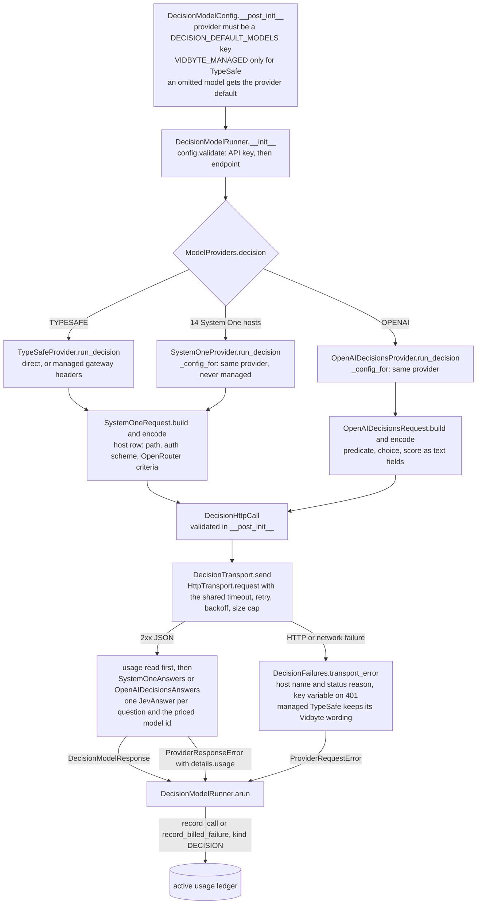
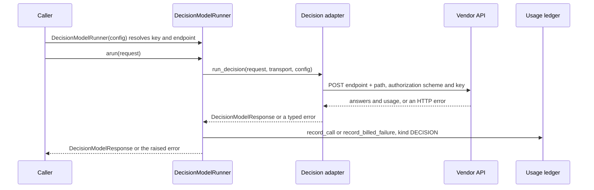

feat(providers): add 15 decision-model providers beside TypeSafe Jev, priced from each vendor's own API docs

## Summary
Until now the SDK had one decision model, TypeSafe's Jev; this PR adds 15 more (Perplexity, OpenRouter, Liquid AI, Baseten, meraGPT, Cloudflare, Microsoft Foundry, Celeris, Nace.AI, Upstage, Inception, Hanzo, Vansa, ZooData, and OpenAI), so a caller changes `provider` and gets the same `JevAnswer` records and the same `UsageKind.DECISION` ledger entries. Each provider is complete: its own API-key variable, a default endpoint (or a required one for the tenant-scoped hosts), errors that name the host and, on a 401, the key variable to check, and a pricebook row at the price the vendor charges on its own API, with the vendor's documentation URLs and `2026-10-10` in the comment above it. The decision that matters most is one adapter per wire, not one per vendor: `SystemOneProvider` serves the 14 hosts that speak TypeSafe's System One body from one `HOSTS` table, `OpenAIDecisionsProvider` speaks OpenAI's `/v1/decisions`, and `TypeSafeProvider` is rebuilt on the shared pieces with its wire bytes and error strings unchanged.

**Compatibility:** `DecisionModelConfig()` still means direct TypeSafe with `jev-latest`, `JevAgent` still accepts only the managed TypeSafe config, and every existing `tests/test_jev_*.py` passes without edits.

**Pricing calls:** Baseten publishes no rate for Mercury Decide, so its row carries Inception's current promotional $0.02 per 1M input tokens (the comment notes the regular $0.04); `gpt-6-luna` carries OpenAI's documented 2x long-context tier above 272K input tokens; and Google has no hosted Gemini decision model (its release is the on-device MediaPipe Decision Maker), so none ships.

Spec: `docs/spec/decision-model-providers/spec.md` (r11).

## How to use what this PR introduces
```python
from vidbyte.lib.config import DecisionModelConfig
from vidbyte.lib.dataclasses.jev import JevDecisionRequest, JevOption, JevQuestion
from vidbyte.lib.enums import JevQuestionType, ModelProvider
from vidbyte.lib.runners.decision import DecisionModelRunner

request = JevDecisionRequest(
    state="Customer: my order arrived broken and support ignored two emails.",
    questions=(
        JevQuestion(name="refund", question_type=JevQuestionType.NOUL, instructions="Should this customer receive a refund?"),
        JevQuestion(name="team", question_type=JevQuestionType.CHOICE, instructions="Which team owns the next step?", options=(JevOption("billing"), JevOption("logistics"), JevOption("support"))),
    ),
)

# Direct mode is the default. The key comes from PERPLEXITY_API_KEY when api_key is omitted;
# the model comes from the registry's decision default (pplx-decider-v1.1-27b).
perplexity = DecisionModelRunner(DecisionModelConfig(provider=ModelProvider.PERPLEXITY))
response = await perplexity.arun(request)
response.answer("refund").noul        # P(yes), a float in [0, 1]
response.answer("team").choice        # "billing" | "logistics" | "support"
response.provider, response.model     # (ModelProvider.PERPLEXITY, "pplx-decider-v1.1-27b")

# The same request on OpenAI's Decisions wire; the model defaults to gpt-6-luna.
openai = DecisionModelRunner(DecisionModelConfig(provider=ModelProvider.OPENAI))
response = await openai.arun(request)
response.answer("refund").probabilities   # {"true": p, "false": 1 - p}

# Tenant-scoped hosts take the tenant base URL explicitly; omitting it fails at construction.
cloudflare = DecisionModelRunner(DecisionModelConfig(provider=ModelProvider.CLOUDFLARE, model="clef-flash", endpoint="https://api.cloudflare.com/client/v4/accounts/<ACCOUNT_ID>/ai"))
```
This is the spec's §4 snippet, unchanged. It uses top-level `await`, so it runs as-is in `python -m asyncio` or a notebook. In a plain script, wrap it in `asyncio.run(...)`. I ran it on this branch two ways:

- **With no keys set.** It stops at the first runner, before any network call: `ConfigurationError: Missing API key for provider perplexity. Pass api_key or set PERPLEXITY_API_KEY.`
- **With test keys and a scripted transport for each runner** (the AC-1 setup), it printed:
  - `0.8`, `'billing'`, and `(<ModelProvider.PERPLEXITY: 'perplexity'>, 'pplx-decider-v1.1-27b')` for the Perplexity lines;
  - `mappingproxy({'true': 0.8, 'false': 0.19999999999999996})` for the OpenAI line.

  The calls went to `POST https://api.perplexity.ai/v1/decisions` with model `pplx-decider-v1.1-27b` and to `POST https://api.openai.com/v1/decisions` with model `gpt-6-luna`. The Cloudflare runner targets `https://api.cloudflare.com/client/v4/accounts/<ACCOUNT_ID>/ai/run/@cf/cloudflare/clef`.

Developers no longer pick a model per vendor, build a vendor's request body, or map a vendor's errors. They change `provider` (plus `endpoint` for Cloudflare and Foundry) and keep the same request, answers, `DecisionModelHelper.score_noul`, and usage ledger. Two more services are reached by endpoint override, with recipes in the "Decision Providers" section of `vidbyte/providers/README.md`: Vercel AI Gateway, on the OpenAI wire, and self-hosted System One servers.

## Flow




Validation runs twice before any request: `DecisionModelConfig.__post_init__` checks the provider and the mode and fills in a missing model, then `DecisionModelRunner.__init__` calls `validate()`, which resolves the key and then the endpoint, so a missing Cloudflare or Foundry endpoint fails when the runner is built. `SystemOneProvider` also refuses a managed config, both when it is built and on every call, so a Vidbyte key never reaches a vendor host. Each adapter runs one guarded `try` that reads the usage before it normalizes the answers (so a malformed or refused answer still carries the billed usage), rewrites HTTP failures with the host's name, and turns any other exception into a `ProviderResponseError`. The only state change is the ledger write in `DecisionModelRunner.arun`.

## What changed
| File | Change |
|---|---|
| `vidbyte/providers/systemone.py` (new) | System One wire: `SystemOneRequest` builds the body, `SystemOneAnswers` normalizes answers, and `SystemOneProvider` serves 14 hosts from one `HOSTS` table |
| `vidbyte/providers/openai_decisions.py` (new) | OpenAI Decisions wire (predicate, choice, score; answers matched by name) and `OpenAIDecisionsProvider` |
| `vidbyte/providers/decisions.py` (new) | `DecisionTransport.send` applies one transport policy to every decision call; `DecisionFailures` maps statuses to host-named messages; the module re-exports `DecisionHttpCall` |
| `vidbyte/providers/typesafe.py` | Rebuilt on the shared pieces and its private duplicates deleted; keeps the managed gateway, `/models`, and run close |
| `vidbyte/providers/__init__.py` | `ModelProviders.decision` routes 16 providers to 3 adapters; exports the two new adapters |
| `vidbyte/lib/dataclasses/model_configs.py` | `DecisionModelConfig` accepts the 16 providers; an omitted `model` gets the provider's default; adds `resolved_model()`; managed mode stays TypeSafe-only; `validate()` also resolves the endpoint |
| `vidbyte/lib/dataclasses/jev.py` | Adds `SystemOneHost`, the two OpenAI wire records, and the validated `DecisionHttpCall` |
| `vidbyte/lib/registries/models.py` | Adds `DECISION_DEFAULT_MODELS`, `decision_default_model()`, and key variables, endpoints, and defaults for the 13 new members; the missing-endpoint error now says to pass `endpoint` |
| `vidbyte/lib/registries/pricing.py` | Adds 13 decision price blocks and the `gpt-6-luna` row with its 272K tier, each cited with first-party URLs and `2026-10-10`; adds OpenRouter's comment-only citation; sets `PRICING_AS_OF` to `2026-10-10` |
| `lint/pricebook_vintage_lock.json` | C010 vintage lock refreshed once for the new rates |
| `vidbyte/lib/enums/model_provider.py` | 13 new `ModelProvider` members, each bound to `JevUsage` |
| `vidbyte/lib/enums/jev.py` | `DecisionAuthScheme` (`Bearer`, `Api-Key`) |
| `vidbyte/lib/enums/__init__.py` | Re-exports `DecisionAuthScheme` |
| `vidbyte/lib/enums/decision_model.py` | Docstrings: mode `TYPESAFE` means direct for every provider; `VIDBYTE_MANAGED` is TypeSafe-only |
| `vidbyte/lib/constants/jev.py` | 7 wire literals (host paths and OpenAI type tags), each with its documentation URL |
| `vidbyte/lib/constants/runners.py` | Decision model ids in the runner catalogs; Inception's key sits after Baseten's, so each Mercury Decide id resolves to its own provider |
| `vidbyte/lib/runners/decision.py` | Reads the model through `resolved_model()`; header names the new modules |
| `vidbyte/agents/pricing/openrouter.py` | `OpenRouterUsage` also parses System One usage keys; `usage.cost` still wins |
| `vidbyte/agents/pricing/typesafe.py` | Header and docstring: `JevUsage` prices every System One host |
| `vidbyte/providers/README.md` | Endpoint and auth matrix, decision documentation links, usage-key rows, and a "Decision Providers" section (keys, tenant endpoints, Vercel and self-hosted recipes, host caveats) |
| `REPO_MAP.md` | JEV table rows for the new modules and records |
| `skills/jev-agent/SKILL.md` | Points at `systemone.py` and `openai_decisions.py`; one line on using the other providers |
| `tests/features/decision_model_providers/FEATURE.md`, `README.md` | Pack description and change log |
| `tests/features/decision_model_providers/decision_fixtures.py` | Scripted transport, §4 request, response builders, the §9.1 host table |
| `tests/features/decision_model_providers/test_decision_acceptance.py` | §4 snippet and the "change only `provider`" property |
| `tests/features/decision_model_providers/test_decision_config.py` | Defaults, provider and managed-mode guards, key and endpoint resolution |
| `tests/features/decision_model_providers/test_decision_contract.py` | Catalog, host table, factory routing, pricebook rows, and price-proof URLs |
| `tests/features/decision_model_providers/test_decision_failures.py` | Status mapping, capability and config guards, credential hygiene, `DecisionHttpCall` validation |
| `tests/features/decision_model_providers/test_decision_openai_wire.py` | OpenAI request body and answer normalization |
| `tests/features/decision_model_providers/test_decision_regression_typesafe.py` | TypeSafe stays byte-identical; `JevAgent` boundary unchanged |
| `tests/features/decision_model_providers/test_decision_systemone_wire.py` | Per-host URL, auth, body, OpenRouter criteria, transport arguments, answer mismatches |
| `tests/features/decision_model_providers/test_decision_usage_metering.py` | Pricing per host, OpenRouter cost, ledger behaviour |
| `docs/spec/decision-model-providers/` (31 files, plus this description) | Pipeline artifacts (spec, request, research, test plan, review, verify log, agent reports) |

## Acceptance criteria → proof
Test paths are under `tests/features/decision_model_providers/` unless written in full.

| AC | What it checks (plain words) | Proven by |
|---|---|---|
| AC-1 | The §4 snippet runs and gives the shown result; changing only `provider` changes nothing else | `test_decision_acceptance.py::DeveloperUsageTests::test_section_4_snippet_runs_over_scripted_transports`, `::test_changing_the_provider_changes_nothing_else`; the snippet run above |
| AC-2 | Perplexity gets TypeSafe's exact body at `api.perplexity.ai/v1/decisions`, with a Bearer key from `PERPLEXITY_API_KEY` | `test_decision_systemone_wire.py::SystemOneRequestTests::test_perplexity_body_is_byte_equal_to_the_typesafe_body` |
| AC-3 | Baseten uses `/v1/decisions`, `Api-Key` auth, and model `inception/mercury-decide` | `test_decision_systemone_wire.py::SystemOneRequestTests::test_each_host_posts_the_typesafe_body_to_its_documented_url` (BASETEN subtest) |
| AC-4 | OpenRouter always gets both noul criteria keys, and its reported `usage.cost` is the recorded cost | `test_decision_systemone_wire.py::SystemOneRequestTests::test_openrouter_always_sends_noul_criteria_while_other_hosts_keep_typesafe_behaviour`; `test_decision_usage_metering.py::PricingTests::test_openrouter_reported_cost_wins_and_system_one_usage_keys_parse` |
| AC-5 | OpenAI gets the documented predicate, choice, and score body; answers in any order normalize by name | `test_decision_openai_wire.py::OpenAIRequestTests::test_body_is_the_documented_decisions_request_in_question_order`; `::OpenAIAnswerTests::test_answers_array_in_any_order_normalizes_by_name` |
| AC-6 | An OpenAI refusal raises an error that keeps the billed usage, and the ledger records one failed call | `test_decision_openai_wire.py::OpenAIAnswerTests::test_refusal_answer_raises_a_billed_error_naming_the_question`; `test_decision_usage_metering.py::LedgerBehaviourTests::test_billed_failures_are_recorded_once_with_their_usage` |
| AC-7 | Cloudflare and Foundry without `endpoint` fail when the runner is built; with it, the URL is right | `test_decision_config.py::ResolutionTests::test_tenant_scoped_hosts_require_an_explicit_endpoint`; `test_decision_systemone_wire.py::SystemOneRequestTests::test_each_host_posts_the_typesafe_body_to_its_documented_url` (CLOUDFLARE subtest) |
| AC-8 | Managed mode for a non-TypeSafe provider fails at construction and reads no env var | `test_decision_config.py::ProviderGuardTests::test_managed_mode_is_typesafe_only_and_reads_no_env_var` |
| AC-9 | An unsupported provider gets an error listing the 16 supported values, sorted | `test_decision_config.py::ProviderGuardTests::test_unsupported_provider_lists_the_sixteen_supported_values_sorted`; `test_decision_contract.py::ProviderCatalogTests::test_supported_set_is_the_sixteen_keys_of_the_decision_default_map` |
| AC-10 | A 401 from Perplexity names Perplexity and `PERPLEXITY_API_KEY` and keeps the status code | `test_decision_failures.py::StatusMappingTests::test_error_envelope_objects_and_the_401_prefix`; `::test_http_statuses_map_to_host_named_messages` |
| AC-11 | Every adapter passes the configured timeout and retries, the shared backoff and size cap, and a fresh idempotency key only when it retries | `test_decision_systemone_wire.py::SystemOneRequestTests::test_transport_kwargs_and_a_fresh_idempotency_key_on_every_host`; `test_decision_openai_wire.py::OpenAIRequestTests::test_transport_kwargs_and_a_fresh_idempotency_key_on_openai` |
| AC-12 | The ledger prices every host from the pricebook at the expected cost, and no record is unpriced | `test_decision_usage_metering.py::PricingTests::test_every_host_is_priced_from_the_pricebook_key` |
| AC-13 | `alist_models()` and `aclose_run()` on a non-TypeSafe host raise without a network call | `test_decision_failures.py::CapabilityAndGuardTests::test_list_models_and_close_run_raise_without_a_transport_call` |
| AC-14 | `DecisionModelConfig()` is still direct TypeSafe with `jev-latest`, and the existing Jev tests pass without edits | `test_decision_config.py::TypeSafeDefaultTests::test_default_config_is_direct_typesafe_with_the_same_values`; `test_decision_regression_typesafe.py::TypeSafeRunnerTests::test_default_runner_still_posts_to_typesafe_with_the_echoed_version`, `::test_typesafe_messages_are_the_shared_template_for_typesafe`; tests outside the pack unchanged (0-byte diff) and the area suite green |
| AC-15 | `JevRuntimeSettings` still refuses a direct config | `test_decision_regression_typesafe.py::AgentBoundaryTests::test_jev_runtime_settings_still_rejects_direct_configs` |
| AC-16 | Lint passes and no baseline count grows | Not a test: `python lint/run.py` inside `python scripts/run_ci.py` at `6cc53e39` ends `SDK-LINT: PASS` with 0 REGRESSED; S014 `0 0 CLEAN`, C009 `1 1 RATCHETED` (the baselined Mistral finding), C010 `0 0 CLEAN`, S009 `346 350 IMPROVED` |
| AC-17 | An OpenAI noul question whose options carry descriptions is refused before any call | `test_decision_openai_wire.py::OpenAIRequestTests::test_noul_option_descriptions_are_refused_before_any_call` |
| AC-18 | A System One answer set that misses or adds a name fails with the host's name and the billed usage | `test_decision_systemone_wire.py::SystemOneAnswerTests::test_answer_mismatch_names_the_host_and_keeps_the_billed_usage` |
| AC-19 | An adapter refuses a per-call config for another provider before any call | `test_decision_failures.py::CapabilityAndGuardTests::test_adapter_refuses_a_config_for_another_provider_before_any_call` |
| AC-20 | Celeris, Nace.AI, Upstage, Inception, Hanzo, Vansa, and ZooData post TypeSafe's body to their documented URLs with their own key | `test_decision_systemone_wire.py::SystemOneRequestTests::test_each_host_posts_the_typesafe_body_to_its_documented_url` (seven subtests) |
| AC-21 | Each decision price block's comment carries the vendor's URLs and `2026-10-10`; Baseten is priced; the `gpt-6-luna` row has the long-context tier | `test_decision_contract.py::FactoryAndPricebookTests::test_every_decision_price_row_cites_its_first_party_urls` |
| AC-22 | `inception/mercury-decide` resolves to Baseten and `mercury-decide` resolves to Inception | `test_decision_contract.py::ProviderCatalogTests::test_inception_and_baseten_resolve_to_their_own_provider`; `tests/test_agent_settings_validation.py::ProviderModelValidationTests::test_accepts_every_text_provider_default_model` |
| AC-23 | `DecisionHttpCall` rejects each bad field with a message that never contains the key, accepts `int` and `float` subclass timeouts, and keeps headers out of `repr` | `test_decision_failures.py::DecisionHttpCallTests::test_decision_http_call_validates_each_field_and_never_echoes_the_key`; `::test_decision_http_call_accepts_int_and_float_subclass_timeouts` |

## Verification
Every gate ran at `6cc53e39`. Its code is identical to the pushed `6149d9b9`, and the commit that adds this description touches only `docs/spec/`.

| Gate | Command | Result |
|---|---|---|
| Feature pack | `python -m pytest tests/features/decision_model_providers -q` | `91 passed in 1.67s` |
| Area suite | `python -m pytest tests/test_jev_agent.py tests/test_jev_managed_gateway.py tests/test_jev_managed_runs.py tests/test_jev_usage_ledger.py tests/test_jev_preflight.py tests/test_jev_done.py tests/test_model_registry.py tests/test_agent_pricing.py tests/test_embedding_runner.py tests/test_agent_settings_validation.py -q` | `406 passed in 3.52s` |
| SDK lint | `python lint/run.py` (run by `run_ci.py`) | `SDK-LINT: PASS`, 0 REGRESSED (A006 34/34, C002 9/9, C009 1/1, C010 0, S014 0, S015 13/13, S051 258/259) |
| Full local gate (gate of record, AGENTS.md) | `python scripts/run_ci.py` | exit 0: `3162 passed, 12 skipped in 25.90s` / `No broken requirements found.` / `Installed vidbyte-sdk 0.2.1 passed smoke checks.` / `CI passed.` The 12 skips are not from this PR: 11 are main's POSIX-only coding-agent tests (#747) and 1 is older; the pack skips none |
| Test-contract diffs | `git diff 3943089c HEAD -- tests/features/decision_model_providers/` and `git diff $(git merge-base origin/main HEAD) HEAD -- tests/ ':(exclude)tests/features/decision_model_providers'` | Both 0 bytes; the `lint/baseline.json` diff is also 0 bytes |
| Remote checks | `gh pr checks https://github.com/cerredz/Vidbyte-SDK/pull/697` | None configured: the repository's workflows are disabled by the owner; `python scripts/run_ci.py` is the gate of record (`no checks reported on the 'feat/decision-model-providers' branch`) |

For the owner: even with the branch current, `gh pr view` reports mergeStateStatus `BLOCKED`, because the PR is a draft and because main's branch protection requires `Source / Python 3.11`, `Source / Python 3.12`, and `Package`, which cannot report while the workflows are disabled; clearing it is your call. When this description was written, the branch was one commit behind main (`5058737a`, #760), which touches no file this PR changes, so GitHub showed `BEHIND` first.

## Adversarial review
5 findings confirmed by an independent verifier across three lenses (spec conformance, repo conventions, engineering), 5 fixed, 0 waived: four from the first review, and R-18 from the re-review after the repairs. The verifier refuted one claimed Major (that a `clef-flash` call on Cloudflare's clef route bills as `clef`, which Cloudflare's own sample contradicts; a live re-check stays follow-up R-5), 4 of the 14 Minors are fixed (R-6, R-7, R-16, R-19) and 10 are follow-ups, and the final re-review returned SOUND with no findings. Full record: `docs/spec/decision-model-providers/review.md`.

| ID | Finding | Fixed in |
|---|---|---|
| R-1 (Blocker) | A noul question that named only `true` or only `false` sent OpenRouter a `criteria` with one key, and OpenRouter rejects that | `f6f3df8f` (docs `e7c48376`, test `90ed9a29`) |
| R-2 (Blocker) | `DecisionHttpCall` was a new dataclass outside `vidbyte/lib/dataclasses/`. It had no validation and carried transport behaviour on the record, against the AGENTS.md placement rules | `c5b4a4ab` (spec r11 first, `71261329`; test `90ed9a29`) |
| R-3 (Major) | No test failed if `SystemOneProvider`'s per-call managed-config refusal was deleted. That refusal keeps a `vb_live_` key off TypeSafe's direct host | `90ed9a29` (test only; no production change) |
| R-4 (Major) | Helpers in `openai_decisions.py` called further helpers, against AGENTS.md's one-level call-chain rule, and the duplicate-option guard had no test | `2da50682` (test `90ed9a29`) |
| R-18 (Major) | `DecisionHttpCall` refused `int` and `float` subclass timeouts that `DecisionModelConfig` accepts, so a TypeSafe call that worked on main failed before sending | `b5be5ca4` (test `3943089c`) |

## Deviations from the spec
These are the implementation deviations recorded in spec §17, plus one I found while writing this description. None changes a public name or a wire body.

1. **URL building (lint C017).** Both direct adapters build the URL with `ProviderModelRegistry.resolve_endpoint(provider, config.endpoint)`, not `config.resolved_endpoint()`.
   - Spec rows 13 and 15 named `resolved_endpoint()`. In direct mode both give the same value, but C017 traced the managed branch of `resolved_endpoint()` to the Vidbyte gateway and reported a route that does not exist.
   - Because of that change, `SystemOneProvider` also refuses a managed config on every call, with the same sentence as its constructor guard. So a managed per-call TypeSafe config cannot post a Vidbyte key to TypeSafe's direct host.
   - Code in `d07c328b`; the per-call refusal is pinned by a test since `90ed9a29`.
2. **OpenRouter usage.** `OpenRouterUsage` derives `total_tokens` from input plus output when the payload omits it. It also reads the decision keys when the chat parse found only a total.
3. **Config-less construction.** `SystemOneProvider(decision_config=None)` raises `ProviderConfigurationError(provider="systemone")`. That is not a `ModelProvider` value, because no provider is known yet; a code comment says so.
4. **Private helpers.** Both new adapters have private helpers beyond the spec's named methods (listed in spec §17). `OpenAIDecisionsRequest.text` turns a `RecursionError` from a self-referencing value into a `ConfigurationError`. No extra class.
5. **TypeSafe label.** `TypeSafeProvider` takes its message label from its host row (`"TypeSafe"`), not from a literal.
6. **SKILL.md line.** The edited sentence sits at line 46, not 47 (line drift; same sentence).
7. **One commit for three rows.** The enum members, registry rows, and runner-catalog rows landed in one commit (`8a140ba2`). Lint S014 fails if any of them lands alone.
8. **Found while writing this: INV-2 wording.** INV-2 says every production reader uses `resolved_model()`. `vidbyte/agents/jev/alignment/skills.py:130` still reads `DecisionModelConfig.model` directly; that line came from main (#698), not from this branch. It has no runtime effect, because the field is filled at construction. Tracked as R-11.

## Follow-ups
**Open Minor review findings** (`review.md`):

- **R-5:** re-check on Cloudflare's live docs that the clef route honours `model: "clef-flash"`.
- **R-8:** move `_LABEL = "OpenAI"` into `vidbyte/lib/constants/jev.py`.
- **R-9:** the headers of `vidbyte/lib/runners/decision.py` and `vidbyte/agents/pricing/typesafe.py` still describe a TypeSafe-only runner in places.
- **R-10:** some production comments cite spec IDs (`spec D-12`, `Q-11`, "research §3.4") instead of stating the reason.
- **R-11:** see deviation 8.
- **R-12:** `OpenAIDecisionsWireQuestion.type` is a closed set typed as `str`.
- **R-13:** add AC-17's one-described-option case to its test.
- **R-14:** assert the per-call config on the request actually sent.
- **R-15:** add a README warning for ids that record `cost_usd=None`: meraGPT `state-decider-1`, the Vercel recipe id, and Nace alias billed failures.
- **R-17:** use this PR's title and summary as the squash-merge message.

**Providers deferred** (spec NG-16 to NG-24):

- **Google Gemini:** no hosted decision API exists; the release is on-device MediaPipe only.
- **Fastino GLiDE:** its `score` is the argmax level index, so it needs a new host field.
- **Alibaba `decision-model-preview`:** a limited-time free preview with no paid rate, on a host URL that embeds the caller's workspace.
- **decisionmodels.io:** the rate depends on a per-key tier the SDK cannot see, and `s1-fast` takes one question.
- **milliseconds.ai:** the vendor disclaims calibration.
- **Resellers and gateways** (DigitalOcean, sference, Vercel AI Gateway, LLM Gateway, Eden AI, AI/ML API, Requesty): they host models already reachable through each vendor's own provider. Vercel also works today by endpoint override.
- **Cloudflare `clef-omni`:** it uses its own path, and a per-model path is a new host capability.

**Known limitations:**

- The managed gateway and `JevAgent` stay TypeSafe-only (NG-1, NG-2). The new providers serve `DecisionModelRunner` and `DecisionModelHelper` callers.
- Vansa may reject httpx's default `User-Agent` (a 403 `error code: 1010`) or `null` criteria values on options without descriptions (A-17, A-18). The SDK sends no per-host header.
- Inception's and Baseten's $0.02 is a promotional rate with no stated end date (EC-36). When it changes, move `PRICING_AS_OF` and run `python -m lint.rules.c010_pricebook_vintage_bump --refresh-lock`.
- Foundry's row prices only a deployment named `microsoft-decision-1`. Any other deployment name records `cost_usd=None` (Q-9).
- Cloudflare silently truncates a `state` longer than 65,536 tokens (EC-16).
- Celeris puts the model name in its base URL, so a caller who changes the model must pass `model` and `endpoint` together (EC-29).
- Nace.AI documents `GET /v1/models`, but `alist_models()` raises the shared "no model-list endpoint" message (Q-11).

**Out-of-scope pricing issues found during this PR's price research:**

- The text-model row `gpt-5.6-sol` no longer matches OpenAI's current pricing page.
- Cloudflare lists `clef-omni` at $0.150 per 1M input tokens (spec Q-12).

This PR changes neither.

🤖 Generated with [Claude Code](https://claude.com/claude-code)
