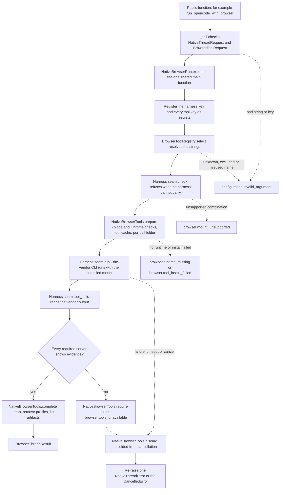
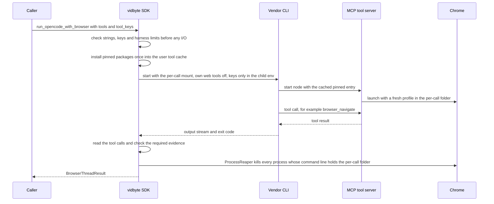

feat(harnesses): browser tools for the Grok, opencode and Muse threads (run_<harness>_with_browser)

## Summary

This PR adds nine async functions to `vidbyte.harnesses.native`: `run_`, `continue_` and `fork_` for each thread harness, named `run_grok_with_browser`, `run_opencode_with_browser`, `run_muse_with_browser` and so on. Each one runs the existing harness thread flow with browser tools that the caller names as strings, such as `"playwright"` or `"firecrawl:search"`. The vendor CLI stays the agent and the only MCP client. The SDK does six things:

- resolves the strings against a pinned registry;
- installs each pinned package once into `~/.vidbyte/tools/`;
- compiles the harness's own per-call mount, with exact allow rules and the harness's own web tools off;
- reads back which tools the vendor called;
- fails the call when a required server shows no sign of life;
- kills every process whose command line holds the call's own folder.

**Why.** The request ("integrate these browser tools into every harness that we have so far … make sure that each function has all layers") asked for functions named like the existing `run_<harness>_thread` ones, so that a developer gets a browser-capable coding-agent thread without installing packages, writing MCP config or permission rules, starting or stopping Chrome, or parsing vendor output.

**Scope.**
- **Harnesses.** The functions cover the three thread harnesses on `main`: Grok Build, opencode and Muse Code. `CodexHost` (#1055) is a host harness, not the `_thread` shape, and gets no browser functions here (spec Q-19, NG-2).
- **Registry.** 13 tools are mountable, each pinned to an exact version or `https` URL. 18 more popular names are refused by name, each with its recorded reason.
- **Errors.** There are four new failure codes: `browser.mount_unsupported`, `browser.runtime_missing`, `browser.tool_install_failed` and `browser.tools_unavailable`.
- **Plain functions.** The nine plain `_thread` functions are unchanged: every new branch is gated on `mount is None`, and the plain `_call`s return `.result`.

**Size.** Outside the spec pipeline record under `docs/spec/`, the diff is 53 files, +6,377/−185 lines:
- `vidbyte/`: 35 files, +3,093/−139. That is 12 new modules, 20 modified modules and 3 folder READMEs.
- `tests/`: 16 files, +3,251/−44. That is 7 new test files (99 test functions, 184 collected cases), the new `fake_browser.py`, 4 changed helpers and pack docs, and 4 updated pin files.
- `REPO_MAP.md` and `skills/failure/vocabulary.md`.

The other 24 files are the docs-only spec pipeline record.

The shared main function is `NativeBrowserRun.execute` (`vidbyte/harnesses/native/hostkit/browser.py`). Each harness supplies one small seam, `<H>BrowserHarness`, with four methods: `check`, `run`, `tool_calls` and `missing`.

**State.** The PR stays a draft. Adversarial review confirmed 6 findings (3 Blockers, 3 Majors); all 6 are fixed, none were waived, and the re-review found the repairs sound. CI and Static policy are green (see Verification).

## How to use what this PR introduces

The developer snippet below is spec §4, unchanged. The acceptance test `test_harness_threads_browser_acceptance.py::test_the_developer_snippet_runs_as_documented` runs it byte for byte against the offline fakes (fake opencode, fake `node` with fake MCP servers, and a pre-filled tool cache), replacing only the workspace literal.

```python
import asyncio
import os

from vidbyte.harnesses.native import continue_opencode_with_browser, run_opencode_with_browser


async def main() -> None:
    result = await run_opencode_with_browser(
        "Open https://example.com and tell me the page heading.",
        api_key=os.environ["DEEPSEEK_API_KEY"],          # the harness key, as for run_opencode_thread
        workspace="C:/work/site",
        model="deepseek/deepseek-v4-pro",
        tools=["playwright", "firecrawl:search"],         # registry strings: <tool>[:<capability>,...]
        tool_keys={"firecrawl": os.environ["FIRECRAWL_API_KEY"]},
    )
    print(result.thread_id, result.text)                  # e.g. ses_8f2c... Example Domain
    for call in result.tool_calls:                        # e.g. playwright browser_navigate completed
        print(call.tool.value, call.name, call.status.value)
    print(result.artifacts)                               # absolute paths of screenshots, or ()

    again = await continue_opencode_with_browser(result.thread_id, "Now take a screenshot.", api_key=os.environ["DEEPSEEK_API_KEY"], workspace="C:/work/site", model="deepseek/deepseek-v4-pro", tools=["playwright"])
    print(again.artifacts)                                # e.g. (WindowsPath('C:/Users/u/AppData/Local/Temp/vidbyte-browser-k3x9/artifacts/page-2026-10-17T10-00-00-000Z.png'),)


asyncio.run(main())
```

On 2026-10-18 at `fd4baede`, I ran it through that test on Windows and captured what it printed. The text is the fake opencode's; the pytest temp root is shortened:

```text
ses_0c491925-c665-433c-83dc-87ac40667bfb opencode answer to: Open https://example.com and tell me the page heading.
playwright browser_navigate completed
firecrawl firecrawl_search completed
()
(WindowsPath('<pytest tmp>/vidbyte-browser-s1_86pty/artifacts/page-26096-0000.png'),)
```

The snippet was **not** run against a real vendor or with a real key. Spec NG-14 forbids live vendor runs in tests and gates, and a manual live run is listed under Follow-ups.

**The functions.** Each of the nine functions takes its plain sibling's parameters with the same names, kinds, types, defaults and order, plus two keyword-only parameters placed right after `model`:
- `tools: Sequence[str]` (required): 1 to 8 strings, each `<tool>[:<capability>[,<capability>...]]`.
- `tool_keys: Mapping[str, str] | None = None`: tool name → that tool's credential.

The other harnesses differ only in the harness word, the key and the model. For example, inside an async function:

```python
from vidbyte.harnesses.native import run_grok_with_browser, run_muse_with_browser

grok = await run_grok_with_browser(prompt, api_key=grok_key, workspace=ws, tools=["playwright:pdf", "jina"])
muse = await run_muse_with_browser(prompt, api_key=muse_key, workspace=ws, tools=["jina"])  # WSL mode: keyless remote tools only
```

Every function returns `BrowserThreadResult(harness, thread_id, text, text_truncated, tool_calls, tool_calls_truncated, artifacts, artifacts_truncated)`. Each entry in `tool_calls` is a `BrowserToolCall(tool: BrowserTool, name: str, status: BrowserToolCallStatus)`, read from the vendor's own output. `artifacts` holds absolute paths in the per-call `artifacts/` folder, which is kept only after a successful return. Tool calls and artifacts are capped at 1,000 each, and a `_truncated` flag says when the cap was hit.

**The registry** (`vidbyte/lib/registries/browser_tools.py`, with its rows in `vidbyte/lib/constants/browser_tools.py`):

| Tool | Transport | Pin | Key (`tool_keys`) | Capabilities |
|---|---|---|---|---|
| `playwright` | stdio, needs Chrome | `@playwright/mcp` 0.0.83 | none | `core` (default); additive `devtools`, `storage`, `network`, `pdf`, `vision` |
| `chromedevtools` | stdio, needs Chrome | `chrome-devtools-mcp` 1.11.0 | none | `all` |
| `firecrawl` | stdio | `firecrawl-mcp` 3.30.2 | optional | `all`, `search`, `scrape`, `map`, `crawl`, `interact` |
| `exa` | stdio | `exa-mcp-server` 3.4.2 | optional | `all`, `search`, `fetch` |
| `tavily` | stdio | `tavily-mcp` 0.2.22 | required | `all`, `search`, `extract`, `crawl`, `map`, `research` |
| `brave` | stdio | `@brave/brave-search-mcp-server` 2.1.4 | required | `all`, `search` |
| `perplexity` | stdio | `@perplexity-ai/mcp-server` 1.3.0 | required | `all`, `search`, `research` |
| `brightdata` | stdio | `@brightdata/mcp` 3.1.0 | required | `all`, `search`, `scrape`, `browser` |
| `apify` | stdio | `@apify/actors-mcp-server` 0.18.4 | required | `all` |
| `linkup` | stdio | `linkup-mcp-server` 3.4.0 | required | `all`, `search`, `fetch`, `research` |
| `browserbase` | remote | `https://mcp.browserbase.com/mcp` | required (Bearer) | `all` |
| `jina` | remote | `https://mcp.jina.ai/v1` | optional (Bearer) | `all`, `search`, `fetch` |
| `parallel` | remote | `https://search.parallel.ai/mcp` | optional (Bearer) | `all`, `search`, `fetch` |

The following names are refused with their recorded reason: `browserstack`, `searxng`, `wdio`, `fetch`, `duckduckgo`, `agentbrowser`, `playwrightcli`, `midscene`, `devbrowser`, `crawl4ai`, `browseruse`, `scrapling`, `kernel`, `cloudflare`, `puppeteer`, `hyperbrowser`, `steel` and `browserless`. Further refusals:
- An unknown name gets a did-you-mean suggestion, or the list of the 13 mountable tools when no name is close.
- A `@<host>` suffix is refused as "hosts are not supported in this release".
- A narrowing capability (any capability without a Playwright server flag) allows exactly its tools and denies the tool's other known tools. Playwright's flag capabilities add to `core` and deny nothing.
- No refusal ever quotes the caller's item or key.

**What each harness can mount** (spec §2, D-9, Q-15, verbatim):
- **opencode:** every registry tool, keyed or not, stdio or remote.
- **Grok:** every stdio tool, keyed or not, and the keyless remote tools (jina and parallel without a key). A keyed remote tool (browserbase, or jina or parallel with a key) is refused with `browser.mount_unsupported`: Grok does not expand `${VAR}` in agent-file headers, so the key would have to be written into a file (KD-6).
- **Muse native** (`muse_command` set, or no WSL distro; Linux or macOS): keyless stdio tools (playwright, chromedevtools, firecrawl and exa without keys) and keyless remote tools (jina, parallel). Any keyed tool is refused, because Muse takes a key only as a literal in a file (KD-6).
- **Muse in WSL mode** (`MuseThreadConfig.wsl_distro` set and no `muse_command`, which is how Muse runs on Windows): only keyless remote tools, jina and parallel. Both are search and fetch services, and keyless Jina is fetch-only; the nearest thing to a browser there is Jina's remote `capture_screenshot_url`, with no page interaction. **No browser can be mounted there:** every stdio tool, including `playwright` and `chromedevtools`, is refused with `browser.mount_unsupported`. Q-15 records the loopback route that would lift this and why it is not built in this PR.

Muse also refuses narrowing capabilities (it cannot filter its catalog). Grok refuses a selection whose allow and deny rules would exceed `GROK_BROWSER_RULES_MAX_UNITS` (1,800 UTF-16 units of argv).

**Runtime needs.**
- **stdio tools** need Node 22.12.0 or newer on `PATH`, as a real executable; `node.cmd` and `node.bat` are refused.
- **`playwright` and `chromedevtools`** also need Chrome stable at one of the locations in `BROWSER_CHROME_PATHS`.
- **Remote tools** need neither, and they run no install.
- **The cache.** The first call that selects a stdio tool installs its pinned package into `~/.vidbyte/tools/<tool>-<version>`, bounded by 600 s. Later calls start the server as `<absolute node> <absolute pinned entry>`, with no `npx`, no `@latest` and no fetch.

**Keys.** The harness key and every tool key reach only the vendor child's environment overlay; for opencode they travel inside `OPENCODE_CONFIG_CONTENT`. They never appear on argv, in a file the SDK writes, in `os.environ` or in error text. A mounted tool's key variable that the caller did not pass in `tool_keys` is removed from the child environment, so a key in your own shell is never used silently.

**Errors.** Every failure raises one `NativeThreadError` with a closed `FailureCode`, a likely cause and a next step. Its `expected` reads `"<function> returning a BrowserThreadResult"`.

| Code | When |
|---|---|
| `configuration.invalid_argument` | A bad `tools` string or `tool_keys` entry: unknown name, excluded name, `@host`, duplicate, unknown capability, missing or unexpected key, or bad key shape. The field is named by position or registry name. |
| `browser.mount_unsupported` | The harness cannot carry the selection safely (the limits above). Raised before any process starts or any file is written. |
| `browser.runtime_missing` | Node is missing, too old or a batch file, or Chrome is missing. The error names what was searched. |
| `browser.tool_install_failed` | npm failed or timed out, the cache folder is broken (the error names the folder to delete), or the home folder is unknown. |
| `browser.tools_unavailable` | The vendor output shows a mounted server never worked. Grok: a server neither listed in `available_commands` nor reached by a completed call. opencode: no mounted tool was used. Muse: the vendor's own required-server failure. The error carries the thread id when the vendor printed one. |

**Rollback.** The SDK writes outside the vendor's thread store only in these places:
- the per-call `vidbyte-browser-*` temp folder (its artifacts survive only a successful return);
- the tool cache (delete `~/.vidbyte/tools/<tool>-<version>` to force a reinstall);
- Grok's existing private home and Muse's existing per-call config folder.

Nothing the SDK writes goes into the workspace.

## Flow (mermaid)

Every browser function takes the same path: one shared main function runs every layer in order, and the harness supplies only its seam.



Everything up to and including `check` runs before any process starts or any file is written. `prepare` creates the per-call folder last, so a runtime or install failure leaves nothing behind. After `prepare`, one `try` covers `run`, `tool_calls`, `require` and `complete`. Any exception, including cancellation, first runs `discard` under `asyncio.shield`, then re-raises. Muse's required-server failure is raised inside its seam `run` as `browser.tools_unavailable`, so it also passes through `discard`.

What one call does at runtime:



## What changed

Line counts are `git diff --numstat origin/main...HEAD`. The merge base is `6f5a7310`; commit `871ee369` merged #1055 into the branch before implementation.

**New source modules (12)**

| Path | Lines | What it is |
|---|---|---|
| `vidbyte/harnesses/native/hostkit/browser.py` | +380 | `NativeBrowserRun.execute`, the shared main function. `NativeBrowserTools` handles prepare, write_file, require, complete and discard. `BrowserRuntimes` holds the Node and Chrome preflight. `BrowserToolCache` holds the once-per-version npm install with staging and an atomic rename. `NativeBrowserHarness` is the seam protocol. |
| `vidbyte/harnesses/native/grok/browser.py` | +134 | `GrokBrowserThreads` (`run`/`continue`/`fork_grok_with_browser`, `_call`) and `GrokBrowserHarness`, the seam. |
| `vidbyte/harnesses/native/grok/mounts.py` | +152 | `GrokMounts` has pure compile helpers: the per-call agent file (JSON frontmatter, neutral body), the `--allow`/`--deny` rules, the env overlay, `env_remove` and the rule budget check. |
| `vidbyte/harnesses/native/opencode/browser.py` | +119 | `OpencodeBrowserThreads` and `OpencodeBrowserHarness`. |
| `vidbyte/harnesses/native/opencode/mounts.py` | +106 | `OpencodeMounts` builds the `mcp` and `permission` members of `OPENCODE_CONFIG_CONTENT`. Ids are `vidbyte-<tool>` with `"enabled": true`. Narrowing puts the wildcard deny first, then exact allows. `webfetch` and `websearch` are denied, and a remote key goes in a Bearer header. |
| `vidbyte/harnesses/native/muse/browser.py` | +129 | `MuseBrowserThreads` and `MuseBrowserHarness`. A vendor "Required MCP server" failure becomes `browser.tools_unavailable`. |
| `vidbyte/harnesses/native/muse/mounts.py` | +81 | `MuseMounts` checks the Muse limits and compiles `{"schema_version": 1, "mcpServers": {...}}`. |
| `vidbyte/lib/enums/browser_tools.py` | +125 | 7 StrEnums: `BrowserTool` (13), `BrowserToolExclusion` (18), `BrowserCapability`, `BrowserToolTransport`, `BrowserKeyRequirement`, `BrowserToolCallStatus` and `BrowserToolVariable`. |
| `vidbyte/lib/dataclasses/browser_tools.py` | +339 | 9 frozen, slotted, validated records: `BrowserCapabilityDefinition`, `BrowserToolDefinition`, `BrowserToolRequest`, `BrowserToolSelection`, `BrowserServer`, `BrowserMount`, `BrowserToolCall`, `BrowserToolCalls` and `BrowserThreadResult`. |
| `vidbyte/lib/constants/browser_tools.py` | +405 | Every vendor fact in one place: pins, entries, URLs, per-capability tool names, limits, timeouts, Chrome paths, and the refusal and detail texts. |
| `vidbyte/lib/registries/browser_tools.py` | +319 | `BrowserToolRegistry.select` and `definition`: deterministic string → selection, with suggestions, exclusions and key rules. It makes no network call and reads no environment. |
| `vidbyte/lib/process/reaper.py` | +118 | `ProcessReaper.reap(marker, timeout_seconds)` kills processes by command-line marker. On Windows it uses System32 PowerShell, with the marker passed only in `VIDBYTE_REAP_MARKER` and no `USERPROFILE`. On POSIX it uses `ps` from `/bin/ps` or `/usr/bin/ps`, never `PATH`. It never raises. |

**Modified source (20)**

| Path | Lines | Change |
|---|---|---|
| `vidbyte/harnesses/native/__init__.py` | +27/−6 | Exports the nine functions, `BrowserThreadResult` and `BrowserToolCall`; `__all__` goes from 17 to 28 names. |
| `vidbyte/harnesses/native/{grok,opencode,muse}/__init__.py` | +10/−6 each | Each subpackage exports its three browser functions (6 names each). |
| `vidbyte/harnesses/native/grok/threads.py` | +36/−17 | `GrokThreadRun.execute(..., *, mount=None)` returns `NativeThreadRun(result, outcome)`. The mount adds `--agent=`, the rules, `--disable-web-search` and `--output-format=streaming-json`, sets `GROK_CLAUDE_MCPS_ENABLED=0` and `GROK_CURSOR_MCPS_ENABLED=0`, and raises the output cap. With no mount, the plain path is unchanged. |
| `vidbyte/harnesses/native/grok/wire.py` | +132/−8 | `GrokWire.read_stream` reads the streaming-json output, and a `cancelled` stopReason becomes `grok.run_failed`. `tool_calls` and `connected` are new. |
| `vidbyte/harnesses/native/opencode/threads.py` | +24/−13 | Adds the `mount` parameter and `NativeThreadRun`, and compiles the mount into the inline config. |
| `vidbyte/harnesses/native/opencode/wire.py` | +44/−9 | `config_content(request, mount)` and the `tool_use` reader. |
| `vidbyte/harnesses/native/muse/threads.py` | +40/−22 | Adds the `mount` parameter. `muse/settings.json` is written into the existing per-call config folder, and `--disable-web-tools` is passed. |
| `vidbyte/harnesses/native/muse/wire.py` | +40/−7 | `MuseExecOutput.tool_calls` reads the `mcp__<srv>__<tool>` task records. |
| `vidbyte/harnesses/native/hostkit/__init__.py` | +20/−4 | Re-exports the five hostkit browser classes. |
| `vidbyte/harnesses/native/hostkit/errors.py` | +5/−3 | Passes `result_record=NATIVE_THREAD_RESULT_RECORDS[operation]`, so browser errors name `BrowserThreadResult`. |
| `vidbyte/lib/constants/native_threads.py` | +138/−14 | Adds the nine operations' result records, the four codes' causes and next steps, the Grok stream and Muse record field names, and `NATIVE_PS_PATHS`. It also widens the `grok.output_too_large` cause (D-19) and five next steps that now name the `_with_browser` sibling (D-22). |
| `vidbyte/lib/dataclasses/native_threads.py` | +17/−4 | Adds `NativeThreadRun(result, outcome)`. |
| `vidbyte/lib/enums/native_threads.py` | +34/−4 | Adds nine `NativeThreadOperation` members, four problems, `NativeThreadResultRecord`, and the Grok, Muse and environment flag members. |
| `vidbyte/lib/enums/failure.py` | +6 | Adds the four `browser.*` `FailureCode` members. |
| `vidbyte/lib/enums/__init__.py` | +18 | Exports the new enums. |
| `vidbyte/lib/errors/base.py` | +10/−3 | `NativeThreadError(..., result_record=None)`. With `None`, the plain `expected` text is unchanged. |
| `vidbyte/lib/process/__init__.py` | +5/−4 | Exports `ProcessReaper`. |
| `vidbyte/lib/registries/__init__.py` | +2 | Exports `BrowserToolRegistry`. |

**Docs (5)**

| Path | Lines | Change |
|---|---|---|
| `vidbyte/harnesses/README.md` | +1/−1 | The `native/` bullet now names the nine functions, `tools`/`tool_keys`, the cache and what each harness can mount, and states that `CodexHost` has none yet (Q-19). This bullet is pinned byte for byte by `test_codex_host_packaging.py`. |
| `vidbyte/lib/registries/README.md` | +54 | Adds a new "Browser Tool Sources" section: how to add a row, the key rule, and the tavily wording fixed in R-4. |
| `vidbyte/lib/README.md` | +3/−2 | Lists the new modules. |
| `REPO_MAP.md` | +2/−2 | The native rows name the new modules. |
| `skills/failure/vocabulary.md` | +31 | Adds a new "Browser tools" section with the four codes. |

**Tests (16)**

| Path | Lines | Change |
|---|---|---|
| `tests/features/harness_threads/fake_browser.py` | +807 (new) | Offline fakes: the fake `node` and MCP servers, fake npm, the Chrome stand-in, and scenario keys for each harness. |
| `tests/features/harness_threads/fake_harness.py` | +94/−19 | The fake Grok, opencode and Muse learn mounts, the streaming-json output, tool-call records and the required-server failure. |
| `tests/features/harness_threads/conftest.py` | +235/−5 | Adds the `browser_world`, `browse`, `wsl_ready` and `no_chrome` fixtures, and `check_browser_error` (the AC-17 assertion used by every browser error test). |
| `tests/features/harness_threads/test_harness_threads_browser_acceptance.py` | +80 (new) | 1 test: the §4 snippet (AC-1). |
| `tests/features/harness_threads/test_harness_threads_browser_contract.py` | +360 (new) | 14 tests: exports, signatures and error contract. |
| `tests/features/harness_threads/test_harness_threads_browser_fakes.py` | +225 (new) | 9 tests: the fakes behave like the vendors they stand in for. |
| `tests/features/harness_threads/test_harness_threads_browser_lifecycle.py` | +340 (new) | 18 tests: reap, cleanup, cancel, timeout, workspace untouched, required evidence. |
| `tests/features/harness_threads/test_harness_threads_browser_mounts.py` | +435 (new) | 25 tests: the compiled mount per harness, keys, narrowing and limits. |
| `tests/features/harness_threads/test_harness_threads_browser_registry.py` | +325 (new) | 14 tests: pins, suggestions, exclusions, key rules, never quoting. |
| `tests/features/harness_threads/test_harness_threads_browser_runtime.py` | +309 (new) | 18 tests: Node and Chrome preflight, the cache install. |
| `tests/features/harness_threads/test_harness_threads_surface.py` | +12/−9 | Pins: `BROWSER_FUNCTIONS`, the enum member lists, `ProcessReaper` in the process `__all__`, and 7 new modules in the static-policy list. |
| `tests/features/harness_threads/test_harness_threads_errors.py` | +2/−1 | Pin: `BROWSER_CODES`. |
| `tests/features/harness_threads/test_harness_threads_static_policy.py` | +1 | Pin: the 7 new harness modules. |
| `tests/features/codex_host/test_codex_host_packaging.py` | +5/−5 | Pins: `NATIVE_INIT_SHA256` for the new `native/__init__.py`, `REPO_MAP_SECTION` and `README_BULLET` (R-5 text). |
| `tests/features/harness_threads/FEATURE.md` | +10/−3 | Pack docs: the browser tests. |
| `tests/features/harness_threads/README.md` | +11/−2 | Pack docs: the browser tests. |

**Spec pipeline record (24 files, docs only, under `docs/spec/harness-browser-tools/`)**

| Path | Lines |
|---|---|
| `spec.md` (r5, status `pr-open`) | +1180 |
| `request.md`, `test-plan.md`, `review.md`, `verify-log.md`, `pipeline.md` | +628, +155, +61, +83, +123 |
| `context/code-map.md`, `context/vendor-facts.md` | +488, +585 |
| `reports/S0-scout.md`, `S0-vendor-scout.md`, `S1-spec-author.md`, `S1-spec-review.md`, `S1-spec-review-2.md`, `S2-test-author.md`, `S3-implementer.md`, `S4-review-conformance.md`, `S4-review-conventions.md`, `S4-review-engineering.md`, `S4-findings-verifier.md`, `S5-repair-1.md`, `S5-repair-2.md`, `S5-rereview.md` | +130, +113, +230, +201, +342, +295, +177, +114, +130, +222, +287, +187, +87, +170 |
| `pr-body.md` (this text), `reports/S6-pr-author.md` | new |

Not changed: `lint/baseline.json`, `pyproject.toml`, `.github/`, `.semgrep/` and `scripts/`. There are no new dependencies and no new config keys.

## Acceptance criteria → proof

Every test named here exists on the branch, and every commit is an ancestor of HEAD; I checked both with `git merge-base --is-ancestor`. "win32" marks a case that runs only on Windows, where the local gate runs. CI runs on Linux and covers the POSIX half, such as the `ps` reaper.

| AC | What it proves | Proof (test in `tests/features/harness_threads/`) | Commits |
|---|---|---|---|
| AC-1 | The §4 snippet runs as written and prints the documented shape | `test_harness_threads_browser_acceptance.py::test_the_developer_snippet_runs_as_documented` (S6 run: `1 passed in 3.14s`) | `0a86d456`, `8903baa0`, `4c084da6`, `8290c813`, `d70b8ba1` |
| AC-2 | All nine functions mount a tool, read the vendor's calls and switch the harness's web tools off | `test_harness_threads_browser_mounts.py::test_every_browser_function_mounts_a_tool_and_reads_the_vendors_calls` (9 cases), `::test_muse_in_wsl_mode_mounts_jina_without_node_or_chrome` (3, win32) | `19fa8cf9`, `3ae18948`, `59dfc44c`, `8903baa0`, `4c084da6`, `8290c813` |
| AC-3 | Exports, and signatures equal to the plain siblings plus `tools`/`tool_keys` after `model` | `test_harness_threads_browser_contract.py::test_native_and_subpackages_export_the_browser_functions`, `::test_browser_functions_take_the_plain_parameters_with_tools_after_model`; surface pins | `2b2e350a`, `8903baa0`, `4c084da6`, `8290c813`, `d70b8ba1` |
| AC-4 | Unknown names get a suggestion or the 13 mountable names, never a quote | `test_harness_threads_browser_registry.py::test_registry_suggests_a_close_name_or_lists_the_mountable_tools`, `::test_public_functions_refuse_bad_tools_before_any_process_or_file` | `6850de45` |
| AC-5 | Excluded names and `@host` are refused with the reason | `test_harness_threads_browser_registry.py::test_registry_refuses_exclusions_hosts_and_duplicates`, `::test_public_functions_refuse_bad_tools_before_any_process_or_file` | `6850de45` |
| AC-6 | Narrowing fails closed: opencode deny then allow, Grok exact allow plus denies, Muse refuses | `test_harness_threads_browser_mounts.py::test_opencode_narrowing_denies_the_server_then_allows_one_tool`, `::test_grok_narrowing_allows_exactly_and_denies_every_other_known_tool`, `::test_muse_refuses_narrowing_and_keys_before_any_io` | `6850de45`, `19fa8cf9`, `3ae18948`, `59dfc44c` |
| AC-7 | A tool key travels only in the child environment | `test_harness_threads_browser_mounts.py::test_tool_key_travels_only_in_the_child_environment`, `::test_muse_refuses_narrowing_and_keys_before_any_io` | `0a86d456`, `19fa8cf9`, `3ae18948`, `59dfc44c` |
| AC-8 | Key rules (missing, unexpected, not selected) are enforced, and the value is never echoed | `test_harness_threads_browser_registry.py::test_registry_refuses_keys_by_meaning_without_echoing_them`, `::test_public_functions_refuse_bad_tools_before_any_process_or_file` | `f84f40a1`, `6850de45` |
| AC-9 | A key in the caller's environment is never used silently | `test_harness_threads_browser_mounts.py::test_a_key_in_the_callers_environment_is_never_used_silently` | `6850de45`, `19fa8cf9`, `3ae18948` |
| AC-10 | Missing, old or batch-file Node, or missing Chrome, raises `runtime_missing` | `test_harness_threads_browser_runtime.py::test_no_node_on_path_is_runtime_missing`, `::test_node_below_the_floor_is_runtime_missing_naming_the_version`, `::test_a_batch_file_node_is_refused_unrun` (win32), `::test_no_chrome_is_runtime_missing_listing_the_searched_locations` | `0a86d456` |
| AC-11 | The install runs once and publishes; a failing install publishes nothing | `test_harness_threads_browser_runtime.py::test_cold_cache_installs_once_with_the_pinned_argv_and_publishes`, `::test_a_failing_install_publishes_nothing_and_attaches_npms_text` | `0a86d456`, `c9edd485` |
| AC-12 | `tools_unavailable` per harness, including a Grok server whose only call failed | `test_harness_threads_browser_lifecycle.py::test_grok_names_each_server_it_never_listed` (incl. `[playwright-only-call-failed]`, `[jina-only-call-failed]`), `::test_opencode_without_a_mounted_tool_call_says_so`, `::test_muse_required_server_failure_carries_muses_reason` | `0a86d456`, `8903baa0`, `4c084da6`, `8290c813`; test `8b02afdd`; fix `fb8c0508` (R-2) |
| AC-13 | The browser is reaped and profiles removed however the call ends | `test_harness_threads_browser_lifecycle.py::test_a_returned_call_reaps_its_browser_and_removes_its_folder`, `::test_artifacts_survive_a_successful_return_and_profiles_do_not`, `::test_a_failed_run_reaps_and_discards_everything`, `::test_a_cancelled_call_reaps_and_re_raises`, `::test_a_second_cancel_cannot_stop_the_cleanup`, `::test_a_timed_out_call_reaps_and_raises_the_timeout`, `::test_process_reaper_kills_by_marker_and_spares_the_rest` | `affc030b`, `0a86d456`, `c665afdb`, `c9edd485`; test `131b854f` (R-16); fix `4c686557` (R-3) |
| AC-14 | Grok browser runs switch off the Claude and Cursor MCP scans; plain runs do not | `test_harness_threads_browser_mounts.py::test_grok_browser_runs_switch_off_compat_scans_and_stream` | `3ae18948` |
| AC-15 | The nine plain functions are unchanged | The existing harness_threads suite passes with only the §13 pins changed (`test_harness_threads_surface.py`, `test_harness_threads_errors.py`, `test_harness_threads_static_policy.py`) | `f84f40a1`, `19fa8cf9`, `3ae18948`, `59dfc44c` |
| AC-16 | The SDK writes nothing into the workspace | `test_harness_threads_browser_lifecycle.py::test_the_sdk_writes_only_in_its_four_places`, `::test_a_failing_call_leaves_no_trace` | `0a86d456`, `c665afdb` |
| AC-17 | `error.expected` names `BrowserThreadResult` | `conftest.py::check_browser_error`, applied by every browser error test | `5877c763`, `da596d28`, `f88dcc8e` |
| AC-18 | The Grok rule budget refuses with an observation to narrow | `test_harness_threads_browser_mounts.py::test_grok_refuses_rules_beyond_the_argv_budget` | `3ae18948` |
| AC-19 | Muse WSL mode refuses every stdio tool and mounts `jina` | `test_harness_threads_browser_mounts.py::test_muse_in_wsl_mode_refuses_every_stdio_tool_before_any_io`, `::test_muse_in_wsl_mode_mounts_jina_without_node_or_chrome` (win32) | `59dfc44c`, `8290c813` |
| AC-20 | The full gate passes with the lint baseline unchanged | No pytest test; the gate runs in Verification | `0dfde894`, re-run on `a44fb17f` |
| AC-21 | Concurrent calls keep their own folders and browsers | `test_harness_threads_browser_lifecycle.py::test_concurrent_calls_keep_their_own_folders_and_browsers` | `0a86d456` |
| AC-22 | browserbase: opencode uses a Bearer header; Grok refuses | `test_harness_threads_browser_mounts.py::test_opencode_mounts_a_keyed_remote_tool_with_a_bearer_header`, `::test_grok_refuses_a_keyed_remote_tool_before_any_io` | `19fa8cf9`, `3ae18948` |
| AC-23 | Registry rows are pinned and match the vendor facts | `test_harness_threads_browser_registry.py::test_stdio_rows_pin_package_version_entry_key_and_options`, `::test_remote_rows_pin_https_urls_and_bearer_keys`, `::test_capability_tool_names_match_vendor_facts`, `::test_playwright_core_and_server_flag_groups_match_vendor_facts`, `::test_every_exclusion_has_its_recorded_reason` | `2b2e350a`, `5877c763`, `6850de45` |
| AC-24 | The folder docs describe the feature, within A009's 40,000 characters | Review plus lint A009 (no pytest test); the README bullet and REPO_MAP rows are pinned by `tests/features/codex_host/test_codex_host_packaging.py` | `0dfde894`, `1990e363` |
| AC-25 | A key-shaped `tools` item is never quoted | `test_harness_threads_browser_registry.py::test_request_record_refuses_bad_tools_without_quoting`, `::test_public_functions_refuse_bad_tools_before_any_process_or_file` | `f84f40a1`, `6850de45` |
| AC-26 | Muse settings have the one verified shape | `test_harness_threads_browser_mounts.py::test_muse_settings_have_the_one_verified_shape`; `test_harness_threads_browser_fakes.py::test_fake_muse_needs_schema_version_and_silently_drops_mcp_on_a_bad_entry` | `59dfc44c` |
| AC-27 | Playwright capabilities add tools and deny none (39 allowed) | `test_harness_threads_browser_mounts.py::test_playwright_caps_add_tools_and_deny_none` | `6850de45`, `0a86d456`, `19fa8cf9`, `3ae18948`, `59dfc44c` |
| AC-28 | opencode ids are `vidbyte-<tool>` and enabled; the user's own server is never counted | `test_harness_threads_browser_mounts.py::test_opencode_ids_are_prefixed_and_enabled_beside_a_users_own_entry`, `::test_opencode_never_counts_a_call_on_a_users_own_enabled_server` | `19fa8cf9`; test `5979eabb` (R-17) |
| AC-29 | A bad key value (trailing line break) is never quoted | `test_harness_threads_browser_registry.py::test_request_record_refuses_bad_tool_keys_without_quoting`, `::test_public_functions_refuse_bad_tools_before_any_process_or_file` | `f84f40a1` |
| AC-30 | A key and name swapped is named by position only | Same two tests as AC-29 | `f84f40a1` |
| AC-31 | `jina` runs with no Node and no Chrome | `test_harness_threads_browser_mounts.py::test_opencode_mounts_jina_with_no_node_and_no_chrome`, `::test_muse_in_wsl_mode_mounts_jina_without_node_or_chrome` (win32) | `0a86d456`, `8903baa0` |
| AC-32 | Grok mounts keyless `jina` as a URL-only entry and refuses it keyed | `test_harness_threads_browser_mounts.py::test_grok_mounts_keyless_jina_as_a_url_only_entry`, `::test_grok_refuses_a_keyed_remote_tool_before_any_io` | `3ae18948`, `4c084da6` |
| AC-33 | The readers skip vendor names that fail the name rule and never raise | `test_harness_threads_browser_mounts.py::test_readers_skip_vendor_names_that_fail_the_name_rule` | `19fa8cf9`, `3ae18948`, `59dfc44c` |

## Verification

The last commit that changes code or tests is `a44fb17f`. Every commit after it changes only files under `docs/spec/harness-browser-tools/`; `git diff --stat a44fb17f HEAD -- vidbyte tests lint scripts .github pyproject.toml` prints nothing.

| Gate | Where, SHA | Command | Final lines |
|---|---|---|---|
| AC-1 snippet | local Windows, `fd4baede` (S6) | `PYTHONPATH=$(pwd) py -3.11 -m pytest -q tests/features/harness_threads/test_harness_threads_browser_acceptance.py -rA` | `PASSED tests/features/harness_threads/test_harness_threads_browser_acceptance.py::test_the_developer_snippet_runs_as_documented` · `1 passed in 3.14s` |
| Seven browser test files | local Windows, `fd4baede` (S6) | `PYTHONPATH=$(pwd) py -3.11 -m pytest -q` over the seven `test_harness_threads_browser_*.py` files | `183 passed, 1 skipped in 126.22s (0:02:06)` (the skip is the POSIX-only `test_a_missing_ps_is_not_raised`) |
| Lint | local, `a44fb17f` (S5) | `PYTHONPATH=$(pwd) py -3.11 lint/run.py` | `A002 IMPROVED 703 -> 562` · `A007 RATCHETED: 255` · `S024 RATCHETED: 25` · `S064 RATCHETED: 4` · `SDK-LINT: PASS` |
| Area | local, `a44fb17f` (S5) | `PYTHONPATH=$(pwd) py -3.11 -m pytest -q tests/features/harness_threads tests/features/codex_host` | `1 failed, 818 passed, 3 skipped in 189.11s (0:03:09)`; the one failure is inherited (below) |
| Full source gate | local, `a44fb17f` (S5) | `PYTHONPATH=$(pwd) py -3.11 scripts/run_ci.py --stage source` | `SDK-LINT: PASS` · `context primitive introductions: ok` · `reasoning trace contracts: ok (182 tools, 55 shapes)` · `1 failed, 6628 passed, 17 skipped in 245.02s (0:04:05)`; the same inherited failure |
| Package gate | local, `a44fb17f` (S5) | `py -3.11 scripts/run_ci.py --stage package` (no `PYTHONPATH`) | `No broken requirements found.` · `Installed vidbyte-sdk 0.3.0 passed smoke checks.` · `CI passed.` |
| Remote CI | run 39099160961, `43735a6c` | `gh workflow run CI --ref feat/harness-browser-tools` | success, 3/3 jobs. Source / Python 3.11: `SDK-LINT: PASS` · `6441 passed, 205 skipped in 157.59s` · `CI passed.` Source / Python 3.12: `6441 passed, 205 skipped, 19 warnings in 156.55s` · `CI passed.` Package: `Installed vidbyte-sdk 0.3.0 passed smoke checks.` · `CI passed.` |
| Remote Static policy | run 39099162854, `43735a6c` | `gh workflow run "Static policy" --ref feat/harness-browser-tools` | success: `✓ All tests passed` · `Findings: 0 (0 blocking)` · `Ran 1 rule on 1016 files: 0 findings.` |

**The inherited red.** `test_harness_threads_surface.py::test_failure_codes_keep_main_and_append_exactly_the_28_harness_codes` fails locally with `assert 167 == 120`. It fails the same way on `origin/main` (verify-log), and CI skips it because the runner has no `origin/main` ref. It is not this branch's failure.

**Platform coverage.** The local runs are on Windows and cover the win32-only cases: Muse WSL mode, the `node.cmd` refusal and the PowerShell reaper. CI runs on Linux and covers the POSIX `ps` reaper. CI is dispatch-only in this repo, so `gh pr checks` shows no checks; the run IDs above are the evidence.

## Adversarial review

The S4 review used three lenses (conformance, conventions and engineering), plus a findings verifier, on `origin/main..d00bd8ba`. Its verdict was MERGEABLE AFTER FIXES. It confirmed 6 findings and refuted or downgraded none; all 6 are fixed and none waived. Minor findings R-7 to R-10, R-16 and R-17 were also fixed. The S5 re-review of the repairs found them SOUND, with 0 Blockers, 0 Majors and 2 Minors: R-C1 is fixed and R-C2 is a follow-up.

| ID | Severity | Finding | Fix |
|---|---|---|---|
| R-1 | Blocker | Ten added comment lines were wider than the 72 columns the field guide requires | `8286f1aa` |
| R-2 | Blocker | Grok counted a failed ("Tool not found") call as proof a server connected, so a dead mount returned success | `fb8c0508` (code), `8b02afdd` (tests), `7364f514` (spec r5) |
| R-3 | Blocker | Cleanup had a three-level call chain, and each removal restarted the 10 s budget | `4c686557` (one deadline, removal tries inlined in `_remove`) |
| R-4 | Major | The tavily source comment and the registries README key rule stated a false vendor fact | `36e5129e` |
| R-5 | Major | NG-2 called #1055 open; the README implied `CodexHost` had browser functions | `1990e363` (README and `README_BULLET` pin), `7364f514` (NG-2, Q-19) |
| R-6 | Major | Twelve new boundary functions had no `# @intent` marker, which the repo-wide A002 ratchet hid | `103a27a5` (per-file A002 delta: 0 new) |
| R-7 | Minor | `BrowserToolRequest.tools` showed in `repr` | `07ac09b6` |
| R-8 | Minor | Literals sat beside their named constants | `e8e543a9` (reaper keeps the `"win32"` literal so mypy narrows) |
| R-9 | Minor | Six headers did not name the browser tests | `31ae9ba4` |
| R-10 | Minor | `BrowserToolDefinition` accepted a keyed stdio row with no key variable | `ece025b3` |
| R-16 | Minor | The cancel test passed with `asyncio.shield` removed | `131b854f` (second cancel) |
| R-17 | Minor | The AC-28 test disabled the user's own server | `5979eabb` |
| R-C1 | Minor | After R-2, the `tools_unavailable` detail still said "nor a call on" | `a44fb17f` ("nor a completed call on") |

R-11 to R-15, R-18, R-19 and R-C2 are open and listed under Follow-ups.

## Deviations from the spec

Code first: each item says what the code does where the spec says otherwise.

S3 implementation deviations (spec §17, all matched against the code by the S4 review):

1. `BrowserToolRequest` itself refuses a `tool_keys` name that is not a registry name, naming it as "tool_keys entry i"; §9.1 put that check in `select`.
2. The Grok rule budget is estimated before the per-call folder exists, and it ignores the 10-unit `streaming-json`/`json` difference.
3. The constants were committed before the records that import them.
4. Profile and folder removal is tried up to 5 times, 0.2 s apart. `complete` and `discard` compute one deadline before the reap. The first removal try always runs, so cleanup can exceed the 10 s budget by one removal try (FR-15, "within 10 s").
5. `MUSE_SETTINGS_PARTS` lives in `constants/native_threads.py`.
6. The suggestion refusals also list the mountable tools or capabilities.
7. The stdio entry prefix check uses two extra constants.
8. `ProcessReaper` counts only the processes it actually stopped.
9. `prepare` pre-creates `artifacts/` and `profiles/<tool>/`.
10. Grok's call status is the last `tool_call_update` with a string status.
11. `OpencodeMounts.check` refuses nothing; it exists so the three seams have one shape.
12. Five extra constants that §9 does not name.
13. Three private helpers that §9 does not name (`GrokMounts.agent_path`, `BrowserToolCache._install`, `NativeBrowserTools._remove`).
14. An unwritable Grok agent file raises `grok.launch_failed`.
15. The Windows reaper runs PowerShell without `USERPROFILE`.
16. `tool_keys=None` is passed to the record as `{}`.

Found while writing this PR:

17. **D-28 and EC-6 say every `tool_keys` name that is not a registry name is "also registered as a secret".** The code never registers it. `BrowserToolRequest._checked_tool_keys` (`vidbyte/lib/dataclasses/browser_tools.py:204-215`) refuses such a name by position with a constant message, before `NativeBrowserRun.execute` registers any key. The protected outcome, that a key used as a name never reaches a message, holds and is proven by AC-30.
18. **§9.1 says the `BrowserMount` folder is absolute and outside the workspace, but that is not enforced.** A `TMPDIR` inside the workspace would put the per-call folder there. This is R-12, a follow-up.
19. **§5 diagram:** no drift. Its order matches `NativeBrowserRun.execute` line for line, so §5 is unchanged.

## Follow-ups

From review (open, not in this PR):
- **R-11:** `env_remove` is byte-identical in `grok/mounts.py:111` and `opencode/mounts.py:54`. Lift it into hostkit.
- **R-12:** Enforce that the per-call folder lies outside the workspace (`hostkit/browser.py`, `_make_folder`). Muse's plain `mkdtemp` has the same exposure on `main`.
- **R-13:** Cache check race: re-check `entry.is_file()` before reporting a broken cache (`hostkit/browser.py`, `ensure`).
- **R-14:** Retry the publish `os.rename` on a transient Windows `PermissionError` (Defender, the indexer).
- **R-15:** A cancel during `_make_folder` leaks the empty per-call folder, because `prepare` runs before the `try`.
- **R-18:** Browser stdout (cap 64 MiB) is parsed 3 times for Grok and twice for opencode on the event loop. Parse once.
- **R-19 (scope-adding):** `OpencodeMounts.check` is a no-op behind a pass-through seam; removing it reverses spec rows 19 and 22.
- **R-C2:** The positive half of the Grok rule (a server missing from `available_commands` but with a completed call counts) has no test. This needs a fake-Grok `grok_listed_late` scenario key and one success case, then narrowing test-plan EC-16 to the timing half.

Scope and limits:
- **Q-19:** `run_codex_with_browser` and its continue and fork siblings through `CodexHost` (#1055), mounted through the app-server config behind the same `NativeBrowserHarness` seam.
- **Q-15:** Give Muse in WSL mode a browser through an SDK-hosted loopback bridge (Playwright HTTP mode on `127.0.0.1`). It is not built because of its threat posture; see the stated limits under "How to use".
- **Q-17 / A-1:** Verify Muse's real MCP tool-call record. The echo provider cannot call tools, so `MuseExecOutput.tool_calls` rests on an unverified record shape. One observation depends on it: if real Muse prints both a `task.lifecycle.proposed` and a `side_effect_intent` record for one `task_id`, the reader counts that call twice (`vidbyte/harnesses/native/muse/wire.py:209-218`; an in-memory probe gave 2 calls for 1 task). Muse's required check does not depend on it.
- **Live smoke run:** Run the §4 snippet once by hand against real opencode, with a real DeepSeek and Firecrawl key, outside any test or gate (NG-14 keeps it out of CI).
- **Low risk:** `GrokWire.tool_calls` keys statuses by `toolCallId` (`vidbyte/harnesses/native/grok/wire.py:162,172`). If Grok ever omitted the id, every id-less call would share one status.
- **Inherited on `main`:** `test_failure_codes_keep_main_and_append_exactly_the_28_harness_codes` (`assert 167 == 120`) belongs to `origin/main`, not to this branch.

🤖 Generated with [Claude Code](https://claude.com/claude-code)
