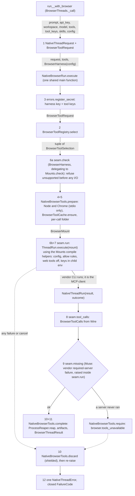

# Spec: Browser tools for every harness thread: run_<harness>_with_browser

> **TL;DR** — Nine coroutines, `<verb>_<harness>_with_browser` for `run`/`continue`/`fork` × `grok`/`opencode`/`muse`, run the existing harness thread flow with browser tools the caller names as strings (`"playwright"`, `"firecrawl:search"`). A pinned registry resolves the strings; the SDK installs each tool once into a user-level cache, mounts it through the harness's own per-call channel, allows exactly the chosen tools with the harness's own web tools off, reads back which tools ran, and kills every browser the call started. The decision that matters most: one shared twelve-layer main function (`NativeBrowserRun.execute`) drives a small per-harness seam (`<H>BrowserHarness`, which sits beside the public functions so imports run one way: browser → threads → wire → mounts), and each harness's existing `ThreadRun.execute` gains one optional `mount` argument, so the nine plain `_thread` functions stay byte-identical and every browser function inherits #1036's key, workspace and failure-code guarantees.

## §0 User prompts

_The verbatim record of what the user asked is in `docs/spec/harness-browser-tools/request.md`: every prompt in order, the handoff block if there is one, and the structured conversation notes. Only the prompt that invoked the pipeline is reproduced here._

### 0.1 Invoking request (verbatim)

````text
great, you explained the entire process really well, make sure that each function has all layers to it that makes this request possible. I want to keep the same "run_opencode_with_browser()", "run_grok_with_browser()", type of function names that we have in the repo, and want you to integrate these browser tools into every harness that we have so far in the repo. (kick off and explain this entire thing with the 'spec-pipelin' to a subagent (make sure to include in-depth response you returned to me last turn, and then can you go into depth about the following:

[ ] Bet on desktop computer use as the next registry category — cua-driver (30K stars) and E2B Desktop let agents operate any app, not only web pages. Builds on: the compile-per-harness interface. First step: a one-day spike that loads cua-driver mcp into opencode. Could we create the same type of agents the same way, except instead of attaching browser tools we attach "computer use" tools. Or is there fundamentally different ways that we have to do this? (do the agents need their own computers, is it not just tools for computer,  do agents need  permissions, etc)
````

_The part about desktop computer use is a question the conversation answered. It is not a build request (request §C "Rejected alternatives"; NG-1)._

### 0.2 User replies during the run
_None yet. The orchestrator appends any reply the user sends during the run here verbatim, labeled with the revision it produced._

---

## Part A — Framing

## §1 Goal

| ID | Goal (outcome) | How we will know | Source |
|---|---|---|---|
| G-1 | A developer can start, continue or fork a Grok Build, opencode or Muse Code thread that has browser tools. They do it by passing tool strings to functions named like the existing thread functions. | All nine `<verb>_<harness>_with_browser` coroutines are exported from `vidbyte.harnesses.native`. Each one returns a `BrowserThreadResult` from an offline fake-harness run (AC-1, AC-2, AC-3). | Prompt 3; request KD-1, KD-2 |
| G-2 | Every function has every layer the endorsed design lists: request, registry, keys, preflight, per-call folder, mount, allow rules with built-in web tools off, tool-call reader, required check, browser cleanup, result record, closed codes. | INV-1. Each layer has its own AC (AC-4 to AC-14). No function skips a layer. | Prompt 3 ("each function has all layers"); KD-3 |
| G-3 | The registry is extensive, pinned and deterministic. | 13 tools are mountable, each with an exact version or URL and exact per-capability tool names. 18 more popular names are answered by name with the reason they are not mountable. Unknown strings fail with a suggestion (AC-4, AC-5). | Prompts 1–2 ("all", "15-20 popular ones"); KD-4 |
| G-4 | #1036's guarantees hold for the browser functions: keys never on argv, in a file, in `os.environ` or in error text; nothing written into the workspace; one closed failure code with cause and next step; no approve-everything mode. | AC-7, AC-9, AC-16, AC-17; INV-4 to INV-7. | KD-6 |
| G-5 | Adding a harness later (Claude Code, Codex) or a tool later is local work. | A new harness needs one mounts module, one browser module and one reader, with no registry change. A new tool needs one registry row and its constants, with no harness change (NFR-8). | KD-2 ("adding them later one compiler module plus one tool-call reader each") |

## §2 Objective

The browser calls ship in `vidbyte.harnesses.native` as nine async functions. Each takes the same arguments as its plain `_thread` sibling, plus two keyword-only arguments:
- `tools`: a sequence of strings, each `<tool>[:<capability>[,<capability>…]]`;
- `tool_keys`: a mapping from tool name to that tool's credential.

Each function returns a `BrowserThreadResult`. It holds the thread id, the answer text, the browser tool calls the harness made, and the artifact files the call produced.

The vendor CLI remains the agent and the MCP client. The SDK only does the following:
- resolves the strings against a pinned registry;
- installs the pinned packages into a user-level cache;
- compiles each harness's own per-call mount;
- reads the harness's output;
- kills every process whose command line carries the call's own folder.

**What each harness can mount** (stated limitation, D-9, Q-15):
- **opencode:** every registry tool, keyed or not, stdio or remote.
- **Grok:** every stdio tool, keyed or not, and the keyless remote tools (jina and parallel without a key). A keyed remote tool (browserbase, or jina or parallel with a key) is refused with `browser.mount_unsupported`: Grok does not expand `${VAR}` in agent-file headers, so the key would have to be written into a file (KD-6).
- **Muse native** (`muse_command` set, or no WSL distro; Linux or macOS): keyless stdio tools (playwright, chromedevtools, firecrawl and exa without keys) and keyless remote tools (jina, parallel). Any keyed tool is refused, because Muse takes a key only as a literal in a file (KD-6).
- **Muse in WSL mode** (`MuseThreadConfig.wsl_distro` set and no `muse_command`, which is how Muse runs on Windows): only keyless remote tools, jina and parallel. Both are search and fetch services, and keyless Jina is fetch-only; the nearest thing to a browser there is Jina's remote `capture_screenshot_url`, with no page interaction. **No browser can be mounted there:** every stdio tool, including `playwright` and `chromedevtools`, is refused with `browser.mount_unsupported`. Q-15 records the loopback route that would lift this and why it is not built in this PR.

Done means:
- the full local gate `python scripts/run_ci.py` passes, apart from the pre-existing reds listed in §11, with no lint baseline raised;
- the nine plain functions behave byte-identically;
- every combination a harness cannot honour safely is refused with `browser.mount_unsupported` before anything runs.

## §3 Non-goals

- **NG-1** — Desktop computer use (cua-driver, E2B Desktop), as a registry category or as functions. — *Why not:* Prompt 3 asks it as a question. Request §C rejects building it in this PR.
- **NG-2** — Browser functions for Claude Code, Codex or Gemini CLI. — *Why not:* those harnesses are not on `main`: PR #1044 and #1055 are open (KD-2). G-5 keeps adding them cheap.
- **NG-3** — Treating CodexAgent (`vidbyte.agents.codex`) as a harness. — *Why not:* it is an SDK agent over the Codex app-server, not a vendor CLI thread function (Q-2, default no).
- **NG-4** — Fixing or reusing the existing MCP preset catalog (`McpPresetRegistry`). — *Why not:* it serves the SDK's own agent loop and has no version pin, entry point or per-capability tool names. 11 of its 15 web presets are broken (request §C hints). Q-4 defaults to leaving it untouched.
- **NG-5** — Changing the plain `run_grok_thread` path to switch off Claude and Cursor MCP scanning. — *Why not:* the user did not ask for it (Q-3, default: browser path only).
- **NG-6** — A host layer: `"playwright@browserbase"`, SDK-created cloud sessions, CDP endpoints, SDK-owned recording. — *Why not:* the conversation's phasing puts it after the per-harness work (Q-5). The `@<host>` suffix is reserved and refused.
- **NG-7** — Browser profiles that persist across continue and fork. — *Why not:* fresh state per call is the safe default (Q-6). A continue re-mounts the tools anyway, because MCP servers live only as long as the harness process.
- **NG-8** — An env-filter launcher that lets each MCP server see only its own variables. — *Why not:* the evidence is in §8.1 D-17 and Q-7, default no.
- **NG-9** — A browser skill or prompt add-on. — *Why not:* Grok already injects its own MCP reminder. The caller's prompt passes through unchanged (Q-8, default no; INV-10).
- **NG-10** — Tools that need a CLI plus a skill (agent-browser, @playwright/cli, midscene, devbrowser), a Python `uvx` runtime (fetch, duckduckgo, browser-use, scrapling), Docker (crawl4ai) or OAuth only (kernel, cloudflare). — *Why not:* each needs its own runtime handling. The registry still names each one and says why it is not mountable (FR-6).
- **NG-11** — An SDK command-line interface. — *Why not:* AGENTS.md and the request constraints forbid it.
- **NG-12** — Use-case presets, such as video verification or bug-report agents. — *Why not:* Prompt 1 says "Dont think about use cases now".
- **NG-13** — Isolating the user's own harness configuration beyond what the plain path already does (opencode `OPENCODE_DISABLE_*` variables, Grok `USERPROFILE`). — *Why not:* this is unrequested and changes harness behaviour (Q-11, Q-12, default no). It is accepted as EC-33.
- **NG-14** — Live smoke tests against real vendors, real registry servers or paid APIs. — *Why not:* the request forbids them in any test or gate.

## §4 Developer usage

```python
import asyncio
import os

from vidbyte.harnesses.native import continue_opencode_with_browser, run_opencode_with_browser


async def main() -> None:
    result = await run_opencode_with_browser(
        "Open https://example.com and tell me the page heading.",
        api_key=os.environ["DEEPSEEK_API_KEY"],          # the harness key, as for run_opencode_thread
        workspace="C:/work/site",
        model="deepseek/deepseek-v4-pro",
        tools=["playwright", "firecrawl:search"],         # registry strings: <tool>[:<capability>,...]
        tool_keys={"firecrawl": os.environ["FIRECRAWL_API_KEY"]},
    )
    print(result.thread_id, result.text)                  # e.g. ses_8f2c... Example Domain
    for call in result.tool_calls:                        # e.g. playwright browser_navigate completed
        print(call.tool.value, call.name, call.status.value)
    print(result.artifacts)                               # absolute paths of screenshots, or ()

    again = await continue_opencode_with_browser(result.thread_id, "Now take a screenshot.", api_key=os.environ["DEEPSEEK_API_KEY"], workspace="C:/work/site", model="deepseek/deepseek-v4-pro", tools=["playwright"])
    print(again.artifacts)                                # e.g. (WindowsPath('C:/Users/u/AppData/Local/Temp/vidbyte-browser-k3x9/artifacts/page-2026-10-17T10-00-00-000Z.png'),)


asyncio.run(main())
```

The developer gets back the thread id, the answer, the browser tool calls the harness made and the artifact paths, with `playwright`'s core tools and `firecrawl_search` allowed and opencode's own `webfetch`/`websearch` off. They no longer install packages, write MCP config or permission rules, start or stop Chrome, or parse vendor output; Grok and Muse callers swap only the harness word, key and model, within the per-harness limits of §2 (in WSL mode, which is how Muse runs on Windows, `run_muse_with_browser(..., tools=["playwright"])` raises `browser.mount_unsupported`).

## §5 Flow diagram



Validation happens in the two record constructors and `BrowserToolRegistry.select`, and the harness seam's `check` refuses what the harness cannot honour, all before any process starts or file is written; every layer runs inside the one shared `NativeBrowserRun.execute`, so no harness can skip one. State changes only in the shared tool cache (first install of a pinned package), the per-call folder (profiles, artifacts, Grok agent file) and the vendor's own thread store. Every failure is caught by the one guarded `try` in `_call` and becomes one `NativeThreadError`; failures after `prepare` first pass through `discard`, shielded from cancellation, so no browser outlives the call.

---

## Part B — Behavior (this is the spec; everything else is framing)

## §6 Behavior

### 6.1 Invariants

- **INV-1** — **"each … all layers":** every one of the nine functions runs all twelve layers of §5 in that order, through the one shared `NativeBrowserRun.execute`; a harness supplies only its seam (`check`, `run`, `tool_calls`, `missing`) and never its own copy of the sequence. A layer with nothing to do for a selection still runs and passes. Two examples: there is no Chrome check when no selected tool needs Chrome, and no Node check and no install when every tool is remote.
- **INV-2** — **"same":** the names are exactly `<verb>_<harness>_with_browser`. Each function's parameters are its plain `_thread` sibling's parameters, with the same names, kinds, types, defaults and order. `tools` (required) and `tool_keys` (default `None`) are inserted as keyword-only parameters directly after `model`.
- **INV-3** — **"actually":** the harness CLI is the only agent and the only MCP client. The SDK never connects to a tool server, never calls a tool and never runs an agent loop (KD-5). Every `BrowserToolCall` comes from the vendor's own output.
- **INV-4** — The harness key and every tool key never appear on any command line, in any file the SDK writes, in the SDK process's `os.environ`, or in any error text. A key reaches only a child's environment overlay. For opencode, it travels inside `OPENCODE_CONFIG_CONTENT`. Each key is registered with `NativeErrorFactory.register_secret` before any step that can produce error text (KD-6).
- **INV-5** — The SDK writes nothing into the workspace. Every file the SDK writes is in one of four places: the per-call folder, the tool cache, Grok's existing private home, or Muse's existing per-call config folder.
- **INV-6** — Every failure raises exactly one `NativeThreadError`. It carries a closed `FailureCode`, a likely cause and a next step written for that code, and an `expected` text that names the record the function returns. Each code has exactly one likely-cause text and one next-step text (`NATIVE_THREAD_LIKELY_CAUSES[code]`, `NATIVE_THREAD_NEXT_STEPS[code]`); guidance specific to one situation (which tools a harness can mount, the rule budget, the folder to delete) is carried in the error's observation sentence, which `str(error)` prints before the cause and the next step (D-29).
- **INV-7** — No approve-everything mode is added or passed. Permission is granted per mounted server and narrowed per tool (KD-6).
- **INV-8** — A stdio tool server starts only as `<absolute node> <absolute pinned entry>` from the tool cache. There is never `npx`, never `@latest`, and never a package fetch while a server starts.
- **INV-9** — A combination of harness, transport, key and narrowing that the harness cannot honour safely is refused with `browser.mount_unsupported` before any process starts or any file is written.
- **INV-10** — **"Dont think about use cases now", "all types":** the caller's prompt reaches the harness unchanged. The functions hold no use-case logic. Capabilities are generic tool subsets.
- **INV-11** — **"pass in strings":** resolving `tools` is deterministic. The same strings always give the same selections and the same compiled mount bytes apart from the per-call folder path, and no network or model is used.
- **INV-12** — Browser state is fresh per call:
  - each call starts its browsers from a new, empty profile folder inside a new per-call folder; no call ever reads another call's profile;
  - after the harness exits, the call attempts, within `BROWSER_REAP_TIMEOUT_SECONDS`, to kill every process whose command line carries the per-call folder and to remove the profiles; that removal is best effort (EC-22), and a leftover is never reused.
- **INV-13** — A tool key comes only from `tool_keys`. A mounted tool's key variable that the caller did not pass is removed from the harness child's environment, so a key in the caller's own environment is never used silently.

**Must not regress:**
- **INV-14** — The nine plain `_thread` functions keep the same argv, environment overlay, output cap, Grok `--output-format=json`, result and errors as on `main` (`vidbyte.harnesses.native.{grok,opencode,muse}.threads` and `.wire`), except the six cause and next-step texts that D-19 and D-22 widen.
- **INV-15** — Harness modules hold no literals of their own. Flags are enum members, and every other value comes from a `vidbyte.lib.constants` module (header of `vidbyte.lib.constants.native_threads`, #1036 INV-15, lint A007).
- **INV-16** — The existing `FailureCode` values, the existing `NATIVE_THREAD_FAILURE_CODES` pairs, and the `NativeThreadError.expected` text of the plain functions stay unchanged (`vidbyte.lib.errors.base.NativeThreadError`). The exceptions are the `grok.output_too_large` likely-cause text, which widens to name both Grok caps (D-19), and five next-step texts that name a plain function and widen to also name its `_with_browser` sibling (D-22).
- **INV-17** — The Muse WSL peer mark and reap keep their behaviour (`vidbyte.harnesses.native.muse.launcher.MuseLauncher.reap`).
- **INV-18** — Grok's private home stays at `~/.vidbyte/grok-homes/<hash>`, keyed by workspace, and Muse's private config folder stays per call and is removed however the call ends (`GrokThreadRun._prepare_home`, `MuseThreadRun._prepare_config`).

### 6.2 Acceptance criteria

| ID | Given | When | Then | Priority | Proof |
|---|---|---|---|---|---|
| AC-1 | A clean checkout of this branch, with the offline fake opencode, a fake MCP server reached through a fake `node`, and a pre-populated tool cache | The §4 snippet runs | It produces exactly the shown result: two `BrowserThreadResult`s with the fake's thread id and text, `tool_calls` holding `BrowserToolCall(tool=BrowserTool.PLAYWRIGHT, name="browser_navigate", status=BrowserToolCallStatus.COMPLETED)`, and the second result's `artifacts` naming files under the per-call `artifacts` folder | P0 | fake-harness run: `test_harness_threads_browser_acceptance.py` `test_the_developer_snippet_runs_as_documented`; S3 commits `0a86d456`, `8903baa0`, `4c084da6`, `8290c813`, `d70b8ba1` |
| AC-2 | Each of the nine functions, with fakes for Grok, opencode, Muse native and Muse WSL mode | It is called with `tools=["playwright"]` (`["jina"]` for Muse WSL mode, the only kind of tool it can mount; its `playwright` refusal is AC-19) | It returns a `BrowserThreadResult` whose `tool_calls` are read from the fake's output. The harness's own web tools are off (opencode permission deny, `--disable-web-search`, `--disable-web-tools`). The compiled mount names a per-call folder outside the workspace. | P0 | fake-harness run: `test_harness_threads_browser_mounts.py` `test_every_browser_function_mounts_a_tool_and_reads_the_vendors_calls` (9), `test_muse_in_wsl_mode_mounts_jina_without_node_or_chrome` (3, win32); S3 commits `19fa8cf9`, `3ae18948`, `59dfc44c`, `8903baa0`, `4c084da6`, `8290c813` |
| AC-3 | The installed package | `vidbyte.harnesses.native` and each harness subpackage are imported | `__all__` lists the nine functions, plus `BrowserThreadResult` and `BrowserToolCall` at the native level. Each signature equals its plain sibling's with `tools` and `tool_keys` inserted after `model` (INV-2). | P0 | surface pin: `test_harness_threads_browser_contract.py` `test_native_and_subpackages_export_the_browser_functions`, `test_browser_functions_take_the_plain_parameters_with_tools_after_model`; `test_harness_threads_surface.py` pins; S3 commits `2b2e350a`, `8903baa0`, `4c084da6`, `8290c813`, `d70b8ba1` (red: `tests/features/codex_host/test_codex_host_packaging.py` pins the old SHA-256 of `native/__init__.py`; see the S3 report) |
| AC-4 | `tools=["playwrite"]`; then `tools=["skyvern"]` (no close match) | Any browser function is called | `configuration.invalid_argument` naming `tools[0]`, without quoting the item. For `playwrite` the observation suggests `playwright`; for `skyvern` it names the 13 mountable tools. No process starts and no file is written. | P0 | fake-harness run: `test_harness_threads_browser_registry.py` `test_registry_suggests_a_close_name_or_lists_the_mountable_tools`, `test_public_functions_refuse_bad_tools_before_any_process_or_file`; S3 commits `6850de45` |
| AC-5 | `tools=["puppeteer"]` (an excluded name) or `tools=["playwright@browserbase"]` | Any browser function is called | `configuration.invalid_argument` naming `tools[0]`, with the recorded exclusion reason or "hosts are not supported in this release" | P0 | fake-harness run: `test_harness_threads_browser_registry.py` `test_registry_refuses_exclusions_hosts_and_duplicates`, `test_public_functions_refuse_bad_tools_before_any_process_or_file`; S3 commits `6850de45` |
| AC-6 | `tools=["firecrawl:search"]` | It is run on opencode, Grok and Muse | Narrowing fails closed. opencode's compiled permission is `"vidbyte-firecrawl_*":"deny"` followed by one exact allow, `"vidbyte-firecrawl_firecrawl_search":"allow"`. Grok's argv carries exactly one `--allow=MCPTool(firecrawl__firecrawl_search)`, one `--deny=` per other known Firecrawl tool, and no wildcard allow. Muse raises `browser.mount_unsupported`. | P0 | fake-harness run: `test_harness_threads_browser_mounts.py` `test_opencode_narrowing_denies_the_server_then_allows_one_tool`, `test_grok_narrowing_allows_exactly_and_denies_every_other_known_tool`, `test_muse_refuses_narrowing_and_keys_before_any_io`; S3 commits `6850de45`, `19fa8cf9`, `3ae18948`, `59dfc44c` |
| AC-7 | `tools=["brave"]`, `tool_keys={"brave": K}` | It is run on Grok and opencode | `K` appears only in Grok's child environment overlay (`BRAVE_API_KEY`) or inside opencode's `OPENCODE_CONFIG_CONTENT`. It appears in no argv, no SDK-written file, not in `os.environ`, and no error text. Muse raises `browser.mount_unsupported`. | P0 | fake-harness run: `test_harness_threads_browser_mounts.py` `test_tool_key_travels_only_in_the_child_environment`, `test_muse_refuses_narrowing_and_keys_before_any_io`; S3 commits `0a86d456`, `19fa8cf9`, `3ae18948`, `59dfc44c` |
| AC-8 | `tools=["brave"]` with no `tool_keys`; or a key for `playwright`; or a key for a tool not in `tools` | Any browser function is called | `configuration.invalid_argument` naming `tool_keys[brave]` or `tool_keys[playwright]`. The key value is never echoed. | P0 | fake-harness run: `test_harness_threads_browser_registry.py` `test_registry_refuses_keys_by_meaning_without_echoing_them`, `test_public_functions_refuse_bad_tools_before_any_process_or_file`; S3 commits `f84f40a1`, `6850de45` |
| AC-9 | The caller's environment holds `FIRECRAWL_API_KEY`, and `tools=["firecrawl"]` has no key | It is run on Grok or opencode | The harness child's environment has no `FIRECRAWL_API_KEY` (INV-13) | P0 | fake-harness run: `test_harness_threads_browser_mounts.py` `test_a_key_in_the_callers_environment_is_never_used_silently`; S3 commits `6850de45`, `19fa8cf9`, `3ae18948` |
| AC-10 | A stdio tool is selected and there is no `node` on PATH, or it is a batch file, or its version is below 22.12.0; or `playwright` is selected and no Chrome stable is at any searched location | Any browser function is called | `browser.runtime_missing` naming what was searched or found. The harness is not started. | P0 | fake-harness run: `test_harness_threads_browser_runtime.py` `test_no_node_on_path_is_runtime_missing`, `test_node_below_the_floor_is_runtime_missing_naming_the_version`, `test_a_batch_file_node_is_refused_unrun` (win32), `test_no_chrome_is_runtime_missing_listing_the_searched_locations`; S3 commits `0a86d456` |
| AC-11 | An empty tool cache | Two calls select `playwright` | The first runs one install and publishes `~/.vidbyte/tools/playwright-0.0.83`. The second runs no install. A failing install raises `browser.tool_install_failed` and leaves no published folder. | P0 | fake-harness run with fake npm: `test_harness_threads_browser_runtime.py` `test_cold_cache_installs_once_with_the_pinned_argv_and_publishes`, `test_a_failing_install_publishes_nothing_and_attaches_npms_text`; S3 commits `0a86d456`, `c9edd485` |
| AC-12 | The fake Grok never lists a mounted server; fake opencode makes no mounted-tool call; or fake Muse reports a required server's startup failure | The call finishes | `browser.tools_unavailable` with the thread id when the vendor printed one. For Grok it names each server never listed or called; for Muse it carries Muse's reason, which names the server, and no thread id, because Muse prints no session before a required-server failure; for opencode it says that no mounted tool was used and lists the mounted servers, without claiming which one failed. | P0 | fake-harness run: `test_harness_threads_browser_lifecycle.py` `test_grok_names_each_server_it_never_listed`, `test_opencode_without_a_mounted_tool_call_says_so`, `test_muse_required_server_failure_carries_muses_reason`; S3 commits `0a86d456`, `8903baa0`, `4c084da6`, `8290c813` (red: the Muse case, an S2 fixture-routing defect; see the S3 report) |
| AC-13 | A fake browser process whose command line carries the per-call folder outlives the fake harness, on Windows and on the Linux CI runner, with a PATH that holds only stand-ins | The call returns, raises, is cancelled or times out | That process is gone within `BROWSER_REAP_TIMEOUT_SECONDS` and the profiles are removed. The artifacts folder remains only after a successful return that produced artifacts. On POSIX the reaper runs `ps` from its fixed absolute path (`NATIVE_PS_PATHS`), never from PATH. | P0 | fake-harness run: `test_harness_threads_browser_lifecycle.py` `test_a_returned_call_reaps_its_browser_and_removes_its_folder`, `test_artifacts_survive_a_successful_return_and_profiles_do_not`, `test_a_failed_run_reaps_and_discards_everything`, `test_a_cancelled_call_reaps_and_re_raises`, `test_a_timed_out_call_reaps_and_raises_the_timeout`, `test_process_reaper_kills_by_marker_and_spares_the_rest`; S3 commits `affc030b`, `0a86d456`, `c665afdb`, `c9edd485` |
| AC-14 | Any Grok browser call | It runs | The child environment has `GROK_CLAUDE_MCPS_ENABLED=0` and `GROK_CURSOR_MCPS_ENABLED=0`. A plain `run_grok_thread` call's environment does not. | P0 | fake-harness run: `test_harness_threads_browser_mounts.py` `test_grok_browser_runs_switch_off_compat_scans_and_stream`; S3 commits `3ae18948` |
| AC-15 | The nine plain functions with the inputs used by the existing tests | They run on this branch | Argv, environment overlay, output cap and results are identical to `main`. The existing tests pass unchanged, except the pins §13 lists. | P0 | existing tests: the harness_threads suite unchanged except the §13 pins (`test_harness_threads_surface.py`, `test_harness_threads_errors.py`, `test_harness_threads_static_policy.py`); S3 commits `f84f40a1`, `19fa8cf9`, `3ae18948`, `59dfc44c` |
| AC-16 | Any browser call, successful or failing | It ends | Apart from files the fake agent itself wrote, the workspace tree is byte-identical to before | P0 | fake-harness run: `test_harness_threads_browser_lifecycle.py` `test_the_sdk_writes_only_in_its_four_places`, `test_a_failing_call_leaves_no_trace`; S3 commits `0a86d456`, `c665afdb` |
| AC-17 | Any browser-function failure | The error is read | `error.expected` is `"<function> returning a BrowserThreadResult"`. The message names the browser function, the code, the cause and the next step. | P0 | fake-harness run: `conftest.py` `check_browser_error`, applied by every browser error test; S3 commits `5877c763`, `da596d28`, `f88dcc8e` |
| AC-18 | Grok with selections whose deny rules exceed `GROK_BROWSER_RULES_MAX_UNITS` | It is called | `browser.mount_unsupported`, whose observation says to narrow the capabilities or mount fewer tools (the code's one next-step text is unchanged, D-29) | P1 | fake-harness run: `test_harness_threads_browser_mounts.py` `test_grok_refuses_rules_beyond_the_argv_budget`; S3 commits `3ae18948` |
| AC-19 | Muse in WSL mode (`wsl_distro` set, no `muse_command`) | Each stdio tool (`playwright`, `chromedevtools`, keyless `firecrawl`, keyless `exa`), then `["jina"]` | Every stdio tool raises `browser.mount_unsupported`, whose observation says Muse in WSL mode can mount only keyless remote tools and names `jina` and `parallel` (D-29). `jina` mounts as `{"transport":"streamable_http","url":…}` in the per-call `muse/settings.json`. | P0 | fake-harness run: `test_harness_threads_browser_mounts.py` `test_muse_in_wsl_mode_refuses_every_stdio_tool_before_any_io`, `test_muse_in_wsl_mode_mounts_jina_without_node_or_chrome` (win32); S3 commits `59dfc44c`, `8290c813` |
| AC-20 | The finished branch | `python scripts/run_ci.py` runs | It passes, apart from the known reds of §11. Lint ends with `SDK-LINT: PASS` with `lint/baseline.json` unchanged (in particular A006, S020, S061, S041, S047, S052, A007 and S009 do not exceed their counts), and the semgrep scan is clean. | P0 | full local gate (no pytest test); S3 commits `0dfde894` (gate run at this SHA; the reds are listed in the S3 report) |
| AC-21 | Two concurrent calls in one workspace with different tool sets | Both run | Each has its own per-call folder and agent file, and both succeed. One call's cleanup never kills the other call's browser. | P1 | fake-harness run: `test_harness_threads_browser_lifecycle.py` `test_concurrent_calls_keep_their_own_folders_and_browsers`; S3 commits `0a86d456` |
| AC-22 | `tools=["browserbase"]` with a key | It is run on opencode, then on Grok | opencode's content has `"type":"remote"`, `"oauth":false` and an `Authorization` header holding the key. Grok raises `browser.mount_unsupported`, because a keyed remote tool would need the key written into the agent file. | P1 | fake-harness run: `test_harness_threads_browser_mounts.py` `test_opencode_mounts_a_keyed_remote_tool_with_a_bearer_header`, `test_grok_refuses_a_keyed_remote_tool_before_any_io`; S3 commits `19fa8cf9`, `3ae18948` |
| AC-23 | Every registry row | The registry is loaded | Each mountable row has an exact version (stdio) or `https` URL (remote), a key rule, and capability tool names that match vendor facts §4. Each exclusion has a non-empty reason. | P0 | registry pin: `test_harness_threads_browser_registry.py` `test_stdio_rows_pin_package_version_entry_key_and_options`, `test_remote_rows_pin_https_urls_and_bearer_keys`, `test_capability_tool_names_match_vendor_facts`, `test_playwright_core_and_server_flag_groups_match_vendor_facts`, `test_every_exclusion_has_its_recorded_reason`; S3 commits `2b2e350a`, `5877c763`, `6850de45` |
| AC-24 | The finished branch | The folder docs are read | The harnesses README `native/` paragraph names the nine functions, `tools`/`tool_keys`, the tool cache and the unsupported combinations; the registries README has a "Browser Tool Sources" section; the REPO_MAP native rows name the new modules; the failure vocabulary lists the four `browser.*` codes. Each README stays ≤ 40,000 characters. | P1 | review + lint A009 (no pytest test); S3 commits `0dfde894` (review + A009 PASS; the REPO_MAP and README texts are pinned by `test_codex_host_packaging.py`; see the S3 report) |
| AC-25 | A key-shaped item, for example `tools=["fc-0123456789abcdef0123456789abcdef"]` (refused by the registry), or the same item with a trailing line break (refused by the record, before any key is registered) | Any browser function is called | `configuration.invalid_argument` naming `tools[0]`. No part of the item appears in the message, `str(error)`, `vendor_message` or any detail field. | P0 | fake-harness run: `test_harness_threads_browser_registry.py` `test_request_record_refuses_bad_tools_without_quoting`, `test_public_functions_refuse_bad_tools_before_any_process_or_file`; S3 commits `f84f40a1`, `6850de45` |
| AC-26 | Any Muse browser call | The per-call `muse/settings.json` is read | Its top level is exactly `{"schema_version": 1, "mcpServers": {…}}`. Every stdio entry has a string `command` and a separate `args` list. Every remote entry has `"transport": "streamable_http"` and a `url`, and no `env`. A fake Muse that, like the real one, refuses a file without `schema_version` (exit 1) and disables MCP on a bad entry accepts the file. | P0 | fake-harness run: `test_harness_threads_browser_mounts.py` `test_muse_settings_have_the_one_verified_shape`; `test_harness_threads_browser_fakes.py` `test_fake_muse_needs_schema_version_and_silently_drops_mcp_on_a_bad_entry`; S3 commits `59dfc44c` |
| AC-27 | `tools=["playwright:devtools,pdf"]` | It is run on opencode, Grok and Muse native | Playwright starts with `--caps=devtools,pdf`. The allowed set is the 25 core tools plus 13 devtools tools plus 1 pdf tool (39), and no tool is denied, so Muse native accepts it. | P0 | fake-harness run: `test_harness_threads_browser_mounts.py` `test_playwright_caps_add_tools_and_deny_none`; S3 commits `6850de45`, `0a86d456`, `19fa8cf9`, `3ae18948`, `59dfc44c` |
| AC-28 | Any opencode browser call, and a user global opencode config that defines `mcp.playwright` | It runs | Every compiled server id is `vidbyte-<tool>` with `"enabled": true`, so the user's `playwright` entry is neither merged into nor disabling the SDK's server. | P1 | fake-harness run: `test_harness_threads_browser_mounts.py` `test_opencode_ids_are_prefixed_and_enabled_beside_a_users_own_entry`; S3 commits `19fa8cf9` |
| AC-29 | `tools=["firecrawl"]`, `tool_keys={"firecrawl": "fc-0123456789abcdef\n"}` (a key read from a file, with its trailing line break) | Any browser function is called | `configuration.invalid_argument` naming `tool_keys[firecrawl]`. No part of the value appears in the message, `str(error)`, `vendor_message`, `actual` or any detail field. | P0 | fake-harness run: `test_harness_threads_browser_registry.py` `test_request_record_refuses_bad_tool_keys_without_quoting`, `test_public_functions_refuse_bad_tools_before_any_process_or_file`; S3 commits `f84f40a1` |
| AC-30 | `tools=["firecrawl"]`, `tool_keys={"fc-0123456789abcdef": "firecrawl"}` (key and name swapped) | Any browser function is called | `configuration.invalid_argument` naming `tool_keys entry 0`. The mapping key appears in no message, `str(error)`, `vendor_message`, `actual` or detail field. | P0 | fake-harness run: `test_harness_threads_browser_registry.py` `test_request_record_refuses_bad_tool_keys_without_quoting`, `test_public_functions_refuse_bad_tools_before_any_process_or_file`; S3 commits `f84f40a1` |
| AC-31 | No `node` and no Chrome on PATH or at any searched location | `run_opencode_with_browser(..., tools=["jina"])` and, in WSL mode, `run_muse_with_browser(..., tools=["jina"])` are called | Both return a `BrowserThreadResult`. No `node --version` child and no install run. | P0 | fake-harness run: `test_harness_threads_browser_mounts.py` `test_opencode_mounts_jina_with_no_node_and_no_chrome`, `test_muse_in_wsl_mode_mounts_jina_without_node_or_chrome` (win32); S3 commits `0a86d456`, `8903baa0` |
| AC-32 | `tools=["jina"]` with no key; then with `tool_keys={"jina": K}` | It is run on Grok | Without a key, the agent file's `mcpServers` holds `{"name": "jina", "url": "https://mcp.jina.ai/v1"}` and argv holds `--allow=MCPTool(jina__*)`; the call returns a `BrowserThreadResult`. With a key, `browser.mount_unsupported` before any I/O, and `K` appears nowhere. | P0 | fake-harness run: `test_harness_threads_browser_mounts.py` `test_grok_mounts_keyless_jina_as_a_url_only_entry`, `test_grok_refuses_a_keyed_remote_tool_before_any_io`; S3 commits `3ae18948`, `4c084da6` |
| AC-33 | A fake harness whose output records a call to a mounted server with a tool name that fails `NATIVE_NAME_PATTERN` or is longer than 64 characters (for example `playwright__browser navigate`) | The call finishes | The reader skips that call and the function returns normally; it never raises `configuration.invalid_argument` for vendor output. | P0 | fake-harness run: `test_harness_threads_browser_mounts.py` `test_readers_skip_vendor_names_that_fail_the_name_rule`; S3 commits `19fa8cf9`, `3ae18948`, `59dfc44c` |

### 6.3 Edge cases and failure modes

| ID | Trigger (input + state) | System behavior | User sees | Guarded by (INV-/D-) |
|---|---|---|---|---|
| EC-1 | `tools="playwright"` (a bare string) | The record refuses it; a string is never split into characters | `configuration.invalid_argument` naming `tools` | INV-11, D-14 |
| EC-2 | `tools=[]`, or more than `BROWSER_TOOLS_MAX_PER_CALL` (8) items | Refused | invalid argument naming `tools` | INV-11 |
| EC-3 | An item that is not one line, is longer than 128 characters, or does not match the grammar | Refused by the record, which checks each item with the non-raising `RecordFieldValidator.accepts_text` and raises a constant message (never `require_text`, whose message quotes short non-secret values). No refusal, from the record or the registry, ever quotes the item: it names the index and, where one exists, the suggested registry name, the list of mountable tools or the exclusion's recorded reason. A key pasted into `tools` is never registered as a secret, so not quoting it is the only control. | invalid argument naming `tools[i]` | INV-4, INV-11, D-14, D-28 |
| EC-4 | The same tool twice (`"playwright"`, `"playwright:vision"`) | Refused | invalid argument naming the second index and the first | INV-11 |
| EC-5 | An unknown capability (`"firecrawl:serch"`) | Refused, with a did-you-mean from that tool's capabilities | invalid argument naming `tools[i]` | INV-11 |
| EC-6 | A key for a tool whose rule is `none`, for a tool not in `tools`, or under a name that is not a registry name (a typo, or key and name swapped) | Refused. An entry is named by its name only when that name is a registry name (mountable or excluded); otherwise by its position, so a key used as the name never reaches a message. Every name that is not a registry name is also registered as a secret with the values. | invalid argument naming `tool_keys[<name>]` or `tool_keys entry <i>` | INV-4, INV-13, D-28 |
| EC-7 | A key that has whitespace (including a trailing line break from a file), is empty, or is longer than 4,096 characters | Refused by the record with `accepts_text` and a constant message, before any key is registered; the value is never quoted | invalid argument naming `tool_keys[<name>]` or `tool_keys entry <i>` | INV-4, D-28 |
| EC-8 | `node` on PATH is `node.cmd` or `node.bat` (some version managers) | Refused as a batch file, as `NativeLauncher` refuses harness batch files | `browser.runtime_missing` naming the path | D-6 |
| EC-9 | `chromedevtools` or `playwright` selected, no Chrome stable installed | Refused before the harness starts | `browser.runtime_missing` listing the searched locations | D-6 |
| EC-10 | Two processes install the same tool at once | Each installs into its own staging folder. The first `os.rename` publishes; the loser deletes its staging. | Both calls proceed | D-5 |
| EC-11 | Install cancelled or timed out (`BROWSER_TOOL_INSTALL_TIMEOUT_SECONDS`) | Staging removed. Cancel re-raises; timeout raises. | `browser.tool_install_failed` (timeout) | D-5 |
| EC-12 | A published cache folder exists but its entry file is missing | Not repaired automatically | `browser.tool_install_failed`, whose observation names the folder to delete (D-29) | D-5 |
| EC-13 | The npm registry is unreachable, or the bundled `npm-cli.js` is absent (for example a Debian apt Node) | npm's stderr is scrubbed and attached | `browser.tool_install_failed` | D-5, A-8 |
| EC-14 | The user's home folder cannot be determined: the cache root comes from `Path.home()`, which raises `RuntimeError` | No cache can exist | `browser.tool_install_failed` with the detail | D-5 |
| EC-15 | The per-call folder cannot be created (disk full, permissions) | Nothing has started yet | `<harness>.launch_failed` with the folder detail, the same as Grok's home failure | D-3 |
| EC-16 | A Grok server is slower than Grok's roughly 2 s startup grace | Absent from `available_commands` | `browser.tools_unavailable` naming it | D-11 |
| EC-17 | An opencode run where the agent used no mounted tool, whether because a server never started or because the agent did not need one | opencode prints no server status in a run, so the check can only say "no mounted tool was used". A run with two servers where only one was used passes even if the other never started. | `browser.tools_unavailable` saying no mounted tool was used, listing the mounted servers, and carrying the thread id and the answer text as vendor text, so the caller can continue | D-11, Q-9 |
| EC-18 | A Muse required server fails at startup | Muse fails the whole run (vendor rule) | `browser.tools_unavailable` with Muse's reason | D-11 |
| EC-19 | The harness times out | Existing `<harness>.timed_out`; cleanup still runs; artifacts are discarded | the timeout error | INV-12, D-12 |
| EC-20 | The caller cancels | `discard` runs shielded from the cancel, then `CancelledError` propagates | the cancellation | INV-12 |
| EC-21 | On POSIX, Chrome leads its own process group (Playwright `detached`), so the harness group kill misses it | `ProcessReaper.reap` kills it by marker | nothing | INV-12, D-12 |
| EC-22 | The reaper's own program (System32 PowerShell, or `ps` at `/bin/ps` or `/usr/bin/ps`) is absent, cannot start, or times out | Not raised. The profile removal is still attempted; a leftover profile stays in its own per-call folder, which no later call reuses (INV-12). | nothing. *Accepted:* best effort, bounded. | INV-12, D-12 |
| EC-23 | A stdio server without a profile or output option (exa, firecrawl, …) is orphaned by a harness crash | Its command line carries no per-call folder, so the reaper cannot see it. The harness tree stop still applies. | nothing. *Accepted:* it holds no browser. | D-12 |
| EC-24 | The agent asks Playwright to save a file under an explicit name | Playwright resolves explicit names against its workspace root, so the file lands in the workspace | the file in the workspace. *Accepted:* an agent-authored write, like any edit the coding agent makes. Auto-named files go to the artifacts folder. | INV-5 (SDK writes only) |
| EC-25 | Grok deny rules exceed the argv budget | Refused before I/O | `browser.mount_unsupported` | INV-9, D-10 |
| EC-26 | Muse with a keyed tool; Muse in WSL mode with a stdio tool; Grok with a keyed remote tool | Refused before I/O | `browser.mount_unsupported`, saying which harness and transport | INV-9, D-9 |
| EC-27 | A narrowing capability on Muse (`"firecrawl:search"`) | Muse cannot filter its catalog. Refused. | `browser.mount_unsupported` | INV-9, D-10 |
| EC-28 | On Grok, the agent calls a denied tool | Grok answers "Denied by permission policy" and the turn continues | a `BrowserToolCall` with status `failed` | D-10 |
| EC-29 | More than 1,000 tool calls, or more than 1,000 artifact files | The first 1,000 are kept and the `_truncated` flag is set. All artifact files stay on disk. | truncated flags | NFR-1 |
| EC-30 | A continue or fork of a browser thread with a different tool set | Tools are re-mounted fresh for this call | normal result | INV-12, D-16 |
| EC-31 | A browser thread continued by a plain `continue_<harness>_thread` (for example by following a next step) | Runs without tools. On Grok the MCP servers are gone, but the thread's stored system prompt keeps the agent file's body (vendor facts §9), which is why that body names no tool and never says tools are mounted (D-18). The five next-step texts that name a plain function also name its `_with_browser` sibling, so the advice no longer drops the tools silently. | normal `NativeThreadResult` | A-14, D-18, D-22 |
| EC-32 | Grok's turn ends with `stopReason` `cancelled` (a tool needing approval in headless mode) | Treated as a failed run | `grok.run_failed` with the stop reason | D-8 |
| EC-33 | The user's global opencode config and external skills, or Grok's `~/.agents/skills` and `~/.claude` hooks | Still load, as in the plain path (vendor facts §7) | the vendor's behavior. *Accepted* (NG-13). | — |
| EC-34 | A keyless server calls home at start (Apify and Sentry, Bright Data; Chrome DevTools unless quieted); opencode itself opens `registry.npmjs.org:443` and `github.com:443` at session start, as on the plain path (vendor facts §9) | Chrome DevTools is started quiet. The others are documented per registry row and in the README. | nothing. *Accepted.* | D-21 |
| EC-35 | A web page prompt-injects the agent to read tool keys from its shell environment (Grok, opencode) | Keys live in the harness environment, and every server and the agent shell inherit it | possible exfiltration. *Accepted* (T-2, Q-7). | D-17 |
| EC-36 | A workspace's own `opencode.json` adds servers or permissions | Read by opencode, as in the plain path (#1036 T-6) | *Accepted:* pass only trusted workspaces | — |
| EC-37 | A node or entry path with spaces or non-ASCII characters | Argv elements are never shell-joined. Configs are JSON-encoded. | normal result | INV-8 |
| EC-38 | The harness program is missing after a cold install | The install is kept, and the existing `<harness>.not_installed` is raised | that error | D-3 |
| EC-39 | Muse rejects its settings file without failing: any bad entry disables all MCP while the run exits 0, traced only in `session.jsonl` (vendor facts §1) | Prevented by construction: the file is compiled only from constants into the one verified shape (AC-26). If Muse still disables MCP, the run returns success with no tool calls. | a `BrowserThreadResult` with empty `tool_calls`. *Accepted residual* (Q-17). | D-11 |
| EC-40 | The user's global opencode config defines a server with the same name as a browser tool (`playwright`, `firecrawl`) | opencode deep-merges `OPENCODE_CONFIG_CONTENT` onto global entries of the same id, so the SDK uses prefixed ids (`vidbyte-<tool>`) and sets every member, including `"enabled": true` | normal result; the user's own entry stays loaded beside it | D-23 |
| EC-41 | A Grok narrowed selection, and the pinned server exposes a tool the registry does not list | That tool has neither an allow nor a deny rule. Grok's `search_tool` still shows the model every mounted tool, and headless Grok cancels the whole turn (`stopReason` `cancelled`, exit 0) when such a tool is called (vendor facts §7, §9). | `grok.run_failed` with stop reason `cancelled`: a loud failure, never a silent extra tool | D-10, EC-32 |
| EC-42 | In WSL mode (`wsl_distro` set, no `muse_command`; how Muse runs on Windows), `run_muse_with_browser` with any stdio tool (`playwright`, `chromedevtools`, keyless `firecrawl` or `exa`) | Refused before I/O. The distro has no Linux Node, and Windows Node through interop fails for stdio (vendor facts §1). A fake Muse passed as `muse_command` is native mode, not WSL mode. | `browser.mount_unsupported`, whose observation names the keyless remote tools Muse in WSL mode can mount (D-29). *Stated limitation* (§2, Q-15). | D-9 |
| EC-43 | A tool whose server writes to its own working folder | Muse ignores an entry's `cwd` and starts servers in the workspace (vendor facts §1); opencode and Grok start them in the harness's working folder | As EC-24: such files are the server's, at the agent's request. Auto-named Playwright files still go to the artifacts folder. | INV-5 (SDK writes only) |
| EC-44 | The vendor's output names a call on a mounted server whose tool part fails `NATIVE_NAME_PATTERN` or exceeds 64 characters (the model wrote `playwright__browser navigate` into Grok's `use_tool`; an opencode split leaves a leading `_`) | The reader checks each name with the non-raising `accepts_text` and skips a failing call; it never builds a record that would raise. The vendor already answered the call as failed ("Tool not found"). | a normal result without that call | FR-13, D-28 |
| EC-45 | A Grok keyless remote server never mounts (for example a real server answers Grok's first `POST server/discover` with an error Grok does not tolerate, A-19) | The server is absent from `available_commands` and never called | `browser.tools_unavailable` naming it | D-9, D-11 |

**Rollback of the user action:** a browser call changes three things outside the vendor's thread store:
- **The per-call artifacts folder,** which is kept only on success. Delete it when the files are no longer needed.
- **The tool cache.** Delete `~/.vidbyte/tools/<tool>-<version>` to force a reinstall, or the whole folder to reclaim space.
- **The vendor thread.** It stays in the harness's own history. The plain functions can continue it.

Nothing the SDK wrote is in the workspace. Edits the agent made there are undone the way any coding-agent edit is undone.

## §7 Requirements

**Functional**
| ID | Requirement | Priority | Source (request.md / G-) |
|---|---|---|---|
| FR-1 | Nine coroutines exist: `run_`, `continue_` and `fork_` × `grok`, `opencode` and `muse`, each `<verb>_<harness>_with_browser`. Each harness subpackage exports its three, and `vidbyte.harnesses.native` re-exports all nine. | P0 | Prompt 3; KD-1; KD-2; Q-1; G-1 |
| FR-2 | Each function takes its plain sibling's parameters unchanged (name, kind, type, default, order), plus keyword-only `tools: Sequence[str]` (required) and `tool_keys: Mapping[str, str] \| None = None`, inserted directly after `model`. | P0 | Prompt 3 "same"; G-1 |
| FR-3 | Each function returns `BrowserThreadResult(harness, thread_id, text, text_truncated, tool_calls, tool_calls_truncated, artifacts, artifacts_truncated)`. | P0 | KD-3 layer 11; G-2 |
| FR-4 | `tools` and `tool_keys` are validated at the boundary by `BrowserToolRequest`:<br>• a sequence, not a string; 1–8 items;<br>• each item at most 128 characters and matching the grammar pattern (which admits no line break);<br>• a mapping of text to text;<br>• each key matching `NATIVE_API_KEY_PATTERN`, at most 4,096 characters.<br>Items and keys are checked with the non-raising `RecordFieldValidator.accepts_text`, and a failure raises a constant message that never quotes the value (D-28). A refusal is `configuration.invalid_argument` naming `tools[i]`, `tool_keys[<name>]` when the name is a registry name, or `tool_keys entry <i>` otherwise. | P0 | KD-3 layer 1; KD-6; G-2 |
| FR-5 | `BrowserToolRegistry.select` resolves each item by the grammar `<tool>[:<capability>[,<capability>…]]`, as follows:<br>• an unknown tool or capability is refused with a did-you-mean suggestion; when no name is close enough, the refusal names the 13 mountable tools (or that tool's capabilities);<br>• an excluded name is refused with its recorded reason;<br>• a `@<host>` suffix is refused as unsupported in this release;<br>• a duplicate tool is refused;<br>• with no capability named, the tool's default capabilities apply;<br>• a capability that maps to a server flag (Playwright `--caps`) is additive: it adds its tools to the default ones instead of replacing them (D-24);<br>• no refusal quotes the item; it names `tools[i]` and at most a registry-owned suggestion or reason. | P0 | Prompt 1 "pass in strings"; KD-4; G-3 |
| FR-6 | The registry ships 13 mountable tools: playwright, chromedevtools, firecrawl, exa, tavily, brave, perplexity, brightdata, apify, linkup, browserbase, jina and parallel.<br>Each row pins the exact package version, entry and arguments (stdio) or URL (remote), the key rule and variable, and each capability's exact tool names, with a source comment.<br>18 more names are answered with their reason: browserstack, searxng, wdio, fetch, duckduckgo, agentbrowser, playwrightcli, midscene, devbrowser, crawl4ai, browseruse, scrapling, kernel, cloudflare, puppeteer, hyperbrowser, steel and browserless. | P0 | Prompts 1–2 "all", "more extensive", "15-20 popular ones"; KD-4; G-3 |
| FR-7 | Tool keys come only from `tool_keys`. A missing required key is refused. A key for a `none`-rule tool, or for a tool not in `tools`, is refused. A mounted tool's key variable that was not passed is removed from the harness child's environment. Every key is registered as a secret before `select` runs. | P0 | KD-3 layer 3; KD-6; G-4 |
| FR-8 | When a selected tool is stdio, preflight finds `node` on PATH, refusing a batch file, and requires `node --version` ≥ 22.12.0; a selection of remote tools only needs no Node. When a selected tool needs Chrome (searched at the `BROWSER_CHROME_PATHS` locations, §9.3), it requires Chrome stable at one of Playwright's channel locations. Otherwise it raises `browser.runtime_missing`, naming what was searched or found. | P0 | KD-3 layer 4; G-2 |
| FR-9 | Each stdio tool is installed at most once into `~/.vidbyte/tools/<tool>-<version>`. The install runs `<node> <bundled npm-cli.js> install --no-audit --no-fund --prefix <staging> <package>@<version>` with a bound, verifies the entry, and publishes by atomic rename. Servers start as `<node> <absolute entry> <arguments>`. `npx` is never used. A failure raises `browser.tool_install_failed`. | P0 | KD-3 layer 4; request "Rejected alternatives" (npx @latest); G-2 |
| FR-10 | Each call creates its own folder outside the workspace, with `artifacts/` and `profiles/<tool>/`. Every browser profile and Playwright's output directory point into it. | P0 | KD-3 layer 5; Q-6; G-2 |
| FR-11 | Each harness compiles the mount through its own per-call channel, as listed in §9.1 "Mount by harness". A combination the table marks unsupported raises `browser.mount_unsupported` before any I/O, with an observation that names what that harness can mount (D-29; §2 limits: Grok mounts keyless remote tools but no keyed one; Muse in WSL mode mounts only keyless remote tools). | P0 | KD-3 layer 6; KD-2 "every harness"; G-1 |
| FR-12 | Each mount allows exactly the selected tools and fails closed: an unnarrowed server gets a wildcard allow; a narrowed server gets no wildcard allow, only exact allows for the selected tools (opencode adds a wildcard deny before them; Grok adds exact denies for the other known tools), so a tool the registry does not list is never silently allowed. The harness's own web tools are off: opencode `webfetch`/`websearch`, Grok `--disable-web-search`, Muse `--disable-web-tools`. No approve-everything mode is used. | P0 | KD-3 layer 7; KD-6; G-2 |
| FR-13 | A reader per harness records, in order, each call the harness made to a mounted server's tool, as `BrowserToolCall(tool, name, status)`, capped at 1,000. A reader never raises on a vendor-written name: a call whose tool name fails `accepts_text(name, max_chars=NATIVE_NAME_MAX_CHARS, pattern=NATIVE_NAME_PATTERN)` is skipped (EC-44). | P0 | KD-3 layer 8; G-2 |
| FR-14 | A required check per harness raises `browser.tools_unavailable` with the thread id and answer text when the vendor's own output shows the mount did not work. The evidence, and so the guarantee, differs by harness:<br>• Grok: each mounted server must be listed in `available_commands` or called; the error names each missing server;<br>• opencode: at least one mounted tool must have been called; the error says "no mounted tool was used" and lists the servers, because opencode prints no per-server status (EC-17);<br>• Muse: the vendor's own required-server startup failure (every configured server is required), translated with its reason; Muse's silent MCP disable on a malformed file is prevented by construction (AC-26, EC-39). | P0 | KD-3 layer 9; G-2 |
| FR-15 | However the call ends, every process whose command line carries the per-call folder is killed after the harness exits, within 10 s, and the profiles are removed. The reaper's own program comes from a fixed absolute location (System32 PowerShell; `/bin/ps` or `/usr/bin/ps`), never from PATH. Artifacts are kept and returned only on success; otherwise the whole folder is removed. | P0 | KD-3 layer 10; G-2 |
| FR-16 | Four closed codes are added: `browser.mount_unsupported`, `browser.runtime_missing`, `browser.tool_install_failed` and `browser.tools_unavailable`. Each has its own likely cause and next step, one text each per code, and each is mapped for all three harnesses. What is specific to one failure (the tools a harness can mount, the rule budget, the folder to delete, the Node version or the searched locations) goes in the observation sentence (D-29). A browser function's errors say it returns a `BrowserThreadResult`. Bad tool strings and keys use the existing `configuration.invalid_argument`. The five existing next-step texts that name a plain function also name its `_with_browser` sibling (D-22). | P0 | KD-3 layer 12; KD-6; G-4 |
| FR-17 | Grok browser runs set `GROK_CLAUDE_MCPS_ENABLED=0` and `GROK_CURSOR_MCPS_ENABLED=0`. The plain Grok path is unchanged. | P0 | request open question "Grok compat leak"; Q-3 |
| FR-18 | The docs describe the feature: the `native/` paragraph of the harnesses README, a "Browser Tool Sources" section in the registries README, the lib README entries, the REPO_MAP native rows, and a `browser` section in the failure vocabulary. | P1 | AGENTS.md (README per folder, REPO_MAP); failure.py header |
| FR-19 | The nine plain `_thread` functions stay byte-identical (INV-14). The shared flow gains only an optional `mount` and returns `NativeThreadRun`, whose `.result` is today's result. | P0 | KD-6; field guide review-scope.md |

**Non-functional**
| ID | Requirement | Priority | Target |
|---|---|---|---|
| NFR-1 | Bounded outputs | P0 | text ≤ `NATIVE_RESULT_TEXT_MAX_CHARS`; `tool_calls` ≤ 1,000; `artifacts` ≤ 1,000; Grok browser output ≤ `NATIVE_PROCESS_MAX_OUTPUT_BYTES`; install output ≤ `NATIVE_PROCESS_MAX_OUTPUT_BYTES` |
| NFR-2 | Offline testability | P0 | Every layer can be exercised with the fake harness, a fake `node` that runs a fake MCP server, and a pre-populated cache. No test or gate uses a paid model, a paid API or a real registry server. |
| NFR-3 | Secret hygiene | P0 | 0 occurrences of any key in argv, SDK-written files, the SDK process's `os.environ`, or `NativeThreadError` text (INV-4) |
| NFR-4 | Cleanup bound | P0 | Reap finishes within `BROWSER_REAP_TIMEOUT_SECONDS` (10 s). No surviving process carries the per-call folder. |
| NFR-5 | Warm-cache overhead | P1 | With the tools cached and nothing to install, a call starts at most one extra child before the harness (`node --version`, only when a stdio tool is selected) and one after it (the reaper). It does no network I/O of its own. |
| NFR-6 | Windows argv budget | P0 | Grok browser options (agent path, allow/deny rules, switches) stay within `GROK_BROWSER_RULES_MAX_UNITS` (1,800 UTF-16 units), so the measured 608-unit worst case plus the 30,000-unit prompt stays under 32,766 |
| NFR-7 | Code shape and lint ratchets | P0 | Every new file under 1,000 lines (target ≤ 450). Call chains one level deep. Narrated main functions. `SDK-LINT: PASS` with no new suppressions and `lint/baseline.json` unchanged. New findings allowed at base: A006 0 (34 of 34; no import cycle, D-27), S020 0 (count 1 of 1), S061 0 (5 of 6; target 0 so the last slack stays), S041/S047/S052 0 (0 of 0), A007 0 (255 of 255), S009 mypy ≤ 4 (346 of 350; target 0). Semgrep `typed-mapping-boundary-policy` clean. |
| NFR-8 | Extensibility | P1 | A new harness needs 2 modules (`browser`, `mounts`) plus one reader, with 0 registry changes. A new tool needs 1 registry row plus constants, with 0 harness changes. |
| NFR-9 | Concurrency | P1 | Concurrent calls never share a profile, an agent file or a reap marker. Install races converge on one published copy. |

**Weighted words (request §D) → where each is enforced:**
- "every harness", "so far in the repo", "not only opencode": FR-1, FR-11, AC-2.
- "each … all layers", "entire": INV-1, G-2, AC-4 to AC-14.
- "same": INV-2, FR-2, AC-3.
- "all", "more extensive", "15-20 popular ones": FR-6, AC-23.
- "all types", "Dont think about use cases now": INV-10, NG-12.
- "actually": INV-3, FR-13.
- "programmatically": FR-1 (async functions that return records and never prompt).
- "pass in strings": INV-11, FR-5, AC-4.

---

## Part C — Design

## §8 Architecture and decisions

The feature is three layers stacked on #1036's harness thread flow.

1. **lib (bottom).**
   - The `browser_tools` enums, records and constants.
   - `BrowserToolRegistry`, which turns strings into selections.
   - `ProcessReaper`, which kills processes by command-line marker.
   - `NativeThreadRun`, which carries a result and its process outcome.
2. **hostkit (harness-shared).**
   - `NativeBrowserRun.execute` is the one narrated twelve-layer main function for all nine functions. It drives a per-harness seam that satisfies the `NativeBrowserHarness` protocol: `check`, `run`, `tool_calls`, `missing`.
   - `NativeBrowserTools`, with `BrowserRuntimes` and `BrowserToolCache`, turns selections into a `BrowserMount` (preflight, pinned install, per-call folder, server commands), writes the per-call files through the reviewed filesystem backend, and finishes or discards the mount.
3. **Per harness.** Each harness gets two new modules:
   - `mounts.py` holds `<H>Mounts`, pure compile helpers for that harness's channel (`check`, and `config`, `options`, `environment`, `env_remove`, `agent_text` or `settings` as the harness needs). It imports only `vidbyte.lib` and hostkit, never `threads` or `wire`.
   - `browser.py` holds `<H>BrowserThreads` (the three public coroutines and the one guarded `_call`) and `<H>BrowserHarness(config)`, the harness's `NativeBrowserHarness` seam: `check` (delegates to `<H>Mounts.check`), `run` (calls `<H>ThreadRun.execute(mount=…)`), `tool_calls` (through `<H>Wire`) and `missing`.

   `<H>Wire` gains the harness's tool-call reader. The existing `<H>ThreadRun.execute` gains `mount: BrowserMount | None = None` and returns `NativeThreadRun`. With `mount=None` its behaviour is unchanged. Imports inside each subpackage run one way only (D-27): `browser` → {`threads`, `wire`, `mounts`}; `threads` → {`wire`, `mounts`}; `wire` → `mounts` (opencode only); `mounts` → nothing in the subpackage. Muse's `browser` also reads `launcher` (`MuseLauncher.wsl_mode`), which imports only hostkit and lib today.

The SDK serves no tool of its own: it only configures each vendor's MCP client to start pinned third-party servers (or reach remote ones) and reads the vendor's output, so the field-guide rule that model-facing tools for a harness do not belong in `native/` is not engaged (§11).

### 8.1 Decisions

| ID | Decision | Deciding reason | Runner-up | Flips if |
|---|---|---|---|---|
| D-1 | Nine new functions beside the plain ones | Prompt 3 names `run_<harness>_with_browser`. The plain functions stay byte-identical (INV-14). | A `tools=` argument on the plain functions | The user asks for one function family |
| D-2 | A new `BrowserThreadResult` record, not new fields on `NativeThreadResult` | `NativeThreadResult` is pinned by the surface tests and returned by nine functions that never browse | A `NativeThreadResult` subclass | Reviewers want a single result type |
| D-3 | One shared `NativeBrowserRun.execute` (hostkit) runs the twelve layers for every harness through the `NativeBrowserHarness` seam, and each seam's `run` reuses its `<H>ThreadRun.execute` through an optional `mount` and a `NativeThreadRun` return. A per-call folder failure reuses `<harness>.launch_failed`. | One sequence, one cancellation path and one cleanup order for all nine functions (INV-1 by construction; AGENTS principle 5); one flow per harness keeps the launcher, key, timeout and reader rules in one place | r1: a `<H>BrowserRun` main function copied per harness | A harness needs a layer order the others cannot share |
| D-4 | The registry is a class-held table in lib's registries, with all literals in lib's constants and each row citing its source | The house shape (field guide declarative-config-resolution.md; `RuntimeRegistry`, `ProviderKeyMatcher`) | Extending `McpPresetRegistry` | Q-4 is answered "fix and reuse the catalog" |
| D-5 | Pinned install with the npm bundled with the found Node, into `~/.vidbyte/tools/<tool>-<version>`, staged and published by `os.rename`. A broken published folder is reported, not repaired. | Exact versions. No `npx` (a batch file on Windows, unpinned, and slow on first run). Safe under concurrency. | `npx -y <pkg>@<version>` per call | npm stops shipping `npm-cli.js` beside Node |
| D-6 | One global Node floor of 22.12.0, the version every seed package was verified on. Batch-file `node` is refused. | Apify and Firecrawl declare Node 22 or later; vendor facts verified 22.12.0. One rule is simpler than per-tool floors. | A per-tool floor field | A user needs Node 20 for Playwright alone (Q-10) |
| D-7 | Grok mounts through a per-call `--agent=<per-call folder>/<agent file>` plus argv rules. Keys travel in Grok's environment overlay, which the servers inherit. | The private home's `config.toml` is shared by every call in a workspace, so different tool sets would collide. The agent file is per call, and its sequence form is verified. | `config.toml` in the private home, guarded by a per-home lock | A-5 turns out wrong (the agent body weakens the coding prompt) |
| D-8 | Grok uses `--output-format=streaming-json` and a new `GrokWire.read_stream` only on the browser path. `stopReason` `cancelled` is a failed run. | Tool calls and connected servers are visible only in the stream. The plain path stays on `json` (INV-14). | Streaming for both paths | The plain path needs tool visibility |
| D-9 | Mount what each harness can carry without writing a key into a file, and refuse the rest with `browser.mount_unsupported`: Grok keyed remote tools; Muse keyed tools; Muse stdio tools in WSL mode. Grok mounts keyless remote tools (jina, parallel) as url-only `mcpServers` entries in the per-call agent file (Q-18, resolved). So Muse in WSL mode mounts only jina and parallel, and no browser (§2). | **Grok remote:** vendor facts §9 verified that a url-only agent-file entry mounts and its tool completes under `-p`, and that `${VAR}` is not expanded in agent-file headers, so a keyed entry would need the literal key in the file (KD-6). **Muse keyed:** no env inheritance and no `${VAR}` expansion, so a key could only be a literal in a file (KD-6). **Muse WSL-mode stdio:** no Linux Node in the distro, and Windows Node through interop fails for stdio (vendor facts §1). | An SDK-hosted loopback bridge for Muse in WSL mode: start keyless Playwright on Windows in its HTTP mode on `127.0.0.1` and mount its URL. The network leg is verified on this machine: MuseUbuntu1 is a WSL 1 distro, which runs on Windows' network stack and shares its loopback, and Muse there mounted a Windows `127.0.0.1` HTTP MCP with default settings and no `.wslconfig` (vendor facts §1; review r2 checked `wsl -l -v`). A WSL 2 distro uses NAT by default and would need mirrored networking (untested). Not built, because: (1) Playwright 0.0.83's HTTP mode (`--port`, bind address, readiness signal, Host-header checks) was never probed, and it is the only documented HTTP mode among the stdio tools; (2) it needs a new SDK-owned server lifecycle (port, readiness, stop); (3) its security posture is an unauthenticated endpoint on `127.0.0.1` that, for the whole call, any local process of any user can drive, and a hostile page the agent browses can reach through DNS rebinding unless the server checks the Host header. Playwright's core tools include `browser_evaluate`, `browser_run_code_unsafe` and `file://` navigation, so a connection can read the caller's files and run code as the caller. That is the pattern of the MCP Inspector advisory (CVE-2025-49596). (Q-15) | Q-15 is answered yes after the probes it lists |
| D-10 | Narrowing fails closed (verified, vendor facts §9). opencode: `"vidbyte-<tool>_*":"deny"` then one exact allow per selected tool; last match wins, so key order is load-bearing (the reverse order hides every tool). Grok: exact `--allow=MCPTool(<tool>__<name>)` per selected tool plus an exact `--deny=` for every other known tool of each mounted server, never a wildcard allow; Grok's `search_tool` shows the model every mounted tool, and a tool with neither rule cancels the whole turn (EC-41). Server-flag capabilities (Playwright `--caps`) are additive (D-24). On Muse, any non-empty deny set is refused. | A pinned server can expose tools the registry does not list (Firecrawl: 26 tools probed keyless, 27 per its README keyed), and a caller who narrows wants least privilege; the request's endorsed compiled form was deny-then-allow. opencode removes denied tools from the list; Grok deny beats allow, and a tool with no allow rule cancels the headless turn (vendor facts §2, §7). Muse `enabled_tools` does not filter. | r1: wildcard allow plus exact denies (fails open); Grok `disabled_mcp_tools` in the shared `config.toml` | Muse gains a per-run tool filter |
| D-11 | Required evidence per harness: Grok `available_commands` or a call, per server; opencode at least one mounted-tool call, reported honestly as "no mounted tool was used"; Muse the vendor's own required-server failure, with its silent-disable path prevented by compiling only the verified settings shape | This is the only evidence each vendor prints in a headless run. On Muse, adding "≥ 1 call" would make every Muse browser call depend on A-1, the unverified tool-call record format. | Parsing opencode log lines; reading Muse's per-call `session.jsonl` status record (inside the WSL distro on Windows) | opencode prints MCP status in `run --format json`; A-1 is verified (Q-17) |
| D-12 | Cleanup is `ProcessReaper.reap(marker=<per-call folder>)` after the harness exits, then profile removal. Artifacts are kept only on success. | Chrome leaves the harness tree on POSIX (Playwright `detached`), and `taskkill /T` misses grandchildren of an exited leader (runner header). The folder path is on every browser command line. | Wrapping each server in a tree-killing launcher | The marker proves unreliable on a platform |
| D-13 | Four shared `browser.*` codes, mapped for all three harnesses through `NATIVE_THREAD_FAILURE_CODES` | The cause is the tool, not the harness. The 9-problem × 3-harness grid stays intact. | Twelve per-harness codes (`grok.tools_unavailable`, …) | Reviewers want per-harness codes |
| D-14 | Bad `tools` or `tool_keys` raise the existing `configuration.invalid_argument` through `ConfigurationError(details={"field": …})` | That code already carries the argument name and rule text (`from_configuration_error`) | A new `browser.invalid_tools` code | — |
| D-15 | A two-member `NativeThreadResultRecord` StrEnum (`NativeThreadResult`, `BrowserThreadResult`). `NativeThreadError` gains `result_record: NativeThreadResultRecord \| None = None`; the factory passes `NATIVE_THREAD_RESULT_RECORDS[operation]`, a table covering all 18 operations. `None` keeps today's text byte-identical. | `expected` must be true for browser functions (INV-6) without changing plain errors (INV-16); a closed set is typed with an enum (AGENTS.md §Enums). `vidbyte.lib.errors.base` imports enums only under `TYPE_CHECKING`, so the annotation adds no runtime import. | r1: `result_record: str`; deriving the record inside `NativeThreadError` from `operation` (needs a constants import in `vidbyte.lib.errors`) | — |
| D-16 | Fresh profile and artifacts folder per call; continue and fork re-mount | MCP servers die with the harness process. A shared profile would leak cookies across calls. | A persisted profile per thread | Q-6 is answered "persist" |
| D-17 | No env-filter launcher. The accepted cost is T-6: on Grok every stdio server (and its npm dependencies) inherits the caller's whole environment plus the harness key and every tool key of the call; on opencode every server inherits `OPENCODE_CONFIG_CONTENT`, which holds the provider key and every tool key and header. | The wrapper works for server environments (vendor facts §6), but on Grok and opencode the harness process, its shell tool and every server it starts already hold those keys, so filtering servers alone does not remove the keys from the agent; it adds one wrapper process per server and its own kill semantics (on Windows, killing the wrapper alone orphans the server, §6c). Unrequested scope. | Wrap every stdio server | Q-7 is answered yes |
| D-18 | No prompt add-on. The Grok agent file's mandatory body is one fixed, neutral constant that names no tool and never says tools are mounted. | INV-10. Grok injects its own MCP reminder. Grok stores the body as the thread's system prompt and keeps it after a plain continue drops the servers (vendor facts §9), so a body that claimed tools would be false there. | A browser skill per call | Q-8 is answered yes |
| D-19 | Grok browser runs cap output at `NATIVE_PROCESS_MAX_OUTPUT_BYTES`. The `grok.output_too_large` cause text widens to name both caps. | Streamed tool results (screenshots) can exceed 4 MiB. The text must stay true. | Keep 4 MiB for both | — |
| D-20 | A mounted tool's unpassed key variable goes into `CliInvocation.env_remove` (Grok, opencode). Muse needs nothing because its servers inherit no environment. | INV-13: a caller's own environment key is never used silently | Leave it inherited | — |
| D-21 | Seed set: 13 mountable tools and 18 named exclusions, below the request's "15-20" (Q-16, default: ship 13). Chrome DevTools always starts with `--no-usage-statistics` and `CHROME_DEVTOOLS_MCP_NO_UPDATE_CHECKS=1`. | Only tools verified to start on Node 22.12 headless, and mountable with per-call keys through a runtime the SDK pins, are mountable (vendor facts §4, §7) | Ship every C.0.2 name as mountable | A named tool is verified later, or Q-16 is answered "add more" |
| D-22 | The five existing next-step texts that name a plain function (`GROK_THREAD_NOT_FOUND`, `OPENCODE_THREAD_NOT_FOUND`, `OPENCODE_OUTPUT_TOO_LARGE`, `MUSE_THREAD_NOT_FOUND`, `MUSE_OUTPUT_TOO_LARGE`) also name its `_with_browser` sibling | The browser functions raise these same codes; advice that names only `continue_opencode_thread` drops the caller's tools silently (EC-31). Texts are per code, not per function. | Accept the gap in EC-31 and the README | — |
| D-23 | On opencode only, server ids are `vidbyte-<tool>` (`BROWSER_OPENCODE_SERVER_PREFIX`), and every entry sets each member it relies on, including `"enabled": true` | opencode deep-merges `OPENCODE_CONFIG_CONTENT` onto a global `mcp.<id>` of the same id (vendor facts §3), and `playwright`/`firecrawl` are common global ids. opencode's sanitizer keeps `-`, so tool names stay `vidbyte-<tool>_<name>` and split at the first `_`. Grok (private home) and Muse (fresh config folder) cannot collide, and their naming of `-` in server names is unprobed, so they keep bare ids. | Explicit members only, with bare ids | A user's global config uses the `vidbyte-` prefix |
| D-24 | A capability that maps to a server flag (`server_value`) is additive: selecting it adds `--caps=<value>` and its tools to the default capabilities' tools | The endorsed meaning of `--caps=devtools` adds tools; r1's rule turned `playwright:devtools` into "devtools only", denying `browser_navigate` and making Muse refuse it | r1: every selection replaces the defaults | — |
| D-25 | The two per-call files are written through the reviewed `LocalFileSystemBackend.write_text`, held as the hostkit class attribute `NativeBrowserTools.backend`, always with `encoding=BROWSER_FILE_ENCODING`, `create_parents=True` and `atomic=True`. The Grok agent file is written from a coroutine through `await NativeBrowserTools.write_file(path, text)`, which runs the write through `asyncio.to_thread`. Muse's `settings.json` is written inside the synchronous `MuseThreadRun._prepare_config`, which already runs in a shielded `asyncio.to_thread`, by calling `NativeBrowserTools.backend.write_text(...)` directly. | Lint S061 has one slack (5 of 6) and exempts any `<x>.backend.<method>(…)` receiver; S041/S047 are at 0. The house precedent is `self.backend.write_text(...)` (`vidbyte.agents.infinite.workspace`). | Two `Path.write_text` calls (would make S061 7 of 6) | S061's exemption changes |
| D-26 | `BrowserToolCache` (pinned npm install) stays in hostkit and is not moved to `vidbyte.lib.process` | Only this feature installs pinned npm packages; moving it would add an outcome record and an error-mapping layer for no second caller (AGENTS principle 5: "Logic that only one feature will ever need can stay with that feature") | A `lib/process` installer returning an outcome record | A second feature (for example desktop tools) needs pinned npm installs |
| D-27 | `<H>Mounts` (`mounts.py`) holds only compile helpers and imports nothing from its subpackage; the `NativeBrowserHarness` seam is `<H>BrowserHarness(config)` in `browser.py`, beside `<H>BrowserThreads`. `hostkit/browser.py` imports its hostkit siblings from their concrete modules (`vidbyte.harnesses.native.hostkit.errors`), never the hostkit façade. | r2 put `run` and `tool_calls` into `<H>Mounts`, so mounts imported threads and threads imported mounts: `import vidbyte.harnesses.native` would fail on a partly initialised module and break the nine plain functions, and A006 (34 of 34, zero slack) counts imports inside functions too, so a local import is no fix. One-way edges keep every FR and INV and the file count. | A lib-level compiled-plan record passed into `execute`, so threads and wire never import mounts | — |
| D-28 | Record refusals and readers never call a quoting validator on caller- or vendor-written text. `tools` items, `tool_keys` values and reader-side tool names are checked with `RecordFieldValidator.accepts_text(...)`, `tool_keys` names are only compared with registry names, and a refusal raises a constant message from `vidbyte.lib.constants.browser_tools`. A `tool_keys` entry is named by its name only when the name is a registry name (mountable or excluded); otherwise by position, `tool_keys entry <i>`. Every `tool_keys` name that is not a registry name is registered as a secret together with the values. | `require_text` and `require_text_items` end with `got <value>` through `_received`, which quotes any value of at most 80 characters unless the field name is credential-named, and `tools`, `tool_keys[...]` are not. The record is built before any key is registered, and `HarnessRedactor` scrubs only assignment forms, so a quoted key would survive into `str(error)` (KD-6). Readers must never turn a finished, paid run into `configuration.invalid_argument`. | Rename the fields so `CredentialKeyPolicy` treats them as secret | — |
| D-29 | Each `browser.*` code keeps exactly one likely-cause text and one next-step text. Guidance specific to the situation goes in the observation sentence that `NativeErrorFactory.failure` builds from its detail argument: the rule budget ("narrow the capabilities or mount fewer tools", AC-18), the keyless remote tools a harness can mount (`jina`, `parallel` in Muse WSL mode, AC-19, EC-42), and the broken folder to delete (EC-12). | It is the smallest reading that keeps FR-16, INV-6 and the #1036 tables (one text per code, checked as `error.next_step == NATIVE_THREAD_NEXT_STEPS[code]`) and still puts each situation's guidance in `str(error)`, where the S2 tests look for it. The factory already prints observations before the cause and the next step. | Per-situation next-step texts (breaks the one-text-per-code table) | — |

### 8.2 Patterns inherited

- **#1036 thread shape.**
  - `<H>Threads` binds the public coroutines, and one guarded `try` in `_call` handles cancellation, `NativeThreadError`, `ConfigurationError` and defects.
  - `<H>ThreadRun.execute` is the narrated main function.
  - `<H>Wire` reads output.
  - The subpackage `__init__` binds the functions to module names and has a literal `__all__`.
- **`NativeErrorFactory`.** `failure(problem, …)` takes the code from `(harness, problem)` and builds the sentences from the tables. It also provides `register_secret` and `scrub`, and `from_configuration_error` for named-argument refusals.
- **`CliRunner`, `CliArgv` and `CliInvocation`.** These cover every child: no shell, bounded time and output, `env_overlay` and `env_remove`, and `find_program` that never searches the current folder. `NativeLauncher`'s batch-file refusal is copied for `node`.
- **Constants-only modules (INV-15).** Literals live in `vidbyte.lib.constants`. Timing knobs and machine locations are read through the module object at call time, so one patch reaches every user (header of `constants.native_threads`).
- **Class-held registry tables.** `RuntimeRegistry` and `ProviderKeyMatcher` keep a source comment per row.
- **Validated records.** `RecordFieldValidator` and `RecordFieldConverter` (`to_tuple` refuses a string, `to_mapping`; neither quotes a value). `_received` hides only credential-named fields, so caller text that may hold a key is checked with the non-raising `accepts_text` and refused with a constant message (D-28).
- **Muse's private-folder pattern.** `tempfile.mkdtemp()`, then removal in `finally` under `suppress(OSError)`. The marker-based reap of `MuseLauncher.reap` is the precedent for `ProcessReaper`.
- **Reviewed file writes.** `LocalFileSystemBackend.write_text(path, content, *, encoding, create_parents, atomic=True)` held as an attribute named `backend`, as `vidbyte.agents.infinite.workspace` does (`self.backend.write_text(...)`); lint S061 exempts that receiver form.
- **Instance seams with config.** `MuseLauncher(config, errors)` is an instance class with I/O-free properties; each `<H>BrowserHarness(config)` seam follows it.
- **One-way imports inside a subpackage.** Today `grok/__init__` imports `threads` and `threads` imports `wire`, all at module level and never back; the new `mounts` sits below `wire` and `browser` above `threads` (D-27).
- **Inline JSON checks in readers.** The existing wire readers check `isinstance(x, dict)` inline and never write an `object`-parameter helper that returns early on a non-mapping (semgrep `typed-mapping-boundary-policy`).

### 8.3 Smaller design rejected

The smallest design was a `tools=` argument that takes raw MCP server configs, passed straight into each harness's config. It would have no registry, no install, no cleanup and no reader. It fails four requirements:
- FR-5 and FR-6 (strings resolved by a pinned registry);
- FR-9 (no `npx @latest`);
- FR-14 and FR-15 (required check, browser cleanup);
- INV-1 ("each function has all layers").

r1's own shape, one twelve-layer main function copied into each harness, was smaller per file but fails INV-1's guarantee by construction (three copies must stay in step) and AGENTS principle 5 (review r1, R-12); r2 shares one `NativeBrowserRun.execute`. r2's placement of the seam inside `<H>Mounts` saved three classes but made `mounts` and `threads` import each other (review r2, R-16), so r3 moves the seam into `browser.py` (D-27). The next smallest built only the `run_` verbs. It fails FR-1, because a continue must re-mount: MCP servers live only as long as the harness process (request §C open question "Verbs", Q-1). A third option put browser support only into opencode. It fails "every harness" (KD-2).

### 8.4 Complexity budget
| Item | Count | Justification for each |
|---|---|---|
| New files | 12 | • lib: the `browser_tools` enums, dataclasses, constants and registry modules (4, placement rules); the process reaper (1, canonical helper).<br>• hostkit: `browser` (1, the shared main function, preflight, file writes and cleanup).<br>• Per harness, `browser` and `mounts` (6): the public functions and the harness seam; the pure compile helpers (two modules so imports run one way, D-27).<br>Tests are the test author's and are not counted. |
| New classes/modules | 34 classes in 12 new modules and 2 existing ones | • 8 enums: `BrowserTool`, `BrowserToolExclusion`, `BrowserCapability`, `BrowserToolTransport`, `BrowserKeyRequirement`, `BrowserToolCallStatus`, `BrowserToolVariable` (new module), `NativeThreadResultRecord` (existing `native_threads` enums module).<br>• 10 records: 9 `Browser*` (with `BrowserToolCalls`) and `NativeThreadRun` (existing `native_threads` dataclasses module).<br>• `BrowserToolRegistry` and `ProcessReaper`.<br>• hostkit: `NativeBrowserRun`, the `NativeBrowserHarness` protocol, `BrowserRuntimes`, `BrowserToolCache` and `NativeBrowserTools`.<br>• 9 per-harness classes: `<H>BrowserThreads` (public functions), `<H>BrowserHarness` (the seam) and `<H>Mounts` (compile helpers).<br>Each owns one subsystem (AGENTS principle 3). r2's 31 rises to 34 because the seam leaves `<H>Mounts` to break the import cycle (D-27). |
| New dependencies | 0 | No Python package. npm packages are installed at run time into the user's cache and are not package dependencies. |
| New config keys | 0 | No new `*ThreadConfig` field. The bounds are constants. |
| New collections/tables | 0 | No database. There is one new on-disk location, `~/.vidbyte/tools/`, beside the existing `~/.vidbyte/grok-homes/`. |
| New public endpoints/commands | 9 functions and 2 re-exported records | `run_`, `continue_` and `fork_` × 3 harnesses, plus `BrowserThreadResult` and `BrowserToolCall`. No CLI command. |

_The implementer may not exceed this budget without stopping and reporting BLOCKED._

### 8.5 Key interfaces

```python
# Public (vidbyte.harnesses.native and each harness subpackage). The
# grok and muse signatures are identical, except model: str | None = None
# and config: GrokThreadConfig | MuseThreadConfig | None = None.
async def run_opencode_with_browser(prompt: str, *, api_key: str, workspace: str | Path, model: str, tools: Sequence[str], tool_keys: Mapping[str, str] | None = None, skills: Sequence[str | Path] = (), config: OpencodeThreadConfig | None = None) -> BrowserThreadResult: ...
async def continue_opencode_with_browser(thread_id: str, prompt: str, *, api_key: str, workspace: str | Path, model: str, tools: Sequence[str], tool_keys: Mapping[str, str] | None = None, skills: Sequence[str | Path] = (), config: OpencodeThreadConfig | None = None) -> BrowserThreadResult: ...
async def fork_opencode_with_browser(thread_id: str, prompt: str, *, ...same as continue...) -> BrowserThreadResult: ...
async def run_grok_with_browser(prompt: str, *, api_key: str, workspace: str | Path, model: str | None = None, tools: Sequence[str], tool_keys: Mapping[str, str] | None = None, skills: Sequence[str | Path] = (), config: GrokThreadConfig | None = None) -> BrowserThreadResult: ...
# continue_grok_with_browser, fork_grok_with_browser, run_muse_with_browser,
# continue_muse_with_browser, fork_muse_with_browser: the same pattern.

@dataclass(frozen=True, slots=True)
class BrowserToolCall:
    tool: BrowserTool
    name: str                      # the server's own tool name, e.g. "browser_navigate"
    status: BrowserToolCallStatus  # completed | failed

@dataclass(frozen=True, slots=True)
class BrowserThreadResult:
    harness: NativeHarness
    thread_id: str
    text: str
    text_truncated: bool
    tool_calls: tuple[BrowserToolCall, ...]
    tool_calls_truncated: bool
    artifacts: tuple[Path, ...]    # absolute, sorted, under the per-call artifacts folder
    artifacts_truncated: bool

# lib
class BrowserToolRegistry:
    @classmethod
    def select(cls, request: BrowserToolRequest) -> tuple[BrowserToolSelection, ...]: ...
    @classmethod
    def definition(cls, tool: BrowserTool) -> BrowserToolDefinition: ...

class ProcessReaper:
    @staticmethod
    async def reap(marker: str, *, timeout_seconds: float) -> int: ...   # number of processes killed

@dataclass(frozen=True, slots=True)
class NativeThreadRun:
    result: NativeThreadResult
    outcome: CliOutcome

@dataclass(frozen=True, slots=True)
class BrowserToolCalls:
    calls: tuple[BrowserToolCall, ...]
    truncated: bool

class NativeThreadResultRecord(StrEnum):   # lib enums, native_threads module
    NATIVE_THREAD_RESULT = "NativeThreadResult"
    BROWSER_THREAD_RESULT = "BrowserThreadResult"
# NativeThreadError.__init__(..., result_record: NativeThreadResultRecord | None = None)

# hostkit
class NativeBrowserHarness(Protocol):   # the per-harness seam
    def check(self, selections: tuple[BrowserToolSelection, ...], request: NativeThreadRequest, errors: NativeErrorFactory) -> None: ...
    async def run(self, request: NativeThreadRequest, mount: BrowserMount, errors: NativeErrorFactory) -> NativeThreadRun: ...
    def tool_calls(self, run: NativeThreadRun, mount: BrowserMount) -> BrowserToolCalls: ...
    def missing(self, run: NativeThreadRun, mount: BrowserMount, calls: BrowserToolCalls) -> tuple[BrowserTool, ...]: ...

class NativeBrowserRun:
    @staticmethod
    async def execute(request: NativeThreadRequest, tools: BrowserToolRequest, harness: NativeBrowserHarness, errors: NativeErrorFactory) -> BrowserThreadResult: ...   # the one twelve-layer main function

# BrowserRuntimes.chrome() reads vidbyte.lib.constants.browser_tools.BROWSER_CHROME_PATHS
# (tuple[str, ...]) through the module at call time: each entry through os.path.expandvars,
# searched in order, first existing file wins; runtime_missing names every searched location.

class NativeBrowserTools:
    backend: ClassVar[LocalFileSystemBackend]   # the reviewed writer (D-25)
    @staticmethod
    async def prepare(selections: tuple[BrowserToolSelection, ...], request: NativeThreadRequest, errors: NativeErrorFactory) -> BrowserMount: ...
    @staticmethod
    async def write_file(path: Path, text: str) -> None: ...   # Grok: backend.write_text through asyncio.to_thread
    # Muse's synchronous _prepare_config calls NativeBrowserTools.backend.write_text(path, text,
    # encoding=BROWSER_FILE_ENCODING, create_parents=True, atomic=True) directly (D-25).
    @staticmethod
    def require(missing: tuple[BrowserTool, ...], run: NativeThreadRun, mount: BrowserMount, request: NativeThreadRequest, errors: NativeErrorFactory) -> None: ...
    @staticmethod
    async def complete(mount: BrowserMount, run: NativeThreadRun, calls: BrowserToolCalls) -> BrowserThreadResult: ...
    @staticmethod
    async def discard(mount: BrowserMount) -> None: ...

# per harness (shown for opencode; Grok and Muse are the same shape).
# Imports run one way: browser -> threads -> wire -> mounts (D-27).
class OpencodeThreadRun:        # threads.py
    @staticmethod
    async def execute(request: NativeThreadRequest, config: OpencodeThreadConfig, errors: NativeErrorFactory, *, mount: BrowserMount | None = None) -> NativeThreadRun: ...

class OpencodeBrowserThreads:   # browser.py: run_/continue_/fork_opencode_with_browser and _call
    ...

class OpencodeBrowserHarness:   # browser.py: the NativeBrowserHarness seam
    def __init__(self, config: OpencodeThreadConfig) -> None: ...
    def check(self, selections, request, errors) -> None: ...            # OpencodeMounts.check
    async def run(self, request, mount, errors) -> NativeThreadRun: ...  # OpencodeThreadRun.execute(mount=mount)
    def tool_calls(self, run, mount) -> BrowserToolCalls: ...            # OpencodeWire.tool_calls
    def missing(self, run, mount, calls) -> tuple[BrowserTool, ...]: ... # all mounted tools when calls is empty

class OpencodeMounts:   # mounts.py, pure compile helpers; imports lib and hostkit only
    # static check(selections, request, errors); config(mount) -> dict; env_remove(mount) -> tuple[str, ...]
    ...
class OpencodeWire:     # config_content(request, mount=None) -> str; tool_calls(outcome, mount) -> BrowserToolCalls
    ...
class GrokBrowserHarness:  # check (GrokMounts.check: keyed remote, budget); run (writes GrokMounts.agent_text through NativeBrowserTools.write_file, then GrokThreadRun.execute); tool_calls; missing (GrokWire.connected)
    ...
class GrokMounts:       # static check(selections, request, errors); agent_text(mount) -> str; options(mount) -> tuple[CliOption, ...]; environment(mount) -> dict[str, str]; env_remove(mount)
    ...
class GrokWire:         # read_stream(outcome, request, errors, *, timeout_seconds) -> NativeThreadResult; tool_calls(outcome, mount) -> BrowserToolCalls; connected(outcome, mount) -> tuple[BrowserTool, ...]
    ...
class MuseBrowserHarness:  # check (MuseMounts.check with MuseLauncher(config, errors).wsl_mode); run (MuseThreadRun.execute; a required-server failure becomes browser.tools_unavailable); tool_calls; missing -> ()
    ...
class MuseMounts:       # static check(selections, request, errors, *, wsl_mode: bool); settings(mount) -> str
    ...
class MuseExecOutput:   # tool_calls(outcome, mount) -> BrowserToolCalls
    ...
```

## §9 Data, API, configuration, migration

### 9.1 Data model

**Records.** All records are `frozen=True, slots=True` and validated in `__post_init__` with `RecordFieldValidator` and `RecordFieldConverter`. Each refusal is a `ConfigurationError` that names the field. Fields that hold caller text which may be a key (`BrowserToolRequest.tools` items, `tool_keys` names and values) are never passed to `require_text` or `require_text_items`, whose messages quote short non-secret values; they are checked with `accepts_text` and refused with constant messages (D-28).

| Record | Fields | Rules |
|---|---|---|
| `BrowserCapabilityDefinition` | `name: BrowserCapability`, `tools: tuple[str, ...]`, `server_value: str \| None = None` | Tools are non-empty, unique, and each `NATIVE_NAME_PATTERN` ≤ 64. `server_value` is the server flag value that turns this group on (Playwright `--caps`). |
| `BrowserToolDefinition` | `tool: BrowserTool`, `transport: BrowserToolTransport`, `package: str \| None`, `version: str \| None`, `entry: tuple[str, ...]`, `url: str \| None`, `key_rule: BrowserKeyRequirement`, `key_variable: BrowserToolVariable \| None`, `arguments: tuple[str, ...]`, `environment: Mapping[str, str]`, `profile_option: str \| None`, `output_option: str \| None`, `caps_option: str \| None`, `needs_chrome: bool`, `capabilities: tuple[BrowserCapabilityDefinition, ...]`, `default_capabilities: tuple[BrowserCapability, ...]` | **stdio:** package, exact `x.y.z` version and entry parts are required, and there is no URL. `entry` is relative to the install prefix `~/.vidbyte/tools/<tool>-<version>`, so it starts with `node_modules` and the package's own path parts (`("node_modules", "@playwright", "mcp", "cli.js")`); the seed table below shows only the trailing part, relative to `node_modules/<package>/`, which is all the S2 registry test pins.<br>**remote:** an `https://` URL is required, there is no package, and a key travels as a Bearer header (`key_variable` is `None`).<br>**Always:** `environment` holds non-secret values only; the defaults are a subset of the capabilities; capability names are unique. |
| `BrowserToolRequest` | `tools: tuple[str, ...]`, `tool_keys: Mapping[str, str]` (`repr=False`) | `tools`: `to_tuple` refuses a string (its message names only the type); 1 to `BROWSER_TOOLS_MAX_PER_CALL` items; each item passes `accepts_text(item, max_chars=BROWSER_TOOL_STRING_MAX_CHARS, pattern=BROWSER_TOOL_STRING_PATTERN)`, else a constant message naming `tools[i]`.<br>`tool_keys`: `None` becomes empty; `to_mapping` (never quotes); each value passes `accepts_text(value, max_chars=NATIVE_API_KEY_MAX_CHARS, pattern=NATIVE_API_KEY_PATTERN)`, else a constant message naming the entry: `tool_keys[<name>]` when the name is a `BrowserTool` or `BrowserToolExclusion` value, otherwise `tool_keys entry <i>` (position in the mapping's order).<br>Shape only; meaning is the registry's job. No refusal quotes an item, a name or a value: the record is built in `_call`, before any key is registered (D-28). |
| `BrowserToolSelection` | `definition`, `capabilities: tuple[BrowserCapability, ...]`, `allowed: tuple[str, ...]`, `denied: tuple[str, ...]`, `server_capabilities: tuple[str, ...]`, `key: str \| None` (`repr=False`) | A capability with a `server_value` is *additive*; one without is a *base* capability.<br>`base` is the named base capabilities, or the tool's defaults when none is named. `allowed` is the tools of `base` plus the tools of each named additive capability.<br>`exposed` is the tools of every base capability of the tool, plus the tools of each named additive capability.<br>`denied` is `exposed` minus `allowed`, in registry order; the selection is *narrowed* when `denied` is non-empty.<br>`server_capabilities` is the named additive capabilities' `server_value`s, in registry order.<br>Examples: `playwright:devtools` allows core + devtools (38) and denies none; `firecrawl:search` allows 1 and denies 25. |
| `BrowserServer` | `selection: BrowserToolSelection`, `command: tuple[str, ...]` | A remote server's command is `()`. A stdio command is `(node, entry, *arguments, *profile and output and caps options)`. |
| `BrowserMount` | `servers: tuple[BrowserServer, ...]`, `folder: Path`, `artifacts: Path` | `folder` is absolute and outside the workspace. `artifacts` is `folder/artifacts`. |
| `BrowserToolCall` | `tool: BrowserTool`, `name: str`, `status: BrowserToolCallStatus` | `name` follows `NATIVE_NAME_PATTERN` ≤ 64. Readers build one only after `accepts_text` passes on the vendor-written name, so the record's own check never fires on vendor output (EC-44). |
| `BrowserToolCalls` | `calls: tuple[BrowserToolCall, ...]`, `truncated: bool` | at most `BROWSER_TOOL_CALLS_MAX_ITEMS` calls; what every reader returns across the wire → seam → hostkit boundary |
| `BrowserThreadResult` | see §8.5 | `thread_id` follows `NATIVE_THREAD_ID_PATTERN`; the tuples respect their caps; artifacts are absolute paths |
| `NativeThreadRun` | `result: NativeThreadResult`, `outcome: CliOutcome` | instances checked |

**Enums.** All are `StrEnum`.

| Enum | Members |
|---|---|
| `BrowserTool` | `playwright`, `chromedevtools`, `firecrawl`, `exa`, `tavily`, `brave`, `perplexity`, `brightdata`, `apify`, `linkup`, `browserbase`, `jina`, `parallel` |
| `BrowserToolExclusion` | `browserstack`, `searxng`, `wdio`, `fetch`, `duckduckgo`, `agentbrowser`, `playwrightcli`, `midscene`, `devbrowser`, `crawl4ai`, `browseruse`, `scrapling`, `kernel`, `cloudflare`, `puppeteer`, `hyperbrowser`, `steel`, `browserless` |
| `BrowserCapability` | `all`, `core`, `devtools`, `storage`, `network`, `pdf`, `vision`, `search`, `scrape`, `map`, `crawl`, `interact`, `fetch`, `extract`, `research`, `browser` |
| `BrowserToolTransport` | `stdio`, `remote` |
| `BrowserKeyRequirement` | `required`, `optional`, `none` |
| `BrowserToolCallStatus` | `completed`, `failed` |
| `NativeThreadResultRecord` (existing `native_threads` enums module) | `NATIVE_THREAD_RESULT`=`NativeThreadResult`, `BROWSER_THREAD_RESULT`=`BrowserThreadResult` |
| `BrowserToolVariable` | Member names never end in a credential word (lint S054): `FIRECRAWL`=`FIRECRAWL_API_KEY`, `EXA`=`EXA_API_KEY`, `TAVILY`=`TAVILY_API_KEY`, `BRAVE`=`BRAVE_API_KEY`, `PERPLEXITY`=`PERPLEXITY_API_KEY`, `BRIGHTDATA`=`API_TOKEN`, `APIFY`=`APIFY_TOKEN`, `LINKUP`=`LINKUP_API_KEY`, `CHROME_DEVTOOLS_UPDATE_CHECKS`=`CHROME_DEVTOOLS_MCP_NO_UPDATE_CHECKS` |

**Seed registry.** These values come from S0 vendor facts §4 (`npm install` on Node 22.12.0 and `tools/list` probes) and the remote docs. A `*` marks a default capability. The Entry column is the trailing part only, relative to `node_modules/<package>/`; the record's `entry` adds `node_modules` and the package parts in front (see `BrowserToolDefinition`).

| Tool | Transport | Package@version or URL | Entry | Key | Capabilities → exact tools |
|---|---|---|---|---|---|
| playwright | stdio | `@playwright/mcp@0.0.83` | `cli.js` | none | `core`* (the 25 no-caps tools); `devtools` (13), `storage` (17), `network` (4), `pdf` (1), `vision` (6), each with `server_value` equal to its name. Contractual (and what the S2 registry test pins): `core` is exactly the 25 no-caps tools of vendor facts §4; each `--caps` group has the count shown; the five groups together hold exactly the 41 extra tools of vendor facts §4 (66 minus 25), with no tool in two groups and none in `core`. Which group holds which of the 41 is not pinned: take it from the pinned package's own `--caps` grouping. Args `--headless`. Profile `--user-data-dir`. Output `--output-dir`. Caps `--caps`. Needs Chrome. |
| chromedevtools | stdio | `chrome-devtools-mcp@1.11.0` | `build/src/bin/chrome-devtools-mcp.js` | none | `all`* (32). Args `--headless --no-usage-statistics`. Profile `--userDataDir`. Env `CHROME_DEVTOOLS_MCP_NO_UPDATE_CHECKS=1`. Needs Chrome. |
| firecrawl | stdio | `firecrawl-mcp@3.30.2` | `dist/index.js` | optional `FIRECRAWL_API_KEY` | `all`* (26), `search` [`firecrawl_search`], `scrape` [`firecrawl_scrape`], `map` [`firecrawl_map`], `crawl` [`firecrawl_crawl`, `firecrawl_check_crawl_status`], `interact` [`firecrawl_interact`, `firecrawl_interact_stop`] |
| exa | stdio | `exa-mcp-server@3.4.2` | `dist/stdio.cjs` | optional `EXA_API_KEY` | `all`* [`web_search_exa`, `web_fetch_exa`], `search` [`web_search_exa`], `fetch` [`web_fetch_exa`] |
| tavily | stdio | `tavily-mcp@0.2.22` | `build/index.js` | required `TAVILY_API_KEY` (A-10) | `all`* (5), `search` [`tavily_search`], `extract` [`tavily_extract`], `crawl` [`tavily_crawl`], `map` [`tavily_map`], `research` [`tavily_research`] |
| brave | stdio | `@brave/brave-search-mcp-server@2.1.4` | `dist/index.js` | required `BRAVE_API_KEY` | `all`* (8), `search` [`brave_web_search`] |
| perplexity | stdio | `@perplexity-ai/mcp-server@1.3.0` | `dist/index.js` | required `PERPLEXITY_API_KEY` | `all`* (4), `search` [`perplexity_search`], `research` [`perplexity_research`] |
| brightdata | stdio | `@brightdata/mcp@3.1.0` | `server.js` | required `API_TOKEN` | `all`* (32), `search` [`search_engine`, `search_engine_batch`], `scrape` [`scrape_as_markdown`, `scrape_as_html`, `scrape_batch`], `browser` [the 14 `scraping_browser_*`] |
| apify | stdio | `@apify/actors-mcp-server@0.18.4` | `dist/stdio.js` | required `APIFY_TOKEN` | `all`* (10). It calls api.apify.com and Sentry at start (EC-34). |
| linkup | stdio | `linkup-mcp-server@3.4.0` | `bin/linkup-mcp-server.js` | required `LINKUP_API_KEY` | `all`* (4), `search` [`linkup-search`], `fetch` [`linkup-fetch`], `research` [`linkup-research`, `linkup-get-research`] |
| browserbase | remote | `https://mcp.browserbase.com/mcp` | — | required (Bearer) | `all`* [`start`, `end`, `navigate`, `act`, `observe`, `extract`] (A-12) |
| jina | remote | `https://mcp.jina.ai/v1` | — | optional (Bearer) | `all`* (12), `search` [`search_web`, `search_arxiv`, `search_ssrn`, `search_images`, `search_jina_blog`], `fetch` [`read_url`, `capture_screenshot_url`] (A-12) |
| parallel | remote | `https://search.parallel.ai/mcp` | — | optional (Bearer) | `all`* [`web_search`, `web_fetch`], `search` [`web_search`], `fetch` [`web_fetch`] (A-12) |

**Exclusions** (`BROWSER_TOOL_EXCLUSION_REASONS`, one reason text per member):

| Reason | Members |
|---|---|
| Two credentials | browserstack |
| Needs an instance URL | searxng |
| Fails to start on Node 22.12 | wdio |
| Needs a Python `uvx` runtime the SDK does not pin; the first-ever start (2.6–2.9 s) exceeds Grok's roughly 2 s grace (warm starts are 0.6–0.8 s) | fetch, duckduckgo |
| A CLI plus a skill, not an MCP server | agentbrowser, playwrightcli, midscene, devbrowser |
| Docker | crawl4ai |
| Its own LLM key plus uv | browseruse |
| OAuth only | kernel, cloudflare |
| Archived | puppeteer |
| Unmaintained | hyperbrowser |
| Not verified for this release | scrapling, steel, browserless |

**Grammar and resolution.**
- `BROWSER_TOOL_STRING_PATTERN` is `(?i)[a-z0-9-]+(:[a-z0-9-]+(,[a-z0-9-]+)*)?(@[a-z0-9-]+)?`, applied with `re.fullmatch` by the record (through `accepts_text`), so no line break can pass. The registry then resolves the item lower-cased.
- Suggestions come from `difflib.get_close_matches(name, candidates, n=1, cutoff=BROWSER_SUGGESTION_CUTOFF)`, where `BROWSER_SUGGESTION_CUTOFF` is 0.6. The candidates are the mountable and excluded names, or that tool's capability names. When nothing is close enough, the refusal names the 13 mountable tools (or that tool's capabilities) instead, so an unknown string never fails without guidance (KD-4).
- No refusal text quotes the item or any part of it. It names `tools[i]` and, where one exists, the suggested registry name, the list of mountable tools, the tool's capability list, or the exclusion's recorded reason (all registry-owned text). A key pasted into `tools` is never registered as a secret, so this is its only protection (T-1).
- In `select`, a `tool_keys` name that is not a registry name, or names a tool not in `tools`, or names a `none`-rule tool, is refused under the D-28 naming rule.

**Mount by harness** (FR-11; ✗ means `browser.mount_unsupported` before I/O):

| | opencode | Grok | Muse native | Muse WSL mode (`wsl_distro` set, no `muse_command`) |
|---|---|---|---|---|
| **Channel** | `mcp` and `permission` members added to `OPENCODE_CONFIG_CONTENT` | `--agent=<folder>/<agent file>` (sequence-form `mcpServers`) plus argv rules | `$XDG_CONFIG_HOME/muse/settings.json` in the existing per-call config folder, whose top level is exactly `{"schema_version": 1, "mcpServers": {<srv>: entry, …}}` (`MUSE_SETTINGS_SCHEMA_VERSION`; without it Muse exits 1) | same as native |
| **Server id** | `vidbyte-<tool>` (D-23), every entry with `"enabled": true` | `<tool>` | `<tool>` | same |
| **stdio, no key** | `{"type":"local","command":[…],"environment":{non-secret},"enabled":true}` | `{name, command: node, args: [entry, …], env: [{name, value} non-secret]}` | `{"command": node, "args": […], "env": {non-secret}}`: `command` a string, `args` a separate list | ✗ (no Linux Node; interop fails) |
| **stdio, keyed** | key in that server's `environment` | key in Grok's environment overlay (servers inherit it) | ✗ (the key would be a literal in a file) | ✗ |
| **remote, no key** | `{"type":"remote","url":U,"oauth":false,"enabled":true}` | `{"name": <tool>, "url": U}` in the agent file's `mcpServers` (url-only form verified under `-p`, vendor facts §9; Q-18 resolved) | `{"transport":"streamable_http","url":U}`, exactly that transport value and never `env` (either mistake silently disables all MCP) | same as native |
| **remote, keyed** | adds `"headers":{"Authorization":"Bearer <key>"}` | ✗ (agent-file headers do not expand `${VAR}`, so the key would be a literal in the file) | ✗ | ✗ |
| **Allow, unnarrowed** | `"vidbyte-<tool>_*":"allow"` | `--allow=MCPTool(<tool>__*)` | vendor default (A-2) | same |
| **Allow, narrowed** (fails closed, D-10) | `"vidbyte-<tool>_*":"deny"`, then `"vidbyte-<tool>_<name>":"allow"` per allowed tool | `--allow=MCPTool(<tool>__<name>)` per allowed tool and `--deny=MCPTool(<tool>__<name>)` per denied tool, within the budget; no wildcard | ✗ (Muse cannot filter) | ✗ |
| **Web off** | `"webfetch":"deny","websearch":"deny"` | `--disable-web-search` | `--disable-web-tools` | `--disable-web-tools` |
| **Other** | `env_remove` for unpassed key variables | `GROK_CLAUDE_MCPS_ENABLED=0`, `GROK_CURSOR_MCPS_ENABLED=0`; `--output-format=streaming-json`; `env_remove` | — | — |
| **Tool names** | `vidbyte-<tool>_<name>` | `<tool>__<name>` | `mcp__<tool>__<name>` | same |
| **Required evidence** | ≥ 1 mounted-tool call ("no mounted tool was used") | each server in `available_commands` or called | vendor's required-server failure; silent disable prevented by construction (AC-26) | same |

Server names are `BrowserTool` values, optionally behind the opencode prefix. None contains `_`, so each tool name splits unambiguously at the first `_` (opencode) or `__` (Grok, Muse), and the opencode prefix is stripped after the split. Muse normalizes `-` in server names to `_`, which no `BrowserTool` value contains.

Example Grok agent file. JSON is valid YAML flow style, so `json.dumps` escapes Windows paths; the whole-object JSON frontmatter, the joined `--agent=`/`--allow=`/`--deny=` forms, repeated `--allow`, and `--agent` with `--resume` (same session id) or `--fork-session` (new id) are verified (vendor facts §9, A-4). A keyless remote entry is `{"name": "jina", "url": "https://mcp.jina.ai/v1"}` in the same list.

```text
---
{"name": "vidbyte-browser", "description": "<GROK_BROWSER_AGENT_DESCRIPTION>", "mcpServers": [{"name": "playwright", "command": "C:\\Program Files\\nodejs\\node.exe", "args": ["C:\\Users\\u\\.vidbyte\\tools\\playwright-0.0.83\\node_modules\\@playwright\\mcp\\cli.js", "--headless", "--user-data-dir=C:\\Users\\u\\AppData\\Local\\Temp\\vidbyte-browser-k3x9\\profiles\\playwright", "--output-dir=C:\\Users\\u\\AppData\\Local\\Temp\\vidbyte-browser-k3x9\\artifacts"], "env": []}]}
---
<GROK_BROWSER_AGENT_BODY>
```

**Readers** (FR-13). Each returns a `BrowserToolCalls` record, calls in the order the vendor printed them. JSON shapes are checked inline (`isinstance(x, dict)`), never through an `object`-parameter early-return helper (semgrep). A reader never raises on vendor text: it splits the vendor's name into server and tool, keeps the call only when the server is mounted and the tool part passes `accepts_text(name, max_chars=NATIVE_NAME_MAX_CHARS, pattern=NATIVE_NAME_PATTERN)`, and skips it otherwise (EC-44).
- **opencode:** each `{"type":"tool_use","part":{"tool":"vidbyte-<tool>_<name>","state":{"status":…}}}` whose server is mounted. `completed` maps to completed, and anything else to failed (A-7).
- **Grok:** `tool_call` events whose `toolName` is `use_tool` and whose `rawInput.tool_name` is `<srv>__<tool>`. The status comes from the last `tool_call_update` with the same `toolCallId`: `completed` maps to completed, anything else or missing to failed. `connected` lists the servers seen in any `available_commands.tools` entry or call.
- **Muse:** `task.lifecycle.proposed` and `side_effect_intent` records whose `task_kind` or `operation` is `mcp__<srv>__<tool>`. The status comes from the same `task_id`'s `task.lifecycle.completed` or `failed` (A-1).

**`GrokWire.read_stream`** applies `GrokWire.read`'s checks in the same order:
1. A timeout raises `timed_out`.
2. Truncated output raises `output_too_large`, with cap `NATIVE_PROCESS_MAX_OUTPUT_BYTES`.
3. An `error` event raises `key_rejected` (not-signed-in markers) or `run_failed`.
4. A non-zero exit raises `run_failed`.
5. No `end` event raises `protocol_mismatch`.
6. `stopReason` `cancelled` raises `run_failed`.
7. The thread id comes from `end.sessionId`, with the wrong-thread checks.
8. The text is the last non-empty run of `text` chunks between `usage` boundaries, capped at `NATIVE_RESULT_TEXT_MAX_CHARS` (A-6).

### 9.2 API and interface surface

- **New public names in `vidbyte.harnesses.native`:**
  - 9 functions: `run_grok_with_browser`, `continue_grok_with_browser`, `fork_grok_with_browser`, `run_opencode_with_browser`, `continue_opencode_with_browser`, `fork_opencode_with_browser`, `run_muse_with_browser`, `continue_muse_with_browser`, `fork_muse_with_browser`;
  - 2 records: `BrowserThreadResult` and `BrowserToolCall`.
  - `__all__` goes from 17 to 28 names. Each harness subpackage's `__all__` goes from 3 to 6. Nothing is added to `vidbyte` or `vidbyte.harnesses`.
- **New lib exports:**
  - `vidbyte.lib.enums`: the 7 enums;
  - `vidbyte.lib.registries`: `BrowserToolRegistry`;
  - `vidbyte.lib.process`: `ProcessReaper`.
- **Errors:** each failure is one `NativeThreadError` (attributes unchanged). New codes:

| Code | Raised when | Has thread id |
|---|---|---|
| `browser.mount_unsupported` | the harness cannot honour a transport, key, narrowing or budget | the caller's, for continue and fork |
| `browser.runtime_missing` | Node is missing, a batch file, or below the floor; Chrome is missing | same |
| `browser.tool_install_failed` | home unknown, install failed or timed out, published folder broken | same |
| `browser.tools_unavailable` | the required check failed (FR-14) | the new thread's id when the vendor printed one |

- **Existing codes reused:** `configuration.invalid_argument` and every `<harness>.*` code, with the same meanings as for the plain functions.
- **Internal seams:**
  - `NativeBrowserRun.execute(request, tools, harness: NativeBrowserHarness, errors) -> BrowserThreadResult`, the one main function;
  - the `NativeBrowserHarness` protocol (`check`, `run`, `tool_calls`, `missing`), implemented by `OpencodeBrowserHarness`, `GrokBrowserHarness` and `MuseBrowserHarness` in each subpackage's `browser.py`;
  - `<H>Mounts` static compile helpers in `mounts.py`, imported by `threads`, `wire` (opencode) and `browser`, and importing none of them (D-27);
  - `<H>ThreadRun.execute(..., *, mount=None) -> NativeThreadRun`;
  - `OpencodeWire.config_content(request, mount=None)`;
  - `MuseThreadRun._prepare_config(request, errors, settings=None)`, a plain function inside a shielded `asyncio.to_thread`, which writes the settings text with `NativeBrowserTools.backend.write_text(..., encoding=BROWSER_FILE_ENCODING, create_parents=True, atomic=True)` (D-25);
  - `NativeThreadError(..., result_record: NativeThreadResultRecord | None = None)`;
  - the constant table `NATIVE_THREAD_RESULT_RECORDS: MappingProxyType[NativeThreadOperation, NativeThreadResultRecord]`, covering all 18 operations.

### 9.3 Configuration and flags

| Name | Kind | Default / value | Read where | Notes |
|---|---|---|---|---|
| `~/.vidbyte/tools/<tool>-<version>/` | on-disk cache | created on first use | `BrowserToolCache` | The root is `Path.home()` joined with `BROWSER_TOOL_CACHE_PARTS = (".vidbyte", "tools")`; a `RuntimeError` from `Path.home()` is EC-14. Staging is under `.staging/`. Never pruned by the SDK. |
| per-call folder | temp folder | `tempfile.mkdtemp(prefix="vidbyte-browser-")` | `NativeBrowserTools` | Holds `artifacts/`, `profiles/<tool>/` and the Grok agent file. Kept only when artifacts exist after success. |
| `BROWSER_TOOL_INSTALL_TIMEOUT_SECONDS` | constant | 600.0 | read through the module at call time | Separate from `config.timeout_seconds`, which bounds the harness run only |
| `BROWSER_REAP_TIMEOUT_SECONDS` | constant | 10.0 | through the module | |
| `BROWSER_NODE_MIN_VERSION` | constant | `(22, 12, 0)` | through the module | D-6 |
| `BROWSER_CHROME_PATHS` | constant in `vidbyte.lib.constants.browser_tools` | a non-empty `tuple[str, ...]` of Playwright's chrome-channel locations for the running platform: on Windows written with references to `LOCALAPPDATA`, `PROGRAMFILES`, `PROGRAMFILES(X86)` and `HOMEDRIVE`, on Linux and macOS fixed paths | `BrowserRuntimes.chrome`, through the module at call time | Each entry goes through `os.path.expandvars` and the entries are searched in order; the first existing file wins. `browser.runtime_missing` names every searched location. Tests replace it, so no test depends on the machine's Chrome. |
| `GROK_CLAUDE_MCPS_ENABLED`, `GROK_CURSOR_MCPS_ENABLED` | child env | `"0"` (`NATIVE_DISABLED_SWITCH`) | Grok browser runs only | FR-17 |
| tool key variables | child env | caller's `tool_keys` | Grok overlay; opencode `environment` | Removed when not passed (D-20) |
| `CHROME_DEVTOOLS_MCP_NO_UPDATE_CHECKS` | server env | `"1"` | chromedevtools rows | Non-secret |
| `VIDBYTE_REAP_MARKER` | env of the reaper's own child | the per-call folder path | `ProcessReaper` (Windows) | Keeps the path out of the script text |
| `BROWSER_OPENCODE_SERVER_PREFIX` | constant | `"vidbyte-"` | `OpencodeMounts`, `OpencodeWire.tool_calls` | D-23 |
| `MUSE_SETTINGS_SCHEMA_VERSION` | constant | `1` | `MuseMounts.settings` (compile helper) | Mandatory top-level field (vendor facts §1) |
| `BROWSER_FILE_ENCODING` | constant | `"utf-8"` | `NativeBrowserTools.write_file`; `MuseThreadRun._prepare_config` | Explicit encoding (lint S041) |
| `NATIVE_PS_PATHS` | constant | `("/bin/ps", "/usr/bin/ps")` | `ProcessReaper` (POSIX), first one that is a file, checked off the event loop | Never searched on PATH: the test sandbox's PATH holds only stand-ins, and a `ps` planted earlier on PATH could hide processes (R-20) |

There is no new `*ThreadConfig` field and no feature flag.

### 9.4 Migrations and compatibility

There is no data migration. All changes are additive:
- New enum members are appended after the existing ones.
- `FailureCode` gains four members after `MUSE_WSL_UNAVAILABLE`.
- `vidbyte.lib.enums.native_threads` gains one enum, `NativeThreadResultRecord`.
- `NativeThreadError` gains an enum-typed keyword with a default that keeps today's text.
- Six existing message texts widen without changing meaning: one likely cause (D-19) and five next steps (D-22).
- `<H>ThreadRun.execute` gains a keyword-only parameter and returns a wrapper. Its only callers are the `_call`s in this package, and the tests reference no internals.

The plain functions are unchanged for callers (INV-14). The tool cache is new and versioned by folder name. A pin bump installs beside the old folder, which can then be deleted.

The surface pins in the existing tests change exactly as §13 lists. No pin is removed.

## §10 Security and tenancy

| ID | Attacker | Shortest path to harm | Control | Where the control sits |
|---|---|---|---|---|
| T-1 | Careless user | Pastes a tool key into `tools`; passes a key read from a file with its trailing line break; swaps a key and its tool name in `tool_keys`; leaves artifacts with screenshots of private pages | No refusal ever quotes a `tools` item, a `tool_keys` name or a value: the record checks them with `accepts_text` and raises constant messages, because it runs before any key is registered (D-28). An entry is named `tool_keys[<name>]` only when the name is a registry name, otherwise `tool_keys entry <i>`. Every `tool_keys` value, and every name that is not a registry name, is registered before `select` runs. Artifacts are kept only on success, outside the workspace, and returned by path. | the `BrowserToolRequest` validator and `BrowserToolRegistry.select` (refusal texts); `NativeBrowserRun.execute` and `NativeErrorFactory.scrub`; `NativeBrowserTools.complete` |
| T-2 | Hostile web content (prompt injection through a browsed page) | The page tells the agent to read keys from its shell environment and navigate to an attacker URL with them | Each key reaches only the processes the harness starts. No approve-everything mode; per-tool allow rules; the harness's own permission mode still applies. The SDK opens no listening endpoint of its own, and stdio servers talk to their harness over pipes (the loopback bridge that would add an SDK-started HTTP endpoint is not built, Q-15). *Residual accepted* (EC-35): Grok and opencode servers and shells inherit the harness environment (Q-7). | `<H>Mounts` (allow/deny compile); the vendor's permission engine |
| T-3 | Compromised teammate / leaked credential / supply chain | A malicious version of a tool package, or a workspace `opencode.json` adding a server | Exact version pins; the entry is verified before publish; no `@latest` and no `npx`; Chrome DevTools telemetry and update checks off. *Residual accepted:* transitive npm dependencies float within their ranges; workspace `opencode.json` (#1036 T-6). | `BrowserToolCache.ensure`; registry constants |
| T-4 | Another tenant (another local user or process, or another concurrent call) | Reads another call's browser profile, or one call's cleanup kills another's browser | `mkdtemp` folders (0700 on POSIX) per call. The reap marker is that call's unique folder path. Profiles are removed at the end. | `NativeBrowserTools.prepare` and `complete`; `ProcessReaper` |
| T-5 | A malicious workspace | Files in the workspace shape the mount (`.mcp.json`, `.grok/config.toml`, `opencode.json` servers) | The SDK writes nothing there (INV-5). The Grok mount lives in the per-call agent file, and the compat scans are off. opencode's project config is the accepted #1036 T-6. | `GrokMounts`; `GrokThreadRun._environment` |
| T-6 | A malicious or compromised third-party tool server (or one of its npm dependencies, or an npm install script) | Reads the keys and environment it inherits and sends them home (Apify already calls Sentry at start, EC-34) | What each server sees: **Grok** — each stdio server, the caller's whole environment, plus `XAI_API_KEY`, `GROK_CODE_XAI_API_KEY` and every tool key of the call (agent-file servers inherit Grok's environment, vendor facts §9); a keyless remote server sees only Grok's requests. **opencode** — the caller's whole environment, plus `OPENCODE_CONFIG_CONTENT`, which holds the harness provider key and every tool key and header of the call. **Muse** — only `HOME LANG LOGNAME PATH SHELL TERM USER` plus its non-secret entry `env`; no key ever. **npm install** — runs package lifecycle scripts with the caller's environment (no `--ignore-scripts`). Controls: exact version pins, unpassed key variables removed (D-20), keyless tools get no key. *Residual accepted:* every mounted server on Grok and opencode can read every key the call holds, including the harness key (D-17, Q-7, Q-14). | `BrowserToolCache.ensure` (pins); `<H>Mounts.env_remove`; the vendor process model |

## §11 Codebase grounding

- **Rules read:**
  - `AGENTS.md` in full: Repository Map rules, the five style principles, Placement Rules for dataclasses and enums, Existing code.
  - `REPO_MAP.md:160-170`.
  - `vidbyte/harnesses/README.md:176-186`, `vidbyte/lib/README.md` and `vidbyte/lib/registries/README.md`.
  - Module headers of every file in `vidbyte/harnesses/native/**`, `vidbyte/lib/enums/native_threads.py`, `vidbyte/lib/enums/failure.py`, `vidbyte/lib/constants/native_threads.py`, `vidbyte/lib/dataclasses/native_threads.py`, `vidbyte/lib/process/runner.py` and `vidbyte/lib/errors/base.py`.
  - Lint rules `lint/rules/s020*`, `s054*`, `s055*`, `s061*` and `a006*`, and `lint/core/report.py` (the pass marker).
  - The docs reads were limited to `request.md`, `context/code-map.md`, `context/vendor-facts.md`, `reports/S0-scout.md` and `reports/S0-vendor-scout.md`.
- **Field-guide entries applied** (`C:/Users/422mi/vidbyte-repos/field-guide/vidbyte-sdk/`):
  - `blocking-lint-invariants.md` — native modules follow #1036 INV-15 and INV-20: no literals, full header with FILE, FUNCTION INVENTORY and WHAT NOT TO DO.
  - `local-ci-verification.md` — run the full gate from the worktree root.
  - `strict-config-dataclasses.md` — validate with `RecordFieldValidator` and `RecordFieldConverter`; bounds live in constants; harness bridges take lib records.
  - `declarative-config-resolution.md` — registries live in `vidbyte/lib/registries` in the `runtimes.py` shape.
  - `class-bound-helpers.md` — static helper classes, with `# @intent` on boundary functions.
  - `cli-backed-source-integrations.md` — every child runs through `CliRunner`.
  - `comment-format.md` — comments wrap at 72 columns, and `@intent` goes on its own line.
  - `review-scope.md` — files this change does not need stay byte-identical.
  - `prebuilt-agents.md` — no SDK CLI.
  - `blocking-lint-invariants.md` also says code that serves model-facing tools for a harness does not belong in `native/` (REPO_MAP's native row: "no host objects, model-facing tools or servers here"). This change serves no tool: the SDK only configures the vendor's own MCP client to start pinned third-party servers or reach remote ones, and reads the vendor's output. The rule is therefore not engaged, and row 36 keeps that sentence true when it updates the REPO_MAP row.
- **Stack (from manifests):**
  - Python ≥ 3.11 (`pyproject.toml:10`); package version 0.3.0.
  - Tests: pytest 8.3.5 and pytest-asyncio 1.3.0, with `asyncio_default_fixture_loop_scope = "function"` and `--strict-config --strict-markers` (`pyproject.toml:48-49,78-81`).
  - No database. Runtime for the tools is Node ≥ 22.12 (user machine) and Chrome stable.
  - Vendor CLIs verified in S0: Grok Build 1.0.52, opencode 1.18.31, Muse Code 1.0.1 (WSL).
- **Commands (exact, from `context/code-map.md` §1 / AGENTS.md):**
  - Install: `python -m pip install -e ".[dev]"`
  - Lint: `python lint/run.py`. Single rule: `--rule <ID>`. The last line must read `SDK-LINT: PASS` (`lint/core/report.py:58`; code-map §1.2's `AGENT-LINT` is wrong). Import sort: `python -m ruff check vidbyte --config lint/ruff.toml --select I001 --no-cache`.
  - Typecheck: staged mypy runs inside `python lint/run.py` as rule S009 (`python lint/run.py --rule S009`); its baseline is 350 and the current count 346. `compileall vidbyte` runs inside the source gate.
  - Test (focused): `PYTHONPATH=$(pwd) python -m pytest -q tests/features/harness_threads/<file>.py`, or the whole area with `PYTHONPATH=$(pwd) python -m pytest -q tests/features/harness_threads`
  - Test (full): `python -m pytest`
  - Full local gate: `python scripts/run_ci.py`. It runs the source and package stages. For the source stage alone, use `PYTHONPATH=$(pwd) python scripts/run_ci.py --stage source` from a worktree. Run `--stage package` without `PYTHONPATH`.
  - Remote-only checks:
    - Semgrep, from `.github/workflows/static-policy.yml:24-30`: `semgrep scan --error --config .semgrep/typed-mapping-boundary-policy.yml vidbyte`. It scans tracked files only. Semgrep 1.170.1 is not installed locally.
    - Also: `python scripts/generate-sdk-public-api.py --check` (root API, untouched here) and `python scripts/test-session-failure-vocabulary.py`.
  - Machine notes: use `py -3.11` on this machine. Run from the worktree root, or `import vidbyte` loads the main clone. Never export `PYTHONPATH` before `run_ci.py`.
- **Baseline on clean `origin/main`** (code-map §3 and recorded known reds; not re-run by S1):
  - `test_failure_codes_keep_main_and_append_exactly_the_28_harness_codes` fails. Its merge-base half expects 120 members and main has 148, and its tail half fails on any appended code.
  - The MCP stdio flake `tests/test_mcp_stdio_transport.py::…::test_cancelled_waiter_does_not_break_transport`.
  - Branch-scoped tests are red when `vidbyte/tools`, `lib/configs` or root exports are touched; this change touches none of them.
  - Everything else passes.
  - Lint ratchets this change can hit (`lint/baseline.json` vs current count, from reviews r1 and r2): A006 34/34, S020 1/1, S061 6/5, S041 0/0, S047 0/0, S052 0/0, A007 255/255, S009 350/346, C019 0. A006 builds the concrete-module import graph from AST imports, including imports inside functions, skips façade `__init__` modules and `TYPE_CHECKING` blocks, and reports every edge of a cycle and every upward layer edge (`lint/rules/a006_directed_dependency_graph.py`). S061 flags `open(<dynamic>)` and any `write_text`/`write_bytes`/`read_text`/`read_bytes`/`copy`/`move` whose first argument is not a literal (for `write_text` that is the content), unless the receiver is `….backend` (`lint/rules/s061_bounded_safe_path.py:37-40,63-68`).
- **Directory layout relevant to this change:**
  ```text
  vidbyte/
    lib/
      enums/        native_threads.py  failure.py  __init__.py  [+ browser_tools.py]
      dataclasses/  native_threads.py  process.py  validation.py  [+ browser_tools.py]
      constants/    native_threads.py  [+ browser_tools.py]
      registries/   runtimes.py  provider_keys.py  __init__.py  README.md  [+ browser_tools.py]
      process/      argv.py  runner.py  __init__.py  [+ reaper.py]
      errors/       base.py
    harnesses/
      README.md
      native/
        __init__.py
        hostkit/    __init__.py  errors.py  launcher.py  skills.py  [+ browser.py]
        grok/       __init__.py  threads.py  wire.py  [+ browser.py  mounts.py]
        opencode/   __init__.py  threads.py  wire.py  [+ browser.py  mounts.py]
        muse/       __init__.py  launcher.py  threads.py  wire.py  [+ browser.py  mounts.py]
  tests/features/harness_threads/   conftest.py  fake_harness.py  test_harness_threads_*.py
  skills/failure/vocabulary.md
  REPO_MAP.md
  ```
- **Nearest sibling feature (the template to copy):** `vidbyte/harnesses/native/{grok,opencode,muse}/threads.py` and `wire.py` (#1036). Copy:
  - the `<H>Threads` public functions and the one guarded `_call`;
  - the narrated `<H>ThreadRun.execute`;
  - the reader structure, where an early session id is carried into every later failure;
  - the full native module header, with FILE, PURPOSE, ROLE, ARCHITECTURE NOTE, FUNCTION INVENTORY, COMMON MODIFICATION PATTERNS, WHAT NOT TO DO, KNOWN EDGE CASES, RELATED DOCS and TESTS.
- **Reusable pieces:**
  - `vidbyte/harnesses/native/hostkit/errors.py:NativeErrorFactory`. Its methods are `failure(problem, *, request, thread_id, outcome, vendor_text, seconds, cap_bytes, missing_member, searched)`, `from_configuration_error`, `from_launch_failure`, `from_unexpected`, `register_secret`, `scrub` and `wrong_thread`. They produce every error.
  - `vidbyte/harnesses/native/hostkit/launcher.py:NativeLauncher.resolve` — its batch-file refusal is the model for the `node` refusal.
  - `vidbyte/harnesses/native/hostkit/skills.py:NativeSkillFolders.remove` — tree removal under `suppress(OSError)`.
  - `vidbyte/lib/process/runner.py:CliRunner.run`, `.find_program` and `.json_objects` — every child (node version, npm install, reaper) and every JSON-lines read.
  - `vidbyte/lib/process/runner.py:ProcessStopper.stop_tree(process, *, grace_seconds)` — the existing tree stop. `ProcessReaper` complements it after the leader exits.
  - `vidbyte/lib/process/argv.py:CliArgv.build(launcher, *, command, options, style, operands)` and `vidbyte/lib/dataclasses/process.py:CliOption`, `CliInvocation` (with `env_overlay`, `env_remove`, `cwd` and `stdin_text`) and `CliOutcome`.
  - `vidbyte/lib/dataclasses/validation.py:RecordFieldValidator.accepts_text(value, *, max_chars, pattern=None)` (line 51, non-raising, "for a reader that must not raise") for caller and vendor text that may hold a key (D-28); `require_text` and `require_text_items` only for registry-owned or non-secret fields, because their messages quote values through `_received` (lines 150-157); `RecordFieldConverter.to_tuple`, `to_mapping` (neither quotes), `to_enum` and `require_instance`.
  - `vidbyte/lib/registries/runtimes.py` and `provider_keys.py:ProviderKeyMatcher` — the class-table shape with source comments.
  - `vidbyte/lib/tools/filesystem/backends/local.py:LocalFileSystemBackend.write_text(path, content, *, encoding, create_parents, newline=None, atomic=False)` — the reviewed writer behind `NativeBrowserTools.write_file` and Muse's direct `NativeBrowserTools.backend.write_text` call (D-25); precedent `vidbyte/agents/infinite/workspace.py:68,153`.
  - `vidbyte/harnesses/native/muse/launcher.py:MuseLauncher.wsl_mode` — an I/O-free property (`muse_command is None and wsl_distro is not None`, lines 65-68) that `MuseBrowserHarness.check` reads and passes to `MuseMounts.check`. `MuseLauncher.reap` is the precedent for marker-based reaping.
  - `vidbyte/harnesses/native/opencode/wire.py:OpencodeWire.config_content`, `vidbyte/harnesses/native/grok/wire.py:GrokWire.read` and `vidbyte/harnesses/native/muse/wire.py:MuseExecOutput.read` — the readers the browser readers sit beside.
- **Code-style exemplar** (`vidbyte/harnesses/native/opencode/threads.py`, `OpencodeThreadRun.execute`):
  ```python
      @staticmethod
      async def execute(request: NativeThreadRequest, config: OpencodeThreadConfig, errors: NativeErrorFactory) -> NativeThreadResult:
          # Find opencode: the caller's command, then PATH.
          launcher = NativeLauncher.resolve(config.opencode_command, program=native_threads.OPENCODE_PROGRAM, fallback=None, errors=errors, request=request)

          # From here on the key, and the config value that holds it, are
          # scrubbed from anything opencode prints.
          content = OpencodeWire.config_content(request)
          errors.register_secret(request.api_key)
          errors.register_secret(content)
  ```
- **Domain glossary:**
  - *harness* — a vendor coding-agent CLI run headless: Grok Build, opencode or Muse Code.
  - *thread* — one vendor session, which can be run, continued or forked.
  - *browser tool* — one registry entry, an MCP server.
  - *capability* — a named subset of a tool's MCP tools.
  - *mount* — a tool made available inside one harness run through the harness's own channel.
  - *mount compiler* — `<H>Mounts` (pure compile helpers).
  - *harness seam* — `<H>BrowserHarness`, the `NativeBrowserHarness` implementation that `NativeBrowserRun.execute` drives.
  - *WSL mode* — Muse run through a WSL distro (`wsl_distro` set, no `muse_command`), as on Windows.
  - *tool cache* — `~/.vidbyte/tools`.
  - *per-call folder* — the temp folder for profiles, artifacts and the agent file.
  - *reap marker* — the per-call folder path, searched for in process command lines.
  - *required check* — FR-14.
  - *host* — where the browser runs (reserved, NG-6).
- **Prior specs / design docs / ADRs that constrain this:** #1036's spec, whose IDs are cited in code headers (#1036 INV-15, INV-20, D-24, EC-27 and T-6, in #1036's numbering; this spec's D-24 and T-6 are unrelated). S1 did not read it, because `docs/` is opaque. Its rules are taken from those headers.
- **Conflicts between house style and AGENTS.md:** none found.
  - `MuseFlag.END_OF_OPTIONS` is the last member; appending after it is harmless, because argv order comes from code, not enum order.
  - Tool names inside capability tuples are vendor strings, not an enum. They are vendor data pinned per version, like `NATIVE_TASKKILL_ARGUMENTS`.

## §12 Work breakdown — everything this PR has to do

### 12.1 Feature list
| ID | Feature (capability this PR adds) | Serves | Visible to |
|---|---|---|---|
| W-1 | Browser tool registry: strings resolve to pinned definitions, with capability filters, did-you-mean and named exclusions | FR-5, FR-6, G-3 | developer |
| W-2 | Validated browser request and result records | FR-3, FR-4 | developer |
| W-3 | Per-call tool keys, with removal of unpassed variables | FR-7, INV-13 | developer |
| W-4 | Preflight: Node, Chrome, pinned install cache | FR-8, FR-9 | developer |
| W-5 | Per-call folder and server command assembly | FR-10 | internal |
| W-6 | opencode mount compiler, tool-call reader and required check | FR-11 to FR-14 | developer |
| W-7 | Grok mount compiler (agent file, rules, compat variables), stream reader and required check | FR-11 to FR-14, FR-17 | developer |
| W-8 | Muse mount compiler (settings.json, web off), reader and vendor-required translation | FR-11 to FR-14 | developer |
| W-9 | Browser cleanup: marker reap, profile removal, artifact listing | FR-15, INV-12 | developer |
| W-10 | Closed `browser.*` codes, and errors that name the right result record | FR-16 | developer |
| W-11 | Nine public functions and their exports | FR-1, FR-2 | developer |
| W-12 | Docs: READMEs, REPO_MAP, failure vocabulary | FR-18 | developer, agents |
| W-13 | The plain-path seam, `execute(mount)` returning `NativeThreadRun`, with plain behaviour byte-identical | FR-19, INV-14 | internal |

### 12.2 Folder and module map
| Folder | Kind of code (per repo rules) | New? | README / header obligation | May import from |
|---|---|---|---|---|
| `vidbyte/lib/enums/` | enums | no | A001 header in the new module; export in `__init__` | stdlib only |
| `vidbyte/lib/dataclasses/` | validated records | no | A001 header | `vidbyte.lib.enums`, `.constants`, `.dataclasses.validation`, `.dataclasses.process`, `.errors` |
| `vidbyte/lib/constants/` | literals | no | A001 header; the native_threads header rules apply | `vidbyte.lib.enums` only |
| `vidbyte/lib/registries/` | registries | no | A001 header; a "Browser Tool Sources" section in `README.md` (A009 ≤ 40,000; now 7,424) | `vidbyte.lib.*` |
| `vidbyte/lib/process/` | canonical process helpers | no | A001 header; no folder README exists | `vidbyte.lib.*` |
| `vidbyte/lib/errors/` | error classes | no | header unchanged except `__init__` docs | as today |
| `vidbyte/harnesses/native/hostkit/` | harness-shared plumbing | no | full native header; covered by `vidbyte/harnesses/README.md` (10,972 chars) | `vidbyte.lib.*` |
| `vidbyte/harnesses/native/{grok,opencode,muse}/` | per-harness flow | no | full native header; covered by `vidbyte/harnesses/README.md` | `hostkit`, `vidbyte.lib.*`, and modules in the same subpackage |
| `skills/failure/` | docs | no | `vocabulary.md` category sections | — |

### 12.3 File-by-file actions
| # | Action | Path | Kind of code | What exactly changes (symbols, signatures, exports, registrations) | Governing standard (AGENTS.md § / placement rule / field-guide file / lint rule ID) | Serves | Phase |
|---|---|---|---|---|---|---|---|
| 1 | Add | `vidbyte/lib/enums/browser_tools.py` | enum module | `BrowserTool`, `BrowserToolExclusion`, `BrowserCapability`, `BrowserToolTransport`, `BrowserKeyRequirement`, `BrowserToolCallStatus`, `BrowserToolVariable` with the §9.1 members; literal `__all__` | AGENTS.md §Enums go in `vidbyte/lib/enums/`; A001; S054 (no credential-word member name bound to a string) | FR-5, FR-6, W-1 | P1 |
| 2 | Modify | `vidbyte/lib/enums/__init__.py` | export façade | Import the 7 enums and add them to `__all__` | AGENTS.md §Enums ("every public enum is added to the export list"); S015 | W-1 | P1 |
| 3 | Modify | `vidbyte/lib/enums/native_threads.py` | enum module | Append:<br>• `GrokFlag.ALLOW="--allow"`, `DENY="--deny"`, `AGENT="--agent"`, `DISABLE_WEB_SEARCH="--disable-web-search"`;<br>• `MuseFlag.DISABLE_WEB_TOOLS="--disable-web-tools"`;<br>• `NativeEnvironmentVariable.GROK_CLAUDE_MCPS_ENABLED`, `GROK_CURSOR_MCPS_ENABLED`, `VIDBYTE_REAP_MARKER` (name equals value);<br>• `OpencodeEventType.TOOL_USE="tool_use"`;<br>• `NativeThreadOperation` +9, appended after `FORK_MUSE_THREAD` in the plain members' order, harness then verb: `RUN_GROK_WITH_BROWSER="run_grok_with_browser"`, `CONTINUE_GROK_WITH_BROWSER`, `FORK_GROK_WITH_BROWSER`, then the same three for opencode, then for muse;<br>• `NativeThreadProblem.MOUNT_UNSUPPORTED`, `RUNTIME_MISSING`, `TOOL_INSTALL_FAILED`, `TOOLS_UNAVAILABLE`;<br>• a new enum `NativeThreadResultRecord` (`NATIVE_THREAD_RESULT`, `BROWSER_THREAD_RESULT`), added to this module's `__all__` and to `vidbyte/lib/enums/__init__.py`.<br>Update the header inventory. | AGENTS.md §Existing code ("adding a member is fine"); file header (no approve-everything member); INV-15 | FR-12, FR-16, FR-17, W-7, W-10 | P1 |
| 4 | Modify | `vidbyte/lib/enums/failure.py` | enum | Append `BROWSER_MOUNT_UNSUPPORTED="browser.mount_unsupported"`, `BROWSER_RUNTIME_MISSING="browser.runtime_missing"`, `BROWSER_TOOL_INSTALL_FAILED="browser.tool_install_failed"` and `BROWSER_TOOLS_UNAVAILABLE="browser.tools_unavailable"` after `MUSE_WSL_UNAVAILABLE`, with docs | `failure.py` header ("Add a category-prefixed code with docs, mapping coverage, and a focused test"); C019 | FR-16, W-10 | P1 |
| 5 | Add | `vidbyte/lib/dataclasses/browser_tools.py` | validated records | `BrowserCapabilityDefinition`, `BrowserToolDefinition`, `BrowserToolRequest`, `BrowserToolSelection`, `BrowserServer`, `BrowserMount`, `BrowserToolCall`, `BrowserToolCalls` and `BrowserThreadResult`, as in §9.1. Every bound comes from constants. `BrowserToolRequest` checks `tools` items and `tool_keys` names and values with `RecordFieldValidator.accepts_text` and raises constant messages naming `tools[i]`, `tool_keys[<registry name>]` or `tool_keys entry <i>`; it never calls `require_text`/`require_text_items` on them (D-28). | AGENTS.md §Dataclasses go in `vidbyte/lib/dataclasses/`; principle 4; field guide `strict-config-dataclasses.md`; S039/S060 (no TypedDict); A007 (0 slack) | FR-3, FR-4, FR-13, W-2 | P1 |
| 6 | Modify | `vidbyte/lib/dataclasses/native_threads.py` | records | Add `NativeThreadRun(result: NativeThreadResult, outcome: CliOutcome)` and list it in `__all__` | AGENTS.md §Dataclasses | FR-19, W-13 | P1 |
| 7 | Add | `vidbyte/lib/constants/browser_tools.py` | constants | Contents:<br>• per-tool registry data under tool prefixes: package, version, entry parts, URL, arguments, options, environment, capability tool tuples;<br>• `BROWSER_TOOL_EXCLUSION_REASONS`;<br>• grammar pattern, separators, `BROWSER_SUGGESTION_CUTOFF`;<br>• `BROWSER_TOOLS_MAX_PER_CALL`, `BROWSER_TOOL_STRING_MAX_CHARS`, `BROWSER_TOOL_CALLS_MAX_ITEMS`, `BROWSER_ARTIFACTS_MAX_ITEMS`;<br>• cache, staging and folder names; `BROWSER_NODE_MIN_VERSION`; the node version pattern;<br>• npm-cli parts for Windows and POSIX, and the npm install arguments;<br>• `BROWSER_CHROME_PATHS` (a `tuple[str, ...]` expanded with `os.path.expandvars` and searched in order, §9.3); timeouts;<br>• Grok rule templates and `GROK_BROWSER_RULES_MAX_UNITS`; the Grok agent name, description, body (neutral, naming no tool, D-18) and file name; the agent-file entry field names (`name`, `command`, `args`, `env`, `url`);<br>• the Authorization header name and Bearer prefix;<br>• the opencode `mcp`, `permission` and `enabled` field names, `BROWSER_OPENCODE_SERVER_PREFIX`, and the web tool names;<br>• the Muse transport value and `MUSE_SETTINGS_SCHEMA_VERSION` with the `schema_version`/`mcpServers` field names;<br>• `BROWSER_FILE_ENCODING`;<br>• refusal and observation texts, none of which embeds the refused item: the record's `tools[i]` and `tool_keys` entry texts (by registry name and by position), the registry's did-you-mean and no-close-match texts (the latter naming the 13 mountable tools). | A007; INV-15; S054; `constants/native_threads.py` header rules 1, 2 and 4 | FR-4, FR-5, FR-6, FR-8, FR-9, W-1, W-4 | P1 |
| 8 | Modify | `vidbyte/lib/constants/native_threads.py` | constants | Changes:<br>• 12 new pairs in `NATIVE_THREAD_FAILURE_CODES`;<br>• 4 own texts each in `NATIVE_THREAD_LIKELY_CAUSES` and `NATIVE_THREAD_NEXT_STEPS`, plus the widened `GROK_OUTPUT_TOO_LARGE` cause (D-19) and the five widened next steps of D-22 (`GROK_THREAD_NOT_FOUND`, `OPENCODE_THREAD_NOT_FOUND`, `OPENCODE_OUTPUT_TOO_LARGE`, `MUSE_THREAD_NOT_FOUND`, `MUSE_OUTPUT_TOO_LARGE`), each still unique per harness;<br>• summaries and observations for the 4 problems, the observations carrying each situation's detail (the tools a harness can mount, the rule budget, the folder to delete, D-29);<br>• `NATIVE_THREAD_RESULT_RECORDS: MappingProxyType[NativeThreadOperation, NativeThreadResultRecord]`, all 18 operations;<br>• `GROK_STREAMING_JSON_OUTPUT_FORMAT` and the Grok stream type and field constants (`tool_call`, `tool_call_update`, `available_commands`, `usage`, `end`, `use_tool`, `cancelled`, …);<br>• the Muse task type and field constants and the required-server marker; `MUSE_SETTINGS_PARTS`;<br>• `NATIVE_DISABLED_SWITCH="0"`;<br>• the reaper's PowerShell path parts, arguments and fixed script, `NATIVE_PS_PATHS = ("/bin/ps", "/usr/bin/ps")` and the `ps` arguments.<br>Update the header. | Header rule 4 (own text per code); the HarnessRedactor note (no credential word before ":" or "="); A007 | FR-15, FR-16, W-7, W-8, W-9, W-10 | P1 |
| 9 | Modify | `vidbyte/lib/errors/base.py` | error class | `NativeThreadError.__init__` gains the keyword `result_record: NativeThreadResultRecord \| None = None`, imported under `TYPE_CHECKING` like the module's other enums. `expected` uses its value, and `None` keeps today's text byte-identical. | AGENTS.md §Enums (closed set typed with an enum); INV-16; A003 (DIAGNOSTIC_FIELDS unchanged) | FR-16, W-10 | P1 |
| 10 | Add | `vidbyte/lib/registries/browser_tools.py` | registry | `BrowserToolRegistry` with a class-held table of the 13 `BrowserToolDefinition` rows (a source comment per row), `select(request)` (additive server-flag capabilities, D-24; refusals never quote the item) and `definition(tool)` | Field guide `declarative-config-resolution.md`; S021; A006; A007 (0 slack); the `runtimes.py` and `provider_keys.py` shape | FR-5, FR-6, FR-7, W-1, W-3 | P1 |
| 11 | Modify | `vidbyte/lib/registries/__init__.py` | export façade | Import and export `BrowserToolRegistry` | S015 | W-1 | P1 |
| 12 | Modify | `vidbyte/lib/registries/README.md` | README | Add a "Browser Tool Sources" section: each tool's evidence (package README, probe, docs URL) and how to add or bump a tool | A009 | FR-18, W-12 | P5 |
| 13 | Add | `vidbyte/lib/process/reaper.py` | canonical process helper | `ProcessReaper.reap(marker, *, timeout_seconds) -> int`.<br>• Windows: System32 PowerShell, `-NoProfile -NonInteractive -Command <fixed script>`, with `VIDBYTE_REAP_MARKER` in the overlay.<br>• POSIX: `ps -A -ww -o pid=,args=`, with `ps` taken from the first of `NATIVE_PS_PATHS` that is a file (checked off the event loop; never `CliRunner.find_program` or PATH, because the test sandbox's PATH holds only stand-ins and CI runs on `ubuntu-latest`), then `os.kill(pid, SIGKILL)` for matches, skipping its own pid. No `ps` found means nothing is reaped (EC-22).<br>• Never raises on failure or timeout.<br>• Children only through `CliRunner` (S052); every bound from constants (A007). | AGENTS.md principle 5; S055 (argv only); S052; A006; A007; field guide `cli-backed-source-integrations.md` | FR-15, W-9 | P1 |
| 14 | Modify | `vidbyte/lib/process/__init__.py` | export façade | Add `ProcessReaper` to `__all__` | S015 | W-9 | P1 |
| 15 | Modify | `vidbyte/lib/README.md` | README | Name the new `browser_tools` modules and `ProcessReaper` where the README lists lib contents | A009 | FR-18, W-12 | P5 |
| 16 | Add | `vidbyte/harnesses/native/hostkit/browser.py` | harness plumbing | `NativeBrowserHarness` (protocol) and `NativeBrowserRun.execute`, the one narrated twelve-layer main function; `BrowserRuntimes.node` and `.chrome`; `BrowserToolCache.ensure`; `NativeBrowserTools.prepare`, `.write_file` (class attribute `backend = LocalFileSystemBackend()`, explicit encoding, `atomic=True`, through `asyncio.to_thread`), `.require`, `.complete` and `.discard` (§8.5). `prepare` checks Node only when a stdio tool is selected and Chrome only when a selected tool needs it. All file and folder work in its coroutines runs through `asyncio.to_thread`; all children through `CliRunner`. It imports `NativeErrorFactory` from `vidbyte.harnesses.native.hostkit.errors`, never from the hostkit façade that imports this module (D-27). | AGENTS.md principles 1–3 and 5; A001 (native header); A002 (`@intent` on boundaries); INV-15; S061 (receiver form, 0 new); S041/S047/S052 (0 slack) | FR-1, FR-8, FR-9, FR-10, FR-14, FR-15, W-4, W-5, W-9, W-11 | P2 |
| 17 | Modify | `vidbyte/harnesses/native/hostkit/__init__.py` | export façade | `__all__` adds `BrowserRuntimes`, `BrowserToolCache`, `NativeBrowserHarness`, `NativeBrowserRun` and `NativeBrowserTools` | S015; hostkit header | W-4 | P2 |
| 18 | Modify | `vidbyte/harnesses/native/hostkit/errors.py` | error factory | `_error` passes `result_record=NATIVE_THREAD_RESULT_RECORDS[operation]`. Update the header inventory. | INV-16 | FR-16, W-10 | P2 |
| 19 | Add | `vidbyte/harnesses/native/opencode/mounts.py` | mount compiler (pure helpers) | `OpencodeMounts` static helpers: `check(selections, request, errors)`, `config(mount)` (prefixed ids, `"enabled": true`, fail-closed permission with the wildcard deny before the exact allows) and `env_remove(mount)`. Imports only `vidbyte.lib` and hostkit; nothing from `threads`, `wire` or `browser` (D-27). | A001; INV-15; A006 (0 slack); AGENTS.md principles 1 and 3 | FR-11, FR-12, W-6 | P3 |
| 20 | Add | `vidbyte/harnesses/native/grok/mounts.py` | mount compiler (pure helpers) | `GrokMounts` static helpers: `check(selections, request, errors)` (keyed remote refused, budget), `agent_text(mount)` (stdio entries and url-only keyless remote entries), `options(mount)` (exact allows plus an exact deny for every other known tool of each narrowed server), `environment(mount)` and `env_remove(mount)`. Imports only `vidbyte.lib` and hostkit (D-27). | A001; INV-15; S054; A006 (0 slack) | FR-11, FR-12, FR-17, W-7 | P3 |
| 21 | Add | `vidbyte/harnesses/native/muse/mounts.py` | mount compiler (pure helpers) | `MuseMounts` static helpers: `check(selections, request, errors, *, wsl_mode)` (keyed tools, narrowing, and every stdio tool in WSL mode refused with an observation naming `jina` and `parallel`, D-29) and `settings(mount)` (`{"schema_version": 1, "mcpServers": …}` with the §9.1 entry rules). Imports only `vidbyte.lib` and hostkit (D-27). | A001; INV-15; A006 (0 slack) | FR-11, FR-12, W-8 | P3 |
| 22 | Add | `vidbyte/harnesses/native/opencode/browser.py` | public functions + harness seam | `OpencodeBrowserThreads`: the 3 public coroutines plus `_call` (one guarded try), which builds the two request records and returns `await NativeBrowserRun.execute(request, tools, OpencodeBrowserHarness(settings), errors)`. `OpencodeBrowserHarness(config)`, the `NativeBrowserHarness`: `check` (delegates to `OpencodeMounts.check`), `run` (`OpencodeThreadRun.execute(mount=…)`), `tool_calls` (`OpencodeWire.tool_calls`), `missing` ("no mounted tool was used"). | AGENTS.md principles 1–3; the #1036 sibling shape; A001; A002; A006 | FR-1, FR-2, FR-3, FR-13, FR-14, W-6, W-11 | P4 |
| 23 | Add | `vidbyte/harnesses/native/grok/browser.py` | public functions + harness seam | `GrokBrowserThreads`, the same shape with `GrokBrowserHarness(settings)`, whose `run` writes `GrokMounts.agent_text(mount)` through `await NativeBrowserTools.write_file` and then calls `GrokThreadRun.execute(mount=…)`, and whose `missing` names each server neither in `GrokWire.connected` nor called | same; S061 (no direct writes) | FR-1, FR-2, FR-3, FR-13, FR-14, W-7, W-11 | P4 |
| 24 | Add | `vidbyte/harnesses/native/muse/browser.py` | public functions + harness seam | `MuseBrowserThreads`, the same shape with `MuseBrowserHarness(settings)`, whose `check` passes `MuseLauncher(config, errors).wsl_mode` to `MuseMounts.check`, whose `run` calls `MuseThreadRun.execute(mount=…)` and turns a `muse.run_failed` whose vendor message carries the required-server marker into `browser.tools_unavailable`, and whose `missing` is always empty | same | FR-1, FR-2, FR-3, FR-13, FR-14, W-8, W-11 | P4 |
| 25 | Modify | `vidbyte/harnesses/native/opencode/threads.py` | harness flow | `OpencodeThreadRun.execute(..., *, mount=None) -> NativeThreadRun`. It passes `mount` to `config_content` and adds `OpencodeMounts.env_remove(mount)` when mounted (threads → mounts, one way). `OpencodeThreads._call` returns `.result`. Update the header. | INV-14; field guide `review-scope.md` | FR-19, FR-11, W-13 | P3 |
| 26 | Modify | `vidbyte/harnesses/native/grok/threads.py` | harness flow | `GrokThreadRun.execute(..., *, mount=None) -> NativeThreadRun`. When mounted, it adds:<br>• `streaming-json` output;<br>• `GrokMounts.options` before `--single`;<br>• the compat and key variables in the overlay;<br>• `env_remove`;<br>• the `NATIVE_PROCESS_MAX_OUTPUT_BYTES` cap;<br>• `GrokWire.read_stream`.<br>`_call` returns `.result`. Update the header. | INV-14; INV-15 | FR-19, FR-11, FR-17, W-7, W-13 | P3 |
| 27 | Modify | `vidbyte/harnesses/native/muse/threads.py` | harness flow | `MuseThreadRun.execute(..., *, mount=None) -> NativeThreadRun` passes `MuseMounts.settings(mount)` to `_prepare_config` when mounted. `_prepare_config(request, errors, settings=None)` stays a plain function inside its shielded `asyncio.to_thread` and, when given settings, writes `muse/settings.json` with `NativeBrowserTools.backend.write_text(path, settings, encoding=BROWSER_FILE_ENCODING, create_parents=True, atomic=True)` (never a direct `Path.write_text`, S061; never the async `write_file`, D-25). The exec options append `--disable-web-tools` when mounted. `_call` returns `.result`. Update the header. | INV-14; INV-18 | FR-19, FR-11, W-8, W-13 | P3 |
| 28 | Modify | `vidbyte/harnesses/native/opencode/wire.py` | reader | `config_content(request, mount=None)` adds the `mcp` and `permission` members from `OpencodeMounts.config`. Add `tool_calls(outcome, mount) -> BrowserToolCalls` (strips `BROWSER_OPENCODE_SERVER_PREFIX`; skips a call whose name fails `accepts_text`, EC-44). | INV-14; semgrep `typed-mapping-boundary-policy` (inline `isinstance`) | FR-11, FR-13, W-6 | P3 |
| 29 | Modify | `vidbyte/harnesses/native/grok/wire.py` | reader | Add `read_stream`, `tool_calls -> BrowserToolCalls` and `connected` (§9.1). `tool_calls` takes the name from the model-written `rawInput.tool_name` and skips it when it fails `accepts_text` (EC-44). | INV-15; semgrep (inline `isinstance`) | FR-13, FR-14, W-7 | P3 |
| 30 | Modify | `vidbyte/harnesses/native/muse/wire.py` | reader | Add `MuseExecOutput.tool_calls -> BrowserToolCalls` (skips a name that fails `accepts_text`, EC-44) | INV-15; semgrep (inline `isinstance`) | FR-13, W-8 | P3 |
| 31 | Modify | `vidbyte/harnesses/native/opencode/__init__.py` | package init | Bind `run_opencode_with_browser`, `continue_opencode_with_browser` and `fork_opencode_with_browser` from `OpencodeBrowserThreads`; literal `__all__` of 6 | Subpackage header ("bind each public function … literal `__all__`"); S015 | FR-1, W-11 | P4 |
| 32 | Modify | `vidbyte/harnesses/native/grok/__init__.py` | package init | Bind `run_grok_with_browser`, `continue_grok_with_browser` and `fork_grok_with_browser` from `GrokBrowserThreads`; literal `__all__` of 6 | same | FR-1, W-11 | P4 |
| 33 | Modify | `vidbyte/harnesses/native/muse/__init__.py` | package init | Bind `run_muse_with_browser`, `continue_muse_with_browser` and `fork_muse_with_browser` from `MuseBrowserThreads`; literal `__all__` of 6 | same | FR-1, W-11 | P4 |
| 34 | Modify | `vidbyte/harnesses/native/__init__.py` | package init | Re-export the 9 functions plus `BrowserThreadResult` and `BrowserToolCall` (28 names); update the header | Native `__init__` header ("re-exports them in the literal `__all__`"); S015 | FR-1, W-11 | P4 |
| 35 | Modify | `vidbyte/harnesses/README.md` | README | The `native/` paragraph covers the browser functions, `tools`/`tool_keys`, the tool cache, artifacts, what each harness can mount (§2: in particular, Grok mounts keyless but not keyed remote tools, and Muse in WSL mode, the Windows setup, mounts only jina and parallel and no browser), and the accepted limits (EC-17, EC-24, EC-33, EC-34, EC-35, T-6) | A009; AGENTS.md (read and update the folder README) | FR-18, W-12 | P5 |
| 36 | Modify | `REPO_MAP.md` | repo map | The native rows (lines 163–165) name the browser functions, `hostkit/browser.py` and the per-harness `mounts`/`browser` modules, and keep "no model-facing tools or servers here" true (the SDK only configures vendor MCP clients, §11). The `vidbyte/lib/process/` row (lines 219–221), which lists exactly three helpers, gains the fourth: a reaper that kills, after a run, every process whose command line carries a given marker. | AGENTS.md §Repository Map ("regenerate a wrong entry from the tree") | FR-18, W-12 | P5 |
| 37 | Modify | `skills/failure/vocabulary.md` | failure docs | Add a `browser` category section with the four codes, each with its cause and next step | `failure.py` header ("with docs") | FR-16, FR-18, W-10, W-12 | P5 |

### 12.4 Standards checklist for this change

**Every new module**
- [ ] Carries the full header: FILE, PURPOSE, ROLE IN CODEBASE, ARCHITECTURE NOTE, FUNCTION INVENTORY, COMMON MODIFICATION PATTERNS, WHAT NOT TO DO IN THIS FILE, KNOWN EDGE CASES, RELATED DOCS, TESTS. — *source:* A001; field guide `blocking-lint-invariants.md`
- [ ] Ends with a literal `__all__`. — *source:* S015

**Enums** (rows 1, 3, 4)
- [ ] Defined only in `vidbyte/lib/enums/`. Public ones are exported from its `__init__`. — *source:* AGENTS.md §Enums
- [ ] Members are appended, never reordered. — *source:* AGENTS.md §Existing code; INV-16

**Records** (rows 5, 6)
- [ ] Defined only in `vidbyte/lib/dataclasses/`.
- [ ] Frozen and slotted, with `__post_init__` validation that names the field.
- [ ] No TypedDict. — *source:* AGENTS.md §Dataclasses; principle 4; S039/S060

**Constants** (rows 7, 8)
- [ ] Every literal a module needs lives here (INV-15, A007).
- [ ] No constant or member name bound to a string contains a credential word (password, pass, pwd, token, secret). Write `APIFY`, never `APIFY_TOKEN`.
- [ ] No credential-named string literal is a dict key. — *source:* S054 (bandit B105)
- [ ] No text contains a credential word followed by ":" or "=". — *source:* `constants/native_threads.py` header (HarnessRedactor)
- [ ] No hard-coded `/tmp` path. — *source:* S054 B108

**Registry** (row 10)
- [ ] A class-held table with `@classmethod` access and a source comment per row.
- [ ] It imports only `vidbyte.lib`. — *source:* field guide `declarative-config-resolution.md`; S021; A006

**`vidbyte/lib/process`** (row 13)
- [ ] Children start only through `CliRunner`, with an argv tuple. Never `shell=True`.
- [ ] Never imports a higher layer, including inside a function. — *source:* S055; A006

**Harness modules** (rows 16, 19–30)
- [ ] Call chains are one level deep.
- [ ] Each main function is narrated with plain-English comments.
- [ ] `# @intent <name>` goes on its own line at each boundary rule. — *source:* AGENTS.md principles 1–2; A002; field guide `comment-format.md` and `class-bound-helpers.md`
- [ ] Every file stays under 1,000 lines. — *source:* AGENTS.md principle 3; S008/S024 (complexity, nesting)
- [ ] Keys never go on argv, into a file or into `os.environ`.
- [ ] Each key is registered before any refusal text exists. — *source:* KD-6; INV-4
- [ ] Imports are sorted. — *source:* `ruff --select I001`; S051
- [ ] Imports inside each subpackage run one way, at module level: `browser` → {`threads`, `wire`, `mounts`}; `threads` → {`wire`, `mounts`}; `wire` → `mounts`; `mounts` imports nothing from its subpackage. `hostkit/browser.py` imports hostkit siblings from their concrete modules, never the façade. No import is hidden inside a function. — *source:* AGENTS.md principle 3; A006; D-27

**Package inits** (rows 2, 11, 14, 17, 31–34)
- [ ] They only bind and re-export, with no import-time I/O. — *source:* the subpackage and native `__init__` headers

**READMEs and REPO_MAP** (rows 12, 15, 35, 36)
- [ ] Each folder README stays ≤ 40,000 characters. — *source:* A009
- [ ] The REPO_MAP entry matches the tree. — *source:* AGENTS.md §Repository Map

**Failure docs** (row 37)
- [ ] Every new code is documented under its category. — *source:* `failure.py` header

**Lint ratchets with no slack** (all rows; counts in §11)
- [ ] A006 (34 of 34): no new import cycle and no upward layer edge; A006 counts imports inside functions, so a local import does not hide a cycle. — *source:* A006; D-27
- [ ] A007 (255 of 255): every limit, timeout, cap, count and threshold in every lib module (records, registry, reaper), not only in constants modules, comes from a constant. — *source:* A007; `lint/baseline.json`
- [ ] S061 (5 of 6): no direct `write_text`/`write_bytes`/`read_text`/`read_bytes`/`copy`/`move`/`open` on a non-literal first argument; per-call files go through `NativeBrowserTools.backend.write_text` (directly in Muse's synchronous `_prepare_config`, through `await NativeBrowserTools.write_file` for Grok); S061 exempts any `<x>.backend.<method>(…)` call. Target 0 new findings. — *source:* S061; D-25
- [ ] S041 (0): every text file operation passes an explicit encoding from constants. — *source:* S041
- [ ] S047 (0) and S052 (0): no `open` and no blocking file, folder or subprocess call inside a coroutine; use `asyncio.to_thread` for file and folder work (as `GrokThreadRun._prepare_home` does) and `CliRunner` for every child. — *source:* S047, S052
- [ ] S009 staged mypy (346 of 350): new code type-checks cleanly; target 0 new errors. — *source:* S009
- [ ] Semgrep `typed-mapping-boundary-policy`: readers check JSON shapes inline (`isinstance(x, dict)`); no helper takes an `object`/`Any` parameter and returns early on a non-mapping. — *source:* `.semgrep/typed-mapping-boundary-policy.yml`

**All files**
- [ ] No lint suppressions, no baseline raises, no weakened tests. — *source:* brief hard rules
- [ ] The full gate passes before completion. — *source:* AGENTS.md ("run the full local gate"); field guide `local-ci-verification.md`

### 12.5 Non-code actions

None. There is no CI change, dependency change, secret, release or version bump. The test author updates the existing surface pins listed in §13, and that is test work, not an implementer action. The implementer does not run `npm` against the real registry in any test or gate.

### 12.6 Phases and dependency order

**P1 — lib contracts** (ships: the enums, records, constants, registry and reaper, importable and validated; `select` works offline): rows 1–11, 13, 14
**P2 — hostkit preflight and cleanup** (ships: `NativeBrowserTools` can prepare, finish and discard a mount): rows 16, 17, 18
**P3 — per-harness compile helpers, flows and readers** (ships: each `<H>ThreadRun.execute(mount=…)` runs a mounted harness and each wire reads its calls; the plain paths stay identical): rows 19, 20, 21, 25–30
**P4 — harness seams, public functions and exports** (ships: the nine functions): rows 22, 23, 24, 31–34
**P5 — docs** (ships: the READMEs, REPO_MAP and vocabulary): rows 12, 15, 35, 36, 37

**Dependency order:** P1 → P2 → P3 → P4 → P5. Inside P1, rows 1/3/4 → 5/6 → 7/8 → 9 → 10 → 11; row 13 → 14. Inside each harness, follow the import direction: `mounts` (rows 19–21) → `wire` (28–30) → `threads` (25–27) → `browser` (22–24, P4).
**Independent:** the three harness columns of P3 and P4 are independent of one another. Row 13 is independent of rows 1–11. P5 can be drafted any time after P1.

## §13 Test seams (facts for the test author — no tests here)

- **Framework:** pytest 8.3.5 with pytest-asyncio 1.3.0. `testpaths = ["tests"]`, `--strict-config --strict-markers`, and `asyncio_default_fixture_loop_scope = "function"` (`pyproject.toml`).
- **Layout and naming:**
  - The area is `tests/features/harness_threads/`, with files named `test_harness_threads_<aspect>.py`.
  - `FEATURE.md` and `README.md` describe the area. `README.md` has a `## File Index` that lint S020 checks against the tracked files, with zero slack (1 of 1): every new test or helper file must be listed there, and in `FEATURE.md`'s suite map, in the same commit.
  - `NativeThreadError.relevant_tests` points at this folder, so tests placed there keep that pointer true.
- **Prior art to copy:**
  - `tests/features/harness_threads/conftest.py`: the `Sandbox`, `call`, `check_error`, `fast_stop`, `alive`, `wsl_ready`, `lib_api` and `api` fixtures.
  - `tests/features/harness_threads/fake_harness.py`, a scripted stand-in that runs as a real child process. `argv[1]` is the scenario file. It logs to per-launch JSONL and logs credentials as digests.
- **Fixtures / factories:**
  - `Sandbox` sets `USERPROFILE`, `HOME` and `PATH` to a sandbox (conftest:251-257). The tool cache therefore resolves to `<sandbox home>/.vidbyte/tools/` and can be pre-populated as `<tool>-<version>/node_modules/<package>/<entry>`.
  - `Sandbox.stand_in(folder, name, program, …)` builds a real executable (an `.exe` launcher on Windows, a shebang script on POSIX), so a stand-in named `node` on the sandbox PATH is found by `CliRunner.find_program`.
  - `npm-cli.js` is looked up relative to the found `node`: `<node dir>/node_modules/npm/bin/npm-cli.js` on Windows, `<node dir>/../lib/node_modules/npm/bin/npm-cli.js` on POSIX.
  - `Sandbox.command(program, **fields)` gives a `*_command` tuple for the config records.
- **Real seams (do not mock):**
  - `CliRunner` and the real filesystem; the vendor CLI as a real child (fake) reading the real compiled mount.
  - opencode reads `OPENCODE_CONFIG_CONTENT`. Grok reads `--agent=<file>`, `--allow=` and `--deny=` (repeated) and the bare switch `--disable-web-search`, and prints `streaming-json`. Muse reads `$XDG_CONFIG_HOME/muse/settings.json` and `--disable-web-tools`.
  - The fake harness must start the compiled server command (`node <entry> …`) for the required check and readers to see real evidence.
  - The fake currently has none of the following: Grok streaming-json output; bare-switch or repeated-flag parsing in `parse_joined`; MCP config reading; an `npm` role.
  - The real Muse exits 1 on a `settings.json` without `"schema_version": 1`, and silently disables all MCP (exit 0) on a bad entry: `command` as a list, a `transport` other than `streamable_http`, or `env` on an HTTP entry (vendor facts §1). A fake that does not apply these rules cannot tell a working Muse mount from a dead one.
  - opencode deep-merges `OPENCODE_CONFIG_CONTENT` onto a global `mcp.<id>` of the same id (vendor facts §3).
  - `ProcessReaper` acts on real processes: a stand-in child whose command line carries the per-call folder.
  - CI runs on `ubuntu-latest` (`.github/workflows/ci.yml:17,44`), and the `sandbox` fixture sets PATH to the stand-in folder only (`conftest.py:256`). The POSIX reaper therefore runs `ps` from `NATIVE_PS_PATHS`, never PATH; a test that passes on Windows (System32 PowerShell by absolute path) also exercises the real `/usr/bin/ps` path on CI.
  - WSL mode is a config test, not a platform test: `MuseLauncher.wsl_mode` is `muse_command is None and wsl_distro is not None`. A fake Muse passed as `muse_command` runs in native mode on Windows too, so the WSL-mode refusals (AC-19, EC-42) need a config with `wsl_distro` set and no `muse_command`. The refusal happens in `check`, before any process starts, so it needs no `wsl.exe`; a WSL-mode run that does start Muse (AC-2, AC-31) needs the existing `wsl_ready` fixture, which is win32-only and builds a `wsl.exe` stand-in (`conftest.py:396`).
  - Grok (verified, vendor facts §9): `--agent` with `--resume` keeps the session id and `--fork-session` gives a new one; a resume without `--agent` drops the servers but keeps the agent body in the stored system prompt; an HTTP agent-file entry is reached with `POST server/discover` before `initialize` (the canary answered `{}`), and `${VAR}` is sent literally in headers. A fake Grok that reads the agent file must accept both stdio and url-only entries.
  - opencode opens `CONNECT registry.npmjs.org:443` and `github.com:443` at session start (vendor facts §9). Fakes need not, but a real opencode run in a gate must tolerate a refusing proxy.
- **Per-area config:**
  - These pins change:
    - `test_harness_threads_surface.py`: `EXPECTED_EXPORTS` +11; the subpackage `__all__` +3 each; `EXPECTED_ENUMS` lists for `GrokFlag`, `MuseFlag`, `NativeEnvironmentVariable`, `OpencodeEventType`, `NativeThreadOperation` and `NativeThreadProblem`; the 28-code tail grows to 32; `lib.process.__all__` gains `ProcessReaper`. `CONTRACT_CONSTANTS` needs no change. `NativeThreadResultRecord` is a new enum that no existing pin lists.
    - `test_harness_threads_errors.py::test_every_code_has_its_own_likely_cause_and_next_step`: the table key set gains the 4 browser codes.
    - `test_harness_threads_static_policy.py` `NAMED_MODULES` (14 modules, plus an rglob of `native/`): the new modules.
  - Several tests keep their own `PROBLEMS` list of the 9 per-harness problems. The new problems map to `browser.*`, not `<harness>.*`.
  - These values are read through their constants module at call time and can be monkeypatched: `BROWSER_TOOL_INSTALL_TIMEOUT_SECONDS`, `BROWSER_REAP_TIMEOUT_SECONDS` and `BROWSER_CHROME_PATHS` (`vidbyte.lib.constants.browser_tools`), and `NATIVE_PS_PATHS` (`vidbyte.lib.constants.native_threads`; EC-22 on POSIX patches it).
  - The cache root comes from `Path.home()`; EC-14 patches `Path.home` to raise `RuntimeError`, as the existing Grok home test in `test_harness_threads_launcher.py` does.
  - A real Grok calls `/v1/models` and similar endpoints, so fakes must tolerate those calls.
- **Run one file:** `PYTHONPATH=$(pwd) python -m pytest -q tests/features/harness_threads/<file>.py` · **Run all:** `python scripts/run_ci.py` (full gate), or `python -m pytest` (tests only)

## §14 Agent boundaries

- **Always:**
  - Work only in the worktree and cite FR/AC/W IDs in commit messages.
  - Run the focused area after each phase and the full gate `python scripts/run_ci.py` before declaring done.
  - Keep each plain-path file's behaviour byte-identical (INV-14).
  - Register every key before any step that can produce error text.
  - Put every literal in a constants module.
- **Ask first (stop and report BLOCKED):**
  - exceeding the §8.4 budget, or touching a file outside §12.3;
  - any new dependency or `*ThreadConfig` field;
  - changing a public name or signature in §8.5 or §9.2;
  - a vendor fact proving an A-n wrong in a way that changes a §9.1 row (for example the Grok agent body weakening the prompt, A-5, or the Muse tool-call record differing, A-1);
  - modifying any test file;
  - needing an approve-everything mode to make a harness call tools;
  - any lint finding that would need a `lint/baseline.json` change (§12.4 lists the ratchets with no slack).
- **Never:**
  - commit secrets, or put a key on argv, in a file or in `os.environ`;
  - write into the workspace;
  - use `npx` or `@latest`;
  - delete, skip or weaken failing tests, raise lint baselines or add suppressions;
  - stage the orchestrator's `pipeline.md`;
  - push to `main`;
  - read or reuse the `vidbyte-sdk-browser-agent` worktree, or name anything `BrowserAgent`;
  - implement anything in §3.

## §15 Assumptions and open questions

**Assumptions** (stand unless the user corrects them):

*The Muse rows (least sure).*
- **A-1** — Muse records an MCP call as `task.lifecycle.proposed` or `side_effect_intent` with `mcp__<srv>__<tool>` in `task_kind` or `operation`. Its outcome is `task.lifecycle.completed` or `failed` for the same `task_id`. The echo provider cannot call tools, so this is unverified. — *If wrong:* only `MuseExecOutput.tool_calls` changes. The Muse required check rests on the vendor's own startup failure and is unaffected.
- **A-2** — In `muse exec`, an MCP call is allowed headless under the existing options (`USER_INPUT_AUTO_RESOLVE`), with no approve-everything mode. — *If wrong:* Muse tool calls come back failed, and the implementer stops BLOCKED. An approve-all mode is forbidden.
- **A-3** — `muse serve`, used for continue and fork, tolerates a `settings.json` holding `mcpServers`. — *If wrong:* the settings file is written only for the exec step.

*The Grok rows.*
- **A-4** — *Verified (vendor facts §9).* Grok accepts JSON frontmatter in an agent file (per key or as one object, with `json.dumps`-escaped Windows paths), the joined forms `--agent=`, `--allow=`, `--deny=` and `--output-format=`, repeated `--allow`, and `--agent` together with `--resume` (same session id) and `--fork-session` (new id).
- **A-5** — The `--agent` file's body supplements Grok's coding behaviour and does not degrade it. The built-in toolsets were nearly identical with and without `--agent`. — *If wrong:* D-7 flips to the runner-up, `config.toml` in the private home plus a per-home lock. That is a BLOCKED report.
- **A-6** — Grok's final answer is the last non-empty run of `text` chunks between `usage` boundaries, which equals the plain `json` text. — *If wrong:* join every text chunk after the last tool call.

*Everything else.*
- **A-7** — opencode's `tool_use` `state.status` is `completed` for success and another value (`error`) otherwise. — *If wrong:* the status mapping in `OpencodeWire.tool_calls` changes.
- **A-8** — `npm-cli.js` sits beside Node, as in the official Windows installer, official tarballs, nvm and Homebrew. Debian apt Node lacks it. — *If wrong:* EC-13 covers the gap with `browser.tool_install_failed`.
- **A-9** — chrome-devtools-mcp finds Chrome stable at the same locations as Playwright's chrome channel. — *If wrong:* the `needs_chrome` check passes while the server fails to launch Chrome, which surfaces as failed calls.
- **A-10** — tavily needs a key to answer calls (it starts without one), so its rule is `required`. — *If wrong:* the rule becomes `optional`.
- **A-11** — exa answers keyless calls (anonymous, rate-limited). — *If wrong:* the rule becomes `required`.
- **A-12** — The remote tool names come from the vendor docs: Browserbase's 6, Jina's 12 and Parallel's 2. Browserbase needs only a Bearer key, with no project id. — *If wrong:* the capability tuples or the key rule change in constants.
- **A-13** — `ps` that accepts `-A -ww -o pid=,args=` is at `/bin/ps` or `/usr/bin/ps` on the supported POSIX hosts (procps on Linux, including `ubuntu-latest`; BSD and macOS). BusyBox lacks `-ww`. — *If wrong:* the reaper finds nothing there (EC-22).
- **A-14** — *Verified (vendor facts §9), and r2's wording was wrong.* A plain continue of a Grok browser thread runs without the MCP servers ("Tool not found"), but the stored system prompt keeps the agent file's body; Grok does not fall back to its default agent's prompt. D-18 keeps that body neutral, and the README tells callers to continue browser threads with the browser functions.
- **A-15** — opencode applies `OPENCODE_CONFIG_CONTENT`'s `permission` after the global config, so the SDK's rules win under "last match wins". — *If wrong:* a user's global `"*":"ask"` could still reject calls, which shows up as `browser.tools_unavailable`.
- **A-16** — Apart from the pins §13 names, no test pins `vidbyte.lib.enums.__all__`, `vidbyte.lib.registries.__all__` or the wording of `grok.output_too_large`'s cause. The wording was verified: the tests compare against the table, not a literal. — *If wrong:* the test author adds the pin change.
- **A-17** — *Verified (vendor facts §9).* In opencode, `"vidbyte-<tool>_*":"deny"` followed by an exact `"vidbyte-<tool>_<name>":"allow"` leaves exactly that tool in the model's list. Key order is load-bearing: allow-then-deny removes every tool. The hyphen in the server id is kept in tool names (`vidbyte-canary_canary_ping`).
- **A-18** — *Verified (vendor facts §9), with a caveat built into D-10.* Grok accepts exact `MCPTool(<tool>__<name>)` allows and denies; a denied call fails and the turn continues. A mounted tool that is neither allowed nor denied still cancels the whole turn (`stopReason` `cancelled`, exit 0), and `search_tool` shows the model every mounted tool, so narrowing denies every other known tool of each mounted server explicitly.
- **A-19** — Real keyless Jina and Parallel endpoints tolerate Grok's `POST server/discover` before `initialize` (only a local canary that answered `{}` was probed; vendor facts §9). — *If wrong:* that server never mounts on Grok, and the required check raises `browser.tools_unavailable` naming it (EC-45); nothing runs silently without the tool.
**Open questions** (max 5 blocking):
| ID | Question | Blocking? | Default if unanswered |
|---|---|---|---|
| Q-1 | Do `continue_` and `fork_<harness>_with_browser` ship next to `run_`? | no | Yes, all three verbs (orchestrator default a). |
| Q-2 | Does "every harness … so far in the repo" include CodexAgent (`vidbyte.agents.codex`)? | no | No (NG-3). |
| Q-3 | Should the plain `run_grok_thread` path also switch off Claude and Cursor MCP scanning? | no | No; the browser path only (FR-17, NG-5). |
| Q-4 | Should the new registry fix or reuse `McpPresetRegistry`? | no | No; the catalog stays untouched (NG-4). |
| Q-5 | Is the host layer (`"playwright@browserbase"`) in this PR? | no | No; `@<host>` is reserved and refused (NG-6). |
| Q-6 | Should browser state be fresh per call or persisted per thread? | no | Fresh per call (D-16). |
| Q-7 | Should an env-filter launcher give each server only its own variables? Without it (T-6), on Grok every stdio server sees the caller's whole environment, the harness key and every tool key of the call; on opencode every server sees the harness provider key and every tool key and header through `OPENCODE_CONFIG_CONTENT`. Muse servers see no key. | no | No (D-17); the exposure is documented in the README. |
| Q-8 | Should each function add a browser skill or prompt text? | no | No (D-18). |
| Q-9 | Is "at least one mounted-tool call" acceptable as opencode's required evidence (EC-17)? | no | Yes (D-11). |
| Q-10 | One global Node floor (22.12.0), or a floor per tool? | no | Global (D-6). |
| Q-11 | Optional, unrequested: should opencode browser runs set `OPENCODE_DISABLE_EXTERNAL_SKILLS=1` and `OPENCODE_DISABLE_CLAUDE_CODE=1`? | no | No. |
| Q-12 | Optional, unrequested: should Grok browser runs set `USERPROFILE` to a private folder to hide user skills and hooks? | no | No. |
| Q-13 | Optional, unrequested: should artifacts be kept when a call fails? | no | No. |
| Q-14 | Optional, scope-adding: should the pinned install pass `--ignore-scripts`, so no package lifecycle script runs with the caller's environment (T-6)? Each seed package would need re-verification that it starts without its install scripts. | no | Not built. |
| Q-15 | Requested behavior, deferred for safety: should Muse in WSL mode (the Windows setup) get a browser? The smallest route is an SDK-hosted loopback bridge that starts keyless Playwright on Windows in its HTTP mode on `127.0.0.1` and mounts its URL. Its network leg works on this machine: MuseUbuntu1 is a WSL 1 distro, which shares Windows' loopback, and Muse there mounted a Windows `127.0.0.1` HTTP MCP with default settings (a WSL 2 distro would need mirrored networking, untested). Before it can be built safely it needs: (1) a probe of Playwright 0.0.83's HTTP mode (`--port`, binding to `127.0.0.1`, readiness signal, Host-header checks); (2) an SDK-owned server lifecycle (port choice, readiness wait, stop, reap); (3) a threat row for its posture: bound to `127.0.0.1` on a free port for the Muse run only, with no authentication, so every local process of every user can drive it, and so can a hostile page through DNS rebinding unless Playwright checks the Host header; Playwright's core tools include `browser_evaluate`, `browser_run_code_unsafe` and `file://` navigation, so a connection can read the caller's files and run code as the caller (the pattern of the MCP Inspector advisory, CVE-2025-49596). The other route, Linux Node, npm and Chrome inside the distro with an in-distro tool cache, is larger. | no | Not built. In WSL mode Muse mounts only jina and parallel, and every stdio tool raises `browser.mount_unsupported` (§2, EC-42). |
| Q-16 | Ship 13 mountable tools, below the requested "15-20 popular ones"? The other 18 named tools are answered with their reason (§9.1). | no | Yes, ship 13 (D-21). |
| Q-17 | Should Muse also require at least one mounted-tool call, to catch Muse's silent MCP disable (EC-39)? It depends on A-1 (the unverified Muse tool-call record). | no | No, until A-1 is verified. |
| Q-18 | Should Grok mount keyless remote tools (jina, parallel) through url-only entries in the agent file? | no | Resolved in r3: yes, built. Vendor facts §9 verified that url-only agent-file entries mount and complete under `-p`. Keyed remote tools stay refused, because agent-file headers do not expand `${VAR}` and the key would be a literal in the file (KD-6). How real servers answer Grok's `server/discover` (A-19) is backstopped by the required check (EC-45). |

## §16 Review log
| Round | ID | Severity | Section | Finding (one line) | Disposition | Change made / reason |
|---|---|---|---|---|---|---|
| r1-1 | R-1 | Blocker | §9.1 | Muse `settings.json` omits mandatory `"schema_version": 1`; every real Muse call would exit 1 | accepted | §9.1 Muse channel gives the top-level object and three entry rules; constant `MUSE_SETTINGS_SCHEMA_VERSION`; AC-26; EC-39; §13 fact on the real Muse's checks; row 21 |
| r1-1 | R-2 | Blocker | §11, §12.4, §13 | Zero/one-slack lint ratchets (S020, S061, S041, S047, S052, A007) unbudgeted; S009 mypy runs in lint, so "Typecheck: none" was false; semgrep pattern unmentioned | accepted | §11 typecheck and ratchet counts; §12.4 "Lint ratchets with no slack"; NFR-7 targets; AC-20; D-25 (writes through `LocalFileSystemBackend` held as `backend`, 0 new S061); §13 S020 File Index; rows 5, 10, 13, 16, 20, 27–30; §14 ask-first |
| r1-1 | R-3 | Blocker | §8.1 D-15, §12.3 row 9 | `result_record: str` types a closed set as a plain str | accepted | New `NativeThreadResultRecord` StrEnum; keyword typed with it (TYPE_CHECKING import); table typed; rows 3, 8, 9; §8.5; §9.1 |
| r1-1 | R-4 | Major | §9.1, D-10, AC-6 | Narrowing fails open: wildcard allow plus exact denies leaves unlisted tools allowed | accepted | Narrowed mounts fail closed: opencode wildcard deny then exact allows; Grok exact allows plus exact denies, no wildcard; FR-12; D-10; AC-6; EC-41; A-17; A-18 |
| r1-1 | R-5 | Major | §9.1 selection rules | `playwright:devtools` denied all 25 core tools | accepted | Server-flag capabilities are additive (D-24); §9.1 rules with examples; FR-5; AC-27 |
| r1-1 | R-6 | Major | §9.1 opencode channel | Server ids deep-merge onto a user's global `mcp.<same id>` | accepted | opencode ids `vidbyte-<tool>` with `"enabled": true` (D-23); reader strips the prefix; AC-28; EC-40; §9.3 constant |
| r1-1 | R-7 | Major | §10 T-1, EC-3, §9.1 grammar | Did-you-mean refusal can echo a key pasted into `tools` | accepted | No refusal quotes a `tools` item (FR-5, §9.1, EC-3, T-1, rows 5, 7, 10); AC-25 |
| r1-1 | R-8 | Major | §10, D-17, Q-7 | Cost of declining the env-filter launcher understated | accepted | T-6 per-harness exposure; D-17 reasoning restated; Q-7 restated; scope-adding Q-14 (`--ignore-scripts`, default not built) |
| r1-1 | R-9 | Major | §2, §4, D-9 | Muse on Windows can mount no browser, unstated | accepted (limitation) + → Q-15 | §2 per-harness limits; §4 note; FR-11 next step; AC-19 widened; EC-42; README row 35. The loopback bridge was weighed against the coordinator's steer: verified reachable only under WSL mirrored networking, needs an SDK-owned server lifecycle and adds an unauthenticated local endpoint, so it is scope-adding Q-15 (default not built), analysed in D-9 |
| r1-1 | R-10 | Major | FR-14, D-11, AC-12 | Required check has holes on Muse (silent disable) and opencode (cannot name the server) | accepted | opencode guarantee renamed honestly ("no mounted tool was used", lists servers); Muse silent disable prevented by construction (AC-26) with residual EC-39 and Q-17 (a "≥ 1 call" rule would rest on unverified A-1) |
| r1-1 | R-11 | Major | D-21, FR-6, §9.1 | Seed set below "15-20" decided silently; uvx reason inaccurate; scrapling unmeasured | accepted | Q-16 (default ship 13); uvx reason reworded to first-start only; scrapling moved to "Not verified for this release" |
| r1-1 | R-12 | Major | §8, §8.4, §12.3 | Twelve-layer main function copied three times | accepted in part | One shared `NativeBrowserRun.execute` with the `NativeBrowserHarness` seam implemented by `<H>Mounts(config)`; `<H>BrowserRun` removed (D-3, §8, §8.4, §8.5, rows 16, 17, 19–24, INV-1). Rejected: moving `BrowserToolCache` to `vidbyte.lib.process`; only this feature installs npm packages (D-26) |
| r1-1 | R-13 | Minor | INV-14, D-19, EC-31 | INV-14 contradicted D-19; next steps naming plain functions drop a browser caller's tools | accepted | INV-14 and INV-16 name the exceptions; D-22 widens five next-step texts; FR-16; EC-31; row 8 |
| r1-1 | R-14 | Minor | INV-12, EC-22 | "Fresh per call" promised removal that EC-22 makes best effort | accepted | INV-12 reworded: new empty profile per call; removal best effort; EC-22 aligned |
| r1-1 | R-15 | Minor | §8.5, §11 | Readers return a bare tuple; native/ "no model-facing tools" rationale missing | accepted | `BrowserToolCalls` record; §8 and §11 state that the SDK serves no tool; row 36 keeps the REPO_MAP sentence true |
| r2-2 | R-16 | Blocker | §8.5, §12.3 rows 19–28, §12.6 | The seam's `run`/`tool_calls` inside `<H>Mounts` made mounts and threads (and opencode mounts and wire) import each other; A006 is at 34 of 34 and counts local imports | accepted | `<H>Mounts` keeps only compile helpers and imports only lib and hostkit; the seam is `<H>BrowserHarness(config)` in `browser.py` (D-27). Changed §8, §8.2, §8.3, §8.4 (31 → 34 classes; 12 files unchanged), §8.5, §9.2, rows 16, 19–30, §12.4 (import checkbox, A006), §12.6 (mounts → wire → threads → browser) |
| r2-2 | R-17 | Major | §9.1, FR-4, EC-6, EC-7, AC-25 | The prescribed `require_text*` validator quotes `tools` items and `tool_keys` values; the mapping key carries user input | accepted | D-28: `accepts_text` plus constant messages; an entry is named by its registry name or by position; non-registry names are registered as secrets. Changed §9.1, FR-4, EC-3, EC-6, EC-7, T-1, rows 5 and 7; AC-25 extended; AC-29 (trailing line break), AC-30 (swapped mapping) |
| r2-2 | R-18 | Major | D-9, Q-15 | "Only under mirrored networking" is wrong: MuseUbuntu1 is WSL 1 | accepted; bridge re-weighed and still not built | D-9 runner-up and Q-15 restated: WSL 1 shares Windows' loopback; a WSL 2 distro would need mirrored networking (untested). Re-weighed against "every harness" and "all layers": the bridge is the smallest route to a browser for Muse on Windows, but it rests on Playwright's unprobed HTTP mode and a new SDK server lifecycle, and its posture is an unauthenticated loopback endpoint that exposes file reads and code execution as the caller to every local user and, without a verified Host check, to DNS rebinding from browsed pages (the CVE-2025-49596 pattern). Kept as Q-15 (default not built), with its prerequisites and posture; §2 states exactly what Muse in WSL mode mounts |
| r2-2 | R-19 | Major | §9.1 Readers | A model-written tool name can turn a finished run into `configuration.invalid_argument` | accepted | Readers check names with `accepts_text` and skip failures (FR-13, §9.1, rows 28–30); EC-44; AC-33 |
| r2-2 | R-20 | Major | row 13, §13 | AC-13 cannot pass on the Linux CI runner, whose sandbox PATH hides `ps` | accepted | `ps` comes from `NATIVE_PS_PATHS` (`/bin/ps`, `/usr/bin/ps`), never PATH (FR-15, rows 8 and 13, §9.3, EC-22, A-13); AC-13 names Linux CI; §13 fact |
| r2-2 | R-21 | Minor | row 27, §9.2 | The synchronous `_prepare_config` was told to call the async `write_file` | accepted | `_prepare_config` calls `NativeBrowserTools.backend.write_text(..., atomic=True)` directly; Grok keeps `await write_file` (D-25, §8.5, §9.2, row 27, §12.4) |
| r2-2 | R-22 | Minor | FR-8, NFR-5, INV-1 | Node required even when every selected tool is remote | accepted | Node is checked only when a stdio tool is selected (FR-8, NFR-5, INV-1, AC-10, row 16, §5); AC-31 |
| r2-2 | R-23 | Minor | §2, §4, EC-42, INV-11 | "On Windows" against config-based WSL mode; INV-11 byte identity ignored the per-call folder | accepted | "WSL mode (`wsl_distro` set, no `muse_command`)" in §2, §4, AC-19, EC-26, EC-42, the mount table, the glossary and §13; INV-11 "apart from the per-call folder path" |
| r2-2 | R-24 | Minor | D-9, A-4, A-14, A-17, A-18, Q-18, EC-31 | Vendor facts §9 settles six items and contradicts A-14 | accepted | A-4, A-17 and A-18 marked verified (D-10 keeps the key order; Grok denies every other known tool); A-14 and EC-31 rewritten (the agent body persists), D-18's body names no tool; Q-18 re-decided: keyless remote tools on Grok are built (§2, D-9, mount table, AC-32, EC-45, A-19); keyed remote tools stay refused |
| r2-2 | R-25 | Minor | §11, AC-20, NFR-7, §12.4, row 36 | Wrong pass marker; A006 missing; the REPO_MAP process row would go stale | accepted | `SDK-LINT: PASS` in §11, AC-20 and NFR-7; A006 34 of 34 in §11, NFR-7, AC-20 and §12.4; row 36 covers the `vidbyte/lib/process/` row |
| r2-2 | R-26 | Minor | FR-5, §9.1 | An unknown name with no close match gets no guidance | accepted | The no-close-match refusal names the 13 mountable tools (FR-5, §9.1, row 7); AC-4 extended |
| r2-2 | R-2, R-7, R-9, R-12 | — | — | Round-1 findings that r2 resolved only in part | closed | R-2 by R-21 and R-25 (A006, marker, Muse write path); R-7 by R-17; R-9 by R-18 and R-23; R-12 by R-16 (D-26 kept, as the reviewer accepted) |
| r2-2 | probes | — | §13, EC-34 | Vendor facts §9 also found opencode's session-start connections and Grok's `server/discover` | accepted | EC-34 and §13 name the opencode connections; A-19 and EC-45 cover `server/discover` |
| S2 | gap 1 | — | §9.3, §8.5, row 7 | No constant named for Chrome's locations | aligned with tests | `BROWSER_CHROME_PATHS`: `tuple[str, ...]`, `os.path.expandvars` per entry, searched in order, read through the module at call time (§9.3, §8.5, FR-8, row 7, §13) |
| S2 | gap 2 | — | FR-16, INV-6, AC-18, AC-19, EC-12, EC-42 | One next-step text per code against situation-specific guidance | aligned with tests | D-29: one cause and one next-step text per code; the situation detail goes in the observation (INV-6, FR-11, FR-16, AC-18, AC-19, EC-12, EC-42, rows 8 and 21). The tests assert `error.next_step == NATIVE_THREAD_NEXT_STEPS[code]` and look for the detail in `str(error)` |
| S2 | gap 3 | — | §9.1 seed table | Playwright groups given only as counts | aligned with tests | Contract stated: exact core 25, per-group counts, and the 41-tool union of vendor facts §4; per-group membership not pinned |
| S2 | gap 4 | — | §9.1 | Entry parts relative to two roots | aligned with tests | `entry` is relative to the install prefix and starts with `node_modules/<package parts>`; the seed table shows only the trailing part, which is what the test pins |
| S2 | gap 5 | — | row 3 | Order of the 9 new `NativeThreadOperation` members | aligned with tests | Appended after `FORK_MUSE_THREAD`, harness then verb (grok, opencode, muse × run, continue, fork) |
| S2 | gap 6 | — | §13 | `NATIVE_PS_PATHS` missing from the call-time list | aligned with tests | §13 lists the four call-time constants, `NATIVE_PS_PATHS` included |
| S2 | gap 7 | — | EC-14 | How the home folder is found | aligned with tests | `Path.home()` (EC-14, §9.3, §13) |
| S2 | gap 8 | — | AC-12 | Muse thread id on a required-server failure | aligned with tests | AC-12: the Muse case carries no thread id, because Muse prints no session first |

## §17 Revision history
| Revision | Date | Stage | Summary |
|---|---|---|---|
| r1 | 2026-10-17 | S1 spec | Initial spec |
| r2 | 2026-10-17 | S1 spec (revision) | Applied review r1 (R-1–R-15): Muse schema_version and entry rules; lint ratchet budget and reviewed file writer; enum-typed result record; fail-closed narrowing; additive Playwright caps; prefixed opencode ids; refusals never quote items; T-6 exposure; per-harness mount limits stated (Muse on Windows has no browser, Q-15); honest required-check guarantees; one shared main function; Q-14–Q-18 |
| r3 | 2026-10-17 | S1 spec (final revision; approved) | Applied review r2 (R-16–R-26) and the vendor facts §9 probes: seam moved to `<H>BrowserHarness` in `browser.py` so imports run one way (34 classes, 12 files); non-quoting record and reader checks (`accepts_text`); `ps` from fixed paths; Node only for stdio; WSL mode worded by config; Grok keyless remote tools built (Q-18 resolved); A-4, A-14, A-17, A-18 verified; Q-15 kept with corrected WSL 1 facts and the bridge's security posture; `SDK-LINT: PASS` and A006. Status set to approved after two review rounds |
| r4 | 2026-10-17 | S1 spec (alignment with S2 tests; not a review round) | Wrote down the S2 tests' choices where the spec was silent: `BROWSER_CHROME_PATHS`; one next-step text per code with situation detail in the observation (D-29); Playwright group contract (counts and union); entry-part root; `NativeThreadOperation` order; call-time constants including `NATIVE_PS_PATHS`; `Path.home()` for EC-14; no Muse thread id in AC-12. No architecture or behavior change; status stays approved |
| r4 | 2026-10-17 | S3 implement | Implemented all 37 rows of §12.3 in phase order (P1–P5); harness_threads 608 passed / 4 red (three S2 fixture-routing defects, one inherited); three Codex fixed-byte pins red by rows 34–36; lint PASS, package gate PASS; push blocked by GitHub push protection on S2's synthetic DeepSeek key fixture; deviations below |

### Implementation deviations (S3)

1. `BrowserToolRequest` itself refuses a `tool_keys` name that is not a registry name ("tool_keys entry i"), because the S2 registry tests require refusal at record level; §9.1 puts that check in `select`, which keeps its meaning checks.
2. The Grok argv budget is an estimate made before the per-call folder exists: the UTF-16 units of `list2cmdline` over the `--agent=` option (temp folder + `BROWSER_CALL_FOLDER_ESTIMATE` + file name), every rule option and `--disable-web-search`; the 10-unit `streaming-json`/`json` difference is not counted.
3. Constants (rows 7, 8) were committed before the records (rows 5, 6), because the records import them.
4. Profile and folder removal is tried `BROWSER_REMOVE_ATTEMPTS` (5) times, `BROWSER_REMOVE_PAUSE_SECONDS` (0.2 s) apart, because Windows releases a killed browser's lock late; the tries run under `asyncio.timeout(BROWSER_REAP_TIMEOUT_SECONDS)` (lint S064), and a folder that stays is left behind.
5. `MUSE_SETTINGS_PARTS` lives in `constants/native_threads.py` (row 8), not `browser_tools.py`.
6. The tool and capability suggestion refusals also list the mountable tools or capabilities, because difflib suggests "kernel" for "skyvern" and the S2 test expects the 13 names.
7. The stdio entry prefix check uses two extra constants.
8. `ProcessReaper` counts only the processes it actually stopped.
9. `prepare` pre-creates `artifacts/` and `profiles/<tool>/` in the per-call folder.
10. Grok's tool-call status is the last `tool_call_update` that carries a string status; updates with a null status are ignored.
11. `OpencodeMounts.check` refuses nothing (opencode carries every selection); it exists so the three seams have one shape.
12. Constants not named in §9: `BROWSER_CALL_FOLDER_ESTIMATE`, `MUSE_TOOL_NAME_SEPARATOR`, `BROWSER_GROK_AGENT_FILE_DETAIL`, `NATIVE_USER_PROFILE_VARIABLE`, `NATIVE_REAP_NONE_COUNT`.
13. Private helpers not named in §9: `GrokMounts.agent_path`, `BrowserToolCache._install` (lint S008) and `NativeBrowserTools._remove_attempts` (lint S064).
14. A Grok agent file that cannot be written is `grok.launch_failed` with `BROWSER_GROK_AGENT_FILE_DETAIL`.
15. The reaper's Windows PowerShell runs without `USERPROFILE`: PowerShell creates `AppData\Roaming` under that folder at start, which broke AC-16 under a redirected profile; without it Windows uses the logon token's profile and the CIM query still works.
16. The browser functions pass `{}` to `BrowserToolRequest` when `tool_keys` is None (the record still turns None into an empty mapping), so the record's field keeps its §9.1 type `Mapping[str, str]` under mypy.
