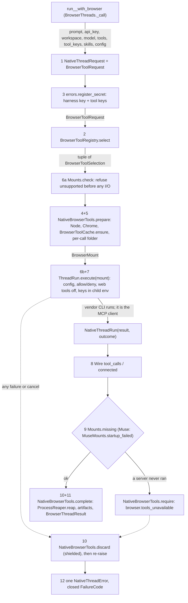

# Spec: Browser tools for every harness thread: run_<harness>_with_browser

> **TL;DR** — Nine coroutines, `<verb>_<harness>_with_browser` for `run`/`continue`/`fork` × `grok`/`opencode`/`muse`, run the existing harness thread flow with browser tools the caller names as strings (`"playwright"`, `"firecrawl:search"`). A pinned registry resolves the strings; the SDK installs each tool once into a user-level cache, mounts it through the harness's own per-call channel, allows exactly the chosen tools with the harness's own web tools off, reads back which tools ran, and kills every browser the call started. The decision that matters most: each harness's existing `ThreadRun.execute` gains one optional `mount` argument, so the nine plain `_thread` functions stay byte-identical and every browser function inherits #1036's key, workspace and failure-code guarantees.

## §0 User prompts

_The verbatim record of what the user asked is in `docs/spec/harness-browser-tools/request.md`: every prompt in order, the handoff block if there is one, and the structured conversation notes. Only the prompt that invoked the pipeline is reproduced here._

### 0.1 Invoking request (verbatim)

````text
great, you explained the entire process really well, make sure that each function has all layers to it that makes this request possible. I want to keep the same "run_opencode_with_browser()", "run_grok_with_browser()", type of function names that we have in the repo, and want you to integrate these browser tools into every harness that we have so far in the repo. (kick off and explain this entire thing with the 'spec-pipelin' to a subagent (make sure to include in-depth response you returned to me last turn, and then can you go into depth about the following:

[ ] Bet on desktop computer use as the next registry category — cua-driver (30K stars) and E2B Desktop let agents operate any app, not only web pages. Builds on: the compile-per-harness interface. First step: a one-day spike that loads cua-driver mcp into opencode. Could we create the same type of agents the same way, except instead of attaching browser tools we attach "computer use" tools. Or is there fundamentally different ways that we have to do this? (do the agents need their own computers, is it not just tools for computer,  do agents need  permissions, etc)
````

_The part about desktop computer use is a question the conversation answered. It is not a build request (request §C "Rejected alternatives"; NG-1)._

### 0.2 User replies during the run
_None yet. The orchestrator appends any reply the user sends during the run here verbatim, labeled with the revision it produced._

---

## Part A — Framing

## §1 Goal

| ID | Goal (outcome) | How we will know | Source |
|---|---|---|---|
| G-1 | A developer can start, continue or fork a Grok Build, opencode or Muse Code thread that has browser tools. They do it by passing tool strings to functions named like the existing thread functions. | All nine `<verb>_<harness>_with_browser` coroutines are exported from `vidbyte.harnesses.native`. Each one returns a `BrowserThreadResult` from an offline fake-harness run (AC-1, AC-2, AC-3). | Prompt 3; request KD-1, KD-2 |
| G-2 | Every function has every layer the endorsed design lists: request, registry, keys, preflight, per-call folder, mount, allow rules with built-in web tools off, tool-call reader, required check, browser cleanup, result record, closed codes. | INV-1. Each layer has its own AC (AC-4 to AC-14). No function skips a layer. | Prompt 3 ("each function has all layers"); KD-3 |
| G-3 | The registry is extensive, pinned and deterministic. | 13 tools are mountable, each with an exact version or URL and exact per-capability tool names. 18 more popular names are answered by name with the reason they are not mountable. Unknown strings fail with a suggestion (AC-4, AC-5). | Prompts 1–2 ("all", "15-20 popular ones"); KD-4 |
| G-4 | #1036's guarantees hold for the browser functions: keys never on argv, in a file, in `os.environ` or in error text; nothing written into the workspace; one closed failure code with cause and next step; no approve-everything mode. | AC-7, AC-9, AC-16, AC-17; INV-4 to INV-7. | KD-6 |
| G-5 | Adding a harness later (Claude Code, Codex) or a tool later is local work. | A new harness needs one mounts module, one browser module and one reader, with no registry change. A new tool needs one registry row and its constants, with no harness change (NFR-8). | KD-2 ("adding them later one compiler module plus one tool-call reader each") |

## §2 Objective

The browser calls ship in `vidbyte.harnesses.native` as nine async functions. Each takes the same arguments as its plain `_thread` sibling, plus two keyword-only arguments:
- `tools`: a sequence of strings, each `<tool>[:<capability>[,<capability>…]]`;
- `tool_keys`: a mapping from tool name to that tool's credential.

Each function returns a `BrowserThreadResult`. It holds the thread id, the answer text, the browser tool calls the harness made, and the artifact files the call produced.

The vendor CLI remains the agent and the MCP client. The SDK only does the following:
- resolves the strings against a pinned registry;
- installs the pinned packages into a user-level cache;
- compiles each harness's own per-call mount;
- reads the harness's output;
- kills every process whose command line carries the call's own folder.

Done means:
- the full local gate `python scripts/run_ci.py` passes, apart from the pre-existing reds listed in §11;
- the nine plain functions behave byte-identically;
- every combination a harness cannot honour safely is refused with `browser.mount_unsupported` before anything runs.

## §3 Non-goals

- **NG-1** — Desktop computer use (cua-driver, E2B Desktop), as a registry category or as functions. — *Why not:* Prompt 3 asks it as a question. Request §C rejects building it in this PR.
- **NG-2** — Browser functions for Claude Code, Codex or Gemini CLI. — *Why not:* those harnesses are not on `main`: PR #1044 and #1055 are open (KD-2). G-5 keeps adding them cheap.
- **NG-3** — Treating CodexAgent (`vidbyte.agents.codex`) as a harness. — *Why not:* it is an SDK agent over the Codex app-server, not a vendor CLI thread function (Q-2, default no).
- **NG-4** — Fixing or reusing the existing MCP preset catalog (`McpPresetRegistry`). — *Why not:* it serves the SDK's own agent loop and has no version pin, entry point or per-capability tool names. 11 of its 15 web presets are broken (request §C hints). Q-4 defaults to leaving it untouched.
- **NG-5** — Changing the plain `run_grok_thread` path to switch off Claude and Cursor MCP scanning. — *Why not:* the user did not ask for it (Q-3, default: browser path only).
- **NG-6** — A host layer: `"playwright@browserbase"`, SDK-created cloud sessions, CDP endpoints, SDK-owned recording. — *Why not:* the conversation's phasing puts it after the per-harness work (Q-5). The `@<host>` suffix is reserved and refused.
- **NG-7** — Browser profiles that persist across continue and fork. — *Why not:* fresh state per call is the safe default (Q-6). A continue re-mounts the tools anyway, because MCP servers live only as long as the harness process.
- **NG-8** — An env-filter launcher that lets each MCP server see only its own variables. — *Why not:* the evidence is in §8.1 D-17 and Q-7, default no.
- **NG-9** — A browser skill or prompt add-on. — *Why not:* Grok already injects its own MCP reminder. The caller's prompt passes through unchanged (Q-8, default no; INV-10).
- **NG-10** — Tools that need a CLI plus a skill (agent-browser, @playwright/cli, midscene, devbrowser), a Python `uvx` runtime (fetch, duckduckgo, browser-use, scrapling), Docker (crawl4ai) or OAuth only (kernel, cloudflare). — *Why not:* each needs its own runtime handling. The registry still names each one and says why it is not mountable (FR-6).
- **NG-11** — An SDK command-line interface. — *Why not:* AGENTS.md and the request constraints forbid it.
- **NG-12** — Use-case presets, such as video verification or bug-report agents. — *Why not:* Prompt 1 says "Dont think about use cases now".
- **NG-13** — Isolating the user's own harness configuration beyond what the plain path already does (opencode `OPENCODE_DISABLE_*` variables, Grok `USERPROFILE`). — *Why not:* this is unrequested and changes harness behaviour (Q-11, Q-12, default no). It is accepted as EC-33.
- **NG-14** — Live smoke tests against real vendors, real registry servers or paid APIs. — *Why not:* the request forbids them in any test or gate.

## §4 Developer usage

```python
import asyncio
import os

from vidbyte.harnesses.native import continue_opencode_with_browser, run_opencode_with_browser


async def main() -> None:
    result = await run_opencode_with_browser(
        "Open https://example.com and tell me the page heading.",
        api_key=os.environ["DEEPSEEK_API_KEY"],          # the harness key, as for run_opencode_thread
        workspace="C:/work/site",
        model="deepseek/deepseek-v4-pro",
        tools=["playwright", "firecrawl:search"],         # registry strings: <tool>[:<capability>,...]
        tool_keys={"firecrawl": os.environ["FIRECRAWL_API_KEY"]},
    )
    print(result.thread_id, result.text)                  # e.g. ses_8f2c... Example Domain
    for call in result.tool_calls:                        # e.g. playwright browser_navigate completed
        print(call.tool.value, call.name, call.status.value)
    print(result.artifacts)                               # absolute paths of screenshots, or ()

    again = await continue_opencode_with_browser(result.thread_id, "Now take a screenshot.", api_key=os.environ["DEEPSEEK_API_KEY"], workspace="C:/work/site", model="deepseek/deepseek-v4-pro", tools=["playwright"])
    print(again.artifacts)                                # e.g. (WindowsPath('C:/Users/u/AppData/Local/Temp/vidbyte-browser-k3x9/artifacts/page-2026-10-17T10-00-00-000Z.png'),)


asyncio.run(main())
```

The developer gets back the thread id, the answer, the browser tool calls the harness made and the artifact paths, with `playwright`'s core tools and `firecrawl_search` allowed and opencode's own `webfetch`/`websearch` off. They no longer install packages, write MCP config or permission rules, start or stop Chrome, or parse vendor output; Grok and Muse callers swap only the harness word, key and model.

## §5 Flow diagram



Validation happens in the two record constructors and `BrowserToolRegistry.select`, and `<H>Mounts.check` refuses what the harness cannot honour, all before any process starts or file is written. State changes only in the shared tool cache (first install of a pinned package), the per-call folder (profiles, artifacts, Grok agent file) and the vendor's own thread store. Every failure is caught by the one guarded `try` in `_call` and becomes one `NativeThreadError`; failures after `prepare` first pass through `discard`, shielded from cancellation, so no browser outlives the call.

---

## Part B — Behavior (this is the spec; everything else is framing)

## §6 Behavior

### 6.1 Invariants

- **INV-1** — **"each … all layers":** every one of the nine functions runs all twelve layers of §5 in that order. A layer with nothing to do for a selection still runs and passes. Two examples: there is no Chrome check when no selected tool needs Chrome, and no install when every tool is remote.
- **INV-2** — **"same":** the names are exactly `<verb>_<harness>_with_browser`. Each function's parameters are its plain `_thread` sibling's parameters, with the same names, kinds, types, defaults and order. `tools` (required) and `tool_keys` (default `None`) are inserted as keyword-only parameters directly after `model`.
- **INV-3** — **"actually":** the harness CLI is the only agent and the only MCP client. The SDK never connects to a tool server, never calls a tool and never runs an agent loop (KD-5). Every `BrowserToolCall` comes from the vendor's own output.
- **INV-4** — The harness key and every tool key never appear on any command line, in any file the SDK writes, in the SDK process's `os.environ`, or in any error text. A key reaches only a child's environment overlay. For opencode, it travels inside `OPENCODE_CONFIG_CONTENT`. Each key is registered with `NativeErrorFactory.register_secret` before any step that can produce error text (KD-6).
- **INV-5** — The SDK writes nothing into the workspace. Every file the SDK writes is in one of four places: the per-call folder, the tool cache, Grok's existing private home, or Muse's existing per-call config folder.
- **INV-6** — Every failure raises exactly one `NativeThreadError`. It carries a closed `FailureCode`, a likely cause and a next step written for that code, and an `expected` text that names the record the function returns.
- **INV-7** — No approve-everything mode is added or passed. Permission is granted per mounted server and narrowed per tool (KD-6).
- **INV-8** — A stdio tool server starts only as `<absolute node> <absolute pinned entry>` from the tool cache. There is never `npx`, never `@latest`, and never a package fetch while a server starts.
- **INV-9** — A combination of harness, transport, key and narrowing that the harness cannot honour safely is refused with `browser.mount_unsupported` before any process starts or any file is written.
- **INV-10** — **"Dont think about use cases now", "all types":** the caller's prompt reaches the harness unchanged. The functions hold no use-case logic. Capabilities are generic tool subsets.
- **INV-11** — **"pass in strings":** resolving `tools` is deterministic. The same strings always give the same selections and the same compiled mount bytes, and no network or model is used.
- **INV-12** — Browser state is fresh per call:
  - every profile lives in the per-call folder and is removed before the function returns or raises;
  - no process whose command line carries the per-call folder survives the call, within `BROWSER_REAP_TIMEOUT_SECONDS`.
- **INV-13** — A tool key comes only from `tool_keys`. A mounted tool's key variable that the caller did not pass is removed from the harness child's environment, so a key in the caller's own environment is never used silently.

**Must not regress:**
- **INV-14** — The nine plain `_thread` functions keep the same argv, environment overlay, output cap, Grok `--output-format=json`, result and errors as on `main` (`vidbyte.harnesses.native.{grok,opencode,muse}.threads` and `.wire`).
- **INV-15** — Harness modules hold no literals of their own. Flags are enum members, and every other value comes from a `vidbyte.lib.constants` module (header of `vidbyte.lib.constants.native_threads`, #1036 INV-15, lint A007).
- **INV-16** — The existing `FailureCode` values, the existing `NATIVE_THREAD_FAILURE_CODES` pairs, and the `NativeThreadError.expected` text of the plain functions stay unchanged (`vidbyte.lib.errors.base.NativeThreadError`). The one exception is the `grok.output_too_large` likely-cause text, which widens to name both Grok caps (D-19).
- **INV-17** — The Muse WSL peer mark and reap keep their behaviour (`vidbyte.harnesses.native.muse.launcher.MuseLauncher.reap`).
- **INV-18** — Grok's private home stays at `~/.vidbyte/grok-homes/<hash>`, keyed by workspace, and Muse's private config folder stays per call and is removed however the call ends (`GrokThreadRun._prepare_home`, `MuseThreadRun._prepare_config`).

### 6.2 Acceptance criteria

| ID | Given | When | Then | Priority | Proof |
|---|---|---|---|---|---|
| AC-1 | A clean checkout of this branch, with the offline fake opencode, a fake MCP server reached through a fake `node`, and a pre-populated tool cache | The §4 snippet runs | It produces exactly the shown result: two `BrowserThreadResult`s with the fake's thread id and text, `tool_calls` holding `BrowserToolCall(tool=BrowserTool.PLAYWRIGHT, name="browser_navigate", status=BrowserToolCallStatus.COMPLETED)`, and the second result's `artifacts` naming files under the per-call `artifacts` folder | P0 | fake-harness run |
| AC-2 | Each of the nine functions, with fakes for Grok, opencode, Muse native and Muse WSL | It is called with `tools=["playwright"]` (`["jina"]` for Muse WSL) | It returns a `BrowserThreadResult` whose `tool_calls` are read from the fake's output. The harness's own web tools are off (opencode permission deny, `--disable-web-search`, `--disable-web-tools`). The compiled mount names a per-call folder outside the workspace. | P0 | fake-harness run |
| AC-3 | The installed package | `vidbyte.harnesses.native` and each harness subpackage are imported | `__all__` lists the nine functions, plus `BrowserThreadResult` and `BrowserToolCall` at the native level. Each signature equals its plain sibling's with `tools` and `tool_keys` inserted after `model` (INV-2). | P0 | surface pin |
| AC-4 | `tools=["playwrite"]` | Any browser function is called | `configuration.invalid_argument` naming `tools[0]`, whose observation suggests `playwright`. No process starts and no file is written. | P0 | fake-harness run |
| AC-5 | `tools=["puppeteer"]` (an excluded name) or `tools=["playwright@browserbase"]` | Any browser function is called | `configuration.invalid_argument` naming `tools[0]`, with the recorded exclusion reason or "hosts are not supported in this release" | P0 | fake-harness run |
| AC-6 | `tools=["firecrawl:search"]` | It is run on opencode, Grok and Muse | opencode's compiled permission allows `firecrawl_*` and denies the other 25 Firecrawl tools exactly. Grok's argv carries `--allow=MCPTool(firecrawl__*)` and one `--deny=` per other tool. Muse raises `browser.mount_unsupported`. | P0 | fake-harness run |
| AC-7 | `tools=["brave"]`, `tool_keys={"brave": K}` | It is run on Grok and opencode | `K` appears only in Grok's child environment overlay (`BRAVE_API_KEY`) or inside opencode's `OPENCODE_CONFIG_CONTENT`. It appears in no argv, no SDK-written file, not in `os.environ`, and no error text. Muse raises `browser.mount_unsupported`. | P0 | fake-harness run |
| AC-8 | `tools=["brave"]` with no `tool_keys`; or a key for `playwright`; or a key for a tool not in `tools` | Any browser function is called | `configuration.invalid_argument` naming `tool_keys[brave]` or `tool_keys[playwright]`. The key value is never echoed. | P0 | fake-harness run |
| AC-9 | The caller's environment holds `FIRECRAWL_API_KEY`, and `tools=["firecrawl"]` has no key | It is run on Grok or opencode | The harness child's environment has no `FIRECRAWL_API_KEY` (INV-13) | P0 | fake-harness run |
| AC-10 | There is no `node` on PATH, or it is a batch file, or its version is below 22.12.0; or `playwright` is selected and no Chrome stable is at any searched location | Any browser function is called | `browser.runtime_missing` naming what was searched or found. The harness is not started. | P0 | fake-harness run |
| AC-11 | An empty tool cache | Two calls select `playwright` | The first runs one install and publishes `~/.vidbyte/tools/playwright-0.0.83`. The second runs no install. A failing install raises `browser.tool_install_failed` and leaves no published folder. | P0 | fake-harness run with fake npm |
| AC-12 | The fake Grok never lists a mounted server; fake opencode makes no mounted-tool call; or fake Muse reports a required server's startup failure | The call finishes | `browser.tools_unavailable` naming the server, with the thread id when the vendor printed one | P0 | fake-harness run |
| AC-13 | A fake browser process whose command line carries the per-call folder outlives the fake harness | The call returns, raises, is cancelled or times out | That process is gone within `BROWSER_REAP_TIMEOUT_SECONDS` and the profiles are removed. The artifacts folder remains only after a successful return that produced artifacts. | P0 | fake-harness run |
| AC-14 | Any Grok browser call | It runs | The child environment has `GROK_CLAUDE_MCPS_ENABLED=0` and `GROK_CURSOR_MCPS_ENABLED=0`. A plain `run_grok_thread` call's environment does not. | P0 | fake-harness run |
| AC-15 | The nine plain functions with the inputs used by the existing tests | They run on this branch | Argv, environment overlay, output cap and results are identical to `main`. The existing tests pass unchanged, except the pins §13 lists. | P0 | existing tests |
| AC-16 | Any browser call, successful or failing | It ends | Apart from files the fake agent itself wrote, the workspace tree is byte-identical to before | P0 | fake-harness run |
| AC-17 | Any browser-function failure | The error is read | `error.expected` is `"<function> returning a BrowserThreadResult"`. The message names the browser function, the code, the cause and the next step. | P0 | fake-harness run |
| AC-18 | Grok with selections whose deny rules exceed `GROK_BROWSER_RULES_MAX_UNITS` | It is called | `browser.mount_unsupported`, whose next step says to narrow the capabilities or mount fewer tools | P1 | fake-harness run |
| AC-19 | Muse in WSL mode | `tools=["playwright"]`, or `["jina"]` | `playwright` raises `browser.mount_unsupported`. `jina` mounts as `{"transport":"streamable_http","url":…}` in the per-call `muse/settings.json`. | P0 | fake-harness run |
| AC-20 | The finished branch | `python scripts/run_ci.py` runs | It passes, apart from the known reds of §11. Lint ends with `AGENT-LINT: PASS`, and the semgrep scan is clean. | P0 | full local gate |
| AC-21 | Two concurrent calls in one workspace with different tool sets | Both run | Each has its own per-call folder and agent file, and both succeed. One call's cleanup never kills the other call's browser. | P1 | fake-harness run |
| AC-22 | `tools=["browserbase"]` with a key | It is run on opencode, then on Grok | opencode's content has `"type":"remote"`, `"oauth":false` and an `Authorization` header holding the key. Grok raises `browser.mount_unsupported`. | P1 | fake-harness run |
| AC-23 | Every registry row | The registry is loaded | Each mountable row has an exact version (stdio) or `https` URL (remote), a key rule, and capability tool names that match vendor facts §4. Each exclusion has a non-empty reason. | P0 | registry pin |
| AC-24 | The finished branch | The folder docs are read | The harnesses README `native/` paragraph names the nine functions, `tools`/`tool_keys`, the tool cache and the unsupported combinations; the registries README has a "Browser Tool Sources" section; the REPO_MAP native rows name the new modules; the failure vocabulary lists the four `browser.*` codes. Each README stays ≤ 40,000 characters. | P1 | review + lint A009 |

### 6.3 Edge cases and failure modes

| ID | Trigger (input + state) | System behavior | User sees | Guarded by (INV-/D-) |
|---|---|---|---|---|
| EC-1 | `tools="playwright"` (a bare string) | The record refuses it; a string is never split into characters | `configuration.invalid_argument` naming `tools` | INV-11, D-14 |
| EC-2 | `tools=[]`, or more than `BROWSER_TOOLS_MAX_PER_CALL` (8) items | Refused | invalid argument naming `tools` | INV-11 |
| EC-3 | An item that is not one line, is longer than 128 characters, or does not match the grammar | Refused. A shape refusal (record) names the index and never quotes the item; a grammar refusal (registry) quotes it only after every key is registered for scrubbing | invalid argument naming `tools[i]` | INV-4, INV-11 |
| EC-4 | The same tool twice (`"playwright"`, `"playwright:vision"`) | Refused | invalid argument naming the second index and the first | INV-11 |
| EC-5 | An unknown capability (`"firecrawl:serch"`) | Refused, with a did-you-mean from that tool's capabilities | invalid argument naming `tools[i]` | INV-11 |
| EC-6 | A key for a tool whose rule is `none`, or for a tool not in `tools` | Refused | invalid argument naming `tool_keys[<name>]` | INV-13 |
| EC-7 | A key that has whitespace, is empty, or is longer than 4,096 characters | Refused; the value is never quoted | invalid argument naming `tool_keys[<name>]` | INV-4 |
| EC-8 | `node` on PATH is `node.cmd` or `node.bat` (some version managers) | Refused as a batch file, as `NativeLauncher` refuses harness batch files | `browser.runtime_missing` naming the path | D-6 |
| EC-9 | `chromedevtools` or `playwright` selected, no Chrome stable installed | Refused before the harness starts | `browser.runtime_missing` listing the searched locations | D-6 |
| EC-10 | Two processes install the same tool at once | Each installs into its own staging folder. The first `os.rename` publishes; the loser deletes its staging. | Both calls proceed | D-5 |
| EC-11 | Install cancelled or timed out (`BROWSER_TOOL_INSTALL_TIMEOUT_SECONDS`) | Staging removed. Cancel re-raises; timeout raises. | `browser.tool_install_failed` (timeout) | D-5 |
| EC-12 | A published cache folder exists but its entry file is missing | Not repaired automatically | `browser.tool_install_failed`, whose next step names the folder to delete | D-5 |
| EC-13 | The npm registry is unreachable, or the bundled `npm-cli.js` is absent (for example a Debian apt Node) | npm's stderr is scrubbed and attached | `browser.tool_install_failed` | D-5, A-8 |
| EC-14 | The user's home folder cannot be determined | No cache can exist | `browser.tool_install_failed` with the detail | D-5 |
| EC-15 | The per-call folder cannot be created (disk full, permissions) | Nothing has started yet | `<harness>.launch_failed` with the folder detail, the same as Grok's home failure | D-3 |
| EC-16 | A Grok server is slower than Grok's roughly 2 s startup grace | Absent from `available_commands` | `browser.tools_unavailable` naming it | D-11 |
| EC-17 | An opencode run where the agent used no mounted tool | opencode prints no server status in a run, so no call means no evidence the server ran | `browser.tools_unavailable`, carrying the thread id and the answer text as vendor text, so the caller can continue | D-11, Q-9 |
| EC-18 | A Muse required server fails at startup | Muse fails the whole run (vendor rule) | `browser.tools_unavailable` with Muse's reason | D-11 |
| EC-19 | The harness times out | Existing `<harness>.timed_out`; cleanup still runs; artifacts are discarded | the timeout error | INV-12, D-12 |
| EC-20 | The caller cancels | `discard` runs shielded from the cancel, then `CancelledError` propagates | the cancellation | INV-12 |
| EC-21 | On POSIX, Chrome leads its own process group (Playwright `detached`), so the harness group kill misses it | `ProcessReaper.reap` kills it by marker | nothing | INV-12, D-12 |
| EC-22 | The reaper's own program (PowerShell or `ps`) cannot start, or times out | Not raised. The profile removal is still attempted and a leftover profile is ignored. | nothing. *Accepted:* best effort, bounded. | D-12 |
| EC-23 | A stdio server without a profile or output option (exa, firecrawl, …) is orphaned by a harness crash | Its command line carries no per-call folder, so the reaper cannot see it. The harness tree stop still applies. | nothing. *Accepted:* it holds no browser. | D-12 |
| EC-24 | The agent asks Playwright to save a file under an explicit name | Playwright resolves explicit names against its workspace root, so the file lands in the workspace | the file in the workspace. *Accepted:* an agent-authored write, like any edit the coding agent makes. Auto-named files go to the artifacts folder. | INV-5 (SDK writes only) |
| EC-25 | Grok deny rules exceed the argv budget | Refused before I/O | `browser.mount_unsupported` | INV-9, D-10 |
| EC-26 | Muse with a keyed tool; Muse WSL with a stdio tool; Grok with a remote tool | Refused before I/O | `browser.mount_unsupported`, saying which harness and transport | INV-9, D-9 |
| EC-27 | A narrowing capability on Muse (`"firecrawl:search"`) | Muse cannot filter its catalog. Refused. | `browser.mount_unsupported` | INV-9, D-10 |
| EC-28 | On Grok, the agent calls a denied tool | Grok answers "Denied by permission policy" and the turn continues | a `BrowserToolCall` with status `failed` | D-10 |
| EC-29 | More than 1,000 tool calls, or more than 1,000 artifact files | The first 1,000 are kept and the `_truncated` flag is set. All artifact files stay on disk. | truncated flags | NFR-1 |
| EC-30 | A continue or fork of a browser thread with a different tool set | Tools are re-mounted fresh for this call | normal result | INV-12, D-16 |
| EC-31 | A browser thread continued by a plain `continue_<harness>_thread` | Runs without tools; Grok falls back to its default agent | normal `NativeThreadResult` | A-14 |
| EC-32 | Grok's turn ends with `stopReason` `cancelled` (a tool needing approval in headless mode) | Treated as a failed run | `grok.run_failed` with the stop reason | D-8 |
| EC-33 | The user's global opencode config and external skills, or Grok's `~/.agents/skills` and `~/.claude` hooks | Still load, as in the plain path (vendor facts §7) | the vendor's behavior. *Accepted* (NG-13). | — |
| EC-34 | A keyless server calls home at start (Apify and Sentry, Bright Data; Chrome DevTools unless quieted) | Chrome DevTools is started quiet. The others are documented per registry row. | nothing. *Accepted.* | D-21 |
| EC-35 | A web page prompt-injects the agent to read tool keys from its shell environment (Grok, opencode) | Keys live in the harness environment, and every server and the agent shell inherit it | possible exfiltration. *Accepted* (T-2, Q-7). | D-17 |
| EC-36 | A workspace's own `opencode.json` adds servers or permissions | Read by opencode, as in the plain path (#1036 T-6) | *Accepted:* pass only trusted workspaces | — |
| EC-37 | A node or entry path with spaces or non-ASCII characters | Argv elements are never shell-joined. Configs are JSON-encoded. | normal result | INV-8 |
| EC-38 | The harness program is missing after a cold install | The install is kept, and the existing `<harness>.not_installed` is raised | that error | D-3 |

**Rollback of the user action:** a browser call changes three things outside the vendor's thread store:
- **The per-call artifacts folder,** which is kept only on success. Delete it when the files are no longer needed.
- **The tool cache.** Delete `~/.vidbyte/tools/<tool>-<version>` to force a reinstall, or the whole folder to reclaim space.
- **The vendor thread.** It stays in the harness's own history. The plain functions can continue it.

Nothing the SDK wrote is in the workspace. Edits the agent made there are undone the way any coding-agent edit is undone.

## §7 Requirements

**Functional**
| ID | Requirement | Priority | Source (request.md / G-) |
|---|---|---|---|
| FR-1 | Nine coroutines exist: `run_`, `continue_` and `fork_` × `grok`, `opencode` and `muse`, each `<verb>_<harness>_with_browser`. Each harness subpackage exports its three, and `vidbyte.harnesses.native` re-exports all nine. | P0 | Prompt 3; KD-1; KD-2; Q-1; G-1 |
| FR-2 | Each function takes its plain sibling's parameters unchanged (name, kind, type, default, order), plus keyword-only `tools: Sequence[str]` (required) and `tool_keys: Mapping[str, str] \| None = None`, inserted directly after `model`. | P0 | Prompt 3 "same"; G-1 |
| FR-3 | Each function returns `BrowserThreadResult(harness, thread_id, text, text_truncated, tool_calls, tool_calls_truncated, artifacts, artifacts_truncated)`. | P0 | KD-3 layer 11; G-2 |
| FR-4 | `tools` and `tool_keys` are validated at the boundary by `BrowserToolRequest`:<br>• a sequence, not a string; 1–8 items;<br>• each item one line and at most 128 characters;<br>• a mapping of text to text;<br>• each key matching `NATIVE_API_KEY_PATTERN`, at most 4,096 characters.<br>A refusal is `configuration.invalid_argument` naming `tools[i]` or `tool_keys[<name>]`. | P0 | KD-3 layer 1; G-2 |
| FR-5 | `BrowserToolRegistry.select` resolves each item by the grammar `<tool>[:<capability>[,<capability>…]]`, as follows:<br>• an unknown tool or capability is refused with a did-you-mean suggestion;<br>• an excluded name is refused with its recorded reason;<br>• a `@<host>` suffix is refused as unsupported in this release;<br>• a duplicate tool is refused;<br>• with no capability named, the tool's default capabilities apply. | P0 | Prompt 1 "pass in strings"; KD-4; G-3 |
| FR-6 | The registry ships 13 mountable tools: playwright, chromedevtools, firecrawl, exa, tavily, brave, perplexity, brightdata, apify, linkup, browserbase, jina and parallel.<br>Each row pins the exact package version, entry and arguments (stdio) or URL (remote), the key rule and variable, and each capability's exact tool names, with a source comment.<br>18 more names are answered with their reason: browserstack, searxng, wdio, fetch, duckduckgo, agentbrowser, playwrightcli, midscene, devbrowser, crawl4ai, browseruse, scrapling, kernel, cloudflare, puppeteer, hyperbrowser, steel and browserless. | P0 | Prompts 1–2 "all", "more extensive", "15-20 popular ones"; KD-4; G-3 |
| FR-7 | Tool keys come only from `tool_keys`. A missing required key is refused. A key for a `none`-rule tool, or for a tool not in `tools`, is refused. A mounted tool's key variable that was not passed is removed from the harness child's environment. Every key is registered as a secret before `select` runs. | P0 | KD-3 layer 3; KD-6; G-4 |
| FR-8 | Preflight finds `node` on PATH, refusing a batch file, and requires `node --version` ≥ 22.12.0. When a selected tool needs Chrome, it requires Chrome stable at one of Playwright's channel locations. Otherwise it raises `browser.runtime_missing`, naming what was searched or found. | P0 | KD-3 layer 4; G-2 |
| FR-9 | Each stdio tool is installed at most once into `~/.vidbyte/tools/<tool>-<version>`. The install runs `<node> <bundled npm-cli.js> install --no-audit --no-fund --prefix <staging> <package>@<version>` with a bound, verifies the entry, and publishes by atomic rename. Servers start as `<node> <absolute entry> <arguments>`. `npx` is never used. A failure raises `browser.tool_install_failed`. | P0 | KD-3 layer 4; request "Rejected alternatives" (npx @latest); G-2 |
| FR-10 | Each call creates its own folder outside the workspace, with `artifacts/` and `profiles/<tool>/`. Every browser profile and Playwright's output directory point into it. | P0 | KD-3 layer 5; Q-6; G-2 |
| FR-11 | Each harness compiles the mount through its own per-call channel, as listed in §9.1 "Mount by harness". A combination the table marks unsupported raises `browser.mount_unsupported` before any I/O. | P0 | KD-3 layer 6; KD-2 "every harness"; G-1 |
| FR-12 | Each mount allows every mounted server's tools, denies exactly the exposed tools outside the selected capabilities, and turns off the harness's own web tools: opencode `webfetch`/`websearch`, Grok `--disable-web-search`, Muse `--disable-web-tools`. No approve-everything mode is used. | P0 | KD-3 layer 7; KD-6; G-2 |
| FR-13 | A reader per harness records, in order, each call the harness made to a mounted server's tool, as `BrowserToolCall(tool, name, status)`, capped at 1,000. | P0 | KD-3 layer 8; G-2 |
| FR-14 | A required check per harness raises `browser.tools_unavailable` with the thread id and answer text when a mounted server never ran. The evidence is:<br>• Grok: each server listed in `available_commands` or called;<br>• opencode: at least one call of a mounted tool;<br>• Muse: the vendor's required-server startup failure. | P0 | KD-3 layer 9; G-2 |
| FR-15 | However the call ends, every process whose command line carries the per-call folder is killed after the harness exits, within 10 s, and the profiles are removed. Artifacts are kept and returned only on success; otherwise the whole folder is removed. | P0 | KD-3 layer 10; G-2 |
| FR-16 | Four closed codes are added: `browser.mount_unsupported`, `browser.runtime_missing`, `browser.tool_install_failed` and `browser.tools_unavailable`. Each has its own likely cause and next step, and each is mapped for all three harnesses. A browser function's errors say it returns a `BrowserThreadResult`. Bad tool strings and keys use the existing `configuration.invalid_argument`. | P0 | KD-3 layer 12; KD-6; G-4 |
| FR-17 | Grok browser runs set `GROK_CLAUDE_MCPS_ENABLED=0` and `GROK_CURSOR_MCPS_ENABLED=0`. The plain Grok path is unchanged. | P0 | request open question "Grok compat leak"; Q-3 |
| FR-18 | The docs describe the feature: the `native/` paragraph of the harnesses README, a "Browser Tool Sources" section in the registries README, the lib README entries, the REPO_MAP native rows, and a `browser` section in the failure vocabulary. | P1 | AGENTS.md (README per folder, REPO_MAP); failure.py header |
| FR-19 | The nine plain `_thread` functions stay byte-identical (INV-14). The shared flow gains only an optional `mount` and returns `NativeThreadRun`, whose `.result` is today's result. | P0 | KD-6; field guide review-scope.md |

**Non-functional**
| ID | Requirement | Priority | Target |
|---|---|---|---|
| NFR-1 | Bounded outputs | P0 | text ≤ `NATIVE_RESULT_TEXT_MAX_CHARS`; `tool_calls` ≤ 1,000; `artifacts` ≤ 1,000; Grok browser output ≤ `NATIVE_PROCESS_MAX_OUTPUT_BYTES`; install output ≤ `NATIVE_PROCESS_MAX_OUTPUT_BYTES` |
| NFR-2 | Offline testability | P0 | Every layer can be exercised with the fake harness, a fake `node` that runs a fake MCP server, and a pre-populated cache. No test or gate uses a paid model, a paid API or a real registry server. |
| NFR-3 | Secret hygiene | P0 | 0 occurrences of any key in argv, SDK-written files, the SDK process's `os.environ`, or `NativeThreadError` text (INV-4) |
| NFR-4 | Cleanup bound | P0 | Reap finishes within `BROWSER_REAP_TIMEOUT_SECONDS` (10 s). No surviving process carries the per-call folder. |
| NFR-5 | Warm-cache overhead | P1 | With the tools cached and nothing to install, a call starts exactly one extra child before the harness (`node --version`) and one after it (the reaper). It does no network I/O of its own. |
| NFR-6 | Windows argv budget | P0 | Grok browser options (agent path, allow/deny rules, switches) stay within `GROK_BROWSER_RULES_MAX_UNITS` (1,800 UTF-16 units), so the measured 608-unit worst case plus the 30,000-unit prompt stays under 32,766 |
| NFR-7 | Code shape | P0 | Every new file under 1,000 lines (target ≤ 450). Call chains one level deep. Narrated main functions. `AGENT-LINT: PASS` with no new suppressions or baseline changes. |
| NFR-8 | Extensibility | P1 | A new harness needs 2 modules (`browser`, `mounts`) plus one reader, with 0 registry changes. A new tool needs 1 registry row plus constants, with 0 harness changes. |
| NFR-9 | Concurrency | P1 | Concurrent calls never share a profile, an agent file or a reap marker. Install races converge on one published copy. |

**Weighted words (request §D) → where each is enforced:**
- "every harness", "so far in the repo", "not only opencode": FR-1, FR-11, AC-2.
- "each … all layers", "entire": INV-1, G-2, AC-4 to AC-14.
- "same": INV-2, FR-2, AC-3.
- "all", "more extensive", "15-20 popular ones": FR-6, AC-23.
- "all types", "Dont think about use cases now": INV-10, NG-12.
- "actually": INV-3, FR-13.
- "programmatically": FR-1 (async functions that return records and never prompt).
- "pass in strings": INV-11, FR-5, AC-4.

---

## Part C — Design

## §8 Architecture and decisions

The feature is three layers stacked on #1036's harness thread flow.

1. **lib (bottom).**
   - The `browser_tools` enums, records and constants.
   - `BrowserToolRegistry`, which turns strings into selections.
   - `ProcessReaper`, which kills processes by command-line marker.
   - `NativeThreadRun`, which carries a result and its process outcome.
2. **hostkit (harness-shared).** `NativeBrowserTools`, with `BrowserRuntimes` and `BrowserToolCache`, turns selections into a `BrowserMount`: preflight, pinned install, per-call folder and server commands. It also finishes or discards that mount.
3. **Per harness.** Each harness gets three pieces:
   - `<H>Mounts` checks and compiles the harness-specific mount;
   - `<H>Wire` gains a tool-call reader;
   - `<H>BrowserThreads` and `<H>BrowserRun` are the public functions and the narrated twelve-layer main function.

The existing `<H>ThreadRun.execute` gains `mount: BrowserMount | None = None` and returns `NativeThreadRun`. With `mount=None` its behaviour is unchanged.

### 8.1 Decisions

| ID | Decision | Deciding reason | Runner-up | Flips if |
|---|---|---|---|---|
| D-1 | Nine new functions beside the plain ones | Prompt 3 names `run_<harness>_with_browser`. The plain functions stay byte-identical (INV-14). | A `tools=` argument on the plain functions | The user asks for one function family |
| D-2 | A new `BrowserThreadResult` record, not new fields on `NativeThreadResult` | `NativeThreadResult` is pinned by the surface tests and returned by nine functions that never browse | A `NativeThreadResult` subclass | Reviewers want a single result type |
| D-3 | Reuse each `<H>ThreadRun.execute` through an optional `mount` and a `NativeThreadRun` return. A per-call folder failure reuses `<harness>.launch_failed`. | One flow per harness keeps the launcher, key, timeout and reader rules in one place (AGENTS principle 5) | Separate browser run classes copying launcher and argv code | `execute` would need a second level of helpers to take the mount |
| D-4 | The registry is a class-held table in lib's registries, with all literals in lib's constants and each row citing its source | The house shape (field guide declarative-config-resolution.md; `RuntimeRegistry`, `ProviderKeyMatcher`) | Extending `McpPresetRegistry` | Q-4 is answered "fix and reuse the catalog" |
| D-5 | Pinned install with the npm bundled with the found Node, into `~/.vidbyte/tools/<tool>-<version>`, staged and published by `os.rename`. A broken published folder is reported, not repaired. | Exact versions. No `npx` (a batch file on Windows, unpinned, and slow on first run). Safe under concurrency. | `npx -y <pkg>@<version>` per call | npm stops shipping `npm-cli.js` beside Node |
| D-6 | One global Node floor of 22.12.0, the version every seed package was verified on. Batch-file `node` is refused. | Apify and Firecrawl declare Node 22 or later; vendor facts verified 22.12.0. One rule is simpler than per-tool floors. | A per-tool floor field | A user needs Node 20 for Playwright alone (Q-10) |
| D-7 | Grok mounts through a per-call `--agent=<per-call folder>/<agent file>` plus argv rules. Keys travel in Grok's environment overlay, which the servers inherit. | The private home's `config.toml` is shared by every call in a workspace, so different tool sets would collide. The agent file is per call, and its sequence form is verified. | `config.toml` in the private home, guarded by a per-home lock | A-5 turns out wrong (the agent body weakens the coding prompt) |
| D-8 | Grok uses `--output-format=streaming-json` and a new `GrokWire.read_stream` only on the browser path. `stopReason` `cancelled` is a failed run. | Tool calls and connected servers are visible only in the stream. The plain path stays on `json` (INV-14). | Streaming for both paths | The plain path needs tool visibility |
| D-9 | Refuse with `browser.mount_unsupported`: Grok remote tools; Muse keyed tools; Muse WSL stdio tools | Grok has no verified per-run remote channel. Muse takes secrets only as literals in a file (KD-6). Windows Node through WSL interop fails for stdio (vendor facts §7). | An SDK-hosted loopback HTTP bridge for Muse WSL | A per-run remote channel for Grok is verified |
| D-10 | Capabilities narrow by exact denies (opencode `permission`, Grok `--deny`) plus server flags (Playwright `--caps`). On Muse, any non-empty deny is refused. | opencode removes denied tools from the list. Grok deny beats allow (verified). Muse `enabled_tools` does not filter. | Grok `disabled_mcp_tools` in the shared `config.toml` | Muse gains a per-run tool filter |
| D-11 | Required evidence per harness: Grok `available_commands` or a call; opencode at least one mounted-tool call; Muse the vendor's own required-server failure | This is the only evidence each vendor prints in a headless run | Parsing opencode log lines | opencode prints MCP status in `run --format json` |
| D-12 | Cleanup is `ProcessReaper.reap(marker=<per-call folder>)` after the harness exits, then profile removal. Artifacts are kept only on success. | Chrome leaves the harness tree on POSIX (Playwright `detached`), and `taskkill /T` misses grandchildren of an exited leader (runner header). The folder path is on every browser command line. | Wrapping each server in a tree-killing launcher | The marker proves unreliable on a platform |
| D-13 | Four shared `browser.*` codes, mapped for all three harnesses through `NATIVE_THREAD_FAILURE_CODES` | The cause is the tool, not the harness. The 9-problem × 3-harness grid stays intact. | Twelve per-harness codes (`grok.tools_unavailable`, …) | Reviewers want per-harness codes |
| D-14 | Bad `tools` or `tool_keys` raise the existing `configuration.invalid_argument` through `ConfigurationError(details={"field": …})` | That code already carries the argument name and rule text (`from_configuration_error`) | A new `browser.invalid_tools` code | — |
| D-15 | `NativeThreadError` gains `result_record: str \| None = None`. `NATIVE_THREAD_RESULT_RECORDS[operation]` names the record. `None` keeps today's text. | `expected` must be true for browser functions (INV-6) without changing plain errors (INV-16) | Leave `expected` naming `NativeThreadResult` | — |
| D-16 | Fresh profile and artifacts folder per call; continue and fork re-mount | MCP servers die with the harness process. A shared profile would leak cookies across calls. | A persisted profile per thread | Q-6 is answered "persist" |
| D-17 | No env-filter launcher | The vendor-facts probe works, but it does not hide keys from the agent's own shell: for Grok and opencode, keys sit in the harness environment. Killing the wrapper alone orphans the server on Windows (vendor facts §6c). | Wrap every stdio server | Q-7 is answered yes |
| D-18 | No prompt add-on. The Grok agent file's mandatory body is one fixed, neutral constant. | INV-10. Grok injects its own MCP reminder. | A browser skill per call | Q-8 is answered yes |
| D-19 | Grok browser runs cap output at `NATIVE_PROCESS_MAX_OUTPUT_BYTES`. The `grok.output_too_large` cause text widens to name both caps. | Streamed tool results (screenshots) can exceed 4 MiB. The text must stay true. | Keep 4 MiB for both | — |
| D-20 | A mounted tool's unpassed key variable goes into `CliInvocation.env_remove` (Grok, opencode). Muse needs nothing because its servers inherit no environment. | INV-13: a caller's own environment key is never used silently | Leave it inherited | — |
| D-21 | Seed set: 13 mountable tools and 18 named exclusions. Chrome DevTools always starts with `--no-usage-statistics` and `CHROME_DEVTOOLS_MCP_NO_UPDATE_CHECKS=1`. | Only tools verified to start on Node 22.12 headless, and mountable with per-call keys, are mountable (vendor facts §4, §7) | Ship every C.0.2 name as mountable | A named tool is verified later |

### 8.2 Patterns inherited

- **#1036 thread shape.**
  - `<H>Threads` binds the public coroutines, and one guarded `try` in `_call` handles cancellation, `NativeThreadError`, `ConfigurationError` and defects.
  - `<H>ThreadRun.execute` is the narrated main function.
  - `<H>Wire` reads output.
  - The subpackage `__init__` binds the functions to module names and has a literal `__all__`.
- **`NativeErrorFactory`.** `failure(problem, …)` takes the code from `(harness, problem)` and builds the sentences from the tables. It also provides `register_secret` and `scrub`, and `from_configuration_error` for named-argument refusals.
- **`CliRunner`, `CliArgv` and `CliInvocation`.** These cover every child: no shell, bounded time and output, `env_overlay` and `env_remove`, and `find_program` that never searches the current folder. `NativeLauncher`'s batch-file refusal is copied for `node`.
- **Constants-only modules (INV-15).** Literals live in `vidbyte.lib.constants`. Timing knobs and machine locations are read through the module object at call time, so one patch reaches every user (header of `constants.native_threads`).
- **Class-held registry tables.** `RuntimeRegistry` and `ProviderKeyMatcher` keep a source comment per row.
- **Validated records.** `RecordFieldValidator` and `RecordFieldConverter` (`to_tuple` refuses a string, `to_mapping`), and `_received` hides credential-named fields.
- **Muse's private-folder pattern.** `tempfile.mkdtemp()`, then removal in `finally` under `suppress(OSError)`. The marker-based reap of `MuseLauncher.reap` is the precedent for `ProcessReaper`.

### 8.3 Smaller design rejected

The smallest design was a `tools=` argument that takes raw MCP server configs, passed straight into each harness's config. It would have no registry, no install, no cleanup and no reader. It fails four requirements:
- FR-5 and FR-6 (strings resolved by a pinned registry);
- FR-9 (no `npx @latest`);
- FR-14 and FR-15 (required check, browser cleanup);
- INV-1 ("each function has all layers").

The next smallest built only the `run_` verbs. It fails FR-1, because a continue must re-mount: MCP servers live only as long as the harness process (request §C open question "Verbs", Q-1). A third option put browser support only into opencode. It fails "every harness" (KD-2).

### 8.4 Complexity budget
| Item | Count | Justification for each |
|---|---|---|
| New files | 12 | • lib: the `browser_tools` enums, dataclasses, constants and registry modules (4, placement rules); the process reaper (1, canonical helper).<br>• hostkit: `browser` (1, shared preflight and cleanup).<br>• Per harness, `browser` and `mounts` (6): public functions and main flow; mount compiler.<br>Tests are the test author's and are not counted. |
| New classes/modules | 30 classes in 12 modules | • 7 enums: `BrowserTool`, `BrowserToolExclusion`, `BrowserCapability`, `BrowserToolTransport`, `BrowserKeyRequirement`, `BrowserToolCallStatus`, `BrowserToolVariable`.<br>• 9 records: 8 `Browser*` and `NativeThreadRun`.<br>• `BrowserToolRegistry` and `ProcessReaper`.<br>• `BrowserRuntimes`, `BrowserToolCache` and `NativeBrowserTools`.<br>• 9 per-harness classes: `<H>BrowserThreads`, `<H>BrowserRun` and `<H>Mounts`.<br>Each owns one subsystem (AGENTS principle 3). |
| New dependencies | 0 | No Python package. npm packages are installed at run time into the user's cache and are not package dependencies. |
| New config keys | 0 | No new `*ThreadConfig` field. The bounds are constants. |
| New collections/tables | 0 | No database. There is one new on-disk location, `~/.vidbyte/tools/`, beside the existing `~/.vidbyte/grok-homes/`. |
| New public endpoints/commands | 9 functions and 2 re-exported records | `run_`, `continue_` and `fork_` × 3 harnesses, plus `BrowserThreadResult` and `BrowserToolCall`. No CLI command. |

_The implementer may not exceed this budget without stopping and reporting BLOCKED._

### 8.5 Key interfaces

```python
# Public (vidbyte.harnesses.native and each harness subpackage). The
# grok and muse signatures are identical, except model: str | None = None
# and config: GrokThreadConfig | MuseThreadConfig | None = None.
async def run_opencode_with_browser(prompt: str, *, api_key: str, workspace: str | Path, model: str, tools: Sequence[str], tool_keys: Mapping[str, str] | None = None, skills: Sequence[str | Path] = (), config: OpencodeThreadConfig | None = None) -> BrowserThreadResult: ...
async def continue_opencode_with_browser(thread_id: str, prompt: str, *, api_key: str, workspace: str | Path, model: str, tools: Sequence[str], tool_keys: Mapping[str, str] | None = None, skills: Sequence[str | Path] = (), config: OpencodeThreadConfig | None = None) -> BrowserThreadResult: ...
async def fork_opencode_with_browser(thread_id: str, prompt: str, *, ...same as continue...) -> BrowserThreadResult: ...
async def run_grok_with_browser(prompt: str, *, api_key: str, workspace: str | Path, model: str | None = None, tools: Sequence[str], tool_keys: Mapping[str, str] | None = None, skills: Sequence[str | Path] = (), config: GrokThreadConfig | None = None) -> BrowserThreadResult: ...
# continue_grok_with_browser, fork_grok_with_browser, run_muse_with_browser,
# continue_muse_with_browser, fork_muse_with_browser: the same pattern.

@dataclass(frozen=True, slots=True)
class BrowserToolCall:
    tool: BrowserTool
    name: str                      # the server's own tool name, e.g. "browser_navigate"
    status: BrowserToolCallStatus  # completed | failed

@dataclass(frozen=True, slots=True)
class BrowserThreadResult:
    harness: NativeHarness
    thread_id: str
    text: str
    text_truncated: bool
    tool_calls: tuple[BrowserToolCall, ...]
    tool_calls_truncated: bool
    artifacts: tuple[Path, ...]    # absolute, sorted, under the per-call artifacts folder
    artifacts_truncated: bool

# lib
class BrowserToolRegistry:
    @classmethod
    def select(cls, request: BrowserToolRequest) -> tuple[BrowserToolSelection, ...]: ...
    @classmethod
    def definition(cls, tool: BrowserTool) -> BrowserToolDefinition: ...

class ProcessReaper:
    @staticmethod
    async def reap(marker: str, *, timeout_seconds: float) -> int: ...   # number of processes killed

@dataclass(frozen=True, slots=True)
class NativeThreadRun:
    result: NativeThreadResult
    outcome: CliOutcome

# hostkit
class NativeBrowserTools:
    @staticmethod
    async def prepare(selections: tuple[BrowserToolSelection, ...], request: NativeThreadRequest, errors: NativeErrorFactory) -> BrowserMount: ...
    @staticmethod
    def require(missing: tuple[BrowserTool, ...], run: NativeThreadRun, request: NativeThreadRequest, errors: NativeErrorFactory) -> None: ...
    @staticmethod
    async def complete(mount: BrowserMount, run: NativeThreadRun, calls: tuple[BrowserToolCall, ...], calls_truncated: bool) -> BrowserThreadResult: ...
    @staticmethod
    async def discard(mount: BrowserMount) -> None: ...

# per harness (shown for opencode; Grok and Muse are the same shape)
class OpencodeThreadRun:
    @staticmethod
    async def execute(request: NativeThreadRequest, config: OpencodeThreadConfig, errors: NativeErrorFactory, *, mount: BrowserMount | None = None) -> NativeThreadRun: ...
class OpencodeBrowserRun:
    @staticmethod
    async def execute(request: NativeThreadRequest, tools: BrowserToolRequest, config: OpencodeThreadConfig, errors: NativeErrorFactory) -> BrowserThreadResult: ...
class OpencodeMounts:   # check(selections, request, config, errors) -> None; config(mount) -> dict; env_remove(mount) -> tuple[str, ...]; missing(mount, calls) -> tuple[BrowserTool, ...]
    ...
class OpencodeWire:     # config_content(request, mount=None) -> str; tool_calls(outcome, mount) -> tuple[tuple[BrowserToolCall, ...], bool]
    ...
class GrokMounts:       # check; write_agent(mount, request, errors) -> Path; options(mount) -> tuple[CliOption, ...]; environment(mount) -> dict[str, str]; env_remove(mount); missing(mount, connected, calls)
    ...
class GrokWire:         # read_stream(outcome, request, errors, *, timeout_seconds) -> NativeThreadResult; tool_calls(outcome, mount); connected(outcome, mount) -> tuple[BrowserTool, ...]
    ...
class MuseMounts:       # check(selections, request, config, errors); settings(mount) -> str; startup_failed(error: NativeThreadError) -> bool
    ...
class MuseExecOutput:   # tool_calls(outcome, mount) -> tuple[tuple[BrowserToolCall, ...], bool]
    ...
```

## §9 Data, API, configuration, migration

### 9.1 Data model

**Records.** All records are `frozen=True, slots=True` and validated in `__post_init__` with `RecordFieldValidator` and `RecordFieldConverter`. Each refusal is a `ConfigurationError` that names the field.

| Record | Fields | Rules |
|---|---|---|
| `BrowserCapabilityDefinition` | `name: BrowserCapability`, `tools: tuple[str, ...]`, `server_value: str \| None = None` | Tools are non-empty, unique, and each `NATIVE_NAME_PATTERN` ≤ 64. `server_value` is the server flag value that turns this group on (Playwright `--caps`). |
| `BrowserToolDefinition` | `tool: BrowserTool`, `transport: BrowserToolTransport`, `package: str \| None`, `version: str \| None`, `entry: tuple[str, ...]`, `url: str \| None`, `key_rule: BrowserKeyRequirement`, `key_variable: BrowserToolVariable \| None`, `arguments: tuple[str, ...]`, `environment: Mapping[str, str]`, `profile_option: str \| None`, `output_option: str \| None`, `caps_option: str \| None`, `needs_chrome: bool`, `capabilities: tuple[BrowserCapabilityDefinition, ...]`, `default_capabilities: tuple[BrowserCapability, ...]` | **stdio:** package, exact `x.y.z` version and entry parts (relative to the install prefix) are required, and there is no URL.<br>**remote:** an `https://` URL is required, there is no package, and a key travels as a Bearer header (`key_variable` is `None`).<br>**Always:** `environment` holds non-secret values only; the defaults are a subset of the capabilities; capability names are unique. |
| `BrowserToolRequest` | `tools: tuple[str, ...]`, `tool_keys: Mapping[str, str]` (`repr=False`) | `tools`: `to_tuple` refuses a string; 1 to `BROWSER_TOOLS_MAX_PER_CALL` items; each one line and ≤ `BROWSER_TOOL_STRING_MAX_CHARS`.<br>`tool_keys`: `None` becomes empty; `to_mapping`; each value `NATIVE_API_KEY_PATTERN` and ≤ `NATIVE_API_KEY_MAX_CHARS`, named `tool_keys[<name>]`.<br>Shape only; meaning is the registry's job. Refusals name the index or key name and never quote a value (the record is built before any key is registered). |
| `BrowserToolSelection` | `definition`, `capabilities: tuple[BrowserCapability, ...]`, `allowed: tuple[str, ...]`, `denied: tuple[str, ...]`, `server_capabilities: tuple[str, ...]`, `key: str \| None` (`repr=False`) | `allowed` is the union of the selected capabilities' tools.<br>`exposed` is the tools of every capability with no `server_value`, plus the tools of each selected capability with a `server_value`.<br>`denied` is `exposed` minus `allowed`, in registry order. |
| `BrowserServer` | `selection: BrowserToolSelection`, `command: tuple[str, ...]` | A remote server's command is `()`. A stdio command is `(node, entry, *arguments, *profile and output and caps options)`. |
| `BrowserMount` | `servers: tuple[BrowserServer, ...]`, `folder: Path`, `artifacts: Path` | `folder` is absolute and outside the workspace. `artifacts` is `folder/artifacts`. |
| `BrowserToolCall` | `tool: BrowserTool`, `name: str`, `status: BrowserToolCallStatus` | `name` follows `NATIVE_NAME_PATTERN` ≤ 64 |
| `BrowserThreadResult` | see §8.5 | `thread_id` follows `NATIVE_THREAD_ID_PATTERN`; the tuples respect their caps; artifacts are absolute paths |
| `NativeThreadRun` | `result: NativeThreadResult`, `outcome: CliOutcome` | instances checked |

**Enums.** All are `StrEnum`.

| Enum | Members |
|---|---|
| `BrowserTool` | `playwright`, `chromedevtools`, `firecrawl`, `exa`, `tavily`, `brave`, `perplexity`, `brightdata`, `apify`, `linkup`, `browserbase`, `jina`, `parallel` |
| `BrowserToolExclusion` | `browserstack`, `searxng`, `wdio`, `fetch`, `duckduckgo`, `agentbrowser`, `playwrightcli`, `midscene`, `devbrowser`, `crawl4ai`, `browseruse`, `scrapling`, `kernel`, `cloudflare`, `puppeteer`, `hyperbrowser`, `steel`, `browserless` |
| `BrowserCapability` | `all`, `core`, `devtools`, `storage`, `network`, `pdf`, `vision`, `search`, `scrape`, `map`, `crawl`, `interact`, `fetch`, `extract`, `research`, `browser` |
| `BrowserToolTransport` | `stdio`, `remote` |
| `BrowserKeyRequirement` | `required`, `optional`, `none` |
| `BrowserToolCallStatus` | `completed`, `failed` |
| `BrowserToolVariable` | Member names never end in a credential word (lint S054): `FIRECRAWL`=`FIRECRAWL_API_KEY`, `EXA`=`EXA_API_KEY`, `TAVILY`=`TAVILY_API_KEY`, `BRAVE`=`BRAVE_API_KEY`, `PERPLEXITY`=`PERPLEXITY_API_KEY`, `BRIGHTDATA`=`API_TOKEN`, `APIFY`=`APIFY_TOKEN`, `LINKUP`=`LINKUP_API_KEY`, `CHROME_DEVTOOLS_UPDATE_CHECKS`=`CHROME_DEVTOOLS_MCP_NO_UPDATE_CHECKS` |

**Seed registry.** These values come from S0 vendor facts §4 (`npm install` on Node 22.12.0 and `tools/list` probes) and the remote docs. A `*` marks a default capability. Every stdio entry path is relative to `node_modules/<package>/`.

| Tool | Transport | Package@version or URL | Entry | Key | Capabilities → exact tools |
|---|---|---|---|---|---|
| playwright | stdio | `@playwright/mcp@0.0.83` | `cli.js` | none | `core`* (the 25 no-caps tools); `devtools` (13), `storage` (17), `network` (4), `pdf` (1), `vision` (6), each with `server_value` equal to its name. Args `--headless`. Profile `--user-data-dir`. Output `--output-dir`. Caps `--caps`. Needs Chrome. |
| chromedevtools | stdio | `chrome-devtools-mcp@1.11.0` | `build/src/bin/chrome-devtools-mcp.js` | none | `all`* (32). Args `--headless --no-usage-statistics`. Profile `--userDataDir`. Env `CHROME_DEVTOOLS_MCP_NO_UPDATE_CHECKS=1`. Needs Chrome. |
| firecrawl | stdio | `firecrawl-mcp@3.30.2` | `dist/index.js` | optional `FIRECRAWL_API_KEY` | `all`* (26), `search` [`firecrawl_search`], `scrape` [`firecrawl_scrape`], `map` [`firecrawl_map`], `crawl` [`firecrawl_crawl`, `firecrawl_check_crawl_status`], `interact` [`firecrawl_interact`, `firecrawl_interact_stop`] |
| exa | stdio | `exa-mcp-server@3.4.2` | `dist/stdio.cjs` | optional `EXA_API_KEY` | `all`* [`web_search_exa`, `web_fetch_exa`], `search` [`web_search_exa`], `fetch` [`web_fetch_exa`] |
| tavily | stdio | `tavily-mcp@0.2.22` | `build/index.js` | required `TAVILY_API_KEY` (A-10) | `all`* (5), `search` [`tavily_search`], `extract` [`tavily_extract`], `crawl` [`tavily_crawl`], `map` [`tavily_map`], `research` [`tavily_research`] |
| brave | stdio | `@brave/brave-search-mcp-server@2.1.4` | `dist/index.js` | required `BRAVE_API_KEY` | `all`* (8), `search` [`brave_web_search`] |
| perplexity | stdio | `@perplexity-ai/mcp-server@1.3.0` | `dist/index.js` | required `PERPLEXITY_API_KEY` | `all`* (4), `search` [`perplexity_search`], `research` [`perplexity_research`] |
| brightdata | stdio | `@brightdata/mcp@3.1.0` | `server.js` | required `API_TOKEN` | `all`* (32), `search` [`search_engine`, `search_engine_batch`], `scrape` [`scrape_as_markdown`, `scrape_as_html`, `scrape_batch`], `browser` [the 14 `scraping_browser_*`] |
| apify | stdio | `@apify/actors-mcp-server@0.18.4` | `dist/stdio.js` | required `APIFY_TOKEN` | `all`* (10). It calls api.apify.com and Sentry at start (EC-34). |
| linkup | stdio | `linkup-mcp-server@3.4.0` | `bin/linkup-mcp-server.js` | required `LINKUP_API_KEY` | `all`* (4), `search` [`linkup-search`], `fetch` [`linkup-fetch`], `research` [`linkup-research`, `linkup-get-research`] |
| browserbase | remote | `https://mcp.browserbase.com/mcp` | — | required (Bearer) | `all`* [`start`, `end`, `navigate`, `act`, `observe`, `extract`] (A-12) |
| jina | remote | `https://mcp.jina.ai/v1` | — | optional (Bearer) | `all`* (12), `search` [`search_web`, `search_arxiv`, `search_ssrn`, `search_images`, `search_jina_blog`], `fetch` [`read_url`, `capture_screenshot_url`] (A-12) |
| parallel | remote | `https://search.parallel.ai/mcp` | — | optional (Bearer) | `all`* [`web_search`, `web_fetch`], `search` [`web_search`], `fetch` [`web_fetch`] (A-12) |

**Exclusions** (`BROWSER_TOOL_EXCLUSION_REASONS`, one reason text per member):

| Reason | Members |
|---|---|
| Two credentials | browserstack |
| Needs an instance URL | searxng |
| Fails to start on Node 22.12 | wdio |
| Needs a Python `uvx` runtime, and its 2.6–2.9 s cold start exceeds Grok's roughly 2 s grace | fetch, duckduckgo, scrapling |
| A CLI plus a skill, not an MCP server | agentbrowser, playwrightcli, midscene, devbrowser |
| Docker | crawl4ai |
| Its own LLM key plus uv | browseruse |
| OAuth only | kernel, cloudflare |
| Archived | puppeteer |
| Unmaintained | hyperbrowser |
| Not verified for this release | steel, browserless |

**Grammar and resolution.**
- `BROWSER_TOOL_STRING_PATTERN` accepts `^[a-z0-9-]+(:[a-z0-9-]+(,[a-z0-9-]+)*)?(@[a-z0-9-]+)?$`. Matching is applied to the item lower-cased.
- Suggestions come from `difflib.get_close_matches(name, candidates, n=1, cutoff=BROWSER_SUGGESTION_CUTOFF)`, where `BROWSER_SUGGESTION_CUTOFF` is 0.6. The candidates are the mountable and excluded names, or that tool's capability names.

**Mount by harness** (FR-11; ✗ means `browser.mount_unsupported` before I/O):

| | opencode | Grok | Muse native | Muse WSL |
|---|---|---|---|---|
| **Channel** | `mcp` and `permission` members added to `OPENCODE_CONFIG_CONTENT` | `--agent=<folder>/<agent file>` (sequence-form `mcpServers`) plus argv rules | `$XDG_CONFIG_HOME/muse/settings.json` in the existing per-call config folder | same as native |
| **stdio, no key** | `{"type":"local","command":[…],"environment":{non-secret}}` | `{name, command: node, args: [entry, …], env: [{name, value} non-secret]}` | `{"command": node, "args": […], "env": {non-secret}}` | ✗ (no Linux Node; interop fails) |
| **stdio, keyed** | key in that server's `environment` | key in Grok's environment overlay (servers inherit it) | ✗ (the key would be a literal in a file) | ✗ |
| **remote, no key** | `{"type":"remote","url":U,"oauth":false}` | ✗ (no verified per-run remote channel) | `{"transport":"streamable_http","url":U}` | same as native |
| **remote, keyed** | adds `"headers":{"Authorization":"Bearer <key>"}` | ✗ | ✗ | ✗ |
| **Allow** | `"<srv>_*":"allow"` | `--allow=MCPTool(<srv>__*)` | vendor default (A-2) | same |
| **Narrow** | `"<srv>_<tool>":"deny"`, exact | `--deny=MCPTool(<srv>__<tool>)`, within the budget | ✗ if any deny | ✗ if any deny |
| **Web off** | `"webfetch":"deny","websearch":"deny"` | `--disable-web-search` | `--disable-web-tools` | `--disable-web-tools` |
| **Other** | `env_remove` for unpassed key variables | `GROK_CLAUDE_MCPS_ENABLED=0`, `GROK_CURSOR_MCPS_ENABLED=0`; `--output-format=streaming-json`; `env_remove` | — | — |
| **Tool names** | `<srv>_<tool>` | `<srv>__<tool>` | `mcp__<srv>__<tool>` | same |
| **Required evidence** | ≥ 1 mounted-tool call | each server in `available_commands` or called | vendor's required-server failure | same |

Server names are `BrowserTool` values. None contains `_`, so each tool name splits unambiguously at the first separator.

Example Grok agent file. JSON is valid YAML flow style, so `json.dumps` escapes Windows paths:

```text
---
{"name": "vidbyte-browser", "description": "<GROK_BROWSER_AGENT_DESCRIPTION>", "mcpServers": [{"name": "playwright", "command": "C:\\Program Files\\nodejs\\node.exe", "args": ["C:\\Users\\u\\.vidbyte\\tools\\playwright-0.0.83\\node_modules\\@playwright\\mcp\\cli.js", "--headless", "--user-data-dir=C:\\Users\\u\\AppData\\Local\\Temp\\vidbyte-browser-k3x9\\profiles\\playwright", "--output-dir=C:\\Users\\u\\AppData\\Local\\Temp\\vidbyte-browser-k3x9\\artifacts"], "env": []}]}
---
<GROK_BROWSER_AGENT_BODY>
```

**Readers** (FR-13). Each returns `(calls, truncated)` in the order the vendor printed them.
- **opencode:** each `{"type":"tool_use","part":{"tool":"<srv>_<tool>","state":{"status":…}}}` whose server is mounted. `completed` maps to completed, and anything else to failed (A-7).
- **Grok:** `tool_call` events whose `toolName` is `use_tool` and whose `rawInput.tool_name` is `<srv>__<tool>`. The status comes from the last `tool_call_update` with the same `toolCallId`: `completed` maps to completed, anything else or missing to failed. `connected` lists the servers seen in any `available_commands.tools` entry or call.
- **Muse:** `task.lifecycle.proposed` and `side_effect_intent` records whose `task_kind` or `operation` is `mcp__<srv>__<tool>`. The status comes from the same `task_id`'s `task.lifecycle.completed` or `failed` (A-1).

**`GrokWire.read_stream`** applies `GrokWire.read`'s checks in the same order:
1. A timeout raises `timed_out`.
2. Truncated output raises `output_too_large`, with cap `NATIVE_PROCESS_MAX_OUTPUT_BYTES`.
3. An `error` event raises `key_rejected` (not-signed-in markers) or `run_failed`.
4. A non-zero exit raises `run_failed`.
5. No `end` event raises `protocol_mismatch`.
6. `stopReason` `cancelled` raises `run_failed`.
7. The thread id comes from `end.sessionId`, with the wrong-thread checks.
8. The text is the last non-empty run of `text` chunks between `usage` boundaries, capped at `NATIVE_RESULT_TEXT_MAX_CHARS` (A-6).

### 9.2 API and interface surface

- **New public names in `vidbyte.harnesses.native`:**
  - 9 functions: `run_grok_with_browser`, `continue_grok_with_browser`, `fork_grok_with_browser`, `run_opencode_with_browser`, `continue_opencode_with_browser`, `fork_opencode_with_browser`, `run_muse_with_browser`, `continue_muse_with_browser`, `fork_muse_with_browser`;
  - 2 records: `BrowserThreadResult` and `BrowserToolCall`.
  - `__all__` goes from 17 to 28 names. Each harness subpackage's `__all__` goes from 3 to 6. Nothing is added to `vidbyte` or `vidbyte.harnesses`.
- **New lib exports:**
  - `vidbyte.lib.enums`: the 7 enums;
  - `vidbyte.lib.registries`: `BrowserToolRegistry`;
  - `vidbyte.lib.process`: `ProcessReaper`.
- **Errors:** each failure is one `NativeThreadError` (attributes unchanged). New codes:

| Code | Raised when | Has thread id |
|---|---|---|
| `browser.mount_unsupported` | the harness cannot honour a transport, key, narrowing or budget | the caller's, for continue and fork |
| `browser.runtime_missing` | Node is missing, a batch file, or below the floor; Chrome is missing | same |
| `browser.tool_install_failed` | home unknown, install failed or timed out, published folder broken | same |
| `browser.tools_unavailable` | the required check failed (FR-14) | the new thread's id when the vendor printed one |

- **Existing codes reused:** `configuration.invalid_argument` and every `<harness>.*` code, with the same meanings as for the plain functions.
- **Internal seams:**
  - `<H>ThreadRun.execute(..., *, mount=None) -> NativeThreadRun`;
  - `OpencodeWire.config_content(request, mount=None)`;
  - `MuseThreadRun._prepare_config(request, errors, settings=None)`;
  - `NativeThreadError(..., result_record=None)`;
  - the constant table `NATIVE_THREAD_RESULT_RECORDS: MappingProxyType[NativeThreadOperation, str]`.

### 9.3 Configuration and flags

| Name | Kind | Default / value | Read where | Notes |
|---|---|---|---|---|
| `~/.vidbyte/tools/<tool>-<version>/` | on-disk cache | created on first use | `BrowserToolCache` | `BROWSER_TOOL_CACHE_PARTS = (".vidbyte", "tools")`. Staging is under `.staging/`. Never pruned by the SDK. |
| per-call folder | temp folder | `tempfile.mkdtemp(prefix="vidbyte-browser-")` | `NativeBrowserTools` | Holds `artifacts/`, `profiles/<tool>/` and the Grok agent file. Kept only when artifacts exist after success. |
| `BROWSER_TOOL_INSTALL_TIMEOUT_SECONDS` | constant | 600.0 | read through the module at call time | Separate from `config.timeout_seconds`, which bounds the harness run only |
| `BROWSER_REAP_TIMEOUT_SECONDS` | constant | 10.0 | through the module | |
| `BROWSER_NODE_MIN_VERSION` | constant | `(22, 12, 0)` | through the module | D-6 |
| Chrome location constants | constants | Playwright's chrome-channel paths, built from `LOCALAPPDATA`, `PROGRAMFILES`, `PROGRAMFILES(X86)` and `HOMEDRIVE` on Windows, and fixed paths on Linux and macOS | through the module | So one patch reaches every user |
| `GROK_CLAUDE_MCPS_ENABLED`, `GROK_CURSOR_MCPS_ENABLED` | child env | `"0"` (`NATIVE_DISABLED_SWITCH`) | Grok browser runs only | FR-17 |
| tool key variables | child env | caller's `tool_keys` | Grok overlay; opencode `environment` | Removed when not passed (D-20) |
| `CHROME_DEVTOOLS_MCP_NO_UPDATE_CHECKS` | server env | `"1"` | chromedevtools rows | Non-secret |
| `VIDBYTE_REAP_MARKER` | env of the reaper's own child | the per-call folder path | `ProcessReaper` (Windows) | Keeps the path out of the script text |

There is no new `*ThreadConfig` field and no feature flag.

### 9.4 Migrations and compatibility

There is no data migration. All changes are additive:
- New enum members are appended after the existing ones.
- `FailureCode` gains four members after `MUSE_WSL_UNAVAILABLE`.
- `NativeThreadError` gains a keyword with a default that keeps today's text.
- `<H>ThreadRun.execute` gains a keyword-only parameter and returns a wrapper. Its only callers are the `_call`s in this package, and the tests reference no internals.

The plain functions are unchanged for callers (INV-14). The tool cache is new and versioned by folder name. A pin bump installs beside the old folder, which can then be deleted.

The surface pins in the existing tests change exactly as §13 lists. No pin is removed.

## §10 Security and tenancy

| ID | Attacker | Shortest path to harm | Control | Where the control sits |
|---|---|---|---|---|
| T-1 | Careless user | Pastes a tool key into `tools`, or a harness key into `tool_keys` for the wrong tool; leaves artifacts with screenshots of private pages | Keys are registered before `select` can echo text. Refusals name `tool_keys[<name>]`, never the value. Artifacts are kept only on success, outside the workspace, and returned by path. | `<H>BrowserRun.execute` and `NativeErrorFactory.scrub`; the `BrowserToolRequest` validator; `NativeBrowserTools.complete` |
| T-2 | Hostile web content (prompt injection through a browsed page) | The page tells the agent to read keys from its shell environment and navigate to an attacker URL with them | Each key reaches only the processes the harness starts. No approve-everything mode; per-tool allow rules; the harness's own permission mode still applies. *Residual accepted* (EC-35): Grok and opencode servers and shells inherit the harness environment (Q-7). | `<H>Mounts` (allow/deny compile); the vendor's permission engine |
| T-3 | Compromised teammate / leaked credential / supply chain | A malicious version of a tool package, or a workspace `opencode.json` adding a server | Exact version pins; the entry is verified before publish; no `@latest` and no `npx`; Chrome DevTools telemetry and update checks off. *Residual accepted:* transitive npm dependencies float within their ranges; workspace `opencode.json` (#1036 T-6). | `BrowserToolCache.ensure`; registry constants |
| T-4 | Another tenant (another local user or process, or another concurrent call) | Reads another call's browser profile, or one call's cleanup kills another's browser | `mkdtemp` folders (0700 on POSIX) per call. The reap marker is that call's unique folder path. Profiles are removed at the end. | `NativeBrowserTools.prepare` and `complete`; `ProcessReaper` |
| T-5 | A malicious workspace | Files in the workspace shape the mount (`.mcp.json`, `.grok/config.toml`, `opencode.json` servers) | The SDK writes nothing there (INV-5). The Grok mount lives in the per-call agent file, and the compat scans are off. opencode's project config is the accepted #1036 T-6. | `GrokMounts`; `GrokThreadRun._environment` |

## §11 Codebase grounding

- **Rules read:**
  - `AGENTS.md` in full: Repository Map rules, the five style principles, Placement Rules for dataclasses and enums, Existing code.
  - `REPO_MAP.md:160-170`.
  - `vidbyte/harnesses/README.md:176-186`, `vidbyte/lib/README.md` and `vidbyte/lib/registries/README.md`.
  - Module headers of every file in `vidbyte/harnesses/native/**`, `vidbyte/lib/enums/native_threads.py`, `vidbyte/lib/enums/failure.py`, `vidbyte/lib/constants/native_threads.py`, `vidbyte/lib/dataclasses/native_threads.py`, `vidbyte/lib/process/runner.py` and `vidbyte/lib/errors/base.py`.
  - Lint rules `lint/rules/s020*`, `s054*` and `s055*`.
  - The docs reads were limited to `request.md`, `context/code-map.md`, `context/vendor-facts.md`, `reports/S0-scout.md` and `reports/S0-vendor-scout.md`.
- **Field-guide entries applied** (`C:/Users/422mi/vidbyte-repos/field-guide/vidbyte-sdk/`):
  - `blocking-lint-invariants.md` — native modules follow #1036 INV-15 and INV-20: no literals, full header with FILE, FUNCTION INVENTORY and WHAT NOT TO DO.
  - `local-ci-verification.md` — run the full gate from the worktree root.
  - `strict-config-dataclasses.md` — validate with `RecordFieldValidator` and `RecordFieldConverter`; bounds live in constants; harness bridges take lib records.
  - `declarative-config-resolution.md` — registries live in `vidbyte/lib/registries` in the `runtimes.py` shape.
  - `class-bound-helpers.md` — static helper classes, with `# @intent` on boundary functions.
  - `cli-backed-source-integrations.md` — every child runs through `CliRunner`.
  - `comment-format.md` — comments wrap at 72 columns, and `@intent` goes on its own line.
  - `review-scope.md` — files this change does not need stay byte-identical.
  - `prebuilt-agents.md` — no SDK CLI.
- **Stack (from manifests):**
  - Python ≥ 3.11 (`pyproject.toml:10`); package version 0.3.0.
  - Tests: pytest 8.3.5 and pytest-asyncio 1.3.0, with `asyncio_default_fixture_loop_scope = "function"` and `--strict-config --strict-markers` (`pyproject.toml:48-49,78-81`).
  - No database. Runtime for the tools is Node ≥ 22.12 (user machine) and Chrome stable.
  - Vendor CLIs verified in S0: Grok Build 1.0.52, opencode 1.18.31, Muse Code 1.0.1 (WSL).
- **Commands (exact, from `context/code-map.md` §1 / AGENTS.md):**
  - Install: `python -m pip install -e ".[dev]"`
  - Lint: `python lint/run.py`. Single rule: `--rule <ID>`. The last line must read `AGENT-LINT: PASS`. Import sort: `python -m ruff check vidbyte --config lint/ruff.toml --select I001 --no-cache`.
  - Typecheck: none is defined in AGENTS.md or code-map. `compileall vidbyte` runs inside the source gate.
  - Test (focused): `PYTHONPATH=$(pwd) python -m pytest -q tests/features/harness_threads/<file>.py`, or the whole area with `PYTHONPATH=$(pwd) python -m pytest -q tests/features/harness_threads`
  - Test (full): `python -m pytest`
  - Full local gate: `python scripts/run_ci.py`. It runs the source and package stages. For the source stage alone, use `PYTHONPATH=$(pwd) python scripts/run_ci.py --stage source` from a worktree. Run `--stage package` without `PYTHONPATH`.
  - Remote-only checks:
    - Semgrep, from `.github/workflows/static-policy.yml:24-30`: `semgrep scan --error --config .semgrep/typed-mapping-boundary-policy.yml vidbyte`. It scans tracked files only. Semgrep 1.170.1 is not installed locally.
    - Also: `python scripts/generate-sdk-public-api.py --check` (root API, untouched here) and `python scripts/test-session-failure-vocabulary.py`.
  - Machine notes: use `py -3.11` on this machine. Run from the worktree root, or `import vidbyte` loads the main clone. Never export `PYTHONPATH` before `run_ci.py`.
- **Baseline on clean `origin/main`** (code-map §3 and recorded known reds; not re-run by S1):
  - `test_failure_codes_keep_main_and_append_exactly_the_28_harness_codes` fails. Its merge-base half expects 120 members and main has 148, and its tail half fails on any appended code.
  - The MCP stdio flake `tests/test_mcp_stdio_transport.py::…::test_cancelled_waiter_does_not_break_transport`.
  - Branch-scoped tests are red when `vidbyte/tools`, `lib/configs` or root exports are touched; this change touches none of them.
  - Everything else passes.
- **Directory layout relevant to this change:**
  ```text
  vidbyte/
    lib/
      enums/        native_threads.py  failure.py  __init__.py  [+ browser_tools.py]
      dataclasses/  native_threads.py  process.py  validation.py  [+ browser_tools.py]
      constants/    native_threads.py  [+ browser_tools.py]
      registries/   runtimes.py  provider_keys.py  __init__.py  README.md  [+ browser_tools.py]
      process/      argv.py  runner.py  __init__.py  [+ reaper.py]
      errors/       base.py
    harnesses/
      README.md
      native/
        __init__.py
        hostkit/    __init__.py  errors.py  launcher.py  skills.py  [+ browser.py]
        grok/       __init__.py  threads.py  wire.py  [+ browser.py  mounts.py]
        opencode/   __init__.py  threads.py  wire.py  [+ browser.py  mounts.py]
        muse/       __init__.py  launcher.py  threads.py  wire.py  [+ browser.py  mounts.py]
  tests/features/harness_threads/   conftest.py  fake_harness.py  test_harness_threads_*.py
  skills/failure/vocabulary.md
  REPO_MAP.md
  ```
- **Nearest sibling feature (the template to copy):** `vidbyte/harnesses/native/{grok,opencode,muse}/threads.py` and `wire.py` (#1036). Copy:
  - the `<H>Threads` public functions and the one guarded `_call`;
  - the narrated `<H>ThreadRun.execute`;
  - the reader structure, where an early session id is carried into every later failure;
  - the full native module header, with FILE, PURPOSE, ROLE, ARCHITECTURE NOTE, FUNCTION INVENTORY, COMMON MODIFICATION PATTERNS, WHAT NOT TO DO, KNOWN EDGE CASES, RELATED DOCS and TESTS.
- **Reusable pieces:**
  - `vidbyte/harnesses/native/hostkit/errors.py:NativeErrorFactory`. Its methods are `failure(problem, *, request, thread_id, outcome, vendor_text, seconds, cap_bytes, missing_member, searched)`, `from_configuration_error`, `from_launch_failure`, `from_unexpected`, `register_secret`, `scrub` and `wrong_thread`. They produce every error.
  - `vidbyte/harnesses/native/hostkit/launcher.py:NativeLauncher.resolve` — its batch-file refusal is the model for the `node` refusal.
  - `vidbyte/harnesses/native/hostkit/skills.py:NativeSkillFolders.remove` — tree removal under `suppress(OSError)`.
  - `vidbyte/lib/process/runner.py:CliRunner.run`, `.find_program` and `.json_objects` — every child (node version, npm install, reaper) and every JSON-lines read.
  - `vidbyte/lib/process/runner.py:ProcessStopper.stop_tree(process, *, grace_seconds)` — the existing tree stop. `ProcessReaper` complements it after the leader exits.
  - `vidbyte/lib/process/argv.py:CliArgv.build(launcher, *, command, options, style, operands)` and `vidbyte/lib/dataclasses/process.py:CliOption`, `CliInvocation` (with `env_overlay`, `env_remove`, `cwd` and `stdin_text`) and `CliOutcome`.
  - `vidbyte/lib/dataclasses/validation.py:RecordFieldValidator.require_text` and `require_text_items`, and `RecordFieldConverter.to_tuple`, `to_mapping`, `to_enum` and `require_instance`.
  - `vidbyte/lib/registries/runtimes.py` and `provider_keys.py:ProviderKeyMatcher` — the class-table shape with source comments.
  - `vidbyte/harnesses/native/muse/launcher.py:MuseLauncher.wsl_mode` — an I/O-free property that `MuseMounts.check` reads. `MuseLauncher.reap` is the precedent for marker-based reaping.
  - `vidbyte/harnesses/native/opencode/wire.py:OpencodeWire.config_content`, `vidbyte/harnesses/native/grok/wire.py:GrokWire.read` and `vidbyte/harnesses/native/muse/wire.py:MuseExecOutput.read` — the readers the browser readers sit beside.
- **Code-style exemplar** (`vidbyte/harnesses/native/opencode/threads.py`, `OpencodeThreadRun.execute`):
  ```python
      @staticmethod
      async def execute(request: NativeThreadRequest, config: OpencodeThreadConfig, errors: NativeErrorFactory) -> NativeThreadResult:
          # Find opencode: the caller's command, then PATH.
          launcher = NativeLauncher.resolve(config.opencode_command, program=native_threads.OPENCODE_PROGRAM, fallback=None, errors=errors, request=request)

          # From here on the key, and the config value that holds it, are
          # scrubbed from anything opencode prints.
          content = OpencodeWire.config_content(request)
          errors.register_secret(request.api_key)
          errors.register_secret(content)
  ```
- **Domain glossary:**
  - *harness* — a vendor coding-agent CLI run headless: Grok Build, opencode or Muse Code.
  - *thread* — one vendor session, which can be run, continued or forked.
  - *browser tool* — one registry entry, an MCP server.
  - *capability* — a named subset of a tool's MCP tools.
  - *mount* — a tool made available inside one harness run through the harness's own channel.
  - *mount compiler* — `<H>Mounts`.
  - *tool cache* — `~/.vidbyte/tools`.
  - *per-call folder* — the temp folder for profiles, artifacts and the agent file.
  - *reap marker* — the per-call folder path, searched for in process command lines.
  - *required check* — FR-14.
  - *host* — where the browser runs (reserved, NG-6).
- **Prior specs / design docs / ADRs that constrain this:** #1036's spec, whose IDs are cited in code headers (INV-15, INV-20, D-24, EC-27, T-6). S1 did not read it, because `docs/` is opaque. Its rules are taken from those headers.
- **Conflicts between house style and AGENTS.md:** none found.
  - `MuseFlag.END_OF_OPTIONS` is the last member; appending after it is harmless, because argv order comes from code, not enum order.
  - Tool names inside capability tuples are vendor strings, not an enum. They are vendor data pinned per version, like `NATIVE_TASKKILL_ARGUMENTS`.

## §12 Work breakdown — everything this PR has to do

### 12.1 Feature list
| ID | Feature (capability this PR adds) | Serves | Visible to |
|---|---|---|---|
| W-1 | Browser tool registry: strings resolve to pinned definitions, with capability filters, did-you-mean and named exclusions | FR-5, FR-6, G-3 | developer |
| W-2 | Validated browser request and result records | FR-3, FR-4 | developer |
| W-3 | Per-call tool keys, with removal of unpassed variables | FR-7, INV-13 | developer |
| W-4 | Preflight: Node, Chrome, pinned install cache | FR-8, FR-9 | developer |
| W-5 | Per-call folder and server command assembly | FR-10 | internal |
| W-6 | opencode mount compiler, tool-call reader and required check | FR-11 to FR-14 | developer |
| W-7 | Grok mount compiler (agent file, rules, compat variables), stream reader and required check | FR-11 to FR-14, FR-17 | developer |
| W-8 | Muse mount compiler (settings.json, web off), reader and vendor-required translation | FR-11 to FR-14 | developer |
| W-9 | Browser cleanup: marker reap, profile removal, artifact listing | FR-15, INV-12 | developer |
| W-10 | Closed `browser.*` codes, and errors that name the right result record | FR-16 | developer |
| W-11 | Nine public functions and their exports | FR-1, FR-2 | developer |
| W-12 | Docs: READMEs, REPO_MAP, failure vocabulary | FR-18 | developer, agents |
| W-13 | The plain-path seam, `execute(mount)` returning `NativeThreadRun`, with plain behaviour byte-identical | FR-19, INV-14 | internal |

### 12.2 Folder and module map
| Folder | Kind of code (per repo rules) | New? | README / header obligation | May import from |
|---|---|---|---|---|
| `vidbyte/lib/enums/` | enums | no | A001 header in the new module; export in `__init__` | stdlib only |
| `vidbyte/lib/dataclasses/` | validated records | no | A001 header | `vidbyte.lib.enums`, `.constants`, `.dataclasses.validation`, `.dataclasses.process`, `.errors` |
| `vidbyte/lib/constants/` | literals | no | A001 header; the native_threads header rules apply | `vidbyte.lib.enums` only |
| `vidbyte/lib/registries/` | registries | no | A001 header; a "Browser Tool Sources" section in `README.md` (A009 ≤ 40,000; now 7,424) | `vidbyte.lib.*` |
| `vidbyte/lib/process/` | canonical process helpers | no | A001 header; no folder README exists | `vidbyte.lib.*` |
| `vidbyte/lib/errors/` | error classes | no | header unchanged except `__init__` docs | as today |
| `vidbyte/harnesses/native/hostkit/` | harness-shared plumbing | no | full native header; covered by `vidbyte/harnesses/README.md` (10,972 chars) | `vidbyte.lib.*` |
| `vidbyte/harnesses/native/{grok,opencode,muse}/` | per-harness flow | no | full native header; covered by `vidbyte/harnesses/README.md` | `hostkit`, `vidbyte.lib.*`, and modules in the same subpackage |
| `skills/failure/` | docs | no | `vocabulary.md` category sections | — |

### 12.3 File-by-file actions
| # | Action | Path | Kind of code | What exactly changes (symbols, signatures, exports, registrations) | Governing standard (AGENTS.md § / placement rule / field-guide file / lint rule ID) | Serves | Phase |
|---|---|---|---|---|---|---|---|
| 1 | Add | `vidbyte/lib/enums/browser_tools.py` | enum module | `BrowserTool`, `BrowserToolExclusion`, `BrowserCapability`, `BrowserToolTransport`, `BrowserKeyRequirement`, `BrowserToolCallStatus`, `BrowserToolVariable` with the §9.1 members; literal `__all__` | AGENTS.md §Enums go in `vidbyte/lib/enums/`; A001; S054 (no credential-word member name bound to a string) | FR-5, FR-6, W-1 | P1 |
| 2 | Modify | `vidbyte/lib/enums/__init__.py` | export façade | Import the 7 enums and add them to `__all__` | AGENTS.md §Enums ("every public enum is added to the export list"); S015 | W-1 | P1 |
| 3 | Modify | `vidbyte/lib/enums/native_threads.py` | enum module | Append:<br>• `GrokFlag.ALLOW="--allow"`, `DENY="--deny"`, `AGENT="--agent"`, `DISABLE_WEB_SEARCH="--disable-web-search"`;<br>• `MuseFlag.DISABLE_WEB_TOOLS="--disable-web-tools"`;<br>• `NativeEnvironmentVariable.GROK_CLAUDE_MCPS_ENABLED`, `GROK_CURSOR_MCPS_ENABLED`, `VIDBYTE_REAP_MARKER` (name equals value);<br>• `OpencodeEventType.TOOL_USE="tool_use"`;<br>• `NativeThreadOperation` +9 (`RUN_GROK_WITH_BROWSER="run_grok_with_browser"` … for all 9);<br>• `NativeThreadProblem.MOUNT_UNSUPPORTED`, `RUNTIME_MISSING`, `TOOL_INSTALL_FAILED`, `TOOLS_UNAVAILABLE`.<br>Update the header inventory. | AGENTS.md §Existing code ("adding a member is fine"); file header (no approve-everything member); INV-15 | FR-12, FR-16, FR-17, W-7, W-10 | P1 |
| 4 | Modify | `vidbyte/lib/enums/failure.py` | enum | Append `BROWSER_MOUNT_UNSUPPORTED="browser.mount_unsupported"`, `BROWSER_RUNTIME_MISSING="browser.runtime_missing"`, `BROWSER_TOOL_INSTALL_FAILED="browser.tool_install_failed"` and `BROWSER_TOOLS_UNAVAILABLE="browser.tools_unavailable"` after `MUSE_WSL_UNAVAILABLE`, with docs | `failure.py` header ("Add a category-prefixed code with docs, mapping coverage, and a focused test"); C019 | FR-16, W-10 | P1 |
| 5 | Add | `vidbyte/lib/dataclasses/browser_tools.py` | validated records | `BrowserCapabilityDefinition`, `BrowserToolDefinition`, `BrowserToolRequest`, `BrowserToolSelection`, `BrowserServer`, `BrowserMount`, `BrowserToolCall` and `BrowserThreadResult`, as in §9.1 | AGENTS.md §Dataclasses go in `vidbyte/lib/dataclasses/`; principle 4; field guide `strict-config-dataclasses.md`; S039/S060 (no TypedDict) | FR-3, FR-4, W-2 | P1 |
| 6 | Modify | `vidbyte/lib/dataclasses/native_threads.py` | records | Add `NativeThreadRun(result: NativeThreadResult, outcome: CliOutcome)` and list it in `__all__` | AGENTS.md §Dataclasses | FR-19, W-13 | P1 |
| 7 | Add | `vidbyte/lib/constants/browser_tools.py` | constants | Contents:<br>• per-tool registry data under tool prefixes: package, version, entry parts, URL, arguments, options, environment, capability tool tuples;<br>• `BROWSER_TOOL_EXCLUSION_REASONS`;<br>• grammar pattern, separators, `BROWSER_SUGGESTION_CUTOFF`;<br>• `BROWSER_TOOLS_MAX_PER_CALL`, `BROWSER_TOOL_STRING_MAX_CHARS`, `BROWSER_TOOL_CALLS_MAX_ITEMS`, `BROWSER_ARTIFACTS_MAX_ITEMS`;<br>• cache, staging and folder names; `BROWSER_NODE_MIN_VERSION`; the node version pattern;<br>• npm-cli parts for Windows and POSIX, and the npm install arguments;<br>• Chrome locations; timeouts;<br>• Grok rule templates and `GROK_BROWSER_RULES_MAX_UNITS`; the Grok agent name, description, body and file name;<br>• the Authorization header name and Bearer prefix;<br>• the opencode `mcp` and `permission` field names and the web tool names;<br>• the Muse transport value;<br>• refusal and observation texts. | A007; INV-15; S054; `constants/native_threads.py` header rules 1, 2 and 4 | FR-5, FR-6, FR-8, FR-9, W-1, W-4 | P1 |
| 8 | Modify | `vidbyte/lib/constants/native_threads.py` | constants | Changes:<br>• 12 new pairs in `NATIVE_THREAD_FAILURE_CODES`;<br>• 4 own texts each in `NATIVE_THREAD_LIKELY_CAUSES` and `NATIVE_THREAD_NEXT_STEPS`, plus the widened `GROK_OUTPUT_TOO_LARGE` cause (D-19);<br>• summaries and observations for the 4 problems;<br>• `NATIVE_THREAD_RESULT_RECORDS`;<br>• `GROK_STREAMING_JSON_OUTPUT_FORMAT` and the Grok stream type and field constants (`tool_call`, `tool_call_update`, `available_commands`, `usage`, `end`, `use_tool`, `cancelled`, …);<br>• the Muse task type and field constants and the required-server marker; `MUSE_SETTINGS_PARTS`;<br>• `NATIVE_DISABLED_SWITCH="0"`;<br>• the reaper's PowerShell path parts, arguments and fixed script, and the `ps` arguments.<br>Update the header. | Header rule 4 (own text per code); the HarnessRedactor note (no credential word before ":" or "="); A007 | FR-15, FR-16, W-7, W-8, W-9, W-10 | P1 |
| 9 | Modify | `vidbyte/lib/errors/base.py` | error class | `NativeThreadError.__init__` gains the keyword `result_record: str \| None = None`. `expected` uses it, and `None` keeps today's text byte-identical. | INV-16; A003 (DIAGNOSTIC_FIELDS unchanged) | FR-16, W-10 | P1 |
| 10 | Add | `vidbyte/lib/registries/browser_tools.py` | registry | `BrowserToolRegistry` with a class-held table of the 13 `BrowserToolDefinition` rows (a source comment per row), `select(request)` and `definition(tool)` | Field guide `declarative-config-resolution.md`; S021; A006; the `runtimes.py` and `provider_keys.py` shape | FR-5, FR-6, FR-7, W-1, W-3 | P1 |
| 11 | Modify | `vidbyte/lib/registries/__init__.py` | export façade | Import and export `BrowserToolRegistry` | S015 | W-1 | P1 |
| 12 | Modify | `vidbyte/lib/registries/README.md` | README | Add a "Browser Tool Sources" section: each tool's evidence (package README, probe, docs URL) and how to add or bump a tool | A009 | FR-18, W-12 | P5 |
| 13 | Add | `vidbyte/lib/process/reaper.py` | canonical process helper | `ProcessReaper.reap(marker, *, timeout_seconds) -> int`.<br>• Windows: System32 PowerShell, `-NoProfile -NonInteractive -Command <fixed script>`, with `VIDBYTE_REAP_MARKER` in the overlay.<br>• POSIX: `ps -A -ww -o pid=,args=` through `CliRunner.find_program`, then `os.kill(pid, SIGKILL)` for matches, skipping its own pid.<br>• Never raises on failure or timeout. | AGENTS.md principle 5; S055 (argv only); A006; field guide `cli-backed-source-integrations.md` | FR-15, W-9 | P1 |
| 14 | Modify | `vidbyte/lib/process/__init__.py` | export façade | Add `ProcessReaper` to `__all__` | S015 | W-9 | P1 |
| 15 | Modify | `vidbyte/lib/README.md` | README | Name the new `browser_tools` modules and `ProcessReaper` where the README lists lib contents | A009 | FR-18, W-12 | P5 |
| 16 | Add | `vidbyte/harnesses/native/hostkit/browser.py` | harness plumbing | `BrowserRuntimes.node` and `.chrome`; `BrowserToolCache.ensure`; `NativeBrowserTools.prepare`, `.require`, `.complete` and `.discard` (§8.5) | AGENTS.md principles 1–3; A001 (native header); A002 (`@intent` on boundaries); INV-15 | FR-8, FR-9, FR-10, FR-14, FR-15, W-4, W-5, W-9 | P2 |
| 17 | Modify | `vidbyte/harnesses/native/hostkit/__init__.py` | export façade | `__all__` adds `BrowserRuntimes`, `BrowserToolCache` and `NativeBrowserTools` | S015; hostkit header | W-4 | P2 |
| 18 | Modify | `vidbyte/harnesses/native/hostkit/errors.py` | error factory | `_error` passes `result_record=NATIVE_THREAD_RESULT_RECORDS[operation]`. Update the header inventory. | INV-16 | FR-16, W-10 | P2 |
| 19 | Add | `vidbyte/harnesses/native/opencode/mounts.py` | mount compiler | `OpencodeMounts.check`, `.config`, `.env_remove` and `.missing` | A001; INV-15; AGENTS.md principle 1 | FR-11, FR-12, FR-14, W-6 | P3 |
| 20 | Add | `vidbyte/harnesses/native/grok/mounts.py` | mount compiler | `GrokMounts.check` (transport, budget), `.write_agent`, `.options`, `.environment`, `.env_remove` and `.missing` | A001; INV-15; S054 | FR-11, FR-12, FR-14, FR-17, W-7 | P3 |
| 21 | Add | `vidbyte/harnesses/native/muse/mounts.py` | mount compiler | `MuseMounts.check` (uses `MuseLauncher.wsl_mode`), `.settings` and `.startup_failed` | A001; INV-15 | FR-11, FR-12, FR-14, W-8 | P3 |
| 22 | Add | `vidbyte/harnesses/native/opencode/browser.py` | public functions + main flow | `OpencodeBrowserThreads`: the 3 public coroutines plus `_call` (one guarded try). `OpencodeBrowserRun.execute`: the narrated 12-layer main function. | AGENTS.md principles 1–2; the #1036 sibling shape; A001; A002 | FR-1, FR-2, FR-3, W-11 | P4 |
| 23 | Add | `vidbyte/harnesses/native/grok/browser.py` | public functions + main flow | `GrokBrowserThreads` and `GrokBrowserRun.execute` | same | FR-1, FR-2, FR-3, W-11 | P4 |
| 24 | Add | `vidbyte/harnesses/native/muse/browser.py` | public functions + main flow | `MuseBrowserThreads` and `MuseBrowserRun.execute`. It translates a `muse.run_failed` that carries the required-server marker into `browser.tools_unavailable`. | same | FR-1, FR-2, FR-3, FR-14, W-11 | P4 |
| 25 | Modify | `vidbyte/harnesses/native/opencode/threads.py` | harness flow | `OpencodeThreadRun.execute(..., *, mount=None) -> NativeThreadRun`. It passes `mount` to `config_content` and adds `env_remove` when mounted. `OpencodeThreads._call` returns `.result`. Update the header. | INV-14; field guide `review-scope.md` | FR-19, FR-11, W-13 | P3 |
| 26 | Modify | `vidbyte/harnesses/native/grok/threads.py` | harness flow | `GrokThreadRun.execute(..., *, mount=None) -> NativeThreadRun`. When mounted, it adds:<br>• `streaming-json` output;<br>• `GrokMounts.options` before `--single`;<br>• the compat and key variables in the overlay;<br>• `env_remove`;<br>• the `NATIVE_PROCESS_MAX_OUTPUT_BYTES` cap;<br>• `GrokWire.read_stream`.<br>`_call` returns `.result`. Update the header. | INV-14; INV-15 | FR-19, FR-11, FR-17, W-7, W-13 | P3 |
| 27 | Modify | `vidbyte/harnesses/native/muse/threads.py` | harness flow | `MuseThreadRun.execute(..., *, mount=None) -> NativeThreadRun`. `_prepare_config(request, errors, settings=None)` writes `muse/settings.json` when given. The exec options append `--disable-web-tools` when mounted. `_call` returns `.result`. Update the header. | INV-14; INV-18 | FR-19, FR-11, W-8, W-13 | P3 |
| 28 | Modify | `vidbyte/harnesses/native/opencode/wire.py` | reader | `config_content(request, mount=None)` adds the `mcp` and `permission` members from `OpencodeMounts.config`. Add `tool_calls(outcome, mount)`. | INV-14 | FR-11, FR-13, W-6 | P3 |
| 29 | Modify | `vidbyte/harnesses/native/grok/wire.py` | reader | Add `read_stream`, `tool_calls` and `connected` (§9.1) | INV-15 | FR-13, FR-14, W-7 | P3 |
| 30 | Modify | `vidbyte/harnesses/native/muse/wire.py` | reader | Add `MuseExecOutput.tool_calls` | INV-15 | FR-13, W-8 | P3 |
| 31 | Modify | `vidbyte/harnesses/native/opencode/__init__.py` | package init | Bind `run_opencode_with_browser`, `continue_opencode_with_browser` and `fork_opencode_with_browser` from `OpencodeBrowserThreads`; literal `__all__` of 6 | Subpackage header ("bind each public function … literal `__all__`"); S015 | FR-1, W-11 | P4 |
| 32 | Modify | `vidbyte/harnesses/native/grok/__init__.py` | package init | Bind `run_grok_with_browser`, `continue_grok_with_browser` and `fork_grok_with_browser` from `GrokBrowserThreads`; literal `__all__` of 6 | same | FR-1, W-11 | P4 |
| 33 | Modify | `vidbyte/harnesses/native/muse/__init__.py` | package init | Bind `run_muse_with_browser`, `continue_muse_with_browser` and `fork_muse_with_browser` from `MuseBrowserThreads`; literal `__all__` of 6 | same | FR-1, W-11 | P4 |
| 34 | Modify | `vidbyte/harnesses/native/__init__.py` | package init | Re-export the 9 functions plus `BrowserThreadResult` and `BrowserToolCall` (28 names); update the header | Native `__init__` header ("re-exports them in the literal `__all__`"); S015 | FR-1, W-11 | P4 |
| 35 | Modify | `vidbyte/harnesses/README.md` | README | The `native/` paragraph covers the browser functions, `tools`/`tool_keys`, the tool cache, artifacts, the unsupported combinations and the accepted limits (EC-24, EC-33, EC-35) | A009; AGENTS.md (read and update the folder README) | FR-18, W-12 | P5 |
| 36 | Modify | `REPO_MAP.md` | repo map | The native rows (lines 163–165) name the browser functions, `hostkit/browser.py` and the per-harness `mounts`/`browser` modules | AGENTS.md §Repository Map ("regenerate a wrong entry from the tree") | FR-18, W-12 | P5 |
| 37 | Modify | `skills/failure/vocabulary.md` | failure docs | Add a `browser` category section with the four codes, each with its cause and next step | `failure.py` header ("with docs") | FR-16, FR-18, W-10, W-12 | P5 |

### 12.4 Standards checklist for this change

**Every new module**
- [ ] Carries the full header: FILE, PURPOSE, ROLE IN CODEBASE, ARCHITECTURE NOTE, FUNCTION INVENTORY, COMMON MODIFICATION PATTERNS, WHAT NOT TO DO IN THIS FILE, KNOWN EDGE CASES, RELATED DOCS, TESTS. — *source:* A001; field guide `blocking-lint-invariants.md`
- [ ] Ends with a literal `__all__`. — *source:* S015

**Enums** (rows 1, 3, 4)
- [ ] Defined only in `vidbyte/lib/enums/`. Public ones are exported from its `__init__`. — *source:* AGENTS.md §Enums
- [ ] Members are appended, never reordered. — *source:* AGENTS.md §Existing code; INV-16

**Records** (rows 5, 6)
- [ ] Defined only in `vidbyte/lib/dataclasses/`.
- [ ] Frozen and slotted, with `__post_init__` validation that names the field.
- [ ] No TypedDict. — *source:* AGENTS.md §Dataclasses; principle 4; S039/S060

**Constants** (rows 7, 8)
- [ ] Every literal a module needs lives here (INV-15, A007).
- [ ] No constant or member name bound to a string contains a credential word (password, pass, pwd, token, secret). Write `APIFY`, never `APIFY_TOKEN`.
- [ ] No credential-named string literal is a dict key. — *source:* S054 (bandit B105)
- [ ] No text contains a credential word followed by ":" or "=". — *source:* `constants/native_threads.py` header (HarnessRedactor)
- [ ] No hard-coded `/tmp` path. — *source:* S054 B108

**Registry** (row 10)
- [ ] A class-held table with `@classmethod` access and a source comment per row.
- [ ] It imports only `vidbyte.lib`. — *source:* field guide `declarative-config-resolution.md`; S021; A006

**`vidbyte/lib/process`** (row 13)
- [ ] Children start only through `CliRunner`, with an argv tuple. Never `shell=True`.
- [ ] Never imports a higher layer, including inside a function. — *source:* S055; A006

**Harness modules** (rows 16, 19–30)
- [ ] Call chains are one level deep.
- [ ] Each main function is narrated with plain-English comments.
- [ ] `# @intent <name>` goes on its own line at each boundary rule. — *source:* AGENTS.md principles 1–2; A002; field guide `comment-format.md` and `class-bound-helpers.md`
- [ ] Every file stays under 1,000 lines. — *source:* AGENTS.md principle 3; S008/S024 (complexity, nesting)
- [ ] Keys never go on argv, into a file or into `os.environ`.
- [ ] Each key is registered before any refusal text exists. — *source:* KD-6; INV-4
- [ ] Imports are sorted. — *source:* `ruff --select I001`; S051

**Package inits** (rows 2, 11, 14, 17, 31–34)
- [ ] They only bind and re-export, with no import-time I/O. — *source:* the subpackage and native `__init__` headers

**READMEs and REPO_MAP** (rows 12, 15, 35, 36)
- [ ] Each folder README stays ≤ 40,000 characters. — *source:* A009
- [ ] The REPO_MAP entry matches the tree. — *source:* AGENTS.md §Repository Map

**Failure docs** (row 37)
- [ ] Every new code is documented under its category. — *source:* `failure.py` header

**All files**
- [ ] No lint suppressions, no baseline raises, no weakened tests. — *source:* brief hard rules
- [ ] The full gate passes before completion. — *source:* AGENTS.md ("run the full local gate"); field guide `local-ci-verification.md`

### 12.5 Non-code actions

None. There is no CI change, dependency change, secret, release or version bump. The test author updates the existing surface pins listed in §13, and that is test work, not an implementer action. The implementer does not run `npm` against the real registry in any test or gate.

### 12.6 Phases and dependency order

**P1 — lib contracts** (ships: the enums, records, constants, registry and reaper, importable and validated; `select` works offline): rows 1–11, 13, 14
**P2 — hostkit preflight and cleanup** (ships: `NativeBrowserTools` can prepare, finish and discard a mount): rows 16, 17, 18
**P3 — per-harness mounts, seams and readers** (ships: each `<H>ThreadRun.execute(mount=…)` runs a mounted harness and reads its calls; the plain paths stay identical): rows 19, 20, 21, 25–30
**P4 — public functions and exports** (ships: the nine functions): rows 22, 23, 24, 31–34
**P5 — docs** (ships: the READMEs, REPO_MAP and vocabulary): rows 12, 15, 35, 36, 37

**Dependency order:** P1 → P2 → P3 → P4 → P5. Inside P1, rows 1/3/4 → 5/6 → 7/8 → 9 → 10 → 11; row 13 → 14. Inside P3, the mounts (19–21) come before the threads and wire rows of the same harness.
**Independent:** the three harness columns of P3 and P4 are independent of one another. Row 13 is independent of rows 1–11. P5 can be drafted any time after P1.

## §13 Test seams (facts for the test author — no tests here)

- **Framework:** pytest 8.3.5 with pytest-asyncio 1.3.0. `testpaths = ["tests"]`, `--strict-config --strict-markers`, and `asyncio_default_fixture_loop_scope = "function"` (`pyproject.toml`).
- **Layout and naming:**
  - The area is `tests/features/harness_threads/`, with files named `test_harness_threads_<aspect>.py`.
  - `FEATURE.md` and `README.md` describe the area.
  - `NativeThreadError.relevant_tests` points at this folder, so tests placed there keep that pointer true.
- **Prior art to copy:**
  - `tests/features/harness_threads/conftest.py`: the `Sandbox`, `call`, `check_error`, `fast_stop`, `alive`, `wsl_ready`, `lib_api` and `api` fixtures.
  - `tests/features/harness_threads/fake_harness.py`, a scripted stand-in that runs as a real child process. `argv[1]` is the scenario file. It logs to per-launch JSONL and logs credentials as digests.
- **Fixtures / factories:**
  - `Sandbox` sets `USERPROFILE`, `HOME` and `PATH` to a sandbox (conftest:251-257). The tool cache therefore resolves to `<sandbox home>/.vidbyte/tools/` and can be pre-populated as `<tool>-<version>/node_modules/<package>/<entry>`.
  - `Sandbox.stand_in(folder, name, program, …)` builds a real executable (an `.exe` launcher on Windows, a shebang script on POSIX), so a stand-in named `node` on the sandbox PATH is found by `CliRunner.find_program`.
  - `npm-cli.js` is looked up relative to the found `node`: `<node dir>/node_modules/npm/bin/npm-cli.js` on Windows, `<node dir>/../lib/node_modules/npm/bin/npm-cli.js` on POSIX.
  - `Sandbox.command(program, **fields)` gives a `*_command` tuple for the config records.
- **Real seams (do not mock):**
  - `CliRunner` and the real filesystem; the vendor CLI as a real child (fake) reading the real compiled mount.
  - opencode reads `OPENCODE_CONFIG_CONTENT`. Grok reads `--agent=<file>`, `--allow=` and `--deny=` (repeated) and the bare switch `--disable-web-search`, and prints `streaming-json`. Muse reads `$XDG_CONFIG_HOME/muse/settings.json` and `--disable-web-tools`.
  - The fake harness must start the compiled server command (`node <entry> …`) for the required check and readers to see real evidence.
  - The fake currently has none of the following: Grok streaming-json output; bare-switch or repeated-flag parsing in `parse_joined`; MCP config reading; an `npm` role.
  - `ProcessReaper` acts on real processes: a stand-in child whose command line carries the per-call folder.
- **Per-area config:**
  - These pins change:
    - `test_harness_threads_surface.py`: `EXPECTED_EXPORTS` +11; the subpackage `__all__` +3 each; `EXPECTED_ENUMS` lists for `GrokFlag`, `MuseFlag`, `NativeEnvironmentVariable`, `OpencodeEventType`, `NativeThreadOperation` and `NativeThreadProblem`; the 28-code tail grows to 32; `CONTRACT_CONSTANTS`; `lib.process.__all__` gains `ProcessReaper`.
    - `test_harness_threads_errors.py::test_every_code_has_its_own_likely_cause_and_next_step`: the table key set gains the 4 browser codes.
    - `test_harness_threads_static_policy.py` `NAMED_MODULES` (14 modules, plus an rglob of `native/`): the new modules.
  - Several tests keep their own `PROBLEMS` list of the 9 per-harness problems. The new problems map to `browser.*`, not `<harness>.*`.
  - Timing knobs and Chrome locations are read through the constants module at call time and can be monkeypatched.
  - A real Grok calls `/v1/models` and similar endpoints, so fakes must tolerate those calls.
- **Run one file:** `PYTHONPATH=$(pwd) python -m pytest -q tests/features/harness_threads/<file>.py` · **Run all:** `python scripts/run_ci.py` (full gate), or `python -m pytest` (tests only)

## §14 Agent boundaries

- **Always:**
  - Work only in the worktree and cite FR/AC/W IDs in commit messages.
  - Run the focused area after each phase and the full gate `python scripts/run_ci.py` before declaring done.
  - Keep each plain-path file's behaviour byte-identical (INV-14).
  - Register every key before any step that can produce error text.
  - Put every literal in a constants module.
- **Ask first (stop and report BLOCKED):**
  - exceeding the §8.4 budget, or touching a file outside §12.3;
  - any new dependency or `*ThreadConfig` field;
  - changing a public name or signature in §8.5 or §9.2;
  - a vendor fact proving an A-n wrong in a way that changes a §9.1 row (for example the Grok agent body weakening the prompt, A-5, or the Muse tool-call record differing, A-1);
  - modifying any test file;
  - needing an approve-everything mode to make a harness call tools.
- **Never:**
  - commit secrets, or put a key on argv, in a file or in `os.environ`;
  - write into the workspace;
  - use `npx` or `@latest`;
  - delete, skip or weaken failing tests, raise lint baselines or add suppressions;
  - stage the orchestrator's `pipeline.md`;
  - push to `main`;
  - read or reuse the `vidbyte-sdk-browser-agent` worktree, or name anything `BrowserAgent`;
  - implement anything in §3.

## §15 Assumptions and open questions

**Assumptions** (stand unless the user corrects them):

*The Muse rows (least sure).*
- **A-1** — Muse records an MCP call as `task.lifecycle.proposed` or `side_effect_intent` with `mcp__<srv>__<tool>` in `task_kind` or `operation`. Its outcome is `task.lifecycle.completed` or `failed` for the same `task_id`. The echo provider cannot call tools, so this is unverified. — *If wrong:* only `MuseExecOutput.tool_calls` changes. The Muse required check rests on the vendor's own startup failure and is unaffected.
- **A-2** — In `muse exec`, an MCP call is allowed headless under the existing options (`USER_INPUT_AUTO_RESOLVE`), with no approve-everything mode. — *If wrong:* Muse tool calls come back failed, and the implementer stops BLOCKED. An approve-all mode is forbidden.
- **A-3** — `muse serve`, used for continue and fork, tolerates a `settings.json` holding `mcpServers`. — *If wrong:* the settings file is written only for the exec step.

*The Grok rows.*
- **A-4** — Grok accepts these forms:
  - JSON flow-style frontmatter in an agent file (JSON is valid YAML);
  - the joined forms `--agent=`, `--allow=` and `--deny=`;
  - `--agent` together with `--resume` and `--fork-session`.
  — *If wrong:* the agent file uses block YAML built from constants, and those flags use the separate style.
- **A-5** — The `--agent` file's body supplements Grok's coding behaviour and does not degrade it. The built-in toolsets were nearly identical with and without `--agent`. — *If wrong:* D-7 flips to the runner-up, `config.toml` in the private home plus a per-home lock. That is a BLOCKED report.
- **A-6** — Grok's final answer is the last non-empty run of `text` chunks between `usage` boundaries, which equals the plain `json` text. — *If wrong:* join every text chunk after the last tool call.

*Everything else.*
- **A-7** — opencode's `tool_use` `state.status` is `completed` for success and another value (`error`) otherwise. — *If wrong:* the status mapping in `OpencodeWire.tool_calls` changes.
- **A-8** — `npm-cli.js` sits beside Node, as in the official Windows installer, official tarballs, nvm and Homebrew. Debian apt Node lacks it. — *If wrong:* EC-13 covers the gap with `browser.tool_install_failed`.
- **A-9** — chrome-devtools-mcp finds Chrome stable at the same locations as Playwright's chrome channel. — *If wrong:* the `needs_chrome` check passes while the server fails to launch Chrome, which surfaces as failed calls.
- **A-10** — tavily needs a key to answer calls (it starts without one), so its rule is `required`. — *If wrong:* the rule becomes `optional`.
- **A-11** — exa answers keyless calls (anonymous, rate-limited). — *If wrong:* the rule becomes `required`.
- **A-12** — The remote tool names come from the vendor docs: Browserbase's 6, Jina's 12 and Parallel's 2. Browserbase needs only a Bearer key, with no project id. — *If wrong:* the capability tuples or the key rule change in constants.
- **A-13** — `ps -A -ww -o pid=,args=` exists on the supported POSIX hosts (procps, BSD and macOS). BusyBox lacks `-ww`. — *If wrong:* the reaper finds nothing there (EC-22).
- **A-14** — A plain continue of a browser thread runs without the tools, and Grok falls back to its default agent. — *If wrong:* the README tells callers to continue browser threads with the browser functions.
- **A-15** — opencode applies `OPENCODE_CONFIG_CONTENT`'s `permission` after the global config, so the SDK's rules win under "last match wins". — *If wrong:* a user's global `"*":"ask"` could still reject calls, which shows up as `browser.tools_unavailable`.
- **A-16** — Apart from the pins §13 names, no test pins `vidbyte.lib.enums.__all__`, `vidbyte.lib.registries.__all__` or the wording of `grok.output_too_large`'s cause. The wording was verified: the tests compare against the table, not a literal. — *If wrong:* the test author adds the pin change.

**Open questions** (max 5 blocking):
| ID | Question | Blocking? | Default if unanswered |
|---|---|---|---|
| Q-1 | Do `continue_` and `fork_<harness>_with_browser` ship next to `run_`? | no | Yes, all three verbs (orchestrator default a). |
| Q-2 | Does "every harness … so far in the repo" include CodexAgent (`vidbyte.agents.codex`)? | no | No (NG-3). |
| Q-3 | Should the plain `run_grok_thread` path also switch off Claude and Cursor MCP scanning? | no | No; the browser path only (FR-17, NG-5). |
| Q-4 | Should the new registry fix or reuse `McpPresetRegistry`? | no | No; the catalog stays untouched (NG-4). |
| Q-5 | Is the host layer (`"playwright@browserbase"`) in this PR? | no | No; `@<host>` is reserved and refused (NG-6). |
| Q-6 | Should browser state be fresh per call or persisted per thread? | no | Fresh per call (D-16). |
| Q-7 | Should an env-filter launcher give each server only its own variables? | no | No (D-17). |
| Q-8 | Should each function add a browser skill or prompt text? | no | No (D-18). |
| Q-9 | Is "at least one mounted-tool call" acceptable as opencode's required evidence (EC-17)? | no | Yes (D-11). |
| Q-10 | One global Node floor (22.12.0), or a floor per tool? | no | Global (D-6). |
| Q-11 | Optional, unrequested: should opencode browser runs set `OPENCODE_DISABLE_EXTERNAL_SKILLS=1` and `OPENCODE_DISABLE_CLAUDE_CODE=1`? | no | No. |
| Q-12 | Optional, unrequested: should Grok browser runs set `USERPROFILE` to a private folder to hide user skills and hooks? | no | No. |
| Q-13 | Optional, unrequested: should artifacts be kept when a call fails? | no | No. |

## §16 Review log
| Round | ID | Severity | Section | Finding (one line) | Disposition | Change made / reason |
|---|---|---|---|---|---|---|

## §17 Revision history
| Revision | Date | Stage | Summary |
|---|---|---|---|
| r1 | 2026-10-17 | S1 spec | Initial spec |
