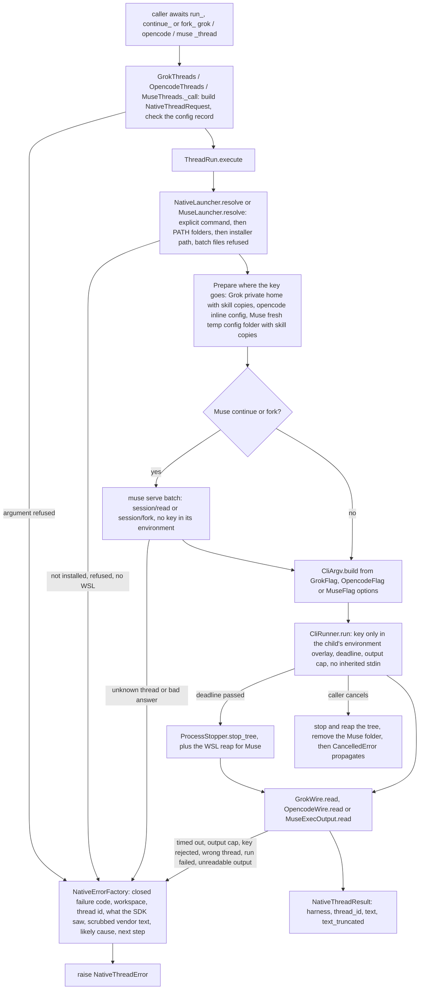

feat(harnesses): run, continue and fork Grok, opencode and Muse threads with the caller's API key
## Summary

This PR now has the shape asked for in review: nine async functions that run, continue and fork a thread on Grok Build, opencode or Muse Code with the caller's own API key. Each call runs that harness's own installed command-line tool once, headless, and returns the thread id and the final answer as a `NativeThreadResult`. The names follow the requested pattern, `<verb>_<harness>_thread` (`run_grok_thread`, `fork_grok_thread`, `run_opencode_thread`, …), exported from `vidbyte.harnesses.native`. Meta's harness is `muse`, after its program, the way `grok` and `opencode` are named, and GLM and DeepSeek are reached through opencode's `model` argument. Everything else the PR used to add is gone: the host classes, live peers, the `opencode serve` HTTP client, the 43 agent tools, and the DeepSeek balance, usage and readiness checks. Nothing but those agent tools called the billing code, and a real run already reports a billing failure from the vendor, so it was deleted rather than moved.

The decision that matters most is one bounded CLI run per call, with the key placed where it beats any login already stored on the machine: a private Grok home under `~/.vidbyte/grok-homes/`, an inline opencode config, or `META_API_KEY` next to a fresh private Muse config folder. The key never goes on the command line, into a file, into `os.environ`, or into an error message. Design record: `docs/spec/harness-thread-functions/spec.md` (r4).

## How to use what this PR introduces

```python
import asyncio
import os

from vidbyte.harnesses.native import (
    GrokPermissionMode,
    GrokThreadConfig,
    NativeThreadError,
    fork_grok_thread,
    run_grok_thread,
    run_opencode_thread,
)


async def main() -> None:
    repo = "C:/code/my-repo"
    try:
        first = await run_grok_thread("Add a --verbose flag to cli.py.", api_key=os.environ["XAI_API_KEY"], workspace=repo, skills=["C:/code/skills/python-style"], config=GrokThreadConfig(permission_mode=GrokPermissionMode.ACCEPT_EDITS))
        print(first.thread_id, first.text)
        branch = await fork_grok_thread(first.thread_id, "Now write a test for it.", api_key=os.environ["XAI_API_KEY"], workspace=repo)
        print(branch.thread_id, branch.text)
        review = await run_opencode_thread("Review cli.py for bugs.", api_key=os.environ["DEEPSEEK_API_KEY"], workspace=repo, model="deepseek/deepseek-v4-pro")
        print(review.thread_id, review.text)
    except NativeThreadError as error:
        print(error.failure_code.value, error.next_step)


asyncio.run(main())
```

I ran this snippet unchanged against the test pack's stand-in `grok` and `opencode` programs on `PATH`. It used placeholder keys, a temporary user home, and temporary folders in place of the two literal paths. No real vendor CLI ran and no key was spent. It exited 0 and printed:

```text
b19b8f35-0d32-41ef-9cbe-1f97a6fe2da0 grok answer to: Add a --verbose flag to cli.py.
e5acf969-c018-4f16-8df0-d4b4e4488167 grok answer to: Now write a test for it.
ses_77fb10dd-8211-4c81-a22e-1599e3cbb62f opencode answer to: Review cli.py for bugs.
```

The fork came back on a new id, and nothing was written into the workspace. The developer no longer opens a host, spawns a turn, waits on a handle, sets up a backend profile, or signs the CLI in. A stored `grok login` or `opencode auth` does not change which key pays.

The rest of the shape, in short:

- `run_<harness>_thread(prompt, *, api_key, workspace, model=None, skills=(), config=None)`. `continue_` and `fork_` take `thread_id` first. opencode's `model` is required and names the provider: `"zai-coding-plan/glm-5.3"`, `"deepseek/deepseek-v4-pro"`.
- `skills` are folders that hold a `SKILL.md`. They apply to that one call, so pass them again on a continue or a fork.
- `config` is `GrokThreadConfig` (reasoning effort, permission mode, timeout, `grok_command`), `OpencodeThreadConfig` (agent, variant, timeout, `opencode_command`) or `MuseThreadConfig` (reasoning effort, timeout, `muse_command`, or `wsl_distro` and `muse_path`). On Windows, Muse runs only through WSL or an explicit command. The default timeout is 1,800 s. Grok's documentation says its default permission mode refuses edits in a headless run (spec A-3). That is why the snippet passes `ACCEPT_EDITS`.
- Every failure raises one `NativeThreadError` with `failure_code`, `likely_cause`, `next_step`, `thread_id`, `exit_code` and `vendor_message`. Here is a real message from a stand-in that refused the key (the sandbox path is shortened):

  > continue_grok_thread failed with grok.key_rejected. Grok Build rejected the API key. The workspace was C:\…\ws. The thread id was b19b8f35. The vendor refused the key passed as api_key, and the SDK never falls back to a stored login. The process exited with status 1. The vendor printed: "Not signed in. Run \`grok login\` or set XAI_API_KEY.". Likely cause: xAI rejected the API key passed as api_key because it is wrong, revoked or lacks access, and the SDK never falls back to a stored grok login. Next step: Pass a valid xAI API key as api_key and retry.

## Flow



Validation happens first, in the records, so a refused argument starts no process and writes no file. The only state the SDK changes is the Grok private home, which is kept per workspace so a continue finds the thread, and the per-call Muse temp folder, which is removed however the call ends. The vendor keeps its own thread store. `CliRunner` raises only cancellation: every other failure comes back as a field of `CliOutcome`, and the harness's reader turns it into one closed code through `NativeErrorFactory`, which scrubs the key out of the text before it builds the message.

## What changed

| File | Change |
|---|---|
| `vidbyte/harnesses/native/__init__.py` | New: exports the nine functions, the three config records, `NativeThreadResult`, `NativeThreadError` and the three config enums (17 names). Root `vidbyte` does not re-export them. |
| `vidbyte/harnesses/native/grok/__init__.py` | New: binds `run_grok_thread`, `continue_grok_thread` and `fork_grok_thread`. |
| `vidbyte/harnesses/native/grok/threads.py` | New: `GrokThreads` (the three functions, one guarded try) and `GrokThreadRun.execute`. It finds grok, prepares the private Grok home and its skills, and runs `grok --single=<prompt> --output-format=json` once, with the key in `XAI_API_KEY` and `GROK_CODE_XAI_API_KEY` and the home in `GROK_HOME`. |
| `vidbyte/harnesses/native/grok/wire.py` | New: `GrokWire.read` turns grok's one JSON answer into the result or the right failure code. |
| `vidbyte/harnesses/native/opencode/__init__.py` | New: binds the three opencode functions. |
| `vidbyte/harnesses/native/opencode/threads.py` | New: `OpencodeThreads` and `OpencodeThreadRun.execute`. It runs `opencode run --format=json --dir=<workspace> --model=<model>` with the prompt on stdin and the key in `OPENCODE_CONFIG_CONTENT`. |
| `vidbyte/harnesses/native/opencode/wire.py` | New: `OpencodeWire` builds the inline config that binds the key to the model's provider and lists the skill folders, and reads the JSON events. |
| `vidbyte/harnesses/native/muse/__init__.py` | New: binds the three Muse functions. |
| `vidbyte/harnesses/native/muse/threads.py` | New: `MuseThreads` and `MuseThreadRun.execute`. It makes a private temp config folder holding the skills, checks (continue) or forks the thread over one `muse serve` exchange, and runs `muse exec --json … -- <prompt>` with `META_API_KEY`. The folder is removed however the call ends. |
| `vidbyte/harnesses/native/muse/launcher.py` | New: `MuseLauncher` picks the explicit command, `wsl.exe -d <distro> -e <muse_path>` on Windows, or muse on PATH. It maps paths to `/mnt`, forwards only the SDK's own names through `WSLENV`, explains WSL failures, and reaps the call's processes inside the distro. |
| `vidbyte/harnesses/native/muse/wire.py` | New: `MuseWire` writes the `muse serve` batch and reads its answer; `MuseExecOutput` reads the exec records. |
| `vidbyte/harnesses/native/hostkit/__init__.py` | New: re-exports the internal plumbing the three harnesses share. |
| `vidbyte/harnesses/native/hostkit/errors.py` | New: `NativeErrorFactory` builds every `NativeThreadError` from the closed code table. The message names the function, code, workspace and thread id, then what the SDK saw, the scrubbed and capped vendor text, the likely cause and the next step. |
| `vidbyte/harnesses/native/hostkit/launcher.py` | New: `NativeLauncher.resolve` tries the explicit command, then the PATH folders (never the current folder), then the installer path, and refuses Windows `.cmd` and `.bat` launchers. |
| `vidbyte/harnesses/native/hostkit/skills.py` | New: `NativeSkillFolders` keeps an SDK-owned skills folder that holds exactly the caller's skills, and removes copies that kept read-only bits. |
| `vidbyte/lib/process/__init__.py` | New package: exports `CliArgv`, `CliRunner` and `ProcessStopper`. |
| `vidbyte/lib/process/argv.py` | New: `CliArgv.build` is the one argv builder for all three harnesses, joined (`--flag=value`) or separate style. A separate-style value that starts with a dash is refused. |
| `vidbyte/lib/process/runner.py` | New: `CliRunner.run` does one bounded run: a deadline, a capped output read, no inherited stdin, and the caller's environment plus the overlay. `ProcessStopper` stops the whole tree: the process group on POSIX, taskkill by its full path on Windows. `find_program` never looks in the current folder. |
| `vidbyte/lib/dataclasses/native_threads.py` | New: `NativeThreadRequest`, `GrokThreadConfig`, `OpencodeThreadConfig`, `MuseThreadConfig` and `NativeThreadResult`, each validated in `__post_init__`. The key field is `repr=False`. |
| `vidbyte/lib/dataclasses/process.py` | New: `CliOption`, `CliInvocation` and `CliOutcome`. |
| `vidbyte/lib/dataclasses/validation.py` | New: `RecordFieldValidator` and `RecordFieldConverter`, the shared field checks, which never quote a key. |
| `vidbyte/lib/enums/native_threads.py` | New: harness, verb, operation and problem enums, the Grok and Muse settings enums, and every flag (`GrokFlag`, `OpencodeFlag`, `MuseFlag`, `WslFlag`, `ShellFlag`), the child environment names, the Muse methods and the opencode event types. |
| `vidbyte/lib/enums/process.py` | New: `ProcessLaunchFailure` and `CliOptionStyle`. |
| `vidbyte/lib/enums/__init__.py` | Exports the 17 new enums. |
| `vidbyte/lib/enums/failure.py` | 28 new `FailureCode` members, `<harness>.<problem>`. |
| `vidbyte/lib/constants/native_threads.py` | New: every fixed value and text: bounds, patterns, program and folder names, JSON member names, vendor markers, tested versions, and one likely cause and one next step per failure code. |
| `vidbyte/lib/errors/base.py` | `NativeThreadError(AgentExecutionError)` with the `DIAGNOSTIC_FIELDS` packet. |
| `vidbyte/lib/errors/__init__.py` | Exports `NativeThreadError`. |
| `vidbyte/harnesses/README.md` | Describes `native/`, the nine functions and the documented limits. |
| `vidbyte/lib/README.md` | Describes `process/`. |
| `REPO_MAP.md` | Entries for `vidbyte/harnesses/native/` and `vidbyte/lib/process/`. |
| `tests/features/harness_threads/` (18 files) | Offline feature pack. A scripted stand-in (`fake_harness.py`) runs as a real child process for every harness, so no vendor CLI or key is needed. |
| `docs/spec/harness-thread-functions/` | Spec r4, request, test plan, review, verify log, stage reports and this body. |
| Removed (none of it was ever on `main`) | Host classes, peers, the turn table, the `opencode serve` client, backends and the balance read, `ManagedProcess`, 43 tools in 4 toolsets, the MCP transport extension, 53 old failure codes, and `docs/spec/native-grok-opencode-meta-hosts/`, in `60c939b1`, `2c39aa72` and `cb88b9df`. |

Size against `main`, before and after this rework. Before, the PR added 67 SDK files (+11,698 lines), 49 test files (+14,023) and 26 docs (+9,466). Now it adds or changes 30 SDK files plus `REPO_MAP.md` (+3,520), 18 test files (+3,970) and the spec record. The diff deletes no line of `main`. `vidbyte/tools`, `vidbyte/lib/configs`, `vidbyte/__init__.py`, `lint/`, `scripts/`, `.github/` and `pyproject.toml` are unchanged. Compatibility: the change only adds names. `import vidbyte` does not import the new package, and no dependency was added.

## Acceptance criteria → proof

All test paths are under `tests/features/harness_threads/`.

| AC | What it checks (plain words) | Proven by |
|---|---|---|
| AC-1 | The usage snippet runs as written against stand-ins on `PATH`. | `test_harness_threads_acceptance.py::test_developer_snippet_runs_as_written_against_stand_ins_on_path`; also run by hand above |
| AC-2 | Each `run_` function returns the vendor's new thread id and final text. | `test_harness_threads_acceptance.py::test_run_returns_the_vendors_new_thread_id_and_final_text` |
| AC-3 | The vendor child authenticates with the caller's key, even when the caller's environment holds other keys; `muse serve` gets no key at all. | `test_harness_threads_credentials.py::test_child_authenticates_with_the_callers_key`, `::test_muse_serve_never_sees_a_key_even_the_callers_own` |
| AC-4 | A key the vendor echoes back is redacted in the error; no argv element and no record repr holds it. | `test_harness_threads_credentials.py::test_key_echoed_by_the_vendor_is_redacted_everywhere`, `::test_request_record_repr_hides_the_key` |
| AC-5 | A bad argument is refused by name before anything starts or is written. | `test_harness_threads_arguments.py` (the six `test_invalid_*`, `test_prompt_over_the_harness_cap_is_refused_naming_the_cap`, `test_config_of_the_wrong_type_is_refused`, `test_argument_check_comes_before_launcher_resolution`); `test_harness_threads_records.py::test_config_record_refuses_a_bad_field_when_built` |
| AC-6 | A continue sends the vendor's resume form and keeps the thread id. | `test_harness_threads_threads.py::test_continue_sends_the_resume_form_and_keeps_the_thread_id` |
| AC-7 | A fork runs the prompt on a new thread with a new id. | `test_harness_threads_threads.py::test_fork_runs_the_prompt_on_a_new_thread` |
| AC-8 | An unknown thread is `thread_not_found`, and Muse never starts `exec` for it. | `test_harness_threads_threads.py::test_muse_unknown_thread_is_refused_before_any_exec`, `::test_opencode_session_not_found_is_thread_not_found` |
| AC-9 | A hung run times out and leaves no process; in WSL mode the reap runs with the call's mark. | `test_harness_threads_process_bounds.py::test_run_past_its_timeout_is_timed_out_with_its_tree_stopped`; `test_harness_threads_wsl.py::test_wsl_run_past_its_timeout_is_reaped_with_the_calls_mark` |
| AC-10 | Every failure has the right code and a message with every required part, in order. | `test_harness_threads_errors.py` (all 11 tests), plus every error test in the launcher, threads, process-bounds and WSL modules, all through `conftest.py::check_error` |
| AC-11 | A cancel propagates only after the tree is stopped and the Muse folder is gone. | `test_harness_threads_process_bounds.py::test_cancellation_propagates_after_the_tree_is_stopped`; `test_harness_threads_wsl.py::test_wsl_cancellation_reaps_before_it_propagates` |
| AC-12 | A Windows `.cmd` or `.bat` launcher is refused, by path, and never runs. | `test_harness_threads_launcher.py::test_batch_launcher_found_on_path_is_refused`, `::test_batch_file_passed_as_the_command_is_refused` |
| AC-13 | The old names no longer import, the old files are gone, and the tools and configs packages match `main`. | `test_harness_threads_surface.py::test_old_public_names_no_longer_import`, `::test_rejected_design_files_are_deleted`, `::test_branch_leaves_the_tools_and_configs_packages_as_main_has_them` |
| AC-14 | The harness modules hold no constants or hardcoded strings of their own, and every flag in argv is an enum member's value. | `test_harness_threads_static_policy.py::test_module_level_holds_only_docstring_imports_classes_all_and_init_bindings`, `::test_only_docstrings_all_entries_and_empty_zero_one_are_literals`; `test_harness_threads_argv.py::test_every_option_keeps_its_style_and_a_flag_like_prompt_stays_text` |
| AC-15 | Each harness gets its argv style, and a prompt such as `--yolo` stays text. | `test_harness_threads_argv.py::test_every_option_keeps_its_style_and_a_flag_like_prompt_stays_text`, `::test_argv_matches_the_documented_form_without_options` |
| AC-16 | Each harness sees exactly the skills passed; the Grok copy is rebuilt only when the set changes. | `test_harness_threads_skills.py::test_grok_skills_folder_holds_exactly_the_passed_skills_and_is_rebuilt_only_on_change`, `::test_opencode_lists_exactly_the_passed_folders_without_copying`, `::test_muse_skills_live_in_a_fresh_config_folder_that_is_removed` |
| AC-17 | GLM and DeepSeek through opencode bind the key to the right provider. | `test_harness_threads_acceptance.py::test_opencode_binds_the_key_to_the_models_provider` |
| AC-18 | The full local gate passes with no new lint baseline entry. | Verification below: `run_ci.py` source and package stages at `53d9f45a` (code is unchanged since) |
| AC-19 | A successful call writes only where allowed and never puts the key in `os.environ`. | `test_harness_threads_credentials.py::test_successful_call_writes_only_where_the_spec_allows`, `::test_os_environ_never_holds_the_key_while_the_child_runs` |
| AC-20 | The four review threads are answered with the fixing commits. | The replies on this PR's four threads, all resolved; commits `2c39aa72`, `3555279c`, `4c214907`, `8d6e643c`, `0c222707`, `d5731e60`, `74114bd1`, `bdc8cd7a`, `cdf4efde` |
| AC-21 | An error raised after a thread exists carries that thread's id. | `test_harness_threads_process_bounds.py::test_muse_fork_that_times_out_in_exec_carries_the_new_thread`, `::test_stdout_past_its_cap_is_output_too_large[opencode-session_then_flood-NATIVE_PROCESS_MAX_OUTPUT_BYTES-True]`, `::test_run_past_its_timeout_is_timed_out_with_its_tree_stopped[muse-session_then_hold-True]` |

## Verification

The code last changed at `53d9f45a`. Every commit after it changes only `docs/`.

| Gate | Command | Result |
|---|---|---|
| Feature pack, 3.11 (win32) | `PYTHONPATH=$(pwd) python -m pytest -q -p no:cacheprovider tests/features/harness_threads` | `436 passed, 2 skipped in 51.52s` (re-run on `b3394268`; the 2 skips are POSIX-only tests) |
| Feature pack, 3.13 (win32) | same, in a 3.13 venv | `436 passed, 2 skipped in 51.17s` at `5f016773`; the R-27 test alone at `53d9f45a`: `1 passed in 1.34s` |
| Whole suite | `PYTHONPATH=$(pwd) python -m pytest -q -p no:cacheprovider` | `5609 passed, 16 skipped in 97.94s (0:01:37)` |
| Custom lint | `python lint/run.py` | `SDK-LINT: PASS` (re-run on `b3394268`). S009 350/350 and A007 255/255. Seven rules improved and were not re-baselined. |
| Import order (I001) | `python -m ruff check <changed vidbyte .py files> --config lint/ruff.toml --select I001 --no-cache` | No new finding. The one finding, `vidbyte\lib\errors\__init__.py:22:1`, is on `main` too. |
| Comment width | 72-column check over every changed `vidbyte/` file | Only lines already on `main` (`failure.py` 6, `base.py` 9) |
| Full gate, source | `PYTHONPATH=$(pwd) python scripts/run_ci.py --stage source` | `5609 passed, 16 skipped in 93.12s (0:01:33)` / `CI passed.` at `53d9f45a`; the same at `ac8c8cdb` |
| Full gate, package | `python scripts/run_ci.py --stage package` (no `PYTHONPATH`) | `Installed vidbyte-sdk 0.2.1 passed smoke checks.` / `CI passed.` |
| Semgrep test | `semgrep --test --config .semgrep/typed-mapping-boundary-policy.yml .semgrep/typed-mapping-boundary-policy.py` | `1/1: ✓ All tests passed` |
| Semgrep scan | `semgrep scan --error --config .semgrep/typed-mapping-boundary-policy.yml vidbyte` | `Ran 1 rule on 958 files: 0 findings.` |
| Usage snippet | the snippet above against stand-ins on `PATH` | exit 0, three lines, fork id differs, workspace untouched |
| GitHub CI | `ci.yml` and `static-policy.yml` dispatched by hand (auto-triggers are off), read with `gh api repos/cerredz/Vidbyte-SDK/commits/<sha>/check-runs` | 4/4 success on `53d9f45a` (runs 38785332849, 38785337323) and on `ac8c8cdb` (runs 38786523313, 38786527220): Package, Source / Python 3.11, Source / Python 3.12, Static policy. The final head's runs are on this PR's checks. |

GitHub CI runs on Ubuntu only, so the Windows-only tests (batch launchers, the WSL mode, the command-line limit) run only in the local win32 runs above.

## Adversarial review

Three independent reviewers read the code through three lenses: spec conformance, repo conventions and engineering. A verifier confirmed 11 findings (5 Blocker, 6 Major). The first of two post-repair re-reviews, also checked by a verifier, added 4 more (1 Blocker, 2 Major, 1 Minor). All 15 are fixed, and none was waived. The second re-review found the code SOUND, with two Minor follow-ups. Of the Minor findings, R-15, R-16, R-17 and R-31 are fixed, and 15 are follow-ups (below). Full record: `docs/spec/harness-thread-functions/review.md`.

| ID | Finding | Fixed in |
|---|---|---|
| R-1 | Comment lines wider than 72 columns in new code | `b8305b44` (code), `1f6fc22e` (tests) |
| R-2 | The reap's `sh -s` was the last flag kept as a string | `74114bd1` (`ShellFlag.READ_STDIN`) |
| R-3 | Error factory call chains two levels deep (AGENTS.md principle 1) | `3466a6fc` |
| R-4 | On Windows, a `grok.exe`, `opencode.exe` or `wsl.exe` in the current folder would run with the caller's key | `f64ba4b8` (`CliRunner.find_program`) |
| R-5 | The three readers copied JSON-lines, thread-id and wrong-thread logic | `efae78a5` |
| R-6 | Timeout and output-cap errors left out the vendor's stderr | `bdc8cd7a` |
| R-7 | `runtime.error` dropped the workspace and the thread id | `cdf4efde` |
| R-8 | A quote-heavy prompt passed the Windows command-line limit and showed as `not_installed` | `2e8ae979` |
| R-9 | Read-only skill copies blocked every later Grok call in that workspace | `69c3f9a5` |
| R-10 | A Muse call cancelled mid-copy left its temp folder behind | `9e09b9b1` |
| R-11 | A finished run whose grandchild held the pipes was reported as timed out | `1583ee8c` |
| R-27 | A cancel in the new post-exit wait skipped the tree stop | `4a352946`, `53d9f45a` (POSIX group wait) |
| R-28 | taskkill started by its bare name, so one in the current folder could run | `7ec71ec7` |
| R-29 | On Windows the record refused prose prompts the spec allows | `5ee16c7d` |

## Owner review comments

All four threads are on code this PR deleted, so GitHub shows them as outdated. Each has a reply and is resolved.

| Comment | What changed | Commits |
|---|---|---|
| `backends/profiles.py:59`: "wrong file location for all of these, and error messages need to be in much more detail" | `profiles.py` and the balance, usage and readiness code are gone. Every fixed value and text now lives in `vidbyte/lib/constants/native_threads.py`. Every failure is one `NativeThreadError` built by `NativeErrorFactory`. It names the function, code, workspace and thread id, then what the SDK saw, the scrubbed vendor text, and a likely cause and next step written for each of the 28 codes. | `2c39aa72`, `3555279c`, `4c214907`, `bdc8cd7a`, `cdf4efde` |
| `grok/cli.py:36`: "wrong file location," | `grok/cli.py` is folded into `grok/threads.py`. Its values moved to `vidbyte/lib/constants/native_threads.py` and its flags to `GrokFlag`. opencode and Muse follow the same rule. | `3555279c`, `8d6e643c`, `0c222707`, `d5731e60` |
| `grok/cli.py:127`: "this type of code can be cleaner for all providers … enums for flags/hardcoded strings" | Every flag is a member of `GrokFlag`, `OpencodeFlag`, `MuseFlag`, `WslFlag` or `ShellFlag`. All three harnesses build argv through the one canonical `CliArgv.build` in `vidbyte/lib/process/argv.py`, from `CliOption` records. | `3555279c`, `8d6e643c`, `0c222707`, `d5731e60`, `74114bd1` |
| `grok/host.py:64`: "wrong file location" | `grok/host.py` is gone with the other host classes. Its next-step strings became one likely cause and one next step per failure code in `vidbyte/lib/constants/native_threads.py`. | `2c39aa72`, `3555279c`, `4c214907` |

The rule now holds for all three harnesses, and a test guards it: `test_harness_threads_static_policy.py` parses every module under `vidbyte/harnesses/native/` with `ast`. It fails on any module-level constant and on any literal other than a docstring, an `__all__` entry, or an empty string, 0 or 1.

## Deviations from the spec

The 24 deviations recorded in spec §17 are summarized below. Reading the code against the spec found no other deviation, and §5 (the flow) still matches the code.

- **Types and signatures (1–9).** `NativeThreadRequest.workspace` and `skills` take `Path | str` and `Sequence[str | Path]`, because of the mypy ratchet (S009), and are always resolved `Path` values after validation. Each skill item is checked on its own, so a bad one is named `skills[i]`. `NativeLauncher.resolve`, `from_launch_failure` and the readers take the request, the timeout or the exec thread id they need for the message. The OS launch-failure check sits in each flow, because it needs the launcher path. The WSL failure markers sit in `MuseLauncher.launch_failure`, because naming the distros needs `wsl.exe -l -q`. `MuseWire.read_answer` returns the id string. `workspace_root` became `visible_path`. `scrub` keeps the last 1,000 characters, the tail where a vendor prints its final error.
- **Constants and frames (10–12).** There are 12 constants beyond the spec's list, each with a reader, and 2 were dropped that nothing read. Every Muse serve frame ends with a newline. Interim commits P1–P5 had S009 counts above the allowance; from P6 on it is 350/350.
- **From review fixes (13–19, 21–24).** These are `ShellFlag` (R-2), `from_unexpected(exc, request)` with scrubbing in the entry methods (R-3, R-7), `CliRunner.find_program` instead of `shutil.which` (R-4), the shared readers `CliRunner.json_objects`, `RecordFieldValidator.accepts_text` and `NativeErrorFactory.wrong_thread` (R-5), and stderr on timeouts (R-6). They also include a 30,000-unit Windows ceiling for Grok and Muse prompts beside the unchanged 24,000-character cap, with `WinError 206` mapped to `launch_failed` (R-8, R-29), and read-only-safe removal (R-9). The rest are `CliExitProtocol`, so a run ends when the leader exits (R-11, R-27), the quoted vendor sentence and `HOME`/`USERPROFILE` hint (R-15, R-16), taskkill by its full path (R-28), and the POSIX stop waiting until the process group is gone (R-27).
- **Cancel during the Muse folder copy (20).** The spec wants `CancelledError` to propagate only after the temp folder is removed. That holds for one cancel. A second cancel stops only the wait. The removal then continues in the background while the caller's event loop runs, but if the loop ends first, the folder (skill copies, no key) stays. Holding the order for every cancel would mean swallowing later cancels, which would trap a caller behind a hung copy, so that choice is left to the owner.

## Follow-ups

- **A live smoke test with real keys, first.** By design, no real vendor CLI ran with a real key, to avoid spending money. Each of the nine functions needs one real run.
- **R-RRB1:** after two cancels during the Muse skill copy, the temp folder stays if the event loop ends first (deviation 20). The header of `vidbyte/harnesses/native/muse/threads.py` (line 9) still says that the removal "ends in the background" and needs the same correction. Code option: the worker removes its own folder when the cancel path sets a `threading.Event`.
- **R-RRB2:** on Windows, a cancel that lands while the runner's timeout handler runs taskkill (a window of about 0.1 s) kills taskkill, and a grandchild can survive. **R-32**, the same class: in WSL mode, a cancel can interrupt the Muse reap. Both are fixed by shielding the stop the way R-30 shields the discard.
- **R-23:** in WSL mode, any non-zero exit whose stderr says "No such file or directory" becomes `muse.not_installed`. Matching the marker together with `muse_path` would be safer.
- **Other Minor items:** R-12 (Grok's error type and Muse's terminal and stream-kind values could be enums), R-13 (the taskkill argv is a constant tuple, not built by `CliArgv`), and R-14 (on a stderr flood past the cap, the error shows text from near the cap, and a key echoed across the cap boundary can leave its prefix). Then R-18 (spec FR-5 promises `thread_not_found` for an unknown Grok id, but Grok reports `run_failed`, as EC-21 says), R-19 (producers write the literal `"field"`), and R-20 (`lib/errors/base.py` is 613 lines against the 500 target and was already 552 on `main`). Then R-21 (headers cite spec IDs without the spec path), R-22 (the C006–C008 lint text still says the validator module "does not exist yet", an owner change), R-24 (the cancellation test cannot tell "stopped before" from "stopped after"), R-25 (a refused argument before the request exists carries no thread id), and R-26 (a UNC temp root in WSL mode is reported as a bad `workspace`).
- **Limits documented in `vidbyte/harnesses/README.md`:** concurrent Grok calls in one workspace with different skill sets can collide (EC-27); every new workspace path leaves a Grok home that the SDK never removes (EC-43); SDK Grok runs ignore the user's `~/.grok` guard rails (EC-44); and opencode also reads a workspace's own `opencode.json`, so pass only trusted workspaces (T-6). On POSIX, a zombie that nobody reaps holds a tree stop to its 1 s grace (deviation 24).
- **Optional controls, all left out by default (Q-1 to Q-11, spec §15).** These include edit permission by default, sync wrappers, a Grok model pre-check, opencode or Muse permission controls, tools over the functions, workspace trust, `OPENCODE_DISABLE_PROJECT_CONFIG`, bounding Grok-home growth, and copying `~/.grok` guard rails.
- **Lint ratchets that improved, not re-baselined:** A002 703→585, C011 2→1, C012 24→23, S001 59→56, S010 5→0, S025 263→261 and S061 6→5. The owner may re-baseline them.
- **Out of scope, as requested:** composite functions such as `run_grok_thread_verify_with_opencode`.

🤖 Generated with [Claude Code](https://claude.com/claude-code)
