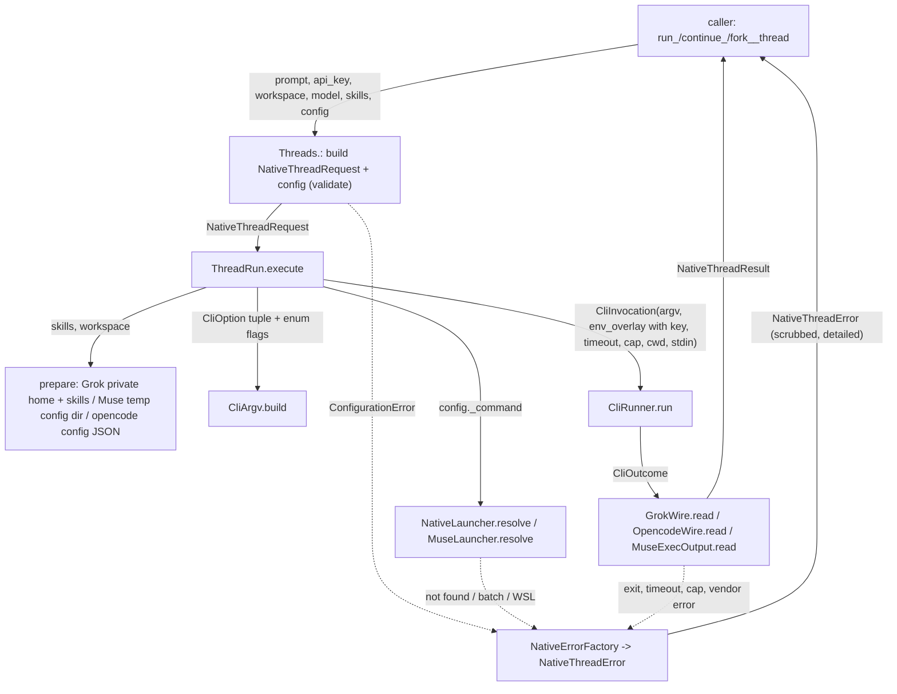
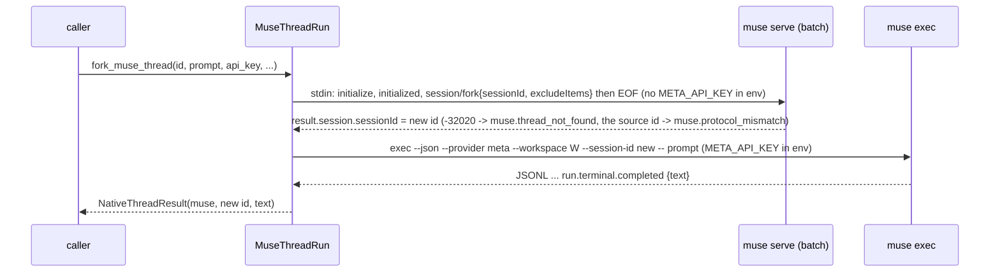

# Spec: Harness thread functions: run, continue and fork Grok, opencode and Muse threads with the caller's API key

> **TL;DR** — PR #1036 is reshaped into nine async functions, `run_`/`continue_`/`fork_` × `grok`/`opencode`/`muse` `_thread`. Each takes the caller's API key, a prompt, optional skills, model and config, runs the harness's own installed CLI once in headless mode under a deadline, and returns the thread id and the final text. The decision that matters most is that one bounded headless CLI run per call, through the PR's existing `CliRunner`, replaces the host classes, live peers, HTTP server and 43 tools. The key is injected so that it beats any login stored on the machine: a private `GROK_HOME` kept under the user's home folder and keyed by the workspace, an inline opencode config `apiKey`, and `META_API_KEY` with a private Muse config folder. Everything else in the PR is deleted.

## §0 User prompts

### 0.1 Invoking request (verbatim)
I dont literally want the things that I said, but I want you to figure out the general shape of what I said and how to implement optimally (only thing I definately want is the actual function naming the way i said). Can you figure this out,  update the pr, and also resolve the comments that I left

### 0.2 User replies during the run
_None yet. The orchestrator appends any reply the user sends during the run here verbatim, labeled with the revision it produced._

---

## Part A — Framing

## §1 Goal

The owner asked for a small thing and received a large one. Prompt 3: "i wanted the pr to simply do the following: the user providers their api key, and then we simply create functions that run the already existing cli/sdk code of open source harensses (ex: run_grok_thread(api key, skills, prompt, config), run_opencode_thread(params), fork_grok_thread(grok_thread_id) …". On the branch today, no function takes an API key or skills (request §C). The public shape is three host classes used as async context managers with spawn/wait handles, plus 43 agent tools, a GLM/DeepSeek backend layer with a balance read, 53 failure codes, a live-turn table, stdio peers, an `opencode serve` HTTP client, and an MCP transport extension: about 11.7K lines of SDK code. The owner also left four review comments asking that constants and hardcoded strings leave the feature files, that flags become enums, that argv building get "cleaner for all providers", and that error messages carry "much more detail".

| ID | Goal (outcome) | How we will know | Source |
|---|---|---|---|
| G-1 | A developer runs, continues or forks a Grok Build, opencode or Muse Code thread by calling one function with their own API key, and gets back the thread id and the harness's answer. | AC-1, AC-2, AC-3, AC-6, AC-7 | §0.1; request §A Prompt 3; KD-1, KD-2, KD-3 |
| G-2 | The PR does only that ("simply"): no usage, balance, readiness, tool or host machinery remains, and the diff is small enough to read. | NFR-1; AC-13; FR-13 | request §A Prompts 2–3; orchestrator decisions |
| G-3 | All four review comments are resolved everywhere their rule applies, not only on the anchored lines. | §12.5 comment table; AC-14; AC-15 | request §A comments 1–4; KD-7 |
| G-4 | Every failure explains itself: which function, harness, workspace and thread; what the SDK observed; what the vendor printed; the likely cause; and the next step. | INV-5; AC-10 | comment 1 "much more detail"; KD-8 "every single function" |

## §2 Objective

When this PR merges, `vidbyte.harnesses.native` exports nine async functions: `run_grok_thread`, `continue_grok_thread`, `fork_grok_thread`, `run_opencode_thread`, `continue_opencode_thread`, `fork_opencode_thread`, `run_muse_thread`, `continue_muse_thread` and `fork_muse_thread`. Each takes `prompt`, plus `thread_id` for continue and fork, and the keyword arguments `api_key`, `workspace`, `model`, `skills` and `config`. Each runs the installed vendor CLI headless once (for Muse continue and fork, one short `muse serve` exchange comes first) and returns a `NativeThreadResult(harness, thread_id, text, text_truncated)`, or raises one `NativeThreadError` with a closed failure code and a detailed message. Each harness has one small validated config record (`GrokThreadConfig`, `OpencodeThreadConfig`, `MuseThreadConfig`). GLM and DeepSeek are reached through `run_opencode_thread(..., model="zai-coding-plan/glm-5.3" | "deepseek/deepseek-v4-pro")`. Every flag is an enum member, every other fixed value and text is a named constant in `vidbyte.lib.constants.native_threads`, and all three harnesses build argv through one canonical helper, `CliArgv`. Everything else the PR added is deleted, and the files it changed on main are restored, except the export, failure-code and error lines this feature needs and the README/map entries. That includes the host classes, tools and toolsets, backends, peers, the HTTP server and client, the turn table, the managed process, the transport extension, 53 old failure codes and the old spec folder. This is the whole slice; the later slices are NG-1 and NG-4.

## §3 Non-goals

- **NG-1** — Composite cross-harness functions such as `run_grok_thread_verify_with_opencode`. — *Why not:* KD-5, "dont worry about the complex functions for now".
- **NG-2** — Live turns: spawn-then-wait handles, interrupt, steer, streaming progress. — *Why not:* a thread function runs to completion. Live turns need the stdio peers, turn table and transport extension that FR-13 deletes. The caller cancels a running call with ordinary asyncio cancellation (FR-11).
- **NG-3** — Usage, cost, balance, readiness, version checks, model lists, session listing/search/read/page, revert/unrevert, diff, MCP-server management. — *Why not:* Prompt 2 ("why do we even need usage or balance checks inside of the pr?"); the orchestrator decision removes everything outside the thread verbs; a real run already reports a billing failure (request §C).
- **NG-4** — Model-facing tools or toolsets over the thread functions. — *Why not:* not part of the owner's shape. Kept as the optional Q-5, default no.
- **NG-5** — Synchronous variants. — *Why not:* every operation in the PR is async, and nothing in the conversation asks for sync (Q-2, default no).
- **NG-6** — GLM or DeepSeek through Grok or Muse, Claude Code/Codex backends (`build_claude_backend_env`), Claude Code or Codex hosts. — *Why not:* Z.ai's Coding Plan allows OpenCode but not Grok or Muse, and Muse has no GLM/DeepSeek route (vendor-facts "GLM and DeepSeek routes"). ClaudeHost/CodexHost are open PRs #1044/#1055 that this PR must not depend on.
- **NG-7** — Reading a key from environment variables or from the machine's stored vendor login. — *Why not:* KD-2. The caller supplies the key on every call.
- **NG-8** — Skills from URLs, skills.sh, GitHub, or `SkillEntry`/`SkillDocument` objects. — *Why not:* the owner named "skills" for a harness, and harnesses load skill folders. Local folders are the smallest complete form.
- **NG-9** — New permission controls: an approve-everything mode, opencode permission rules, Muse approval modes, or Grok allow/deny rules and max turns. — *Why not:* no control beyond the existing Grok permission mode was requested (hard rule 9). Kept as the optional Q-1/Q-4, default no.
- **NG-10** — Exports from the root `vidbyte` package, any `vidbyte-sdk` CLI command, new dependencies. — *Why not:* briefing; field guide `prebuilt-agents.md`.
- **NG-11** — A fork that takes no prompt, or a fork at an earlier cut point. — *Why not:* Grok and opencode have no headless fork without a prompt (vendor-facts Grok Q5, opencode Q5). A fork runs the prompt on the new thread.
- **NG-12** — Trusting the workspace (Grok's hidden `--trust`, Muse `--trust-workspace`) so the harness loads project instructions and skills. — *Why not:* not requested, and Grok's flag is hidden and unverified (Q-6, default no).

## §4 Developer usage

```python
import asyncio
import os

from vidbyte.harnesses.native import (
    GrokPermissionMode,
    GrokThreadConfig,
    NativeThreadError,
    fork_grok_thread,
    run_grok_thread,
    run_opencode_thread,
)


async def main() -> None:
    repo = "C:/code/my-repo"
    try:
        first = await run_grok_thread("Add a --verbose flag to cli.py.", api_key=os.environ["XAI_API_KEY"], workspace=repo, skills=["C:/code/skills/python-style"], config=GrokThreadConfig(permission_mode=GrokPermissionMode.ACCEPT_EDITS))
        print(first.thread_id, first.text)
        branch = await fork_grok_thread(first.thread_id, "Now write a test for it.", api_key=os.environ["XAI_API_KEY"], workspace=repo)
        print(branch.thread_id, branch.text)
        review = await run_opencode_thread("Review cli.py for bugs.", api_key=os.environ["DEEPSEEK_API_KEY"], workspace=repo, model="deepseek/deepseek-v4-pro")
        print(review.thread_id, review.text)
    except NativeThreadError as error:
        print(error.failure_code.value, error.next_step)


asyncio.run(main())
```

The developer passes their own key on each call. In the snippet the caller reads it from its own environment; the SDK never does. The developer gets the vendor's thread id back, so they can continue or fork that thread later, and they get the final answer text. They no longer open a host, spawn a turn, wait on a handle, set up a backend profile, or sign the CLI in. A stored `grok login` or `opencode auth` on the machine does not change which key is billed.

## §5 Flow diagram





The public function first builds the validated `NativeThreadRequest` and checks that `config` is its harness's config record; that record already checked its own fields when the caller built it, raising `ConfigurationError` (r4, S2-4). Every argument check therefore happens before any file is written or any process starts, and a refusal becomes `configuration.invalid_argument`. The per-harness `execute` then makes the only state changes the feature has, in order:

- It writes the Grok private home and its skills, or creates the Muse temp config folder.
- It starts the vendor process through `CliRunner`, with the key only in the child's environment. Each run is bounded by the config's `timeout_seconds` and an output cap.
- It reads the outcome through the harness's codec.

Every failure, from the validator, the launcher, the runner or the codec, is turned into one `NativeThreadError` by `NativeErrorFactory`. The factory scrubs the key and caps the vendor text. Cancellation passes through untouched after the process tree is stopped.

---

## Part B — Behavior (this is the spec; everything else is framing)

## §6 Behavior

### 6.1 Invariants

- **INV-1** — Exactly nine public functions exist under `vidbyte.harnesses.native`: `run_grok_thread`, `continue_grok_thread`, `fork_grok_thread`, `run_opencode_thread`, `continue_opencode_thread`, `fork_opencode_thread`, `run_muse_thread`, `continue_muse_thread` and `fork_muse_thread`. Each is a coroutine function. Each is importable from `vidbyte.harnesses.native` and from its harness subpackage (`vidbyte.harnesses.native.grok`, `.opencode`, `.muse`). The `__all__` of `vidbyte.harnesses.native` lists exactly those nine functions plus the records, error and enums named in D-22. Each harness subpackage's `__all__` lists exactly its three functions. Every other class under `vidbyte.harnesses.native` (the flow classes, codecs, launcher and skills helpers in §12.3) is internal plumbing and is not exported from these packages.
- **INV-2** — The caller's `api_key` reaches the vendor process only through that child's environment: Grok `XAI_API_KEY` and `GROK_CODE_XAI_API_KEY`; opencode inside the value of `OPENCODE_CONFIG_CONTENT`; Muse `META_API_KEY`, forwarded through `WSLENV` in WSL mode. It never appears in argv, in stdin, in any `NativeThreadError` message or attribute, in the `repr` of any record, or in a log. The SDK never writes to `os.environ`.
- **INV-3** — The run authenticates with the caller's key even when the machine has a stored login or an environment key for that vendor:
  - Grok always runs with `GROK_HOME` set to its private home (INV-13). That folder is outside the workspace, and the SDK never writes credentials into it, so neither `~/.grok/auth.json` nor any file the workspace ships can supply a credential, a model endpoint, a hook or a plugin.
  - opencode always receives `{"provider": {"<provider id from model>": {"options": {"apiKey": "<key>"}}}}` in `OPENCODE_CONFIG_CONTENT`, which outranks `auth.json` and the provider's environment variable.
  - Muse always runs with `META_API_KEY=<key>`, a private per-call `XDG_CONFIG_HOME`, and `MUSE_AUTH_PATH` naming a file inside that folder that never exists, so no saved Muse credential or setting is read (A-21). *(r4, S2-6)* The `muse serve` child of a continue or fork gets no `META_API_KEY` at all: its overlay leaves the name out, and `CliInvocation.env_remove` drops any value inherited from the caller's environment (D-13 exception, §9.2). So serve cannot bill any key.
- **INV-4** — Every argument is checked before any process starts and before any file is written. A refusal raises `NativeThreadError` with `failure_code == FailureCode.CONFIGURATION_INVALID_ARGUMENT`; its message names the argument (`api_key`, `prompt`, `workspace`, `model`, `skills[<i>]`, `thread_id` or `config`), and it never quotes the value of `api_key`. A `config` that is not the function's own harness config record (another harness's record, a mapping) is refused naming `config` (EC-33). *(r4, S2-4)* A config field is checked earlier, when the caller builds the config record: the record's constructor raises `ConfigurationError` naming the field (§9.1), so a malformed field never reaches a function.
- **INV-5** — Every `NativeThreadError` carries `failure_code`, `harness`, `operation` (a `NativeThreadOperation`), `next_step` (non-empty), `likely_cause` (non-empty), `thread_id`, `exit_code` and `vendor_message`; the last three are `None` when not known. Its message is several complete sentences that contain, in this order:
  1. the public function name;
  2. the failure-code value;
  3. the harness label ("Grok Build", "opencode", "Muse Code");
  4. the workspace path and the thread id, when known;
  5. what the SDK observed, whichever applies: the exit status, the seconds waited, the byte cap, the missing output member, the launcher path searched or refused, or the argument and its rule;
  6. the vendor's own text, scrubbed and capped at `NATIVE_VENDOR_MESSAGE_MAX_CHARS`, when the vendor printed any;
  7. one likely cause written for that failure code;
  8. one next step written for that failure code.

  A `runtime.error` names only the exception's class, never its text.

  *(r2, R-13; r3, R-18)* `thread_id` is the newest thread id the SDK had learned when the failure happened. That is the fork's new id once Muse's `session/fork` answered. For opencode it is the first `sessionID` in whatever output the runner returned, and for Muse the `stream.id` of the first record whose `stream.kind` is `"session"`, even in a cut or timed-out stream. Otherwise it is the caller's `thread_id` (continue, fork), or `None` (run). Grok prints its id only in the one JSON object it writes at exit, so a Grok run or fork that fails before exit carries the caller's id or `None`, even though Grok may already have created the thread (D-27).
- **INV-6** — Failure classification is closed and the same for every function of a harness. The factory never builds a code that is not a `FailureCode` member. Problems are checked in the order listed:
  - `<h>.not_installed`: no launcher found.
  - `<h>.launcher_refused`: a Windows batch launcher (INV-14).
  - `<h>.launch_failed`: the launcher exists but the OS refused to start it, or the SDK could not prepare the Grok private home or the Muse temp config folder.
  - `muse.wsl_unavailable`: win32 without `wsl_distro` or `muse_command`, `wsl.exe` missing, or the distro not found.
  - `<h>.timed_out`: the run passed `timeout_seconds`, or the Muse serve exchange passed `NATIVE_CONTROL_TIMEOUT_SECONDS`.
  - `<h>.output_too_large`: stdout passed its cap.
  - `<h>.key_rejected`: the vendor refused the key. Grok: "Not signed in" in the error object. opencode: an `error` event named `ProviderAuthError` or with status 401/403. Muse: "authentication failed" on stderr.
  - `<h>.thread_not_found`: opencode "Session not found"; Muse `session/read` or `session/fork` code -32020; a Grok or opencode continue answered on a different thread id (rows 37, 40); a Muse `exec` whose session stream is not the id it was given with `--session-id` (r4, EC-45).
  - `<h>.run_failed`: any other vendor-reported failure, such as a non-zero exit, an `error` object or event, or a Muse terminal state other than `completed`.
  - `<h>.protocol_mismatch`: exit 0 but the output cannot be read, or carries no thread id, or a fork returned its source id (Grok and opencode by the printed id, EC-22; Muse by the `session/fork` answer, before `exec` starts, r4, EC-45).
- **INV-7** — No caller value is ever read as a flag:
  - Grok and opencode options are single `--flag=value` elements, and the Grok prompt travels inside `--single=<prompt>`.
  - Muse options are separate elements, and the prompt follows a literal `--`.
  - The opencode prompt travels on stdin.
  - `thread_id`, `model`, `agent`, `variant` and `wsl_distro` must match patterns that forbid a leading `-` and whitespace.
  - `CliArgv.build` refuses a separate-style value that starts with `-`.
- **INV-8** — Every vendor process runs for at most `config.timeout_seconds` (the Muse serve exchange for at most `NATIVE_CONTROL_TIMEOUT_SECONDS`). On timeout, the whole process tree is stopped before the error is raised; in Muse WSL mode, the processes inside the distro that carry the call's mark are also reaped, within `MUSE_REAP_TIMEOUT_SECONDS`. Stdout is capped at `GROK_CLI_MAX_OUTPUT_BYTES` for Grok and `NATIVE_PROCESS_MAX_OUTPUT_BYTES` for opencode and Muse. `NativeThreadResult.text` is cut at `NATIVE_RESULT_TEXT_MAX_CHARS`, and `text_truncated` is then `True`.
- **INV-9** — When the caller cancels, `asyncio.CancelledError` propagates unchanged after the process tree is stopped (and, in Muse WSL mode, reaped) and after the Muse temp folder is removed. It is never turned into a `NativeThreadError`.
- **INV-10** — Grok and `muse exec` children get no stdin (DEVNULL). The opencode child gets the prompt on stdin, then EOF. The `muse serve` child gets its JSON-RPC frames, then EOF. No child ever waits on stdin.
- **INV-11** — Thread ids:
  - `run_*` returns the id the vendor created.
  - `continue_*` returns the same id it was given; Grok's and opencode's answers are compared case-insensitively, and a different id raises `<h>.thread_not_found` (rows 37, 40); a Muse `exec` answering on another session stream raises `muse.thread_not_found` (r4, EC-45).
  - `fork_*` returns an id different from the source. A vendor answering with the source id raises `<h>.protocol_mismatch` (EC-22, EC-45); for Muse that is decided on the `session/fork` answer, so `muse exec` never starts (r4).
  - `continue_muse_thread` never starts `muse exec` for an id that `session/read` reports unknown, because `muse exec --session-id <unknown>` silently creates a new thread (verified by probe, report §3).
- **INV-12** — The caller's skills reach the harness only through SDK-owned locations, and those locations hold only the caller's skills:
  - Grok: `skills/` inside the private Grok home (INV-13) holds copies of exactly the passed skill folders. It is rebuilt only when it does not already hold exactly those folders with identical files (EC-27).
  - opencode: `skills.paths` in `OPENCODE_CONFIG_CONTENT` lists exactly the passed folders, and nothing is copied.
  - Muse: a fresh temp `XDG_CONFIG_HOME/muse/skills/` holds copies of exactly the passed folders and is removed when the call ends.

  The SDK never writes into the caller's skill folders, the user's `~/.grok`, `~/.config/opencode` or Muse config folders, or anywhere inside the workspace (except the private home itself in the EC-42 case).
- **INV-13** *(r2, R-1: replaces the r1 rule about a `.gitignore` inside the workspace)* — The Grok private home is `<user home>/.vidbyte/grok-homes/<key>`, where `<key>` is the first `GROK_HOME_KEY_HEX_CHARS` (16) hex characters of the SHA-256 of `os.path.normcase(str(<resolved workspace>))` (D-24, D-26). The same workspace always maps to the same home. The home is never inside the workspace, unless the workspace itself contains the user's home folder (EC-42). The SDK creates and deletes nothing inside the workspace, so no file a workspace ships can become Grok user-scope configuration.
- **INV-14** — On win32, a launcher whose resolved program ends in `.cmd` or `.bat` (case-insensitive, ignoring trailing dots and spaces) is refused with `<h>.launcher_refused` before anything runs, for all three harnesses: an explicit `<harness>_command`, a PATH hit, or the Grok home fallback.
- **INV-15** *(r2, R-6: restated as a mechanical rule)* — Every module under `vidbyte.harnesses.native`, parsed with `ast`, satisfies both rules:
  1. Its module level holds only a docstring, imports, class definitions, a literal `__all__` list, and, in `__init__` modules, assignments that bind a public function name to a class attribute (`run_grok_thread = GrokThreads.run_grok_thread`).
  2. Its only `ast.Constant` nodes whose value is a `str`, `bytes`, `int` or `float` (`bool` excluded) are docstrings (the first statement of a module, class or function), the string elements of the module-level `__all__`, and the values `""`, `0` and `1`. `None`, `True` and `False` are allowed.

  So every flag comes from `GrokFlag`, `OpencodeFlag`, `MuseFlag` or `WslFlag`. Every other categorical vocabulary comes from the other enums in `vidbyte.lib.enums.native_threads`. Every other fixed value comes from `vidbyte.lib.constants.native_threads`: mapping keys, JSON member names, separators, codec names, file modes, numbers other than 0 and 1, format templates and their field names. An f-string with literal text breaks rule 2 too, because its literal parts are `ast.Constant` nodes.
- **INV-16** — Every argv the feature starts is built by `CliArgv.build` from `CliOption` records, with `CliOptionStyle.JOINED` for Grok and opencode and `CliOptionStyle.SEPARATE` for Muse and `wsl.exe`. *(r2, R-3)* Every argv element, and every environment key and value the SDK hands to `CliRunner`, is a plain `str` (`type(x) is str`). Where it came from an enum it equals that member's value, never the `Class.MEMBER` form.
- **INV-17** — Every vendor child runs with self-update disabled: `GROK_DISABLE_AUTOUPDATER=1`, `OPENCODE_DISABLE_AUTOUPDATE=1`, `MUSE_NO_AUTO_UPDATE=1`.
- **INV-18** — opencode always gets `--dir=<absolute workspace>` and runs with `cwd=<workspace>`, so an inherited `PWD` never chooses the project. Grok always gets `--cwd=<workspace>` and `cwd=<workspace>`. Muse always gets `--workspace <workspace, translated to /mnt/... in WSL mode>`. In every case `<workspace>` is the resolved path stored on the request (D-26).
- **INV-19** — No usage, cost, balance, readiness, version, model-list, session list/search/read/page, revert, diff, MCP, steer, interrupt or wait operation exists anywhere in the PR.
- **INV-20** — `vidbyte.lib.*` imports nothing from `vidbyte.harnesses` or higher (lint A006), and `vidbyte.harnesses.native.*` imports nothing from `vidbyte.tools`.

**Must not regress:**
- **INV-21** — The five files that §12.3 restores (rows 7, 8 and 10: the MCP transport and its README, the toolsets package init, the tools README and the configs package init) are byte-identical to `origin/main`. Main's MCP stdio transport tests and every test outside this feature's packs keep passing.
- **INV-22** — The 120 `FailureCode` members that exist on `origin/main` keep their names, values and order. New members follow `RULE_EVALUATION_FAILED`.
- **INV-23** — `import vidbyte` starts no process and does not import `vidbyte.harnesses.native`. The root `vidbyte.__all__` is unchanged (lint C016).

### 6.2 Acceptance criteria

| ID | Given | When | Then | Priority | Proof |
|---|---|---|---|---|---|
| AC-1 | a clean checkout of this branch, with stand-in `grok` and `opencode` executables first on `PATH` that answer like the real CLIs (on win32 built as `.exe` launchers, because batch files are refused); `XAI_API_KEY`/`DEEPSEEK_API_KEY` set to placeholder values in the caller's own environment; the user home (`USERPROFILE`/`HOME`) pointed at a temporary folder, because the private Grok home is created there (r2); and the workspace and skill folder the snippet names existing, the skill folder holding `SKILL.md` (a test may swap temporary folders in for those two literal paths) | the §4 snippet runs as written | it prints three lines, each a thread id and the stand-in's text; the fork's id differs from the first id; no exception escapes | P0 | `tests/features/harness_threads/test_harness_threads_acceptance.py::test_developer_snippet_runs_as_written_against_stand_ins_on_path` |
| AC-2 | a stand-in CLI for each harness | each `run_<h>_thread` is called with a prompt, a key and an existing workspace | it returns `NativeThreadResult` with `harness` set, the vendor's new thread id, the vendor's final text and `text_truncated` False | P0 | `tests/features/harness_threads/test_harness_threads_acceptance.py::test_run_returns_the_vendors_new_thread_id_and_final_text` |
| AC-3 | a stand-in that logs its environment, and a caller environment that already holds a different `XAI_API_KEY`, `GROK_CODE_XAI_API_KEY`, `META_API_KEY` and `DEEPSEEK_API_KEY`, and a `MUSE_AUTH_PATH` | any thread function runs | the child sees the caller's `api_key` as the vendor credential: Grok's two variables equal it and `GROK_HOME` is the private home of INV-13 (under the redirected user home, outside the workspace except in the EC-42 case); opencode's `OPENCODE_CONFIG_CONTENT` names the model's provider with that key; Muse's `META_API_KEY` equals it, `XDG_CONFIG_HOME` is a fresh folder, and `MUSE_AUTH_PATH` names a file inside that folder; *(r4, S2-6)* the `muse serve` child of a continue or fork has no `META_API_KEY` at all, although the caller's environment holds one; `os.environ` is unchanged afterwards | P0 | `tests/features/harness_threads/test_harness_threads_credentials.py::test_child_authenticates_with_the_callers_key`, `::test_muse_serve_never_sees_a_key_even_the_callers_own` (r4) |
| AC-4 | a stand-in that echoes every argv element, its stdin and any credential it was given into its error output, and exits 1 | any thread function runs | the raised `NativeThreadError`'s message, `vendor_message` and `str()` contain `<redacted>` in place of the key; no argv element contains the key; `repr` of every record the call built omits it | P0 | `tests/features/harness_threads/test_harness_threads_credentials.py::test_key_echoed_by_the_vendor_is_redacted_everywhere`, `::test_request_record_repr_hides_the_key` |
| AC-5 | an invalid argument (blank or non-text key; a key holding whitespace, NUL, another control character, a non-ASCII character, `{` or `}`; relative or missing workspace; empty, NUL-holding or over-cap prompt; malformed thread id or model; a skill folder without `SKILL.md`, with a bad name, duplicated or past the count cap; a config of the wrong record type, or a mapping) | the function is called | `NativeThreadError` with `configuration.invalid_argument` names the argument; no process starts and no file or folder is created. *(r4, S2-4)* A malformed config field (agent, variant, distro, command, timeout or enum value) is refused earlier, when the caller builds the config record: the constructor raises `ConfigurationError` naming the field (§9.1) | P0 | `tests/features/harness_threads/test_harness_threads_arguments.py` (every `test_invalid_*`, `test_prompt_over_the_harness_cap_is_refused_naming_the_cap`, `test_config_of_the_wrong_type_is_refused`, `test_argument_check_comes_before_launcher_resolution`); agent, variant, distro: `tests/features/harness_threads/test_harness_threads_records.py::test_config_record_refuses_a_bad_field_when_built` |
| AC-6 | an existing thread id for each harness | `continue_<h>_thread` is called | the vendor receives the resume form (Grok `--resume=<id>`, opencode `--session=<id>`, Muse `--session-id <id>` after a `session/read` that found it), and the result carries the same id | P0 | `tests/features/harness_threads/test_harness_threads_threads.py::test_continue_sends_the_resume_form_and_keeps_the_thread_id` |
| AC-7 | an existing thread id for each harness | `fork_<h>_thread` is called | Grok gets `--resume=<id> --fork-session`; opencode gets `--session=<id> --fork`; Muse gets `session/fork` over `muse serve` and then `exec --session-id <new id>`. The result carries a new id different from the source. | P0 | `tests/features/harness_threads/test_harness_threads_threads.py::test_fork_runs_the_prompt_on_a_new_thread` |
| AC-8 | an unknown thread id | `continue_muse_thread` or `fork_muse_thread` is called | `muse.thread_not_found` is raised and `muse exec` never starts. For opencode, the vendor's "Session not found" yields `opencode.thread_not_found`. | P0 | `tests/features/harness_threads/test_harness_threads_threads.py::test_muse_unknown_thread_is_refused_before_any_exec`, `::test_opencode_session_not_found_is_thread_not_found` |
| AC-9 | a stand-in that never exits | a thread function runs with `timeout_seconds` small | `<h>.timed_out` is raised within the timeout plus the stop bound, and no process from the call is still running; in Muse WSL mode the reap ran with the call's mark | P0 | `tests/features/harness_threads/test_harness_threads_process_bounds.py::test_run_past_its_timeout_is_timed_out_with_its_tree_stopped`; WSL reap: `tests/features/harness_threads/test_harness_threads_wsl.py::test_wsl_run_past_its_timeout_is_reaped_with_the_calls_mark` |
| AC-10 | each failure condition of INV-6 provoked through a stand-in | the function is called | the error carries the right code and its message holds every element INV-5 lists, in order; `likely_cause` and `next_step` are the texts written for that code | P0 | `tests/features/harness_threads/test_harness_threads_errors.py` (all tests), plus every error test in `test_harness_threads_launcher.py`, `_threads.py`, `_process_bounds.py` and `_wsl.py` (all through `conftest.py::check_error`) |
| AC-11 | the caller's task is cancelled while the vendor process runs | — | `CancelledError` reaches the caller, no process from the call is left, and the Muse temp folder is gone | P0 | `tests/features/harness_threads/test_harness_threads_process_bounds.py::test_cancellation_propagates_after_the_tree_is_stopped`; `tests/features/harness_threads/test_harness_threads_wsl.py::test_wsl_cancellation_reaps_before_it_propagates` |
| AC-12 | win32; the user home redirected to an empty temporary folder, so no Grok home fallback exists; and either a `grok.cmd` or `opencode.cmd` first on PATH, or a `.cmd`/`.bat` file passed as `grok_command`, `opencode_command` or `muse_command` | the function is called | `<h>.launcher_refused` is raised naming the refused path; nothing runs | P0 | `tests/features/harness_threads/test_harness_threads_launcher.py::test_batch_launcher_found_on_path_is_refused`, `::test_batch_file_passed_as_the_command_is_refused` |
| AC-13 | the branch after this change | the old names are imported (`GrokHost`, `OpencodeHost`, `MuseHost`, `run_grok_once`, `NativeHostError`, `GrokTools`, `OpencodeTools`, `MuseTools`, `HarnessBackendTools`, `list_harness_backends`, `get_deepseek_balance`, `ManagedProcess`) | — | each import fails; `git diff origin/main --stat` lists no file in the `vidbyte.tools` or `vidbyte.lib.configs` packages and nothing from the old spec folder (§12.3 rows 1–8, 10, 18) | P0 | `tests/features/harness_threads/test_harness_threads_surface.py::test_old_public_names_no_longer_import`, `::test_rejected_design_files_are_deleted`, `::test_branch_leaves_the_tools_and_configs_packages_as_main_has_them` |
| AC-14 | the branch after this change | every module under `vidbyte.harnesses.native` is parsed with `ast` | both rules of INV-15 hold in every module; every flag in the argv a stand-in records is the value of a `GrokFlag`/`OpencodeFlag`/`MuseFlag`/`WslFlag` member | P0 | `tests/features/harness_threads/test_harness_threads_static_policy.py::test_module_level_holds_only_docstring_imports_classes_all_and_init_bindings`, `::test_only_docstrings_all_entries_and_empty_zero_one_are_literals`; flags: `tests/features/harness_threads/test_harness_threads_argv.py::test_every_option_keeps_its_style_and_a_flag_like_prompt_stays_text` |
| AC-15 | a stand-in that logs argv | each harness runs with every optional argument set | Grok and opencode options are single `--flag=value` elements; Muse options are separate elements and the prompt follows `--`; a prompt such as `--yolo` never shows up as its own flag element | P0 | `tests/features/harness_threads/test_harness_threads_argv.py::test_every_option_keeps_its_style_and_a_flag_like_prompt_stays_text`, `::test_argv_matches_the_documented_form_without_options` |
| AC-16 | skills `[A, B]` passed to a Grok call, then `[A]` to the next Grok call in the same workspace | — | after the second call starts, `skills/` in the private Grok home holds only `A`, and a third call with `[A]` does not rebuild it: the copied `SKILL.md` keeps its `st_ino` (`copytree` copies modification times, so those cannot tell a rebuild apart; r3, R-19); the opencode child's config lists exactly the passed folders; the Muse child's `XDG_CONFIG_HOME/muse/skills/` held exactly the passed folders and is gone after the call | P1 | `tests/features/harness_threads/test_harness_threads_skills.py::test_grok_skills_folder_holds_exactly_the_passed_skills_and_is_rebuilt_only_on_change` (hard-link + `st_ino`), `::test_opencode_lists_exactly_the_passed_folders_without_copying`, `::test_muse_skills_live_in_a_fresh_config_folder_that_is_removed` |
| AC-17 | `run_opencode_thread(..., model="zai-coding-plan/glm-5.3")` and `model="deepseek/deepseek-v4-pro"` | the call runs | the child's argv carries `--model=<model>` and its config content binds the key to provider `zai-coding-plan` or `deepseek` respectively | P0 | `tests/features/harness_threads/test_harness_threads_acceptance.py::test_opencode_binds_the_key_to_the_models_provider` |
| AC-18 | the full local gate on this branch | `PYTHONPATH=$(pwd) python scripts/run_ci.py --stage source` then `python scripts/run_ci.py --stage package` | both pass with no new lint baseline entries | P0 | not unit-testable: the S4 local gate; built by `60c939b1`…`554f8b66`, and S3 ran both stages green at `f34f747c` |
| AC-19 | NOT: a run that succeeds | — | the SDK must not write anything inside the workspace (except the private home in the EC-42 case), or anywhere outside the private Grok home (Grok) or its own temp folder (Muse), must not modify `os.environ`, and must not start any process other than the launcher (and, for Muse, the serve exchange and the WSL reap) | P0 | `tests/features/harness_threads/test_harness_threads_credentials.py::test_successful_call_writes_only_where_the_spec_allows`, `::test_os_environ_never_holds_the_key_while_the_child_runs` |
| AC-20 | the pushed PR after S6 | the four review threads 4280069037, 4280082885, 4280090901 and 4280092326 are read | each has a reply naming the fixing commit and stating where the rule now holds (§12.5) | P0 | not unit-testable: S6 review replies; fixing commits `2c39aa72` (`backends/profiles.py` and `grok/host.py` removed), `3555279c` (constants, enums, `NativeThreadError`, `CliArgv`), `4c214907` (error factory, `NativeLauncher`), `8d6e643c` (Grok threads; `grok/cli.py` folded into `grok/threads.py`), `0c222707` and `d5731e60` (opencode and Muse threads) |
| AC-21 | *(r2, R-13)* a Muse stand-in whose `session/fork` answers a new id and whose `exec` then never exits; an opencode stand-in that prints one event line carrying `sessionID` and then passes the output cap | `fork_muse_thread` runs with a small `timeout_seconds`; `run_opencode_thread` runs | `muse.timed_out` carries the fork's new id as `thread_id`; `opencode.output_too_large` carries the `sessionID` the stream named; with an `exec` stand-in that first prints one session-stream record and then never exits, `run_muse_thread` gives `muse.timed_out` carrying that session's id | P1 | `tests/features/harness_threads/test_harness_threads_process_bounds.py::test_muse_fork_that_times_out_in_exec_carries_the_new_thread`, `::test_stdout_past_its_cap_is_output_too_large[opencode-session_then_flood-NATIVE_PROCESS_MAX_OUTPUT_BYTES-True]`, `::test_run_past_its_timeout_is_timed_out_with_its_tree_stopped[muse-session_then_hold-True]` |

### 6.3 Edge cases and failure modes

| ID | Trigger (input + state) | System behavior | User sees | Guarded by (INV-/D-) |
|---|---|---|---|---|
| EC-1 | `api_key=""`, `"  "`, a key containing whitespace, NUL, another control character, a non-ASCII character, `{` or `}`, a non-str, or longer than `NATIVE_API_KEY_MAX_CHARS` | Without the guard the empty value would reach the child, which falls back to the stored login and bills the wrong account. The record refuses it first. | `configuration.invalid_argument` naming `api_key`, value never quoted | INV-4, INV-3 |
| EC-2 | `workspace` relative, missing, a file, or (WSL mode) a UNC or drive-less path | The record refuses it; Muse WSL translation refuses UNC paths. Without the guard the agent would run in the Python process's cwd and could edit the wrong repository. | `configuration.invalid_argument` naming `workspace` | INV-4, INV-18 |
| EC-3 | Prompt longer than `NATIVE_ARGV_PROMPT_MAX_CHARS` (24,000) for Grok or Muse, or longer than `NATIVE_PROMPT_MAX_CHARS` (200,000) for opencode; empty or blank prompt; prompt holding NUL | The record refuses it. Without the guard the Windows `CreateProcess` 32,767-character limit would fail the launch, or opencode would exit with "You must provide a message". | `configuration.invalid_argument` naming `prompt` and the cap for that harness | INV-4, D-20 |
| EC-4 | Prompt `"--always-approve"` or `"--yolo"` | Grok: inside `--single=…`; Muse: after `--`; opencode: on stdin. Without the guard the prompt becomes an approve-everything flag. | the prompt is sent as text | INV-7 |
| EC-5 | `thread_id="--yolo"`, `"../x"`, `" id"`, or over 160 chars; `model="-m"`; `agent="--auto"`; `wsl_distro="-e"` | The patterns refuse a leading `-`, whitespace and path characters, and `CliArgv` refuses a separate-style value starting with `-`. Without the guard Muse would read `--session-id --yolo` as two flags. | `thread_id`, `model`: `NativeThreadError` with `configuration.invalid_argument` naming the argument. `agent`, `wsl_distro`: `ConfigurationError` naming the field when the config record is built, before any function is called (r4, S2-4) | INV-4, INV-7 |
| EC-6 | A skill path that is missing, not a folder, has no `SKILL.md`, has a folder name that is not lowercase-hyphenated or is over 64 chars, appears twice by name, or the list is over `NATIVE_THREAD_MAX_SKILLS` | The record refuses it before anything is copied. Without the guard Grok would silently skip the skill, or two folders named the same would overwrite each other. | `configuration.invalid_argument` naming `skills[<i>]` | INV-4, INV-12 |
| EC-7 | The machine holds `~/.grok/auth.json`, an opencode `auth.json` entry for the provider, or a saved Muse login, plus a different key in the caller's environment | The private `GROK_HOME`, the config `apiKey` and the private `XDG_CONFIG_HOME` with `META_API_KEY` make the caller's key the only credential. Without the guard the stored login wins (vendor-facts Grok Q2, opencode Q2) and bills the wrong account. | the run bills the caller's key | INV-3, D-6 |
| EC-8 | The caller's environment holds `GROK_CODE_XAI_API_KEY=<other>` (the legacy alias, precedence unknown) | Both `XAI_API_KEY` and the alias are set to the caller's key in the overlay | the caller's key either way | INV-3, A-5 |
| EC-9 | The key is wrong or revoked | Grok prints "Not signed in…" (verified by probe); opencode emits an auth `error` event; Muse stderr "authentication failed: your API key from META_API_KEY was rejected" (verified by probe). Each maps to `<h>.key_rejected`. | Detailed error: the vendor rejected the API key passed as `api_key`; the SDK never falls back to a stored login; where to get a valid key | INV-6, INV-5 |
| EC-10 | The vendor echoes the key in its error text | `NativeErrorFactory` replaces every registered secret with `<redacted>` before the redactor and before the cap | `<redacted>` | INV-2 |
| EC-11 | No `grok` on PATH and no `~/.grok/bin/grok[.exe]`; no `opencode`; no `muse` (POSIX) | Resolution fails before any write | `<h>.not_installed` naming the program, PATH and the fallback path that were searched, plus the install hint | INV-6 |
| EC-12 | win32: `grok.cmd` from npm is first on PATH (vendor-facts Grok Q1 shows `AppData\Roaming\npm\grok.cmd` exists on this machine), or `muse_command=("C:/Users/x/.local/bin/muse.cmd",)` | Refused; for the PATH case the Grok home fallback `~/.grok/bin/grok.exe` is tried before refusing. Without the guard `cmd.exe` re-parses argv and runs parts of a prompt as commands. | `<h>.launcher_refused` naming the batch file and telling the caller to pass the real `.exe` in `<harness>_command` | INV-14, D-16 |
| EC-13 | The launcher exists but is not executable, or the OS refuses it (`PermissionError`, `OSError`) | `CliOutcome.launch_failure` maps to `launch_failed`; `NOT_FOUND` maps to `not_installed` | `<h>.launch_failed` naming the program and the launch-failure kind | INV-6 |
| EC-14 | `~/.vidbyte` or `~/.vidbyte/grok-homes` exists as a file, the user home is not writable, or the user home cannot be determined (`Path.home()` raises `RuntimeError`: no `HOME`/`USERPROFILE` and no passwd entry), during Grok home preparation | `OSError`, and that `RuntimeError` (r3, R-20), are caught at that step | `grok.launch_failed`: the SDK could not prepare the private Grok home at `<path>` (error class and errno text, no secret) | INV-6, INV-13 |
| EC-15 | The vendor run passes `timeout_seconds` (for example a stuck approval or user-input prompt) | `CliRunner` stops the whole tree, Muse WSL is reaped, and the error is raised after the stop | `<h>.timed_out` naming the seconds and saying the thread may hold a partial turn | INV-8 |
| EC-16 | The caller cancels the task | The tree is stopped (and reaped), the temp folder is removed, and `CancelledError` propagates | ordinary cancellation | INV-9 |
| EC-17 | Stdout passes the cap (for example a huge Grok answer passing 4 MiB) | The runner keeps the first cap bytes and flags the truncation; the codec refuses to parse a cut stream | `<h>.output_too_large` naming the cap | INV-8 |
| EC-18 | Exit 0 but the output is not the expected JSON, or has no `sessionId`/`sessionID`/`stream.id`, or Muse has no `run.terminal.*` record | Codec failure | `<h>.protocol_mismatch` naming the missing member and the vendor version this SDK was checked against (`GROK_TESTED_VERSION`, `OPENCODE_TESTED_VERSION`, `MUSE_TESTED_VERSION`) | INV-6 |
| EC-19 | `continue_muse_thread` or `fork_muse_thread` with an unknown id | The serve exchange answers -32020 (verified by probe). Without the pre-check, `muse exec --session-id <unknown>` silently creates a new thread and bills a run on it. | `muse.thread_not_found`; no `exec` | INV-11, D-17 |
| EC-20 | `continue_opencode_thread` or `fork_opencode_thread` with an unknown id | opencode prints "Session not found" on stderr and exits 1 (source `run.ts`) | `opencode.thread_not_found` | INV-6 |
| EC-21 | `continue_grok_thread` with an unknown id, or an id created in another workspace (so another private `GROK_HOME`) | Grok exits non-zero with an error object (A-2), which maps to `run_failed` carrying Grok's text. If Grok instead answers with a different `sessionId`, that maps to `thread_not_found`. | detailed error whose next step says a thread can be continued only from the workspace that created it | INV-11, A-2 |
| EC-22 | Grok or opencode fork returns the source id | Codec check | `<h>.protocol_mismatch` ("the vendor continued the source thread instead of forking it") | INV-11 |
| EC-23 | The vendor run fails: a non-zero exit, a Grok `{"type":"error"}`, an opencode `error` event, or a Muse terminal state other than `completed` | Mapped to `run_failed` with the exit code and the scrubbed vendor text | detailed error | INV-6, A-7, A-11 |
| EC-24 | The opencode model names a provider that opencode does not know, or a model that provider does not serve | opencode reports it in its own error output | `opencode.run_failed` with the vendor text | INV-6 |
| EC-25 | Grok gets an unknown `model` | Grok silently uses its default model (A-4); no pre-check exists, because one would need an ACP peer | the run succeeds on another model — **accepted limitation**, Q-3 | A-4, Q-3 |
| EC-26 | opencode gets an unknown `agent` | opencode falls back to its default agent with a warning (source `run.ts`) | the run succeeds on the default agent — **accepted limitation** | — (vendor behavior) |
| EC-27 | *(r2, R-8)* Concurrent Grok calls in one workspace while the private home's `skills/` does not already hold their skill set (different sets, or the first calls ever with a set) | Each such call rebuilds `skills/` (remove, create, copy), and the rebuilds can interleave: a call may fail with `grok.launch_failed`, or a running thread may lose a skill folder mid-run. A call whose skill set already matches the folder (same names and identical files; an empty set matches a missing or empty folder) does not touch it. **Accepted limitation**, documented in `GrokThreads`, the `GROK_LAUNCH_FAILED` likely cause and the harnesses README: run concurrent Grok calls in one workspace only with the skill set an earlier call already prepared, or use separate workspaces. No locking is added. | a spurious `grok.launch_failed`, or a run that cannot load a skill | D-7 |
| EC-28 | Two concurrent continues on one thread | Vendor behavior; the SDK keeps no per-thread lock (the turn table is deleted) — **accepted limitation** | whatever the vendor does | NG-2 |
| EC-29 | Muse on win32 with neither `wsl_distro` nor `muse_command`; `wsl.exe` missing; distro not listed (`WSL_E_DISTRO_NOT_FOUND`) | Resolution or launch failure | `muse.wsl_unavailable`; the not-found case lists the distros `wsl.exe -l -q` reports | INV-6 |
| EC-30 | WSL distro present but `muse_path` missing (exit 127 or "No such file or directory") | Launch outcome check | `muse.not_installed` naming the distro and path | INV-6 |
| EC-31 | Answer text over `NATIVE_RESULT_TEXT_MAX_CHARS` | Cut to the cap | `text_truncated=True` | INV-8 |
| EC-32 | An unexpected exception inside the SDK (a defect) | Mapped to `runtime.error`, naming only the class | detailed error without exception text | INV-5 |
| EC-33 | `config=OpencodeThreadConfig(...)` passed to `run_grok_thread`, or `config` not a record (for example a `dict`) | `RecordFieldConverter.require_instance` refuses it. A bad field inside the right record was already refused when that record was built (EC-5, r4). | `configuration.invalid_argument` naming `config` | INV-4 |
| EC-34 | The Muse temp folder cannot be removed after the call (a file still locked on Windows) | Removal errors are ignored; the result or the original error still returns | nothing; a leftover temp folder — **accepted** | INV-9 |
| EC-35 | Headless approval is needed under the vendor default (Grok `default` mode refuses edits; Muse `on-request` with the approval judge) | Vendor behavior (A-3, A-12): the action is refused, the run fails, or it waits until the timeout | a thread that did not edit, `run_failed`, or `timed_out` — Q-1 | A-3, A-12, Q-1 |
| EC-36 | Grok or Muse project instructions or project skills are untrusted in headless mode (Grok "requires --trust or a prior grant"; Muse "project skills skipped because workspace is untrusted") | They are not loaded; caller skills still load through the SDK-owned locations | **accepted limitation**, Q-6 | Q-6 |
| EC-37 | The user has personal skills in the vendor's home-based folders (for example `~/.agents/skills`, `~/.claude/skills`, opencode's global config skills) | The vendor may load them beside the caller's skills (A-6; vendor-facts opencode Q3: the global folders load unless the config folder is redirected). The SDK adds no switch to turn them off. | the thread may also see the user's personal skills — **accepted limitation** | A-6 |
| EC-38 | *(r2, R-2)* `api_key="{env:DEEPSEEK_API_KEY}"` or `"{file:/etc/passwd}"`, for example from a service that forwards its end users' keys | opencode substitutes `{env:…}` and `{file:…}` tokens inside `OPENCODE_CONFIG_CONTENT` (vendor-facts opencode Q2), and the child inherits the caller's environment (D-13). Without the guard, the run would bill the operator's own key or send a local file's contents as a credential. The key pattern refuses `{` and `}` for every harness (D-25). | `configuration.invalid_argument` naming `api_key` | INV-4, D-25 |
| EC-39 | *(r2, R-9d)* `run_opencode_thread(..., model="<provider>/<model>")` where the provider signs in only through a login plugin (OAuth or a subscription) and the machine holds that login | opencode may ignore `options.apiKey` for that provider and use the stored login (A-22) | the run may bill the stored login. **Accepted limitation**: FR-8 and the README name API-key providers only | A-22 |
| EC-40 | *(r2, R-10)* Two calls name the same workspace with different spellings (`C:/code/repo` and `c:\code\repo\..\repo`, or a path through a symlink) | The record stores `Path.resolve()`, and the Grok home key hashes `os.path.normcase` of it. Without this, Grok would get a different `--cwd` and a different home, and would report the thread missing. | continue and fork find the thread | INV-18, D-26 |
| EC-41 | *(r2)* The workspace ships an `opencode.json` or `.opencode/` config that sets the model's provider `baseURL` | opencode merges project config below `OPENCODE_CONFIG_CONTENT` (vendor-facts opencode Q4 merge order). The SDK sets only `apiKey`, so the repository's `baseURL` survives the merge, and opencode sends the caller's key there. This is the same exposure as running `opencode run` in that folder yourself. **Accepted limitation** (T-6); Q-9 offers the switch | the key may reach a host the repository chose | T-6, Q-9 |
| EC-42 | *(r2)* The workspace is the user's home folder or one of its ancestors | The private Grok home is then inside the workspace. Its files are the user's own SDK state, not a repository's. | nothing different. **Accepted** | INV-13 |
| EC-43 | *(r3, R-16)* A caller uses a new workspace path per job (for example a fresh clone in a temp folder) | Each new path creates its own `~/.vidbyte/grok-homes/<key>`, and the SDK never removes one, so the folder grows without bound: about 1 MB per fresh home measured (A-24), possibly about 19 MB if a signed-in run also unpacks Grok's bundle. A home's `sessions/<encoded-cwd>` folder names the workspace it served. | disk use grows. **Accepted limitation**, stated in the README; delete homes by hand. Q-10 offers a bound (default not built) | D-24, Q-10 |
| EC-44 | *(r3, R-20)* The user keeps guard rails in `~/.grok`: `[permission]` rules in `config.toml`, hooks in `~/.grok/hooks/`, or an organization's `requirements.toml`/`managed_config.toml` (on Windows the only admin-policy layer is `$GROK_HOME`) | SDK Grok runs read nothing from `~/.grok`, so none of these apply to them | the run is governed only by the call's permission mode. **Accepted limitation** (KD-2 needs the private home), stated in the README; Q-11 offers copying them (default no) | D-24, Q-11 |
| EC-45 | *(r4, S2-3)* `fork_muse_thread` where `session/fork` answers with the source id; or a Muse `exec` whose first session stream is not the id it was given with `--session-id` (the caller's id on continue, the fork's new id on fork) | Fork: `MuseWire.read_answer` compares the answer with the source id before `exec` starts. Exec: row 44 step 8 compares the stream id with the id it sent. Without the checks, the prompt would run on the source thread and be reported as a branch, or a continue would return a thread the caller never asked for (an `exec` given an id it cannot find silently starts a new session, probe 9). | Fork answer: `muse.protocol_mismatch` as EC-22; `muse exec` never starts; `thread_id` is the source id. Other stream: `muse.thread_not_found` as rows 37 and 40; `thread_id` is the stream id Muse answered (INV-5). Both are existing codes; `FailureCode` keeps its 28 appended members | INV-6, INV-11 |

**Rollback of the user action:** a thread function only adds to the vendor's own thread history and, for Grok, to its private home `~/.vidbyte/grok-homes/<key>/`. The vendor's thread cannot be undone by the SDK. The caller deletes it with the vendor's own tools (`grok` session commands, `opencode` session deletion, Muse session files). Deleting `~/.vidbyte/grok-homes/<key>/` removes every SDK-run Grok thread for that workspace, and its skill copies, and leaves no other state. That folder grows with the workspace's Grok sessions, as `~/.grok` does for a signed-in user; the SDK never prunes it. Each new workspace path gets its own home (EC-43); a home's `sessions/<encoded-cwd>` folder names the workspace it served. Muse leaves nothing outside the vendor's session store, because its temp folder is removed. File edits the harness made in the workspace are undone with the caller's version control.

## §7 Requirements

**Functional**
| ID | Requirement | Priority | Source (request.md / G-) |
|---|---|---|---|
| FR-1 | Expose exactly the nine async functions named in INV-1, from `vidbyte.harnesses.native` and from each harness subpackage. | P0 | §0.1 "only thing I definately want is the actual function naming"; KD-1; G-1 |
| FR-2 | Every function takes the caller's key as the required keyword `api_key` on every call, and the run authenticates with exactly that key (INV-2, INV-3). | P0 | Prompt 3 "the user providers their api key"; KD-2 |
| FR-3 | Every function drives the harness's own installed program headlessly in one bounded run (Muse continue and fork add one bounded `muse serve` exchange); the SDK reimplements no agent loop. | P0 | Prompt 3 "run the already existing cli/sdk code"; KD-3 |
| FR-4 | `run_<h>_thread` starts a new thread with the prompt and returns its id and final text. | P0 | G-1 |
| FR-5 | `continue_<h>_thread(thread_id, prompt, …)` sends the prompt to that existing thread and returns the same id and the new final text; an unknown id raises `<h>.thread_not_found` (Muse without creating a thread). | P0 | request §C Terminology "thread … can … be continued"; briefing verb-set default |
| FR-6 | `fork_<h>_thread(thread_id, prompt, …)` copies the thread into a new one, runs the prompt on the new thread, and returns the new id and text. | P0 | Prompt 3 `fork_grok_thread(grok_thread_id)`; NG-11 |
| FR-7 | Every function takes `skills`, a sequence of local skill-folder paths, and the harness loads each of them through SDK-owned locations (INV-12). The vendor's own skill folders in the user's home may still load beside them (EC-37). | P0 | Prompt 3 "run_grok_thread(api key, skills, prompt, config)" |
| FR-8 | The opencode functions require `model="<provider>/<model>"` and bind `api_key` to that provider. GLM is reached as `zai-coding-plan/…` or `zai/…`, and DeepSeek as `deepseek/…`. *(r2, R-9d)* This covers providers that take an API key; a provider that signs in only through a login plugin is a limitation (EC-39, A-22). | P0 | KD-9; request §C open question on GLM/DeepSeek |
| FR-9 | Every function takes an optional `model` (required for opencode) and an optional harness config record: Grok permission mode, reasoning effort, timeout and command; opencode agent, variant, timeout and command; Muse reasoning effort, timeout, command, WSL distro and in-distro path. | P0 | Prompt 3 "config"; KD-4 |
| FR-10 | Every failure of every function raises `NativeThreadError` meeting INV-5 and INV-6. Invalid arguments fail before any process (INV-4). Defects become `runtime.error` naming only the class. | P0 | KD-8 "extensively handle errors for every single function"; comment 1 "much more detail" |
| FR-11 | Cancellation propagates and leaves no process behind (INV-9). | P0 | KD-8; house style failure modes |
| FR-12 | Every run is bounded by `timeout_seconds` and output caps (INV-8). | P0 | field guide `cli-backed-source-integrations.md` |
| FR-13 | Delete the rejected design: the host classes, handles and turn tables; the 43 tools and 4 toolsets; the backends (profiles, Claude env, compat, readiness, the DeepSeek balance read); the opencode server and client; the stdio peers and the transport extension; the managed process; the read/list/search/revert/diff/MCP/usage/steer/interrupt operations; the 53 old failure codes; and the old spec folder (§12.3 row 18). Restore every main file the PR changed except those this feature needs (INV-21). | P0 | Prompts 2–3; orchestrator decisions; field guide `review-scope.md` |
| FR-14 | No harness module holds module-level constants or fixed literals (INV-15). Flags are enum members. Every other fixed value and text lives in `vidbyte.lib.constants.native_threads`. | P0 | comments 1, 2, 4 "wrong file location (for all of these)"; comment 3 "define enums for flags/hardcoded strings" |
| FR-15 | All argv is built by one canonical `CliArgv.build` for all three harnesses (INV-16). | P0 | comment 3 "this type of code can be cleaner for all providers"; AGENTS.md principle 5 |
| FR-16 | All three harnesses resolve their launcher through one canonical `NativeLauncher`, which refuses Windows batch launchers (INV-14). | P0 | comment 3 "for all providers"; PR's existing Grok batch refusal |
| FR-17 | Each of the four review threads gets a reply at S6 naming the fixing commit (§12.5). | P0 | KD-7 |

**Non-functional**
| ID | Requirement | Priority | Target |
|---|---|---|---|
| NFR-1 | Smallest complete change ("simply"). | P0 | At most 24 Python modules in the `vidbyte` package added versus `origin/main` (today 56). No module of `vidbyte.tools` or `vidbyte.lib.configs` in the diff. The PR body reports the before/after `git diff --stat origin/main...` (field guide `review-scope.md`). |
| NFR-2 | Small modules. | P0 | Every new or changed `.py` file is under 500 lines, except `vidbyte.lib.constants.native_threads`. That module holds the per-code texts and stays under 1,000 lines (AGENTS.md principle 3 ceiling; D-11 flip point). If it would pass 1,000, stop and report BLOCKED. *(r2, R-11)* |
| NFR-3 | Secret hygiene: the key never reaches argv, an error, a repr, a log or `os.environ`. | P0 | 0 occurrences in AC-4's probe. |
| NFR-4 | No new dependencies. | P0 | The package manifest's dependency lists unchanged. |
| NFR-5 | Full local gate green. | P0 | AC-18. |
| NFR-6 | Each function's own overhead, excluding the vendor run, is bounded. | P1 | One process (Grok, opencode) or at most two plus a reap (Muse); no polling; no network calls by the SDK. |
| NFR-7 | Error messages carry "much more detail". | P0 | Every element of INV-5 present in 100% of the raised errors in AC-10. |

---

## Part C — Design

## §8 Architecture and decisions

### 8.1 Decisions
| ID | Decision | Deciding reason | Runner-up | Flips if |
|---|---|---|---|---|
| D-1 | Each thread operation is one bounded headless CLI run through the existing `CliRunner`: `grok --single`, `opencode run`, `muse exec`. Muse continue and fork add one batch `muse serve` exchange. | Each vendor already offers run/continue/fork headless with JSON output (vendor-facts Grok Q5, opencode Q5, Muse Q5 plus the S1 probes). One process per call removes the peers, the HTTP server, the turn table and the transport extension. This is the owner's "simply". | Keep the host classes behind thin `<verb>_<h>_thread` wrappers | the owner asks for live turns (interrupt, steer, progress) or per-run Grok plugins that only ACP offers |
| D-2 | The verbs are run, continue and fork for every harness, and nothing else is public. | The request's thread definition is "receive a prompt, be continued, and be forked"; all three vendors support all three verbs headless (Muse fork through serve). | Only the three named functions | the owner removes continue, or asks for a verb (for example, delete) |
| D-3 | Meta's harness is named `muse` (`run_muse_thread`) by default, pending Q-8 *(r2, R-7)*. | Grok and opencode are named by their programs, not their vendors (the vendor of `grok` is xAI), and the CLI and the PR's code say `muse`. The owner's own list ("grok, glm, deepseek, meta, and opencode") mixes programs, providers and a vendor, so it does not settle the word, and the owner never wrote a Meta function name. | `meta` (`run_meta_thread`), the owner's word | the owner answers Q-8 with `meta`. The rename touches §8.5, `NativeHarness`, `NativeThreadOperation`, the `FailureCode` values and the README. |
| D-4 | Async only. | Every PR operation is async, and vendor runs take minutes; there is no sync precedent to match. | async + sync wrappers | Q-2 answered yes |
| D-5 | Signature: `prompt` is positional (after `thread_id` for continue and fork). Then keyword-only `api_key`, `workspace`, `model`, `skills`, `config`. The first step builds the frozen validated `NativeThreadRequest`, and the config record validates itself. | This reconciles the owner's "parameters needed for the function and then the api key" with AGENTS.md principle 4, following field guide `strict-config-dataclasses.md`: ergonomic keyword signature, then one validated record. `model` sits on the request, not the config, because it is per-call input and lint C012 governs `model` fields on `*Config` records against the SDK model catalog, which does not own vendor-CLI model ids (C012 `_EXEMPT_FIELDS` shows that only Codex-CLI vocabularies are exempt). | Callers build a request record themselves | the owner prefers one record argument |
| D-6 | Key injection that beats stored logins: Grok gets `XAI_API_KEY` and `GROK_CODE_XAI_API_KEY` in the child env, plus `GROK_HOME` = the private home of D-24; opencode gets `OPENCODE_CONFIG_CONTENT` with `provider.<id>.options.apiKey`; Muse gets `META_API_KEY` plus a per-call private `XDG_CONFIG_HOME` and a `MUSE_AUTH_PATH` inside it (r2, R-9c). | Grok's stored login beats the env key unless `GROK_HOME` moves (vendor-facts Grok Q2). A config `apiKey` beats opencode's `auth.json` (provider.ts:1781) and, verified by S1 probe, enables the built-in provider with no env var. `META_API_KEY` beats the Muse account login, and the private config folder removes saved credentials and settings. | Set only the vendor env var | a vendor adds an `--api-key` flag or changes its precedence |
| D-7 | `skills` are local skill-folder paths. Grok copies them into `<private home>/skills/`, rebuilding that folder only when it does not already hold exactly those skills (r2, R-8); opencode lists them in `skills.paths`; Muse copies them into the temp `XDG_CONFIG_HOME/muse/skills/`. | Each mechanism was verified offline: `grok inspect` lists `$GROK_HOME/skills/<n>/SKILL.md`; opencode `skills.paths` accepts the skill folder itself (S1 probe); Muse lists `$XDG_CONFIG_HOME/muse/skills/<n>`. Headless `grok` rejects `--plugin-dir`. | Copy into the workspace's `.agents/skills` | the owner wants remote skills (NG-8) or per-thread Grok isolation |
| D-8 | GLM and DeepSeek are opencode `model` prefixes, and the backends layer is deleted. | opencode has built-in providers `zai-coding-plan`, `zai` and `deepseek` (vendor-facts); a config `apiKey` binds the caller key; the balance and readiness calls are what Prompt 2 rejects. | Keep `HarnessBackendName` as an enum argument | the owner wants a curated provider list |
| D-9 | A fork runs the prompt on the new thread and returns the new id. Muse forks over batch `muse serve` `session/fork` with `excludeItems: true` (verified by probe), then runs `exec --session-id <new>`. | Grok and opencode cannot fork headless without a prompt; one shape for all three. | Return the fork without running a prompt | NG-11 is reversed |
| D-10 | There is one error class, `NativeThreadError`, renamed from `NativeHostError`. The factory composes the message from the INV-5 parts. `likely_cause` and `next_step` are written per failure code. `related_docs` points at the harnesses package README. There are 28 harness codes, 9 problems × 3 harnesses plus `muse.wsl_unavailable`, replacing the 53. | Comment 1 ("much more detail"). Today every code shares one likely-cause sentence, and `related_docs` points into the old spec (`vidbyte.lib.errors.base.NativeHostError`). Every remaining code is raised by some path. | Keep 53 codes and the generic sentence | — |
| D-11 | Placement of fixed values: flags go to enums (`GrokFlag`, `OpencodeFlag`, `MuseFlag`, `WslFlag`). Other categorical vocabularies go to enums: harness, verb, operation, problem, environment-variable names, MSP methods, opencode event types, effort and permission values. Every other fixed value goes to `vidbyte.lib.constants.native_threads`: program and subcommand words, path segments, JSON member names, vendor markers, bounds, labels, message templates, per-code texts. | The comments reject module-level constants in feature files ("for all of these"), and comment 3 asks for enums for flags. Field guide `model-facing-tool-contracts.md` says categorical vocabularies become string enums (declared `StrEnum` here; r3, R-21) and field-name lists become constants. The precedents are `vidbyte.lib.enums.codex` and `vidbyte.lib.constants.codex`. | Per-harness constants modules | the constants module nears 1,000 lines (then split per harness) |
| D-12 | One canonical argv builder, `CliArgv.build(launcher, *, command, options, style, operands)`, in `vidbyte.lib.process.argv`, over `CliOption(flag, value)` records and `CliOptionStyle.JOINED/SEPARATE`. | Comment 3 ("cleaner for all providers"); AGENTS.md principle 5. Grok and opencode accept `--flag=value` (Grok verified by probe), while Muse refuses it ("unknown option --provider=echo", exit 2, verified by probe), so the style is a per-harness choice. | Per-harness argv helpers | — |
| D-13 | Environment inheritance moves into `CliRunner`. `CliInvocation.env` becomes `env_overlay`, and the runner starts the child with `{**os.environ, **env_overlay}`. `NativeChildEnvironment` and `hostkit/peers.py` are deleted. *(r4, S2-6)* One exception: `CliInvocation.env_remove` names variables the runner leaves out of the inherited environment before it adds the overlay. Only the Muse serve exchange uses it, to drop `META_API_KEY` (INV-3, §9.2). | Field guide `cli-backed-source-integrations.md` says the library runner owns environment-based credential injection. Its only other user (`NativePeer`) is deleted. | Keep `NativeChildEnvironment` in a renamed hostkit module | a caller needs a restricted environment |
| D-14 | Permission defaults are the vendor's. Grok uses `--permission-mode=default` unless `GrokThreadConfig.permission_mode` says otherwise (the PR's existing control, four modes, none approve-everything). opencode runs without `--auto`, which auto-rejects asks. Muse keeps `on-request` with its judge and adds `--user-input-auto-resolve`. | No new permission control was requested (hard rule 9). `--user-input-auto-resolve` is the vendor's own "(headless)" switch, so a run cannot block forever on a question. | Make edits the default (Grok `acceptEdits`) | Q-1 or Q-4 answered yes |
| D-15 | Self-update is disabled in every child (INV-17). | Vendor SDK practice ("The agent SDKs inject `GROK_DISABLE_AUTOUPDATER=1`", vendor-facts Grok Q4). Muse's launcher otherwise self-updates in the background at most hourly. | Leave the vendor default | — |
| D-16 | One canonical `NativeLauncher.resolve`, in `hostkit/launcher.py`. An explicit `<harness>_command` (argv prefix tuple) wins, then PATH, then the Grok fallback `~/.grok/bin/grok[.exe]`. Batch files are refused on win32 for every harness. | It generalizes the PR's `GrokCli.resolve_launcher` (intent `grok-launcher-resolution-order`) to "all providers". Grok and Muse put the prompt on argv, and `cmd.exe` re-parses batch arguments. | Per-harness resolution | — |
| D-17 | Thread-id checks: Muse continue runs a `session/read` pre-check over batch serve; Grok continue compares the returned id; opencode relies on the vendor's "Session not found". | Muse silently creates an unknown id (verified by probe), and `session/read` answers -32020 for unknown ids and costs no credentials (verified by probe). Grok's storage layout is a vendor detail the SDK should not read. opencode refuses unknown ids itself. | A Grok sessions-folder pre-check | Grok is shown to create a thread for an unknown `--resume` (then also pre-check Grok) |
| D-18 | Delete every tool, toolset, backend, host, peer, server, turn table and the managed process. Restore `transport.py`, `tools/mcp/README.md`, `tools/toolsets/__init__.py`, `tools/README.md` and `lib/configs/__init__.py` to main. | FR-13; field guide `review-scope.md` ("Drop every helper, doc, script, and record whose only purpose was the rejected design"). | Rebuild thin tools over the functions | Q-5 answered yes |
| D-19 | Delete the old run's spec folder (26 files, §12.3 row 18). | It specifies an API that no longer exists. AGENTS.md: the docs folder is "not kept in sync with the implementation". No rule requires it, and `review-scope.md` drops records of the rejected design. | Keep it | a human asks to keep it |
| D-20 | Prompt transport: Grok `--single=<prompt>` and Muse `-- <prompt>` on argv, capped at `NATIVE_ARGV_PROMPT_MAX_CHARS`; opencode on stdin, capped at `NATIVE_PROMPT_MAX_CHARS`. | opencode reads piped stdin as the message when no positional one is given (source `run.ts` `resolveRunInput`, verified by S1). Grok headless ignores stdin. Argv keeps Grok and Muse to one process, and the 24,000-character cap is the PR's existing bound under the Windows command-line limit. | Prompt files (`--prompt-file`) for Grok and Muse | callers hit the 24,000-character cap |
| D-21 | `NativeThreadResult(harness, thread_id, text, text_truncated)`, with no usage fields. Text sources: Grok `text`; opencode the finished `text` parts of the last assistant message; Muse `payload.text` of `run.terminal.completed`. | The minimal answer to "run a thread"; Prompt 2 rejects usage. | Include stop reason and usage | the owner asks for cost |
| D-22 | Public import path `vidbyte.harnesses.native`. It re-exports the nine functions, `NativeThreadResult`, the three config records, `NativeThreadError`, and the enums the configs take (`GrokPermissionMode`, `GrokReasoningEffort`, `MuseReasoningEffort`). Nothing is added to the root. | AGENTS.md lets a feature package re-export records; one import line for callers; the briefing forbids root exports. | Import records from `vidbyte.lib.*` only | — |
| D-23 | Per harness, a static class (`GrokThreads`, `OpencodeThreads`, `MuseThreads`) holds the three public functions as `@staticmethod`s. The subpackage `__init__` binds them as module names (`run_grok_thread = GrokThreads.run_grok_thread`). The flow lives in a second static class (`<H>ThreadRun.execute`). | Field guide `class-bound-helpers.md` (static class over free functions), and KD-1 module-level names. The two classes keep AGENTS.md principle 1: public function → `execute` (another class) → its helpers. | Plain module functions | — |
| D-24 | *(r2, R-1)* The Grok private home lives under the user's home folder: `Path.home() / ".vidbyte" / "grok-homes" / <key>`, where `<key>` is the first 16 hex characters of the SHA-256 of `os.path.normcase(str(<resolved workspace>))`. The SDK creates it on first use and writes only `skills/` inside it. | A continue or fork must find the thread in the same `GROK_HOME` (vendor-facts Grok Q7), so the home must be a stable function of the workspace. It must also sit outside the workspace. Grok treats everything under `GROK_HOME` as user scope and trusts it without a prompt: a `config.toml` model with a custom `base_url` and `env_key`, `hooks/`, `plugins/` and `auth.json` (Grok user guide 09-plugins, 10-hooks, 11-custom-models). A home inside a cloned repository would let that repository redirect or steal the caller's key, or run code (review R-1). | One shared `~/.vidbyte/grok-home` for every workspace *(r3, R-16)*. Growth is bounded, because Grok already keys sessions by encoded cwd inside one home, but EC-27's skills race and skill visibility would then span every workspace. r1's in-workspace home is rejected outright (T-6). | Grok gains a way to keep its sessions apart from user-scope configuration, or the owner prefers bounded growth over per-workspace skill isolation (Q-10) |
| D-25 | *(r2, R-2)* The key must be printable ASCII without spaces or braces (`NATIVE_API_KEY_PATTERN`, §9.1). | opencode substitutes `{env:…}`/`{file:…}` inside `OPENCODE_CONFIG_CONTENT`, so a key holding braces could make opencode bill another key or read a file. NUL and other control characters cannot travel in an environment value. The vendor keys seen so far (`xai-…`, `sk-…`, Z.ai `<id>.<secret>`) are in this set. | `^\S+$` (r1), or keeping the key out of the JSON as `{env:VIDBYTE_OPENCODE_API_KEY}` (needs an unverified "no second substitution" fact) | a vendor issues keys outside printable ASCII |
| D-26 | *(r2, R-10)* `NativeThreadRequest` first checks `workspace` and each skill path as given (absolute and existing, via `require_directory`), then stores `Path.resolve()` of it; every vendor argument and the Grok home key use the stored value. *(r3, R-14: resolving first would make a relative path valid.)* | Grok stores sessions per encoded `--cwd` (vendor-facts Grok Q7), and the private home is keyed by the workspace, so two spellings of one folder must map to one value. Precedent: `vidbyte.lib.dataclasses.coding` ("root_dir is stored as the resolved absolute Path"). | Store the path as given | — |
| D-27 | *(r3, R-18)* Thread ids on failure come only from what the vendor already printed: opencode's first `sessionID`, Muse's first session-stream record, and Muse's `session/fork` answer. Grok's id is known only at exit. | The smallest honest rule; it adds no flag and no id minting. | Mint Grok's id with the documented `-s/--session-id <uuid>` for run and fork (vendor-facts Grok Q5). That adds one `GrokFlag` member and a UUID, and it is unverified together with `--fork-session`. | callers need the id of a Grok thread that timed out |

### 8.2 Patterns inherited
- **Thin keyword constructor over one validated frozen record** — callers keep a natural signature while the logic gets a checked record — field guide `strict-config-dataclasses.md`; `vidbyte.lib.dataclasses.coding` (`CodingAgentSettings` key fields `field(default=None, repr=False)`, header "Do not read keys from environment variables").
- **Static class bound as module names** — public module functions without a bag of free functions — `vidbyte.harnesses.native.backends.__init__` (`list_harness_backends = HarnessBackends.list_harness_backends`; deleted by this PR but the pattern carries over); field guide `class-bound-helpers.md`.
- **One guarded try per public operation** — `except asyncio.CancelledError: raise` / `except NativeThreadError: raise` / `except ConfigurationError → from_configuration_error` / `except Exception → from_unexpected` — `vidbyte.harnesses.native.grok.host.run_grok_once` (the method); field guide `provider-api-contracts.md` ("Never catch BaseException").
- **Library runner owns timeout, output caps, tree stop and env injection; the provider adapter builds commands** — `vidbyte.lib.process.runner.CliRunner`; field guide `cli-backed-source-integrations.md`.
- **Secrets registered and scrubbed before capping** — `vidbyte.harnesses.native.hostkit.errors.NativeErrorFactory.register_secret/scrub` (intents `native-errors-scrub-injected-secrets`, `native-errors-redact-before-cap`) over `vidbyte.harnesses.serialization.HarnessRedactor`.
- **Vendor wire values as enums whose values match the vendor exactly** — `vidbyte.lib.enums.codex` ("Enum values must match openai-codex 0.162 wire values exactly"). This feature declares them `StrEnum`, like `CodexContextAnchor` in that module (R-3, R-21).
- **Domain-prefixed constants module** — `vidbyte.lib.constants.codex` (imports `FailureCode`; UPPER_SNAKE with prefix).
- **Resolved absolute path as a record's identity** — `vidbyte.lib.dataclasses.coding` ("root_dir is stored as the resolved absolute Path"); D-26.
- **Error packet with literal `DIAGNOSTIC_FIELDS`** — `vidbyte.lib.errors.base.NativeHostError` (renamed) and `ReasoningTraceArgumentError`; field guide `blocking-lint-invariants.md` (A003).

### 8.3 Smaller design rejected

The smallest design is the three named functions only (`run_grok_thread`, `run_opencode_thread`, `fork_grok_thread`). They would set only the vendor's API-key environment variable and run the CLI, with no skills, no private home, no config injection, no Muse and no continue. It fails:
- **INV-3/FR-2**: on any machine with a stored `grok login` or an opencode `auth.json` entry, the stored login beats the env key (vendor-facts Grok Q2 "Auth Precedence", opencode Q2 "config `apiKey` > `auth.json` > env var"), so the run bills an account other than the key the caller passed.
- **FR-7**: the owner named `skills` in the one signature they wrote.
- **FR-5**: threads that cannot be continued.
- **KD-9**: Muse is in scope.

A second small option, reading keys from environment variables the user already exports, fails **FR-2/KD-2** ("the user providers their api key"). A third, keeping the host classes behind thin functions, is not smaller: it keeps about 11.7K lines, live peers and the HTTP server (D-1 runner-up).

### 8.4 Complexity budget
| Item | Count | Justification for each |
|---|---|---|
| New files | **24 Python files added vs `origin/main`** (today the PR adds 56); **9 new paths vs the current branch head** (4 `git mv` renames + 5 creations); 0 non-Python files added | Renames: `grok/cli.py→grok/threads.py`, `lib/dataclasses/native_hosts.py→native_threads.py`, `lib/enums/native_hosts.py→native_threads.py`, `lib/constants/native_hosts.py→native_threads.py` (each rewritten). Creations: `opencode/threads.py` and `muse/threads.py` (public functions + flow per harness), `hostkit/launcher.py` (FR-16), `hostkit/skills.py` (FR-7, shared by Grok and Muse), `lib/process/argv.py` (FR-15). The 24 are listed in §12.2. |
| New classes/modules | 17 classes: `GrokThreads`, `GrokThreadRun`, `OpencodeThreads`, `OpencodeThreadRun`, `MuseThreads`, `MuseThreadRun`, `MuseExecOutput`, `NativeLauncher`, `NativeSkillFolders`, `CliArgv`, `CliOption`, `NativeThreadRequest`, `GrokThreadConfig`, `OpencodeThreadConfig`, `MuseThreadConfig`, `NativeThreadResult`, `NativeThreadError` (renamed). 12 new enums: `NativeThreadVerb`, `NativeThreadOperation`, `NativeThreadProblem`, `GrokReasoningEffort`, `GrokFlag`, `OpencodeFlag`, `MuseFlag`, `WslFlag`, `NativeEnvironmentVariable`, `MuseMethod`, `OpencodeEventType`, `CliOptionStyle`. Kept: `NativeHarness` (trimmed to 3), `GrokPermissionMode`, `MuseReasoningEffort`, `ProcessLaunchFailure`, `CliRunner`, `ProcessStopper`, `CliInvocation`, `CliOutcome`, `RecordFieldValidator`, `RecordFieldConverter`, `NativeErrorFactory`, `GrokWire`, `OpencodeWire`, `MuseWire`, `MuseLauncher`, `MusePathTranslator`. Deleted: every other PR class. | Public functions and flow are split per harness (D-23). Each record is a contract (§8.5). Each enum is a closed vocabulary required by AGENTS.md placement and comment 3. `MuseExecOutput` is split from `MuseWire` because reading JSONL and speaking MSP batch are two jobs (principle 3). |
| New dependencies | 0 | stdlib only (`asyncio`, `json`, `shutil`, `tempfile`, `pathlib`, `hashlib`, `filecmp`, `os`) |
| New config keys | 0 SDK config keys; 11 child-only environment variables (§9.3) | The env vars are the vendor's documented inputs, set only in the child |
| New collections/tables | 0 | — |
| New public endpoints/commands | 9 public async functions + 1 public lib helper (`CliArgv.build`); `FailureCode` +28 / −53 members | FR-1, FR-15, D-10 |

_The implementer may not exceed this budget without stopping and reporting BLOCKED._

### 8.5 Key interfaces

These names are the contract. Tests import only names listed here. The internal class names in §12.3 (`GrokThreadRun`, `GrokWire`, `NativeLauncher`, …) are the implementer's plan, not a test contract.

```python
# vidbyte.harnesses.native  (also: .grok / .opencode / .muse export their three functions)
async def run_grok_thread(prompt: str, *, api_key: str, workspace: str | Path, model: str | None = None,
                          skills: Sequence[str | Path] = (), config: GrokThreadConfig | None = None) -> NativeThreadResult: ...
async def continue_grok_thread(thread_id: str, prompt: str, *, api_key: str, workspace: str | Path, model: str | None = None,
                               skills: Sequence[str | Path] = (), config: GrokThreadConfig | None = None) -> NativeThreadResult: ...
async def fork_grok_thread(thread_id: str, prompt: str, *, api_key: str, workspace: str | Path, model: str | None = None,
                           skills: Sequence[str | Path] = (), config: GrokThreadConfig | None = None) -> NativeThreadResult: ...
async def run_opencode_thread(prompt: str, *, api_key: str, workspace: str | Path, model: str,
                              skills: Sequence[str | Path] = (), config: OpencodeThreadConfig | None = None) -> NativeThreadResult: ...
async def continue_opencode_thread(thread_id: str, prompt: str, *, api_key: str, workspace: str | Path, model: str,
                                   skills: Sequence[str | Path] = (), config: OpencodeThreadConfig | None = None) -> NativeThreadResult: ...
async def fork_opencode_thread(thread_id: str, prompt: str, *, api_key: str, workspace: str | Path, model: str,
                               skills: Sequence[str | Path] = (), config: OpencodeThreadConfig | None = None) -> NativeThreadResult: ...
async def run_muse_thread(prompt: str, *, api_key: str, workspace: str | Path, model: str | None = None,
                          skills: Sequence[str | Path] = (), config: MuseThreadConfig | None = None) -> NativeThreadResult: ...
async def continue_muse_thread(thread_id: str, prompt: str, *, api_key: str, workspace: str | Path, model: str | None = None,
                               skills: Sequence[str | Path] = (), config: MuseThreadConfig | None = None) -> NativeThreadResult: ...
async def fork_muse_thread(thread_id: str, prompt: str, *, api_key: str, workspace: str | Path, model: str | None = None,
                           skills: Sequence[str | Path] = (), config: MuseThreadConfig | None = None) -> NativeThreadResult: ...

# vidbyte.lib.dataclasses.native_threads  (re-exported from vidbyte.harnesses.native, except NativeThreadRequest)
@dataclass(frozen=True, slots=True)
class NativeThreadRequest:          # built by the public function; internal input of every flow
    harness: NativeHarness
    verb: NativeThreadVerb
    prompt: str
    api_key: str = field(repr=False)
    workspace: Path                 # str accepted; stored as Path.resolve() (D-26); an existing directory
    model: str | None = None        # opencode: required "<provider>/<model>"
    skills: tuple[Path, ...] = ()   # each an existing folder holding SKILL.md
    thread_id: str | None = None    # required iff verb is CONTINUE or FORK

@dataclass(frozen=True, slots=True)
class GrokThreadConfig:
    reasoning_effort: GrokReasoningEffort | None = None
    permission_mode: GrokPermissionMode = GrokPermissionMode.DEFAULT
    timeout_seconds: float = NATIVE_THREAD_DEFAULT_SECONDS
    grok_command: tuple[str, ...] | None = None

@dataclass(frozen=True, slots=True)
class OpencodeThreadConfig:
    agent: str | None = None
    variant: str | None = None
    timeout_seconds: float = NATIVE_THREAD_DEFAULT_SECONDS
    opencode_command: tuple[str, ...] | None = None

@dataclass(frozen=True, slots=True)
class MuseThreadConfig:
    reasoning_effort: MuseReasoningEffort | None = None
    timeout_seconds: float = NATIVE_THREAD_DEFAULT_SECONDS
    muse_command: tuple[str, ...] | None = None
    wsl_distro: str | None = None
    muse_path: str = MUSE_DEFAULT_PATH

@dataclass(frozen=True, slots=True)
class NativeThreadResult:
    harness: NativeHarness
    thread_id: str
    text: str
    text_truncated: bool

# vidbyte.lib.errors (re-exported from vidbyte.harnesses.native)
class NativeThreadError(AgentExecutionError):
    DIAGNOSTIC_FIELDS = ("error_kind", "expected", "actual", "safe_runtime_details",
                         "likely_causes", "repair_approaches", "related_docs", "relevant_tests")
    failure_code: FailureCode; harness: NativeHarness; operation: NativeThreadOperation
    next_step: str; likely_cause: str; thread_id: str | None; exit_code: int | None
    vendor_message: str | None; error_type: str

# vidbyte.lib.enums.native_threads (all exported from vidbyte.lib.enums)
# r2 (R-3): every enum here is a StrEnum, so str(member) and f-strings give the value;
# Python 3.11 formats a (str, Enum) member as "Class.MEMBER". Precedent: CodexContextAnchor(StrEnum).
class NativeHarness(StrEnum): GROK = "grok"; OPENCODE = "opencode"; MUSE = "muse"
class NativeThreadVerb(StrEnum): RUN = "run"; CONTINUE = "continue"; FORK = "fork"
class NativeThreadOperation(StrEnum): RUN_GROK_THREAD = "run_grok_thread"; ...  # the nine function names
class NativeThreadProblem(StrEnum): NOT_INSTALLED = "not_installed"; LAUNCHER_REFUSED = "launcher_refused";
    LAUNCH_FAILED = "launch_failed"; KEY_REJECTED = "key_rejected"; THREAD_NOT_FOUND = "thread_not_found";
    TIMED_OUT = "timed_out"; OUTPUT_TOO_LARGE = "output_too_large"; PROTOCOL_MISMATCH = "protocol_mismatch";
    RUN_FAILED = "run_failed"; WSL_UNAVAILABLE = "wsl_unavailable"
class GrokPermissionMode(StrEnum): DEFAULT = "default"; ACCEPT_EDITS = "acceptEdits"; DONT_ASK = "dontAsk"; PLAN = "plan"
class GrokReasoningEffort(StrEnum): NONE = "none"; MINIMAL = "minimal"; LOW = "low"; MEDIUM = "medium"; HIGH = "high"; XHIGH = "xhigh"; MAX = "max"
class MuseReasoningEffort(StrEnum): NONE = "none"; MINIMAL = "minimal"; LOW = "low"; MEDIUM = "medium"; HIGH = "high"; XHIGH = "xhigh"; ULTRA = "ultra"
class GrokFlag(StrEnum): SINGLE = "--single"; OUTPUT_FORMAT = "--output-format"; CWD = "--cwd"; PERMISSION_MODE = "--permission-mode"
    MODEL = "--model"; REASONING_EFFORT = "--reasoning-effort"; RESUME = "--resume"; FORK_SESSION = "--fork-session"
class OpencodeFlag(StrEnum): FORMAT = "--format"; DIR = "--dir"; MODEL = "--model"; AGENT = "--agent"; VARIANT = "--variant"
    SESSION = "--session"; FORK = "--fork"
class MuseFlag(StrEnum): JSON = "--json"; PROVIDER = "--provider"; WORKSPACE = "--workspace"; SESSION_ID = "--session-id"
    MODEL = "--model"; REASONING_EFFORT = "--reasoning-effort"; USER_INPUT_AUTO_RESOLVE = "--user-input-auto-resolve"; END_OF_OPTIONS = "--"
class WslFlag(StrEnum): DISTRIBUTION = "-d"; EXEC = "-e"; LIST = "-l"; QUIET = "-q"
class NativeEnvironmentVariable(StrEnum): XAI_API_KEY; GROK_CODE_XAI_API_KEY; GROK_HOME; GROK_DISABLE_AUTOUPDATER;
    OPENCODE_CONFIG_CONTENT; OPENCODE_DISABLE_AUTOUPDATE; META_API_KEY; MUSE_NO_AUTO_UPDATE; MUSE_AUTH_PATH; XDG_CONFIG_HOME; WSLENV;
    VIDBYTE_PEER_MARK          # each value equals its name
class MuseMethod(StrEnum): INITIALIZE = "initialize"; INITIALIZED = "initialized"; SESSION_READ = "session/read"; SESSION_FORK = "session/fork"
class OpencodeEventType(StrEnum): TEXT = "text"; ERROR = "error"

# vidbyte.lib.enums.process
class CliOptionStyle(StrEnum): JOINED = "joined"; SEPARATE = "separate"   # beside ProcessLaunchFailure (kept, re-declared StrEnum; r3, R-21)

# vidbyte.lib.dataclasses.process
@dataclass(frozen=True, slots=True)
class CliOption:
    flag: str                 # a flag enum member (a StrEnum, so a str) whose value starts with "-"
    value: str | None = None  # None = bare switch
@dataclass(frozen=True, slots=True)
class CliInvocation:          # CHANGED: env -> env_overlay (added on top of os.environ by the runner); r4 adds env_remove
    argv: tuple[str, ...]; env_overlay: Mapping[str, str] = field(repr=False); timeout_seconds: float
    max_output_bytes: int; cwd: Path | None = None; stdin_text: str | None = field(default=None, repr=False)
    env_remove: tuple[str, ...] = ()   # r4 (S2-6, D-13 exception): names left out of the inherited os.environ; only Muse serve sets it
# CliOutcome unchanged.

# vidbyte.lib.process
class CliArgv:
    @staticmethod
    def build(launcher: tuple[str, ...], *, command: tuple[str, ...] = (), options: tuple[CliOption, ...] = (),
              style: CliOptionStyle, operands: tuple[str, ...] = ()) -> tuple[str, ...]: ...
#   build returns plain str elements only (str(member) for enum members), so argv never holds an Enum object
# CliRunner.run(invocation: CliInvocation) -> CliOutcome  (unchanged signature; now starts the child with os.environ minus env_remove, then env_overlay on top)

# vidbyte.lib.enums.failure.FailureCode — appended after RULE_EVALUATION_FAILED, 28 members:
#   GROK_/OPENCODE_/MUSE_ × NOT_INSTALLED, LAUNCHER_REFUSED, LAUNCH_FAILED, KEY_REJECTED, THREAD_NOT_FOUND,
#   TIMED_OUT, OUTPUT_TOO_LARGE, PROTOCOL_MISMATCH, RUN_FAILED  (value "<harness>.<problem>")  + MUSE_WSL_UNAVAILABLE

# vidbyte.lib.constants.native_threads — contract names tests may read or monkeypatch:
#   NATIVE_THREAD_DEFAULT_SECONDS = 1800.0, NATIVE_THREAD_MAX_SECONDS = 14400.0, NATIVE_CONTROL_TIMEOUT_SECONDS = 30.0,
#   NATIVE_KILL_WAIT_SECONDS = 1.0, MUSE_REAP_TIMEOUT_SECONDS = 10.0, NATIVE_ARGV_PROMPT_MAX_CHARS = 24000,
#   NATIVE_PROMPT_MAX_CHARS = 200000, NATIVE_API_KEY_MAX_CHARS = 4096, NATIVE_API_KEY_PATTERN = r"^[!-z|~]+$", NATIVE_THREAD_MAX_SKILLS = 32,
#   NATIVE_RESULT_TEXT_MAX_CHARS = 100000, NATIVE_VENDOR_MESSAGE_MAX_CHARS = 1000, GROK_CLI_MAX_OUTPUT_BYTES = 4194304,
#   NATIVE_PROCESS_MAX_OUTPUT_BYTES = 67108864, GROK_PRIVATE_HOMES_PARTS = (".vidbyte", "grok-homes"), GROK_HOME_KEY_HEX_CHARS = 16, MUSE_DEFAULT_PATH = "/usr/local/bin/muse",
#   NATIVE_REDACTED = "<redacted>", NATIVE_THREAD_LIKELY_CAUSES / NATIVE_THREAD_NEXT_STEPS: Mapping[FailureCode, str]
```

## §9 Data, API, configuration, migration

### 9.1 Data model

No stored entities. The SDK writes only two places. One is the private Grok home `~/.vidbyte/grok-homes/<key>/`, a vendor home: the SDK creates the folder and its `skills/`, and everything else in it is Grok's. The other is a per-call Muse temp folder. It writes nothing inside the workspace. Every pattern below is applied with `re.fullmatch` by `RecordFieldValidator`, so each one describes the whole value (r3, R-15). The in-memory records:

- `NativeThreadRequest` (frozen, slotted). Validation in `__post_init__`, through `RecordFieldValidator`/`RecordFieldConverter` only (lint C008):
  - `harness`, `verb`: `to_enum`.
  - `prompt`: `require_text`, non-blank, at most `NATIVE_PROMPT_MAX_CHARS` for opencode and `NATIVE_ARGV_PROMPT_MAX_CHARS` for Grok and Muse, pattern `NATIVE_PROMPT_PATTERN = r"[^\x00]+"` (no NUL; the class matches newlines, so multi-line prompts pass).
  - `api_key`: `require_text` with field name `api_key` (never quoted: `CredentialKeyPolicy` lists `api_key`), at most `NATIVE_API_KEY_MAX_CHARS`, pattern `NATIVE_API_KEY_PATTERN` (`^[!-z|~]+$`: printable ASCII without space, `{` or `}`; D-25).
  - `workspace`: new `RecordFieldConverter.to_path`, then `require_directory` on the path as given (absolute and existing), then `Path.resolve()`. The resolved path is stored (D-26). *(r3, R-14: the check runs before resolving, so a relative path is refused.)*
  - `model`: opencode required, `OPENCODE_MODEL_PATTERN` (`^[a-z0-9][a-z0-9._-]*/[A-Za-z0-9]\S*$`); otherwise optional, `NATIVE_MODEL_PATTERN` (`^[A-Za-z0-9]\S*$`); both at most `NATIVE_MODEL_MAX_CHARS` = 160.
  - `skills`: `to_tuple(item_type=(str, Path), max_items=NATIVE_THREAD_MAX_SKILLS)`, each `to_path` + `require_directory` on the path as given + `Path.resolve()` + `<dir>/SKILL.md` a file + folder name matching `NATIVE_SKILL_NAME_PATTERN` (`^[a-z0-9]+(?:-[a-z0-9]+)*$`, at most 64), names unique.
  - `thread_id`: `None` iff `verb is RUN`, else `NATIVE_THREAD_ID_PATTERN` (`^[A-Za-z0-9][A-Za-z0-9_-]*$`), at most `NATIVE_THREAD_ID_MAX_CHARS` = 160.

  Error field names are the public argument names (`api_key`, `skills[2]`) so INV-4's naming holds.
- `GrokThreadConfig`, `OpencodeThreadConfig`, `MuseThreadConfig`, validated in `__post_init__`, so a bad field raises `ConfigurationError` naming the field when the caller builds the record, before any function is called (r4, S2-4):
  - enums by `to_enum`;
  - `timeout_seconds` by `require_number(maximum=NATIVE_THREAD_MAX_SECONDS)`;
  - `*_command` by `require_argv`;
  - `agent`/`variant`: `NATIVE_NAME_PATTERN` (`^[A-Za-z0-9][A-Za-z0-9._-]*$`), at most 64;
  - `wsl_distro`: `MUSE_DISTRO_PATTERN` (`^[A-Za-z0-9][A-Za-z0-9._-]{0,63}$`);
  - `muse_path`: `MUSE_PATH_PATTERN` (`^/[^\x00\r\n]*$`).
- `NativeThreadResult`: `harness` enum, `thread_id` pattern as above, `text` str, `text_truncated` `require_bool`.
- `CliOption`: `flag` `require_text` with `NATIVE_PROCESS_FLAG_PATTERN = r"^-[^\s=]*$"` (a leading dash, then no whitespace and no `=`; r3, R-15). `value` is optional, with `NATIVE_PROCESS_VALUE_PATTERN = r"[^\x00]*"` (no NUL).
- Volume: one record per call; nothing accumulates. No unbounded arrays (`skills` is capped).

### 9.2 API and interface surface

The public library functions of §8.5:
- **Auth:** none from the SDK. The caller's `api_key` goes to the vendor.
- **Boundary validation:** the records in §9.1, before any I/O.
- **Errors:** only `NativeThreadError` (INV-5, INV-6) and `asyncio.CancelledError`.
- **Flow:** the per-harness argv, environment and output contracts:

| Harness | argv (after the launcher) | env overlay | stdin | output read |
|---|---|---|---|---|
| Grok | `--output-format=json --cwd=<ws> --permission-mode=<mode> [--model=<m>] [--reasoning-effort=<e>] [--resume=<id>] [--fork-session] --single=<prompt>` | `XAI_API_KEY`, `GROK_CODE_XAI_API_KEY` = key; `GROK_HOME=<private home>` (D-24); `GROK_DISABLE_AUTOUPDATER=1` | none | one JSON object: success `{"text", "sessionId", …}`; failure `{"type":"error","message"}` + non-zero exit |
| opencode | `run --format=json --dir=<ws> --model=<p/m> [--agent=<a>] [--variant=<v>] [--session=<id>] [--fork]` | `OPENCODE_CONFIG_CONTENT={"provider":{"<p>":{"options":{"apiKey":"<key>"}}}[,"skills":{"paths":[…]}]}`; `OPENCODE_DISABLE_AUTOUPDATE=1` | prompt, then EOF | JSONL events `{"type","timestamp","sessionID",…}`; `text` events carry `part.text`/`part.messageID`; `error` events carry `error{name,data{message,statusCode?}}`; "Session not found" on stderr + exit 1 |
| Muse exec | `exec --json --provider meta --workspace <ws'> [--session-id <id>] [--model <m>] [--reasoning-effort <e>] --user-input-auto-resolve -- <prompt>` (separate elements) | `META_API_KEY` = key; `MUSE_NO_AUTO_UPDATE=1`; `XDG_CONFIG_HOME=<temp'>`; `MUSE_AUTH_PATH=<temp'>/muse/auth.json` (never created); WSL mode: `VIDBYTE_PEER_MARK=<mark>`, and `WSLENV` = the caller's own `WSLENV` value first (when it has one), then `META_API_KEY/u`, `MUSE_NO_AUTO_UPDATE/u`, `XDG_CONFIG_HOME/u`, `MUSE_AUTH_PATH/u` and `VIDBYTE_PEER_MARK/u` in any order, joined by `:` with no empty entry (r4, S2-1) | none | JSONL records with `stream.id` (= thread id), terminal record `payload_type` starting `run.terminal.`, `payload.terminal`, `payload.text`, `payload.reason` |
| Muse serve | `serve` | as exec but with no `META_API_KEY` at all: the overlay leaves it out, and `env_remove=(META_API_KEY,)` drops a value the caller's own environment holds (D-13 exception; serve needs no credential, verified by probe; r4, S2-6). WSL mode: `WSLENV` = the caller's own value first, then the four other names with `/u` in any order | frames: `initialize{clientInfo{name,version}}` id 1, `initialized`, then `session/read{sessionId,excludeItems:true}` or `session/fork{commandId(UUIDv7),sessionId,excludeItems:true}` id 2, then EOF | the line with `"id": 2`: `result.session.sessionId` (fork) or `error.code` (-32020 = not found); a fork answer equal to the source id is `muse.protocol_mismatch` (r4, EC-45) |

`<ws'>` and `<temp'>` are the `/mnt/<drive>/…` forms in WSL mode (`MusePathTranslator.to_wsl`). The launcher is `wsl.exe -d <distro> -e <muse_path>` in WSL mode, built with `WslFlag` and `CliOptionStyle.SEPARATE`.

### 9.3 Configuration and flags
| Variable / key | Required | Default | Purpose | Lives in |
|---|---|---|---|---|
| `XAI_API_KEY`, `GROK_CODE_XAI_API_KEY` | set by SDK | caller's `api_key` | Grok credential (both names, A-5) | Grok child env only |
| `GROK_HOME` | set by SDK | `~/.vidbyte/grok-homes/<key>` (D-24) | private home outside the workspace: no stored login and no repository file can supply a credential, an endpoint, a hook or a plugin; threads persist per workspace | Grok child env only |
| `GROK_DISABLE_AUTOUPDATER` | set by SDK | `1` | no self-update during a run | Grok child env only |
| `OPENCODE_CONFIG_CONTENT` | set by SDK | JSON with the provider `apiKey` and `skills.paths` | caller key beats `auth.json`; per-run skills | opencode child env only |
| `OPENCODE_DISABLE_AUTOUPDATE` | set by SDK | `1` | no self-update | opencode child env only |
| `META_API_KEY` | set by SDK | caller's `api_key` | Muse credential (beats the account login) | `muse exec` child env only; the `muse serve` child gets none (r4, D-13 exception) |
| `MUSE_NO_AUTO_UPDATE` | set by SDK | `1` | no background self-update | Muse child env only |
| `XDG_CONFIG_HOME` | set by SDK | per-call temp folder | per-run skills; no saved Muse credential or setting is read | Muse child env only |
| `MUSE_AUTH_PATH` | set by SDK | `<temp folder>/muse/auth.json`, never created | a caller's own `MUSE_AUTH_PATH` cannot point Muse at saved credentials (A-21) | Muse child env only |
| `WSLENV` | set by SDK (WSL mode) | the caller's own value first, then each overlay name and the mark name with `/u`, in any order (exec: five names; serve: four, without `META_API_KEY`; r4, S2-1) | forwards the variables into the distro | `wsl.exe` child env only |
| `VIDBYTE_PEER_MARK` | set by SDK (WSL mode) | uuid hex per call | marks in-distro processes for the reap | Muse child env only |
| `GrokThreadConfig` / `OpencodeThreadConfig` / `MuseThreadConfig` fields | no | §8.5 | per-call settings | caller code |

### 9.4 Migrations and compatibility

No data migration. Public contracts: the PR's names (`GrokHost`, `OpencodeHost`, `MuseHost`, `run_grok_once`, `NativeHostError`, the 43 tools and 4 toolsets, the backend functions, the 53 failure codes, `ManagedProcess`, the transport options) were never on `main` (they exist only on this unmerged branch), so they are removed without a deprecation path. The package status is alpha (AGENTS.md). `CliInvocation.env` → `env_overlay` changes a PR-only record. The `vidbyte.lib.configs` package init and the four `vidbyte.tools` files (§12.3 rows 7, 8, 10) return to their `main` bytes. The branch catches up with `main` only by merge (KD-6).

## §10 Security and tenancy
| ID | Attacker | Shortest path to harm | Control | Where the control sits |
|---|---|---|---|---|
| T-1 | Careless user | Passes a key with a trailing newline, or none. Without a guard the child falls back to a stored login and bills someone else, or the key lands in an error message. | The record refuses blank keys and any key outside printable ASCII without spaces or braces (D-25); INV-3 isolation; the factory registers the key and scrubs it from all vendor text; `repr=False`; the validator never quotes `api_key`. | `NativeThreadRequest.__post_init__`; `NativeErrorFactory.register_secret/scrub` |
| T-2 | Hostile prompt or untrusted input passed through by the caller | A prompt `--always-approve` or `--yolo` turned into an approve-everything flag; a thread id `--yolo` turned into a Muse flag; on win32 a batch launcher running prompt text as `cmd.exe` commands | INV-7 (joined options, `--` operand, stdin prompt, value patterns, `CliArgv` separate-value refusal); INV-14 batch refusal; S055 no shell | `CliArgv.build`; records; `NativeLauncher.resolve`; `CliRunner.launch` (`create_subprocess_exec`) |
| T-3 | Compromised teammate / leaked credential | Reads the key from `ps` argv (visible to other local users on POSIX), from a log | The key travels only in the child environment (readable by the same user, which is the vendor-documented method); never in argv or logs; `GROK_HOME` lies outside the workspace (D-24) and never contains the key (Grok gets it from env, and the SDK writes no `auth.json`) | `<H>ThreadRun.execute` env overlay; INV-2, INV-13 |
| T-4 | Another tenant | N/A for tenancy: this is an in-process library acting for one local user, with no server, no shared store and no tenant boundary. Another local OS user is covered by T-3 (no secret on argv). | — | — |
| T-5 | Malicious or broken skill folder | A skill folder holding symlinks to files outside it gets copied as their targets into Grok's home | `shutil.copytree(..., symlinks=True)` copies links as links, and the SDK never follows them. Skill contents are the caller's own input, and the harness's trust rules apply. | `NativeSkillFolders.replace` |
| T-6 | *(r2, R-1)* Malicious workspace content: a cloned or prompt-injected repository passed as `workspace` | (a) Grok: the repository ships files that Grok would trust as user scope if they sat in `GROK_HOME`, such as a `config.toml` model with an attacker `base_url` and `env_key = "XAI_API_KEY"`, `hooks/`, `plugins/` or an `auth.json`. (b) opencode: the repository ships an `opencode.json` or `.opencode/` config that sets the provider's `baseURL`; opencode merges project config below `OPENCODE_CONFIG_CONTENT`, so the SDK's `apiKey` and the repository's `baseURL` combine (EC-41). (c) Project config, hooks and skills in the workspace. | (a) D-24 and INV-13: the private home sits under the user's home, keyed by the workspace, and no workspace file is ever inside it. (b) **Accepted limitation**: the same exposure as running `opencode run` in that folder yourself. The README tells callers to pass only trusted workspaces to the opencode functions, and Q-9 offers `OPENCODE_DISABLE_PROJECT_CONFIG=1` (default no). (c) Grok gates project hooks, instructions and skills behind folder trust, and Muse skips project skills in an untrusted workspace. The private Grok home and the fresh Muse config folder hold no trust grants, and the SDK never grants trust (NG-12). An agent the caller allowed to edit files can still write wherever the user can write, including the private home; that is the vendor's own edit-permission model (D-14). | `GrokThreadRun._prepare_home` (D-24); harnesses README; vendor trust gates |

Auth on new commands: none (library). Secrets follow the repo conventions: key fields `field(repr=False)` (`vidbyte.lib.dataclasses.coding` header rules 1–3), `CredentialKeyPolicy` never-quote in validators (`vidbyte.lib.dataclasses.validation._received`), and `HarnessRedactor` scrubbing (`vidbyte.harnesses.serialization`).

## §11 Codebase grounding

- **Rules read:**
  - AGENTS.md in full: Repository Map (`docs/` opaque; full gate), principles 1–5, Placement Rules (dataclasses, enums, JEV constants), Existing code.
  - REPO_MAP.md entries `##### vidbyte/harnesses/native/` (line 159) and `##### vidbyte/lib/process/` (line 215).
  - Folder READMEs: `vidbyte/harnesses/README.md` (`native/` bullet), `vidbyte/lib/README.md` (`process/` bullet); none of them has `## Notes for agents` or a `## File Index` (so lint S020 does not apply). There is no README in `vidbyte/lib/enums`, `vidbyte/lib/dataclasses` or `vidbyte/lib/constants`.
  - Lint rule sources opened: `lint/rules/c012_provider_model_registry_validation.py`, `s052_async_blocking_io.py`, `s054_bandit_security_subset.py` (codes S105–S108, S301, S302, S501), `a001_agent_readable_file_headers.py` (REQUIRED_FIELDS), and the a007 summary.
- **Field-guide entries applied** (`C:/Users/422mi/vidbyte-repos/field-guide/vidbyte-sdk/`):
  - `review-scope.md`: drop every helper, doc and record of the rejected design, and report the before/after `git diff --stat` in the PR body.
  - `cli-backed-source-integrations.md`: provider adapter builds commands; one library runner owns timeout, output bounds, env credential injection and cancellation.
  - `strict-config-dataclasses.md`: keyword signature → one validated frozen record; key fields `repr=False`; bounds as named constants in `vidbyte/lib/constants`.
  - `class-bound-helpers.md`: a static class over free functions; module names bound to static methods.
  - `blocking-lint-invariants.md`: A003 literal `DIAGNOSTIC_FIELDS`; S060 no `dict[str, Any]` lib seams; S039 no `TypedDict`; S012 no non-HTTP method named `request`; A007 bounds named.
  - `diagnostic-context.md`: diagnostics are several complete sentences (boundary, consequence, repair).
  - `comment-format.md`: 72-column comment blocks directly above the code; `# @intent` on its own first line.
  - `provider-api-contracts.md`: one guarded try; never catch `BaseException`.
  - `prebuilt-agents.md`: no `vidbyte-sdk` command.
  - `local-ci-verification.md`: source stage with `PYTHONPATH`, package stage without; Semgrep on tracked files; the S051 whole-tree command.
  - `model-facing-tool-contracts.md`: categorical vocabularies → `str, Enum`; field-name lists → `vidbyte/lib/constants`.
- **Stack (from manifests):** Python `>=3.11` (`pyproject.toml:10`); package `vidbyte-sdk` 0.2.1; pytest 8.3.5 and pytest-asyncio 1.3.0 (`pyproject.toml:48–49`); no DB. Vendor CLIs as probed: grok 1.0.52, opencode 1.18.31, Muse Code 1.0.1 (WSL distro `MuseUbuntu1`).
- **Commands (exact, from `context/code-map.md` §1.2 / AGENTS.md):**
  - Install: `python -m pip install -e ".[dev]"`
  - Lint: `python lint/run.py` (one rule: `python lint/run.py --rule <ID>`; S051 over the tree: `python -m ruff check vidbyte --config lint/ruff.toml --select I001 --no-cache`)
  - Typecheck: N/A — none in AGENTS.md or code-map §1.2 (compileall runs inside the source stage)
  - Test (focused): `PYTHONPATH=$(pwd) python -m pytest -q tests/features/<pack>` and `PYTHONPATH=$(pwd) python -m pytest -q tests/features/<pack>/<file>.py`
  - Test (full): `PYTHONPATH=$(pwd) python -m pytest -q`
  - Full local gate: `PYTHONPATH=$(pwd) python scripts/run_ci.py --stage source` then `python scripts/run_ci.py --stage package` (AGENTS.md names `python scripts/run_ci.py`; field guide `local-ci-verification.md` gives the worktree split)
  - Remote-only checks: Semgrep in `.github/workflows/static-policy.yml` (`python -m pip install semgrep==1.170.1`; `semgrep --test --config .semgrep/typed-mapping-boundary-policy.yml .semgrep/typed-mapping-boundary-policy.py`; `semgrep scan --error --config .semgrep/typed-mapping-boundary-policy.yml vidbyte`). CI is manual: `gh workflow run ci.yml --ref feat/native-grok-opencode-meta-hosts` and `static-policy.yml`, with results read through the check-runs API.
- **Baseline on clean `origin/main`:** not run by S1 (the brief forbids gate runs). S0 recorded on merge `1c0d264b`: the four native packs passed (1668), and lint passed. Known CI flake: `tests/test_mcp_stdio_transport.py::test_cancelled_waiter_does_not_break_transport` on 3.11 (rerun the failed job).
- **Directory layout relevant to this change** (after the change):
  ```
  vidbyte/harnesses/native/__init__.py            # re-exports (D-22)
  vidbyte/harnesses/native/hostkit/{__init__,errors,launcher,skills}.py
  vidbyte/harnesses/native/grok/{__init__,threads,wire}.py
  vidbyte/harnesses/native/opencode/{__init__,threads,wire}.py
  vidbyte/harnesses/native/muse/{__init__,threads,launcher,wire}.py
  vidbyte/lib/process/{__init__,runner,argv}.py
  vidbyte/lib/dataclasses/{native_threads,process,validation}.py
  vidbyte/lib/enums/{native_threads,process}.py   (+ failure.py, __init__.py edits)
  vidbyte/lib/constants/native_threads.py
  vidbyte/lib/errors/{base,__init__}.py           (edits)
  ```
- **Nearest sibling feature (the template to copy):**
  - The PR's own one-shot path, `vidbyte/harnesses/native/grok/host.py:GrokHost.run_grok_once` plus `grok/cli.py:GrokCli.one_shot_argv/fork_argv/run` plus `grok/wire.py:GrokWire.check_cli/parse_one_shot/check_fork_result`. Copy its launcher resolution, the guarded-try shape, the `CliRunner` call and the JSON reading.
  - `vidbyte/harnesses/native/muse/launcher.py:MuseLauncher`: WSL prefix, path translation, `WSLENV`, reap.
  - On main, `vidbyte/lib/dataclasses/coding.py` for storing a resolved workspace path (D-26).
- **Reusable pieces:**
  - `vidbyte/lib/process/runner.py:CliRunner.run`: bounded run, capped output, tree stop on timeout or cancel; failures returned as fields.
  - `vidbyte/lib/process/runner.py:ProcessStopper.stop_tree`.
  - `vidbyte/lib/dataclasses/validation.py:RecordFieldValidator/RecordFieldConverter`: every primitive check.
  - `vidbyte/harnesses/native/hostkit/errors.py:NativeErrorFactory`: secret registration and scrubbing.
  - `vidbyte/harnesses/serialization.py:HarnessRedactor.safe_error_message`.
  - `vidbyte/harnesses/native/muse/launcher.py:MusePathTranslator.to_wsl`, `MuseLauncher.reap/list_distros/launch_failure`.
  - `vidbyte/harnesses/native/muse/wire.py:MuseWire.new_command_id`: UUIDv7.
  - `vidbyte/lib/util/credential_keys.py:CredentialKeyPolicy.is_secret_key`.
- **Code-style exemplar** (`vidbyte/harnesses/native/grok/host.py`, lines 252–264 at the branch head, verbatim):
  ```python
              # Run the prompt headless in the workspace and
              # read its JSON answer.
              outcome = await self._cli.run(self._cli.one_shot_argv(request), timeout_seconds=request.max_turn_seconds)
              self._wire.check_cli(outcome, operation=operation, one_shot=True)
              return self._wire.parse_one_shot(outcome, operation=operation)
          except asyncio.CancelledError:
              raise
          except NativeHostError:
              raise
          except ConfigurationError as exc:
              raise self._errors.from_configuration_error(exc, operation=operation) from exc
          except Exception as exc:
              raise self._errors.from_unexpected(exc, operation=operation) from exc
  ```
  (Copy the narration and the guarded-try shape: cancellation re-raised first, own errors re-raised, configuration errors and defects mapped through the factory. Do not copy the string `operation`: the inline `"run_grok_once"` literal a few lines above this excerpt is exactly what INV-15 now forbids; use `NativeThreadOperation`.)
- **Domain glossary:**
  - thread: one vendor conversation (vendor "session").
  - harness: Grok Build `grok`, opencode `opencode`, or Muse Code `muse`.
  - provider: the model endpoint an opencode thread uses (`zai-coding-plan`, `zai`, `deepseek`, …).
  - private home: `~/.vidbyte/grok-homes/<key>`, the per-workspace folder used as `GROK_HOME` (D-24).
  - WSL mode: Muse on win32 through `wsl.exe -d <distro> -e <muse_path>`.
  - batch launcher: a `.cmd`/`.bat` program on win32.
  - mark: the per-call `VIDBYTE_PEER_MARK` value the reap matches.
- **Prior specs / design docs / ADRs that constrain this:** none. `docs/spec/native-grok-opencode-meta-hosts/` is superseded (request §B) and deleted (D-19). Vendor protocol facts come from `context/vendor-facts.md` and the S1 probes (report §3).
- **Conflicts between house style and AGENTS.md:** none.
- **Field guide vs user decision:** `review-scope.md` says to start a fresh branch from `origin/main`, while KD-6 says to update PR #1036 in place. KD-6 wins (user decision). The intent of `review-scope.md` is kept: every rejected-design file is deleted and the PR body reports the before/after `--stat`.

## §12 Work breakdown — everything this PR has to do

### 12.1 Feature list
| ID | Feature (capability this PR adds) | Serves | Visible to |
|---|---|---|---|
| W-1 | Grok threads: `run_/continue_/fork_grok_thread` with private home, caller key and skills | FR-1–FR-7, FR-9; AC-1–AC-7 | developer |
| W-2 | opencode threads: `run_/continue_/fork_opencode_thread` with provider-bound key (GLM, DeepSeek, any provider), skills, agent and variant | FR-1–FR-9; AC-2, AC-3, AC-6, AC-7, AC-17 | developer |
| W-3 | Muse threads: `run_/continue_/fork_muse_thread`, native or WSL, serve pre-check and fork, reap | FR-1–FR-7, FR-9; AC-6–AC-9 | developer |
| W-4 | Detailed `NativeThreadError` with 28 codes and per-code likely causes and next steps | FR-10, NFR-7; AC-5, AC-10 | developer |
| W-5 | Canonical argv builder and flag enums for all harnesses | FR-14, FR-15; AC-14, AC-15 | maintainer |
| W-6 | Canonical launcher resolution with batch refusal for all harnesses | FR-16; AC-12 | developer |
| W-7 | Fixed values and texts relocated to lib enums and constants | FR-14; AC-14 | maintainer / owner review |
| W-8 | Removal of the rejected design and restoration of main files | FR-13, NFR-1; AC-13 | owner review |
| W-9 | Maps, READMEs and headers describe the new shape | §12.5 obligations | maintainer |
| W-10 | Child environment inheritance owned by `CliRunner` | D-13; AC-3, AC-19 | maintainer |
| W-11 | Review threads answered (S6 replies, §12.5) | FR-17; AC-20 | owner |

### 12.2 Folder and module map
| Folder | Kind of code (per repo rules) | New? | README / header obligation | May import from |
|---|---|---|---|---|
| `vidbyte/harnesses/native/` (+ `grok/`, `opencode/`, `muse/`, `hostkit/`) | harness adapters: public functions, per-harness flow, vendor codecs, shared plumbing | exists (PR) | A001 header on every module; `vidbyte/harnesses/README.md` `native/` bullet; REPO_MAP entry; no folder README required (none exists, S020 opt-in) | `vidbyte.lib.*`, `vidbyte.harnesses.serialization`, stdlib; never `vidbyte.tools`, `vidbyte.agents` |
| `vidbyte/lib/process/` | canonical process helpers (principle 5) | exists (PR) | A001; `vidbyte/lib/README.md` `process/` bullet; REPO_MAP entry | `vidbyte.lib.*` below it, stdlib |
| `vidbyte/lib/dataclasses/` | all records (AGENTS.md placement) | exists | A001 | `vidbyte.lib.constants/enums/errors/util`, stdlib |
| `vidbyte/lib/enums/` | all enums + exports (AGENTS.md placement) | exists | A001; export each enum in `__init__.py` | stdlib |
| `vidbyte/lib/constants/` | named values and texts (field guide; A007) | exists | A001 | `vidbyte.lib.enums`, stdlib |
| `vidbyte/lib/errors/` | error classes (A003) | exists | A001 (existing header) | `vidbyte.lib.enums`, `vidbyte.lib.constants`, stdlib |
| `vidbyte/tools/**`, `vidbyte/lib/configs/` | restored to main | — | none | — |

The 24 Python files under `vidbyte/` that the final PR adds versus `origin/main` are the 15 in `vidbyte/harnesses/native/` and the 9 under `vidbyte/lib/` listed in §11's layout (`lib/process/{__init__,runner,argv}`, `lib/dataclasses/{native_threads,process,validation}`, `lib/enums/{native_threads,process}`, `lib/constants/native_threads`).

### 12.3 File-by-file actions

The "Action" column uses the dispositions the briefing asks for. DELETE removes the file, RESTORE returns it to `origin/main` bytes (`git checkout origin/main -- <path>`), CHANGE edits it in place, MOVE→ is `git mv` and then a rewrite, and CREATE is a new path. Every one of the PR's 68 non-doc, non-test files has exactly one row; rows group files that share a reason.

| # | Action | Path | Kind of code | What exactly changes (symbols, signatures, exports, registrations) | Governing standard (AGENTS.md § / placement rule / field-guide file / lint rule ID) | Serves | Phase |
|---|---|---|---|---|---|---|---|
| 1 | DELETE | `vidbyte/tools/builtins/grok/__init__.py`, `descriptions.py`, `tools.py` | tool | The 10 Grok tools (`CheckGrokReadyTool` … `InterruptGrokTurnTool`, `GrokHostTool`) and their 24 description constants. | field guide `review-scope.md`; orchestrator decision (tools not in shape) | FR-13, NG-4 | P1 |
| 2 | DELETE | `vidbyte/tools/builtins/opencode/__init__.py`, `descriptions.py`, `read_tools.py`, `session_tools.py` | tool | The 18 opencode tools, `OpencodeHostTool` and 35 descriptions. | same | FR-13 | P1 |
| 3 | DELETE | `vidbyte/tools/builtins/muse/__init__.py`, `descriptions.py`, `tools.py` | tool | The 12 Muse tools, `MuseHostTool` and 27 descriptions. | same | FR-13 | P1 |
| 4 | DELETE | `vidbyte/tools/builtins/harness_backends/__init__.py`, `descriptions.py`, `tools.py` | tool | `CheckBackendReadyTool`, `GetDeepseekBalanceTool`, `ListHarnessBackendsTool`, `HarnessBackendTool`. | same; Prompt 2 | FR-13, NG-3 | P1 |
| 5 | DELETE | `vidbyte/tools/builtins/native_host_tool.py` | tool base | `NativeToolArguments`, `NativeResultEncoder`, `NativeHostTool`. | same | FR-13 | P1 |
| 6 | DELETE | `vidbyte/tools/toolsets/grok.py`, `opencode.py`, `muse.py`, `harness_backends.py` | toolset | `GrokTools`, `OpencodeTools`, `MuseTools`, `HarnessBackendTools`. | same | FR-13 | P1 |
| 7 | RESTORE | `vidbyte/tools/toolsets/__init__.py`, `vidbyte/tools/README.md` | package init / README | Back to `origin/main` bytes (drops the four toolset imports and the builtins/toolsets text). | INV-21; `review-scope.md` | FR-13 | P1 |
| 8 | RESTORE | `vidbyte/tools/mcp/transport.py`, `vidbyte/tools/mcp/README.md` | transport / README | Back to `origin/main` bytes: drops `on_message`, `send_request`, `notify`, `respond`, `exit_grace_seconds`, `stop_process_tree`, `returncode`, `_drain_within` and the `## Native Peer Options` section. No user remains (no stdio peer, D-1). | INV-21; `review-scope.md` | FR-13 | P1 |
| 9 | DELETE | `vidbyte/harnesses/native/backends/__init__.py`, `backends/profiles.py` | harness backends | `HarnessBackends` and its six functions, including `get_deepseek_balance`, `check_backend_ready` and `build_claude_backend_env`. GLM and DeepSeek become opencode `model` prefixes (D-8). This resolves comment 1's anchor file. | Prompt 2; D-8; `review-scope.md` | FR-13, FR-8 | P1 |
| 10 | DELETE + RESTORE | DELETE `vidbyte/lib/configs/harness_backends.py`; RESTORE `vidbyte/lib/configs/__init__.py` | config | Drops `HARNESS_BACKENDS` and its re-export. | same | FR-13 | P1 |
| 11 | DELETE | `vidbyte/lib/dataclasses/harness_backends.py`, `vidbyte/lib/enums/harness_backends.py` | dataclass / enum | `HarnessBackend`, `ClaudeBackendEnv`, `OpencodeBackendProvider`, `BackendCompatRequest`, `DeepseekBalance*`, `BackendReadiness`; `HarnessBackendName`, `BackendFeature`. | same | FR-13 | P1 |
| 12 | DELETE | `vidbyte/harnesses/native/grok/host.py`, `grok/turn.py` | host / ACP turn driver | `GrokHost` (10 methods), module `run_grok_once`, `GrokTurnDriver`. This resolves comment 4's anchor file. | D-1; `review-scope.md` | FR-13 | P1 |
| 13 | DELETE | `vidbyte/harnesses/native/opencode/client.py`, `host.py`, `server.py`, `turn.py` | HTTP client / host / server / watcher | `OpencodeClient`, `OpencodeHost` (18 methods), `OpencodeServer`, `OpencodeTurnWatcher`. | D-1 | FR-13 | P1 |
| 14 | DELETE | `vidbyte/harnesses/native/muse/host.py`, `muse/turn.py` | host / MSP turn driver | `MuseHost` (12 methods), `MuseTurnDriver`. | D-1 | FR-13 | P1 |
| 15 | DELETE | `vidbyte/harnesses/native/hostkit/peers.py`, `hostkit/turns.py` | peer / turn table | `NativePeer`, `NativeChildEnvironment` (its job moves into `CliRunner`, D-13), `NativeTurnTable`. | D-13; NG-2 | FR-13, W-10 | P1 |
| 16 | DELETE | `vidbyte/lib/process/managed.py` | process helper | `ManagedProcess` (only `OpencodeServer` used it). | `review-scope.md` | FR-13 | P1 |
| 17 | DELETE | `vidbyte/lib/dataclasses/grok.py`, `opencode.py`, `muse.py` | dataclass | Every host, turn, one-shot, read and inbound record (`GrokHostSettings` … `MuseItemCompleted`). Their replacements live in row 28. | AGENTS.md placement (one domain module); `review-scope.md` | FR-13 | P1 |
| 18 | DELETE | `docs/spec/native-grok-opencode-meta-hosts/` (all 26 files) | doc | The old run's spec, request, test plan, logs and reports. | D-19; AGENTS.md "docs … not kept in sync"; `review-scope.md` | FR-13 | P1 |
| 19 | MOVE→`vidbyte/lib/enums/native_threads.py` | from `vidbyte/lib/enums/native_hosts.py` | enum | Keep `NativeHarness` with GROK/OPENCODE/MUSE only (drop CLAUDE_CODE, CODEX), `GrokPermissionMode` (4 members, unchanged) and `MuseReasoningEffort` (unchanged). Delete `NativeTurnStatus`, `InterruptSource`, `ApprovalOutcome`, `AcpToolKind`, `OpencodePermissionAction`, `OpencodeMcpKind`, `MuseViewDirection`. Add `NativeThreadVerb`, `NativeThreadOperation`, `NativeThreadProblem`, `GrokReasoningEffort`, `GrokFlag`, `OpencodeFlag`, `MuseFlag`, `WslFlag`, `NativeEnvironmentVariable`, `MuseMethod` and `OpencodeEventType`, exactly as in §8.5. *(r2, R-3)* Every enum in this module is a `StrEnum` (precedent `vidbyte/lib/enums/codex.py:CodexContextAnchor`), including the kept `NativeHarness`, `GrokPermissionMode` and `MuseReasoningEffort`; `NativeEnvironmentVariable` gains `MUSE_AUTH_PATH`. Header: values must match grok 1.0.52 / opencode 1.18.31 / Muse 1.0.1 exactly (codex precedent). | AGENTS.md "Enums go in `vidbyte/lib/enums/`"; field guide `model-facing-tool-contracts.md`; comment 3; A001 | FR-14, FR-15; AC-14 | P2 |
| 20 | CHANGE | `vidbyte/lib/enums/process.py` | enum | Add `CliOptionStyle(StrEnum)`: `JOINED = "joined"`, `SEPARATE = "separate"`. Keep `ProcessLaunchFailure`, re-declared as a `StrEnum` (it is PR-only, and it appears in error messages; r3, R-21). Update the header. | AGENTS.md enum placement; A001 | FR-15 | P2 |
| 21 | CHANGE | `vidbyte/lib/enums/__init__.py` | exports | Remove the PR's imports and `__all__` entries for the deleted enums (`AcpToolKind`, `ApprovalOutcome`, `BackendFeature`, `HarnessBackendName`, `InterruptSource`, `MuseViewDirection`, `NativeTurnStatus`, `OpencodeMcpKind`, `OpencodePermissionAction`). Import and export every enum of row 19 plus `CliOptionStyle` and `ProcessLaunchFailure`, keeping main's ordering style. *(r2, R-5)* In P1, in the same commit as row 11, only the `vidbyte.lib.enums.harness_backends` import and the `BackendFeature`/`HarnessBackendName` entries are removed, so `import vidbyte` keeps working; the rest lands in P2. | AGENTS.md "every public enum is added to the export list"; S015 | FR-14 | P1, P2 |
| 22 | CHANGE | `vidbyte/lib/enums/failure.py` | enum | Replace the 53 PR members after `RULE_EVALUATION_FAILED` with the 28 of §8.5 (order: Grok 9, opencode 9, Muse 10; within each, the `NativeThreadProblem` order). Main's 120 members stay unchanged. | INV-22; D-10; header "category-prefixed code" | FR-10 | P2 |
| 23 | MOVE→`vidbyte/lib/constants/native_threads.py` | from `vidbyte/lib/constants/native_hosts.py` | constants | Rewrite: keep the surviving bounds (§8.5 list plus `NATIVE_QUOTED_VALUE_MAX_CHARS`, `NATIVE_PROCESS_READ_CHUNK_BYTES`, `NATIVE_PROCESS_TRUNCATION_PROBE_BYTES`, `NATIVE_SUCCESS_EXIT_CODE`, `MUSE_CLIENT_NAME`, the UUIDv7 bit constants, `MUSE_PEER_MARK_PATTERN`, `MUSE_REAP_SCRIPT`). Add every value INV-15 moves out of the harness modules:<br>• programs, subcommand words and paths: `GROK_PROGRAM`, `GROK_HOME_FOLDERS`, `OPENCODE_PROGRAM`, `OPENCODE_RUN_COMMAND`, `MUSE_PROGRAM`, `MUSE_EXEC_COMMAND`, `MUSE_SERVE_COMMAND`, `MUSE_PROVIDER`, `WSL_PROGRAM`, `MUSE_REAP_SHELL`, `NATIVE_WINDOWS_EXECUTABLE_SUFFIX`, `NATIVE_BATCH_SUFFIXES`, `NATIVE_WINDOWS_DROPPED_TAIL`, `GROK_PRIVATE_HOMES_PARTS = (".vidbyte", "grok-homes")`, `GROK_HOME_KEY_HEX_CHARS = 16`, `GROK_SKILLS_DIR`, `MUSE_CONFIG_SKILLS_PARTS`, `MUSE_AUTH_FILE_PARTS = ("muse", "auth.json")`, `NATIVE_SKILL_FILE_NAME` (r2: the r1 `.gitignore` constants are gone, R-1);<br>• fixed option values and separators: `GROK_JSON_OUTPUT_FORMAT`, `OPENCODE_JSON_FORMAT`, `NATIVE_ENABLED_SWITCH = "1"`, `NATIVE_WSLENV_SEPARATOR`, `NATIVE_WSLENV_UNIX_FLAG`, `NATIVE_PROCESS_OPTION_SEPARATOR = "="`, `NATIVE_LINE_SEPARATOR = "\n"`, `NATIVE_TASKKILL_ARGUMENTS`, plus every other number, file mode, mapping key and template field name a harness module needs (INV-15);<br>• JSON member names (`GROK_*_FIELD`, `OPENCODE_*_FIELD`, `MUSE_*_FIELD`, `JSONRPC_*`);<br>• vendor markers: `GROK_NOT_SIGNED_IN_MARKERS`, `OPENCODE_SESSION_NOT_FOUND_MARKER`, `OPENCODE_KEY_REJECTED_ERROR_NAMES`, `OPENCODE_KEY_REJECTED_STATUSES`, `MUSE_KEY_REJECTED_MARKERS`, `MUSE_DISTRO_NOT_FOUND_MARKER`, `MUSE_NO_SUCH_FILE_MARKER`, `NATIVE_COMMAND_NOT_FOUND_EXIT_CODE`, `MUSE_SESSION_NOT_FOUND_CODE = -32020`, `MUSE_TERMINAL_PREFIX`, `MUSE_COMPLETED_TERMINAL`, `MUSE_SESSION_STREAM_KIND = "session"`;<br>• the patterns of §9.1;<br>• tested versions (`GROK_TESTED_VERSION`, `OPENCODE_TESTED_VERSION`, `MUSE_TESTED_VERSION`);<br>• texts: `NATIVE_HARNESS_LABELS: Mapping[NativeHarness, str]`, `NATIVE_THREAD_SUMMARIES: Mapping[NativeThreadProblem, str]`, `NATIVE_THREAD_OBSERVATIONS: Mapping[NativeThreadProblem, str]` (templates with named fields), `NATIVE_THREAD_FAILURE_CODES: Mapping[tuple[NativeHarness, NativeThreadProblem], FailureCode]` (the 28 pairs), and `NATIVE_THREAD_LIKELY_CAUSES` / `NATIVE_THREAD_NEXT_STEPS: Mapping[FailureCode, str]`, each covering all 28 harness codes plus `CONFIGURATION_INVALID_ARGUMENT` and `RUNTIME_ERROR`, as `MappingProxyType`.<br>Delete every PR constant with no remaining reader (the live-turn, tool, opencode-server, poll, ACP, backend and old next-step constants). Imports `vidbyte.lib.enums` (allowed: `vidbyte/lib/constants/codex.py` precedent). The header drops the rejected "stays beside that reader" policy and states the INV-15 rule; `NATIVE_KILL_WAIT_SECONDS`, `MUSE_REAP_TIMEOUT_SECONDS` and `NATIVE_CONTROL_TIMEOUT_SECONDS` are read through the module object at call time. The module stays under 1,000 lines (NFR-2). | comments 1, 2, 4; field guide `strict-config-dataclasses.md`, `model-facing-tool-contracts.md`; A007; S054 (no credential-shaped names with string values); A001 | FR-14, FR-10; AC-10, AC-14 | P2 |
| 24 | CHANGE | `vidbyte/lib/errors/base.py` | error class | Rename `NativeHostError` → `NativeThreadError`, with the §8.5 signature `__init__(message, *, failure_code, harness, operation, next_step, likely_cause, thread_id=None, exit_code=None, vendor_message=None, error_type="")`. Keep the literal `DIAGNOSTIC_FIELDS`. `likely_causes=(likely_cause,)`, `repair_approaches=(next_step,)`, `related_docs=("vidbyte/harnesses/README.md",)`, and `relevant_tests` = this feature's test pack folders under `tests/features/` (as S2 names them). `safe_runtime_details` holds the string forms of harness, operation, thread id, exit code, vendor message and error type. Remove the `NATIVE_HOST_NEXT_STEPS` import and the generic sentence. Main's classes stay unchanged. | A003; field guide `blocking-lint-invariants.md`, `diagnostic-context.md`; comment 1 | FR-10, NFR-7; AC-10 | P2 |
| 25 | CHANGE | `vidbyte/lib/errors/__init__.py` | exports | `NativeHostError` → `NativeThreadError` in the import and `__all__`. | S015 | FR-10 | P2 |
| 26 | CHANGE | `vidbyte/lib/dataclasses/validation.py` | validator | Import constants from `native_threads`. Add `RecordFieldConverter.to_path(value, field_name) -> Path` (accepts `str` or `os.PathLike`; refuses others; no other conversion). Delete every method with no caller left in `vidbyte/` after this change (expected: `require_optional_count`, `require_enum_set`, `require_text_mapping`, `require_uuid`, `require_decimal`, `to_decimal`, `require_url`; verify with `git grep`). Rewrite the ROLE/RELATED DOCS/TESTS header lines, which today name deleted callers and the old spec. | lint C008 (canonical module), C002/C006/C007; `review-scope.md`; A001 | INV-4; FR-10 | P2 |
| 27 | CHANGE | `vidbyte/lib/dataclasses/process.py` | dataclass | `CliInvocation.env` → `env_overlay: Mapping[str, str] = field(repr=False)` (validated by `to_mapping`), timeout maximum `NATIVE_THREAD_MAX_SECONDS`. *(r4, S2-6)* Add `env_remove: tuple[str, ...] = ()` (validated by `to_tuple(item_type=str)`; it holds names only, so it stays in the repr): the names the runner leaves out of the inherited environment (D-13 exception). Add `CliOption(flag: str, value: str | None = None)` (frozen, slotted, validated §9.1). Delete `ProcessStartOutcome`. Update the header. | AGENTS.md principle 4 and placement; S060 | FR-15, D-13 | P2 |
| 28 | MOVE→`vidbyte/lib/dataclasses/native_threads.py` | from `vidbyte/lib/dataclasses/native_hosts.py` | dataclass | Replace all PR records (`NativeTurnHandle`, `NativeTokenUsage`, `NativeApprovalDecision`, `NativeTurnResult`, `NativeInterruptResult`, `NativeSteerResult`, `NativeMessageUsage`, `NativeSessionUsage`) with `NativeThreadRequest`, `GrokThreadConfig`, `OpencodeThreadConfig`, `MuseThreadConfig` and `NativeThreadResult` (§8.5, §9.1). `api_key` is `field(repr=False)` and must match `NATIVE_API_KEY_PATTERN` (D-25); `workspace` and every skill path are checked as given (absolute, existing) and then stored as `Path.resolve()` (D-26). The header copies `vidbyte/lib/dataclasses/coding.py`'s key rules ("Do not read keys from environment variables", "name the parameter, never the value", "do not drop repr=False"). No `model` field on any `*Config` record (D-5, lint C012). | AGENTS.md "Dataclasses go in `vidbyte/lib/dataclasses/`", principle 4; field guide `strict-config-dataclasses.md`; C012; C008; S060; A001 | FR-2, FR-7, FR-9, INV-4 | P2 |
| 29 | CREATE | `vidbyte/lib/process/argv.py` | canonical helper | `class CliArgv` with `@staticmethod build(launcher, *, command=(), options=(), style, operands=()) -> tuple[str, ...]`. It returns launcher + command + flattened options + operands. *(r2, R-3)* Every element it returns is a plain `str` (`type(x) is str`): enum members are converted with `str(member)`, which gives the value because every flag enum is a `StrEnum`. In `JOINED` style a valued option becomes the single element `str(flag) + NATIVE_PROCESS_OPTION_SEPARATOR + str(value)`. In `SEPARATE` style it becomes `(flag, value)`, and a value starting with `-` raises `ConfigurationError(details={"field": flag})`. A switch (`value is None`) becomes `flag`. The order is exactly as given. No I/O. `# @intent cli-values-never-become-flags`. | AGENTS.md principle 5 (canonical helper in `vidbyte/lib/`); comment 3; A002; A001 | FR-15, INV-7, INV-16; AC-15 | P2 |
| 30 | CHANGE | `vidbyte/lib/process/runner.py` | canonical helper | `CliRunner.launch` passes `env={**{name: value for name, value in os.environ.items() if name not in invocation.env_remove}, **invocation.env_overlay}` (r4: `env_remove` is the D-13 exception, empty for every caller except Muse serve); the intent `cli-child-env-inherits-the-callers-environment` moves here from the deleted `NativeChildEnvironment`. `_TASKKILL_ARGUMENTS` and the task-name and codec literals move to row 23's constants. Imports switch to `native_threads`. The behavior is otherwise unchanged. | field guide `cli-backed-source-integrations.md`; INV-15 consistency; S055; A001 | D-13, FR-12 | P2 |
| 31 | CHANGE | `vidbyte/lib/process/__init__.py` | package exports | `__all__ = ["CliArgv", "CliRunner", "ProcessStopper"]` (remove `ManagedProcess`). Update the header. *(r2, R-5)* The `ManagedProcess` import and export are removed in P1, in the same commit as row 16; `CliArgv` is added in P2. | S015; A006 | FR-15 | P1, P2 |
| 32 | CHANGE | `vidbyte/harnesses/native/hostkit/errors.py` | error factory | `NativeErrorFactory(harness: NativeHarness, operation: NativeThreadOperation)`; the harness is always known because every public function belongs to one harness. Keep `register_secret` and `scrub`. Add `failure(problem: NativeThreadProblem, *, request: NativeThreadRequest \| None, thread_id: str \| None = None, outcome: CliOutcome \| None = None, vendor_text: str \| None = None, seconds: float \| None = None, cap_bytes: int \| None = None, missing_member: str \| None = None, searched: str \| None = None) -> NativeThreadError`. *(r2, R-6, R-13)* Observations are keyword arguments, not a mapping with literal keys, so call sites hold no string literals (INV-15). `thread_id` overrides the request's id with the newest id learned (INV-5). The message shows the code as `failure_code.value`, because `FailureCode` is main's `(str, Enum)`. It composes the INV-5 sentences from row 23's templates and scrubs every part. It looks up the code in `NATIVE_THREAD_FAILURE_CODES[(harness, problem)]`, a closed table with no string building, so INV-6 holds by construction. It then looks up the likely cause and the next step for that code. Rework `from_configuration_error(exc, request)` (names the argument from `details["field"]`), `from_unexpected(exc)` (class name only) and `from_launch_failure(failure, program)` (`NOT_FOUND`→`not_installed`, else `launch_failed`). Keep `listing`. Delete `code(str)`, `build`, `invalid_argument` and `from_protocol_error`. Move `REDACTED`, `_LABELS`, `_EXITED_REASONS` and `_SEPARATOR` out (labels and redaction token to row 23; the rest deleted). | comment 1; KD-8; A002 (`native-errors-scrub-injected-secrets`, `native-errors-redact-before-cap` kept); S017; INV-15; A001 | FR-10, INV-2, INV-5, INV-6 | P3 |
| 33 | CREATE | `vidbyte/harnesses/native/hostkit/launcher.py` | shared plumbing | `class NativeLauncher` with `@staticmethod resolve(command: tuple[str, ...] \| None, *, program: str, fallback: Path \| None, errors: NativeErrorFactory) -> tuple[str, ...]`, following D-16:<br>• an explicit command wins; on win32 its first element is resolved through `shutil.which` (PATH + PATHEXT), and on POSIX it is not checked (a launch failure maps later);<br>• otherwise `shutil.which(program)`, then `fallback.is_file()`;<br>• a batch hit (suffix check after stripping `NATIVE_WINDOWS_DROPPED_TAIL`) is refused, and the PATH case falls through to `fallback` first;<br>• raises `not_installed` (naming the program, "PATH" and the fallback path) or `launcher_refused` (naming the batch path).<br>Code is carried over from `GrokCli.resolve_launcher` (intent `grok-launcher-resolution-order` → rename `native-launcher-resolution-order`). | FR-16; comment 3 "all providers"; class-bound-helpers; A002; A001 | INV-14; AC-12 | P3 |
| 34 | CREATE | `vidbyte/harnesses/native/hostkit/skills.py` | shared plumbing | `class NativeSkillFolders` with `@staticmethod replace(skills: tuple[Path, ...], destination: Path) -> None` (synchronous). *(r2, R-8)* If `destination` already holds exactly the requested folder names with identical files, it returns without touching anything; files are compared by relative path and bytes with `filecmp` (`shallow=False`), and an empty request matches a missing or empty folder. Otherwise it removes `destination` if present, creates it, and copies each skill folder to `destination/<folder name>` with `shutil.copytree(..., symlinks=True)`. Callers run it through `asyncio.to_thread`. `# @intent skills-folder-holds-exactly-the-callers-skills`. | D-7; S052 (blocking I/O off the loop); A002; A001 | FR-7, INV-12; AC-16 | P3 |
| 35 | CHANGE | `vidbyte/harnesses/native/hostkit/__init__.py` | package exports | `__all__ = ["NativeErrorFactory", "NativeLauncher", "NativeSkillFolders"]`. The docstring keeps "lives under harnesses because scrubbing uses HarnessRedactor". | S015; A001 | FR-16 | P1 (cut to a docstring and an empty `__all__`, R-5), P3 |
| 36 | MOVE→`vidbyte/harnesses/native/grok/threads.py` | from `vidbyte/harnesses/native/grok/cli.py` | public functions + flow | **`GrokThreads`** has the three `@staticmethod async` functions of §8.5. Each:<br>• creates `NativeErrorFactory(NativeHarness.GROK, NativeThreadOperation.<OP>)`;<br>• inside one guarded try (8.2), builds `NativeThreadRequest` and the config (`GrokThreadConfig()` when `None`, else `require_instance`);<br>• returns `await GrokThreadRun.execute(request, config, errors)`.<br>**`GrokThreadRun.execute`** is narrated (principle 2):<br>1. resolve the launcher (`NativeLauncher`, fallback `Path.home()/GROK_HOME_FOLDERS/grok[.exe]`);<br>2. `await asyncio.to_thread(GrokThreadRun._prepare_home, request)` *(r2, R-1)*: create the private home `Path.home()/GROK_PRIVATE_HOMES_PARTS/<key>` with `mkdir(parents=True, exist_ok=True)` (D-24; key = the first `GROK_HOME_KEY_HEX_CHARS` hex characters of `hashlib.sha256(os.path.normcase(str(workspace)).encode())`), then `NativeSkillFolders.replace(skills, home/GROK_SKILLS_DIR)`. Nothing is written inside the workspace. `OSError`, and a `RuntimeError` from `Path.home()`, → `launch_failed` (EC-14). In step 1 a `RuntimeError` from `Path.home()` only skips the fallback;<br>3. `errors.register_secret(api_key)`;<br>4. `_environment(request, home)` → the §9.2 overlay;<br>5. `_argv(launcher, request, config)` → `CliArgv.build(style=JOINED)` with `GrokFlag` options in the §9.2 order;<br>6. `CliRunner().run(CliInvocation(argv, env_overlay, timeout_seconds, GROK_CLI_MAX_OUTPUT_BYTES, cwd=workspace))`;<br>7. `return GrokWire.read(outcome, request, errors)`.<br>Intents: `grok-key-wins-through-a-private-home`, `grok-home-stays-outside-the-workspace`. The header documents EC-27 (shared skills folder), EC-25 (unknown model fallback) and A-3. No module-level constants. Resolves comments 2 and 3 at their anchor file. | KD-1; D-1, D-6, D-7, D-23, D-24; principles 1, 2; class-bound-helpers; provider-api-contracts; S052; INV-15; A001, A002 | W-1; FR-1–FR-7; AC-1–AC-7 | P4 |
| 37 | CHANGE | `vidbyte/harnesses/native/grok/wire.py` | codec | Reduce `GrokWire` to the CLI output reader `@staticmethod read(outcome: CliOutcome, request, errors) -> NativeThreadResult`:<br>• launch failure → `from_launch_failure`;<br>• `timed_out` → `timed_out`;<br>• `stdout_truncated` → `output_too_large`;<br>• stdout parsed as one JSON object;<br>• `{"type":"error"}` with a `GROK_NOT_SIGNED_IN_MARKERS` hit → `key_rejected`, else → `run_failed` (exit code + scrubbed `message`);<br>• non-zero exit without an object → `run_failed` with the scrubbed stderr tail;<br>• exit 0 without string `text`/`sessionId` → `protocol_mismatch`;<br>• continue: an id different from `request.thread_id` (casefold) → `thread_not_found`; fork: an id equal to the source → `protocol_mismatch`;<br>• text cut at `NATIVE_RESULT_TEXT_MAX_CHARS`.<br>Delete every ACP builder, parser and check, and the ClassVar method table. Module constants move to row 23. | comment 2 "for all of these"; INV-6, INV-8, INV-11; A001 | W-1; FR-10 | P4 |
| 38 | CHANGE | `vidbyte/harnesses/native/grok/__init__.py` | package exports | `run_grok_thread = GrokThreads.run_grok_thread` (and the other two); `__all__` = the three names. Header updated. | D-23; S015; A001 | FR-1 | P1 (cut to a docstring and an empty `__all__`, R-5), P4 |
| 39 | CREATE | `vidbyte/harnesses/native/opencode/threads.py` | public functions + flow | **`OpencodeThreads`** works as row 36, with `model` required. **`OpencodeThreadRun.execute`** is narrated:<br>1. resolve the launcher (`program=OPENCODE_PROGRAM`, no fallback);<br>2. `register_secret(api_key)`;<br>3. `OpencodeWire.config_content(request)` → JSON string;<br>4. `_environment` → `{OPENCODE_CONFIG_CONTENT, OPENCODE_DISABLE_AUTOUPDATE}`;<br>5. `_argv` → `CliArgv.build(command=(OPENCODE_RUN_COMMAND,), style=JOINED)` with `OpencodeFlag` options (§9.2);<br>6. `CliRunner().run(CliInvocation(..., stdin_text=prompt, cwd=workspace, max_output_bytes=NATIVE_PROCESS_MAX_OUTPUT_BYTES))`;<br>7. `OpencodeWire.read`.<br>Intents: `opencode-key-wins-through-inline-config`, `opencode-prompt-travels-on-stdin`, `opencode-dir-is-always-explicit`. | D-1, D-6, D-8, D-20, D-23; principles 1, 2; INV-10, INV-18; A001, A002 | W-2; FR-1–FR-9; AC-17 | P5 |
| 40 | CHANGE | `vidbyte/harnesses/native/opencode/wire.py` | codec | Reduce `OpencodeWire` to two static methods:<br>• `config_content(request) -> str`: `json.dumps` of `{"provider": {<model prefix>: {"options": {"apiKey": key}}}}`, plus `"skills": {"paths": [str(p) …]}` only when skills are given;<br>• `read(outcome, request, errors) -> NativeThreadResult`: runner checks as row 37; stderr `OPENCODE_SESSION_NOT_FOUND_MARKER` → `thread_not_found`; stdout JSONL parsed line by line (non-JSON lines skipped); the first `sessionID` seen is the thread id; it is looked for before the runner checks, so a timed-out or cut stream still reports it (INV-5, R-13); an `error` event with a name in `OPENCODE_KEY_REJECTED_ERROR_NAMES` or `data.statusCode` in `OPENCODE_KEY_REJECTED_STATUSES` → `key_rejected`, any other `error` event or non-zero exit → `run_failed` (name, status, scrubbed message); no `sessionID` → `protocol_mismatch`; text = the `part.text` values of the `text` events whose `part.messageID` equals the last text event's, joined by `NATIVE_LINE_SEPARATOR`, then capped; the continue and fork id checks as row 37.<br>Delete every HTTP body, parser and read record mapper. | comment 3; INV-6; A-7, A-8; S060 (no `dict[str, Any]` returned from a public seam); A001 | W-2; FR-10 | P5 |
| 41 | CHANGE | `vidbyte/harnesses/native/opencode/__init__.py` | package exports | Bind and export the three opencode functions. | D-23; S015; A001 | FR-1 | P1 (cut to a docstring and an empty `__all__`, R-5), P5 |
| 42 | CHANGE | `vidbyte/harnesses/native/muse/launcher.py` | launcher | Keep `MusePathTranslator.to_wsl` and `MuseLauncher`, changed so it takes `MuseThreadConfig` and `errors`:<br>• `resolve()`: `muse_command` → `NativeLauncher.resolve(explicit)`; `wsl_distro` → `CliArgv.build((WSL_PROGRAM,), options=(CliOption(WslFlag.DISTRIBUTION, distro), CliOption(WslFlag.EXEC, muse_path)), style=SEPARATE)` with a `wsl.exe` PATH check (missing → `wsl_unavailable`); win32 without either → `wsl_unavailable`; else `NativeLauncher.resolve(None, program=MUSE_PROGRAM)`;<br>• `workspace_root`, `new_mark` unchanged;<br>• `environment(overlay: Mapping[str, str], mark) -> Mapping[str, str]`: in WSL mode adds the mark and builds `WSLENV` as the caller's own `WSLENV` value first (when it has one), then each overlay name plus the mark name with `/u`, in any order and with no empty entry (r4, S2-1), so the forwarded names come from the overlay and no longer from `os.environ`;<br>• `list_distros`, `launch_failure` (→ `wsl_unavailable` / `not_installed`) and `reap(mark)` kept.<br>All module constants (lines 30–50) move to row 23 and `WslFlag`. The intent `muse-wsl-forwards-only-the-key-and-mark` is updated to cover the overlay names. | comments 2/3 "all of these" / "all providers"; INV-15; D-16; S055; A001, A002 | W-3; INV-8 | P6 |
| 43 | CHANGE | `vidbyte/harnesses/native/muse/wire.py` | codec | Two classes:<br>• **`MuseWire`** (MSP batch): `new_command_id()` (unchanged UUIDv7); `batch_frames(method: MuseMethod, params: Mapping[str, object]) -> str` (`initialize{clientInfo{name: MUSE_CLIENT_NAME, version: vidbyte.__version__ read at call time}}` id 1, `initialized`, then the request id 2, joined by `NATIVE_LINE_SEPARATOR`); `session_read_params(thread_id)`; `session_fork_params(thread_id)` (`commandId`, `sessionId`, `excludeItems: true`); `read_answer(outcome, request, errors) -> Mapping[str, object]` (finds `"id": 2`; error code `MUSE_SESSION_NOT_FOUND_CODE` → `thread_not_found`, other error → `run_failed`, none → `protocol_mismatch`, timeout → `timed_out`; r4, EC-45: for `SESSION_FORK`, a missing `result.session.sessionId`, or one equal to the source id, → `protocol_mismatch`).<br>• **`MuseExecOutput.read(outcome, request, errors) -> NativeThreadResult`**: runner checks; stderr `MUSE_KEY_REJECTED_MARKERS` → `key_rejected`; `launch_failure` text markers → `wsl_unavailable` / `not_installed`; JSONL records parsed (non-JSON lines skipped); the thread id is the `stream.id` of the first record whose `stream.kind` equals `MUSE_SESSION_STREAM_KIND`. It is looked for before the runner checks, so a timed-out or cut run still reports it (INV-5, r3 R-18). The terminal record (`payload_type` starts with `MUSE_TERMINAL_PREFIX`) decides success; `payload.terminal == MUSE_COMPLETED_TERMINAL` → text = `payload.text` capped, else `run_failed` with `payload.reason`; no terminal record → `run_failed` with the stderr tail on a non-zero exit, else `protocol_mismatch`.<br>Delete every live-turn, read, page, usage and approval parser and builder, and the module constants (to row 23). | comment 3; INV-6, INV-11; D-9, D-17; A001 | W-3; FR-5, FR-6, FR-10 | P6 |
| 44 | CREATE | `vidbyte/harnesses/native/muse/threads.py` | public functions + flow | **`MuseThreads`** works as row 36. **`MuseThreadRun.execute`** is narrated:<br>1. resolve the launcher (`MuseLauncher.resolve`);<br>2. `register_secret(api_key)`; create the temp config folder (`asyncio.to_thread(tempfile.mkdtemp)`) and copy skills into `<tmp>/muse/skills` (`NativeSkillFolders.replace` via `to_thread`); `MUSE_AUTH_PATH` is set to `<tmp>/muse/auth.json`, a file that is never created (A-21, R-9c); `OSError` → `launch_failed`;<br>3. new mark (WSL);<br>4. for CONTINUE, `_serve(MuseMethod.SESSION_READ, …)`: `CliRunner().run(CliInvocation(launcher + serve, env_overlay=environment(no key), env_remove=(NativeEnvironmentVariable.META_API_KEY,), timeout=NATIVE_CONTROL_TIMEOUT_SECONDS, stdin_text=MuseWire.batch_frames(...)))` → `MuseWire.read_answer` (r4, S2-6: serve gets no `META_API_KEY`, not even the caller's own); for FORK, `_serve(SESSION_FORK)` → the new id (an answer equal to the source id is `protocol_mismatch`, and `exec` never starts; EC-45);<br>5. `_argv` → exec argv (`MuseFlag`, `SEPARATE`, operands `(MuseFlag.END_OF_OPTIONS, prompt)`; `--session-id` = thread id (continue) or new id (fork));<br>6. `CliRunner().run(...)` with the key overlay of §9.2 (`META_API_KEY`, `MUSE_NO_AUTO_UPDATE`, `XDG_CONFIG_HOME`, `MUSE_AUTH_PATH`; in WSL mode also `VIDBYTE_PEER_MARK`, and `WSLENV` with the caller's own value first and the five names after it in any order; r4, S2-1);<br>7. on `timed_out` (any process) or `CancelledError` in WSL mode, `MuseLauncher.reap(mark)` within `MUSE_REAP_TIMEOUT_SECONDS`;<br>8. `MuseExecOutput.read`; continue and fork check that the id equals the requested or new id, and a different session stream is `thread_not_found` carrying the stream's id (r4, EC-45, as rows 37 and 40); a failure after the fork answered carries the new id (INV-5, R-13);<br>9. `finally`: remove the temp folder via `to_thread(shutil.rmtree, ignore_errors=True)`.<br>Intents: `muse-continue-checks-the-thread-first`, `muse-key-and-skills-through-a-private-config-home`, `muse-wsl-run-is-reaped`. | D-1, D-6, D-7, D-9, D-14, D-17, D-23; principles 1, 2; S052; S054 (`tempfile`, no hardcoded `/tmp`); INV-8–INV-12; A001, A002 | W-3; FR-1–FR-7; AC-6–AC-9, AC-11 | P6 |
| 45 | CHANGE | `vidbyte/harnesses/native/muse/__init__.py` | package exports | Bind and export the three Muse functions. | D-23; S015; A001 | FR-1 | P1 (cut to a docstring and an empty `__all__`, R-5), P6 |
| 46 | CHANGE | `vidbyte/harnesses/native/__init__.py` | package exports | Import from the three subpackages and the lib modules, and export the 9 functions, `NativeThreadResult`, `GrokThreadConfig`, `OpencodeThreadConfig`, `MuseThreadConfig`, `NativeThreadError`, `GrokPermissionMode`, `GrokReasoningEffort` and `MuseReasoningEffort` in a literal `__all__`. Rewrite the docstring: the package of harness thread functions that drive vendor CLIs (not "official SDK … host class"); RELATED DOCS `vidbyte/harnesses/README.md`. No import-time side effects. | D-22; S015; C016 (root untouched); A001 | FR-1, FR-17 | P1 (cut to a docstring and an empty `__all__`, R-5), P7 |
| 47 | CHANGE | `vidbyte/harnesses/README.md` | README | Rewrite the `native/` bullet: the nine functions, the key rule (caller key per call; private Grok home under `~/.vidbyte/grok-homes/`; opencode inline config; Muse private config home), skills, GLM/DeepSeek via opencode `model`, `NativeThreadError`, the EC-27 limitation (concurrent Grok calls in one workspace), the EC-39 limitation (API-key providers only), the EC-43 note that every new workspace path creates a Grok home the SDK never removes (delete homes by hand; each home's `sessions/<encoded-cwd>` names its workspace), the EC-44 note that SDK Grok runs read nothing from `~/.grok` (your permission rules, hooks and any `requirements.toml`/`managed_config.toml` there do not apply), and the T-6 note that opencode reads a workspace's own `opencode.json`, so only trusted workspaces should be passed to the opencode functions. Remove the hosts, tools, backends and MCP-exposure text. Stay under 40,000 characters. | AGENTS.md (folder README read and maintained); A009 | W-9 | P7 |
| 48 | CHANGE | `vidbyte/lib/README.md` | README | `process/` bullet: `CliRunner` (bounded run; child inherits the environment plus an overlay), `CliArgv` (one argv builder), `ProcessStopper`. Remove `ManagedProcess`. | AGENTS.md; A009 | W-9 | P7 |
| 49 | CHANGE | `REPO_MAP.md` | repo map | Rewrite `##### vidbyte/harnesses/native/` (line 159): module functions that run Grok Build, opencode and Muse Code threads headless with the caller's key, shared `hostkit`, no tools. Rewrite `##### vidbyte/lib/process/` (line 215): drop the managed-process sentence and add the argv builder. | AGENTS.md "regenerate a wrong entry"; REPO_MAP is read before placing files | W-9 | P7 |

### 12.4 Standards checklist for this change

- [ ] Every new or changed `.py` opens with the A001 header: PURPOSE, ROLE IN CODEBASE, ARCHITECTURE NOTE, FUNCTION INVENTORY, COMMON MODIFICATION PATTERNS, WHAT NOT TO DO IN THIS FILE, KNOWN EDGE CASES, RELATED DOCS, TESTS (non-empty). No header names `docs/spec/native-grok-opencode-meta-hosts/` or a deleted module. — *source:* `lint/rules/a001_agent_readable_file_headers.py` REQUIRED_FIELDS; PR file convention
- [ ] Every policy point carries `# @intent <name>` on its own first line within 20 lines of the enforcing code: key injection, private homes, batch refusal, separate-value refusal, Muse pre-check, reap, scrub-before-cap, skills replacement. — *source:* lint A002; field guide `comment-format.md`
- [ ] Comment blocks are wrapped at 72 columns, counting the indent, and sit directly above the code they explain. — *source:* field guide `comment-format.md`
- [ ] Each `<H>ThreadRun.execute` and each public function is narrated in plain English, step by step (principle 2), and the narration is updated with the steps. — *source:* AGENTS.md principle 2
- [ ] Call chains are one level deep: public function → `execute` (another class) → `execute`'s own helpers, which call only other classes, lower layers or the stdlib. No nested functions. — *source:* AGENTS.md principle 1
- [ ] Every file is under 500 lines (NFR-2), and no class's job needs "and". — *source:* AGENTS.md principle 3
- [ ] Every new dataclass is `@dataclass(frozen=True, slots=True)` in `vidbyte/lib/dataclasses/native_threads.py` or `process.py`, validated in `__post_init__` through `RecordFieldValidator`/`RecordFieldConverter` only. Closed-set fields are enums. Key fields are `repr=False`. — *source:* AGENTS.md principle 4 and "Dataclasses go in `vidbyte/lib/dataclasses/`"; lint C008, C002, C006, C007
- [ ] Every new enum lives in `vidbyte/lib/enums/native_threads.py` or `process.py` and is exported from `vidbyte/lib/enums/__init__.py`. — *source:* AGENTS.md "Enums go in `vidbyte/lib/enums/`" ("no exceptions")
- [ ] Every module under `vidbyte/harnesses/native/` passes INV-15's two `ast` rules (what the module level may hold; which constants may appear). Bounds are named constants. — *source:* review comments 1, 2, 4; review R-6; lint A007; field guide `strict-config-dataclasses.md`, `model-facing-tool-contracts.md`
- [ ] All argv goes through `CliArgv.build`, and all launchers through `NativeLauncher.resolve` (or `MuseLauncher`, which uses it). — *source:* comment 3; AGENTS.md principle 5
- [ ] No `model` (or `*_model`, `provider`) field on any `*Config`, `*Settings` or `*Options` record. — *source:* lint C012 (`_OWNER_SUFFIX`, `_MODEL_FIELD`)
- [ ] `NativeThreadError` keeps the literal 8-name `DIAGNOSTIC_FIELDS` tuple. — *source:* lint A003; field guide `blocking-lint-invariants.md`
- [ ] Every public function has one guarded try (`CancelledError` re-raised first, then `NativeThreadError`, `ConfigurationError`, `Exception`); `BaseException` is never caught; no raw exception text reaches a message. — *source:* field guide `provider-api-contracts.md`; lint S017
- [ ] The key is never on argv, in an error, a repr or a log; `os.environ` is never written; a validator never quotes `api_key`. — *source:* `vidbyte/lib/dataclasses/coding.py` header rules 1–3; `vidbyte/lib/dataclasses/validation.py:_received`
- [ ] Blocking filesystem work in async code (`mkdir`, `copytree`, `filecmp`, `rmtree`, `mkdtemp`) runs through `asyncio.to_thread`. — *source:* lint S052 (ASYNC2xx); S045–S048
- [ ] No builtin `open(<non-literal>)`, no `.write_text`/`.write_bytes`/`.read_text`/`.read_bytes` with a positional argument, and no `shutil.copy`/`copy2`/`copyfile`/`move`: the feature writes files only through `Path.mkdir`, `shutil.copytree` and `tempfile`. — *source:* lint S061 (blocking, baselined); review R-1
- [ ] Every enum in `vidbyte/lib/enums/native_threads.py`, and `CliOptionStyle`, is a `StrEnum`. Argv elements and environment keys and values handed to `CliRunner` are plain `str`. — *source:* review R-3 (Python 3.11 formats a `(str, Enum)` member as `Class.MEMBER`); precedent `vidbyte/lib/enums/codex.py:CodexContextAnchor`
- [ ] No shell: every process goes through `CliRunner` → `asyncio.create_subprocess_exec`. — *source:* lint S055
- [ ] Temp folders come from `tempfile`; no hardcoded `/tmp`; no credential-shaped names (`*PASSWORD*`, `*TOKEN*`, `*SECRET*`) hold string literals. — *source:* lint S054 (S105–S108)
- [ ] No `dict[str, Any]` on a lib public seam; no `TypedDict`; no implicit string concatenation; imports sorted (`python -m ruff check vidbyte --config lint/ruff.toml --select I001 --no-cache`). — *source:* lint S060, S039, S062, S051
- [ ] No method named `request` on any new class. — *source:* lint S012; field guide `blocking-lint-invariants.md`
- [ ] Literal `__all__` lists match their imports and definitions; the root `vidbyte.__all__` is untouched. — *source:* lint S015, C016
- [ ] `vidbyte/lib/**` imports nothing above lib; `vidbyte/harnesses/native/**` imports nothing from `vidbyte.tools`. — *source:* AGENTS.md principle 3; lint A006
- [ ] READMEs edited stay at or under 40,000 characters. — *source:* lint A009
- [ ] No `vidbyte-sdk` CLI command and no new dependency. — *source:* field guide `prebuilt-agents.md`; briefing
- [ ] The full local gate passes: `PYTHONPATH=$(pwd) python scripts/run_ci.py --stage source` then `python scripts/run_ci.py --stage package`. Stage before Semgrep-relevant checks (it scans tracked files). — *source:* AGENTS.md; field guide `local-ci-verification.md`
- [ ] No lint baseline is raised, no suppression or `noqa` is added, and the lint rules are not edited. — *source:* house style "Things never to do"; `lint/README.md` (`--update-baseline` only after a genuine improvement)

### 12.5 Non-code actions

- Delete `docs/spec/native-grok-opencode-meta-hosts/` (row 18). — *source:* D-19; `review-scope.md`
- *(r2, R-12)* Keep `docs/spec/harness-thread-functions/` (this run's request, context, spec and reports) as the PR's design record. The pipeline's later stages read the spec from the pushed branch. The PR body reports it on its own line of the before/after stat ("design record, docs only"), so the code diff and the docs diff are counted apart. — *source:* spec-pipeline skill (`docs/spec/<slug>/` is read from `origin/<BRANCH>` at S6–S7); review R-12
- The PR body (S6) reports the before/after `git diff --stat origin/main...` (before = `5d0e95a1` minus docs) and lists each removal so the owner can object: tools/toolsets, backends and balance, hosts, peers, opencode server, transport extension, managed process, 53 codes, old docs. — *source:* field guide `review-scope.md`; orchestrator briefing ("list each removal")
- Dispatch CI manually after the push: `gh workflow run ci.yml --ref feat/native-grok-opencode-meta-hosts` and `gh workflow run static-policy.yml --ref feat/native-grok-opencode-meta-hosts`, and read the results through the check-runs API. — *source:* request §C Constraints
- `llms.txt` and `artifacts/file_index.md`: not touched. The PR never added entries there, and no rule in AGENTS.md requires an update per feature. — *source:* none found — AGENTS.md "Repository Map" names them only as reading aids
- Exports: rows 21, 25, 31, 35, 38, 41, 45, 46. Registrations: none (no registry).
- Catch-ups with `main` are merges, never rebases or force-pushes. — *source:* KD-6

**Review-comment resolution (KD-7; S6 posts the reply on each thread, replacing `<sha>` with the fixing commit):**

| Comment (id, anchor) | Rule it states | Every place the rule applies in the reshaped PR | §12.3 rows that satisfy it | One-line reply S6 posts |
|---|---|---|---|---|
| 4280069037 — `vidbyte/harnesses/native/backends/profiles.py` L59 (constants 45–59) — "wrong file location for all of these, and error messages need to be in much more detail" | (a) Module-level constants and hardcoded strings do not live in feature modules; values and texts go to `vidbyte/lib/constants/`, vocabularies to `vidbyte/lib/enums/`. (b) Error messages carry much more detail. | (a) Every module under `vidbyte/harnesses/native/**` (`grok/threads.py`, `grok/wire.py`, `opencode/threads.py`, `opencode/wire.py`, `muse/threads.py`, `muse/wire.py`, `muse/launcher.py`, `hostkit/errors.py`, `hostkit/launcher.py`, `hostkit/skills.py`) and `vidbyte/lib/process/runner.py`. (b) Every raised error: `NativeThreadError` for all 28 codes plus invalid-argument and runtime errors, from all nine functions. | 9 (file removed), 19, 23, 24, 30, 32, 36, 37, 39, 40, 42, 43, 44; INV-5, INV-15 | "Fixed in `<sha>`: `backends/profiles.py` is gone (GLM and DeepSeek are now just the `model=\"provider/model\"` of the opencode thread functions), no module under `vidbyte/harnesses/native/` defines constants any more (values and texts live in `vidbyte/lib/constants/native_threads.py`, vocabularies in `vidbyte/lib/enums/native_threads.py`), and every `NativeThreadError` now names the function, harness, workspace and thread, what the SDK saw (exit status, timeout, cap), what the vendor printed (scrubbed), the likely cause for that code and the next step." |
| 4280082885 — `vidbyte/harnesses/native/grok/cli.py` L36 (constants 26–36) — "wrong file location," | Same as (a) above, applied to launcher and argv constants. | Grok, opencode and Muse program names, home folders, Windows suffixes, batch suffixes, subcommands, output formats and fork switches; `wsl.exe` arguments; the runner's `taskkill` argv. | 19, 23, 33, 36, 39, 42, 30 | "Fixed in `<sha>`: `grok/cli.py` was folded into `grok/threads.py`, and all of its constants (and the matching ones for opencode, Muse and `wsl.exe`) now live in `vidbyte/lib/constants/native_threads.py` (`GROK_PROGRAM`, `GROK_HOME_FOLDERS`, `NATIVE_BATCH_SUFFIXES`, …), with the flags as enum members." |
| 4280090901 — `vidbyte/harnesses/native/grok/cli.py` L127 (`GrokCli._run_flags`) — "feel like this type of code can be cleaner for all providers. Feel like we can define enums for flags/hardcoded strings," | Flags and hardcoded strings become enums, and argv building is one clean mechanism shared by all providers. | All argv the feature builds: Grok (JOINED), opencode (JOINED), Muse exec and serve (SEPARATE), `wsl.exe` (SEPARATE); all launcher resolution. | 19 (`GrokFlag`, `OpencodeFlag`, `MuseFlag`, `WslFlag`), 20 (`CliOptionStyle`), 27 (`CliOption`), 29 (`CliArgv`), 33 (`NativeLauncher`), 36, 39, 42, 44 | "Fixed in `<sha>`: every flag is now a member of `GrokFlag`/`OpencodeFlag`/`MuseFlag`/`WslFlag` (`vidbyte/lib/enums/native_threads.py`), and all three harnesses build argv through one helper, `CliArgv.build(launcher, options=(CliOption(GrokFlag.MODEL, model), …), style=CliOptionStyle.JOINED)` (Muse uses `SEPARATE`, because it rejects `--flag=value`), and resolve their launcher through one `NativeLauncher`." |
| 4280092326 — `vidbyte/harnesses/native/grok/host.py` L64 (constants 57–64) — "wrong file location" | Same as (a) above, applied to operation names and next-step texts. | Operation names (now `NativeThreadOperation`), next-step and likely-cause texts for every code (now `NATIVE_THREAD_NEXT_STEPS` / `NATIVE_THREAD_LIKELY_CAUSES`), harness labels, message templates. | 12 (file removed), 19, 23, 24, 32 | "Fixed in `<sha>`: `grok/host.py` is gone with the host classes; operation names are the `NativeThreadOperation` enum and every next-step and likely-cause text lives in `vidbyte/lib/constants/native_threads.py`, keyed by failure code." |

### 12.6 Phases and dependency order

*(r2, R-5)* Every phase ends with `python -c "import vidbyte, vidbyte.harnesses.native"` succeeding and every test outside this feature's packs passing. A row that deletes or renames a module lands in the same commit as every row that removes the imports of it.

**P1 — Remove the rejected design** (ships: `import vidbyte`, every `vidbyte.lib` package, and `vidbyte.harnesses.native` with its four subpackages import cleanly, with empty exports): rows 1–18, plus these P1 parts of later rows:
- row 21: drop the `vidbyte.lib.enums.harness_backends` import and its `__all__` entries, in the commit that deletes row 11's enum module;
- row 31: drop `ManagedProcess`, in the commit that deletes row 16;
- rows 35, 38, 41, 45, 46: cut each native `__init__` to its docstring and `__all__ = []`, in the commit that deletes the modules they import (rows 9, 12–15).

The old `grok/cli.py`, `grok/wire.py`, `opencode/wire.py`, `muse/launcher.py`, `muse/wire.py` and `hostkit/errors.py` stay on disk unimported until their own rows rewrite them.
**P2 — Lib foundation** (ships: enums, constants, records, error class, failure codes, `CliArgv`, runner overlay): rows 19–31, as one commit. The renames in rows 19, 23 and 28 and every module that imports them change together.
**P3 — Shared harness plumbing** (ships: detailed error factory, launcher, skills copier; `vidbyte.harnesses.native.hostkit` exports them): rows 32–35.
**P4 — Grok threads** (ships: `run_/continue_/fork_grok_thread` from `vidbyte.harnesses.native.grok`): rows 36–38.
**P5 — opencode threads** (ships: the three opencode functions; GLM and DeepSeek): rows 39–41.
**P6 — Muse threads** (ships: the three Muse functions, native and WSL): rows 42–45.
**P7 — Public surface and maps** (ships: `vidbyte.harnesses.native` exports; READMEs and REPO_MAP): rows 46–49.

**Dependency order:** P1 → P2 → P3 → {P4, P5, P6} → P7. Authoring order inside P2's single commit: rows 19, 20, 21 → 22 → 23 → 24, 25 → 26 → 27, 28 → 29 → 30 → 31. **Independent:** P4, P5 and P6 are independent of each other once P3 lands; rows 47–49 are independent of each other.

## §13 Test seams (facts for the test author — no tests here)

- **Framework:** pytest 8.3.5 with pytest-asyncio 1.3.0 (`pyproject.toml:48–49`). `[tool.pytest.ini_options]` sets `testpaths=["tests"]`, `--strict-config --strict-markers` and `asyncio_default_fixture_loop_scope="function"`. Python ≥ 3.11; win32 is the primary dev platform here, and CI also runs Linux.
- **Layout and naming:** feature packs live in `tests/features/<pack>/` with `FEATURE.md`, `README.md`, `conftest.py`, stdlib-only fakes and `test_<pack>_<topic>.py` files. The existing packs import `vidbyte` lazily inside fixtures. The pack name or names for this feature are the test author's choice. `NativeThreadError.relevant_tests` (row 24) will name them, so state them in the S2 report.
- **Existing packs and what happens to their subjects** (the test author owns every edit and deletion; the implementer may not touch tests):
  - `tests/features/grok_host/`:
    - `FEATURE.md`, `README.md`, `conftest.py`: their subject (`GrokHost`, `GrokTools`) is deleted; the fixtures `fast_stop`, `wait_until` and `process_running` and the scenario/log mechanism are reusable ideas.
    - `fake_grok_peer.py`: its one-shot role (`--single=`/`-p`; prints `{text, stopReason, sessionId, requestId}`; reads `--resume`, `--fork-session`, `--session-id`) still matches the CLI this design drives. It must also print `{"type":"error","message":…}` with exit 1 for failures and log `XAI_API_KEY`/`GROK_HOME` presence and length. Its ACP `agent … stdio` role is no longer needed.
    - Subject deleted: `test_grok_host_acceptance.py` (hosts, `run_grok_once`), `test_grok_host_reads.py` (readiness, models, sessions, search; its one-shot argv tests pin `--max-turns`, `--allow`/`--deny` and the live model check, which are gone), `test_grok_host_turns.py` (ACP turns), `test_grok_host_session_id_case.py` (live-turn busy checks), `test_grok_host_tools.py` (tools), `test_grok_transport_extension.py` (transport restored to main).
    - Subject changed: `test_grok_host_errors.py` (`NativeHostError` → `NativeThreadError`; codes replaced); `test_grok_host_process_bounds.py` (peer, host-exit and turn tests deleted; `one_shot_timeout_stops_the_cli_tree` still describes a live behavior); `test_grok_host_process_helpers.py` (`CliRunner` stays but `CliInvocation.env` → `env_overlay` with inheritance; `ManagedProcess` deleted; `ProcessStopper` stays); `test_grok_host_records.py` (all records replaced; the "thirteen static methods" validator pin dies, row 26); `test_grok_host_windows_launcher.py` (batch refusal survives and now covers all three harnesses through the public functions).
    - `test_grok_host_shared_contract.py`: every pin dies. `CATALOG` (53 next steps), `CONSTANTS` (89), `ENUMS` (13), `INV19_SHA256` (`native/__init__.py` changes), `FRESH_IMPORTS` (entry modules change), `AUDIT_PROBE` (no toolsets imported by `import vidbyte`) and `BASELINE_MEMBER_COUNT=120`/`BASELINE_FAILURE_CODES_SHA256` all go. The 120 pre-existing members are still unchanged (INV-22).
  - `tests/features/opencode_host/`:
    - Subject deleted: `FEATURE.md`, `README.md` (owned versus attached server); `conftest.py` (`FakeOpencodeServer`, the in-memory HTTP server reached through `httpx.MockTransport`; no HTTP is left); `test_opencode_host_acceptance.py` (host spawn, wait and continue over HTTP); `test_opencode_host_owned_server.py` (`opencode serve`, server password); `test_opencode_host_tools.py` (tools); `test_opencode_host_watcher.py` (turn watcher, usage sums).
    - Subject changed: `test_opencode_host_errors.py` (`NativeHostError` → `NativeThreadError`; host-lifecycle rows such as "unopened or closed host" and "reentering a host" have no subject left); `test_opencode_host_records.py` (`OpencodePromptRequest`/permission-rule records → `NativeThreadRequest` and `OpencodeThreadConfig`); `test_opencode_host_security.py` (redaction of the caller's key in vendor errors, the vendor-text cap, `repr` and no-logging still describe live behavior; the server password, MCP and allow-everything-rule cases have no subject).
    - `fake_opencode_serve.py` is no longer needed. A stand-in for `opencode run --format json` is needed:
    - it reads the prompt from stdin, `OPENCODE_CONFIG_CONTENT` and argv;
    - it prints JSONL events with `sessionID` on every line, `text` events with `part.text`/`part.messageID`, and `error` events;
    - it prints "Session not found" on stderr with exit 1.
  - `tests/features/muse_host/`:
    - Subject changed: `test_muse_host_wsl.py` (`MusePathTranslator.to_wsl`, reap, distro listing and `WSLENV` survive, but `WSLENV` now forwards names from the call's overlay, not from `os.environ`); `test_muse_host_wire.py` (`new_command_id` UUIDv7 survives; every live frame test is deleted; `launch_argv_appends_only_serve_or_version` dies because `exec` and batch `serve` are the new forms).
    - Subject changed: `test_muse_host_errors.py` (error class and codes renamed; host-lifecycle and model-list rows have no subject left); `test_muse_host_records.py` (`MuseTurnRequest`/`MuseHostSettings` → `NativeThreadRequest` and `MuseThreadConfig`; the "no approve-everything value" check still applies); `test_muse_host_process_bounds.py` (the unresponsive-peer and turn bounds go; a stuck `exec` or `serve` child stopped and reaped within the bound is the surviving behavior).
    - Subject deleted: `FEATURE.md` and `README.md` (MSP peer contract), `test_muse_host_acceptance.py` (spawn, wait, interrupt handles), `test_muse_host_reads.py` (readiness, models, session list and read), `test_muse_host_tools.py` (tools), `test_muse_host_turns.py` (approvals and live turns).
    - `conftest.py`: the 20-key `CONTEXT_KEYS` and the live-turn scenario defaults die; `FAKE_DISTRO`, the session-id constants and `build_wsl` stay useful.
    - `fake_muse_peer.py`: its `serve` role (with `session/read` and `session/fork` handlers, `initialized` gating and the UUIDv7 `commandId` check) is reusable for the batch exchange if it answers and exits on stdin EOF. A new `exec` role must emit JSONL records (`stream.id`, `payload_type` `run.terminal.completed`, `payload.text`). The `--as-wsl` forms and the `wsl.exe` builder in `conftest.py` (`build_wsl`, from distlib's `t64.exe`) stay useful.
  - `tests/features/native_backends/`: every file's subject is deleted (row 9–11). That covers `FEATURE.md`, `README.md`, `conftest.py` (`FakeDeepseekEndpoint`, the autouse key-isolation fixture), `test_native_backends_balance.py`, `test_native_backends_errors.py`, `test_native_backends_profiles.py`, `test_native_backends_records.py`, `test_native_backends_security.py` and `test_native_backends_tools.py`. The GLM/DeepSeek behavior that survives is opencode's provider binding (AC-17), which belongs to whichever pack covers opencode.
  - Fakes still needed: `fake_grok_peer.py` (one-shot role only, extended as above) and `fake_muse_peer.py` (batch `serve` plus a new `exec` role, and the `--as-wsl` forms). `fake_opencode_serve.py` is not needed; an `opencode run` stand-in replaces it.
  - The pins that die across packs: the 20-key `CONTEXT_KEYS` in each `check_native_error` (the error has typed attributes now, INV-5), every `TOOL_TABLE`, and key injection through `monkeypatch.setenv` (keys are now arguments; a test may still set a different value in the caller's environment to show it does not win, AC-3).
- **Prior art to copy:** `tests/features/grok_host/conftest.py` (`GrokFake`: scenario JSON, per-process JSONL logs, `command()` = `(sys.executable, "-u", fake, scenario)`) and `tests/features/muse_host/conftest.py` (`MuseFake.build_wsl` for an `.exe` stand-in on win32).
- **Fixtures / factories:** the old pack fixtures above; `tmp_path` for workspaces and skill folders.
- **Real seams (do not mock):**
  - Real subprocesses through `CliRunner` running stand-in programs. The contract seam is `GrokThreadConfig.grok_command` / `OpencodeThreadConfig.opencode_command` / `MuseThreadConfig.muse_command`, which take an argv prefix tuple, so a Python fake runs as the vendor program. For AC-1 and AC-12 the PATH lookup is the seam (an `.exe` stand-in on win32; a batch file to show refusal).
  - The real filesystem (the private Grok home, the Muse temp folder).
  - Never a real vendor CLI, a real key or the network.
- **User home seam (r2, R-1, R-4):** the Grok private home (`Path.home()/.vidbyte/grok-homes/<key>`) and the Grok launcher fallback (`Path.home()/.grok/bin/grok[.exe]`) both come from `Path.home()`, which reads `USERPROFILE` on win32 and `HOME` on POSIX. Tests must point that variable at a temporary folder. *(r3, R-17)* The redirected home and the workspace must be sibling temporary folders, neither inside the other; otherwise EC-42 applies and the private home lies inside the workspace. Otherwise a test that finds no `grok` on PATH falls through to the real `C:\Users\422mi\.grok\bin\grok.exe` on this machine, and a Grok run writes into the developer's real home. Muse on win32 never searches PATH (EC-29), so a batch-file refusal test for Muse passes the file as `muse_command`.
- **Timing knobs:** `NATIVE_KILL_WAIT_SECONDS`, `MUSE_REAP_TIMEOUT_SECONDS` and `NATIVE_CONTROL_TIMEOUT_SECONDS` are read through `vidbyte.lib.constants.native_threads` at call time, so they can be monkeypatched on that module. Run deadlines come from `config.timeout_seconds`.
- **Observability for key and flag checks:** a fake can log argv, its stdin, and the presence, length and hash of `XAI_API_KEY`, `GROK_CODE_XAI_API_KEY`, `GROK_HOME`, `OPENCODE_CONFIG_CONTENT`, `META_API_KEY`, `XDG_CONFIG_HOME`, `WSLENV` and `VIDBYTE_PEER_MARK` (never values, as the old fakes did).
- **Per-area config:** none beyond `pyproject.toml`.
- **Must keep passing untouched:** `tests/test_mcp_stdio_transport.py` and `tests/test_mcp_studio_server.py` (main's; transport restored).
- **Run one file:** `PYTHONPATH=$(pwd) python -m pytest -q tests/features/<pack>/<file>.py` · **Run all:** `PYTHONPATH=$(pwd) python -m pytest -q`

## §14 Agent boundaries

- **Always:**
  - Work only in `C:/Users/422mi/vidbyte-repos/worktrees/vidbyte-sdk-harness-thread-functions`.
  - Use `git mv` for the four MOVE rows and `git checkout origin/main -- <path>` for the RESTORE rows.
  - After every commit, check that `python -c "import vidbyte, vidbyte.harnesses.native"` succeeds. Run the feature's test packs after each of P4–P7; they cannot pass before the harness they cover lands.
  - Run `python lint/run.py` and the S051 ruff command before each commit.
  - Run the full local gate before pushing.
  - Cite W-/FR-/row IDs in commit messages, and end each one with the Co-Authored-By line.
  - Catch up with main by merge only.
- **Ask first (stop and report BLOCKED):**
  - Exceeding the §8.4 budget (more than 24 added Python files vs main, or any class or enum not listed).
  - Touching a file not in §12.3.
  - Adding a dependency, a public name, a config field or a control not in §8.5.
  - Changing a §8.5 signature.
  - Editing `lint/` (rules, baselines, exemptions).
  - Editing anything under `docs/` other than deleting row 18.
  - Depending on PR #1044 or #1055 code.
  - **Never modify a test file**: the test author owns `tests/`, and a test that looks wrong is reported, not edited.
- **Never:**
  - Read a key from the environment inside the SDK, or write `os.environ`.
  - Put a key on argv or in an error.
  - Add an approve-everything permission member or `--auto`/`--yolo`/`--always-approve`.
  - Delete, skip, xfail or weaken a test.
  - Raise a lint baseline or add a suppression or `noqa`.
  - Rebase or force-push the branch, or push to main.
  - Add a `vidbyte-sdk` CLI command or root `vidbyte` exports.
  - Run a real vendor CLI with a real key (it spends money).
  - Implement anything not in §12.

## §15 Assumptions and open questions

**Vendor facts this spec settles** *(r3)*. On the points below, this spec is authoritative over `context/vendor-facts.md`, which still lists some of them as gaps because S1 may not edit it. All were checked by S1 probes on Muse 1.0.1 in WSL distro `MuseUbuntu1`, with the `echo` provider and no credential, on 2026-10-15. The raw output is in `reports/S1-spec-author.md` §3 and its r2 addendum.
- **vendor-facts gap 10, the `muse exec --json` schema:** VERIFIED. See A-23.
- **vendor-facts gap 13, `muse exec --session-id <unknown id>`:** VERIFIED by probe 9. It silently creates a new session and exits 0. This is why `continue_muse_thread` checks the thread first (D-17, INV-11, EC-19).
- **Muse continue and fork across fresh config folders, and forks made by a credential-less `muse serve`:** VERIFIED for `echo`. See A-20.
- **Muse refuses `--name=value`:** VERIFIED by probe 11 ("unknown option --provider=echo", exit 2). This is the basis of D-12's per-harness style.
- **`session/read` and `session/fork` answer error `-32020` for an unknown id, with no credential:** VERIFIED by probes 12 and 13 (D-9, D-17).

**Assumptions** (stand unless the user corrects them):
- **A-1** — Grok 1.0.52 `--output-format json` success prints one object with string `text` and `sessionId` (vendor doc `user-guide/14-headless-mode.md`; the earlier 1.0.13 research saw the same members). It was not run with a valid key. — *If wrong:* `GrokWire.read` raises `grok.protocol_mismatch` on success; change the member constants.
- **A-2** — Grok answers `--resume=<unknown id>` with a non-zero exit and a `{"type":"error"}` object ("errors if the session does not exist"). With an invalid key it reports "Not signed in" before looking (verified by S1 probe). — *If wrong (Grok silently starts a new session):* continue is still guarded by INV-11's id check, but fork of an unknown id would return a fresh thread. Then add the Grok pre-check (D-17 flip).
- **A-3** — Grok `default` permission mode in headless runs allows read-only tools and refuses or fails an edit; it does not block. — *If it blocks:* the run ends as `grok.timed_out` (INV-8); Q-1 becomes urgent.
- **A-4** — Grok answers an unknown `--model` by silently using its default (a KNOWN EDGE CASE in the branch's `vidbyte.harnesses.native.grok.wire` header, from the earlier research). — *If wrong:* the unknown model surfaces as `grok.run_failed`; no change.
- **A-5** — The precedence between `XAI_API_KEY` and the legacy `GROK_CODE_XAI_API_KEY` is unknown, so both are set to the caller's key. — *If Grok drops the alias:* setting it is harmless.
- **A-6** — With a private `GROK_HOME`, Grok still scans HOME-based skill folders (`~/.agents/skills`, `~/.claude/skills`), so a thread can also see the user's personal skills (not fully verified). — *If wrong:* fewer extra skills; no change.
- **A-7** — opencode reports a rejected key as an `error` event named `ProviderAuthError` or with `data.statusCode` 401/403 (the earlier research; the branch's `vidbyte.harnesses.native.opencode.wire` `reply_failure`). — *If wrong:* it surfaces as `opencode.run_failed` with the vendor text; adjust the markers.
- **A-8** — opencode `text` parts carry `part.messageID`, and the finished text parts of the last assistant message are its answer. — *If wrong:* the text may include interim narration or miss a part; adjust `OpencodeWire.read`.
- **A-9** — opencode accepts `--name=value` for every flag used (yargs). Only Grok's joined form was probed. — *If wrong:* switch opencode to `CliOptionStyle.SEPARATE` (one argument in row 39).
- **A-10** — opencode `run -s` finds a session when given the same `--dir`; the SDK always passes the workspace. Lookup across projects is unverified (vendor-facts gap 8).
- **A-11** — A failed Muse run ends with a record whose `payload_type` starts with `run.terminal.` and whose `payload.terminal` is not `completed`, with `payload.reason` text. Only `completed` was observed. — *If wrong:* the failure surfaces through the non-zero exit and stderr tail as `muse.run_failed`.
- **A-12** — Muse headless approvals under `on-request` with the judge on are refused or decided, never waited on indefinitely. — *If wrong:* `muse.timed_out`; Q-1/Q-4.
- **A-13** — `--user-input-auto-resolve` auto-cancels user-input prompts in `exec` (help text "(headless)"); not live-tested.
- **A-14** — `muse serve` in batch mode answers every request before it exits at stdin EOF. Verified by S1 probe for `session/read` and `session/fork` (with `excludeItems: true`) on 1.0.1, but not guaranteed by any doc.
- **A-15** — `muse exec --provider meta` is the provider for a Meta key. The default `--provider` was not read from the help, so it is passed explicitly.
- **A-16** — Continuing a Muse thread with a `--workspace` different from the thread's `workspaceRoot` is vendor-defined; the SDK always passes the caller's workspace.
- **A-17** — `OPENCODE_DISABLE_AUTOUPDATE=1` is honored by `opencode run` (documented env table, not probed).
- **A-18** — A 24,000-character argv prompt keeps the Grok and Muse command lines under the Windows 32,767-character `CreateProcess` limit with the launcher, flags and paths (the PR's `GROK_ARGV_PROMPT_MAX_CHARS` rationale).
- **A-19** *(r2, R-9a)* — A first run in a new, empty private `GROK_HOME` needs no interactive step (onboarding, a trust prompt) before it works headless. Evidence: with an invalid key and an empty `GROK_HOME`, `grok --single` with no stdin reached the authentication error and exited 1 without prompting (S1 probe). Not verified after a successful sign-in (vendor-facts gap 4). — *If wrong:* the first call per workspace waits until `timeout_seconds` and raises `grok.timed_out`; the fix is to pre-seed the home with whatever setting that step writes.
- **A-20** *(r2, R-9b)* — Muse continues a thread created under a different per-call `XDG_CONFIG_HOME`, and runs a fork made by a `muse serve` that had no credential. VERIFIED for the `echo` provider by S1 probe on Muse 1.0.1 (2026-10-15):
  - run under fresh config folder A → session `01a13ed4-f936-7f70-8e10-0a559afb597d`;
  - continue under fresh config folder B → the same `stream.id`, `run.terminal.completed`, and `turnCount` 2 afterwards;
  - `session/fork` through a credential-less serve under fresh config folder C → new id `01a13ed4-fc64-79a2-8532-b4ee8f27e8ff`, with `forkedFrom` set;
  - `exec --session-id <new id>` under fresh config folder D → `run.terminal.completed`, `text` "echo: third".

  Treat this as settled, over vendor-facts. Muse wrote nothing into any of the four config folders; sessions live under `XDG_DATA_HOME`, which the SDK does not change. UNVERIFIED for provider `meta`: the binary holds "refusing to resume because provider identity cannot be verified" (vendor-facts Muse Q5). — *If wrong for `meta`:* continue and fork fail as `muse.run_failed` with that vendor text, probably when the key differs from the one that created the thread.
- **A-21** *(r2, R-9c)* — Muse reads saved credentials only from `MUSE_AUTH_PATH` or, when that is unset, from `$XDG_CONFIG_HOME/muse/auth.json` (vendor-facts Muse Q2). The SDK points both at places inside its per-call temp folder where no file exists. The order between a saved key and `META_API_KEY` is unknown (vendor-facts gap 11); with no saved key reachable, it does not matter. — *If Muse also reads credentials from another place (a keyring, a folder under `$HOME`):* a saved key could be used instead of the caller's, and INV-3 is false for Muse until that place is also redirected.
- **A-22** *(r2, R-9d)* — opencode's `provider.<id>.options.apiKey` authenticates every provider that takes an API key (`deepseek`, `zai`, `zai-coding-plan`, …). Precedence over `auth.json` is verified only for entries of `type: "api"` (vendor-facts opencode Q2). — *If wrong for a provider that signs in through a login plugin (OAuth or a subscription):* that provider may ignore `apiKey` and bill the stored login. That is EC-39, an accepted limitation.
- **A-23** *(r2, R-9e)* — `muse exec --json` reports success as a JSONL record with `stream.id` (the thread id), `payload_type` `run.terminal.completed` and `payload.text`. VERIFIED by S1 probes on Muse 1.0.1 with the `echo` provider. The verbatim record (long ids shortened with `…`) is `{"schema_version":1,"id":…,"stream":{"kind":"session","id":"01a13ed4-fc64-79a2-8532-b4ee8f27e8ff"},"sequence":36,"recorded_at":…,"record_type":"event","durability":"durable","causation_id":…,"payload_type":"run.terminal.completed","payload_schema_version":1,"payload":{"command_id":…,"kind":"run_terminal","reason":null,"run_stream":{"id":…,"kind":"run"},"terminal":"completed","text":"echo: third"}}`. `task.lifecycle.failed` records also appear on successful runs, so only `run.terminal.*` decides. This closes vendor-facts gap 10 for `echo`; treat the spec as authoritative. UNVERIFIED for provider `meta`. — *If the `meta` provider's record differs:* every Muse success reads as `muse.protocol_mismatch`; the fix is a member-name constant.
- **A-24** *(r3, R-16)* — A fresh private Grok home costs about 1 MB: the S1 probe home measured 976 KB (`docs/` 748 KB, `README.md` 112 KB, `logs/` 72 KB, `sessions/` 36 KB) after three invalid-key runs. Those runs stopped at authentication. Whether a signed-in run also unpacks the content `~/.grok` holds on this machine (`bundled/` about 14 MB, `vendor/` about 4 MB) is unverified. — *If it does:* each new workspace path costs about 19 MB (EC-43), which makes Q-10 more pressing.
- **A-25** *(r3, R-21)* — `OPENCODE_DISABLE_PROJECT_CONFIG=1` skips the project `opencode.json` (vendor-facts opencode Q4, merge step 4). Whether it also skips `.opencode/` folders (step 5) is unverified. — *If it does not:* Q-9's switch, if chosen, leaves `.opencode/opencode.json` able to redirect the provider.

**Open questions** (max 5 blocking):
| ID | Question | Blocking? | Default if unanswered |
|---|---|---|---|
| Q-1 | Should thread functions let the harness edit files by default (Grok `acceptEdits`; opencode already allows edits; Muse `on-request` with its judge)? Today the caller opts in with `GrokThreadConfig(permission_mode=GrokPermissionMode.ACCEPT_EDITS)`. | non-blocking | No: vendor defaults (D-14) |
| Q-2 | Add sync wrappers (`run_grok_thread_sync`, …)? | non-blocking | No (D-4) |
| Q-3 | Check the Grok model before each run, which needs a short ACP peer, so an unknown model fails instead of silently falling back (EC-25)? | non-blocking | No |
| Q-4 | Add permission controls for opencode (`OPENCODE_PERMISSION`, `--auto`) or Muse (`--approval-mode`, `--yolo`)? | non-blocking | No (NG-9) |
| Q-5 | Rebuild model-facing tools or toolsets over the nine functions? | non-blocking | No (NG-4, D-18) |
| Q-6 | Trust the workspace so the harness loads the repo's own instructions and project skills (Grok's hidden `--trust` written only into the private home; Muse `--trust-workspace`)? | non-blocking | No (NG-12, EC-36) |
| Q-7 | *(r2: settled by review R-1)* Where does the Grok private home live? | non-blocking | Under the user's home folder, keyed by the workspace: `~/.vidbyte/grok-homes/<key>` (D-24). The in-workspace location of r1 is unsafe (T-6), so it is no longer offered. |
| Q-8 | *(r2, R-7)* Name Meta's functions `*_muse_thread` (the program's name, as `grok` and `opencode` are) or `*_meta_thread` (your word)? | non-blocking | `*_muse_thread` (D-3) |
| Q-9 | *(r2)* Set `OPENCODE_DISABLE_PROJECT_CONFIG=1` in every opencode child, so a workspace's own `opencode.json` cannot redirect the provider and receive the caller's key (T-6, EC-41)? The cost: the repository's own opencode agents, instructions and settings are ignored. Coverage *(r3, R-21)*: it skips the project `opencode.json`; whether it also skips `.opencode/` folders is unverified (A-25), so a `.opencode/opencode.json` might still redirect the key. | non-blocking | No: not requested (scope rule); recorded as a limitation |
| Q-10 | *(r3, R-16)* Bound the growth of `~/.vidbyte/grok-homes` (EC-43)? Options: a cleanup helper, a caller-chosen home root, or one shared home for all workspaces (D-24 runner-up, which costs per-workspace skill isolation). | non-blocking | No: per-workspace homes, growth documented, delete by hand |
| Q-11 | *(r3, R-20)* Copy the user's `~/.grok` guard rails (`requirements.toml`, `managed_config.toml`, `[permission]` rules, hooks) into each private home, so they apply to SDK runs (EC-44)? | non-blocking | No: not requested (scope rule); documented limitation |

## §16 Review log
| Round | ID | Severity | Section | Finding (one line) | Disposition | Change made / reason |
|---|---|---|---|---|---|---|
| 1 | R-1 | Blocker | §8.1 D-24, INV-3, INV-13, §10 | The private Grok home inside the workspace makes repository content trusted user-level Grok config (key theft, hooks, planted `auth.json`) | accepted | D-24 flipped to `~/.vidbyte/grok-homes/<sha256(normcase(resolved workspace))[:16]>`. INV-13 replaced. Updated INV-3, INV-12, AC-3, AC-16, AC-19, EC-14, the rollback paragraph, §9.1–§9.3, T-3, rows 23, 36 and 47, §11 and §13. Added EC-42 and T-6. Q-7 settled. KD-2's invariant still holds, and continue/fork still find the thread (stable key). No SDK file write remains; S061 is listed in §12.4 as a guard. |
| 1 | R-2 | Major | §9.1, EC-1, T-1 | `^\S+$` admits NUL and opencode `{env:…}`/`{file:…}` tokens | accepted | D-25: `NATIVE_API_KEY_PATTERN` is printable ASCII without space or braces. EC-1 and AC-5 widened, EC-38 and T-1 updated. The `{env:VAR}` alternative was not taken, because whether opencode substitutes a second time is unverified. |
| 1 | R-3 | Major | §8.5, rows 19, 20, 29, §12.5 | `(str, Enum)` members format as `Class.MEMBER` on Python 3.11 | accepted | Every enum in `native_threads`, and `CliOptionStyle`, is a `StrEnum`. INV-16 gains the plain-`str` rule. Row 29 converts with `str()`. A §12.4 item was added. |
| 1 | R-4 | Major | AC-12, rows 33, 42, §13 | AC-12 contradicts row 42, and the Grok fallback would run the real `grok.exe` in tests | accepted | AC-12 rewritten: a Muse batch file only through `muse_command`, with the user home redirected. §13 names the user-home seam (`USERPROFILE`/`HOME`). EC-11 already states that no fallback exists. |
| 1 | R-5 | Major | §12.6, rows 11, 21 | P1 breaks `import vidbyte` | accepted | P1 now carries the import removals of rows 21 and 31 and cuts the five native `__init__` files to empty exports. P2 is one commit, and row 21 is in its order. Every phase must leave `import vidbyte, vidbyte.harnesses.native` working. §14 adjusted. |
| 1 | R-6 | Major | INV-15, AC-14 | The literal ban is not mechanically testable | accepted | INV-15 restated as two `ast` rules, and AC-14 names the `ast` scan. Row 32 passes observations as keyword arguments, and `NATIVE_LINE_SEPARATOR` serves rows 40 and 43. |
| 1 | R-7 | Major | D-3, §15 | `muse` versus the owner's `meta` was chosen silently | accepted (as a question) | Q-8 added (non-blocking, default `*_muse_thread`). D-3's reasoning and flip condition updated. |
| 1 | R-8 | Major | EC-27, row 34 | Concurrent Grok calls in one workspace race on `skills/` | accepted | `NativeSkillFolders.replace` does nothing when the folder already holds the same skills with identical files (`filecmp`). EC-27 rewritten to state the real failure, as an accepted limitation; README row 47 updated. No locking (the review's own scope). |
| 1 | R-9 | Major | §15, INV-3, FR-8 | Unverified vendor facts have no A-n | accepted | A-19 to A-23 added. (b) and (e) are now VERIFIED for the `echo` provider by a new S1 probe; the evidence is in A-20, A-23 and the report addendum. `MUSE_AUTH_PATH` is set in the overlay (INV-3, D-6, §9.2, §9.3, the enum, row 44). FR-8 narrowed to API-key providers, plus EC-39. Copying the evidence into `context/vendor-facts.md` is deferred to the orchestrator, because S1 may write only the spec and its report. |
| 1 | R-10 | Minor | §9.1 | Spellings of the workspace are not normalized | accepted | D-26; §9.1 resolves paths; INV-18, EC-40 and row 28 updated. |
| 1 | R-11 | Minor | NFR-2 | The constants module conflicts with the 500-line ceiling | accepted | NFR-2 lets that one module reach 1,000 lines, with a BLOCKED stop beyond; row 23 updated. |
| 1 | R-12 | Minor | §12.5 | This run's spec folder has no stated disposition | accepted | §12.5: KEEP as the design record (the pipeline reads it from the branch), counted on its own line of the PR-body stat. |
| 1 | R-13 | Minor | INV-5, row 44 | Which `thread_id` a failure carries is unspecified | accepted | INV-5 paragraph added; rows 32, 40 and 44 updated; AC-21 added. |
| 1 | S1-a | (author) | §10, §6.3 | opencode's project config is R-1's analogue: a workspace `opencode.json` `baseURL` merges with the SDK's `apiKey` | added as a limitation | T-6(b), EC-41 and Q-9 (default no; scope rule 9). Vendor-native, the same as running `opencode run` there yourself. |
| 2 | R-10 (round 1) | Minor | §9.1, D-26 | Round 2 found the round-1 fix only partial: resolving before `require_directory` made a relative workspace valid | completed in r3 | Fixed through R-14 (check as given, then store the resolved path). |
| 2 | R-13 (round 1) | Minor | INV-5, row 43 | Round 2 found the round-1 fix only partial: Muse runs were not built to the rule, and Grok cannot meet it | completed in r3 | Fixed through R-18. |
| 2 | R-14 | Blocker | §9.1, D-26, row 28 | `Path.resolve()` before `require_directory` lets a relative workspace or skill path pass | accepted | §9.1, D-26 and row 28: validate the path as given (absolute, existing), then store `Path.resolve()`. The same order applies to skill paths. |
| 2 | R-15 | Blocker | §9.1 `CliOption` | The flag pattern `^-` under `re.fullmatch` accepts only "-", so every option is refused | accepted | `NATIVE_PROCESS_FLAG_PATTERN = ^-[^\s=]*$`. §9.1 now says every pattern is matched with `re.fullmatch`. The prompt and option-value patterns are spelled out as whole-value patterns. Every other §9.1 pattern was re-checked and already describes the whole value. |
| 2 | R-16 | Major | D-24, INV-13, rollback, row 47 | Per-workspace Grok homes grow without bound, and D-24 never weighed one shared home | accepted (limitation + question) | EC-43 (accepted, README), A-24 (measured fresh-home footprint 976 KB; the signed-in footprint is unverified), D-24 names one shared home as runner-up with its cost and flip, rollback note added. A cleanup helper or home-root override is scope-adding, so it is Q-10, default not built. |
| 2 | R-17 | Major | INV-12, AC-3, AC-19, §13 | A test layout with the user home inside the workspace makes AC-19 fail on a correct build | accepted | INV-12, AC-3 and AC-19 now carry "except EC-42"; §13 requires sibling temporary folders for the home and the workspace. |
| 2 | R-18 | Major | INV-5, rows 37, 43 | The newest-thread-id rule cannot be met for Grok and is not built for Muse runs | accepted | INV-5 now says plainly that Grok's id is known only at exit. Row 43 takes the first record whose `stream.kind` is `session` before the runner checks (new `MUSE_SESSION_STREAM_KIND`). AC-21 extended. D-27 records the rule, with Grok id minting through `--session-id` as runner-up. |
| 2 | R-19 | Minor | AC-16 | Modification times cannot prove the skills no-op | accepted | AC-16's proof is now the copied `SKILL.md` keeping its `st_ino`. |
| 2 | R-20 | Minor | D-24, T-6, EC-14, row 36 | The private home drops the user's `~/.grok` guard rails, and a missing home dir surfaces as `runtime.error` | accepted | EC-44 (accepted limitation, README sentence); EC-14 and row 36 map `Path.home()` `RuntimeError` to `grok.launch_failed`, with the next step to set `HOME`/`USERPROFILE`; the step-1 fallback is skipped. Copying the guard rails is scope-adding, so it is Q-11, default no. |
| 2 | R-21 | Minor | §8.2, D-11, row 20, Q-9 | `str, Enum` leftovers; Q-9 claims more than the vendor fact supports | accepted | §8.2 and D-11 now say `StrEnum`. `ProcessLaunchFailure` is re-declared `StrEnum` (row 20, §8.5). Q-9 states its coverage, and A-25 added. Q-9 stays non-blocking, default no, as the reviewer confirmed. |
| 2 | (orchestrator) | — | §15 | vendor-facts still marks Muse gaps 10 and 13 UNVERIFIED | addressed in spec | §15 opens with a "Vendor facts this spec settles" list naming each probe; A-20 and A-23 say the spec is authoritative over vendor-facts on those points. vendor-facts.md is not edited. |
| S2 test author | S2-1 | Minor | §9.2, §9.3, rows 42, 44 | The five `WSLENV` names appear in different orders in §9.2 and row 44; the tests check the caller's value first and the five names as a set | accepted | §9.2 (exec and serve), §9.3 and rows 42 and 44 now say: the caller's own `WSLENV` value first, then the overlay names and the mark name with `/u` in any order, with no empty entry. Serve forwards four names (no `META_API_KEY`). |
| S2 test author | S2-2 | — | AC-16 | The test proves the no-op with a hard link and `samefile`, because a bare `st_ino` can be reused after a remove-and-copy | no change | The test is a stronger form of the same AC-16 check (the copied `SKILL.md` is still the same file). |
| S2 test author | S2-3 | Major | INV-6, INV-11, §6.3, §9.2, rows 43, 44 | No failure code for a Muse `session/fork` answering its source id, or for a Muse `exec` answering another stream | accepted | EC-45. The fork case is `muse.protocol_mismatch`, decided on the serve answer (no `exec`; `thread_id` is the source id), as EC-22. The other-stream case is `muse.thread_not_found` carrying the answered stream id, as rows 37 and 40. Both are existing codes, so `FailureCode` keeps its 28 appended members. INV-6, INV-11, §5, §9.2 and rows 43 and 44 updated. |
| S2 test author | S2-4 | Minor | AC-5, INV-4, EC-5, EC-33, §5, §9.1 | AC-5 says a malformed agent, variant or distro is refused when the function is called, but §9.1 validates them in the config record's constructor | accepted | Aligned to the tests: a config field is refused when the caller builds the record (`ConfigurationError` naming the field); a function refuses only a `config` of the wrong type or a mapping (`configuration.invalid_argument` naming `config`). |
| S2 test author | S2-5 | — | §9.2 | `OPENCODE_CONFIG_CONTENT`'s `skills` member is shown in brackets | no change | Row 40 already adds `skills` only when skills are given; the tests read it the same way. |
| S2 test author | S2-6 | Major | §9.2, D-13, INV-3, AC-3, §8.5, §9.3, rows 27, 30, 44 | §9.2 says serve runs without `META_API_KEY`, but D-13 lets a native serve inherit a caller's own `META_API_KEY` | accepted | Serve gets no `META_API_KEY` natively either. KD-2's derived rule, as INV-3 states it, is that a run uses the caller's key even when the machine holds a stored login or an environment key. Probes 12 and 13 show that serve needs no credential, not that it ignores one it is given. New `CliInvocation.env_remove` field (D-13 exception, row 27), honored by `CliRunner` (row 30), used only by Muse serve (row 44). No public name is added, and the §8.4 counts are unchanged. |
| S2 test author | S2-7 | — | EC-30 | The stand-in reproduces WSL's `execvpe(...) failed: No such file or directory` text with exit 1 | no change | EC-30 reads "exit 127 or 'No such file or directory'"; the text alone qualifies. |
| S2 test author | S2-8 | — | INV-15 | Rule 2 is stated over `ast.Constant`, so `-1` (a unary minus on 1) passes it | no change | Rule 2 is the mechanical test, and `-1` passes it. The test records this as a known edge case. |

## §17 Revision history
| Revision | Date | Stage | Summary |
|---|---|---|---|
| r1 | 2026-10-15 | S1 spec | Initial spec: nine headless-CLI thread functions with caller key and skills; rejected design deleted; four review comments resolved PR-wide |
| r2 | 2026-10-15 | S1 revision (review round 1) | All 13 findings accepted. Grok private home moved under the user's home and keyed by the workspace (R-1); key pattern (R-2); StrEnum (R-3); AC-12 and the user-home seam (R-4); every phase importable (R-5); `ast`-based INV-15 (R-6); Q-8 Meta name (R-7); skills no-op and the race documented (R-8); A-19 to A-23, `MUSE_AUTH_PATH`, API-key providers (R-9); resolved paths (R-10); constants ceiling (R-11); spec-folder disposition (R-12); newest thread id on errors (R-13); T-6, EC-41 and Q-9 for opencode project config |
| r3 | 2026-10-15 | S1 revision (review round 2); approved | Round 2 findings accepted. Workspace validated before it is resolved (R-14); whole-value flag pattern (R-15); home growth (EC-43, A-24, Q-10) (R-16); sibling test folders and EC-42 exceptions (R-17); honest thread-id rule with Muse session-stream scan and D-27 (R-18); `st_ino` proof (R-19); `~/.grok` guard rails (EC-44, Q-11) and missing-home mapping (R-20); `StrEnum` leftovers and Q-9 coverage (A-25) (R-21); vendor facts settled by S1 probes stated as authoritative. Status set to approved (review cap reached). |
| r4 | 2026-10-15 | S1 revision (S2 consistency fixes); approved | Four spec defects from the S2 test author resolved. `WSLENV` is the caller's value first, then the names in any order (S2-1). EC-45 maps a Muse fork answering its source id to `muse.protocol_mismatch` and an `exec` on another stream to `muse.thread_not_found`, with no new code (S2-3). Config fields are refused when the record is built (AC-5, INV-4, EC-5, EC-33; S2-4). Muse serve drops `META_API_KEY` natively through the new `CliInvocation.env_remove`, a D-13 exception (S2-6). Four other S2 notes are recorded as no change. |
| r4 | 2026-10-15 | S3 implement | All 49 §12.3 rows built in `60c939b1`…`554f8b66`; S2 fixed two test helpers in `14ec6702`; local gate green at `f34f747c`; pushed to PR #1036, with CI and static-policy dispatched; 12 deviations below. |
| r4 | 2026-10-15 | S5 repair 1 | Review findings R-1 to R-11 and the trivial R-15 to R-17 fixed in `74114bd1`…`b8305b44`, one commit each; no test changed; deviations 13 to 22 below. |
| r4 | 2026-10-15 | S5 repair 2 | Re-review findings R-27 to R-30 fixed in `7ec71ec7`…`5f016773`, one commit each, plus `53d9f45a` for the POSIX half of R-27's test that GitHub CI failed; no test changed; deviations 18, 20 and 21 updated and deviations 23 and 24 added below. |

### Implementation deviations

1. `NativeThreadRequest.workspace` is typed `Path | str` and `skills` `Sequence[str | Path]` (§8.5: `Path`, `tuple[Path, ...]`), because the mypy ratchet (S009) refuses passing the public `str | Path` arguments in. This follows the `coding.py` `root_dir` precedent. After `__post_init__` they always hold resolved `Path` values.
2. Skills items go through `to_tuple(item_type=object)` and then `to_path` one by one, so a non-path item is refused naming `skills[0]`.
3. `NativeErrorFactory.from_launch_failure` and `NativeLauncher.resolve` take the request, because the INV-5 workspace sentence needs it.
4. `GrokWire.read`, `OpencodeWire.read`, `MuseWire.read_answer` and `MuseExecOutput.read` take `timeout_seconds` so they can name the seconds waited, and `MuseExecOutput.read` also takes the `thread_id` that exec ran on.
5. The OS launch-failure check sits in each flow (`execute`, `MuseThreadRun._run`), not in the wire readers of rows 37 and 43, because it needs the launcher program.
6. The WSL launch-failure markers are mapped in `MuseLauncher.launch_failure` (row 42), not `MuseExecOutput.read`, because naming the distros needs the async `wsl.exe -l -q`.
7. `MuseWire.read_answer` returns the `str` id that exec runs on instead of a mapping. The fork checks still live there.
8. `MuseLauncher.workspace_root` became `visible_path(path)`, because it maps both the workspace and the temporary config folder.
9. `NativeErrorFactory.scrub` keeps the last `NATIVE_VENDOR_MESSAGE_MAX_CHARS` characters, which is the stderr tail of rows 37 and 43.
10. Constants beyond the row 23 list, each with a reader: `NATIVE_FIELD_DETAIL_KEY`, `NATIVE_UNNAMED_ARGUMENT`, `NATIVE_CONFIG_ARGUMENT`, `NATIVE_WORKSPACE_ARGUMENT`, `MUSE_WSL_WORKSPACE_RULE`, `MUSE_WINDOWS_DRIVE_PATTERN`, `NATIVE_WINDOWS_ROOT`, `OPENCODE_ERROR_EVENT_TEXT`, `OPENCODE_ERROR_EVENT_STATUS_TEXT`, `MUSE_SESSION_STREAM_MEMBER`, `MUSE_TERMINAL_RECORD_MEMBER` and `MUSE_FORK_SESSION_MEMBER`. `MUSE_WSL_PATH_SEPARATOR` and `NATIVE_WSL_LIST_ENCODING` were dropped because nothing reads them.
11. Every frame of the Muse serve batch ends with a newline, so the last frame is a complete line before EOF.
12. Commits from P1 to P5 have interim S009 counts above the allowance (357, 376, 434, 395, 383), all in the old, unimported harness modules that the later phases rewrote. From P6 on, S009 is 350/350.
13. *(S5 repair 1, R-2)* New enum `ShellFlag(StrEnum)` in `vidbyte/lib/enums/native_threads.py` with `READ_STDIN = "-s"`, the `sh -s` switch of the Muse reap. It replaces the constant `MUSE_REAP_STDIN_SWITCH`, which is deleted.
14. *(S5 repair 1, R-3, R-7)* `NativeErrorFactory.from_unexpected(exc, request)` takes the request, which may be `None` (row 32 had `from_unexpected(exc)`), so an unexpected failure names the workspace and thread id like every other failure. The entry methods `failure`, `from_configuration_error` and `from_launch_failure` scrub the workspace, thread id and searched text themselves; `_context_sentences(workspace, thread_id)` and `_observed_sentences` only format.
15. *(S5 repair 1, R-4)* `CliRunner.find_program(program) -> str | None` replaces `shutil.which` (row 33). A name with a folder part is returned as given; a bare name is looked up only in absolute `PATH` folders, with the `PATHEXT` suffixes on win32 (default `NATIVE_WINDOWS_DEFAULT_PATHEXT`), and never in the current folder. `NativeLauncher.resolve` and `MuseLauncher.resolve` use it, and `CliRunner.run` uses it on win32 before the launch, so `CliRunner.launch` gains a `program: str | None` keyword and returns `NOT_FOUND` for `None` instead of letting CreateProcess search the current folder. New constants `NATIVE_PATH_VARIABLE` and `NATIVE_PATHEXT_VARIABLE` (not `NativeEnvironmentVariable` members, whose list the surface test pins).
16. *(S5 repair 1, R-5)* Shared reading helpers as static methods on existing classes: `CliRunner.json_objects(text)` reads the JSON objects a CLI printed one per line (opencode events, Muse exec records and the Muse serve answer); `RecordFieldValidator.accepts_text(value, *, max_chars, pattern)` is the bool form of `require_text` that the four thread-id readers use; `NativeErrorFactory.wrong_thread(request, answered) -> NativeThreadProblem | None` is the Grok and opencode answered-id rule, with the new constant `NATIVE_WRONG_THREAD_DETAILS` mapping each problem to its detail. Muse keeps its own exact comparisons (EC-45).
17. *(S5 repair 1, R-6)* Every timeout and output-cap failure passes the child's stderr as `vendor_text`, so INV-5's vendor sentence appears on those failures too.
18. *(S5 repair 1, R-8; S5 repair 2, R-29)* `RecordFieldValidator.require_command_line_units(value, field_name, *, max_units)` counts a value the way Windows sees it on the command line (`subprocess.list2cmdline`, UTF-16 units). `NativeThreadRequest.__post_init__` applies it on win32 to Grok and Muse prompts with its own ceiling, the new constant `NATIVE_WINDOWS_ARGV_PROMPT_MAX_UNITS = 30000`, not with the 24,000-character cap, which is unchanged. CreateProcess takes at most 32,766 UTF-16 units (measured), and the 2,766 units left cover the program, the options, the paths and the ids (measured worst case 608 units). So every prose prompt the character cap allows still runs (§9.1, EC-3), and a prompt dense in `"` or in characters outside the BMP whose quoted form passes 30,000 units is refused as `configuration.invalid_argument` naming `prompt` and the ceiling, before any process starts. A launch that still passes the limit (a `muse_path` or workspace far longer than usual, with a prompt near the ceiling) fails with `WinError 206`, which `CliRunner.launch` maps to `OS_ERROR` (`launch_failed`), never `not_installed`. New constants `NATIVE_WINDOWS_ARGV_PROMPT_MAX_UNITS`, `NATIVE_WINDOWS_COMMAND_LINE_ENCODING`, `NATIVE_UTF16_UNIT_BYTES` and `NATIVE_COMMAND_LINE_TOO_LONG_WINERROR`.
19. *(S5 repair 1, R-9)* `NativeSkillFolders.remove(folder)` gives every copied entry its owner's write bit (and a folder its search bit) back, skipping links, then removes the folder. `replace` and both Muse removals use it, because a copied read-only file or folder blocked removal.
20. *(S5 repair 1, R-10)* `MuseThreadRun` prepares the private config folder in a shielded task. A cancel that lands mid-way waits for that work in the new `MuseThreadRun._discard`, removes the folder it made, then lets `CancelledError` propagate (INV-9). *(S5 repair 2, R-30)* The wait and the removal run as one task under `asyncio.shield`, so a second cancel stops only the call's waiting, and the removal ends in the background after `CancelledError` has reached the caller. INV-9's order (removal before propagation) therefore holds for the first cancel only. Holding it for every cancel would mean swallowing later cancels until the removal ends, which would also take away the caller's way out of a skill copy that hangs, so that choice is left to the owner.
21. *(S5 repair 1, R-11)* New class `CliExitProtocol(asyncio.subprocess.SubprocessStreamProtocol)` in `vidbyte/lib/process/runner.py` sets an `asyncio.Event` when the child exits. `CliRunner.launch` starts the child through `loop.subprocess_exec` with it (new constant `NATIVE_PROCESS_STREAM_LIMIT_BYTES`) and gains an `exited` keyword. `CliRunner.run` ends at the leader's exit instead of `Process.wait()`, which on Python 3.12+ waits for every pipe to close. The readers then get one kill wait, `_finish_readers` returns whether one was still open, and a still-open reader triggers `ProcessStopper.stop_tree`. *(S5 repair 2, R-27)* That reader wait and its tree stop sit inside the guarded `try`, after the timeout block, so a cancel that lands in the wait stops the tree and the readers like any other cancel; the timeout branch collects the readers itself after its stop.
22. *(S5 repair 1, R-15, R-16)* `NATIVE_VENDOR_TEXT_SENTENCE` quotes the vendor text and ends with a period, and `GROK_HOME_UNKNOWN_DETAIL` names `HOME` and `USERPROFILE` as the fix.
23. *(S5 repair 2, R-28)* `ProcessStopper._start_taskkill` starts taskkill by its full path, `%SystemRoot%\System32\taskkill.exe` (`C:\Windows` when `SystemRoot` is unset), read at call time, and never by its bare name, which CreateProcess would first look for in the caller's current folder (row 30 says the behavior is otherwise unchanged). A root that is not absolute starts nothing, and the leader kill still runs. `CliRunner.find_program` is not used for it, because a caller whose `PATH` lacks System32 (the pack's sandbox `PATH` is one empty folder) would lose the tree stop. New constants `NATIVE_SYSTEM_ROOT_VARIABLE`, `NATIVE_WINDOWS_DEFAULT_SYSTEM_ROOT` and `NATIVE_TASKKILL_PATH_PARTS`; `NATIVE_TASKKILL_ARGUMENTS` no longer holds the program name.
24. *(S5 repair 2, R-27)* On POSIX, `ProcessStopper.stop_tree` ends only once the killed process group is gone. After the group KILL, the new helper `_wait_group_gone` polls `os.killpg(pid, 0)` every `NATIVE_PROCESS_GROUP_POLL_SECONDS` (0.01 s) until the group has no process left, within the grace period. Without it, a stop whose leader had already exited returned microseconds after `killpg`, before the kernel had run the descendant's exit, so `CancelledError` (INV-9) or `timed_out` (INV-8) could reach the caller while a descendant still ran; GitHub CI showed it on Python 3.11 and 3.12. A zombie that its new parent never reaps (a container with no init) holds the wait to the grace period. New constants `NATIVE_PROCESS_GROUP_POLL_SECONDS` and `NATIVE_PROCESS_GROUP_PROBE_SIGNAL` (signal 0; lint A007).
