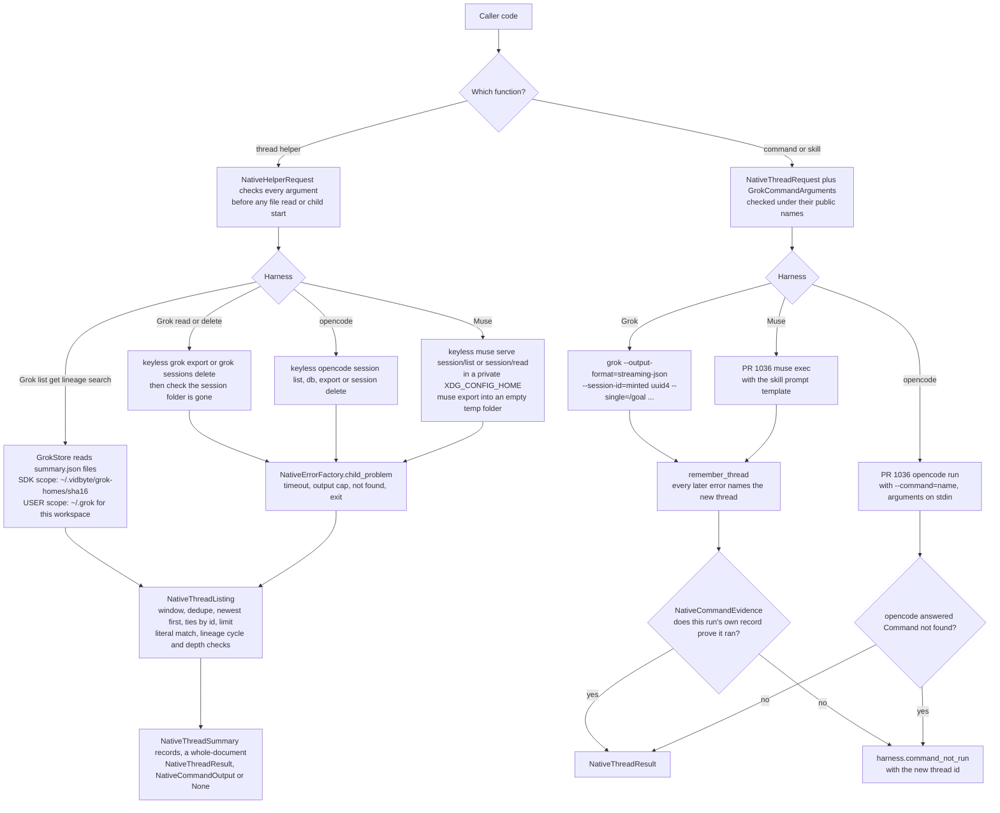

feat(harnesses): thread helpers and verified built-in skill functions for Grok, opencode and Muse
## Summary

PR #1036 gave `vidbyte.harnesses.native` nine functions that run, continue and fork Grok Build, opencode and Muse Code threads. This PR adds **47 more async functions** under the same naming, for 56 in all, plus 4 exported types and 4 failure codes. Spec: [`docs/spec/harness-thread-helpers-skills/spec.md`](docs/spec/harness-thread-helpers-skills/spec.md) (r5).

- **22 keyless thread helpers.** Grok and opencode get 8 each: `list_<h>_threads`, `list_recent_<h>_threads`, `list_<h>_threads_since`, `get_<h>_thread`, `read_<h>_thread`, `get_<h>_thread_lineage`, `search_<h>_threads` and `delete_<h>_thread`. Muse gets the first six. Every list, get and lineage helper returns the same `NativeThreadSummary(harness, thread_id, title, created_at, updated_at, parent_thread_id, model)`, so threads from different harnesses merge with one sort. Lists are newest first, ties go by id descending, and one thread id appears once. `read_<h>_thread` returns the whole vendor document as #1036's `NativeThreadResult`.
- **`init_muse_workspace(ws, dry_run=False)`** runs `muse init` and returns a `NativeCommandOutput`.
- **24 command and skill functions** take the caller's key:
  - Grok has 14: `run_grok_command` plus `run_grok_goal`, `_implement`, `_design`, `_execute_plan`, `_review`, `_code_review`, `_resume_claude`, `_resume_codex`, `_resume_cursor`, `_imagine`, `_imagine_video`, `_plan` and `_explore`.
  - opencode has 4: `run_opencode_command`, `_review`, `_init` and `_plan`.
  - Muse has 6: `run_muse_skill`, `_goal`, `_plan`, `_import`, `_scaffold` and `_browser_app`.
- **The rule that matters most:** a skill function returns only when that run's own record proves the command or skill ran. Each harness keeps a different record:
  - **Grok:** a streaming `tool_call` that loads the persona or `CORE.md`, `update_goal`, `image_gen` or `image_to_video`; `agent_name` in the new thread's `summary.json` for plan and explore; the Core Prompt fragment in the run's own keyless `grok export` for code-review.
  - **opencode:** opencode's own command dispatch.
  - **Muse:** the `toolCall` items of the run's own `session/read` history, in every history mode including the anchored snapshot served after a compaction. Message text never counts.

  Without that proof the call raises `<harness>.command_not_run`, carrying the new thread id. A slash command that does not expand otherwise fails silently, and the spec author confirmed this on Muse.
- **Helpers never get a key.** No helper has an `api_key` parameter, and every helper or evidence child has `XAI_API_KEY`, `GROK_CODE_XAI_API_KEY`, `OPENCODE_CONFIG_CONTENT` and `META_API_KEY` removed from its environment. Read helpers write nothing. They create no Grok home, and the Muse helpers delete their private config folder in `finally`.
- **New public names:** the types `NativeThreadSummary`, `NativeCommandOutput`, `GrokThreadScope` (`SDK`, which is the private home, or `USER`, which is `~/.grok` filtered to the workspace) and `GrokCommand`; and the failure codes `grok.command_not_run`, `opencode.command_not_run`, `muse.command_not_run` and `grok.store_unreadable`. The native `__all__` now has 68 names. The root `vidbyte.__all__` is unchanged.
- **Out of scope.** Codex has its own pipeline (PR #1055). Claude Code is excluded (spec §3).
- **Not live-tested.** Every vendor path here runs against offline stand-ins. The paid behaviour is checked by the **Manual QA** probe below, which the user has to run.

## How to use what this PR introduces

This is the spec §4 snippet, unchanged:

```python
import asyncio
from datetime import timedelta
from pathlib import Path

from vidbyte.harnesses.native import (
    NativeThreadError,
    get_grok_thread_lineage,
    list_grok_threads_since,
    list_recent_opencode_threads,
    run_grok_goal,
)


async def main() -> None:
    repo = Path.cwd()
    try:
        goal = await run_grok_goal("Make the auth test suite pass without changing public endpoints.", api_key="xai-your-key", workspace=repo)
    except NativeThreadError as error:
        print(error.failure_code.value, error.next_step)  # e.g. grok.command_not_run and what to do next
        return
    print(goal.thread_id, goal.text[:200])

    # Every list helper returns the same NativeThreadSummary, so a cross-harness view is one sort.
    day = [*await list_grok_threads_since(repo, timedelta(hours=24)), *await list_recent_opencode_threads(repo)]
    for thread in sorted(day, key=lambda summary: summary.updated_at, reverse=True):
        print(thread.harness.value, thread.updated_at.isoformat(), thread.thread_id, thread.title, thread.parent_thread_id)

    print([summary.thread_id for summary in await get_grok_thread_lineage(goal.thread_id, repo)])


asyncio.run(main())
```

This is the real output: the snippet was run as a subprocess, unchanged, by `test_harness_threads_acceptance_helpers.py::test_the_helpers_example_runs_as_written_against_stand_ins_on_path` (AC-1), with the test pack's stand-in `grok` and `opencode` first on `PATH`. It exited with code 0. The test passed (`1 passed in 1.11s`), and a scratch pytest plugin captured the stdout:

```text
0cea13c1-6be5-48f3-860b-723d3ee9e480 grok answer to: /goal Make the auth test suite pass without changing public endpoints.
grok 2026-10-16T18:06:19.945884+00:00 0cea13c1-6be5-48f3-860b-723d3ee9e480 /goal Make the auth test suite pass without changing public None
opencode 2026-10-16T16:06:19+00:00 ses_recentfix Fix flaky login test None
opencode 2026-10-15T12:06:19+00:00 ses_oldercache Refactor the cache None
['0cea13c1-6be5-48f3-860b-723d3ee9e480']
```

The output has three parts: the goal's thread id and answer, one newest-first line per Grok and opencode thread (harness, UTC time, id, title, parent), and the lineage, which ends with the goal's id. The stand-in made the times and ids, so a real run prints different ones.

## Flow



## What changed

77 files, measured against the merge base `8da41971`: 53 code, test and repo-doc files (+7,725 / −359), plus 24 files under `docs/spec/harness-thread-helpers-skills/`.

| Area | File | Lines | What |
|---|---|---|---|
| Grok | `vidbyte/harnesses/native/grok/helpers.py` | +292 | `GrokThreadHelpers` (8 helpers) and `GrokHelperRun` |
| Grok | `vidbyte/harnesses/native/grok/commands.py` | +321 | `GrokCommands` (14 functions) and `GrokCommandRun`: the slash line, minted `--session-id`, stream read, evidence |
| Grok | `vidbyte/harnesses/native/grok/store.py` | +251 | `GrokHome` (moved out of `GrokThreadRun`) and `GrokStore` (strict scans, one-file reads, layout guard); two blank lines between them (R-27, `25f36c6d`) |
| Grok | `grok/wire.py`, `grok/threads.py`, `grok/__init__.py` | +175/−10, +7/−58, +56/−6 | `GrokHelperWire`, `GrokStreamWire`; `threads.py` now uses `GrokHome` |
| opencode | `vidbyte/harnesses/native/opencode/helpers.py` | +257 | `OpencodeThreadHelpers` (8 helpers): `session list`, `db` by id, `export`, `session delete` |
| opencode | `vidbyte/harnesses/native/opencode/commands.py` | +112 | 4 functions through #1036's `OpencodeThreadRun.execute` with `--command` |
| opencode | `opencode/wire.py`, `opencode/threads.py`, `opencode/__init__.py` | +147/−9, +7/−4, +36/−6 | list, db and unknown-command readers |
| Muse | `vidbyte/harnesses/native/muse/helpers.py` | +355 | `MuseThreadHelpers` (6 helpers, `init_muse_workspace`) and the keyless evidence read |
| Muse | `vidbyte/harnesses/native/muse/commands.py` | +153 | 6 skill functions: the prompt template, #1036's exec run, then `session/read` items |
| Muse | `vidbyte/harnesses/native/muse/children.py` | +146 | `MuseChildren`, moved out of `MuseThreadRun`: private config, overlay, serve, reap |
| Muse | `muse/wire.py`, `muse/threads.py`, `muse/launcher.py`, `muse/__init__.py` | +159/−8, +18/−106, +5/−4, +38/−6 | `MuseSessionWire` (list, read and tool calls in every history mode) |
| Shared | `vidbyte/harnesses/native/hostkit/listing.py` | +75 | `NativeThreadListing`: cutoff, newest, matches, check_step (INV-7, INV-10) |
| Shared | `vidbyte/harnesses/native/hostkit/evidence.py` | +92 | `NativeCommandEvidence`: structural `require`, `require_value`, `require_text` |
| Shared | `hostkit/errors.py`, `hostkit/launcher.py`, `hostkit/__init__.py`, `native/__init__.py` | +54/−16, +7/−4, +5/−3, +107/−5 | `remember_thread` (D-34), `child_problem` (D-35); 68-name `__all__` |
| Library | `vidbyte/lib/constants/native_threads.py` | +417/−27 | every flag, pattern, limit, template, evidence row and error text (INV-15) |
| Library | `vidbyte/lib/dataclasses/native_threads.py`, `validation.py` | +381/−11, +23/−3 | `NativeThreadSummary`, `NativeCommandOutput`, `NativeHelperRequest`, `GrokCommandArguments` |
| Library | `vidbyte/lib/enums/native_threads.py`, `failure.py`, `__init__.py`; `lib/errors/base.py` | +147/−11, +4, +12, +1/−1 | `GrokThreadScope`, `GrokCommand`, operations, flags; 4 failure codes |
| Docs | `vidbyte/harnesses/README.md`, `REPO_MAP.md` | +4/−1, +1/−1 | native bullet extended; #1036's EC-44 sentence replaced by the verified EC-63 limitation; the thread-helpers bullet lists exactly the 22 helpers, and `init_muse_workspace` has its own sentence (R-26, `ccfe71ca`) |
| Tests | `tests/features/harness_threads/test_harness_threads_{acceptance_helpers, grok_commands, grok_helpers, helper_arguments, helper_bounds, helper_credentials, helper_surface, listing_properties, muse_commands, muse_helpers, opencode_commands, opencode_helpers}.py` | +2,825 | 12 new test files |
| Tests | `fake_harness_helpers.py` (new), `fake_harness.py`, `conftest.py`, `test_harness_threads_{errors, surface, static_policy}.py`, `FEATURE.md`, `README.md` | +618, +55/−16, +190/−6, +123/−29, +49/−8 | stand-ins in real vendor layouts; surface and errors pins (§13) |
| Spec | `docs/spec/harness-thread-helpers-skills/**` | 21 files | spec r5, test plan, review, verify log, stage reports, this body |

## Acceptance criteria → proof

Each row names one proving test, in `tests/features/harness_threads/test_harness_threads_<file>.py`, and the implementing SHAs that spec §6.2 records. §6.2 lists the twin tests for the other harnesses. I checked by name that 81 of §6.2's 83 test references exist in the pack. The other two are the r3/r4 AC-34 tests, which the spec marks as replaced.

| AC | Claim | Proof |
|---|---|---|
| AC-1 | §4 snippet runs as written | `acceptance_helpers::test_the_helpers_example_runs_as_written_against_stand_ins_on_path` · `509bc733` `8bcd9a5b` |
| AC-2 | lists obey INV-7 | `listing_properties::test_list_matches_the_inv7_oracle_for_generated_stores` · `76297896` `c89c0373` |
| AC-3 | recent/since equal the base list | `listing_properties::test_wrappers_equal_the_base_list_for_generated_stores` · `53a9c82a` |
| AC-4 | get maps §9.1; unknown is `thread_not_found` | `grok_helpers::test_get_maps_summary_json_and_an_unknown_id_is_thread_not_found` · `f3429925` |
| AC-5 | read returns the document whole | `muse_helpers::test_read_exports_into_an_empty_temp_folder_and_returns_the_file_whole` · `53a9c82a` |
| AC-6 | lineage root first; cycle is `protocol_mismatch` | `grok_helpers::test_lineage_cycle_and_a_chain_past_the_depth_cap_are_protocol_mismatch` · `76297896` |
| AC-7 | search is literal and case-insensitive | `listing_properties::test_search_matches_the_literal_case_insensitive_oracle` · `76297896` |
| AC-8 | delete returns `None`, checked on disk | `grok_helpers::test_delete_removes_the_session_folder_and_checks_that_it_is_gone` · `509bc733` |
| AC-9 | Grok SDK and USER scopes | `grok_helpers::test_sdk_scope_reads_the_private_home_and_user_scope_the_users_own_store` · `f3429925` |
| AC-10 | helper children carry no key | `helper_credentials::test_helper_children_carry_no_key_even_when_the_caller_has_one` · `509bc733` |
| AC-11 | read helpers write nothing | `helper_credentials::test_read_helpers_write_nothing_and_leave_no_temp_folder` · `f3429925` |
| AC-12 | bad arguments refused before any child | `helper_arguments::test_every_skill_function_refuses_its_invalid_arguments` · `dbcd8efd` `a8f6c179` |
| AC-13 | Grok argv, minted `--session-id`, `GROK_WORKFLOWS=0` for goal only | `grok_commands::test_each_command_function_sends_its_line_with_a_minted_session_id` · `30ff853e` |
| AC-14 | Grok evidence or `command_not_run` with the tools seen | `grok_commands::test_missing_evidence_is_command_not_run_with_the_minted_id_and_the_tools_seen` · `c12ce245` |
| AC-15 | plan/explore need `agent_name` | `grok_commands::test_agent_runs_need_the_agent_name_in_the_new_threads_summary` · `f3429925` |
| AC-16 | opencode `--command`, stdin arguments, unknown command | `opencode_commands::test_an_unknown_command_is_command_not_run` · `b8f0610c` `1282b712` |
| AC-17 | Muse `read_skill` exact `id` or `create_goal`; mode `none` fails closed | `muse_commands::test_a_read_skill_call_counts_only_when_its_parsed_id_is_the_skill` · `2ffcac65` `3fbe9568` |
| AC-18 | `init_muse_workspace` keyless | `muse_helpers::test_init_runs_muse_init_in_the_workspace_and_returns_its_stdout` · `53a9c82a` |
| AC-19 | bad vendor data is `protocol_mismatch`, never partial | `muse_helpers::test_unusable_session_shapes_are_protocol_mismatch_never_a_partial_list` · `6161a680` |
| AC-20 | exports, enum order, 148 + 4 codes, texts | `surface::test_native_package_exports_exactly_the_thread_functions_helpers_skills_and_their_records` · `ad12d7d2` |
| AC-21 | every #1036 test still passes | the 431 unedited #1036 tests pass in the pack run below · `e14eebaa` `fe00839d` |
| AC-22 | lint, `run_ci.py`, semgrep; baseline unchanged | gate: see **Verification** |
| AC-23 | cancel stops the child, reaps in WSL | `helper_bounds::test_cancelling_a_muse_helper_in_wsl_mode_reaps_with_its_mark` · `fe00839d` |
| AC-24 | an echoed key reaches no argv, file or error | `helper_credentials::test_an_echoed_key_reaches_no_error_text_argv_or_file_when_the_run_fails` · `a7a53747` |
| AC-25 | missing, batch, hung, flood, failure map to codes | `helper_bounds::test_a_hung_helper_child_is_timed_out_after_the_control_timeout` · `9b197327` |
| AC-26 | README and REPO_MAP; EC-44 sentence gone | review (S4) · `1e2192c8` `94870d71` |
| AC-27 | non-session files ignored; layout guard | `grok_helpers::test_store_whose_folders_all_lack_summary_json_is_a_layout_mismatch_after_the_grace_period` · `f3429925` |
| AC-28 | one-id reads ignore a corrupt sibling | `grok_helpers::test_one_id_operations_read_only_their_own_file_while_scans_stay_strict` · `f3429925` |
| AC-29 | Grok timeout and cap keep the minted id | `grok_commands::test_a_run_past_its_timeout_is_timed_out_with_the_minted_id` · `c12ce245` |
| AC-30 | `/imagine-video`, `/code-review` evidence; keyless export | `grok_commands::test_code_review_reads_its_own_export_through_a_keyless_child` · `30ff853e` |
| AC-31 | opencode get/lineage by `db` query | `opencode_helpers::test_lineage_follows_parent_id_through_subagent_children_lists_never_show` · `b8f0610c` |
| AC-32 | opencode scan cap is refused, never short | `opencode_helpers::test_list_asks_for_the_scan_cap_and_refuses_a_list_cut_at_it` · `9b197327` |
| AC-33 | `skills` folder named like the command refused | `grok_commands::test_a_skills_folder_named_like_the_command_is_refused_before_any_run` · `dbcd8efd` |
| AC-34 | after compaction only an anchored-snapshot `toolCall` counts | `muse_commands::test_after_compaction_text_or_a_call_outside_the_fold_is_command_not_run` · `f8c00aa7` |
| AC-35 | errors after a paid run carry the new id | `grok_commands::test_a_malformed_own_summary_after_the_run_keeps_the_minted_id` · `cdbbd72b` |

## Verification

All gates ran in the worktree with the branch venv (`-p no:cacheprovider`, no installs). The last source change is `25f36c6d` (R-27, one blank line). `ccfe71ca` (R-26) changed only `vidbyte/harnesses/README.md`. The commits after them change only `docs/`.

| Gate | Command | SHA | Result | Final lines |
|---|---|---|---|---|
| lint | `python lint/run.py` | `b89da0a7` (coordinator) | PASS | exit 0, `SDK-LINT: PASS` |
| full local gate | `python scripts/run_ci.py`, `PYTHONPATH` unset | `b89da0a7` (coordinator) | PASS | `6632 passed, 17 skipped in 141.62s` · `CI passed.` |
| lint | `python lint/run.py` | `ade57291`, `71c15a2c` | PASS | `SDK-LINT: PASS` (A001 642/642, A002 605/703); `lint/baseline.json` unchanged against main |
| test pack | `python -m pytest -p no:cacheprovider -q tests/features/harness_threads` | `f85d08af` (S6, `DEEPSEEK_API_KEY` set) | PASS | `1025 passed, 3 skipped in 90.41s (0:01:30)` |
| full local gate | `python scripts/run_ci.py` | `ade57291` | PASS | `6632 passed, 17 skipped in 138.65s (0:02:18)` · `Installed vidbyte-sdk 0.3.0 passed smoke checks.` · `CI passed.` |
| full local gate | `python scripts/run_ci.py` | `71c15a2c` (orchestrator) | PASS | `6632 passed, 17 skipped in 135.02s` · `CI passed.` |
| semgrep fixtures | `semgrep --test --config .semgrep/typed-mapping-boundary-policy.yml .semgrep/typed-mapping-boundary-policy.py` | `ade57291` | PASS | `1/1: ✓ All tests passed` |
| semgrep scan | `semgrep scan --error --config .semgrep/typed-mapping-boundary-policy.yml vidbyte` | `ade57291` | PASS | `Ran 1 rule on 975 files: 0 findings.` |
| §4 snippet | AC-1 test with stdout captured | `f85d08af` (S6) | PASS | `1 passed in 1.11s`; output above |
| probe dry run | `probe.py` below against the pack's stand-ins, with fake keys | `f85d08af` (S6) | exit 0 | 24 verdicts: 23 `HOLDS`, and A-28 `NOT EXERCISED` because the stand-in served inline history. A second run through the `wsl.exe` stand-in, serving `anchoredSnapshot`, gave all 5 Muse verdicts `HOLDS`, A-28 included. No fake key value appeared in any output or file |

Remote check-runs for `b89da0a7`, which was the PR head before this refresh (CI run 38952277689, Static policy run 38952280752):

| Check | Status | Conclusion | Final lines |
|---|---|---|---|
| Source / Python 3.11 | completed | success | `6580 passed, 69 skipped in 151.36s (0:02:31)` · `CI passed.` |
| Source / Python 3.12 | completed | success | `6580 passed, 69 skipped, 19 warnings in 155.17s (0:02:35)` · `CI passed.` |
| Package | completed | success | `Installed vidbyte-sdk 0.3.0 passed smoke checks.` · `CI passed.` |
| Static policy | completed | success | `1/1: ✓ All tests passed` · `Ran 1 rule on 975 files: 0 findings.` |

Source / Python 3.12 on `b89da0a7` passed on its second attempt, after one `gh run rerun --failed`. On the first attempt, the only failing test was `tests/features/coding_agent/test_coding_agent_environment.py::test_real_bash_reports_its_version_and_git`, which timed out on the runner ("bash did not finish within 15 seconds"). That test is outside this PR, and it passes locally.

The check-runs for this body's own commit, which changes only docs, are added to the PR description once the dispatched runs finish.

CI is dispatch-only on this repository. Both workflows were started with `gh workflow run ci.yml --ref feat/harness-thread-helpers-skills` and `gh workflow run static-policy.yml --ref feat/harness-thread-helpers-skills`.

## Manual QA

**This probe has not been run.** It needs real `XAI_API_KEY`, `META_API_KEY` and opencode provider keys, and it makes paid runs. The user has to run it before the PR merges. It covers spec §12.5 (a)–(g) through the SDK's own functions, in a fresh scratch git repository.

**Cost:**
- **Grok:** about 8 paid runs: 5 command functions, `run_grok_plan`, and one no-slash negative control.
- **Muse:** 2 paid runs (`run_muse_plan`, `run_muse_goal`), plus `PROBE_MUSE_COMPACT_TURNS` turns (default 3) to force a compaction.
- **opencode:** 1 unknown-command run, which opencode refuses at dispatch (A-15). The probe then deletes that run's session.

**How to run it:**
1. Save the block below as `probe.py` in the root of a checkout of this branch. Do not commit it.
2. Make sure your shell already has the keys. The script reads keys only from your environment.
3. Run it in your own shell:

```
! python probe.py
```

**Optional settings:**
- **Muse on Windows:** `PROBE_MUSE_DISTRO`, and `PROBE_MUSE_PATH` (default `/usr/local/bin/muse`). Elsewhere, `PROBE_MUSE_COMMAND`, or have `muse` on `PATH`.
- **opencode:** `PROBE_OPENCODE_KEY_VAR` (default `DEEPSEEK_API_KEY`), `PROBE_OPENCODE_MODEL` and `PROBE_OPENCODE_WORKSPACE`.
- **Grok USER scope:** `PROBE_GROK_USER_WORKSPACE`.
- **Sections and timeout:** `PROBE_SECTIONS` (default `abfg`) and `PROBE_TIMEOUT` (default 900).

**Key handling.** The probe never prints, logs or writes a key, and never puts one on argv.
- The Grok runs use the probe itself, in `--tee` mode, as the SDK's explicit `grok_command`. That way it can log the SDK's own argv, `GROK_HOME`, `GROK_WORKFLOWS` and the stream, with any key text redacted.
- Every raw vendor call that needs no key runs with all four key variables removed.

**Output.** The probe prints thread ids, tool names, failure codes and history modes, then one `HOLDS` / `FAILS` / `NOT EXERCISED` line per assumption. Each `FAILS` line says what to change:

| Item | Assumption settled | If it fails |
|---|---|---|
| a | A-25: `--session-id` with `--single`; `end.sessionId` is the minted id | D-29 flips back to r1 (no `--session-id`) |
| a | A-9 goal, and the no-slash negative control (A-7) | update `GROK_EVIDENCE_TOOLS[GOAL]`. If the control also calls `update_goal`, the evidence does not discriminate |
| a | A-26: bundled skills and personas resolve under a fresh private `GROK_HOME` | link the bundled skill cache into the private home |
| b | A-1, A-2: `sessions/<group>/<id>/summary.json` and its members | fix the layout and member constants that `GrokStore` / `GrokHelperWire.thread_file` use |
| b | A-4: the group folder is the URL-encoded cwd, or `.cwd` names it | USER scope misses threads; fix the group match |
| c | A-8: `tool_call` carries `toolName` and `rawInput`, plus an `end` event | update the `GROK_*_FIELD` constants |
| c | A-9 implement and imagine: a persona `read_file`, `image_gen` | update `GROK_EVIDENCE_FRAGMENTS` / `GROK_EVIDENCE_TOOLS` |
| c | A-24: `image_to_video` with the default `features.video_gen` | turn the feature on, or drop the default claim (EC-74) |
| c | A-27: the code-review fragment is in the run's own keyless `grok export` | D-28 flips; `run_grok_code_review` always raises `command_not_run` |
| d | A-10: `--agent plan` records `agent_name` | `run_grok_plan` / `_explore` always raise `command_not_run` |
| e | A-5, A-6: `grok export` and `sessions delete` under a private home | `read_grok_thread` raises `run_failed`; the delete post-check raises `run_failed` |
| f | A-12: `session list` rows have no `parentID` | change the opencode list reader |
| f | A-29: `db --format=json` with `OPENCODE_SESSION_QUERY` returns `parent_id` | change opencode get and lineage |
| f | A-13: `export` prints `{info, messages}` | none needed; `read_opencode_thread` returns the document whole |
| f | A-15: the unknown `--command` text | update `OPENCODE_COMMAND_NOT_FOUND_TEXT` |
| f | A-14: `session delete` is non-interactive | `delete_opencode_thread` raises `run_failed` |
| g | A-19: `muse init --dry-run` is keyless | `init_muse_workspace` raises `run_failed` |
| g | A-16, A-21: helpers see the SDK's threads despite the private config | drop the private config for the Muse helpers |
| g | A-18: `muse export --out` writes JSON with no key | `read_muse_thread` raises `run_failed` / `protocol_mismatch` |
| g | **A-17:** a `read_skill` `args` object's `id` member is the skill id | **change `MUSE_READ_SKILL_ID_MEMBER`** to the member the probe prints |
| g | **A-28:** after a real compaction the mode is `anchoredSnapshot`, and `history.snapshot.state.items` still holds the early `read_skill` / `create_goal` `toolCall` and the messages before the boundary | **D-33 flips to `view/page`**. `NOT EXERCISED` means no compaction happened: raise the turns or lower `PROBE_MUSE_COMPACT_ARGS` |

<details>
<summary><code>probe.py</code> (complete; every function it calls exists with this signature on this branch)</summary>

```python
"""probe.py: paid manual QA for PR #1147, spec section 12.5 items a to g (settings: see the PR body).

Keys come only from your environment (XAI_API_KEY, META_API_KEY, and the opencode key named by
PROBE_OPENCODE_KEY_VAR). The script never prints, logs or writes a key and never puts one on argv.
"""

import asyncio
import json
import os
import re
import shlex
import shutil
import subprocess
import sys
import tempfile
import urllib.parse
import uuid
from pathlib import Path, PureWindowsPath

KEY_VARS = ("XAI_API_KEY", "GROK_CODE_XAI_API_KEY", "META_API_KEY", "OPENCODE_CONFIG_CONTENT")
SHOWN_ENV = ("GROK_HOME", "GROK_WORKFLOWS", "GROK_DISABLE_AUTOUPDATER")


def tee_main(log_path: str, program: str, *args: str) -> int:
    # Launcher mode: the SDK starts `python probe.py --tee <log> <grok> ...` as its grok, so
    # the run uses the SDK's own argv and environment; the stream is copied, key redacted.
    key = os.environ.get("XAI_API_KEY", "")
    clean = (lambda text: text.replace(key, "<XAI_API_KEY>")) if key else (lambda text: text)
    header = {"argv": [clean(a) for a in (program, *args)], "env": {n: os.environ.get(n) for n in SHOWN_ENV}, "keys": {n: n in os.environ for n in KEY_VARS[:2]}}
    with open(log_path, "a", encoding="utf-8") as log:
        log.write(json.dumps({"__probe__": header}) + "\n")
        child = subprocess.Popen([program, *args], stdout=subprocess.PIPE)
        for raw in child.stdout:
            sys.stdout.buffer.write(raw)
            sys.stdout.buffer.flush()
            log.write(clean(raw.decode("utf-8", "replace")))
        return child.wait()


if len(sys.argv) > 2 and sys.argv[1] == "--tee":
    sys.exit(tee_main(*sys.argv[2:]))

from vidbyte.harnesses.native import (  # noqa: E402
    GrokPermissionMode, GrokThreadConfig, GrokThreadScope, MuseThreadConfig, NativeThreadError,
    delete_grok_thread, delete_opencode_thread, get_grok_thread, get_opencode_thread, get_opencode_thread_lineage,
    init_muse_workspace, list_recent_grok_threads, list_recent_muse_threads, list_recent_opencode_threads,
    read_grok_thread, read_muse_thread, run_grok_code_review, run_grok_goal, run_grok_imagine,
    run_grok_imagine_video, run_grok_implement, run_grok_plan, run_muse_goal, run_muse_plan, run_opencode_command,
)
from vidbyte.harnesses.native.muse.launcher import MusePathTranslator  # noqa: E402
from vidbyte.harnesses.native.muse.wire import MuseSessionWire, MuseWire  # noqa: E402
from vidbyte.lib.constants import native_threads as C  # noqa: E402
from vidbyte.lib.enums.native_threads import MuseMethod  # noqa: E402

SECTIONS = os.environ.get("PROBE_SECTIONS", "abfg")
TIMEOUT = float(os.environ.get("PROBE_TIMEOUT", "900"))
PROBE = str(Path(__file__).resolve())
VERDICTS: list[str] = []


def verdict(assumption: str, held: bool | None, evidence: str, if_wrong: str = "") -> None:
    state = "NOT EXERCISED" if held is None else ("HOLDS" if held else "FAILS")
    line = f"{assumption}: {state} - {evidence}" + (f" -> {if_wrong}" if held is False and if_wrong else "")
    VERDICTS.append(line)
    print("  " + line)


def json_lines(text: str) -> list[dict]:
    found = []
    for line in text.splitlines():
        try:
            value = json.loads(line)
        except ValueError:
            continue
        if isinstance(value, dict):
            found.append(value)
    return found


def invocations(log: Path) -> list[dict]:
    # Each SDK child the tee saw: its argv, shown env and stream events.
    runs: list[dict] = []
    for line in log.read_text(encoding="utf-8").splitlines() if log.exists() else []:
        value = json_lines(line)
        if value and "__probe__" in value[0]:
            runs.append({**value[0]["__probe__"], "events": [], "text": ""})
        elif runs:
            runs[-1]["events"].extend(value)
            runs[-1]["text"] += line + "\n"
    return runs


def option(argv: list[str], flag: str) -> str | None:
    return next((a.split("=", 1)[1] for a in argv if a.startswith(flag + "=")), None)


def tools(events: list[dict]) -> list[str]:
    calls = [e.get(C.GROK_TOOL_NAME_FIELD) for e in events if e.get(C.GROK_TYPE_FIELD) == "tool_call"]
    return list(dict.fromkeys(str(name) for name in calls))


def report_error(name: str, error: NativeThreadError) -> None:
    print(f"  {name}: {error.failure_code.value} thread_id={error.thread_id}")
    print(f"    cause: {error.likely_cause[:160]}")


def scratch_repo() -> Path:
    # A fresh git repo, so the Grok private home is fresh (A-26) and /code-review has a branch.
    ws = Path(tempfile.mkdtemp(prefix="vidbyte-probe-")).resolve()
    git = ["git", "-c", "user.name=probe", "-c", "user.email=probe@example.invalid"]
    (ws / "app.py").write_text("def hello():\n    return 'hi'\n", encoding="utf-8")
    for step in (["init", "-q", "-b", "main"], ["add", "."], ["commit", "-qm", "init"], ["checkout", "-qb", "probe"]):
        subprocess.run([*git, *step], cwd=ws, check=True)
    (ws / "app.py").write_text("def hello():\n    return 'hi'\n\n\ndef div(a, b):\n    return a / b\n", encoding="utf-8")
    subprocess.run([*git, "commit", "-qam", "add div"], cwd=ws, check=True)
    return ws


def find_grok() -> str | None:
    # The SDK's order: grok on PATH unless it is a batch file, then ~/.grok/bin.
    found = shutil.which("grok")
    found = None if found and found.lower().endswith((".cmd", ".bat")) else found
    fallback = Path.home() / ".grok" / "bin" / ("grok.exe" if sys.platform == "win32" else "grok")
    return found or (str(fallback) if fallback.is_file() else None)


async def grok_call(ctx: dict, label: str, call, *, edits: bool = False) -> dict:
    log = ctx["logs"] / f"{label}.jsonl"
    mode = GrokPermissionMode.ACCEPT_EDITS if edits else GrokPermissionMode.DEFAULT
    config = GrokThreadConfig(permission_mode=mode, timeout_seconds=TIMEOUT, grok_command=(sys.executable, PROBE, "--tee", str(log), ctx["grok"]))
    outcome: dict = {"label": label}
    try:
        result = await call(config)
        outcome.update(ok=True, thread_id=result.thread_id)
        print(f"  {label}: ok thread_id={result.thread_id}")
    except NativeThreadError as error:
        outcome.update(ok=False, thread_id=error.thread_id, code=error.failure_code.value)
        report_error(label, error)
    runs = invocations(log)
    outcome["runs"] = runs
    if runs:
        first = runs[0]
        line = option(first["argv"], "--single") or ""
        print(f"    --single={line[:70]!r} streaming={'--output-format=streaming-json' in first['argv']} session-id={option(first['argv'], '--session-id')}")
        print(f"    GROK_HOME={first['env']['GROK_HOME']} GROK_WORKFLOWS={first['env']['GROK_WORKFLOWS']} key vars set={first['keys']}")
        print(f"    event types={sorted({str(e.get(C.GROK_TYPE_FIELD)) for e in first['events']})} tools={tools(first['events'])}")
        sample = next((e for e in first["events"] if e.get(C.GROK_TYPE_FIELD) == "tool_call"), None)
        print(f"    tool_call members={sorted(sample) if sample else None}")
    return outcome


async def section_grok(ctx: dict) -> None:
    key, ws = os.environ.get("XAI_API_KEY"), ctx["ws"]
    ctx["grok"] = find_grok()
    if not key or not ctx["grok"]:
        print("[a-e] skipped: XAI_API_KEY or grok is missing")
        return
    print(f"[a] Grok command functions in fresh workspace {ws}")
    goal = await grok_call(ctx, "goal", lambda c: run_grok_goal("Add a docstring to hello in app.py, then mark the goal met.", api_key=key, workspace=ws, config=c), edits=True)
    impl = await grok_call(ctx, "implement", lambda c: run_grok_implement("Add a function add(a, b) to app.py.", api_key=key, workspace=ws, config=c), edits=True)
    image = await grok_call(ctx, "imagine", lambda c: run_grok_imagine("A small red square on a white background.", api_key=key, workspace=ws, config=c))
    video = await grok_call(ctx, "imagine_video", lambda c: run_grok_imagine_video("A small red square slides from left to right.", api_key=key, workspace=ws, config=c))
    review = await grok_call(ctx, "code_review", lambda c: run_grok_code_review(api_key=key, workspace=ws, config=c))
    ctx["goal"] = goal
    first = goal["runs"][0] if goal["runs"] else None
    if first:
        ends = [e.get(C.GROK_SESSION_FIELD) for e in first["events"] if e.get(C.GROK_TYPE_FIELD) == "end"]
        verdict("A-25", bool(ends) and ends[-1] == option(first["argv"], "--session-id"), f"end.sessionId={ends[-1] if ends else None}", "D-29 flips back to r1 (no --session-id)")
        calls = [e for e in first["events"] if e.get(C.GROK_TYPE_FIELD) == "tool_call"]
        verdict("A-8", bool(calls) and bool(ends) and all(C.GROK_TOOL_NAME_FIELD in e and C.GROK_RAW_INPUT_FIELD in e for e in calls), f"{len(calls)} tool_call events with toolName and rawInput, {len(ends)} end", "update the GROK_*_FIELD constants")
        verdict("A-9 goal", "update_goal" in tools(first["events"]), f"tools={tools(first['events'])}", "update GROK_EVIDENCE_TOOLS[GOAL]")
        # Negative control: the same argv and environment, the goal line without its slash.
        argv = [("--single=" + option(first["argv"], "--single")[1:]) if a.startswith("--single=") else a for a in first["argv"]]
        argv = [f"--session-id={uuid.uuid4()}" if a.startswith("--session-id=") else a for a in argv]
        env = {**os.environ, **{n: v for n, v in first["env"].items() if v is not None}, "GROK_CODE_XAI_API_KEY": key}
        done = subprocess.run(argv, cwd=ws, env=env, stdin=subprocess.DEVNULL, capture_output=True, text=True, encoding="utf-8", errors="replace", timeout=TIMEOUT)
        control = tools(json_lines(done.stdout))
        ctx["control_id"] = option(argv, "--session-id")
        verdict("negative control", "update_goal" not in control, f"no-slash goal exit={done.returncode} tools={control}", "the update_goal evidence does not discriminate (A-7/A-9)")
    if impl["runs"]:
        raw = [e.get(C.GROK_RAW_INPUT_FIELD) for e in impl["runs"][0]["events"] if e.get(C.GROK_TOOL_NAME_FIELD) == "read_file"]
        reads = [re.sub(C.NATIVE_BACKSLASH_RUN_PATTERN, C.NATIVE_FORWARD_SLASH, r if isinstance(r, str) else json.dumps(r)) for r in raw]
        verdict("A-9 implement", any(C.GROK_IMPLEMENTER_PERSONA in r for r in reads), f"read_file inputs={[r[-60:] for r in reads][:4]}", "update GROK_EVIDENCE_FRAGMENTS")
        home = Path(impl["runs"][0]["env"]["GROK_HOME"])
        personas = [str(p.relative_to(home)) for p in home.rglob("implementer.md")][:3]
        verdict("A-26", impl.get("ok") or bool(personas), f"implement ok={impl.get('ok')} personas under private home={personas}", "link the bundled skill cache into the private home")
    verdict("A-9 imagine", image.get("ok"), f"tools={tools(image['runs'][0]['events']) if image['runs'] else None}")
    verdict("A-24", video.get("ok"), f"code={video.get('code')} tools={tools(video['runs'][0]['events']) if video['runs'] else None}", "turn on features.video_gen or drop the default claim (EC-74)")
    export = review["runs"][1] if len(review["runs"]) > 1 else None
    verdict("A-27", review.get("ok"), f"export child={export['argv'][1:3] if export else None} keys={export['keys'] if export else None} fragment in export={bool(export) and C.GROK_CODE_REVIEW_FRAGMENT in export['text']}", "D-28 flips; run_grok_code_review always command_not_run")


async def section_grok_store(ctx: dict) -> None:
    goal, ws, key = ctx.get("goal"), ctx["ws"], os.environ.get("XAI_API_KEY")
    if not goal or not goal["runs"]:
        print("[b,d,e] skipped: no Grok goal run")
        return
    home = Path(goal["runs"][0]["env"]["GROK_HOME"])
    print(f"[b] summary.json in {home}")
    files = list((home / "sessions").glob(f"*/{goal['thread_id']}/summary.json"))
    if files:
        data = json.loads(files[0].read_text(encoding="utf-8"))
        group = files[0].parent.parent
        print(f"    members={ {k: type(v).__name__ for k, v in data.items()} }")
        print(f"    created_at={data.get('created_at')!r} updated_at={data.get('updated_at')!r}")
        verdict("A-4", os.path.normcase(urllib.parse.unquote(group.name)) == os.path.normcase(str(ws)) or (group / ".cwd").is_file(), f"group={group.name[:60]} cwd file={(group / '.cwd').is_file()}")
    verdict("A-1/A-2", bool(files), f"files={len(files)}", "fix the layout constants in GrokStore / GrokHelperWire.thread_file")
    try:
        summary = await get_grok_thread(goal["thread_id"], ws)
        print(f"    get_grok_thread -> updated_at={summary.updated_at.isoformat()} title={(summary.title or '')[:50]!r} model={summary.model}")
    except NativeThreadError as error:
        report_error("get_grok_thread", error)
    user_ws = os.environ.get("PROBE_GROK_USER_WORKSPACE")
    if user_ws:
        listed = await list_recent_grok_threads(user_ws, limit=5, scope=GrokThreadScope.USER)
        verdict("A-4 USER scope", bool(listed), f"{len(listed)} threads in ~/.grok for {user_ws}")
    print("[d] --agent plan")
    plan = await grok_call(ctx, "plan", lambda c: run_grok_plan("List the files here and propose one small change.", api_key=key, workspace=ws, config=c))
    plan_id = option(plan["runs"][0]["argv"], "--session-id") if plan["runs"] else None
    found = list((home / "sessions").glob(f"*/{plan_id}/summary.json")) if plan_id else []
    agent = json.loads(found[0].read_text(encoding="utf-8")).get(C.GROK_AGENT_NAME_FIELD) if found else None
    verdict("A-10", agent == "plan", f"agent_name={agent!r}", "run_grok_plan/explore always command_not_run")
    print("[e] grok export and sessions delete under the private home")
    try:
        document = await read_grok_thread(goal["thread_id"], ws)
        verdict("A-5", bool(document.text), f"{len(document.text)} chars, first line={document.text.splitlines()[0][:60] if document.text else ''!r}")
    except NativeThreadError as error:
        report_error("read_grok_thread", error)
    control = ctx.get("control_id")
    if control and list((home / "sessions").glob(f"*/{control}/summary.json")):
        try:
            await delete_grok_thread(control, ws)
            await get_grok_thread(control, ws)
            verdict("A-6", False, "the thread still reads after delete")
        except NativeThreadError as error:
            verdict("A-6", error.failure_code.value == "grok.thread_not_found", f"after delete: {error.failure_code.value}")


def keyless_env(extra: dict) -> dict:
    return {**{n: v for n, v in os.environ.items() if n not in KEY_VARS}, **extra}


async def section_opencode(ctx: dict) -> None:
    opencode, ws = shutil.which("opencode"), Path(os.environ.get("PROBE_OPENCODE_WORKSPACE", os.getcwd())).resolve()
    if not opencode:
        print("[f] skipped: opencode is not on PATH")
        return
    print(f"[f] opencode in {ws}")
    env = keyless_env({"OPENCODE_DISABLE_AUTOUPDATE": "1", "PWD": str(ws)})

    def run(*args: str) -> object:
        done = subprocess.run([opencode, *args], cwd=ws, env=env, capture_output=True, text=True, encoding="utf-8", errors="replace", timeout=60)
        return json.loads(done.stdout) if done.stdout.strip() else []

    rows = run("session", "list", "--format=json", "--max-count=5")
    keys = sorted({k for row in rows for k in row})
    verdict("A-12", ("parentID" not in keys) if rows else None, f"{len(rows)} rows, members={keys}")
    child_rows = run("db", "--format=json", "SELECT id FROM session WHERE parent_id IS NOT NULL ORDER BY time_updated DESC LIMIT 1")
    child = child_rows[0]["id"] if child_rows else None
    if child and re.fullmatch(C.NATIVE_THREAD_ID_PATTERN, child):
        rows_by_id = run("db", "--format=json", C.OPENCODE_SESSION_QUERY.format(thread_id=child))
        verdict("A-29", len(rows_by_id) == 1 and rows_by_id[0].get("parent_id") is not None, f"members={sorted(rows_by_id[0]) if rows_by_id else None}")
        summary = await get_opencode_thread(child, ws)
        chain = await get_opencode_thread_lineage(child, ws)
        print(f"    get -> parent={summary.parent_thread_id}; lineage={[s.thread_id for s in chain]}")
    else:
        verdict("A-29", None, "no subagent child session in this opencode database")
    recent = await list_recent_opencode_threads(ws, limit=5)
    print(f"    list_recent_opencode_threads -> {[s.thread_id for s in recent]}")
    if rows:
        exported = run("export", rows[0]["id"])
        verdict("A-13", isinstance(exported, dict) and "info" in exported, f"top-level={sorted(exported) if isinstance(exported, dict) else type(exported).__name__}")
    key = os.environ.get(os.environ.get("PROBE_OPENCODE_KEY_VAR", "DEEPSEEK_API_KEY"))
    if key:
        model = os.environ.get("PROBE_OPENCODE_MODEL", "deepseek/deepseek-v4-pro")
        try:
            await run_opencode_command("vidbyte-probe-no-such-command", api_key=key, workspace=ctx["ws"], model=model)
            verdict("A-15", False, "an unknown command returned a result")
        except NativeThreadError as error:
            verdict("A-15", error.failure_code.value == "opencode.command_not_run", f"{error.failure_code.value} thread_id={error.thread_id}: {(error.vendor_message or '')[:80]!r}", "update OPENCODE_COMMAND_NOT_FOUND_TEXT")
            if not error.thread_id:
                verdict("A-14", None, "the refused command left no session of its own to delete")
                return
            try:  # delete only the session this probe just made
                await delete_opencode_thread(error.thread_id, ctx["ws"])
                await get_opencode_thread(error.thread_id, ctx["ws"])
                verdict("A-14", False, "the session still reads after delete")
            except NativeThreadError as gone:
                verdict("A-14", gone.failure_code.value == "opencode.thread_not_found", f"after delete: {gone.failure_code.value}")


def muse_setup() -> tuple[list[str] | None, MuseThreadConfig, bool]:
    distro, explicit = os.environ.get("PROBE_MUSE_DISTRO"), os.environ.get("PROBE_MUSE_COMMAND")
    if sys.platform == "win32" and distro:
        path = os.environ.get("PROBE_MUSE_PATH", C.MUSE_DEFAULT_PATH)
        wsl = shutil.which(C.WSL_PROGRAM) or C.WSL_PROGRAM  # PATH, as the SDK finds it
        return [wsl, "-d", distro, "-e", path], MuseThreadConfig(wsl_distro=distro, muse_path=path), True
    if explicit:
        return [explicit], MuseThreadConfig(muse_command=(explicit,)), False
    found = shutil.which("muse") if sys.platform != "win32" else None
    return ([found] if found else None), MuseThreadConfig(), False


def serve_read(prefix: list[str], ws: Path, thread_id: str) -> dict:
    # The same keyless session/read {excludeItems: false} batch the SDK's evidence read sends.
    frames = MuseWire.batch_frames(MuseMethod.SESSION_READ, MuseSessionWire.read_items_params(thread_id))
    done = subprocess.run([*prefix, "serve"], input=frames, cwd=ws, env=keyless_env({}), capture_output=True, text=True, encoding="utf-8", errors="replace", timeout=60)
    answer = next((f for f in json_lines(done.stdout) if f.get("id") == C.MUSE_SESSION_REQUEST_ID), {})
    return answer.get("result") or {"error": answer.get("error")}


def items_of(result: dict) -> tuple[str | None, list[dict]]:
    history = result.get("history") or {}
    mode = history.get("mode")
    items = history.get("items") if mode == "inline" else ((history.get("snapshot") or {}).get("state") or {}).get("items")
    return mode, [i for i in (items or []) if isinstance(i, dict)]


def skill_reads(items: list[dict], skill: str) -> tuple[bool, list[str]]:
    hit, members = False, []
    for item in items:
        if item.get("kind") == "toolCall" and item.get("tool") == "read_skill":
            args = item.get("args")
            try:
                parsed = json.loads(args) if isinstance(args, str) else args
            except ValueError:
                parsed = None
            if isinstance(parsed, dict):
                members += [k for k, v in parsed.items() if v == skill]
                hit = hit or parsed.get(C.MUSE_READ_SKILL_ID_MEMBER) == skill
    return hit, members


async def section_muse(ctx: dict) -> None:
    key, ws = os.environ.get("META_API_KEY"), ctx["ws"]
    prefix, config, wsl = muse_setup()
    if not key or not prefix:
        print("[g] skipped: META_API_KEY or muse (PROBE_MUSE_DISTRO on Windows) is missing")
        return
    print(f"[g] Muse in {ws}")
    try:
        init = await init_muse_workspace(ws, dry_run=True, config=config)
        verdict("A-19", True, f"init --dry-run printed {len(init.text.splitlines())} lines")
    except NativeThreadError as error:
        verdict("A-19", False, error.failure_code.value)
    ids = {}
    for label, call in (("plan", lambda: run_muse_plan("Outline three steps to add a README. Do not edit files.", api_key=key, workspace=ws, config=config)), ("goal", lambda: run_muse_goal("Say done, then mark the goal met.", api_key=key, workspace=ws, config=config))):
        try:
            ids[label] = (await call()).thread_id
            print(f"  run_muse_{label}: ok thread_id={ids[label]}")
        except NativeThreadError as error:
            ids[label] = error.thread_id
            report_error(f"run_muse_{label}", error)
    listed = await list_recent_muse_threads(ws, config=config)
    made = [i for i in ids.values() if i]
    verdict("A-16/A-21", all(i in {s.thread_id for s in listed} for i in made) if made else None, f"listed={[s.thread_id for s in listed]}", "drop the private config for helpers")
    plan_id = ids.get("plan")
    if not plan_id:
        return
    try:
        document = await read_muse_thread(plan_id, ws, config=config)
        exported = None if document.text_truncated else json.loads(document.text)
        verdict("A-18", isinstance(exported, dict) if exported is not None else None, f"truncated={document.text_truncated} export top-level={sorted(exported) if isinstance(exported, dict) else None}")
    except (NativeThreadError, ValueError) as error:
        verdict("A-18", False, type(error).__name__)
    visible = MusePathTranslator.to_wsl(PureWindowsPath(ws)) if wsl else str(ws)
    mode, items = items_of(serve_read(prefix, ws, plan_id))
    hit, members = skill_reads(items, "bundled:plan")
    print(f"    mode={mode} items={[(i.get('kind'), i.get('tool')) for i in items][:20]}")
    verdict("A-17", hit, f"read_skill members equal to the skill id={members}", f"set MUSE_READ_SKILL_ID_MEMBER to {members[:1]}")
    # A-28: compact the plan thread on purpose, then read it back.
    run = subprocess.run([*prefix, "exec", "--help"], env=keyless_env({}), capture_output=True, text=True, encoding="utf-8", errors="replace", timeout=60)
    print("    exec help:", [line.strip() for line in run.stdout.splitlines() if "compact" in line.lower()][:4])
    extra = shlex.split(os.environ.get("PROBE_MUSE_COMPACT_ARGS", "--context-compaction-soft-threshold 2000 --context-compaction-hard-threshold 4000"))
    env = {**os.environ, "WSLENV": ":".join(filter(None, (os.environ.get("WSLENV"), "META_API_KEY/u")))} if wsl else dict(os.environ)
    for turn in range(int(os.environ.get("PROBE_MUSE_COMPACT_TURNS", "3"))):
        filler = f"Turn {turn}: restate the whole plan in full detail. " + "Explain every step again with examples. " * 80
        argv = [*prefix, "exec", "--json", "--provider", C.MUSE_PROVIDER, "--workspace", visible, "--session-id", plan_id, *extra, "--user-input-auto-resolve", "--", filler]
        done = subprocess.run(argv, cwd=ws, env=env, stdin=subprocess.DEVNULL, capture_output=True, text=True, encoding="utf-8", errors="replace", timeout=TIMEOUT)
        print(f"    compaction turn {turn}: exit={done.returncode} {done.stderr.replace(key, '<META_API_KEY>')[-120:]!r}")
    result = serve_read(prefix, ws, plan_id)
    mode, items = items_of(result)
    snapshot = (result.get("history") or {}).get("snapshot") or {}
    print(f"    mode={mode} snapshot.viewCursor={snapshot.get('viewCursor')} anchor.boundaryCursor={(snapshot.get('anchor') or {}).get('boundaryCursor')} read viewCursor={result.get('viewCursor')}")
    print(f"    items={[(i.get('kind'), i.get('tool')) for i in items]}")
    hit, _members = skill_reads(items, "bundled:plan")
    kinds = [i.get("kind") for i in items]
    early = "compaction" in kinds and "userMessage" in kinds[: kinds.index("compaction")]
    verdict("A-28", hit and early if mode == "anchoredSnapshot" else None, f"mode={mode} early read_skill kept={hit} messages before boundary={early}", "D-33 flips to view/page")


async def main() -> None:
    ctx = {"ws": scratch_repo(), "logs": Path(tempfile.mkdtemp(prefix="vidbyte-probe-logs-"))}
    for letter, section in (("a", section_grok), ("b", section_grok_store), ("f", section_opencode), ("g", section_muse)):
        if letter in SECTIONS:
            try:
                await section(ctx)
            except Exception as error:  # a probe keeps going and says where it stopped
                print(f"[{letter}] stopped: {type(error).__name__}: {str(error)[:200]}")
    print("\nVerdicts:\n  " + "\n  ".join(VERDICTS))
    print(f"\nScratch workspace {ctx['ws']} and its Grok home under ~/.vidbyte/grok-homes/ can be deleted.")


asyncio.run(main())
```

</details>

I checked the probe in two independent ways, neither of which uses a real key or a real vendor CLI:
- **Signatures.** `inspect.signature(...).bind` succeeded for all 20 SDK functions it calls and for both config records, and every internal it uses exists: `MuseWire.batch_frames`, `MuseSessionWire.read_items_params`, `MusePathTranslator.to_wsl` and the `C.*` constants.
- **Dry run.** It ran end to end against the pack's stand-ins (`conftest.Sandbox`) with fake keys. `PATH`, `HOME`, `USERPROFILE` and `TMP` all pointed into the sandbox. The run exited 0, and no fake key value appeared in stdout, in stderr or in any file under the sandbox.

## Adversarial review

The S4 review ([`review.md`](docs/spec/harness-thread-helpers-skills/review.md)) used three lenses (conformance, engineering and conventions) plus a verifier. Its verdict was *mergeable after fixes*. It confirmed 6 must-fix findings, refuted or downgraded 7, and listed 21 minors. The S5 re-review returned SOUND at `578c88bb`, with 0 Blocker, 0 Major and 2 Minor findings (R-24 and R-25, both fixed). Repair iteration 3 fixed R-26 and R-27, the two open items from the S6 PR author.

| ID | Severity | Finding | Fix |
|---|---|---|---|
| R-1 | Blocker | seven new comment lines ran past 72 columns (`comment-format.md`) | `3a1dc4b1` |
| R-2 | Blocker | Muse `anchoredSnapshot` evidence was a substring search of the export, which always holds the SDK's own prompt (`create_goal`) | `f8c00aa7`: structural `toolCall` items from `history.snapshot.state.items` (D-33 r5) |
| R-3 | Major | `search_grok_threads` matched before it deduped, so it could return a stale duplicate | `844583d0` |
| R-4 | Major | the pack was not hermetic: a developer's `DEEPSEEK_API_KEY` broke ten assertions | `228b2a9e` (the test fixture clears `CREDENTIAL_NAMES`) |
| R-5 | Major | errors raised after the paid run dropped the new thread id | `cdbbd72b` (`NativeErrorFactory.remember_thread`, AC-35) |
| R-6 | Major | the child-outcome mapping was copied five more times | `53bca187` (`NativeErrorFactory.child_problem`, D-35) |

These minors were also fixed:
- R-7: spec text, `SDK-LINT`, fixed in spec r4.
- R-10 `b27a2ff7`: the evidence dispatch ends in `else:`.
- R-11 `8953669d`.
- R-15 `94cf9d9a`: an `OverflowError` on a garbled time is now `protocol_mismatch`.
- R-16 `3b1ab656`.
- R-17 `27765710`: Muse export `OSError`.
- R-21, trivial part `42de68f5`.
- R-23 `3fbe9568`: an exact `read_skill` `id`, not a substring.
- R-24 `ade57291`.
- R-25 `3c114e7b`.
- R-26 `ccfe71ca`: the README thread-helpers bullet lists exactly the 22 helpers.
- R-27 `25f36c6d`: two blank lines between `GrokHome` and `GrokStore`.

## Deviations from the spec

None changes a public signature. The §4 snippet runs as written.

1. **Shared plumbing outside the letter of §8.5 / §9 / §12.3** (spec §17, S3 items 1, 2, 4, 5, 6 and 10), for example:
   - `MuseSessionWire.result` takes `method` and `thread_id` keywords.
   - `GrokHelperWire.document` takes `thread_id`, so code-review export errors carry the minted id.
   - `NativeThreadListing.newest` takes `limit: int | None`.
   - There are extra internal helpers (`GrokStore.home`, `GrokCommandRun.line`, …).
   - The generic `_call`s return `Any`, because INV-15 allows no module-level `TypeVar`.
   - `GrokCommands._call` fills `skill_names` with `dataclasses.replace`.
2. **Every helper and evidence child removes all four key variables** (`NATIVE_HELPER_REMOVED_VARIABLES`), not only its own harness's. §9.2 still says "both key variables" / `META_API_KEY` for some children. The code is stricter than the text (S3 item 3).
3. **Muse lists ask `session/list` for `NATIVE_LIST_MAX_LIMIT` and cut in the SDK,** because Muse orders ties by ascending id (S3 item 7, Muse half). The Grok half of S3's item 7, "search matches before the dedupe", was reversed by R-3: search now dedupes first, as INV-7 says.
4. **Constants beyond §12.3 row 4** (`NATIVE_SINCE_MIN`, `GROK_MAX_EFFORTS`, `OPENCODE_SESSION_QUERY_MAX_ROWS`, …). The `MUSE_GOAL_PROMPT_TEMPLATE` wording is the implementer's (S3 item 8).
5. **`NativeEnvironmentVariable.PWD = auto()`,** because a literal `"PWD"` reads to bandit S105 as a password. Grok's `end.sessionId` is compared with the minted id case-insensitively (S3 item 9).
6. **The spec moved while the work happened.** D-33's Muse post-compaction evidence was "the export transcript" in r3/r4. The orchestrator then probed a real Muse 1.0.1 and found its export has no top-level `items`, so r5 replaced that rule with `history.snapshot.state.items`. The two r3/r4 AC-34 tests were replaced by S2. This is a spec revision, not a code deviation, and A-28 in the probe checks it against a real compaction.
7. **Environment only.** Semgrep ran from an isolated venv pinned to CI's `semgrep==1.170.1`, because the global semgrep is broken by mcp 2.x. S3 item 11 was resolved by spec r4 (R-7). S3 item 13, which ran the pack with `DEEPSEEK_API_KEY` unset, no longer applies after R-4: the pack passes with it set.

## Follow-ups

From review.md, none blocking:
- R-8: amend INV-18 to exempt boundary-record validation (spec text).
- R-9: move opencode list/search's shared filter, with its `@intent`, into `OpencodeHelperWire.sessions`.
- R-12: split `vidbyte/lib/constants/native_threads.py`, which has 842 lines against its 900-line cap; the records file has 598 of 600.
- R-13: a process item. Lint-repair commits `0b7516f3` and `c89c0373` each span 3–4 work items.
- R-14: `GROK_CODE_REVIEW_FRAGMENT` counts anywhere in the export. Only a caller's own raw `run_grok_command` arguments can trigger it.
- R-18: add an INV-18 off-loop test (route to S2).
- R-19: opencode helper children inherit provider keys (`DEEPSEEK_API_KEY`, …). This is scope-adding and needs an allow-listed environment.
- R-20: a quoted `"--budget"` passes D-30. Strip quotes before comparing, after amending D-30.
- R-21: add `@intent` to the real boundary rules among the 44 "external boundaries" A002 findings.
- R-22: choose one style for refusal texts, inline or `*_RULE` constants.

Open spec questions Q-1 and Q-3 to Q-8 are non-blocking. Q-1 is `compact_grok_thread`; Q-8 is a `grok inspect` pre-flight.

🤖 Generated with [Claude Code](https://claude.com/claude-code)
