# Spec: Thread helpers and built-in skill functions for the Grok, opencode and Muse harnesses

> **TL;DR** — PR #1036 gave `vidbyte.harnesses.native` nine functions that run, continue and fork Grok Build, opencode and Muse Code threads. This PR adds 45 more under the same `<verb>_<harness>_thread(s)` naming. 22 are keyless thread helpers (list, recent, since, get, read, lineage, search, delete) that all return one shared `NativeThreadSummary`. 23 are skill functions (`run_grok_goal`, `run_opencode_review`, `run_muse_plan`, …) that run a harness's built-in command or skill and return #1036's `NativeThreadResult`. The decision that matters most: **a skill function returns only when that run's own record proves the command or skill ran** (Grok streaming tool calls, Muse session items, opencode's own command dispatch). Otherwise it raises `<harness>.command_not_run` carrying the new thread id, because a slash command that does not expand fails silently (verified on Muse).

## §0 User prompts

### 0.1 Invoking request (verbatim)
great, can you implement all of these helper functions/skill functions in grok, opencode, muse, and whichever other harnesses we have in the repo/sdk. Make sure the local main is up to date as we recently merged pr 1036 into main

The rest of the conversation, verbatim, from `request.md` §A, in order. Prompt 5 above is the invocation. "all of these" refers to the catalogs quoted verbatim in `request.md` §E.1 (section A only) and §E.2.

- **Prompt 1:** pr #1036 question for the vidbyte-sdk/, do you think that there are any  simple functions that we missed out on implementng  for each harness, given what is possible with each?
- **Prompt 2:** like besides just "continue, fork, and run" grok threads, are these any simple actions inside of grok build that exist that we should add as functions inside of  this pr?
- **Prompt 3:** No this is not what i am talking about, what i am talking about is actually using the capabilities of grok build AND also maybe adding some helper functions (view recent sessions, view sessions in last N time period, etc).
- **Prompt 4:** I like all of your thread helpers, can you list out all of the thread helpers for each harness. And also, maybe for the goal/deep research functions we have a function like: "run_grok_goal" that simply runs the user's request with the built in "/goal" skill attached to their prompt. If so, can you like all of the functions like this using each harnesses "built in" first-class skills?
- **Prompt 6** (sent during S0; it started the sibling run on PR #1055 and is not in scope here): note, ccan you also in a subagent launch this "spec-pipeline" process for pr #1055 and explain the changes that we want to make with the implementation of the existing pr

### 0.2 User replies during the run
_None yet. The orchestrator appends any reply the user sends during the run here verbatim, labeled with the revision it produced._

---

## Part A — Framing

## §1 Goal

Today a developer using PR #1036 can start, continue and fork Grok, opencode and Muse threads, but nothing more:

- **They cannot see their threads.** `vidbyte/harnesses/native/` has no list or read operation; #1036 INV-19 forbade one.
- **SDK-created Grok threads are hidden from the developer's own `grok`.** They live in a private home under `~/.vidbyte/grok-homes/` (`grok/threads.py:_prepare_home`), so plain `grok` cannot show them.
- **They cannot run a harness's built-in command with one call.** Examples are Grok's `/goal` and `/implement`, opencode's `review`, and Muse's `bundled:plan`.
- **A naive wrapper would silently do the wrong thing.** `muse exec "/goal ship the thing"` came back as `echo: /goal ship the thing`, with the same events as a plain prompt (request.md KD-6). A function that only adds the slash prefix would run an ordinary thread and report success.

The owner asked for "view recent sessions, view sessions in last N time period" (Prompt 3), "all of your thread helpers … for each harness" (Prompt 4), a `run_grok_goal` "that simply runs the user's request with the built in "/goal" skill" (Prompt 4), and "all of these helper functions/skill functions" (Prompt 5).

| ID | Goal (outcome) | How we will know | Source |
|---|---|---|---|
| G-1 | A developer browses and manages any harness's threads with one keyless call per question: recent threads, threads from the last N hours, one thread, its transcript, its fork lineage, a title search, and deleting a thread. Every list and get answer is the same `NativeThreadSummary`, so merging harnesses is a sort. | AC-1 to AC-11 and AC-19 pass | Prompt 3, Prompt 4, KD-1, KD-7, §E.1 A, §E.2 §1 |
| G-2 | A developer runs a harness's built-in first-class command or skill with one call that returns a thread they can continue or fork. The call never reports success for a run in which the command or skill did not happen. | AC-13 to AC-18 and AC-24 pass | Prompt 4, Prompt 5, KD-6, KD-10, §E.2 §2 and "How I'd build it" |
| G-3 | Every new function fails with exactly one detailed `NativeThreadError` whose closed code, likely cause and next step say what to do. | AC-12, AC-19, AC-23 and AC-25 pass | KD-9; #1036 "extensively handle errors for every single function", "error messages need to be in much more detail" |
| G-4 | Nothing #1036 shipped changes behavior. The public surface grows only by the functions and types this spec names. | AC-20 to AC-22 pass, and every #1036 test passes unchanged except the surface pins that §13 lists | KD-3, Prompt 5 ("we recently merged pr 1036") |

## §2 Objective

When this PR merges, `vidbyte.harnesses.native` exports the following, with all the new code under `vidbyte/harnesses/native/{grok,opencode,muse,hostkit}/` and `vidbyte/lib/{dataclasses,enums,constants,errors}/`:

- **45 new async functions (54 in all):**
  - **22 thread helpers:**
    - Grok: list, recent, since, get, read, lineage, search and delete.
    - opencode: the same eight.
    - Muse: list, recent, since, get, read and lineage.
  - **23 command and skill functions:**
    - Grok: the building block `run_grok_command` plus 11 named functions.
    - opencode: the building block `run_opencode_command` plus 3 named functions.
    - Muse: the building block `run_muse_skill`, 5 named functions and `init_muse_workspace`.
- **4 new exported types:**
  - `NativeThreadSummary`, the shared summary record.
  - `NativeCommandOutput`, what `init_muse_workspace` returns.
  - `GrokThreadScope`, which chooses the SDK's private Grok home (`SDK`) or the user's `~/.grok` (`USER`).
  - `GrokCommand`, the closed set of Grok commands that `run_grok_command` runs.
- **Error vocabulary:**
  - 2 new `NativeThreadProblem` members, `command_not_run` and `store_unreadable`.
  - 4 new `FailureCode` members: `grok.command_not_run`, `opencode.command_not_run`, `muse.command_not_run` and `grok.store_unreadable`.
- **Docs:** the harnesses README and the repo map describe the new functions, and they correct #1036's false EC-44 claim.

PR #1036's run, continue and fork keep their argv, environment, home path and errors exactly. Two internal pieces move so the new flows can share them: the Grok home preparation goes to `grok/store.py:GrokHome`, and the Muse private-folder and child handling goes to `muse/children.py:MuseChildren`.

This is the whole accepted catalog. Every catalog row that is not built is listed in §3 with its reason. Deep research, workflows and compaction need a long-running vendor session, which belongs in a later PR.

## §3 Non-goals

- **NG-1** — `get_grok_thread_usage` and any usage, cost, balance, readiness, version or model-list helper. *Why not:* KD-5. In #1036 the owner asked: "why do we even need usage or balance checks inside of the pr?"
- **NG-2** — `run_grok_deep_research` and `run_grok_workflow`. *Why not:* `/deep-research` and `/workflow` run on Grok's background workflow engine and "return right away" (Grok user guide). A one-shot `grok --single` exits when its turn ends, so no record of the work exists when the function would return. They need a long-running `grok agent stdio` (ACP) session, and #1036 NG-2 removed host machinery. They belong in a later PR, for example `start_grok_goal` / `get_grok_goal_status` (§E.1).
- **NG-3** — `compact_grok_thread`, `compact_opencode_thread` and `compact_muse_thread`. *Why not:*
  - **Grok:** `/compact` is CMD ?. When `-p` does not expand it, the call appends a literal "/compact" turn to the user's real thread, which cannot be undone, and no evidence rule can stop that before it happens.
  - **opencode:** compaction exists only in the interactive screen (E.2 §1).
  - **Muse:** MSP `session/compact` is "admission only". Its ack arrives before the work, which "runs asynchronously", and completion arrives only as a later view notification. The summarizer needs a model key inside `serve`, which #1036 runs without one. A short batch `serve` cannot wait for that notification.
  - Optional after a key-bearing probe: Q-1.
- **NG-4** — The ✗ rows of §E.2:
  - Grok: `/pr-babysit`, `/loop`, `/create-skill`, `/create-workflow`.
  - Muse: `/deep-research`, `/goal` as a slash command, `grill`, `grill-and-record`.
  - opencode: the `explore` and `general` agents (subagent-only) and the `customize-opencode` skill (edits opencode's own config).
  - *Why not:* they need a person, run in the background, or (for the opencode rows) E.2 already said "I'd skip the rest".
- **NG-5** — `run_grok_code_review` and `run_grok_imagine_video`. *Why not:*
  - `code-review` is pure guidance (`disable-model-invocation: true`, and its SKILL.md tells the model to read no file and call no tool), so a run leaves no evidence that INV-8 could check.
  - Grok ships no bundled `imagine-video` skill (`~/.grok/bundled/skills/` has `imagine` only), and no video tool is documented.
  - Both would always raise `grok.command_not_run` or always pass unverified. Optional: Q-2.
- **NG-6** — `search_muse_threads` and `delete_muse_thread`. *Why not:*
  - Muse sessions have no title (MSP `Session` has none), so there is nothing to search.
  - Muse has no delete: the CLI has no delete command, and none of the 31 MSP methods deletes (§E.2 §1, verified in `msp.schema.json`).
- **NG-7** — The generic building blocks `run_grok_skill`, `run_opencode_skill` and `run_muse_command`. *Why not:*
  - **Grok:** every user-invocable Grok skill *is* a slash command named after the skill, so `run_grok_command` already is that building block. A "Use the `<skill>` skill." prefix for an arbitrary skill has no evidence rule (KD-6).
  - **opencode:** opencode ships one skill, and E.2 skips it.
  - **Muse:** `muse exec` is verified not to expand slash commands (KD-6), so `run_muse_command` could only ever raise `muse.command_not_run`.
  - Optional: Q-6.
- **NG-8** — Codex and Claude Code. *Why not:* KD-2. Codex belongs to the PR #1055 sibling run, and Claude Code is not on main.
- **NG-9** — Fixing the isolation of the private Grok home, and changing any #1036 default (permission mode, timeout). *Why not:* out of scope per the orchestrator briefing and request.md §C. The false EC-44 statement becomes a documented limitation (§6.3 EC-63, §12.5).
- **NG-10** — Everything in §E.1 section B: worktrees, `--json-schema`, `--agents` JSON, access levels, memory, `inspect`, and the small settings. *Why not:* not accepted (KD-1).
- **NG-11** — Root `vidbyte` exports and any SDK CLI command. *Why not:* this keeps #1036 NG-10 and D-22. Import from `vidbyte.harnesses.native` only.
- **NG-12** — A cross-harness `list_threads(workspace)`. *Why not:* §E.2 says "a later `list_threads` … is just merge and sort", so it is not in this PR. The shared record makes it a one-line caller-side sort (§4).
- **NG-13** — Grok plan, to-do list and goal state in `get_grok_thread`. *Why not:* the shared record is fixed by KD-7. Optional: Q-3.
- **NG-14** — Pagination past one call (cursors) and limits above `NATIVE_LIST_MAX_LIMIT` (200, Muse's own `session/list` maximum). *Why not:* not requested. One bounded page per call.
- **NG-15** — Sanitized or redacted transcripts (`opencode export --sanitize`, `muse export --redacted`). *Why not:* not requested. Optional: Q-5.

## §4 Developer usage

```python
import asyncio
from datetime import timedelta
from pathlib import Path

from vidbyte.harnesses.native import (
    NativeThreadError,
    get_grok_thread_lineage,
    list_grok_threads_since,
    list_recent_opencode_threads,
    run_grok_goal,
)


async def main() -> None:
    repo = Path.cwd()
    try:
        goal = await run_grok_goal("Make the auth test suite pass without changing public endpoints.", api_key="xai-your-key", workspace=repo)
    except NativeThreadError as error:
        print(error.failure_code.value, error.next_step)  # e.g. grok.command_not_run and what to do next
        return
    print(goal.thread_id, goal.text[:200])

    # Every list helper returns the same NativeThreadSummary, so a cross-harness view is one sort.
    day = [*await list_grok_threads_since(repo, timedelta(hours=24)), *await list_recent_opencode_threads(repo)]
    for thread in sorted(day, key=lambda summary: summary.updated_at, reverse=True):
        print(thread.harness.value, thread.updated_at.isoformat(), thread.thread_id, thread.title, thread.parent_thread_id)

    print([summary.thread_id for summary in await get_grok_thread_lineage(goal.thread_id, repo)])


asyncio.run(main())
```

The developer gets back the goal thread's id and answer, or one `NativeThreadError` naming what went wrong. They also get one merged, newest-first list of the last day's Grok threads and recent opencode threads, and the chain of threads the goal thread descends from (root first). They no longer parse `grok sessions list` text, look inside `~/.vidbyte/grok-homes/`, or guess whether `/goal` actually ran.

## §5 Flow diagram

```mermaid
flowchart TD
  subgraph Helpers["Thread helpers (no key, no model)"]
    H1[public helper e.g. list_grok_threads] -->|raw args| H2[Harness ThreadHelpers._call]
    H2 -->|NativeHelperRequest| H3{harness}
    H3 -->|Grok: scope home| G1[GrokStore.threads<br/>reads summary.json in to_thread]
    H3 -->|Grok read/delete| G2[CliRunner: grok export / sessions delete<br/>GROK_HOME=scope home, no key]
    H3 -->|opencode| O1[CliRunner: opencode session list / export / session delete<br/>cwd+PWD=workspace]
    H3 -->|Muse| M1[MuseChildren: private config folder<br/>muse serve session/list or session/read<br/>muse export --out temp]
    G1 -->|GrokThreadFile| L[NativeThreadListing<br/>since, sort, limit, match, chain]
    G2 -->|CliOutcome| W[harness wire readers]
    O1 -->|CliOutcome| W
    M1 -->|CliOutcome| W
    W -->|NativeThreadSummary| L
    L --> R1[(tuple of NativeThreadSummary / NativeThreadSummary)]
    W --> R2[(NativeThreadResult with whole transcript / None after delete)]
  end
  subgraph Skills["Skill functions (caller's key)"]
    S1[named wrapper e.g. run_grok_goal] -->|text + options| S2[Harness Commands._call]
    S2 -->|NativeThreadRequest + GrokCommandArguments| S3{harness}
    S3 -->|Grok| K1[GrokCommandRun: grok --output-format=streaming-json --single=/goal ...]
    S3 -->|opencode| K2[OpencodeThreadRun.execute with --command=name]
    S3 -->|Muse| K3[MuseThreadRun.execute with skill prompt, then serve session/read items]
    K1 -->|tool calls / agent_name| E[NativeCommandEvidence.require]
    K3 -->|tool call items| E
    K2 -->|Command not found marker| X[opencode.command_not_run]
    E -->|evidence found| R3[(NativeThreadResult)]
    E -->|missing| X2[harness.command_not_run with new thread id]
  end
```



**Helpers.** Every public function validates all its arguments in one record (`NativeHelperRequest` for helpers; `NativeThreadRequest` plus `GrokCommandArguments` for skill functions) inside the single guarded `_call`, before any file is read or any process starts (INV-3). After that:

- **Grok list, get, lineage and search** read files only. They scan `summary.json` inside `asyncio.to_thread`.
- **Grok read and delete, and every opencode and Muse helper,** start one short-lived vendor child per vendor request. Each child is bounded by `NATIVE_CONTROL_TIMEOUT_SECONDS`, and its environment holds no key.
- **Wire readers** turn each child's outcome into a `NativeThreadSummary`, a whole-document `NativeThreadResult`, or a mapped failure.

**Skill functions** run through the same launch path as #1036 runs:

- **Grok:** a streaming JSON run in the private home.
- **opencode:** #1036's own run flow, with `--command`.
- **Muse:** #1036's own exec flow, with the skill named in the prompt.

`NativeCommandEvidence` then checks that run's own record. **Failures:**

- Every failure is caught where it is observed and raised as a `NativeThreadError` built by `NativeErrorFactory`.
- `_call` re-raises those errors unchanged and passes cancellation through.
- `_call` maps a refused argument to `configuration.invalid_argument`, and any defect to `runtime.error`.

---

## Part B — Behavior (this is the spec; everything else is framing)

## §6 Behavior

### 6.1 Invariants

- **INV-1** — **Exact public surface.**
  - **Native package.** `vidbyte.harnesses.native.__all__` is exactly #1036's 17 names plus the 45 functions of §8.5 plus `NativeThreadSummary`, `NativeCommandOutput`, `GrokThreadScope` and `GrokCommand`: 66 names, in a literal sorted list.
  - **Subpackages.** `grok.__all__` holds exactly its 23 functions, `opencode.__all__` its 15 and `muse.__all__` its 16.
  - **Root.** No name is added to `vidbyte`'s or `vidbyte.harnesses`' `__all__`, and `import vidbyte` still leaves `vidbyte.harnesses.native` unloaded.
  - This amends #1036 INV-1 and keeps its INV-23.
- **INV-2** — **Helpers are keyless and model-free.** No thread helper takes an `api_key` parameter, reads a key, or calls a model:
  - **Grok children** run with `XAI_API_KEY` and `GROK_CODE_XAI_API_KEY` removed from the inherited environment.
  - **Muse children** (serve, export, init) run with `META_API_KEY` removed.
  - **opencode children** get no `OPENCODE_CONFIG_CONTENT`.
- **INV-3** — **Validation comes first.** Every argument of every new function is validated before any process starts and before any file is read, created or removed. A refusal is `NativeThreadError` with `failure_code == FailureCode.CONFIGURATION_INVALID_ARGUMENT`, and its message names the public parameter exactly as spelled in the §8.5 signature. That covers `limit`, `since`, `query`, `scope`, `thread_id`, `workspace`, `objective`, `task`, `effort`, `branch`, `skill`, `command`, `config` and so on.
- **INV-4** — **Read helpers write nothing.** The read helpers are `list_*`, `list_recent_*`, `*_since`, `get_*`, `read_*`, `get_*_lineage` and `search_*`. They never create, modify or remove a file in the workspace, in `~/.vidbyte/grok-homes/`, or in `~/.grok`, with two exceptions:
  - `read_muse_thread` creates one SDK temp folder and removes it before returning.
  - A vendor child (`grok export`, `opencode export`, `muse serve`) may write its own logs or state.
  - A Grok private home that does not exist is reported as an empty list or as `grok.thread_not_found`, and it is never created.
- **INV-5** — **Error contract.** Every failure of a new function surfaces as exactly one `NativeThreadError`:
  - `operation` is that function's own `NativeThreadOperation` member (value equals the function's name), and `harness` is its harness.
  - `failure_code` comes from the closed tables.
  - The message is in #1036 INV-5 order: summary, workspace, thread id when known, observation and detail, scrubbed vendor text (at most `NATIVE_VENDOR_MESSAGE_MAX_CHARS`), likely cause, next step.
  - `CancelledError` propagates unchanged.
  - No other exception type escapes any new function.
- **INV-6** — **Vendor data is read strictly.** Vendor data the SDK cannot read raises `<harness>.protocol_mismatch` whose message names the member, and for Grok also the `summary.json` path. That covers:
  - a missing required member, or a member of the wrong type;
  - a timestamp that is not RFC 3339 with an offset (or, for opencode, an integer of epoch milliseconds);
  - an unusable thread id, a title over `NATIVE_TITLE_MAX_CHARS`, or a model id the pattern refuses;
  - a `summary.json` over `GROK_SUMMARY_MAX_BYTES`, and a JSON-RPC `-32601` (method not found) answer.
  - Such data is never silently skipped, never yields a partial result, and is never reported as `configuration.invalid_argument`. The two skip rules of EC-11 and EC-12 are the only exceptions.
- **INV-7** — **Listing.** Every list and search helper returns a tuple of `NativeThreadSummary`:
  - **Order:** newest `updated_at` first; ties broken by `thread_id` in descending string order.
  - **Uniqueness:** no `thread_id` appears twice. A duplicate keeps the entry with the newer `updated_at`.
  - **Limit:** at most `limit` items.
  - **Since:** when `since` is given, only threads with `updated_at >= now - since`, where `now = datetime.now(UTC)` is taken once per call.
  - **Wrapper equivalence:** `list_recent_<h>_threads(ws, limit=n)` returns exactly what `list_<h>_threads(ws, limit=n)` returns, and `list_<h>_threads_since(ws, d, limit=n)` exactly what `list_<h>_threads(ws, since=d, limit=n)` returns, for the same store state. The other parameters (`scope`, `config`) take their defaults or the same values in both calls.
- **INV-8** — **Skill evidence.** A Grok or Muse command or skill function returns only when the evidence rule of §9.2 matched in the record of the run it just made:
  - For Grok, the record is that run's streaming JSON tool calls, or its own `summary.json` `agent_name` for the plan and explore agents.
  - For Muse, the record is that thread's `session/read` items.
  - Otherwise it raises `<harness>.command_not_run`, whose `thread_id` is the new thread's id, so the caller can read, continue or delete it.
  - opencode functions rely on opencode's own command dispatch (D-8): an unknown `--command` raises `opencode.command_not_run`.
- **INV-9** — **No caller value becomes a flag.**
  - Every thread id passes `NATIVE_THREAD_ID_PATTERN` (first character alphanumeric, no `/`, `\`, `.` or whitespace) before it is placed on argv or used as a folder name.
  - Command and skill names pass `NATIVE_COMMAND_PATTERN`.
  - A search query never reaches argv.
  - Prompts and slash-command arguments travel only inside `--single=`, on stdin, or after a literal `--`, exactly as in #1036.
- **INV-10** — **Lineage.** `get_<h>_thread_lineage(id, ws)` returns a non-empty tuple, root first and ending with the summary of `id`:
  - **Linkage:** for every `i`, `chain[i + 1].parent_thread_id == chain[i].thread_id`.
  - **Root:** `chain[0].parent_thread_id` is `None`, or names a thread that the store no longer has; that case is not an error.
  - **Length:** at most `NATIVE_LINEAGE_MAX_DEPTH`.
  - **Cycles:** a cycle raises `<harness>.protocol_mismatch`.
- **INV-11** — **Delete is exact.** `delete_<h>_thread(id, ws)` returns `None` only after the vendor reported success, and for Grok only after the thread's session folder no longer exists. An id the store does not have raises `<harness>.thread_not_found`, and no delete command is started for a Grok id the scan did not find. The SDK itself never removes a vendor file.
- **INV-12** — **Writes** (amends #1036 INV-12 and AC-19). The SDK process itself writes only two kinds of place:
  - the Grok private home of the workspace, which only Grok skill functions and #1036 runs prepare;
  - temp folders it creates with `tempfile.mkdtemp` and removes before returning.
  - Changes to the workspace come only from vendor processes the caller started on purpose: #1036 runs, skill functions, and `init_muse_workspace` with `dry_run=False`.
- **INV-13** — **SDK scope is the runs' home.** `GrokThreadScope.SDK` reads exactly the private home that `run_/continue_/fork_grok_thread` and the Grok skill functions use for the same workspace (`~/.vidbyte/grok-homes/<sha256(normcase(str(resolved workspace)))[:16]>`). `GrokThreadScope.USER` reads `~/.grok`.
- **INV-14** — **Cancellation.** Cancelling any new function:
  - stops its running child;
  - in Muse WSL mode, reaps the child's marked in-distro processes;
  - removes every temp folder the call created;
  - re-raises `CancelledError`.
  - This is the same as #1036 INV-9.
- **INV-15** — **No literals in native modules** (kept from #1036). Every module under `vidbyte/harnesses/native/`, new ones included, holds only docstrings, imports, classes, a literal `__all__` and `name = Class.attr` bindings. The only literals it may use are `""`, `0` and `1`. Every other value comes from `vidbyte/lib/constants/native_threads.py` or an enum.
- **INV-16** — **Bounds.**
  - Every helper child (and the Muse evidence read) runs within `NATIVE_CONTROL_TIMEOUT_SECONDS` and `NATIVE_PROCESS_MAX_OUTPUT_BYTES`.
  - Skill runs use `config.timeout_seconds`, with `NATIVE_PROCESS_MAX_OUTPUT_BYTES` for every harness. For Grok skill runs this cap replaces #1036's `GROK_CLI_MAX_OUTPUT_BYTES`, because the stream carries tool calls.
  - A `summary.json` or `.cwd` file is read only up to its byte cap.
  - A lineage walk takes at most `NATIVE_LINEAGE_MAX_DEPTH` steps.
- **INV-17** — **Self-update off.** Every child has its vendor's self-update disabled: `GROK_DISABLE_AUTOUPDATER=1`, `OPENCODE_DISABLE_AUTOUPDATE=1` or `MUSE_NO_AUTO_UPDATE=1`.
- **INV-18** — **No blocking file I/O on the event loop.** Every directory scan, file read, `mkdtemp`, existence check and removal runs in `asyncio.to_thread`.
- **INV-19** — **Only these thread operations exist** (amends #1036 INV-19). The list, search, read and delete operations in `vidbyte/harnesses/native/` are exactly the helpers of §8.5. No compact, usage, page or other thread-management operation exists.
- **INV-20** — **Layering.**
  - `vidbyte/lib/` imports nothing above `vidbyte.lib`.
  - `hostkit` imports no harness subpackage.
  - The `grok`, `opencode` and `muse` subpackages do not import one another.
- **INV-21** — **A transcript is whole.** `read_<h>_thread` returns the vendor's whole document as `NativeThreadResult.text` with `text_truncated=False`, or it raises `<harness>.output_too_large`. It never returns a cut document.
- **INV-22** — **FailureCode growth.** `FailureCode` keeps every member that the merge base `72a4ade1` has (148), in the same order, and appends exactly `GROK_COMMAND_NOT_RUN`, `OPENCODE_COMMAND_NOT_RUN`, `MUSE_COMMAND_NOT_RUN` and `GROK_STORE_UNREADABLE`, in that order, after `MUSE_WSL_UNAVAILABLE`.
- **INV-23** — **Muse helper children carry no login.** Every Muse helper or evidence child (`serve`, `export`, `init`) runs with a fresh private config folder from `MuseChildren.open_config`: `XDG_CONFIG_HOME` points at it, and `MUSE_AUTH_PATH` points at a file inside it that never exists. `META_API_KEY` is removed and never forwarded through `WSLENV`.
- **INV-24** — **Skill runs launch like #1036 runs.**
  - **Grok:** skill functions run under the private Grok home with the caller's skills. The key travels only in `XAI_API_KEY` and `GROK_CODE_XAI_API_KEY` of the child.
  - **opencode:** the key travels only in the inline config.
  - **Muse:** the key travels only as `META_API_KEY` of the exec child.
  - **All:** the key is registered for scrubbing before any child output is read, and it never appears on argv, in a file, or in an error.
- **INV-25** — **Named wrappers forward.** Each named skill function calls its harness's `_call` exactly once, with the command or skill, text and options of the §9.2 table, and adds no logic of its own.

**Must not regress:**
- **INV-26** — `run_/continue_/fork_<harness>_thread` keep #1036 behavior exactly: argv, environment overlay, private home path and its skills folder, timeouts, caps, codes and messages. Today that behavior lives in `vidbyte/harnesses/native/grok/threads.py:GrokThreadRun`, `opencode/threads.py:OpencodeThreadRun`, and `muse/threads.py:MuseThreadRun` with `muse/wire.py:MuseWire.read_answer`. Moving `GrokThreadRun._fallback`, `_prepare_home` and `_environment` into `GrokHome`, and `MuseThreadRun._prepare_config`, `_discard`, `_overlay`, `_serve_invocation` and `_run` into `MuseChildren`, changes no observable value.
- **INV-27** — #1036 INV-1 to INV-23 hold as written, except for the amendments in INV-1, INV-12 and INV-19 above.
- **INV-28** — `tests/test_session_failures.py` keeps passing (every `FailureCode` value contains "."), and so does `tests/test_codex_failure_recovery.py` (only `codex.*` codes).

### 6.2 Acceptance criteria

| ID | Given | When | Then | Priority | Proof |
|---|---|---|---|---|---|
| AC-1 | a clean checkout of this branch. Stand-in `grok` and `opencode` programs are first on PATH: the Grok one answers a streaming run that calls `update_goal` and keeps a real-layout store; the opencode one lists sessions. The workspace is the current directory | the §4 snippet runs | it prints the goal's thread id and text, one line per Grok and opencode thread in newest-first order with `harness`, ISO `updated_at`, id, title and parent, and the lineage list ending with the goal's thread id. It raises nothing | P0 | |
| AC-2 | a store per harness holding threads with known `updated_at` values (some older than the window, two with equal times, one duplicated id for Grok) | `list_<h>_threads(ws, since=…, limit=…)` | the result obeys INV-7 exactly: window, order, tie-break, uniqueness and limit. With no threads, or no Grok home, the result is `()` | P0 | |
| AC-3 | the same stores | `list_recent_<h>_threads` and `list_<h>_threads_since` are called with default and explicit limits | they equal the corresponding `list_<h>_threads` calls (INV-7). The default limits are `NATIVE_RECENT_DEFAULT_LIMIT` and `NATIVE_LIST_DEFAULT_LIMIT` | P0 | |
| AC-4 | a known thread and an unknown well-formed id | `get_<h>_thread` | the known id returns its `NativeThreadSummary`, with fields mapped per §9.1. The unknown id raises `<harness>.thread_not_found`, with that id in the message and `error.thread_id` | P0 | |
| AC-5 | a known thread | `read_<h>_thread` | it returns `NativeThreadResult(harness, thread_id, text=<the vendor document byte-for-byte as UTF-8 text>, text_truncated=False)`. A document over the cap raises `<harness>.output_too_large`. An unknown id raises `thread_not_found` | P0 | |
| AC-6 | a chain root ← fork ← fork-of-fork, plus a thread whose parent is missing, and corrupt data forming a cycle | `get_<h>_thread_lineage` | the chain is root-first and ends with the requested thread (INV-10). A missing parent ends the chain without error. A cycle raises `protocol_mismatch` | P0 | |
| AC-7 | Grok threads whose title, summary or last-turn summary contain a query in a different letter case, and opencode threads whose titles do | `search_grok_threads` / `search_opencode_threads` | exactly the matching threads come back, ordered and limited per INV-7. Regex characters in the query match literally | P0 | |
| AC-8 | a known thread | `delete_<h>_thread` | it returns `None` and the thread no longer lists. For Grok, a stand-in that exits 0 but leaves the folder raises `grok.run_failed`. An unknown id raises `thread_not_found`, and for Grok no delete child starts | P0 | |
| AC-9 | Grok threads in the private home of `ws`, in `~/.grok` for `ws`, and in `~/.grok` for another workspace | the Grok helpers run with `scope=GrokThreadScope.SDK` and with `scope=GrokThreadScope.USER` | SDK sees only the private-home threads. USER sees only `~/.grok` threads whose group folder decodes (or whose `.cwd` names) to `ws` | P0 | |
| AC-10 | the caller's environment holds `XAI_API_KEY`, `GROK_CODE_XAI_API_KEY` and `META_API_KEY` | any helper starts a child | the child's environment holds none of them, and no helper signature has an `api_key` parameter | P0 | |
| AC-11 | a snapshot of the workspace, `~/.vidbyte` and `~/.grok` | any read helper runs (including on a workspace with no Grok home) | the snapshot is unchanged afterwards, apart from what the stand-in vendor wrote in its own store, and no temp folder remains | P0 | |
| AC-12 | each new function, and each invalid value of its parameters listed in §9.2 (wrong type, `True` for an int, out of range, blank, NUL, pattern miss, both `branch` and `pr`, relative `design_doc`, `config` of another harness) | it is called | it raises `configuration.invalid_argument` naming that parameter, no child process starts, and nothing is written | P0 | |
| AC-13 | a stand-in grok | each Grok command function runs | grok gets one `--single=` prompt equal to the §9.2 line for that function, plus `--output-format=streaming-json`, the #1036 options, and `--agent=<name>` for plan and explore. `GROK_WORKFLOWS=0` appears only for `run_grok_goal` / `GrokCommand.GOAL`. The key is in the environment only | P0 | |
| AC-14 | a stand-in grok stream with, and then without, the §9.2 evidence | a Grok command function runs | with evidence it returns `NativeThreadResult` with the stream's `sessionId` and final text. Without it, it raises `grok.command_not_run`, whose `thread_id` is that `sessionId` and whose message lists the tools the run did call | P0 | |
| AC-15 | a store whose new thread's `summary.json` has `agent_name` equal to `plan`, then a different one, then none | `run_grok_plan` / `run_grok_explore` | it returns when the value is equal; otherwise it raises `grok.command_not_run` | P0 | |
| AC-16 | a stand-in opencode | `run_opencode_command("name", "args")`, `run_opencode_review`, `run_opencode_init` and `run_opencode_plan` run | argv carries `run --command=<name>` (or `--agent=plan` for plan) with #1036's options. The arguments arrive on stdin, and stdin is empty when there are no arguments. An answer containing `Command "<name>" not found` raises `opencode.command_not_run` | P0 | |
| AC-17 | a stand-in muse whose thread items do, and then do not, include the §9.2 tool call | `run_muse_skill` and each named Muse function run | exec gets the §9.2 prompt after `--`. With evidence the call returns the exec thread's result; without it, it raises `muse.command_not_run` with that thread id. A history in mode `none` also raises `muse.command_not_run`, naming its `noneReason` | P0 | |
| AC-18 | a stand-in muse | `init_muse_workspace(ws)` and `init_muse_workspace(ws, dry_run=True)` | the child runs `muse init` (plus `--dry-run`) in `ws` with no key, and the call returns `NativeCommandOutput(harness=MUSE, text=<stdout>)`. A non-zero exit raises `muse.run_failed` with Muse's message | P1 | |
| AC-19 | vendor data with a missing or mistyped member, a naive or garbled timestamp, an oversize `summary.json`, a non-JSON answer, and a `-32601` answer | the reading helper runs | it raises `<harness>.protocol_mismatch` naming the member (and the file for Grok), and never returns a partial list | P0 | |
| AC-20 | this branch | the surface is inspected | the INV-1 export lists, the §9.1 enum members in order, and INV-22 (148 + 4) hold. Each new code has its own likely-cause and next-step texts, unique within its harness | P0 | |
| AC-21 | this branch | the #1036 test files run | every #1036 test passes. The only #1036 assertions edited are the surface and errors pins of §13 (exports, enum lists, codes, the stale `120`), and they are edited by S2 only | P0 | |
| AC-22 | this branch | `python lint/run.py`, then `PYTHONPATH=$(pwd) python scripts/run_ci.py --stage source`, then `python scripts/run_ci.py --stage package`, then the semgrep policy scan | lint ends `AGENT-LINT: PASS` with `lint/baseline.json` unchanged, and every stage passes | P0 | |
| AC-23 | any helper or skill function mid-child (Muse in WSL mode included) | the awaiting task is cancelled | `CancelledError` propagates, the child is stopped (and reaped in WSL), and no temp folder remains (INV-14) | P0 | |
| AC-24 | a skill function run with a recognisable fake key whose stand-in vendor echoes its environment and argv into every output | the call fails and succeeds | the key appears in no argv element, no file the SDK wrote, and no error message or attribute (INV-24) | P0 | |
| AC-25 | a missing vendor program, a Windows batch launcher, a hung child, an output flood and a non-zero exit | any helper runs | it raises `not_installed`, `launcher_refused`, `timed_out` (after `NATIVE_CONTROL_TIMEOUT_SECONDS`), `output_too_large` and `run_failed` respectively, for its harness, with #1036's message order | P0 | |
| AC-26 | this branch | `vidbyte/harnesses/README.md` and `REPO_MAP.md` are read | the `native/` bullet names the helper families, the Grok scopes, the skill functions, the evidence rule, `command_not_run` and the excluded rows. The sentence "SDK Grok runs read nothing from `~/.grok`" (#1036 EC-44) is gone and is replaced by the verified limitation (EC-63, T-6). The README stays ≤ 40,000 characters (A009). The `REPO_MAP.md` `vidbyte/harnesses/native/` entry names listing, reading, lineage, search, delete and verified command runs. Proven by review (S4), not by a test | P1 | |

### 6.3 Edge cases and failure modes

| ID | Trigger (input + state) | System behavior | User sees | Guarded by (INV-/D-) |
|---|---|---|---|---|
| EC-1 | `list_grok_threads(ws)` on a workspace the SDK never ran Grok in, so no private home exists | Returns `()` without calling `mkdir`. Without the guard, every browsed path would leave an empty `~/.vidbyte/grok-homes/<key>` behind | `()` | INV-4, D-11 |
| EC-2 | `limit` = `0`, `-1`, `201`, `2.5`, `"5"` or `True` | Refused before any read. Without the guard, `True` passes an `isinstance(int)` check as 1 | `configuration.invalid_argument` naming `limit` | INV-3, D-1 |
| EC-3 | `since` = `24` (an int), `timedelta(0)` or a negative timedelta | Refused. Without the guard, `24` is ambiguous (hours or seconds), and `0` silently lists nothing | invalid_argument naming `since` | INV-3 |
| EC-4 | `since=timedelta.max` | Refused above `NATIVE_SINCE_MAX`. Without the guard, `now - since` raises `OverflowError`, which would surface as `runtime.error` | invalid_argument naming `since` | INV-3 |
| EC-5 | `thread_id` = `"../../etc"`, `"-rf"`, `"a b"` or `""` | Refused by `NATIVE_THREAD_ID_PATTERN`. Without the guard, a Grok id becomes a path outside the store, and an opencode or grok id becomes a flag | invalid_argument naming `thread_id` | INV-9 |
| EC-6 | `query` = `""`, `"   "`, one containing NUL, or longer than `NATIVE_QUERY_MAX_CHARS` | Refused | invalid_argument naming `query` | INV-3 |
| EC-7 | `query="fix.*bug"` | Matched as a literal, case-insensitive substring | only threads containing `fix.*bug` literally | D-3 |
| EC-8 | a `summary.json` without `created_at` | Raises. Without the guard, the thread silently disappears from every list | `grok.protocol_mismatch` naming the file and `created_at` | INV-6 |
| EC-9 | a `summary.json` holding a JSON array, invalid JSON, or invalid UTF-8 | Raises | `grok.protocol_mismatch` naming the file | INV-6 |
| EC-10 | a `summary.json` larger than `GROK_SUMMARY_MAX_BYTES` | Its size is taken with `os.fstat` and the file is not parsed. Without the guard, a corrupted multi-GB file is read into memory | `grok.protocol_mismatch` naming the file and its size | INV-6, INV-16 |
| EC-11 | a session folder with no `summary.json` yet (grok is still creating it) | That folder is skipped. Without the skip, every list fails while any run is starting | the thread is absent until grok writes it | INV-6 (stated exception) |
| EC-12 | a session folder removed between the directory scan and the read (`FileNotFoundError`) | Skipped | the thread is absent | INV-6 (stated exception) |
| EC-13 | a `summary.json` or `.cwd` that raises `PermissionError` or another `OSError`, or `Path.home()` raising `RuntimeError` | Raises | `grok.store_unreadable` naming the path (or the unknown home) and the error class | D-12 |
| EC-14 | a naive timestamp such as `"2026-10-15T12:00:00"` | Refused by `to_utc_datetime`. Without the guard, comparing naive and aware datetimes raises `TypeError`, which would surface as `runtime.error` | `<h>.protocol_mismatch` naming the member | INV-6, D-13 |
| EC-15 | timestamps in different offsets (`+02:00` and `Z`) | Normalized to UTC, then compared. Without that, string order would misorder the threads | correct newest-first order | INV-7, D-13 |
| EC-16 | two threads with equal `updated_at` | Ordered by `thread_id`, descending | a deterministic order across calls | INV-7 |
| EC-17 | USER scope where the same id appears under two group folders (two encodings of one path) | Kept once, with the newer `updated_at` | one entry | INV-7 |
| EC-18 | USER scope while `~/.grok/sessions` does not exist | Returns `()` and creates nothing | `()` | INV-4 |
| EC-19 | USER scope on Windows with a group whose decoded path differs from `ws` only in letter case or slash direction | Matched, because both sides go through `os.path.normcase` (on POSIX, case still matters) | the thread is listed on Windows | D-21, A-4 |
| EC-20 | `get_grok_thread(id, ws)` where `id` exists only in `~/.grok` but the scope is SDK | Not found in scope. The detail names the scope and the home that was searched | `grok.thread_not_found` | INV-13 |
| EC-21 | `read_grok_thread`, where the thread is deleted after the store check but before `grok export` runs, so export prints `Session '<id>' not found.` | Mapped | `grok.thread_not_found` | D-16 |
| EC-22 | a transcript export larger than `NATIVE_PROCESS_MAX_OUTPUT_BYTES` | Raises and never returns a cut document | `<h>.output_too_large` | INV-21 |
| EC-23 | `grok sessions delete` exits 0 but the session folder still exists (it asked for confirmation, or talked to a leader of another home) | The post-check fails. Without it, the caller believes the thread is deleted | `grok.run_failed`, whose detail names the folder that still exists | INV-11, D-16 |
| EC-24 | `delete_*` of a thread that a concurrent `continue_*` is using | Vendor behavior; the SDK takes no lock | whatever the vendor does; documented limitation | limitation (vendor-owned; the SDK adds no lock) |
| EC-25 | lineage where a parent was deleted | The chain stops. `chain[0].parent_thread_id` names the missing id | a shorter chain whose head shows a dangling parent | INV-10, D-23 |
| EC-26 | lineage over corrupt data where A's parent is B and B's parent is A | Detected when an id repeats. Without the check, the walk never ends | `<h>.protocol_mismatch`, whose detail names the repeated id | INV-10 |
| EC-27 | a lineage deeper than `NATIVE_LINEAGE_MAX_DEPTH` | Stops and raises | `<h>.protocol_mismatch` naming the depth cap | INV-10, INV-16 |
| EC-28 | opencode helpers in a directory outside any git project (opencode's "global" project) | opencode lists the global project's sessions. The SDK keeps rows whose `directory` equals `ws` | only `ws`'s threads | D-19 |
| EC-29 | `opencode session list` prints nothing, or `[]` | Treated as no threads | `()` | A-12 |
| EC-30 | an opencode list row whose `updated` is a string, or whose `id` is missing | Raises | `opencode.protocol_mismatch` naming the member | INV-6 |
| EC-31 | the caller's inherited `PWD` names another project | `PWD` is overlaid with `ws`, and cwd is `ws`. Without that, opencode would list another project's threads | `ws`'s threads | D-22 |
| EC-32 | opencode `get`, `read`, `lineage` or `delete` of an unknown id (stderr contains `Session not found`) | Mapped | `opencode.thread_not_found` | INV-11 |
| EC-33 | opencode or grok is not installed, or the program found first is a `.cmd` shim | #1036 launcher resolution | `<h>.not_installed` / `<h>.launcher_refused` | INV-5 |
| EC-34 | Muse helpers on Windows with neither `wsl_distro` nor `muse_command` set in config | `MuseLauncher.resolve` refuses | `muse.wsl_unavailable` | INV-5 |
| EC-35 | `get_muse_thread` / `read_muse_thread` of an unknown id (JSON-RPC `-32020`) | Mapped; `muse export` never starts | `muse.thread_not_found` | D-17 |
| EC-36 | an installed Muse that lacks `session/list` (answers `-32601`) | Mapped to a version mismatch | `muse.protocol_mismatch` naming `session/list` | INV-6 |
| EC-37 | `muse serve` hangs (WSL cold start or a stuck distro) | Stopped after `NATIVE_CONTROL_TIMEOUT_SECONDS`, then reaped in the distro | `muse.timed_out` | INV-16, INV-14 |
| EC-38 | `muse export` exits non-zero, or writes no file | Raises, and the temp folder is removed | `muse.run_failed`, or `muse.protocol_mismatch` naming the missing file | D-17 |
| EC-39 | the export file is larger than `NATIVE_PROCESS_MAX_OUTPUT_BYTES` | Its size is taken with `os.fstat` and it is not read | `muse.output_too_large` | INV-21 |
| EC-40 | a file named like the thread id exists in the caller's cwd (`muse export --session` prefers an existing path over an id) | Export runs with cwd set to an empty SDK temp folder, so no such file can exist there | the right thread | D-17 |
| EC-41 | `run_grok_goal` on a Grok whose `-p` does not expand slash commands | The model answers "/goal …" as text. No `update_goal` call appears, so the SDK raises. Without the guard, an ordinary thread is reported as a goal | `grok.command_not_run`. Its `thread_id` is the new thread; that run's cost is spent | INV-8, A-7 |
| EC-42 | `run_grok_goal("status")` | `/goal status` shows goal status instead of starting a goal, so there is no `update_goal` | `grok.command_not_run` | INV-8 |
| EC-43 | `run_grok_implement` with the default `GrokPermissionMode.DEFAULT` | Grok refuses edits headless (#1036 A-3). The persona read still happens, so the call returns, and its text reports the refused edits | a result that says nothing was changed. The docstrings and README say to pass `permission_mode=ACCEPT_EDITS` | NG-9, A-20 |
| EC-44 | `run_grok_review(local=True, branch="x")`, or `branch` and `pr` together | Refused | invalid_argument naming `branch` (or `pr`) | INV-3 |
| EC-45 | `run_grok_implement(effort=6)`; `run_grok_execute_plan(effort=3)` or `concurrency=9`; `budget_tokens=0` | Refused against the per-command bounds | invalid_argument naming the field | INV-3 |
| EC-46 | `run_grok_execute_plan(design_doc="docs/plan.md")` (relative), or an absolute path that does not exist | Refused | invalid_argument naming `design_doc` | INV-3 |
| EC-47 | `run_grok_execute_plan(..., auto_pr=True)` or `run_grok_review(pr=12)` | Grok pushes branches and opens draft PRs, or posts a pending GitHub review. This happens only on the caller's explicit opt-in (the defaults are off) | external effects on GitHub | T-7 |
| EC-48 | a Grok stream that exits 0 without an `end` event | Raises | `grok.protocol_mismatch` naming `end` | INV-6 |
| EC-49 | a Grok stream whose `error` event message contains a `GROK_NOT_SIGNED_IN_MARKERS` text | Mapped | `grok.key_rejected` | INV-5 |
| EC-50 | a Grok command run that passes `config.timeout_seconds` | The tree is stopped. The id is unknown, because `sessionId` arrives only in `end` | `grok.timed_out` with `thread_id=None` | INV-16 |
| EC-51 | `run_grok_plan` where the new thread's `summary.json` lacks `agent_name`, or no `summary.json` exists for the returned id | Fails closed | `grok.command_not_run` | INV-8, A-10 |
| EC-52 | `run_opencode_command("no-such")` | opencode prints `Command "no-such" not found` | `opencode.command_not_run` | D-8, A-15 |
| EC-53 | `run_opencode_command("-x")`, `"a b"` or `""` | Refused | invalid_argument naming `command` | INV-9 |
| EC-54 | `run_opencode_plan(task, config=OpencodeThreadConfig(agent="build"))` | Refused, because the config contradicts the function | invalid_argument naming `config` | INV-3 |
| EC-55 | `run_muse_plan`, where the model never calls `read_skill` for `bundled:plan` | Raises after reading the thread's items | `muse.command_not_run` with the thread id | INV-8 |
| EC-56 | the Muse evidence read returns history mode `none` (`historyBudget`, `projectionUnavailable`, …) | Fails closed; the detail names the `noneReason` | `muse.command_not_run` | INV-8, A-16 |
| EC-57 | `run_muse_skill("bundled plan", …)` or `run_muse_skill("", …)` | Refused | invalid_argument naming `skill` | INV-9 |
| EC-58 | `init_muse_workspace(ws)` where Muse config already exists | Muse refuses (`--force` is not exposed) | `muse.run_failed` with Muse's text | §9.2, INV-5 |
| EC-59 | `init_muse_workspace(ws, dry_run=True)` | Muse prints its plan and writes nothing | `NativeCommandOutput` holding the plan | AC-18 |
| EC-60 | the caller's own `XAI_API_KEY` or `META_API_KEY` in the parent environment | Removed from helper children | not used | INV-2 |
| EC-61 | a skill function's evidence read fails after the run succeeded (serve timeout, `-32020`) | Raises with the new thread id attached | `muse.timed_out` / `muse.thread_not_found` with `error.thread_id` set to the new thread | INV-5, INV-8 |
| EC-62 | listing while a Grok run rewrites `summary.json` in place (if Grok does not write it atomically) | The JSON may be partial, which raises; a retry succeeds | intermittent `grok.protocol_mismatch` naming the file | A-3 (accepted limitation) |
| EC-63 | SDK-scope Grok threads were run in a private home that still loads `~/.claude` hooks, skills and MCP servers (#1036 EC-44 is false; verified with `grok inspect`) | No fix here. The README states it | documented limitation | NG-9 |
| EC-64 | 10,000 Grok threads in scope | Each `summary.json` is read once, and memory grows with the thread count. Only the top `limit` are returned | a slower but correct list | NFR-12 |
| EC-65 | a Muse session whose `forkedFrom` names a session that `session/read` cannot find | The chain stops (as in EC-25) | shorter chain | INV-10 |

**Rollback of the user action:**

- **Read helpers:** they change nothing, so there is nothing to undo.
- **`delete_*`:** irreversible. The vendor removes the thread, and the SDK keeps no copy; call `read_*` first to keep a transcript.
- **Skill functions:** they create a thread. Remove it with `delete_grok_thread` / `delete_opencode_thread`; Muse has no delete. Undo any workspace edits with git. For `auto_pr=True`, close the draft PRs and delete the pushed branches on GitHub.
- **`init_muse_workspace`:** remove the files Muse created; its returned output lists them.

## §7 Requirements

**Functional**
| ID | Requirement | Priority | Source (request.md / G-) |
|---|---|---|---|
| FR-1 | Grok thread helpers with the §8.5 signatures: `list_grok_threads`, `list_recent_grok_threads`, `list_grok_threads_since`, `get_grok_thread`, `read_grok_thread`, `get_grok_thread_lineage`, `search_grok_threads`, `delete_grok_thread` | P0 | §E.1 A, §E.2 §1, KD-1, G-1 |
| FR-2 | opencode thread helpers: `list_opencode_threads`, `list_recent_opencode_threads`, `list_opencode_threads_since`, `get_opencode_thread`, `read_opencode_thread`, `get_opencode_thread_lineage`, `search_opencode_threads`, `delete_opencode_thread` | P0 | §E.2 §1, G-1 |
| FR-3 | Muse thread helpers: `list_muse_threads`, `list_recent_muse_threads`, `list_muse_threads_since`, `get_muse_thread`, `read_muse_thread`, `get_muse_thread_lineage` | P0 | §E.2 §1, G-1 |
| FR-4 | Every list, get, lineage and search helper returns `NativeThreadSummary(harness, thread_id, title, created_at, updated_at, parent_thread_id, model)`, with UTC-aware datetimes and the per-harness mapping of §9.1 | P0 | KD-7, G-1 |
| FR-5 | List semantics: `since` window, `limit` (default `NATIVE_LIST_DEFAULT_LIMIT` = 20, recent default `NATIVE_RECENT_DEFAULT_LIMIT` = 10, maximum `NATIVE_LIST_MAX_LIMIT` = 200), and newest first; the recent and since wrappers equal the base call | P0 | Prompt 3 ("view recent sessions, view sessions in last N time period"), §E.1 A |
| FR-6 | `get_<h>_thread` returns one summary, or raises `thread_not_found` | P0 | §E.2 §1 |
| FR-7 | `read_<h>_thread` returns the whole transcript in `NativeThreadResult.text`: Grok Markdown from `grok export`, opencode JSON from `opencode export`, Muse JSON from `muse export` | P0 | §E.2 §1 |
| FR-8 | `get_<h>_thread_lineage` returns the root-first chain of INV-10 | P0 | §E.2 §1 |
| FR-9 | `search_grok_threads` matches the query case-insensitively against the title, summary and last-turn summary; `search_opencode_threads` against the title. Both are ordered and limited like lists | P0 | §E.2 §1 |
| FR-10 | `delete_grok_thread` and `delete_opencode_thread` delete one thread (INV-11) | P0 | §E.2 §1 |
| FR-11 | Every Grok helper takes `scope: GrokThreadScope = GrokThreadScope.SDK`, where SDK is the private home of `workspace` and USER is `~/.grok` | P0 | KD-8, §E.1 A |
| FR-12 | Grok command functions: `run_grok_command(command: GrokCommand, arguments="", …)` plus `run_grok_goal`, `run_grok_implement`, `run_grok_design`, `run_grok_execute_plan`, `run_grok_review`, `run_grok_resume_claude`, `run_grok_resume_codex`, `run_grok_resume_cursor`, `run_grok_imagine`, `run_grok_plan`, `run_grok_explore` | P0 | Prompt 4, Prompt 5, §E.2 §2 Grok |
| FR-13 | opencode command functions: `run_opencode_command(command, arguments="", …)` plus `run_opencode_review`, `run_opencode_init`, `run_opencode_plan` | P0 | §E.2 §2 opencode |
| FR-14 | Muse functions: `run_muse_skill(skill, prompt, …)` plus `run_muse_goal`, `run_muse_plan`, `run_muse_import`, `run_muse_scaffold`, `run_muse_browser_app`, and `init_muse_workspace(workspace, *, dry_run=False, config=None) -> NativeCommandOutput` | P0 | §E.2 §2 Muse |
| FR-15 | Every Grok and Muse command or skill function verifies its evidence (§9.2) and raises `<harness>.command_not_run` with the new thread id when the evidence is missing. Every opencode one maps opencode's unknown-command answer to `opencode.command_not_run` | P0 | KD-6, §E.2 "How I'd build it" |
| FR-16 | Every new function raises only `NativeThreadError` (or `CancelledError`), with its own `operation`, the closed code, and #1036's message order. A refused argument names the public parameter | P0 | KD-9 ("extensively handle errors for every single function") |
| FR-17 | New problems `command_not_run` and `store_unreadable`, and the codes of INV-22, each with a summary, an observation, and its own likely cause and next step. Today's `thread_not_found` texts are widened to cover the helpers | P0 | KD-9 ("error messages need to be in much more detail"), request.md §C open question 5 |
| FR-18 | Naming: helpers `<verb>_<harness>_thread(s)`, skill functions `run_<harness>_<skill>`, building blocks `run_<harness>_command` / `run_muse_skill`, exported exactly per INV-1 | P0 | KD-3 ("only thing I definately want is the actual function naming the way i said") |
| FR-19 | Skill functions take `api_key`, `workspace`, `model`, `skills` and `config` exactly as #1036's `run_<harness>_thread` does: keyword-only; `model` required for opencode and optional otherwise; `config` the harness's config record | P0 | KD-4, KD-10 |
| FR-20 | Docs: `vidbyte/harnesses/README.md` (native bullet) and `REPO_MAP.md` (`vidbyte/harnesses/native/` entry) name the new functions, the Grok scopes, the evidence rule and the excluded rows, and replace the false EC-44 sentence with the verified limitation | P1 | AGENTS.md "Repository Map"; request.md §C (EC-44 side finding) |

**Non-functional**
| ID | Requirement | Priority | Target |
|---|---|---|---|
| NFR-1 | The API key never goes on argv, in a file, or into an error | P0 | 0 occurrences across all argv, files written and error attributes in the credentials tests (AC-24) |
| NFR-2 | Helpers need no key and make no model call | P0 | No `api_key` parameter on any helper; the key variables are removed in every helper child (AC-10) |
| NFR-3 | Every call is bounded | P0 | Helper child ≤ `NATIVE_CONTROL_TIMEOUT_SECONDS` (30 s) and ≤ `NATIVE_PROCESS_MAX_OUTPUT_BYTES` (64 MiB); `summary.json` ≤ `GROK_SUMMARY_MAX_BYTES` (1 MiB); lineage ≤ `NATIVE_LINEAGE_MAX_DEPTH` (64) steps; list ≤ 200 items |
| NFR-4 | No blocking I/O on the event loop | P0 | lint S052 stays at baseline 0; every file operation runs in `asyncio.to_thread` (INV-18) |
| NFR-5 | Lint is clean with no baseline change | P0 | `python lint/run.py` ends `AGENT-LINT: PASS`; `git diff lint/baseline.json` is empty; no suppression is added |
| NFR-6 | File sizes | P0 | Every new module ≤ 600 lines; every touched file < 1,000 lines (`vidbyte/lib/constants/native_threads.py` ≤ 900) |
| NFR-7 | Detailed errors | P0 | Every message has the six #1036 INV-5 parts. Each new code's likely cause and next step are non-empty, end with a period, and are unique within the harness's codes (AC-20) |
| NFR-8 | Tests run offline | P0 | No network, real key, real vendor CLI or WSL distro in `tests/features/harness_threads` |
| NFR-9 | "Simply": thin wrappers | P0 | Each named skill function and each `list_recent_*` / `*_since` body is a docstring plus one `return await <Class>._call(...)` statement (≤ 5 lines), per Prompt 4 "simply runs" and KD-10 |
| NFR-10 | The full gate is green | P0 | Both `run_ci.py` stages pass; the semgrep `typed-mapping-boundary-policy` scan reports 0 findings |
| NFR-11 | No import-time side effects | P0 | Importing `vidbyte.harnesses.native` starts no process and touches no file |
| NFR-12 | Scale | P1 | A Grok list reads each `summary.json` at most once per call, and no helper calls a vendor child more than once per thread it returns (lineage: one per step) |

---

## Part C — Design

## §8 Architecture and decisions

The design adds three things to each harness subpackage, all inside #1036's existing structure:

- **A helpers module:** a static class of public functions plus a flow class.
- **A commands module:** the same shape.
- **New readers** in the harness's existing wire module.

Two small shared classes go in `hostkit`: listing (window, order, limit, match, lineage step) and evidence. The lib layer gains the vocabulary: records, enums, constants, codes and one timestamp converter. #1036's flows are reused directly: `OpencodeThreadRun.execute` for opencode commands, and `MuseThreadRun.execute` for Muse skills. They are shared, not copied: the Grok home code moves to `GrokHome`, and the Muse child code moves to `MuseChildren`.

### 8.1 Decisions
| ID | Decision | Deciding reason | Runner-up | Flips if |
|---|---|---|---|---|
| D-1 | Helpers validate their arguments in a new lib record `NativeHelperRequest(harness, operation, workspace, thread_id, since, limit, query, scope, dry_run)`. Closed per-operation tables in constants decide which fields each operation requires. `NativeErrorFactory`, `NativeLauncher.resolve` and `MuseLauncher.resolve`/`launch_failure` widen their `request` type to `NativeThreadRequest \| NativeHelperRequest`; they read only `.workspace` and `.thread_id` | `NativeThreadRequest` requires a prompt and a key, and helpers have neither (INV-2). One record keeps every refusal inside the one guarded try with the public field name (INV-3) | Make `prompt`/`api_key` optional on `NativeThreadRequest` | A future operation needs fields beyond these 8, which would split the record per shape |
| D-2 | Grok list, get, lineage and search read `<home>/sessions/<group>/<id>/summary.json` directly. **This reverses #1036 D-17** ("Grok's storage layout is a vendor detail the SDK should not read") for these helpers only | `grok sessions list/search` print text only, with no JSON and no `--cwd` (code-map §4.5). The owner accepted the `summary.json` catalog (§E.1 A, Prompt 4). The layout is documented in Grok's user guide. A mismatch fails loudly (INV-6) | Parse `grok sessions list` text | Grok ships a JSON listing (`--json` on `sessions list`) that also names created, updated, parent and model |
| D-3 | `search_grok_threads` is a local, case-insensitive substring match over `generated_title`, `session_summary` and `last_turn_summary` | `grok sessions search` prints text only, mixes in results from xAI's servers, and takes the query as an unchecked positional operand (`vidbyte/lib/process/argv.py:9`), against INV-9 | `grok sessions search <query>` | Grok adds a local-only, JSON search |
| D-4 | Grok and Muse evidence comes from the run's **own** record. For Grok, the `tool_call` events of `--output-format=streaming-json` (documented fields `toolName`, `rawInput`), or the new thread's `summary.json` `agent_name` for `--agent`. For Muse, the `toolCall` items (`tool`, `args`) of MSP `session/read {excludeItems: false}`. Missing evidence fails closed (INV-8) | KD-6: an unexpanded slash command looks like success. The streaming event and MSP item member names are documented (vendor docs; `msp.schema.json`), while `chat_history.jsonl` / `updates.jsonl` are not | Search the session's `chat_history.jsonl` for the literal command echo | The manual probe (PR test plan) shows `tool_call` events omit the skill's tool calls (for example, they come only from subagents). Then switch Grok evidence to the session folder files |
| D-5 | `run_grok_command` takes `command: GrokCommand` (a closed enum of the 9 wrapped slash commands), not a free string | Evidence is only known per command (D-4). A free name could only pass unverified, which KD-6 forbids | `command: str` plus a caller-supplied evidence rule | Q-6 is answered yes |
| D-6 | The §3 exclusions (NG-1 to NG-7, NG-13) | Each fails either "one call returns a finished, verifiable result" or KD-5 | Ship them as always-`command_not_run` wrappers | A key-bearing probe shows evidence for a row: Q-1, Q-2 |
| D-7 | `read_<h>_thread` returns #1036's `NativeThreadResult(harness, thread_id, text=<whole vendor document>, text_truncated=False)` | Reuses the record callers already handle (KD-10). A transcript is a document to parse, so a cut is worse than an error (INV-21) | A new transcript record with parsed messages | Callers need a parsed, cross-harness transcript, which would be a new record and its own PR |
| D-8 | opencode command functions reuse `OpencodeThreadRun.execute`. `NativeThreadRequest` gains `command: str \| None`, and when it is set, `--command=<name>` is added and an empty prompt sends no stdin. Verification is opencode's own dispatch: `Command "<name>" not found` (A-15) maps to `opencode.command_not_run` | `opencode run --command` is the documented headless command path (CMD ✅). Without a prefix there is no silent-text failure mode, so the vendor's refusal of an unknown name is the evidence that matters | Export the thread after the run and look for the command template in the first user message | A-15 is false (opencode runs an unknown name as text). Then add an export-based check |
| D-9 | Muse skill functions reuse `MuseThreadRun.execute` with the prompt `MUSE_SKILL_PROMPT_TEMPLATE` ("Use the `{skill}` skill.\n\n{prompt}") or `MUSE_GOAL_PROMPT_TEMPLATE`. They then read the thread's items through one short `muse serve` batch for `read_skill`/`create_goal` evidence | `muse exec` does not expand slash commands (verified). Skills load through `read_skill` per the bundled descriptions ("call read_skill for bundled:<id>") | `muse export` for evidence | A-16 or A-17 is false for the installed Muse |
| D-10 | Extract `GrokHome` (`grok/store.py`) and `MuseChildren` (`muse/children.py`) from #1036's flow classes, with unchanged behavior (INV-26) | AGENTS.md principle 5 (write shared logic once). Helpers, commands and runs all need the private home and environment, or the private config folder, the serve invocation and the reaping run | Call `GrokThreadRun._prepare_home` and others from the new classes | — (a refactor with no flip condition; review-scope: main's behavior stays byte-identical) |
| D-11 | Read paths never create a Grok home. A missing home or `sessions` folder means "no threads" | INV-4. Browsing must not leave `grok-homes/<key>` folders for every path a caller lists | Create it as runs do | — |
| D-12 | New problems: `COMMAND_NOT_RUN` (codes for all three harnesses) and `STORE_UNREADABLE` (Grok only, the only harness whose files the SDK reads itself). An unknown id reuses `THREAD_NOT_FOUND`; its observation and the three likely-cause and next-step texts are widened to cover helpers | Smallest set that gives every new failure its own accurate code (request.md §C open question 5). opencode and Muse store failures surface through their CLIs as `run_failed` | One `store_unreadable` per harness | opencode or Muse gain direct file reads |
| D-13 | Timestamps are UTC-aware `datetime`s. A new lib helper, `RecordFieldConverter.to_utc_datetime(value, field_name)`, accepts an aware `datetime` or an RFC 3339 string with an offset (`datetime.fromisoformat`), refuses naive values, and returns `value.astimezone(UTC)` | AGENTS.md principle 5: three harnesses parse timestamps, and `vidbyte/lib` has no such helper (briefing §4). Aware UTC values make the sort and the window correct across offsets (EC-15) | Keep strings and sort them | — |
| D-14 | Helper children use `NATIVE_CONTROL_TIMEOUT_SECONDS`. A helper's `config` only locates the program (`grok_command`, `opencode_command`, `muse_command`/`wsl_distro`/`muse_path`); its `timeout_seconds` and run options are ignored, as the docstrings say | Listing, exporting and deleting are control operations, like #1036's `session/read` pre-check | Honor `config.timeout_seconds` | A real store makes export exceed 30 s. Then add a `NATIVE_EXPORT_TIMEOUT_SECONDS` |
| D-15 | Helpers take `workspace` positionally, and `(thread_id, workspace)` for single-thread helpers, as sketched in §E.1/§E.2. Skill functions take `api_key` and `workspace` keyword-only, like #1036 | Matches the accepted sketches (`list_grok_threads(workspace, *, since=None, limit=20, scope=SDK)`, `get_grok_thread(thread_id, workspace)`) and #1036 (`run_grok_thread(prompt, *, api_key, workspace, …)`) | All keyword-only | — |
| D-16 | `delete_grok_thread` finds the thread in the scope's store first, runs `grok sessions delete <id>` with `GROK_HOME=<scope home>`, then checks that the session folder is gone. `read_grok_thread` also finds the thread first, then runs `grok export <id>` | `grok sessions delete` is "help text only" (§E.1). The post-check turns a confirmation prompt or a leader of another home into a loud failure (EC-23) | Trust the exit code | A-6 is verified (then the post-check stays as a cheap guard) |
| D-17 | `read_muse_thread` first checks the id with `session/read`, then runs `muse export --session <id> --out <temp>/export/thread.json` with cwd `<temp>/export` (an empty SDK temp folder, `/mnt/...` in WSL), reads the file with a byte cap, and removes the folder | `muse export` writes into cwd without `--out`, and `--session` prefers an existing path over an id. #1036 forbids writing into the workspace (AC-19/INV-12). `-32020` is the known not-found signal | Run export with cwd set to the workspace | — |
| D-18 | Helper children carry no key (INV-2) | Least privilege: listing and exporting need no key | Inherit the caller's environment | — |
| D-19 | `list_opencode_threads` runs `opencode session list --format=json` with no `--max-count`, then keeps rows whose `directory` normcase-equals the resolved workspace, then applies the window, order and limit | `session list` has no `--dir`, and a project spans subdirectories. A count cap before filtering could hide this workspace's threads | `--max-count=200` | Large projects make the full list slow. Then add `--max-count=NATIVE_OPENCODE_SCAN_MAX` |
| D-20 | `NativeThreadError.expected` becomes `f"{operation.value} finishing with its documented result"` | Helpers return summaries, tuples, `None` or `NativeCommandOutput`, not only `NativeThreadResult` (`vidbyte/lib/errors/base.py:599`). No test pins the text | One text per operation | — |
| D-21 | `GrokThreadScope.USER` reads literally `Path.home() / ".grok"` and ignores an inherited `GROK_HOME` | KD-8 and §E.1 say "your own `~/.grok`" | Honor `GROK_HOME` | Q-4 is answered yes |
| D-22 | opencode helper children run with cwd = workspace and `PWD` = workspace (overlay) | #1036 INV-18 made the project explicit with `--dir`, and `session list`/`export`/`session delete` take no `--dir`. Overlaying `PWD` keeps an inherited `PWD` from choosing the project (EC-31) | cwd only | — |
| D-23 | Lineage is built root first by walking parents from the requested thread. A missing parent ends the walk (EC-25) | "Which thread forked from which" reads naturally oldest first. A deleted ancestor must not hide the rest | Raise on a missing parent | — |
| D-24 | opencode summaries have `model=None` | Neither `session list` rows nor the `export` `info` block carries a session-level model; per-message models differ | The last assistant message's model | opencode adds a session model |
| D-25 | Each skill function validates its own text argument under its public name (the `NATIVE_TEXT_ARGUMENTS` table) with cap `NATIVE_COMMAND_TEXT_MAX_CHARS` = `NATIVE_ARGV_PROMPT_MAX_CHARS - NATIVE_COMMAND_RESERVED_CHARS`, before the final prompt is built | INV-3 says the refusal names the parameter (`objective`, not `prompt`), and the reserve keeps the built prompt within `NativeThreadRequest`'s cap | Let `NativeThreadRequest` refuse `prompt` | — |

### 8.2 Patterns inherited
- **Static class bound to module names**: the public functions are `@staticmethod`s on one class per module, bound in the subpackage `__init__` with `name = Class.attr`. It keeps INV-15's "no top-level functions" policy and groups the functions. Used by `vidbyte/harnesses/native/grok/__init__.py` (`run_grok_thread = GrokThreads.run_grok_thread`); field guide `class-bound-helpers.md`.
- **One guarded `_call` per public class**: the order is `CancelledError` re-raised, `NativeThreadError` re-raised, `ConfigurationError` mapped to `from_configuration_error`, and `Exception` mapped to `from_unexpected`. This gives one error contract for every function (INV-5). Source: `grok/threads.py:GrokThreads._call`.
- **Narrated flow class with a main `execute`**: AGENTS.md principle 2. Source: `grok/threads.py:GrokThreadRun.execute`.
- **CLI-backed integration through canonical process helpers**: fixed subcommand words, argv only via `CliArgv.build`, runs only via `CliRunner().run(CliInvocation(...))`, and the runner owns the deadline and the output cap. Field guide `cli-backed-source-integrations.md`; `vidbyte/lib/process/{argv,runner}.py`.
- **Closed failure table**: code = `NATIVE_THREAD_FAILURE_CODES[(harness, problem)]`, with texts per code. Source: `vidbyte/lib/constants/native_threads.py`, `hostkit/errors.py:NativeErrorFactory.failure`.
- **Validated frozen slotted records with coercion before construction**: field guide `strict-config-dataclasses.md`; `vidbyte/lib/dataclasses/native_threads.py:NativeThreadRequest`.
- **Capped file read sized with `os.fstat`**: the A007-safe form. Field guide `blocking-lint-invariants.md`; `vidbyte/agents/coding_context/agents_md.py`.
- **Fail-closed verification (allow-list evidence)**: a command counts as run only on positive evidence, never on the absence of an error. This is the same stance as #1036's wrong-thread checks (`NativeErrorFactory.wrong_thread`).
- **Short-lived batch MSP exchange**: initialize, initialized, one request, EOF. Source: `muse/wire.py:MuseWire.batch_frames`.

### 8.3 Smaller design rejected

- **Prefix-only wrappers.** Each named function would call #1036's run with the command in the prompt: `run_grok_goal(o)` = `run_grok_thread("/goal " + o)`, and `run_muse_plan(t)` = `run_muse_thread("Use the bundled:plan skill. " + t)`. That is 23 one-line wrappers and no new readers. It fails **INV-8 / FR-15**: on Muse it is verified to run an ordinary thread and report success (KD-6), and on Grok it is unverified. The request names exactly this as a rejected alternative ("Bare slash-command prefixing without verification").
- **Helpers on `NativeThreadRequest`, with a dummy prompt and key.** It fails **INV-2 / NFR-2**: helpers would carry an `api_key` or invent one. It also fails **INV-3**: refusals would name `prompt`.
- **Grok helpers that parse `grok sessions list` text.** It fails **FR-4**: the text has no created time, parent or model. It also fails **INV-6**: human-oriented text has no member names to check.

### 8.4 Complexity budget
| Item | Count | Justification for each |
|---|---|---|
| New files | 10 (source). Test files are S2's, outside this budget | `grok/store.py` (GrokHome and GrokStore are shared by threads, helpers and commands, D-10); `grok/helpers.py`; `grok/commands.py`; `opencode/helpers.py`; `opencode/commands.py`; `muse/children.py` (shared by threads, helpers and commands, D-10); `muse/helpers.py`; `muse/commands.py`; `hostkit/listing.py` (window, order, limit, match and lineage step, shared by 3 harnesses); `hostkit/evidence.py` (evidence check shared by Grok and Muse). Helpers and commands are split per harness so that each module stays ≤ 600 lines (NFR-6) and each has one job |
| New classes/modules | 20 harness-layer classes; 6 lib records; 6 lib enums; 1 lib converter method | Classes: `GrokHome`, `GrokStore`, `GrokThreadHelpers`, `GrokHelperRun`, `GrokCommands`, `GrokCommandRun`, `GrokStreamWire`, `GrokHelperWire`, `OpencodeThreadHelpers`, `OpencodeHelperRun`, `OpencodeHelperWire`, `OpencodeCommands`, `MuseChildren`, `MuseThreadHelpers`, `MuseHelperRun`, `MuseSessionWire`, `MuseCommands`, `MuseCommandRun`, `NativeThreadListing`, `NativeCommandEvidence`. Records (§9.1): `NativeThreadSummary`, `NativeHelperRequest`, `NativeCommandOutput`, `NativeToolCall`, `GrokCommandArguments`, `GrokThreadFile`. Enums (§9.1): `GrokThreadScope`, `GrokCommand`, `GrokAgent`, `GrokCommandFlag`, `GrokEventType`, `MuseSkill`. Each closed set is an enum per AGENTS.md "Enums go in `vidbyte/lib/enums/`" |
| New dependencies | 0 | stdlib only (`urllib.parse`, `datetime`, `json`, `os`, `tempfile`) |
| New config keys | 0 | No config record gains a field. `GrokThreadScope` is a parameter, and `NativeThreadRequest.command` is an internal record field |
| New collections/tables | 0 | Nothing persists |
| New public endpoints/commands | 45 functions plus 4 exported types | §8.5; 66 exported names in total (INV-1) |

_The implementer may not exceed this budget without stopping and reporting BLOCKED._

### 8.5 Key interfaces

Public functions (exported from `vidbyte.harnesses.native`). `Path` is `pathlib.Path`, `timedelta` is `datetime.timedelta`, and the constants come from `vidbyte.lib.constants.native_threads`. The defaults below are named constants (lint A007).

```python
# ---- Grok thread helpers (no key, no model; scope chooses the store)
async def list_grok_threads(workspace: str | Path, *, since: timedelta | None = None, limit: int = NATIVE_LIST_DEFAULT_LIMIT, scope: GrokThreadScope = GrokThreadScope.SDK) -> tuple[NativeThreadSummary, ...]
async def list_recent_grok_threads(workspace: str | Path, *, limit: int = NATIVE_RECENT_DEFAULT_LIMIT, scope: GrokThreadScope = GrokThreadScope.SDK) -> tuple[NativeThreadSummary, ...]
async def list_grok_threads_since(workspace: str | Path, since: timedelta, *, limit: int = NATIVE_LIST_DEFAULT_LIMIT, scope: GrokThreadScope = GrokThreadScope.SDK) -> tuple[NativeThreadSummary, ...]
async def get_grok_thread(thread_id: str, workspace: str | Path, *, scope: GrokThreadScope = GrokThreadScope.SDK) -> NativeThreadSummary
async def read_grok_thread(thread_id: str, workspace: str | Path, *, scope: GrokThreadScope = GrokThreadScope.SDK, config: GrokThreadConfig | None = None) -> NativeThreadResult
async def get_grok_thread_lineage(thread_id: str, workspace: str | Path, *, scope: GrokThreadScope = GrokThreadScope.SDK) -> tuple[NativeThreadSummary, ...]
async def search_grok_threads(workspace: str | Path, query: str, *, limit: int = NATIVE_LIST_DEFAULT_LIMIT, scope: GrokThreadScope = GrokThreadScope.SDK) -> tuple[NativeThreadSummary, ...]
async def delete_grok_thread(thread_id: str, workspace: str | Path, *, scope: GrokThreadScope = GrokThreadScope.SDK, config: GrokThreadConfig | None = None) -> None

# ---- opencode thread helpers (no key, no model; every one starts opencode)
async def list_opencode_threads(workspace: str | Path, *, since: timedelta | None = None, limit: int = NATIVE_LIST_DEFAULT_LIMIT, config: OpencodeThreadConfig | None = None) -> tuple[NativeThreadSummary, ...]
async def list_recent_opencode_threads(workspace: str | Path, *, limit: int = NATIVE_RECENT_DEFAULT_LIMIT, config: OpencodeThreadConfig | None = None) -> tuple[NativeThreadSummary, ...]
async def list_opencode_threads_since(workspace: str | Path, since: timedelta, *, limit: int = NATIVE_LIST_DEFAULT_LIMIT, config: OpencodeThreadConfig | None = None) -> tuple[NativeThreadSummary, ...]
async def get_opencode_thread(thread_id: str, workspace: str | Path, *, config: OpencodeThreadConfig | None = None) -> NativeThreadSummary
async def read_opencode_thread(thread_id: str, workspace: str | Path, *, config: OpencodeThreadConfig | None = None) -> NativeThreadResult
async def get_opencode_thread_lineage(thread_id: str, workspace: str | Path, *, config: OpencodeThreadConfig | None = None) -> tuple[NativeThreadSummary, ...]
async def search_opencode_threads(workspace: str | Path, query: str, *, limit: int = NATIVE_LIST_DEFAULT_LIMIT, config: OpencodeThreadConfig | None = None) -> tuple[NativeThreadSummary, ...]
async def delete_opencode_thread(thread_id: str, workspace: str | Path, *, config: OpencodeThreadConfig | None = None) -> None

# ---- Muse thread helpers (no key, no model; WSL on Windows through config)
async def list_muse_threads(workspace: str | Path, *, since: timedelta | None = None, limit: int = NATIVE_LIST_DEFAULT_LIMIT, config: MuseThreadConfig | None = None) -> tuple[NativeThreadSummary, ...]
async def list_recent_muse_threads(workspace: str | Path, *, limit: int = NATIVE_RECENT_DEFAULT_LIMIT, config: MuseThreadConfig | None = None) -> tuple[NativeThreadSummary, ...]
async def list_muse_threads_since(workspace: str | Path, since: timedelta, *, limit: int = NATIVE_LIST_DEFAULT_LIMIT, config: MuseThreadConfig | None = None) -> tuple[NativeThreadSummary, ...]
async def get_muse_thread(thread_id: str, workspace: str | Path, *, config: MuseThreadConfig | None = None) -> NativeThreadSummary
async def read_muse_thread(thread_id: str, workspace: str | Path, *, config: MuseThreadConfig | None = None) -> NativeThreadResult
async def get_muse_thread_lineage(thread_id: str, workspace: str | Path, *, config: MuseThreadConfig | None = None) -> tuple[NativeThreadSummary, ...]

# ---- Grok command functions (caller's key; private home as #1036 runs)
# Shared keyword tail K_GROK = *, api_key: str, workspace: str | Path, model: str | None = None,
#                           skills: Sequence[str | Path] = (), config: GrokThreadConfig | None = None
async def run_grok_command(command: GrokCommand, arguments: str = "", *, api_key: str, workspace: str | Path, model: str | None = None, skills: Sequence[str | Path] = (), config: GrokThreadConfig | None = None) -> NativeThreadResult
async def run_grok_goal(objective: str, *, api_key: str, workspace: str | Path, budget_tokens: int | None = None, model: str | None = None, skills: Sequence[str | Path] = (), config: GrokThreadConfig | None = None) -> NativeThreadResult
async def run_grok_implement(task: str, *, api_key: str, workspace: str | Path, effort: int | None = None, model: str | None = None, skills: Sequence[str | Path] = (), config: GrokThreadConfig | None = None) -> NativeThreadResult
async def run_grok_design(description: str, K_GROK) -> NativeThreadResult
async def run_grok_execute_plan(design_doc: str | Path, *, api_key: str, workspace: str | Path, effort: int | None = None, concurrency: int | None = None, dry_run: bool = False, auto_pr: bool = False, model: str | None = None, skills: Sequence[str | Path] = (), config: GrokThreadConfig | None = None) -> NativeThreadResult
async def run_grok_review(*, api_key: str, workspace: str | Path, local: bool = False, branch: str | None = None, pr: int | str | None = None, model: str | None = None, skills: Sequence[str | Path] = (), config: GrokThreadConfig | None = None) -> NativeThreadResult
async def run_grok_resume_claude(session: str, K_GROK) -> NativeThreadResult
async def run_grok_resume_codex(session: str, K_GROK) -> NativeThreadResult
async def run_grok_resume_cursor(session: str, K_GROK) -> NativeThreadResult
async def run_grok_imagine(description: str, K_GROK) -> NativeThreadResult
async def run_grok_plan(task: str, K_GROK) -> NativeThreadResult
async def run_grok_explore(question: str, K_GROK) -> NativeThreadResult

# ---- opencode command functions (caller's key; model required as in #1036)
# K_OPENCODE = *, api_key: str, workspace: str | Path, model: str, skills: Sequence[str | Path] = (),
#              config: OpencodeThreadConfig | None = None
async def run_opencode_command(command: str, arguments: str = "", K_OPENCODE) -> NativeThreadResult
async def run_opencode_review(target: str | None = None, K_OPENCODE) -> NativeThreadResult
async def run_opencode_init(K_OPENCODE) -> NativeThreadResult
async def run_opencode_plan(task: str, K_OPENCODE) -> NativeThreadResult

# ---- Muse skill functions (caller's key; WSL on Windows through config)
# K_MUSE = *, api_key: str, workspace: str | Path, model: str | None = None, skills: Sequence[str | Path] = (),
#          config: MuseThreadConfig | None = None
async def run_muse_skill(skill: str, prompt: str, K_MUSE) -> NativeThreadResult
async def run_muse_goal(objective: str, K_MUSE) -> NativeThreadResult
async def run_muse_plan(task: str, K_MUSE) -> NativeThreadResult
async def run_muse_import(session_ref: str, K_MUSE) -> NativeThreadResult
async def run_muse_scaffold(description: str, K_MUSE) -> NativeThreadResult
async def run_muse_browser_app(description: str, K_MUSE) -> NativeThreadResult
async def init_muse_workspace(workspace: str | Path, *, dry_run: bool = False, config: MuseThreadConfig | None = None) -> NativeCommandOutput
```

`K_GROK`, `K_OPENCODE` and `K_MUSE` are shorthand in this block only. The real signatures spell out the keyword-only tail in full, exactly as #1036's `run_<harness>_thread` does.

Public records and enums (lib layer; exported from `vidbyte.harnesses.native` where noted):

```python
@dataclass(frozen=True, slots=True)
class NativeThreadSummary:                       # exported
    harness: NativeHarness
    thread_id: str                               # NATIVE_THREAD_ID_PATTERN, <= NATIVE_THREAD_ID_MAX_CHARS
    title: str | None                            # None, or non-blank NUL-free text <= NATIVE_TITLE_MAX_CHARS
    created_at: datetime                         # UTC-aware (to_utc_datetime)
    updated_at: datetime                         # UTC-aware
    parent_thread_id: str | None                 # pattern as thread_id; != thread_id
    model: str | None                            # NATIVE_MODEL_PATTERN, <= NATIVE_MODEL_MAX_CHARS

@dataclass(frozen=True, slots=True)
class NativeCommandOutput:                       # exported
    harness: NativeHarness
    text: str

class GrokThreadScope(StrEnum):                  # exported
    SDK = "sdk"
    USER = "user"

class GrokCommand(StrEnum):                      # exported; value = the slash command name
    GOAL = "goal"; IMPLEMENT = "implement"; DESIGN = "design"; EXECUTE_PLAN = "execute-plan"; REVIEW = "review"
    RESUME_CLAUDE = "resume-claude"; RESUME_CODEX = "resume-codex"; RESUME_CURSOR = "resume-cursor"; IMAGINE = "imagine"
```

Internal names. They are not exported, and tests reach them only through the public functions or `vidbyte.lib`. The implementer must use these names, and reviewers check them:

```python
# vidbyte.lib.dataclasses.native_threads
class NativeHelperRequest: harness; operation: NativeThreadOperation; workspace: Path | str; thread_id: str | None = None
                           since: timedelta | None = None; limit: int | None = None; query: str | None = None
                           scope: GrokThreadScope | None = None; dry_run: bool = False
class NativeToolCall: name: str; arguments: str
class GrokCommandArguments: command: GrokCommand | None = None; agent: GrokAgent | None = None; text: str = ""
                            design_doc: Path | str | None = None; budget_tokens: int | None = None; effort: int | None = None
                            concurrency: int | None = None; dry_run: bool = False; auto_pr: bool = False
                            local: bool = False; branch: str | None = None; pr: int | str | None = None
class GrokThreadFile: summary: NativeThreadSummary; search_text: str; agent_name: str | None; path: Path
NativeThreadRequest.command: str | None = None    # new last field (opencode --command name / Muse skill id)
# vidbyte.lib.dataclasses.validation
RecordFieldConverter.to_utc_datetime(value: object, field_name: str) -> datetime

# vidbyte.harnesses.native.hostkit
NativeThreadListing.cutoff(since: timedelta | None, now: datetime) -> datetime | None
NativeThreadListing.newest(summaries: Iterable[NativeThreadSummary], *, cutoff: datetime | None, limit: int) -> tuple[NativeThreadSummary, ...]
NativeThreadListing.matches(texts: Sequence[str | None], query: str) -> bool
NativeThreadListing.check_step(chain: tuple[NativeThreadSummary, ...], parent_id: str, errors: NativeErrorFactory, request: NativeHelperRequest) -> None
NativeCommandEvidence.require(calls: tuple[NativeToolCall, ...], *, tools: tuple[str, ...], fragment: str | None, errors, request: NativeThreadRequest, thread_id: str) -> None
NativeCommandEvidence.require_value(actual: str | None, *, expected: str, member: str, errors, request: NativeThreadRequest, thread_id: str) -> None

# vidbyte.harnesses.native.grok
GrokHome.private(workspace: Path) -> Path; GrokHome.user() -> Path; GrokHome.of(scope: GrokThreadScope, workspace: Path) -> Path
GrokHome.prepare(request: NativeThreadRequest, errors) -> Path; GrokHome.fallback() -> Path | None
GrokHome.environment(home: Path, api_key: str | None) -> dict[str, str]
GrokStore.threads(home: Path, request: NativeHelperRequest | NativeThreadRequest, errors) -> tuple[GrokThreadFile, ...]   # sync; via to_thread
GrokStreamWire.read(outcome, request: NativeThreadRequest, errors, *, timeout_seconds: float) -> NativeThreadResult
GrokStreamWire.tool_calls(stdout: str) -> tuple[NativeToolCall, ...]
GrokHelperWire.thread_file(data: bytes, path: Path, errors, request) -> GrokThreadFile
GrokHelperWire.document(outcome, request: NativeHelperRequest, errors) -> NativeThreadResult
GrokHelperWire.deleted(outcome, request: NativeHelperRequest, errors) -> None
GrokCommandRun.execute(request: NativeThreadRequest, arguments: GrokCommandArguments, config: GrokThreadConfig, errors) -> NativeThreadResult
# vidbyte.harnesses.native.opencode
OpencodeHelperWire.sessions(outcome, request: NativeHelperRequest, errors) -> tuple[NativeThreadSummary, ...]
OpencodeHelperWire.info(outcome, request: NativeHelperRequest, errors) -> NativeThreadSummary
OpencodeHelperWire.document(outcome, request, errors) -> NativeThreadResult; OpencodeHelperWire.deleted(outcome, request, errors) -> None
# vidbyte.harnesses.native.muse
MuseChildren.open_config(skills: tuple[Path, ...], request, errors) -> Path            # async, shielded
MuseChildren.close_config(folder: Path) -> None                                        # async
MuseChildren.overlay(launcher: MuseLauncher, folder: Path) -> dict[str, str]
MuseChildren.serve(prefix: tuple[str, ...], frames: str, launcher, overlay, mark: str | None, cwd: Path) -> CliInvocation
MuseChildren.run(invocation, launcher, request, errors, *, mark: str | None, thread_id: str | None) -> CliOutcome  # async
MuseSessionWire.list_params(workspace_root: str, limit: int, cutoff: datetime | None) -> dict[str, object]
MuseSessionWire.read_items_params(thread_id: str) -> dict[str, object]
MuseSessionWire.result(outcome, request, errors) -> Mapping[str, object]
MuseSessionWire.sessions(result, request, errors) -> tuple[NativeThreadSummary, ...]
MuseSessionWire.session(result, request, errors) -> NativeThreadSummary
MuseSessionWire.tool_calls(result, request, errors, *, thread_id: str) -> tuple[NativeToolCall, ...]
MuseCommandRun.execute(request: NativeThreadRequest, config: MuseThreadConfig, errors, *, template: str, tool: str, fragment: str | None) -> NativeThreadResult
```

## §9 Data, API, configuration, migration

### 9.1 Data model

Nothing persists in the SDK. Every record is a frozen, slotted, in-memory dataclass that validates in `__post_init__` and raises `ConfigurationError(details={"field": <public name>})`.

**`NativeThreadSummary`** (exported). Fields are as in §8.5.

- **Rules:**
  - `harness` goes through `to_enum`.
  - The ids follow the `NATIVE_THREAD_ID_PATTERN` rules, and `parent_thread_id != thread_id`.
  - `title` is `None` or non-blank text without NUL, at most `NATIVE_TITLE_MAX_CHARS`. Readers map an empty or whitespace title to `None`.
  - `created_at` and `updated_at` go through `RecordFieldConverter.to_utc_datetime`.
  - `model` is `None` or matches `NATIVE_MODEL_PATTERN` and is at most `NATIVE_MODEL_MAX_CHARS`.
  - Readers convert any `ConfigurationError` from this record into `<harness>.protocol_mismatch` (INV-6).
- **Mapping per harness:**

| Field | Grok (`summary.json`, A-2) | opencode (list row / `export` `info`, A-12/A-13) | Muse (MSP `Session`, `msp.schema.json`) |
|---|---|---|---|
| thread_id | the session folder name | `id` / `info.id` | `sessionId` |
| title | `generated_title` (null or absent → None) | `title` / `info.title` | always `None` (no title in MSP) |
| created_at | `created_at` (RFC 3339) | `created` / `info.time.created` (epoch ms int) | `createdAt` (RFC 3339) |
| updated_at | `updated_at` | `updated` / `info.time.updated` | `updatedAt` |
| parent_thread_id | `parent_session_id` | the row's `parentID` if present / `info.parentID` | `forkedFrom.sessionId` (`forkedFrom` null → None) |
| model | `current_model_id` | `None` (D-24) | `modelId` |

**`NativeHelperRequest`** (internal; D-1). `__post_init__` runs these checks in order:

1. `harness` goes through `to_enum`, then `operation` goes through `to_enum`. `operation ∈ NATIVE_HELPER_OPERATIONS[harness]`, else field `operation`.
2. `workspace` is checked and resolved exactly as `NativeThreadRequest._checked_workspace` does (field `workspace`).
3. `thread_id` is required, with the pattern and cap, iff `operation ∈ NATIVE_THREAD_ID_OPERATIONS`; otherwise it must be `None` (field `thread_id`).
4. `since`:
   - It is required iff the operation is in `NATIVE_SINCE_REQUIRED_OPERATIONS`, optional iff it is in `NATIVE_SINCE_OPTIONAL_OPERATIONS`, and otherwise `None`.
   - When given it must be a `timedelta` (not a number), with `timedelta(0) < since <= NATIVE_SINCE_MAX`.
5. `limit` is required iff the operation is in `NATIVE_LIMIT_OPERATIONS`. It is an `int` (not a `bool`) with `1 <= limit <= NATIVE_LIST_MAX_LIMIT`; otherwise `None`.
6. `query` is required iff the operation is in `NATIVE_QUERY_OPERATIONS`: non-blank text without NUL, at most `NATIVE_QUERY_MAX_CHARS`. Otherwise `None`.
7. `scope` is required (`to_enum(GrokThreadScope)`) iff `harness is GROK`; otherwise `None`.
8. `dry_run` is a `bool`, and it may be `True` only for `INIT_MUSE_WORKSPACE`.

**`NativeThreadRequest.command`** (new last field, default `None`):

- It must be `None` for Grok.
- For opencode and Muse, when it is set:
  - the verb must be `RUN`;
  - the value matches `NATIVE_COMMAND_PATTERN` (`^[A-Za-z0-9][A-Za-z0-9._/:-]*$`) and is at most `NATIVE_COMMAND_MAX_CHARS`;
  - the field name used in errors is `NATIVE_COMMAND_ARGUMENTS[harness]` (`"command"` for opencode, `"skill"` for Muse).
- The prompt rule changes for opencode only: with `command` set, `prompt` may be `""`. Every other case keeps #1036's non-empty prompt rule.

**`GrokCommandArguments`** (internal):

1. Exactly one of `command` and `agent` is set (field `command`).
2. `text` is a string without NUL, at most `NATIVE_COMMAND_TEXT_MAX_CHARS`. It must be non-blank for an agent, and for every command except `REVIEW` unless `design_doc` is set (field `arguments`, since only `run_grok_command` reaches this rule; the named wrappers pass text that their own `_call` already checked under its public name, D-25).
3. `design_doc` is allowed only with `EXECUTE_PLAN`. It must be an absolute path to an existing file (field `design_doc`).
4. `budget_tokens` is allowed only with `GOAL`, as an int in `1..GROK_GOAL_MAX_BUDGET_TOKENS`.
5. `effort` is allowed only with `IMPLEMENT` (`1..GROK_IMPLEMENT_MAX_EFFORT` = 5) or `EXECUTE_PLAN` (`1..GROK_EXECUTE_PLAN_MAX_EFFORT` = 2).
6. `concurrency` (`1..GROK_EXECUTE_PLAN_MAX_CONCURRENCY` = 8), `dry_run` and `auto_pr` are allowed only with `EXECUTE_PLAN`.
7. `local`, `branch` and `pr` are allowed only with `REVIEW`, at most one of them set:
   - `branch` matches `GROK_BRANCH_PATTERN` and is at most `GROK_BRANCH_MAX_CHARS`;
   - `pr` is an int ≥ 1 (not a `bool`), or a string matching `GROK_PR_PATTERN` (`^([1-9][0-9]*|https://\S+)$`) and at most `GROK_PR_MAX_CHARS`.
8. Every int check refuses `bool` (lint C006).

**`NativeToolCall`** (internal). `name` is a non-blank string of at most `NATIVE_TOOL_NAME_MAX_CHARS`. `arguments` is a string: the JSON text of Grok's `rawInput`, or Muse's verbatim `args`. Readers skip a tool event without a usable name, because such an event cannot be evidence.

**`GrokThreadFile`** (internal):

- `summary` is the record above.
- `search_text` is the non-null values of `generated_title`, `session_summary` and `last_turn_summary`, joined with `NATIVE_LINE_SEPARATOR`.
- `agent_name` is `str | None`.
- `path` is the `summary.json` path.

**`NativeCommandOutput`** (exported). `harness` goes through `to_enum`; `text` must be a `str`.

**Enums** (append order is part of the contract). New members are added in the order listed after the existing ones:

- `NativeThreadOperation` gets 45 new members. The value of each equals its function name; the member name is the upper-case value.
  - **Grok helpers:** `list_grok_threads`, `list_recent_grok_threads`, `list_grok_threads_since`, `get_grok_thread`, `read_grok_thread`, `get_grok_thread_lineage`, `search_grok_threads`, `delete_grok_thread`.
  - **opencode helpers:** the same eight, with `opencode`.
  - **Muse helpers:** `list_muse_threads`, `list_recent_muse_threads`, `list_muse_threads_since`, `get_muse_thread`, `read_muse_thread`, `get_muse_thread_lineage`.
  - **Grok commands:** `run_grok_command`, `run_grok_goal`, `run_grok_implement`, `run_grok_design`, `run_grok_execute_plan`, `run_grok_review`, `run_grok_resume_claude`, `run_grok_resume_codex`, `run_grok_resume_cursor`, `run_grok_imagine`, `run_grok_plan`, `run_grok_explore`.
  - **opencode commands:** `run_opencode_command`, `run_opencode_review`, `run_opencode_init`, `run_opencode_plan`.
  - **Muse functions:** `run_muse_skill`, `run_muse_goal`, `run_muse_plan`, `run_muse_import`, `run_muse_scaffold`, `run_muse_browser_app`, `init_muse_workspace`.
- `NativeThreadProblem` gains `COMMAND_NOT_RUN = "command_not_run"` and `STORE_UNREADABLE = "store_unreadable"`.
- **Existing flag and vocabulary enums:**
  - `GrokFlag` gains `AGENT = "--agent"`.
  - `OpencodeFlag` gains `COMMAND = "--command"`.
  - `MuseFlag` gains `SESSION = "--session"`, `OUT = "--out"` and `DRY_RUN = "--dry-run"`.
  - `NativeEnvironmentVariable` gains `GROK_WORKFLOWS = "GROK_WORKFLOWS"` and `PWD = "PWD"`.
  - `MuseMethod` gains `SESSION_LIST = "session/list"`.
- **New enums:**
  - `GrokThreadScope` and `GrokCommand` (§8.5).
  - `GrokAgent(PLAN = "plan", EXPLORE = "explore")`.
  - `GrokCommandFlag(BUDGET = "--budget", EFFORT = "--effort", CONCURRENCY = "--concurrency", DRY_RUN = "--dry-run", AUTO_PR = "--auto-pr", LOCAL = "--local", BRANCH = "--branch", PR = "--pr")`. These are the flags written inside the slash-command line, not on argv.
  - `GrokEventType(TEXT = "text", TOOL_CALL = "tool_call", TOOL_CALL_UPDATE = "tool_call_update", END = "end", ERROR = "error")`.
  - `MuseSkill(PLAN = "bundled:plan", IMPORT = "bundled:import", SCAFFOLD = "bundled:greenfield-project-scaffolding", BROWSER_APP = "bundled:browser-app-delivery")`.
- `FailureCode`: INV-22.

**Lifecycle.** There is none. Records live for one call.

**Volume.** Lists are bounded by `limit` (≤ 200). Lineage holds ≤ 64 entries. The tool-call tuples are bounded by the 64 MiB output cap. No array is unbounded.

### 9.2 API and interface surface

Public library functions only. There are no routes or CLI commands, and no auth beyond the caller's own vendor key on the skill functions.

**Validation at the boundary:** INV-3 for every function. **Errors:** INV-5, with the codes listed per row.

**Helpers.** The vendor mechanism and the codes each one can raise. `grok` / `opencode` / `muse` means the resolved launcher. The child environment always has self-update off and no key.

| Function(s) | Mechanism | Codes beyond `configuration.invalid_argument` / `runtime.error` |
|---|---|---|
| `list_grok_threads`, `list_recent_grok_threads`, `list_grok_threads_since`, `search_grok_threads`, `get_grok_thread`, `get_grok_thread_lineage` | `GrokStore.threads` in `to_thread`: `home = GrokHome.of(scope, workspace)`; read `home/sessions/*/<id>/summary.json`. SDK reads all groups of the private home; USER reads the groups whose `urllib.parse.unquote(name)` (or the stripped `.cwd` file, capped at `GROK_CWD_MAX_BYTES`) normcase-equals `str(workspace)`. Regular files only; `path.open("rb")`, then the `os.fstat` size check against `GROK_SUMMARY_MAX_BYTES` | `grok.store_unreadable`, `grok.protocol_mismatch`, `grok.thread_not_found` (get, lineage) |
| `read_grok_thread` | store check (as get), then `grok export <id>`. Environment `{GROK_HOME: home, GROK_DISABLE_AUTOUPDATER: "1"}`; `env_remove` = both key variables; cwd = workspace; control timeout; cap `NATIVE_PROCESS_MAX_OUTPUT_BYTES`. stdout → `text`. stderr or stdout containing `GROK_SESSION_NOT_FOUND_TEXT.format(thread_id=id)` → not found | `grok.not_installed`, `grok.launcher_refused`, `grok.launch_failed`, `grok.thread_not_found`, `grok.timed_out`, `grok.output_too_large`, `grok.run_failed`, `grok.store_unreadable`, `grok.protocol_mismatch` |
| `delete_grok_thread` | store check, then `grok sessions delete <id>` (same environment), then a `to_thread` check that `GrokThreadFile.path.parent` no longer exists | as `read_grok_thread`; a folder that still exists → `grok.run_failed` |
| `list_opencode_threads`, recent, since, `search_opencode_threads` | `opencode session list --format=json`; cwd = workspace; overlay `{OPENCODE_DISABLE_AUTOUPDATE: "1", PWD: str(workspace)}`; control timeout. Empty stdout → `()`; rows filtered by `directory` (D-19) | `opencode.not_installed`, `opencode.launcher_refused`, `opencode.launch_failed`, `opencode.timed_out`, `opencode.output_too_large`, `opencode.run_failed`, `opencode.protocol_mismatch` |
| `get_opencode_thread`, `read_opencode_thread`, `get_opencode_thread_lineage` | `opencode export <id>` (same environment). get and lineage read `info`; read returns stdout whole. Lineage calls export once per step | as list, plus `opencode.thread_not_found` (`OPENCODE_SESSION_NOT_FOUND_MARKER` in stderr) |
| `delete_opencode_thread` | `opencode session delete <id>` (same environment); exit 0 and no marker → `None` | as get |
| `list_muse_threads`, recent, since | `MuseChildren.open_config((), …)`, then one `muse serve` batch: `session/list {workspaceRoot: launcher.visible_path(workspace), limit, updatedAfter?}`. `env_remove META_API_KEY`; control timeout; folder removed in `finally` | `muse.not_installed`, `muse.launcher_refused`, `muse.launch_failed`, `muse.wsl_unavailable`, `muse.timed_out`, `muse.output_too_large`, `muse.protocol_mismatch` (`-32601` or bad shape), `muse.run_failed` (other JSON-RPC errors) |
| `get_muse_thread`, `get_muse_thread_lineage` | `session/read {sessionId, excludeItems: true}`, one serve per step | as list, plus `muse.thread_not_found` (`-32020`) |
| `read_muse_thread` | `session/read` check, then `muse export --session <id> --out <visible(folder/export/thread.json)>`, cwd = `folder/export`; the file is read in `to_thread` with the `os.fstat` cap (D-17) | as get; no file → `muse.protocol_mismatch`; oversize → `muse.output_too_large` |

**Command and skill functions.** All of them validate, then run, then verify. "Line" is the text grok receives in `--single=`. Option parts appear only when set, in the order shown, each as ` <flag> <value>`. `<t>` is the function's text argument.

| Function | Building block call | Grok line / opencode argv / Muse exec prompt | Evidence (INV-8) |
|---|---|---|---|
| `run_grok_command(c, a)` | itself | `/<c.value>` when `a == ""`, else `/<c.value> <a>` | by `c` (rows below) |
| `run_grok_goal(t, budget_tokens=b)` | `GOAL`, `GROK_WORKFLOWS=0` in the child environment | `/goal <t>[ --budget <b>]` | a `tool_call` with `toolName == "update_goal"` |
| `run_grok_implement(t, effort=e)` | `IMPLEMENT` | `/implement[ --effort <e>] <t>` | a `read_file` call whose `rawInput` contains `shared/personas/implementer.md` |
| `run_grok_design(t)` | `DESIGN` | `/design <t>` | `read_file` + `shared/personas/design-doc-writer.md` |
| `run_grok_execute_plan(d, …)` | `EXECUTE_PLAN` | `/execute-plan <d>[ --effort <e>][ --concurrency <n>][ --dry-run][ --auto-pr]` | `read_file` + `shared/personas/implementer.md` |
| `run_grok_review(local/branch/pr)` | `REVIEW` | `/review`, `/review --local`, `/review --branch <b>` or `/review --pr <p>` | `read_file` + `shared/personas/reviewer.md` |
| `run_grok_resume_claude/codex/cursor(t)` | `RESUME_CLAUDE/CODEX/CURSOR` | `/resume-claude <t>` (and so on) | `read_file` + `shared/resume-session/CORE.md` |
| `run_grok_imagine(t)` | `IMAGINE` | `/imagine <t>` | a `tool_call` named `image_gen` or `image_edit` |
| `run_grok_plan(t)` / `run_grok_explore(t)` | agent `PLAN` / `EXPLORE` | line = `<t>`; argv adds `--agent=plan` / `--agent=explore` | the new thread's `summary.json` `agent_name` equals the agent value |
| `run_opencode_command(c, a)` | itself | argv `run --format=json --dir=<ws> --model=<m> [#1036 options] --command=<c>`; stdin = `a`, or none when `a == ""` | opencode dispatch (D-8) |
| `run_opencode_review(target)` | `command="review"`, arguments = `target` or `""` | as above | as above |
| `run_opencode_init()` | `command="init"`, arguments `""` | as above | as above |
| `run_opencode_plan(t)` | #1036 run with `config.agent = "plan"` (a `config.agent` that is neither `None` nor `"plan"` → invalid_argument `config`) | `run … --agent=plan`, stdin `t` | opencode refuses unknown agents (A-15 note) |
| `run_muse_skill(s, t)` | itself | `MUSE_SKILL_PROMPT_TEMPLATE.format(skill=s, prompt=t)` | a `toolCall` item with `tool == "read_skill"` whose `args` contains `s` |
| `run_muse_plan` / `run_muse_import` / `run_muse_scaffold` / `run_muse_browser_app(t)` | `run_muse_skill(MuseSkill.PLAN / IMPORT / SCAFFOLD / BROWSER_APP, t)` | as above | as above |
| `run_muse_goal(t)` | Muse goal template | `MUSE_GOAL_PROMPT_TEMPLATE.format(prompt=t)` | a `toolCall` item with `tool == "create_goal"` |
| `init_muse_workspace(ws, dry_run=d)` | helper path | `muse init[ --dry-run]`, cwd = ws, no key, private config, control timeout | none; returns `NativeCommandOutput(MUSE, stdout)`, and a non-zero exit → `muse.run_failed` |

**Evidence matching rules:**

- The `rawInput` (Grok) or `args` (Muse) text is matched after every run of backslashes is replaced with `/` (pattern `NATIVE_BACKSLASH_RUN_PATTERN`), so that Windows paths match.
- The `command_not_run` detail lists the distinct tool names the run did call, through `NativeErrorFactory.listing`, or says that it called none.

**Codes:**

- **Grok command functions:** #1036's `run_grok_thread` codes. `grok.output_too_large` uses cap `NATIVE_PROCESS_MAX_OUTPUT_BYTES`. `grok.protocol_mismatch` covers a missing `end` or a missing `sessionId`. Add `grok.command_not_run`, plus `grok.store_unreadable` (plan and explore only).
- **opencode command functions:** #1036's codes plus `opencode.command_not_run`.
- **Muse skill functions:** #1036's codes plus `muse.command_not_run`, plus the evidence read's own `muse.timed_out` / `muse.thread_not_found` / `muse.protocol_mismatch`, each with the new thread id.

**Grok stream reading order** (`GrokStreamWire.read`, mirroring `GrokWire.read`):

1. `timed_out` → `timed_out`.
2. `stdout_truncated` → `output_too_large`.
3. The first `error` event: key markers → `key_rejected`; otherwise → `run_failed` with its `message`.
4. A non-zero exit → `run_failed` with stderr.
5. No `end` event → `protocol_mismatch` (`end`).
6. An `end.sessionId` that is not usable → `protocol_mismatch` (`sessionId`).
7. Text = the `data` of every `text` event after the last `tool_call` or `tool_call_update` event, joined with `""` and cut at `NATIVE_RESULT_TEXT_MAX_CHARS`, with `text_truncated` set (A-11).

### 9.3 Configuration and flags
| Variable / key | Required | Default | Purpose | Lives in |
|---|---|---|---|---|
| `GROK_WORKFLOWS` (child environment) | set by the SDK | `"0"` (`GROK_WORKFLOWS_OFF`) for `GrokCommand.GOAL` runs only | runs `/goal` in-turn with the `update_goal` driver instead of the background engine | `NativeEnvironmentVariable.GROK_WORKFLOWS`, `vidbyte/lib/constants/native_threads.py` |
| `PWD` (child environment) | set by the SDK | the resolved workspace | stops an inherited `PWD` from choosing the opencode project for helper children (D-22) | `NativeEnvironmentVariable.PWD` |
| `GROK_HOME` (child environment) | set by the SDK | scope home | the store that `grok export`/`sessions delete` read | existing member |
| `scope` (function parameter) | no | `GrokThreadScope.SDK` | which Grok store helpers read | `GrokThreadScope` |
| `NATIVE_LIST_DEFAULT_LIMIT` / `NATIVE_RECENT_DEFAULT_LIMIT` / `NATIVE_LIST_MAX_LIMIT` | — | 20 / 10 / 200 | list defaults and ceiling | constants |
| `NATIVE_SINCE_MAX` | — | `timedelta(days=3650)` | ceiling for `since` (EC-4) | constants |
| `NATIVE_QUERY_MAX_CHARS`, `NATIVE_TITLE_MAX_CHARS`, `NATIVE_TOOL_NAME_MAX_CHARS`, `NATIVE_COMMAND_MAX_CHARS` | — | 1000, 4096, 256, 128 | text caps | constants |
| `NATIVE_LINEAGE_MAX_DEPTH` | — | 64 | lineage bound | constants |
| `GROK_SUMMARY_MAX_BYTES`, `GROK_CWD_MAX_BYTES` | — | 1048576, 65536 | Grok file read caps | constants |
| `NATIVE_COMMAND_RESERVED_CHARS` | — | 1024 | room left in the argv prompt cap for the slash line and options (D-25) | constants |
| `GROK_GOAL_MAX_BUDGET_TOKENS`, `GROK_IMPLEMENT_MAX_EFFORT`, `GROK_EXECUTE_PLAN_MAX_EFFORT`, `GROK_EXECUTE_PLAN_MAX_CONCURRENCY`, `GROK_BRANCH_MAX_CHARS`, `GROK_PR_MAX_CHARS` | — | 100000000, 5, 2, 8, 255, 2048 | Grok command option bounds (from the skills' argument hints) | constants |

No user-facing configuration file, environment variable, or config-record field is added.

### 9.4 Migrations and compatibility

These public contracts change, all additively:

- `vidbyte.harnesses.native.__all__` grows from 17 names to 66.
- Enums gain members, appended only.
- `FailureCode` gains 4 members, appended only.
- `NativeThreadError.expected` text becomes generic (D-20).
- The texts of the `thread_not_found` observation and of the three `*_THREAD_NOT_FOUND` likely-cause and next-step entries are widened (FR-17).

Callers that compare codes or members keep working. No deprecation path is needed: nothing is renamed or removed. The private methods `GrokThreadRun._fallback`, `_prepare_home` and `_environment`, and `MuseThreadRun._prepare_config`, `_discard`, `_overlay`, `_serve_invocation` and `_run`, move to `GrokHome` and `MuseChildren` (internal names; no test imports them). There is no data migration.

## §10 Security and tenancy
| ID | Attacker | Shortest path to harm | Control | Where the control sits |
|---|---|---|---|---|
| T-1 | Careless user | passes `thread_id="../../.ssh"` to `get_grok_thread` or `delete_grok_thread`, and the SDK reads or deletes outside the store; or passes `"-rf"`, which becomes a flag | the `NATIVE_THREAD_ID_PATTERN` fullmatch in `NativeHelperRequest` before any path join or argv build; the Grok delete runs only for an id found by the store scan (INV-9, INV-11) | `vidbyte/lib/dataclasses/native_threads.py:NativeHelperRequest`, `grok/helpers.py:GrokHelperRun` (SDK process, before any child) |
| T-2 | Hostile user (a crafted `summary.json`, `.cwd` or vendor output in a store the user browses) | a multi-GB or deeply nested file exhausts memory, or crafted text lands in an error and is then logged | byte caps with `os.fstat` before reading; strict member checks; vendor text scrubbed and capped at `NATIVE_VENDOR_MESSAGE_MAX_CHARS`; error messages name members and paths, never file contents (INV-6, INV-16) | `GrokStore`, `GrokHelperWire`, `NativeErrorFactory` |
| T-3 | Compromised teammate / leaked credential | the key leaks through argv (visible in `ps`), through a file, through an error, or reaches a helper child that does not need it | the key travels only in the child environment (or the inline config for opencode); it is registered for scrubbing before any output is read; helper children strip all key variables (INV-2, INV-24, NFR-1) | `GrokCommandRun.execute`, `OpencodeThreadRun.execute`, `MuseThreadRun.execute`, helper invocations (`env_remove`) |
| T-4 | Another tenant (another OS user on the same machine) | reads another user's threads | none needed: every store is under the calling user's home or WSL user. The SDK adds no shared location and no cross-user path | the OS file permissions of `~/.vidbyte`, `~/.grok` and the opencode and Muse stores |
| T-5 | Hostile workspace (an untrusted repo's `opencode.json` or plugins) | `opencode session list` or `export` in that workspace loads the repo's opencode config and plugins, which can run code | an accepted limitation, kept from #1036 T-6: "pass only trusted workspaces to the opencode functions", now also stated for the helpers in the README | documentation (README native bullet) |
| T-6 | Inherited local configuration | Grok skill runs in the private home still load `~/.claude` hooks, skills and MCP servers (verified with `grok inspect`; #1036 EC-44 is false), so the user's hooks run inside SDK Grok runs | an accepted limitation (NG-9): the README replaces the false EC-44 sentence with this fact | `vidbyte/harnesses/README.md` |
| T-7 | Careless user (external side effects) | `run_grok_execute_plan(auto_pr=True)` pushes branches and opens PRs, and `run_grok_review(pr=…)` posts a pending review | off by default; enabled only by the explicit keyword argument; the docstrings name the effect | `GrokCommandArguments` defaults; `grok/commands.py` docstrings |

Every new function is a local library call. There is no endpoint to authenticate. Secrets follow #1036's convention: the key is a `field(repr=False)` on `NativeThreadRequest` and is registered with `NativeErrorFactory.register_secret`, and `HarnessRedactor` scrubs all vendor text.

## §11 Codebase grounding

- **Rules read:**
  - `AGENTS.md` (all sections): Repository Map; "Do not grep … `docs/`"; full gate before done; principles 1–5; Placement Rules for dataclasses and enums; "Existing code".
  - `CLAUDE.md` (`@AGENTS.md`).
  - `REPO_MAP.md`: the `vidbyte/harnesses/native/` entry (lines 159–161) and `vidbyte/lib/process/` (line 215).
  - `vidbyte/harnesses/README.md` (native bullet, line 178), `vidbyte/lib/README.md`, `lint/README.md`.
  - `tests/features/harness_threads/{FEATURE.md, README.md}`.
- **Field-guide entries applied** (`C:/Users/422mi/vidbyte-repos/field-guide/vidbyte-sdk/`):
  - `comment-format.md` — every multi-line `#` comment is a ≤ 72-column block directly above its line; `# @intent` sits on its own first line.
  - `class-bound-helpers.md` — group related helpers as static methods on a class, not as free functions.
  - `strict-config-dataclasses.md` — records validate in `__post_init__`; coerce loose vendor types before construction; bounds are named constants; caps are generous.
  - `blocking-lint-invariants.md` — A007 flags `read(CAP + 1)`, so size a capped read with `os.fstat`; S060/S039 forbid `dict[str, Any]` / `TypedDict` in lib records; S012 forbids a method named `request`.
  - `cli-backed-source-integrations.md` — fixed subcommand words, argv via `CliArgv`, and the runner owns the bounds.
  - `review-scope.md` — keep merged behavior byte-identical where this PR must touch a shared file (INV-26).
  - `local-ci-verification.md` — `PYTHONPATH=$(pwd)` for the source stage only; `git add` new files before lint and semgrep, because both scan only tracked files.
- **Stack (from manifests):**
  - Python `>=3.11` (`pyproject.toml`); package version 0.3.0. CI runs on ubuntu with Python 3.11 and 3.12 (`.github/workflows/ci.yml`).
  - pytest 8.3.5 and pytest-asyncio 1.3.0 (`pyproject.toml:48-49`).
  - No database.
  - Vendor CLIs as tested: Grok Build 1.0.52, opencode 1.18.31, Muse Code 1.0.1 (WSL `MuseUbuntu1`).
- **Commands (exact, from `context/code-map.md` §1.2 / §3 and `FEATURE.md:64`):**
  - **Install:** none into the global Python (request.md §C). Use the existing venv `C:/Users/422mi/vidbyte-repos/worktrees/.venvs/harness-thread-helpers-skills` (its `Scripts/python` shadows `vidbyte` with this worktree).
  - **Lint:** `python lint/run.py`. It must end `AGENT-LINT: PASS`. One rule: `python lint/run.py --rule A007`. `git add` new files first.
  - **Typecheck:** no separate command. Mypy debt is the lint rule S009 inside `lint/run.py`.
  - **Test (focused):** `PYTHONPATH=$(pwd) python -m pytest -q tests/features/harness_threads/<file>.py`, or with the venv: `C:/Users/422mi/vidbyte-repos/worktrees/.venvs/harness-thread-helpers-skills/Scripts/python -m pytest tests/features/harness_threads/<file> -q`.
  - **Test (area):** `PYTHONPATH=$(pwd) python -m pytest -q tests/features/harness_threads`.
  - **Test (full):** `PYTHONPATH=$(pwd) python -m pytest -q`.
  - **Full local gate:** `PYTHONPATH=$(pwd) python scripts/run_ci.py --stage source`, then `python scripts/run_ci.py --stage package` (stages `all|source|package`, `scripts/run_ci.py:261-262`).
  - **Remote-only checks:**
    - semgrep, in `.github/workflows/static-policy.yml:30`: `semgrep scan --error --config .semgrep/typed-mapping-boundary-policy.yml vidbyte` with `semgrep==1.170.1`. It is not part of `run_ci.py`.
    - CI dispatch: `gh workflow run ci.yml --ref feat/harness-thread-helpers-skills` and `gh workflow run static-policy.yml --ref feat/harness-thread-helpers-skills`. Automatic triggers are paused.
- **Baseline on clean `origin/main` (this branch at 4d51c40f, which adds docs only to 72a4ade1):** run by S1 with the venv, `tests/features/harness_threads`: **1 failed, 435 passed, 2 skipped in 60.49 s**. The failure is pre-existing and stale. In `test_harness_threads_surface.py::test_failure_codes_keep_main_and_append_exactly_the_28_harness_codes`, line 193 says `assert len(main_members) == 120`, but `FailureCode` at the merge base has 148 members (`assert 148 == 120`). The full gate was not re-run by S1.
- **Directory layout relevant to this change:**
  ```
  vidbyte/harnesses/native/
    __init__.py                  (re-exports; 17 → 66 names)
    grok/      __init__.py threads.py wire.py   + store.py helpers.py commands.py
    opencode/  __init__.py threads.py wire.py   + helpers.py commands.py
    muse/      __init__.py threads.py wire.py launcher.py   + children.py helpers.py commands.py
    hostkit/   __init__.py errors.py launcher.py skills.py  + listing.py evidence.py
  vidbyte/lib/
    dataclasses/native_threads.py  dataclasses/validation.py
    enums/native_threads.py  enums/failure.py  enums/__init__.py
    constants/native_threads.py  errors/base.py
    process/{argv,runner}.py      (reused, unchanged)
  tests/features/harness_threads/  (S2: FEATURE.md README.md conftest.py fake_harness.py test_harness_threads_*.py)
  ```
- **Nearest sibling feature (the template to copy):** PR #1036's run, continue and fork. That means `vidbyte/harnesses/native/grok/threads.py` (`GrokThreads` + `GrokThreadRun`), `opencode/threads.py`, `muse/threads.py` and the three `wire.py` readers. Copy:
  - the static public class with one guarded `_call`;
  - the narrated `execute`;
  - `CliInvocation` / `CliRunner().run` / `launch_failure`;
  - the reader order (timeout, cap, vendor error, exit, shape);
  - the `name = Class.attr` bindings and the literal `__all__`;
  - the module header fields.
- **Reusable pieces:**
  - `vidbyte/lib/process/argv.py:CliArgv.build(launcher, *, command=(), options=(), style, operands=())` — every argv. Operands are unchecked, hence INV-9.
  - `vidbyte/lib/process/runner.py:CliRunner().run(CliInvocation)`, which returns `CliOutcome`; also `CliRunner.json_objects(stdout)` (JSON lines) and `CliRunner.find_program`.
  - `vidbyte/lib/dataclasses/process.py:CliInvocation(argv, env_overlay, timeout_seconds, max_output_bytes, cwd=None, stdin_text=None, env_remove=())` and `CliOption`.
  - `hostkit/errors.py:NativeErrorFactory`: `failure(problem, *, request, thread_id, outcome, vendor_text, seconds, cap_bytes, missing_member, searched)`, `from_configuration_error`, `from_unexpected`, `from_launch_failure`, `register_secret`, `listing`.
  - `hostkit/launcher.py:NativeLauncher.resolve`.
  - `hostkit/skills.py:NativeSkillFolders.replace/remove`.
  - `muse/launcher.py:MuseLauncher`: `resolve`, `visible_path`, `new_mark`, `environment`, `launch_failure`, `reap`.
  - `muse/wire.py:MuseWire.batch_frames`, `_answer`, `new_command_id`.
  - `vidbyte/lib/dataclasses/validation.py:RecordFieldValidator` (`require_text`, `accepts_text`, `require_optional_text`, `require_int`, `require_bool`, `require_directory`) and `RecordFieldConverter` (`to_enum`, `to_path`, `require_instance`).
- **Code-style exemplar** (`vidbyte/harnesses/native/grok/threads.py`, `GrokThreads._call`):
  ```python
        # One guarded try per call: cancellation and the feature's own
        # errors pass through, a refused argument names the argument,
        # and anything else is a defect named only by its class.
        errors = NativeErrorFactory(NativeHarness.GROK, operation)
        request: NativeThreadRequest | None = None
        try:
            request = NativeThreadRequest(harness=NativeHarness.GROK, verb=verb, prompt=prompt, api_key=api_key, workspace=workspace, model=model, skills=skills, thread_id=thread_id)
            settings = GrokThreadConfig() if config is None else RecordFieldConverter.require_instance(config, native_threads.NATIVE_CONFIG_ARGUMENT, GrokThreadConfig)
            return await GrokThreadRun.execute(request, settings, errors)
        except asyncio.CancelledError:
            raise
        except NativeThreadError:
            raise
        except ConfigurationError as exc:
            raise errors.from_configuration_error(exc, request) from exc
        except Exception as exc:
            raise errors.from_unexpected(exc, request) from exc
  ```
- **Domain glossary:**
  - **harness**: a vendor coding CLI (`NativeHarness`: grok, opencode, muse).
  - **thread**: a vendor session.
  - **private Grok home**: `~/.vidbyte/grok-homes/<sha16>` used as `GROK_HOME`.
  - **group folder**: `<home>/sessions/<encoded-cwd>`.
  - **helper**: a keyless browse or manage function.
  - **skill function**: runs a built-in command or skill with the caller's key.
  - **evidence**: a tool call or agent record that proves the command or skill ran.
  - **control timeout**: `NATIVE_CONTROL_TIMEOUT_SECONDS`, the bound for non-model children.
  - **MSP**: Muse's JSON-RPC serve protocol.
- **Prior specs / design docs / ADRs that constrain this:** `docs/spec/harness-thread-functions/{request.md, spec.md, review.md, pr-body.md}` (PR #1036). This spec keeps:
  - INV-1 to INV-23 (amending INV-1, INV-12 and INV-19);
  - NG-2 (no host machinery);
  - NG-10 / D-22 (no root exports);
  - A-3 (permission default refuses edits).

  It supersedes NG-3 for exactly the helpers here (KD-5) and D-17 for Grok `summary.json` reads (D-2). It records EC-44 as false (EC-63).
- **Conflicts between house style and AGENTS.md:** none. The house style's "~40–50 lines per function" is tighter than AGENTS.md and is followed. The repo's own lint (S008 complexity, S024 nesting ≤ 3) governs.

## §12 Work breakdown — everything this PR has to do

### 12.1 Feature list
| ID | Feature (capability this PR adds) | Serves | Visible to |
|---|---|---|---|
| W-1 | Lib vocabulary: the §9.1 enums and members, the 4 `FailureCode`s, the constants and texts, `NativeThreadSummary`, `NativeHelperRequest`, `NativeToolCall`, `NativeCommandOutput`, `GrokCommandArguments`, `GrokThreadFile`, `NativeThreadRequest.command`, `RecordFieldConverter.to_utc_datetime`, and the generic `expected` | FR-4, FR-16, FR-17, FR-18, AC-12, AC-19, AC-20 | developer |
| W-2 | Shared plumbing refactor: `GrokHome`, `MuseChildren`, widened request types; #1036 behavior unchanged | INV-26, AC-21 | none (internal) |
| W-3 | hostkit `NativeThreadListing` and `NativeCommandEvidence` | FR-5, FR-8, FR-9, FR-15, AC-2, AC-6, AC-7, AC-14, AC-17 | none (internal) |
| W-4 | Grok helpers (store scan, export, delete, scope) | FR-1, FR-4 to FR-11, AC-1 to AC-11, AC-19, AC-25 | developer |
| W-5 | opencode helpers | FR-2, FR-4 to FR-10, AC-2 to AC-8, AC-10, AC-11, AC-19, AC-25 | developer |
| W-6 | Muse helpers and `init_muse_workspace` | FR-3, FR-4 to FR-8, FR-14, AC-2 to AC-6, AC-10, AC-11, AC-18, AC-19, AC-23, AC-25 | developer |
| W-7 | Grok command functions (streaming reader, evidence, agents) | FR-12, FR-15, FR-19, AC-1, AC-13 to AC-15, AC-23, AC-24 | developer |
| W-8 | opencode command functions | FR-13, FR-15, FR-19, AC-16, AC-24 | developer |
| W-9 | Muse skill functions | FR-14, FR-15, FR-19, AC-17, AC-23, AC-24 | developer |
| W-10 | Exports and naming | FR-18, INV-1, AC-20 | developer |
| W-11 | Docs: harnesses README native bullet and the REPO_MAP entry | FR-20, AC-26 | developer, operator |
| W-12 | (S2) Test pack: new tests, fake vendor paths, the surface and errors pins, the stale `120` rewrite (gate-forced) | AC-1 to AC-25, NFR-8 | none (tests) |

### 12.2 Folder and module map
| Folder | Kind of code (per repo rules) | New? | README / header obligation | May import from |
|---|---|---|---|---|
| `vidbyte/lib/dataclasses/` | validated records (Placement Rules) | no | A001 module header updated (PURPOSE, FUNCTION INVENTORY, …); no folder README exists | `vidbyte.lib.*` only (A006) |
| `vidbyte/lib/enums/` | every enum, exported from `__init__` | no | A001 header; `__init__` export list | stdlib only |
| `vidbyte/lib/constants/` | named values, texts and tables (A007, INV-15) | no | A001 header; "Do not import from vidbyte above vidbyte.lib.enums" | `vidbyte.lib.enums` |
| `vidbyte/lib/errors/` | error classes | no | A001 header; A003 `DIAGNOSTIC_FIELDS` kept | `vidbyte.lib.*` |
| `vidbyte/harnesses/native/hostkit/` | plumbing shared by the harness subpackages | no | A001 header for each new module; no README exists (none required for an existing folder without one) | `vidbyte.lib.*`, `vidbyte.harnesses.serialization`; never a harness subpackage |
| `vidbyte/harnesses/native/{grok,opencode,muse}/` | one harness's functions, flows and readers | no | A001 header for each module; INV-15 policy; README none | `hostkit`, `vidbyte.lib.*`; not each other |
| `vidbyte/harnesses/` | harness layer docs | no | `README.md` native bullet (A009 ≤ 40,000 characters; today 10,972) | — |
| repo root | `REPO_MAP.md` | no | entry for `vidbyte/harnesses/native/` | — |
| `tests/features/harness_threads/` | feature test pack (S2) | no | `README.md` `## File Index` (S020), `FEATURE.md` Test Suite Map | — |

### 12.3 File-by-file actions
| # | Action | Path | Kind of code | What exactly changes (symbols, signatures, exports, registrations) | Governing standard (AGENTS.md § / placement rule / field-guide file / lint rule ID) | Serves | Phase |
|---|---|---|---|---|---|---|---|
| 1 | MODIFY | `vidbyte/lib/enums/native_threads.py` | enum | Append the §9.1 members, in order, to `NativeThreadOperation` (45), `NativeThreadProblem` (2), `GrokFlag`, `OpencodeFlag`, `MuseFlag`, `NativeEnvironmentVariable` and `MuseMethod`. Add the classes `GrokThreadScope`, `GrokCommand`, `GrokAgent`, `GrokCommandFlag`, `GrokEventType` and `MuseSkill`. Update the docstrings of `OpencodeFlag` and `MuseFlag` ("run options" → the subcommands now used). Extend the literal `__all__` (sorted). Update the header (PURPOSE, FUNCTION INVENTORY) | AGENTS.md "Enums go in `vidbyte/lib/enums/`" (StrEnum, closed sets); A001; S015 (literal `__all__`) | W-1, FR-17, FR-18 | P1 |
| 2 | MODIFY | `vidbyte/lib/enums/__init__.py` | enum exports | Import and export the 6 new enums, beside the existing native imports (lines ~111–126 and 209–288) | AGENTS.md "every public enum is added to the export list in `vidbyte/lib/enums/__init__.py`"; S015 | W-1 | P1 |
| 3 | MODIFY | `vidbyte/lib/enums/failure.py` | enum | Append `GROK_COMMAND_NOT_RUN = "grok.command_not_run"`, `OPENCODE_COMMAND_NOT_RUN = "opencode.command_not_run"`, `MUSE_COMMAND_NOT_RUN = "muse.command_not_run"` and `GROK_STORE_UNREADABLE = "grok.store_unreadable"` after `MUSE_WSL_UNAVAILABLE` (INV-22) | AGENTS.md Placement Rules; `tests/test_session_failures.py` (every value contains "."); INV-22 | W-1, FR-17 | P1 |
| 4 | MODIFY | `vidbyte/lib/constants/native_threads.py` | constants | Add, by group, every new value used by name: the §9.3 limits and caps; the patterns `NATIVE_COMMAND_PATTERN`, `GROK_BRANCH_PATTERN`, `GROK_PR_PATTERN` and `NATIVE_BACKSLASH_RUN_PATTERN`; subcommand words (`GROK_EXPORT_COMMAND`, `GROK_SESSIONS_COMMAND`, `GROK_DELETE_COMMAND`, `OPENCODE_SESSION_COMMAND`, `OPENCODE_LIST_COMMAND`, `OPENCODE_DELETE_COMMAND`, `OPENCODE_EXPORT_COMMAND`, `OPENCODE_REVIEW_COMMAND`, `OPENCODE_INIT_COMMAND`, `OPENCODE_PLAN_AGENT`, `MUSE_EXPORT_COMMAND`, `MUSE_INIT_COMMAND`); `GROK_STREAMING_OUTPUT_FORMAT = "streaming-json"`; `GROK_WORKFLOWS_OFF = "0"`; the store names (`GROK_SESSIONS_DIR`, `GROK_SUMMARY_FILE`, `GROK_CWD_FILE`, `GROK_USER_HOME_PARTS`); every JSON member name of §9.1/§9.2; `GROK_SESSION_NOT_FOUND_TEXT = "Session '{thread_id}' not found."`; `OPENCODE_COMMAND_NOT_FOUND_TEXT = 'Command "{command}" not found'`; `MUSE_METHOD_NOT_FOUND_CODE = -32601`; the tool names (`GROK_UPDATE_GOAL_TOOL`, `GROK_READ_FILE_TOOL`, `GROK_IMAGE_TOOLS`, `MUSE_READ_SKILL_TOOL`, `MUSE_CREATE_GOAL_TOOL`, `MUSE_TOOL_CALL_KIND`); the evidence tables `GROK_EVIDENCE_TOOLS: MappingProxyType[GrokCommand, tuple[str, ...]]` and `GROK_EVIDENCE_FRAGMENTS: MappingProxyType[GrokCommand, str]` (§9.2); the templates `GROK_SLASH_TEMPLATE`, `GROK_COMMAND_PART_SEPARATOR`, `MUSE_SKILL_PROMPT_TEMPLATE`, `MUSE_GOAL_PROMPT_TEMPLATE`; the export file parts `MUSE_EXPORT_PARTS = ("export", "thread.json")`; the operation tables `NATIVE_HELPER_OPERATIONS`, `NATIVE_THREAD_ID_OPERATIONS`, `NATIVE_SINCE_REQUIRED_OPERATIONS`, `NATIVE_SINCE_OPTIONAL_OPERATIONS`, `NATIVE_LIMIT_OPERATIONS`, `NATIVE_QUERY_OPERATIONS`, `NATIVE_TEXT_ARGUMENTS` (operation → public text parameter name) and `NATIVE_COMMAND_ARGUMENTS`; detail templates (store path unreadable, summary unusable member, summary oversize, delete left the folder, evidence missing (tools seen), agent mismatch, history unavailable (`noneReason`), lineage cycle, lineage depth, method not found, export file missing). Table rows: `NATIVE_THREAD_SUMMARIES` and `NATIVE_THREAD_OBSERVATIONS` for the 2 new problems; the 4 `NATIVE_THREAD_FAILURE_CODES` rows; 4 likely-cause and 4 next-step texts (content in §12.4). Widen the `THREAD_NOT_FOUND` observation and the 3 `*_THREAD_NOT_FOUND` likely-cause and next-step texts to cover a helper's unknown id (texts stay unique per harness). Update the header | INV-15; A007; AGENTS.md principle 5; NFR-6 (≤ 900 lines; it is 452 today); header rule 2 (no credential word followed by ":"/"=") | W-1, FR-17, D-12 | P1 |
| 5 | MODIFY | `vidbyte/lib/dataclasses/validation.py` | lib helper | Add `RecordFieldConverter.to_utc_datetime(value: object, field_name: str) -> datetime`. It takes an aware `datetime`, or a `str` parsed with `datetime.fromisoformat`. It refuses naive values, other types and parse failures with `ConfigurationError(details={"field": field_name})`, and returns `astimezone(UTC)`. Update the header inventory | AGENTS.md principle 5 (canonical lib helper); A001; strict-config-dataclasses.md | W-1, D-13, FR-4 | P1 |
| 6 | MODIFY | `vidbyte/lib/dataclasses/native_threads.py` | dataclass | Add `NativeThreadSummary`, `NativeHelperRequest`, `NativeToolCall`, `NativeCommandOutput`, `GrokCommandArguments` and `GrokThreadFile` with the §9.1 rules (frozen, slots, `__post_init__`). Add `NativeThreadRequest.command` (last field, default `None`) with its rules. Extend `__all__`. Update the header (PURPOSE, ROLE, FUNCTION INVENTORY, KNOWN EDGE CASES) | AGENTS.md principle 4 and "Dataclasses go in `vidbyte/lib/dataclasses/`"; C006 (bool/NaN in numeric guards); S060/S039 (no `dict[str, Any]`, no TypedDict); C012 (no model field on a `*Config`; `NativeThreadSummary` is not a config owner); A001; NFR-6 (≤ 600 lines; 228 today) | W-1, FR-4, D-1, D-25 | P1 |
| 7 | MODIFY | `vidbyte/lib/errors/base.py` | error class | `NativeThreadError.expected = f"{operation.value} finishing with its documented result"` (D-20); nothing else | A003 (`DIAGNOSTIC_FIELDS` kept); D-20 | W-1 | P1 |
| 8 | MODIFY | `vidbyte/harnesses/native/hostkit/errors.py` | service | Widen the type of `request` in `failure`, `from_configuration_error` and `from_unexpected`, and of `from_launch_failure(..., request=...)`, to `NativeThreadRequest \| NativeHelperRequest` (they read only `.workspace` and `.thread_id`; `wrong_thread` stays `NativeThreadRequest`). Header: RELATED and TESTS lines | D-1; INV-26; A001 | W-2 | P2 |
| 9 | MODIFY | `vidbyte/harnesses/native/hostkit/launcher.py` | service | Widen `NativeLauncher.resolve(..., request: NativeThreadRequest \| NativeHelperRequest)` | D-1; INV-26 | W-2 | P2 |
| 10 | MODIFY | `vidbyte/harnesses/native/muse/launcher.py` | service | Widen `MuseLauncher.resolve(request)` and `launch_failure(outcome, request, *, thread_id)` to `NativeThreadRequest \| NativeHelperRequest` | D-1; INV-26 | W-2 | P2 |
| 11 | CREATE | `vidbyte/harnesses/native/grok/store.py` | service | `GrokHome`: `private` (the sha16 key code moved from `_prepare_home`), `user`, `of`, `prepare` (moved `_prepare_home`, same errors), `fallback` (moved `_fallback`), `environment(home, api_key)` (moved `_environment`; key variables only when `api_key` is not `None`). `GrokStore.threads(home, request, errors)` (sync): groups per scope (SDK = every group; USER = decoded name or `.cwd` match); session folders; capped reads; parsing through `GrokHelperWire.thread_file`; the skip rules of EC-11 and EC-12; `OSError` → `store_unreadable`; the agent lookup used by plan and explore (`GrokThreadFile.agent_name`). `__all__ = ["GrokHome", "GrokStore"]` | AGENTS.md principles 1–3 and 5; INV-15; S061 (use `path.open("rb")` / `path.iterdir()`, never builtin `open(var)` or `read_bytes(var)`); A007 (`os.fstat` cap); comment-format.md; A001 header incl. WHAT NOT TO DO ("never create a home on a read path") | W-2, W-4, D-2, D-10, D-11, D-21 | P2 (GrokHome) / P4 (GrokStore) |
| 12 | MODIFY | `vidbyte/harnesses/native/grok/threads.py` | service | `GrokThreadRun.execute` calls `GrokHome.fallback()`, `GrokHome.prepare(...)` and `GrokHome.environment(home, request.api_key)`. Remove `_fallback`, `_prepare_home` and `_environment` from this class. Argv and behavior are unchanged. Update the header inventory and remove the now-unused imports | INV-26; review-scope.md; D-10; A001 | W-2 | P2 |
| 13 | MODIFY | `vidbyte/harnesses/native/grok/wire.py` | codec | Add `GrokStreamWire` (`read`, `tool_calls`, private `_events`) per §9.2. Add `GrokHelperWire` (`thread_file`, `document`, `deleted`). `GrokWire` is unchanged. Update `__all__` and the header | AGENTS.md principle 5 (reuse `CliRunner.json_objects`); semgrep `no-untyped-mapping-fallback` (raise on a non-mapping, never return a default); INV-6; NFR-6 | W-4, W-7 | P3 |
| 14 | CREATE | `vidbyte/harnesses/native/grok/helpers.py` | service | `GrokThreadHelpers`: the 8 public static async helpers (§8.5) and the generic `_call(operation, flow, *, workspace, thread_id=None, since=None, limit=None, query=None, scope, config=None)`, a guarded try that builds the `NativeHelperRequest` and the `GrokThreadConfig` (`require_instance` on `config`). `GrokHelperRun`: narrated flows `list`, `get`, `read`, `lineage`, `search` and `delete` (store scan in `to_thread`; export and delete children with no key, per §9.2). `__all__ = ["GrokHelperRun", "GrokThreadHelpers"]` | AGENTS.md principles 1–2; class-bound-helpers.md; INV-3, INV-4, INV-11, INV-15, INV-18; A007 (defaults named); S052; A002 (`# @intent` on the scope-home and no-create rules); A001 | W-4, FR-1, FR-5 to FR-11 | P4 |
| 15 | CREATE | `vidbyte/harnesses/native/grok/commands.py` | service | `GrokCommands`: `run_grok_command` plus the 11 named wrappers (each one `return await GrokCommands._call(...)`), and `_call(operation, *, arguments fields…, text, api_key, workspace, model, skills, config)`, which validates the text under `NATIVE_TEXT_ARGUMENTS[operation]` and then builds `GrokCommandArguments` and `NativeThreadRequest(verb=RUN, prompt=<line>)`. `GrokCommandRun.execute` (narrated): launcher, `GrokHome.prepare`, `register_secret`, argv (`--output-format=streaming-json`, `--cwd`, `--permission-mode`, `--model`, `--reasoning-effort`, `--agent`, `--single=<line>`, JOINED), environment (`GrokHome.environment` + `GROK_WORKFLOWS=0` for GOAL), run, launch failure, `GrokStreamWire.read`, evidence (`NativeCommandEvidence.require` / `require_value` with the agent from `GrokStore`). Docstrings name `permission_mode=ACCEPT_EDITS` for editing commands, and the external effects of `auto_pr` and `pr` (T-7). `__all__ = ["GrokCommandRun", "GrokCommands"]` | AGENTS.md principles 1–2; NFR-9 (≤ 5-line wrappers); INV-8, INV-9, INV-24; A002 `# @intent` (evidence fails closed; workflows off for goal); A007; A001 | W-7, FR-12, FR-15, FR-19 | P5 |
| 16 | MODIFY | `vidbyte/harnesses/native/grok/__init__.py` | package init | Bind the 20 new names (`name = GrokThreadHelpers.name` / `GrokCommands.name`), and make the literal sorted `__all__` hold all 23. Header FUNCTION INVENTORY | INV-1; S015; INV-15 | W-10 | P4/P5 |
| 17 | MODIFY | `vidbyte/lib/dataclasses/process.py` | — | **No change** (listed to rule it out: `CliInvocation` already has `env_remove` and `stdin_text`) | none found — checked `process.py:CliInvocation` | — | — |
| 18 | MODIFY | `vidbyte/harnesses/native/opencode/threads.py` | service | `OpencodeThreadRun._argv` appends `CliOption(OpencodeFlag.COMMAND, request.command)` when it is set. `execute` passes `stdin_text=None` when `request.prompt == ""`. Header | INV-26 (no change when `command is None`); D-8; A001 | W-8 | P5 |
| 19 | MODIFY | `vidbyte/harnesses/native/opencode/wire.py` | codec | `OpencodeWire.read`: before the generic run_failed checks, when `request.command` is set and `OPENCODE_COMMAND_NOT_FOUND_TEXT.format(command=request.command)` appears in an error event or in stderr, raise `COMMAND_NOT_RUN` (thread id = session if known). Add `OpencodeHelperWire` (`sessions`, `info`, `document`, `deleted`) with epoch-ms → UTC conversion through `datetime.fromtimestamp(ms / OPENCODE_MILLISECONDS_PER_SECOND, UTC)`, refusing bool and float. Update `__all__` and the header | INV-6; semgrep `no-untyped-mapping-fallback`; AGENTS.md principle 5; A007 | W-5, W-8 | P3 |
| 20 | CREATE | `vidbyte/harnesses/native/opencode/helpers.py` | service | `OpencodeThreadHelpers`: the 8 public helpers and a generic `_call`. `OpencodeHelperRun`: narrated flows with one private `_child(request, config, errors, *, command, operands)` that builds `CliInvocation(argv=CliArgv.build(launcher, command=…, options=…, style=JOINED, operands=…), env_overlay={OPENCODE_DISABLE_AUTOUPDATE: "1", PWD: ws}, timeout_seconds=NATIVE_CONTROL_TIMEOUT_SECONDS, max_output_bytes=NATIVE_PROCESS_MAX_OUTPUT_BYTES, cwd=ws)` and runs it; lineage loops `get` with `NativeThreadListing.check_step`. `__all__` | AGENTS.md principles 1–2; INV-2, INV-9, INV-16; D-19, D-22; A007; A001 | W-5, FR-2 | P4 |
| 21 | CREATE | `vidbyte/harnesses/native/opencode/commands.py` | service | `OpencodeCommands`: `run_opencode_command`, `run_opencode_review`, `run_opencode_init` and `run_opencode_plan`, plus `_call` (validates the text under its public name, builds `NativeThreadRequest(harness=OPENCODE, verb=RUN, prompt=text, command=…)`, and resolves the plan config per §9.2), then `OpencodeThreadRun.execute`. `__all__ = ["OpencodeCommands"]` | NFR-9; INV-25; FR-19; A001 | W-8, FR-13 | P5 |
| 22 | MODIFY | `vidbyte/harnesses/native/opencode/__init__.py` | package init | Bind 12 new names; the `__all__` holds 15 | INV-1; S015 | W-10 | P4/P5 |
| 23 | CREATE | `vidbyte/harnesses/native/muse/children.py` | service | `MuseChildren`: `open_config` (moved shielded preparation: `_prepare_config` + `_discard`), `close_config` (moved `finally` removal), `overlay` (moved `_overlay`), `serve(prefix, frames, launcher, overlay, mark, cwd)` (moved `_serve_invocation` minus frame building) and `run` (moved `_run`). Same texts, same codes. `__all__ = ["MuseChildren"]` | D-10; INV-14, INV-23, INV-26; A002 (keep the moved `# @intent` blocks verbatim); A001 | W-2 | P2 |
| 24 | MODIFY | `vidbyte/harnesses/native/muse/threads.py` | service | `MuseThreadRun.execute` calls `MuseChildren.*`, building the serve frames with `MuseWire.batch_frames` as today. Remove the moved methods. Behavior is identical. Header | INV-26; review-scope.md | W-2 | P2 |
| 25 | MODIFY | `vidbyte/harnesses/native/muse/wire.py` | codec | Add `MuseSessionWire` (`list_params`, `read_items_params`, `result` (timeout / cap / no answer / `-32020` → thread_not_found / `-32601` → protocol_mismatch / other error → run_failed), `sessions`, `session`, `tool_calls` (items from `history.items` in mode `inline`, or `history.snapshot.state.items` in `snapshot`/`anchoredSnapshot`; mode `none` raises `COMMAND_NOT_RUN` naming `noneReason`)). `MuseWire.read_answer` is unchanged. `__all__` and header | INV-6; semgrep rule; `msp.schema.json` shapes (A-16); NFR-6 | W-6, W-9 | P3 |
| 26 | CREATE | `vidbyte/harnesses/native/muse/helpers.py` | service | `MuseThreadHelpers`: the 6 public helpers and `_call`. `MuseHelperRun`: narrated flows (`list`, `get`, `lineage`, `read`, `init`, `tool_calls`), each opening one private config folder per call and closing it in `finally`. `read` builds the export invocation and reads the file in `to_thread` with the `os.fstat` cap. `init` returns `NativeCommandOutput`. `__all__` | INV-2, INV-4, INV-14, INV-18, INV-23; D-17; S061; A007; A001 | W-6, FR-3 | P4 |
| 27 | CREATE | `vidbyte/harnesses/native/muse/commands.py` | service | `MuseCommands`: `run_muse_skill`, `run_muse_goal`, `run_muse_plan`, `run_muse_import`, `run_muse_scaffold`, `run_muse_browser_app` and `init_muse_workspace` (the last delegates to the helper flow through its own guarded `_call`, which builds a `NativeHelperRequest` with operation `INIT_MUSE_WORKSPACE`). `MuseCommandRun.execute`: `dataclasses.replace` with the template prompt, then `MuseThreadRun.execute`, then `MuseHelperRun.tool_calls(...)` with the new thread id, then `NativeCommandEvidence.require`. `__all__` | NFR-9; INV-8, INV-24, INV-25; A002 (`# @intent` muse-exec-does-not-expand-slash-commands); A001 | W-9, FR-14 | P5 |
| 28 | MODIFY | `vidbyte/harnesses/native/muse/__init__.py` | package init | Bind 13 new names; the `__all__` holds 16 | INV-1; S015 | W-10 | P4/P5 |
| 29 | CREATE | `vidbyte/harnesses/native/hostkit/listing.py` | service | `NativeThreadListing.cutoff`, `newest` (dedupe keeping the newer entry, window, sort key `(updated_at, thread_id)` descending, cut at `limit`), `matches` (casefold substring over non-null texts), `check_step` (raises protocol_mismatch on a repeated id or a depth over `NATIVE_LINEAGE_MAX_DEPTH`). `__all__` | AGENTS.md principle 5 (shared by 3 harnesses); INV-7, INV-10; hostkit header "Plumbing that a second harness needs goes here"; A001 | W-3 | P3 |
| 30 | CREATE | `vidbyte/harnesses/native/hostkit/evidence.py` | service | `NativeCommandEvidence.require` and `require_value` (§8.5). The match uses `NATIVE_BACKSLASH_RUN_PATTERN` normalization. The raise is `errors.failure(NativeThreadProblem.COMMAND_NOT_RUN, request=…, thread_id=…, searched=<detail with the tools seen>)`. `__all__` | INV-8; A002 `# @intent evidence-fails-closed`; A001 | W-3 | P3 |
| 31 | MODIFY | `vidbyte/harnesses/native/hostkit/__init__.py` | package init | Export `NativeThreadListing` and `NativeCommandEvidence`, and update the header | S015; hostkit header rule | W-3 | P3 |
| 32 | MODIFY | `vidbyte/harnesses/native/__init__.py` | package init | Re-export the 45 functions plus `NativeThreadSummary`, `NativeCommandOutput`, `GrokThreadScope` and `GrokCommand`; the literal sorted `__all__` has 66 names; header PURPOSE and FUNCTION INVENTORY | INV-1; S015; NG-11 (no root export); C016 (root `__all__` untouched) | W-10, FR-18 | P4/P5 |
| 33 | MODIFY | `vidbyte/harnesses/README.md` | doc | Extend the `native/` bullet (or add a sub-bullet): the helpers, the scopes, the skill functions and the evidence rule, `command_not_run`, the excluded rows in one sentence, and "pass `permission_mode=ACCEPT_EDITS` for editing Grok commands". Replace the EC-44 sentence ("SDK Grok runs read nothing from `~/.grok` …") with the verified limitation (EC-63), and restate T-6 for the helpers | A009 (≤ 40,000 characters); AGENTS.md "Each folder's own README.md documents that folder"; FR-20 | W-11 | P6 |
| 34 | MODIFY | `REPO_MAP.md` | doc | `vidbyte/harnesses/native/` entry: it now also lists, gets, reads, traces lineage, searches and deletes threads, and runs built-in commands and skills with verification. Keep "no host objects, model-facing tools or servers" | AGENTS.md "Repository Map … regenerate a wrong entry"; FR-20 | W-11 | P6 |
| 35 | MODIFY (S2) | `tests/features/harness_threads/test_harness_threads_surface.py` | test | **S2 only.** Update `EXPECTED_EXPORTS` (66), the subpackage export expectations (23/15/16), `EXPECTED_ENUMS` (§9.1 order), `NEW_FAILURE_CODES` (32) and `CONTRACT_CONSTANTS` as S2 decides. Rewrite the stale `len(main_members) == 120` so that it no longer hardcodes a main count that #1036 itself invalidated (gate-forced: `run_ci.py` runs every test, and this PR appends codes) | §13; INV-22; gate (`scripts/run_ci.py` runs `pytest` over `tests/`) | W-12, AC-20 | S2 |
| 36 | MODIFY (S2) | `tests/features/harness_threads/test_harness_threads_errors.py` | test | **S2 only.** `test_every_code_has_its_own_likely_cause_and_next_step` key set: 32 codes + 2 | §13; FR-17 | W-12 | S2 |
| 37 | MODIFY (S2) | `tests/features/harness_threads/fake_harness.py` (and, if needed to stay < 1,000 lines, one new sibling fake module) | fixture | **S2 only.** Stand-in paths: grok `export`, `sessions delete`, `--output-format=streaming-json` events and a real-layout store; opencode `session list`, `export`, `session delete`, `--command`; muse serve `session/list` and `session/read` with `excludeItems: false`, `export --out`, `init` | §13; AGENTS.md principle 3 (< 1,000 lines; 683 today) | W-12 | S2 |
| 38 | MODIFY / CREATE (S2) | `tests/features/harness_threads/{conftest.py, FEATURE.md, README.md, test_harness_threads_static_policy.py, new test files}` | test / doc | **S2 only.** Fixtures for helper calls and errors (the existing `check_error` derives `f"{verb}_{harness}_thread"`); FEATURE.md Test Suite Map and Invariants; README `## File Index` for every new file; optionally add the new modules to `NAMED_MODULES` (the `rglob` already polices them) | S020 (File Index matches tracked files); feature test pack practice | W-12 | S2 |

New source files in §12.3: rows 11, 14, 15, 20, 21, 23, 26, 27, 29 and 30, which is **10** and matches §8.4. Row 17 is a recorded no-op.

### 12.4 Standards checklist for this change

- [ ] Every new module opens with the house A001 header: `FILE:`, `PURPOSE:`, `ROLE IN CODEBASE:`, `ARCHITECTURE NOTE:`, `FUNCTION INVENTORY:`, `COMMON MODIFICATION PATTERNS:`, `WHAT NOT TO DO IN THIS FILE:`, `KNOWN EDGE CASES:`, `RELATED DOCS:` and `TESTS:`, within the first 80 lines. Every modified module's header is updated to match its new contents — *source:* lint A001 (`lint/rules/a001_agent_readable_file_headers.py`), the existing headers in `native/`.
- [ ] Every module under `vidbyte/harnesses/native/` holds only a docstring, imports, classes, a literal `__all__` and `name = Class.attr` bindings, and uses no literal except `""`, `0` and `1`. Templates are constants filled with `.format`, with no f-strings that have literal parts — *source:* #1036 INV-15, `test_harness_threads_static_policy.py`.
- [ ] Every new dataclass is in `vidbyte/lib/dataclasses/native_threads.py`, is `@dataclass(frozen=True, slots=True)`, validates in `__post_init__`, and raises `ConfigurationError` with `details={"field": <public name>}` — *source:* AGENTS.md principle 4 and Placement Rules; strict-config-dataclasses.md.
- [ ] Every new enum is in `vidbyte/lib/enums/native_threads.py` and exported from `vidbyte/lib/enums/__init__.py`; every closed set (scope, command, agent, event type, command flag, Muse skill id) is an enum, not a `str` — *source:* AGENTS.md "Enums go in `vidbyte/lib/enums/`".
- [ ] Every number and text is a named constant in `vidbyte/lib/constants/native_threads.py`; numeric parameter defaults (`limit=`) are named constants — *source:* lint A007; INV-15.
- [ ] Every public class has exactly one guarded `_call` with the #1036 except-order; every flow has a narrated `execute` or flow method, with ≤ 72-column comment blocks directly above the lines they explain — *source:* AGENTS.md principles 1–2; comment-format.md; `grok/threads.py:GrokThreads._call`.
- [ ] Call chains stay one level deep inside a class: a flow method calls its own helpers, and those helpers call only other classes, lower layers or the stdlib; no nested `def` — *source:* AGENTS.md principle 1 (#1036 review R-3 was a Blocker for this).
- [ ] Domain rules carry a `# @intent <name>` block within 20 lines of their `def`. That covers: read paths never create a Grok home; SDK scope equals the run home; evidence fails closed; `GROK_WORKFLOWS=0` only for goal; Muse exec does not expand slash commands; export runs in an empty temp cwd; `PWD` is overlaid; helper children carry no key — *source:* lint A002.
- [ ] No blocking call inside `async def`: file scans, reads, `mkdtemp`, `exists` and removals go through `asyncio.to_thread` — *source:* lint S052; INV-18.
- [ ] File reads use `path.open("rb")` with `os.fstat(handle.fileno()).st_size` checked against the cap, then `handle.read(CAP)`. Never builtin `open(variable)`, `read_bytes(variable)`, or `read(CAP + 1)` — *source:* lint S061, A007; blocking-lint-invariants.md.
- [ ] Vendor parsers raise on a non-mapping or a wrong type; they never `return <default>` when an `isinstance(x, Mapping)` check fails — *source:* `.semgrep/typed-mapping-boundary-policy.yml` rule `no-untyped-mapping-fallback` (zero tolerance; static-policy.yml).
- [ ] No lib record field is typed `dict[str, Any]` / `Mapping[str, Any]` or is a `TypedDict` — *source:* lint S060, S039.
- [ ] No method is named `request` — *source:* lint S012.
- [ ] Every int guard refuses `bool`, and every float guard refuses NaN and ±inf — *source:* lint C006.
- [ ] `vidbyte/lib/` imports nothing above lib; `hostkit` imports no harness subpackage; the harness subpackages do not import one another — *source:* AGENTS.md principle 3; lint A006; hostkit header.
- [ ] Every `__all__` is a literal list whose names are statically bound and unique — *source:* lint S015.
- [ ] No name is added to the root `vidbyte.__all__` or to `vidbyte.harnesses.__all__` — *source:* lint C016; #1036 NG-10.
- [ ] Each file stays < 1,000 lines (new modules ≤ 600; the constants file ≤ 900); import order passes ruff over the whole `vidbyte` tree — *source:* AGENTS.md principle 3; lint S051; NFR-6.
- [ ] Function complexity and nesting: C901, PLR0912 and PLR0915 stay at baseline, with nesting ≤ 3 — *source:* lint S008, S024.
- [ ] New code changes nothing in `lint/baseline.json` and adds no `noqa` or suppression; lint is run after `git add` — *source:* AGENTS.md; vidbyte-gates; local-ci-verification.md.
- [ ] Error texts. Each new code has a likely cause and a next step that are complete sentences, unique within the harness, end with ".", and contain no credential word followed by ":" or "=":
  - **`grok.command_not_run`:** the cause says grok ran the prompt as ordinary text, because `-p` did not expand the slash command or the `--agent`, or the skill left no trace. The next step says to read the thread with `read_grok_thread(error.thread_id, workspace)` and check the Grok release (tested 1.0.52), or to run the command in the Grok TUI.
  - **`opencode.command_not_run`:** the cause says opencode has no command of that name in this workspace or the user config. The next step says to pass an existing command name.
  - **`muse.command_not_run`:** the cause says `muse exec` sends slash commands as text and the model did not call `read_skill` or `create_goal`, or the history could not be read back. The next step says to read the thread with `read_muse_thread` and name the skill in the prompt.
  - **`grok.store_unreadable`:** the cause names the unreadable folder or file under the home. The next step says to fix its permissions, or to set HOME / USERPROFILE.
  - *source:* KD-9; constants header "KNOWN EDGE CASES"; `test_harness_threads_errors.py`.
- [ ] Helpers have no `api_key` parameter; helper children list the key variables in `env_remove` — *source:* INV-2; T-3.
- [ ] READMEs: the `vidbyte/harnesses/README.md` native bullet is updated in the same PR, and the README stays ≤ 40,000 characters — *source:* AGENTS.md "Each folder's own README.md …"; lint A009.

### 12.5 Non-code actions

- Update the native bullet: add the helper and skill functions, the scopes, the evidence rule and the exclusions, and replace the EC-44 sentence — `vidbyte/harnesses/README.md` — *source:* AGENTS.md (folder README documents the folder); FR-20.
- Update the `vidbyte/harnesses/native/` entry — `REPO_MAP.md` — *source:* AGENTS.md "Repository Map".
- Add exports to `__init__` files: the native package, grok, opencode, muse and hostkit (rows 16, 22, 28, 31, 32), and `vidbyte/lib/enums/__init__.py` (row 2) — *source:* AGENTS.md Placement Rules; INV-1.
- Test pack docs (S2): the `tests/features/harness_threads/FEATURE.md` Test Suite Map and Invariants, and the `README.md` File Index — *source:* lint S020; feature test pack practice.
- PR body (S6): a manual QA section that the user runs in their own shell with their own key (`! python probe.py`, written in the PR body, **not** committed as a repo file). It checks:
  - (a) that `grok --single "/goal …"` expands, and the `GROK_WORKFLOWS=0` in-turn goal;
  - (b) one real `summary.json` shape (A-1 to A-4);
  - (c) the streaming `tool_call` fields and the evidence markers (A-8, A-9);
  - (d) `--agent plan` and `agent_name` (A-10);
  - (e) `grok export` / `sessions delete` under a private `GROK_HOME` (A-5, A-6);
  - (f) the opencode list/export shapes and the unknown `--command` text (A-12 to A-15);
  - (g) the Muse `session/list`, `session/read {excludeItems:false}` items, `read_skill`, `create_goal` and `export --out` (A-16 to A-19).
  - *source:* request.md §C ("Live runs are manual QA for the user"); orchestrator briefing.
- No `.env.example`, changelog or `llms.txt` change: there is no new environment variable for users, and #1036 added none of those either. No lint baseline ratchet change.

### 12.6 Phases and dependency order

- **P1 — Lib vocabulary.** Rows 1–7. *Ships:* the new records, enums, codes and constants import cleanly, and every #1036 test still passes except the surface and errors pins that S2 has already updated to the final surface (those stay red until P5).
- **P2 — Shared plumbing refactor.** Rows 8–10, 11 (GrokHome only), 12, 23 and 24. *Ships:* identical #1036 behavior on the new structure. The #1036 tests pass.
- **P3 — Readers and shared helpers.** Rows 13, 19, 25, 29, 30 and 31. *Ships:* the parsers, listing and evidence, each usable in isolation.
- **P4 — Thread helpers.** Rows 11 (GrokStore), 14, 20 and 26, plus the helper exports in rows 16, 22, 28 and 32. *Ships:* all 22 helpers.
- **P5 — Command and skill functions.** Rows 15, 18, 21 and 27, plus the command exports in rows 16, 22, 28 and 32. *Ships:* all 23 command and skill functions; the surface tests go green.
- **P6 — Docs and gate.** Rows 33 and 34, then `python lint/run.py`, both `run_ci.py` stages, and the semgrep scan.

**Dependency order:** P1 → P2 → P3 → (P4, P5) → P6. Inside P3, rows 13, 19 and 25 depend on row 29 only for the lineage step, so they can be written in parallel. P4 and P5 depend on P3.

**Independent:**
- Within P4, the three harness helper modules (14, 20, 26) are independent of one another, and so are their wires.
- Within P5, rows 15, 21 and 27 are independent, but row 27 depends on row 26 (`MuseHelperRun.tool_calls`).
- Row 18 depends only on row 6 (`NativeThreadRequest.command`).

## §13 Test seams (facts for the test author — no tests here)

- **Framework:** pytest 8.3.5 and pytest-asyncio 1.3.0 (`pyproject.toml:48-49`).
  - Settings: `testpaths=["tests"]`, `addopts=["--strict-config","--strict-markers"]`, `asyncio_default_fixture_loop_scope="function"`. Async tests use `@pytest.mark.asyncio`.
  - CI runs on Linux with Python 3.11 and 3.12; the local machine is win32. Offline only, per `FEATURE.md`: "No real key, network, vendor CLI or WSL distro is used".
- **Layout and naming:** the pack is `tests/features/harness_threads/`. Each file is named `test_harness_threads_<topic>.py`.
  - The `README.md` `## File Index` must list every tracked file (lint S020).
  - `FEATURE.md` (68 lines) has a `## Test Suite Map` (lines 47–62) and an `## Invariants` section citing #1036 INV-1 to INV-23.
  - The existing files run from 114 to 269 lines.
- **Prior art to copy:**
  - `tests/features/harness_threads/test_harness_threads_threads.py`: real child processes through the fake, for continue and fork.
  - `test_harness_threads_credentials.py`: an AC-19 workspace and home snapshot (the "nothing written" pattern).
  - `test_harness_threads_arguments.py`: the `refuse` helper (nothing written when an argument is refused).
  - `test_harness_threads_errors.py`: message order and code tables.
  - `test_harness_threads_wsl.py`: the WSL launcher and reap.
- **Fixtures / factories** (`tests/features/harness_threads/conftest.py`, 414 lines):
  - `lib_api`: lazy imports of the records, enums, constants, `FailureCode` and errors.
  - `api` (line 242): `functions[(harness, verb)] = getattr(native, f"{verb}_{harness}_thread")`. It covers only the 9 #1036 functions.
  - `sandbox` (line 251): it sets `USERPROFILE` and `HOME` to a sandbox home that is a sibling of the workspace, sets `PATH` to `sandbox.bin` only, and sets `tempfile.tempdir`.
  - `call` (line 263): runs one #1036 function against the stand-in through `config.<harness>_command = sandbox.command(...)`.
  - `check_error` (line 296): asserts `error.operation == NativeThreadOperation(f"{verb}_{harness}_thread")` (line 305). It **cannot** derive the new operation names: those are the function names themselves, such as `list_grok_threads` and `run_grok_goal`.
  - Also `fast_stop`, `wait_until`, `alive`, `wsl_ready` and `pack`.
  - `Sandbox` methods: `command(program, **fields)` (line 116) returns `(sys.executable, "-u", fake_harness.py, scenario.json)`; `stand_in(...)` (line 119) builds an `.exe` on win32 with distlib's `t64.exe`, needed for the PATH lookups that the helpers use when `config` is `None`; plus `records`, `starts`, `answers`, `snapshot` and `grok_home` (line 203).
  - `private_home(home, workspace)` (line 62) mirrors the SDK home key.
- **The fake vendor** (`tests/features/harness_threads/fake_harness.py`, 683 lines / 33,740 characters) is a stdlib program run as a real child and driven by a scenario JSON (`program`, `mode`, `serve_mode`, `log_dir`, `state_dir`, …). It logs argv, stdin, and the presence and length of the key variables (never their values). Today:
  - **Fake grok** handles only `--single` runs with `--output-format=json`. Its sessions are `GROK_HOME/sessions/<sha256(normcase(abspath(cwd)))[:16]>/<id>.json` (lines 306–309). That is **not** the real layout `GROK_HOME/sessions/<url-encoded cwd>/<id>/summary.json`. It has no `export`, no `sessions delete` and no `streaming-json`.
  - **Fake opencode** accepts only `run` (line 359), stores sessions at `state_dir/opencode/<id>` (line 365), and has no `session list`, `export`, `session delete` or `--command` handling.
  - **Fake muse** handles `exec` and `serve` (lines 606–608), with sessions at `state_dir/muse/<id>`. Serve refuses any frame without `excludeItems is True` and a string `sessionId`, with `-32602`, *before* it dispatches on the method (lines 548–550). So `session/list` and `session/read {excludeItems:false}` fail there today. An unknown method gets `-32601` (line 564). There is no `export` or `init`.
  - **Fake wsl** handles `-l -q`, `-d X -e path` and the reap.
  - Extending the fake for every new path will push it past 1,000 lines (AGENTS.md principle 3), so plan a split.
- **Tests that pin today's surface** (S2 owns these edits; the implementer never touches them):
  - In `test_harness_threads_surface.py`:
    - `EXPECTED_EXPORTS` (line 31), compared exactly at line 127, is 17 names today and 66 after this PR.
    - Each subpackage `__all__` is asserted to be exactly 3 functions (23, 15 and 16 after this PR).
    - `EXPECTED_ENUMS` (line 35) lists exact member values, in order, for every native enum, and for `NativeEnvironmentVariable` also the member names.
    - `NEW_FAILURE_CODES` (line 52) and the tail after `RULE_EVALUATION_FAILED` must equal the 28 codes (32 after this PR, in INV-22 order).
    - `CONTRACT_CONSTANTS` (line 53).
    - `test_thread_functions_are_coroutines_with_the_contract_signature` (line 140) covers only `FUNCTIONS = f"{verb}_{harness}_thread"`.
  - The stale assertion `assert len(main_members) == 120` (line 193) fails today with `148 == 120`. It compares the merge base's `FailureCode` (read with `git show <merge-base>:vidbyte/lib/enums/failure.py`) against a literal. The merge base of this branch and `origin/main` has 148 members. The test returns early when no merge base is found, which is why shallow-clone CI skips it.
  - `test_harness_threads_errors.py::test_every_code_has_its_own_likely_cause_and_next_step` (line 193): the table keys must be exactly the native codes plus `CONFIGURATION_INVALID_ARGUMENT` and `RUNTIME_ERROR` (line 198).
  - `test_harness_threads_static_policy.py`: `PACKAGE.rglob("*.py")` (line 29) polices every new module automatically. `NAMED_MODULES` (line 20) lists 14 existing modules, which must still exist.
- **Other tests that read `FailureCode`:** `tests/test_session_failures.py` (every value contains ".") and `tests/test_codex_failure_recovery.py` (only `codex.*`).
- **Real seams (do not mock):**
  - Child processes go through the real `CliRunner` and the fake vendor program, as #1036's tests do.
  - The file system is the real sandbox home and workspace. Write real Grok store files there; the helpers read `Path.home()`, which the `sandbox` fixture redirects through `HOME` / `USERPROFILE`.
  - Do not mock `CliRunner`, `asyncio` subprocesses, `NativeErrorFactory` or the record validators.
  - Time: helpers use `datetime.now(UTC)` once per call, so build fixture timestamps relative to the current time with margins.
- **Per-area config:** none beyond `pyproject.toml`. The `wsl_ready` fixture gates the WSL tests.
- **Run one file:** `PYTHONPATH=$(pwd) python -m pytest -q tests/features/harness_threads/<file>.py`, or `C:/Users/422mi/vidbyte-repos/worktrees/.venvs/harness-thread-helpers-skills/Scripts/python -m pytest tests/features/harness_threads/<file> -q`.
- **Run all:** `PYTHONPATH=$(pwd) python -m pytest -q tests/features/harness_threads` (about 60 s on this machine today). The whole suite runs as part of `PYTHONPATH=$(pwd) python scripts/run_ci.py --stage source`.

## §14 Agent boundaries

- **Always:**
  - Work only in the worktree `C:/Users/422mi/vidbyte-repos/worktrees/vidbyte-sdk-harness-thread-helpers-skills`, on branch `feat/harness-thread-helpers-skills`.
  - Use the venv `C:/Users/422mi/vidbyte-repos/worktrees/.venvs/harness-thread-helpers-skills` for every Python command.
  - Run the focused tests after each §12.3 row, and the area suite after each phase.
  - `git add` new files before `python lint/run.py` and semgrep.
  - Run `python lint/run.py` and both `run_ci.py` stages (source with `PYTHONPATH=$(pwd)`, package without) before reporting done, and quote their final lines.
  - Cite the spec IDs (W-, FR-, INV-, D-) in commit messages, and end each commit with `Co-Authored-By: Claude Opus 5.5 <noreply@anthropic.com>`.
  - Catch up with main by merging, never by rebasing.
  - Keep #1036 behavior identical (INV-26).
- **Ask first (stop and report BLOCKED):**
  - **Modifying any test file, fixture or fake under `tests/`.** The test author (S2) owns `tests/`, and the implementer never edits a test file.
  - Exceeding the §8.4 budget (a new file, class, dependency or exported name).
  - Touching a file not listed in §12.3.
  - Changing a public contract beyond §9.2/§9.4.
  - Changing any #1036 default (permission mode, timeouts, caps).
  - Adding a parameter or function the conversation did not ask for.
  - Running any vendor CLI with a real key.
  - Writing to `~/.grok` or a real opencode or Muse store outside a test sandbox.
- **Never:**
  - Commit secrets, keys, or the raw research captures (`oc-export.json`, `oc-config.json`, `inspect*.json`).
  - Delete, skip, xfail or weaken a failing test.
  - Raise `lint/baseline.json` or add a `noqa` or suppression.
  - `pip install` into the global Python (a concurrent pipeline uses it).
  - Push to `main`, force-push, merge the PR, or run `gh pr merge --admin`.
  - Read files under `docs/` other than this spec's folder and `docs/spec/harness-thread-functions/`.
  - Implement anything §3 excludes, including Codex, Claude Code, compaction, deep research and workflows.
  - Put the key on argv, in a file or in an error message.

## §15 Assumptions and open questions

**Assumptions** (stand unless the user corrects them). Every vendor assumption is checked by the manual QA of §12.5. Each is guarded so that being wrong produces a loud error, never a silent wrong answer.

- **A-1** — Grok keeps each thread at `<GROK_HOME>/sessions/<group>/<session-id>/summary.json`, and the session folder name is the thread id. Source: Grok user guide; no local Grok thread exists to confirm. — *If wrong:* every Grok list returns `()` or raises `protocol_mismatch`. Fix the layout constants in `GrokStore`.
- **A-2** — In `summary.json`:
  - `created_at` and `updated_at` are RFC 3339 strings with an offset;
  - `generated_title`, `session_summary`, `last_turn_summary`, `parent_session_id`, `current_model_id` and `agent_name` are strings, null, or absent.
  - Source: the documented member list. — *If wrong:* `grok.protocol_mismatch` names the member. Adjust the mapping in `GrokHelperWire.thread_file`.
- **A-3** — Grok replaces `summary.json` atomically. — *If wrong:* EC-62 (an intermittent mismatch while a run writes). The fix would be one retry.
- **A-4** — A group folder's name is the URL-encoded cwd. A long cwd becomes a slug plus a hash, with the original path in a `.cwd` file. — *If wrong:* USER scope misses threads. The SDK scope is unaffected, because it reads every group.
- **A-5** — `grok export <id>` is keyless, honors `GROK_HOME`, finds the thread from cwd = workspace, and prints Markdown on stdout. An unknown id prints `Session '<id>' not found.` (verified offline for an unknown id). — *If wrong:* `read_grok_thread` raises `run_failed` or `thread_not_found`.
- **A-6** — `grok sessions delete <id>` is non-interactive, honors `GROK_HOME`, and removes the session folder without a running leader. — *If wrong:* the post-check raises `grok.run_failed` (EC-23). Nothing is silently left behind.
- **A-7** — `grok --single` expands a leading slash command. UNVERIFIED (offline runs stop at the login check). — *If wrong:* every Grok command function except plan and explore raises `grok.command_not_run` (INV-8). The PR body says so, and the functions then need a long-running session (NG-2).
- **A-8** — `--output-format=streaming-json` prints one JSON object per line with `type`:
  - `tool_call` carries `toolName` and `rawInput`;
  - `text` carries `data`;
  - `error` carries `message`;
  - `end` comes last and carries `sessionId`.
  - Source: Grok user guide. — *If wrong:* `grok.protocol_mismatch` names the missing member.
- **A-9** — The evidence markers hold:
  - With `GROK_WORKFLOWS=0`, `/goal` drives the model-facing `update_goal` tool in the main stream.
  - The `implement`, `design`, `execute-plan`, `review` and `resume-*` skills read their persona or CORE file with `read_file` in the main agent's stream.
  - `/imagine` calls `image_gen` or `image_edit`.
  - Source: the bundled SKILL.md bodies and the docs. — *If wrong:* the affected function raises `grok.command_not_run` (it fails closed). Update `GROK_EVIDENCE_*`.
- **A-10** — `--agent plan|explore` selects the bundled agents, and `summary.json` records `agent_name` for them. — *If wrong:* `run_grok_plan` / `run_grok_explore` raise `grok.command_not_run`.
- **A-11** — The final answer of a streaming run is the text events after the last tool event. — *If wrong:* `text` holds extra narration. The thread id and the evidence are unaffected.
- **A-12** — `opencode session list --format json`:
  - prints a JSON array of `{id, title, created, updated, directory, …}` with epoch-millisecond integers, and `parentID` only on child threads;
  - prints empty output or `[]` when there are none;
  - lists every session without `--max-count`;
  - chooses the project from cwd/`PWD`.
  - — *If wrong:* `opencode.protocol_mismatch`, or an empty list. Adjust `OpencodeHelperWire`.
- **A-13** — `opencode export <id>` prints `{info: {id, title, time: {created, updated}, parentID?}, messages: [...]}` on stdout. An unknown id puts `Session not found` on stderr. — *If wrong:* the get and lineage helpers raise `protocol_mismatch`.
- **A-14** — `opencode session delete <id>` is non-interactive, and an unknown id prints `Session not found`. — *If wrong:* `run_failed` with opencode's text.
- **A-15** — `opencode run --command <unknown>` prints `Command "<unknown>" not found` and exits non-zero; stdin text becomes the command's arguments. `--agent plan` is a built-in primary agent. — *If wrong:* an unknown command name would run as plain text undetected. Then D-8 flips to an export-based check.
- **A-16** — A batch `muse serve` answers `session/list` and `session/read {excludeItems:false}` before exiting at EOF. Inline history holds the `toolCall` items, with `tool` and `args`. Source: `msp.schema.json` 1.0.1. — *If wrong:* the Muse helpers raise `protocol_mismatch`, and the skill functions raise `muse.command_not_run` (they fail closed, EC-56).
- **A-17** — The `args` of a Muse `read_skill` tool call contain the skill id. `create_goal` is available in `exec` runs. Source: the bundled skill descriptions ("call read_skill for bundled:<id>"), §E.2. — *If wrong:* the Muse skill functions raise `muse.command_not_run`.
- **A-18** — `muse export --session <id> --out <path>` writes JSON to `<path>`, exits 0, and works with no key under a private config (help text; an offline run in §E.2). — *If wrong:* `read_muse_thread` raises `run_failed` or `protocol_mismatch`.
- **A-19** — `muse init [--dry-run]` is keyless and non-interactive, writes only into cwd, and prints a summary (help text only). — *If wrong:* `init_muse_workspace` raises `muse.run_failed` or `muse.timed_out`.
- **A-20** — #1036 A-3 holds: Grok's default permission mode refuses edits in a headless run. — *If wrong:* the docstring advice (EC-43) is unnecessary but harmless.
- **A-21** — Muse keeps sessions in the user's normal data store, which a private `XDG_CONFIG_HOME` does not move. So helpers and #1036 runs see the same threads (code plus #1036 A-20). — *If wrong:* the Muse helpers miss the SDK's threads. The private config would then have to be dropped for helpers.
- **A-22** — opencode's `parentID` marks child (subagent) threads; whether `--fork` sets it is unknown. — *If wrong:* opencode lineage shows subagent nesting only. This is documented.
- **A-23** — The USER scope is literally `~/.grok` (KD-8). — *If wrong:* Q-4.

**Open questions** (max 5 blocking):
| ID | Question | Blocking? | Default if unanswered |
|---|---|---|---|
| Q-1 | Add `compact_grok_thread` (and a Muse compaction over a long-running session) once the manual probe shows `/compact` expands headless? | non-blocking | No; NG-3 stands |
| Q-2 | Add `run_grok_code_review` and `run_grok_imagine_video` if a probe finds verifiable evidence for them? | non-blocking | No; NG-5 stands |
| Q-3 | Should `get_grok_thread` also return the plan, to-do list and goal state (`plan.json`, `plan.md`) in a separate record? | non-blocking | No; the record is KD-7's fixed `NativeThreadSummary` |
| Q-4 | Should `GrokThreadScope.USER` honor an inherited `GROK_HOME` instead of literally `~/.grok`? | non-blocking | No (D-21) |
| Q-5 | Add a sanitized or redacted option to `read_opencode_thread` / `read_muse_thread`? | non-blocking | No (NG-15) |
| Q-6 | Add the generic `run_grok_skill`, `run_opencode_skill` and `run_muse_command`, or a free-name `run_grok_command`, with a caller-supplied evidence rule? | non-blocking | No (NG-7, D-5) |

No question blocks this spec.

## §16 Review log
| Round | ID | Severity | Section | Finding (one line) | Disposition | Change made / reason |
|---|---|---|---|---|---|---|

## §17 Revision history
| Revision | Date | Stage | Summary |
|---|---|---|---|
| r1 | 2026-10-15 | S1 spec | Initial spec: 22 helpers and 23 command/skill functions for Grok, opencode and Muse; shared `NativeThreadSummary`; skill functions verify their own run's record (or fail with `command_not_run`); 10 new source files |
