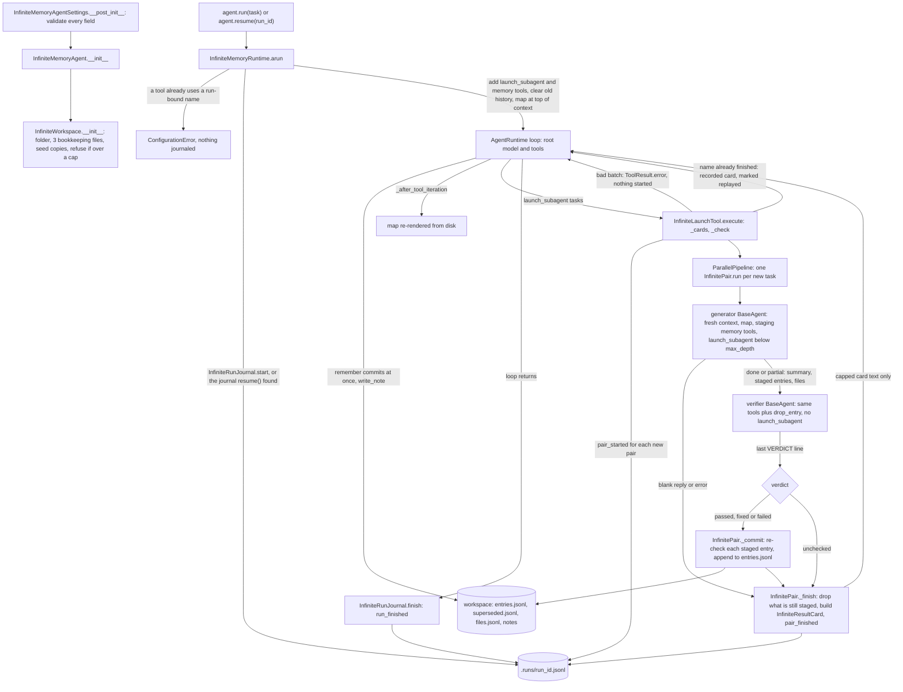
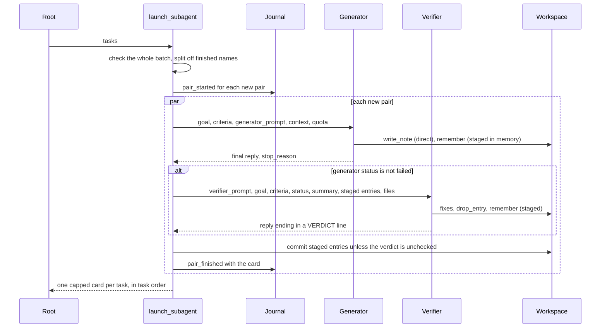

feat(agents): add InfiniteMemoryAgent — a delegating agent with a guarded file-workspace memory

## Summary and motivation

Today a long task in the SDK runs inside one conversation: compaction erodes what the agent learned, there is no local memory to fall back on, and a crashed run starts over. This PR adds `InfiniteMemoryAgent` (`vidbyte/agents/infinite/`), a prebuilt agent for one long task of any kind. Its root treats its own context as scarce: `launch_subagent` runs each task as a fresh generator `BaseAgent` followed by a fresh verifier that checks and fixes the work, and the root gets back only one capped result card per task. Every agent shares one workspace folder of short typed entries and append-only notes, with caps on files, tokens, entry size and per-agent writes. File and token totals are recounted from disk before every write, and a pair's entries are committed only after its verifier gives a verdict. Each run is journaled in `.runs/<run_id>.jsonl`, so `resume()` continues an interrupted run and replays finished pairs from their recorded cards instead of running them again.

The decision that matters most is keeping the mechanism small. The agent has its own runtime type, `AgentRuntimeType.INFINITE_MEMORY`, but that runtime only does per-run setup around the inherited linear loop. Every subagent is a plain `BaseAgent` run through the existing `ParallelPipeline`, and history is trimmed by the existing `MessageHistoryCompactionMiddleware`, so the PR adds no new middleware, scheduler, store or dependency. Spec: `docs/spec/infinite-memory-agent/spec.md` (r5).

## How to use what this PR introduces

```python
from vidbyte import InfiniteMemoryAgent, InfiniteMemoryAgentSettings, InfiniteWorkspaceSettings

# brief.md is an existing file next to this script.
agent = InfiniteMemoryAgent(
    InfiniteMemoryAgentSettings(
        name="analyst",
        system_prompt="You research markets and report sourced findings.",
        provider="openai",
        model_name="gpt-4.1",
        root_dir=".",
        workspace=InfiniteWorkspaceSettings(root="memory", seed_files=("brief.md",)),
    )
)

try:
    reply = agent.run("Compare the list prices of our five competitors.")
except KeyboardInterrupt:
    reply = agent.resume()  # continues that run; finished pairs are not run again
print(reply.content)        # the root agent's final answer
```

This is spec §4's snippet, unchanged; it runs as written on this branch. The run below used a scripted model, with no network call. `BaseAgent._runner_for_model` was patched to answer by agent name, the same seam `test_infinite_memory_acceptance.py` uses. The workspace, journal, pipeline, prompts and filesystem were real. The script told the root to launch one task, `pricing`. Its generator staged one fact and replied, and its verifier ended with `VERDICT: passed`. The snippet printed the first line below, and the script then printed what the run left behind:

```text
Acme is cheapest at 49 USD per seat (entry #1).
--- agents called: ['analyst', 'analyst/root/pricing/gen', 'analyst/root/pricing/ver']
--- card the root received:
### Pair pricing (root/pricing)
Status: done. Verdict: passed.
Summary: Found Acme's list price: 49 USD per seat per month (acme.example/pricing).
Review: Checked the price against its source.
VERDICT: passed
Entries saved: #1
Entries dropped: -
Files written: -
--- memory/ files: ['.runs/20261015T150131Z-f4cc56a3.jsonl', 'entries.jsonl', 'files.jsonl', 'seed/brief.md', 'superseded.jsonl']
--- entries.jsonl: {"id": 1, "kind": "fact", "text": "Acme lists Pro at 49 USD per seat per month", "tags": [], "refs": [], "supersedes": null, "by": "root/pricing/gen", "verified_by": "root/pricing/ver", "run": "20261015T150131Z-f4cc56a3", "at": "2026-10-15T15:01:31+00:00"}
--- journal events: ['run_started', 'pair_started', 'pair_finished', 'run_finished']
--- root usage: model calls 5 input 15 output 10
```

The developer no longer assembles tools, builds subagents, writes delegation prompts or tracks progress by hand, and recovers an interrupted run with `agent.resume()`.

## Flow





Validation happens at three points. Construction checks the two settings objects and runs `InfiniteWorkspace.__init__`. Every tool call is checked too: `InfiniteLaunchTool._cards` and `_check`, and the memory tools, turn a bad call into a `ToolResult.error` and write nothing. At commit, `InfinitePair._commit` checks each staged entry again against the live workspace. State changes only in the workspace files, written atomically under one in-process lock, and in the journal, which gets one fsynced line per step. `InfinitePair.run` turns any `VidbyteSdkError`, `OSError` or `ValueError` into that pair's own card, so one failed pair never sinks its siblings or the root. Cancellation is not caught, and `run_finished` is written only when the loop returns, so an interrupted run stays resumable.

## Changes

| File | Change |
|---|---|
| `vidbyte/agents/infinite/__init__.py` | New package facade: exports the agent, its two settings objects and the runtime. |
| `vidbyte/agents/infinite/agent.py` | `InfiniteMemoryAgent`. Its constructor takes only the settings object, builds the workspace, and builds the root `BaseAgent` with the root rules, the preset tools plus extras, and its own history trim. Adds `resume()` and `aresume()`. |
| `vidbyte/agents/infinite/settings.py` | `InfiniteMemoryAgentSettings` and `InfiniteWorkspaceSettings`, with every field checked in `__post_init__`. |
| `vidbyte/agents/infinite/runtime.py` | `InfiniteMemoryRuntime`, which refuses to build outside its agent. Per run it does the reserved-name check, opens the journal, adds the run-bound tools, clears the context, puts the map on top, runs the inherited loop and writes `run_finished`. |
| `vidbyte/agents/infinite/launch.py` | `launch_subagent` (`InfiniteLaunchTool`) and `InfinitePair`: batch check, replay, generator then verifier, commit or drop, capped card. |
| `vidbyte/agents/infinite/memory.py` | `InfiniteAgentMemory` and the `remember`, `write_note`, `edit_file` and `drop_entry` tools. The root's entries commit at once; pair agents' entries are staged. |
| `vidbyte/agents/infinite/workspace.py` | `InfiniteWorkspace`: setup, caps recounted from disk, the entry and note-path rules, atomic writes under one lock, and the map. |
| `vidbyte/agents/infinite/journal.py` | `InfiniteRunJournal`: append-only, fsynced `.runs/<run_id>.jsonl`. It finds the run to resume and tolerates a torn last line. |
| `vidbyte/tools/toolsets/infinite.py` | `InfiniteMemoryAgentTools`: `bash` over `root_dir`, then `grep` and `read_lines` over the workspace. `grep` skips `.runs` and `superseded.jsonl`, and its file-size cap comes from `max_tokens`. |
| `vidbyte/lib/constants/infinite.py` | Every default, limit, pattern, tool name, workspace file name and label. |
| `vidbyte/lib/dataclasses/infinite.py` | Six frozen, validated records: task card, entry draft, entry, staged entry, result card and usage. |
| `vidbyte/lib/enums/infinite.py` | Six enums: preset, entry kind, result status, verdict, journal event and agent role. |
| `vidbyte/prompts/prompts/infinite_memory/infinite_memory.json` | New prompt family with 40 leaves, which hold all the model-facing text. |
| `vidbyte/prompts/prompts/infinite_memory/root_system_prompt.md` | Root rules: delegate ruthlessly, how to write a task card, save sparingly. |
| `vidbyte/prompts/prompts/infinite_memory/generator_system_prompt.md` | Generator rules: do the task, stage only important memories, write the final reply as the summary. |
| `vidbyte/prompts/prompts/infinite_memory/verifier_system_prompt.md` | Verifier preamble: check each criterion, fix, review staged entries, end with one `VERDICT:` line. |
| `vidbyte/prompts/prompts/infinite_memory/launch_tool_description.md` | `launch_subagent` tool description. |
| `vidbyte/__init__.py` | Root exports `InfiniteMemoryAgent`, `InfiniteMemoryAgentSettings`, `InfiniteWorkspaceSettings` and `InfiniteMemoryPreset`. |
| `vidbyte/agents/__init__.py` | Re-exports those three agent names plus `InfiniteMemoryRuntime`. |
| `vidbyte/agents/base.py` | Adds `INFINITE_MEMORY` to `_LINEAR_LOOP_RUNTIMES`, with its comment clause and header line. Nothing else changes. |
| `vidbyte/lib/enums/agent_runtime.py` | New member `AgentRuntimeType.INFINITE_MEMORY = "infinite_memory"`. |
| `vidbyte/lib/enums/__init__.py` | Exports the six new enums. |
| `vidbyte/lib/enums/prompts.py` | 40 `Prompt.INFINITE_MEMORY_*` members. Header counts are now 138 assets in 34 families. |
| `vidbyte/lib/registries/runtimes.py` | Maps `INFINITE_MEMORY` to `InfiniteMemoryRuntime` through a lazy facade import. |
| `vidbyte/lib/util/text.py` | `TokenEstimate.count` and `TokenEstimate.cut`, plus `TOKEN_ESTIMATE_CHARS_PER_TOKEN = 4`: the one characters-divided-by-four estimate. |
| `vidbyte/lib/util/__init__.py` | Exports `TokenEstimate`. |
| `vidbyte/tools/toolsets/__init__.py` | Exports `InfiniteMemoryAgentTools`. |
| `contracts/sdk-public-api.json` | Regenerated with `scripts/generate-sdk-public-api.py`: four root exports added. |
| `vidbyte/agents/infinite/README.md` | Folder README: what it is and is not for, workspace layout, limits, resume, File Index, Notes for agents. |
| `vidbyte/agents/README.md` | `## InfiniteMemory Agent` section with the §4 snippet, plus a Key Modules line. |
| `vidbyte/prompts/README.md` | Quick-reference row and description for the `infinite_memory` family. |
| `vidbyte/tools/README.md` | The `toolsets/` bullet names `InfiniteMemoryAgentTools`. |
| `REPO_MAP.md` | New `vidbyte/agents/infinite/` entry. The stale `vidbyte/tools/toolsets/` entry is regenerated from the tree. |
| `tests/features/infinite_memory_agent/test_infinite_memory_acceptance.py` | 4 tests: the §4 snippet, staging until the verdict, usage roll-up, two agents on one workspace. |
| `tests/features/infinite_memory_agent/test_infinite_memory_contract.py` | 25 tests: construction refusals, runtime type, tool sets, schemas, exports, prompt family, defaults, `Session` refusal, `TokenEstimate`, read-only seeds. |
| `tests/features/infinite_memory_agent/test_infinite_memory_delegation.py` | 26 tests: concurrency, batch rules, depth and role, `max_agents`, failed pairs, card caps, replay, extras, verifier input, tool-limit exemption. |
| `tests/features/infinite_memory_agent/test_infinite_memory_resume.py` | 14 tests: journal order, resume and replay, refusals, torn and malformed lines, cancellation, fsync order, `api_key` never written. |
| `tests/features/infinite_memory_agent/test_infinite_memory_verification.py` | 15 tests: verdict parsing, `drop_entry`, unchecked drops, the re-check at commit, stage-time rules. |
| `tests/features/infinite_memory_agent/test_infinite_memory_workspace.py` | 25 tests: `remember`, `write_note` and `edit_file` rules; supersede; caps including files bash wrote; the map; grep; failed and unencodable writes. |
| `tests/features/infinite_memory_agent/test_infinite_memory_context.py` | 2 tests: the history trim keeps the task and the map; a second run starts clean. |
| `tests/features/infinite_memory_agent/infinite_memory_fixtures.py` | The scripted-runner seam (`BaseAgent._runner_for_model`) and helpers for the §9.1 file shapes. |
| `tests/features/infinite_memory_agent/FEATURE.md`, `README.md` | What the feature pack covers, and its index. |
| `docs/spec/infinite-memory-agent/` (25 files) | The pipeline record: request, spec r5, test plan, review, verify log, code map, pipeline state, 18 stage reports, and this PR body. |

## Compatibility

- **New public names; nothing removed or renamed.**
  - `vidbyte` gains `InfiniteMemoryAgent`, `InfiniteMemoryAgentSettings`, `InfiniteWorkspaceSettings` and `InfiniteMemoryPreset`.
  - `vidbyte.agents` gains those three agent names and `InfiniteMemoryRuntime`.
  - `vidbyte.lib.enums` gains six `Infinite*` enums, and `vidbyte.lib.util` gains `TokenEstimate`.
  - `vidbyte.tools.toolsets` gains `InfiniteMemoryAgentTools`.
  - `contracts/sdk-public-api.json` is regenerated: four additions plus the new source commit. `--check` reports it current with 643 exports.
- **New enum members.**
  - `AgentRuntimeType.INFINITE_MEMORY = "infinite_memory"` is new. It resolves in `RuntimeRegistry` and is in `_LINEAR_LOOP_RUNTIMES`. A plain `BaseAgent(runtime="infinite_memory")` raises `ConfigurationError` naming `InfiniteMemoryAgent`.
  - `Prompt` gains 40 `INFINITE_MEMORY_*` members. No existing value changes.
- **No behavior change for existing agents.** `LINEAR` and `JEV` resolve and run as before; the full source stage passes. CLI: none. MCP: none.
- **Packaging.** The new prompt files ship through the existing `*/*.json` and `*/*.md` package-data globs. The version stays 0.2.1, and there are no new dependencies.
- **New on-disk contract.** The workspace files and the journal (spec §9.1) are a new format. There is no earlier format to migrate.

## Acceptance criteria → proof

Every test below is in `tests/features/infinite_memory_agent/` and passes on this branch.

| AC | What it checks (plain words) | Proven by |
|---|---|---|
| AC-1 | The §4 snippet prints the root's answer and leaves the seed copy, the three bookkeeping files and one finished journal. | `test_infinite_memory_acceptance.py::test_section_4_snippet_prints_the_root_answer_and_leaves_the_documented_workspace`, plus the run above |
| AC-2 | Construction refuses every invalid setting and names the field, and creates no folder. | `test_infinite_memory_contract.py::test_construction_rejects_each_invalid_setting`; `test_infinite_memory_contract.py::test_construction_rejects_a_non_settings_object` |
| AC-3 | The runtime type resolves, and refuses to run on a plain `BaseAgent`. | `test_infinite_memory_contract.py::test_runtime_type_resolves_and_refuses_outside_its_agent` |
| AC-4 | The root is offered exactly the preset tools, its extra and `isDone`; `edit_file` only under FULL. | `test_infinite_memory_contract.py::test_root_is_offered_exactly_the_preset_tools_plus_its_extra` |
| AC-5 | Two tasks run at once, each verifier starts after its own generator, and the root sees only the two cards. | `test_infinite_memory_delegation.py::test_two_tasks_run_concurrently_and_each_verifier_follows_its_own_generator` |
| AC-6 | A bad batch returns an error, starts nothing and writes no journal record, and the tool still works afterwards. | `test_infinite_memory_delegation.py::test_an_invalid_batch_starts_nothing_and_the_tool_stays_usable` |
| AC-7 | The depth cap and the role decide who holds `launch_subagent` and `drop_entry`. | `test_infinite_memory_delegation.py::test_depth_cap_and_role_decide_who_holds_launch_subagent_and_drop_entry` |
| AC-8 | A batch that would pass `max_agents` is refused whole. | `test_infinite_memory_delegation.py::test_a_batch_that_would_pass_max_agents_is_refused_whole` |
| AC-9 | A pair's entries reach `entries.jsonl` only after its verifier returns, stamped with both keys. | `test_infinite_memory_acceptance.py::test_staged_entries_reach_disk_only_after_the_verifier_returns` |
| AC-10 | With no verdict, or a failing verifier, every staged entry is dropped. | `test_infinite_memory_verification.py::test_no_verdict_or_a_failing_verifier_drops_every_staged_entry` |
| AC-11 | `drop_entry` removes only the staged entry it names. | `test_infinite_memory_verification.py::test_drop_entry_removes_only_the_named_staged_entry` |
| AC-12 | A failed or blank generator skips its verifier, and its sibling still reports. | `test_infinite_memory_delegation.py::test_a_failed_or_blank_generator_skips_its_verifier_and_its_sibling_still_reports` |
| AC-13 | A generator stopped by `max_iterations` is `partial` and still verified. | `test_infinite_memory_delegation.py::test_a_generator_stopped_by_max_iterations_is_partial_and_still_verified` |
| AC-14 | The root's `remember` refuses each rule-breaking entry and enforces the quota, and every reply carries the quota line. | `test_infinite_memory_workspace.py::test_root_remember_rejects_each_rule_breaking_entry_and_enforces_the_quota` |
| AC-15 | A supersede moves the old entry to `superseded.jsonl`, where grep no longer finds it. | `test_infinite_memory_workspace.py::test_root_supersede_moves_the_old_entry_out_of_entries_and_out_of_grep` |
| AC-16 | `write_note` refuses every path and size breach, files bash wrote included, and changes nothing. | `test_infinite_memory_workspace.py::test_write_note_refuses_every_path_and_size_breach_and_changes_nothing`; `test_infinite_memory_workspace.py::test_write_note_refuses_a_new_file_at_the_file_cap`; `test_infinite_memory_workspace.py::test_write_note_counts_files_bash_wrote_toward_the_token_cap` |
| AC-17 | `edit_file` replaces a unique match and refuses an ambiguous one; no agent holds it under SPARSE. | `test_infinite_memory_workspace.py::test_edit_file_replaces_a_unique_match_and_refuses_an_ambiguous_one`; `test_infinite_memory_delegation.py::test_depth_cap_and_role_decide_who_holds_launch_subagent_and_drop_entry` |
| AC-18 | Every agent sees the map, and the root's map refreshes after each tool iteration. A map over its cap ends with the count of files left out. | `test_infinite_memory_workspace.py::test_every_agent_sees_the_map_and_the_roots_map_refreshes_after_each_tool_iteration`; `test_infinite_memory_workspace.py::test_a_map_over_its_cap_ends_with_the_remaining_file_count` |
| AC-19 | The journal records the run in order, as JSON lines. | `test_infinite_memory_resume.py::test_journal_records_the_run_in_order_as_json_lines` |
| AC-20 | Resume replays finished pairs and runs interrupted ones again. | `test_infinite_memory_resume.py::test_resume_replays_finished_pairs_and_reruns_interrupted_ones` |
| AC-21 | Resume refuses an unsafe, unknown, finished or missing run before any model call. | `test_infinite_memory_resume.py::test_resume_refuses_unsafe_unknown_finished_or_missing_runs_before_any_model_call` |
| AC-22 | A torn last journal line is skipped, and a malformed middle line is refused with its line number. | `test_infinite_memory_resume.py::test_resume_skips_a_torn_final_journal_line`; `test_infinite_memory_resume.py::test_resume_rejects_a_malformed_middle_journal_line` |
| AC-23 | Cancelling a run mid-pair leaves a journal that resumes. | `test_infinite_memory_resume.py::test_cancelling_a_run_mid_pair_leaves_a_resumable_journal` |
| AC-24 | The root's usage includes each child's usage exactly once. | `test_infinite_memory_acceptance.py::test_root_usage_includes_every_generator_and_verifier_exactly_once` |
| AC-25 | `Session(agent)` is refused. | `test_infinite_memory_contract.py::test_session_refuses_the_agent` |
| AC-26 | A long generator reply is cut in its card, and the root never sees the rest. | `test_infinite_memory_delegation.py::test_a_long_generator_reply_is_cut_in_its_card_and_the_rest_never_reaches_the_root` |
| AC-27 | The public names import from every documented path, and the prompt family has exactly 40 leaves. | `test_infinite_memory_contract.py::test_public_names_import_from_every_documented_path`; `test_infinite_memory_contract.py::test_prompt_family_has_exactly_the_forty_documented_leaves` |
| AC-28 | A task card grants exactly the extra tools it names. | `test_infinite_memory_delegation.py::test_a_task_card_grants_exactly_the_extras_it_names` |
| AC-29 | A card's context pastes the named entries and lists the named paths. | `test_infinite_memory_delegation.py::test_context_pastes_named_entries_and_lists_named_paths` |
| AC-30 | A second agent on the same workspace sees the first agent's entry in its map and with grep. | `test_infinite_memory_acceptance.py::test_a_second_agent_on_the_same_workspace_sees_the_first_agents_entry` |
| AC-31 | Relaunching a finished name replays its card without building agents. | `test_infinite_memory_delegation.py::test_relaunching_a_finished_name_replays_its_card_without_building_agents` |
| AC-32 | The verifier gets the generator's outcome, never its transcript. | `test_infinite_memory_delegation.py::test_the_verifier_gets_the_generators_outcome_but_never_its_transcript` |
| AC-33 | The root's history is trimmed past the cap, while the task and the map survive. | `test_infinite_memory_context.py::test_root_history_is_trimmed_past_the_cap_while_task_and_map_survive` |
| AC-34 | `entries.jsonl` is bounded by the workspace total, not by the per-note cap. | `test_infinite_memory_workspace.py::test_entries_file_is_bounded_by_the_workspace_total_not_the_note_cap` |
| AC-35 | `launch_subagent` is exempt from the tool timeout and the result cap. | `test_infinite_memory_delegation.py::test_launch_subagent_is_exempt_from_the_tool_timeout_and_result_cap` |
| AC-36 | A tool added with `add_tool` can be granted by a task card. | `test_infinite_memory_delegation.py::test_a_task_card_grants_exactly_the_extras_it_names` |
| AC-37 | A malformed `entries.jsonl` line drops each pair's entries, but the run still finishes. | `test_infinite_memory_verification.py::test_a_malformed_entries_line_drops_each_pairs_entries_but_the_run_finishes` |
| AC-38 | The verdict is read from the last matching line, in any Markdown wrapping or case. | `test_infinite_memory_verification.py::test_verdict_is_read_from_the_last_matching_line_in_any_markdown_or_case` |
| AC-39 | The default `loop` and the limits match the spec. | `test_infinite_memory_contract.py::test_loop_and_limit_defaults_match_the_spec` |
| AC-40 | A second run on the same agent object starts from a clean context. | `test_infinite_memory_context.py::test_a_second_run_on_the_same_agent_starts_from_a_clean_context` |
| AC-41 | A tool named like a run-bound tool fails the run before the journal starts. | `test_infinite_memory_resume.py::test_a_run_time_tool_named_like_a_run_bound_tool_fails_before_the_journal_starts` |
| AC-42 | Grep finds a live entry in an `entries.jsonl` larger than 1 MB. | `test_infinite_memory_workspace.py::test_grep_finds_a_live_entry_in_an_entries_file_over_one_megabyte` |

## Verification

I ran every gate below at `ff23d32d`, on Windows with Python 3.11. Later commits change only `docs/spec/`. The orchestrator's final gate at `9d45d08f` (same code) gave the same results.

| Gate | Command | Result |
|---|---|---|
| New-test pack | `PYTHONPATH=$(pwd) python -m pytest tests/features/infinite_memory_agent -q -p no:cacheprovider` | `111 passed in 3.11s` |
| Lint | `python lint/run.py` | `SDK-LINT: PASS`; no rule regressed (C012 23, S061 5, S062 889, S008 19, A009 0); `lint/` and `lint/baseline.json` are untouched by this PR |
| Import order (S051) | `python -m ruff check vidbyte --config lint/ruff.toml --select I001 --no-cache` | `Found 223 errors.`, the same 223 as an `origin/main` export, so no new finding |
| Semgrep | `semgrep scan --error --config .semgrep/typed-mapping-boundary-policy.yml vidbyte --metrics=off` (semgrep 1.170.1) | `Ran 1 rule on 946 files: 0 findings.`, exit 0. It ran through a launcher that stubs semgrep's unused `mcp` subcommand, because this machine's mcp 2.x breaks `import semgrep.cli`. |
| Public-API contract | `python scripts/generate-sdk-public-api.py --check` | `contracts/sdk-public-api.json is current at 41e9421044f1f8bf91111262b451ab86b031d792 (vidbyte-sdk 0.2.1, 643 exports).` |
| Full local gate, source | `PYTHONPATH=$(pwd) python scripts/run_ci.py --stage source` | `5284 passed, 14 skipped, 1 warning in 55.17s` / `CI passed.` |
| Full local gate, package | `python scripts/run_ci.py --stage package` (no `PYTHONPATH`) | `No broken requirements found.` / `Installed vidbyte-sdk 0.2.1 passed smoke checks.` / `CI passed.` |
| Remote checks | `gh pr checks https://github.com/cerredz/Vidbyte-SDK/pull/1084` | None: workflows are disabled repo-wide, so the local `run_ci.py` gate above is the gate of record. The output is `no checks reported on the 'feat/infinite-memory-agent' branch`. Every gate workflow is marked "TEMPORARILY DISABLED"; `claude.yml` runs only on an `@claude` mention. |

One pre-existing flaky test can turn the source stage red on this Windows machine: `tests/test_mcp_stdio_transport.py::McpStdioTransportHardeningTests::test_cancelled_waiter_does_not_break_transport`.

- It failed in 3 of the orchestrator's 6 full source runs and passed in the run above.
- This PR touches no MCP code.
- The new pack plus that MCP file ran green 5/5 together.
- The MCP file alone also fails intermittently: at this branch's head (1 of 3 runs) and on a clean `origin/main` export (1 of 8).

The source stage's one warning is an unclosed-transport warning from the same MCP test file, in `test_remote_jsonrpc_error`.

- [x] Existing repository checks pass. Lint, the source stage and the package stage all pass, as above. No remote checks exist while the workflows are disabled.
- [x] New or changed package assets are present in the built wheel. The package stage installs the built wheel into a clean venv and runs `Prompts().keys()`. That call reads every prompt asset and raises if any `Prompt` member has none, including the 40 new `INFINITE_MEMORY_*` members and their four `.md` files.
- [x] Documentation and examples reflect the change. This PR adds the folder README, the agents README section, the prompts README row and entry, the tools README bullet and the REPO_MAP entry. The §4 snippet in the agents README runs (AC-1 and the run above).
- [x] No credentials, private data, generated bytecode, build output, or unrelated changes are included.
  - `git ls-files` lists no bytecode or build output, and the source stage's tracked-bytecode check passes.
  - A scan of the diff for key and token patterns found none.
  - `api_key` is `repr=False` and is never written to the workspace or the journal (`test_api_key_stays_out_of_the_settings_repr_the_journal_and_the_workspace`).
  - The `docs/spec/` pipeline record names local worktree and scratch paths. No file outside `docs/spec/` does.

## Adversarial review

31 findings were confirmed, and none waived. An independent verifier confirmed 25 of them across three lenses: spec conformance, repo conventions and engineering. A verified post-repair re-review added 4, and a final re-review, with verdict SOUND, added 2 Minors. 23 are fixed, and 8 Minors are left open as follow-ups. Full record: `docs/spec/infinite-memory-agent/review.md`.

| ID | Finding | Fixed in |
|---|---|---|
| R-1 (Blocker) | A pair's card build and `pair_finished` sat outside its error guard, so a line-breaking note path or a lone surrogate lost every sibling's card. | `1e0b1524`; test `test_a_pair_whose_card_or_record_cannot_be_written_as_given_still_finishes_beside_its_sibling` (`9af96d42`) |
| R-2 | Protected note paths were compared case-sensitively, so on macOS `Entries.jsonl` or `SEED/…` could overwrite bookkeeping or seed files. | `1769a44f` |
| R-3 | The dropped-entry and files lists rendered uncapped, so a card could flood the parent. | `a47a7614` and spec r5 NFR-7; test `test_an_unchecked_card_with_long_dropped_and_files_lists_stays_inside_the_nfr7_bound` |
| R-4 | A finished pair whose context entry was later superseded was refused instead of replayed, and so was every new task launched beside it. | `a6b4e4c1`; test `test_a_finished_pair_replays_after_its_context_entry_was_superseded_and_new_pairs_still_run` |
| R-5 | The PR rewrote untouched f-strings in `runtimes.py` to hide a new S062 lint finding. | `c4822ebb` (test literal joined in `9af96d42`) |
| R-6 | `remember` echoed a pasted multi-line log back into the context and never pointed the model to a note. | `3617ec69`; test `test_remember_tells_the_model_to_keep_a_long_paste_in_a_note_or_a_pointer` |
| R-7 | The PR added a C012 finding (model not checked against the registry) and an S061 finding (unbounded copy) by spending main's lint headroom. | `29760f65`, `5ee09e99` |
| R-8 | A failed atomic write leaked its temp file into the caps, and memory tools raised instead of refusing. A colon path left NTFS stream debris. | `f8387a78`; tests `test_a_memory_write_that_fails_on_disk_is_a_refusal_and_leaves_no_temp_file` and `test_a_note_path_with_a_colon_is_saved_or_refused_without_leaving_stray_files` |
| R-9 | 21 comment lines ran past 72 columns, which `comment-format.md` forbids. | `99e95803` |
| R-10 | 19 parameter descriptions were 1–2-sentence labels with examples, where `model-facing-tool-contracts.md` asks for 4–5 general sentences. | `fddefd51` |
| R-11 | Three guardrails could be deleted without a test failing: stage-time entry rules, the `edit_file` caps, and the verifier's `by` stamp. | `9af96d42` (tests `test_a_pair_agents_remember_is_checked_against_the_entry_rules_when_it_stages`, `test_edit_file_refuses_an_edit_that_would_pass_a_cap_and_changes_nothing` and `test_an_entry_the_verifier_stages_is_committed_under_the_verifiers_own_key`) |
| R-26 | A read-only seed left a read-only copy (a regression from R-7), so a second agent or a `resume()` from a new process crashed with `PermissionError`. | `582b5793`; test `test_a_read_only_seed_is_copied_again_each_time_an_agent_attaches` (`11b19a7d`) |
| R-27 | Two-file memory writes encoded text only as they wrote each file. Text UTF-8 cannot hold left half a write on disk while the model was told "Nothing was saved". | `c90b43be`; tests `test_a_supersede_whose_new_text_cannot_be_written_changes_neither_entry_file`, `test_a_new_note_whose_description_cannot_be_written_leaves_no_note_and_keeps_the_allowance` and `test_an_entry_text_that_cannot_be_written_never_costs_the_pair_its_verdict_or_other_entries` (`11b19a7d`) |

Minors fixed: R-12 `61bdbb6b`, R-13 `6b55613c`, R-15 `649777fa`, R-16 `9c5b0650`, R-17 `c5f4859f`, R-18 `9af96d42`, R-21 `714c1aa0`, R-23 `5cdac067`, R-28 `5c5b7d33`, R-30 `6932c936`.

## Deviations from the spec

Spec §17 ("Implementation deviations (S3)" and "(S5)") records each of these.

1. **The model check is stricter than a plain `BaseAgent`.**
   - §9.3 says `provider` and `model_name` have the "same meaning as `BaseAgent`".
   - The settings check the pair against `ProviderModelRegistry` when they are created, exactly as the SDK's declarative `BaseAgentSettings` does. So a name a plain `BaseAgent` runs, such as `gpt-4.1-2025-04-14`, is refused here.
   - `ProviderModelRegistry.STRICT_MODEL_VALIDATION = False` restores plain-`BaseAgent` acceptance.
   - Why: blocking lint rule C012 requires a catalog check on a model field (R-7). §9.3's sentence describes what the fields mean, not which names are accepted.
2. **Note paths have three extra rules.**
   - INV-20 lists three path rules.
   - The code also refuses a path that breaks across lines and a path holding a colon, and it matches `seed/`, `.runs/` and the bookkeeping names with case ignored.
   - Why: the card lists each path on one line (R-1); a colon names an NTFS stream (R-8); case-insensitive disks keep the caller's spelling (R-2).
3. **Memory text must be UTF-8-encodable.**
   - INV-17 and INV-20 do not say this.
   - Entry text and refs, and note text and descriptions, that UTF-8 cannot hold are refused before anything is staged or written.
   - Why: otherwise two-file writes were left half done (R-27).
4. **Workspace writes replace whole files.**
   - §9.1 and §12.3 row 17 describe the `entries.jsonl` and `superseded.jsonl` writes as appends.
   - Every workspace write, appends included, goes to a temp file swapped in with `os.replace`. A supersede writes `superseded.jsonl` first. Stamps read `+00:00`, not `Z`.
   - Why: a refused or interrupted write must leave the old file.
5. **Journal records are ASCII JSON, and a complete last line is kept.**
   - D-25 says loading skips an unparseable final line, and §9.1 does not specify the encoding.
   - Records are ASCII-escaped JSON. A complete last line without its newline is kept, and the next record starts on a new line.
   - Why: a lone surrogate in a card must not block `pair_finished` (R-1).
6. **Seed copies are made writable.**
   - D-24 copies seeds and keeps them read-only to the tools.
   - Seeds are copied through `LocalFileSystemBackend.copy`, and each copy is made owner-writable. The note-path rules, not file modes, keep tools out of `seed/`.
   - Why: lint S061 (R-7), and attaching again over a read-only seed (R-26).
7. **Four constants beyond §12.3 row 3, and one fairness yield.**
   - The extra constants are `INFINITE_ROOT_DEPTH`, `INFINITE_DEPTH_STEP`, `INFINITE_PAIR_TURN_SECONDS` and `INFINITE_MIN_CAP`.
   - `InfinitePair.run` awaits `asyncio.sleep(0)` between a pair's generator and its verifier. This gives sibling pairs a turn but no cross-pair ordering guarantee.
   - Why: lint A007 forbids operational literals. AC-37's scheduling relies on the yield (R-13).
8. **Small internal signature differences from §8.5.**
   - `InfiniteWorkspace.check_entry` takes staged entries rather than drafts, so its refusal can name `sN`.
   - `InfiniteAgentMemory.quota()` is public.
   - `InfinitePair` gains the static formatters `render` and `finished_lines`.
9. **A few short fixed texts are inline, not constants.**
   - §9.2 puts short fixed labels in `INFINITE_` constants.
   - Five short formats stay in code: `-`, the two dropped-entry reasons, the map file line, the pasted-entry line and the staged line. This is open as R-14.

Spec §5 is updated in this PR to match the flow chart above. It had shown the commit as unconditional, left out the skipped verifier, and named only `VidbyteSdkError` for the pair guard.

## Follow-ups

**Open review Minors** (by design, all non-blocking):

- **R-14:** move the five inline formats from deviation 9 into `INFINITE_` constants.
- **R-19:** add an `INFINITE_AGENTS_PER_PAIR` constant (`INFINITE_MIN_AGENTS` serves both meanings today), and give `runtime.py`'s inline list of run-bound names one shared tuple.
- **R-20:** this is the third inline temp-file-plus-`os.replace` in the SDK. An atomic-write option on the lib filesystem helper belongs in its own PR.
- **R-22:** a commit reads the bookkeeping files twice, and `_file_tokens` decodes every file, binaries included.
- **R-24:** a UNC note path triggers an SMB lookup before the scope check. The fix belongs in the shared `FileSystemPermissions.resolve_scoped_path`, in its own PR.
- **R-25:** a workspace file the process cannot read, for example one locked or written mode 0600 through bash, makes `map_text` raise. That ends the run and every resume until the file is fixed.
- **R-29:** on Windows, another process holding `entries.jsonl` or `files.jsonl` open can make the second swap of a two-file write fail after the first succeeded.
- **R-31:** the UTF-8 refusal passes the raw `UnicodeEncodeError` text, which names no field.

**Noticed while writing this PR** (both minor, neither breaks a spec ID):

- **Note spellings on the card.** A pair's card lists a note under each spelling the model used. `./notes/a.md` and `notes/a.md` both appear, because `files_written` keeps the raw path (`vidbyte/agents/infinite/memory.py:98-99`).
- **Resume and malformed journals.** `resume()` with no run id parses newer journals first. A malformed line in a newer *finished* journal therefore refuses resuming an older unfinished run (`vidbyte/agents/infinite/journal.py:81-83`).

**Known limitations**, documented in the folder README's Notes for agents:

- Use one process per workspace; the lock is per process.
- `bash` can write past every rule. Nothing is undone, but the caps are recounted from disk before the next tool write.
- A crash between a pair's commit and its `pair_finished` repeats that pair's memories on resume.
- A parent's `timeout_seconds` includes the time it waits on its children.

**Pre-existing:** the flaky MCP stdio test named under Verification.

**Optional additions you may want** (each spec open question defaulted to no):

- a `middleware` settings field (Q-1);
- a bash-bypass scan and restore (Q-2);
- letting verifiers launch subagents (Q-3);
- run-wide extras or skills for every child without a card naming them (Q-4);
- a run-wide USD or token cap (Q-6);
- a per-run lock across processes (Q-7);
- a "compaction for file" policy (Q-8);
- separate loop settings for the root and its children (Q-9).

🤖 Generated with [Claude Code](https://claude.com/claude-code)
