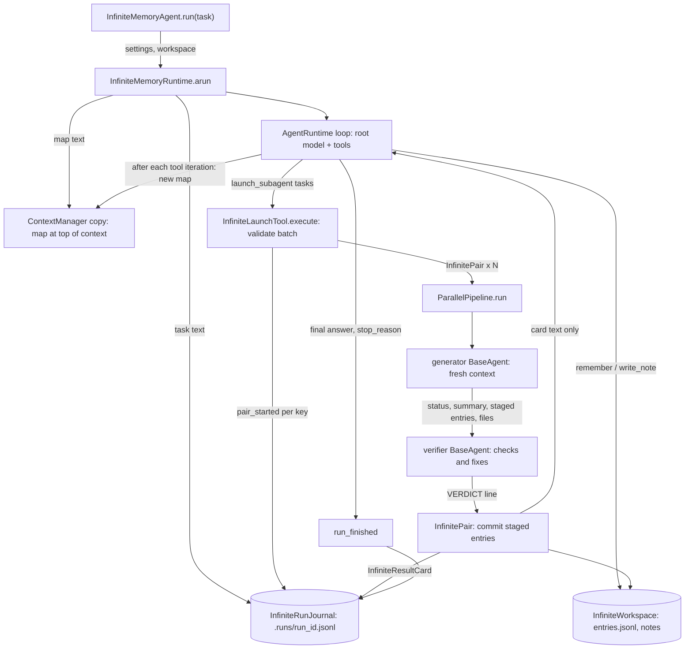
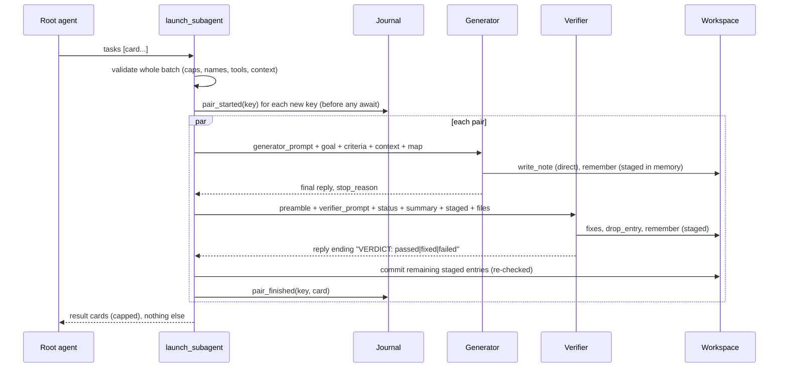

# Spec: InfiniteMemory agent — a delegating agent with a shared, guarded file workspace for memory

> **TL;DR** — Adds `InfiniteMemoryAgent`, a prebuilt SDK agent in its own `vidbyte.agents.infinite` package. Its root agent keeps its own context small by handing work to subagent *pairs* through one `launch_subagent` tool. Each pair is a generator followed by a verifier that checks and fixes the generator's work. Every agent shares one folder workspace. Agents write memory only as small typed entries and append-only notes, and fixed, deterministic limits guard every write. Every pair start and finish goes into an append-only journal, so `resume()` continues a crashed or interrupted run without re-running finished pairs. The decision that matters most is the smallest-mechanism one. The agent gets its own runtime type, following the JevAgent pattern, and that runtime does only the per-run setup. Every subagent is a plain `BaseAgent` run through the existing `ParallelPipeline`. Every agent keeps its rules and the workspace map in its system prompt, the runtime re-sends its task on every call, and the SDK's existing message-history middleware drops old tool exchanges past a fixed cap, so a long run never outgrows its context. This adds no new middleware, scheduler, store, or dependency.

## §0 User prompts

### 0.1 Invoking request (verbatim)
```
/spec-pipeline great, workk on this feature for the vidbyte-sdk/ want the InfiniteMemory agent to be its own agent in the vidbyte/agents/infinite folder and try to keep implementation of all features avoid very simple  and elegant, dont overengineer anthing
```

### 0.2 User replies during the run
None yet. The orchestrator appends any reply the user sends during the run here verbatim, labeled with the revision it produced.

---

## Part A — Framing

## §1 Goal

Today a long task in the SDK runs inside one agent's conversation. Compaction then erodes what the agent learned: request.md §C cites a study in which a compacted agent kept 53% of its safety rules after one round and 10% after five. The SDK has no local memory to fall back on, because every memory tool in the package wraps a hosted API. Nor can it resume a long run without redoing finished work. The user wants a general-purpose agent with four properties: it treats its own context as scarce, delegates work to fresh subagents, keeps "just important memories after few/10s of compactions" in a guarded folder, and runs "Unattended, resumable".

| ID | Goal (outcome) | How we will know | Source |
|---|---|---|---|
| G-1 | A developer hands one long task of any kind to one agent. The agent's root delegates the work to fresh subagents and receives back only short result cards. | AC-1, AC-5, AC-26; INV-4 | request.md §A Prompt 5, Round 1 answers |
| G-2 | Important memories survive compactions and restarts as small, typed, verified entries and append-only notes in one workspace that every agent can read. | AC-9, AC-15, AC-18, AC-30, AC-33, AC-34; INV-23 | request.md §A Prompts 2, 3, 6; Round 2 answers |
| G-3 | Every delegated unit of work is checked: a verifier runs after each generator and fixes what it finds. | AC-5, AC-9 – AC-13, AC-32 | request.md §A Prompt 6 |
| G-4 | A run continues after a crash or Ctrl-C without re-running pairs that already finished. | AC-19 – AC-23 | request.md §A Round 2 answer "Unattended, resumable" |
| G-5 | The workspace cannot grow past deterministic limits on file count, total tokens, file length, entry size, and per-agent writes. | AC-14, AC-16 | request.md §A Prompts 4, 6; Round 2 answer |
| G-6 | The implementation stays small and plain enough to read in one sitting. | NFR-1 | request.md §A Prompt 7 |

## §2 Objective

When this PR merges, `from vidbyte import InfiniteMemoryAgent, InfiniteMemoryAgentSettings, InfiniteWorkspaceSettings, InfiniteMemoryPreset` works. An `InfiniteMemoryAgent` built from an `InfiniteMemoryAgentSettings` is a `BaseAgent` whose runtime is the new `AgentRuntimeType.INFINITE_MEMORY` (`InfiniteMemoryRuntime`). At construction it creates or attaches a workspace folder and copies the seed files into it. On `run()`/`arun()`:

- **Journal.** It opens a new run journal.
- **Root tools.** It gives the root agent `bash`, `grep`, `read_lines`, `launch_subagent`, `remember`, and `write_note`, plus `edit_file` under the FULL preset and the developer's own tools, including MCP tools attached to the agent.
- **Map and history.** It starts each run from a clean context, puts the workspace map into the root's system prompt, and refreshes the map after every tool iteration. In every agent of the tree, the SDK's existing message-history middleware drops old tool exchanges once the history passes `INFINITE_HISTORY_MAX_TOKENS`. The task is the run's prompt, which the runtime re-sends on every call, so it is never dropped.
- **Pairs.** It runs each `launch_subagent` task as a generator-then-verifier pair of fresh `BaseAgent`s, up to `max_parallel` pairs at once.
- **Memory.** It stages each pair's memory entries and commits them only after the verifier returns a verdict.
- **Cards.** It returns one capped result card per pair to the parent.

`resume()`/`aresume()` continue the newest unfinished run, or a named one, and replay finished pairs from the journal. The PR also adds:

- the prompt family that holds all model-facing text;
- the records, enums, and constants in their homes in the shared `vidbyte.lib` layer;
- one canonical token-estimate helper;
- the toolset class;
- the exports, the regenerated public-API contract, and the READMEs and REPO_MAP entry.

This is the whole feature; nothing is left for a later slice except the non-goals below.

## §3 Non-goals

- **NG-1** — CLI integration (request list K: input contract, `--dry-run`, `--resume` flag). *Why not:* Prompt 7 moved the work to vidbyte-sdk, and the field guide `prebuilt-agents.md` says "Do not add a `vidbyte-sdk <agent>` command".
- **NG-2** — Hooks, skills packs, domain packs, and shareable presets (list I). *Why not:* request.md §C lists them as deferred, and the user said domain policies are added "with skills or hooks" outside the core.
- **NG-3** — Observability: a live tree view, an event stream, `runs show`, archived transcripts, and an end-of-run report (list J). *Why not:* deferred in request.md §C.
- **NG-4** — A consolidation pass, a "compaction for file" policy, read tracking, and an `archive/` overflow move. *Why not:* request.md §C says "Consolidation and read tracking can follow". A write over a cap is refused with a message instead (D-26); the user's "compaction for file policy" stays open as Q-8.
- **NG-5** — A run-level final verifier, `max_verify_rounds`, and `verifier_model_tier`. *Why not:* excluded from the v1 cut in request.md §C.
- **NG-6** — Domain write policies, such as a one-writer rule or a worktree per writer. *Why not:* the user said "I don't even want you to think about this … all types of work in general and not just coding."
- **NG-7** — A run-wide USD cost cap, a token cap, budget slicing, a 70/30 pair split, and a 90% wind-down. *Why not:* D-9.
- **NG-8** — A bash-bypass scan, snapshot restore, and a workspace version counter. *Why not:* D-10.
- **NG-9** — Semantic or vector search. *Why not:* request.md §C, rejected alternatives.
- **NG-10** — Moving the three existing private chars/4 token heuristics onto the new helper. *Why not:* AGENTS.md says "Do not rewrite untouched code just to make it conform; that belongs in its own pull request."
- **NG-11** — Durable `Session` persistence and `fork()` of an `InfiniteMemoryAgent`. *Why not:* D-8; the agent opts out the way the Codex and multi agents do.
- **NG-12** — A "save now" reminder at ~75% of context, a "consider delegating" reminder, and `STATE.json`/`set_state`. *Why not:* D-11, D-12.
- **NG-13** — A model tier or budget share per task, and a run-wide catalog that hands every child MCP tools or skills without a task card naming them. *Why not:* D-13, D-20.
- **NG-14** — Cross-process locking of a workspace or a run. *Why not:* D-23.
- **NG-15** — A `vidbyte-cli` runtime primitive. *Why not:* Prompt 7 supersedes Prompt 5's mention of vidbyte-cli.

## §4 Developer usage

```python
from vidbyte import InfiniteMemoryAgent, InfiniteMemoryAgentSettings, InfiniteWorkspaceSettings

# brief.md is an existing file next to this script.
agent = InfiniteMemoryAgent(
    InfiniteMemoryAgentSettings(
        name="analyst",
        system_prompt="You research markets and report sourced findings.",
        provider="openai",
        model_name="gpt-4.1",
        root_dir=".",
        workspace=InfiniteWorkspaceSettings(root="memory", seed_files=("brief.md",)),
    )
)

try:
    reply = agent.run("Compare the list prices of our five competitors.")
except KeyboardInterrupt:
    reply = agent.resume()  # continues that run; finished pairs are not run again
print(reply.content)        # the root agent's final answer
```

The snippet prints the root agent's final answer. Afterwards, `memory/` holds:

- `seed/brief.md`;
- the three bookkeeping files `entries.jsonl`, `superseded.jsonl` and `files.jsonl`;
- any notes the agents wrote;
- `.runs/<run_id>.jsonl`, whose last record is `run_finished`.

The developer does not assemble tools, build subagents, write delegation prompts, or track progress by hand. Every agent in the tree stops after 100 model turns unless the developer passes another `loop`. A second agent pointed at the same `memory/` folder sees everything the first one saved.

## §5 Flow diagram





The trigger is `run()`, which reaches `InfiniteMemoryRuntime.arun` through `BaseAgent.generate_reply`. The runtime opens the journal, adds the run-bound tools to the root, clears what earlier runs of the same agent left in the context, and places the workspace map at the top of a run-local context manager. Then the inherited loop runs. It re-sends the task on every call, and the message-history middleware drops old tool exchanges once the history passes its cap. Validation happens in three places:

- once at construction, in the two settings objects and the workspace constructor;
- on every model tool call, in `InfiniteLaunchTool` and the memory tools, which turn a bad call into a `ToolResult.error`;
- once more at commit, where each staged entry is re-checked against the live workspace.

State changes only in the workspace files, which hold entries, notes, and descriptions, and in the journal. Failures are caught inside each `InfinitePair`, so one pair's `VidbyteSdkError` becomes that pair's FAILED or UNCHECKED card and never reaches its siblings or the parent.

---

## Part B — Behavior (this is the spec; everything else is framing)

## §6 Behavior

### 6.1 Invariants

**Agent identity and construction**
- **INV-1** — "its own agent in the vidbyte/agents/infinite folder": the agent is the class `InfiniteMemoryAgent` in the package `vidbyte.agents.infinite`. It is importable from `vidbyte`, `vidbyte.agents`, and `vidbyte.agents.infinite`.
- **INV-2** — `InfiniteMemoryAgent(settings)` accepts only an `InfiniteMemoryAgentSettings` instance. Anything else raises `ConfigurationError` before `BaseAgent.__init__` runs.
- **INV-3** — `InfiniteMemoryRuntime` raises `ConfigurationError` when it is built without an `InfiniteMemoryAgentSettings` and an `InfiniteWorkspace`. The message begins "The 'infinite_memory' runtime is only available through InfiniteMemoryAgent". So `BaseAgent(..., runtime="infinite_memory")` fails as soon as it runs, and so does a fork of an `InfiniteMemoryAgent`.
- **INV-4** — "treating the main agent's context window as somethingg that is VERY limitied": for each pair a parent launches, the parent's conversation receives only that pair's result card. A child's prompts, tool calls, and replies never enter the parent's conversation. A card's `summary` and `review` are each at most `INFINITE_CARD_TEXT_MAX_TOKENS` tokens by `TokenEstimate`; longer text is cut and ends with `INFINITE_TRUNCATION_MARKER`.
- **INV-5** — "I just want to instruct it though that it shoulld ruthlessly delegate work to subagents": the root's system prompt always contains the delegation instructions from `Prompt.INFINITE_MEMORY_ROOT_SYSTEM_PROMPT`, appended after the developer's `system_prompt`. No code path refuses or delays a root tool call because it is not a delegation.
- **INV-6** — "These are the only preset tools that we attach to the agents." and "I want to keep all agents and all subagents minimal in terms of tools": every agent in the tree holds exactly the tools below, plus the runtime's internal `isDone`.

  | Tool | Who holds it |
  |---|---|
  | `bash`, `grep`, `read_lines` | every agent |
  | `remember`, `write_note` | every agent |
  | `edit_file` | every agent, only when the preset is FULL |
  | `launch_subagent` | the root and generators whose depth is below `max_depth`; never verifiers |
  | `drop_entry` | verifiers only |
  | the developer's extras | the root holds every developer tool it was given: `settings.tools`, tools added with `add_tool`, and MCP tools attached with `with_mcp_server`. A pair's two agents hold exactly the extras its task card names. `AgentForker._clone_tool` clones agent-bound SDK tools for them; ordinary tools are shared by identity, as in `JevBulkWorker`. |

- **INV-7** — Non-escalation: a task card may name only the launching agent's extras.
  - The root's extras are the tools its catalog holds when the run starts, before the run-bound tools are added, minus `INFINITE_RESERVED_TOOL_NAMES` and minus internal tools such as `isDone`. So tools added with `add_tool` and MCP tools count as extras.
  - A generator's extras are the extras its own card granted.
  - A card that names any other tool rejects the whole batch.
  - If the root's catalog already holds a tool named like a run-bound tool (`launch_subagent`, `remember`, `write_note`, `edit_file`, `drop_entry`), for example an MCP tool named `remember`, `run()` raises `ConfigurationError` naming it and the reserved list before any journal record is written.
- **INV-8** — "cap depth and parallel at  something like 10" (depth): the root has depth 0, and a pair's generator has its launching agent's depth plus 1. An agent at depth `max_depth` never holds `launch_subagent`.
- **INV-9** — "cap depth and parallel at  something like 10" (parallel): one `launch_subagent` call carries 1 to `max_parallel` tasks and runs all of its new pairs at the same time. A call with more tasks is rejected whole and starts no agent.
- **INV-10** — A run never starts more than `max_agents` agents. Each new pair counts as 2, and the count includes pairs started before a resume, read from the journal. A batch that would pass the cap is rejected whole and starts no agent.
- **INV-11** — "i want the parent agent to launch 2  prompts": every task carries a non-blank `generator_prompt` and a non-blank `verifier_prompt`, plus a `name` matching `INFINITE_TASK_NAME_PATTERN`. A task missing either prompt, or with a bad name, is rejected with its batch.
- **INV-12** — "the verifier subagent will run after the generator and fix anything that it finds":
  - A pair's verifier starts only after its generator has returned.
  - The verifier receives the fixed verifier preamble (its system prompt), its `verifier_prompt`, the goal, the done criteria, the generator's status and capped summary, the pair's staged entries, and the paths the generator wrote through `write_note`/`edit_file`. It never receives the generator's transcript.
  - It holds the same writing tools the generator holds, so it can fix what it finds.
  - It is skipped only when the generator's status is FAILED.
- **INV-13** — A verifier never holds `launch_subagent`.
- **INV-14** — A pair's verdict is the last line of the verifier's final reply that matches `INFINITE_VERDICT_PATTERN`: a `VERDICT: passed|fixed|failed` line, case-insensitive, optionally wrapped in Markdown `*`, `_`, or backticks and optionally ending in a period (the exact pattern is in §8.5). The matched value is lowercased before it maps to `InfiniteVerdict`, so `Verdict: PASSED` gives PASSED. If no line matches, or the verifier raised a `VidbyteSdkError`, the verdict is UNCHECKED. If the verifier was skipped, the verdict is UNCHECKED too.

**Memory: "sparse and limited when creating them"**
- **INV-15** — Staging:
  - `remember` called by a pair agent never writes to disk. The entry is staged in that pair's memory, where only that pair's generator and verifier can see it.
  - Staged entries are committed only after the verifier finishes, and only when the verdict is PASSED, FIXED, or FAILED. On UNCHECKED every staged entry is dropped.
  - `remember` called by the root commits at once, with `verified_by` null.
- **INV-16** — Commit:
  - At commit, every remaining staged entry is checked again against the live workspace, generator entries first and then verifier entries, each in staging order.
  - An entry whose commit raises `ToolExecutionError`, because it now breaks a rule or because a bookkeeping file has a malformed line, is not written and appears in the card's `dropped` with that message. The verdict is unchanged. Every other entry is appended with a new `id`, `by` (the author agent's key), `verified_by` (the verifier's key), `run`, and `at`.
  - The card's `entries` lists the committed ids in commit order.
- **INV-17** — "want thge updated  to be sparse and limited when creating them". An entry is accepted only when all of these hold:
  - `text` is non-blank, a single line, and at most `max_entry_tokens` tokens.
  - `kind` is one of `InfiniteEntryKind`.
  - It has at most `INFINITE_MAX_TAGS` tags (lowercase slugs) and at most `INFINITE_MAX_REFS` refs (one-line strings).
  - `supersedes`, when given, names an id in `entries.jsonl`.
  - Its whitespace- and case-normalized text does not equal a live entry or a staged entry of the same pair. A duplicate is rejected with "already recorded as #N" or "already staged as sN".
  - The agent's accepted `remember` calls stay at or under `max_entries_per_agent`.
- **INV-18** — Under the SPARSE preset no tool overwrites or deletes workspace content:
  - `write_note` creates a file or appends to one.
  - An entry is only ever appended to `entries.jsonl`, or moved whole to `superseded.jsonl` when a committed entry supersedes it.
  - Only the FULL preset adds `edit_file`.

**Workspace guardrails: "one workspace with deterministic guardrails" / "gaurdails/more deterministical policies" / "impose file limits (total files, max file length, compaction for file policy)"**
- **INV-19** — Before every tool write, the workspace's file count and token total are recomputed from disk. That count covers every file under the workspace root except those under `.runs/`, so files bash wrote count too. No tool write may leave the workspace above `max_files` files or `max_tokens` total tokens, or leave a note above `max_file_tokens` tokens. The three bookkeeping files are bounded only by `max_tokens`, so memory accepts entries until the workspace total is reached. A refused write changes nothing on disk. The "compaction for file policy" is not built (Q-8); a write over a cap is refused instead (D-26).
- **INV-20** — A note path must meet all of these:
  - It resolves inside the workspace root.
  - Its suffix is in `INFINITE_NOTE_SUFFIXES`.
  - It is not under `seed/` or `.runs/`, and it is not one of the three bookkeeping files.

  Creating a file also requires a non-blank, one-line `description` of at most `max_entry_tokens` tokens, recorded in `files.jsonl`. Each agent may create at most `INFINITE_NEW_FILES_PER_AGENT` new files. `edit_file` applies the same path rules to an existing file, so it never edits a seed, a journal, or a bookkeeping file.
- **INV-21** — Setup:
  - At agent construction, the workspace root and the three bookkeeping files exist, created empty when absent. Each seed file is copied, overwriting, to `seed/<basename>`.
  - If the resulting workspace is above `max_files` or `max_tokens`, or a seed is above `max_file_tokens`, construction raises `ConfigurationError`.
  - Tools never write under `seed/`.
- **INV-22** — Every agent's system string contains the workspace map, as one context item titled `INFINITE_MAP_TITLE`. The map gives the file and token totals against their caps and the live-entry count. It then lists each file with its path, its token count, and its description (`INFINITE_NO_DESCRIPTION` when it has none; `INFINITE_SEED_LABEL` for seeds).
  - The map is at most `INFINITE_MAP_MAX_TOKENS` tokens. Lines past the cap are replaced with `INFINITE_MORE_FILES`.
  - The root's map is rendered again after every tool iteration. A child's map is rendered once, when the child is built.
  - Rendering the map never fails on file content. It counts the non-blank lines of `entries.jsonl` as the live entries, and a `files.jsonl` line it cannot read leaves that file with `INFINITE_NO_DESCRIPTION`.
- **INV-23** — "just important memories after few/10s of compactions":
  - An agent's task is its run's prompt, which the runtime re-sends ahead of the run's exchange on every model call. The workspace map and the role's rules live in the system string, which the runtime rebuilds before every call. Entries and notes live on disk.
  - Every agent's history is trimmed by `MessageHistoryCompactionMiddleware.trim_with_provider_boundaries(max_tokens=INFINITE_HISTORY_MAX_TOKENS)`. Scanning from newest to oldest, it keeps every whole tool call/result group that still fits the cap and drops the rest.
  - So the history never outgrows the cap, and no trim or resume removes the task, the map, the rules, or anything saved to disk. INV-39 keeps earlier runs out of the system string.
- **INV-24** — Workspace writes are serialized: one class-level lock covers every write by every `InfiniteWorkspace` in the process. The next entry id is always one more than the highest id in `entries.jsonl` and `superseded.jsonl` together, so two pairs that commit concurrently never share an id.

**Journal and resume: "Unattended, resumable"**
- **INV-25** — Journal records:
  - Each run writes `run_started` first.
  - `pair_started(key)` is written for each new pair before any agent of that batch starts.
  - `pair_finished(key, card)` is written after that pair's commit.
  - `run_finished(stop_reason)` is written only when the root's loop returns normally.
  - Every record is one JSON line, flushed and fsynced before the step it records counts as done.
- **INV-26** — Replay: within one run, launching a key that already has `pair_finished` does three things. It returns the recorded card prefixed with `Prompt.INFINITE_MEMORY_REPLAYED_LABEL`, starts no agent, and adds no usage. This holds after a resume and within the same session alike. Two tasks with the same name in one call reject the whole batch.
- **INV-27** — `resume(None)` continues the run with the newest run id whose journal has no `run_finished`. `resume(run_id)` continues that run. A run id that does not match `INFINITE_RUN_ID_PATTERN`, an unknown id, a finished run, or the absence of an unfinished run raises `ConfigurationError`, and no agent starts. A resumed run writes no second `run_started`.
- **INV-28** — On resume, the root starts with a fresh conversation whose first message (`Prompt.INFINITE_MEMORY_RESUME_PROMPT`) contains three things: the original task from `run_started`, one short line per finished root-level pair (`INFINITE_FINISHED_PAIR_LINE`: name, status, verdict, and committed entry ids, not the full card), and the names of root-level pairs that started but never finished. A re-run generator's first message likewise holds one such line per child of its own that finished earlier in the run. Relaunching a finished name returns its full recorded card (INV-26).

**Failures, cancellation, cost**
- **INV-29** — Once its key is reserved, a pair turns every `VidbyteSdkError`, `OSError`, or `ValueError` (which includes JSON and Unicode decode errors) into its own card, while `CancelledError` still propagates (INV-31):
  - If building or running the generator raises, or the generator returns blank content, the status is FAILED, the verifier is not built, and the staged entries are dropped.
  - If anything after the generator returns raises, such as building or running the verifier, committing, or building the card, the generator's status is kept and the verdict is UNCHECKED. A commit's `ToolExecutionError` is the exception: INV-16 drops just that entry. `entries` lists what was committed before the error, and every staged entry not committed is in `dropped`.
  - When an error was raised, the card's review holds its text, cut to `INFINITE_CARD_TEXT_MAX_TOKENS`.
  - Either way `pair_finished` is written, the pair's card and every sibling's card are returned, and the `launch_subagent` call does not raise.
- **INV-30** — Generator status:

  | `stop_reason` | Status | Verifier runs? |
  |---|---|---|
  | `final_response` or `is_done`, with non-blank content | DONE | yes |
  | any other value, with non-blank content | PARTIAL | yes |

- **INV-31** — Cancelling the root's task, for example with Ctrl-C under `run()`, cancels every running agent in the tree. No `run_finished` is written. Records already written stay valid, so the run stays resumable.
- **INV-32** — A rejected `launch_subagent`, `remember`, `write_note`, `edit_file`, or `drop_entry` call returns `ToolResult.error`. The error says what to fix and, for memory tools, the remaining quota (`Prompt.INFINITE_MEMORY_QUOTA_LINE`). The call writes nothing, and the tool stays usable in later calls.
- **INV-33** — "I was thinking of this architecture for all types of work in general and not just coding.": no runtime code, tool, or prompt in this feature mentions or enforces repository, coding, worktree, or single-writer rules.
- **INV-38** — `launch_subagent`'s spec carries `metadata={"internal": True}`, as `JevBulkWorkTool`'s does. So the loop's tool timeout (`tool_timeout_seconds`), result cap (`result_max_chars`), tool budgets, and `allowed_tools` never apply to it. A batch runs as long as its pairs run, and its cards reach the parent cut only by INV-4's caps.
- **INV-39** — Each run of an `InfiniteMemoryAgent` starts from a clean context. The runtime replaces the context with `tool_calls=()` and `history=()`, so no tool output, prompt, or reply from an earlier run of the same agent object reaches the system string. The workspace and the journal are the only state shared between runs.

**Must not regress:**
- **INV-34** — The LINEAR and JEV runtimes resolve and run unchanged. Adding `INFINITE_MEMORY` to `_LINEAR_LOOP_RUNTIMES` changes only that member's wiring (`vidbyte.agents.base` module, `_LINEAR_LOOP_RUNTIMES`).
- **INV-35** — Nested usage still reaches the parent's ledger exactly once (`BaseAgent.generate_reply`). After a run, the root agent's `get_usage()` includes every generator's and verifier's usage.
- **INV-36** — The prompt catalog still imports, with every `Prompt` member backed by an asset and every asset by a member (`Prompts._load`, `_validate_enum_sync`).
- **INV-37** — `vidbyte.__all__` matches the regenerated public-API contract, and lint C016 passes.

### 6.2 Acceptance criteria

| ID | Given | When | Then | Priority | Proof |
|---|---|---|---|---|---|
| AC-1 | a clean checkout of this branch, `brief.md` in the working directory, and a model runner that finishes the root's first turn with a final answer | the §4 snippet runs | it prints the root's final answer. `memory/seed/brief.md` equals `brief.md`. `memory/entries.jsonl`, `memory/superseded.jsonl` and `memory/files.jsonl` exist. `memory/.runs/` holds one journal whose first record is `run_started` and whose last is `run_finished`. | P0 | `test_infinite_memory_acceptance.py::test_section_4_snippet_prints_the_root_answer_and_leaves_the_documented_workspace` (red at S2) |
| AC-2 | `InfiniteMemoryAgent` built with each of: a non-settings object; `tools` holding a tool named `grep` (or any reserved name); a `root_dir` that does not exist; a missing seed file; two seeds with the same basename; `max_depth=0`; `max_parallel=0`; `max_agents=1`; `max_file_tokens > max_tokens` | construction | each raises `ConfigurationError` naming the field and value, and no workspace folder is created for the settings-level cases | P0 | `test_infinite_memory_contract.py::test_construction_rejects_each_invalid_setting`; `test_infinite_memory_contract.py::test_construction_rejects_a_non_settings_object` (red at S2) |
| AC-3 | `AgentRuntimeType.INFINITE_MEMORY` | `RuntimeRegistry.resolve` is called on it; `BaseAgent(name=..., system_prompt=..., runtime="infinite_memory")._runtime()` is called | resolve returns `InfiniteMemoryRuntime`; `_runtime()` raises `ConfigurationError` whose message names `InfiniteMemoryAgent` | P0 | `test_infinite_memory_contract.py::test_runtime_type_resolves_and_refuses_outside_its_agent` (red at S2) |
| AC-4 | an agent with one developer extra tool, SPARSE preset | the root's first model call | the tool names sent are exactly `bash`, `grep`, `read_lines`, `launch_subagent`, `remember`, `write_note`, the extra, and `isDone`. Under FULL, `edit_file` is added. | P0 | `test_infinite_memory_contract.py::test_root_is_offered_exactly_the_preset_tools_plus_its_extra` (red at S2) |
| AC-5 | the root calls `launch_subagent` with two valid tasks, and each generator's runner waits until both generators are active | the call runs | both generators run at the same time. Each pair's verifier starts only after its own generator returned. The tool result holds exactly two cards in task order. No text that only a generator or verifier produced appears in the root's conversation except inside its card's summary or review. | P0 | `test_infinite_memory_delegation.py::test_two_tasks_run_concurrently_and_each_verifier_follows_its_own_generator` (red at S2) |
| AC-6 | a batch with any one of: `max_parallel + 1` tasks; two tasks with the same name; a blank `verifier_prompt`; a missing `generator_prompt`; a `tools` name the root does not hold; a `context` id that is unknown or superseded; a name that fails `INFINITE_TASK_NAME_PATTERN`; an unknown field such as `budget_share` | the call runs | it returns `ToolResult.error` naming the problem. No pair agent is built or called, the journal gains no record, and a following valid call in the same run succeeds. | P0 | `test_infinite_memory_delegation.py::test_an_invalid_batch_starts_nothing_and_the_tool_stays_usable` (red at S2) |
| AC-7 | `max_depth=2` and a root that launches a pair whose generator launches a pair | the agents are built | the depth-1 generator holds `launch_subagent` and the depth-2 generator does not. No verifier holds it. Every verifier holds `bash`, `write_note`, and `drop_entry`. | P0 | `test_infinite_memory_delegation.py::test_depth_cap_and_role_decide_who_holds_launch_subagent_and_drop_entry` (red at S2) |
| AC-8 | `max_agents=4` | the root launches 2 tasks, then 1 more | the first call runs 4 agents. The second returns `ToolResult.error` naming `max_agents` and starts no agent. | P0 | `test_infinite_memory_delegation.py::test_a_batch_that_would_pass_max_agents_is_refused_whole` (red at S2) |
| AC-9 | a generator that calls `remember` twice, and a verifier that ends with `VERDICT: passed` | the pair runs | `entries.jsonl` holds no line from the pair until the verifier has returned. Afterwards it holds both entries with `by` = `<pair key>/gen` and `verified_by` = `<pair key>/ver`. The card's `entries` lists their ids and `verdict` is `passed`. | P0 | `test_infinite_memory_acceptance.py::test_staged_entries_reach_disk_only_after_the_verifier_returns` (red at S2) |
| AC-10 | a generator that stages one entry, and a verifier whose reply has no `VERDICT:` line (or that raises a `VidbyteSdkError`) | the pair runs | the verdict is `unchecked`, `entries.jsonl` is unchanged, and the card's `dropped` names the staged entry | P0 | `test_infinite_memory_verification.py::test_no_verdict_or_a_failing_verifier_drops_every_staged_entry` (red at S2) |
| AC-11 | a generator that stages `s1` and `s2`, and a verifier that calls `drop_entry("s1")` and passes | the pair runs | only the `s2` entry is committed, and `dropped` names `s1` as dropped by the verifier | P1 | `test_infinite_memory_verification.py::test_drop_entry_removes_only_the_named_staged_entry` (red at S2) |
| AC-12 | two tasks whose first generator raises a `VidbyteSdkError` | the call runs | the first card has status `failed` and verdict `unchecked`, and its verifier's runner is never called. The second card is `done`. The tool call returns normally. | P0 | `test_infinite_memory_delegation.py::test_a_failed_or_blank_generator_skips_its_verifier_and_its_sibling_still_reports` (red at S2) |
| AC-13 | a generator that stops on `max_iterations` with non-blank content | the pair runs | the card status is `partial` and the verifier runs | P1 | `test_infinite_memory_delegation.py::test_a_generator_stopped_by_max_iterations_is_partial_and_still_verified` (red at S2) |
| AC-14 | the root's `remember` called with each of: two-line text; text over `max_entry_tokens`; four tags; `kind` outside the enum; `supersedes` naming a missing id; the text of a live entry; and a sixth call after five accepted calls (default quota) | each call | each returns `ToolResult.error` with the reason and the quota line, and `entries.jsonl` is unchanged by it. A valid call's success output names the new id and the quota line. | P0 | `test_infinite_memory_workspace.py::test_root_remember_rejects_each_rule_breaking_entry_and_enforces_the_quota` (red at S2) |
| AC-15 | live entry `#1` and a root `remember` with `supersedes=1` | the call runs | the new entry is in `entries.jsonl` at once with `verified_by` null. `#1`'s line has moved to `superseded.jsonl`. A `grep` for `#1`'s text returns no match. | P0 | `test_infinite_memory_workspace.py::test_root_supersede_moves_the_old_entry_out_of_entries_and_out_of_grep` (red at S2) |
| AC-16 | `write_note` called with each of: a new path without `description`; a second new file by the same agent; `../x.md`; `seed/brief.md`; `entries.jsonl`; `notes/a.py`; text that pushes the file over `max_file_tokens`; a new file when the workspace is at `max_files`; text that pushes the total over `max_tokens` after bash has written a large file into the workspace | each call | each returns `ToolResult.error` and changes no file. A valid create writes the file and a `files.jsonl` line. A valid later call appends. | P0 | `test_infinite_memory_workspace.py::test_write_note_refuses_every_path_and_size_breach_and_changes_nothing`; `test_infinite_memory_workspace.py::test_write_note_refuses_a_new_file_at_the_file_cap`; `test_infinite_memory_workspace.py::test_write_note_counts_files_bash_wrote_toward_the_token_cap` (red at S2) |
| AC-17 | the FULL preset and a note containing `old` once, and another containing `x` twice | `edit_file` runs on each | the first is replaced. The second returns `ToolResult.error` stating 2 matches and changes nothing. Under SPARSE no agent holds `edit_file`. | P1 | `test_infinite_memory_workspace.py::test_edit_file_replaces_a_unique_match_and_refuses_an_ambiguous_one`; `test_infinite_memory_delegation.py::test_depth_cap_and_role_decide_who_holds_launch_subagent_and_drop_entry` (red at S2) |
| AC-18 | a workspace with one note | the root makes model calls before and after a `write_note` in iteration 1 | the `system` text of every root call contains the map with the note's path and description. The call after iteration 1 also lists the new file. A generator's first call's `system` contains the map. A workspace with more files than fit in `INFINITE_MAP_MAX_TOKENS` renders `INFINITE_MORE_FILES` with the remaining count. | P0 | `test_infinite_memory_workspace.py::test_every_agent_sees_the_map_and_the_roots_map_refreshes_after_each_tool_iteration`; `test_infinite_memory_workspace.py::test_a_map_over_its_cap_ends_with_the_remaining_file_count` (red at S2) |
| AC-19 | a run in which the root launches one task and then finishes | the run ends | the journal lines, in order, are `run_started` (with the task), `pair_started` (key `root/<name>`), `pair_finished` (with the card), and `run_finished` (with the stop reason), and each line parses as JSON | P0 | `test_infinite_memory_resume.py::test_journal_records_the_run_in_order_as_json_lines` (red at S2) |
| AC-20 | a journal with `run_started`, a finished `root/a`, a started-only `root/b`, and no `run_finished` | `agent.resume()` runs and the root relaunches `a` and `b` | the root's first message names the original task, holds one short line for `a` (its name, status, verdict, and entry ids, without its summary), and names `b` as interrupted. `a`'s generator runner is never called and its full card comes back with the replayed label. `b`'s pair runs again. The run ends with `run_finished`. | P0 | `test_infinite_memory_resume.py::test_resume_replays_finished_pairs_and_reruns_interrupted_ones` (red at S2) |
| AC-21 | a workspace whose runs are all finished; a run id `"../x"`; an unknown well-formed id; a finished id | `resume()` with each | each raises `ConfigurationError` and no runner is called | P0 | `test_infinite_memory_resume.py::test_resume_refuses_unsafe_unknown_finished_or_missing_runs_before_any_model_call` (red at S2) |
| AC-22 | a journal whose last line is cut mid-JSON, and another whose middle line is malformed | `resume()` with each | the first resumes normally, ignoring the cut line. The second raises `ConfigurationError` naming the line number. | P1 | `test_infinite_memory_resume.py::test_resume_skips_a_torn_final_journal_line`; `test_infinite_memory_resume.py::test_resume_rejects_a_malformed_middle_journal_line` (red at S2) |
| AC-23 | a running `arun` task whose generator's runner is waiting | the task is cancelled | `CancelledError` propagates, the journal has `pair_started` but no `run_finished`, and `resume()` afterwards relaunches the pair | P0 | `test_infinite_memory_resume.py::test_cancelling_a_run_mid_pair_leaves_a_resumable_journal` (red at S2) |
| AC-24 | runners reporting fixed token usage for root, generator, and verifier | one run with one pair ends | the root agent's `get_usage()` totals include the generator's and the verifier's usage | P0 | `test_infinite_memory_acceptance.py::test_root_usage_includes_every_generator_and_verifier_exactly_once` (red at S2) |
| AC-25 | an `InfiniteMemoryAgent` | `Session(agent)` is built | it raises the `SessionError` that `Session` raises for agents with `session_persistence_supported = False` | P1 | `test_infinite_memory_contract.py::test_session_refuses_the_agent` (red at S2) |
| AC-26 | a generator whose final reply is far longer than `INFINITE_CARD_TEXT_MAX_TOKENS` | the pair runs | the card's summary is at most the cap plus `INFINITE_TRUNCATION_MARKER`, and the root never sees the rest | P0 | `test_infinite_memory_delegation.py::test_a_long_generator_reply_is_cut_in_its_card_and_the_rest_never_reaches_the_root` (red at S2) |
| AC-27 | the package | `from vidbyte import InfiniteMemoryAgent, InfiniteMemoryAgentSettings, InfiniteWorkspaceSettings, InfiniteMemoryPreset`, `from vidbyte.agents import InfiniteMemoryRuntime`, and `from vidbyte.tools.toolsets import InfiniteMemoryAgentTools` run, and the public-API contract check (§11) runs | all succeed, and `Prompts().keys()` includes every `Prompt.INFINITE_MEMORY_*` member | P0 | `test_infinite_memory_contract.py::test_public_names_import_from_every_documented_path`; `test_infinite_memory_contract.py::test_prompt_family_has_exactly_the_forty_documented_leaves` (red at S2) |
| AC-28 | a root with extras `web_fetch` and `calc`, and a task whose `tools` is `["web_fetch"]` | the pair is built | both pair agents hold a tool named `web_fetch`, and neither holds `calc` | P0 | `test_infinite_memory_delegation.py::test_a_task_card_grants_exactly_the_extras_it_names` (red at S2) |
| AC-29 | live entry `#3` and a task with `context=["#3", "notes/x.md"]` | the generator starts | its first message contains `#3`'s text and the path `notes/x.md` | P1 | `test_infinite_memory_delegation.py::test_context_pastes_named_entries_and_lists_named_paths` (red at S2) |
| AC-30 | agent A runs and commits entry `#1`; agent B is built later on the same workspace root | B's root makes its first call | B's map counts the entry, and B's `grep` finds it | P1 | `test_infinite_memory_acceptance.py::test_a_second_agent_on_the_same_workspace_sees_the_first_agents_entry` (red at S2) |
| AC-31 | a run in which the root launches task `a`, which finishes, and then launches `a` again | the second call runs | it returns `a`'s recorded card with the replayed label and builds no agent | P1 | `test_infinite_memory_delegation.py::test_relaunching_a_finished_name_replays_its_card_without_building_agents` (red at S2) |
| AC-32 | a generator that stages one entry and writes `notes/n.md`, then replies "did X" | the verifier starts | its first message contains its `verifier_prompt`, the goal, every done criterion, the status, "did X", the staged entry with key `s1`, and `notes/n.md`. Its system text contains the verifier preamble. It contains none of the generator's tool-call arguments or results. | P0 | `test_infinite_memory_delegation.py::test_the_verifier_gets_the_generators_outcome_but_never_its_transcript` (red at S2) |
| AC-33 | a root whose history cap `INFINITE_HISTORY_MAX_TOKENS` is patched to a small value where the root is built, and tool results of equal size that are each under that cap but together pass it | the root makes its later model calls | each call's prompt is still the run's task, and its `system` still contains the map. The `messages` it receives no longer include the oldest tool call/result groups, and the newest group is present. The run ends with `run_finished`. | P0 | `test_infinite_memory_context.py::test_root_history_is_trimmed_past_the_cap_while_task_and_map_survive` (red at S2) |
| AC-34 | a workspace whose `entries.jsonl` alone is above `max_file_tokens` while the workspace total is under `max_tokens` | the root calls `remember` with a valid entry, and a pair commits one valid entry | both entries are written to `entries.jsonl` | P0 | `test_infinite_memory_workspace.py::test_entries_file_is_bounded_by_the_workspace_total_not_the_note_cap` (red at S2) |
| AC-35 | `loop=AgentLoopSettings(tool_settings=ToolSettings(tool_timeout_seconds=<small>, result_max_chars=<small>))`, and a batch of two pairs whose runners wait longer than that timeout and whose cards together exceed `result_max_chars` | `launch_subagent` runs | the call is not timed out, both pairs finish, and the tool result holds both cards uncut | P0 | `test_infinite_memory_delegation.py::test_launch_subagent_is_exempt_from_the_tool_timeout_and_result_cap` (red at S2) |
| AC-36 | a tool `lookup` added with `agent.add_tool(...)` and not in `settings.tools`, and a task whose `tools` is `["lookup"]` | the call runs | the batch is accepted, and both pair agents hold `lookup` | P1 | `test_infinite_memory_delegation.py::test_a_task_card_grants_exactly_the_extras_it_names` (red at S2) |
| AC-37 | a batch of two tasks whose generators each stage one entry and return, after which a malformed line is written into `entries.jsonl` before either commit, and whose verifiers end with `VERDICT: passed` | the call runs | it returns normally with two cards. Each keeps its status and verdict `passed`, and lists its staged entry in `dropped` with a message naming `entries.jsonl` and the line. The journal has `pair_finished` for both keys. The root's next model call receives both cards, and the run ends with `run_finished`. | P0 | `test_infinite_memory_verification.py::test_a_malformed_entries_line_drops_each_pairs_entries_but_the_run_finishes` (red at S2) |
| AC-38 | a verifier whose final reply ends with each of: `**VERDICT: passed**`; `VERDICT: **passed**`; `VERDICT: passed.`; `Verdict: PASSED` | the pair runs | the verdict is `passed` each time | P1 | `test_infinite_memory_verification.py::test_verdict_is_read_from_the_last_matching_line_in_any_markdown_or_case` (red at S2) |
| AC-39 | `InfiniteMemoryAgentSettings` built without `loop` | its `loop` is read | `loop.max_iterations` equals `INFINITE_DEFAULT_MAX_ITERATIONS`, and `loop.tool_settings.result_max_chars` equals `INFINITE_TOOL_RESULT_MAX_CHARS` | P1 | `test_infinite_memory_contract.py::test_loop_and_limit_defaults_match_the_spec` (red at S2) |
| AC-40 | one agent object whose first run calls a tool and finishes | a second `run()` makes its first model call | that call's `system` has no `Tool calls:` section and no `History:` section holding the first run's prompt or reply | P0 | `test_infinite_memory_context.py::test_a_second_run_on_the_same_agent_starts_from_a_clean_context` (red at S2) |
| AC-41 | a root with a tool named `remember` added through `add_tool` | `run()` is called | it raises `ConfigurationError` naming `remember` and the reserved list, no runner is called, and `.runs/` holds no journal | P1 | `test_infinite_memory_resume.py::test_a_run_time_tool_named_like_a_run_bound_tool_fails_before_the_journal_starts` (red at S2) |
| AC-42 | `max_tokens` large enough that `entries.jsonl` passes 1,000,000 bytes | the root greps for a live entry's text | the match is found | P1 | `test_infinite_memory_workspace.py::test_grep_finds_a_live_entry_in_an_entries_file_over_one_megabyte` (red at S2) |

### 6.3 Edge cases and failure modes

| ID | Trigger (input + state) | System behavior | User sees | Guarded by (INV-/D-) |
|---|---|---|---|---|
| EC-1 | `settings.tools` holds a tool named `grep`, or a tool added with `add_tool` or by an MCP server is named like a run-bound tool such as `remember`. Unguarded, the catalog raises a duplicate-name error after `run_started` is written, or a child silently loses a preset tool. | settings validation rejects reserved names; the runtime rejects a run-bound name in the catalog before any journal record | `ConfigurationError` naming the tool and the reserved list | INV-6, INV-7, D-15 |
| EC-2 | two seed files share a basename. Unguarded, the second copy overwrites the first in `seed/`. | settings validation rejects | `ConfigurationError` naming both paths | INV-21 |
| EC-3 | an attached workspace is already above a cap, for example after the developer lowered `max_files`. Unguarded, every later write fails mid-run with a confusing message. | the workspace constructor checks usage after setup | `ConfigurationError` stating usage and cap | INV-21 |
| EC-4 | the model sends 11 tasks with `max_parallel=10`. Unguarded, 11 pairs start. | the whole batch is rejected | `ToolResult.error` naming the cap | INV-9 |
| EC-5 | the same name appears twice in a batch. Unguarded, two pairs share one key and the journal can no longer tell them apart. | the batch is rejected | `ToolResult.error` naming the duplicate | INV-26, D-22 |
| EC-6 | a card names a tool the parent does not hold. Unguarded, a child gains a tool its parent lacked. | the batch is rejected | `ToolResult.error` naming the tool | INV-7 |
| EC-7 | `context` names `#99`, which is unknown, or `#4`, which was superseded. Unguarded, the child works from nothing or from a stale fact. | the batch is rejected | `ToolResult.error` naming the id | D-14 |
| EC-8 | a batch of 3 new tasks when 196 of `max_agents=200` agents have already started. Unguarded, 2 pairs start and the third fails. | the whole batch is rejected | `ToolResult.error` naming `max_agents`, the started count, and the requested count | INV-10 |
| EC-9 | a generator's provider call raises. Unguarded, the exception escapes `ParallelPipeline`'s gather and every sibling's finished card is lost. | the pair catches `VidbyteSdkError`, so its status is FAILED and the verifier is skipped | a FAILED card; siblings unaffected | INV-29 |
| EC-10 | a generator returns blank content. Unguarded, the verifier verifies nothing and passes. | status is FAILED and the verifier is skipped | a FAILED card | INV-29 |
| EC-11 | a generator hits `max_iterations`. Unguarded, its partial work is discarded unchecked. | status is PARTIAL and the verifier runs | a PARTIAL card with a verdict | INV-30, D-21 |
| EC-12 | the verifier forgets the `VERDICT:` line. Unguarded, unreviewed entries are committed as verified. | verdict is UNCHECKED and all staged entries are dropped | an `unchecked` card listing the dropped entries | INV-14, INV-15 |
| EC-13 | the verifier writes `VERDICT: passed` early and `**VERDICT: failed**` last. Unguarded, the first match wins and contradicts the final judgment, or the bold line is not recognized. | the last matching line wins, and Markdown emphasis around the keyword or the value is allowed | verdict `failed` | INV-14 |
| EC-14 | the verifier passes without checking anything (rubber stamp). | accepted limitation: no zero-tool-call downgrade | a `passed` card | D-21 |
| EC-15 | a sibling commits text equal to this pair's staged entry first. Unguarded, `entries.jsonl` gets a duplicate. | the commit re-check drops the entry with "already recorded as #N" | the entry in `dropped` with the reason | INV-16, INV-17 |
| EC-16 | two pairs both supersede `#5`. Unguarded, `#5` is moved twice and the second move corrupts `superseded.jsonl`. | the second commit fails the re-check because `#5` is no longer live | the entry in `dropped` with the reason | INV-16, INV-24 |
| EC-17 | the workspace reaches `max_tokens` between staging and commit. Unguarded, the workspace exceeds its cap. | entries that do not fit are dropped in commit order | `dropped` with a cap reason | INV-16, INV-19 |
| EC-18 | the model pastes a multi-line log into `remember`. Unguarded, memory fills with content instead of facts. | rejected: one line and the token cap | `ToolResult.error` telling it to store a pointer or a note | INV-17 |
| EC-19 | a sixth `remember` by one agent. Unguarded, memory grows without limit. | rejected | an error with the quota line `0 of 5` | INV-17 |
| EC-20 | `write_note("../../x.md")` or an absolute path. Unguarded, the agent writes outside the workspace. | `FileSystemPermissions.resolve_scoped_path` refuses the path | `ToolResult.error` | INV-20, T-2 |
| EC-21 | `write_note` targets `seed/…`, `.runs/…`, or a bookkeeping file. Unguarded, a seed or the journal is corrupted. | rejected | `ToolResult.error` naming the protected path | INV-20, INV-21 |
| EC-22 | `write_note("notes/run.py")`. Unguarded, the workspace collects code files. | rejected by the suffix rule | `ToolResult.error` listing the allowed suffixes | INV-20 |
| EC-23 | bash writes 1 MB into the workspace, so its usage passes the caps without any tool write. | accepted limitation: nothing is reverted. Usage is recomputed from disk, so every later tool write is refused until files are removed. | refused tool writes, each stating the real usage | INV-19, D-10 |
| EC-24 | bash leaves a malformed line in `entries.jsonl` or `files.jsonl`, or a line that is valid JSON in the wrong shape. Unguarded, a commit or a map render crashes the run and loses sibling cards. | the workspace raises `ToolExecutionError` naming the file and line. A tool call returns that error, and a pair's commit drops the affected entries with it. The map never fails: it counts entry lines and shows no description for a file whose line it cannot read. The run continues. | `ToolResult.error`, or `dropped` messages asking for a fix with bash | INV-16, INV-22, INV-32 |
| EC-25 | `edit_file` with `old_text` occurring twice, which would make the edit ambiguous. | rejected using `SubstringCounter.count_overlapping` | `ToolResult.error` stating the match count | INV-18 |
| EC-26 | the process is killed while pair `b` runs. | on resume, `b` has `pair_started` and no `pair_finished`, so it runs again from scratch. Files `b` wrote before the crash remain. Staged entries are lost by design. | `b` listed as interrupted in the resume message | INV-28, D-4 |
| EC-27 | power loss leaves a torn last journal line. Unguarded, resume fails on a JSON error. | the last line is skipped if unparseable; a malformed earlier line raises `ConfigurationError` | resume works, or a clear error naming the line | D-25 |
| EC-28 | `resume("../../etc/passwd")`. Unguarded, a path is read outside `.runs/`. | the run-id pattern check rejects it | `ConfigurationError` | INV-27, T-2 |
| EC-29 | `resume()` when every run has finished. | rejected | `ConfigurationError` saying no unfinished run exists in the workspace | INV-27 |
| EC-30 | two processes use the same workspace at once, for example by resuming the same run. | accepted limitation: the workspace lock is per process. Pairs may run twice and journal lines interleave. One process's supersede rewrite (`os.replace`) can erase an entry the other just appended, and both can mint the same entry id, which makes a later `supersedes` ambiguous. | duplicate work, a lost entry, or a duplicate id; the README says to use one process per workspace | D-23 |
| EC-31 | Ctrl-C during a run on Windows while a bash command is running. | the tree is cancelled and the run stays resumable. The bash child process may keep running, a known `BashTool` limitation on Windows. | `KeyboardInterrupt`; a stray process possible | INV-31 |
| EC-32 | a caller passes an explicit `system=` run option. | accepted limitation: the runtime uses `setdefault("system", …)`, so the caller's string replaces the root prompt and the map | the root loses its rules and map for that run | D-27 |
| EC-33 | `agent.fork()` and the fork then runs. | the fork keeps `INFINITE_MEMORY` but has no settings, so the runtime refuses | `ConfigurationError` naming `InfiniteMemoryAgent` | INV-3, D-8 |
| EC-34 | `Session(agent)` or `agent.persist(...)`. | refused by `session_persistence_supported = False` | `SessionError` | D-8 |
| ~~EC-35~~ | (withdrawn r2: R-1. History past the cap is now trimmed and the run continues; the residual case is EC-48.) | — | — | INV-23, D-28 |
| EC-36 | many runs over months fill `.runs/`. | accepted limitation: journals are not counted toward the caps and are never deleted automatically | disk use grows by one small file per run | D-6 |
| EC-37 | two runs start in the same second. | run ids sort by time and then by the random suffix, so `resume(None)` may pick either | pass `run_id` explicitly | D-25 |
| EC-38 | a card includes `budget_share`, as in the conversation's example. Unguarded, the model believes a budget exists. | rejected as an unknown field | `ToolResult.error` naming the field | D-13 |
| EC-39 | two pairs write to the workspace at the same moment. Unguarded, ids collide or writes interleave. | one class-level lock serializes every write | nothing | INV-24 |
| EC-40 | the root never delegates and does all the work itself. | allowed: the user chose instruction, not enforcement | a larger root context | INV-5 |
| EC-41 | a pair raises an exception outside `VidbyteSdkError`, `OSError`, and `ValueError` (a bug), or the journal write in its own error path fails. | accepted limitation, matching the `JevBulkWorker` precedent: it propagates out of `launch_subagent`, and sibling pairs keep running until they finish. If the root relaunches a name whose orphaned pair is still running, a second pair starts under that key, which causes duplicate work, duplicate commits, and two `pair_finished` records. | the tool call fails with that exception | D-2, D-22 |
| EC-42 | the workspace has 300 note files. Unguarded, the map fills the system prompt. | the map is cut at `INFINITE_MAP_MAX_TOKENS` with "and N more files" | a truncated map | INV-22, D-16 |
| EC-43 | a task name such as `"Pricing Research!"`. Unguarded, keys contain spaces and slashes, so agent names and journal keys become ambiguous. | rejected by `INFINITE_TASK_NAME_PATTERN` | `ToolResult.error` with the pattern | INV-11 |
| EC-44 | the developer passes a `permission_policy` without EXECUTE. | `bash` calls are denied by the normal permission check, and memory writes need WRITE | denied tool results; the run continues | D-18 |
| EC-45 | the superseded entries fill `max_tokens` over many runs. | accepted limitation: superseded entries still count toward the cap, so writes are refused until the developer removes lines or raises the cap | refused writes stating usage | D-26 |
| EC-46 | the process is killed after a pair committed its entries but before `pair_finished` was written. | accepted limitation: on resume the pair runs again from scratch. Exact duplicate entries are rejected, but near-duplicates can be committed, and the pair's note text is appended again. | repeated memory lines and note text from that pair; the README warns of it | INV-25, D-4 |
| EC-47 | the developer sets `loop.timeout_seconds` (or a low `max_iterations`), and the root reaches it while it waits on pairs. | the root's clock includes the time it waits on its children. The root stops with stop reason `timeout` (or `max_iterations`) after the batch returns, and `run_finished` is written, so `resume()` refuses that run as finished. | the root's final reply with that stop reason; a new `run()` on the same workspace starts from the saved memory | INV-25, D-9 |
| EC-48 | the developer passes a `loop` whose tool settings have no `result_max_chars`, and one tool result, such as a whole-file `read_lines` of a large `entries.jsonl` or a developer or MCP tool's output, is larger than `INFINITE_HISTORY_MAX_TOKENS`. Under the default `loop`, every non-internal result is cut at `INFINITE_TOOL_RESULT_MAX_CHARS`, far below the cap. | accepted limitation: the trimming middleware skips a group that does not fit, so the agent's next call no longer sees that result | the agent may read a smaller range or a saved note | INV-23, D-28 |
| EC-49 | the developer attaches an MCP server, or calls `add_tool`, while a run is in progress. | accepted limitation: extras are read when the run starts, so task cards in this run cannot name the new tool | `ToolResult.error` naming the tool; the next run offers it | INV-7, D-20 |
| EC-50 | a caller passes `history=` (or a context holding history) to `run()`, or runs the same agent object twice. | the runtime starts each run with no earlier history or replayed tool calls, so that history is not used | the root sees only its task, the map, and the workspace; put background in the task or a seed file | INV-39 |

**Rollback of the user action:** everything this feature writes lives under the workspace root. Deleting a note, editing `entries.jsonl` by hand, or deleting the folder undoes it, and deleting `.runs/<run_id>.jsonl` forgets a run. Work done through `bash` or developer tools in `root_dir` is not tracked and has to be undone with the developer's own means, such as git. No other state exists.

## §7 Requirements

**Functional**
| ID | Requirement | Priority | Source (request.md / G-) |
|---|---|---|---|
| FR-1 | Provide `InfiniteMemoryAgent(settings)` in `vidbyte.agents.infinite`, configured only by a validated `InfiniteMemoryAgentSettings` that holds a validated `InfiniteWorkspaceSettings`. It is exported from `vidbyte` and `vidbyte.agents`. | P0 | Prompt 7; G-1 |
| FR-2 | Add `AgentRuntimeType.INFINITE_MEMORY` resolved to `InfiniteMemoryRuntime`, linear-loop wired, refusing to build without its settings | P0 | Prompt 4 ("a new runtime"); field guide `runtime-boundaries.md` |
| FR-3 | Give every agent the preset tools and role-based tools of INV-6, with the developer's extras on the root (including tools added with `add_tool` and MCP tools) and extras granted by name to pairs. Reserved tool names are rejected. | P0 | Round 2 answer; G-1 |
| FR-4 | Create or attach one workspace folder at construction, create the bookkeeping files, copy seeds, and check the caps | P0 | Round 2 answer; G-5 |
| FR-5 | Enforce file-count, total-token, and per-file-token limits on every tool write, recomputing usage from disk | P0 | Prompt 4; Round 2; G-5 |
| FR-6 | Provide `remember` (typed entries, the sparse rules of INV-17), `write_note` (create once with a description, then append), `edit_file` (FULL preset, exactly one match), and `drop_entry` (verifier only). Every result shows the remaining quota. | P0 | Prompt 6; Round 2; G-2 |
| FR-7 | Render the workspace map into every agent's system prompt, refreshing the root's after each tool iteration | P0 | Prompt 3 ("file map"); G-2 |
| FR-8 | Provide `launch_subagent(tasks)`, which validates the whole batch (INV-7 – INV-11, EC-4 – EC-8, EC-43) before starting any agent | P0 | Prompt 6; Round 1; G-1 |
| FR-9 | Run each task as a generator then a verifier on fresh `BaseAgent`s. Set status and verdict per INV-12 – INV-14 and INV-29 – INV-30, commit or drop the staged entries per INV-15 – INV-16, and return one capped card per pair. | P0 | Prompt 6; G-3 |
| FR-10 | Journal every run, pair start, pair finish, and normal run end as fsynced JSON lines | P0 | Round 2 ("every step is journaled"); G-4 |
| FR-11 | Provide `resume(run_id=None)`/`aresume(run_id=None)`, replaying finished pairs and re-running interrupted ones | P0 | Round 2; G-4 |
| FR-12 | Isolate pair failures, propagate cancellation through the tree, and merge child usage into the root's ledger | P0 | request.md §C list G (failed result cards, cancellation) in the v1 cut; G-4 |
| FR-13 | Load every model-facing sentence from a new `infinite_memory` prompt family | P0 | AGENTS.md "New JEV code" precedent; lint S025 |
| FR-14 | Export the public names, regenerate the public-API contract, and document the package (folder README, agents README, REPO_MAP) | P0 | AGENTS.md Repository Map; lint C016, A009 |
| FR-15 | Add one canonical `TokenEstimate` helper in the `vidbyte.lib.util` package and use it for every token count in this feature | P0 | AGENTS.md principle 5; request.md list C ("one tokenizer approximation everywhere") |
| FR-16 | Opt the agent out of durable sessions (`session_persistence_supported = False`) | P1 | code fact: `Session` restore rebuilds a plain `BaseAgent` (D-8) |
| FR-17 | Trim every agent's history past `INFINITE_HISTORY_MAX_TOKENS` with the existing message-history middleware, cap tool results by default, and start each run from a clean context, while the task (the run's prompt) and the map and rules (the system prompt) reach every call | P0 | Prompt 2 ("after few/10s of compactions"); request.md §C list E ("existing compaction middleware on by default") and architecture ("rules + task + workspace map … rebuilt every turn"); G-2 |

**Non-functional**
| ID | Requirement | Priority | Target |
|---|---|---|---|
| NFR-1 | "try to keep implementation of all features avoid very simple  and elegant, dont overengineer anthing" and "nothning super complex for the features": the change stays inside the §8.4 budget | P0 | ≤ 12 new `.py` files; each new module ≤ 400 lines excluding its header docstring; no new dependency, middleware, background task, thread, subprocess, or store type; the only edits to `BaseAgent`/`AgentRuntime` code are one frozenset member and the header line that lists the linear-loop runtimes |
| NFR-2 | Every behavior is testable offline with scripted runners and `tmp_path` | P0 | no network, provider key, or real model in any test |
| NFR-3 | Durability of the journal | P0 | each record is flushed and `os.fsync`ed before the next step; resume tolerates exactly one torn final line |
| NFR-4 | Bounded write cost | P1 | one tool write reads the workspace at most once. At the default caps (≤ 200 files, ≤ 250,000 tokens ≈ 1 MB) that is ≤ about 1 MB read per write |
| NFR-5 | "I was thinking of this architecture for all types of work in general and not just coding." | P0 | prompt assets and code contain no coding-only rules (INV-33) |
| NFR-6 | Repo gates | P0 | the full local gate (§11) passes, lint ends with `AGENT-LINT: PASS`, and no lint baseline count rises |
| NFR-7 | "treating the main agent's context window as somethingg that is VERY limitied" | P0 | a pair adds at most 2 × `INFINITE_CARD_TEXT_MAX_TOKENS` tokens of card text, plus the fixed card template, to its parent's conversation |
| NFR-8 | "I want to keep all agents and all subagents minimal in terms of tools" | P0 | ≤ 7 preset tools per agent (bash, grep, read_lines, remember, write_note, edit_file only under FULL, and one of launch_subagent or drop_entry) |

---

## Part C — Design

## §8 Architecture and decisions

### 8.1 Decisions
| ID | Decision | Deciding reason | Runner-up | Flips if |
|---|---|---|---|---|
| D-1 | Give the agent its own runtime type `INFINITE_MEMORY`. `InfiniteMemoryRuntime(AgentRuntime)` only opens the journal, adds the root's run-bound tools, clears earlier runs from the context, places the map, runs the inherited loop, and records the run end. | The journal and the run-bound tools (run id, quotas) need a run-start hook that sees the task. Field guide `runtime-boundaries.md` says a specialized agent's runtime is its own `AgentRuntimeType`, and `JevAgent` already works this way. The user framed it as "a new runtime" (Prompt 4). | CodingAgent style: no runtime type, tools built once at construction | No per-run state is needed, for example if resume were dropped |
| D-2 | Children are plain `BaseAgent`s built inside `launch_subagent`. One `InfinitePair(BasePipeline)` stage per task runs under `ParallelPipeline`, and each stage catches `VidbyteSdkError`. | The child needs no journal or run-start logic. This is the `JevBulkWorker` pattern and the field guide `jev-capability-layout.md` rule ("Run each task in a `BasePipeline` stage that wraps a fresh `BaseAgent` … catches `VidbyteSdkError`"). "All SDK agents" is satisfied. | Nest an `InfiniteMemoryAgent` per child | Children need their own refreshed map or journal |
| D-3 | Entries are JSON lines in one `entries.jsonl`, superseded ones move to `superseded.jsonl`, and file descriptions go in `files.jsonl`, all under the workspace root | They are grep-able, append-only, and one place to look. Models clobber JSON less than Markdown (request.md §C research notes). Grep hides `superseded.jsonl` by an ignore name. | One Markdown file per kind | `entries.jsonl` grows so large that the commit scan slows or a whole-file `read_lines` is routinely cut at `INFINITE_TOOL_RESULT_MAX_CHARS` |
| D-4 | Staged entries live in memory per pair and are committed after the verifier. They are not journaled, so an interrupted pair re-runs whole. | This is the open-question default ("staging, not an unverified flag") in its simplest form, chosen for the user's simplicity instruction | Journal staged entries and restart at the unfinished stage (request list H) | Pairs grow long enough that re-running one costs real money |
| D-5 | Verifiers never launch subagents, and there is no setting for it | This is the open-question default; a setting would be a knob with one value (see Q-3) | A `verifier_can_launch` flag | The user asks for nested verification |
| D-6 | The workspace is a folder that persists, and a later run or agent may attach to it. Journals accumulate in `.runs/`. | This is the open-question default ("one workspace"). Nothing in the code needs a per-run folder. | A per-run subfolder | The user wants a clean workspace per run |
| D-7 | Defaults: depth 10, parallel 10, agents 200, entry 60 tokens, quota 5 (from request.md); files 200, total 250,000 tokens, file 20,000 tokens (A-1) | These are the proposed numbers from the conversation. The total comes from its "182k/250k" example. | Smaller caps | The user confirms other numbers |
| D-8 | Resume uses the feature's own journal plus replay by pair key, not SDK `Session`s. The agent sets `session_persistence_supported = False`, and `fork()` is unsupported. | `Session.resume` rebuilds through `BaseAgent.restore` as a plain `BaseAgent`, whose `INFINITE_MEMORY` runtime refuses to build. `AgentForker` copies the runtime type. The Codex and multi agents opt out the same way. | Checkpoint the root through `Session` per iteration | `BaseAgent.restore` learns to rebuild subclasses |
| D-9 | No USD cost cap, token cap, budget slicing, pair split, or wind-down. `loop` defaults to `max_iterations = INFINITE_DEFAULT_MAX_ITERATIONS` (100), so a run takes at most (`max_agents` + 1) × `loop.max_iterations` loop iterations, plus one root's worth per resume. Middleware retries or a fallback can add model calls within one iteration. One `loop` applies to every agent, and a parent's `timeout_seconds` clock includes the time it waits on its children (EC-47). | No live tree-wide ledger exists, because child usage merges into the parent only when the child finishes (`BaseAgent.generate_reply`). Per-agent iteration limits come from the conversation's list F, and `AgentLoopSettings()` alone bounds nothing. The simplicity instruction applies too. | A `CostBudgetMiddleware` per agent | The user asks for a hard spend cap (Q-6) or separate root and child limits (Q-9) |
| D-10 | No bash-bypass scan or restore and no snapshots. Usage is recomputed from disk before each tool write. | No per-tool-call runtime hook exists, and the CodingAgent precedent accepts that bash bypasses `readonly_paths`. Recomputing keeps every later tool write honest. | A middleware `after_tool_call` scan that restores a snapshot | Bash bypass shows up in practice (Q-2) |
| D-11 | No ~75% "save now" reminder and no "consider delegating" reminder | Nothing at runtime knows the model's context size (`AgentLoopSettings.to_runtime_config` drops `context_window_budget`). The user wanted delegation by instruction only ("no real actual rules"). | A reminder injected by `_after_tool_iteration` | The runtime learns the context size |
| D-12 | No `STATE.json` or `set_state`. Progress lives in entries, notes, and cards. | It adds one more tool and one more file rule; the simplicity instruction applies | A root-only state file | The user asks for structured run state |
| D-13 | A task card has exactly `name`, `goal`, `done_criteria`, `generator_prompt`, `verifier_prompt`, `context`, and `tools`; any other field is rejected. Every agent uses the same model and the same `loop`. | `budget_share` has nothing to act on (D-9), and a model tier adds model routing; the simplicity instruction applies | `model_tier` and `budget_share` fields | Budgets or tiers are added |
| D-14 | A result card has `name`, `key`, `status`, `verdict`, a capped `summary` (the generator's final reply), a capped `review` (the verifier's final reply), `entries`, `dropped`, and `files`. There are no separate issues or open-questions fields and no transcript archive. Card `context` pastes the named entries and lists the named paths without pasting file contents; an unknown or superseded entry id rejects the batch. | Open questions are entries of kind `open_question`, and pointers beat pasted content (request.md §C research notes, "restorable compression"). Cut text ends with a marker. | Structured issues and an archived transcript | Parents need machine-readable issues |
| D-15 | `grep` searches only the workspace, with `.runs` and `superseded.jsonl` ignored; `bash` searches the project | `GrepTool` has one root and a fixed name `"grep"`, and `Tools.add` raises on duplicate names, so one catalog cannot hold two greps | A second, renamed grep tool for the project | The user asks for a project-scoped grep |
| D-16 | The map is a flat list sorted by path, cut at `INFINITE_MAP_MAX_TOKENS`. A child's map is static. There is no folder grouping and no version counter. | This is the simplest form. Children are short-lived and can `grep` or `read_lines`. | Group by folder when over the cap | Maps get cut often in practice |
| D-17 | One helper, `TokenEstimate.count` = `max(1, ceil(len(text) / 4))` for non-empty text, is used for every token figure | AGENTS.md principle 5. Three private copies of this exact formula already exist, and a fourth would break the rule. Characters rather than bytes match the existing copies. | Byte-based counting from file sizes | A real tokenizer becomes a dependency |
| D-18 | The settings objects live in the agent package's own settings module, not in `vidbyte.lib.dataclasses`. The constructor takes the settings object (JevAgent). `permission_policy` defaults to `PermissionPolicy.allow_all()`. | AGENTS.md placement exception 1. The settings nest a workspace settings object and hold agents-layer types (`AgentLoopSettings`). `bash` needs EXECUTE, which the default policy lacks (CodingAgent precedent). | A keyword constructor like `CodingAgent` | The repo standardizes on keyword constructors |
| ~~D-19~~ | (withdrawn r2: R-1; replaced by D-28) | — | — | — |
| D-20 | A child gets a developer tool only when its task card names it. The launching agent's extras are its catalog at run start minus the reserved names and internal tools (INV-7), so `settings.tools`, tools added with `add_tool`, and MCP tools attached with `with_mcp_server` can all be named. Children open no MCP connections of their own. A skill reaches every agent as text in `settings.system_prompt`, which every child inherits, or as a developer tool. | The user said developers "can add any tool that they want, or any MCP server, or skills". `BaseAgent` has no skills parameter and MCP handles are per agent, but the bridged MCP tools are ordinary catalog tools a child can share. "On request" was the conversation's default. | A run catalog marked `all`/`on_request` | The user asks for extras in every child without naming them (Q-4) |
| D-21 | Pair rules: a generator that raises or returns blank is FAILED and its verifier is skipped. A non-normal stop is PARTIAL and the verifier runs. A verifier that raises or omits the verdict is UNCHECKED, and its staged entries are dropped. There is one round, no 70/30 split, and no zero-tool-call downgrade. | These are the conversation's recommended defaults in their simplest form; the simplicity instruction applies | Downgrade a verifier with zero tool calls to UNCHECKED | Rubber-stamp verdicts are observed |
| D-22 | A pair's key is `<parent key>/<name>`. A finished key is replayed, both on resume and on a repeated launch in the same run. A name repeated within one call rejects the batch. There is no running-key check. | This is an idempotency key on a natural key. It also implements the list B guard against relaunching the same task in its simplest form. One agent's tool calls run one after another, and keys carry the launching agent's key, so no other call in the process can meet a running key. The exceptions are a pair orphaned by an escaped exception (EC-41) and the cross-process case (D-23). | Content-hash keys | Models need to re-run a task under the same name |
| D-23 | One process per workspace. There is no cross-process lock and no per-run lock. | In-process writes are serialized by one class lock; cross-process locking is not portable or simple | An OS file lock | Several processes share a workspace (Q-7) |
| D-24 | Seeds are copied at agent construction, overwriting `seed/<basename>`. They are read-only through tools, and there is no file-mode knob. | "loading in certain files" in its simplest form | Per-file modes | The user asks for writable seeds |
| D-25 | Each journal record is opened, appended, flushed, `os.fsync`ed, and closed. Loading skips an unparseable final line. The run id is `YYYYMMDDTHHMMSSZ-<8 hex>`. | This is the write-ahead-log pattern. Sortable ids make "newest" a name sort. | Keep one open handle | Journals get large enough that reopening costs |
| D-26 | "compaction for file policy" (Prompt 4) is not built in this PR (Q-8, default no). A write over a file or workspace cap is refused with a message naming the cap and the usage. | Request.md §C defers consolidation; the simplicity instruction applies | An archive move or a consolidation pair | The user asks for automatic compaction of files |
| D-27 | An explicit `system` run option is left alone. It replaces the root's prompt and map, and the README documents this. | `AgentRuntime` uses `setdefault("system", …)`. Overriding it would change a base behavior. | Merge the caller's system text | Callers rely on `system=` with this agent |
| D-28 | Every agent's history is trimmed by default with the existing `MessageHistoryCompactionMiddleware.trim_with_provider_boundaries(max_tokens=INFINITE_HISTORY_MAX_TOKENS)`, one instance per agent, passed through `BaseAgent`'s `middleware` argument. There is no settings field. The cap is 60,000 tokens. The task is never trimmed, because the runtime re-sends the run's prompt ahead of the run's exchange on every call, and a rewrite cannot move a zero prompt boundary. The map and rules sit in the system string. The default `loop` also cuts every non-internal tool result at `INFINITE_TOOL_RESULT_MAX_CHARS` (100,000 characters) with the existing `ToolSettings.result_max_chars`, so no normal group outgrows the cap. | The user asked for memories that survive "few/10s of compactions" in an unattended run. The conversation's list E has "existing compaction middleware on by default", and "long bash output capped (existing tool-result compaction)". Its §C architecture keeps "rules + task + workspace map" out of compaction's reach. The middleware keeps whole tool call/result groups, and the compaction engine drops any orphaned call or result, so no provider pairing breaks, and CodingAgent already wires middleware by default. The cap stays far above the largest normal group (EC-48). | No trimming (r1 D-19); a summarizing compaction; a copy of the task in the map item (r2) | Single tool outputs above the cap are common (EC-48), or developers need their own middleware (Q-1) |
| D-29 | `launch_subagent` is an internal tool (`metadata={"internal": True}`), so the loop's tool timeout, result cap, tool budgets, and `allowed_tools` never apply to it (INV-38). | `JevBulkWorkTool` does the same, and the runtime exempts only internal tools. A batch's duration is bounded by its pairs' own `loop`, and card size is already capped by INV-4. | Document that tool limits also cut launches | A developer needs to cap or forbid delegation through `allowed_tools` |

### 8.2 Patterns inherited
- **Specialized runtime type that refuses without its agent.** The enum is selectable by string, so an `InfiniteMemoryRuntime` built any other way must fail clearly. Used in `vidbyte/agents/jev/runtime.py:JevRuntime.__init__`.
- **Settings-object constructor with a closed surface.** Used in `vidbyte/agents/jev/agent.py:JevAgent.__init__`.
- **Per-run objects passed through `_runtime_extension_kwargs`.** Used in `vidbyte/agents/jev/agent.py:JevAgent._runtime_extension_kwargs`.
- **A run-bound tool added at run start.** The runtime does `self.tools = self.tools.extend(...)`, `replace(context, tools=self.tools.specs())`, and `run_options.pop("tools", None)`. Used in `vidbyte/agents/jev/runtime.py:JevRuntime._offer_bulk_work`.
- **Fresh agents as `BasePipeline` stages under `ParallelPipeline`, each catching `VidbyteSdkError`.** Used in `vidbyte/agents/jev/bulk_work.py:JevBulkWorker.run`.
- **Pass extras to children through the fork cloner, which clones agent-bound SDK tools and shares ordinary tools by identity.** Used in `vidbyte/agents/fork.py:AgentForker._clone_tool`, called from `vidbyte/agents/jev/bulk_work.py:JevBulkWorker.__init__`.
- **Internal metadata on a delegation tool, which exempts it from tool limits.** Used in `vidbyte/agents/jev/bulk_work.py:JevBulkWorkTool.spec`.
- **History trimming with existing middleware passed at construction.** Used in `vidbyte/middleware/compaction/context_compaction.py:MessageHistoryCompactionMiddleware.trim_with_provider_boundaries`, attached through `vidbyte/agents/base.py:BaseAgent.__init__`.
- **A prebuilt toolset with a static `get_tools`.** Used in `vidbyte/tools/toolsets/coding.py:CodingAgentTools.get_tools`.
- **A per-instance `ContextVar` for call-scoped state.** Used in `vidbyte/agents/base.py:BaseAgent.__init__` (`_active_prompt_var`).
- **Opting out of sessions.** Used in `vidbyte/agents/codex/agent.py:CodexHarnessAgent.session_persistence_supported`.
- **Overlap-aware unique match for edits.** Used in `vidbyte/lib/util/text.py:SubstringCounter.count_overlapping` (`ReplaceTextTool`).
- **Scoped path resolution.** Used in `vidbyte/lib/tools/filesystem/permissions.py:FileSystemPermissions.resolve_scoped_path`.
- **Atomic file replace (temp file + `os.replace`).** Used in `vidbyte/sessions/stores/file.py`.
- **An append-only JSONL writer behind a lock.** Used in `vidbyte/harnesses/stores/file.py:FileTrajectorySink`.
- **A system-prompt primitive through `ContextManager.upsert` at `TOP_OF_CONTEXT`.** It is rendered into the system string on every call. Used in `vidbyte/context/manager.py:ContextManager.upsert` and `vidbyte/agents/runtime.py:AgentRuntime._render_context_managers`.
- **A prompt family plus enum keys.** Used in `vidbyte/prompts/prompts/jev_bulk_work/jev_bulk_work.json` and `vidbyte/lib/enums/prompts.py:Prompt.JEV_BULK_WORK_*`.
- **Industry patterns.** Two industry patterns apply: an idempotency key (the pair key replay of D-22) and a write-ahead log (the journal of D-25).

### 8.3 Smaller design rejected

The smallest design is a clone of `JevBulkWorkTool`. It would be a `CodingAgent`-like `BaseAgent` with one extra tool that runs a fresh `BaseAgent` per task under `ParallelPipeline`, with `write_text` over a memory folder as its only memory. It needs no runtime type, journal, staging, or verifier. It fails four requirements:

- **INV-25 – INV-28 and FR-10 – FR-11.** Nothing records which children finished, so a crash or Ctrl-C redoes everything, against "Unattended, resumable … continues without redoing finished subagents".
- **INV-15 – INV-17.** Free-form file writes are neither sparse nor verified, against "sparse and limited when creating them".
- **INV-19.** No limits exist, against "one workspace with deterministic guardrails".
- **INV-11 – INV-12.** One prompt per task, against "launch 2 prompts".

A middle option keeps everything but the runtime type, with tools built at construction (D-1's runner-up). It fails only on mechanics: the run id, journal, and quotas are per run, so they would leak between concurrent runs of one agent.

A smaller memory-write design commits every `remember` at once and lets the verifier correct mistakes with `remember(supersedes=…)`. It would drop `InfiniteStagedEntry`, `drop_entry`, the commit re-check, and `dropped`. Staging wins for four reasons:

- It is the default of request.md §C's open question, staged commits rather than entries flagged unverified.
- With commit-at-once, sibling pairs read and act on entries no verifier has checked yet.
- Commit-at-once keeps the memories of FAILED and UNCHECKED work, which INV-15 drops.
- Every correction adds a superseding entry, so memory grows with each fix, against "sparse and limited when creating them".

### 8.4 Complexity budget
| Item | Count | Justification for each |
|---|---|---|
| New files | 18 | See the rows below. |
| | 8 | `vidbyte.agents.infinite`: `__init__`, agent, settings, runtime, workspace, journal, memory, launch. Each owns one subsystem, so no file nears the 1,000-line ceiling (AGENTS.md principle 3). |
| | 1 | The folder README (AGENTS.md, Repository Map). |
| | 1 | The toolset (`prebuilt-agents.md`). |
| | 3 | The records, enums, and constants modules (Placement Rules, A007). |
| | 5 | The prompt family: 1 JSON and 4 Markdown assets (FR-13). |
| New classes/modules | 27 classes in 12 modules | See the rows below. |
| | 14 behavior classes | `InfiniteMemoryAgent`, `InfiniteMemoryRuntime`, `InfiniteMemoryAgentSettings`, `InfiniteWorkspaceSettings`, `InfiniteWorkspace`, `InfiniteRunJournal`, `InfiniteAgentMemory`, `InfiniteRememberTool`, `InfiniteWriteNoteTool`, `InfiniteEditFileTool`, `InfiniteDropEntryTool`, `InfiniteLaunchTool`, `InfinitePair`, `InfiniteMemoryAgentTools`. |
| | 1 lib helper | `TokenEstimate`, added to the existing `vidbyte.lib.util.text` module. |
| | 6 records | `InfiniteTaskCard`, `InfiniteEntryDraft`, `InfiniteEntry`, `InfiniteStagedEntry`, `InfiniteResultCard`, `InfiniteWorkspaceUsage`. |
| | 6 enums | `InfiniteMemoryPreset`, `InfiniteEntryKind`, `InfiniteResultStatus`, `InfiniteVerdict`, `InfiniteJournalEvent`, `InfiniteAgentRole`. Each class is one model-facing tool, one record, one closed set, or one subsystem. |
| New dependencies | 0 | — |
| New config keys | 13 | `root_dir`, `workspace`, `max_depth`, `max_parallel`, `max_agents` on the agent settings; `root`, `preset`, `seed_files`, `max_files`, `max_tokens`, `max_file_tokens`, `max_entry_tokens`, `max_entries_per_agent` on the workspace settings. Each comes from the request (§9.3). The other 10 agent-settings fields mirror existing `BaseAgent` arguments. |
| New collections/tables | 4 on-disk JSONL files per workspace | `entries.jsonl`, `superseded.jsonl`, `files.jsonl`, `.runs/<run_id>.jsonl` (§9.1) |
| New public endpoints/commands | 0 commands | Public Python names: 4 at the root (`InfiniteMemoryAgent`, `InfiniteMemoryAgentSettings`, `InfiniteWorkspaceSettings`, `InfiniteMemoryPreset`); `InfiniteMemoryRuntime` in `vidbyte.agents`; `InfiniteMemoryAgentTools` in `vidbyte.tools.toolsets`; the 6 enums in `vidbyte.lib.enums`; `TokenEstimate` in `vidbyte.lib.util`. There are 8 model-facing tools. |

_The implementer may not exceed this budget without stopping and reporting BLOCKED._

### 8.5 Key interfaces

Public contract (the tests import these; the names may not change):

```python
# vidbyte.agents.infinite  (also re-exported as listed in §8.4)
class InfiniteMemoryAgent(BaseAgent):
    session_persistence_supported = False
    settings: InfiniteMemoryAgentSettings
    workspace: InfiniteWorkspace
    def __init__(self, settings: InfiniteMemoryAgentSettings) -> None: ...
    def resume(self, run_id: str | None = None) -> AgentMessage: ...
    async def aresume(self, run_id: str | None = None) -> AgentMessage: ...
    def _runtime_extension_kwargs(self) -> dict[str, Any]: ...   # settings, workspace, resuming journal
    # __init__ passes middleware=(MessageHistoryCompactionMiddleware.trim_with_provider_boundaries(
    #     max_tokens=INFINITE_HISTORY_MAX_TOKENS),) to BaseAgent; every child gets its own instance too
    # inherited unchanged: run(message) / arun(message) -> AgentMessage, get_usage()

@dataclass(frozen=True, slots=True)
class InfiniteWorkspaceSettings:
    root: str | Path                                   # stored resolved as Path; created if absent
    preset: InfiniteMemoryPreset = InfiniteMemoryPreset.SPARSE
    seed_files: tuple[str | Path, ...] = ()            # any non-string sequence; stored as resolved Paths
    max_files: int = INFINITE_DEFAULT_MAX_FILES                        # 200
    max_tokens: int = INFINITE_DEFAULT_MAX_TOKENS                      # 250_000
    max_file_tokens: int = INFINITE_DEFAULT_MAX_FILE_TOKENS            # 20_000
    max_entry_tokens: int = INFINITE_DEFAULT_MAX_ENTRY_TOKENS          # 60
    max_entries_per_agent: int = INFINITE_DEFAULT_MAX_ENTRIES_PER_AGENT  # 5

@dataclass(frozen=True, slots=True)
class InfiniteMemoryAgentSettings:
    name: str
    system_prompt: str
    provider: ModelProvider | str
    model_name: str
    root_dir: str | Path                               # existing directory; bash cwd; stored resolved
    workspace: InfiniteWorkspaceSettings
    api_key: str | None = field(default=None, repr=False)
    temperature: float | None = None
    timeout_seconds: float | None = None
    tools: tuple[object, ...] = ()                     # developer extras; reserved names rejected
    permission_policy: PermissionPolicy = field(default_factory=PermissionPolicy.allow_all)
    loop: AgentLoopSettings = field(default_factory=partial(
        AgentLoopSettings, max_iterations=INFINITE_DEFAULT_MAX_ITERATIONS,                  # 100
        tool_settings=ToolSettings(result_max_chars=INFINITE_TOOL_RESULT_MAX_CHARS)))     # 100_000; every agent in the tree
    max_depth: int = INFINITE_DEFAULT_MAX_DEPTH        # 10
    max_parallel: int = INFINITE_DEFAULT_MAX_PARALLEL  # 10
    max_agents: int = INFINITE_DEFAULT_MAX_AGENTS      # 200

class InfiniteMemoryRuntime(AgentRuntime):
    def __init__(self, *, settings: InfiniteMemoryAgentSettings | None = None,
                 workspace: InfiniteWorkspace | None = None,
                 resuming: InfiniteRunJournal | None = None, **kwargs: Any) -> None: ...
    async def arun(self, message: str, *, handle: RunnerHandle, context: BaseAgentContext,
                   metadata: Mapping[str, Any] | None = None, options: Mapping[str, Any] | None = None,
                   trace_context: SpanContext | None = None) -> AgentResult: ...
    async def _after_tool_iteration(self, state: BaseAgentRuntimeLoopState, messages: list[dict[str, Any]]) -> None: ...

# Model-facing tool names (constants in row 3): bash, grep, read_lines, launch_subagent,
# remember, write_note, edit_file (FULL preset only), drop_entry (verifiers only)
# launch_subagent's ToolSpec carries metadata={"internal": True} (INV-38)

# Verdict line (constant in row 3); the last matching line of the verifier's final reply wins
INFINITE_VERDICT_PATTERN = r"(?im)^[\s*_`]*VERDICT[\s*_`]*:[\s*_`]*(passed|fixed|failed)[\s*_`.]*$"

# vidbyte.tools.toolsets
class InfiniteMemoryAgentTools(Tools):
    def __init__(self, root_dir: Path, workspace_root: Path, max_tokens: int) -> None: ...
    @staticmethod
    def get_tools(root_dir: Path, workspace_root: Path, max_tokens: int) -> tuple[BaseTool, ...]:
        """(BashTool(root_dir), GrepTool(workspace_root, ignore_patterns=(".runs", "superseded.jsonl"),
            max_file_bytes=max_tokens * TOKEN_ESTIMATE_CHARS_PER_TOKEN * INFINITE_UTF8_MAX_BYTES_PER_CHAR),
            ReadLinesTool(FileSystemToolConfig(root=workspace_root)))"""

# vidbyte.lib.enums (str, Enum; values are the lowercase member names)
class InfiniteMemoryPreset: SPARSE = "sparse"; FULL = "full"
class InfiniteEntryKind: DECISION = "decision"; FACT = "fact"; LESSON = "lesson"; OPEN_QUESTION = "open_question"; POINTER = "pointer"
class InfiniteResultStatus: DONE = "done"; PARTIAL = "partial"; FAILED = "failed"
class InfiniteVerdict: PASSED = "passed"; FIXED = "fixed"; FAILED = "failed"; UNCHECKED = "unchecked"
class InfiniteJournalEvent: RUN_STARTED = "run_started"; PAIR_STARTED = "pair_started"; PAIR_FINISHED = "pair_finished"; RUN_FINISHED = "run_finished"
class InfiniteAgentRole: ROOT = "root"; GENERATOR = "generator"; VERIFIER = "verifier"
class AgentRuntimeType: ...; INFINITE_MEMORY = "infinite_memory"

# vidbyte.lib.dataclasses.infinite (frozen, slotted; __post_init__ raises ConfigurationError naming field and value)
class InfiniteTaskCard:      name: str; goal: str; done_criteria: tuple[str, ...]; generator_prompt: str
                             verifier_prompt: str; context: tuple[str, ...] = (); tools: tuple[str, ...] = ()
class InfiniteEntryDraft:    kind: InfiniteEntryKind; text: str; tags: tuple[str, ...] = ()
                             refs: tuple[str, ...] = (); supersedes: int | None = None
class InfiniteEntry:         id: int; draft: InfiniteEntryDraft; by: str; verified_by: str | None; run: str; at: str
class InfiniteStagedEntry:   key: str; author: str; draft: InfiniteEntryDraft          # key "s1", "s2", ...
class InfiniteResultCard:    name: str; key: str; status: InfiniteResultStatus; verdict: InfiniteVerdict
                             summary: str; review: str; entries: tuple[int, ...]; dropped: tuple[str, ...]; files: tuple[str, ...]
                             # summary and review may be empty (a FAILED pair has neither)
class InfiniteWorkspaceUsage: files: int; tokens: int

# vidbyte.lib.util
class TokenEstimate:
    @staticmethod
    def count(text: str) -> int: ...                  # 0 for "", else max(1, ceil(len(text) / 4))
    @staticmethod
    def cut(text: str, max_tokens: int) -> str: ...   # text if count(text) <= max_tokens, else text[: max_tokens * 4]
```

Internal shapes (the implementer builds exactly these names; tests may use them for direct checks):

```python
class InfiniteWorkspace:                                # vidbyte.agents.infinite
    root: Path; settings: InfiniteWorkspaceSettings
    def __init__(self, settings: InfiniteWorkspaceSettings) -> None   # mkdir, bookkeeping files, seeds, cap check
    def usage(self) -> InfiniteWorkspaceUsage                          # recomputed from disk, .runs/ excluded
    def entries(self, ids: tuple[int, ...]) -> tuple[InfiniteEntry, ...]   # live only; ToolExecutionError otherwise
    def check_entry(self, draft: InfiniteEntryDraft, staged: tuple[InfiniteEntryDraft, ...] = ()) -> None
    def commit_entry(self, draft: InfiniteEntryDraft, *, by: str, verified_by: str | None, run: str) -> InfiniteEntry
    def write_note(self, path: str, text: str, description: str | None, *, by: str, run: str, may_create: bool) -> bool  # True if created
    def edit_file(self, path: str, old_text: str, new_text: str) -> None
    def map_text(self) -> str

class InfiniteRunJournal:
    run_id: str; task: str
    @classmethod
    def start(cls, workspace_root: Path, task: str) -> InfiniteRunJournal
    @classmethod
    def find(cls, workspace_root: Path, run_id: str | None) -> InfiniteRunJournal
    def pair_started(self, key: str) -> None
    def pair_finished(self, key: str, card: InfiniteResultCard) -> None
    def finish(self, stop_reason: str) -> None
    def finished(self, key: str) -> InfiniteResultCard | None
    def finished_children(self, parent_key: str) -> tuple[InfiniteResultCard, ...]
    def interrupted_children(self, parent_key: str) -> tuple[str, ...]
    @property
    def agents_started(self) -> int                    # 2 x number of pair_started records

class InfiniteAgentMemory:
    def __init__(self, workspace: InfiniteWorkspace, *, key: str, role: InfiniteAgentRole, run_id: str,
                 staged: list[InfiniteStagedEntry] | None = None, dropped: list[str] | None = None) -> None
    files_written: list[str]
    def tools(self) -> tuple[BaseTool, ...]            # match on preset and role
# InfiniteRememberTool, InfiniteWriteNoteTool, InfiniteEditFileTool, InfiniteDropEntryTool: BaseTool(memory: InfiniteAgentMemory)

class InfiniteLaunchTool(BaseTool):                    # name "launch_subagent"
    def __init__(self, settings: InfiniteMemoryAgentSettings, workspace: InfiniteWorkspace,
                 journal: InfiniteRunJournal, *, key: str, depth: int, extras: tuple[BaseTool, ...]) -> None
class InfinitePair(BasePipeline):
    result: InfiniteResultCard | None
    def __init__(self, launch: InfiniteLaunchTool, card: InfiniteTaskCard, key: str) -> None
    async def run(self, prompt: str) -> str            # returns the rendered card text
```

## §9 Data, API, configuration, migration

### 9.1 Data model

All data is plain files under the workspace root, written only by `InfiniteWorkspace` and `InfiniteRunJournal`. Bash and the developer may also edit them, by design.

**`entries.jsonl`** holds one live entry per line, in commit order:

`{"id": 214, "kind": "decision", "text": "Use SQLite; Postgres dropped (no server available)", "tags": ["db"], "refs": ["notes/db.md"], "supersedes": 88, "by": "root/db/gen", "verified_by": "root/db/ver", "run": "20261015T024900Z-1a2b3c4d", "at": "2026-10-15T02:51:07Z"}`

| Field | Rule |
|---|---|
| `id` | int ≥ 1, unique across `entries.jsonl` and `superseded.jsonl` (natural key). The next id is max + 1. |
| `kind` | `InfiniteEntryKind` value |
| `text` | one line, ≤ `max_entry_tokens` |
| `tags` | ≤ 3 slugs matching `INFINITE_TAG_PATTERN` |
| `refs` | ≤ 3 one-line strings |
| `supersedes` | int or null |
| `by` | agent key |
| `verified_by` | verifier key, or null for the root |
| `run` | run id |
| `at` | ISO-8601 UTC |

Volume is bounded by `max_tokens` alone; `max_file_tokens` does not apply to the three bookkeeping files (INV-19). At ~80 tokens per line, the 250,000-token default allows about 3,000 lines across the workspace. The lifecycle is staged (in memory) → live (`entries.jsonl`) → superseded (`superseded.jsonl`), or staged → dropped (never written). No array grows without bound.

**`superseded.jsonl`** has the same line shape. A line moves here unchanged when a committed entry names it in `supersedes`. The move is one atomic rewrite of `entries.jsonl` (temp file + `os.replace`) plus one append here, under the workspace lock.

**`files.jsonl`** holds one line per file created through `write_note`: `{"path": "notes/db.md", "description": "Database choice and why", "by": "root/db/gen", "run": "…", "at": "…"}`. `path` is the natural key; a path appears at most once.

**Notes** are any files under the root that pass INV-20. Seeds live at `seed/<basename>`.

**`.runs/<run_id>.jsonl`** is one journal per run, with one record per line. Every record has `"event"` (an `InfiniteJournalEvent` value) and `"at"`.

| Event | Extra fields |
|---|---|
| `run_started` | `run`, `task` |
| `pair_started` | `key` |
| `pair_finished` | `key`, `card` (every `InfiniteResultCard` field, with enum values as strings) |
| `run_finished` | `stop_reason` |

Volume is at most 2 + 2 × (`max_agents` / 2) lines per run, counting re-runs of interrupted pairs, which add lines and agents. The run lifecycle is started → finished, or started → interrupted (no `run_finished`) → resumed → finished. A run id matches `INFINITE_RUN_ID_PATTERN` = `^\d{8}T\d{6}Z-[0-9a-f]{8}$`.

**Pair keys** have the form `root/<name>` for root-level pairs and `<generator key>/<name>` below that. Agent keys are `<pair key>/gen` and `<pair key>/ver`. The `BaseAgent` names are `<settings.name>/<agent key>`, and the root's name is `settings.name`.

Serialization to and from these JSON shapes lives in the agents-layer modules (workspace and journal). The `vidbyte.lib.dataclasses.infinite` records hold validation only (lint S060, field guide `blocking-lint-invariants.md`).

### 9.2 API and interface surface

**Python API (public).**
- `InfiniteMemoryAgent(settings)` raises `ConfigurationError` for a wrong type and passes on any `ConfigurationError` from the settings or the workspace setup.
- `run`/`arun` are inherited.
- `resume(run_id=None)`/`aresume(run_id=None)` raise `ConfigurationError` per INV-27. Otherwise they return the root's `AgentMessage` like `run`.
- All validation is at the boundary: the settings `__post_init__`, the workspace constructor, and journal loading.

**Model-facing tools.** Every description comes from `Prompts().get(Prompt.INFINITE_MEMORY_…)`. Each error result is `ToolResult.error(<tool name>, <message>)`.

| Tool | Parameters (JSON schema) | Permission | Success output |
|---|---|---|---|
| `launch_subagent` | `tasks`: array, `minItems` 1, `maxItems` = `max_parallel`. Each item: `{name, goal, done_criteria[≥1], generator_prompt, verifier_prompt, context?[], tools?[]}`, all strings or string arrays, `additionalProperties: false`. Each item property's `description` comes from its `launch_<field>_description` leaf. | SAFE; internal (`metadata={"internal": True}`, INV-38) | the rendered cards (`result_card`, with `replayed_label` for replays), in task order |
| `remember` | `kind` (enum of `InfiniteEntryKind` values), `text`, `tags?[]`, `refs?[]`, `supersedes?` (integer) | WRITE | `remember_saved_prompt` (root) or `remember_staged_prompt` (pair), then `quota_line` |
| `write_note` | `path`, `text`, `description?` | WRITE | `note_saved_prompt`, then `quota_line` |
| `edit_file` (FULL only) | `path`, `old_text`, `new_text` | WRITE | `note_saved_prompt`, then `quota_line` |
| `drop_entry` (verifiers only) | `id` (a staged key such as `s2`) | SAFE | `entry_dropped_prompt`, listing the remaining staged keys |
| `bash`, `grep`, `read_lines` | unchanged existing tools | EXECUTE / READ / READ | unchanged |

**Prompt family** `infinite_memory`. Its leaves, each with a `Prompt.INFINITE_MEMORY_<LEAF>` member:

- **System prompts:** `root_system_prompt` (`.md`), `generator_system_prompt` (`.md`), `verifier_system_prompt` (`.md`, the fixed verifier preamble that ends with the VERDICT instruction).
- **Messages:** `task_prompt`, `verifier_task_prompt`, `resume_prompt`, `result_card`, `replayed_label`, `launch_rejected_prompt`, `memory_rejected_prompt`, `remember_saved_prompt`, `remember_staged_prompt`, `note_saved_prompt`, `entry_dropped_prompt`, `quota_line`, `map_header`.
- **`launch_subagent` descriptions:** `launch_tool_description` (`.md`), `launch_tasks_description`, and one per task-card field: `launch_name_description`, `launch_goal_description`, `launch_done_criteria_description`, `launch_generator_prompt_description`, `launch_verifier_prompt_description`, `launch_context_description`, `launch_tools_description`.
- **`remember` descriptions:** `remember_tool_description`, `remember_kind_description`, `remember_text_description`, `remember_tags_description`, `remember_refs_description`, `remember_supersedes_description`.
- **`write_note` descriptions:** `write_note_tool_description`, `note_path_description` (shared with `edit_file`), `write_note_text_description`, `write_note_file_description`.
- **`edit_file` descriptions:** `edit_file_tool_description`, `edit_file_old_text_description`, `edit_file_new_text_description`.
- **`drop_entry` descriptions:** `drop_entry_tool_description`, `drop_entry_id_description`.

That is 40 leaves. Short fixed labels are `INFINITE_` constants, not prompts: the truncation marker, "(no description)", the seed label, the map title, "and N more files", and the finished-pair line.

### 9.3 Configuration and flags
| Variable / key | Required | Default | Purpose | Lives in |
|---|---|---|---|---|
| `name`, `system_prompt`, `provider`, `model_name` | yes | — | same meaning as `BaseAgent`; applied to every agent in the tree | `InfiniteMemoryAgentSettings` |
| `api_key`, `temperature`, `timeout_seconds` | no | `None` | same as `BaseAgent`; `api_key` has `repr=False` | `InfiniteMemoryAgentSettings` |
| `root_dir` | yes | — | an existing folder; the working directory for `bash` (`BashTool` requires one) | `InfiniteMemoryAgentSettings` |
| `workspace` | yes | — | the one memory workspace | `InfiniteMemoryAgentSettings` |
| `tools` | no | `()` | developer extras; the root gets all, children get those their card names | `InfiniteMemoryAgentSettings` |
| `permission_policy` | no | `PermissionPolicy.allow_all()` | applied to every agent | `InfiniteMemoryAgentSettings` |
| `loop` | no | `AgentLoopSettings(max_iterations=INFINITE_DEFAULT_MAX_ITERATIONS, tool_settings=ToolSettings(result_max_chars=INFINITE_TOOL_RESULT_MAX_CHARS))`: 100 iterations per agent, tool results cut at 100,000 characters, no timeout | loop limits applied to every agent in the tree. A parent's `timeout_seconds` clock includes the time it waits on its children (EC-47). | `InfiniteMemoryAgentSettings` |
| `max_depth` | no | 10, `INFINITE_DEFAULT_MAX_DEPTH`, ≥ 1 | depth cap (INV-8) | `InfiniteMemoryAgentSettings` |
| `max_parallel` | no | 10, `INFINITE_DEFAULT_MAX_PARALLEL`, ≥ 1 | tasks per launch call (INV-9) | `InfiniteMemoryAgentSettings` |
| `max_agents` | no | 200, `INFINITE_DEFAULT_MAX_AGENTS`, ≥ `INFINITE_MIN_AGENTS` (2) | agents per run (INV-10) | `InfiniteMemoryAgentSettings` |
| `root` | yes | — | the workspace folder, created if absent | `InfiniteWorkspaceSettings` |
| `preset` | no | `SPARSE` | memory tool set: SPARSE or FULL (adds `edit_file`) | `InfiniteWorkspaceSettings` |
| `seed_files` | no | `()` | existing files copied into `seed/` at construction; basenames unique | `InfiniteWorkspaceSettings` |
| `max_files` | no | 200, ≥ 1 | total files (INV-19) | `InfiniteWorkspaceSettings` |
| `max_tokens` | no | 250,000, ≥ 1 | total tokens (INV-19) | `InfiniteWorkspaceSettings` |
| `max_file_tokens` | no | 20,000, 1 – `max_tokens` | tokens per note or seed, "max file length" (INV-19) | `InfiniteWorkspaceSettings` |
| `max_entry_tokens` | no | 60, ≥ 1 | tokens per entry and per file description (INV-17, INV-20) | `InfiniteWorkspaceSettings` |
| `max_entries_per_agent` | no | 5, ≥ 1 | accepted `remember` calls per agent (INV-17) | `InfiniteWorkspaceSettings` |

There are no environment variables, files, or feature flags. Every default above is a named constant in the constants module (§12.3 row 3).

### 9.4 Migrations and compatibility

This change is additive only. The new enum member, exports, and prompt keys change no existing value, and the public-API contract is regenerated (C016). No data migration exists, because there is no earlier workspace format. The on-disk shapes in §9.1 are a new contract: a later change to them must keep reading these shapes or document a manual step in the folder README. Deprecation path: N/A — nothing is replaced.

## §10 Security and tenancy
| ID | Attacker | Shortest path to harm | Control | Where the control sits |
|---|---|---|---|---|
| T-1 | Careless user | The model, told to "save everything", pastes logs into memory or writes huge files through bash. The workspace fills, and the map and grep become noise. | Tool writes enforce INV-17 – INV-20 with usage recomputed from disk, so a bash bypass blocks all further tool writes until it is cleaned up. Bash itself is not policed (D-10, accepted). | `InfiniteWorkspace` and the memory tools, in process, before any byte is written |
| T-2 | Hostile user (prompt injection in content an agent reads) | Injected text tells an agent to `write_note("../../.ssh/authorized_keys")`, to resume run `"../../x"`, or to run destructive bash. | Paths resolve through `FileSystemPermissions.resolve_scoped_path` inside the workspace. Run ids must match `INFINITE_RUN_ID_PATTERN`. Bash goes through `PermissionPolicy`: the default `allow_all()` is documented, and a stricter policy denies EXECUTE. Bash is unsandboxed by design, as in `CodingAgent` (accepted). | Workspace path check; journal `find`; `BaseAgent` permission check before every tool call |
| T-3 | Compromised teammate / leaked credential | A key is printed in a settings `repr` or stored in a journal or workspace file. | `api_key` has `field(repr=False)`. Journals store only the task text and cards; settings and keys are never serialized. Entries hold whatever the model writes, so the README warns not to put secrets in the workspace. | settings record; journal writer |
| T-4 | Another tenant | Two applications, or two runs, point at one workspace and read each other's entries. | By design there is one workspace, shared by everyone who points at it. Isolation is the operating system's folder permissions and the developer's choice of `root`. There is no cross-process lock (D-23). | operating system; developer configuration |

This is an in-process library feature with no network endpoint, auth surface, or tenant query. Secrets follow the SDK's existing convention: keys come only from settings and are never logged (`repr=False`).

## §11 Codebase grounding

- **Rules read:**
  - AGENTS.md, in full. The binding parts are Repository Map (read REPO_MAP first, `docs/` opaque, full gate), principles 1–5, and Placement Rules (dataclasses, enums, the settings exception, constants and prompts per the JEV rules as precedent, and Existing code).
  - `vidbyte/agents/README.md`: 22,296 chars, no `Notes for agents` section.
  - `vidbyte/agents/jev/README.md`: one heading.
  - `vidbyte/prompts/README.md`: the table row and Descriptions entry patterns at lines 68 and 246.
  - `lint/README.md` rule table, including S009's pinned mypy run (line 90), and `lint/mypy.ini` (`disallow_any_generics = True`, `check_untyped_defs = True`).
  - CONTRIBUTING.md and the PR template, via code-map §1.
- **Field-guide entries applied** (`C:/Users/422mi/vidbyte-repos/field-guide/vidbyte-sdk/`):
  - `runtime-boundaries.md`:
    - Add the `AgentRuntimeType` member, the `RuntimeRegistry.resolve` row, and `_LINEAR_LOOP_RUNTIMES`, and pass kwargs through `_runtime_extension_kwargs`.
    - The runtime refuses without its settings.
    - Do not duplicate budget settings.
  - `prebuilt-agents.md`: the preloaded tools go in one `Tools` subclass in `vidbyte/tools/toolsets/<agent>.py` with a static `get_tools`, and caller tools are appended. There is no CLI command.
  - `strict-config-dataclasses.md`:
    - Validate in a frozen, slotted settings record.
    - Bounds are named, feature-prefixed constants.
    - `BaseAgent` keeps checking its own kwargs.
  - `jev-capability-layout.md`:
    - Fresh agents run in a `BasePipeline` stage under `ParallelPipeline`, and the stage catches `VidbyteSdkError`.
    - Close the batch before the workers start (here, reserve keys in the journal first).
    - No module-level constants in capability modules.
  - `blocking-lint-invariants.md`:
    - A lib registry imports an agents class through the package facade.
    - S012: no method named `request`.
    - C002: derive status flags.
    - S060: no wire encoders on lib records.
    - A003: a new error class needs the full packet, so reuse the existing errors.
  - `model-facing-tool-contracts.md`: general 4–5 sentence tool descriptions, and categorical values as `str, Enum`.
  - `comment-format.md`: multi-line `#` comments ≤ 72 columns, with `# @intent` as the first line of its block.
  - `class-bound-helpers.md`: group helpers as methods of their owning class, not free functions.
  - `agents-md-map.md`: REPO_MAP folder entries are 4–5 general sentences with no file names.
  - `local-ci-verification.md`: in a worktree, run the source stage with `PYTHONPATH` and the package stage without it. Semgrep is CI-only and scans tracked files.
  - `review-scope.md`: overengineering findings lead to a smaller rebuild.
- **Stack (from manifests):**
  - Python `>=3.11` (pyproject.toml:10); CI runs 3.11 and 3.12.
  - pytest 8.3.5 and pytest-asyncio 1.3.0 (pyproject.toml:48-49); ruff 0.16.4; mypy 2.3.1.
  - No database.
  - Package data ships `vidbyte.prompts.prompts` `*.json`, `*.md`, `*/*.json`, `*/*.md` (pyproject.toml:68-69).
- **Commands (exact, from `context/code-map.md` §1 / §3 and AGENTS.md):**
  - Install: `python -m pip install -e ".[dev]"`
  - Lint: `python lint/run.py` (the final line must read `AGENT-LINT: PASS`). One rule: `python lint/run.py --rule A001`. Import order (S051): `python -m ruff check vidbyte --config lint/ruff.toml --select I001 --no-cache`.
  - Typecheck: `python lint/run.py --rule S009` (pinned mypy with `lint/mypy.ini`; the error count may only fall, ceiling 350). It also runs inside the full lint.
  - Test (focused): `python -m pytest tests/features/infinite_memory_agent -q`; one file: `python -m pytest tests/features/infinite_memory_agent/test_<name>.py -q`
  - Test (full): `python -m pytest`
  - Full local gate: `python scripts/run_ci.py`. In this worktree, run `PYTHONPATH=$(pwd) python scripts/run_ci.py --stage source`, then `python scripts/run_ci.py --stage package` without `PYTHONPATH`. Confirm the import target with `PYTHONPATH=$(pwd) python -c "import vidbyte,inspect;print(inspect.getfile(vidbyte))"`.
  - Public API contract: `python scripts/generate-sdk-public-api.py` (write), then `python scripts/generate-sdk-public-api.py --check`.
  - Remote-only checks: semgrep, `semgrep scan --error --config .semgrep/typed-mapping-boundary-policy.yml vidbyte` with `semgrep==1.170.1` (`.github/workflows/static-policy.yml`). It scans git-tracked files only, so stage new files first. Also the Codex placement workflow `agents-md-placement.yml`.
- **Baseline on clean `origin/main`:** not run in S1, because this stage forbids install and gate runs; the implementer records it before P1. The `lint/baseline.json` ceilings the change must not raise are A001 643, A002 703, A003 36, A006 34, A007 255, A009 0, C002 9, C007 16, C008 45, C015 3, C016 0, S004 1, S009 350, S012 0, S020 1, S025 263, S039 5, S041 0, S047 0, S051 259, S060 32, S062 889, S063 4. S004 (naive `datetime`), S041 (`open` without `encoding`), and S047 (`open` inside `async def`) have no headroom for the journal and workspace code.
- **Directory layout relevant to this change:**
  ```
  vidbyte/
    __init__.py                     (root exports)
    agents/
      __init__.py  base.py  fork.py  runtime.py  README.md
      jev/  agent.py runtime.py settings.py bulk_work.py README.md    (sibling)
      infinite/                     (NEW package)
    lib/
      constants/  dataclasses/  enums/  registries/runtimes.py  util/text.py
    pipelines/  base.py parallel.py
    prompts/  README.md  catalog.py  prompts/<family>/<family>.json
    tools/
      builtins/bash.py  builtins/code_search/grep.py  filesystem/read_lines.py  catalog.py
      toolsets/  __init__.py coding.py
  contracts/sdk-public-api.json
  REPO_MAP.md
  tests/features/<pack>/            (test author)
  ```
- **Nearest sibling feature (the template to copy):**
  - `vidbyte/agents/jev/agent.py`, `runtime.py`, and `settings.py`: settings-object constructor, closed surface, runtime type, refusal, `_runtime_extension_kwargs`, run-bound tool.
  - `vidbyte/agents/jev/bulk_work.py` (148 lines): fresh `BaseAgent` per task, `BasePipeline` stage, `ParallelPipeline`, catching `VidbyteSdkError`, cloned tools, prompts through `Prompts().get`.
  - `vidbyte/agents/coding.py` and `vidbyte/tools/toolsets/coding.py`: prebuilt toolset with `get_tools`, and `allow_all()` because of bash.
- **Reusable pieces:**
  - `vidbyte/agents/runtime.py:AgentRuntime.arun`: the inherited loop.
  - `vidbyte/agents/runtime.py:AgentRuntime._after_tool_iteration`: the per-iteration hook (line 916, awaited unguarded at 696, so an exception there ends `agent.arun`), which refreshes the map.
  - `vidbyte/agents/runtime.py:AgentRuntime._build_system_string`: rebuilds the system text every call from the context managers, so the map survives history trimming. The run's prompt goes to the runner separately on every call, placed at `prompt_index` (1563-1570); a rewrite keeps a zero boundary (1080), so trimming never removes the task.
  - `vidbyte/agents/base.py:BaseAgent._record_tool_contexts` (1343-1348) and `self.history`: each finished run's tool contexts and reply are kept on the agent and passed back as `existing_tool_calls` and `agent_history` (1230-1232). `vidbyte/lib/dataclasses/context.py:BaseAgentContext.build_context_body` (225-238) renders them as `History:` and `Tool calls:` in the system string. Only `Session` clears them.
  - `vidbyte/middleware/compaction/engine.py:ContextCompactionEngine._repair_tool_pairing` (56-69): drops orphaned calls and results after a trim.
  - `vidbyte/tools/builtins/code_search/base.py` (line 32): `max_file_bytes` defaults to 1,000,000, and larger files are skipped without a message.
  - `vidbyte/pipelines/parallel.py:ParallelPipeline.__init__` (37-38): raises `PipelineExecutionError` for zero stages.
  - `vidbyte/tools/catalog.py:Tools.add`/`extend` (75-89): raise `ToolRegistrationError` on a duplicate name.
  - `vidbyte/agents/runtime.py:AgentRuntime._adopt_agent_catalog`: keeps the runtime's own added tools across catalog adoption.
  - `vidbyte/agents/base.py:BaseAgent.generate_reply` (814-845): merges child usage into the parent ledger, so no new usage code is needed.
  - `vidbyte/agents/base.py:BaseAgent._runtime` (1350-1399) and `_runtime_extension_kwargs` (1401): where the runtime gets its kwargs.
  - `vidbyte/agents/fork.py:AgentForker._clone_tool` (199-216): passes extras to children. It clones a `_ToolWrapper`, a tool with `clone_for_agent` or `clone_for_fork`, or a context-manager rebind, and returns every other tool unchanged ("preserving custom tools by identity").
  - `vidbyte/middleware/compaction/context_compaction.py:MessageHistoryCompactionMiddleware.trim_with_provider_boundaries(max_messages=None, max_tokens=None, token_counter=None)` (line 137; exported from `vidbyte.middleware` and `vidbyte`). Its `before_model_call` rewrites the provider messages. The strategy (`vidbyte/middleware/compaction/strategies.py`, 578-620) keeps system groups first, then the newest whole call/result groups that fit by its chars/4 count, and skips a group larger than the remaining budget.
  - `vidbyte/agents/base.py:BaseAgent.__init__(…, middleware=…)` (line 100): how the root and every child get the trimming middleware. The trimmed list reaches the runner as its `messages` call option (`vidbyte/agents/runtime.py:AgentRuntime._apply_before_model_call_transform`).
  - `vidbyte/agents/runtime.py:AgentRuntime._tool_name_is_internal` (1405-1414): a `ToolSpec` whose `metadata["internal"]` is true, and `isDone`, are exempt from `tool_timeout_seconds` (1469-1476), `result_max_chars` truncation (`_truncate_for_tool_settings`), and tool budgets and `allowed_tools` (`_enforce_tool_settings`).
  - `vidbyte/agents/runtime.py:AgentRuntime` runs one response's tool calls one after another (607-608), so one agent never has two `launch_subagent` calls in flight.
  - `vidbyte/agents/mixins.py:_attach_tools` (371-382): MCP tools join the agent's catalog through `add_tool`, never `settings.tools`. `BaseAgent` connects MCP servers (`_ensure_mcp_connected`, base.py:866) before it calls the runtime's `arun` (base.py:1330).
  - `vidbyte/agents/settings/loop.py:AgentLoopSettings(max_iterations=…, timeout_seconds=…, tool_settings=…)`: every limit defaults to `None`. The run deadline is checked between iterations and ends the loop normally with stop reason `timeout` (`vidbyte/agents/runtime.py`, 2015-2018).
  - `vidbyte/pipelines/parallel.py:ParallelPipeline.run`: concurrency through `asyncio.gather` without `return_exceptions`.
  - `vidbyte/pipelines/base.py:BasePipeline`: the stage base, dispatched by `_invoke`.
  - `vidbyte/tools/builtins/bash.py:BashTool(root_dir)` (EXECUTE).
  - `vidbyte/tools/builtins/code_search/grep.py:GrepTool(root_dir, *, ignore_patterns=...)`: ignore names match path parts (`code_search/base.py:should_ignore`).
  - `vidbyte/tools/filesystem/read_lines.py:ReadLinesTool(FileSystemToolConfig(root=...))`.
  - `vidbyte/tools/catalog.py:Tools`, with `extend`, `subset`, and `add`; duplicates raise.
  - `vidbyte/lib/tools/filesystem/permissions.py:FileSystemPermissions.resolve_scoped_path`: refuses escapes with `ToolExecutionError`.
  - `vidbyte/lib/util/text.py:SubstringCounter.count_overlapping`.
  - `vidbyte/context/manager.py:ContextManager.copy` and `upsert(item, placement=ContextWindowPlacement.TOP_OF_CONTEXT)`, which mutates and returns self.
  - `vidbyte/context/primitives/documents.py:TextContextItem(title, content, primitive_id=...)`.
  - `vidbyte/context/runtime.py:ContextWindowPlacement.TOP_OF_CONTEXT`.
  - `vidbyte/lib/dataclasses/agents.py:AgentStopReason`: `final_response`, `is_done`, `max_iterations`, and so on. A reply's `metadata["stop_reason"]` carries the value (`AgentRuntime._runtime_metadata`, `BaseAgent` reply metadata).
  - `vidbyte/lib/errors/base.py`: `ConfigurationError`, `ToolExecutionError`, `VidbyteSdkError`.
  - `vidbyte/lib/dataclasses/tools.py`: `ToolResult.success`/`error`, `ToolPermission`.
  - `vidbyte/prompts/catalog.py:Prompts().get(Prompt.X)`.
  - `vidbyte/sessions/session.py:Session.__init__` (line 102): refuses agents whose `session_persistence_supported` is false.
- **Code-style exemplar** (`vidbyte/agents/jev/bulk_work.py`, `JevBulkWorker.run`, verbatim):
  ```python
  async def run(self, prompt: str) -> str:
      """Carry out this worker's task with the user's original request as background, and return its handoff section."""
      # @intent one-failed-worker-does-not-stop-the-others
      # Tasks are independent, so a provider failure in one worker is reported as that task failing rather than
      # raised through ParallelPipeline, which would drop every other worker's finished handoff.
      message = Prompts().get(Prompt.JEV_BULK_WORK_TASK_PROMPT).format(request=prompt, task=self.task)
      try:
          reply = await self.agent.arun(message)
      except VidbyteSdkError:
          output = ""
      else:
          output = reply.content.strip()
      self.handoff = JevBulkHandoff(task=self.task, output=output)
  ```
- **Domain glossary:**
  - **Workspace:** the one shared memory folder.
  - **Entry:** one typed memory line in `entries.jsonl`.
  - **Staged entry:** an entry held in memory for one pair until its verifier finishes.
  - **Note:** a free-form file written through `write_note`.
  - **Seed:** a developer file copied into `seed/`.
  - **Map:** the rendered file list with totals in every system prompt.
  - **Pair:** one generator then one verifier for one task.
  - **Task card:** one item of `launch_subagent.tasks`.
  - **Result card:** what a parent gets back for a pair.
  - **Key:** a slash path naming an agent or pair within a run.
  - **Journal:** `.runs/<run_id>.jsonl`.
  - **Replay:** returning a finished pair's recorded card instead of running it.
  - **Preset:** SPARSE (append-only memory tools) or FULL (adds `edit_file`).
  - **Root:** the depth-0 agent, the `InfiniteMemoryAgent` itself.
- **Prior specs / design docs / ADRs that constrain this:** none named by the orchestrator. `docs/` is opaque per AGENTS.md.
- **Conflicts between house style and AGENTS.md:**
  - House style asks for one error class per failure mode with a full packet. The repo's A003 holds any new class in `lib/errors/base.py` to the full `DIAGNOSTIC_FIELDS` packet, and the siblings reuse `ConfigurationError` and `ToolExecutionError`. Following the repo, this change adds no error class.
  - House style's MongoDB guidance is N/A, because the store here is files.

## §12 Work breakdown — everything this PR has to do

### 12.1 Feature list
| ID | Feature (capability this PR adds) | Serves | Visible to |
|---|---|---|---|
| W-1 | `InfiniteMemoryAgent` with its validated settings and closed construction surface | FR-1, FR-16, AC-1, AC-2, AC-25, AC-39 | developer |
| W-2 | `INFINITE_MEMORY` runtime type: refusal, registry, linear wiring, per-run setup | FR-2, AC-3, AC-4, AC-40, AC-41 | developer |
| W-3 | Preset toolset and role-based tool selection with extras by name | FR-3, AC-4, AC-7, AC-28, AC-36, AC-41, AC-42 | developer, model |
| W-4 | Workspace setup and deterministic guardrails | FR-4, FR-5, AC-16, AC-30, AC-34 | developer, model |
| W-5 | Memory tools `remember`, `write_note`, `edit_file`, `drop_entry` with staging and commit | FR-6, FR-9, AC-9 – AC-11, AC-14 – AC-17 | model |
| W-6 | Map in every system prompt, history trimming, and a clean context per run | FR-7, FR-17, AC-18, AC-33, AC-40 | model |
| W-7 | `launch_subagent` with generator/verifier pairs and result cards | FR-8, FR-9, AC-5 – AC-13, AC-26, AC-29, AC-31, AC-32, AC-35, AC-37, AC-38 | model, developer |
| W-8 | Journal plus `resume`/`aresume` | FR-10, FR-11, AC-19 – AC-23 | developer |
| W-9 | Failure isolation, cancellation, and usage roll-up | FR-12, AC-12, AC-23, AC-24 | developer |
| W-10 | `infinite_memory` prompt family | FR-13, AC-27 | model, developer |
| W-11 | Exports, public-API contract, READMEs, REPO_MAP | FR-14, AC-27 | developer, agents |
| W-12 | `TokenEstimate` canonical helper | FR-15 | developer |

### 12.2 Folder and module map
| Folder | Kind of code (per repo rules) | New? | README / header obligation | May import from |
|---|---|---|---|---|
| `vidbyte/agents/infinite/` | agent package: facade, settings (placement exception 1), runtime, capability modules | yes | new `README.md` (A009 ≤ 40,000 chars; with a `## File Index` that S020 keeps in parity); A001 header on every `.py` | `vidbyte.lib.*`, `vidbyte.agents.base`/`runtime`/`fork`/`settings`, `vidbyte.tools.*`, `vidbyte.pipelines.*`, `vidbyte.context.*`, `vidbyte.middleware` (the existing trimming middleware, as `vidbyte.agents.base` already imports it), `vidbyte.prompts.catalog`. It never imports `vidbyte.sessions` concretely. |
| `vidbyte/tools/toolsets/` | prebuilt tool catalogs | no | A001 header; update the `__init__` header list | `vidbyte.lib.*`, `vidbyte.tools.*`; never `vidbyte.agents.*` (A006) |
| `vidbyte/lib/dataclasses/` | validated records | no | A001 header | `vidbyte.lib.*` only |
| `vidbyte/lib/enums/` | enums plus exports | no | A001 header | stdlib only |
| `vidbyte/lib/constants/` | named constants | no | A001 header (pattern `coding.py`) | the `vidbyte.lib.enums` value strings only, if needed |
| `vidbyte/lib/util/` | canonical helpers | no | update `text.py`'s and `__init__.py`'s headers | stdlib only |
| `vidbyte/lib/registries/` | registry | no | — | `vidbyte.agents.infinite` through the package facade only, as a lazy import |
| `vidbyte/prompts/prompts/infinite_memory/` | prompt assets | yes (asset folder) | no README; the family is documented in `vidbyte/prompts/README.md` | — |

### 12.3 File-by-file actions
| # | Action | Path | Kind of code | What exactly changes (symbols, signatures, exports, registrations) | Governing standard (AGENTS.md § / placement rule / field-guide file / lint rule ID) | Serves | Phase |
|---|---|---|---|---|---|---|---|
| 1 | CREATE | `vidbyte/lib/enums/infinite.py` | enum | `InfiniteMemoryPreset`, `InfiniteEntryKind`, `InfiniteResultStatus`, `InfiniteVerdict`, `InfiniteJournalEvent`, `InfiniteAgentRole`, each `str, Enum` with the values in §8.5, plus `__all__` | AGENTS.md Placement Rules / Enums; `model-facing-tool-contracts.md` (categorical values as `str, Enum`); A001; S051 | FR-3, FR-6, FR-9, FR-10; W-3, W-5, W-7, W-8 | P1 |
| 2 | MODIFY | `vidbyte/lib/enums/__init__.py` | enum facade | import the six enums from `vidbyte.lib.enums.infinite` and add them to the sorted `__all__` | Placement Rules / Enums ("every public enum is added to the export list"); S051 | FR-14; W-11 | P1 |
| 3 | CREATE | `vidbyte/lib/constants/infinite.py` | constants | Commented constants plus `__all__`, each named below.<br><br>**Defaults:** `INFINITE_DEFAULT_MAX_DEPTH = 10`, `INFINITE_DEFAULT_MAX_PARALLEL = 10`, `INFINITE_DEFAULT_MAX_AGENTS = 200`, `INFINITE_MIN_AGENTS = 2`, `INFINITE_DEFAULT_MAX_FILES = 200`, `INFINITE_DEFAULT_MAX_TOKENS = 250_000`, `INFINITE_DEFAULT_MAX_FILE_TOKENS = 20_000`, `INFINITE_DEFAULT_MAX_ENTRY_TOKENS = 60`, `INFINITE_DEFAULT_MAX_ENTRIES_PER_AGENT = 5`, `INFINITE_DEFAULT_MAX_ITERATIONS = 100`, `INFINITE_TOOL_RESULT_MAX_CHARS = 100_000`.<br><br>**Limits:** `INFINITE_NEW_FILES_PER_AGENT = 1`, `INFINITE_MAX_TAGS = 3`, `INFINITE_MAX_REFS = 3`, `INFINITE_CONTEXT_MAX_ITEMS = 20`, `INFINITE_CARD_TEXT_MAX_TOKENS = 400`, `INFINITE_MAP_MAX_TOKENS = 2_000`, `INFINITE_HISTORY_MAX_TOKENS = 60_000`, `INFINITE_UTF8_MAX_BYTES_PER_CHAR = 4`.<br><br>**Patterns:** `INFINITE_TASK_NAME_PATTERN = r"^[a-z0-9][a-z0-9-]{0,39}$"`, `INFINITE_TAG_PATTERN = r"^[a-z0-9][a-z0-9-]{0,23}$"`, `INFINITE_STAGED_KEY_PATTERN = r"^s[1-9][0-9]*$"`, `INFINITE_VERDICT_PATTERN` (value in §8.5), `INFINITE_RUN_ID_PATTERN`, `INFINITE_RUN_ID_TIME_FORMAT = "%Y%m%dT%H%M%SZ"`.<br><br>**Tool names:** `INFINITE_LAUNCH_TOOL_NAME = "launch_subagent"`, `INFINITE_REMEMBER_TOOL_NAME`, `INFINITE_WRITE_NOTE_TOOL_NAME`, `INFINITE_EDIT_FILE_TOOL_NAME`, `INFINITE_DROP_ENTRY_TOOL_NAME`, and `INFINITE_RESERVED_TOOL_NAMES`, which holds those five plus `bash`, `grep`, and `read_lines`.<br><br>**Workspace layout:** `INFINITE_ROOT_KEY = "root"`, `INFINITE_GENERATOR_KEY = "gen"`, `INFINITE_VERIFIER_KEY = "ver"`, `INFINITE_RUNS_DIRNAME = ".runs"`, `INFINITE_SEED_DIRNAME = "seed"`, `INFINITE_ENTRIES_FILE = "entries.jsonl"`, `INFINITE_SUPERSEDED_FILE = "superseded.jsonl"`, `INFINITE_FILES_FILE = "files.jsonl"`, `INFINITE_NOTE_SUFFIXES = (".md", ".txt", ".json", ".jsonl")`, `INFINITE_MAP_PRIMITIVE_ID = "infinite_memory_map"`.<br><br>**Labels:** `INFINITE_MAP_TITLE = "Workspace map"`, `INFINITE_TRUNCATION_MARKER`, `INFINITE_NO_DESCRIPTION`, `INFINITE_SEED_LABEL`, `INFINITE_MORE_FILES` (`"… and {count} more files"`), `INFINITE_FINISHED_PAIR_LINE` (`"- {name}: {status}, verdict {verdict}, entries {entries}"`). | A007; `strict-config-dataclasses.md` (feature-prefixed bounds); `jev-capability-layout.md` (constants out of capability modules); pattern `vidbyte/lib/constants/coding.py`; A001 | FR-3 – FR-11, FR-17; AC-38, AC-39; W-3 – W-8 | P1 |
| 4 | CREATE | `vidbyte/lib/dataclasses/infinite.py` | dataclass | Six records, each `@dataclass(frozen=True, slots=True)` with fields per §8.5: `InfiniteTaskCard`, `InfiniteEntryDraft`, `InfiniteEntry`, `InfiniteStagedEntry`, `InfiniteResultCard`, `InfiniteWorkspaceUsage`.<br><br>Validation in `__post_init__` raises `ConfigurationError` naming the field and value. It checks: slug patterns; non-blank strings, except `InfiniteResultCard.summary` and `review`, which may be empty (a FAILED pair has neither); one-line text (no `\n`/`\r`); `done_criteria` ≥ 1; `context` ≤ `INFINITE_CONTEXT_MAX_ITEMS`, each `#<int>` or a non-blank relative path; no duplicate tool names; tags and refs ≤ 3; `supersedes` None or ≥ 1; enum-typed fields hold their enum; ints ≥ 0. Sequence fields arrive as tuples; the agents layer converts the model's lists. | AGENTS.md principle 4 and Placement Rules / Dataclasses; S060 (no `dict[str, Any]` signatures, no wire encoders: `blocking-lint-invariants.md`); C002 (no stored status bool); C008 (no `_require_positive_int`-style helper names; inline checks in `__post_init__`); A007; A001 | FR-6, FR-8, FR-9, FR-10; W-5, W-7, W-8 | P1 |
| 5 | MODIFY | `vidbyte/lib/util/text.py` | canonical helper | Add the module constant `TOKEN_ESTIMATE_CHARS_PER_TOKEN = 4` and class `TokenEstimate` with static `count(text: str) -> int` and `cut(text: str, max_tokens: int) -> str` per §8.5. Update the header's PURPOSE, ROLE IN CODEBASE, FUNCTION INVENTORY, and TESTS to name it and its callers. | AGENTS.md principle 5 (one canonical helper; three private copies exist); the file's own COMMON MODIFICATION PATTERNS ("Add another general text helper … here"); A007 (named constant); A001 | FR-15; W-12 | P1 |
| 6 | MODIFY | `vidbyte/lib/util/__init__.py` | facade | import `TokenEstimate` and add it to `__all__`; update the header | principle 5; S051 | FR-15; W-12 | P1 |
| 7 | CREATE | `vidbyte/prompts/prompts/infinite_memory/infinite_memory.json` | prompt asset | `{"name": "InfiniteMemory Agent", "description": "...", "key": "infinite_memory", "prompts": {...}}` with the 40 leaves of §9.2. The four `.md` leaves use `{"path", "source_url"}`; the others are inline strings. Placeholders are named `{…}`, and literal braces are doubled. | pattern `vidbyte/prompts/prompts/jev_bulk_work/jev_bulk_work.json`; C015 (ships via package-data); `model-facing-tool-contracts.md` (4–5 sentence tool descriptions); INV-33 (no coding-only rules) | FR-13; W-10 | P2 |
| 8 | CREATE | `vidbyte/prompts/prompts/infinite_memory/root_system_prompt.md` | prompt asset | The root rules: treat your context as very limited and "ruthlessly delegate" with `launch_subagent`; how to write a task card (goal, checkable done criteria, two prompts, context ids or paths, tools); save only what matters with `remember` (kinds, one line, quota); write long material with `write_note`; read with `grep`/`read_lines`; the map is always in front of you, while old tool results drop out of your history, so save what you will need. Formats `{max_parallel}` and `{max_depth}`. | INV-5; FR-13; C015 | FR-13; W-10 | P2 |
| 9 | CREATE | `vidbyte/prompts/prompts/infinite_memory/generator_system_prompt.md` | prompt asset | The generator rules: do the task card's work with your tools; delegate further when `launch_subagent` is available; stage only important memories; your final reply is your summary (what was done, what is left, evidence); a verifier checks your work next; the map is always in front of you, while old tool results drop out of your history | INV-12; FR-13 | FR-13; W-10 | P2 |
| 10 | CREATE | `vidbyte/prompts/prompts/infinite_memory/verifier_system_prompt.md` | prompt asset | The fixed verifier preamble: check each done criterion and list the evidence; fix what is wrong directly with your tools; review every staged entry and `drop_entry` the wrong ones (add corrected ones with `remember`); end your final reply with exactly one line `VERDICT: passed`, `VERDICT: fixed`, or `VERDICT: failed` | INV-12, INV-14; FR-13 | FR-13; W-10 | P2 |
| 11 | CREATE | `vidbyte/prompts/prompts/infinite_memory/launch_tool_description.md` | prompt asset | The `launch_subagent` description: what a pair is; that every task needs both prompts; the limits (`{max_parallel}` tasks per call); that the result is one capped card per task; that a finished name is not run again | S025 (built through `Prompts().get`, so exempt; still 4–5 sentences per `model-facing-tool-contracts.md`) | FR-13; W-10 | P2 |
| 12 | MODIFY | `vidbyte/lib/enums/prompts.py` | enum | Add 40 members `INFINITE_MEMORY_<LEAF> = "infinite_memory.<leaf>"`, one per leaf in §9.2. Update the header counts from "98 static prompt assets across 33" to 138 assets across 34 families, verified by counting members and families after the change. | file header COMMON MODIFICATION PATTERNS; `Prompts._load` / `_validate_enum_sync` (enum ↔ asset sync); `tests/test_prompts_interface.py` | FR-13; INV-36; W-10 | P2 |
| 13 | MODIFY | `vidbyte/prompts/README.md` | doc | One Quick-reference row `\| InfiniteMemory Agent \| \`infinite_memory\` \| <leaf list> \| [infinite_memory/](...) \|`, plus one Descriptions entry `#### InfiniteMemory Agent — \`infinite_memory\``, following the `Jev Bulk Work` row (line 68) and entry (line 246) | AGENTS.md (folder READMEs document the folder); A009 (≤ 40,000 chars; now 27,678) | FR-14; W-10 | P2 |
| 14 | CREATE | `vidbyte/tools/toolsets/infinite.py` | toolset | `class InfiniteMemoryAgentTools(Tools)`: a narrated `__init__(root_dir, workspace_root, max_tokens)` calls `super().__init__(self.get_tools(...))`, and a static `get_tools(root_dir, workspace_root, max_tokens)` returns the three tools of §8.5. Grep's `max_file_bytes` is `max_tokens × TOKEN_ESTIMATE_CHARS_PER_TOKEN × INFINITE_UTF8_MAX_BYTES_PER_CHAR`, so no workspace file is too large to search. `__all__`. | `prebuilt-agents.md`; A006 (no import from `vidbyte.agents`); A007 (named constants); pattern `vidbyte/tools/toolsets/coding.py`; A001 | FR-3; INV-6; AC-42; W-3 | P3 |
| 15 | MODIFY | `vidbyte/tools/toolsets/__init__.py` | facade | Import and export `InfiniteMemoryAgentTools`, and add one Architecture header line: "InfiniteMemoryAgentTools: bash over the project folder plus grep and read_lines over the memory workspace." | prebuilt-agents.md; S051 | FR-14; AC-27; W-11 | P3 |
| 16 | CREATE | `vidbyte/agents/infinite/settings.py` | settings | `InfiniteWorkspaceSettings` and `InfiniteMemoryAgentSettings` per §8.5 and §9.3. `__post_init__` validates inline and raises `ConfigurationError` naming the field. It checks: types; resolves `root_dir` (must exist and be a directory) and `root` (must not be an existing file) to absolute Paths via `object.__setattr__`; seeds exist and are files with unique basenames; `tools` is a non-string sequence accepted by `Tools(...)`, with no name in `INFINITE_RESERVED_TOOL_NAMES`; the minimums of §9.3; `max_file_tokens ≤ max_tokens`; `permission_policy` is a `PermissionPolicy`; `loop` is an `AgentLoopSettings`. `loop` defaults to `AgentLoopSettings(max_iterations=INFINITE_DEFAULT_MAX_ITERATIONS, tool_settings=ToolSettings(result_max_chars=INFINITE_TOOL_RESULT_MAX_CHARS))` through `field(default_factory=partial(...))`, with no lambda; `ToolSettings` is stateless, so sharing that one default instance is safe. `__post_init__` is the narrated main function. | AGENTS.md Placement exception 1 (settings in the agent's own `settings.py`; Jev precedent); `strict-config-dataclasses.md`; C008; A007 (defaults from constants); A001 | FR-1, FR-3, FR-4; AC-2, AC-39; W-1 | P3 |
| 17 | CREATE | `vidbyte/agents/infinite/workspace.py` | service | `InfiniteWorkspace` per §8.5. All disk writes go under one class-level `threading.Lock`. `usage()` counts every file and its `TokenEstimate.count` of utf-8 text (`errors="replace"`), excluding `.runs/`. Paths go through `FileSystemPermissions.resolve_scoped_path` with a `FileSystemToolConfig(root=self.root)`.<br><br>The constructor is the narrated main function. It creates the root, creates the three bookkeeping files empty when absent, copies each seed to `seed/<basename>`, then raises `ConfigurationError` if usage is above `max_files` or `max_tokens`, or a seed is above `max_file_tokens`.<br><br>`check_entry` enforces INV-17's token-cap, live-duplicate, staged-duplicate, and `supersedes` rules. `commit_entry` runs `check_entry`, then the workspace caps (`max_files`, `max_tokens`; never `max_file_tokens`, which applies to notes only), assigns the id, appends the line, and moves the superseded line (temp file + `os.replace`).<br><br>`write_note` enforces INV-19 and INV-20 and records `files.jsonl`. `edit_file` applies INV-20's path rules to an existing file, then enforces a unique match through `SubstringCounter.count_overlapping` and the caps. `map_text` renders the §6.1 INV-22 map through `Prompt.INFINITE_MEMORY_MAP_HEADER` and the label constants, and never raises on file content: it counts the non-blank lines of `entries.jsonl` and skips any `files.jsonl` line it cannot read.<br><br>Rule violations raise `ToolExecutionError` with an actionable message. Outside `map_text`, a bookkeeping line that is not JSON, or not in the §9.1 shape, raises `ToolExecutionError` naming the file and line. Bookkeeping files are read with `encoding="utf-8", errors="replace"`, so undecodable bytes surface as such a line. Every file is opened with `encoding="utf-8"`, and every `at` stamp uses `datetime.now(timezone.utc)`. | AGENTS.md principles 1–3 (one level of helpers; files well under 1,000 lines); principle 5 (uses `TokenEstimate`, `SubstringCounter`, and `FileSystemPermissions` rather than copies); A002 (`# @intent` at each guardrail); `comment-format.md`; S041; S004; S009; A001 | FR-4, FR-5, FR-6, FR-7; INV-16 – INV-24; AC-34, AC-37; W-4, W-5, W-6 | P3 |
| 18 | CREATE | `vidbyte/agents/infinite/journal.py` | service | `InfiniteRunJournal` per §8.5. JSON lines per §9.1. Each record opens in append mode, writes, flushes, `os.fsync`s, and closes, under a class-level lock. `start` builds the run id from `INFINITE_RUN_ID_TIME_FORMAT` (UTC) and 8 random hex characters and writes `run_started`. `find` validates `run_id` against `INFINITE_RUN_ID_PATTERN`, picks the newest unfinished run when given `None`, loads the records (skipping an unparseable final line; any other malformed line raises `ConfigurationError` naming the line), and raises `ConfigurationError` for an unknown or finished run. Card (de)serialization lives here. Every file is opened with `encoding="utf-8"`, and the run id and every `at` stamp use `datetime.now(timezone.utc)`. | AGENTS.md principles 1–4; A002 (avoid tokens such as `persist`/`checkpoint`/`send` in method names, or add `# @intent`); D-25; S041; S004; S009; A001 | FR-10, FR-11; INV-25 – INV-28; W-8 | P3 |
| 19 | CREATE | `vidbyte/agents/infinite/memory.py` | tools | `InfiniteAgentMemory` per §8.5 holds the workspace, key, role, run id, staged and dropped lists (shared by a pair's two agents; `None` for the root), the accepted-entry count, the created-file count, and `files_written`. `tools()` uses `match` on role and preset (INV-6). The memory routes `remember` to `commit_entry` for the root or to staging (after `check_entry` against the live workspace and the pair's staged drafts) for pair agents. A staged key is `s{len(staged) + len(dropped) + 1}`.<br><br>Four tools, each with `spec()` from the prompt family and the permission in §9.2, plus `execute(call)`, which parses the arguments, calls the memory, and returns `ToolResult.success` with the quota line, or `ToolResult.error` built from `Prompt.INFINITE_MEMORY_MEMORY_REJECTED_PROMPT` on `ToolExecutionError`: `InfiniteRememberTool`, `InfiniteWriteNoteTool`, `InfiniteEditFileTool`, and `InfiniteDropEntryTool`. | `model-facing-tool-contracts.md`; S025 (descriptions via `Prompts().get`); `class-bound-helpers.md`; AGENTS.md principles 1–2; A002; A001; INV-32 | FR-6; INV-15 – INV-18, INV-32; W-5 | P3 |
| 20 | CREATE | `vidbyte/agents/infinite/launch.py` | tool + pipeline stage | `InfiniteLaunchTool(BaseTool)`, named `launch_subagent`, whose `spec()` comes from the prompt family with the §9.2 schema, `maxItems = max_parallel`, the seven `launch_<field>_description` leaves as the item property descriptions, and `metadata={"internal": True}` (INV-38).<br><br>`execute(call)` is the narrated main function, in five steps. **(1)** Parse the tasks into `InfiniteTaskCard`s and check the batch: size; duplicate names; unknown fields; tools ⊆ the names of `extras` (INV-7); every `#N` context id live (`workspace.entries`); and `journal.agents_started + 2 × new pairs ≤ max_agents`. Any failure returns `ToolResult.error(Prompt.INFINITE_MEMORY_LAUNCH_REJECTED_PROMPT…)`. **(2)** Split replays (`journal.finished(key)`) from new pairs. **(3)** Write `journal.pair_started(key)` for every new pair before any await. **(4)** When at least one new pair exists, run `ParallelPipeline(pairs).run("")`; a batch of replays only skips it, because the pipeline refuses zero stages. **(5)** Return every card in task order.<br><br>`InfinitePair(BasePipeline)`: `run()` is the narrated main function. One `try/except (VidbyteSdkError, OSError, ValueError)` spans its whole body after the key is reserved (INV-29); `CancelledError` is not caught. An error before the generator returns makes the card FAILED. An error after it keeps the generator's status, sets UNCHECKED, and lists every uncommitted staged entry in `dropped`. Either way the error text, cut with `TokenEstimate.cut`, becomes the review, and `journal.pair_finished` is written.<br><br>Inside the guard, `run()` builds the generator `BaseAgent`: name `<settings.name>/<pair key>/gen`; `system_prompt` = `settings.system_prompt` + the generator rules; tools = `InfiniteMemoryAgentTools.get_tools(root_dir, workspace.root, workspace.settings.max_tokens)` + the memory's `tools()` + an `InfiniteLaunchTool` (depth + 1) when depth + 1 < `max_depth` + the extras the card names, each passed through `AgentForker._clone_tool(tool, None, None)` (agent-bound SDK tools are cloned; ordinary tools are shared by identity); `context_manager` = a fresh `ContextManager` with one `TextContextItem` (`INFINITE_MAP_PRIMITIVE_ID`, `INFINITE_MAP_TITLE`, content `workspace.map_text()`) upserted at `TOP_OF_CONTEXT`; `middleware=(MessageHistoryCompactionMiddleware.trim_with_provider_boundaries(max_tokens=INFINITE_HISTORY_MAX_TOKENS),)`, a new instance per agent, with the constant imported by name; and the provider, model, key, temperature, timeout, `permission_policy`, and `agent_loop_settings=settings.loop`.<br><br>It then sends `Prompt.INFINITE_MEMORY_TASK_PROMPT` (goal, criteria, `generator_prompt`, the pasted context entries, the context paths, one `INFINITE_FINISHED_PAIR_LINE` per `journal.finished_children(gen key)`, the quota line) and derives the status per INV-29 – INV-30. Unless the status is FAILED, it builds the verifier the same way (no launch tool, `drop_entry` included), sends `Prompt.INFINITE_MEMORY_VERIFIER_TASK_PROMPT`, and parses the verdict with `INFINITE_VERDICT_PATTERN`, lowercasing the value before `InfiniteVerdict(...)`.<br><br>It commits or drops the staged entries per INV-15 – INV-16; a commit that raises `ToolExecutionError` drops that entry with the message, builds the `InfiniteResultCard` (summary and review cut with `TokenEstimate.cut` plus the marker), calls `journal.pair_finished`, and returns the card text rendered with `Prompt.INFINITE_MEMORY_RESULT_CARD`. | `jev-capability-layout.md` (stage catches `VidbyteSdkError`; reserve before workers start); pattern `vidbyte/agents/jev/bulk_work.py`; AGENTS.md principles 1–3 (≤ 400 lines, NFR-1); A002; S012; S062; A001 | FR-8, FR-9, FR-12, FR-17; INV-4, INV-7 – INV-16, INV-26, INV-29 – INV-31, INV-38; AC-31, AC-35, AC-37, AC-38; W-3, W-5, W-6, W-7, W-9 | P4 |
| 21 | CREATE | `vidbyte/agents/infinite/runtime.py` | runtime | `InfiniteMemoryRuntime(AgentRuntime)`. `_after_tool_iteration` upserts a fresh map item.<br><br>`__init__` refuses per INV-3 with `ConfigurationError("The 'infinite_memory' runtime is only available through InfiniteMemoryAgent; construct InfiniteMemoryAgent(InfiniteMemoryAgentSettings(...)) instead of BaseAgent(runtime='infinite_memory').", details={...})`.<br><br>`arun` is the narrated main function, in five steps. **(1)** Take the extras from `self.tools` as it stands now, after `BaseAgent` connected any MCP servers and before the run-bound tools are added: every tool whose name is not in `INFINITE_RESERVED_TOOL_NAMES` and for which `self._tool_name_is_internal(name)` is false (INV-7). If the catalog already holds a tool named like one of the five run-bound tools, raise `ConfigurationError` naming it and the reserved list, before any journal record (EC-1). **(2)** Use `resuming`, or `InfiniteRunJournal.start(workspace.root, message)`. **(3)** Build the root `InfiniteAgentMemory` (key `root`, role ROOT) and an `InfiniteLaunchTool` (depth 0, those extras). Then `self.tools = self.tools.extend(...)`, `context = replace(context, tools=self.tools.specs(), tool_calls=(), history=())` (INV-39: nothing from an earlier run of this agent object), and `run_options.pop("tools", None)`. Set `self.context_manager = self.context_manager.copy()` (or a new `ContextManager()`) and upsert one `TextContextItem` (`INFINITE_MAP_PRIMITIVE_ID`, `INFINITE_MAP_TITLE`, content `workspace.map_text()`) at `TOP_OF_CONTEXT`. **(4)** `result = await super().arun(...)`; the root's trimming middleware came from `BaseAgent` (row 22). **(5)** Call `journal.finish(result.metadata stop_reason)` and return the result. | `runtime-boundaries.md`; pattern `vidbyte/agents/jev/runtime.py` (refusal 59-74, `_offer_bulk_work` 171-180); CWP001 (only public `ContextManager` API: `copy`, `upsert`); A002 (`# @intent` on the refusal and the journal steps); `comment-format.md`; A001 | FR-2, FR-3, FR-7, FR-10, FR-17; INV-3, INV-7, INV-22, INV-23, INV-25, INV-39; AC-33, AC-36, AC-40, AC-41; W-2, W-3, W-6, W-8 | P4 |
| 22 | CREATE | `vidbyte/agents/infinite/agent.py` | agent facade | `InfiniteMemoryAgent(BaseAgent)` per §8.5. Class attribute `session_persistence_supported = False`.<br><br>`__init__` is the narrated main function. It raises `ConfigurationError` unless `settings` is an `InfiniteMemoryAgentSettings`. It sets `self.settings` and `self.workspace = InfiniteWorkspace(settings.workspace)`, and creates `self._resuming_var = contextvars.ContextVar(f"vidbyte_infinite_resuming_{id(self)}", default=None)`. It then calls `super().__init__` with: `name`; `system_prompt` = `settings.system_prompt` + "\n\n" + the root rules formatted with `max_parallel` and `max_depth`; `runtime=AgentRuntimeType.INFINITE_MEMORY`; `tools=(*InfiniteMemoryAgentTools(root_dir, workspace.root, settings.workspace.max_tokens).all(), *settings.tools)`; `permission_policy`; `agent_loop_settings=settings.loop`; `middleware=(MessageHistoryCompactionMiddleware.trim_with_provider_boundaries(max_tokens=INFINITE_HISTORY_MAX_TOKENS),)`, with the constant imported by name; the provider, model, key, temperature, and timeout.<br><br>`_runtime_extension_kwargs()` returns `{"settings", "workspace", "resuming": self._resuming_var.get()}`.<br><br>`aresume(run_id)` finds the journal with `InfiniteRunJournal.find`, renders `Prompt.INFINITE_MEMORY_RESUME_PROMPT` (the task, one `INFINITE_FINISHED_PAIR_LINE` per `journal.finished_children("root")`, and `journal.interrupted_children("root")`), sets the var, awaits `self.arun(prompt)`, and resets the var in `finally`. `resume(run_id)` does the same around `self.run(prompt)`. The shared prompt rendering is one helper. | pattern `vidbyte/agents/jev/agent.py`; `strict-config-dataclasses.md`; `prebuilt-agents.md` (caller tools appended); A001; AGENTS.md principle 2 | FR-1, FR-11, FR-16, FR-17; INV-1, INV-2, INV-23, INV-27, INV-28; AC-1, AC-2, AC-20, AC-21, AC-25, AC-33; W-1, W-6, W-8 | P4 |
| 23 | CREATE | `vidbyte/agents/infinite/__init__.py` | package facade | Export `InfiniteMemoryAgent`, `InfiniteMemoryAgentSettings`, `InfiniteWorkspaceSettings`, `InfiniteMemoryRuntime`, with `__all__` | `blocking-lint-invariants.md` (the registry imports through this facade); A001 (pattern `vidbyte/agents/jev/__init__.py`) | FR-1, FR-14; AC-27; W-11 | P4 |
| 24 | MODIFY | `vidbyte/lib/enums/agent_runtime.py` | enum | Add `INFINITE_MEMORY = "infinite_memory"` to `AgentRuntimeType` after `JEV` | `runtime-boundaries.md`; Placement Rules / Enums (editing in place is fine) | FR-2; AC-3; W-2 | P4 |
| 25 | MODIFY | `vidbyte/lib/registries/runtimes.py` | registry | In `RuntimeRegistry.resolve`, add the lazy `from vidbyte.agents.infinite import InfiniteMemoryRuntime` and the row `AgentRuntimeType.INFINITE_MEMORY: InfiniteMemoryRuntime` | `blocking-lint-invariants.md` (import through the package facade, or A006 regresses); `runtime-boundaries.md` | FR-2; AC-3; W-2 | P4 |
| 26 | MODIFY | `vidbyte/agents/base.py` | agent core | Make `_LINEAR_LOOP_RUNTIMES = frozenset({AgentRuntimeType.LINEAR, AgentRuntimeType.JEV, AgentRuntimeType.INFINITE_MEMORY})` and extend the comment above it by one clause naming InfiniteMemoryAgent's runtime. In the module header (lines 12-14), change "(LINEAR and JEV)" to "(LINEAR, JEV, and INFINITE_MEMORY)". Nothing else in the file changes. | `runtime-boundaries.md` (treat the new type as linear); A001 (update only header lines that name a changed fact); NFR-1 | FR-2; INV-34, INV-35; AC-24; W-2, W-9 | P4 |
| 27 | MODIFY | `vidbyte/agents/__init__.py` | facade | Import from `vidbyte.agents.infinite` and add `InfiniteMemoryAgent`, `InfiniteMemoryAgentSettings`, `InfiniteWorkspaceSettings`, and `InfiniteMemoryRuntime` to `__all__`, beside the JEV names | AGENTS.md (a feature package may re-export); S051 | FR-14; AC-27; W-11 | P5 |
| 28 | MODIFY | `vidbyte/__init__.py` | root facade | Export `InfiniteMemoryAgent`, `InfiniteMemoryAgentSettings`, and `InfiniteWorkspaceSettings` (from `vidbyte.agents`) and `InfiniteMemoryPreset` (from `vidbyte.lib.enums`), add them to `__all__`, and add them to the header's "Agent exports" line | C016; S051 | FR-14; AC-1, AC-27; W-11 | P5 |
| 29 | MODIFY | `contracts/sdk-public-api.json` | generated contract | Regenerate with `python scripts/generate-sdk-public-api.py` after committing row 28 (the generator refuses while its inputs differ from HEAD), then check with `--check`. No hand edits. | C016 | FR-14; INV-37; AC-27; W-11 | P5 |
| 30 | CREATE | `vidbyte/agents/infinite/README.md` | folder README | Sections: `# InfiniteMemory agent`; `## What it is for`; `## What it is not for` (the §3 non-goals in one line each); `## Workspace layout` (§9.1 in short); `## Limits and defaults`; `## Resume`; `## File Index` (one line per file in the folder, kept in parity by S020); `## Notes for agents` (D-27 `system=` caveat; bash bypass D-10; Windows bash cancellation; one process per workspace, since two can lose entries or mint duplicate ids (EC-30); a crash between a pair's commit and `pair_finished` repeats that pair's memories on resume (EC-46); a parent's `timeout_seconds` includes its children's time (EC-47); history past `INFINITE_HISTORY_MAX_TOKENS` is trimmed, and one tool output larger than that is dropped whole (EC-48); a skill reaches every agent through `system_prompt` or as a developer tool (D-20); "do not put secrets in the workspace"). Plain prose; no code beyond one short example. | AGENTS.md Repository Map (folder README, `Notes for agents`); A009 (≤ 40,000 chars); S020 | FR-14; W-11 | P5 |
| 31 | MODIFY | `vidbyte/agents/README.md` | doc | Add one Key Modules line after the `coding.py` line: "`infinite/`: `InfiniteMemoryAgent`, a root agent that delegates work to generator and verifier subagent pairs through `launch_subagent` and keeps memory in one guarded workspace folder; resumable from its run journal." Add a short `## InfiniteMemory Agent` section after `## Coding Agent` with the §4 snippet and three short paragraphs: tools, workspace limits, resume. | AGENTS.md (folder READMEs document the folder); A009 (22,296 + section stays ≤ 40,000) | FR-14; W-11 | P5 |
| 32 | MODIFY | `REPO_MAP.md` | repo map | Add a `##### \`vidbyte/agents/infinite/\`` entry before `vidbyte/agents/jev/`: 4–5 general sentences with no file names (a delegating agent whose subagents work in verified pairs and share one guarded memory folder, resumable from a journal). Regenerate the drifted `vidbyte/tools/toolsets/` entry, which says it "currently holds one such bundle" but will hold three, from the tree. | AGENTS.md Repository Map ("regenerate a wrong entry from the tree"); `agents-md-map.md` | FR-14; W-11 | P5 |
| 33 | MODIFY | `vidbyte/tools/README.md` | doc | On line 91, the `toolsets/` bullet, add one clause naming `InfiniteMemoryAgentTools` (bash over the project folder plus grep and read_lines over the memory workspace) beside `CodingAgentTools`. Nothing else changes. | AGENTS.md Repository Map (folder READMEs document the folder); A009 (≤ 40,000 chars) | FR-14; W-11 | P5 |

### 12.4 Standards checklist for this change

**Placement and layering**
- [ ] Every new enum lives in `vidbyte/lib/enums/infinite.py` and is exported from `vidbyte/lib/enums/__init__.py`. *Source:* AGENTS.md Placement Rules / Enums.
- [ ] Every new record lives in `vidbyte/lib/dataclasses/infinite.py`. The two `*Settings` classes live in `vidbyte/agents/infinite/settings.py`. No `types.py`, `records.py`, `models.py`, `schemas.py`, `enums.py`, or `constants.py` appears under `vidbyte/agents/infinite/`. *Source:* AGENTS.md Placement Rules, exception 1.
- [ ] Every limit, default, pattern, file name, and tool name is a named `INFINITE_` constant in `vidbyte/lib/constants/infinite.py`. No numeric literal sits in an operational context (token, char, byte, truncate, limit, depth, status). *Source:* A007; `strict-config-dataclasses.md`.
- [ ] No module-level constants or type aliases appear in `launch.py` or `memory.py`. *Source:* `jev-capability-layout.md`.
- [ ] No `vidbyte/lib/` module imports from a layer above it. The only upward reference is the existing lazy, facade-only import pattern in `RuntimeRegistry.resolve`. *Source:* AGENTS.md principle 3; `blocking-lint-invariants.md`; A006.
- [ ] `vidbyte/tools/toolsets/infinite.py` imports nothing from `vidbyte.agents`, which is why the memory and launch tools live in `vidbyte/agents/infinite/`. *Source:* A006.
- [ ] No concrete import of `vidbyte.sessions` from the new package. *Source:* A006.

**Headers, comments, structure**
- [ ] Every new `.py` opens with a module docstring with non-empty `PURPOSE:`, `ROLE IN CODEBASE:`, `ARCHITECTURE NOTE:`, `COMMON MODIFICATION PATTERNS:`, `KNOWN EDGE CASES:`, `RELATED DOCS:`, `TESTS:`, `FUNCTION INVENTORY:`, and `WHAT NOT TO DO IN THIS FILE:`. Pattern: `vidbyte/tools/toolsets/coding.py`. In a modified file, update only the header lines that name a fact this change alters, and do not rewrite a legacy header. *Source:* A001; house style; AGENTS.md ("Do not rewrite untouched code").
- [ ] `TESTS:` names `tests/features/infinite_memory_agent/` files once they exist. Before then it names the folder. *Source:* A001.
- [ ] Each main function is narrated in plain-English comments, and the comments change in the same edit as the steps. The main functions are `InfiniteMemoryAgent.__init__`, `InfiniteMemoryRuntime.arun`, `InfiniteLaunchTool.execute`, `InfinitePair.run`, `InfiniteWorkspace.__init__` and `commit_entry`, and the settings' `__post_init__`. *Source:* AGENTS.md principle 2.
- [ ] Call chains are one level deep. A main function calls a flat list of helpers, and no helper calls another helper of the same class or module. There are no nested function definitions. *Source:* AGENTS.md principle 1.
- [ ] Every multi-line `#` comment is ≤ 72 columns, and `# @intent <name>` is the first line of its block. *Source:* `comment-format.md`.
- [ ] Every function whose name contains an A002 token (retry, backoff, attempt, permission, authorize, price, pricing, billing, redact, secret, persist, persistence, checkpoint, fallback, transition, transport, request, fetch, send, urlopen, provider, subprocess, mcp) has `# @intent` within 20 lines. Prefer names without those tokens. Every business rule (each guardrail, the staging rule, the replay rule, the refusal) carries an `@intent` comment saying why. *Source:* A002; house style.
- [ ] No method is named `request`. *Source:* S012.
- [ ] No implicit string concatenation: one f-string per message. *Source:* S062.
- [ ] Imports are sorted. *Source:* S051 (`ruff --select I001`).
- [ ] Every new module is ≤ 400 lines excluding its header docstring. *Source:* NFR-1; AGENTS.md principle 3.
- [ ] Any `if/elif` over the same value with three or more branches uses `match` with an explicit default: role and preset tool choice, verdict mapping, status mapping. *Source:* house style.

**Records and validation**
- [ ] Every record is `@dataclass(frozen=True, slots=True)` and validates in `__post_init__`, raising `ConfigurationError` that names the field and the bad value. *Source:* AGENTS.md principle 4.
- [ ] No validator helper has a verb+primitive name such as `_require_positive_int` or `_check_limit`; checks are inline or in noun-named helpers. *Source:* C008.
- [ ] No stored status bool beside the content it summarizes; derive it. *Source:* C002.
- [ ] No `dict[str, Any]` in any `vidbyte/lib/dataclasses/infinite.py` signature, and no `to_dict`/`from_dict` there. JSON (de)serialization lives in `workspace.py` and `journal.py`. *Source:* S060; `blocking-lint-invariants.md`.
- [ ] No `TypedDict`. *Source:* S039.

**Errors and tools**
- [ ] Reuse `ConfigurationError` for construction, settings, and resume problems and `ToolExecutionError` inside workspace operations. Add no new error class. *Source:* A003 via `blocking-lint-invariants.md`.
- [ ] Every model-facing description, parameter description, and model-facing sentence is loaded with `Prompts().get(Prompt.INFINITE_MEMORY_…)`. Each tool description is 4–5 general sentences, and categorical parameters use the enum's values in the JSON schema. *Source:* S025; `model-facing-tool-contracts.md`.
- [ ] The `Prompt` members and the JSON leaves match one-to-one, and the header counts are updated. *Source:* `Prompts._load` / `_validate_enum_sync`; `vidbyte/lib/enums/prompts.py` header.
- [ ] Prompt text that is `.format()`ted escapes literal braces. *Source:* `str.format` semantics, as in `jev_bulk_work` prompts.
- [ ] A rejected tool call returns `ToolResult.error` and never raises out of `execute`. *Source:* INV-32; `JevBulkWorkTool.execute` precedent.
- [ ] Children get developer extras through `AgentForker._clone_tool(tool, None, None)`: agent-bound SDK tools are cloned, and ordinary tools are shared by identity. *Source:* `JevBulkWorker` precedent; `vidbyte/agents/fork.py:AgentForker._clone_tool`.
- [ ] No `asyncio.gather(..., return_exceptions=True)` is added; concurrency comes only through `ParallelPipeline`. *Source:* S063.

**Runtime**
- [ ] The new `AgentRuntimeType` member is in `_LINEAR_LOOP_RUNTIMES`, mapped in `RuntimeRegistry.resolve`, and refused without its settings. *Source:* `runtime-boundaries.md`.
- [ ] `launch_subagent`'s `ToolSpec` carries `metadata={"internal": True}`. *Source:* INV-38; `vidbyte/agents/jev/bulk_work.py:JevBulkWorkTool.spec` precedent.
- [ ] Every agent gets its own `MessageHistoryCompactionMiddleware.trim_with_provider_boundaries(max_tokens=INFINITE_HISTORY_MAX_TOKENS)` through `BaseAgent`'s `middleware` argument, and no new middleware class is written. *Source:* D-28.
- [ ] The runtime starts each run with `replace(context, …, tool_calls=(), history=())`, and nothing else clears agent state. *Source:* INV-39.
- [ ] The runtime touches `ContextManager` only through `copy()` and `upsert()`. *Source:* CWP001 (`scripts/check_context_write_paths.py`).
- [ ] The workspace map uses the existing `TextContextItem`, and no new `ContextItem` renderer is added under `vidbyte/context/primitives/`. *Source:* `scripts/check_context_primitive_introductions.py`.
- [ ] A typed-mapping check (`isinstance(x, Mapping/dict)`) never falls through to `return` a fallback value. Raise instead. *Source:* semgrep `.semgrep/typed-mapping-boundary-policy.yml`.
- [ ] All token figures use `TokenEstimate`. The three existing private copies are not touched. *Source:* AGENTS.md principle 5; NG-10.

**Lint ratchets with no headroom**
- [ ] Every `open(...)`, `Path.open`, `read_text`, and `write_text` passes `encoding="utf-8"`. *Source:* S041 (PLW1514, ceiling 0).
- [ ] Every timestamp uses `datetime.now(timezone.utc)`. *Source:* S004 (DTZ, ceiling 1).
- [ ] No `open()` sits directly inside an `async def`; file I/O stays in the sync methods of `InfiniteWorkspace` and `InfiniteRunJournal`. *Source:* S047 (ASYNC230, ceiling 0).
- [ ] No bare generic annotation (`list`, `dict`, `tuple`, `Mapping` without parameters), and every new function is fully annotated. *Source:* S009 (pinned mypy, `lint/mypy.ini` `disallow_any_generics = True`, ceiling 350).

**Packaging and docs**
- [ ] The new prompt assets match `vidbyte.prompts.prompts` `*/*.json` and `*/*.md`, and the package stage confirms they are installed. *Source:* C015.
- [ ] `vidbyte.__all__` changes are mirrored by regenerating `contracts/sdk-public-api.json`. *Source:* C016.
- [ ] Every README touched stays ≤ 40,000 characters, and the new folder README's `## File Index` lists exactly the tracked files in the folder. *Source:* A009; S020.
- [ ] REPO_MAP entries are general prose with no file names. *Source:* `agents-md-map.md`.
- [ ] `python scripts/run_ci.py` passes, the final lint line reads `AGENT-LINT: PASS`, and no `lint/baseline.json` count rises. There are no suppressions. *Source:* AGENTS.md Repository Map; CONTRIBUTING.md.

### 12.5 Non-code actions
- Folder README for the new package. Path: `vidbyte/agents/infinite/README.md` (row 30). *Source:* AGENTS.md Repository Map.
- Agents README Key Modules line and section. Path: `vidbyte/agents/README.md` (row 31). *Source:* AGENTS.md Repository Map.
- Prompts README row and description. Path: `vidbyte/prompts/README.md` (row 13). *Source:* the `vidbyte/lib/enums/prompts.py` header ("asset descriptor, enum member, README entry … form one public contract").
- REPO_MAP entry and the toolsets regeneration. Path: `REPO_MAP.md` (row 32). *Source:* AGENTS.md Repository Map; `agents-md-map.md`.
- Tools README `toolsets/` line. Path: `vidbyte/tools/README.md` (row 33). *Source:* AGENTS.md Repository Map (folder READMEs document the folder).
- Exports. Paths: `vidbyte/lib/enums/__init__.py`, `vidbyte/lib/util/__init__.py`, `vidbyte/tools/toolsets/__init__.py`, `vidbyte/agents/__init__.py`, and `vidbyte/__init__.py` (rows 2, 6, 15, 27, 28). *Source:* Placement Rules; C016.
- Registration. Paths: `vidbyte/lib/enums/agent_runtime.py`, `vidbyte/lib/registries/runtimes.py`, and `vidbyte/agents/base.py` (rows 24 – 26). *Source:* `runtime-boundaries.md`.
- Public-API contract regeneration. Path: `contracts/sdk-public-api.json` (row 29). *Source:* C016.
- Not updated:
  - `llms.txt` and `artifacts/file_index.md`. Neither lists `JevAgent` or `CodingAgent` today (grepped), and no gate checks them.
  - `.env.example`. There are no environment variables.
  - The changelog. None is maintained for features; the PR body carries the summary.
  - A lint-baseline ratchet. Only a genuine IMPROVED verdict would allow tightening, and none is expected.
- The feature test pack (`tests/features/infinite_memory_agent/` with `README.md`, `FEATURE.md`, and test modules) is written by the test author, not the implementer (§13, §14).

### 12.6 Phases and dependency order

**P1 — Shared lib pieces** (ships: importable enums, constants, records, and `TokenEstimate`; nothing wired): rows 1 – 6
**P2 — Prompt family** (ships: `Prompts().get(Prompt.INFINITE_MEMORY_*)` works, and the catalog sync and prompt tests stay green): rows 7 – 13
**P3 — Workspace, journal, memory tools, toolset, settings** (ships: these classes are importable and usable directly, but no agent uses them yet): rows 14 – 19
**P4 — Launch, runtime, agent, registration** (ships: `InfiniteMemoryAgent` runs end to end from `vidbyte.agents.infinite`): rows 20 – 26
**P5 — Public exports and docs** (ships: `from vidbyte import …`, the contract, and the READMEs): rows 27 – 33

**Dependency order:** P1 → P2 → P3 → P4 → P5. Inside P4, the order is 24 → 20 → 21 → 22 → 23 → 25 → 26, committed as one unit, so row 22 never uses a missing enum member and the member never exists without its registry row. Row 29 follows a commit of row 28.

**Independent:** row 5 and rows 1 – 4; P2's asset rows 7 – 11 and row 13 among themselves; rows 17 and 18; rows 30 – 33 among themselves.

## §13 Test seams (facts for the test author — no tests here)

- **Framework:** pytest 8.3.5 with pytest-asyncio 1.3.0. `[tool.pytest.ini_options]` sets `testpaths = ["tests"]`, `addopts = ["--strict-config", "--strict-markers"]`, `asyncio_default_fixture_loop_scope = "function"`, and no `asyncio_mode`. Async pytest tests therefore need `@pytest.mark.asyncio`, or use `unittest.IsolatedAsyncioTestCase` as `tests/features/jev_bulk_work/test_jev_bulk_work.py` does.
- **Layout and naming:** the feature pack is `tests/features/infinite_memory_agent/`, holding `README.md` (boundary, `File Index`, run command), `FEATURE.md` (High-Level Feature Description, Contract, Invariants, Known Failure Modes, Test Suite Map, Omitted Testing Strategies), and `test_*.py` modules. Every test module needs the full A001 header. The folder has no `__init__.py`; `tests/__init__.py` exists. Cite spec IDs (AC-n, INV-n, EC-n) in test names or docstrings.
- **Prior art to copy:**
  - `tests/features/jev_bulk_work/test_jev_bulk_work.py`: routes fake runners by agent name to agents built inside a tool, and `WorkerRunner(together=n)` proves concurrency (lines 152–193).
  - `tests/test_jev_agent.py:441-450`: runtime registry and refusal.
  - `tests/features/coding_agent/`: prebuilt agent contract, bash tool contract, `conftest.py` `ScriptedToolRunner` and `fake_provider_http`.
  - `tests/test_prompts_interface.py`: catalog ↔ enum sync.
  - `tests/test_code_search_tools.py`: grep.
- **Fixtures / factories:**
  - `tests/agent_test_support.py`: `bind_test_runner(agent, runner)` and `build_test_agent(...)`. These reach only that one agent.
  - `tests/test_jev_compute_situations.py:255`: `_call(name, arguments, call_id)` builds an OpenAI Responses `{"output": [{"type": "function_call", ...}]}` response with usage. Each scripted agent run ends with an `isDone` call carrying `final_answer`.
- **The seam that reaches every agent in the tree:** `patch.object(BaseAgent, "_runner_for_model", new=runner_for)`, where `runner_for(agent)` returns `(runner, RUNNER_TYPE_TEXT)` and routes by `agent.name`.
  - The root's name is `settings.name`, for example `analyst`.
  - A root-level pair `a` has the agents `analyst/root/a/gen` and `analyst/root/a/ver`.
  - A pair `b` launched by that generator has `analyst/root/a/gen/b/gen` and `analyst/root/a/gen/b/ver`.
- **Runner shapes:** a sync `run(prompt, **kwargs)` or an async `arun(prompt, *, system="", **kwargs)`. The `system` keyword carries the full system string, including the rendered primitives zone. The map appears there as `### [infinite_memory_map] Workspace map` followed by the map text. The task is the `prompt` argument on every call, and the (possibly trimmed) history arrives as the `messages` keyword. A runner's reported `usage` feeds `get_usage()`.
- **Observable outputs** (all under `tmp_path`):
  - workspace files and `.runs/<run_id>.jsonl` in the §9.1 shapes;
  - `reply.content` and `reply.metadata["stop_reason"]`;
  - tool results as the next prompt's tool messages;
  - `agent.workspace`;
  - `agent.get_usage()`.
- **Real seams (do not mock):** the filesystem (use `tmp_path` for `root_dir`, `workspace.root`, and seeds), `InfiniteWorkspace`, `InfiniteRunJournal`, `ParallelPipeline`, and the prompt catalog. Mock only the model runner. `bash` runs a real shell. On Windows `BashTool` needs Git for Windows' bash; `tests/features/coding_agent/test_bash_tool_contract.py` shows how the repo handles that.
- **Crash and cancel:**
  - Cancel the `asyncio` task running `agent.arun(...)` while a generator's runner awaits an event: this gives a mid-pair interruption with `pair_started` and no `pair_finished`.
  - A journal written by hand in the §9.1 shape also works as a starting state for `resume()`.
  - A `VidbyteSdkError` raised by a runner is caught by its pair (INV-29), so it does not simulate a crash.
- **History cap:** `INFINITE_HISTORY_MAX_TOKENS` is imported by name into `vidbyte/agents/infinite/agent.py` (root) and `vidbyte/agents/infinite/launch.py` (children), and the middleware is built when each agent is built. A test lowers the cap by patching the name in those modules before building the agent (AC-33). The middleware counts chars/4, scans groups from newest to oldest, and keeps every whole group that still fits, so equal-size results make the dropped groups predictable.
- **Tool limits:** `ToolSettings` comes from `vidbyte.agents.settings` and goes in through `AgentLoopSettings(tool_settings=...)` (AC-35). `isDone` and `launch_subagent` are exempt; `bash` is not. The default `loop` already sets `result_max_chars=INFINITE_TOOL_RESULT_MAX_CHARS` (AC-39).
- **Two runs on one object:** call `agent.run(...)` twice on the same `InfiniteMemoryAgent`; the second run's runner `system` keyword shows whether earlier `History:` or `Tool calls:` sections leaked (AC-40).
- **Extras outside settings:** `agent.add_tool(tool)` adds a tool to the root's catalog without touching `settings.tools`, which is the same path MCP tools take (AC-36).
- **Per-area config:** none. The existing `tests/features/coding_agent/conftest.py` is local to that folder.
- **Run one file:** `python -m pytest tests/features/infinite_memory_agent/test_<name>.py -q` · **Run the pack:** `python -m pytest tests/features/infinite_memory_agent -q` · **Run all:** `python -m pytest`. In this worktree, prefix with `PYTHONPATH=$(pwd)`.

## §14 Agent boundaries

- **Always:**
  - Work only in the worktree `C:/Users/422mi/vidbyte-repos/worktrees/vidbyte-sdk-infinite-memory-agent` on `feat/infinite-memory-agent`.
  - Record the baseline gate result before P1.
  - Run the pack's tests and `python lint/run.py --rule <ID>` for the rules a phase touches after each phase.
  - Run the full local gate (source stage with `PYTHONPATH=$(pwd)`, then the package stage without it) before declaring done.
  - Stage new files before any semgrep run.
  - Cite W-/FR-/AC- IDs in commit messages.
  - Push only with `git push -u origin feat/infinite-memory-agent`, never a bare `git push`.
- **Ask first (stop and report BLOCKED):**
  - modifying any test file, or any file under `tests/`;
  - exceeding the §8.4 budget, including a new module over 400 lines;
  - touching any file not in §12.3;
  - adding a dependency;
  - adding a settings field, tool, tool parameter, prompt leaf, enum member, or record field not in this spec;
  - changing `BaseAgent` or `AgentRuntime` beyond row 26;
  - changing a public contract beyond §9.2;
  - adding an error class.
- **Never:**
  - commit secrets or real keys;
  - delete, skip, xfail, or weaken a test or check;
  - raise `lint/baseline.json` or add a `noqa`/suppression;
  - push to `main` or force-push;
  - implement anything listed in §3 or behind a §15 question whose default is "no";
  - read files under `docs/` other than this spec, `request.md`, `context/code-map.md`, and the S0/S1 reports;
  - edit the main checkout `C:/Users/422mi/vidbyte-repos/vidbyte-sdk`.

## §15 Assumptions and open questions

**Assumptions** (stand unless the user corrects them):
- **A-1** — The defaults `max_files=200`, `max_tokens=250_000`, and `max_file_tokens=20_000` are mine. Request.md gives only "182k/250k workspace tokens" as an example and no file count or file length. *If wrong:* change three constants; nothing else moves.
- **A-2** — The workspace persists, and later runs and agents attach to it (D-6). This is the assistant's interpretation in request.md §C and was never confirmed by the user. *If wrong:* `InfiniteWorkspace` would create a per-run subfolder, and the map, grep root, and journal paths would follow it.
- **A-3** — "max file length" (Prompt 4) is measured in estimated tokens, the same approximation as every other figure, not in lines or bytes. *If wrong:* `max_file_tokens` becomes `max_file_lines` and the check changes. The design is otherwise the same.
- **A-4** — The quota of `max_entries_per_agent` applies per agent instance. The root therefore gets 5 accepted `remember` calls per run, or per resume, since a resumed root is a new conversation. *If wrong:* the root needs its own, larger quota constant.
- **A-5** — Children are plain `BaseAgent`s with a static map (D-2, D-16), which satisfies "All SDK agents". *If wrong:* each child would be an `InfiniteMemoryAgent`-like agent with a refreshed map, which adds per-child runtime wiring.
- **A-6** — Developer extras reach children only when a task card names them (D-20). *If wrong:* add an "all children" marker to extras (Q-4).
- **A-7** — Ctrl-C under `run()` reaches the tree as task cancellation, which is Python 3.11+ `asyncio.run` behavior on `KeyboardInterrupt`. *If wrong:* `resume` still works, because nothing depends on cleanup having run. Only in-flight pairs restart.
- **A-8** — A resumed interrupted pair restarts from scratch, and its earlier note writes remain on disk. The re-run generator sees them in the map. *If wrong:* journal the staged entries and stages (request list H), which D-4 deferred.
- **A-9** — The history cap `INFINITE_HISTORY_MAX_TOKENS = 60_000`, the loop default `INFINITE_DEFAULT_MAX_ITERATIONS = 100`, and the tool-result cap `INFINITE_TOOL_RESULT_MAX_CHARS = 100_000` are mine; the conversation names no number for any of them. *If wrong:* change the constants; nothing else moves.

**Open questions** (none blocking; the pipeline applies each default):
| ID | Question | Blocking? | Default if unanswered |
|---|---|---|---|
| Q-1 | Add a `middleware` field to `InfiniteMemoryAgentSettings` so developers can attach their own middleware, such as a cost budget, to the root and children? History trimming is already on (D-28). | non-blocking | **No** |
| Q-2 | Add a bash-bypass scan that restores the workspace when a tool call breaks a guardrail (request list C)? | non-blocking | **No** (D-10) |
| Q-3 | Let verifiers launch subagents, behind a setting (open question in request.md §C)? | non-blocking | **No**: verifiers cannot launch (D-5) |
| Q-4 | Give children skills or "all children" extras from a run-wide catalog, without a task card naming them (request list A)? | non-blocking | **No** (D-20) |
| ~~Q-5~~ | (withdrawn r2: resolved by R-3; `loop` now defaults to `INFINITE_DEFAULT_MAX_ITERATIONS`, D-9) | — | — |
| Q-6 | Add a run-wide USD or token cap (request list F)? | non-blocking | **No** (D-9) |
| Q-7 | Add a lock so one run cannot be resumed by two processes at once (request list H)? | non-blocking | **No** (D-23) |
| Q-8 | Add the "compaction for file policy" of Prompt 4, for example consolidating a note as it nears `max_file_tokens`? | non-blocking | **No**: a write over a cap is refused (D-26) |
| Q-9 | [scope-adding] Give the root and the children separate loop settings, so the root's clock and iteration limit do not have to cover its children? | non-blocking | **No**: one `loop` for every agent (D-9, EC-47) |

The four open questions in request.md §C are resolved by their stated defaults: verifier launch in D-5 and Q-3; staging in D-4; a persisting workspace in D-6 and A-2; the default numbers in D-7 and A-1.

## §16 Review log
| Round | ID | Severity | Section | Finding (one line) | Disposition | Change made / reason |
|---|---|---|---|---|---|---|
| r1 | R-1 | Blocker | §8.1 D-19, §6.1 INV-23, §6.3 EC-35 | No history trimming is wired and the task is not in the compaction-proof zone, so a long root overflows | accepted | D-19 withdrawn for D-28: every agent gets the existing `trim_with_provider_boundaries` middleware at `INFINITE_HISTORY_MAX_TOKENS` (60,000). The task joins the map in the system item (`context_item` leaf). INV-22, INV-23, INV-28 restated; EC-35 withdrawn for EC-48; FR-17, AC-33, A-9 added; resume lists finished pairs as short lines; Q-1 reworded |
| r1 | R-2 | Major | §6.1 INV-19, §9.1 | `max_file_tokens` also caps `entries.jsonl`, so memory goes read-only after ~250 entries | accepted | `max_file_tokens` applies to notes only; INV-19, row 17, and the §9.1 volume line fixed; AC-34 added |
| r1 | R-3 | Major | §8.1 D-9, §9.3, §15 Q-5, §4 | Defaults never bound an agent, and the root's clock includes its children's time | accepted | `loop` defaults to `max_iterations=INFINITE_DEFAULT_MAX_ITERATIONS` (100); D-9 restated; §4 drops `loop=`; EC-47, AC-39 added; Q-5 withdrawn; Q-9 [scope-adding] added |
| r1 | R-4 | Major | §9.2, §12.3 row 20 | `launch_subagent` is not internal, so tool timeouts and result caps cut whole batches | accepted | spec carries `metadata={"internal": True}`; INV-38, D-29, AC-35 added; §9.2, row 20, §12.4 updated |
| r1 | R-5 | Major | §6.1 INV-29, §12.3 rows 4, 20 | Only each agent's `arun` is guarded, so a later error loses every sibling's card | accepted | one `try/except VidbyteSdkError` spans the pair after reservation; INV-29 and EC-24 extended; row 4 lets `summary`/`review` be empty; AC-37 added |
| r1 | R-6 | Major | §6.1 INV-6, AC-28, §12.4 | `_clone_tool` returns ordinary tools unchanged, so AC-28's not-the-same-object check is wrong | accepted | INV-6, AC-28, §12.4, and §11 say agent-bound tools are cloned and ordinary tools shared by identity; AC-28 checks names only |
| r1 | R-7 | Major | §8.1 D-20, row 21, INV-7 | MCP tools attached to the root can never reach a child | accepted | extras = the root's catalog at run start minus reserved and internal tools; INV-7, FR-3, D-20, row 21 updated; skills route stated; Q-4 drops MCP; EC-49, AC-36 added |
| r1 | R-8 | Major | §11, §12.4 | §11 denies a type-check step and omits the S009/S041/S004/S047 ratchets | accepted | Typecheck is the S009 lint rule (pinned mypy); four ceilings added; new §12.4 group; rows 17 and 18 cite the rules |
| r1 | R-9 | Minor | §12.4, row 26, §12.6 | A001 line forces legacy header rewrites, base.py header goes stale, P4 order uses the enum early | accepted | A001 line covers new files only; row 26 edits base.py header lines 12-14; P4 order 24 → 20 → 21 → 22 → 23 → 25 → 26 as one unit |
| r1 | R-10 | Minor | §12.5, §14 | The tools folder README documents toolsets but is not in §12.3 | accepted | row 33 added (P5); §12.5 and §12.6 updated |
| r1 | R-11 | Minor | §6.1 INV-19, D-26 | "compaction for file policy" is cut from the quote and deferred by a D- | accepted | full quote restored; Q-8 added; D-26 and NG-4 cite it |
| r1 | R-12 | Minor | §6.3 EC-26, EC-30 | Two edge cases understate lost entries and re-committed memories | accepted | EC-30 restated (lost entries, duplicate ids); EC-46 added; both in the row 30 README notes |
| r1 | R-13 | Minor | row 3, INV-14 | The verdict pattern rejects common Markdown | accepted | new pattern in §8.5 (tested against bold, inline-code, and trailing-period forms); INV-14, EC-13 updated; AC-38 added |
| r1 | R-14 | Minor | §8.3, D-4, INV-26, EC-5 | The commit-at-once design is never weighed, and the running-key guard is unreachable | accepted | §8.3 weighs commit-at-once; the running set is removed from INV-26, EC-5, D-22, §8.5, rows 18 and 20 |
| r1 | R-15 | Minor | §9.2 | The seven task-card fields have no model-facing descriptions | accepted | seven `launch_<field>_description` leaves added; with `context_item` the family has 41 leaves and the header 139 assets (rows 7, 12) |
| r2 | R-16 | Major | INV-23, row 21, EC-47 | A second run on one agent object replays earlier tool outputs into the untrimmed system string | accepted, extended | row 21 replaces the context with `tool_calls=()` and also `history=()`, since earlier replies render there too (`build_context_body`); INV-39, AC-40, EC-50 added |
| r2 | R-17 | Major | EC-24, AC-37, rows 17, 21 | A malformed bookkeeping line stops the root at its next map render | accepted | `map_text` never raises on content; a commit's `ToolExecutionError` drops just that entry (INV-16); EC-24 restated; AC-37 now uses `entries.jsonl` and checks that the run continues |
| r2 | R-18 | Major | INV-19, EC-48, D-3, row 14 | Grep skips `entries.jsonl` past 1 MB, and an uncapped `read_lines` result can pass the trim cap | accepted | grep's `max_file_bytes` is derived from `max_tokens` (`INFINITE_UTF8_MAX_BYTES_PER_CHAR`); the `loop` default also sets `result_max_chars=INFINITE_TOOL_RESULT_MAX_CHARS` (100,000); EC-48 and D-3 restated; AC-39 extended; AC-42 added |
| r2 | R-19 | Major | INV-29, INV-14, EC-41, D-22, rows 17, 18, 20 | `OSError` and `ValueError` escape the pair guard, and a relaunch can then duplicate a running key | accepted | the guard catches `(VidbyteSdkError, OSError, ValueError)`; wrong-shape or undecodable lines become `ToolExecutionError`; the verdict value is lowercased (AC-38); EC-41 and D-22 name the duplicate-key consequence |
| r2 | R-20 | Minor | row 20, AC-31 | A batch of replays only builds an empty `ParallelPipeline`, which raises | accepted | row 20 step (4) runs the pipeline only when a new pair exists |
| r2 | R-21 | Minor | INV-22, INV-23, D-28, AC-33 | The task copy in the map item is redundant, and the trim order is misdescribed | accepted | the item is map-only again (`context_item` leaf dropped: 40 leaves, 138 assets; `INFINITE_MAP_TITLE` = "Workspace map"); INV-23 and D-28 say the task is the re-sent prompt and the trim scans newest to oldest; AC-33 uses equal-size results; §13 updated |
| r2 | R-22 | Minor | row 17, INV-20, §9.3 | `edit_file` path rules are unstated, and `max_file_tokens` is still described per file | accepted | INV-20 and row 17 apply the path rules to `edit_file`; §9.3 says "tokens per note or seed" |
| r2 | R-23 | Minor | row 21, EC-1 | A run-time tool named like a run-bound tool fails the run after `run_started` | accepted | row 21 checks the catalog before the journal starts; INV-7 and EC-1 extended; AC-41 added |

## §17 Revision history
| Revision | Date | Stage | Summary |
|---|---|---|---|
| r1 | 2026-10-15 | S1 spec | Initial spec |
| r2 | 2026-10-15 | S1 spec (review round 1) | All 15 review findings accepted: history trimming on every agent with the task beside the map, `max_file_tokens` for notes only, a bounded `loop` default, an internal `launch_subagent`, a whole-pair error guard, extras from the live catalog (MCP included), lint ratchets, and seven smaller fixes |
| r3 | 2026-10-15 | S1 spec (review round 2, final) | All 8 round-2 findings accepted: a clean context per run, a map that never fails on file content, grep and tool-result limits sized to the workspace and the trim cap, a wider pair guard with a lowercased verdict, no pipeline for replay-only batches, the task copy dropped from the map item, `edit_file` path rules, and a run-start reserved-name check. Status approved after two review rounds. |
