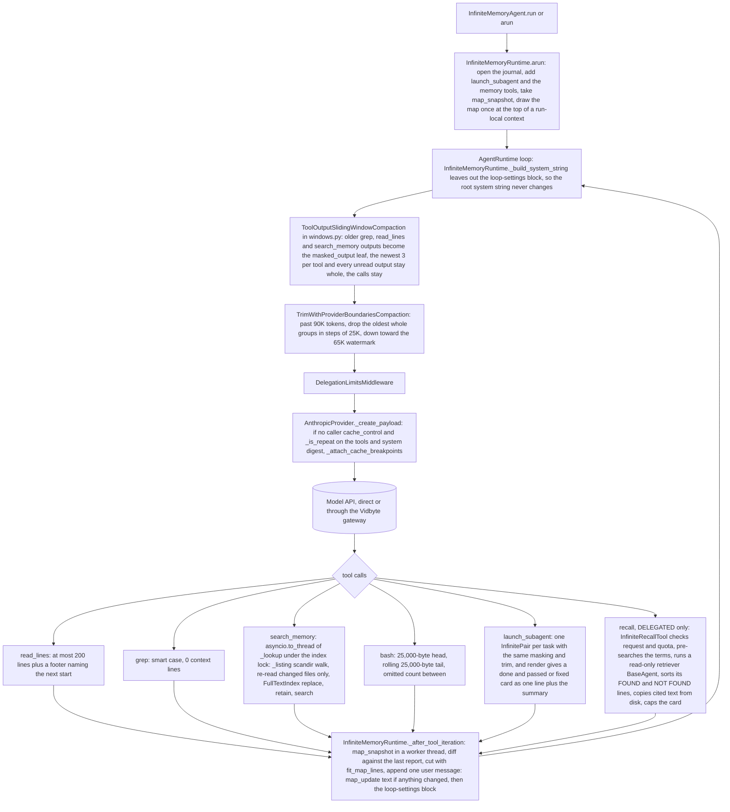

feat(infinite): windowed reads, masked search output, ranked search_memory, a cache-stable root prompt with Anthropic cache marks, and opt-in recall

## Summary
InfiniteMemoryAgent now re-sends much less of its own history on every model call and finds memory by ranked search: `read_lines` returns 200-line windows with a footer naming the next start line, older `grep`/`read_lines`/`search_memory` outputs become a one-line placeholder while their calls stay (never an output the model has not read yet), the workspace grep is smart-case with no context lines, the history trim cuts in whole 25K-token steps toward a 65K low watermark so its cut moves rarely, passed and fixed result cards shrink to one line plus the summary, and every agent holds `search_memory` on one in-memory SQLite FTS5 index with BM25 ranking that the whole tree shares. Two changes reach every SDK user: `bash` keeps the first and the last 25,000 bytes of a long output with the omitted count between them, and the Anthropic adapter adds block-level `cache_control` marks only to a request whose tools and system it has already sent. The decision that matters most is the stable root prefix: the root's system string is now byte-identical on every call of a run, because the workspace map is drawn once and the per-call loop counters and map changes move into one user status message after each tool iteration, so a provider's prompt cache can serve the whole prefix. Delegated `recall` is built but off by default (`InfiniteRecallMode.DIRECT`); under `DELEGATED`, a read-only retriever cites places and the code copies the cited text from disk. Spec: `docs/spec/infinite-memory-context-economy/spec.md` (r5).

## How to use what this PR introduces
```python
import asyncio
from pathlib import Path

from vidbyte import InfiniteRecallMode, InfiniteWorkspaceSettings
from vidbyte.lib.dataclasses.filesystem import FileSystemToolConfig
from vidbyte.tools.filesystem.read_lines import ReadLinesTool
from vidbyte.tools.types import ToolCall

notes = Path("notes")
notes.mkdir(exist_ok=True)
(notes / "long.md").write_text("\n".join(f"line {n}" for n in range(1, 1001)), encoding="utf-8")

reader = ReadLinesTool(FileSystemToolConfig(root=notes, max_read_lines=200))
result = asyncio.run(reader.execute(ToolCall(tool_name="read_lines", arguments={"path": "long.md"})))
print(result.output.splitlines()[-1])
print(result.metadata["truncated"], result.metadata["total_lines"], result.metadata["next_start"])

workspace = InfiniteWorkspaceSettings(root="memory", recall_mode="delegated")
print(workspace.max_read_lines, workspace.recall_mode is InfiniteRecallMode.DELEGATED)
```
I ran the spec §4 snippet unchanged, from an empty scratch folder on this branch (Python 3.11.0, `PYTHONPATH` set to the worktree). It printed exactly the three lines §4 promises (compared with `diff` after stripping CR):
```text
[lines 1-200 of 1000 shown; read on with start=201]
True 1000 201
200 True
```
A developer who builds an `InfiniteMemoryAgent` changes nothing to get the savings. Every agent reads in 200-line windows, masks old search outputs, trims with hysteresis, and holds `search_memory`, and the root sends the same system string on every call. `recall_mode="delegated"` (or `InfiniteRecallMode.DELEGATED`) is the only new opt-in. Any other toolset that builds `ReadLinesTool` without `max_read_lines` still reads to the end of the file.

## Flow

The run starts in `InfiniteMemoryRuntime.arun`, which snapshots the workspace and draws the map once. On every call the root's system string is built without the loop counters, and three middlewares shape only that call's view of the history: masking, then the low-watermark trim, then the delegation limits. The Anthropic adapter marks the request for caching only when it has already sent the same tools and system. After each tool iteration, the runtime recounts the workspace off the event loop and appends one status message with the changed map lines and the loop counters. Raw history stays append-only, so the masked and trimmed views are pure functions of it. Generators, verifiers and the retriever get the same masking and trim, but keep their own loop block and a map drawn when they start.

## What changed
| File | Change |
|---|---|
| `vidbyte/agents/infinite/agent.py` | The root holds the workspace tools minus the ones its recall mode withholds (grep under DELEGATED), over the workspace's one full-text index. Its middleware is masking, then the trim with the 65K watermark, then the delegation limits. |
| `vidbyte/agents/infinite/launch.py` | Generators and verifiers get the same tools, index, masking and trim. `render` returns the finished line and the summary for a done pair that passed or was fixed; every other card renders whole. |
| `vidbyte/agents/infinite/memory.py` | `InfiniteAgentMemory` gains a required `settings` keyword and a `recalled` counter; the builder table adds `recall`, and the registry is asked with the recall mode. |
| `vidbyte/agents/infinite/recall.py` (new) | `InfiniteRecallTool`: checks the request and the quota of 10, pre-searches each term, runs a read-only retriever (grep, read_lines, search_memory, no bash, 8 iterations), checks each citation, copies entries and line ranges from disk, and caps the card at 1,500 tokens. |
| `vidbyte/agents/infinite/runtime.py` | Draws the map once per run. `_build_system_string` drops the loop-settings block. `_after_tool_iteration` diffs map snapshots off the event loop and appends one status message. |
| `vidbyte/agents/infinite/settings.py` | `InfiniteWorkspaceSettings` gains `max_read_lines` (default 200) and `recall_mode` (default `DIRECT`, text accepted). |
| `vidbyte/agents/infinite/workspace.py` | Holds `full_text`, the tree's one `FullTextIndex`. `map_text` is split into `map_snapshot` and the static `fit_map_lines`; the map output is byte-identical. |
| `vidbyte/lib/constants/infinite.py` | New named caps, names and patterns: read window, masking scope, grep context, low watermark, search and recall caps, recall reply patterns, bookkeeping names, sniff size, the removed-file line. `search_memory` and `recall` become reserved tool names. |
| `vidbyte/lib/dataclasses/code_search.py` | `FullTextRow`, `FullTextHit`, `FullTextMatches`, validated frozen records. |
| `vidbyte/lib/dataclasses/coding.py` | Uses the renamed `LineLimit`. |
| `vidbyte/lib/dataclasses/filesystem.py` | `OverwriteLineLimit` becomes `LineLimit`, shared by both line caps (it was not in the public API contract). `FileSystemToolConfig.max_read_lines` (default `None`, read to the end). |
| `vidbyte/lib/dataclasses/infinite.py` | `InfiniteMapSnapshot`, `InfiniteRecallRequest`, and `InfiniteRecallCitation` with its `parse` of the three reply line forms. |
| `vidbyte/lib/enums/__init__.py` | Exports `InfiniteRecallMode`. |
| `vidbyte/lib/enums/infinite.py` | `InfiniteRecallMode` (`DIRECT`, `DELEGATED`). |
| `vidbyte/lib/enums/prompts.py` | Ten `Prompt` members for the new leaves. |
| `vidbyte/lib/registries/infinite.py` | `tool_names(preset, role, recall_mode=DIRECT)` adds recall for the root and generators under DELEGATED; new `withheld_tool_names` withholds grep from them. DIRECT names equal main's. |
| `vidbyte/lib/util/__init__.py` | `FullTextIndex` is a lazy export, loaded on first access by a literal import (an eager import was circular). |
| `vidbyte/lib/util/fulltext.py` (new) | `FullTextIndex`: in-memory FTS5 table (`porter unicode61`), opened on first use, quoted AND matching, bm25 order, snippets, deletes by recorded rowid range, one reentrant lock. A missing FTS5 raises `ConfigurationError` at first use. |
| `vidbyte/middleware/compaction/__init__.py` | Imports the two moved strategies from `windows`; exports unchanged. |
| `vidbyte/middleware/compaction/context_compaction.py` | `tool_output_sliding_window` gains `placeholder` and `tools`; `trim_with_provider_boundaries` gains `low_watermark_tokens`; both are checked when the middleware is built. |
| `vidbyte/middleware/compaction/engine.py` | Forwards `tools` and `low_watermark_tokens` to the strategies. |
| `vidbyte/middleware/compaction/strategies.py` | The two edited strategies moved out to `windows.py` (file now 933 lines). |
| `vidbyte/middleware/compaction/windows.py` (new) | The provider-boundary trim with its stateless quantized low-watermark cut, and the per-tool sliding window with a `tools` scope that never masks an output after the newest model turn. Defaults reproduce main. |
| `vidbyte/providers/anthropic.py` | Block-level `{"type": "ephemeral"}` marks on the system, the last message and the message before the newest assistant turn, only for a repeat of a tools-and-system digest and only on copies of the caller's messages; a caller's own `cache_control` stops all marking. The digest set holds at most 256. |
| `vidbyte/tools/builtins/bash.py` | Keeps a 25,000-byte head and a rolling 25,000-byte tail with the omitted count between them; the timeout path uses the same render. The description says so. |
| `vidbyte/tools/builtins/code_search/__init__.py` | Exports `InfiniteSearchMemoryTool`. |
| `vidbyte/tools/builtins/code_search/base.py` | Names the byte cap `CODE_SEARCH_MAX_FILE_BYTES`; nothing else changes. |
| `vidbyte/tools/builtins/code_search/grep.py` | `smart_case` and `context_lines` constructor options, defaulting to main's behavior; the description gains a sentence only for a non-default option. |
| `vidbyte/tools/builtins/code_search/search_memory.py` (new) | `InfiniteSearchMemoryTool` (`search_memory`): normalizes the query, refreshes the shared index from file fingerprints and searches it in one worker thread under the index lock, and returns up to 10 hits of 12-token snippets plus a total line. |
| `vidbyte/tools/filesystem/read_lines.py` | With `max_read_lines` set, returns one window, a footer naming the next start, and `truncated`, `total_lines`, `next_start` metadata. Without it, output, metadata and spec equal main. |
| `vidbyte/tools/toolsets/__init__.py` | Docstring names `search_memory`. |
| `vidbyte/tools/toolsets/infinite.py` | Four tools: bash, smart-case grep with 0 context lines, windowed read_lines, and search_memory on the index the caller passes. |
| `vidbyte/__init__.py` | Exports `InfiniteRecallMode`. |
| `vidbyte/prompts/prompts/infinite_memory/infinite_memory.json` | Registers the ten new leaves (the family now has 50). |
| `vidbyte/prompts/prompts/infinite_memory/masked_output.md` (new) | The placeholder that replaces a masked output and tells the model to repeat the call. |
| `vidbyte/prompts/prompts/infinite_memory/map_update.md` (new) | The root's status message: current totals, then the added, changed or removed file lines. |
| `vidbyte/prompts/prompts/infinite_memory/recall_card.md` (new) | The recall card: question, not found, rejected citations, searches, then found text copied from disk. |
| `vidbyte/prompts/prompts/infinite_memory/recall_tool_description.md` (new) | The `recall` tool description. |
| `vidbyte/prompts/prompts/infinite_memory/recall_question_description.md` (new) | The `question` parameter description. |
| `vidbyte/prompts/prompts/infinite_memory/recall_purpose_description.md` (new) | The `purpose` parameter description. |
| `vidbyte/prompts/prompts/infinite_memory/recall_known_description.md` (new) | The `known` parameter description. |
| `vidbyte/prompts/prompts/infinite_memory/recall_terms_description.md` (new) | The `terms` parameter description. |
| `vidbyte/prompts/prompts/infinite_memory/retriever_system_prompt.md` (new) | The retriever's rules: search, read, and reply only in FOUND and NOT FOUND citation lines. |
| `vidbyte/prompts/prompts/infinite_memory/retriever_task_prompt.md` (new) | The retriever's first message: question, purpose, what is known, and the pre-search hits. |
| `vidbyte/prompts/prompts/infinite_memory/root_system_prompt.md` | The map is drawn at run start and updates arrive as status messages; search with `search_memory`; read a window at a time; passed and fixed cards come back short; use `recall` when held. |
| `vidbyte/prompts/prompts/infinite_memory/generator_system_prompt.md` | Search with `search_memory`; short cards; `recall` when held. |
| `vidbyte/prompts/prompts/infinite_memory/verifier_system_prompt.md` | Search with `search_memory` or grep. |
| `vidbyte/prompts/prompts/infinite_memory/launch_tool_description.md` | Describes the short card for passed and fixed pairs. |
| `vidbyte/prompts/prompts/infinite_memory/map_header.md` | Live entries are found with `search_memory` or grep. |
| `tests/test_read_lines_window.py` (new) | Item 1: the window, the footer, main parity without a window, refusals, and the §4 snippet. |
| `tests/test_compaction_windows.py` (new) | Items 2 and 4: the scope, unread outputs on every wire role, the quantized cut, and main parity for the defaults. |
| `tests/test_grep_smart_case.py` (new) | Item 3: smart case, regex escapes, context lines, and main parity. |
| `tests/test_fulltext_index.py` (new) | Item 8: the index helper, quoting, ranking, snippets, rowid deletes, lazy open, and the lazy export. |
| `tests/test_anthropic_cache_breakpoints.py` (new) | Item 9: repeat gating, mark placement, caller marks, the gateway rule, no mutation of the caller's messages, lone surrogates. |
| `tests/features/coding_agent/test_bash_tool_head_tail.py` (new) | Item 6: the head, tail and marker, small caps, the timeout shapes. |
| `tests/features/infinite_memory_agent/test_infinite_memory_economy.py` (new) | Items 1 to 5 wired into the agent tree. |
| `tests/features/infinite_memory_agent/test_infinite_memory_stable_prefix.py` (new) | Item 7: one system string per root run, the status message, the capped change report. |
| `tests/features/infinite_memory_agent/test_infinite_memory_search.py` (new) | Item 8: `search_memory` end to end, including hostile queries, transient read failures, warm searches that open no file, and one shared index. |
| `tests/features/infinite_memory_agent/test_infinite_memory_recall.py` (new) | Item 10: modes, registry, card content, rejected citations, quota, card cap, pre-search order. |
| `tests/features/coding_agent/test_bash_tool_contract.py` | Deliberately changed (spec INV-6.2): the 20 MB output now ends with the command's last line. |
| `tests/features/coding_agent/test_bash_tool_process_bounds.py` | Deliberately changed (INV-6.4): the timeout result is head, counted marker, tail, stopped line. |
| `tests/features/coding_agent/test_coding_agent_verify_command.py` | Deliberately changed (EC-6.4): verify feedback ends with the tail. |
| `tests/features/infinite_memory_agent/test_infinite_memory_contract.py` | Deliberately changed (FR-10.7): the prompt family has 50 leaves. |
| `tests/features/infinite_memory_agent/test_infinite_memory_delegation.py` | Deliberately changed (FR-8.1, INV-5.1): agents hold `search_memory`; passed cards are compact. |
| `tests/features/infinite_memory_agent/test_infinite_memory_workspace.py` | Deliberately changed (INV-7.2, INV-7.3): the new note reaches the root as a status message, not a redrawn system map. |
| `tests/features/infinite_memory_agent/infinite_memory_fixtures.py` | Records raw tool dicts and the agents served, for byte-identical and middleware checks. |
| `tests/test_prompt_sits_at_run_boundary.py` | Deliberately changed (INV-9.3, EC-9.10): on a repeat Anthropic request the task goes out as one marked text block. |
| `tests/features/coding_agent/FEATURE.md`, `tests/features/coding_agent/README.md` | Describe the head-and-tail output and the new test file. |
| `tests/features/infinite_memory_agent/FEATURE.md`, `tests/features/infinite_memory_agent/README.md` | Describe the four context-economy test files and what they cover. |
| `vidbyte/agents/README.md`, `vidbyte/agents/infinite/README.md` | Bash head and tail, `search_memory` on every agent, DELEGATED recall, the read window, masking, the watermark, compact cards, the status message, the context budget (about 107,000 tokens). |
| `vidbyte/providers/README.md` | New "Anthropic Prompt-Cache Marks" section. |
| `vidbyte/tools/README.md`, `vidbyte/lib/README.md`, `vidbyte/prompts/README.md` | List `search_memory`, `FullTextIndex`, the grep and read options, and the new leaves. |
| `llms.txt`, `artifacts/file_index.md` | List `InfiniteSearchMemoryTool` with the other code-search tools. |
| `contracts/sdk-public-api.json` | Regenerated: adds `InfiniteRecallMode` (645 exports). |

## Acceptance criteria → proof
Every test below exists on this branch. The AC-1 snippet was also rerun by hand (see Usage).

| AC | What it checks (plain words) | Proven by |
|---|---|---|
| AC-1 | The §4 snippet prints exactly its three lines. | `test_read_lines_window.py::test_section_4_snippet_prints_exactly_the_three_documented_lines` |
| AC-1.1 | A 1,000-line file comes back as lines 1–200 plus the footer and the right metadata. | `test_read_lines_window.py::test_a_long_file_returns_the_window_then_a_footer_naming_the_next_start` |
| AC-1.2 | A range inside the window equals main, with no footer. | `test_read_lines_window.py::test_a_range_within_the_window_is_identical_to_main_with_no_footer` |
| AC-1.3 | A range running past the end returns the rest with no footer. | `test_read_lines_window.py::test_a_range_running_past_the_end_returns_the_rest_without_a_footer` |
| AC-1.4 | Without a window, output, metadata and spec equal main. | `test_read_lines_window.py::test_without_a_window_output_metadata_and_spec_equal_main` |
| AC-1.5 | A window of 0, −1, `True` or 2.5 is refused, naming the field. | `test_read_lines_window.py::test_a_bad_window_is_refused_naming_the_field`; `test_infinite_memory_economy.py::test_the_workspace_read_window_validates_and_reaches_read_lines` |
| AC-1.6 | Root, generator and verifier all read in 200-line windows. | `test_infinite_memory_economy.py::test_every_agent_reads_a_long_note_in_a_200_line_window_with_a_footer` |
| AC-2.1 | Of 5 grep outputs, the oldest 2 are masked; every call stays. | `test_compaction_windows.py::test_a_scope_compacts_only_the_named_tools_and_keeps_the_newest_per_tool`; `test_infinite_memory_economy.py::test_the_root_masks_the_two_oldest_of_five_grep_outputs_and_keeps_every_call` |
| AC-2.2 | Among launch, bash, remember and 4 read_lines results, only the oldest read_lines output is masked. | `test_infinite_memory_economy.py::test_only_read_lines_outputs_are_masked_among_launch_bash_and_remember_results` |
| AC-2.3 | The window builder with no new arguments equals main. | `test_compaction_windows.py::test_the_builder_with_no_new_arguments_equals_main` |
| AC-2.4 | Masking runs before the trim. | `test_infinite_memory_economy.py::test_masking_runs_before_the_trim_so_a_masked_view_under_the_cap_keeps_every_call` |
| AC-2.5 | A parallel batch of 5 reads stays whole until the model answers, on OpenAI, Anthropic and Gemini wires. | `test_infinite_memory_economy.py::test_a_parallel_batch_of_reads_stays_whole_until_the_model_has_answered_it` (`[openai]`, `[anthropic]`, `[gemini]`); `test_compaction_windows.py::test_a_scope_keeps_outputs_after_the_newest_model_turn_whole_on_every_wire_role` |
| AC-3.1 | A lowercase pattern matches capitalized text, shown with no context lines. | `test_grep_smart_case.py::test_a_lowercase_pattern_ignores_case_and_an_uppercase_one_matches_exactly`; `test_infinite_memory_economy.py::test_every_agents_workspace_grep_is_smart_case_with_no_context_lines` |
| AC-3.2 | A pattern with a capital matches its case exactly. | same two tests as AC-3.1 |
| AC-3.3 | The `S` in a regex `\S` does not count as a capital. | `test_grep_smart_case.py::test_a_letter_after_a_regex_backslash_does_not_count_as_uppercase` |
| AC-3.4 | `GrepTool` with defaults equals main. | `test_grep_smart_case.py::test_grep_built_without_the_new_options_equals_main` |
| AC-4.1 | A 91K history keeps one contiguous suffix of 65.5K–66K tokens. | `test_compaction_windows.py::test_a_91k_history_keeps_one_suffix_between_65_5k_and_66k` |
| AC-4.2 | Appending up to 24K more keeps the same first message. | `test_compaction_windows.py::test_appending_up_to_24k_more_keeps_the_same_first_message` |
| AC-4.3 | No watermark (or one at or above the cap) equals main's trim. | `test_compaction_windows.py::test_without_a_low_watermark_the_trim_equals_main` |
| AC-4.4 | With equal-size outputs the cut moves at most once per 25K appended. | `test_infinite_memory_economy.py::test_with_equal_outputs_the_cut_moves_at_most_once_per_s_tokens_appended` |
| AC-4.5 | One masking dip moves the cut back once and forward once. | `test_infinite_memory_economy.py::test_one_masking_dip_moves_the_cut_back_once_and_forward_once` |
| AC-5.1 | A done and passed card is the finished line plus the summary. | `test_infinite_memory_economy.py::test_passed_and_fixed_cards_are_compact_while_failed_unchecked_and_partial_cards_stay_whole`; `test_infinite_memory_delegation.py::test_two_tasks_run_concurrently_and_each_verifier_follows_its_own_generator` |
| AC-5.2 | Failed, unchecked and partial cards stay whole. | `test_infinite_memory_economy.py::test_passed_and_fixed_cards_are_compact_while_failed_unchecked_and_partial_cards_stay_whole` |
| AC-5.3 | A replayed passed card is the label then the compact card. | `test_infinite_memory_economy.py::test_a_replayed_passed_card_is_the_label_then_the_compact_card` |
| AC-6.1 | 60,000 bytes keep the first and last 25,000 with 10,000 counted between. | `test_bash_tool_head_tail.py::test_sixty_thousand_bytes_keep_the_first_and_last_25000_with_10000_counted_between` |
| AC-6.2 | 20 MB stays memory-bounded and ends with the command's last line. | `test_bash_tool_contract.py::test_large_output_keeps_the_first_bytes_counts_the_rest_and_memory_stays_bounded` |
| AC-6.3 | Output within the cap equals main. | `test_bash_tool_head_tail.py::test_output_within_the_cap_equals_main_even_with_a_character_across_the_head_tail_edge` |
| AC-6.4 | A timeout after exactly the cap shows every byte and no marker. | `test_bash_tool_head_tail.py::test_timeout_after_exactly_the_cap_shows_every_byte_then_the_stopped_line_and_no_marker` |
| AC-6.5 | A small patched cap splits by the spec formula. | `test_bash_tool_head_tail.py::test_small_caps_split_into_a_head_and_a_tail_by_the_spec_formula` |
| AC-7.1 | Every root call of a run has the same system string, with no loop counter. | `test_infinite_memory_stable_prefix.py::test_one_root_run_keeps_one_system_string_and_one_tool_list_while_children_keep_their_block` |
| AC-7.2 | After a write, one status message names the new note and the loop counter. | `test_infinite_memory_stable_prefix.py::test_each_tool_iteration_appends_one_status_message_with_the_changed_map_lines_and_the_loop_block` |
| AC-7.3 | Generators and verifiers keep their loop block and map, as on main. | `test_infinite_memory_stable_prefix.py::test_one_root_run_keeps_one_system_string_and_one_tool_list_while_children_keep_their_block` |
| AC-7.4 | A change report over the map cap is cut by the map's rule, and cut lines never repeat. | `test_infinite_memory_stable_prefix.py::test_a_report_over_the_map_cap_is_cut_by_the_maps_rule_and_its_left_out_lines_are_never_repeated` |
| AC-7.5 | A quiet iteration appends only the loop block. | `test_infinite_memory_stable_prefix.py::test_each_tool_iteration_appends_one_status_message_with_the_changed_map_lines_and_the_loop_block` |
| AC-8.1 | An entry hit comes first as `#id kind`, and the last line counts shown and total. | `test_infinite_memory_search.py::test_an_entry_hit_comes_first_as_id_and_kind_and_the_last_line_counts_shown_and_total` |
| AC-8.2 | FTS5 syntax in a query is searched as text and never raises. | `test_infinite_memory_search.py::test_fts5_syntax_in_a_query_is_searched_as_text_and_never_raises` |
| AC-8.3 | A note bash writes after a search is found by the next search. | `test_infinite_memory_search.py::test_a_note_bash_writes_after_a_search_is_found_by_the_next_search` |
| AC-8.4 | Without FTS5 the tool returns `fts5_unavailable` and everything else works. | `test_infinite_memory_search.py::test_without_fts5_the_tool_returns_fts5_unavailable_naming_fts5_and_the_version`; `test_infinite_memory_search.py::test_without_fts5_the_agent_still_runs_and_grep_still_works` |
| AC-8.5 | At most 10 hits, each snippet at most 12 tokens. | `test_infinite_memory_search.py::test_at_most_ten_hits_are_shown_with_snippets_of_at_most_twelve_tokens` |
| AC-8.6 | A word no row holds gives only `0 of 0`. | `test_infinite_memory_search.py::test_a_word_no_row_holds_gives_only_the_total_line_with_zero_of_zero` |
| AC-8.7 | One index serves the whole tree, and every search sees the disk at call time. | `test_infinite_memory_search.py::test_one_index_serves_the_whole_tree_and_every_search_sees_the_disk_at_call_time` |
| AC-9.1 | The first body is unmarked; the repeat marks system, last message, and the message before the newest assistant turn. | `test_anthropic_cache_breakpoints.py::test_a_repeat_marks_the_system_the_last_message_and_the_message_before_the_newest_assistant` |
| AC-9.2 | An agent whose system changes every call never sends marks. | `test_anthropic_cache_breakpoints.py::test_an_agent_whose_system_changes_every_call_sends_no_marks`; `test_anthropic_cache_breakpoints.py::test_adapter_level_a_system_that_changes_every_call_is_never_marked` |
| AC-9.3 | A caller's own `cache_control` stops all marking. | `test_anthropic_cache_breakpoints.py::test_caller_supplied_cache_control_anywhere_stops_all_marking` |
| AC-9.4 | A repeat body passes the gateway's cache rule and adds no top-level key. | `test_anthropic_cache_breakpoints.py::test_a_repeat_body_passes_the_gateway_rule_and_adds_no_top_level_key`; `test_anthropic_cache_breakpoints.py::test_a_gateway_run_forwards_the_marked_repeat_body` |
| AC-9.5 | The caller's messages are never marked, and marks never pile up. | `test_anthropic_cache_breakpoints.py::test_the_callers_messages_are_never_marked_and_marks_never_pile_up` |
| AC-10.1 | By default no agent holds `recall`, and every agent holds grep, read_lines and search_memory. | `test_infinite_memory_recall.py::test_each_agent_is_offered_its_modes_tools[direct]` |
| AC-10.2 | Under DELEGATED, root and generator hold recall and not grep; the verifier keeps grep. | `test_infinite_memory_recall.py::test_each_agent_is_offered_its_modes_tools[delegated]` |
| AC-10.3 | The card holds only entry and line text copied from disk. | `test_infinite_memory_recall.py::test_a_recall_card_holds_only_text_copied_from_disk_under_its_code_built_labels` |
| AC-10.4 | Every invalid citation is listed as rejected; only the valid one is copied. | `test_infinite_memory_recall.py::test_every_invalid_citation_is_listed_as_rejected_and_only_the_valid_one_is_transcribed` |
| AC-10.5 | A recall past the quota is refused and starts nothing. | `test_infinite_memory_recall.py::test_a_recall_refused_for_validation_costs_nothing_and_the_quota_counts_failed_attempts` |
| AC-10.6 | Under DIRECT the registry names equal main's. | `test_infinite_memory_recall.py::test_the_registry_names_main_tools_in_direct_and_adds_recall_and_withholds_grep_in_delegated` |
| AC-10.7 | A card over its cap is cut to an exact prefix of the disk text and keeps the other sections. | `test_infinite_memory_recall.py::test_a_card_over_its_cap_cuts_the_found_text_to_a_prefix_of_the_disk_and_keeps_the_other_sections` |
| AC-10.8 | Terms are searched one by one, in order, before the retriever starts. | `test_infinite_memory_recall.py::test_terms_are_searched_one_by_one_in_order_before_the_retriever_starts` |

## Verification
Local gates ran at code head `335dd847` (verify-log Iteration 2); the later commits change only `docs/spec/`. The S6 rows were rerun at `5379f9f7`.

| Gate | Command | Result |
|---|---|---|
| Lint | `PYTHONIOENCODING=utf-8 python lint/run.py` | PASS: `A007   operational-constants                     255    255 RATCHETED` · `C016   public-api-contract-current                 0      0 CLEAN` · `SDK-LINT: PASS`. Every rule count equals main's; `lint/baseline.json` is untouched. |
| Source stage | `PYTHONPATH=… python scripts/run_ci.py --stage source` | Lint, compileall, the context checks and the trace contracts pass (`reasoning trace contracts: ok (182 tools, 55 shapes)`). Pytest: `3 failed, 6582 passed, 16 skipped in 112.00s`. The 3 are inherited, not caused by this PR's code (see below). |
| Package stage | `env -u PYTHONPATH python scripts/run_ci.py --stage package` | `Installed vidbyte-sdk 0.3.0 passed smoke checks.` · `CI passed.` |
| Public API contract | `python scripts/generate-sdk-public-api.py --check` | `contracts/sdk-public-api.json is current at 5ccc4926… (vidbyte-sdk 0.3.0, 645 exports).` |
| Semgrep 1.170.1 | `semgrep --test …` then `semgrep scan --error --config .semgrep/typed-mapping-boundary-policy.yml vidbyte` | `1/1: ✓ All tests passed` · `Findings: 0 (0 blocking)` |
| Related suites | `pytest tests/features/infinite_memory_agent tests/test_compaction_windows.py … tests/test_anthropic_cache_breakpoints.py` | `348 passed in 8.84s` |
| S6: AC-1 by hand | spec §4 snippet from an empty scratch folder | exact match with §4 |
| S6: touched test files (Windows) | `pytest` over the 10 new test files, the 7 edited ones, and the rest of the infinite feature folder | `329 passed, 11 skipped in 22.62s`; the 11 skips are POSIX-only bash process tests, which Linux CI runs |
| Remote `ci.yml` | run 39023135090 at `335dd847` | Source / Python 3.11 `6401 passed, 200 skipped` · Source / Python 3.12 `6401 passed, 200 skipped` · Package `CI passed.` (3/3 jobs success) |
| Remote `static-policy.yml` | run 39023136622 at `335dd847` | 1/1 job success · `Findings: 0 (0 blocking)` |

The 3 local failures are `tests/features/harness_threads/test_harness_threads_surface.py`: `test_failure_codes_keep_main_and_append_exactly_the_28_harness_codes`, `test_branch_leaves_the_tools_and_configs_packages_as_main_has_them`, and `test_import_vidbyte_starts_no_process_and_leaves_the_native_package_unloaded`. They were written for the harness-threads branch and compare the current branch with `git merge-base origin/main HEAD`. The first pins main's `FailureCode` at 120 members, but main now has 167, so it fails on `main` itself. The other two fail for any branch that changes `vidbyte/tools/` or the root `__all__`, which this PR does on purpose. All three skip or return early on CI's shallow checkout, which is why CI is green.

## Adversarial review
24 findings confirmed by an independent verifier across three lenses (spec conformance, repo conventions, engineering), plus 6 from the post-repair re-review (two rounds); 20 fixed, 1 waived, 9 follow-ups. The verifier also refuted 2 claims and downgraded 4. The second re-review round found the PR sound, with two Minors left as follow-ups. Full record: `docs/spec/infinite-memory-context-economy/review.md`.

| ID | Finding | Fixed in |
|---|---|---|
| R-1 (Blocker) | The `recall` question description gave an example list, which the model-facing prose rule forbids. | `848469a2` |
| R-2 (Blocker) | A NUL or lone surrogate in a query, an entry line, or a file name made `search_memory` raise, for every agent of the tree. | `0e41b3a2` |
| R-3 (Blocker) | Masking hid outputs of a parallel batch before the model had read them. | `5634b579` (after spec r5 `987d156e`) |
| R-4 (Blocker) | The Anthropic cache helpers were three call levels deep (AGENTS.md principle 1). | `7d6d7449` |
| R-5 (Blocker) | 41 new source comment lines were wider than 72 columns. | `1a6365e6` |
| R-6 (Major) | A lone surrogate in the system or a tool made the first Anthropic request raise in the digest. | `5698fdab` |
| R-7 (Major) | A warm `search_memory` re-read every workspace file (about 470 ms at the caps). | `7eb2942c` |
| R-8 (Major) | No test pinned R-2. | `fd6dab0b` |
| R-9 (Major) | No test pinned R-3. | `fd6dab0b` |
| R-10 (Major) | No test pinned R-7. | `fd6dab0b` |
| R-11 (Major) | No test pinned R-6. | `fd6dab0b` |
| R-25 (Major, re-review) | After the R-7 fix, a changed file whose read failed once was stored as empty and hidden until it changed again. | `335dd847` (pinned at `1385c8e7`) |

Minors fixed: R-12 `3ec30b9e`, R-13 `1fbe3ede` and `8da92fb9`, R-14 `468303dc`, R-15 `a805c951`, R-16 `7ab9a924`, R-19 `d7bb1f4a`, R-24 `fd6dab0b`, and R-27 (spec drift) in this PR's final docs commit (spec §17 "Implementation deviations (S5)"). Waived: R-23, test comment width (main's own new tests do not follow the 72-column rule).

## Deviations from the spec
Each item says what the spec said, what the code does, and why. Most come from the implementation (S3); the rest come from the review repairs (S5). Both lists are also recorded in spec §17.

- **`FullTextIndex` export (§12.3 row 13).** The spec said to re-export it from `vidbyte.lib.util`. The code makes it a lazy export: `__getattr__` imports `vidbyte.lib.util.fulltext` by its literal name. An eager import made `import vidbyte` fail in a cycle (`validation` → `lib.util` → `fulltext` → `code_search` → `validation`). The R-13 repair first used `importlib.import_module(_LAZY_EXPORTS[name])`, which lint rule C003 rejects; the final code imports the literal module and returns the attribute by name, so a listed name the module lacks raises instead of resolving to `FullTextIndex`.
- **`FullTextIndex.search` size checks (row 12).** The spec showed an inline guard. The code uses `RecordFieldValidator.require_int` and re-raises `ValueError`, with two new constants, `FULLTEXT_MIN_HITS` and `FULLTEXT_SNIPPET_MIN_TOKENS`. The inline guard was a new C002 finding.
- **Read window local name (rows 1, 3).** The local variable is `window`, not `limit`, because a local named `limit` pulled existing literals into A007.
- **Trim watermark check (row 7).** The middleware builds the trim for every mode (`None` passes), so `_validate_options` stays within C901.
- **Bash render (rows 14, 15).** `_render` takes `exit_code: int | None`; `None` means the time limit stopped the command, so one method renders both shapes.
- **Anthropic gate (row 15, §8.5).** The spec put the repeat check inside `_attach_cache_breakpoints`. The code checks `not self._holds_cache_control(payload) and self._is_repeat(payload)` in `_create_payload`, so every helper is one call level deep. The short-circuit is the same. The digest also encodes with `surrogatepass` (R-6).
- **Map and card call depth (rows 24, 25).** `render` → `finished_lines` and `map_text` → `map_snapshot` are depth 2, as the spec's split implies. The snapshot is taken before the map is drawn. `InfiniteMapSnapshot` does not use `one_line`. The runtime recounts the map in a worker thread (R-14).
- **`search_memory` walk (row 20, §8.2, §11).** The spec named `iter_files`. The code uses its own `os.scandir` walk, `_listing`, which keeps grep's rules and takes the fingerprint from the listing, so a warm search opens no unchanged file (R-7). A folder reached twice through a link or a junction is walked once. `code_search/base.py` is unchanged apart from the named byte cap.
- **`search_memory` sniff (rows 16, 20).** The spec relied on the base `is_text_file` check. The row helpers now read the first `INFINITE_SEARCH_SNIFF_BYTES` (2,048, a new constant) of a changed file for a NUL, so a failed read raises and the file is tried again on the next call (R-25). The byte cap now comes only from the listing's stat: a file that grows past the cap between the listing and the read is indexed once and left out from the next listing on. The pre-R-7 code had the same window.
- **Recall details the spec left open (row 57).** A found range is labelled by its resolved workspace-relative POSIX path. `_sort` also catches `ValueError` (Python's integer digit limit). The retriever-failure result and the rejection reasons are inline text, not prompt leaves, because they carry numbers. A missing `question` or `purpose` reads as blank text, which the record refuses by name. The withheld tool is the literal `"grep"`, because no grep name constant exists (follow-up R-17).
- **Recall pre-search (row 57, INV-10.6, EC-10.3).** The term pre-search runs inside the same `try` as the retriever, so a failure returns the recall's own error. It still uses one recall, as the spec counts any attempt that started (R-19).
- **Recall mode at call sites (rows 22, 23, 27).** The call sites pass `InfiniteRecallMode(settings.recall_mode)`, because the settings field is typed `InfiniteRecallMode | str` and the registry takes the enum.
- **Masking rule (INV-2.3).** The rule was amended in spec r5 after review R-3. Every scoped output after the newest model turn (`assistant`, or `model` on Gemini) stays whole and still counts toward the newest 3.
- **`llms.txt:815`.** The spec granted only the two export lines (rows 58, 59). The "Direct utilities and search" table row was also updated, under an extended orchestrator grant.
- **Lint baseline (row 56).** No count was lowered. The lint run prints eight IMPROVED verdicts (A002 703→562, C011, S001, S009, S010, S025, S061, S063). The same counts appear on a copy of main, so they come from main's stale baseline, not from this PR.
- **Docs.** The READMEs and the constants header restate the context budget as about 107,000 tokens, where main said about 105,000.

## Follow-ups
**Deliberate scope (decided, not gaps)**
- All ten items ship in one PR against `main`.
- `recall` is built opt-in, and DIRECT stays the default. The spec's open questions Q-2 to Q-12 are not built.
- The stable prefix covers the InfiniteMemory root only. Generators, verifiers and the retriever keep the loop-settings block in their system strings, so they get the masking and trim savings but no cache gain (spec NG-1, EC-7.6).
- Only block-level Anthropic marks are sent, never a top-level `cache_control`, so gateway runs keep working (NG-7).
- No run events such as `memory_recalled`, because `vidbyte/agents/infinite/events.py` is not on `main` (NG-6).

**Minor review findings left open**
- R-17: name the `"grep"` and `"read_lines"` literals as constants (`vidbyte/lib/registries/infinite.py:76-77`, `vidbyte/lib/constants/infinite.py:137`).
- R-18: a FOUND line with a space in its path, or with no `(why)`, is dropped silently, neither found nor rejected (`vidbyte/lib/constants/infinite.py:99`). A fix needs a spec rule for rejecting such lines.
- R-20: `FullTextIndex.replace` deletes in one transaction and inserts in another (`vidbyte/lib/util/fulltext.py:70`, `:139`). The two should be one transaction. A failed insert heals on the next call today.
- R-21: the masking-plus-trim pair is written out in `agent.py`, `launch.py` and `recall.py`. One shared builder would replace the three copies.
- R-22: give the retriever prompt separate tools, workflow and limits headings. The `feat/infinite-memory-prompts` branch rewrites this family.
- R-26 (existed before this PR): an in-root link to a bookkeeping file, such as one under `.runs/`, is indexed under the target's name. Grep's walk does the same.
- R-28: on Windows, `os.scandir` reports a stale size while another handle holds a file open for writing. Lines appended by such a writer are missed until it closes. This is the one known INV-8.4 gap. **Owner decision:** use `os.stat` per note (about 31 ms per warm search at 1,900 notes), or document the gap beside EC-8.5.
- R-RR2-1: the `search_memory.py:9` header should name the byte-cap window. The comment at `:121-123` says "reads it again" where it should say "tries it again", because a file whose name UTF-8 cannot encode is never read.
- R-RR2-2 (existed before this PR): a deeply nested `entries.jsonl` line raises `RecursionError`, which `_entry_rows` does not catch (`search_memory.py:220`), so every search fails until the line is removed. `workspace.py:271` has the same gap where it parses entries (main's `workspace.py:254`).

**Known limitations and next steps**
- Run with a real key to confirm the cache marks pay off: `cache_read_input_tokens` should be above 0 from the third root call on, direct and through the gateway. The tests prove the body shape and the gateway rule, not the provider's billing.
- The `harness_threads` surface tests fail locally on `main` itself (`167 == 120`), and they fail for any branch that touches `vidbyte/tools/` or the root exports. They need updating to main's counts, or scoping to their own branch.
- `main`'s lint baseline is stale, so the eight IMPROVED verdicts above should be ratcheted in a PR of their own.
- Whether to make DELEGATED recall the default should be decided from real-key traces: do root searches still take 2 or more calls after `search_memory`?

🤖 Generated with [Claude Code](https://claude.com/claude-code)
