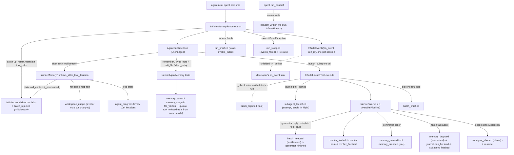

feat(infinite): InfiniteMemoryAgent derives 8 more run events from the run and names the rule behind every refusal
## Summary
`InfiniteMemoryAgent`'s `on_event` stream grows from 14 to 22 kinds, and eight existing details records gain fields. A dashboard can now show every memory commit and drop, the verifier's start and verdict, a pair that was cancelled or crashed, the end of each batch, the saved handoff, workspace fill, the root's progress, and a machine-readable `rule` and `source` on every refusal. That includes the launches `DelegationLimitsMiddleware` denies, which had no event before. Every new fact is derived: one `InfiniteEvents` call at a point the run already passes, reading data the run already holds. Nothing in `vidbyte/agents/runtime.py`, `vidbyte/agents/base.py`, `vidbyte/middleware/`, or `vidbyte/pipelines/` changes, and nothing the model sees or the journal stores changes. The decision that matters most: delegation-cap denials are read back from the DENIED `ToolCallContext` records the agent loop already keeps (the root's `state.call_contexts`, a generator's `reply.metadata["tool_calls"]`), so they need no observer middleware. Spec: `docs/spec/infinite-memory-derived-events/spec.md` (r7).

## How to use what this PR introduces
```python
from vidbyte import InfiniteEventKind, InfiniteMemoryAgent, InfiniteMemoryAgentSettings, InfiniteWorkspaceSettings

events = []
agent = InfiniteMemoryAgent(
    InfiniteMemoryAgentSettings(
        name="analyst",
        system_prompt="You research markets and report sourced findings.",
        provider="openai",
        model_name="gpt-4.1",
        root_dir=".",
        workspace=InfiniteWorkspaceSettings(root="memory"),
        on_event=events.append,
    )
)
reply = agent.run("Compare the list prices of our five competitors.")
run_id = reply.metadata["infinite_run_id"]
agent.run_handoff(run_id)
for event in events:
    if event.kind is InfiniteEventKind.MEMORY_COMMITTED:
        print(f"#{event.details.id} committed by {event.agent_key}: {event.details.text}")
    elif event.kind in (InfiniteEventKind.BATCH_REJECTED, InfiniteEventKind.TOOL_REFUSED):
        print(f"{event.agent_key}: {event.details.source.value} refused ({event.details.rule.value})")
finished = next(event for event in events if event.kind is InfiniteEventKind.RUN_FINISHED)
print(finished.details.passed, finished.details.committed, finished.details.events_failed)
assert events[-1].kind is InfiniteEventKind.HANDOFF_WRITTEN
assert events[-1].details.path == f".runs/{run_id}.handoff.md"
```
I ran this snippet unchanged on this branch. The output below came from a **scripted model runner**: the pack's `ScriptedTree` replaces only `BaseAgent._runner_for_model`, and the workspace, journal, pipeline, middleware, and handoff writer are real. No provider or network was called. In the script, the root first sends two tasks with the same name, then one task `p`. Its generator stages one fact and writes a note, and its verifier passes. The snippet printed:
```
root: tool refused (duplicate_task)
#1 committed by root/p/ver: Acme charges 49 USD per seat
1 1 0
```
Both asserts held, and `memory/.runs/<run_id>.handoff.md` exists. The whole stream of that run, as `kind`, `agent_key`, and `summary`:
```
run_started          root        Run started: Compare the list prices of our five competitors.
batch_rejected       root        launch_subagent refused for root: Two tasks are named t; give every task in one call its own name.
subagent_launched    root        root launched p: Find the list prices for p.
memory_staged        root/p/gen  p/gen proposed s1 (fact): Acme charges 49 USD per seat
file_written         root/p/gen  p/gen created notes/acme.md: Acme pricing notes
generator_finished   root/p/gen  p/gen: done: P-SUMMARY: Acme is 49 USD per seat.
verifier_started     root/p/ver  p/ver is checking 1 staged entries and 1 notes
verifier_finished    root/p/ver  p/ver: verdict passed
memory_committed     root/p/ver  p/ver committed s1 as memory #1 (fact): Acme charges 49 USD per seat
subagent_finished    root        p: passed, 1 memories saved, 0 dropped, 1 files
batch_finished       root        root: batch 0 finished: 1 passed, 0 fixed, 0 failed, 0 unchecked, 0 replayed
run_finished         root        Run finished (final_response): ROOT-FINAL: Acme is cheapest at 49 USD per seat.
handoff_written      root        Handoff saved to .runs/<run_id>.handoff.md
```
The developer still passes one plain function. They no longer have to infer commits, aborts, or refusal reasons from `subagent_finished`'s first five items or from free-text messages.

## For the dashboard/CLI sync
Nothing outside this SDK changed. The backend's `AgentRunEventKind` (cerredz/Vidbyte#708) is a strict 14-value enum, so it would reject the new kinds, and the CLI (cerredz/vidbyte-cli-internal#171) drops kinds it does not know. Both need the 8 values below, and the new fields, before they can show these events.

**New `InfiniteEventKind` values**, appended after `tool_refused` so the existing 14 keep their positions (15 to 22):
`memory_committed`, `verifier_started`, `verifier_finished`, `subagent_aborted`, `batch_finished`, `handoff_written`, `workspace_usage`, `agent_progress`.

**New enums** (in `vidbyte.lib.enums`, not root-exported):
- `InfiniteRefusalRule` (23): `invalid_arguments`, `max_entries_per_agent`, `new_files_per_agent`, `max_files`, `max_tokens`, `max_file_tokens`, `max_entry_tokens`, `entry_one_line`, `duplicate_entry`, `unknown_entry`, `note_path`, `note_description`, `note_missing`, `edit_match`, `malformed_memory`, `duplicate_task`, `tool_not_granted`, `max_agents`, `max_depth`, `max_parallel`, `text_encoding`, `disk`, `other`.
- `InfiniteRefusalSource` (2): `tool`, `middleware`.
- `InfinitePairPhase` (3): `generator`, `verifier`, `commit`.

`InfiniteStopCause` (`failed`, `cancelled`) is reused for `subagent_aborted.reason`.

**New details records** (frozen, no defaults, fields in order):

| Kind | Record | Fields |
|---|---|---|
| `memory_committed` | `InfiniteMemoryCommittedDetails` | `id: int`, `key: str` (the staged key, such as `s1`), `kind: InfiniteEntryKind`, `text: str` (at most 500 chars, one line), `supersedes: int \| None` |
| `verifier_started` | `InfiniteVerifierStartedDetails` | `staged: int`, `files: tuple[str, ...]` (at most 5 note paths), `files_omitted: int` |
| `verifier_finished` | `InfiniteVerifierFinishedDetails` | `verdict: InfiniteVerdict`, `stop_reason: str`, `tool_calls: int`, `tokens: int`, `cost_usd: float \| None`, `duration_ms: int` |
| `subagent_aborted` | `InfiniteSubagentAbortedDetails` | `name: str`, `key: str`, `reason: InfiniteStopCause`, `error_type: str`, `phase: InfinitePairPhase`, `staged: int` |
| `batch_finished` | `InfiniteBatchFinishedDetails` | `batch: int`, `passed: int`, `fixed: int`, `failed: int`, `unchecked: int`, `replayed: int`, `duration_ms: int` |
| `handoff_written` | `InfiniteHandoffWrittenDetails` | `path: str` (workspace-relative), `sections: tuple[int, ...]` (9 lengths), `cut: tuple[str, ...]` (at most 5 titles), `cut_omitted: int` |
| `workspace_usage` | `InfiniteWorkspaceUsageDetails` | `level: int` (0, 50, 75, 90, or 100), `files: int`, `max_files: int`, `tokens: int`, `max_tokens: int`, `map_omitted: int` |
| `agent_progress` | `InfiniteAgentProgressDetails` | `iteration: int`, `max_iterations: int \| None`, `model_calls: int`, `tool_calls: int`, `tokens: int` |

**Enriched details records** (fields appended after the existing ones):

| Record (kinds) | New fields |
|---|---|
| `InfiniteRunFinishedDetails` (`run_finished`) | `iterations: int`, `tool_calls: int`, `duration_ms: int` (this session); `passed: int`, `fixed: int`, `failed: int`, `unchecked: int`, `committed: int`, `files: int`, `deepest: int` (the whole run, across resumes); `events_failed: int` |
| `InfiniteRunStoppedDetails` (`run_stopped`) | `events_failed: int` |
| `InfiniteRefusalDetails` (`batch_rejected`, `tool_refused`) | `rule: InfiniteRefusalRule`, `source: InfiniteRefusalSource` |
| `InfiniteSubagentLaunchedDetails` (`subagent_launched`) | `attempt: int`, `batch: int`, `batch_index: int`, `batch_size: int`, `agents_started: int`, `max_agents: int`, `in_flight: int` |
| `InfiniteSubagentFinishedDetails` (`subagent_finished`) | `error_type: str` (`""` when the card reports no error), `agents_started: int`, `max_agents: int`, `in_flight: int` |
| `InfiniteMemorySavedDetails` (`memory_saved`), `InfiniteMemoryStagedDetails` (`memory_staged`), `InfiniteFileWrittenDetails` (`file_written`) | `entries_left: int`, `entries_max: int`, `files_left: int`, `files_max: int` |

What a consumer needs to know to display them:
- `batch_rejected` now also arrives for delegation-cap denials, with `source` `middleware` and `rule` `max_depth` or `max_parallel`. Filter on `source` to count only tool refusals.
- A pair's row opens on `subagent_launched` and closes on the first `subagent_finished` or `subagent_aborted` for its `key`. A sink interrupt during the finish gives both, finished first.
- `batch` is how many `pair_started` records the run had before the batch. It is unique across launchers and resumes and groups the batch's `subagent_launched` events with its `batch_finished`. Some batches never get a `batch_finished` (see Follow-ups); close those on their pairs' closing events or on the run's terminal event.
- Envelopes: `memory_committed`, `verifier_started`, and `verifier_finished` come from the verifier (`<pair>/ver`); `batch_finished` and `subagent_aborted` from the launcher; `workspace_usage`, `agent_progress`, and `handoff_written` from `root` at depth 0.
- `handoff_written` comes from its own `run_handoff` call, under the run's id, after the run's terminal event. `sections` follows the handoff's fixed order: Outcome, Work done, Decisions, Facts, Lessons, Open questions, Files, Unverified or failed work, How to continue.
- Sizes: every details record is at most 32,768 bytes of JSON (the largest, `subagent_finished`, is 27,909 at its caps), a whole event is at most 31,987 bytes, and every count is at most 2^63 − 1.

## Flow

Each box that ends in an event kind is one public `InfiniteEvents` method. With no sink, every one returns before it reads its arguments, so nothing is built, scanned, or logged. Validation happens in each details record's `__post_init__`. Any failure there or in the sink is caught by `_shielded`, which counts it toward `events_failed` and logs the run id, the kind, and the error class only. State changes only where it already did, and each call comes after its change: `commit_entry` returns before `memory_committed`, a drop is in the pair's list before `memory_dropped`, and the handoff file is swapped in before `handoff_written`. The one new handler is the outer `except BaseException` in `InfinitePair.run`, which announces `subagent_aborted` with the step the pair was in and re-raises the same object.

## What changed
| File | Change |
|---|---|
| `vidbyte/lib/enums/infinite.py` (+59 −8) | 8 `InfiniteEventKind` members appended after `TOOL_REFUSED`; new `InfiniteRefusalRule`, `InfiniteRefusalSource`, and `InfinitePairPhase`. |
| `vidbyte/lib/enums/__init__.py` (+6) | Exports the three new enums. `vidbyte.__all__` is unchanged. |
| `vidbyte/lib/constants/infinite.py` (+63 −13) | 8 summary templates, the progress throttle (10), the usage levels (50/75/90/100) and scale, the depth-segment factor, the handoff section count, and 5 metadata and details keys; the worst-case byte comment is updated. |
| `vidbyte/lib/dataclasses/infinite.py` (+250 −22) | 8 new details records, 8 enriched ones, and the `InfiniteEventDetails` union and `DETAILS_TYPES` extended to 22 kinds. |
| `vidbyte/agents/infinite/events.py` (+292 −34) | 8 new methods; `run_finished`, `batch_rejected`, `subagent_launched`, and `tool_refused` take new inputs; the `_in_flight`, `_failures`, `_opened`, and `_level` counters; leaf helpers `_rule` and `_quota`. |
| `vidbyte/agents/infinite/launch.py` (+125 −67) | The batch offset and `batch_finished`; `_check`'s raises name their rule; `denials()`; `InfinitePair.run` tracks its phase, announces the verifier, the generator's denials, and `subagent_aborted`; `_commit` and `_finish` announce each commit and drop. |
| `vidbyte/agents/infinite/runtime.py` (+39 −10) | The hook announces root denials, `workspace_usage`, and `agent_progress`; a catch-up after the loop announces the final turn's denials; `run_finished` gets the workspace. |
| `vidbyte/agents/infinite/workspace.py` (+45 −25) | 19 refusal raises carry `details["rule"]`, with their messages unchanged; new static `map_omitted(text)`. |
| `vidbyte/agents/infinite/memory.py` (+15 −13) | 6 raises carry `details["rule"]`; the tools pass the exception itself to `tool_refused`. |
| `vidbyte/agents/infinite/journal.py` (+9 −4) | Read-only `started`: every `pair_started` key, in order, repeats kept. The journal format is unchanged. |
| `vidbyte/agents/infinite/agent.py` (+10 −5) | `run_handoff` announces `handoff_written` after the atomic write. |
| `vidbyte/agents/infinite/README.md` (+26 −11) | Lists all 22 kinds and the new fields; denials now give `batch_rejected`; six new agent notes. |
| `vidbyte/agents/README.md` (+1 −1) | The event-stream sentence names the new steps. |
| `tests/.../test_infinite_memory_derived_{pairs,records,refusals,run}.py` (+2,380) | 91 new tests for AC-1 to AC-26. |
| `tests/.../test_infinite_memory_events_{stream,pairs,lifecycle,records}.py`, `test_infinite_memory_handoff.py`, `test_infinite_memory_contract.py` (+159 −48) | PR #1159 pins updated to the new stream, the handoff's error details gain `rule`, and the three line caps rise (events 660, launch 470, lib records 870). |
| `tests/.../infinite_memory_fixtures.py`, `infinite_events_fixtures.py`, `FEATURE.md`, `README.md` (+59 −9) | `tool_calls` (several tool calls in one model turn), `ac7_tree`, the 11-kind `AC2_KINDS`, and the AC map and file index. |
| Pipeline record: 20 files under `docs/spec/infinite-memory-derived-events/` (+4,517, plus this body) | Request, spec r7, test plan, code map, review, verify log, pipeline state, and stage reports. |

## Acceptance criteria → proof
Every test below exists on this branch and passes (`418 passed`). File prefix `test_infinite_memory_` is shortened to `…`.

| AC | What it checks (plain words) | Proven by |
|---|---|---|
| AC-1 | The §4 snippet runs offline, prints the refusal, the commit, and the totals, and both asserts hold | `…derived_run.py::test_the_section_4_snippet_prints_the_refusal_the_commit_and_the_totals_and_its_asserts_hold` |
| AC-2 | A one-pair run gives exactly 11 events in order | `…events_stream.py::test_a_one_pair_run_delivers_eleven_events_in_order_with_their_envelopes_summaries_and_details` |
| AC-3 | An entry a sibling committed first drops with reason `rule` under the verifier; the rest commit | `…derived_pairs.py::test_an_entry_a_sibling_committed_first_is_dropped_by_rule_while_the_rest_commit` |
| AC-4 | With no verdict, or a blank generator, each staged entry drops as `unchecked` under the last agent that ran | `…derived_pairs.py::test_unchecked_entries_drop_under_the_last_agent_that_ran[no-verdict, blank-generator]` |
| AC-5 | Each committed entry gives one `memory_committed`, in staged order, with the id in `entries.jsonl` | `…derived_pairs.py::test_each_committed_entry_is_announced_in_staged_order_after_it_is_on_disk` |
| AC-6 | Every tool refusal names its rule and `source=tool`, and its problem text is unchanged | `…derived_refusals.py::test_each_tool_refusal_names_its_rule_and_source_and_keeps_the_problem_the_model_read` (32 cases); `::test_the_refusal_cases_cover_every_rule_a_tool_can_raise` |
| AC-7 | A `max_parallel` and a `max_depth` denial each give one `batch_rejected` with `source=middleware` | `…derived_refusals.py::test_middleware_denials_name_their_limit_as_rule_and_the_reason_as_problem`; `…events_pairs.py::test_middleware_denials_deliver_one_batch_rejected_each_and_the_run_still_finishes` |
| AC-8 | A denial in the turn the run finishes is announced once, before `run_finished` | `…derived_refusals.py::test_a_denial_in_the_turn_the_run_finishes_is_announced_once_before_run_finished` |
| AC-9 | Quota fields equal the quota line the model read | `…derived_pairs.py::test_each_quota_carrying_event_equals_the_quota_line_the_model_read` |
| AC-10 | A batch beside a replay carries its offset, index, size, attempt, and counters; `batch_finished` counts verdicts and 1 replay | `…derived_pairs.py::test_a_batch_beside_a_replay_announces_its_offset_index_counters_and_verdict_totals` |
| AC-11 | A pair re-run after a resume reads `attempt` 2, and the batch offset continues | `…derived_pairs.py::test_a_pair_launched_again_after_a_resume_counts_a_second_attempt_and_continues_the_offset` |
| AC-12 | A cancelled flat generator announces `subagent_aborted` (cancelled, generator) before `run_stopped` | `…derived_pairs.py::test_a_cancelled_flat_generator_announces_its_abort_before_run_stopped`; `…events_lifecycle.py::test_a_cancelled_run_ends_with_run_stopped_and_its_resume_opens_with_run_resumed` |
| AC-13 | A defect in the pair's own commit step is announced (failed, commit), the same error escapes, and the run still finishes | `…derived_pairs.py::test_an_error_in_the_pairs_own_commit_step_is_announced_and_the_run_goes_on[first-commit-fails, second-commit-fails, first-commit-fails-from-a-key-error]`; `::test_an_aborted_pair_re_raises_the_very_error_it_announced` |
| AC-14 | A child agent's error becomes the card, and `error_type` names the original class | `…derived_pairs.py::test_a_child_agents_error_becomes_the_card_and_names_its_original_class` |
| AC-15 | `run_finished` carries this session's loop counts and the whole run's card totals | `…derived_run.py::test_run_finished_carries_this_sessions_loop_counts_and_the_whole_runs_card_totals` |
| AC-16 | `events_failed` on the terminal event counts the sink's failures | `…derived_run.py::test_the_terminal_event_counts_the_events_the_sink_failed_on[finished, stopped]` |
| AC-17 | `workspace_usage` arrives exactly when the level or the map's cut state changes, up and down | `…derived_run.py::test_workspace_usage_arrives_exactly_when_the_level_crosses_up_or_down`; `::test_workspace_usage_arrives_when_the_map_is_cut_and_again_when_it_is_whole` |
| AC-18 | `agent_progress` arrives at root iterations 10 and 20 only | `…derived_run.py::test_agent_progress_arrives_every_tenth_root_iteration_with_the_roots_own_counts` |
| AC-19 | `handoff_written` is last, with the relative path, 9 section lengths, and the cut titles | `…derived_run.py::test_handoff_written_is_the_last_event_and_names_the_saved_file_and_its_sections`; `::test_handoff_written_names_the_sections_cut_at_their_caps` |
| AC-20 | With no sink, no event is built, no usage is scanned, and nothing is logged | `…derived_run.py::test_without_a_sink_no_event_is_built_no_usage_is_scanned_and_nothing_is_logged`; `…events_stream.py::test_without_a_sink_no_event_method_builds_an_event_or_logs` |
| AC-21 | A sink changes nothing the model or the disk sees | `…derived_run.py::test_a_sink_changes_nothing_the_model_or_the_disk_sees[ac2, ac7, wide]` |
| AC-22 | A sink that always raises changes nothing, and each failure is logged once | `…derived_run.py::test_a_sink_that_raises_on_every_kind_changes_nothing_and_logs_each_failure_once` |
| AC-23 | `InfiniteEvents`' public methods are exactly the 22 kinds, positional | `…derived_records.py::test_every_public_events_method_takes_the_spec_parameters_by_position` |
| AC-24 | The kinds and the three new enums hold exactly the spec's values, exported from `vidbyte.lib.enums` only | `…derived_records.py::test_the_kinds_and_three_new_enums_hold_exactly_the_spec_values_in_order`; `…events_records.py::test_the_public_names_are_one_object_wherever_they_are_exported` |
| AC-25 | Every new or changed record has the spec's fields and rules and stays at most 32,768 bytes | `…derived_records.py::test_the_new_and_enriched_records_have_the_spec_fields_in_order_with_no_defaults`, `::test_every_count_field_refuses_a_negative_a_bool_and_one_over_the_count_cap`, `::test_every_enum_field_refuses_a_value_outside_its_enum`, `::test_the_section_9_1_rules_that_are_not_plain_counts`; `…events_records.py` size tests (`_FIGURES`) |
| AC-26 | Two runs of one script give equal streams once ids, stamps, and durations are normalized | `…derived_run.py::test_two_runs_of_one_script_give_equal_streams_once_ids_stamps_and_durations_are_normalized` |

## Verification
I ran every gate below from the worktree root at `cdf75a62`. The last executable change is `2c986483` in `vidbyte/` and `76314c4d` in `tests/`; later commits touch only docstrings, READMEs, and the spec.

| Gate | Command | Result |
|---|---|---|
| Import path | `PYTHONPATH=$(pwd) python -c "import vidbyte,inspect;print(inspect.getfile(vidbyte))"` | the worktree's `vidbyte\__init__.py` |
| Feature pack | `PYTHONPATH=$(pwd) python -m pytest tests/features/infinite_memory_agent -q -p no:cacheprovider` | `418 passed in 8.49s` |
| Lint | `python lint/run.py` | `S064 RATCHETED: 4 known finding(s).` / `SDK-LINT: PASS` |
| Public API | `PYTHONPATH=$(pwd) python scripts/generate-sdk-public-api.py --check` | `contracts/sdk-public-api.json is current at 1332a34e… (vidbyte-sdk 0.4.0, 678 exports).` |
| CI source stage | `PYTHONPATH=$(pwd) python scripts/run_ci.py --stage source` | `FAILED tests/features/harness_threads/test_harness_threads_surface.py::test_failure_codes_keep_main_and_append_exactly_the_28_harness_codes` / `1 failed, 7037 passed, 17 skipped in 217.57s (0:03:37)`: the one inherited failure, explained below |
| CI package stage | `env -u PYTHONPATH python scripts/run_ci.py --stage package` | `No broken requirements found.` / `Installed vidbyte-sdk 0.4.0 passed smoke checks.` / `CI passed.` |
| Merged with `main` | the pack, the lint, and the API check on `git merge-tree --write-tree origin/main HEAD` (main at `98a5d37b`), extracted outside the worktree | `418 passed`; `SDK-LINT: PASS`; `current … (733 exports)` |
| Remote checks | `gh pr checks 1191` | Remote checks: none configured (automatic triggers disabled repo-wide). To run CI by hand: `gh workflow run ci.yml --ref feat/infinite-memory-derived-events` |

The one source-stage failure is inherited. `test_harness_threads_surface.py::test_failure_codes_keep_main_and_append_exactly_the_28_harness_codes` (`assert 171 == 120`) counts `vidbyte/lib/enums/failure.py` at the merge base `181f1992`, and `git diff 181f1992..HEAD -- vidbyte/lib/enums/failure.py tests/features/harness_threads` is empty.

## Adversarial review
13 findings confirmed by an independent verifier across three lenses (spec conformance, repo conventions, engineering), 12 fixed, 1 waived. They were 0 Blocker, 6 Major, and 7 Minor; the waived one is R-13, a scope-adding follow-up. The verifier refuted one proposed repair: journaling a whole batch before announcing it would change AC-10's `agents_started`, so R-1 became two documented limitations. A post-repair re-review found the branch SOUND and raised 4 more Minors (R-C1 to R-C4), all fixed. Full record: `docs/spec/infinite-memory-derived-events/review.md`.

| ID | Finding | Fixed in |
|---|---|---|
| R-1 | INV-10 promised every launched pair a closing event, but a `pair_started` write that fails part-way through a batch, or a sink interrupt on `subagent_launched`, leaves a pair open | `36aaf8ce` (docs: EC-30 and EC-31 in the spec, the README, and the launch header) |
| R-2 | An error card's `_finish` interrupted by the sink reported phase `generator` or `verifier` instead of `commit` | `2c986483` |
| R-3 | No test kept `in_flight` right when the sink raises on `subagent_finished` | `4f51cef1` |
| R-4 | No test caught `run_finished.files` counting another run's notes | `4f51cef1` |
| R-5 | No test pinned R-2's phase on the error-card path | `4f51cef1` |
| R-6 | No run produced phase `verifier`, so losing it went unnoticed | `4f51cef1` |

## Deviations from the spec
- **`in_flight` changes sit just outside the shield.** D-9, R-17, and §12.3 row 5 put each `_in_flight` change as the first statement inside `with self._shielded(...)`. The code puts it just before that line, after the `on_event` check. Lint A007 counts any numeric literal inside a shield body as operational, and it sits exactly at its baseline of 255, so the `1` would have regressed it. The behavior is the same: the change runs before anything that can fail, and only when a sink listens. Recorded in spec §17 (r5).
- **The counters start at `INFINITE_MIN_COUNT`** (which is 0), not a bare `0`, for the same lint reason. This covers `_in_flight`, `_failures`, and `InfiniteMemoryRuntime._announced`.
- **`tool_refused` passes `str(error)` inline** instead of binding a `problem` local, which keeps `events.py` at 658 of its 660 lines after the header.
- **Two commits the spec did not list:** `542124fa` sorts an import the row 9 commit put out of order (I001), and `939381ec` names the new announcements in the PURPOSE lines of `runtime.py` and `agent.py`, as §12.4's header item requires.

The §4 snippet runs as written, and spec §5 matches the code.

## Follow-ups
Accepted limitations, each documented in the spec and the package README or module headers:
- **EC-3:** on cancellation, a pair whose generator is waiting on its own nested batch may announce `subagent_aborted` after `run_stopped`.
- **EC-4:** a pair cancelled after its task was created but before its first step gets no `subagent_aborted`, and `in_flight` stays raised for the session.
- **EC-7:** if the run raises before the post-loop catch-up, the root's denials from its last turn get no `batch_rejected`.
- **EC-26:** a batch whose pipeline raises (a cancellation, or a defect in one pair's own code) gets no `batch_finished`.
- **EC-29:** a `disk` refusal's `problem` repeats the `OSError` message, which can name an absolute path. This is the text the model already reads, inherited from PR #1159.
- **EC-30:** when a `pair_started` write fails part-way through a batch, the pairs already announced get no closing event and the batch gets no `batch_finished`.
- **EC-31:** when the sink raises `KeyboardInterrupt` or `CancelledError` on `subagent_launched`, that pair and the batch's earlier ones get no closing event.
- **NG-11:** a generator that raised has no reply, so the launches its middleware denied are not announced.
- **R-13:** `InfiniteWorkspaceUsageDetails.level` accepts any value from 0 to 100, though only 0, 50, 75, 90, and 100 are emitted. Tightening it needs a spec change first.

Out of scope, by the user's decision or because no derivation exists:
- `context_compacted`: the user said "you can leave this out for now".
- `tool_output_cut`: nothing in the run records the cut.
- `model_error`, and `agent_progress` for generators and verifiers: each would need a listener on every agent.

Next:
- Add the 8 kind values and the new fields to the backend's `AgentRunEventKind` (cerredz/Vidbyte#708) and the CLI (cerredz/vidbyte-cli-internal#171).
- The branch is 3 commits behind `main` (#1147, #1190, #1192). GitHub reports it mergeable, and the merged tree passes the pack, the lint, and the API check (Verification). #1192 makes a spend-capped generator `failed`, which composes with this PR: that pair gets no verifier events, and its staged entries drop as `unchecked` under the generator.
- The heartbeat cadence (every 10 root iterations) and the usage levels (50/75/90/100 %) are single constants in `vidbyte/lib/constants/infinite.py`. Change them there if the dashboard wants a different rhythm.

🤖 Generated with [Claude Code](https://claude.com/claude-code)
