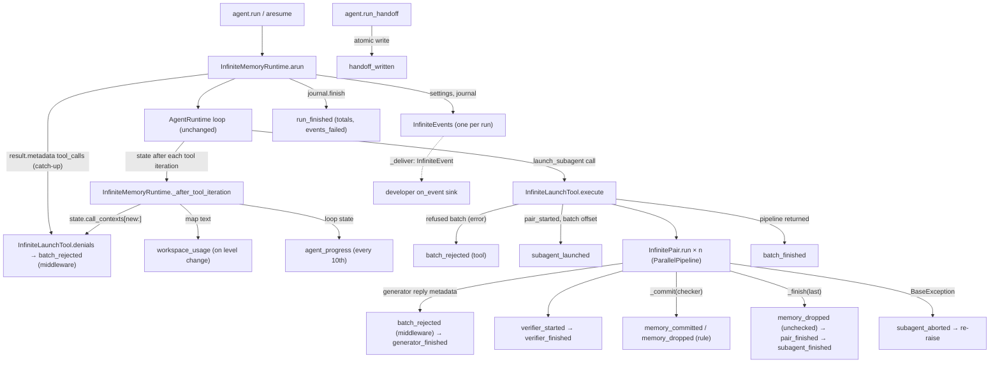

# Spec: InfiniteMemoryAgent derived run events

> **TL;DR** — The `on_event` stream of `InfiniteMemoryAgent` grows from 14 to 22 kinds (`memory_committed`, `verifier_started`, `verifier_finished`, `subagent_aborted`, `batch_finished`, `handoff_written`, `workspace_usage`, `agent_progress`), and eight existing details records gain fields (refusal rule and source, quotas, tree counters, run totals, the dropped-event count, a caught error's type). A dashboard can then show every memory change, every refusal with its reason, each pair from launch to finish or abort, and the run's progress. Every new fact is *derived*: one `InfiniteEvents` call at a point the run already passes, reading data the run already holds. Nothing adds a hook, middleware, listener, or base-runtime change. The decision that matters most is D-2. Delegation-cap denials are read back from the DENIED tool-call records that the agent loop already keeps, so D1 needs no observer.

## §0 User prompts

### 0.1 Invoking request (verbatim)

```
great, I think that you are on the right page. I want you to work on implementing these "events" into the run of the InfiniteMemoryAgent deterministically. Note, just as a reminder, i dont want you to add any events that change the shape of the runtime/architecture of the agent, i want you to derive these events from the runtime, with all of your ideas that adhere to that,  you can begin implementation of this. Should not be super hard to implemented, should just be a smartly placed function for each event throughout the run. No need to ask 8-10 questions for this, keep to 3
```

### 0.2 User replies during the run

_None yet. The orchestrator appends any reply the user sends during the run here verbatim, labeled with the revision it produced._

(Prompt 4, the user's answers to the three alignment questions, came before this run started. It is recorded verbatim in `request.md` §A, and its decisions are carried into §3 and §8.1.)

---

## Part A — Framing

## §1 Goal

Today a consumer of the stream cannot see several things:
- Most memory commits and two of the three drop reasons. `InfinitePair._commit` and `InfinitePair._finish` only append to lists, and a list reaches the stream only as the first five items of `subagent_finished`.
- Why a call was refused. `InfiniteRefusalDetails` holds free text only.
- A batch that `DelegationLimitsMiddleware` denied. The package README says such a batch "has no event".
- That a pair was cancelled or crashed. Such a pair never reaches `_finish`, so a UI row stays "running" forever.
- What the root itself is doing between launches.

The user asked for these events "mainly for semantic/ui/visibility reasons" (Prompt 1), derived from the runtime "deterministically" (Prompt 3).

| ID | Goal (outcome) | How we will know | Source |
|---|---|---|---|
| G-1 | A consumer sees every memory change of a run: each entry a pair commits, with its id, and each staged entry dropped, for each of the three reasons. | In any finished run, the `memory_committed` count equals the entry ids on all pair cards, and the `memory_dropped` count equals the dropped lines on them, except for a pair that aborts in its commit step before its card is recorded (AC-13, EC-25): the entries it committed or dropped before the abort are announced but are on no card. | request.md A1, A2 |
| G-2 | A consumer can group refusals by machine-readable reason, including the batches the delegation caps deny. | Every `tool_refused` and `batch_rejected` carries `rule` and `source`. A `max_parallel` or `max_depth` denial produces a `batch_rejected` whose `source` is `middleware`. | A3, D1 |
| G-3 | A consumer can draw each pair's life without guessing: launched, then generator, then verifier, then finished or aborted, grouped by batch, with tree counters. | Every `subagent_launched` in a session is closed by exactly one `subagent_finished` or `subagent_aborted`, except in EC-4, EC-10, EC-30, and EC-31. Each batch that started pairs is closed by one `batch_finished`, unless its pipeline raised or never ran (EC-26, EC-30, EC-31). | A5, A8, B1–B4 |
| G-4 | A consumer can show run-level state: the root's progress, workspace fill, quota left, run totals, gaps in its own timeline, and the saved handoff. | The kinds and fields in §9.1 arrive at the points §6 states. | A4, A6, A7, B5, C3, E1 |
| G-5 | Watching a run never changes it. | Model-visible text, journal files, and resume behaviour are byte-identical with and without a sink. The same scripted run gives the same events. | Prompts 1 and 3; request.md §C "Constraints" |

## §2 Objective

When this PR merges, `InfiniteEventKind` has 22 values instead of 14, and `vidbyte.lib.enums` exports three new closed vocabularies: `InfiniteRefusalRule`, `InfiniteRefusalSource`, and `InfinitePairPhase`.

`InfiniteEvents` gains one public method per new kind. Each method is called at exactly one kind of point in the run:
- the pair's commit loop;
- just before and just after the verifier;
- the pair's catch-and-re-raise;
- the end of the launch tool's pipeline;
- `run_handoff` after its atomic write;
- the root's existing `_after_tool_iteration` hook.

Eight existing details records gain the fields A3–A8 name. The memory-tool, workspace, and launch-batch refusal raise sites each name their rule in the `details` that `VidbyteSdkError` already carries. Delegation-cap denials, which never reach the launch tool, are announced as `batch_rejected` with `source=middleware`:
- for the root, from the loop's own tool-call records;
- for a generator, from its reply.

Three line caps rise, edited by the S2 test author: `vidbyte.agents.infinite.events` to 660 lines after its header, `vidbyte.agents.infinite.launch` to 470, and `vidbyte.lib.dataclasses.infinite` to 870.

This PR is SDK-only and is the whole slice. The backend and CLI sync is a later, separate change (NG-6), so the PR body lists the eight new kind values for it.

## §3 Non-goals

- **NG-1** — `context_compacted` (C1). *Why not:* the user said "you can leave this out for now" (Prompt 4).
- **NG-2** — `tool_output_cut` (C2). *Why not:* nothing in the run records the cut, so it cannot be derived (request.md C2).
- **NG-3** — `model_error` (E2). *Why not:* it needs a listener on every agent, and InfiniteMemory agents carry no retry middleware (request.md E2).
- **NG-4** — `agent_progress` for generators and verifiers. *Why not:* their loop state is visible only inside their own runtime, so each child would need a listener added, which changes the agent's shape (request.md E1).
- **NG-5** — Tool-call or model-call events; `bash`/`grep`/`read_lines` arguments or output; model messages, reasoning, or token streaming. *Why not:* PR #1159's NG-3 still holds (request.md §C).
- **NG-6** — Backend (`AgentRunEventKind`, cerredz/Vidbyte#708) and CLI (cerredz/vidbyte-cli-internal#171) changes. *Why not:* "I just want you to build these events into the agent that we have for now, I am sync them to dashboard later" (Prompt 4). The PR body lists the eight new values.
- **NG-7** — Any change to `vidbyte.agents.runtime`, `vidbyte.agents.base`, `vidbyte.middleware`, or `vidbyte.pipelines`, and any new hook, middleware, listener, or `AgentMiddleware` subclass. *Why not:* "i dont want you to add any events that change the shape of the runtime/architecture of the agent" (Prompt 3).
- **NG-8** — Any change to the journal format or resume behaviour, and any event the agent reads back. *Why not:* observation only (request.md §C). `InfiniteRunJournal.started` is a read-only view of records already on disk.
- **NG-9** — Wall-clock throttles, timers, or background tasks. *Why not:* "deterministically" (Prompt 3). Every throttle counts iterations or level changes.
- **NG-10** — Announcing `launch_subagent` calls that the permission policy denies, or denials by middleware other than `DelegationLimitsMiddleware`. *Why not:* the idea list names only `DelegationLimitsMiddleware` (D1). Only its decisions carry a `limit`.
- **NG-11** — Announcing the denials of a generator that raised. *Why not:* a generator that raised has no reply, so its tool-call records are gone. Getting them back would need a listener (NG-7).
- **NG-12** — Root re-exports of the new enums or details records. *Why not:* PR #1159 exported only `InfiniteEvent` and `InfiniteEventKind` at the root (the `vidbyte.agents.infinite` package header, rule 2). The new enums follow `InfiniteDropReason` and `InfiniteStopCause` into `vidbyte.lib.enums` only, so the public-API contract file is unchanged (§12.5).

## §4 Developer usage

```python
from vidbyte import InfiniteEventKind, InfiniteMemoryAgent, InfiniteMemoryAgentSettings, InfiniteWorkspaceSettings

events = []
agent = InfiniteMemoryAgent(
    InfiniteMemoryAgentSettings(
        name="analyst",
        system_prompt="You research markets and report sourced findings.",
        provider="openai",
        model_name="gpt-4.1",
        root_dir=".",
        workspace=InfiniteWorkspaceSettings(root="memory"),
        on_event=events.append,
    )
)
reply = agent.run("Compare the list prices of our five competitors.")
run_id = reply.metadata["infinite_run_id"]
agent.run_handoff(run_id)
for event in events:
    if event.kind is InfiniteEventKind.MEMORY_COMMITTED:
        print(f"#{event.details.id} committed by {event.agent_key}: {event.details.text}")
    elif event.kind in (InfiniteEventKind.BATCH_REJECTED, InfiniteEventKind.TOOL_REFUSED):
        print(f"{event.agent_key}: {event.details.source.value} refused ({event.details.rule.value})")
finished = next(event for event in events if event.kind is InfiniteEventKind.RUN_FINISHED)
print(finished.details.passed, finished.details.committed, finished.details.events_failed)
assert events[-1].kind is InfiniteEventKind.HANDOFF_WRITTEN
assert events[-1].details.path == f".runs/{run_id}.handoff.md"
```

The developer still passes one plain function. In return they get:
- one event per committed and per dropped entry;
- a machine-readable `rule` and `source` on every refusal, including the delegation caps' denials;
- the verifier's start and verdict;
- an explicit `subagent_aborted` for a pair that was cancelled or crashed;
- per-batch and per-run totals;
- the root's progress and workspace fill;
- a final `handoff_written`.

None of this needs a middleware or a listener of their own.

## §5 Flow diagram



The runtime builds one `InfiniteEvents` per run, as it does today. Every box that ends in an event kind calls one public method of that object.

**Validation.** Validation happens in two places:
- Each details record validates itself in `__post_init__`.
- Any failure, including one from the sink, is caught by `_shielded`, which counts it and logs it once.

**State changes before announcements.** State changes only where it changes today. Each event is called after its change:
- `commit_entry` returns before `memory_committed`;
- the drop is in the pair's list before `memory_dropped`;
- the handoff file is swapped in before `handoff_written`.

**Failures.** Failures are caught where they are caught today. The one new handler is the outer `except BaseException` in `InfinitePair.run`. It announces the abort and re-raises the same object.

---

## Part B — Behavior (this is the spec; everything else is framing)

## §6 Behavior

### 6.1 Invariants

- **INV-1** — With `on_event=None`, no new code path builds an event or details record, calls `InfiniteWorkspace.usage()`, `descriptions()`, or `map_omitted`, or logs anything. Every new public `InfiniteEvents` method returns before it reads an argument.
- **INV-2** — An `Exception` raised while building an event or by the sink drops only that event, and increments `InfiniteEvents._failures` once. It never changes the run's reply, journal, workspace, tool results, or control flow.
- **INV-3** — A `KeyboardInterrupt` or `CancelledError` raised by the sink still propagates. The handler in `InfinitePair.run` announces `subagent_aborted` and then re-raises the exact exception object it caught; it never swallows it. The one exception: if the sink itself raises a `BaseException` while handling `subagent_aborted`, that new exception propagates in place of the original. Nothing is swallowed either way.
- **INV-4** — Each event follows its change:
  - `memory_committed` follows a `commit_entry` that has returned, so the entry is in `entries.jsonl`.
  - Each `memory_dropped` with reason `rule` or `unchecked` follows the drop's append to the pair's `dropped` list.
  - `handoff_written` follows the atomic write of `.runs/<run_id>.handoff.md`.
  - `subagent_launched` still follows `pair_started`.
- **INV-5** — Everything the model sees is byte-identical to `181f1992`: tool results, result-card texts, prompts, the workspace map, journal records, `entries.jsonl`, `files.jsonl`, and the handoff file. So are the messages (`str(exc)`, `exc.message`) of every raised error. The only change at a raise site is one added `details` key, `rule`.
- **INV-6** — Determinism holds for two runs of the same scripted tree on equal fresh workspaces. They deliver equal sequences of `(kind, agent_key, role, depth, summary, details)` once `run_id`, `at`, and every `duration_ms` are normalized. No new decision reads a clock: the clock is read only to compute `duration_ms`.
- **INV-7** — The public functions of `InfiniteEvents` are exactly the 22 `InfiniteEventKind` values. Each takes only positional-or-keyword parameters, and a `@property` or private helper is not public.
- **INV-8** — Every details record stays at most 32,768 bytes of JSON at its caps. Every summary comes from a template constant, is one line, and is at most 280 characters. No event carries a settings secret, the system prompt, tool output, or model text beyond what PR #1159 already carries. No field the SDK composes for an event holds an absolute path the SDK built: not a key, not `handoff_written.path`, not a note or file list, and not any field this spec adds. Relayed error text is the one exception. `run_stopped.message`, a refusal's `problem`, and the refusal summary built from `problem` repeat the error's own message, cut to its cap but otherwise unchanged, exactly as PR #1159 does at `181f1992`; a tool refusal's `problem` is also the text the model reads (AC-6, INV-5). So an error whose message names an absolute path, such as the `OSError` behind a `disk` refusal, keeps that path there (EC-29). This is an accepted limitation inherited from PR #1159, not new exposure, and the implementation must not strip or rewrite the path.
- **INV-9** — For every pair that reaches `_finish`:
  - the number of `memory_committed` events equals `len(card.entries)`;
  - the number of `memory_dropped` events equals `len(card.dropped)`, across all three reasons;
  - each staged entry gives exactly one of the two.
- **INV-10** — In one session (one `arun`), every `subagent_launched` is followed by exactly one `subagent_finished` or `subagent_aborted` for the same pair key. There are four exceptions:
  - EC-4: a pair cancelled before its task starts gets neither.
  - EC-10: an interrupt raised by the sink while the pair's finish is being announced gets both, `subagent_finished` then `subagent_aborted`.
  - EC-30: when a later pair's `pair_started` write fails, the pairs its batch already announced get neither.
  - EC-31: when the sink raises a `BaseException` on a `subagent_launched`, that pair and the pairs its batch announced before it get neither.
- **INV-11** — Every `launch_subagent` call that `DelegationLimitsMiddleware` denied gives exactly one `batch_rejected` with `source=middleware`, provided the call is in the root's loop records before the run returns or in a generator's reply. A call already announced is never announced twice.
- **INV-12** — Every `tool_refused` and `batch_rejected` carries a `rule` from `InfiniteRefusalRule` and a `source` from `InfiniteRefusalSource`.
  - Every refusal raise site listed in §9.1 names its rule.
  - An error without a named rule is classed by its type: `ConfigurationError` is `invalid_arguments`, `UnicodeError` is `text_encoding`, `OSError` is `disk`, and anything else is `other`.
- **INV-13** — `workspace_usage` is delivered at most once per root tool iteration, and only when the pair (usage level, map is cut) differs from the last pair offered to the sink. The first pair is `(0, False)`, and the level rises or falls with the counts.
- **INV-14** — `agent_progress` is delivered only for root iterations that reach `_after_tool_iteration` and whose number is a multiple of `INFINITE_EVENT_PROGRESS_ITERATIONS` (10), at most once per iteration. It is never delivered for a generator or verifier.
- **INV-15** — Within one pair, events arrive in this order:
  1. `subagent_launched` (from the launcher);
  2. the generator's memory, file, refusal, and nested-launch events;
  3. the generator's middleware `batch_rejected` events;
  4. `generator_finished`;
  5. `verifier_started`, the verifier's own events, then `verifier_finished`;
  6. `memory_committed` and `memory_dropped` (reason `rule`), in staged order;
  7. `memory_dropped` (reason `unchecked`);
  8. `subagent_finished`, or `subagent_aborted` at any point after `subagent_launched`.

  Beyond the single pair:
  - `batch_finished` follows the last pair of its batch. It is delivered only when the batch's pipeline returns; a pipeline that raises gives none (EC-26).
  - The run's `run_finished` follows every root denial.
  - On cancellation, a pair that is not waiting on a nested batch announces its `subagent_aborted` before `run_stopped`. A pair whose generator is waiting on its own nested batch may announce after `run_stopped` (EC-3).
  - `handoff_written` is the last event of a `run_handoff` call.
- **INV-16** — `in_flight` is never negative. It equals the pairs launched minus those that ended in this `InfiniteEvents`, counting each pair once:
  - `subagent_finished` decrements it.
  - `subagent_aborted` decrements it only when the journal holds no finished record for that pair, that is, when `subagent_finished` never ran for it (EC-10, EC-25).

**Must not regress:**
- **INV-17** — The journal format and resume are unchanged (`InfiniteRunJournal` records). A resumed run replays finished pairs and re-runs interrupted ones exactly as before.
- **INV-18** — PR #1159's events keep every existing field, value, and order. The only additions are the new fields, the new kinds interleaved per INV-15, and `batch_rejected` for middleware denials. AC-3 of PR #1159 still holds: `memory_saved` is root-only, and pair commits use `memory_committed`.
- **INV-19** — Cancelling the run stops every pair (the intent of the launch module's header rule 2). A pair's error in `VidbyteSdkError`, `OSError`, or `ValueError` still becomes its own card, so siblings and the parent keep going (`InfinitePair.run`). A child agent's own `Exception`, whatever its class, always reaches the pair as a `VidbyteSdkError`: wrapped as `AgentExecutionError`, or as one of the three typed errors `BaseAgent` passes through unwrapped (`UsageAccountingError`, `FailureRaisedError`, `AllModelsFailedError`). So it always becomes the card. Only the pair's own code can raise past the card (EC-2, EC-27).
- **INV-20** — No code in `vidbyte.agents.runtime`, `vidbyte.agents.base`, `vidbyte.middleware`, or `vidbyte.pipelines` changes.

### 6.2 Acceptance criteria

| ID | Given | When | Then | Priority | Proof |
|---|---|---|---|---|---|
| AC-1 | a clean checkout of this branch, with the scripted offline runner standing in for the model | the §4 snippet runs | it raises nothing, every attribute it reads exists with the type §8.5 gives, and both asserts hold | P0 | `test_infinite_memory_derived_run.py::test_the_section_4_snippet_prints_the_refusal_the_commit_and_the_totals_and_its_asserts_hold` |
| AC-2 | the one-pair script: the root launches one task, whose generator stages one entry, writes one note, and replies, and whose verifier passes; default caps | the run finishes | the sink receives exactly `run_started, subagent_launched, memory_staged, file_written, generator_finished, verifier_started, verifier_finished, memory_committed, subagent_finished, batch_finished, run_finished`, in that order | P0 | `test_infinite_memory_events_stream.py::test_a_one_pair_run_delivers_eleven_events_in_order_with_their_envelopes_summaries_and_details` (`AC2_KINDS`) |
| AC-3 | a passing pair with one staged entry that now breaks a rule, because a sibling committed the same text first | the pair commits | one `memory_dropped` arrives with reason `rule`, the pair's verifier as agent, and the rule's message as note; it precedes `subagent_finished`; each other staged entry gives one `memory_committed` | P0 | `test_infinite_memory_derived_pairs.py::test_an_entry_a_sibling_committed_first_is_dropped_by_rule_while_the_rest_commit` |
| AC-4 | (a) a pair whose verifier replies with no VERDICT line; (b) a pair whose generator replies blank | each pair finishes | every staged entry gives one `memory_dropped` with reason `unchecked`, before `subagent_finished`; the agent is the verifier in (a) and the generator in (b); (a) has `verifier_finished` with verdict `unchecked`; (b) has no `verifier_started` and no `verifier_finished` | P0 | `test_infinite_memory_derived_pairs.py::test_unchecked_entries_drop_under_the_last_agent_that_ran[no-verdict, blank-generator]` |
| AC-5 | a pair that commits N entries | it finishes | exactly N `memory_committed` events arrive, in staged order, after `verifier_finished` and before `subagent_finished`; each has `id` equal to the id in `entries.jsonl`, `key` equal to the staged key, and `agent_key` equal to the pair's verifier key (the entry's `verified_by`) | P0 | `test_infinite_memory_derived_pairs.py::test_each_committed_entry_is_announced_in_staged_order_after_it_is_on_disk` |
| AC-6 | each memory-tool refusal in §9.1's rule table, plus a malformed task card, a repeated task name, a tool not granted, an unknown context id, and `max_agents` | the call is refused | the `tool_refused` or `batch_rejected` carries `source=tool` and the rule §9.1 names; `problem` equals the text it carried at `181f1992` | P0 | `test_infinite_memory_derived_refusals.py::test_each_tool_refusal_names_its_rule_and_source_and_keeps_the_problem_the_model_read` (32 cases); `test_infinite_memory_derived_refusals.py::test_the_refusal_cases_cover_every_rule_a_tool_can_raise` |
| AC-7 | `max_parallel=2` and `max_depth=1`; the root sends 3 tasks, then 1 task whose generator calls `launch_subagent` | the run finishes | exactly two `batch_rejected` arrive with `source=middleware`: (`root`, depth 0, rule `max_parallel`) after the root's first iteration and before the next `subagent_launched`; and (that generator's key, rule `max_depth`) before its `generator_finished`. `problem` is the middleware's reason, and neither call gives a `pair_started` | P0 | `test_infinite_memory_derived_refusals.py::test_middleware_denials_name_their_limit_as_rule_and_the_reason_as_problem`; `test_infinite_memory_events_pairs.py::test_middleware_denials_deliver_one_batch_rejected_each_and_the_run_still_finishes` |
| AC-8 | a root denial made in the same turn as a finish the loop accepts, so `_after_tool_iteration` does not run for it | the run finishes | that denial's `batch_rejected` arrives once, before `run_finished` | P1 | `test_infinite_memory_derived_refusals.py::test_a_denial_in_the_turn_the_run_finishes_is_announced_once_before_run_finished` |
| AC-9 | the root remembers one entry; a generator stages one entry and creates one note | each call succeeds | `memory_saved`, `memory_staged`, and `file_written` carry `entries_left`, `entries_max`, `files_left`, and `files_max` equal to the numbers in the quota line the tool returned to the model | P0 | `test_infinite_memory_derived_pairs.py::test_each_quota_carrying_event_equals_the_quota_line_the_model_read` |
| AC-10 | a batch of 3 tasks, one of which already finished in this run | the launch runs | 2 `subagent_launched` arrive, each with: `batch` equal to the number of `pair_started` records before the batch; `batch_index` 0 and 1 in task order; `batch_size` 2; `attempt` 1; `agents_started` including this pair; `max_agents` from settings; `in_flight` 1, then 2. One `subagent_replayed` also arrives. After both pairs finish, one `batch_finished` arrives with that `batch`, counts by verdict, and `replayed` 1 | P0 | `test_infinite_memory_derived_pairs.py::test_a_batch_beside_a_replay_announces_its_offset_index_counters_and_verdict_totals` |
| AC-11 | an interrupted run whose pair `a` started but never finished | the run is resumed and `a` is launched again | its `subagent_launched` has `attempt` 2, and `batch` continues from the journal's start count | P0 | `test_infinite_memory_derived_pairs.py::test_a_pair_launched_again_after_a_resume_counts_a_second_attempt_and_continues_the_offset` |
| AC-12 | a run cancelled while a depth-1 generator, which has not launched pairs of its own, is running | the cancellation lands | `subagent_aborted` arrives with reason `cancelled`, phase `generator`, `staged` equal to the entries staged so far, and `error_type` `CancelledError`; it precedes `run_stopped`; the `CancelledError` propagates unchanged | P0 | `test_infinite_memory_derived_pairs.py::test_a_cancelled_flat_generator_announces_its_abort_before_run_stopped`; `test_infinite_memory_events_lifecycle.py::test_a_cancelled_run_ends_with_run_stopped_and_its_resume_opens_with_run_resumed` |
| AC-13 | a passing pair with N staged entries, where code the pair runs itself (not one of its child agents) raises an error outside `VidbyteSdkError`/`OSError`/`ValueError` (for example, the workspace commit raises `RuntimeError`) | the pair reaches its commit step | `subagent_aborted` arrives with reason `failed`, `error_type` `RuntimeError`, phase `commit`, and `staged` N; the same exception object escapes `InfinitePair.run`; that batch gets no `batch_finished`; the root's `launch_subagent` result is the loop's tool error ("Tool execution failed: …"); the run continues and ends with `run_finished` | P0 | `test_infinite_memory_derived_pairs.py::test_an_error_in_the_pairs_own_commit_step_is_announced_and_the_run_goes_on[first-commit-fails, second-commit-fails]`; `test_infinite_memory_derived_pairs.py::test_an_aborted_pair_re_raises_the_very_error_it_announced` |
| AC-14 | a pair whose generator's model runner raises `ToolExecutionError`, which the agent re-raises as `AgentExecutionError` from it | the pair turns it into its card | `subagent_finished.error_type` is `ToolExecutionError`, the wrapper's cause; a pair with no error has `""` | P0 | `test_infinite_memory_derived_pairs.py::test_a_child_agents_error_becomes_the_card_and_names_its_original_class` |
| AC-15 | a run with pairs that passed, were fixed, and failed, plus several root tool iterations | the run finishes | `run_finished` carries: `iterations` and `tool_calls` equal to the root result's `iteration_count` and `tool_call_count`; `passed`, `fixed`, `failed`, and `unchecked` counted from card verdicts; `committed` as the sum of card entries; `files` as the number of notes created in this run (its `files.jsonl` records); `deepest` as the deepest started pair depth; `events_failed` 0; and `duration_ms` ≥ 0 | P0 | `test_infinite_memory_derived_run.py::test_run_finished_carries_this_sessions_loop_counts_and_the_whole_runs_card_totals` |
| AC-16 | a sink that raises `ValueError` on k events before the terminal one | the run finishes, or stops | `run_finished.events_failed` (or `run_stopped.events_failed`) is k, and the run's result is unchanged | P0 | `test_infinite_memory_derived_run.py::test_the_terminal_event_counts_the_events_the_sink_failed_on[finished, stopped]` |
| AC-17 | a workspace whose levels are crossed by root writes and by `bash` deletions | the root's tool iterations run | `workspace_usage` arrives exactly at the iterations where the highest level reached (50, 75, 90, or 100 % of `max_files` or `max_tokens`) or the map's cut state changes, including downward, and at no others; its `level` is that level (0 below 50 %), and its counts equal a fresh `usage()` count and the map's omitted count | P0 | `test_infinite_memory_derived_run.py::test_workspace_usage_arrives_exactly_when_the_level_crosses_up_or_down`; `test_infinite_memory_derived_run.py::test_workspace_usage_arrives_when_the_map_is_cut_and_again_when_it_is_whole` |
| AC-18 | a root that makes 25 tool iterations | the run finishes | `agent_progress` arrives at iterations 10 and 20 only, with `model_calls`, `tool_calls`, and `tokens` from the loop state and `max_iterations` from settings | P0 | `test_infinite_memory_derived_run.py::test_agent_progress_arrives_every_tenth_root_iteration_with_the_roots_own_counts` |
| AC-19 | a finished run | `run_handoff(run_id)` is called | after the file is written, one `handoff_written` arrives (`root`, depth 0) with `path` `.runs/<run_id>.handoff.md`, nine section lengths in the handoff's fixed order, and the titles of the sections cut at their caps | P0 | `test_infinite_memory_derived_run.py::test_handoff_written_is_the_last_event_and_names_the_saved_file_and_its_sections`; `test_infinite_memory_derived_run.py::test_handoff_written_names_the_sections_cut_at_their_caps` |
| AC-20 | `on_event=None` | the scripts above and `run_handoff` run | no event object is built, `InfiniteWorkspace.usage()` and `descriptions()` are never called from `InfiniteEvents`, and `InfiniteEvents` logs nothing | P0 | `test_infinite_memory_derived_run.py::test_without_a_sink_no_event_is_built_no_usage_is_scanned_and_nothing_is_logged`; `test_infinite_memory_events_stream.py::test_without_a_sink_no_event_method_builds_an_event_or_logs` |
| AC-21 | the AC-2 and AC-7 scripts, each run once with a list sink and once with no sink | each finishes | tool results, card texts, the map, the journal, `entries.jsonl`, `files.jsonl`, and the handoff file are byte-identical between the two runs | P0 | `test_infinite_memory_derived_run.py::test_a_sink_changes_nothing_the_model_or_the_disk_sees[ac2, ac7, wide]` |
| AC-22 | a sink that raises `Exception` on every kind | each script runs | the reply, journal, and workspace are identical to the run without a sink; each failure is logged once, naming the run id, the kind, and the exception class | P0 | `test_infinite_memory_derived_run.py::test_a_sink_that_raises_on_every_kind_changes_nothing_and_logs_each_failure_once` |
| AC-23 | `InfiniteEvents` | its public functions are listed | they are exactly the 22 kind values, and each accepts positional arguments | P0 | `test_infinite_memory_derived_records.py::test_every_public_events_method_takes_the_spec_parameters_by_position` |
| AC-24 | the enums | they are read | `InfiniteEventKind` has exactly the 22 values in §8.5; `InfiniteRefusalRule`, `InfiniteRefusalSource`, and `InfinitePairPhase` have exactly the values in §8.5 and are in `vidbyte.lib.enums.__all__`; none is in `vidbyte.__all__` | P0 | `test_infinite_memory_derived_records.py::test_the_kinds_and_three_new_enums_hold_exactly_the_spec_values_in_order`; `test_infinite_memory_events_records.py::test_the_public_names_are_one_object_wherever_they_are_exported` |
| AC-25 | every new or changed details record, built at its caps | it is serialized with the four `json.dumps` settings | each is at most 32,768 bytes, and every field rule in §9.1 refuses a value outside it | P0 | `test_infinite_memory_derived_records.py::test_the_new_and_enriched_records_have_the_spec_fields_in_order_with_no_defaults`, `::test_every_count_field_refuses_a_negative_a_bool_and_one_over_the_count_cap`, `::test_every_enum_field_refuses_a_value_outside_its_enum`, `::test_the_section_9_1_rules_that_are_not_plain_counts`; `test_infinite_memory_events_records.py` worst-case size and field-rule tests (`_FIGURES`) |
| AC-26 | two runs of the same scripted tree on equal fresh workspaces | both finish | their event sequences are equal once `run_id`, `at`, and every `duration_ms` are normalized | P0 | `test_infinite_memory_derived_run.py::test_two_runs_of_one_script_give_equal_streams_once_ids_stamps_and_durations_are_normalized` |

### 6.3 Edge cases and failure modes

| ID | Trigger (input + state) | System behavior | User sees | Guarded by (INV-/D-) |
|---|---|---|---|---|
| EC-1 | A generator's run fails, so its agent raises `AgentExecutionError`, after launches that the delegation caps denied | No reply exists, so its denials cannot be read. The pair records its card with `error` set. | No middleware `batch_rejected` for those calls; `subagent_finished.error_type` names the original error (the wrapper's cause). | D-4, NG-11 |
| EC-2 | Code the pair runs itself (not a child agent) raises an `Exception` outside the three caught types: a defect such as `KeyError`, or a `RuntimeError` from the workspace commit | The outer handler announces `subagent_aborted` (`failed`, phase) and re-raises. `gather` raises it out of the batch's pipeline, so no `batch_finished` follows (EC-26). The launching agent's loop turns it into a failed `launch_subagent` result ("Tool execution failed: …") and continues. Siblings keep running (PR #1159 EC-12). | `subagent_aborted`, then the launcher's later events and, in time, `run_finished`. Sibling events may arrive after `run_finished`. | INV-3, INV-10, D-10 |
| EC-3 | Cancellation, for example Ctrl-C during `agent.run`, while pairs run | `gather` cancels each child. The waiting task resumes as soon as the first child ends cancelled. A pair whose generator is waiting on its own nested batch is woken only after that inner batch ends, which can be after the root has unwound. | One `subagent_aborted` (`cancelled`) per started pair. Each pair that is not waiting on a nested batch announces before `run_stopped`. A pair that is waiting on one announces after its own children, and may announce after `run_stopped` (under `agent.run`, during the loop's shutdown). | INV-3, INV-15, A-6 |
| EC-4 | Cancellation lands after `ParallelPipeline` created a pair's task but before that task's first step | The coroutine never starts, so no handler runs. | No `subagent_aborted` for that pair, and `in_flight` stays raised for the rest of the session. | Accepted limitation (no listener possible, NG-7) |
| EC-5 | A batch made only of replays | `ParallelPipeline` is skipped as before. | Only `subagent_replayed` events, with no `batch_finished` (it closes only batches that started pairs). | D-7 |
| EC-6 | A root denial in a turn whose finish is accepted, or in a turn that a refused finish or contract rejection skips | `_after_tool_iteration` does not run for that turn. The next hook call, or the catch-up after the loop returns, announces it from the unread tail of the records. | `batch_rejected` once, before `run_finished`. | INV-11, D-4 |
| EC-7 | The run raises before the catch-up | Denials made in the last turn are not yet announced when `run_stopped` fires. | Those denials have no event. | Accepted limitation |
| EC-8 | One root iteration both launches a batch and has another `launch_subagent` call denied | Root denials are announced in `_after_tool_iteration`, after every tool call of the iteration ran. | That iteration's `batch_rejected` (middleware) follows the batch's events. A tool-side `batch_rejected` stays inline. | D-4 |
| EC-9 | The permission policy denies `launch_subagent` (no `limit` in the result metadata) | `InfiniteLaunchTool.denials` keeps only results that name a `limit`. | No event. | NG-10 |
| EC-10 | The sink raises `KeyboardInterrupt` while handling `subagent_finished` | The interrupt escapes `_finish`, and the outer handler announces `subagent_aborted` (phase `commit`) before re-raising. The journal already holds the pair's finish, so `subagent_aborted` does not decrement `in_flight` again. | `subagent_finished`, then `subagent_aborted`, for the same pair; `in_flight` counts the pair once. | INV-3, INV-10, INV-16 |
| EC-11 | `bash` changes files between the map render and `usage()` in the same hook | `workspace_usage` reports its own scan. | The counts can differ by that change from the map header. | D-12 |
| EC-12 | A seeded workspace already at 60 % of `max_files` when the run starts | The first root tool iteration moves from `(0, False)` to `(50, False)`. | One `workspace_usage` after the first root tool iteration. A run with no root tool iteration never gets one. | INV-13 |
| EC-13 | Usage falls, for example after `bash rm` | The level drops. | `workspace_usage` at the lower level. | INV-13 |
| EC-14 | `run_handoff` is called for a run still going in another process, or for an unfinished run (PR #1159 EC-18) | The handoff is written as before, then announced. | `handoff_written` (`root`, depth 0) under that run's id, possibly before or with no terminal event. | D-14 |
| EC-15 | A handoff section that was not cut is exactly at its cap and ends with ` … [cut]` | It is reported as cut. | A false entry in `cut` (needs an uncut body of exactly 15,900 or 239,000 characters ending with the marker). | D-14 |
| EC-16 | A resumed run | A new `InfiniteEvents` restarts `in_flight`, `_failures`, and the duration clock. `attempt`, `batch`, `deepest`, the verdict counts, `committed`, and `files` read the whole run: the journal, and the `files.jsonl` records for the run id. `iterations` and `tool_calls` come from this session's root result. | Session values for duration, `iterations`, `tool_calls`, `events_failed`, and `in_flight`; whole-run values for the others. | D-16 |
| EC-17 | Pair events arriving after `run_finished` (PR #1159 EC-12) | They are delivered and counted in `_failures` only if they fail. | `run_finished.events_failed` does not include later failures. | D-17 |
| EC-18 | `settings.loop.max_iterations` is `None` | — | `agent_progress.max_iterations` is `None`. | §9.1 |
| EC-19 | A generator replies blank (status `failed`) after a denied launch | The reply exists, so its denials are read. | `batch_rejected` (middleware), then `generator_finished` (`failed`). | D-4 |
| EC-20 | A staged entry is superseded between staging and commit | `commit_entry` raises `ToolExecutionError`, and the entry is dropped with reason `rule`. | `memory_dropped` (`rule`) whose `note` is the workspace's message. | FR-1 |
| EC-21 | A memory tool hits `OSError`, `UnicodeEncodeError`, or an entry-record `ConfigurationError` | The rule comes from the error type. | `rule` `disk`, `text_encoding`, or `invalid_arguments`. | INV-12, D-5 |
| EC-22 | A developer middleware on the root denies `launch_subagent` with a `limit` that is not a rule value | The context passes the filter, but `_rule` finds no rule value. | `batch_rejected` with `source=middleware`, `rule=other`. | D-5, A-1 |
| EC-23 | One agent object runs twice at once on two threads | Each run has its own runtime, `InfiniteEvents`, counters, and catch-up index. | Two interleaved streams, told apart by `run_id`. | A-3 |
| EC-24 | A pair key over 508 characters | Keys are digest-shortened by `_key` exactly as today, including the new `key` fields. | `~<16 hex>/<last 490>`. | INV-8 |
| EC-25 | The pair's `_finish` raises inside its own error branch, for example a journal write that fails twice | It escapes to the outer handler. The journal has no finished record for the pair, so `subagent_aborted` decrements `in_flight`. | `subagent_aborted` (`failed`) in phase `commit`; what follows is as EC-2. | D-10, INV-16 |
| EC-26 | A batch's pipeline raises: on cancellation (EC-3), or when one pair aborts with an `Exception` (EC-2) | `gather` raises before `execute` reaches `batch_finished`. Siblings that are still running keep announcing their own events. | That batch never gets a `batch_finished`. A consumer closes its rows on the batch's last `subagent_finished`/`subagent_aborted`, or on `run_stopped`/`run_finished`. | Accepted limitation (R-3): a `finally` would add a code path rather than derive an event |
| EC-27 | A child agent (generator or verifier) raises any `Exception`, from its runner, provider, or tool loop | `BaseAgent` re-raises it as `AgentExecutionError` from the original. Three typed errors pass through as they are, and all of them are `VidbyteSdkError`s. So the pair catches it and records its card. | `subagent_finished` (status `failed`, verdict `unchecked`) whose `error_type` is the original class; never `subagent_aborted`. | INV-19, §9.1 |
| EC-28 | The model writes a note whose name contains a line break (through `bash`), or whose `files.jsonl` description does, so that the uncut map's last line reads `… and N more files` | `map_omitted` parses that line as the map's closing line. | A false `map_omitted` value and `cut` state in `workspace_usage` only. The model-visible map and every count are unchanged. | Accepted, event-only limitation (T-2) |
| EC-29 | A memory tool's note write fails with an `OSError` whose message names an absolute path the OS built from the workspace root (a `disk` refusal) | The tool raises the same error, with the same message, as at `181f1992`. `tool_refused` relays that message as `problem`, cut to its cap and otherwise unchanged. | `rule=disk`, `source=tool`. `problem` and the refusal summary keep the absolute path, exactly as the model reads it in the tool result. Nothing strips it. | INV-8 (relayed error text), INV-5, AC-6, NFR-8. Accepted limitation inherited from PR #1159 (T-1) |
| EC-30 | A batch's `pair_started` write raises, for example an `OSError` on a full disk, for a later pair, after the batch's earlier pairs were recorded and announced | The error escapes `execute` before `ParallelPipeline` runs, as at `181f1992`. The launching agent's loop reports a failed `launch_subagent` call ("Tool execution failed: …") and continues. The earlier pairs never run; their `pair_started` records stay, so the journal lists them as interrupted. | Each pair the batch already announced has its `subagent_launched` and then neither `subagent_finished` nor `subagent_aborted`, and the batch gets no `batch_finished`. As in EC-4, `in_flight` stays raised by those pairs for the rest of the session. | Accepted limitation (S4 R-1): journaling the whole batch before announcing it would change AC-10's `agents_started`, and a catch-announce-re-raise would add a code path rather than derive an event (D-23). INV-10, INV-16 |
| EC-31 | The sink raises a `BaseException` (`KeyboardInterrupt`, `CancelledError`) while handling a `subagent_launched` | `_shielded` catches only `Exception`, so the interrupt escapes `execute` before `ParallelPipeline` runs (INV-3), and no pair of the batch starts. The pairs recorded so far keep their `pair_started` records; the batch's later tasks are neither recorded nor announced. The interrupt then unwinds the run like any sink interrupt. | That pair, and each pair the batch announced before it, has its `subagent_launched` and then neither closing event. For a root launch the run then ends with `run_stopped` (S4 verifier V3). A consumer closes those rows on the run's terminal event, as in EC-26. | Accepted limitation (S4 R-1): the sink's interrupt is never swallowed (INV-3). INV-10 |

**Rollback of the user action.** There is no user action to undo: events are observation only and persist nothing new. The only on-disk effect, the handoff file, already existed. Reverting the PR restores the 14-kind stream. Errors keep the extra `details["rule"]` key until then, and callers that ignore `details` see no difference.

## §7 Requirements

**Functional**

| ID | Requirement | Priority | Source (request.md / G-) |
|---|---|---|---|
| FR-1 | `memory_dropped` is delivered for reason `rule` (in `_commit`, under the verifier) and reason `unchecked` (in `_finish`, under the pair's last started agent), once per dropped entry, after it joins the pair's `dropped` list. | P0 | A1, G-1 |
| FR-2 | New kind `memory_committed`, once per entry a pair commits, after `commit_entry` returns, under the verifier's key. | P0 | A2, G-1 |
| FR-3 | `InfiniteRefusalDetails` gains `rule` and `source`. Every refusal raise site in §9.1 names its rule through `details[INFINITE_REFUSAL_RULE_DETAILS_KEY]`. | P0 | A3, G-2 |
| FR-4 | `memory_saved`, `memory_staged`, and `file_written` gain `entries_left`, `entries_max`, `files_left`, and `files_max`, equal to the agent's quota after the change. | P0 | A4, G-4 |
| FR-5 | `subagent_launched` gains `attempt`, `batch`, `batch_index`, `batch_size`, `agents_started`, `max_agents`, and `in_flight`. `subagent_finished` gains `agents_started`, `max_agents`, and `in_flight`. | P0 | A5, G-3 |
| FR-6 | `run_finished` gains `iterations`, `tool_calls`, `duration_ms`, `passed`, `fixed`, `failed`, `unchecked`, `committed`, `files`, `deepest`, and `events_failed`. | P0 | A6, A7, G-4 |
| FR-7 | `run_stopped` gains `events_failed`. | P0 | A7, G-4 |
| FR-8 | `subagent_finished` gains `error_type`, the class of the original error (D-22). The verifier's stop reason, tool calls, usage, and duration go on `verifier_finished` (FR-10). | P0 | A8, G-3 |
| FR-9 | New kind `verifier_started`, just before the verifier's `arun`, with the staged count and the generator's files. | P0 | B1, G-3 |
| FR-10 | New kind `verifier_finished`, right after the verifier's reply and verdict. | P0 | B2, A8, G-3 |
| FR-11 | New kind `subagent_aborted`, from a catch-and-re-raise around the whole pair, with reason, error type, phase, and staged entries lost. | P0 | B3, G-3 |
| FR-12 | New kind `batch_finished`, after `ParallelPipeline` returns, with counts by verdict, replays, and duration. | P0 | B4, G-3 |
| FR-13 | New kind `handoff_written`, after `run_handoff`'s atomic write, with the relative path, section lengths, and the cut sections. | P0 | B5, G-4 |
| FR-14 | New kind `workspace_usage`, from the root's `_after_tool_iteration`, when the level or map-cut state changes. | P0 | C3, G-4 |
| FR-15 | Delegation-cap denials are delivered as `batch_rejected` with `source=middleware` and the rule named by the denial's `limit`: for the root from the loop's records, and for a generator from its reply. | P0 | D1, G-2 |
| FR-16 | New kind `agent_progress`, root only, every 10th root tool iteration. | P0 | E1, G-4 |
| FR-17 | Each new kind is one public `InfiniteEvents` method named as its value, called from the call sites in §12.3 and nowhere else. | P0 | Prompt 3 ("a smartly placed function for each event") |

**Non-functional**

| ID | Requirement | Priority | Target |
|---|---|---|---|
| NFR-1 | Deterministic | P0 | INV-6. No timer, sleep, or wall-clock decision is added. |
| NFR-2 | Observation only | P0 | INV-5. Nothing in the agent reads an event or any `InfiniteEvents` state. |
| NFR-3 | Bounded events | P0 | Each details record is ≤ 32,768 bytes at its caps (the worst case is expected to stay `subagent_finished`, about 28,000). Summaries are ≤ 280 characters on one line, and keys are ≤ 512. |
| NFR-4 | Zero cost without a sink | P0 | INV-1 |
| NFR-5 | Bounded cost with a sink | P1 | At most one extra `FolderUsage` scan per root tool iteration, and one `files.jsonl` read per `run_finished`. At most ⌈max_iterations ÷ 10⌉ `agent_progress` and at most one `workspace_usage` per root tool iteration per session. |
| NFR-6 | Complexity budget | P0 | §8.4: no new module; `vidbyte.agents.infinite.events` ≤ 660, `vidbyte.agents.infinite.launch` ≤ 470, and `vidbyte.lib.dataclasses.infinite` ≤ 870 lines after the header; every other budget module ≤ 400. |
| NFR-7 | Gates green | P0 | The agent lint ends `SDK-LINT: PASS`, and both CI stages (`source`, `package`) pass, apart from the known pre-existing failure. The commands are in §11. |
| NFR-8 | Privacy | P0 | INV-8. Error classes are named; error messages appear only where PR #1159 already put them (`run_stopped.message`, refusal `problem`), unchanged, including any absolute path the error itself names (EC-29). |

---

## Part C — Design

## §8 Architecture and decisions

The design adds no component. It places fourteen calls at existing points:
- the new kinds in the launch tool and pair, the runtime subclass, and the agent;
- the middleware path of `batch_rejected` in the pair and the runtime subclass;
- the existing emitters that gain inputs.

It widens the inputs of the existing emitters, and it lets refusals name their rule in the structured `details` that the SDK's base error already carries.

### 8.1 Decisions

| ID | Decision | Deciding reason | Runner-up | Flips if |
|---|---|---|---|---|
| D-1 | Every new fact is read at a point the run already passes, from data it already holds: pair locals, the journal, the loop state, tool-call records, and reply metadata. There is one method per kind on the existing single writer. | The user's rule: "derive these events from the runtime", not "change the shape". The event writer's module-header recipe already prescribes this shape. | An observer middleware (rejected in request.md §C). | The user accepts a shape change. |
| D-2 | D1 reads DENIED `ToolCallContext`s for `launch_subagent` whose result metadata names a `limit`. They come from `state.call_contexts` for the root and from `reply.metadata["tool_calls"]` for a generator, through the new `InfiniteLaunchTool.denials`. | Every denial already becomes a context carrying `{"error","reason",**decision.metadata}` (`AgentRuntime._denied_tool_result`, `_process_tool_call`). It is per call, holds the tool name, the `limit`, and the reason, and reaches both the root hook and the generator's reply (`BaseAgent._generate_reply`). Evidence: §11. | `self.middleware.events` (request.md hint). It mixes every middleware's decisions and is not in a generator's reply (code-map §4.1 item 5). | `DelegationLimitsMiddleware` stops putting `limit` in its decision metadata. |
| D-3 | D1 reuses `batch_rejected` with `source=middleware` and `rule` taken from `limit`. | The request suggested it. A denial is a refused batch, so consumers already render `batch_rejected`. | A new `batch_denied` kind. | The dashboard must count denials apart from tool refusals and `source` is not enough. |
| D-4 | Root denials are announced in `_after_tool_iteration` from the unread tail `calls[_announced:]`. A catch-up after `super().arun` returns reads `result.metadata["tool_calls"]`. Generator denials are announced when its reply returns, before `generator_finished`. | Both lists only grow (high-water mark), so each denial is announced once. The catch-up covers turns where the hook is skipped (`AgentRuntime._arun_once`; evidence: §11). | Announcing inside the hook only, which misses the final turn. | The base loop starts calling the hook on every turn. The catch-up then becomes a no-op and can go. |
| D-5 | The refusal rule is carried in `VidbyteSdkError.details["rule"]` (`INFINITE_REFUSAL_RULE_DETAILS_KEY`) at each raise site. `InfiniteEvents._rule` reads it, or the denial's `limit`, and otherwise classes the error by type (INV-12). | `details` is the base error's "safe structured details" (`VidbyteSdkError`). The workspace already uses it (`InfiniteWorkspace.__init__`, `InfiniteWorkspace._entry_lines`). It leaves every message byte-identical. | One `ToolExecutionError` subclass per rule (23 classes, a new error family in lib, and A003 packets). | The SDK grows a typed refusal-code field on `VidbyteSdkError`. |
| D-6 | A8 collapses into B2. The verifier's stop reason, tool calls, tokens, cost, and duration go on `verifier_finished`. `subagent_finished` gains only `error_type`. There is no `verdict_found`: `verifier_finished.verdict == unchecked` says it. | It avoids duplicate fields. A status bool beside its content is what C002 flags (field guide, blocking lint invariants). | Verifier fields on `subagent_finished` as well. | A consumer needs the per-pair split without joining two events. |
| D-7 | A5's batch fields and B4 are both kept. `batch` is `len(journal.started)` read just before the batch's first `pair_started`. It is shared by the batch's `subagent_launched` events and its `batch_finished`. | A UI groups rows as they start and closes the group at the end. The journal offset is unique run-wide, across launchers and resumes, for every batch that starts a pair, and needs no new state or format change. | `ToolCall.call_id`, which is `str \| None` and may repeat across resumes. | The journal gains its own batch record. |
| D-8 | `attempt` is `journal.started.count(pair_key)`, read through the new read-only `InfiniteRunJournal.started`. | It counts starts across resumes with no format change. `pair_started` already precedes the event, so a first run reads 1. | A counter in `InfiniteEvents`, which resets on resume. | — |
| D-9 | `in_flight` is an `InfiniteEvents` counter, kept per session. It goes up on `subagent_launched` and down on `subagent_finished`. Every change is the first statement inside the method's shield, so a sink that raises cannot skip it (R-17). It goes down on `subagent_aborted` only when `launch.journal.finished(pair.key)` is `None`, so a pair whose finish was already announced is never counted twice (EC-10). It is floored at 0. | It is the only source of "running now" that needs no shape change. | Counting journal starts minus finishes, which counts pairs interrupted in earlier sessions as running. | — |
| D-10 | `InfinitePair.run` wraps its existing `try`/`except` in an outer `try: … except BaseException as exc: subagent_aborted(self, exc, phase); raise`. `phase` is a local set to GENERATOR, then VERIFIER (before `verifier_started`), then COMMIT (set after the `if status is not FAILED:` block, just before `if verdict is not UNCHECKED:`, so a failed generator's `_finish` also runs in phase `commit`). The launch module's header rule 2 is reworded to allow catch-and-re-raise only. The handler sees only what the pair's own code raises past its card: cancellation, interrupts, and defects outside the three caught types. A child agent's errors arrive as `VidbyteSdkError`s (`AgentExecutionError`, or one of the three typed errors `BaseAgent` passes through unwrapped) and become the card (EC-27). | It is the same pattern as `run_stopped` in `InfiniteMemoryRuntime.arun`. S019 accepts it because it contains `raise`. The outer wrap also covers an error raised by `_finish` inside the inner handler (EC-25). | A second `except BaseException` clause on the inner `try`. It is flatter, but misses EC-25. | S024 nesting would exceed 3 (it is exactly 3 today with this design). |
| D-11 | `agent_progress` fires when `state.iteration_count % INFINITE_EVENT_PROGRESS_ITERATIONS == 0`, with N = 10, inside the root's `_after_tool_iteration`. | It is deterministic, gives at most 50 events at the default 500 iterations, and leaves every pinned list of fewer than 10 root iterations unchanged. | N = 5 (twice the events); a wall-clock interval (forbidden, NG-9). | The dashboard wants finer liveness: lower N. |
| D-12 | `workspace_usage` computes `level` as the highest of `INFINITE_EVENT_USAGE_PERCENTS` (50, 75, 90, 100) reached by files or tokens, in integer arithmetic against `INFINITE_EVENT_PERCENT_SCALE`. `cut` is `map_omitted > 0`. It is delivered only when `(level, cut)` differs from the last pair offered, which starts at `(0, False)` and is stored before delivery. The counts come from a second `workspace.usage()` scan, made only with a sink. | It is edge-triggered, so there are no repeats. Numbers come from the canonical scan, not by parsing the model-facing map header (a prompt). The workspace header forbids caching, so the scan is fresh. | Parsing the counts out of `map_text`'s header (couples events to prompt wording). | A profile shows the second scan matters. Then let `map_text` return its counts. |
| D-13 | The map's omitted-file count is parsed from the map's closing line by a new static `InfiniteWorkspace.map_omitted(text)`, which splits `INFINITE_MORE_FILES` at its `{count}` field. | The workspace owns the format, so the parse lives beside `map_text` and can never raise. | Changing `map_text`'s return type, which ripples to the launch tool and the runtime subclass. | `map_text` is reworked for another reason. |
| D-14 | `handoff_written` is delivered by a fresh `InfiniteEvents(settings.on_event, journal.run_id)` in `run_handoff`, after the atomic write. Its fields: `path` is `target.relative_to(workspace.root).as_posix()`; `sections` holds the nine section lengths in the handoff's fixed order (an int list, so the five-item rule does not apply); a section counts as `cut` when it ends with `INFINITE_TRUNCATION_MARKER` and its length equals a handoff cap. | The path is lexical and cannot fail or become absolute: the journal path is built from `workspace.root` (`InfiniteRunJournal.start` and `InfiniteRunJournal.find`). `OutputText.truncate` returns exactly the cap when it cuts (`TokenEstimate.truncate_chars`). Evidence: §11. | Tracking `cut` inside `run_handoff`, which costs more lines in `InfiniteMemoryAgent`. | `InfiniteHandoff` gains or loses a section: update `INFINITE_HANDOFF_SECTION_COUNT`. |
| D-15 | Raise three line caps instead of splitting modules: `vidbyte.agents.infinite.events` 400 → 660 (estimate about 625), `vidbyte.agents.infinite.launch` 410 → 470 (about 451, review r2's count), and `vidbyte.lib.dataclasses.infinite` 620 → 870 (about 829). Each cap is its estimate plus about 5 %, so the estimate tolerance and the cap agree. The cap binds. The S2 test author edits them. | The single writer stays one class, and the nine-module limit holds (the package budget test). Repo precedent: lib record modules of 828 to 1,205 lines (§11). | Moving `InfiniteEvent` and the 21 details records into a new `vidbyte.lib.dataclasses.infinite_events` (Q-1). | The user prefers the split (Q-1), or a module would exceed its cap (the implementer stops BLOCKED; §14). |
| D-16 | Where each `run_finished` total comes from: whole-run values from the journal and `files.jsonl`; session values from the root result and this `InfiniteEvents`. | — | — | — |
| | • Pair totals (`passed`/`fixed`/`failed`/`unchecked`, `committed`, `deepest`) | From the journal, so they cover the whole run across resumes. | — | — |
| | • `iterations` and `tool_calls` | From the root result's metadata. These are session values. | — | — |
| | • `duration_ms` | From `InfiniteEvents` construction. Session value. | — | — |
| | • `files` | `len(workspace.descriptions(journal.run_id))`: the notes created through `write_note` in this run, across all its sessions. This is A6's own wording, "files created". It costs one read of `files.jsonl`, made only with a sink, like D-12's scan. A file made by `bash` has no description record and is not counted. | The r1 rule: distinct note paths on the cards plus `journal.root_files`. It misses root notes written in earlier sessions, because `root_files` comes only from the final `run_finished` record (R-9). | The dashboard wants notes written rather than created. |
| D-17 | `events_failed` is `_failures`, incremented in `_shielded`'s `except`. It is reported on `run_finished` and `run_stopped`, and covers this session up to that event. | It is the only place that knows. | Logging a summary line. | — |
| D-18 | Memory events are attributed to agents as follows: `memory_committed` and rule drops go to the verifier, which matches `verified_by`. Unchecked drops go to the pair's last started agent: the generator when no verifier started. Middleware `batch_rejected` goes to the launching agent, matching the tool path's envelope. | "Memory events carry the agent that acted" (package README). The verdict-holder acted at commit. | The pair key as the agent. | — |
| D-19 | The eight new `InfiniteEventKind` members are appended after `TOOL_REFUSED`, so the existing 14 keep their positions. `DETAILS_TYPES` follows the same order. | Member order is observable through `list(InfiniteEventKind)` on a root export, and appending is the smaller change (R-10). | Grouping members by subject (r1). | — |
| D-20 | The verifier events fire only when the verifier runs, that is, when the generator status is not `failed`. | They report a real step. A UI reads its absence plus `subagent_finished.status` (code-map §4.2). | Emitting a "skipped" `verifier_finished`. | — |
| D-21 | `agent_progress.tokens` is `state.tokens_used or 0`: the root's own tokens so far, not the tree total that `run_finished` reports. | The loop state holds only the root's tokens. Children's usage merges only into the rollup as they finish. | Reading the root's `usage_tracker` (not reachable without a shape change). | — |
| D-22 | `error_type` on `subagent_finished` and `subagent_aborted` is `type(error.__cause__ or error).__name__`. This is the rule `InfinitePair._error_text` already applies to the review text. | A child's error arrives as `AgentExecutionError` raised from the original (`BaseAgent._generate_reply`), so the wrapper's own name would label provider outages, timeouts, and tool-loop bugs alike (R-2). | `AgentExecutionError.details["error_type"]`, which exists on that one class only. | `BaseAgent` stops wrapping child errors. |
| D-23 | `batch_finished` is delivered only when the batch's pipeline returns. A batch whose pipeline raises gets none, which is an accepted limitation (EC-26). | The settled scope says to narrow a claim the run cannot keep rather than add a mechanism. A consumer can close the group on its pairs' terminal events, or on the run's. | Emitting it from a `finally` around the pipeline, with unfinished pairs in no verdict bucket (R-3's alternative). | The dashboard needs every batch closed by its own event. |

### 8.2 Patterns inherited

- **Single writer of events.** Every kind goes through one object, so caps, shielding, and ordering live in one place. The repo already uses it: `vidbyte/agents/infinite/events.py:InfiniteEvents`, whose header recipe (:7) this spec follows.
- **Catch, announce, and re-raise.** A stop is announced without changing what the caller sees. The repo already uses it: `vidbyte/agents/infinite/runtime.py:InfiniteMemoryRuntime.arun` (:120-122, `run_stopped`).
- **Structured error details (error code beside the message).** A machine-readable reason without touching model-facing text. The repo already uses it: `vidbyte/lib/errors/base.py:VidbyteSdkError.details`, `workspace.py:_entry_lines` (:276), and `RecordFieldValidator` (`{"field": …}`).
- **High-water mark over an append-only log.** A consumer offset makes each denial announced once, from a cumulative list. The repo has none found for tool-call lists (searched `vidbyte/agents/infinite/`, `runtime.py`); the closest is `AppendOnlyJsonl` resume semantics.
- **Derived state from the journal (event-sourcing read model).** `attempt`, `batch`, `deepest`, and the verdict counts are computed from records already on disk. The repo already does this: `journal.py:InfiniteRunJournal.agents_started` (:145-147) and `interrupted` (:140-142).
- **Edge-triggered threshold alerts and every-Nth sampling.** These are deterministic, bounded-rate signals with no timer. The repo has none found (searched `vidbyte/agents/`, `vidbyte/middleware/`); they are named here as the monitoring practice they come from.

### 8.3 Smaller design rejected

**Enrichment only.** The smallest design considered:
- does A1, A2, A4, A7, and A8 as fields on existing kinds;
- tags refusals by matching their message text;
- skips every new kind and D1.

It fails several requirements:
- FR-9 to FR-16, which the user approved with "with all of your ideas that adhere to that" (Prompt 3), while the idea list marks B1–B5, C3, D1, and E1 IN.
- INV-12, because message prose is model-facing and changes with wording; an `OSError` message has no stable shape.
- G-3, because a cancelled pair would still show as running.

**Tool-side D1.** A smaller D1 would re-check `DelegationLimits` inside `InfiniteLaunchTool.execute`. It fails FR-15, because a denied call never reaches `execute` (`DelegationLimitsMiddleware` decides `before_tool_call`). It would also duplicate the middleware's logic, which the field guide's runtime-boundaries entry forbids ("Enforce a deterministic tool-call cap in middleware").

### 8.4 Complexity budget

| Item | Count | Justification for each |
|---|---|---|
| New files | 0 | Everything lands in the nine existing package modules and the three lib modules. The 9-module limit holds. |
| New classes/modules | 0 modules; 3 enums; 8 details records | `InfiniteRefusalRule` (A3 rule), `InfiniteRefusalSource` (A3/D1 tool vs middleware), and `InfinitePairPhase` (B3 phase) are closed sets, so they must be enums (AGENTS.md Placement Rules). There is one details record per new kind (header recipe). |
| New dependencies | 0 | — |
| New config keys | 0 settings fields; 18 constants | 8 summary templates, the throttle, the levels and scale, 5 metadata/detail keys, the depth-segment factor, and the handoff section count (§9.3). Each bound is named (A007). |
| New collections/tables | 0 | — |
| New public endpoints/commands | 8 `InfiniteEventKind` values (public contract), 0 root exports | Internal: 8 `InfiniteEvents` methods; `InfiniteLaunchTool.denials`; `InfiniteRunJournal.started`; `InfiniteWorkspace.map_omitted`. |
| Line caps (after header) | `vidbyte.agents.infinite.events` 660, `vidbyte.agents.infinite.launch` 470, `vidbyte.lib.dataclasses.infinite` 870; others 400 | D-15: measured at `181f1992` as 400 / 398 / 604; estimated at about 625 / 451 / 829; caps are the estimates plus about 5 %. |

_The implementer may not exceed this budget without stopping and reporting BLOCKED._

### 8.5 Key interfaces

```python
# vidbyte.lib.enums.infinite
class InfiniteEventKind(str, Enum):
    RUN_STARTED = "run_started"
    RUN_RESUMED = "run_resumed"
    RUN_FINISHED = "run_finished"
    RUN_STOPPED = "run_stopped"
    BATCH_REJECTED = "batch_rejected"
    SUBAGENT_LAUNCHED = "subagent_launched"
    SUBAGENT_REPLAYED = "subagent_replayed"
    GENERATOR_FINISHED = "generator_finished"
    SUBAGENT_FINISHED = "subagent_finished"
    MEMORY_SAVED = "memory_saved"
    MEMORY_STAGED = "memory_staged"
    MEMORY_DROPPED = "memory_dropped"
    FILE_WRITTEN = "file_written"
    TOOL_REFUSED = "tool_refused"
    # the eight new members, appended so the 14 above keep their positions (D-19)
    MEMORY_COMMITTED = "memory_committed"        # A2
    VERIFIER_STARTED = "verifier_started"        # B1
    VERIFIER_FINISHED = "verifier_finished"      # B2
    SUBAGENT_ABORTED = "subagent_aborted"        # B3
    BATCH_FINISHED = "batch_finished"            # B4
    HANDOFF_WRITTEN = "handoff_written"          # B5
    WORKSPACE_USAGE = "workspace_usage"          # C3
    AGENT_PROGRESS = "agent_progress"            # E1

class InfiniteRefusalRule(str, Enum):
    INVALID_ARGUMENTS = "invalid_arguments"
    MAX_ENTRIES_PER_AGENT = "max_entries_per_agent"
    NEW_FILES_PER_AGENT = "new_files_per_agent"
    MAX_FILES = "max_files"
    MAX_TOKENS = "max_tokens"
    MAX_FILE_TOKENS = "max_file_tokens"
    MAX_ENTRY_TOKENS = "max_entry_tokens"
    ENTRY_ONE_LINE = "entry_one_line"
    DUPLICATE_ENTRY = "duplicate_entry"
    UNKNOWN_ENTRY = "unknown_entry"
    NOTE_PATH = "note_path"
    NOTE_DESCRIPTION = "note_description"
    NOTE_MISSING = "note_missing"
    EDIT_MATCH = "edit_match"
    MALFORMED_MEMORY = "malformed_memory"
    DUPLICATE_TASK = "duplicate_task"
    TOOL_NOT_GRANTED = "tool_not_granted"
    MAX_AGENTS = "max_agents"
    MAX_DEPTH = "max_depth"              # equals DelegationLimitsMiddleware's limit value
    MAX_PARALLEL = "max_parallel"        # equals DelegationLimitsMiddleware's limit value
    TEXT_ENCODING = "text_encoding"
    DISK = "disk"
    OTHER = "other"

class InfiniteRefusalSource(str, Enum):
    TOOL = "tool"                # the tool refused the call itself
    MIDDLEWARE = "middleware"    # a middleware denied it before the tool ran

class InfinitePairPhase(str, Enum):
    GENERATOR = "generator"
    VERIFIER = "verifier"
    COMMIT = "commit"            # after the verifier step: commit, drop, and record the card

# vidbyte.lib.dataclasses.infinite — new details records (frozen, slots, no defaults)
class InfiniteAgentProgressDetails:   iteration: int; max_iterations: int | None; model_calls: int; tool_calls: int; tokens: int
class InfiniteWorkspaceUsageDetails:  level: int; files: int; max_files: int; tokens: int; max_tokens: int; map_omitted: int
class InfiniteHandoffWrittenDetails:  path: str; sections: tuple[int, ...]; cut: tuple[str, ...]; cut_omitted: int
class InfiniteBatchFinishedDetails:   batch: int; passed: int; fixed: int; failed: int; unchecked: int; replayed: int; duration_ms: int
class InfiniteVerifierStartedDetails: staged: int; files: tuple[str, ...]; files_omitted: int
class InfiniteVerifierFinishedDetails: verdict: InfiniteVerdict; stop_reason: str; tool_calls: int; tokens: int; cost_usd: float | None; duration_ms: int
class InfiniteSubagentAbortedDetails: name: str; key: str; reason: InfiniteStopCause; error_type: str; phase: InfinitePairPhase; staged: int
class InfiniteMemoryCommittedDetails: id: int; key: str; kind: InfiniteEntryKind; text: str; supersedes: int | None

# Fields appended (after the existing ones, no defaults) to existing details records
InfiniteRunFinishedDetails      += iterations, tool_calls, duration_ms, passed, fixed, failed, unchecked, committed, files, deepest, events_failed  # all int
InfiniteRunStoppedDetails       += events_failed: int
InfiniteRefusalDetails          += rule: InfiniteRefusalRule, source: InfiniteRefusalSource
InfiniteSubagentLaunchedDetails += attempt, batch, batch_index, batch_size, agents_started, max_agents, in_flight  # all int
InfiniteSubagentFinishedDetails += error_type: str, agents_started: int, max_agents: int, in_flight: int
InfiniteMemorySavedDetails      += entries_left, entries_max, files_left, files_max  # all int
InfiniteMemoryStagedDetails     += entries_left, entries_max, files_left, files_max
InfiniteFileWrittenDetails      += entries_left, entries_max, files_left, files_max

# vidbyte.agents.infinite.events — InfiniteEvents (public methods == kind values; positional-or-keyword only)
def run_started(self, settings: InfiniteMemoryAgentSettings, task: str, extras: tuple[str, ...]) -> None            # unchanged
def run_resumed(self, journal: InfiniteRunJournal) -> None                                                        # unchanged
def run_finished(self, journal: InfiniteRunJournal, result: AgentResult, workspace: InfiniteWorkspace) -> None     # changed: + workspace, for files created (D-16)
def run_stopped(self, error: BaseException) -> None                                                               # unchanged signature
def agent_progress(self, settings: InfiniteMemoryAgentSettings, state: BaseAgentRuntimeLoopState) -> None
def workspace_usage(self, workspace: InfiniteWorkspace, map_text: str) -> None
def handoff_written(self, workspace: InfiniteWorkspace, target: Path, handoff: InfiniteHandoff) -> None
def batch_rejected(self, launch: InfiniteLaunchTool | InfiniteAgentMemory, refused: VidbyteSdkError | ToolCallContext) -> None  # changed
def batch_finished(self, launch: InfiniteLaunchTool, batch: int, pairs: Sequence[InfinitePair], replayed: int, started: float) -> None
def subagent_launched(self, launch: InfiniteLaunchTool, card: InfiniteTaskCard, batch: int, index: int, size: int) -> None    # changed
def subagent_replayed(self, launch: InfiniteLaunchTool, card: InfiniteResultCard) -> None                         # unchanged
def generator_finished(self, memory: InfiniteAgentMemory, reply: AgentMessage, status: InfiniteResultStatus, summary: str) -> None  # unchanged
def verifier_started(self, memory: InfiniteAgentMemory, staged: Sequence[InfiniteStagedEntry], files: Sequence[str]) -> None  # summary {files} = len(files): every note written, counted before the cut
def verifier_finished(self, memory: InfiniteAgentMemory, reply: AgentMessage, verdict: InfiniteVerdict) -> None
def subagent_finished(self, pair: InfinitePair, card: InfiniteResultCard) -> None                                  # unchanged signature
def subagent_aborted(self, pair: InfinitePair, error: BaseException, phase: InfinitePairPhase) -> None             # decrements _in_flight only if journal.finished(pair.key) is None
def memory_saved(self, memory: InfiniteAgentMemory, entry: InfiniteEntry) -> None                                  # unchanged signature
def memory_staged(self, memory: InfiniteAgentMemory, staged: InfiniteStagedEntry) -> None                          # unchanged signature
def memory_committed(self, memory: InfiniteAgentMemory, staged: InfiniteStagedEntry, entry: InfiniteEntry) -> None
def memory_dropped(self, memory: InfiniteAgentMemory, dropped: InfiniteDroppedEntry) -> None                       # unchanged
def file_written(self, memory: InfiniteAgentMemory, path: str, change: InfiniteFileChange, text: str, description: str | None) -> None  # unchanged signature
def tool_refused(self, memory: InfiniteAgentMemory, tool: str, error: Exception) -> None                          # changed: error, not problem text
# private, flat (no helper calls another helper of the class)
@staticmethod
def _rule(refused: BaseException | ToolCallContext) -> InfiniteRefusalRule: ...
@staticmethod
def _quota(memory: InfiniteAgentMemory) -> tuple[int, int, int, int]: ...  # entries_left, entries_max, files_left, files_max
# new state set in __init__: _in_flight: int = 0; _failures: int = 0; _opened: float = time.monotonic(); _level: tuple[int, bool] = (0, False)

# vidbyte.agents.infinite.launch
class InfiniteLaunchTool(BaseTool):
    @staticmethod
    def denials(calls: Sequence[object]) -> tuple[ToolCallContext, ...]: ...
class InfinitePair(BasePipeline):
    error: Exception | None                                   # the error this pair turned into its card, else None
    def _commit(self, memory: InfiniteAgentMemory) -> None: ...   # memory: the pair's verifier
    def _finish(self, memory: InfiniteAgentMemory, status: InfiniteResultStatus, verdict: InfiniteVerdict, summary: str, review: str, files: tuple[str, ...]) -> InfiniteResultCard: ...

# vidbyte.agents.infinite.journal
class InfiniteRunJournal:
    @property
    def started(self) -> tuple[str, ...]: ...   # every pair_started key, in order, repeats kept

# vidbyte.agents.infinite.workspace
class InfiniteWorkspace:
    @staticmethod
    def map_omitted(text: str) -> int: ...      # files a rendered map leaves out; 0 when it is not cut

# vidbyte.agents.infinite.runtime
class InfiniteMemoryRuntime(AgentRuntime):
    _launch: InfiniteLaunchTool | None          # set in arun before the loop
    _announced: int                             # call records already checked for denials
    def _announce_denials(self, launch: InfiniteLaunchTool, calls: Sequence[object]) -> None: ...
```

## §9 Data, API, configuration, migration

### 9.1 Data model

All records are frozen, slotted, and in-memory only. Nothing is stored by the SDK. The consumer serializes with `dataclasses.asdict`. Validation uses `RecordFieldValidator`/`RecordFieldConverter` only. "count" below means `require_int(minimum=INFINITE_MIN_COUNT, maximum=INFINITE_EVENT_MAX_COUNT)`.

**New details records**

| Record (kind) | Field | Type | Rule | Value |
|---|---|---|---|---|
| `InfiniteMemoryCommittedDetails` (`memory_committed`) | `id` | int | `≥ INFINITE_FIRST_ENTRY_ID`, `≤ MAX_COUNT` | `entry.id` |
| | `key` | str | `INFINITE_STAGED_KEY_PATTERN`, ≤ LABEL | `staged.key` |
| | `kind` | `InfiniteEntryKind` | enum | `staged.draft.kind` |
| | `text` | str | ≤ TEXT (500), one line, blank allowed | `_cut(draft.text, TEXT)` |
| | `supersedes` | int \| None | as `MemorySaved.supersedes` | `draft.supersedes` |
| `InfiniteVerifierStartedDetails` (`verifier_started`) | `staged` | int | count | `len(staged)` |
| | `files` | tuple[str, ...] | ≤ 5 items, each ≤ LINE (120), one line | the generator's `files_written` (the `files` argument), cut |
| | `files_omitted` | int | count | the rest. The summary's `{files}` is `len(files)`, so it equals `len(details.files) + files_omitted` (§9.2) |
| `InfiniteVerifierFinishedDetails` (`verifier_finished`) | `verdict` | `InfiniteVerdict` | enum | `_verdict(review)` |
| | `stop_reason` | str | ≤ LABEL, one line, blank allowed | `reply.metadata["stop_reason"]` |
| | `tool_calls` | int | count | `reply.metadata["tool_call_count"]` |
| | `tokens`, `cost_usd` | int; float \| None | as `GeneratorFinished` | `_usage((reply rollup,))` |
| | `duration_ms` | int | count | since `verifier_started` for this key, else 0 |
| `InfiniteSubagentAbortedDetails` (`subagent_aborted`) | `name` | str | `INFINITE_TASK_NAME_PATTERN` | `pair.card.name` |
| | `key` | str | ≤ KEY (512), one line | `_key(pair.key)` |
| | `reason` | `InfiniteStopCause` | enum | `failed` for `Exception`, else `cancelled` |
| | `error_type` | str | ≤ LABEL, one line, not blank | `type(error.__cause__ or error).__name__` (D-22) |
| | `phase` | `InfinitePairPhase` | enum | the pair's local phase |
| | `staged` | int | count | `len(pair.staged)`: the entries still staged when the pair stopped. No `memory_committed` or `memory_dropped` follows for them; entries the commit loop already handled have left the list. |
| `InfiniteBatchFinishedDetails` (`batch_finished`) | `batch`, `passed`, `fixed`, `failed`, `unchecked`, `replayed`, `duration_ms` | int | count each | the batch offset; verdict counts over `pair.result`; replays; ms since `started` |
| `InfiniteHandoffWrittenDetails` (`handoff_written`) | `path` | str | ≤ PATH (500), one line | `.runs/<run_id>.handoff.md` |
| | `sections` | tuple[int, ...] | ≤ `INFINITE_HANDOFF_SECTION_COUNT` items, each a count | `len(text)` per section, fixed order |
| | `cut` | tuple[str, ...] | ≤ 5 items, each ≤ LABEL, one line | titles of cut sections |
| | `cut_omitted` | int | count | the rest |
| `InfiniteWorkspaceUsageDetails` (`workspace_usage`) | `level` | int | count, `≤ INFINITE_EVENT_PERCENT_SCALE` | the level that triggered the event: the highest of `INFINITE_EVENT_USAGE_PERCENTS` reached by files or tokens, else 0 (D-12) |
| | `files`, `max_files`, `tokens`, `max_tokens`, `map_omitted` | int | count each | `workspace.usage()`, settings, `map_omitted(map_text)` |
| `InfiniteAgentProgressDetails` (`agent_progress`) | `iteration`, `model_calls`, `tool_calls`, `tokens` | int | count each | `state.iteration_count`, `.model_call_count`, `.tool_call_count`, `.tokens_used or 0` |
| | `max_iterations` | int \| None | count when set | `settings.loop.max_iterations` |

**Fields added to existing records** (all counts unless stated; appended after existing fields)

| Record | New fields | Value |
|---|---|---|
| `InfiniteRunFinishedDetails` | `iterations` | `result.metadata["iteration_count"]` |
| | `tool_calls` | `result.metadata["tool_call_count"]` |
| | `duration_ms` | ms since this `InfiniteEvents` was built |
| | `passed`, `fixed`, `failed`, `unchecked` | card verdict counts over `journal.cards` |
| | `committed` | Σ `len(card.entries)` |
| | `files` | `len(workspace.descriptions(journal.run_id))`: notes created through `write_note` in this run, across sessions (D-16) |
| | `deepest` | max over `journal.started` of `len(key.split("/")) // INFINITE_KEY_SEGMENTS_PER_DEPTH`, default 0 |
| | `events_failed` | `_failures` |
| `InfiniteRunStoppedDetails` | `events_failed` | `_failures` |
| `InfiniteRefusalDetails` | `rule` (`InfiniteRefusalRule`, enum) | `_rule(refused)` |
| | `source` (`InfiniteRefusalSource`, enum) | `tool` for raised errors, `middleware` for a `ToolCallContext` |
| `InfiniteSubagentLaunchedDetails` | `attempt` | `journal.started.count(pair_key)` |
| | `batch` | the `batch` argument |
| | `batch_index` | the `index` argument (0-based among the batch's new pairs) |
| | `batch_size` | the `size` argument (new pairs in the batch) |
| | `agents_started` | `journal.agents_started` |
| | `max_agents` | `settings.max_agents` |
| | `in_flight` | after the increment |
| `InfiniteSubagentFinishedDetails` | `error_type` (str, ≤ LABEL, one line, blank allowed) | `type(pair.error.__cause__ or pair.error).__name__` when `pair.error` is set, else `""` (D-22) |
| | `agents_started`, `max_agents` | as on `subagent_launched` |
| | `in_flight` | after the decrement |
| `InfiniteMemorySavedDetails`, `InfiniteMemoryStagedDetails`, `InfiniteFileWrittenDetails` | `entries_left` | `max_entries_per_agent − memory.accepted`, floored at 0 |
| | `entries_max` | `max_entries_per_agent` |
| | `files_left` | `INFINITE_NEW_FILES_PER_AGENT − memory.created`, floored at 0 |
| | `files_max` | `INFINITE_NEW_FILES_PER_AGENT` |

**Refusal rule by raise site.** These are the values carried in `details[INFINITE_REFUSAL_RULE_DETAILS_KEY]`. The message text stays unchanged.

| Rule | Raised by (module.symbol — message start) |
|---|---|
| `max_entries_per_agent` | `memory.InfiniteAgentMemory.remember` — "You have used all … of your memory entries" |
| `unknown_entry` | `memory.InfiniteAgentMemory.drop` — "… is not a staged entry"; `workspace.InfiniteWorkspace.entries` — "Memory entry #… is not a live entry"; `workspace._entry_rules` — "supersedes names #…, which is not a live entry" |
| `invalid_arguments` | `memory.InfiniteRememberTool._draft` — "kind must be one of"; `InfiniteWriteNoteTool.execute` — "path and text must both be text"; `InfiniteEditFileTool.execute` — "path, old_text, and new_text must all be text"; any `ConfigurationError` without a rule (`ToolArguments.records`, record `__post_init__`) |
| `entry_one_line` | `memory.InfiniteRememberTool._draft` — "The entry text spans several lines" |
| `new_files_per_agent` | `workspace.write_note` — "… does not exist, and you have used your allowance of new files" |
| `note_description` | `workspace.write_note` — "… is a new file, so it needs a one-line description" |
| `max_file_tokens` | `workspace.write_note` and `workspace.edit_file` — "… would be … tokens, over max_file_tokens" |
| `note_missing` | `workspace.edit_file` — "… does not exist; create it with write_note first" |
| `edit_match` | `workspace.edit_file` — "old_text must appear exactly once" |
| `malformed_memory` | `workspace._entry_lines` — "… line … is not a memory entry in the documented shape" (its details keep `file` and `line`) |
| `max_entry_tokens` | `workspace._entry_rules` — "The entry text is … tokens, over max_entry_tokens" |
| `duplicate_entry` | `workspace._entry_rules` — "already recorded as #…" and "already staged as …" |
| `note_path` | `workspace._note_path` — all five raises (line break, outside, suffix, colon, protected) |
| `max_files` / `max_tokens` | `workspace._room` — the two cap raises |
| `duplicate_task` | `launch.InfiniteLaunchTool._check` — "Two tasks are named …" |
| `tool_not_granted` | `launch.InfiniteLaunchTool._check` — "… is not a tool you can give to a task" |
| `max_agents` | `launch.InfiniteLaunchTool._check` — "This batch would start … over max_agents" |
| `max_depth` / `max_parallel` | `DelegationLimitsMiddleware` denial metadata `limit` (not a raise; read from the denied context) |
| `text_encoding` / `disk` / `other` | by type: `UnicodeError` / `OSError` / anything else without a rule |

**Volume.** Per run, the events are bounded by what already bounds the run:
- `memory_committed`: at most `2 × max_entries_per_agent` per pair.
- `verifier_*`: 2 per pair that runs its verifier.
- `subagent_aborted`: at most 1 per pair.
- `batch_finished`: at most 1 per batch that starts pairs, and none when its pipeline raises (EC-26).
- `agent_progress`: at most ⌈max_iterations ÷ 10⌉ per root session.
- `workspace_usage`: at most 1 per root tool iteration.
- `handoff_written`: 1 per `run_handoff` call.

No record holds an unbounded list: every list is capped at 5 items with an `_omitted` count, except `sections`, which is fixed at 9.

### 9.2 API and interface surface

**Public contract.** This feature has no endpoint or route, so there is no auth surface (§10). The contract is three things:
- `InfiniteEventKind`, with 8 new values. It is root-exported, but C016 lists names only, so the contract file is unchanged.
- The details records' fields, read by consumers through `event.details`.
- Three new enums in `vidbyte.lib.enums`.

**Validation.** Validation happens at the record boundary (`__post_init__`). A refused record is caught by `_shielded`, counted, and logged, so a bug costs one event and never the run.

**Internal changes.** `InfiniteEvents` is not exported from `vidbyte.agents.infinite`, so its signature changes are internal:
- `batch_rejected`, `subagent_launched`, `tool_refused`, and `run_finished` change signature;
- 8 methods are new.

The same holds for `InfiniteLaunchTool.denials`, `InfiniteRunJournal.started`, `InfiniteWorkspace.map_omitted`, and the `InfinitePair._commit`/`_finish` signatures.

**Summary templates** (`vidbyte.lib.constants.infinite`, developer-facing, one line, cut to 280):

| Constant | Template |
|---|---|
| `INFINITE_EVENT_AGENT_PROGRESS_SUMMARY` | `"{agent} is at iteration {iteration}: {model_calls} model calls, {tool_calls} tool calls"` |
| `INFINITE_EVENT_WORKSPACE_USAGE_SUMMARY` | `"Workspace is at the {level}% level: {files} of {max_files} files, {tokens} of {max_tokens} tokens"` |
| `INFINITE_EVENT_HANDOFF_WRITTEN_SUMMARY` | `"Handoff saved to {path}"` |
| `INFINITE_EVENT_BATCH_FINISHED_SUMMARY` | `"{agent}: batch {batch} finished: {passed} passed, {fixed} fixed, {failed} failed, {unchecked} unchecked, {replayed} replayed"` |
| `INFINITE_EVENT_VERIFIER_STARTED_SUMMARY` | `"{agent} is checking {staged} staged entries and {files} notes"` |
| `INFINITE_EVENT_VERIFIER_FINISHED_SUMMARY` | `"{agent}: verdict {verdict}"` |
| `INFINITE_EVENT_SUBAGENT_ABORTED_SUMMARY` | `"{name} aborted ({reason}) in its {phase} step: {error_type}"` |
| `INFINITE_EVENT_MEMORY_COMMITTED_SUMMARY` | `"{agent} committed {key} as memory #{id} ({kind}): {text}"` |

**`{files}` in `INFINITE_EVENT_VERIFIER_STARTED_SUMMARY`** is the number of notes the generator wrote: `len(files)`, counted on the whole `files` argument (`tuple(writer.files_written)`, which `InfinitePair.run` already holds and also hands to `_verifier_message`) before the five-item cut. It equals `len(details.files) + details.files_omitted` and is never the number of names shown. `{staged}` is `len(staged)`.

**Envelopes** (`agent_key`, `role`, `depth`):

| Event | Envelope |
|---|---|
| `memory_committed`, `verifier_started`, `verifier_finished` | the verifier memory |
| rule drops | the verifier |
| unchecked drops | the last started agent |
| middleware `batch_rejected` | the launching agent: root, or the generator memory (`_launcher_role`) |
| `batch_finished`, `subagent_aborted` | the launcher (as `subagent_finished`) |
| `workspace_usage`, `agent_progress`, `handoff_written` | `root` / `ROOT` / 0 |

### 9.3 Configuration and flags

There are no new settings fields and no flags. The new constants live in `vidbyte.lib.constants.infinite`, the repo's destination for this feature's literals (header "Add a named constant here"). Header rule 4 says "Do not tie an event cap to a setting".

| Variable / key | Required | Default | Purpose | Lives in |
|---|---|---|---|---|
| `INFINITE_EVENT_PROGRESS_ITERATIONS` | — | `10` | `agent_progress` every Nth root iteration (D-11) | `vidbyte.lib.constants.infinite` |
| `INFINITE_EVENT_USAGE_PERCENTS` | — | `(50, 75, 90, 100)` | `workspace_usage` levels (D-12) | `vidbyte.lib.constants.infinite` |
| `INFINITE_EVENT_PERCENT_SCALE` | — | `100` | integer percent arithmetic | `vidbyte.lib.constants.infinite` |
| `INFINITE_REFUSAL_RULE_DETAILS_KEY` | — | `"rule"` | error-details key naming the rule (D-5) | `vidbyte.lib.constants.infinite` |
| `INFINITE_DENIAL_LIMIT_METADATA_KEY` | — | `"limit"` | denial metadata key `DelegationLimitsMiddleware` sets | `vidbyte.lib.constants.infinite` |
| `INFINITE_DENIAL_REASON_METADATA_KEY` | — | `"reason"` | denial metadata key with the reason text (`AgentRuntime._denied_tool_result`) | `vidbyte.lib.constants.infinite` |
| `INFINITE_ITERATIONS_METADATA_KEY` | — | `"iteration_count"` | root result metadata (`AgentRuntime._runtime_metadata`) | `vidbyte.lib.constants.infinite` |
| `INFINITE_CALL_RECORDS_METADATA_KEY` | — | `"tool_calls"` | result/reply metadata with the call records (`AgentRuntime._runtime_metadata`). Named for its records, so it does not read like the existing `INFINITE_TOOL_CALLS_METADATA_KEY = "tool_call_count"` | `vidbyte.lib.constants.infinite` |
| `INFINITE_KEY_SEGMENTS_PER_DEPTH` | — | `2` | `root/a` is depth 1, `root/a/gen/b` is depth 2 | `vidbyte.lib.constants.infinite` |
| `INFINITE_HANDOFF_SECTION_COUNT` | — | `9` | `handoff_written.sections` length bound | `vidbyte.lib.constants.infinite` |
| 8 `INFINITE_EVENT_*_SUMMARY` templates | — | §9.2 | summaries | `vidbyte.lib.constants.infinite` |

### 9.4 Migrations and compatibility

There is no data migration: nothing persisted changes. The contract changes and their paths are below.

| Contract | Change | Who is affected | Path |
|---|---|---|---|
| `InfiniteEventKind` values | +8 values | The backend's strict 14-value `AgentRunEventKind` would reject them; the CLI drops unknown kinds. | Listed in the PR body for the later dashboard sync (NG-6). Additive: no value changes (enum header rule 1). |
| `batch_rejected` volume | Now also fires for middleware denials, marked `source=middleware`. | A consumer counting `batch_rejected` as tool refusals. | Filter on `source`. |
| Details records | New required fields. | Code that constructs a details record directly (only `InfiniteEvents` and tests do). | Tests are updated by S2. The records were never root-exported. |
| `VidbyteSdkError.details` at refusal sites | Gains a `rule` key. | Callers that read `exc.details`: `_entry_lines`' error can reach `run_handoff` callers (PR #1159 EC-19). | Additive key; `file`/`line` are kept. One pinned test compares the whole dict and is updated by S2 (§13, R-14). |
| `InfiniteEvents` signatures | `batch_rejected`, `subagent_launched`, `tool_refused`, and `run_finished` change. | Internal callers only. | Updated in the same PR. |

## §10 Security and tenancy

| ID | Attacker | Shortest path to harm | Control | Where the control sits |
|---|---|---|---|---|
| T-1 | Careless user (developer) | A sink that logs every event to a shared place leaks secrets or paths. | Events carry no settings secret, system prompt, or tool output (INV-8). No field the SDK composes holds an SDK-built absolute path, and `handoff_written.path` is workspace-relative. Error *types*, not messages, are added. Relayed error text (`run_stopped.message`, a refusal's `problem`) keeps the error's own words, which can name an absolute path (EC-29). That exposure is inherited from PR #1159, accepted, and not widened. | `InfiniteEvents` (in-process, SDK side) |
| T-2 | Hostile user (the model, or task text the model controls) | (a) Floods events through cheap tool calls. (b) Forges a rule or denial through text. (c) Plants a note name or description with a line break, so that an uncut map's last line imitates the "more files" line. | (a) Every new kind is bounded (§9.1 Volume). The heartbeat counts iterations; `workspace_usage` fires on level change only. (b) `rule` is read from an error's `details` or a middleware's `limit`, never from text, and an unknown value becomes `other`. (c) No control; this is an accepted, event-only limitation (EC-28). It can falsify only `workspace_usage.map_omitted` and its cut state. The map, every count, and all model-visible text are unchanged. All event text is cut to the PR #1159 caps. | `InfiniteEvents._rule`, `InfiniteWorkspace.map_omitted`, records |
| T-3 | Compromised teammate / leaked credential | N/A — no new endpoint, credential, or network call. Events stay in-process to the developer's sink. | — | — |
| T-4 | Another tenant | N/A — the SDK runs in the developer's process. Concurrent runs are separated by `run_id` and per-run objects (A-3). | — | — |

## §11 Codebase grounding

- **Rules read.**
  - `AGENTS.md` (via `CLAUDE.md`):
    - Placement Rules: enums in `vidbyte/lib/enums/<domain>.py`, exported from `__init__`; dataclasses in `vidbyte/lib/dataclasses/<domain>.py`.
    - Principles 1 (one-level call chains), 2 (narrated main functions), 3 (layers, files well below 1,000 lines), 4 (validated frozen dataclasses), and 5 (canonical lib helpers).
    - "run the full local gate".
  - `vidbyte/agents/infinite/README.md`: events section :89-132; File Index :137-148; Notes :150-164.
  - Module headers of `events.py`, `launch.py`, `runtime.py`, `memory.py`, `workspace.py`, `journal.py`, `agent.py`, and `__init__.py`, and of `vidbyte/lib/{enums,constants,dataclasses}/infinite.py`.
- **Field-guide entries applied** (`C:/Users/422mi/vidbyte-repos/field-guide/vidbyte-sdk/`):
  - `comment-format.md` — every multi-line comment is a PEP 8 block of at most 72 columns, directly above the line it explains; `# @intent` within 20 lines of its `def` (A002).
  - `blocking-lint-invariants.md` — A007: name every bound, including floors. C002: no status bool beside content (D-6).
  - `runtime-boundaries.md` — a deterministic call cap lives in middleware with `metadata={"limit": …}` (D-2 reads exactly that). "Narrow runtime state … the runtime instance outlives one run" was written for `JevRuntime`. `BaseAgent` builds a fresh runtime per call (base.py:1319, :1388), so per-run attributes on `InfiniteMemoryRuntime` are safe (A-3).
  - `strict-config-dataclasses.md` — field checks go through `RecordFieldValidator`/`RecordFieldConverter`; add an option rather than a private helper.
  - `local-ci-verification.md` — worktree gate commands below.
  - `review-scope.md` — keep PR #1159's merged behaviour byte-identical where it is not part of this change.
- **Stack (from manifests):** Python ≥ 3.11; package version 0.4.0; pytest 8.3.5; pytest-asyncio 1.3.0 (`asyncio_default_fixture_loop_scope = "function"`); ruff 0.16.4; mypy 2.3.1 (dev dependency, not run by `run_ci.py`). No database.
- **Commands** (exact, from `context/code-map.md` §1.4, AGENTS.md, and `local-ci-verification.md`):
  - Install: `python -m pip install -e ".[dev]"`, once per environment. The S0 scout did not install, and an editable install must point at the worktree or be bypassed with `PYTHONPATH`.
  - Import-path check (first): `PYTHONPATH=$(pwd) python -c "import vidbyte,inspect;print(inspect.getfile(vidbyte))"`. It must print the worktree path, and printed `…\worktrees\vidbyte-sdk-infinite-memory-derived-events\vidbyte\__init__.py` in S1.
  - Lint: `python lint/run.py` (focus `--rule <ID>`; `--all`; `--format json`). Its final line must read `SDK-LINT: PASS`.
  - S051: `python -m ruff check vidbyte --config lint/ruff.toml --select I001 --no-cache`.
  - Typecheck: none in the gate.
  - Test (focused): `PYTHONPATH=$(pwd) python -m pytest tests/features/infinite_memory_agent/test_infinite_memory_events_stream.py -q`.
  - Test (pack): `PYTHONPATH=$(pwd) python -m pytest tests/features/infinite_memory_agent -q`.
  - Full local gate: `git add -A` (semgrep scans tracked files only), then `PYTHONPATH=$(pwd) python scripts/run_ci.py --stage source`, then `python scripts/run_ci.py --stage package` without `PYTHONPATH`. AGENTS.md's `python scripts/run_ci.py` runs every stage.
  - Public API check: `PYTHONPATH=$(pwd) python scripts/generate-sdk-public-api.py --check`. It is expected to be unchanged.
  - Remote-only checks: none. CI runs the same `run_ci.py`.
- **Baseline on clean `origin/main`:** not run in S1, a read-only stage; S2 records the red baseline. Known pre-existing failure (field guide): `test_harness_threads_surface.py::test_failure_codes_keep_main_and_append_exactly_the_28_harness_codes`, which fails with `assert 167 == 120` on main. Classify it, do not fix it.
- **Directory layout relevant to this change:**
  ```
  vidbyte/agents/infinite/   __init__.py agent.py events.py journal.py launch.py memory.py runtime.py settings.py workspace.py README.md  (9 .py today; limit 9)
  vidbyte/lib/enums/         infinite.py __init__.py
  vidbyte/lib/constants/     infinite.py
  vidbyte/lib/dataclasses/   infinite.py
  tests/features/infinite_memory_agent/   (S2 only)
  ```
- **Nearest sibling feature (the template to copy):** PR #1159's own events, in `vidbyte/agents/infinite/events.py` (`memory_staged`, `generator_finished`, `subagent_finished`). Copy:
  - the `on_event is None` early return;
  - the `_shielded(kind)` block;
  - capped details through `_cut`/`_items`/`_key`/`_count`;
  - the summary through `_cut(TEMPLATE.format(...), SUMMARY, collapse=True)`;
  - `_deliver`.

  The call-site pattern is `memory.py:InfiniteAgentMemory.remember` (`# @intent an-event-follows-its-durable-change`, :82-95).
- **Reusable pieces:**
  - `InfiniteEvents._items`, `_cut`, `_key`, `_label`, `_usage`, `_count`, and `_launcher_role` (events.py:351-409): caps and envelopes.
  - `InfiniteRunJournal.cards`, `agents_started`, and `root_files`: run totals.
  - `InfiniteWorkspace.usage()` (:98-101): the C3 counts.
  - `InfiniteWorkspace.relative`: not used for the handoff path, because it can return an absolute path (`:243-253`).
  - `BaseAgentRuntimeLoopState.iteration_count`, `model_call_count`, `tokens_used`, and `tool_call_count`, plus `call_contexts` (runtime.py:160-183).
  - `ToolCallContext` and `ToolCallState.DENIED` (`vidbyte/lib/dataclasses/tools.py:56-62, :342-372`).
  - `RecordFieldValidator.require_int` (:106), `require_text` (:44), `require_text_items` (:68), and `require_enum` (:122); `RecordFieldConverter.to_tuple` (:203) with `item_type=int`. All are in `vidbyte/lib/dataclasses/validation.py`. `to_tuple` checks types only, so each section length still needs its own `require_int`.
- **Evidence behind §8, §9, and §15**, as `path:line` at `base_commit`, all read in S1:
  - D-2:
    - `vidbyte/agents/runtime.py:1408-1419` (`AgentRuntime._middleware_denied_tool` → `_denied_tool_result`: a DENIED context whose result output is `"Tool denied by middleware: <reason>"` and whose metadata is `{"error": "middleware_denied", "reason", **decision.metadata}`);
    - `:1776` (`_process_tool_call` sends every `DENY_TOOL` decision there);
    - `vidbyte/middleware/builtins/delegation_limits.py:52-68` (`metadata={"limit": "max_depth" | "max_parallel", …}`);
    - `vidbyte/agents/base.py:986-1006` (`BaseAgent._generate_reply` merges the loop's result metadata, `tool_calls` included, into the reply).
  - D-4: `vidbyte/agents/runtime.py:655-700` (`AgentRuntime._arun_once`). `_after_tool_iteration` is called only at :700, after an `after_iteration` CONTINUE. The final-response, refused-finish, contract-rejection (:680-688), and abort (:690-697) paths skip it. The metadata tuple is built at `:2111-2127` (`_runtime_metadata`: `iteration_count` :2121, `tool_calls` :2125).
  - D-5: `vidbyte/lib/errors/base.py:72-79` (`VidbyteSdkError(message, *, details=None)` stores `self.details = dict(details or {})`); `vidbyte/agents/infinite/workspace.py:90-96` and `:276` already pass `details`.
  - D-10: `vidbyte/agents/infinite/runtime.py:120-122` (`except BaseException as exc: events.run_stopped(exc); raise`).
  - D-14: `vidbyte/agents/infinite/journal.py:67` (`start`) and `:80`, `:95` (`find`) build the journal path as `Path(workspace_root) / ".runs" / …`. `vidbyte/agents/infinite/agent.py:126` calls `find(workspace.root, …)`, and `:165-166` derives the target with `journal.path.with_name(...)` and writes it atomically. `vidbyte/agents/infinite/workspace.py:66` sets `self.root = Path(settings.root)`, unresolved, so `relative_to` is lexical. `vidbyte/lib/util/text.py:130-134` (`TokenEstimate.truncate_chars` returns `text[: max - len(marker)] + marker`).
  - D-15: `vidbyte/lib/dataclasses/config.py` (828 lines), `speed.py` (890), and `codex.py` (1,205). The budget test is `tests/features/infinite_memory_agent/test_infinite_memory_contract.py:474-489`, with the module count at :484.
  - A-1: `vidbyte/agents/infinite/agent.py:88` (root middleware: history compaction plus `DelegationLimitsMiddleware(..., depth=INFINITE_ROOT_DEPTH)`); `vidbyte/agents/infinite/launch.py:295`, `:313` (children: the same two).
  - A-3: `vidbyte/agents/base.py:1319` (`_run_direct`) and `:1388` (`_run_with_tools`) each call `self._runtime()`, which builds a new runtime at `:1408-1460`.
  - r2 evidence (review r1):
    - D-10, EC-2, EC-27, INV-19: `vidbyte/agents/base.py:965-979`. `_generate_reply`'s `except Exception` re-raises `UsageAccountingError`, `FailureRaisedError`, and `AllModelsFailedError` as they are, and wraps everything else as `AgentExecutionError(..., details={"agent", "error_type"}) from exc`. All four are `VidbyteSdkError` subclasses (`vidbyte/lib/errors/base.py:138`, `:209`, `:451`, `:547`).
    - The pair's `except (VidbyteSdkError, OSError, ValueError)` is at `vidbyte/agents/infinite/launch.py:267`.
    - `vidbyte/pipelines/base.py:63-66`: `_invoke` awaits a `BasePipeline` stage's `run` with no wrapping.
    - `vidbyte/agents/runtime.py:1482-1486`: `_execute_tool` wraps any other `Exception` from a tool as `ToolExecutionError("Tool execution failed: {exc}", details={"tool_name", "error_type"}) from exc`. `_run_tool_call`'s `except ToolExecutionError` branch (:1331-1340) builds the result, with `error="execution_error"` and `error_type` set to the original class.
    - D-22: `vidbyte/agents/infinite/launch.py:386-391` (`InfinitePair._error_text` reads `error.__cause__`). The existing raising-generator test expects the provider's text in the card's review (`tests/features/infinite_memory_agent/test_infinite_memory_events_pairs.py:467-479`), so the cause chain is one level deep.
    - D-9: `vidbyte/agents/infinite/launch.py:369-383`. `_finish` sets `self.result` before `journal.pair_finished` and `subagent_finished`, and `InfiniteRunJournal.finished` (`vidbyte/agents/infinite/journal.py:121-123`) reads the in-memory card map that `pair_finished` fills.
    - D-16: `vidbyte/agents/infinite/workspace.py:116-118` (`descriptions(run_id)` keeps only `files.jsonl` records for that run) and `:339-351` (`_descriptions`, which accepts any string, so a description can hold a line break, EC-28).
    - D-23, EC-26: `vidbyte/pipelines/parallel.py:43-45`, which calls `asyncio.gather` with no `return_exceptions`.
    - R-5: `vidbyte/agents/README.md:183`.
- **Code-style exemplar** (`vidbyte/agents/infinite/events.py:283-291`):
  ```python
  def memory_staged(self, memory: InfiniteAgentMemory, staged: InfiniteStagedEntry) -> None:
      """Announce an entry a pair's agent staged for its verifier: its staged key, kind, cut text, and the entry it would replace."""
      if self.on_event is None:
          return
      with self._shielded(InfiniteEventKind.MEMORY_STAGED):
          draft = staged.draft
          details = InfiniteMemoryStagedDetails(key=staged.key, kind=draft.kind, text=self._cut(draft.text, INFINITE_EVENT_TEXT_MAX_CHARS), supersedes=draft.supersedes)
          summary = self._cut(INFINITE_EVENT_MEMORY_STAGED_SUMMARY.format(agent=self._label(memory.key), key=staged.key, kind=draft.kind.value, text=draft.text), INFINITE_EVENT_SUMMARY_MAX_CHARS, collapse=True)
          self._deliver(InfiniteEventKind.MEMORY_STAGED, self._key(memory.key, memory.role), memory.role, self._count(memory.depth), summary, details)
  ```
- **Domain glossary** (`request.md` §C Terminology):
  - **root** — the agent's own loop, with key `root` at depth 0.
  - **pair** — one task, keyed `<launcher>/<name>`. Its agents are `/gen` and `/ver`.
  - **staged / committed / dropped** — a pair entry's three states.
  - **batch** — one `launch_subagent` call's tasks.
  - **session** — one `arun`/`aresume` of a run. A resumed run has several sessions under one `run_id`.
  - **derived** — read at an existing point from existing data.
  - **denial** — a `DelegationLimitsMiddleware` `deny_tool` that became a DENIED `ToolCallContext`.
- **Prior specs / design docs / ADRs that constrain this:** PR #1159's spec is referenced by the module headers (`docs/spec/infinite-memory-events/spec.md`). It was **not read**, per the orchestrator's briefing. Its constraints are taken from `request.md` §C (NG-3 holds; NG-8 and Q-6 are revisited) and from the code.
- **Conflicts between house style and AGENTS.md:** none.
  - House style's "never positional tuples" yields to the existing flat-helper grain of `events.py` (`_items` and `_usage` return tuples; the new `_quota` matches).
  - House style's "~40–50 lines" is met: the longest new method is about 20 lines.

## §12 Work breakdown — everything this PR has to do

### 12.1 Feature list

| ID | Feature (capability this PR adds) | Serves | Visible to |
|---|---|---|---|
| W-1 | New vocabularies: 8 kinds, 3 enums, 18 constants | FR-1..FR-17, AC-24 | developer (consumer) |
| W-2 | New and enriched details records | FR-1..FR-16, AC-25 | developer |
| W-3 | `InfiniteEvents`: 8 new methods, 4 changed signatures, enrichment, counters | FR-1..FR-17, INV-1..INV-16, AC-23 | developer |
| W-4 | Pair call sites: commit/drop events, verifier events, abort, generator denials, error type | FR-1, FR-2, FR-8..FR-11, FR-15, AC-2..AC-5, AC-7, AC-12..AC-14 | developer |
| W-5 | Launch call sites: batch id, attempt, tree counters, `batch_finished` | FR-5, FR-12, AC-10, AC-11 | developer |
| W-6 | Root call sites: denials and catch-up, `workspace_usage`, `agent_progress` | FR-14..FR-16, AC-7, AC-8, AC-17, AC-18 | developer |
| W-7 | Refusal rules at every raise site | FR-3, AC-6 | developer |
| W-8 | `handoff_written` | FR-13, AC-19 | developer |
| W-9 | Docs (both agent READMEs, module headers, stale comments) and budget caps | NFR-6, NFR-7 | developer / maintainer |

### 12.2 Folder and module map

| Folder | Kind of code (per repo rules) | New? | README / header obligation | May import from |
|---|---|---|---|---|
| `vidbyte/lib/enums/` | enums only, no behaviour | no | Module header (A001); export new public enums in `__init__.py` | stdlib only |
| `vidbyte/lib/constants/` | immutable constants | no | Header; `__all__`, one name per line | stdlib only |
| `vidbyte/lib/dataclasses/` | validated frozen records | no | Header rule 8: never import above `vidbyte/lib` | `vidbyte.lib.*` |
| `vidbyte/agents/infinite/` | agent package (domain layer) | no | Each touched module's header; package README (A009 ≤ 40,000 chars; S020 File Index unchanged, no new file) | `vidbyte.lib.*`, `vidbyte.agents.*`, `vidbyte.context.*`, `vidbyte.tools.*`, `vidbyte.middleware`, `vidbyte.pipelines` (as today). Never `vidbyte.lib` → agents. |
| `tests/features/infinite_memory_agent/` | feature test pack | no | The S2 test author owns it, its README, and FEATURE.md | — |

### 12.3 File-by-file actions

| # | Action | Path | Kind of code | What exactly changes (symbols, signatures, exports, registrations) | Governing standard (AGENTS.md § / placement rule / field-guide file / lint rule ID) | Serves | Phase |
|---|---|---|---|---|---|---|---|
| 1 | MODIFY | `vidbyte/lib/enums/infinite.py` | enum | <ul><li>`InfiniteEventKind`: append `MEMORY_COMMITTED`, `VERIFIER_STARTED`, `VERIFIER_FINISHED`, `SUBAGENT_ABORTED`, `BATCH_FINISHED`, `HANDOFF_WRITTEN`, `WORKSPACE_USAGE`, and `AGENT_PROGRESS` after `TOOL_REFUSED`, in the order of §8.5 (D-19). Every existing member keeps its value and position. The class docstring adds the new subjects: a commit, the verifier's steps, an abort, a batch's end, a saved handoff, workspace usage, and the root's progress.</li><li>The `InfiniteStopCause` docstring (:106) becomes "Why a run stopped before it finished, or why a pair aborted: an error, or a cancellation or interrupt." (R-15)</li><li>New `InfiniteRefusalRule` (23 members), `InfiniteRefusalSource` (2), and `InfinitePairPhase` (3), exactly as §8.5, each with a one-line docstring.</li><li>`__all__` gains the three names, sorted.</li><li>Header: PURPOSE "ten" → "thirteen" vocabularies; FUNCTION INVENTORY lists the new enums and "the 22 run event kinds"; KNOWN EDGE CASES: `MAX_DEPTH`/`MAX_PARALLEL` equal `DelegationLimitsMiddleware`'s `limit` values; RELATED DOCS adds this spec (§8.5, §9.1).</li></ul> | AGENTS.md Placement Rules "Enums go in `vidbyte/lib/enums/`"; enum header rule 1 (never change a value); A001 | W-1, FR-3, FR-11, AC-24 | P1 |
| 2 | MODIFY | `vidbyte/lib/enums/__init__.py` | enum export | Import `InfinitePairPhase`, `InfiniteRefusalRule`, and `InfiniteRefusalSource` in the infinite import block (:106-116), and add them to `__all__` (:275-284) in sorted position. | Placement Rules ("every public enum is added to the export list") | W-1, AC-24 | P1 |
| 3 | MODIFY | `vidbyte/lib/constants/infinite.py` | constants | <ul><li>Add the 8 summary templates of §9.2 to the summaries block (:181-200), and the 10 constants of §9.3 next to their kin (events block; metadata-keys block :202-209; handoff block :211-221). Each new constant gets one `__all__` line.</li><li>Extend the summaries comment to describe the eight.</li><li>Rewrite the reply-metadata comment (:202-204) to name the run id this package adds and the five keys the agent runtime sets: stop reason, iteration count, tool-call count, call records, and usage. Give the two denial keys their own one-line comment ("keys of a denied call's result metadata"), and the refusal-rule key its own ("the error-details key that names a refusal's rule"). (R-15)</li><li>Rewrite the byte-arithmetic comment (:138-149) with the measured worst case after this change: the largest record and its byte total, the largest envelope, and the whole event. The figures must equal what the S2 test author pins in `_FIGURES`.</li><li>Header: PURPOSE and FUNCTION INVENTORY name the throttle, the levels, and the refusal/denial keys.</li></ul> | House style "no hardcoded numbers"; A007 and field guide `blocking-lint-invariants.md` (name every bound); constants header rules 1 and 4; `comment-format.md` | W-1, FR-3, FR-11..FR-16, NFR-3 | P1 |
| 4 | MODIFY | `vidbyte/lib/dataclasses/infinite.py` | dataclass | <ul><li>Add the 8 details records of §8.5/§9.1: `InfiniteAgentProgressDetails`, `InfiniteWorkspaceUsageDetails`, `InfiniteHandoffWrittenDetails`, `InfiniteBatchFinishedDetails`, `InfiniteVerifierStartedDetails`, `InfiniteVerifierFinishedDetails`, `InfiniteSubagentAbortedDetails`, and `InfiniteMemoryCommittedDetails`. Each is `@dataclass(frozen=True, slots=True)` with a one-line docstring naming its kind, and a `__post_init__` made only of `RecordFieldValidator`/`RecordFieldConverter` calls (`to_tuple(item_type=int, max_items=INFINITE_HANDOFF_SECTION_COUNT)` for `sections`).</li><li>**(P2, with row 5.)** Append the §9.1 fields to `InfiniteRunFinishedDetails`, `InfiniteRunStoppedDetails`, `InfiniteRefusalDetails`, `InfiniteSubagentLaunchedDetails`, `InfiniteSubagentFinishedDetails`, `InfiniteMemorySavedDetails`, `InfiniteMemoryStagedDetails`, and `InfiniteFileWrittenDetails`, with validators. Extend the existing `for name in (...)` loops rather than adding new ones. `attempt` is validated only through that string-name loop, never as `self.attempt`, because A002 maps the token `attempt` to retries.</li><li>`InfiniteEventDetails` union: add the 8 records.</li><li>`InfiniteEvent.DETAILS_TYPES`: one entry per new kind, in the §8.5 order.</li><li>Imports: the three new enums and `INFINITE_HANDOFF_SECTION_COUNT`.</li><li>Header: "22 records" → "30 records"; "13 details records" → "21"; FUNCTION INVENTORY (:6) also names the 8 new records; KNOWN EDGE CASES worst-case figure updated to the pinned one.</li><li>The class docstring of each of the 8 enriched records names its new fields (`InfiniteRunFinishedDetails` :302, `InfiniteRunStoppedDetails` :324, `InfiniteRefusalDetails` :340, `InfiniteSubagentLaunchedDetails` :353, `InfiniteSubagentFinishedDetails` :432, `InfiniteMemorySavedDetails` :481, `InfiniteMemoryStagedDetails` :508, `InfiniteFileWrittenDetails` :545). (R-15)</li><li>No defaults on details fields; no imports above lib; no status bool (C002).</li></ul> | Placement Rules (dataclasses); AGENTS.md principle 4; header rules 7 and 8; field guide `strict-config-dataclasses.md`; C002; A007 and A002 (the `attempt` token); budget ≤ 870 (row 13) | W-2, FR-1..FR-16, AC-25 | P1, except the bullet marked P2 |
| 5 | MODIFY | `vidbyte/agents/infinite/events.py` | service (single writer) | <ul><li>`__init__`: add `_in_flight = 0`, `_failures = 0`, `_opened = time.monotonic()`, and `_level = (INFINITE_MIN_COUNT, False)`, each with a comment.</li><li>`_shielded`: `self._failures += 1` in the `except`, before the unchanged log line.</li><li>Changed: `subagent_launched` passes `attempt=launch.journal.started.count(pair_key)` as an inline keyword argument, binds no local named `attempt`, and carries `# @intent an-attempt-counts-journal-starts` within A002's window (def −4 to def +20); `run_finished(journal, result, workspace)` (`files` = `len(workspace.descriptions(journal.run_id))`, D-16); `batch_rejected(launch, refused)` (problem = `refused.message`, or for a `ToolCallContext` its result's `INFINITE_DENIAL_REASON_METADATA_KEY` value or `output`; `source` by type; `rule=_rule(refused)`); `subagent_launched(launch, card, batch, index, size)` (increment `_in_flight`; `attempt`, counters); `tool_refused(memory, tool, error)` (problem = `str(error)`; `source=TOOL`).</li><li>Enriched: `run_finished`, `run_stopped`, `subagent_finished` (decrement first; `error_type` by D-22), `memory_saved`, `memory_staged`, and `file_written` (via `_quota`), per §9.1.</li><li>New public methods, each shaped like the exemplar (§11) and returning first when `on_event is None`: `agent_progress` (throttle check inside the shield), `workspace_usage` (scan, level, `map_omitted`, compare-and-store `_level` before `_deliver`; the record carries `level`), `handoff_written`, `batch_finished`, `verifier_started` (sets `_launched[memory.key]`; its summary's `{files}` is `len(files)`, §9.2), `verifier_finished` (pops it), `subagent_aborted` (`error_type` by D-22). It decrements `_in_flight` first, as `subagent_finished` does: as the first statement inside the shield, before any record is built, and only when `pair.launch.journal.finished(pair.key) is None` (D-9). A sink that raises therefore cannot skip the decrement., and `memory_committed`.</li><li>New static leaf helpers `_rule` and `_quota`; neither calls another helper.</li><li>Imports: new constants, records, and enums; `ToolCallContext` (`vidbyte.lib.dataclasses.tools`); `ConfigurationError`, `VidbyteSdkError` (`vidbyte.lib.errors`); `Counter` if used. Under `TYPE_CHECKING`: `InfiniteWorkspace`, `InfiniteHandoff`, `BaseAgentRuntimeLoopState`.</li><li>Comments that this change makes stale (AGENTS.md principle 2, R-7):<ul><li>Header ARCHITECTURE NOTE: its list of flat helpers adds "name a refusal's rule" and "read an agent's quota".</li><li>FUNCTION INVENTORY: groups the 22 methods by caller, with `batch_rejected` now "from the launch tool, a pair, and the runtime", and names `_rule` and `_quota`.</li><li>The `_shielded` `@intent a-broken-sink-never-breaks-the-run` comment adds that each dropped event is counted for `events_failed`.</li><li>The `_launched` comment (:118-119) becomes "When each pair or verifier started, by its key, for the generator's and the verifier's durations." (R-15)</li><li>The header ROLE line (:4) adds "and once per run_handoff call by InfiniteMemoryAgent.run_handoff (agent.py)". (R-15)</li><li>The docstrings of `run_finished`, `run_stopped`, `batch_rejected`, `subagent_launched`, `subagent_finished`, `tool_refused`, and the three quota-carrying memory methods name their new fields.</li></ul></li><li>Header: KNOWN EDGE CASES adds EC-3 (a pair waiting on a nested batch may announce its abort after `run_stopped`), EC-4, EC-10, EC-17, EC-26, and EC-28; rules 1 and 2 stay (no `BaseException` catch here; log line unchanged).</li></ul> | events.py header (recipe :7, rules 1–6); AGENTS.md principle 1 (flat helpers); INV-7 / stream NFR-2 test (public == kinds, no keyword-only params, no public static); A002 `@intent` on `_rule` (`a-refusal-names-its-rule`), `workspace_usage` (`usage-is-announced-on-change`), and `subagent_launched` (`an-attempt-counts-journal-starts`; A002 maps the token `attempt` to retries); `comment-format.md`; S043/S044 (log line unchanged); budget ≤ 660 (row 13) | W-3, FR-1..FR-17, INV-1..INV-16 | P2 |
| 6 | MODIFY | `vidbyte/agents/infinite/launch.py` | tool + pipeline stage | <ul><li>`InfiniteLaunchTool.execute`:<ul><li>pass `exc` to `batch_rejected(self, exc)`;</li><li>just before the start loop, `batch, started = len(self.journal.started), time.monotonic()` with a narration comment;</li><li>call `subagent_launched(self, task, batch, tuple(pairs).index(key), len(pairs))`;</li><li>inside `if pairs:`, after the pipeline, `self.events.batch_finished(self, batch, tuple(pairs.values()), len(cards) - len(pairs), started)` with a comment.</li></ul></li><li>`_check`: add `details={INFINITE_REFUSAL_RULE_DETAILS_KEY: InfiniteRefusalRule.DUPLICATE_TASK / TOOL_NOT_GRANTED / MAX_AGENTS}` to the three raises (:183, :187, :194). Messages stay unchanged.</li><li>New `@staticmethod denials(calls)`. It returns, in order, the `ToolCallContext`s whose `tool_name == INFINITE_LAUNCH_TOOL_NAME`, whose `state == ToolCallState.DENIED`, whose `result is not None`, and whose result metadata has `INFINITE_DENIAL_LIMIT_METADATA_KEY`.</li><li>`InfinitePair.__init__`: `self.error: Exception \| None = None`.</li><li>`InfinitePair.run`:<ul><li>`phase, last = InfinitePairPhase.GENERATOR, writer`;</li><li>an outer `try:` around the existing `try`/`except`, with `except BaseException as exc: launch.events.subagent_aborted(self, exc, phase); raise` under `# @intent an-aborted-pair-is-announced-and-re-raised`;</li><li>after `self.replies.append(reply)`, `for denial in InfiniteLaunchTool.denials(reply.metadata.get(INFINITE_CALL_RECORDS_METADATA_KEY, ())): launch.events.batch_rejected(writer, denial)`, then the unchanged `generator_finished`;</li><li>inside `if status is not FAILED:`, `phase, last = InfinitePairPhase.VERIFIER, checker` and `launch.events.verifier_started(checker, tuple(self.staged), tuple(writer.files_written))` before the verifier `arun`, and `launch.events.verifier_finished(checker, checked, verdict)` after `_verdict`;</li><li>`phase = InfinitePairPhase.COMMIT` after the `if status is not FAILED:` block, just before `if verdict is not UNCHECKED:`, so that every path reaches `_commit`/`_finish` in phase `commit` (D-10, EC-10);</li><li>`self._commit(checker)`; `self._finish(last, …)` in both branches;</li><li>in the `except (VidbyteSdkError, OSError, ValueError)` branch, `self.error = exc` before `_finish`.</li></ul></li><li>Comments that this change makes stale (AGENTS.md principle 2, R-7):<ul><li>The `@intent one-failed-pair-never-sinks-its-siblings` comment (:225-229) ends "cancellation is announced and re-raised, never swallowed, so stopping the run stops every pair; any other error the pair's own code raises past its card is announced the same way".</li><li>The comment above `self.replies.append(reply)` says the reply is kept, the launches its middleware denied are announced, and then the reply is announced.</li><li>`_commit`'s `@intent staged-entries-are-checked-again-at-commit` comment adds that each commit and each drop is announced.</li><li>`_finish`'s opening comment adds that each unchecked drop is announced before the card is recorded.</li><li>`execute`'s comment above the pipeline adds that a batch whose pipeline returns is announced as finished.</li></ul></li><li>`_commit(memory)`: build `dropped` once, append it, then `launch.events.memory_dropped(memory, dropped)`. In `else`, append the committed item, then `launch.events.memory_committed(memory, item, entry)`. `verified_by` stays `f"{self.key}/{INFINITE_VERIFIER_KEY}"`.</li><li>`_finish(memory, status, verdict, summary, review, files)`: build the unchecked drops as a tuple, `extend` with it, and emit `memory_dropped(memory, item)` for each before `pair_finished`. The card text is unchanged.</li><li>Imports: `time`, `InfinitePairPhase`, `InfiniteRefusalRule`, `ToolCallContext`, `ToolCallState`, and the new constants.</li><li>Header:<ul><li>rule 2 becomes "Do not swallow CancelledError or BaseException in InfinitePair.run; its one BaseException handler announces subagent_aborted and re-raises the same error, so cancelling the run still stops every pair";</li><li>KNOWN EDGE CASES :9:<ul><li>replace "announces nothing (EC-37)" with "is announced as batch_rejected with source middleware when the generator replies";</li><li>replace "An error outside VidbyteSdkError, OSError, and ValueError escapes the pair and the call while its siblings keep running (spec EC-41)" with "A child agent's own error always arrives as AgentExecutionError and becomes the pair's card; an error the pair's own code raises outside VidbyteSdkError, OSError, and ValueError is announced as subagent_aborted and escapes the pair, the launching agent's loop reports it as a failed launch_subagent call, and its batch gets no batch_finished while siblings keep running (spec EC-41)";</li><li>add "On cancellation, a pair waiting on its own nested batch may announce its abort after run_stopped";</li></ul></li><li>ARCHITECTURE NOTE and FUNCTION INVENTORY name the new events and `denials`.</li></ul></li></ul> | launch.py header rules 1, 3, 4, 5 (no module constants); S019 (`raise` in the `BaseException` handler); S024 (outer try 1 → inner try 2 → `if`/`for` 3: at the limit, no deeper); S008 (C901/PLR0912/PLR0915 defaults); AGENTS.md principle 2 (narrate every new step in `run` and `execute`); `comment-format.md`; INV-5 (card text byte-identical); budget ≤ 470 (row 13) | W-4, W-5, W-7, FR-1, FR-2, FR-5, FR-8..FR-12, FR-15 | P2 |
| 7 | MODIFY | `vidbyte/agents/infinite/runtime.py` | runtime subclass | <ul><li>`__init__`: `self._launch: InfiniteLaunchTool \| None = None` and `self._announced = 0`, set before `super().__init__`.</li><li>`arun`: right after `launch = InfiniteLaunchTool(...)`, add `self._launch = launch`. Immediately after `result = await super().arun(...)`, add `self._announce_denials(launch, result.metadata.get(INFINITE_CALL_RECORDS_METADATA_KEY, ()))`, with a comment that the final turn skips the hook. The `run_finished` call passes `self.workspace` as its third argument.</li><li>`_after_tool_iteration`: `item = self._map()`; upsert it when `self.context_manager is not None` (unchanged `@intent the-roots-map-follows-the-disk`); then, when `self._launch is not None`: `self._announce_denials(self._launch, state.call_contexts)`, `self._launch.events.workspace_usage(self.workspace, item.content)`, and `self._launch.events.agent_progress(self.settings, state)`, with one narration block.</li><li>The `_after_tool_iteration` docstring (:130) becomes "Render the workspace map again after each tool iteration, so the root's next call sees what changed; with a sink, also announce new delegation denials, a change in workspace usage, and every tenth iteration's progress." (R-7)</li><li>New `_announce_denials(launch, calls)`: for each denial in `InfiniteLaunchTool.denials(calls[self._announced:])`, call `launch.events.batch_rejected(launch, denial)`; then set `self._announced = len(calls)`. Use `# @intent each-denial-is-announced-once`.</li><li>Imports: `Sequence`, the new constant.</li><li>Header: ARCHITECTURE NOTE and FUNCTION INVENTORY name the hook's three announcements and the catch-up; KNOWN EDGE CASES adds EC-6 and EC-7.</li><li>No change to `vidbyte/agents/runtime.py`.</li></ul> | runtime.py header :7 ("per-iteration work goes in `_after_tool_iteration`") and rules 1–4; NG-7/INV-20; field guide `runtime-boundaries.md` (per-run runtime, A-3); principle 1 (`_announce_denials` is a leaf); A002 | W-6, FR-14..FR-16, AC-7, AC-8, AC-17, AC-18 | P2 |
| 8 | MODIFY | `vidbyte/agents/infinite/memory.py` | tools | <ul><li>The three tool `execute`s (:176, :231, :265) call `tool_refused(self.memory, NAME, exc)`; `InfiniteDropEntryTool.execute` (:291) passes `exc`. The model-facing `refusal(...)` text is unchanged.</li><li>Add `details={INFINITE_REFUSAL_RULE_DETAILS_KEY: InfiniteRefusalRule.X}` per §9.1 to `remember` (:80 `MAX_ENTRIES_PER_AGENT`), `drop` (:125 `UNKNOWN_ENTRY`), `_draft` (:187 `INVALID_ARGUMENTS`, :192 `ENTRY_ONE_LINE`), and the arg checks (:228, :262 `INVALID_ARGUMENTS`).</li><li>Imports: `InfiniteRefusalRule` and the constant.</li><li>Header: KNOWN EDGE CASES says every refusal names its rule in its error's details.</li></ul> | memory.py header rules 2, 3, 4; INV-5 (messages unchanged) | W-7, FR-3, FR-4, AC-6, AC-9 | P2 |
| 9 | MODIFY | `vidbyte/agents/infinite/workspace.py` | workspace service | <ul><li>Add `details={INFINITE_REFUSAL_RULE_DETAILS_KEY: InfiniteRefusalRule.X}` per §9.1 to the 18 raises at :108, :174, :176, :181, :202, :209, :212, :291, :295, :298, :300, :310, :314 (keep `from exc`), :316, :319, :325, :334, and :336, and add the key to `_entry_lines`' existing details (:276) beside `file`/`line`. The constructor's `ConfigurationError`s (:90-96) stay unchanged.</li><li>New `@staticmethod map_omitted(text: str) -> int`. It splits `INFINITE_MORE_FILES` at its `{count}` field into head and tail, takes the last line of `text`, and returns its integer count when that line starts with the head, ends with the tail, and has digits between them. Otherwise it returns `INFINITE_MIN_COUNT`. It never raises.</li><li>Imports: `InfiniteRefusalRule` and the constant.</li><li>Header: FUNCTION INVENTORY adds `map_omitted`; ARCHITECTURE NOTE: "Rule violations raise ToolExecutionError with what to fix and the rule's name in its details".</li></ul> | workspace.py header rules 1 (no caching) and 4 (`map_text` never raises; `map_omitted` never raises); INV-5 | W-6, W-7, FR-3, FR-14 | P1 |
| 10 | MODIFY | `vidbyte/agents/infinite/journal.py` | journal | <ul><li>New `@property started -> tuple[str, ...]`, returning `tuple(self._started)` with a one-line docstring ("every pair_started key in order, repeats kept").</li><li>Header: FUNCTION INVENTORY adds `started`. The ROLE line (:4) replaces "by InfiniteEvents (events.py) for a resumed or finished run's event" with "by InfiniteEvents (events.py) for run events, including the started list behind each launch's attempt and batch and the run's deepest depth" (R-7).</li><li>No record, writer, or parser change.</li></ul> | journal.py header (format frozen; :7); NG-8; AGENTS.md principle 2 | W-5, FR-5, FR-6, AC-10, AC-11 | P1 |
| 11 | MODIFY | `vidbyte/agents/infinite/agent.py` | agent | <ul><li>`run_handoff`: after `workspace.backend.write_text(...)` (:166), add a narration comment ("Announce the saved handoff to the developer's sink, if there is one.") and `InfiniteEvents(self.settings.on_event, journal.run_id).handoff_written(workspace, target, handoff)` before `return handoff`.</li><li>Its docstring adds that the saved handoff is announced.</li><li>Import `InfiniteEvents`.</li><li>Header: KNOWN EDGE CASES adds that `handoff_written` follows the write and arrives after the run's terminal event (EC-14).</li></ul> | AGENTS.md principle 2 (`run_handoff` is a narrated main function); INV-4 | W-8, FR-13, AC-19 | P2 |
| 12 | MODIFY | `vidbyte/agents/infinite/README.md` | doc | <ul><li>"Events and handoff": list all 22 kinds with one line each (new kinds, plus the new fields of `batch_rejected`, `subagent_launched`, `subagent_finished`, `run_finished`, `run_stopped`, and the memory events).</li><li>Rewrite :109 (denials now give `batch_rejected` with `source` `middleware`).</li><li>Rewrite :116 so that `memory_dropped` covers all three reasons: "a staged entry was not committed: its verifier dropped it, a rule refused it at commit, or the pair had no verdict; the agent is the verifier, or the generator when no verifier ran". (R-15)</li><li>Update the caps bullet (:122) to the pinned worst-case figures.</li><li>Notes for agents gains six bullets:<ul><li>a pair cancelled before its task starts gives no `subagent_aborted` (EC-4);</li><li>root denials are announced at the end of the iteration (EC-8);</li><li>a new refusal raise site must name its `InfiniteRefusalRule` in `details`;</li><li>on cancellation, a pair waiting on its own nested batch may announce `subagent_aborted` after `run_stopped` (EC-3);</li><li>a batch whose pipeline raises gets no `batch_finished` (EC-26);</li><li>a child agent's error always becomes the pair's card; `subagent_aborted` means a cancellation, an interrupt, or a defect in the pair's own code (EC-27).</li></ul></li><li>The File Index is unchanged.</li></ul> | AGENTS.md (folder README read before changes); A009 (≤ 40,000 chars; 19,397 today); S020 (index unchanged) | W-9 | P3 |
| 13 | MODIFY (**executed by the S2 test author**, pre-approved) | `tests/features/infinite_memory_agent/test_infinite_memory_contract.py` | test budget | In `test_new_modules_stay_inside_the_complexity_budget` (:474-489): `caps = {"vidbyte/agents/infinite/launch.py": 470, "vidbyte/lib/dataclasses/infinite.py": 870, "vidbyte/agents/infinite/events.py": 660}`. The docstring cites this spec (D-15, §8.4). `<= 9` and the default 400 stay. | Briefing: "budget edits are pre-approved only as explicit §12.3 rows that the S2 test author executes"; §8.4 | NFR-6 | S2 |
| 14 | MODIFY | `vidbyte/agents/README.md` | doc | Extend the event-stream sentence at :183 so it names the new steps, keeping its form: "…each pair launched, replayed, finished, or aborted, each generator's reply, each verifier's start and verdict, each batch's end, each memory entry saved, staged, committed, or dropped, each note written, each refused or denied call, the root's progress every tenth iteration, each change in workspace usage, and each saved handoff." Nothing else in the file changes. | AGENTS.md (each folder README documents its folder; the review workflow flags drift); A009 (≤ 40,000 chars; 30,375 today) | W-9 | P3 |

### 12.4 Standards checklist for this change

- [ ] Every new enum is in `vidbyte/lib/enums/infinite.py` and exported from `vidbyte/lib/enums/__init__.py`. None is added to `vidbyte/__init__.py`. — *source:* AGENTS.md Placement Rules; NG-12
- [ ] Every new record is in `vidbyte/lib/dataclasses/infinite.py`, `frozen=True, slots=True`, validated only through `RecordFieldValidator`/`RecordFieldConverter`, with no defaults and no imports above lib. — *source:* AGENTS.md principle 4; dataclasses header rules 7–8; `strict-config-dataclasses.md`
- [ ] No numeric or string literal that means something appears outside `vidbyte/lib/constants/infinite.py`, including floors (`INFINITE_MIN_COUNT`), the throttle, the levels, the scale, and the metadata keys. — *source:* A007; `blocking-lint-invariants.md`; launch.py/memory.py rule "no module-level constants"
- [ ] The public `InfiniteEvents` functions equal the 22 kind values. No new public static or property is matched by `inspect.isfunction`, and no keyword-only parameter is added. — *source:* stream test NFR-2 (:418-440)
- [ ] Every new `InfiniteEvents` method starts with `if self.on_event is None: return`, then `with self._shielded(kind):`, then capped details, summary, and `_deliver`. Helpers are flat. — *source:* events.py header :5, :7; AGENTS.md principle 1
- [ ] No `except BaseException` except the one in `InfinitePair.run`, which contains `raise` and re-raises the same object. `events.py` still catches only `Exception`. — *source:* S019; events.py header rule 1; launch.py header rule 2 (reworded)
- [ ] Control-flow nesting is ≤ 3 everywhere (`InfinitePair.run` is exactly 3). — *source:* S024
- [ ] `InfinitePair.run`, `InfiniteLaunchTool.execute`, `InfiniteMemoryRuntime._after_tool_iteration`/`arun`, and `InfiniteMemoryAgent.run_handoff` narrate each new step in plain-English comments. — *source:* AGENTS.md principle 2
- [ ] Every multi-line comment is a ≤ 72-column PEP 8 block directly above its line; `# @intent` is on its own first line within 20 lines of its `def`. — *source:* `comment-format.md`; A002
- [ ] Every touched module's header is updated (PURPOSE, FUNCTION INVENTORY, KNOWN EDGE CASES, RELATED DOCS adds `docs/spec/infinite-memory-derived-events/spec.md`), and each header field stays on one line so the header ends at line 12. — *source:* A001; budget test `_lines_after_header`
- [ ] Model-visible strings, journal records, and error messages are byte-identical. Only a `details` key is added at raise sites. — *source:* INV-5; request.md §C
- [ ] No edit to `vidbyte/agents/runtime.py`, `base.py`, `vidbyte/middleware/`, or `vidbyte/pipelines/`. — *source:* NG-7; INV-20
- [ ] The `_shielded` log line keeps its format: no message or summary text is logged. — *source:* events.py header rule 2; S043/S044
- [ ] Line caps hold: `events.py` ≤ 660, `launch.py` ≤ 470, lib records ≤ 870, others ≤ 400; nine package modules. — *source:* §8.4; contract test
- [ ] `python lint/run.py` ends `SDK-LINT: PASS` with no baseline raised. Both `run_ci.py` stages pass, apart from the known pre-existing failure. The final 3–5 lines of each are quoted in the report. — *source:* AGENTS.md; house style; `local-ci-verification.md`

### 12.5 Non-code actions

- Update the package README event list, denial sentence, caps figures, and notes. — `vidbyte/agents/infinite/README.md` — *source:* AGENTS.md (folder README) and row 12.
- Update the module headers of every touched module. — rows 1–11 — *source:* A001 and the house convention.
- Pinned event lists, records-test tables, `AC2_KINDS`, the budget caps, the pack README Logs, `FEATURE.md:107` (AC-36 wording), and handoff `:248` (the `_entry_lines` details gain `rule`, R-14) — the S2 test author, in `tests/features/infinite_memory_agent/` — *source:* briefing (only S2 edits tests).
- The PR body lists the eight new kind values, the three new enums and their values, and the changed details fields for the dashboard/CLI sync. — S6 PR author — *source:* request.md §C Key decisions.
- Update the agents folder README's event-stream sentence. — `vidbyte/agents/README.md:183` — *source:* row 14 (r2, R-5; r1 missed it).
- No `llms.txt`, `REPO_MAP.md`, `artifacts/file_index.md`, `.env.example`, changelog, skill, or `contracts/sdk-public-api.json` change. I searched every file outside `docs/`, `tests/`, and Python source for the stream's kind names, `InfiniteEventKind`, `on_event`, and "each pair launched". The matches beyond the two READMEs are unrelated: `skills/vidbyte-sdk/multi-agent.md:93` describes another feature's `on_event`. The contract file lists names only, and the root exports are unchanged. — *source:* r2 search

### 12.6 Phases and dependency order

**P1 — Additive vocabulary** (rows 1, 2, 3, 4 except its P2 bullet, 9, 10). It ships:
- the new kinds, enums, constants, and records, which import and validate;
- `InfiniteRunJournal.started` and `InfiniteWorkspace.map_omitted`;
- the `rule` key at the workspace raise sites.

Nothing emits a new kind yet, and every existing event is built and delivered exactly as at `181f1992`.

**P2 — Writer and call sites, one atomic checkpoint** (row 4's P2 bullet, then rows 5, 8, 6, 7, 11). It ships every event of §6 at its call site. These rows change required record fields, `InfiniteEvents` signatures, and their call sites together, so they land together and the pack runs only at the end of P2. In between, an enriched event would fail inside `_shielded` and be dropped, and a changed signature would raise `TypeError` at its call site, outside the shield (R-6).

**P3 — Docs** (ships: both READMEs match the behaviour): rows 12 and 14.

**S2 (before P1, in the test stage):** row 13, plus the pinned-test updates of §12.5.

**Dependency order:**
- 1 → 2.
- 1 and 3 → 4, 9.
- 4 (both parts), 9, and 10 → 5, because `events.py` calls `started` and `map_omitted` and builds the records.
- 5 → 6, 7, 8, 11, because of the signatures.
- 6 → 7, because of `InfiniteLaunchTool.denials`.

**Independent:** rows 12 and 14 can be written any time after §8.5 is final.

**What runs green after each phase:**
- **After P1:** every existing test the S2 test author did not change still passes. Tests S2 wrote or updated for this spec may be red, for example the public-method set that now expects 22.
- **After P2:** the whole pack passes, including every pinned test S2 updated (§13).
- **After P3:** no code changes, so nothing new to run beyond the gate.

## §13 Test seams (facts for the test author — no tests here)

- **Framework:** pytest 8.3.5 and pytest-asyncio 1.3.0 (`@pytest.mark.asyncio`, function loop scope).
- **Layout and naming:**
  - Pack `tests/features/infinite_memory_agent/`, with `test_infinite_memory_events_{stream,pairs,lifecycle,records}.py` (PR #1159 events) and `test_infinite_memory_contract.py` (budget :474-489).
  - The pack `README.md` has a File Index (S020) and Logs.
  - `FEATURE.md` maps ACs to tests. Its :107 cites AC-36, the denial-gives-no-event claim this change reverses.
- **Prior art to copy:**
  - `tests/features/infinite_memory_agent/test_infinite_memory_events_pairs.py`: drop/refusal lists :178 and :328; AC-36 denial script :542-560 (`max_parallel=2`, `max_depth=1`, `launch(task("x"), task("y"), task("z"))`, and a generator `launch(task("b"))`).
  - `test_infinite_memory_events_lifecycle.py`: the cancel :88 and resume :102/:155 scripts.
  - `test_infinite_memory_events_records.py`: `_FIGURES` :53-67, `_RECORD_OF_KIND` :69-84, `_FIELDS` :87-128, `_ITEM_LISTS`/`_EIGHT_ITEM_LISTS`/`_COST_RECORDS` :130-132, `_worst` :144.
- **Fixtures / factories:**
  - `infinite_memory_fixtures.py`:
    - `ScriptedTree` patches only `BaseAgent._runner_for_model`, so the workspace, journal, `ParallelPipeline`, catalog, middleware, and `bash` run for real.
    - Steps: `tool_call`/`reply`/`fail`/`observe`/`after`.
    - S2 added `tool_calls(*calls)` (:146 at `2cab5070`), which builds a `ToolsStep` (:133): one model turn that asks for several tool calls, run in the order given. AC-8 (a denial and an accepted finish in one turn) and EC-8 (three launches in one iteration) need it. The other steps are unchanged.
    - `Gate`/`Signal` order concurrent agents without clocks.
    - An unscripted call fails.
    - call ids are `call-<n>`.
  - `infinite_events_fixtures.py`:
    - `AC2_KINDS` :75 (7 kinds before S2; 11 at `2cab5070`);
    - `assert_portable` :138-158 (details ≤ 32,768 over four `json.dumps` settings; leaves None/bool/str/datetime/int 0..2^63-1/finite float, so enum members serialize as `str`);
    - `json_sizes`;
    - `ac2_tree` :164;
    - cap literals :43-52.
- **Real seams (do not mock):** the workspace, journal, `ParallelPipeline`, `DelegationLimitsMiddleware`, the loop's `call_contexts`, and the disk. Only the model runner is scripted.
- **The one seam that can produce `subagent_aborted(failed)`** (AC-13). A scripted `fail(...)` step in a child cannot, because the child's agent wraps every `Exception` as `AgentExecutionError`, or passes one of three typed errors through unwrapped, all of them `VidbyteSdkError`s, and the pair turns it into a card (`vidbyte/agents/base.py:965-979`). Only code the pair runs itself can raise past the card, for example `InfiniteWorkspace.commit_entry`, which `_commit` guards only against `ToolExecutionError` (`vidbyte/agents/infinite/launch.py:354-367`). An error that escapes the pair surfaces in the launching loop as a tool error, "Tool execution failed: …". `_execute_tool` wraps it (`vidbyte/agents/runtime.py:1482-1486`), and `_run_tool_call` builds the result (`:1331-1340`). The pipeline passes it through unwrapped (`vidbyte/pipelines/base.py:63-66`).
- **Behaviour facts the tests can rely on:**
  - **D1 denial records.** A DENIED context's result output starts `"Tool denied by middleware: "`. Its metadata holds `error="middleware_denied"`, `reason`, `limit` (`max_depth` or `max_parallel`), and `depth`/`max_depth` or `tasks`/`max_parallel` (`vidbyte/agents/runtime.py:1408-1419`; `vidbyte/middleware/builtins/delegation_limits.py:52-68`).
  - **Generator replies** carry `tool_calls` in their metadata (`vidbyte/agents/base.py:986-1006`, `BaseAgent._generate_reply`).
  - **Hook timing.** `_after_tool_iteration` runs only after an `after_iteration` CONTINUE. It is skipped on a final-response turn, an accepted or refused finish, a contract rejection, and an `after_iteration` abort (`vidbyte/agents/runtime.py:655-700`, `AgentRuntime._arun_once`). `state.iteration_count` is already incremented when it runs (`vidbyte/agents/runtime.py:471`).
  - **Cancellation.** `ParallelPipeline.run` calls `asyncio.gather` with no `return_exceptions` (`vidbyte/pipelines/parallel.py:43-45`), so the first child that fails or ends cancelled raises out of the batch (EC-26).
    - On cancel, the awaiting task resumes as soon as the first child ends cancelled.
    - A flat pair's handler runs before its awaiting task resumes.
    - A pair whose generator is waiting on a nested batch runs its handler only after that inner batch ends, which can be after `run_stopped` (EC-3).
    - A child that never started runs no handler (EC-4).
  - **Workspace caps** are settable per test through `InfiniteWorkspaceSettings(max_files=…, max_tokens=…)`. Defaults: 2,000 files and 2,000,000 tokens. `map_text` cuts past `INFINITE_MAP_MAX_TOKENS` and closes with `INFINITE_MORE_FILES`.
  - **`settings.loop.max_iterations`** defaults to 500 for this agent.
  - **Handoff sections** are `InfiniteHandoff().default_sections()` order, with caps 239,000 (Outcome) and 15,900 (the others). `OutputText.truncate` returns exactly the cap when it cuts.
- **Tests pinned by PR #1159 that this spec changes.** These are facts, not cases; the S2 test author decides how each is updated.
  - **Records:** AC-24 kind set (records :274-300, `set(_RECORD_OF_KIND)`); `_FIGURES`, `_RECORD_OF_KIND`, `_FIELDS`, and the `_worst` shapes (new required fields).
  - **Signatures pinned by direct calls:** `subagent_launched(launch, card)` (records :488, now 5 args). No test calls `run_finished`, `batch_rejected`, or `tool_refused` directly.
  - **Stream:**
    - NFR-2 public-method set (:435-436, now 22);
    - AC-2 `AC2_KINDS` and :183. The new list for `ac2_tree` under default caps is expected to be AC-2's list above. No `workspace_usage` is expected, because level 0 is never crossed, and no `agent_progress`, because there are fewer than 10 root iterations; the test author confirms.
    - :188, the AC-2 test's envelope list, gains three verifier-memory envelopes (`verifier_started`, `verifier_finished`, `memory_committed`) and one root envelope (`batch_finished`), per §9.2's envelope table. :194, in its summary list, is the generator's line: the three verifier summaries go in after it, and `batch_finished`'s after `subagent_finished`'s, per §9.2's templates.
    - :388 (`len(tasks) == len(AC2_KINDS)`) has no literal of its own. It follows `AC2_KINDS`, so it expects 11 once that list grows.
    - AC-25 :493 (4 root iterations, so no heartbeat). Its quiet-tools kinds list also gains `verifier_started` and `verifier_finished` for its pair, and `batch_finished` for its batch (FR-9, FR-10, FR-12).
    - AC-3 :250 stays `[["run_started","memory_saved"]]` under default caps, because nothing new fires on iteration 1.
  - **Pairs:** :106, :178, :291, :328, and :458. Also :128-137, the replay test's kinds list: each pair that runs gains `verifier_started` and `verifier_finished`, and its batch gains `batch_finished` (FR-9, FR-10, FR-12). Also :479, whose generator fails with a `VidbyteSdkError` that stays a card, so there is no `subagent_aborted`; its list gains `memory_dropped` (unchecked) before `subagent_finished`, and `batch_finished` after it. AC-36 :560, whose expected list becomes `run_started, batch_rejected, subagent_launched, batch_rejected, generator_finished, verifier_started, verifier_finished, subagent_finished, batch_finished, run_finished` per AC-7, for the test author to confirm.
  - **Lifecycle:** :88, a flat cancel, which adds `subagent_aborted` before `run_stopped`; and :102, :155, :182, :193, :209.
  - **Contract:** budget (row 13).
  - **Renames** (made by S2): stream `test_a_one_pair_run_delivers_seven_events_in_order_with_their_envelopes_summaries_and_details` → `…_delivers_eleven_events_…`, because AC-2's list grows from 7 to 11. Pairs `test_middleware_denials_deliver_no_event_and_the_run_still_finishes` → `test_middleware_denials_deliver_one_batch_rejected_each_and_the_run_still_finishes`, because AC-7 reverses PR #1159's AC-36 claim. `FEATURE.md` :107 and both files' headers follow the new names.
  - **Handoff** `test_infinite_memory_handoff.py`:
    - :339-372 calls `events.file_written(...)` directly. Its signature is unchanged, but the details gain quota fields.
    - :248 pins the exact details of the `_entry_lines` error, `{"file": "entries.jsonl", "line": 2}`. Row 9 (P1) adds `rule` = `InfiniteRefusalRule.MALFORMED_MEMORY` to them, so this pin must be updated by S2, or it goes red after P1 (R-14).
    - No other `details ==` pin in `tests/` covers a raise site this spec tags. records :326 pins the settings error, which does not change.
- **Per-area config:** none beyond `pyproject.toml`'s pytest section. Bash-backed cases need POSIX bash or Git for Windows bash.
- **Run one file:** `PYTHONPATH=$(pwd) python -m pytest tests/features/infinite_memory_agent/test_infinite_memory_events_pairs.py -q`
- **Run all:** `PYTHONPATH=$(pwd) python -m pytest tests/features/infinite_memory_agent -q`, then the gate in §11.

## §14 Agent boundaries

- **Always:**
  - keep edits inside the worktree;
  - follow §12.3 row by row and cite W-/FR-/AC- IDs in commit messages;
  - run the focused pack tests after each phase;
  - run the agent lint and both CI stages (§11) before handing off, and quote their final lines;
  - keep model-visible bytes identical.
- **Ask first (stop and report BLOCKED):**
  - exceeding a §8.4 line cap, or needing a new module;
  - any signature or name differing from §8.5;
  - touching a file not in §12.3;
  - any change to `vidbyte.agents.runtime`, `vidbyte.agents.base`, `vidbyte.middleware`, or `vidbyte.pipelines`;
  - a lint rule regressing with no compliant fix;
  - an estimate of `_FIGURES` above 32,768;
  - a pinned test the spec did not foresee.
- **Never:**
  - edit a test file (implementer); only S2 executes row 13;
  - raise the lint baseline, add a suppression, or skip, xfail, or weaken a test;
  - add a hook, middleware, listener, timer, or background task;
  - change a model-facing string or a journal record;
  - export new names from the root `vidbyte` package;
  - read design documents beyond this spec, its request, and its code map (AGENTS.md keeps the docs folder opaque);
  - push to `main`.

## §15 Assumptions and open questions

**Assumptions** (stand unless the user corrects them):
- **A-1** — `DelegationLimitsMiddleware` is the only source of a `limit` key on a denied `launch_subagent` in an InfiniteMemory tree. Children get only history-compaction and delegation-limits middleware (`InfinitePair._agent`), and the root's middleware is fixed in `InfiniteMemoryAgent.__init__`. Evidence: §11. *If wrong:* a developer middleware's denial is announced with `source=middleware`, `rule=other` (EC-22).
- **A-2** — An InfiniteMemory root run is one loop attempt. No `algorithm` is passed, and `InfiniteMemoryAgentSettings` has no fallback chain, so `state.call_contexts` and `result.metadata["tool_calls"]` are one cumulative list. *If wrong:* a fallback attempt would restart the list, and `_announced` would need a reset per attempt.
- **A-3** — `BaseAgent` builds a fresh `InfiniteMemoryRuntime` for every `arun` (`BaseAgent._run_direct`, `_run_with_tools`, `_runtime`; evidence: §11), so `_launch` and `_announced` are per run. *If wrong:* they must be reset at the top of `arun`, which is one line.
- **A-4** — A child's reply metadata contains the loop's `tool_calls` tuple, merged from `result.metadata` (`BaseAgent._generate_reply`; evidence: §11). *If wrong:* generator denials are not announced, and D1 for generators becomes a limitation.
- **A-5** — Ruff's S008 defaults are C901 10, PLR0912 12, and PLR0915 50 (unverified; the repo's Ruff config sets none). `InfinitePair.run` grows by about 12 statements and stays under. *If wrong:* the implementer extracts the verifier step into a helper and reports it.
- **A-6** — On cancellation, CPython 3.11 and later behave as follows:
  - A `gather` resumes its awaiting task as soon as the first child ends cancelled.
  - A flat pair's `except` runs before that wake-up, so its `subagent_aborted` precedes `run_stopped`.
  - A pair whose generator is awaiting a nested batch is woken only through the inner gather, so its abort can follow `run_stopped` (EC-3, R-4).

  This is deterministic for a given tree, not a race. *If wrong:* AC-12's order changes for flat pairs too.
- **A-7** — The dashboard is served by a heartbeat every 10 root tool iterations and the 50/75/90/100 % levels (request.md "Open questions" suggested these). *If wrong:* change two constants.
- ~~**A-8**~~ (withdrawn r2: the eight members are now appended, so the order of the existing members is unchanged; D-19, R-10).
- **A-9** — `InfiniteHandoff` keeps nine sections. *If wrong:* `handoff_written` is refused, counted in `_failures`, and logged until `INFINITE_HANDOFF_SECTION_COUNT` is updated.
- **A-10** — The line estimates in D-15 (about 625 / 451 / 829) hold within 5 %, which is the room the caps leave (660 / 470 / 870). *If wrong:* a module exceeds its cap, and the implementer stops BLOCKED rather than compressing code or narration below the house style.
- ~~**A-11**~~ (withdrawn r2: `run_finished.files` now counts the notes created in the run, which is A6's own wording; D-16, R-9).

**Open questions** (none blocking):

| ID | Question | Blocking? | Default if unanswered |
|---|---|---|---|
| Q-1 | Move `InfiniteEvent`, the union, and all 21 details records into a new `vidbyte.lib.dataclasses.infinite_events` module, instead of raising the lib-records cap from 620 to 870? | non-blocking | No: raise the cap (D-15). |
| Q-2 | Is a root heartbeat every 10th tool iteration the cadence the dashboard wants? | non-blocking | 10 (D-11). |
| Q-3 | Also announce `launch_subagent` calls denied by the permission policy, which carry no `limit`? (Outside the idea list.) | non-blocking | No (NG-10). |

## §16 Review log

| Round | ID | Severity | Section | Finding (one line) | Disposition | Change made / reason |
|---|---|---|---|---|---|---|
| r1-1 | R-1 | Blocker | §6.2 AC-13, §6.3 EC-2, §13 | A child agent's own error never escapes the pair: `BaseAgent` wraps it as `AgentExecutionError`. | accepted | AC-13 is re-grounded on pair-owned code (phase `commit`, tool error, `run_finished`). EC-2 is rewritten. New EC-27 and INV-19 sentence. D-10 says what the handler sees. §13 corrects the raising-generator pinned list and names the seam. No edit to `vidbyte.agents.base` or `vidbyte.agents.runtime`. |
| r1-2 | R-2 | Blocker | §9.1, §6.2 AC-14 | `error_type` named the wrapper `AgentExecutionError`. | accepted | New D-22: `type(error.__cause__ or error).__name__`, the `_error_text` rule, on `subagent_finished` and `subagent_aborted`. AC-14 and EC-1 restated. |
| r1-3 | R-3 | Major | §1 G-3, §6.1 INV-15, §9.1 | `batch_finished` is skipped when the pipeline raises. | accepted (narrowed) | New EC-26 (accepted limitation) and D-23. G-3, INV-15, and §9.1 Volume are qualified. No `finally` was added, per the settled "do not add a mechanism". |
| r1-4 | R-4 | Major | §15 A-6, §6.3 EC-3, §13 | Abort before `run_stopped` holds only for pairs not waiting on a nested batch. | accepted | A-6, EC-3, INV-15, and the §13 cancellation fact restated. AC-12 is scoped to a flat generator. Rows 5, 6, and 12 add the edge case to the headers and README notes. |
| r1-5 | R-5 | Major | §12.5 | The agents folder README lists the event stream in prose. | accepted | New row 14 (P3). §12.5 is corrected with the r2 search evidence. |
| r1-6 | R-6 | Major | §12.6 | P1 broke every enriched event until P2. | accepted | Row 4's appended fields move to P2. P2 is one atomic checkpoint. P1 is purely additive (rows 9 and 10 move into it). The green-after-each-phase rules are stated. |
| r1-7 | R-7 | Blocker | §12.3 rows 5, 6, 7, 10 | Comments made stale by the change were not scheduled. | accepted | Rows 5, 6, 7, 10, and 11 list each stale comment, docstring, and header line with its new wording, including the `@intent one-failed-pair-never-sinks-its-siblings` reword. |
| r1-8 | R-8 | Minor | §6.1 INV-3, INV-10, INV-16 | The invariants contradicted EC-10. | accepted (modified) | INV-10 now lists EC-4 and EC-10. INV-3 is qualified. `subagent_aborted` decrements only when `journal.finished(pair.key) is None` rather than `pair.result is not None`, because `_finish` sets `result` before its journal write and EC-25 would then never decrement (D-9). |
| r1-9 | R-9 | Minor | §8.1 D-16, §15 A-11 | `files` undercounted resumed runs, and its reason contradicted D-12. | accepted | `files` = `len(workspace.descriptions(run_id))`, matching A6's "files created". `run_finished` gains a `workspace` parameter (§8.5). A-11 is withdrawn, and EC-16 and AC-15 are updated. |
| r1-10 | R-10 | Minor | §8.1 D-19 | Reordering `InfiniteEventKind` adds risk for nothing. | accepted | The members are appended after `TOOL_REFUSED` (§8.5, row 1). A-8 is withdrawn. |
| r1-11 | R-11 | Minor | §10 T-2(c) | The map's closing line can be forged when the map is not cut. | accepted | T-2(c) is now an accepted, event-only limitation, with new EC-28. |
| r1-12 | R-12 | Minor | §9.1 | The usage event lacked its triggering level. | accepted | `level` is added to `InfiniteWorkspaceUsageDetails` (§8.5, §9.1), to its summary template, and to AC-17. |
| r1-13 | R-13 | Minor | §8.5, §9.3, §11, §13, §17 | Clerical mismatches. | accepted | The count is 8 enriched records (TL;DR, §2, §17). The key is renamed `INFINITE_CALL_RECORDS_METADATA_KEY`. The `_worst` citation in §13 is fixed. The §11 listing is complete. |
| r2-14 | R-14 | Blocker | §12.3 row 9, §12.6, §13, §9.4 | Row 9 (P1) breaks the unlisted handoff pin on the `_entry_lines` error details. | accepted | §13 lists the pin and its new dict. The §12.5 S2 bullet and §9.4 name it, so S2 updates it before P1 and "after P1, every untouched test passes" holds. |
| r2-15 | R-15 | Major | §12.3 rows 1, 3, 4, 5, 12 | Stale comments and docstrings were still unscheduled. | accepted | Row 1: the `InfiniteStopCause` docstring. Row 3: the reply-metadata comment, plus separate denial and refusal key comments. Row 4: the 8 enriched docstrings and FUNCTION INVENTORY. Row 5: the `_launched` comment and the ROLE line. Row 12: the README's `memory_dropped` line. Each has its new wording. |
| r2-16 | R-16 | Major | §2, §8.1 D-15, §8.4, NFR-6, §12.3 row 13, §12.4, §15 A-10, Q-1 | The caps left less room than the 5 % estimate tolerance. | accepted | Caps raised to the estimates plus about 5 %: 660 / 470 / 870 (launch estimate 451, the reviewer's count). D-15 and A-10 now say the cap binds. Still the explicit S2 row 13. |
| r2-17 | R-17 | Minor | §8.1 D-9/D-10, §12.3 rows 5–6 | The placement of the abort decrement and of COMMIT was open. | accepted | Both counters change as the first statement in the shield. `phase = COMMIT` is set after the `if status is not FAILED:` block, just before `if verdict is not UNCHECKED:`. |
| r2-18 | R-18 | Minor | §12.3 rows 4–5, §12.4 | A002 maps `attempt` to retries. | accepted | `subagent_launched` passes `attempt=` inline and carries `# @intent an-attempt-counts-journal-starts`. Records validate `attempt` only through the string-name loop. A002 is cited in rows 4 and 5. |
| r2-19 | R-19 | Minor | §12.3 row 12, §11, §13 | Clerical mismatches. | accepted | "three" → "six" bullets. The tool-error path is cited at `_execute_tool` and the `_run_tool_call` branch. |
| s2-1 | S2 item 1 | Minor | §8.5, §9.1, §9.2, §12.3 row 5 | The `verifier_started` summary's `{files}` could mean the notes written (7) or the notes shown (5). | accepted | `{files}` is `len(files)`: every note the generator wrote, from the whole `files` argument the pair already holds (`tuple(writer.files_written)`), before the five-item cut. It equals `len(details.files) + files_omitted`. No name, field, template text, or signature changed. |
| s2-2 | S2 item 2 | Major | §6.1 INV-8, §6.3 EC-29, §7 NFR-8, §10 T-1 | INV-8 forbade SDK-built absolute paths on events, but AC-6 keeps the disk refusal's `OSError` text, which names one. | accepted (AC-6 wins) | INV-8's path clause now covers only fields the SDK composes. Relayed error text (`run_stopped.message`, `problem`, the refusal summary) keeps the error's own words: an accepted limitation inherited from PR #1159, not new exposure (new EC-29). The implementation must not strip paths from `problem`. |
| s4-1 | R-1 | Major | §1 G-3, §6.1 INV-10, §6.3 | Two more paths leave a launched pair with no closing event: a `pair_started` write that fails part-way through a batch, and a sink `BaseException` on `subagent_launched`. | accepted (docs only) | INV-10 and G-3 list both as exceptions; new EC-30 and EC-31; the package README note and the launch module header name them. Journaling the whole batch before announcing it was refuted (it changes AC-10's `agents_started`). |
| s4-2 | R-2 | Major | §6.3 EC-10, EC-25, §8.1 D-10 | The error branch of `InfinitePair.run` recorded its card without entering phase `commit`, so an abort raised there named `generator` or `verifier`. | accepted (code) | `phase = InfinitePairPhase.COMMIT` is the branch's first statement (`launch.py`), so every path reaches `_finish` in phase `commit`, as row 6 of §12.3 says. EC-25's "User sees" now names phase `commit`. |
| s4-7 | R-7 | Minor | §6.1 INV-19, §8.1 D-10, §13 | "A child agent's error always arrives as `AgentExecutionError`" is false: `BaseAgent` passes `UsageAccountingError` and `FailureRaisedError` through unwrapped, and neither is an `AgentExecutionError`. | accepted | INV-19, D-10's last sentence, and the §13 seam fact say a child's error always arrives as a `VidbyteSdkError`, wrapped or one of the three typed errors; the launch module header and the package README say the same. Behaviour was already right. |
| s4-8 | R-8 | Minor | — (source only) | `InfiniteMemoryDroppedDetails`'s docstring named only the verifier's drops. | accepted | The docstring names all three `InfiniteDropReason` reasons. |
| s4-9 | R-9 | Minor | — (source only) | The events module header cited "(EC-10)" for two specs' rows, and the launch module header cited "(EC-37)", which this spec does not have. | accepted | New citations read "(derived-events EC-n)"; the denial sentence cites "(derived-events FR-15)". |
| s4-10 | R-10 | Minor | §12.4 header item | Six touched module headers did not name the derived test files on their TESTS line. | accepted | Each names the derived test files that prove its change. |
| s4-11 | R-11 | Minor | §7 NFR-7, §11, §12.4 | The spec named the lint's last line `AGENT-LINT: PASS`; `lint/core/report.py:58` prints `SDK-LINT: PASS`. | accepted | The string is replaced at all three sites. |
| s2-3 | S2 item 4 | Minor | §13 | §13 did not cite every PR #1159 pin this spec changes. | accepted | Added as facts: pairs :128-137, stream :188/:194, :388, and :493, the two renames, and the `ToolsStep`/`tool_calls` fixture. |

## §17 Revision history

| Revision | Date | Stage | Summary |
|---|---|---|---|
| r1 | 2026-10-19 | S1 spec | Initial spec: 8 new kinds, 3 enums, 8 enriched details records (r1 said 7), rule tags at 28 raise sites, D1 from DENIED tool-call records, three budget caps raised. |
| r2 | 2026-10-19 | S1 review r1 | Applied R-1 to R-13 (§16): aborts are narrowed to pair-owned code and cancellation; `error_type` names the cause; the `batch_finished` gap and the nested-cancel order are accepted limitations; kinds are appended; `files` counts notes created; usage carries `level`; rows for stale comments and the agents README are added; phases are reshaped so P1 is additive and P2 atomic. |
| r3 | 2026-10-19 | S1 review r2 (final) | Applied R-14 to R-19 (§16): the handoff details pin is listed for S2; the remaining stale comments and docstrings are scheduled; caps are 660 / 470 / 870; the abort decrement and COMMIT placement are pinned; the A002 `attempt` trap is handled; citations are fixed. Status: approved. |
| r4 | 2026-10-19 | S2 open items | Resolved S2's open items 1, 2, and 4 (§16 s2-1 to s2-3). The `verifier_started` summary's `{files}` counts every note written. INV-8's path clause covers only SDK-composed fields; relayed error text keeps its own paths (new EC-29, inherited from PR #1159). §13 lists the remaining pins S2 updated. No name, field, kind, enum member, constant, or signature changed. Status stays approved. |
| r5 | 2026-10-19 | S3 implement | Implemented every §12.3 row except row 13 (S2's) in §12.6 phase order: P1 as six additive commits, P2 as one atomic checkpoint (row 4's P2 bullet, then rows 5, 8, 6, 7, 11), P3 as one commit per README; the infinite-memory pack passes 414 of 414, the agent lint and both CI stages pass apart from the known pre-existing failure, and no test changed. No AC proof was blank, so §6.2 is unchanged; the D-7 row's `str \| None` is escaped. Status: implemented. |
| r6 | 2026-10-20 | S5 repair 1 | Applied the S4 review's code and docs findings (§16 s4-1, s4-2, s4-7 to s4-11). The pair's error branch enters phase `commit` before it records its card, and EC-25 says so. INV-10 and G-3 list two more accepted exceptions, new EC-30 (a `pair_started` write that fails part-way through a batch) and EC-31 (a sink `BaseException` on `subagent_launched`). INV-19, D-10, and §13 say a child's error arrives as a `VidbyteSdkError`, wrapped or passed through. The lint's last line is `SDK-LINT: PASS`. No name, field, kind, enum member, constant, signature, or test changed. Status stays reviewed. |

**Implementation deviations (S3, r5).**

- The `_in_flight` changes in `subagent_launched`, `subagent_finished`, and `subagent_aborted` sit just before each method's `with self._shielded(...)`, after the `on_event` check, not as the first statement inside the shield (D-9, R-17). A007 counts every numeric literal inside a shield body as operational, because the body's `_deliver` call names `depth`, and A007 is exactly at its baseline; the increment's `1` would have regressed it. The behavior is the same: the change runs before anything that can fail, only when a sink listens, and the abort's journal check is an in-memory lookup that cannot raise.
- `_in_flight`, `_failures`, and `InfiniteMemoryRuntime._announced` start at `INFINITE_MIN_COUNT`, not a bare `0`, for the same lint reason and to match `_level`.
- `InfiniteEvents.tool_refused` passes `str(error)` inline instead of binding a `problem` local, so `events.py` stays at 658 of its 660 lines after the header.
- One extra commit, `style(infinite): sort the workspace constant imports`, fixes an I001 import order introduced by the row 9 commit (S051 had regressed from 259 to 260); history was not rewritten.
- One extra commit names the new announcements in the PURPOSE header lines of `runtime.py` and `agent.py`, which §12.4's header item requires but rows 7 and 11 did not list.
- The brief asked for an r4 row; r4 already held S2's open items, so this row is r5 and the frontmatter revision is 5.
