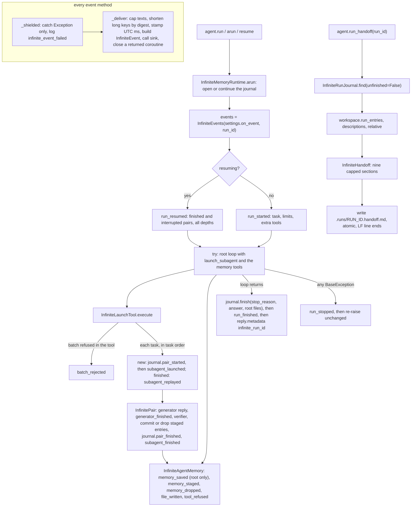

feat(infinite): add native run events and a model-free run handoff to InfiniteMemoryAgent

## Summary

Until now, a caller of `InfiniteMemoryAgent` could not see anything until `run()` returned. A run can start up to 1,000 agents, and the caller could not tell which were running, which had finished, or what they produced. A failed or cancelled run did not say which journal it left behind, and nothing summarized a run afterwards. This PR adds three things:

- **Run events.** `InfiniteMemoryAgentSettings(on_event=...)` takes a plain synchronous callable. The agent itself delivers one frozen `InfiniteEvent` for each state-changing action of any agent in the tree. There are 14 `InfiniteEventKind` values: run started, resumed, finished, and stopped; batch rejected; subagent launched, replayed, and finished; generator finished; memory saved, staged, and dropped; file written; and tool refused. Each event carries the run id, the agent's key, role, and depth, a UTC timestamp, a one-line summary of at most 280 characters, and a typed details record. Fixed caps keep the details under 32,768 bytes of JSON for any settings value. Delivery needs no tracer, no extra agent, and no model call. Tool calls such as `bash`, `grep`, and `read_lines`, and model calls, produce no events.
- **Observing never harms the run.** If the sink raises an `Exception`, the error is logged once, with no text from the event, and the run continues unchanged. An `async` sink is refused when the settings are built. With no sink, no event object is built at all. Every run that opens a journal ends with exactly one `run_finished` or `run_stopped`, and `reply.metadata["infinite_run_id"]` names the journal.
- **`agent.run_handoff(run_id=None)`.** It builds a nine-section `InfiniteHandoff` (a `Handoff` subclass) from the journal and the workspace, without calling a model. The sections are Outcome, Work done, Decisions, Facts, Lessons, Open questions, Files, Unverified or failed work, and How to continue. It saves the result as `.runs/<run_id>.handoff.md`. The Outcome is capped at 239,000 characters and every other section at 15,900, so the whole text stays at most 366,500 characters and fits the backend's handoff sections.

The journal's `run_finished` record gains two fields, `answer` and `files`. The journal is still the only thing resume reads.

**Base and landing.** This PR is stacked on #1084 (`feat/infinite-memory-agent` at `7efceb55`). #1084 has since been squash-merged into `main` as `2c84049c` (2026-10-16 19:45 UTC). Because its branch still exists, GitHub did **not** retarget this PR, and `7efceb55` is not an ancestor of `main`. To land this PR, it must be rebased onto `main` with `git rebase --onto origin/main 7efceb55` and retargeted to `main`. A dry replay onto `main` at `6f5a7310` has no textual conflicts. On the replayed tree, the focused pack gives `1 failed, 193 passed`. The failure is one assertion that `main`'s #1169 supersedes; see Follow-ups.

**Related PRs:** cerredz/Vidbyte#708 adds the backend checkpoint route, `agent_run_events`, and `/agents/dashboard`. cerredz/vidbyte-cli-internal#171 adds the vidbyte CLI command that runs the agent and checkpoints these events. Both are open drafts and consume this PR's public names.

## How to use what this PR introduces

```python
from vidbyte import InfiniteEvent, InfiniteMemoryAgent, InfiniteMemoryAgentSettings, InfiniteWorkspaceSettings

events: list[InfiniteEvent] = []
agent = InfiniteMemoryAgent(
    InfiniteMemoryAgentSettings(
        name="analyst",
        system_prompt="You research markets and report sourced findings.",
        provider="openai",
        model_name="gpt-4.1",
        root_dir=".",
        workspace=InfiniteWorkspaceSettings(root="memory"),
        on_event=events.append,  # any plain function; an async one is refused here
    )
)

reply = agent.run("Compare the list prices of our five competitors.")
run_id = reply.metadata["infinite_run_id"]  # the journal's stem: memory/.runs/<run_id>.jsonl

for event in events:
    print(event.kind.value, event.agent_key, event.summary)

handoff = agent.run_handoff(run_id)  # no model call; also saved as memory/.runs/<run_id>.handoff.md
print(handoff.section_titles())
```

This is the §4 snippet of the spec. It was run on this branch with the test pack's scripted model (no network), with the root answering at once. It printed exactly:

```text
run_started root Run started: Compare the list prices of our five competitors.
run_finished root Run finished (final_response): Acme is cheapest at 49 USD per seat.
('Outcome', 'Work done', 'Decisions', 'Facts', 'Lessons', 'Open questions', 'Files', 'Unverified or failed work', 'How to continue')
```

- **Serialize an event:** `json.dumps(dataclasses.asdict(event), default=lambda value: value.isoformat())`. Every leaf is a JSON type except `at`, a UTC `datetime` with millisecond precision.
- **Import a details type:** the details types (for example `InfiniteSubagentFinishedDetails`) import from `vidbyte.lib.dataclasses.infinite`. Only `InfiniteEvent`, `InfiniteEventKind`, and `InfiniteHandoff` are exported from `vidbyte` and `vidbyte.agents`.
- **Async sinks are refused:** `on_event=some_async_function` raises `ConfigurationError` with `details == {"field": "InfiniteMemoryAgentSettings.on_event"}`. A sink must be fast, because it runs inline on the loop thread.
- **Stopped runs:** a run that stops still gets a handoff. Its Outcome says it did not finish, Unverified lists the interrupted pairs, and How to continue gives `agent.resume("<run_id>")`.

## Flow



`InfiniteEvents` is the only code that builds an event. The runtime, the launch tool, and the memory tools each call one of its 14 methods, and only after the change the event reports is on disk or in the staged list. Every method returns at once when there is no sink, and runs inside a shield that catches `Exception` but lets `KeyboardInterrupt` and `CancelledError` through. The pair events carry the launcher's key, role, and depth, and name the pair in their details. A pair's committed entries appear only in `subagent_finished.details.committed`, never as `memory_saved`. `run_handoff` reads the journal (in any state), this run's live entries, and the note descriptions. It renders the nine sections with fixed wording and saves them through an atomic write, so two calls give the same bytes.

## What changed

| File | Change |
|---|---|
| `vidbyte/agents/infinite/events.py` (new) | `InfiniteEvents`, the single per-run writer. It has 14 methods, one per kind. `_shielded` logs `infinite_event_failed run_id=… kind=… error_type=…`. `_deliver` stamps UTC milliseconds and closes a returned coroutine as a `TypeError`. The helpers are `_cut` (scrubs surrogates, collapses lines, cuts with the marker), `_items` (first 5 plus an omitted count), `_key` (a key over 508 characters becomes `~` + 16 hex digits of its SHA-256 + `/` + its tail), `_usage` (cost is `None` unless every rollup is complete), and `_count`. |
| `vidbyte/agents/infinite/runtime.py` | Emits `run_started` or `run_resumed` once the journal is open. The run sits inside `try/except BaseException`: `run_stopped`, then re-raise. `journal.finish` records the answer and the root's notes. It emits `run_finished` and returns the reply with `metadata["infinite_run_id"]`. |
| `vidbyte/agents/infinite/launch.py` | Emits `batch_rejected` for a batch the tool refuses. In task order, it writes `pair_started` and then emits `subagent_launched`, or emits `subagent_replayed`. `InfinitePair` keeps both replies (for usage) and typed `committed` and `dropped` lists. It emits `generator_finished` after the generator's reply and `subagent_finished` after `pair_finished`. The card strings are byte-identical to before. |
| `vidbyte/agents/infinite/memory.py` | Emits `memory_saved` (root only), `memory_staged`, `memory_dropped`, and `file_written` (created, appended, or edited), plus `tool_refused` in each memory tool's error branch. A verifier drop becomes an `InfiniteDroppedEntry`. Each site carries `@intent an-event-follows-its-durable-change`. |
| `vidbyte/agents/infinite/journal.py` | `finish(stop_reason, answer, files)`, which older records without those fields still load. `find(..., unfinished=False)` loads a run in any state. New properties `cards` and `interrupted` cover every depth. A bad `answer` or `files` is the existing bad-record `ConfigurationError` with its line. |
| `vidbyte/agents/infinite/workspace.py` | `relative(path)` returns the workspace-relative POSIX path and never raises; a symlink loop gives back the path as given. `run_entries(run_id)` returns a run's live entries. `descriptions(run_id=None)` returns the note descriptions. Both are read-only. |
| `vidbyte/agents/infinite/agent.py` | `run_handoff(run_id=None)`, as described in Flow. |
| `vidbyte/agents/infinite/settings.py` | `on_event: Callable[[InfiniteEvent], None] \| None = None`, checked with `require_callable(optional=True, synchronous=True)`. |
| `vidbyte/agents/infinite/__init__.py`, `vidbyte/agents/__init__.py`, `vidbyte/__init__.py` | Export `InfiniteEvent`, `InfiniteEventKind`, and `InfiniteHandoff`. |
| `vidbyte/context/handoff/infinite.py` (new) | `InfiniteHandoff(Handoff)`: the nine titles, their wording, the section renderers, and a list-line cut at 1,000 characters through `TokenEstimate.truncate_chars`. |
| `vidbyte/context/handoff/__init__.py`, `vidbyte/context/__init__.py` | Export `InfiniteHandoff`. |
| `vidbyte/lib/dataclasses/infinite.py` | `InfiniteEvent` (envelope, plus a `DETAILS_TYPES` map from kind to details type). It adds 13 details records for the 14 kinds (`batch_rejected` and `tool_refused` share `InfiniteRefusalDetails`), plus `InfiniteCommittedEntry` and `InfiniteDroppedEntry`. Every text, list, key, and count is validated at its cap. There is no `to_dict` or `from_dict`. |
| `vidbyte/lib/dataclasses/validation.py` | `require_number(allow_zero=)`, `require_utc_datetime(resolution_microseconds=)`, and `require_callable(optional=, synchronous=)`. The last checks every `functools.partial` layer and each layer's type `__call__`. |
| `vidbyte/lib/enums/infinite.py`, `vidbyte/lib/enums/__init__.py` | `InfiniteEventKind` (14 values), `InfiniteDropReason`, `InfiniteFileChange`, and `InfiniteStopCause`. |
| `vidbyte/lib/constants/infinite.py` | Event caps (summary 280, text 500, path 500, line 120, label 64, items 5, key 512, count 2^63−1, details 32,768 bytes), the key-digest settings, summary templates, handoff caps (239,000, 15,900, 1,000), the suffix, and the metadata keys. |
| `vidbyte/lib/util/text.py` | `TokenEstimate.truncate_chars(text, limit, marker)`: the character cut that `OutputText.truncate` and the handoff share. |
| `vidbyte/lib/outputs/text.py` | `OutputText.truncate(..., marker=)` delegates to `truncate_chars`. The default marker is unchanged. |
| `contracts/sdk-public-api.json` | Regenerated: 647 exports. |
| `vidbyte/agents/infinite/README.md`, `vidbyte/agents/README.md`, `vidbyte/lib/README.md` | Document events, the sink rules, the size bound (31,093 bytes per whole event), and the handoff, and update the File Index. |
| Tests (11 files, +2,706/−6) | Five new feature modules: `test_infinite_memory_events_{stream,pairs,records,lifecycle}.py` and `test_infinite_memory_handoff.py`, plus the shared `infinite_events_fixtures.py`. Two new helper tests: `tests/test_record_field_validation_event_options.py` and `tests/test_output_text_truncate_marker.py`. The one pre-approved budget edit is in `test_infinite_memory_contract.py` (`launch.py` ≤ 410, lib records ≤ 620). `FEATURE.md` and the pack README are updated. In all: 60 new test functions and 80 new collected cases (193 focused cases, up from 113). |
| Docs: `docs/spec/infinite-memory-events/` | The spec, test plan, review, verify log, pipeline record, the S0–S6 stage reports, and this body. |

## Acceptance criteria → proof

Test files: **stream**, **pairs**, **records**, and **lifecycle** are `tests/features/infinite_memory_agent/test_infinite_memory_events_<name>.py`. **handoff** is `tests/features/infinite_memory_agent/test_infinite_memory_handoff.py`. **options** is `tests/test_record_field_validation_event_options.py`, and **truncate** is `tests/test_output_text_truncate_marker.py`. Every test listed passes at the final source commit.

| AC | Then (short) | Proof |
|---|---|---|
| AC-1 | The §4 snippet prints exactly the spec's three lines and saves the handoff | stream `test_section_4_snippet_prints_the_two_run_events_and_the_nine_handoff_titles`, and the independent S6 run shown above |
| AC-2 | A one-pair run delivers seven events in order, with their envelopes, summaries, and details | stream `test_a_one_pair_run_delivers_seven_events_in_order_with_their_envelopes_summaries_and_details` |
| AC-3 | The root's entry gets one `memory_saved` before the root's next model call; a pair's commits get none | stream `test_the_roots_entry_is_announced_once_by_memory_saved_before_its_next_model_call` |
| AC-4 | A sink that always raises changes nothing; each failure is logged once, with no text | stream `test_a_sink_that_always_raises_changes_nothing_and_each_failure_is_logged_once_without_text` |
| AC-5 | A cancelled run ends with `run_stopped(cancelled)`, and its resume opens with `run_resumed` | lifecycle `test_a_cancelled_run_ends_with_run_stopped_and_its_resume_opens_with_run_resumed` |
| AC-6 | A root runner error ends with `run_stopped(failed)`, raises as before, and stays resumable | lifecycle `test_a_root_runner_error_ends_the_stream_with_run_stopped_failed_and_the_run_stays_resumable` |
| AC-7 | A batch the tool refuses gives exactly one `batch_rejected` | pairs `test_a_batch_the_launch_tool_refuses_delivers_exactly_one_batch_rejected` |
| AC-8 | A replayed name and a new name are announced in task order | pairs `test_a_replayed_name_and_a_new_name_are_announced_in_task_order_before_the_new_pair_runs` |
| AC-9 | `drop_entry` gives `memory_dropped` and is listed in `subagent_finished`; the card text is unchanged | pairs `test_drop_entry_is_announced_and_listed_in_the_finished_pair_with_the_card_text_unchanged` |
| AC-10 | (a) No verdict drops the staged entries as `unchecked`; (b) a rule drop carries the rule's message | pairs `test_a_pair_without_a_verdict_reports_every_staged_entry_dropped_as_unchecked`, `test_an_entry_a_sibling_committed_first_is_reported_dropped_with_the_rule_message` |
| AC-11 | Appending and then editing a note gives two `file_written` events | pairs `test_appending_then_editing_a_note_delivers_two_file_written_events` |
| AC-12 | Each refused memory-tool call gives one `tool_refused` with the reason the model saw | pairs `test_each_memory_tool_refusal_delivers_one_tool_refused_with_the_reason_the_model_saw` |
| AC-13 | Every event serializes under both `ensure_ascii` settings, with allowed leaf types only | `assert_portable` in `infinite_events_fixtures.py`, called by every run-level test |
| AC-14 | Long texts and lists are cut to their caps with the marker | pairs `test_long_texts_and_lists_are_cut_to_their_caps_with_the_marker` |
| AC-15 | `run`, `arun`, and `resume` replies name their journal in `infinite_run_id` | stream `test_every_reply_names_its_journal_in_infinite_run_id` |
| AC-16 | Nine sections, a byte-exact file, no model call, the same on a second call | handoff `test_a_finished_run_gives_nine_sections_and_a_byte_exact_file_without_a_model_call` |
| AC-17 | A cancelled run's handoff says it is unfinished and how to resume it | lifecycle `test_the_handoff_of_a_cancelled_run_says_it_is_unfinished_and_how_to_resume` |
| AC-18 | An old journal without an answer uses the placeholder; resume is unchanged | handoff `test_an_old_journal_without_an_answer_uses_the_placeholder_and_resume_is_unchanged` |
| AC-19 | A bad, unknown, or missing run id is refused with `field=run_id`, and nothing is written | handoff `test_a_bad_unknown_or_missing_run_id_is_refused_and_writes_nothing` |
| AC-20 | With no sink, the journal gains only `answer` and `files`, and nothing is logged | stream `test_without_a_sink_the_journal_gains_only_answer_and_files_and_nothing_is_logged`, `test_without_a_sink_no_event_method_builds_an_event_or_logs` |
| AC-21 | `on_event` refuses non-callables and async sinks, and accepts `None` and sync callables | records `test_on_event_refuses_a_non_callable_or_asynchronous_sink`, `test_on_event_accepts_none_and_synchronous_callables_as_the_last_field` |
| AC-22 | A nested launch names its launcher and the nested agents by key and depth | pairs `test_a_nested_launch_names_its_launcher_and_the_nested_agents_by_key_and_depth` |
| AC-23 | Token totals match the scripted usage and `get_usage()` | stream `test_token_totals_come_from_the_scripted_usage_and_match_get_usage` |
| AC-24 | The public names are one object on every export path; the kind set has 14 values | records `test_the_public_names_are_one_object_wherever_they_are_exported`, plus `scripts/generate-sdk-public-api.py --check` |
| AC-25 | `bash`, `grep`, and `read_lines` give no event, and no event leaks their output or secrets | stream `test_bash_grep_and_read_lines_deliver_no_event_and_no_event_carries_their_output_or_secrets` |
| AC-26 | Each event arrives after its change is on disk | stream `test_each_event_is_delivered_after_the_change_it_reports_is_on_disk` |
| AC-27 | A `KeyboardInterrupt` in `arun` ends with `run_stopped(cancelled)` | lifecycle `test_a_keyboard_interrupt_in_arun_ends_the_stream_with_run_stopped_cancelled` |
| AC-28 | A generator that raises gets no `generator_finished`; the pair ends `failed`/`unchecked` | pairs `test_a_generator_that_raises_has_no_generator_finished_and_its_entries_drop_as_unchecked` |
| AC-29 | (a) A returned coroutine is closed and logged as `TypeError`; (b) a returned task is not a failure | stream `test_a_sink_that_returns_a_coroutine_has_it_closed_and_logged_as_a_type_error`, `test_a_sink_that_returns_a_task_it_scheduled_is_not_a_failure` |
| AC-30 | Every details record at its caps fits its worst-case figure; one character more is refused | records `test_every_details_record_at_its_caps_fits_its_worst_case_figure` (13 cases), `test_every_capped_field_refuses_one_character_more_and_every_list_a_sixth_item`, `test_one_line_fields_refuse_a_line_break` |
| AC-31 | Large settings and long lists stay bounded, with honest omitted counts | pairs `test_large_settings_and_long_lists_stay_bounded_with_honest_omitted_counts` |
| AC-32 | Keys over 508 characters are shortened by digest and stay distinct | records `test_keys_over_508_characters_are_shortened_by_digest_and_stay_distinct` |
| AC-33 | A huge answer and a long Files list are cut to the section caps | handoff `test_a_huge_answer_and_a_long_files_list_are_cut_to_the_section_caps` |
| AC-34 | Two spellings of one note give one relative path in events and the handoff | pairs `test_two_spellings_of_one_note_are_one_relative_path_in_events_and_the_handoff`. This passes here. Its card-spelling clause (`:517`) fails once rebased onto `main` (#1169); see Follow-ups |
| AC-35 | A lone surrogate becomes `?` in events, and the journal keeps the original | pairs `test_a_lone_surrogate_in_a_generator_reply_becomes_a_question_mark_in_events_only`; handoff `test_a_lone_surrogate_in_the_roots_answer_becomes_a_question_mark_in_the_handoff_and_its_file` |
| AC-36 | Middleware denials give no event, and the run still finishes | pairs `test_middleware_denials_deliver_no_event_and_the_run_still_finishes` |
| AC-37 | The new validator options, the envelope checks, cost rules, the truncate marker, and usage reading | records `test_cost_may_be_zero_or_unknown_but_never_negative_or_infinite`, `test_the_envelope_refuses_a_wrong_time_details_type_summary_key_or_depth`, `test_generator_usage_is_read_from_the_reply_rollup_and_unknown_cost_is_none`; options `test_require_utc_datetime_accepts_only_a_zero_offset_at_the_resolution`, `test_require_callable_refuses_none_unless_optional_and_async_sinks_when_synchronous`, `test_require_number_accepts_zero_only_with_allow_zero`; truncate `test_truncate_keeps_the_callers_marker_inside_the_limit_and_the_default_is_unchanged` |

## Verification

`e7c1c950` and every later commit change only `docs/spec/`. The source under test is identical from `2073421b`, the last source commit, through the head.

| Gate | Command | SHA | Final line(s) |
|---|---|---|---|
| Focused pack | `PYTHONPATH=$(pwd) python -m pytest tests/features/infinite_memory_agent tests/test_record_field_validation_event_options.py tests/test_output_text_truncate_marker.py -q -p no:cacheprovider` | `e7c1c950` | `193 passed in 7.42s` |
| Lint | `python lint/run.py` (inside the source stage) | `e7c1c950` | `SDK-LINT: PASS` |
| Full gate, source stage | `PYTHONPATH=$(pwd) python scripts/run_ci.py --stage source` | `e7c1c950` | `3 failed, 6123 passed, 16 skipped in 104.34s (0:01:44)`, then `CI failed: … -m pytest`. The 3 failures are the inherited `tests/features/harness_threads/test_harness_threads_surface.py` tests, which also fail at base `7efceb55` (see Follow-ups). Lint, compileall, and the three `check_*` scripts pass. |
| Full gate, package stage | `python scripts/run_ci.py --stage package` (no `PYTHONPATH`) | `e7c1c950` | `Installed vidbyte-sdk 0.3.0 passed smoke checks.` / `CI passed.` |
| Semgrep static policy | `semgrep scan --error --config .semgrep/typed-mapping-boundary-policy.yml vidbyte` (semgrep 1.170.1) | `e7c1c950` | `Ran 1 rule on 982 files: 0 findings.` |
| Public API contract | `PYTHONPATH=$(pwd) python scripts/generate-sdk-public-api.py --check` | `e7c1c950` | `contracts/sdk-public-api.json is current at 52249854c2da0ca5961a743e961d5b8972fa35ce (vidbyte-sdk 0.3.0, 647 exports).` |
| §4 snippet | §4 run as written under the scripted model (no network) | `e7c1c950` | The output is identical to the spec's text block. `.runs` holds `<id>.jsonl` and `<id>.handoff.md`, and the file's bytes equal `to_context_text()` with no `\r`. |
| Worst-case size | AC-30 builders in a full `InfiniteEvent` (512-character key, 280-character summary, millisecond `at`), under 4 `json.dumps` settings | `e7c1c950` | `max details 27015 max event 31093` |
| Replay onto `main` | `git merge-tree --write-tree --merge-base=7efceb55 origin/main HEAD`, then the focused pack on that tree | `main` `6f5a7310` + `e7c1c950` | No conflicts (tree `908eab5a`). `1 failed, 193 passed`: `test_two_spellings_of_one_note_are_one_relative_path_in_events_and_the_handoff` at `:517` |
| Remote checks | `gh workflow run CI` and `gh workflow run "Static policy"` on the branch, then `gh api repos/cerredz/Vidbyte-SDK/commits/<sha>/check-runs` | `cfd64939` (finalize commit; same source) | 4/4 green: `Package`, `Static policy`, `Source / Python 3.11`, and `Source / Python 3.12` all `completed success` (runs 39013426908 and 39013428202). Earlier, `900be217` was also 4/4 green (runs 39011862131 and 39011863558). These are dispatched runs, so `gh pr checks` lists none. |

## Adversarial review

The S4 review on `24297ccf` used three lenses (conformance, conventions, and engineering), and a findings verifier checked the results. It found **0 Blockers, 7 Majors (all fixed), and 10 Minors**. Of the Minors, 4 were fixed (m-5 to m-8), 1 is wontfix (m-10), and 5 are follow-ups (m-1 to m-4, m-9). The verifier refuted or downgraded 2 claims: R-V1 went from Major to m-1, and R-E4's proposed fix was refuted, though the finding stands as R-4. After two repair iterations, a re-review found **3 Minors (rr-1 to rr-3), all fixed**, and no new Blocker or Major.

| ID | Severity | Finding | Fixed in |
|---|---|---|---|
| R-1 | Major | Two lib headers sent maintainers to `docs/spec` for the worst-case sizes, against AGENTS.md | `e7625553` (headers point at the AC-30 `_FIELDS`/`_FIGURES` tables) |
| R-2 | Major | `InfiniteWorkspace.relative` let the `RuntimeError` from `Path.resolve()` on a symlink loop escape (on Python 3.11), which broke `run_handoff` for every run and broke events | `ca5157a4`; test kept true on 3.13 in `1dbfdd84` (`test_a_note_replaced_by_a_symlink_loop_keeps_one_name_and_breaks_no_handoff_or_event`) |
| R-3 | Major | The handoff's lone-surrogate scrub had no test; removing it made `run_handoff` raise `UnicodeEncodeError` | `99c5908d` |
| R-4 | Major | Nothing measured NFR-2 ("0 `InfiniteEvent` instances with `on_event=None`") | `d8186147` (`test_without_a_sink_no_event_method_builds_an_event_or_logs`) |
| R-5 | Major | D-18's cost rule (known only when every part is complete; no parts means unknown) had no test | `755e55cd` (`test_a_pairs_cost_is_known_only_when_every_reply_is_fully_priced_and_unknown_without_replies`) |
| R-6 | Major | The all-depth counts of `run_resumed` and `run_finished` were tested only at the root | `ae71adb1` (`test_a_resumed_run_counts_finished_and_interrupted_pairs_at_every_depth`) |
| R-7 | Major | The handoff's list-line cut copied `OutputText.truncate` inline (AGENTS.md style 5) | `a16ba2f8` (shared `TokenEstimate.truncate_chars`) |

The other fixes were:

- **S4 Minors:** m-5 `e7e6dd59` (a partial around an object with an async `__call__`), m-6 `cd07e8f0` (metadata key constant), m-7 `3f68608d` (`@intent` per event site), and m-8 `146effaa` (README figure 31,093).
- **Re-review Minors:** rr-1 `d913802b` (a partial subclass with an async `__call__`), rr-2 `3bd374c3` (envelope comment), and rr-3 `2073421b` (truncate comment).

**Commit-subject traceability (m-10, wontfix: history is not rewritten).** Two commit subjects cite IDs their commits do not implement: `8cd15dab` cites AC-15, and `72f1f56d` cites FR-14. The correct mapping is **AC-15 → `5e5b845c`** and **FR-14 → `8cd15dab`, `e8c5ef27`**.

## Deviations from the spec

1. **Text-list items are refused under the list's own name.** Each list is checked in two calls: `require_text_items(max_items=)`, then `require_text` per item. This is because `require_text_items` with `max_chars` names `field[index]`, and AC-30 wants `Record.field` (`0b987caa`).
2. **`vidbyte/lib/dataclasses/infinite.py` is compacted to 604 of its 620 lines.** `__all__` and the `InfiniteEventDetails` alias sit on one line each (`0b987caa`).
3. **`events.py` packs each details constructor several fields to a line**, to reach exactly 400 of its 400 lines. The 414-character alias line and this packing are follow-up m-1 (`75eb0018`).
4. **The journal checks `answer` and `files` with `RecordFieldConverter.require_instance` and `to_tuple`**, not a hand-written `TypeError` branch, which lint S024 counts as a fourth nesting level. The error is still the bad-record `ConfigurationError` with its line (`581ab74b`).
5. **`generator_finished` finds the pair's launch time by the key without `/gen`**, and reports a missing time as `INFINITE_MIN_COUNT` (0), as lint A007 requires (`581ab74b`).
6. **Five ambiguities were settled in the tests' favour.** In particular, `duration_ms` defaults to 0 when the launch time is unknown (AC-37 (f)), which departs from D-17. `NO_ANSWER` sits in the Outcome's answer slot, beside the stop reason.
7. **The lib headers name the AC-30 test tables, not this spec** (review R-1, `e7625553`).
8. **The character cut is the new `TokenEstimate.truncate_chars` in `vidbyte/lib/util/text.py`**, a file outside §12.3 that the orchestrator approved (review R-7, option A). `OutputText.truncate(marker=)` delegates to it. `InfiniteHandoff._lines` calls it directly, because importing `vidbyte.lib.outputs` from the handoff module is an import cycle. A 1,404-case differential found 0 mismatches (`a16ba2f8`). This replaces the inline cut of the earlier deviation.
9. **An extra constant, `INFINITE_HANDOFF_RUN_ID_METADATA_KEY = "run_id"`**, is not in §9.1. It replaced a literal (review m-6, `cd07e8f0`).
10. **`require_callable(synchronous=True)` is stricter than D-27's wording.** It checks `iscoroutinefunction` on every `functools.partial` layer and on each layer's type `__call__` (m-5 `e7e6dd59`, rr-1 `d913802b`).
11. **The whole-event worst case is 31,093 bytes, not 31,091.** The spec is corrected in INV-33, §9.1, and §9.2 by this PR's finalize commit. The other whole-event cells in §9.1 used a flat 4,076-byte envelope estimate. The measured envelopes are 4,072 to 4,079 bytes, so those cells are off by −4 to +3 bytes. They are left as estimates; all stay under 32,768.

## Follow-ups

- **Rebase onto `main` and retarget (needed before merge).** #1084 landed as `2c84049c`. Run `git rebase --onto origin/main 7efceb55 feat/infinite-memory-events`, force-push, and run `gh pr edit 1159 --base main`.
  - #1169 (`08f67e7f`) on `main` makes the card's `files` hold each note's relative path once.
  - That supersedes INV-28's card-spelling clause, EC-16, D-23's "card keeps the model's spelling", and AC-34's card clause. The single test change is `test_infinite_memory_events_pairs.py:517`, from `["./notes/a.md", "notes/a.md"]` to `["notes/a.md"]`.
  - After that, rerun `generate-sdk-public-api.py --check`, because its `source.commit` pin moves.
  - The CLI sibling (cerredz/vidbyte-cli-internal#171) pins this branch, so re-pin it after the force-push.
- **m-1:** `events.py` sits at 400/400 lines by packing constructor arguments, and the `InfiniteEventDetails` alias is a 414-character line. Raise the cap, or lay out one keyword per line.
- **m-2:** No tests for `batch_rejected` and `subagent_replayed` at a nested launcher, or for digest-shortening of verifier keys and interrupted keys over 508 characters.
- **m-3:** No tests for the root's appended or edited files in the handoff's Files section, for `description == ""` on an append, or for `duration_ms` in milliseconds.
- **m-4:** `run_handoff` resolves every `files.jsonl` description across all runs. That is about 193 µs per `relative()` call, or about 1.9 s at 10,000 records.
- **m-9:** `llms.txt` omits `InfiniteHandoff`, and InfiniteMemory as a whole (including #1084's agent).
- **Spec figure 31,091 → 31,093:** done in this PR (`docs(spec): finalize infinite-memory-events for PR`). Forward 31,093 to the CLI and Vidbyte siblings.
- **Inherited `harness_threads` failures (base-branch issue):** three `tests/features/harness_threads/test_harness_threads_surface.py` tests diff against `merge-base origin/main HEAD` and fail at base `7efceb55` as well:
  - `test_failure_codes_keep_main_and_append_exactly_the_28_harness_codes`
  - `test_branch_leaves_the_tools_and_configs_packages_as_main_has_them`
  - `test_import_vidbyte_starts_no_process_and_leaves_the_native_package_unloaded`

  Remote CI is green. Recheck them after the rebase.
- **Limitations, kept by design:**
  - A slow sink slows the run, because delivery is inline (EC-9).
  - A `KeyboardInterrupt` raised by the sink on the opening event gives no `run_stopped` (D-9).
  - Sibling pairs that keep running after a non-SDK error may deliver events after the terminal event (EC-12).
  - Free text (answers, reviews, error messages) passes through capped but unscrubbed; the CLI scrubs before upload (NG-13).

🤖 Generated with [Claude Code](https://claude.com/claude-code)
