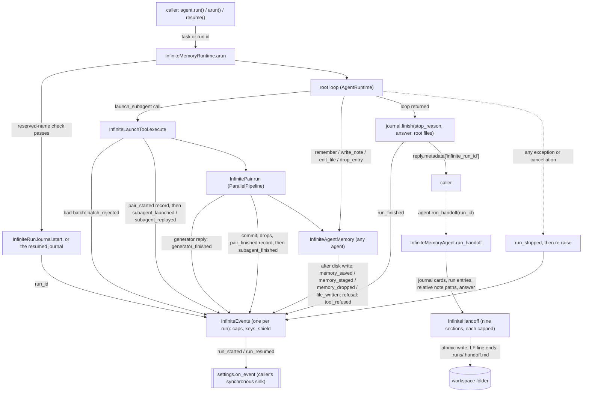
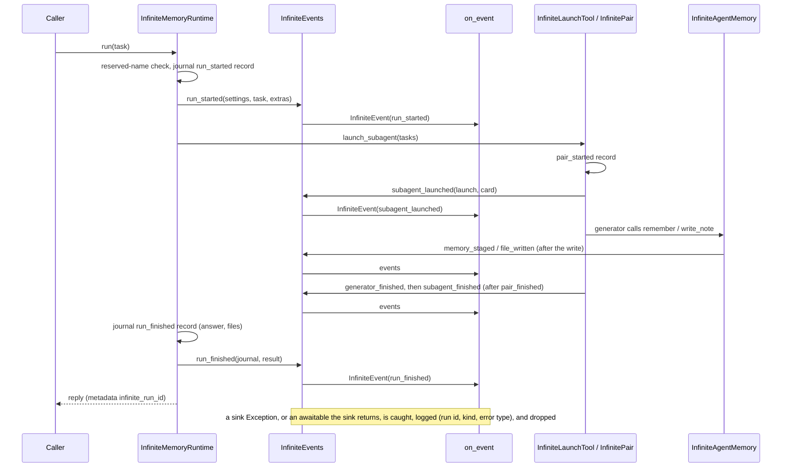

# Spec: InfiniteMemoryAgent native run events and handoff

> **TL;DR** — `InfiniteMemoryAgent` gains a live, typed, high-level action trace of its own: one `InfiniteEvent` per state-changing agent action (14 kinds), delivered to an optional, synchronous `InfiniteMemoryAgentSettings.on_event` callback by a single per-run writer class, `InfiniteEvents`. A failed or cancelled run now announces itself (`run_stopped`) before re-raising, every reply carries its journal run id, and `InfiniteMemoryAgent.run_handoff()` builds a deterministic, model-free `InfiniteHandoff` and saves it beside the journal. Every event and the handoff have a hard size bound that holds at any settings value: each event's `details` is at most 32,768 bytes as JSON (worst case 27,015), and the handoff fits the backend's 24 sections of 16,000 characters. The decision that matters most: events are observation only. An observer can never break a run, and the journal remains the only source of truth for resuming a run.

## §0 User prompts

### 0.1 Invoking request (verbatim)
Yeah I think that a class that implements all events, customly and native to the infinite memory agent, is the right approach to take. Then maybe at certain points thoughtout the run we can "checkpoint" the agent with the vidbyte/ backend when we run it on the cli (once every 50 iterations or something, or however you see fit to this). Make sure dashboard page too generates tokens server side and pass no sensitive info to client, you can make all the prs in each repo using the skill. Also, with the "next step" suggestions can you try to focus on vidbyte-cli/. Feel like we could implement/add more here with the cli

### 0.2 User replies during the run
_None yet._ (Revision r2 applies the orchestrator's rulings on review r1, which are logged in §16. They are not user replies.)

---

## Part A — Framing

## §1 Goal

Today a caller of `InfiniteMemoryAgent` is blind until `run()` returns. A long run can start up to 1,000 agents at the default `max_agents`, and the caller cannot see which agents are running, which have finished, or what they produced. The SDK tracer cannot help here. It records spans with a string output, its `llm.call` spans carry full message histories, and every subagent gets a `NullTracer`. The run journal records only 4 of the 14 things worth showing, and it is fsynced through `AppendOnlyJsonl` because resume depends on it. Three more gaps: a failed or cancelled run raises without saying which journal it left behind, the reply never names its run id, and nothing summarizes a run once it is over (the folder README says so: "No live tree view, event stream, transcript archive, or end-of-run report"). The user asked to "see alll of the agents that are running and which ones have ran/what they produced" through "a high level action trace that is tailor made to the agent (without the user of another agent)", built as "a class that implements all events, customly and native to the infinite memory agent", plus "a 'handoff' as another artifact after the run". This PR is the SDK slice that the CLI checkpoint sync and the Vidbyte dashboard consume, so its output must fit their limits: the backend refuses an event whose `details` is over 65,536 bytes and a record section over 16,000 characters.

| ID | Goal (outcome) | How we will know | Source |
|---|---|---|---|
| G-1 | A caller sees a long run as it happens: every state-changing action of every agent in the tree, at a readable, high level, built by the agent itself (no tracer, no extra agent, no model call). Every event is small enough to upload, whatever the settings. | With `on_event` set, a run that uses every agent action delivers each of the 14 `InfiniteEventKind` values at its documented point, with a one-line `summary` and typed `details`. No tool call or model call produces an event (AC-2, AC-25). Every event's `details` is at most 32,768 bytes as JSON, under every `json.dumps` setting, at any settings value (AC-30, AC-31). | request.md §A Prompt 3, §0.1, §C contract; orchestrator ruling 2 |
| G-2 | A caller can tell a running run from a stopped or finished one, and tie each to its journal so it can resume it. | Every run that opens a journal ends its events with exactly one `run_finished` or `run_stopped`, and `reply.metadata["infinite_run_id"]` names the journal for every run and resume (AC-5, AC-6, AC-15). | request.md §A Prompt 3, §C contract |
| G-3 | After a run, its outcome is a shareable artifact: what it produced, what is unverified, and how to continue. It costs no model call, and it fits the backend's record limits. | `agent.run_handoff(run_id)` returns an `InfiniteHandoff` with the nine contract sections and writes `.runs/<run_id>.handoff.md`. Calling it twice gives identical bytes and makes zero model calls (AC-16..AC-19). Each section fits its cap, so the whole document fits 24 sections of 16,000 characters (AC-33). | request.md §A Prompt 3 ("handoff ... after the run"), §C contract; orchestrator ruling 3 |
| G-4 | Observing a run never harms it. A broken observer cannot fail the run, corrupt the journal, or change what any model sees, and a wrong kind of observer is refused before the run starts. | A sink that raises on every event leaves the reply, the journal, and the workspace equal to a run with a working sink (AC-4). An `async def` sink is refused when the settings are built (AC-21). With no sink, the journal holds only the documented record shapes plus the two additions in §9.4 (AC-20). | request.md §B ("an observer must never break a run"), §C contract; orchestrator ruling 4 |

## §2 Objective

When this PR merges, the stacked `feat/infinite-memory-agent` code (PR #1084, with review fixes #1113) contains the following. `InfiniteEventKind` (14 values) and three small vocabularies (`InfiniteDropReason`, `InfiniteFileChange`, `InfiniteStopCause`). The frozen, validated `InfiniteEvent` record, with one flat details record per kind, each validated through the SDK's canonical `RecordFieldValidator` and each bounded by fixed caps. A new agent-package module that holds `InfiniteEvents`, the single writer of every event, called from the runtime, the launch tool, and the memory tools. The `on_event` settings field, which accepts only a synchronous callable. A `run_stopped` event on failure or cancellation, followed by re-raising the original exception. The `infinite_run_id` reply metadata key. The journal's `run_finished` record gains the root's final answer and the files the root wrote, and the journal can load a run in any state. The workspace gains readers for one run's entries and for note descriptions, and a helper that turns a note path into its workspace-relative form. `InfiniteHandoff` sits in the context layer's handoff package, and `InfiniteMemoryAgent.run_handoff()` builds it, caps each section, and writes it atomically to `.runs/<run_id>.handoff.md`. Two canonical lib helpers gain backward-compatible options: `RecordFieldValidator` (a zero-allowed number, a UTC datetime check, a callable check) and `OutputText.truncate` (a chosen marker). Exports go through `vidbyte`, `vidbyte.agents`, `vidbyte.context`, and `vidbyte.lib.enums`. The public-API contract is regenerated, the READMEs are updated, and one pre-approved edit updates the #1084 complexity-budget test. Later slices, built by the sibling runs, are NG-1 and NG-2.

## §3 Non-goals

- **NG-1** — Checkpoint cadence ("once every 50 iterations or something"), the outbox, the HTTP sync, budget cancellation, `--send-to`, and the `vidbyte-cli agents infinite-memory run|resume` command. — *Why not:* they belong to the CLI sibling run (`feat/infinite-memory-agent-command`). The field guide also rules that the SDK ships no CLI (`prebuilt-agents.md`). This PR only gives that run a stable Python surface.
- **NG-2** — Backend checkpoint ingest, Mongo storage, the `/agents/dashboard` pages, server-side tokens, and the marketplace listing. — *Why not:* they belong to the Vidbyte sibling run (`feat/agent-run-dashboard`). The SDK's share of "pass no sensitive info to client" is T-3: events never carry settings secrets.
- **NG-3** — Events for tool calls (`bash`, `grep`, `read_lines`), model calls, or raw turns, and any transcript archive. — *Why not:* already decided in request.md §C. These are raw-turn level, they would turn a readable trace into a log, and bash output carries secrets that no scrubber sees.
- **NG-4** — Turning the journal into an event log, writing observation records, or letting resume read events. — *Why not:* already decided. The journal stays the only resume source. Only its existing `run_finished` record gains two fields (D-11).
- **NG-5** — An asynchronous sink, an event queue, a background thread, or back-pressure for `on_event`. — *Why not:* nobody asked for these controls. Ordering and durable-before-announced (INV-4, INV-5) are simplest inline, and several emission sites are synchronous methods that cannot await. The CLI's sink appends to a local outbox. A slow sink slows the run (EC-9). An `async def` sink is refused, not supported (D-27; supporting one is Q-5, default no).
- **NG-6** — A model-written handoff, overriding `BaseAgent.handoff`, or writing the handoff automatically at the end of every run. — *Why not:* already decided that the handoff is deterministic. `BaseAgent.handoff` is an async, model-calling method that other code relies on. Automatic writing is Q-1 (default: no).
- **NG-7** — Saving events to disk in the SDK (no `.runs/<id>.events.jsonl`). — *Why not:* the CLI owns event durability (its outbox). The journal header forbids observation records.
- **NG-8** — A `verifier_started` event, per-iteration events, or root-iteration counters. — *Why not:* "verifying" can be derived (request.md §B). The CLI substitutes event counts for iterations (request.md §C).
- **NG-9** — Exporting the details records or `InfiniteEvents` from `vidbyte` or `vidbyte.agents`. — *Why not:* the contract exports exactly `InfiniteEvent`, `InfiniteEventKind`, and `InfiniteHandoff`. The details records stay importable from their lib module, and the CLI serializes with `dataclasses.asdict`.
- **NG-10** — Fixing #1084 behaviors unrelated to events: sibling pairs that keep running after an error outside `VidbyteSdkError`/`OSError`/`ValueError`, the stale `api_key` note in request.md §B, and cross-process workspace locking. — *Why not:* they are outside this slice. Where they touch events, they are documented as limitations (EC-12).
- ~~**NG-11** — Normalizing the note paths that models pass, or changing what `write_note` returns.~~ — *Withdrawn in r2 (R-3, R-2):* events and the handoff now report workspace-relative paths through `InfiniteWorkspace.relative` (D-23). `write_note`'s return value and the card text still keep the model's spelling, so INV-28 holds.
- **NG-12** — Making the event caps or the handoff caps configurable (settings fields, environment variables). — *Why not:* no one asked for a knob, `on_event` is the only new settings field in the contract, and the caps exist to fit fixed backend limits. They are constants (D-24, D-26).
- **NG-13** — Replacing folder paths, credentials, or other sensitive text inside free text that a model, a tool, or an exception wrote (answers, reviews, problems, error messages). — *Why not:* nobody asked for an SDK-side scrubber, and no scrubber catches everything a model can write. The SDK builds no absolute path itself (INV-10). Free text passes through capped, and the CLI scrubs before upload (A-9). An SDK-side path placeholder is Q-4 (default no).

## §4 Developer usage

```python
from vidbyte import InfiniteEvent, InfiniteMemoryAgent, InfiniteMemoryAgentSettings, InfiniteWorkspaceSettings

events: list[InfiniteEvent] = []
agent = InfiniteMemoryAgent(
    InfiniteMemoryAgentSettings(
        name="analyst",
        system_prompt="You research markets and report sourced findings.",
        provider="openai",
        model_name="gpt-4.1",
        root_dir=".",
        workspace=InfiniteWorkspaceSettings(root="memory"),
        on_event=events.append,  # a plain (not async) callable, called once per event, in order; an error it raises never stops the run
    )
)
reply = agent.run("Compare the list prices of our five competitors.")
run_id = reply.metadata["infinite_run_id"]  # the journal id, also given to resume()

for event in events:
    print(event.kind.value, event.agent_key, event.summary)

handoff = agent.run_handoff(run_id)  # no model call; also saved as memory/.runs/<run_id>.handoff.md
print(handoff.section_titles())
```

For a root whose model answers at once with `Acme is cheapest at 49 USD per seat.`, the snippet prints exactly:

```text
run_started root Run started: Compare the list prices of our five competitors.
run_finished root Run finished (final_response): Acme is cheapest at 49 USD per seat.
('Outcome', 'Work done', 'Decisions', 'Facts', 'Lessons', 'Open questions', 'Files', 'Unverified or failed work', 'How to continue')
```

The developer gets a live, typed trace of the whole agent tree without wrapping tools, parsing the journal, or adding a tracer. When a run is longer, the same loop prints one line per launch, staged or saved memory, file write, refusal, and finished subagent. Each event is small, so the developer can forward all of them to a service without trimming. The developer no longer has to guess which journal a run used, and no longer needs a model call to summarize a finished run.

## §5 Flow diagram





The runtime validates first. A reserved tool name refuses the run before the journal opens, so no event is emitted. Next it opens or resumes the journal, builds the per-run `InfiniteEvents`, and emits the opening event. Durable state only changes in the existing places: journal records, `entries.jsonl`, notes, and `files.jsonl`. Each event that reports such a change is emitted right after that change is on disk. Everything after the opening event runs inside one `try`. Any exception or cancellation emits `run_stopped` and is re-raised unchanged, and the journal is left without `run_finished`, so the run stays resumable. Inside `InfiniteEvents`, every public method opens `with self._shielded(kind):`, builds its capped details, and calls `self._deliver(...)`. The shield catches any `Exception` from building or delivering. `run_handoff` only reads the journal and the workspace, and the one file it writes is the handoff.

---

## Part B — Behavior (this is the spec; everything else is framing)

## §6 Behavior

### 6.1 Invariants

**Lifecycle**
- **INV-1** — A run that opens a journal (new or resumed) delivers exactly one opening event, and it comes before every other event of that run: `run_started` for `run()`/`arun()`, `run_resumed` for `resume()`/`aresume()`. A run refused before its journal opens delivers no event at all. Reasons for refusal: a reserved tool name, a malformed, unknown, or finished resume id, or no unfinished run.
- **INV-2** — A run that delivered an opening event delivers exactly one terminal event, never both: `run_finished` when the root loop returned and the journal's `run_finished` record is on disk, or `run_stopped` when anything raised after the opening event. The one exception is EC-12. After `run_stopped`, the same exception object is re-raised.
- **INV-3** — `run_stopped` is classified this way: any `Exception` subclass gives `reason=failed`. Every other `BaseException` gives `reason=cancelled`; this includes `asyncio.CancelledError`, `KeyboardInterrupt`, and `SystemExit`. `error_type` is the exception's class name, and `message` is `str(exc)` cut to the text cap (it may be empty).
- **INV-4** — Durable before announced. An event that reports a change on disk is delivered only after that change is written: `run_started` after the journal's `run_started` record; `subagent_launched` after that pair's `pair_started` record; `memory_saved` after the entry's line is in `entries.jsonl`; `file_written` after the note holds the new text (and, for a created note, after its `files.jsonl` line); `subagent_finished` after the `pair_finished` record; `run_finished` after the `run_finished` record.
- **INV-5** — The sink is called synchronously, once per event, on the thread that runs the agent's event loop, in the order the events are emitted. No event of one run is delivered twice, and two events of one run are never delivered at the same time.
- **INV-6** — `run_stopped` never writes, cuts, or finishes the journal. After it, `resume()` finds the run exactly as it would without events.

**Isolation**
- **INV-7** — A sink that raises any `Exception` subclass never affects the run. The reply content, the journal records, the workspace files, the tool results, and every later event come out the same as with a sink that does not raise. Each such failure is logged once at WARNING on the events module's logger, with the run id, the event kind, and the exception's class name. The log never includes the exception message, the summary, or any details text. A `BaseException` raised by the sink (`KeyboardInterrupt`, `CancelledError`, `SystemExit`) propagates.
- **INV-8** — Building an event never raises into the run either. An `Exception` raised while gathering details or constructing a record is handled like a sink failure (logged, event skipped).
- **INV-9** — With `on_event=None` (the default), `InfiniteEvents` builds no `InfiniteEvent` and no details record, and the events module logs nothing. The only records built on the run path either way are D-8's `InfiniteCommittedEntry` and `InfiniteDroppedEntry`, which replace today's ints and strings inside a pair. The run's model calls, prompts, tool results, card text, `entries.jsonl`, notes, `files.jsonl`, and journal records are as before, apart from the two additions in §9.4: `answer` and `files` on `run_finished`, and `infinite_run_id` on the reply.
- **INV-10** — No event is produced by a model call, and no event causes one. Every `summary` is built only from a template constant in the infinite constants module. Events never carry `api_keys`, `vidbyte_api_key`, the system prompt, model messages, tool results, or `bash`/`grep`/`read_lines` output. The SDK builds no absolute path into an event or the handoff: note paths are workspace-relative (D-23), seed files appear by file name only, and no settings path appears. Free text that a model, a tool, or an exception wrote (the task, goals, prompts, criteria, answers, summaries, reviews, entry texts, refusal problems, and error messages) is passed through, cut to its cap, and can contain whatever its writer put in it, including an absolute path from an `OSError` message (NG-13, A-9).

**Shape**
- **INV-11** — Every event has the envelope of §9.1. `run_id` is the journal run id. `agent_key`, `role`, and `depth` name the agent whose action produced the event: the root (`"root"`, `root`, `0`) for run events, the launching agent for `batch_rejected`, `subagent_launched`, `subagent_replayed`, and `subagent_finished`, the generator for `generator_finished`, and the acting agent for memory, file, and refusal events. `at` is timezone-aware UTC, and its microseconds are a multiple of 1,000.
- **INV-12** — Text caps and the marker. Every text field of an event has the character cap in §9.1. A text over its cap is cut with `OutputText.truncate(text, cap, marker=INFINITE_TRUNCATION_MARKER)`: the result is exactly the cap long and ends with `" … [cut]"`, the marker the card texts in the same stream already use, so one stream carries one marker. One-line fields (§9.1 marks each) never hold a line break: the "collapsed" ones have every run of whitespace, line breaks included, turned into one space before the cut; the "exact" ones are already one line by an earlier rule and are only cut. The marker holds no line break, so a cut one-line value is still one line. Multi-line fields keep their line breaks and are only cut. `summary` is a collapsed one-line field of 1 to 280 characters. Every text field is encodable as UTF-8: a lone surrogate (for example in a model reply) becomes `"?"` before the cut.
- **INV-13** — After `dataclasses.asdict`, every event and its details hold only `str`, `int` (0 to 9,223,372,036,854,775,807), finite `float`, `bool`, `None`, tuples, str-valued enum members, and `datetime`. `json.dumps(asdict(event), default=<datetime to ISO>)` succeeds for every event, with `ensure_ascii` true or false. `InfiniteEvent` has no `to_dict` and no `from_dict`.
- **INV-14** — `details` is always the record type that its `kind` uses (§9.1). `InfiniteEvent` refuses any other type when it is created.
- **INV-33** — Size bound. For every kind, the `details` record serialized with `json.dumps(dataclasses.asdict(details))` is at most `INFINITE_EVENT_MAX_DETAILS_BYTES` (32,768) bytes, whether `ensure_ascii` is true or false and whether the separators are the defaults or compact. This holds at any settings value, because every cap is a constant and no cap depends on a setting. The worst case is 27,015 bytes (`subagent_finished`), and the whole event with its envelope is at most 31,091 bytes (§9.1 Worst case).
- **INV-34** — Lists are cut, never lost silently. Every list in a details record holds at most `INFINITE_EVENT_MAX_ITEMS` (5) items, the first ones in their natural order. Its `*_omitted` count equals the full list's length minus the items shown. A summary that counts a list counts the full list, never only the items shown. The two existing entry lists, `tags` and `refs`, keep their own limit of 8 and need no count.
- **INV-35** — Keys are bounded. Every key-valued field (`agent_key`, `details.key`, `details.parent`, each `interrupted` item) is ASCII and at most `INFINITE_EVENT_KEY_MAX_CHARS` (512) characters. A pair key longer than 508 characters is shortened to `~` + the first 16 hexadecimal digits of its SHA-256 + `/` + its last 490 characters (508 characters). An agent key is its pair key, shortened by that rule, plus `/gen` or `/ver`, so a generator's key is still its pair key plus `/gen`. `root` never changes. Two different keys never share a shortened form, apart from a SHA-256 prefix collision (64 bits).
- **INV-36** — `on_event` is `None` or a synchronous callable. A coroutine function, an object whose `__call__` is one, or a `functools.partial` of one is refused when the settings are built. If a synchronous sink still returns an awaitable, the awaitable is closed (when it has `close()`), never awaited, and the event counts as a sink failure (INV-7, with `error_type="TypeError"`).

**Per action**
- **INV-15** — For each `launch_subagent` call, a rejected batch delivers exactly one `batch_rejected` and nothing else: no `subagent_launched`, and no journal record. An accepted batch delivers exactly one event per task, in task order, before any agent of the batch runs: `subagent_launched` for a new pair, or `subagent_replayed` for a name already finished in this run.
- **INV-16** — Each launched pair gets at most one `generator_finished`, and only when its generator returned a reply. It gets exactly one `subagent_finished`, after its card is journaled. The generator's and verifier's memory and file events come between `subagent_launched` and `subagent_finished`. The `subagent_finished` details agree with the journaled card: the same status and verdict; `review` is the card's review cut to its cap; `committed` and `committed_omitted` together count `card.entries`, and the shown `entry_id`s are the first ids of `card.entries` in order; `dropped` and `dropped_omitted` together count `card.dropped`, and the pair's full `InfiniteDroppedEntry` items render to the card's strings byte for byte (INV-28); `files` and `files_omitted` together count the card's files as workspace-relative paths, each once.
- **INV-17** — Each committed entry is reported exactly once. A root entry is reported by `memory_saved`. A pair's entry is reported in that pair's `subagent_finished.details.committed` (or counted in `committed_omitted`). Each staged entry is reported once by `memory_staged`, and later exactly once in either the committed or the dropped part of its pair's `subagent_finished` (shown or counted). A pair cancelled before it finishes is the one exception (EC-11).
- **INV-18** — `memory_dropped` is delivered once for each successful `drop_entry` call, with `reason=verifier`. The same drop also appears in `subagent_finished.details.dropped` (or `dropped_omitted`).
- **INV-19** — `file_written` is delivered once for each successful `write_note` or `edit_file` call. `change` is `created` when the note did not exist, `appended` when `write_note` added to an existing note, and `edited` for `edit_file`. `added_chars` is the length of the text the call wrote: the appended text, or the replacement text of an edit. `path` is the note's workspace-relative POSIX path.
- **INV-20** — A memory tool call that is refused (`remember`, `write_note`, `edit_file`, `drop_entry` returning `ToolResult.error`) delivers exactly one `tool_refused` with that tool's name and the refusal's problem text, and no `memory_*` or `file_written` event for the same call.

**Run id and handoff**
- **INV-21** — `reply.metadata["infinite_run_id"]` equals the journal run id (the journal file's stem) for `run()`, `arun()`, `resume()`, and `aresume()`. For a resume, it is the resumed run's id. Events of that run carry the same id.
- **INV-22** — `run_handoff` is deterministic. With the same workspace files and journal, two calls return equal titles and sections and write byte-identical files. It makes no model call. It changes no journal, entry, or note file. The one file it writes is `.runs/<run_id>.handoff.md`, replaced as a whole file (an atomic swap) if present.
- **INV-23** — The handoff has exactly nine sections, titled in this order: `Outcome`, `Work done`, `Decisions`, `Facts`, `Lessons`, `Open questions`, `Files`, `Unverified or failed work`, `How to continue`. An empty section holds the fixed placeholder. The object is an `InfiniteHandoff` (a `Handoff` subclass) with `is_filled` true, and `fill()` returns an `InfiniteHandoff`. Its section texts are UTF-8 encodable (a lone surrogate became `"?"`), and the file's bytes are exactly `handoff.to_context_text().encode("utf-8")`, with `\n` line ends on every platform.
- **INV-24** — Handoff content, section by section:
  - Outcome: the task and the stop reason plus the root's final answer, or a fixed "not finished" statement.
  - Work done: one line per finished card, in finishing order, at every depth.
  - Decisions, Facts, Lessons, and Open questions: the live entries committed during this run, of that kind, in id order.
  - Files: the notes created in this run, then the files on its cards, then the files the root wrote, each as a workspace-relative path, listed once with its description; then the run's `pointer` entries.
  - Unverified or failed work: cards with status `failed` or verdict `failed` or `unchecked`, then pairs that started and never finished.
  - How to continue: `agent.resume("<run_id>")` for an unfinished run, or the new-run sentence for a finished one.
- **INV-37** — The handoff is bounded, and the SDK owns the bound. Every list line (a card, an interrupted pair, an entry, a file) is one collapsed line of at most `INFINITE_HANDOFF_LINE_MAX_CHARS` (1,000) characters. The Outcome body is at most `INFINITE_HANDOFF_OUTCOME_MAX_CHARS` (239,000) characters, and every other section body at most `INFINITE_HANDOFF_SECTION_MAX_CHARS` (15,900), each cut with the infinite marker when over. So `to_context_text()` is at most 366,500 characters. Split into 16,000-character chunks, it takes at most 23 chunks whichever way it is split, inside the backend's 24 sections of 16,000 characters: as one text (⌈366,500 / 16,000⌉ = 23); section by section on the bodies (15 + 8); or section by section with each `## <title>` heading inside its chunk (`## Outcome` plus its body is at most 239,011 characters, 15 chunks; every other heading plus body is at most 15,929, 1 chunk).
- **INV-25** — The handoff file and events never change what the agents see or count. `.runs/` stays outside the caps, outside the workspace map, and outside `grep`. Resume reads only `.runs/*.jsonl`.

**Must not regress:**
- **INV-26** — The journal keeps exactly its four record kinds, the order they are written in, one ASCII JSON line per record that is flushed and fsynced before the step it records counts as done, and its torn-tail rule: a last line without its newline that does not parse is ignored and cut off before the next write. A journal whose `run_finished` has no `answer` or `files` (every journal written before this change) still loads for both `resume` and `run_handoff`.
- **INV-27** — Cancellation still propagates out of `arun` unchanged. In the existing cancel scenario, the journal holds exactly `["run_started", "pair_started"]` afterwards, and `aresume()` then finishes the run (the resume test's cancellation case).
- **INV-28** — Result-card text is byte-identical. The strings in `InfiniteResultCard.dropped` stay `"{key} ({text}): dropped by the verifier"`, `"{key} ({text}): {rule message}"`, and `"{key} ({text}): not committed, because the verdict is {verdict}"`. `card.entries` holds the committed ids in commit order, and `card.files` keeps each path as the model spelled it. `InfinitePair.render` output and all 40 prompt leaves are unchanged.
- **INV-29** — The reserved-name refusal still happens before any journal record, and `reply.metadata["stop_reason"]` and every other existing reply metadata key keep their values.
- **INV-30** — `BaseAgent.handoff` (async, model-calling) is not overridden on `InfiniteMemoryAgent` and behaves as before.
- **INV-31** — Events and `run_handoff` add no model calls, so `agent.get_usage()` totals are unchanged.
- **INV-32** — `InfiniteMemoryAgentSettings` keeps every existing field in its order. `on_event` is appended last, so positional construction keeps working.
- **INV-38** — The canonical lib helpers keep their behavior for every existing caller: `RecordFieldValidator.require_number` without `allow_zero` still refuses 0, and `OutputText.truncate` without `marker` still ends a cut text with `OUTPUT_TRUNCATION_MARKER`.

### 6.2 Acceptance criteria

| ID | Given | When | Then | Priority | Proof |
|---|---|---|---|---|---|
| AC-1 | a clean checkout of this branch | the §4 snippet runs | it produces exactly the shown result | P0 | |
| AC-2 | `on_event` collects events, and a scripted root launches one task. The task's generator calls `remember` (fact), then `write_note` to a new note, then replies; its verifier replies `VERDICT: passed`. The root then answers. | the run finishes | The kinds are exactly, in order: `run_started`, `subagent_launched`, `memory_staged`, `file_written`, `generator_finished`, `subagent_finished`, `run_finished`. Run and launch events carry `root`/`root`/`0`. `memory_staged`, `file_written`, and `generator_finished` carry `root/<name>/gen`/`generator`/`1`. Every `run_id` equals `reply.metadata["infinite_run_id"]`. `subagent_finished.details.committed` holds one entry whose `entry_id` is the card's single entry id and whose `staged_key` is `s1`, with `committed_omitted == 0`. | P0 | |
| AC-3 | the root calls `remember` and a pair's verifier passes the pair's staged entry | the run finishes | Exactly one `memory_saved`, for the root's entry, delivered before the root's next model call, with that entry's id, kind, text, tags, refs, and supersedes. No `memory_saved` for the pair's entry, which appears only in `subagent_finished.details.committed`. | P0 | |
| AC-4 | a sink that raises `RuntimeError` on every call, and the AC-2 script | the run finishes | `run()` returns the same `content` as with a list sink. After replacing the run id and every `at` stamp with a placeholder in both runs, the journal records, the bytes of `entries.jsonl`, `files.jsonl`, and the notes, and the model calls are equal to the list-sink run. One WARNING per event on the events logger names the run id, the kind, and `RuntimeError`, and contains no summary text. | P0 | |
| AC-5 | a run cancelled while a generator waits (the existing cancellation pattern) | `arun` is cancelled, then `aresume()` runs | `CancelledError` propagates. The first run's last event is `run_stopped` with `reason=cancelled` and `error_type="CancelledError"`. Its journal holds exactly `run_started`, `pair_started`. The resume's first event is `run_resumed` with `finished=0`, `interrupted=("root/<name>",)`, and `interrupted_omitted=0`, and its last is `run_finished`. Both runs' events carry the same `run_id`. | P0 | |
| AC-6 | the root's model runner raises `RuntimeError` | `run()` runs | the call raises as it does without events. The last event is `run_stopped` with `reason=failed` and `error_type="RuntimeError"`. The journal has no `run_finished`, and `resume()` accepts the run. | P0 | |
| AC-7 | the root sends a batch that the launch tool refuses (for example, two tasks with the same name) | the tool call returns its error | exactly one `batch_rejected` with `agent_key="root"`, `details.tool="launch_subagent"`, and `details.problem` equal to the rejection reason cut to 500. No `subagent_launched`, and no journal record for that call. | P0 | |
| AC-8 | a name already finished in this run is launched again in a batch that also holds one new task | the batch runs | One event per task, in task order: `subagent_replayed` (with the recorded status and verdict) for the old name, and `subagent_launched` for the new one. Both come before any event of the new pair's generator. The replayed name gets no `generator_finished` or `subagent_finished`. | P0 | |
| AC-9 | a verifier calls `drop_entry("s1")` and then passes | the pair finishes | One `memory_dropped` with `key="s1"`, the entry text, `reason=verifier`, and `note="dropped by the verifier"`, from the verifier's agent key. `subagent_finished.details.dropped` holds the same item. The card's `dropped` string is byte-identical to the string the same script gives without events. | P0 | |
| AC-10 | (a) a verifier with no `VERDICT:` line; (b) a staged entry that breaks a rule when it is committed, because a sibling committed the same text first | the pairs finish | In (a), every staged entry is in `dropped` with `reason=unchecked` and `note="not committed, because the verdict is unchecked"`. In (b), the entry is in `dropped` with `reason=rule` and `note` equal to the rule's message. In both, the card strings are unchanged. | P0 | |
| AC-11 | the FULL preset: an agent appends to an existing note, then edits it | the calls succeed | Two `file_written` events: `change=appended` with `added_chars` equal to the appended text's length, then `change=edited` with `added_chars` equal to `len(new_text)`. Each `excerpt` is that text, cut to 500. | P0 | |
| AC-12 | `remember` past the quota, `write_note` outside the workspace, `edit_file` with zero matches, and `drop_entry` with an unknown key | each call is refused | Exactly one `tool_refused` per call, with the tool's name and a problem of at most 500 chars that contains the refusal reason the model saw (cut to 500). No `memory_*` or `file_written` event for those calls. | P0 | |
| AC-13 | every event collected in AC-2 to AC-12 | each is serialized | `json.dumps(dataclasses.asdict(event), default=lambda value: value.isoformat())` succeeds with `ensure_ascii` true and false, and the second encodes to UTF-8. Every leaf is of a type allowed by INV-13. `InfiniteEvent` has no attribute `to_dict`. | P0 | |
| AC-14 | a 3,000-char task; a card with a 5,000-char goal, 15 criteria of 1,000 chars each, 10,000-char prompts, and 30 relative-path context items; a 10,000-char final answer with line breaks | the run finishes | The details are within the caps: task 500, goal 500, 5 criteria of at most 120 each with `done_criteria_omitted=10`, prompts 120, 5 context items of at most 64 with `context_omitted=25`, answer 500. Every cut field is exactly its cap long and ends with `" … [cut]"`; multi-line fields keep their line breaks. Every `summary` is one line of at most 280 chars. | P0 | |
| AC-15 | the same agent object | `run()`, `arun()`, and `resume(<id>)` each return | each reply's `metadata["infinite_run_id"]` equals its journal file's stem. The resume's value equals the id passed in. `metadata["stop_reason"]` is unchanged. | P0 | |
| AC-16 | the finished AC-2 run | `agent.run_handoff(run_id)` is called twice | Returns an `InfiniteHandoff` (a `Handoff` subclass, `is_filled` true) with the nine titles in order. The sections hold the following. Outcome: the task, `final_response`, and the full answer. Work done: one line for the pair. Facts: `- #<id> <text>`. Files: the note's relative path with its description. Decisions, Lessons, and Open questions: the placeholder. The bytes of `.runs/<run_id>.handoff.md` equal `to_context_text().encode("utf-8")` and hold no `\r`, and both calls leave identical bytes. No model call happens. The journal, `entries.jsonl`, and `files.jsonl` bytes are unchanged. | P0 | |
| AC-17 | the cancelled run of AC-5, before the resume | `run_handoff(run_id)` | Outcome holds the not-finished statement. Unverified lists the interrupted pair key. How to continue holds `agent.resume("<run_id>")`. | P0 | |
| AC-18 | a journal written by the fixture's `run_finished_record()` (no `answer`, no `files`) | `run_handoff(<id>)` and `resume()` of a sibling unfinished run | the handoff's Outcome uses the no-answer placeholder, and nothing raises. Resume behaves as before this change. | P0 | |
| AC-19 | `run_handoff("../x")`, a well-formed unknown id, and a workspace with no runs | each call | `ConfigurationError` with `details["field"]=="run_id"`. No handoff file is written. | P0 | |
| AC-20 | `on_event` left at its default | the AC-2 script runs | Each journal record has exactly these keys: `run_started` {`event`, `at`, `run`, `task`}; `pair_started` {`event`, `at`, `key`}; `pair_finished` {`event`, `at`, `key`, `card`}; `run_finished` {`event`, `at`, `stop_reason`, `answer`, `files`}. The events module logs nothing. The reply carries `infinite_run_id`. | P0 | |
| AC-21 | `on_event=42`, `on_event="x"`, an `async def` function, an object whose `__call__` is `async def`, and `functools.partial` of an `async def` function; then `on_event=print`, a bound method (`list.append`), and an object with a plain `__call__` | settings are built | the first five raise `ConfigurationError` whose message names `InfiniteMemoryAgentSettings.on_event`, with `details={"field": "InfiniteMemoryAgentSettings.on_event"}`. The last three are accepted. | P0 | |
| AC-22 | `max_depth` ≥ 2, and a generator of task `a` launches task `b` | the run finishes | The nested `subagent_launched` has `agent_key="root/a/gen"`, `role=generator`, `depth=1`, `details.key="root/a/gen/b"`, `details.parent="root/a/gen"`, and `details.depth=2`. The events of `b`'s generator carry `agent_key="root/a/gen/b/gen"` and `depth=2`. | P1 | |
| AC-23 | scripted usage per step (the existing `usage={...}` seam) | the AC-2 run finishes | `generator_finished.details.tokens` is the generator's scripted total. `subagent_finished.details.tokens` is generator plus verifier. `run_finished.details.tokens` equals `agent.get_usage().total_tokens`. | P1 | |
| AC-24 | the package as installed | `from vidbyte import InfiniteEvent, InfiniteEventKind, InfiniteHandoff`, the same from `vidbyte.agents`, and `InfiniteHandoff` from `vidbyte.context` | the imports succeed. `InfiniteEventKind` has exactly the 14 values. `issubclass(InfiniteHandoff, Handoff)` holds. the public-API contract check (§11 command) exits 0. | P0 | |
| AC-25 | agents call `bash`, `grep`, and `read_lines` during a run | the run finishes | no event is delivered for those calls or for any model call. The kinds are only those implied by the memory, launch, and run actions. | P0 | |
| AC-26 | a sink that inspects the disk on each call | the AC-2 run delivers its events | On `subagent_launched`, the journal already has that pair's `pair_started`. On `memory_saved`, `entries.jsonl` has the entry. On `file_written`, the note holds the text. On `subagent_finished`, the journal has `pair_finished`. On `run_finished`, it has `run_finished`. | P0 | |
| AC-27 | a model runner raises `KeyboardInterrupt` inside `arun` | `arun` is awaited | `KeyboardInterrupt` propagates, and the last event is `run_stopped` with `reason=cancelled` and `error_type="KeyboardInterrupt"`. | P1 | |
| AC-28 | a generator whose runner raises an SDK error | the pair finishes | The pair has no `generator_finished`. Its `subagent_finished` has `status=failed`, `verdict=unchecked`, and the error text (cut to 500) as `review`. Its staged entries are in `dropped` with `reason=unchecked`. | P1 | |
| AC-29 | a synchronous sink that returns a coroutine (for example `lambda event: some_async_function(event)`) and the AC-2 script | the run finishes | the run's reply and journal are as with a list sink. Every returned coroutine is closed, so no "coroutine was never awaited" `RuntimeWarning` is emitted. One WARNING per event names the run id, the kind, and `TypeError`. | P0 | |
| AC-30 | each details record type, built with every capped text exactly at its cap and filled once with `"\U0001F600"` and once with `"\x01"`, every list at 5 items, every key at 512 ASCII characters, every staged key at 64, every count at `INFINITE_EVENT_MAX_COUNT`, `cost_usd=1.2345678901234567e-300`, and the longest enum values | each is serialized with `json.dumps(dataclasses.asdict(details))` under the four combinations of `ensure_ascii` true/false and default/compact separators | every result is at most 32,768 bytes, and no type exceeds its §9.1 worst-case figure. Wrapped in an `InfiniteEvent` with a 280-character summary and a 512-character `agent_key`, each event is at most 32,768 bytes. A record built with any text one character over its cap, or a list with 6 items, raises `ConfigurationError` naming the qualified field. | P0 | |
| AC-31 | settings at large values (`max_depth=10_000`, `max_parallel=10_000`, `max_agents=10**9`, `loop=AgentLoopSettings(max_iterations=10**6)`, and workspace caps of `10**9`), 7 extras with 100-character names, and a pair whose generator writes 7 new notes, each twice (once as `./notes/n<i>.md`, once as `notes/n<i>.md`), stages 7 entries, and whose verifier drops one and passes | the run finishes | `run_started` shows the four limits as given, 5 extras of at most 64 chars, and `extras_omitted=2`. `subagent_finished` shows 5 files, all of the form `notes/n<i>.md`, with `files_omitted=2`, 5 committed with `committed_omitted=1`, and 1 dropped with `dropped_omitted=0`. Its summary reads `... 6 memories saved, 1 dropped, 7 files`. Every event's details passes the AC-30 size check. | P0 | |
| AC-32 | an `InfiniteEvents` with a list sink, and a real `InfiniteLaunchTool` whose key is a 600-character generator key (`root/` plus nested 64-character names plus `/gen`) | `subagent_launched` is emitted for a task card, and then `file_written` for a memory of that pair's generator | Every key field is at most 512 ASCII characters. `details.key` starts with `~`, then 16 lowercase hexadecimal digits, then `/`. The generator event's `agent_key` equals `details.key + "/gen"`. `details.parent` equals the launcher event's `agent_key`. Two launchers whose keys differ only in their first character give different shortened keys. | P1 | |
| AC-33 | a finished run whose root answer is 300,000 characters, and a workspace whose notes give the Files section more than 15,900 characters | `run_handoff(run_id)` | Outcome is exactly 239,000 characters and ends with `" … [cut]"`. Files is exactly 15,900 characters and ends with the marker. Every section is within its INV-37 cap, every list line is at most 1,000 characters, and `len(handoff.to_context_text()) <= 366_500`. | P0 | |
| AC-34 | a generator that creates `./notes/a.md` with a description, then appends to `notes/a.md` | the pair finishes, then `run_handoff` | Both `file_written` events have `path="notes/a.md"`. `subagent_finished.details.files == ("notes/a.md",)`, while the card's `files` keeps both spellings as before. The handoff's Files lists `notes/a.md` once, with its description. | P0 | |
| AC-35 | a generator whose reply holds a lone surrogate (`"\ud800"`) | the pair finishes | `generator_finished.details.summary` holds `"?"` in its place. `json.dumps(asdict(event), ensure_ascii=False).encode("utf-8")` succeeds for every event. The journal stores the original card as before (ASCII JSON). | P1 | |

### 6.3 Edge cases and failure modes

| ID | Trigger (input + state) | System behavior | User sees | Guarded by (INV-/D-) |
|---|---|---|---|---|
| EC-1 | A sink raises `ValueError` on `subagent_launched`, during a batch of 3 pairs. Without a guard, the error would escape `execute` after `pair_started`, the pairs would never run, and the root would get a tool failure. | `InfiniteEvents` catches it, logs WARNING (`run_id`, `subagent_launched`, `ValueError`), and returns. The batch runs normally. | the run's events except that one; a warning in the log | INV-7, D-3, D-28 |
| EC-2 | A sink raises `KeyboardInterrupt` (the user hit Ctrl-C while the sink ran) | It is not caught, and it propagates like any cancellation. If it escapes the root loop, `run_stopped` is attempted (and is itself delivered to the sink). | the run stops and stays resumable | INV-7, D-3 |
| EC-3 | Data the records refuse. Example: a reply whose `usage_rollup` is missing or of another type. Without a guard, a `ConfigurationError` from a details record would fail a healthy pair. | Usage that is missing or of another type counts as 0 tokens and an unknown cost. Any other build error is caught like a sink error, and that one event is skipped. | one missing event and a warning; the run is unaffected | INV-8, D-18 |
| EC-4 | `on_event` is a non-callable (`42`, `"x"`, `[]`) | `InfiniteMemoryAgentSettings` raises `ConfigurationError` naming the field, before any agent or workspace exists | a clear settings error | FR-4, D-22 |
| EC-5 | A run is refused before its journal opens: a reserved tool name, a malformed or finished resume id, or no unfinished run | No `InfiniteEvents` is built and no event is delivered. Without the guard, a `run_started` with no journal behind it would point the CLI at a run that does not exist. | the existing `ConfigurationError`; no events | INV-1 |
| EC-6 | `journal.finish` raises `OSError` (disk full) after the loop returned | The error is inside the `try`, so the run delivers `run_stopped(failed, "OSError")` and re-raises. No `run_finished` event, and the journal stays unfinished. | the error, and a resumable run | INV-2, INV-4 |
| EC-7 | `InfiniteRunJournal.start` raises (the `.runs` folder cannot be written) | No journal and no run id, so no event. The error propagates as before. | the original error | INV-1 |
| EC-8 | Cancellation while 3 pairs run | The cancelled pairs deliver no `subagent_finished`, because their cards are never journaled. The root delivers `run_stopped(cancelled)`. The pairs' staged entries were never committed. | `subagent_launched` with no matching finish, then `run_stopped`; on resume, `run_resumed` lists them in `interrupted` | INV-2, INV-17, INV-6 |
| EC-9 | A slow sink (for example, 200 ms per call) | The run waits for each call, because delivery is synchronous and on the loop thread. The order is kept. | a slower run. This is a documented limitation, and the README says to keep the sink fast. | INV-5, D-4, NG-5 |
| EC-10 | The developer runs the same agent object from two threads at once, each with its own `asyncio.run` | Each run has its own `InfiniteEvents` and run id. The sink may be called concurrently from two threads. | events of both runs, told apart by `run_id`; a sink shared across threads must be thread-safe (documented in the README) | INV-5 |
| EC-11 | A pair is cancelled after its generator staged entries | Those `memory_staged` events have no matching committed or dropped item, because the pair never finishes. Its interrupted pair runs again on resume, and its staged entries are lost by design (#1084 behavior). | staged events without an outcome, then `run_stopped` | INV-17, INV-6 |
| EC-12 | A pair's agent raises an error outside `VidbyteSdkError`/`OSError`/`ValueError`. The error escapes the pair and the batch while sibling pairs keep running (launch-module header, #1084 behavior). | The siblings' later events may arrive after the root's terminal event, because the siblings keep running. Each still carries the run id. | events after `run_finished`/`run_stopped`; the CLI must tolerate them | INV-2 (stated exception), NG-10 |
| EC-13 | A generator that raised (SDK error) or answered blank | Raised: no `generator_finished`, and `subagent_finished` has `status=failed`, `verdict=unchecked`, and review = the error text, cut. Blank: `generator_finished` with `status=failed` and an empty summary, no verifier, then `subagent_finished(failed, unchecked)`. | "verifying" is never shown for a failed generator | INV-16, AC-28 |
| EC-14 | A verifier raises after the generator finished | `subagent_finished` has `verdict=unchecked`, and its usage covers only the generator, because the verifier's reply never arrived. | lower pair usage than was billed; `run_finished`'s total is still complete | D-18 |
| EC-15 | A verdict of `failed` | The staged entries are still committed (#1084 behavior), so `committed` lists them. The handoff lists the pair under "Unverified or failed work". | entries committed under a failed verdict, flagged in the handoff | INV-24, INV-28 |
| EC-16 | A model passes a note path such as `./notes/a.md`, `notes//a.md`, or an absolute path inside the workspace | `file_written.path`, `subagent_finished.files`, and the handoff's Files show the workspace-relative POSIX path (`notes/a.md`), so one note is listed once and its description is found. The card keeps the model's spelling (INV-28). | the canonical relative path in events and the handoff | D-23, INV-19 |
| EC-17 | Text with a lone surrogate (for example, a model reply holding `"\ud800"`) | The journal stores it as ASCII JSON (existing). Events and the handoff carry `"?"` in its place, so every event is UTF-8 encodable and the handoff write cannot raise `UnicodeEncodeError`. | `?` in events and the handoff only | INV-12, INV-23, D-24 |
| EC-18 | `run_handoff()` with no id while a run is still in progress in another process, or with only unfinished runs | It picks the newest run of any state by run id and builds an "unfinished" handoff from what is on disk now | a partial handoff; call it again after the run ends | D-14, INV-24 |
| EC-19 | `run_handoff` on a workspace whose `entries.jsonl` has a malformed line | The workspace reader raises its existing `ToolExecutionError` naming the file and line. No handoff file is written. | the malformed-line error | INV-22 |
| EC-20 | A journal whose `run_finished.answer` is not a string, or whose `files` is not a list of strings (hand-edited) | The journal is refused like any malformed record, with its line number, in both `run_handoff` and resume's scan. | `ConfigurationError` with the line | INV-26 |
| EC-21 | A journal written before this change (no `answer`/`files`) | It loads. `answer` is `None` and `root_files` is `()`. Outcome uses the no-answer placeholder, and Files omits root-only appends. | a handoff with less detail | INV-26, D-11 |
| EC-22 | A run resumed after an interrupted session in which the root appended to notes | Files includes notes created in any session (from `files.jsonl` by run id) and every card's files. The root's appends and edits from the earlier session are not listed, because only the finishing session's root files are recorded. | an incomplete Files list for that case | D-11 |
| EC-23 | Two `run_handoff` calls for the same run at the same time (threads or processes) | Each writes the same deterministic text through an atomic swap. A reader sees the old file or a whole new one, never half of one. | a correct file after both finish | INV-22, D-19 |
| EC-24 | An oversized answer (300k chars) | The journal stores the full answer once. `run_finished.details.answer` is cut to 500. The handoff's Outcome is cut to 239,000 with the marker; the full answer stays in the journal. | a cut Outcome that says it was cut | INV-12, INV-37, D-11 |
| EC-25 | `subagent_finished` for a pair that wrote many notes, committed many entries, and dropped many | Each list shows its first 5 items, and its `*_omitted` count holds the rest. The summary counts the full lists. The details stay at most 27,015 bytes. | a bounded event with honest counts | INV-33, INV-34 |
| EC-26 | The same name is launched twice in one run: once in a batch, then again after it finished | The second launch delivers `subagent_replayed`, not `subagent_launched`, and runs nothing. | "already finished; its result is reused" | INV-15 |
| EC-27 | A clock change between events | `at` can go backwards. Delivery order is the true order. | the CLI orders by its own sequence number, never by `at` (request.md §B) | INV-5 |
| EC-28 | `run_handoff` is called while `.runs/` is read-only | The write raises `OSError`. The handoff is not returned, and nothing else changed (the temporary file is removed by the backend). | the OS error | INV-22 |
| EC-29 | A developer hands `InfiniteHandoff` to `BaseAgent.handoff(spec=...)` as a model spec | `default_sections()` supplies the nine titles, each with a short description written in the handoff module itself, so a model-filled handoff stays well-formed. No sentence comes from the constants module. | a model-written variant (not this feature's path) | INV-23, INV-30, D-13 |
| EC-30 | A tree deep enough, or with names long enough, that a pair key passes 508 characters (for example depth 8 with 64-character names) | Every key field is shortened by the INV-35 rule. A generator's key is still its pair's key plus `/gen`, and `details.parent` still equals its launcher's `agent_key`. | keys that start with `~<16 hex>/` for deep pairs | INV-35, D-25 |
| EC-31 | `on_event` is an `async def` function, an object with an async `__call__`, or a `partial` of one | `InfiniteMemoryAgentSettings` raises `ConfigurationError` naming `InfiniteMemoryAgentSettings.on_event` and saying to pass a plain function that only enqueues. Without this check, every event would be a coroutine that is never awaited: no events, no error. | a clear settings error | INV-36, D-27 |
| EC-32 | A synchronous sink that returns an awaitable (a lambda that calls an async function) | The awaitable is closed, never awaited, and the event counts as a sink failure (`TypeError` in the log). The run is unaffected. | one warning per event | INV-36, D-27 |
| EC-33 | A handoff section longer than its cap | The section is cut to its cap and ends with `" … [cut]"`. The file holds the same cut text. | a section that says it was cut | INV-37, D-26 |
| EC-34 | A list longer than 5 items (extras, seeds, interrupted pairs, criteria, context, tools, committed, dropped, files) | The first 5 are shown, and the list's `*_omitted` field holds the rest. | "+N more" in the consumer's display | INV-34 |
| EC-35 | A note path that no longer resolves inside the workspace when an event or the handoff reads it (bash replaced a folder with a link after the write) | `InfiniteWorkspace.relative` returns the path as the model gave it, cut to its cap, instead of raising, so `subagent_finished` is not lost | a path spelled as the model wrote it | D-23 |
| EC-36 | A settings limit above 9,223,372,036,854,775,807 (for example `max_agents=10**30`) | `run_started` reports that limit as 9,223,372,036,854,775,807, so the record accepts it and the backend can store it as a 64-bit integer | a capped number in `run_started` | INV-13, D-24 |

**Rollback of the user action:** Events are observation only. To stop receiving them, pass `on_event=None` or leave it out; nothing on disk depends on them. A handoff file is regenerable: delete `.runs/<run_id>.handoff.md` freely, and `run_handoff(run_id)` writes it again from the journal and the workspace. The two new `run_finished` fields cannot be rolled back per run, and they do not need to be: older code ignores them when it reads the journal (INV-26). To undo the whole feature, revert the PR. Journals written meanwhile still load in the reverted code, because its parser reads only `stop_reason` from `run_finished`.

## §7 Requirements

**Functional**
| ID | Requirement | Priority | Source (request.md / G-) |
|---|---|---|---|
| FR-1 | `InfiniteEventKind` is a `str` enum whose 14 values are exactly `run_started`, `run_resumed`, `run_finished`, `run_stopped`, `batch_rejected`, `subagent_launched`, `subagent_replayed`, `generator_finished`, `subagent_finished`, `memory_saved`, `memory_staged`, `memory_dropped`, `file_written`, `tool_refused`. Each value is its member name in lowercase. Also: `InfiniteDropReason` (`verifier`, `unchecked`, `rule`), `InfiniteFileChange` (`created`, `appended`, `edited`), and `InfiniteStopCause` (`failed`, `cancelled`). | P0 | §D "think of all the actual events we can add to the architecture of the infinite memory agent"; §C contract; G-1 |
| FR-2 | `InfiniteEvent` is a frozen, slotted, validated record with exactly the envelope fields `kind`, `run_id`, `agent_key`, `role`, `depth`, `at`, `summary`, `details` (§8.5, §9.1). It has no serialization methods. | P0 | §C contract; G-1 |
| FR-3 | Each kind's `details` is the flat record in §9.1, with the fields, caps, and line types listed there, validated through `RecordFieldValidator`/`RecordFieldConverter` with qualified `Record.field` names. Usage is primitive (`tokens: int`, `cost_usd: float \| None`). | P0 | §B table, §C contract; field guide `strict-config-dataclasses.md` |
| FR-4 | `InfiniteMemoryAgentSettings.on_event: Callable[[InfiniteEvent], None] \| None = None` is the only new settings field. It is appended last and checked as `None` or a synchronous callable (INV-36). | P0 | §C contract; ruling 4 |
| FR-5 | `InfiniteEvents` is the single writer of every event: one public method per kind (§8.5), built once per run with the sink and the run id, and used by the runtime, the launch tool, every pair, and every agent's memory tools. | P0 | §D "a class that implements all events, customly and native to the infinite memory agent" (§0.1); §C |
| FR-6 | Each kind is emitted at the point in §9.1, with the envelope agent named there, and after the durable change it reports (INV-4). | P0 | §D "see alll of the agents that are running and which ones have ran/what they produced"; §B table; G-1 |
| FR-7 | Sink failures and build failures are contained, as in INV-7, INV-8, and INV-36. | P0 | §C ("A sink exception never reaches the run"); G-4 |
| FR-8 | A failed or cancelled run emits `run_stopped`, classified as in INV-3, then re-raises the original exception, and leaves the journal untouched. | P0 | §C contract; G-2 |
| FR-9 | Every reply from `run`/`arun`/`resume`/`aresume` carries `metadata["infinite_run_id"]` (INV-21). | P0 | §C contract; G-2 |
| FR-10 | A pair keeps its drops as structured `InfiniteDroppedEntry` items (reason and note) and its commits as `InfiniteCommittedEntry` items. The card's `dropped` strings and `entries` stay byte-identical (INV-28). | P0 | §B ("`dropped` gets a reason enum"); G-1 |
| FR-11 | Every summary comes from a template constant, and every capped text is cut with `OutputText.truncate(..., marker=INFINITE_TRUNCATION_MARKER)` to the caps in §9.1, after one-line fields are collapsed (INV-12). | P0 | §C ("summary ... built from constants"); R-11; G-1 |
| FR-12 | `generator_finished` reports the generator's status, stop reason, capped summary, tool-call count, usage, and duration in ms (from its launch to its reply). `subagent_finished` reports generator plus verifier usage. `run_finished` reports the run's totals (finished pairs, agents started, tokens, cost). | P1 | §B table |
| FR-13 | The journal's `run_finished` record also stores `answer` (the root's final output) and `files` (paths the root wrote this session). The journal loads those with defaults, exposes `answer`, `root_files`, `cards` (every finished card, in finishing order), and `interrupted` (keys started and never finished), and `find(..., unfinished=False)` loads a run in any state. | P0 | §C ("from ... the root's final answer"); G-3 |
| FR-14 | The workspace exposes `relative(path)` (a note path as its workspace-relative POSIX path, never raising), `run_entries(run_id)` (the live entries whose `run` is that id, in id order), and `descriptions(run_id=None)` (path → description from `files.jsonl`, for one run or for all). | P0 | G-3; R-3 |
| FR-15 | `InfiniteHandoff` subclasses `Handoff`. Its `default_sections()` gives the nine titles with short descriptions, and static renderers build each section from lib records (§8.5). All handoff wording lives in the handoff module. | P0 | §C contract; R-6 |
| FR-16 | `InfiniteMemoryAgent.run_handoff(run_id: str \| None = None) -> InfiniteHandoff` builds the handoff deterministically, with no model call (INV-22..INV-24), caps it (INV-37), and writes it atomically, with `\n` line ends, to `<workspace>/.runs/<run_id>.handoff.md`. `run_id=None` picks the newest run in any state. A malformed, unknown, or absent run raises `ConfigurationError`. | P0 | §D "I want the infinite memory agent to create a 'handoff' as another artifact after the run"; §C contract; G-3; R-7 |
| FR-17 | `InfiniteEvent`, `InfiniteEventKind`, and `InfiniteHandoff` are importable from `vidbyte` and `vidbyte.agents`. `InfiniteHandoff` is also importable from `vidbyte.context` and `vidbyte.context.handoff`. The four new enums are exported from `vidbyte.lib.enums`. | P0 | §C contract; AGENTS.md Placement Rules |
| FR-18 | The folder README and the agents README describe events, `on_event` (synchronous only), `run_stopped`, the run id, the handoff, its size bound, the new `.runs/` file, the event size bound, and the sink rules (fast, thread-safety across threads). The README line "No live tree view, event stream, transcript archive, or end-of-run report." is replaced. | P0 | S020/A009; G-1 |
| FR-19 | The committed public-API contract file is regenerated after the export change is committed (§12.3 row 19), and C016 is clean. | P0 | C016; generator header |
| FR-20 | The #1084 complexity-budget test is updated exactly as in §12.3 row 22. This is the one pre-approved existing-test edit, owned by S2. | P0 | orchestrator ruling 1; NFR-1; R-13 |
| FR-21 | Every event is bounded at any settings value: the §9.1 character caps, item caps with `*_omitted` counts, the key rule, and counts no larger than `INFINITE_EVENT_MAX_COUNT` (INV-33..INV-35). | P0 | orchestrator ruling 2; R-2 |
| FR-22 | The handoff is bounded by the SDK: line caps and section caps, cut with the infinite marker (INV-37). | P0 | orchestrator ruling 3; R-5 |
| FR-23 | The canonical lib helpers gain backward-compatible options instead of private helpers: `RecordFieldValidator.require_number(..., allow_zero=False)`, `RecordFieldValidator.require_utc_datetime(...)`, `RecordFieldValidator.require_callable(..., optional=False, synchronous=False)`, and `OutputText.truncate(..., marker=OUTPUT_TRUNCATION_MARKER)` (INV-38). | P0 | R-1; field guide `strict-config-dataclasses.md`, `class-bound-helpers.md`; AGENTS.md style 5 |

**Non-functional**
| ID | Requirement | Priority | Target |
|---|---|---|---|
| NFR-1 | Complexity stays inside §8.4. | P0 | 2 new production files. Agent package ≤ 9 modules. Lines after header (the budget test's count): the lib records module ≤ 600; every other budget module ≤ 400, including `launch` (no raise) and the two new modules, which join `BUDGET_MODULES`. |
| NFR-2 | A run with no sink pays nothing for events. | P0 | 0 `InfiniteEvent` instances and 0 log records from the events module with `on_event=None` (AC-20). Each public `InfiniteEvents` method returns before any formatting. |
| NFR-3 | "every" and "all" from the request are testable: every state-changing agent action in the tree has an event, and the trace stays "a high level action trace that is tailor made to the agent (without the user of another agent)" (§D): no tracer, no extra agent, no model call, no tool-call or model-call events. | P0 | All 14 kinds reachable in tests (AC-2..AC-12, AC-22, AC-27, AC-28). 0 events from tool or model calls (AC-25). |
| NFR-4 | Events are bounded at any settings value. | P0 | `summary` ≤ 280 chars. Every text field within its §9.1 cap. For every kind, `json.dumps(dataclasses.asdict(details))` ≤ 32,768 bytes under all four `ensure_ascii` × separator combinations, with every cap filled by the most expensive character (AC-30), and in a run at large settings (AC-31). Measured worst case: 27,015 bytes. |
| NFR-5 | No model calls are added. | P0 | Scripted-runner call count and `get_usage()` totals are unchanged by events and by `run_handoff` (INV-31). |
| NFR-6 | Deterministic, bounded handoff. | P0 | Byte-identical file on repeat calls with unchanged inputs (INV-22). `to_context_text()` ≤ 366,500 chars (AC-33). |
| NFR-7 | Lint and type ratchets do not move. | P0 | The lint runner (§11) reports SDK-LINT PASS with no baseline raised. A001, A002, A006, A007, C008, S009, S019, S020, S039, S060, C016 introduce 0 new findings. Semgrep typed-mapping is clean. Ruff I001 is clean. |
| NFR-8 | The full local gate passes. | P0 | `run_ci.py --stage source` (PYTHONPATH set) and `--stage package` (no PYTHONPATH) pass, except the pre-existing `harness_threads` surface failures recorded in the §11 baseline. |
| NFR-9 | Settings secrets never leave through events, logs, or the handoff. This is the SDK's share of §D "pass no sensitive info to client": the dashboard can only show what the SDK emits. | P0 | No settings secret, system prompt, tool output, or SDK-built absolute path in any event or handoff (INV-10). Logs carry only the run id, the kind, and the error class name (INV-7). Free text written by models, tools, or exceptions passes through capped (NG-13, A-9). |

---

## Part C — Design

## §8 Architecture and decisions

### 8.1 Decisions
| ID | Decision | Deciding reason | Runner-up | Flips if |
|---|---|---|---|---|
| D-1 | One `InfiniteEvents` class in its own new module of the infinite agent package. The runtime builds it once per run and passes it explicitly to the root memory, the launch tool, child launch tools, and every pair's memories. | §C fixes a single class in the agent package's `events` module, with the JevResponse pattern. A per-run object carries the run id. Explicit passing keeps call chains visible (style 1). | Define it inside the runtime module and import launch, memory, and journal types under `TYPE_CHECKING`. Rejected: it mixes two subsystems in one module (style 3), and the contract names the module. | the user forbids the budget-test edit (D-2) |
| D-2 | Update the #1084 complexity-budget test with exactly one S2-owned edit: module count 8 → 9; the lib records module 400 → 600; `launch` stays at 400; `BUDGET_MODULES` gains the events module and the context handoff module, both held to 400. | Re-measured at `7efceb55` (§8.4): `launch` has 32 lines left and the wiring needs about 24, so it needs no raise. The lib records module has 223 left, and the 16 contract records need about 380 lines even through the canonical validators. The events module must exist (§C). R-13 asks that the new modules be enforced. The orchestrator pre-approved one such edit. | Put the details records in a new lib module (not in the budget list). Rejected: the AGENTS.md Placement Rules say to "add to the existing domain module", and §C places `InfiniteEvent` in the existing one. | the user rejects the test edit: the records then go to a new lib domain module, and `InfiniteEvents` into the runtime module |
| D-3 | Catch `Exception` (not `BaseException`) around building each event and calling the sink. Log at WARNING `infinite_event_failed run_id=%s kind=%s error_type=%s` and drop the event. | §C requires that a sink exception never reaches the run. Interrupts must still interrupt. This follows the fail-open observer precedents (`ledger_controller`, `workflows/machine`) and the `jev_managed_run_close_failed` log format. | Swallow silently. Rejected: a broken sink would be invisible. | operators ask to rate-limit the warnings (one per run) |
| D-4 | Deliver synchronously and inline, at the emitting call site, on the loop thread. | It is the simplest way to guarantee order (INV-5) and durable-before-announced (INV-4). The CLI sink appends to an outbox, which is fast. No unrequested controls (rule 9). | An `asyncio.Queue` with a background task, or a thread. Rejected: reordering, shutdown flushing, and new failure modes. | a measured CLI sink adds more than ~5 ms per event on a typical run |
| D-5 | Envelope = the agent whose action produced the event. Pair lifecycle events (`batch_rejected`, `subagent_launched`, `subagent_replayed`, `subagent_finished`) belong to the launcher, and their details name the pair (`name`, `key`, plus `parent` and `depth` on launch). | A pair is not an agent and has no role. The launcher is the actor ("root launched pricing"). The dashboard tree groups by `agent_key`. | Pair-scoped envelope with `role=generator`. Rejected: that would make the generator the actor of its own launch. | the dashboard sibling needs pair events keyed by the pair |
| D-6 | One flat, frozen details record per kind (13 records; `batch_rejected` and `tool_refused` share `InfiniteRefusalDetails`), with field names from the §B table. Two item records, `InfiniteCommittedEntry` and `InfiniteDroppedEntry`, serve both the pair's run-path lists (full values) and the `subagent_finished` lists (cut copies). `memory_dropped` has its own `InfiniteMemoryDroppedDetails`, so every details record can enforce its own caps. | The CLI and dashboard siblings map fields by the names in §B. Flat records keep `details.text` rather than `details.draft.text`. Typed records are the house rule (style 4). A run-path item cannot carry an event cap, or a long entry text would break the pair. | Reuse the nested `InfiniteTaskCard`, `InfiniteResultCard`, and `InfiniteEntry` as details. Fewer lines, but the field paths would differ from §B, carry fields the table does not list, and have no caps. | siblings prefer the nested shapes |
| D-7 | Cap by characters with the canonical `OutputText.truncate`, given a new `marker` keyword, and pass `INFINITE_TRUNCATION_MARKER`. One-line fields are collapsed first. The card's summary and review are cut again to the event's cap. | The contract and the backend caps are in characters, and `truncate` keeps the marker inside the cap. Style 5 and `class-bound-helpers.md` ask to extend the close helper with an option. The infinite marker is one line and already ends the card texts in the same stream (R-11). | `TokenEstimate.cap` with `INFINITE_TRUNCATION_MARKER`. Rejected: its caps are tokens, and its marker goes after the cut, so a char cap would need a derived token constant per field. | — |
| D-8 | A pair's shared drop list becomes `list[InfiniteDroppedEntry]`, and its commit list becomes `list[InfiniteCommittedEntry]`. The card strings are rendered from them with the same inline f-string shape as today, byte-identical. The drop notes stay inline at their sites (`memory.drop`, `InfinitePair._finish`), as they are today, because the parent model reads them in the card. | `subagent_finished` needs a reason per drop, and today the three reasons are mixed into free text. Tests read the card strings, so the strings must not change. The constants header forbids model-facing sentences. | Parse the reasons back out of strings. Rejected: fragile. Or keep a second parallel list. Rejected: two sources of truth. | — |
| D-9 | The runtime wraps everything after the opening event in `try` / `except BaseException as exc: events.run_stopped(exc); raise`. `run_finished` is emitted after the `try`. | S019 requires a `raise` inside `except BaseException` in async code. A bare `raise` re-raises the same object. A `finish` failure must be reported as stopped. | `try/finally` with a "finished" flag. Rejected: the exception would be harder to reach for classification. | — |
| D-10 | Put the run id on the reply through `replace(result, metadata={**dict(result.metadata), INFINITE_RUN_ID_METADATA_KEY: run_id})` in the runtime. | `AgentResult` is frozen, and `BaseAgent` copies result metadata into `reply.metadata` when it assembles the reply. This is the JevResponse `_with_usage` precedent (`vidbyte/agents/jev/response.py:144-150`). The field guide's "never into `AgentResult.metadata`" rule is scoped to Jev capabilities. | A property such as `agent.last_run_id`. Rejected: §C fixes the metadata key, and the property would race between concurrent runs. | — |
| D-11 | The journal's `run_finished` record gains `answer` and `files`, both read with defaults. | `run_handoff(run_id)` must work for any past run, and the answer exists nowhere else on disk. The journal header's extension pattern is additive, and the old parser ignores extra keys. | Write the handoff automatically at the end of the run, or write a separate `.runs/<id>.answer.md`. Rejected: a second file per run, or a handoff that cannot be rebuilt later. | the user wants journal record shapes frozen: auto-write the handoff at run end instead (Q-1) |
| D-12 | `run_handoff` is on demand. It is not written automatically at the end of a run. | §C defines it as a method. A write failure at the end of a run would turn a finished run into an error. The CLI calls it after every run. | Auto-write after `run_finished`. | Q-1 is answered yes |
| D-13 | `InfiniteHandoff` lives in the context layer's handoff package, beside the other `Handoff` variants, and holds all its own wording (titles, descriptions, line templates, placeholders) as class attributes, as `EngineeringHandoff` does. Its renderers take lib records. `InfiniteMemoryAgent.run_handoff` (agents layer) gathers the inputs, assembles the sections in order, and caps them. | It follows the folder's grain (REPO_MAP: "domain-shaped variants over a shared base"). `HandoffAgent` feeds `render_section_brief()` to a model (`vidbyte/agents/handoff.py:121`), so the descriptions are model-facing and cannot live in the constants module (R-6). It keeps the dependency direction context → lib. | A new module in the agent package (a 10th module), or the class inside the agent module. Rejected: budget, and mixed concerns. | — |
| D-14 | `run_handoff(None)` picks the newest run in any state (finished or not), by run id. | "After the run" includes a run that stopped. Run ids sort by start time. The CLI passes an explicit id anyway. | Newest finished run only. | — |
| D-15 | `memory_saved` fires only for the root's immediate commits. A pair's commits are reported once, in `subagent_finished.details.committed` (exactly-once rule, INV-17). | It matches the §B table ("memory.py:85 (root)") that the sibling specs were written against. It also avoids double-counting memories in the dashboard. | `memory_saved` for every commit, pairs included. | the dashboard sibling wants one event per saved entry (Q-2) |
| D-16 | Launch and replay events are emitted together, in task order, after each new pair's `pair_started` and before the batch's pipeline runs. | It gives one clean ordering rule (INV-15), and "already finished" is known at launch time. | Emit replays in the existing labelling loop, after the pipeline. Rejected: replays would show up after new pairs finish. | — |
| D-17 | `InfiniteEvents` measures `duration_ms` itself. It records a monotonic time at `subagent_launched`, keyed by pair key, and subtracts it at `generator_finished`. | It costs no lines in `launch`, which has a tight budget. Pairs start right after launch. | Time it inside `InfinitePair.run`. | — |
| D-18 | Usage sums: `tokens = Σ (rollup.total_tokens or 0)`. `cost_usd = Σ rollup.cost_usd` only when every part's cost is known, else `None`. A part with no `UsageRollup` counts as 0 tokens and an unknown cost. Pair usage = the generator's reply plus the verifier's reply, each including its nested agents. Run usage = the root rollup in `result.metadata`, which includes merged children. | Primitive usage per §C. "Unknown" is never shown as 0 dollars. A child's usage ledger merges into its parent's when the child finishes (`BaseAgent.generate_reply`, `vidbyte/agents/base.py:852-897`). | Report `cost_complete`. Rejected: not in §C. | — |
| D-19 | Write the handoff file with `self.workspace.backend.write_text(path, text, encoding="utf-8", create_parents=True, newline="\n", atomic=True)`. The section texts are made UTF-8 encodable before the handoff is built. | `atomic=True` writes a temporary file beside the target and swaps it in with `os.replace`, which also replaces a link planted at the path instead of following it. `newline="\n"` keeps the bytes equal to `to_context_text()` on Windows (R-7). This is the same call the workspace makes for its own files. | A plain write that replaces the file. Rejected: CRLF on Windows, half-written files, and a followed link. | — |
| D-20 | `added_chars` = the length of the text the call wrote, never negative (net change is not reported). | It is simple, matches "added chars" in §B, and the record can validate it as ≥ 0. | Net change (it can be negative for an edit). | — |
| D-21 | The r2 details differ from the §B table as follows, and the CLI and Vidbyte siblings must map these names (A-4). Added: `run_resumed.task`; `file_written.description`; `name`/`key` on pair events; `parent` and `depth` on `subagent_launched`; `note` on drops; `tool` on `batch_rejected` (it shares `InfiniteRefusalDetails` with `tool_refused`, value `launch_subagent`); every `*_omitted` count. Renamed: §B's "error code" on `run_stopped` is `error_type` (the exception's class name). Caps: §B's "goal ≤1k, criteria ≤10×300, prompts ≤2k, answer ≤2,000, review/summary ≤1,600, excerpt ≤500, problem ≤300" are replaced by the §9.1 caps, because ruling 2 bounds every event at 32,768 bytes in the worst case. | The CLI needs the task to start the backend run when resuming from a fresh machine (request.md §C, Idempotency-Key by run id). The description is what §B's display line shows. The note keeps the card text derivable. The omitted counts keep cut lists honest. | Exactly the §B fields and caps. Rejected: the §B caps reach 96 KB for `subagent_launched` in the worst case. | the siblings reject extra fields |
| D-22 | `on_event` validation: one call, `RecordFieldValidator.require_callable(self.on_event, "InfiniteMemoryAgentSettings.on_event", optional=True, synchronous=True)`. Its error is `ConfigurationError` with `details={"field": "InfiniteMemoryAgentSettings.on_event"}`, the settings module's qualified format. There is no named default constant, because the default is `None`. | The settings header: "Each field check is one call to the SDK's canonical RecordFieldValidator or RecordFieldConverter (a check they lack becomes a new option there, never a helper here)". | An inline `callable()` plus `inspect` check in settings. Rejected: a private check in settings. | — |
| D-23 | Note paths in events and in the handoff are workspace-relative POSIX paths, from a new `InfiniteWorkspace.relative(path)` that resolves the path the same way the note rules do. It never raises: a path that no longer resolves inside the workspace comes back as given. Card text and `files_written` keep the model's spelling. | One note gets one path, so `subagent_finished.files` is deduplicated per file (R-2), the handoff finds every description, and no SDK-built absolute path reaches an event (R-3). Nothing visible to the models changes. | Return the relative path from `InfiniteWorkspace.write_note`. Rejected: `write_note` already returns the created flag, and the card text would change. | the dashboard needs the model's spelling |
| D-24 | Bound every event by fixed constants, never by settings: character caps per field (summary 280, text 500, path 500, line 120, label 64), 5 items per list with an `*_omitted` count, keys at most 512 ASCII characters (D-25), and every count at most `INFINITE_EVENT_MAX_COUNT` (2^63 − 1; larger settings values are reported at that value). The arithmetic assumes the worst JSON escaping: 12 bytes per character (`json.dumps` with `ensure_ascii=True` writes a character outside the Basic Multilingual Plane as two `\uXXXX` escapes), which also covers `ensure_ascii=False` (at most 6 bytes, for an escaped control character). A lone surrogate becomes `"?"`, so every event is UTF-8 encodable. | No settings validator has a maximum (every cap is `require_int(..., minimum=...)` only), so "at the maximum settings" means "unbounded settings": only fixed caps can bound an event. The bound is half the backend's 65,536-byte details cap, as ruling 2 sets, and it holds whichever serializer the CLI uses. The field guide asks that caps derive from the consumer's documented limit. | Measure each event's JSON when it is built and cut fields until it fits. Rejected: more code, harder to state, and the consumers could not know the caps in advance. Or bound only the compact UTF-8 form. Rejected: the CLI's serializer is not fixed by the contract. | the backend's details cap changes |
| D-25 | Shorten long keys by digest. A pair key over 508 characters becomes `~` + 16 hex digits of its SHA-256 + `/` + its last 490 characters. An agent key is its shortened pair key plus `/gen` or `/ver`. `root` and keys within the cap are unchanged. | At depth 20 with 64-character task names, an agent key reaches 4 + 69 × 20 = 1,384 characters, and `max_depth` has no maximum. The last segments are the readable part, the digest keeps keys distinct, and keeping the role suffix lets the dashboard link a generator to its pair. 512 matches the backend's context-reference cap. | Cut the head and keep the tail without a digest. Rejected: two deep subtrees with the same tail would merge. Or a 128-character cap to match the record `agent_name` cap. Rejected: keys at depth 2 with long names would already be shortened. | the backend's event `agent_key` bound is under 512 |
| D-26 | The SDK owns the handoff bound. `run_handoff` cuts every list line to 1,000 characters and every section body to its cap (Outcome 239,000; the other eight 15,900) with `OutputText.truncate` and the infinite marker. | With the CLI's 16,000-character chunks, this takes at most 23 of the backend's 24 sections whichever way the CLI chunks: by section bodies (15 + 8), by sections with their headings inside the chunk (each cap leaves room for its heading: 15 × 16,000 − 239,000 = 1,000 and 16,000 − 15,900 = 100), or as one text (⌈366,500 / 16,000⌉ = 23). Outcome gets the room because the final answer is the most important part. The full answer stays in the journal. | Bound only the whole document and let the CLI split it. Rejected: two owners for one limit, and a CLI that must understand sections. | the backend's record limits change |
| D-27 | Refuse an async sink when the settings are built (`require_callable(..., synchronous=True)` checks `inspect.iscoroutinefunction` on the value and on its `__call__`; it sees through `functools.partial`). If a synchronous sink still returns an awaitable, `_deliver` closes it and raises `TypeError` inside the shield, so it is logged as a sink failure. | The contract type is `Callable[[InfiniteEvent], None]`. Several emission sites (`InfiniteAgentMemory.remember`, `write_note`, `edit_file`, `drop`) are synchronous methods that cannot await. The repo's async-accepting seams (`AgentTransfer.maybe_await` in `vidbyte/agents/multi/ledger_controller.py`, `async def on_event` in `vidbyte/workflows/contracts.py:514`) run where an await is possible; this one does not. Closing the awaitable follows the field guide's "a must-not-raise callback ... closes a never-scheduled coroutine". | Support async sinks by scheduling a task per event. Rejected: unordered delivery, unfinished tasks at shutdown, and durable-before-announced lost (Q-5, default no). | Q-5 is answered yes |
| D-28 | The shield is a `@contextmanager` method, `_shielded(kind)`. Every public method of `InfiniteEvents` returns at once when `on_event is None`; otherwise it runs `with self._shielded(kind):`, builds its capped details with the private text, list, key, and usage helpers, and calls `self._deliver(...)`. | Every call stays one level deep (style 1): each public method calls flat helpers and no helper calls another of the class's helpers. No lambda or closure per method (R-12). | Pass a builder function to a shield method. Rejected: a two-level chain or a lambda per kind. | — |
| D-29 | `InfiniteRunJournal.find` gains a keyword `unfinished: bool = True`. With `unfinished=False`, it returns the named run or the newest run in any state, with "no run" messages instead of "no unfinished run". `resume` keeps calling it without the keyword. | `run_handoff` needs the same run-id pattern check, path rule, and newest-first sort as `find`. One method with an option keeps that logic in one place (style 5). | A separate `load` classmethod (r1). Rejected in r2: it would repeat `find`'s checks and sort. | — |

### 8.2 Patterns inherited
- **Single writer, one method per outcome** — every event comes from one place, so the vocabulary and the rules about failure live together — `vidbyte/agents/jev/response.py:JevResponse` (built once by `JevAgent.__init__` and handed to every feature).
- **Fail-open observer** — a recorder's own failure never changes the observed run — `vidbyte/agents/multi/ledger_controller.py:163-174` (`except Exception`, records the error type), `vidbyte/workflows/machine.py:173-178`.
- **Event-name log lines** — `logger = logging.getLogger(__name__)`; `logger.warning("<event_name> key=%s ...", ...)` — `vidbyte/lib/jev/managed.py:27,64`.
- **Frozen validated lib records through the canonical validators** — every check is one `RecordFieldValidator`/`RecordFieldConverter` call with a qualified name; a missing check becomes an option there — `vidbyte/lib/dataclasses/infinite.py` (all six records), `vidbyte/lib/dataclasses/validation.py`, field guide `strict-config-dataclasses.md`.
- **Extend a canonical helper with an option** — `OutputText.truncate` gains `marker`; `RecordFieldValidator` gains `allow_zero`, `require_utc_datetime`, `require_callable` — AGENTS.md style 5, field guide `class-bound-helpers.md` ("Extend an existing class with an option").
- **Copy-and-replace on a frozen result** — `replace(result, metadata={**dict(result.metadata), ...})` — `vidbyte/agents/jev/response.py:144-150`.
- **Short label templates as constants** — `INFINITE_FINISHED_PAIR_LINE`, `INFINITE_MORE_FILES` (`vidbyte/lib/constants/infinite.py`), `INFINITE_NO_DESCRIPTION`.
- **Cut text with the infinite marker** — `INFINITE_TRUNCATION_MARKER` (`" … [cut]"`) ends every cut card text (`vidbyte/agents/infinite/launch.py`, `TokenEstimate.cap`); events and the handoff use the same marker through `OutputText.truncate`.
- **Additive journal evolution** — the journal header: "A new record type adds one InfiniteJournalEvent member, one writer method here, and one case in _parse; old journals without it must still load."
- **Atomic whole-file write** — `LocalFileSystemBackend.write_text(..., atomic=True)`, as every workspace write does (`vidbyte/agents/infinite/workspace.py:153,185,205`).
- **Handoff variant over the shared base** — override `DEFAULT_TITLE` and `default_sections()`, wording inline — `vidbyte/context/handoff/engineering.py:EngineeringHandoff`.
- **Close what you will never await** — field guide `class-bound-helpers.md`, "A must-not-raise callback gets one try spanning parse, schedule, and wait ... closes a never-scheduled coroutine".

### 8.3 Smaller design rejected
**Call `settings.on_event(...)` directly at each site, with no class.** This is the smallest diff: about 14 inline calls with dict payloads. It fails:
- FR-5 and the §0.1 request ("a class that implements all events").
- INV-7 and INV-8, because every site would need its own `try/except` and logging, and `launch` has no room for them.
- FR-2, FR-3, and FR-21 (typed, bounded records), and INV-12 (the caps would be scattered).

**Tail the journal.** No new emission code at all. It fails FR-6 for 10 of 14 kinds, and the journal records nothing for memory, files, refusals, generator results, or `run_stopped`. It also fails INV-4's timing, because it polls.

**Leave drops as free text.** It fails FR-10 and AC-9/AC-10, because the reason would not be machine-readable.

**Keep the §B caps and let the CLI trim.** No new caps in the SDK. It fails ruling 2: one `subagent_launched` at the §B caps reaches about 96 KB in the worst case, the CLI would need to know every field to trim it, and one oversized event fails a whole checkpoint batch.

### 8.4 Complexity budget
| Item | Count | Justification for each |
|---|---|---|
| New files | 2 | The agent-package events module (holds `InfiniteEvents`; the contract fixes its path). The context handoff module (holds `InfiniteHandoff`; D-13). S2's new test files are outside this budget. |
| New classes/modules | 22 new classes: 2 in the new modules, 20 in the existing lib enum and record modules | `InfiniteEvents`; `InfiniteHandoff`; `InfiniteEvent`; 13 details records (`InfiniteRunStartedDetails`, `InfiniteRunResumedDetails`, `InfiniteRunFinishedDetails`, `InfiniteRunStoppedDetails`, `InfiniteRefusalDetails`, `InfiniteSubagentLaunchedDetails`, `InfiniteSubagentReplayedDetails`, `InfiniteGeneratorFinishedDetails`, `InfiniteSubagentFinishedDetails`, `InfiniteMemorySavedDetails`, `InfiniteMemoryStagedDetails`, `InfiniteMemoryDroppedDetails`, `InfiniteFileWrittenDetails`); 2 item records (`InfiniteCommittedEntry`, `InfiniteDroppedEntry`); 4 enums (`InfiniteEventKind`, `InfiniteDropReason`, `InfiniteFileChange`, `InfiniteStopCause`). Each kind needs typed details (§C, D-6). Each closed set is an enum (AGENTS.md). One type alias, `InfiniteEventDetails`. |
| New dependencies | 0 | — (`hashlib`, `inspect`, `contextlib`, `time` are standard library) |
| New config keys | 1 | `InfiniteMemoryAgentSettings.on_event` (§C: "the only new public settings field"). |
| New collections/tables | 0 | One new workspace file type, `.runs/<run_id>.handoff.md`, and two new fields on the existing journal record `run_finished`. |
| New public endpoints/commands | 1 method + 3 exported names + 1 metadata key | `InfiniteMemoryAgent.run_handoff`; `InfiniteEvent`, `InfiniteEventKind`, `InfiniteHandoff`; `reply.metadata["infinite_run_id"]`. Also internal-public members: `InfiniteRunJournal.find(..., unfinished=)`, `.answer`, `.root_files`, `.cards`, `.interrupted`; `InfiniteWorkspace.relative`, `.run_entries`, `.descriptions`; three `RecordFieldValidator` options and one `OutputText.truncate` option. |

Lines after the header, measured at `7efceb55` with the budget test's own count, then estimated after this change (limit after row 22): `launch` 368 → ~392 (≤ 400, no raise); the lib records module 177 → ~560 (≤ 600); `memory` 251 → ~273; `runtime` 106 → ~131; `agent` 111 → ~162; `settings` 196 → ~200; `journal` 157 → ~185; `workspace` 332 → ~350; the infinite package `__init__` 14 → ~18; the toolset 41 (unchanged); the lib enums module 58 → ~92; the lib constants module 183 → ~290; the new events module ~290 (≤ 400); the new context handoff module ~120 (≤ 400). Outside the budget list: `vidbyte/lib/dataclasses/validation.py` 251 → ~280; `vidbyte/lib/outputs/text.py` +1.

_The implementer may not exceed this budget without stopping and reporting BLOCKED._

### 8.5 Key interfaces

These names are a contract.

```python
# vidbyte.lib.enums.infinite  (values = member names in lowercase)
class InfiniteEventKind(str, Enum):
    RUN_STARTED = "run_started"; RUN_RESUMED = "run_resumed"; RUN_FINISHED = "run_finished"; RUN_STOPPED = "run_stopped"
    BATCH_REJECTED = "batch_rejected"; SUBAGENT_LAUNCHED = "subagent_launched"; SUBAGENT_REPLAYED = "subagent_replayed"
    GENERATOR_FINISHED = "generator_finished"; SUBAGENT_FINISHED = "subagent_finished"
    MEMORY_SAVED = "memory_saved"; MEMORY_STAGED = "memory_staged"; MEMORY_DROPPED = "memory_dropped"
    FILE_WRITTEN = "file_written"; TOOL_REFUSED = "tool_refused"
class InfiniteDropReason(str, Enum): VERIFIER = "verifier"; UNCHECKED = "unchecked"; RULE = "rule"
class InfiniteFileChange(str, Enum): CREATED = "created"; APPENDED = "appended"; EDITED = "edited"
class InfiniteStopCause(str, Enum): FAILED = "failed"; CANCELLED = "cancelled"

# vidbyte.lib.dataclasses.infinite  (all @dataclass(frozen=True, slots=True), validated in __post_init__
# through RecordFieldValidator / RecordFieldConverter with qualified "Record.field" names)
class InfiniteEvent:
    kind: InfiniteEventKind
    run_id: str                    # matches INFINITE_RUN_ID_PATTERN
    agent_key: str                 # "root", "root/pricing/gen", "root/pricing/gen/sub/ver"; ASCII, <= 512 (INV-35)
    role: InfiniteAgentRole
    depth: int                     # 0 .. INFINITE_EVENT_MAX_COUNT
    at: datetime                   # tz-aware UTC, microsecond % 1000 == 0
    summary: str                   # one line, 1..280 chars
    details: InfiniteEventDetails  # the record type its kind uses (§9.1)

InfiniteEventDetails = (InfiniteRunStartedDetails | InfiniteRunResumedDetails | InfiniteRunFinishedDetails
    | InfiniteRunStoppedDetails | InfiniteRefusalDetails | InfiniteSubagentLaunchedDetails
    | InfiniteSubagentReplayedDetails | InfiniteGeneratorFinishedDetails | InfiniteSubagentFinishedDetails
    | InfiniteMemorySavedDetails | InfiniteMemoryStagedDetails | InfiniteMemoryDroppedDetails | InfiniteFileWrittenDetails)

class InfiniteCommittedEntry:  staged_key: str; entry_id: int; kind: InfiniteEntryKind; text: str        # no event caps
class InfiniteDroppedEntry:    key: str; text: str; reason: InfiniteDropReason; note: str                 # no event caps
# details field lists and caps: §9.1

# vidbyte.lib.dataclasses.validation  (new backward-compatible options; value first, field_name second)
RecordFieldValidator.require_number(value, field_name, *, maximum: float, allow_zero: bool = False) -> float
RecordFieldValidator.require_utc_datetime(value, field_name, *, resolution_microseconds: int = 1) -> datetime
RecordFieldValidator.require_callable(value, field_name, *, optional: bool = False, synchronous: bool = False) -> Callable[..., object] | None

# vidbyte.lib.outputs.text
OutputText.truncate(text: str, limit: int, *, marker: str = OUTPUT_TRUNCATION_MARKER) -> str

# vidbyte.agents.infinite.settings
class InfiniteMemoryAgentSettings:            # existing; one field appended last
    ...
    on_event: Callable[[InfiniteEvent], None] | None = None

# vidbyte.agents.infinite.events
class InfiniteEvents:
    def __init__(self, on_event: Callable[[InfiniteEvent], None] | None, run_id: str) -> None: ...
    def run_started(self, settings: InfiniteMemoryAgentSettings, task: str, extras: tuple[str, ...]) -> None: ...
    def run_resumed(self, journal: InfiniteRunJournal) -> None: ...
    def run_finished(self, journal: InfiniteRunJournal, result: AgentResult) -> None: ...
    def run_stopped(self, error: BaseException) -> None: ...
    def batch_rejected(self, launch: InfiniteLaunchTool, problem: str) -> None: ...
    def subagent_launched(self, launch: InfiniteLaunchTool, card: InfiniteTaskCard) -> None: ...
    def subagent_replayed(self, launch: InfiniteLaunchTool, card: InfiniteResultCard) -> None: ...
    def generator_finished(self, memory: InfiniteAgentMemory, reply: AgentMessage, status: InfiniteResultStatus, summary: str) -> None: ...
    def subagent_finished(self, pair: InfinitePair, card: InfiniteResultCard) -> None: ...
    def memory_saved(self, memory: InfiniteAgentMemory, entry: InfiniteEntry) -> None: ...
    def memory_staged(self, memory: InfiniteAgentMemory, staged: InfiniteStagedEntry) -> None: ...
    def memory_dropped(self, memory: InfiniteAgentMemory, dropped: InfiniteDroppedEntry) -> None: ...
    def file_written(self, memory: InfiniteAgentMemory, path: str, change: InfiniteFileChange, text: str, description: str | None) -> None: ...
    def tool_refused(self, memory: InfiniteAgentMemory, tool: str, problem: str) -> None: ...
    @contextmanager
    def _shielded(self, kind: InfiniteEventKind) -> Iterator[None]: ...   # catch Exception, log, drop the event (D-3, D-28)
    def _deliver(self, kind: InfiniteEventKind, agent_key: str, role: InfiniteAgentRole, depth: int, summary: str, details: InfiniteEventDetails) -> None: ...
    # other private helpers (names are the implementer's): cut one text (collapse, "?" for surrogates, truncate),
    # cut one list (first 5 + omitted count), shorten one key (D-25), label one agent for a summary, sum usage.
    # Each calls only the standard library and lower layers, never another helper of this class.

# vidbyte.agents.infinite (internal constructors; required keyword parameters added)
InfiniteAgentMemory(workspace, *, key, role, run_id, depth: int, events: InfiniteEvents, staged=None, dropped: list[InfiniteDroppedEntry] | None = None)
InfiniteLaunchTool(settings, workspace, journal, *, key, depth, extras, events: InfiniteEvents)
InfinitePair: .committed: list[InfiniteCommittedEntry]; .dropped: list[InfiniteDroppedEntry]; .replies: list[AgentMessage]   # .committed replaces .entries

# vidbyte.agents.infinite.journal.InfiniteRunJournal
def finish(self, stop_reason: str, answer: str, files: tuple[str, ...]) -> None: ...
@classmethod
def find(cls, workspace_root: Path, run_id: str | None, *, unfinished: bool = True) -> InfiniteRunJournal: ...   # D-29
answer: str | None            # None until/unless run_finished stored one
root_files: tuple[str, ...]   # () when absent
@property
def cards(self) -> tuple[InfiniteResultCard, ...]: ...     # every finished card, finishing order
@property
def interrupted(self) -> tuple[str, ...]: ...              # keys started and never finished, each once, all depths

# vidbyte.agents.infinite.workspace.InfiniteWorkspace
def relative(self, path: str) -> str: ...                                      # workspace-relative POSIX path; as given when outside
def run_entries(self, run_id: str) -> tuple[InfiniteEntry, ...]: ...           # live entries with run == run_id, id order
def descriptions(self, run_id: str | None = None) -> dict[str, str]: ...      # files.jsonl path -> description, file order

# vidbyte.context.handoff.infinite
class InfiniteHandoff(Handoff):
    DEFAULT_TITLE = "InfiniteMemory handoff"
    # wording as class attributes (§9.1 Handoff): TITLE, EMPTY, OUTCOME, UNFINISHED, NO_ANSWER, CARD_LINE,
    # INTERRUPTED_LINE, ENTRY_LINE, FILE_LINE, RESUME, NEW_RUN
    def default_sections(self) -> dict[str, str]: ...      # the nine titles -> one-line descriptions, written here
    @staticmethod
    def outcome(task: str, stop_reason: str | None, answer: str | None) -> str: ...
    @staticmethod
    def work_done(cards: tuple[InfiniteResultCard, ...]) -> str: ...
    @staticmethod
    def entries(entries: tuple[InfiniteEntry, ...], kind: InfiniteEntryKind) -> str: ...
    @staticmethod
    def files(paths: tuple[str, ...], descriptions: Mapping[str, str], pointers: tuple[InfiniteEntry, ...]) -> str: ...
    @staticmethod
    def unverified(cards: tuple[InfiniteResultCard, ...], interrupted: tuple[str, ...]) -> str: ...
    @staticmethod
    def how_to_continue(run_id: str, finished: bool) -> str: ...

# vidbyte.agents.infinite.agent.InfiniteMemoryAgent
def run_handoff(self, run_id: str | None = None) -> InfiniteHandoff: ...

# reply metadata
reply.metadata[INFINITE_RUN_ID_METADATA_KEY]  # == "infinite_run_id", the journal run id
```

## §9 Data, API, configuration, migration

### 9.1 Data model

**Envelope and emission points.** "Launcher" means the agent that holds the `launch_subagent` tool that was called. Its `agent_key` is the tool's key (`"root"` or a generator's key), its role is `root` when that key is `"root"` and `generator` otherwise, and its depth is the tool's depth. "Acting agent" means the memory's `key`, `role`, and `depth`. Root depth is 0. A pair's agents are at launcher depth + 1. Every key in the envelope and in details is shortened by the D-25 rule (agent keys keep their `/gen` or `/ver`).

**Cap names** (constants in `vidbyte/lib/constants/infinite.py`, all in characters): `S` = `INFINITE_EVENT_SUMMARY_MAX_CHARS` = 280; `T` = `INFINITE_EVENT_TEXT_MAX_CHARS` = 500; `P` = `INFINITE_EVENT_PATH_MAX_CHARS` = 500; `L` = `INFINITE_EVENT_LINE_MAX_CHARS` = 120; `B` = `INFINITE_EVENT_LABEL_MAX_CHARS` = 64; `K` = `INFINITE_EVENT_KEY_MAX_CHARS` = 512 (D-25 rule, never cut with the marker); `N` = `INFINITE_EVENT_MAX_ITEMS` = 5; every int is 0..`INFINITE_EVENT_MAX_COUNT` (9,223,372,036,854,775,807) unless stated. **Line types:** **c** = one line, collapsed then cut; **e** = one line exact (already one line by an earlier rule), only cut; **m** = multi-line, only cut; **k** = key (ASCII, D-25); **p** = task-name pattern (`INFINITE_TASK_NAME_PATTERN`, ASCII, ≤ 64); **s** = staged-key pattern (`INFINITE_STAGED_KEY_PATTERN`, ASCII, ≤ B = 64).

| Kind | Envelope agent | Emitted (after) | Details record: field (cap, line type) | Notes |
|---|---|---|---|---|
| `run_started` | root | runtime, after the journal's `run_started` record (new run only) | `InfiniteRunStartedDetails`: `task` (T, m); `model` (L, c); `preset: InfiniteMemoryPreset`; `max_depth`, `max_parallel`, `max_agents` (ints; a larger setting is reported as `INFINITE_EVENT_MAX_COUNT`); `max_iterations: int \| None` (from `settings.loop.max_iterations`, clamped the same way; `None` when the caller's loop settings have no iteration limit, which `AgentLoopSettings` allows); `extras` (≤ N items, each B, c); `extras_omitted`; `seeds` (≤ N file names, each B, c); `seeds_omitted` | `extras` = the root's extra tool names; `seeds` = seed file names only |
| `run_resumed` | root | runtime, at the start of a resumed run (journal already loaded) | `InfiniteRunResumedDetails`: `task` (T, m); `finished` (int); `interrupted` (≤ N keys, k); `interrupted_omitted` | `finished` = `len(journal.cards)`; `interrupted` = `journal.interrupted` (pair keys, all depths) |
| `run_finished` | root | runtime, after `journal.finish(...)` | `InfiniteRunFinishedDetails`: `stop_reason` (B, c); `answer` (T, m); `pairs`, `agents`, `tokens` (ints); `cost_usd: float \| None` | `pairs` = `len(journal.cards)`; `agents` = `journal.agents_started`; usage = root rollup |
| `run_stopped` | root | runtime `except BaseException`, before re-raise | `InfiniteRunStoppedDetails`: `reason: InfiniteStopCause`; `error_type` (B, c); `message` (T, m, may be empty) | |
| `batch_rejected` | launcher | launch tool, in its rejection branch | `InfiniteRefusalDetails`: `tool` (B, c) = `"launch_subagent"`; `problem` (T, m) | |
| `subagent_launched` | launcher | launch tool, after that pair's `pair_started` record | `InfiniteSubagentLaunchedDetails`: `name` (p); `key` (k); `parent` (k); `depth` (int); `goal` (T, m); `done_criteria` (≤ N items, each L, m); `done_criteria_omitted`; `generator_prompt` (L, m); `verifier_prompt` (L, m); `context` (≤ N items, each B, e); `context_omitted`; `tools` (≤ N names, each B, c); `tools_omitted` | `key` = the pair key; `parent` = the launcher key; `depth` = the pair's depth |
| `subagent_replayed` | launcher | launch tool, in task order with launches | `InfiniteSubagentReplayedDetails`: `name` (p); `key` (k); `status: InfiniteResultStatus`; `verdict: InfiniteVerdict` | |
| `generator_finished` | the generator | pair, right after the generator's reply, before the fairness yield | `InfiniteGeneratorFinishedDetails`: `status: InfiniteResultStatus`; `stop_reason` (B, c); `summary` (T, m, may be empty); `tool_calls`, `tokens` (ints); `cost_usd: float \| None`; `duration_ms` (int) | `summary` = the card summary, cut again |
| `subagent_finished` | launcher | pair, after `journal.pair_finished` | `InfiniteSubagentFinishedDetails`: `name` (p); `key` (k); `status`; `verdict`; `review` (T, m); `committed` (≤ N `InfiniteCommittedEntry`, each `staged_key` (s), `entry_id`, `kind`, `text` (B, e)); `committed_omitted`; `dropped` (≤ N `InfiniteDroppedEntry`, each `key` (s), `text` (B, e), `reason`, `note` (B, m)); `dropped_omitted`; `files` (≤ N workspace-relative paths, each L, e, each once); `files_omitted`; `tokens` (int); `cost_usd: float \| None` | usage = generator plus verifier |
| `memory_saved` | acting agent (root) | memory, after `commit_entry` returns | `InfiniteMemorySavedDetails`: `id` (int ≥ 1); `kind: InfiniteEntryKind`; `text` (T, e); `tags` (≤ 8, tag pattern, ASCII ≤ 40); `refs` (≤ 8 items, each L, e); `supersedes: int \| None` | tags and refs keep the entry rule's limit of 8 |
| `memory_staged` | acting agent | memory, after the entry is appended to the pair's staged list | `InfiniteMemoryStagedDetails`: `key` (s); `kind`; `text` (T, e); `supersedes: int \| None` | |
| `memory_dropped` | acting agent (verifier) | memory `drop`, after removal from staged | `InfiniteMemoryDroppedDetails`: `key` (s); `text` (B, e); `reason: InfiniteDropReason` (= `verifier`); `note` (B, m) | the full text is in the matching `memory_staged` |
| `file_written` | acting agent | memory `write_note` / `edit_file`, after the workspace call returns | `InfiniteFileWrittenDetails`: `path` (P, e; workspace-relative POSIX); `change: InfiniteFileChange`; `added_chars` (int); `excerpt` (T, m); `description` (L, e; `""` unless `created`) | |
| `tool_refused` | acting agent | each memory tool's `execute` error branch, before returning `ToolResult.error` | `InfiniteRefusalDetails`: `tool` (B, c); `problem` (T, m) = the exception's text | |

**Validation** (every check is one `RecordFieldValidator` or `RecordFieldConverter` call with a qualified name such as `"InfiniteRunStartedDetails.task"`; errors are the validators' `ConfigurationError` with `details={"field": "<Record>.<field>"}`):
- Text: `require_text(value, name, max_chars=<cap>, one_line=<True for c and e>, allow_blank=<True unless listed below>)`. Non-blank: `agent_key`, `summary`, `name`, `key`, `parent`, `tool`, `error_type`, `model`, `path`, and the item keys. `name` uses `pattern=INFINITE_TASK_NAME_PATTERN`; staged keys `pattern=INFINITE_STAGED_KEY_PATTERN, max_chars=INFINITE_EVENT_LABEL_MAX_CHARS`; `run_id` `pattern=INFINITE_RUN_ID_PATTERN`.
- Text lists: `require_text_items(value, name, max_items=<N or 8>, max_chars=<cap>, one_line=<as above>)` (items are non-blank).
- Record lists: `RecordFieldConverter.require_instance(value, name, tuple)`, then `RecordFieldConverter.to_tuple(value, name, item_type=<item record>, max_items=INFINITE_EVENT_MAX_ITEMS)` as a check. The containing details record then checks each item's `text` and `note` against the caps above. The item records themselves accept any real value, because the pair builds them on the run path with full text (D-6).
- Counts: `require_int(value, name, minimum=INFINITE_MIN_COUNT, maximum=INFINITE_EVENT_MAX_COUNT)`; ids and `supersedes` use `minimum=INFINITE_FIRST_ENTRY_ID`. The optional ones (`max_iterations`, `supersedes`) are checked only when not `None`.
- `cost_usd`: when not `None`, `require_number(value, name, maximum=sys.float_info.max, allow_zero=True)` (finite and ≥ 0).
- `at`: `require_utc_datetime(value, "InfiniteEvent.at", resolution_microseconds=INFINITE_EVENT_MICROSECONDS_PER_MILLISECOND)`.
- Enums: `require_enum`. `details`: `RecordFieldConverter.require_instance(details, "InfiniteEvent.details", <the type for kind>)`, with the kind → type mapping a read-only class attribute of `InfiniteEvent`.
- Records refuse nothing that `InfiniteEvents` builds from a real run (INV-8 is the safety net).

**Summary templates** (constants; `{agent}` = the agent's label: `root`, or the last two segments of its key, such as `pricing/gen`). Every summary is `OutputText.truncate(" ".join(template.format(...).split()), INFINITE_EVENT_SUMMARY_MAX_CHARS, marker=INFINITE_TRUNCATION_MARKER)`, with surrogates replaced first:
`INFINITE_EVENT_RUN_STARTED_SUMMARY = "Run started: {task}"` · `INFINITE_EVENT_RUN_RESUMED_SUMMARY = "Run resumed: {finished} tasks done earlier, {interrupted} will run again"` · `INFINITE_EVENT_RUN_FINISHED_SUMMARY = "Run finished ({stop_reason}): {answer}"` · `INFINITE_EVENT_RUN_STOPPED_SUMMARY = "Run stopped ({reason}): {error_type}; resume it to continue"` · `INFINITE_EVENT_REFUSED_SUMMARY = "{tool} refused for {agent}: {problem}"` (both `batch_rejected` and `tool_refused`) · `INFINITE_EVENT_SUBAGENT_LAUNCHED_SUMMARY = "{agent} launched {name}: {goal}"` · `INFINITE_EVENT_SUBAGENT_REPLAYED_SUMMARY = "{agent}: {name} already finished; its result is reused"` · `INFINITE_EVENT_GENERATOR_FINISHED_SUMMARY = "{agent}: {status}: {summary}"` · `INFINITE_EVENT_SUBAGENT_FINISHED_SUMMARY = "{name}: {verdict}, {committed} memories saved, {dropped} dropped, {files} files"` (full-list counts) · `INFINITE_EVENT_MEMORY_SAVED_SUMMARY = "Memory #{id} ({kind}): {text}"` · `INFINITE_EVENT_MEMORY_STAGED_SUMMARY = "{agent} proposed {key} ({kind}): {text}"` · `INFINITE_EVENT_MEMORY_DROPPED_SUMMARY = "{agent} dropped {key}: {text}"` · `INFINITE_EVENT_FILE_WRITTEN_SUMMARY = "{agent} {change} {path}"` · `INFINITE_EVENT_FILE_CREATED_SUMMARY = "{agent} created {path}: {description}"` (a created note that has a description).

**Other constants** (with the arithmetic in their comments, as the constants header asks):
- Caps: the seven above, plus `INFINITE_EVENT_KEY_DIGEST_CHARS = 16`, `INFINITE_EVENT_KEY_DIGEST_MARK = "~"`, `INFINITE_EVENT_MAX_DETAILS_BYTES = 32_768`.
- Time: `INFINITE_EVENT_MILLISECONDS_PER_SECOND = 1_000`, `INFINITE_EVENT_MICROSECONDS_PER_MILLISECOND = 1_000` (A007).
- Metadata keys: `INFINITE_RUN_ID_METADATA_KEY = "infinite_run_id"`, `INFINITE_STOP_REASON_METADATA_KEY = "stop_reason"`, `INFINITE_TOOL_CALLS_METADATA_KEY = "tool_call_count"`, `INFINITE_USAGE_METADATA_KEY = "usage_rollup"`.
- Handoff: `INFINITE_HANDOFF_SUFFIX = ".handoff.md"`, `INFINITE_HANDOFF_OUTCOME_MAX_CHARS = 239_000`, `INFINITE_HANDOFF_SECTION_MAX_CHARS = 15_900`, `INFINITE_HANDOFF_LINE_MAX_CHARS = 1_000`.
- Not constants (D-8, D-13): the drop notes stay inline at their sites (`"dropped by the verifier"`, `"not committed, because the verdict is {verdict}"`); the handoff wording lives in the handoff module.

**Worst case** (INV-33, NFR-4). Method: build each details record as `dataclasses.asdict` returns it, with every capped text at its cap filled with the most expensive character for the serializer, every list at its item cap, every key at 512 ASCII characters, every staged key at 64, every count at 2^63 − 1, `cost_usd` at a 23-character float repr (no finite float repr is longer than 24), and the longest enum value; then measure `len(json.dumps(...).encode("utf-8"))` under the four `ensure_ascii` × separator combinations. For `ensure_ascii=True`, U+1F600 costs 12 bytes per character (two `\uXXXX` escapes); for `ensure_ascii=False`, `"\x01"` costs 6. The largest of the four is:

| Kind | Capped characters × 12 bytes | Keys, numbers, enums, JSON syntax | Details worst case (bytes) | Whole event worst case (bytes) |
|---|---|---|---|---|
| `run_started` | 1,260 × 12 = 15,120 | 330 | 15,450 | 19,526 |
| `run_resumed` | 500 × 12 = 6,000 | 2,686 | 8,686 | 12,762 |
| `run_finished` | 564 × 12 = 6,768 | 162 | 6,930 | 11,006 |
| `run_stopped` | 564 × 12 = 6,768 | 56 | 6,824 | 10,900 |
| `batch_rejected`, `tool_refused` | 564 × 12 = 6,768 | 27 | 6,795 | 10,871 |
| `subagent_launched` | 1,980 × 12 = 23,760 | 1,441 | 25,201 | 29,277 |
| `subagent_replayed` | 0 | 644 | 644 | 4,720 |
| `generator_finished` | 564 × 12 = 6,768 | 194 | 6,962 | 11,038 |
| `subagent_finished` | 2,060 × 12 = 24,720 | 2,295 | **27,015** | **31,091** |
| `memory_saved` | 1,460 × 12 = 17,520 | 503 | 18,023 | 22,099 |
| `memory_staged` | 500 × 12 = 6,000 | 147 | 6,147 | 10,223 |
| `memory_dropped` | 128 × 12 = 1,536 | 122 | 1,658 | 5,734 |
| `file_written` | 1,120 × 12 = 13,440 | 104 | 13,544 | 17,620 |

Every details record stays at most 27,015 bytes, 5,753 under the 32,768-byte bound and less than half of the backend's 65,536. The whole event adds at most 4,076 bytes of envelope (a 280-character summary at 12 bytes, a 512-character key, the run id, the role, the depth, and `at`). Under the backend's own measure (compact UTF-8, `ensure_ascii=False`), every details record is at most 14,548 bytes. The figures were computed by S1 with a standalone script that builds exactly these shapes; AC-30 repeats the measurement in the test pack.

**Journal record change** (`.runs/<run_id>.jsonl`, `run_finished` only):
- Before: `{"event": "run_finished", "at": "...", "stop_reason": "final_response"}`
- After: `{"event": "run_finished", "at": "...", "stop_reason": "final_response", "answer": "<root final output>", "files": ["notes/a.md", ...]}`

The full answer is stored once, through `AppendOnlyJsonl` (ASCII JSON, fsynced). On load, a missing `answer` gives `None` and missing `files` give `()`. A present `answer` that is not a string, or `files` that is not a list of strings, refuses the journal with its line number (the existing bad-record error).

**Handoff file** `.runs/<run_id>.handoff.md` = `to_context_text()` (UTF-8, `\n` line ends, written atomically):
- The first line is the title, `InfiniteHandoff.TITLE = "InfiniteMemory handoff: run {run_id}"`.
- Then each section as `## <title>` plus its body. Empty sections hold `InfiniteHandoff.EMPTY = "(none)"`.

Section bodies (wording as `InfiniteHandoff` class attributes, D-13):
- Outcome: `OUTCOME = "Task: {task}\nStop reason: {stop_reason}\n\n{answer}"`. If the run did not finish: `UNFINISHED = "Task: {task}\nThis run has not finished, so it has no final answer yet."`. If no answer was recorded: `NO_ANSWER = "(no final answer was recorded for this run)"`.
- Cards: `CARD_LINE = "- {key}: {status}, verdict {verdict}. {text}"`. The text is the card summary in Work done and the review in Unverified.
- Interrupted pairs: `INTERRUPTED_LINE = "- {key}: started but never finished; it runs again on resume"`.
- Entries: `ENTRY_LINE = "- #{id} {text}"`.
- Files: `FILE_LINE = "- {path}: {description}"`, falling back to `INFINITE_NO_DESCRIPTION`; paths are workspace-relative (D-23).
- How to continue: `RESUME = "This run has not finished. Continue it with agent.resume(\"{run_id}\"): finished tasks are reused and interrupted ones run again."` or `NEW_RUN = "This run finished. Start a new run on the same workspace with agent.run(task); its memory entries and notes carry over."`
- `default_sections()` returns the nine titles, each with a one-line description written in the module, in contract order.
- `handoff.metadata = {"filled": True, "run_id": <id>}`.
- Bounds (INV-37, D-26): every list line is collapsed to one line and cut to `INFINITE_HANDOFF_LINE_MAX_CHARS` (1,000); then the Outcome body is cut to 239,000 and every other body to 15,900, each with `OutputText.truncate(..., marker=INFINITE_TRUNCATION_MARKER)`. The title is at most 53 characters, and the nine headings and the separators add 150 more (`## ` and a line break around each of the nine titles, 96 characters of titles, and the blank lines between), so `to_context_text()` is at most 239,000 + 8 × 15,900 + 300 = 366,500 characters.

**Volume.**
- A typical run of about 20 pairs has about 200 events of under 1 KB each. A 1,000-agent run (the default cap) has about 5,000 events.
- Worst-case single event: 31,091 bytes (`subagent_finished`), at any settings value.
- One handoff file per run on which `run_handoff` is called, at most 366,500 characters.

Lifecycle: event objects are transient and never stored by the SDK. The handoff file is regenerable. The journal is append-only, as before.

### 9.2 API and interface surface

- **Settings field** `on_event`: validated when the settings are built (D-22). It must be `None` or a synchronous callable: a function, a bound method such as `list.append`, or an object with a plain `__call__`. An `async def` function, an object with an async `__call__`, or a `partial` of one is refused (D-27). It is called with one `InfiniteEvent` per event, and its return value is ignored unless it is an awaitable, which is closed and logged as a failure.
- **Reply metadata**: `reply.metadata["infinite_run_id"]: str` on every successful `run`/`arun`/`resume`/`aresume`. A failed or cancelled run has no reply, so its id comes from its events.
- **`InfiniteMemoryAgent.run_handoff(run_id: str | None = None) -> InfiniteHandoff`**: synchronous, with no async twin (C011 pairs only `arun`/`run`). `run_id` is validated against `INFINITE_RUN_ID_PATTERN` before it becomes a path (inside `find`).
  - Errors: `ConfigurationError` (`details={"field": "run_id"}`) for a malformed id ("run_id must look like 20261015T024900Z-1a2b3c4d; got ..."), an unknown id ("There is no run {id} in {runs}."), or no runs ("There is no run in {runs}; run the agent first."). The journal's existing bad-record `ConfigurationError` for a malformed journal. The workspace's `ToolExecutionError` for a malformed `entries.jsonl` line. `OSError` from the file write.
  - On any error, no handoff file is written or changed.
- **Exports**: `vidbyte.InfiniteEvent`, `vidbyte.InfiniteEventKind`, `vidbyte.InfiniteHandoff`; the same three from `vidbyte.agents`. `InfiniteHandoff` from `vidbyte.context` and `vidbyte.context.handoff`. `InfiniteEventKind`, `InfiniteDropReason`, `InfiniteFileChange`, `InfiniteStopCause` from `vidbyte.lib.enums`. Details records from `vidbyte.lib.dataclasses.infinite` only (NG-9).
- **Caps for the siblings** (the orchestrator forwards these): every cap in §9.1, `INFINITE_EVENT_KEY_MAX_CHARS = 512` for `agent_key` and every key field, `summary` 1–280 characters, details ≤ 32,768 bytes (worst 27,015), whole event ≤ 31,091 bytes, counts ≤ 2^63 − 1, and the handoff bound of INV-37.
- **No network, no auth**: this is an in-process library API, so auth and tenancy belong to the sibling runs.

### 9.3 Configuration and flags
| Variable / key | Required | Default | Purpose | Lives in |
|---|---|---|---|---|
| `InfiniteMemoryAgentSettings.on_event` | no | `None` (no events, no overhead) | the caller's synchronous sink for `InfiniteEvent`s, called on the run's loop thread | the infinite agent settings module |

There are no environment variables. The caps and templates are constants (§9.1), not configuration (NG-12).

### 9.4 Migrations and compatibility

- **Journal, expand only.** New journals add `answer` and `files` to `run_finished`. Old journals load with defaults (INV-26), and code without this change reading new journals ignores the extra keys (its parser reads `stop_reason` only). No backfill.
- **Reply metadata, additive.** The new key `infinite_run_id`. No existing key changes.
- **Settings, additive.** `on_event` is appended last (INV-32), so positional construction is unaffected.
- **Lib helpers, additive.** The new `RecordFieldValidator` options and methods and the `OutputText.truncate` `marker` keyword have defaults that keep every existing call's behavior (INV-38).
- **Internal constructors.** `InfiniteAgentMemory` and `InfiniteLaunchTool` gain required keyword parameters (`depth`, `events`), `InfinitePair.entries` becomes `.committed`, and `InfiniteRunJournal.find` gains a defaulted keyword. These are not exported from `vidbyte`. `git grep` shows no callers outside the agent package and no tests that construct them.
- **Public API contract.** Three new root exports. Regenerate the committed public-API contract (C016; §12.3 row 19). The vidbyte-cli lint lane vendors that file, so the CLI sibling re-vendors it after release.
- **Behavior.** With no sink, the run is unchanged apart from the two journal fields and the metadata key (INV-9). No deprecations.

## §10 Security and tenancy
| ID | Attacker | Shortest path to harm | Control | Where the control sits |
|---|---|---|---|---|
| T-1 | Careless user | A sink that raises, an `async def` sink that silently drops every event, or a sink that blocks on a slow network call, would kill, blind, or stall a long, paid run. | Exceptions are contained and logged (INV-7, INV-8). An async sink is refused at settings, and a returned awaitable is closed and logged (INV-36). Blocking is a documented limitation, and the README tells sinks to only enqueue (EC-9). | inside the SDK (settings check and `InfiniteEvents`), not in the caller's sink |
| T-2 | Hostile user / prompt-injected model | An injected model writes a secret it found into a note, an entry, or its final answer. Events and the handoff then carry it to the CLI outbox and the backend. Or it writes huge text to break the upload. | Events carry only agent-written text that is already on disk in the workspace or in the journal, cut to its cap, so no event can grow past 32,768 bytes of details (INV-33). They never carry tool output, model messages, or system prompts (INV-10). The CLI applies its credential scrubber before upload (A-9, sibling run). The README tells developers not to put secrets in the workspace (existing note). | the SDK limits what is emitted and how large it is; scrubbing is in the CLI sink (sibling) |
| T-3 | Compromised teammate / leaked credential | Keys or the developer's folder layout leak through an event, a log, or a handoff that ends up on the dashboard. | `run_started` lists only the model name, preset, limits, extra tool names, and seed file names: never `api_keys`, `vidbyte_api_key`, `system_prompt`, or any settings path. Note paths are workspace-relative (D-23). Settings keep `repr=False` on keys. Logs carry only the run id, the kind, and the error class (INV-7). The handoff holds no settings. `run_stopped.message` is `str(exc)` cut to 500; SDK errors never include keys (settings-module rule). Free text from models, tools, and exceptions (for example an `OSError` message with an absolute path) passes through capped; NG-13 and A-9 say who scrubs it. | inside the SDK: records' field sets, emitter, logger |
| T-4 | Another tenant | N/A in the SDK: events are delivered in-process to the owner's own callback. Tenant isolation is the backend's `user_id` filter on every query (Vidbyte sibling). | `run_id` is not an authorization token. A malicious `run_id` passed to `run_handoff` cannot escape `.runs/`, because the pattern is checked before the path is built (existing journal rule). The atomic write replaces a planted link instead of following it (D-19). | the journal's run-id pattern check; the backend's atomic write |

There is no new endpoint or command, so no auth applies in the SDK. Secrets follow the settings module's existing rules (`repr=False`, never in error messages).

## §11 Codebase grounding

- **Rules read:**
  - `AGENTS.md`: the Repository Map rules (do not read `docs/` beyond named documents; run the full gate), the Coding Style principles 1–5 (one-level call chains, narrated main functions, layering, `lib/` never imports up, validated frozen dataclasses, canonical helpers in `lib/` extended with options), and the Placement Rules (dataclasses in `vidbyte/lib/dataclasses/<domain>.py`; enums in `vidbyte/lib/enums/<domain>.py` exported from its `__init__`; editing existing modules in place is fine).
  - `vidbyte/agents/infinite/README.md` (12,162 chars), including its Notes for agents: one process per workspace; no secrets in the workspace; Windows Ctrl-C leaves bash running.
  - `tests/features/infinite_memory_agent/README.md` and `FEATURE.md`.
  - `vidbyte/context/README.md`: lists `handoff/` with no per-file index.
  - `vidbyte/lib/README.md:41`: "`dataclasses/validation.py` ... Extend these with an option before writing a private `_text_field`-style helper."
  - `REPO_MAP.md`: handoff folder = "domain-shaped variants over a shared base".
  - The module headers at `7efceb55` of every infinite module, in particular:
    - lib dataclasses: "Each field check is one call to the SDK's canonical RecordFieldValidator or RecordFieldConverter"; "A check the canonical validators lack becomes a new option or method there, never a helper here"; no `to_dict`/`from_dict`/`dict[str, Any]`; no higher-layer imports; no list→tuple conversion; refusals named `Record.field` or `Record.field[index]`.
    - lib enums: never change a value; no methods.
    - lib constants: no model-facing sentences; "Add a named constant here before writing another InfiniteMemory policy literal"; caps generous, arithmetic in comments.
    - journal: the bytes on disk belong to `AppendOnlyJsonl`; a new record type adds an enum member, a writer, and a parse case; old journals must load; no settings or keys in records; run-id pattern before path.
    - launch: no `CancelledError`/`BaseException` catch in `InfinitePair.run`; no module constants; cards capped with `TokenEstimate.cap` and `INFINITE_TRUNCATION_MARKER`.
    - memory: return `ToolResult.error`, never raise; no module constants.
    - runtime: no journal record before the clash check.
    - settings: "Each field check is one call to the SDK's canonical RecordFieldValidator or RecordFieldConverter (a check they lack becomes a new option there, never a helper here)"; one named default; one README limits row; refusals named `InfiniteMemoryAgentSettings.<field>`.
    - workspace: every write through `self.backend.write_text(..., atomic=True)` under the lock; nothing cached.
    - `vidbyte/lib/dataclasses/validation.py`: "Add a new check as one more static method with value first and field_name second".
    - `vidbyte/lib/outputs/text.py`: `truncate` keeps the marker inside the cap; `single_line` never calls it.
- **Field-guide entries applied** (`C:/Users/422mi/vidbyte-repos/field-guide/vidbyte-sdk/`):
  - `strict-config-dataclasses.md`: "Validate record fields through RecordFieldValidator / RecordFieldConverter; add an option rather than a private field helper" (Check: no `_..._field` helpers); "Keep reusable validation bounds in the shared constants package"; "Local size caps are generous and derived from the vendor constants" (the 32,768 bound is half the backend's documented 65,536; the handoff caps derive from 24 × 16,000); "Size a scale-oriented agent's default caps generously ... Write the arithmetic in the constants".
  - `class-bound-helpers.md`: "Search `vidbyte/lib/` before creating a 'new' canonical module, and extend what exists"; "A must-not-raise callback ... closes a never-scheduled coroutine" (D-27).
  - `local-ci-verification.md`: run the gate with the PYTHONPATH split from a worktree, and `git add` new files before lint or semgrep; the `harness_threads` surface tests fail on any feature branch; check import order over the whole tree.
  - `blocking-lint-invariants.md`: no dict wire encoder or TypedDict on lib records (S060/S039). Higher-layer types in lib only under `TYPE_CHECKING`.
  - `comment-format.md`: 72-column comment blocks directly above the code, with `# @intent <name>` first.
  - `jev-capability-layout.md`: its "never into `AgentResult.metadata`" rule is Jev-scoped, so D-10 does not violate it.
  - `prebuilt-agents.md`: no CLI in the SDK (NG-1).
- **Stack (from manifests):** Python ≥ 3.11 (`pyproject.toml` `requires-python`; local interpreter 3.11.0); `vidbyte-sdk` 0.3.0; pydantic ≥2,<3; dev tools pytest 8.3.5, pytest-asyncio 1.3.0 (`asyncio_default_fixture_loop_scope = "function"`, `--strict-markers`), mypy 2.3.1, ruff 0.16.4; semgrep 1.170.1 (field guide). No database.
- **Commands (exact, from `context/code-map.md` §1 / AGENTS.md):**
  - Install: `python -m pip install -e ".[dev]"`
  - Confirm that the worktree is the one imported: `PYTHONPATH=$(pwd) python -c "import vidbyte,inspect;print(inspect.getfile(vidbyte))"`
  - Lint: `PYTHONPATH=$(pwd) python lint/run.py` (one rule: `--rule S060`); then `git add -A` and `semgrep scan --error --config .semgrep/typed-mapping-boundary-policy.yml vidbyte`; import order: `python -m ruff check vidbyte --config lint/ruff.toml --select I001 --no-cache`
  - Typecheck: the mypy ratchet runs inside `lint/run.py` as S009 (`lint/mypy.ini`)
  - Test (focused): `PYTHONPATH=$(pwd) python -m pytest tests/features/infinite_memory_agent/test_infinite_memory_resume.py -q`
  - Test (full area): `PYTHONPATH=$(pwd) python -m pytest tests/features/infinite_memory_agent -q`; the lib helpers: `PYTHONPATH=$(pwd) python -m pytest tests/test_record_field_validation.py tests/features/agent_output_connectors -q`
  - Full local gate: `PYTHONPATH=$(pwd) python scripts/run_ci.py --stage source`, then `python scripts/run_ci.py --stage package` (without PYTHONPATH)
  - Public API: commit the `__init__` changes, then `python scripts/generate-sdk-public-api.py`, then commit `contracts/sdk-public-api.json`; check with `python scripts/generate-sdk-public-api.py --check`
  - Remote-only checks: CI and Static policy workflows on the PR (dispatched). Locally, `run_ci.py` is the gate.
  - Local tool state (checked 2026-10-15): `python -m ruff --version` prints 0.16.4. `semgrep --version` crashes at import in the global Python, because semgrep 1.170.1 imports `mcp.server.fastmcp` and the global `mcp` is 2.x. Run semgrep from a scratch venv with `semgrep==1.170.1` and `mcp<2`, or rely on the Static policy run. Never "fix" this by changing global packages.
- **Baseline on HEAD `91576d73` (= `base_commit` `7efceb55` + four docs commits), run by S1 on 2026-10-16:**
  - `tests/features/infinite_memory_agent`: **113 passed**.
  - `generate-sdk-public-api.py --check`: current at 9eca4a33 (644 exports).
  - `lint/run.py`: SDK-LINT PASS. It also prints "S063 IMPROVED 4 -> 3", which predates this branch; do not update that baseline here.
  - `run_ci.py --stage source`: **3 failed, 6,043 passed, 16 skipped** (97 s). The 3 failures are the pre-existing `tests/features/harness_threads/test_harness_threads_surface.py` checks that compare a branch with `main` (failure codes, the tools and configs packages, the root `__all__`). r1's baseline at `ff1bc933` had the same 3 (5,959 passed).
  - The package stage was not run at baseline.
- **Directory layout relevant to this change:**
  ```
  vidbyte/
    agents/infinite/  __init__.py agent.py settings.py runtime.py workspace.py journal.py memory.py launch.py  [+ events.py] README.md
    agents/__init__.py  agents/README.md
    context/handoff/  __init__.py base.py engineering.py minimal.py research.py  [+ infinite.py]
    context/__init__.py
    lib/enums/infinite.py  lib/enums/__init__.py
    lib/dataclasses/infinite.py  lib/dataclasses/validation.py  (RecordFieldValidator, extended)
    lib/constants/infinite.py
    lib/outputs/text.py            (OutputText, extended)
    lib/util/jsonl.py              (AppendOnlyJsonl, reused through the journal)
    lib/README.md
    __init__.py
  contracts/sdk-public-api.json
  tests/features/infinite_memory_agent/  (pack; S2 adds files, edits the budget test only)
  ```
- **Nearest sibling feature (the template to copy):**
  - `vidbyte/agents/jev/response.py` (`JevResponse`): a plain class with one method per outcome, built once and handed to every feature, and the `replace(result, metadata=...)` finishing. Copy the shape, not the per-agent lifetime: `InfiniteEvents` is per run (D-1).
  - `vidbyte/context/handoff/engineering.py` (`EngineeringHandoff`): the `Handoff` variant shape, with its wording inline.
- **Reusable pieces:**
  - `vidbyte/lib/outputs/text.py:OutputText.truncate` (with the new `marker`) for every cap, in events and the handoff.
  - `vidbyte/lib/dataclasses/validation.py:RecordFieldValidator` / `RecordFieldConverter` for every record check.
  - `vidbyte/lib/constants/infinite.py:INFINITE_TRUNCATION_MARKER` (`" … [cut]"`), `INFINITE_TASK_NAME_PATTERN` (`^[a-z0-9][a-z0-9-]{0,63}$`), `INFINITE_STAGED_KEY_PATTERN`, `INFINITE_RUN_ID_PATTERN`, `INFINITE_MIN_COUNT`, `INFINITE_FIRST_ENTRY_ID`, `INFINITE_ROOT_KEY`, `INFINITE_GENERATOR_KEY`, `INFINITE_VERIFIER_KEY`, `INFINITE_NO_DESCRIPTION`.
  - `vidbyte/agents/infinite/journal.py:InfiniteRunJournal.find` (the run-id pattern check and newest-first sort, D-29), `_parse` (one new case branch reads `answer`/`files`), `interrupted_children` (the model for `interrupted` across all depths).
  - `vidbyte/agents/infinite/workspace.py:_entry_lines/_descriptions/_text` (wrapped by the new public readers) and `FileSystemPermissions.resolve_scoped_path` with `self._scope` (the resolution `relative` copies, without raising).
  - `vidbyte/agents/infinite/workspace.py:InfiniteWorkspace.backend` (`LocalFileSystemBackend.write_text(..., newline="\n", atomic=True)`) for the handoff file.
  - `vidbyte/agents/pricing/records.py:UsageRollup`: the type to read `total_tokens`/`cost_usd` from (agents layer, so only `InfiniteEvents` touches it). Reply metadata keys `stop_reason`, `tool_call_count`, `usage_rollup` are set at `vidbyte/agents/runtime.py:2067-2084`.
  - `vidbyte/lib/jev/managed.py:27,64`: logger pattern.
  - `vidbyte/context/handoff/base.py:Handoff`: keyword constructor, `to_context_text`, `fill`, `section_titles`, `render_section_brief`.
- **Code-style exemplar** (`vidbyte/agents/infinite/memory.py:80-93` at `7efceb55`):
  ```python
      def write_note(self, path: str, text: str, description: str | None) -> str:
          """Create or append to a note, counting a created file against this agent's allowance, and return the reply."""
          created = self.workspace.write_note(path, text, description, by=self.key, run=self.run_id, may_create=self.created < INFINITE_NEW_FILES_PER_AGENT)
          self.created += int(created)
          if path not in self.files_written:
              self.files_written.append(path)
          return Prompts().get(Prompt.INFINITE_MEMORY_NOTE_SAVED_PROMPT).format(path=path)

      def edit_file(self, path: str, old_text: str, new_text: str) -> str:
          """Replace the one match of old_text in a note and return the reply."""
          self.workspace.edit_file(path, old_text, new_text)
          if path not in self.files_written:
              self.files_written.append(path)
          return Prompts().get(Prompt.INFINITE_MEMORY_NOTE_SAVED_PROMPT).format(path=path)
  ```
- **Domain glossary:**
  - **run / run id**: one `run()`/`resume()` lineage, journaled at `.runs/<run_id>.jsonl`. The id looks like `20261015T024900Z-1a2b3c4d`.
  - **pair**: a generator plus a verifier launched for one task card.
  - **pair key**: `<launcher key>/<task name>`.
  - **agent key**: `root`, `<pair key>/gen`, `<pair key>/ver`.
  - **agent label**: `root`, or the last two segments of an agent key (`pricing/gen`); used only inside summaries.
  - **launcher**: the agent whose `launch_subagent` call started a pair.
  - **staged entry**: a pair's `remember`, held in memory until the verdict, with key `s<n>`.
  - **committed**: a staged entry written to `entries.jsonl`.
  - **dropped**: a staged entry that was never committed, because the verifier dropped it (`verifier`), it had no verdict or an error (`unchecked`), or it broke a rule at commit time (`rule`).
  - **card**: `InfiniteResultCard`, the capped result a parent sees.
  - **replay**: relaunching a finished name, which returns its recorded card.
  - **sink**: the caller's `on_event` callable.
  - **cap / marker**: the character limit of a field, and `" … [cut]"`, which ends a cut text.
  - **omitted count**: the `*_omitted` field that holds how many items of a list were not shown.
  - **checkpoint**: the CLI → backend sync call (sibling; not a resume point).
- **Prior specs / design docs / ADRs that constrain this:** `docs/spec/infinite-memory-events/request.md` (§C cross-repo contract, §B event table) and `context/code-map.md`. The #1084 spec (`docs/spec/infinite-memory-agent/`) is referenced by the module headers, but was not read (AGENTS.md `docs/` rule; it is not named by the orchestrator).
- **Conflicts between house style and AGENTS.md:** None that bind the code. Two tensions are recorded: the field guide's Jev rule against `AgentResult.metadata` versus the contract's metadata key (the rule is Jev-scoped, D-10); and `OutputText`'s header "Add a helper here only when two or more connectors need the same text transform" versus style 5 (a keyword option on an existing helper is not a new helper, D-7).

## §12 Work breakdown — everything this PR has to do

### 12.1 Feature list
| ID | Feature (capability this PR adds) | Serves | Visible to |
|---|---|---|---|
| W-1 | Event vocabulary and records: 4 enums, `InfiniteEvent`, 13 details records, 2 item records, union alias, caps, templates, and constants | FR-1, FR-2, FR-3, FR-11, FR-21; AC-13, AC-14, AC-30 | developer |
| W-2 | `on_event` settings field and its synchronous-callable check | FR-4; AC-21 | developer |
| W-3 | `InfiniteEvents`, the single writer, with the shield, logging, caps, key shortening, usage, and duration | FR-5, FR-7, FR-12, FR-21; AC-4, AC-23, AC-29, AC-31, AC-32, AC-35 | developer |
| W-4 | Run lifecycle: opening event, `run_stopped` plus re-raise, `run_finished`, and the run id on the reply | FR-6, FR-8, FR-9; AC-1, AC-5, AC-6, AC-15, AC-20, AC-27 | developer / CLI |
| W-5 | Launch and pair events, with structured drops and commits | FR-6, FR-10; AC-2, AC-7, AC-8, AC-9, AC-10, AC-22, AC-26, AC-28 | developer / CLI |
| W-6 | Memory, file, and refusal events | FR-6; AC-3, AC-11, AC-12, AC-25, AC-34 | developer / CLI |
| W-7 | Journal: answer and files on `run_finished`, `find(unfinished=False)`, `cards`, `interrupted` | FR-13; AC-16, AC-17, AC-18 | developer |
| W-8 | Workspace readers and paths: `relative`, `run_entries`, `descriptions` | FR-14; AC-16, AC-34 | developer |
| W-9 | `InfiniteHandoff` and `run_handoff`, including the capped, atomic file | FR-15, FR-16, FR-22; AC-16..AC-19, AC-33 | developer / CLI / end user (dashboard) |
| W-10 | Exports, READMEs, the public-API contract, and the budget-test edit | FR-17..FR-20; AC-24 | developer / reviewers |
| W-11 | Canonical lib options: `RecordFieldValidator` (`allow_zero`, `require_utc_datetime`, `require_callable`) and `OutputText.truncate(marker=)` | FR-23; AC-21, AC-30 | developer (SDK-wide) |

### 12.2 Folder and module map
| Folder | Kind of code (per repo rules) | New? | README / header obligation | May import from |
|---|---|---|---|---|
| `vidbyte/lib/enums/` | closed vocabularies only | no | A001 header of `infinite.py` updated (ten enums); export in `__init__.py` | stdlib only |
| `vidbyte/lib/dataclasses/` | validated records and the canonical validators | no | A001 headers of `infinite.py` and `validation.py` updated | `vidbyte.lib.*` only; higher layers only under `TYPE_CHECKING` (none needed) |
| `vidbyte/lib/constants/` | named constants and short label templates | no | header of `infinite.py` updated; `__all__` one name per line | nothing above lib |
| `vidbyte/lib/outputs/` | output text helpers | no | A001 header of `text.py` updated (ROLE names the infinite callers); `vidbyte/lib/outputs/README.md` checked (its "truncation with a marker" line stays true) | `vidbyte.lib.*` only |
| `vidbyte/lib/` | lib folder README | no | `vidbyte/lib/README.md:41` lists the validator's checks; add UTC datetimes and callables | — |
| `vidbyte/agents/infinite/` | the InfiniteMemoryAgent feature | no (+1 module) | A001 header for `events.py`; headers of changed modules updated; README File Index lists `events.py` (S020); A009 ≤ 40,000 chars | lib, context, tools, pipelines, prompts, middleware, other agents modules (as today) |
| `vidbyte/context/handoff/` | `Handoff` variants over the shared base | no (+1 module) | A001 header in the new module (not the older Context Protocol Header); no folder README exists, and `vidbyte/context/README.md` lists only the folder | `vidbyte.context.handoff.base`, `vidbyte.lib.*` — never `vidbyte.agents` |
| `vidbyte/agents/`, `vidbyte/context/`, `vidbyte/` (package roots) | export facades | no | update `__all__` and docstring export lists | as today |
| `contracts/` | generated contract | no | generated only, never hand-edited | — |
| `tests/features/infinite_memory_agent/` | feature tests (S2) | no | S2 updates the pack README File Index and FEATURE.md for its own new files | — |

### 12.3 File-by-file actions
| # | Action | Path | Kind of code | What exactly changes (symbols, signatures, exports, registrations) | Governing standard (AGENTS.md § / placement rule / field-guide file / lint rule ID) | Serves | Phase |
|---|---|---|---|---|---|---|---|
| 1 | MODIFY | `vidbyte/lib/enums/infinite.py` | enum | Add `InfiniteEventKind` (14 members), `InfiniteDropReason`, `InfiniteFileChange`, `InfiniteStopCause`, each with a one-line docstring and values = names in lowercase. Extend the single-line `__all__`. Update the header: PURPOSE "ten closed vocabularies", FUNCTION INVENTORY, edge case "`InfiniteEventKind` shares `run_started`/`run_finished` values with `InfiniteJournalEvent` on purpose; they are separate vocabularies". | AGENTS.md Placement Rules / Enums; file header (no methods, never change values); A001 | FR-1; W-1 | P1 |
| 2 | MODIFY | `vidbyte/lib/enums/__init__.py` | export facade | Add the four names to the `from vidbyte.lib.enums.infinite import (...)` block (:80-87, alphabetical, one per line) and to `__all__` (:223-228). | AGENTS.md ("every public enum is added to the export list"); S051/I001 | FR-17; W-1 | P1 |
| 3 | MODIFY | `vidbyte/lib/constants/infinite.py` | constants | Add the cap, key, count, byte-bound, time, metadata-key, summary-template, and handoff constants of §9.1 ("Cap names", "Summary templates", "Other constants"), with exact names and values, each in `__all__` (one per line). Each cap's comment holds its arithmetic (12 bytes per character, the per-kind worst case, half of the backend's 65,536; the handoff's 24 × 16,000). No drop notes and no handoff wording here (D-8, D-13). Header: FUNCTION INVENTORY (event caps and templates), COMMON MODIFICATION PATTERNS ("a new event kind adds one summary template here; a new details field adds its cap here and its worst case to the spec table"). | A007 (named literals); file header (no model-facing sentences; event summaries are developer-facing display lines); field guide `strict-config-dataclasses.md` (bounds in the constants package; arithmetic in the comment) | FR-11, FR-21, FR-22; W-1, W-9 | P1 |
| 4 | MODIFY | `vidbyte/lib/dataclasses/infinite.py` | dataclass | Add `InfiniteEvent`, the 13 details records, `InfiniteCommittedEntry`, `InfiniteDroppedEntry`, and the `InfiniteEventDetails` alias, with fields and validation per §8.5/§9.1. Every check is one `RecordFieldValidator`/`RecordFieldConverter` call with a qualified name; loops over field names where several fields share a rule (as `InfiniteWorkspaceSettings` does). No `_..._field` helper. A read-only kind → details-type mapping as a class attribute of `InfiniteEvent`. Extend `__all__`. Header: PURPOSE (22 records), ROLE (events built only by `InfiniteEvents`; item records also by `InfinitePair` and `InfiniteAgentMemory`), FUNCTION INVENTORY, KNOWN EDGE CASES (item records carry no event caps; the containing details record checks them; serialization is `dataclasses.asdict` by the caller; the worst-case sizes live in the spec). | AGENTS.md Placement / Dataclasses; style 4; file header ("A check the canonical validators lack becomes a new option or method there, never a helper here"; no `to_dict`/`from_dict`/`dict[str, Any]`; no higher-layer import; no list→tuple); field guide `strict-config-dataclasses.md`; C008; S060; S039; A006 | FR-2, FR-3, FR-10, FR-21; W-1 | P1 |
| 5 | MODIFY | `vidbyte/agents/infinite/settings.py` | settings | Append `on_event: Callable[[InfiniteEvent], None] \| None = None` as the last field of `InfiniteMemoryAgentSettings`. Add one check at the end of `__post_init__`: `RecordFieldValidator.require_callable(self.on_event, "InfiniteMemoryAgentSettings.on_event", optional=True, synchronous=True)` with a narrated comment (D-22, D-27). Import `Callable` from `collections.abc` and `InfiniteEvent`. Header: ROLE mentions `on_event`, KNOWN EDGE CASES ("an async sink is refused"), and that the default `None` needs no named constant. | settings header ("Each field check is one call to the SDK's canonical RecordFieldValidator ..."); AGENTS.md exception 1 (settings live here); field guide `local-ci-verification.md` (append fields at the end); `strict-config-dataclasses.md` | FR-4; W-2 | P1 |
| 6 | CREATE | `vidbyte/agents/infinite/events.py` | service (single writer) | `class InfiniteEvents` per §8.5: ctor `(on_event, run_id)`; 14 public methods named by kind; each returns at once when `on_event is None`; otherwise `with self._shielded(kind):` it builds its details (texts through one private cut helper using `OutputText.truncate(..., marker=INFINITE_TRUNCATION_MARKER)`, lists through one private list helper, keys through one private key helper implementing D-25 with `hashlib.sha256`) and a template summary, then calls `self._deliver(...)`. `_shielded` is a `@contextmanager` that catches `Exception` and logs `logger.warning("infinite_event_failed run_id=%s kind=%s error_type=%s", ...)`. `_deliver` stamps `at` at millisecond precision, builds the `InfiniteEvent`, calls the sink, and closes and refuses a returned awaitable (`TypeError`). `_launched: dict[str, float]` for durations (`time.monotonic`). Launcher role and depth from the launch tool. Usage via `UsageRollup` read from reply/result metadata. Normalized paths via `InfiniteWorkspace.relative`. Imports of launch, memory, pair, and journal types under `TYPE_CHECKING` only (no import cycle: launch, memory, and runtime import this module). `logger = logging.getLogger(__name__)`. Full A001 header with FUNCTION INVENTORY, WHAT NOT TO DO (never catch BaseException; never log event text; never call a model; never emit before the durable change; never cut a key with the marker), and KNOWN EDGE CASES (EC-2, EC-9, EC-10, EC-12, EC-30, EC-32). | the §C contract path; style 1 (one-level chains, D-28), 2 (narrate), 3; A001; A002 (no policy tokens in names; `# @intent` on the shield, the ordering rule, the key rule, and the awaitable rule); comment-format; D-3, D-4 | FR-5, FR-7, FR-11, FR-12, FR-21; W-3 | P2 |
| 7 | MODIFY | `vidbyte/agents/infinite/memory.py` | tool/service | `InfiniteAgentMemory.__init__` (:39) gains required keyword `depth: int` and `events: InfiniteEvents`; `dropped: list[InfiniteDroppedEntry] \| None`. `remember`: after the root commit (:71), `self.events.memory_saved(self, entry)`; after staging (:76), `self.events.memory_staged(self, staged)`. `write_note` (:80): after the workspace write, `self.events.file_written(self, path, CREATED or APPENDED, text, description if created else None)`. `edit_file` (:88): after the edit, `self.events.file_written(self, path, EDITED, new_text, None)`. `drop` (:95-101): append `InfiniteDroppedEntry(key=..., text=..., reason=InfiniteDropReason.VERIFIER, note="dropped by the verifier")` (the note stays inline, D-8), then `self.events.memory_dropped(self, item)`. Each of the 4 tool `execute` error branches (:147, :201, :234, :259) calls `self.memory.events.tool_refused(self.memory, <TOOL NAME>, <the same problem text it passes to refusal()>)` before returning its unchanged `ToolResult.error`. The staged-key numbering formula is unchanged. Header: ROLE, FUNCTION INVENTORY, edge cases (events after the write; refusals report the problem). | memory header (return `ToolResult.error`, never raise; no module constants); INV-4; INV-28; A001; style 2 | FR-6, FR-10; W-6 | P2 |
| 8 | MODIFY | `vidbyte/agents/infinite/launch.py` | tool/service | `InfiniteLaunchTool.__init__` (:76) gains required keyword `events: InfiniteEvents` (stored as `self.events`), passed to child launch tools in `_agent` (:271). `execute`: in the rejection branch (:132), `self.events.batch_rejected(self, exc.message)`. Replace the `pair_started` loop (:138-139) with one task-ordered loop over `zip(cards, keys)`: new pair → `journal.pair_started(key)`, then `events.subagent_launched(self, card)`; finished name → `events.subagent_replayed(self, <the recorded card, narrowed from Optional>)`. The replay labelling below is unchanged. `InfinitePair` (:195-196): `self.dropped: list[InfiniteDroppedEntry]`; `self.entries` becomes `self.committed: list[InfiniteCommittedEntry]`; new `self.replies: list[AgentMessage]`. Writer and checker memories (:205-206) get `depth=launch.depth + INFINITE_DEPTH_STEP, events=launch.events`. After the generator's reply (:218) and status, append it to `replies` and call `events.generator_finished(writer, reply, status, summary)`. The verifier's reply (:232) is kept and appended (split today's single line), and `review = <reply>.content`. `_commit` (:331-344): append `InfiniteCommittedEntry(...)`, and a rule drop becomes `InfiniteDroppedEntry(..., reason=RULE, note=exc.message)`. `_finish` (:346-352): unchecked drops become `InfiniteDroppedEntry(..., reason=UNCHECKED, note=f"not committed, because the verdict is {verdict.value}")`; card `entries=tuple(item.entry_id for item in self.committed)` and `dropped=tuple(f"{item.key} ({item.text}): {item.note}" for item in self.dropped)`. After `journal.pair_finished`, `self.launch.events.subagent_finished(self, self.result)`. Narration comments updated. Header: ARCHITECTURE NOTE (events), KNOWN EDGE CASES (EC-12 events after the terminal event). Stay ≤ 400 lines after the header (estimate ~392). | launch header (no `BaseException` catch in `InfinitePair.run`; no module constants); INV-15, INV-16, INV-28; NFR-1 (≤ 400, no raise); S009 (Optional card at replay narrowed explicitly); A001 | FR-6, FR-10; W-5 | P2 |
| 9 | MODIFY | `vidbyte/agents/infinite/runtime.py` | runtime | `arun`: after the journal line (:78), build `events = InfiniteEvents(self.settings.on_event, journal.run_id)`. Emit `run_started(self.settings, message, tuple(extra names))` for a new journal, or `run_resumed(journal)` when `self.resuming`. Wrap the rest in `try:` (memory (:83) with `depth=INFINITE_ROOT_DEPTH, events=events`; launch (:84) with `events=events`; context; loop (:97); `journal.finish(<stop reason>, result.output, tuple(memory.files_written))` (:101)) and `except BaseException as exc: events.run_stopped(exc); raise`. Then `events.run_finished(journal, result)` and `return replace(result, metadata={**dict(result.metadata), INFINITE_RUN_ID_METADATA_KEY: journal.run_id})`. Narration updated: the existing "a cancelled or failed run never gets here" comment becomes the `run_stopped` explanation. Header: PURPOSE, FUNCTION INVENTORY, edge cases (no events before the clash check; `run_stopped` leaves the journal resumable). | runtime header ("no journal record before the clash check"); S019 (`except BaseException` must `raise`); style 2; D-9, D-10 | FR-6, FR-8, FR-9; W-4 | P2 |
| 10 | MODIFY | `vidbyte/agents/infinite/journal.py` | persistence | `finish(stop_reason, answer, files)` (:103) writes `{"stop_reason", "answer", "files": list(files)}` through `_append`. `__init__` (:40) gains keyword `answer: str \| None = None`, `root_files: tuple[str, ...] = ()`. `_parse`'s `RUN_FINISHED` case (:153-154) reads `answer` (a `str` when present) and `files` (a list of `str` when present), with defaults; a wrong type raises inside the existing `try`, so it becomes the existing bad-record error. `find` (:64) gains keyword `unfinished: bool = True` (D-29): with `False`, the named run or the newest run of any state, with the "no run" messages of §9.2. New properties `cards` and `interrupted`. `AppendOnlyJsonl` use is unchanged. Header: PURPOSE, FUNCTION INVENTORY, KNOWN EDGE CASES (old `run_finished` without answer/files loads). | journal header (additive; old journals load; fsync through `AppendOnlyJsonl`; no settings/keys in records; run-id pattern before path); INV-26; A001 | FR-13; W-7 | P3 |
| 11 | MODIFY | `vidbyte/agents/infinite/workspace.py` | persistence | New public `relative(path) -> str`: the path resolved inside the workspace root as `_note_path` does (`(self.root / path).resolve()`), returned as its POSIX path relative to the root; a path outside comes back as given; never raises. `run_entries(run_id) -> tuple[InfiniteEntry, ...]` (live entries with `run == run_id`, via `_entry_lines`; malformed lines raise as today). `descriptions(run_id=None) -> dict[str, str]` (from `files.jsonl`; with a run id, only records whose `run` equals it; insertion order; malformed lines skipped as `_descriptions` does now). All three read outside the lock, as `entries()` does, and write nothing. Header: FUNCTION INVENTORY. | workspace header (nothing cached; writes only under the lock); style 1; NFR-1 (≤ 400) | FR-14; W-8 | P3 |
| 12 | CREATE | `vidbyte/context/handoff/infinite.py` | context primitive (`Handoff` variant) | `class InfiniteHandoff(Handoff)` per §8.5: `DEFAULT_TITLE`; the §9.1 wording as class attributes; `default_sections()` returning the nine titles with one-line descriptions written here; six static renderers using that wording, each list line collapsed and cut to `INFINITE_HANDOFF_LINE_MAX_CHARS` with `OutputText.truncate(..., marker=INFINITE_TRUNCATION_MARKER)`, and `EMPTY` for an empty section. It keeps the base keyword constructor, so `fill()` works. Imports only `vidbyte.context.handoff.base` and `vidbyte.lib.*`. `__all__ = ["InfiniteHandoff"]`. A001 header (FILE / PURPOSE / ROLE IN CODEBASE / ARCHITECTURE NOTE / FUNCTION INVENTORY / COMMON MODIFICATION PATTERNS / WHAT NOT TO DO IN THIS FILE / KNOWN EDGE CASES / RELATED DOCS / TESTS). | REPO_MAP handoff grain; `EngineeringHandoff` precedent (wording inline); constants header (no model-facing sentences there, R-6); style 3 (context never imports agents); A001; D-13 | FR-15, FR-22; W-9 | P3 |
| 13 | MODIFY | `vidbyte/agents/infinite/agent.py` | agent | Add the narrated main function `run_handoff(self, run_id: str \| None = None) -> InfiniteHandoff`: load the journal (`InfiniteRunJournal.find(self.workspace.root, run_id, unfinished=False)`); read `workspace.run_entries` and `workspace.descriptions` (all, and this run's); build the ordered unique relative paths (this run's created notes, card files, root files, each through `workspace.relative`); assemble the nine sections in contract order with the `InfiniteHandoff` renderers; make each body UTF-8 encodable (`"?"` for a surrogate) and cut it (Outcome to `INFINITE_HANDOFF_OUTCOME_MAX_CHARS`, the rest to `INFINITE_HANDOFF_SECTION_MAX_CHARS`); build `InfiniteHandoff(sections=..., title=InfiniteHandoff.TITLE.format(run_id=...), metadata={"filled": True, "run_id": ...})`; write `to_context_text()` to `.runs/<run_id>.handoff.md` via `self.workspace.backend.write_text(..., encoding="utf-8", create_parents=True, newline="\n", atomic=True)`; return it. Do not override `handoff`. Header: PURPOSE, FUNCTION INVENTORY, edge cases (EC-17..EC-24, EC-33). | style 1–2; INV-22..INV-24, INV-30, INV-37; C011 (sync-only method is fine); A001; D-19, D-26 | FR-16, FR-22; W-9 | P3 |
| 14 | MODIFY | `vidbyte/agents/infinite/__init__.py` | export facade | Import and export `InfiniteEvent`, `InfiniteEventKind` (from lib) and `InfiniteHandoff` (from `vidbyte.context.handoff.infinite`). Header: "mirrored in vidbyte/agents/__init__.py". | package header (export only supported API; mirror in agents); Jev re-export precedent | FR-17; W-10 | P4 |
| 15 | MODIFY | `vidbyte/context/handoff/__init__.py` | export facade | `from vidbyte.context.handoff.infinite import InfiniteHandoff`; add to `__all__`; mention it in the header's Architecture list. | sibling variants' export pattern | FR-17; W-10 | P4 |
| 16 | MODIFY | `vidbyte/context/__init__.py` | export facade | Add `InfiniteHandoff` to the handoff import block (:88-93) and `__all__`. | sibling pattern | FR-17; W-10 | P4 |
| 17 | MODIFY | `vidbyte/agents/__init__.py` | export facade | Add `InfiniteEvent`, `InfiniteEventKind`, `InfiniteHandoff` to the `from vidbyte.agents.infinite import (...)` block (:85-88) and `__all__` (:392-395). | package header; S051 | FR-17; W-10 | P4 |
| 18 | MODIFY | `vidbyte/__init__.py` | export facade | Add the three names to the import from `vidbyte.agents` (:106-108), to `__all__` (:758-761, alphabetical), and to the docstring "Agent exports" line (:12). | root export convention; C016 | FR-17; W-10 | P4 |
| 19 | MODIFY | `contracts/sdk-public-api.json` | generated contract | Regenerate with `python scripts/generate-sdk-public-api.py` after committing rows 14–18. Never hand-edit. | generator header; C016 | FR-19; AC-24; W-10 | P4 |
| 20 | MODIFY | `vidbyte/agents/infinite/README.md` | doc | Replace "No live tree view, event stream, transcript archive, or end-of-run report." (:34) with what remains out of scope (no live tree view, no transcript archive; events and the handoff exist). Add an "Events and handoff" section: `on_event` (synchronous only), the 14 kinds with one line each, envelope rules, the caps and the 32,768-byte bound, the key rule, the synchronous loop-thread delivery (keep the sink fast; make it thread-safe when one agent runs from several threads), errors contained and logged, `run_stopped`, `reply.metadata["infinite_run_id"]`, `run_handoff` and its section caps. Add the `on_event` default to the Limits list. In Workspace layout, add `run_finished` with answer and files, and `.runs/<run_id>.handoff.md`. File Index: add `events.py`. Notes for agents: EC-12. Stay ≤ 40,000 chars (now 12,162). | S020 (File Index); A009; settings header (README limits row) | FR-18; W-10 | P4 |
| 21 | MODIFY | `vidbyte/agents/README.md` | doc | In the InfiniteMemory section (:151-181): one paragraph on events (`on_event`), the run id, and `run_handoff`. In the folder list line for `infinite/` (:394): "...; streams typed run events and builds a deterministic run handoff". | folder README duty; A009 | FR-18; W-10 | P4 |
| 22 | MODIFY (S2 only) | `tests/features/infinite_memory_agent/test_infinite_memory_contract.py` | test (pre-approved single edit) | The complexity-budget check only: append `"vidbyte/agents/infinite/events.py"` and `"vidbyte/context/handoff/infinite.py"` to `BUDGET_MODULES` (:93-106), which only that test reads; in `test_new_modules_stay_inside_the_complexity_budget` (:471-479), module count `<= 8` → `<= 9` (new module `events.py`, D-1), and the per-module cap stays 400 except `vidbyte/lib/dataclasses/infinite.py` ≤ 600 (D-2; §8.4 estimate ~560). `launch` stays at 400 (estimate ~392). Update the docstring to say why. No other line in this file or any other existing test changes. | orchestrator ruling 1 (one pre-approved existing-test edit, S2-owned; raises recomputed from `7efceb55`); R-13; NFR-1 | FR-20; NFR-1 | P0 (S2, before S3) |
| 23 | MODIFY | `vidbyte/lib/dataclasses/validation.py` | canonical validator | `RecordFieldValidator.require_number` gains keyword `allow_zero: bool = False` (finite, `0 <= value <= maximum` when true; unchanged when false). New static method `require_utc_datetime(value, field_name, *, resolution_microseconds: int = 1) -> datetime`: a `datetime` that is timezone-aware with a UTC offset of zero and whose microseconds are a multiple of `resolution_microseconds`. New static method `require_callable(value, field_name, *, optional: bool = False, synchronous: bool = False)`: callable (or `None` when optional); with `synchronous`, refuse `inspect.iscoroutinefunction(value)` or `inspect.iscoroutinefunction(type(value).__call__)` for a non-function object, with a message that says to pass a plain function. Messages through `_received`; `details={"field": field_name}`. Header: PURPOSE, FUNCTION INVENTORY, ROLE (the infinite event records and settings). | validation header ("Add a new check as one more static method with value first and field_name second"; never quote secrets); field guide `strict-config-dataclasses.md`; `class-bound-helpers.md`; C002/C006/C007/C008 (this file owns the bool guards); A001 | FR-23; W-11 | P1 |
| 24 | MODIFY | `vidbyte/lib/outputs/text.py` | text helper | `OutputText.truncate(text, limit, *, marker: str = OUTPUT_TRUNCATION_MARKER)`: the same cut, with the caller's marker inside the limit. Header: ROLE adds `InfiniteEvents` and `InfiniteMemoryAgent.run_handoff` (with the infinite marker); KNOWN EDGE CASES ("with a one-line marker, a cut one-line text stays one line"). | AGENTS.md style 5 ("add the option you need to it rather than copying it"); field guide `class-bound-helpers.md`; INV-38 | FR-11, FR-23; W-11 | P1 |
| 25 | MODIFY | `vidbyte/lib/README.md` | doc | Line 41 (`dataclasses/validation.py`): add "UTC datetimes, synchronous callables, and numbers that may be zero" to the list of checks. | folder README duty; S020; A009 | FR-23; W-11 | P4 |

### 12.4 Standards checklist for this change
- [ ] Every new enum lives in `vidbyte/lib/enums/infinite.py`, has values equal to its member names in lowercase, has no methods, and is exported from `vidbyte/lib/enums/__init__.py` — *source:* AGENTS.md Placement Rules / Enums; enums header
- [ ] Every new dataclass lives in `vidbyte/lib/dataclasses/infinite.py`, is `@dataclass(frozen=True, slots=True)`, and validates every field in `__post_init__` through `RecordFieldValidator`/`RecordFieldConverter` with a qualified `Record.field` name; the module defines no `_..._field` helper — *source:* AGENTS.md Placement / style 4; dataclasses header; field guide `strict-config-dataclasses.md`; C008
- [ ] Every missing check is a backward-compatible option or method on `RecordFieldValidator`, and every existing caller's behavior is unchanged — *source:* validation header; INV-38
- [ ] No `to_dict`, `from_dict`, `dict[str, Any]` public signature, or `TypedDict` anywhere in lib records; sequences are tuples supplied by the caller — *source:* dataclasses header; S060; S039; `blocking-lint-invariants.md`
- [ ] No lib module imports from agents or context (A006); `vidbyte/context/handoff/infinite.py` never imports `vidbyte.agents` — *source:* AGENTS.md style 3; A006
- [ ] Every numeric literal with operational meaning (caps, bounds, ms factors, digest length) is a named constant in the infinite constants module, with its arithmetic in the comment; every summary template is a constant; no model-facing sentence is added there — *source:* A007; constants header; §C "built from constants"; R-6
- [ ] Each of the two new modules opens with the full A001 header, and every modified module's header (PURPOSE / FUNCTION INVENTORY / KNOWN EDGE CASES) is brought up to date — *source:* A001; module header convention
- [ ] Main functions are narrated in plain English (`InfiniteMemoryRuntime.arun`, `InfiniteLaunchTool.execute`, `InfinitePair.run`, `InfiniteMemoryAgent.run_handoff`, `InfiniteRunJournal.find`), and existing narration is updated where steps changed — *source:* AGENTS.md style 2
- [ ] Call chains are at most one level deep inside each class; `InfiniteEvents` public methods use `with self._shielded(kind):` and flat private helpers that call no further own helpers — *source:* AGENTS.md style 1; D-28
- [ ] Comments wrap at 72 columns and sit directly above their code, with `# @intent <name>` first for each invariant (the shield, durable-before-announced ordering, `run_stopped` re-raise, the task-ordered launch loop, the drop rendering that keeps card text identical, the key rule, the awaitable rule, the handoff caps) — *source:* `comment-format.md`; A002
- [ ] `except BaseException` in the async `arun` contains a bare `raise`; no `BaseException`/`CancelledError` catch is added in `InfinitePair.run` — *source:* S019; launch header
- [ ] `InfiniteEvents` catches only `Exception`; it never logs exception messages or event text — *source:* D-3; INV-7; T-3
- [ ] No `asyncio.Lock`; no thread or queue for events — *source:* `lint/ruff.toml` TID251 / S039; D-4
- [ ] No new prompt leaves (the 40-leaf contract test); no model-facing sentence in constants; the handoff wording lives in the handoff module — *source:* contract test; constants header; D-13
- [ ] `on_event` is appended as the last settings field, with one validator call, and the README limits row is updated — *source:* settings header; `local-ci-verification.md`
- [ ] The handoff is written with `newline="\n"` and `atomic=True` — *source:* D-19; workspace header ("write a file ... atomic=True")
- [ ] `vidbyte/agents/infinite/README.md` File Index lists `events.py`; the README stays ≤ 40,000 chars — *source:* S020; A009
- [ ] mypy ratchet unchanged: `TYPE_CHECKING` imports in events; the Optional card at replay is narrowed; no incompatible override (`handoff` is not overridden) — *source:* S009
- [ ] Import blocks are parenthesized with one name per line, as in the existing modules, and I001-clean over the whole tree — *source:* S051; ruff I001; `local-ci-verification.md`
- [ ] New files are `git add`ed before lint and semgrep; the gate runs with the PYTHONPATH split — *source:* `local-ci-verification.md`
- [ ] `__init__` export changes are committed before running the public-API generator; the regenerated contract is committed in the same PR — *source:* generator header; C016
- [ ] No lint baseline is raised; the pre-existing "S063 IMPROVED 4 -> 3" is not ratcheted in this PR — *source:* `lint/README.md`; §11 baseline
- [ ] Only the §12.3 row-22 edit touches an existing test; S2 owns it — *source:* orchestrator ruling; §14

### 12.5 Non-code actions
- Update `vidbyte/agents/infinite/README.md` (row 20), `vidbyte/agents/README.md` (row 21), and `vidbyte/lib/README.md` (row 25) — *source:* folder README duty, S020, A009, settings header.
- Regenerate and commit `contracts/sdk-public-api.json` (row 19) — *source:* C016, generator header.
- Exports in `vidbyte/lib/enums/__init__.py`, `vidbyte/agents/infinite/__init__.py`, `vidbyte/agents/__init__.py`, `vidbyte/context/handoff/__init__.py`, `vidbyte/context/__init__.py`, `vidbyte/__init__.py` (rows 2, 14–18) — *source:* AGENTS.md Placement Rules; §C contract.
- Checked and not needed: `REPO_MAP.md` (folder-level descriptions stay true), `llms.txt` and `artifacts/` (no InfiniteMemory mentions), `vidbyte/context/README.md` (lists `handoff/` with no file index), `vidbyte/lib/outputs/README.md` (":38-39 truncation with a marker" stays true), `vidbyte/prompts/` (no new leaves), `.env.example` (no env vars). No changelog convention exists in AGENTS.md.
- S2 (not the implementer): add its new test files to `tests/features/infinite_memory_agent/README.md`'s File Index and record their failure modes in `FEATURE.md`. Tests of the new validator options and the `truncate` marker go in new test files, because existing test files are not edited — *source:* S020; pack convention; §14.
- The orchestrator forwards the §9.2 "Caps for the siblings" list to the Vidbyte and CLI runs (ruling 2).

### 12.6 Phases and dependency order

**P0 — budget test (S2, before implementation)** (ships: the #1084 budget test allows and enforces the planned layout): row 22.
**P1 — vocabulary, helpers, and records** (ships: importable enums, records, constants, the lib options, and the `on_event` field; no behavior change): rows 23, 24, 1, 2, 3, 4, 5.
**P2 — emission and the journal's end record** (ships: live events, `run_stopped`, the run id, and `answer`/`files` on `run_finished`; the §4 snippet works up to `run_handoff`): rows 11 (`relative` only), 6, 7, 8, 10, 9.
**P3 — workspace readers and handoff** (ships: `run_handoff` and the handoff file): rows 11 (readers), 12, 13.
**P4 — exports, docs, contract** (ships: the public surface and docs; the full gate is green): rows 14, 15, 16, 17, 18, 20, 21, 25, then 19 last.

**Dependency order:** 22 → (23, 24) → (1, 3) → 2 → 4 → 5 → 11 → 6 → (7, 8) → 10 → 9 → 12 → 13 → 14..18 → 20, 21, 25 → commit → 19. Rows 23 and 24 come first because the records, the settings, and the events module call the new options. Row 11 comes before row 6 because the events module calls `relative`. Row 10 comes before row 9 because the runtime calls the new three-argument `finish`. Every phase leaves the pack green: with no sink, behavior is unchanged (INV-9). **Independent:** rows 23 and 24; rows 1 and 3; rows 7 and 8 (both need 6); rows 20, 21, and 25.

## §13 Test seams (facts for the test author — no tests here)

- **Framework:**
  - pytest 8.3.5 with pytest-asyncio 1.3.0. Async cases use `@pytest.mark.asyncio` (`--strict-markers`; function-scoped loop), for example the resume and delegation tests.
  - Logging is checked with pytest's `caplog` on the logger named `vidbyte.agents.infinite.events`. A "coroutine was never awaited" warning is a `RuntimeWarning`, visible with `pytest.warns` / `recwarn` (AC-29).
- **Layout and naming:**
  - Tests live in `tests/features/infinite_memory_agent/test_infinite_memory_<area>.py`. Tests of the lib options (rows 23, 24) may live there too, or in new top-level files such as `tests/test_record_field_validation_<topic>.py`; `tests/test_record_field_validation.py` exists and is not edited.
  - Every test file needs an A001 header, an entry in the pack README's File Index (S020), and its failure modes in `FEATURE.md`.
  - Pack rule (each file's WHAT NOT TO DO #1): import feature symbols inside the test, not at module level.
- **Prior art to copy:**
  - `tests/features/infinite_memory_agent/test_infinite_memory_resume.py`: journal order (:99-117), cancellation with a `Gate` (:276-312), the reserved-name refusal before any journal (:333-347), resume, and hand-written journals.
  - `tests/features/infinite_memory_agent/test_infinite_memory_delegation.py`: batches, replay, nesting, and failure isolation.
  - `tests/features/infinite_memory_agent/test_infinite_memory_acceptance.py`: runs the spec §4 snippet byte for byte inside `tree.install()`, using `monkeypatch.chdir(tmp_path)` and `capsys`.
- **Fixtures / factories** (`tests/features/infinite_memory_agent/infinite_memory_fixtures.py`, unchanged by #1113):
  - `ScriptedTree` patches `BaseAgent._runner_for_model` and routes by agent name. Agent names: root `analyst`; generator `analyst/root/<name>/gen`; verifier `analyst/root/<name>/ver`. Helpers `generator(name, parent=...)` / `verifier(...)` / `pair_key(name)`. Nested: `parent=f"{ROOT}/root/<a>/gen"`.
  - Steps: `tool_call(name, args, usage=...)`, `reply(text, usage=...)`, `fail(error: BaseException)` (raises any `BaseException`, including `KeyboardInterrupt`), `observe`, `after(Gate|Signal, step)`, `launch(task(...))`, `simple_pair(name, summary, review=PASSED_REVIEW)`.
  - Tree queries: `tree.assert_complete()`, `tree.calls_by(agent)`.
  - Builders: `build_settings(tmp_path, workspace=..., **fields)` (:87) and `build_agent(...)` (:104) pass extra fields straight to `InfiniteMemoryAgentSettings`, so `on_event=` and large limits need no fixture change.
  - Readers: `journal_paths` (:484) globs `.runs/*.jsonl`, so the handoff `.md` is never counted. `journal_records`; `events(records)` (:497) returns *journal* record names — a name collision; call the new event lists something else, such as `seen`. `finished_cards`, `snapshot(root, include_runs=False)` (:474, excludes `.runs/`).
  - Hand-written journals: `write_journal`, `run_started_record`, `pair_started_record`, `pair_finished_record`, `card_record`, and `run_finished_record()` (:545), which writes `{event, at, stop_reason}` with no answer or files (the old shape, for AC-18).
  - Constants `RUN_A`, `RUN_B`, `AT`, `TASK`, `MODEL`, `ROOT`.
- **Real seams (do not mock):**
  - The workspace, the journal, `ParallelPipeline`, the prompt catalog, the filesystem, `bash`, `InfiniteEvents`, `OutputText`, and the sink path all run for real under `tmp_path`.
  - The only fake is the model runner.
  - A sink is a plain `list.append`, or a test function (raising, returning a coroutine, or inspecting the disk for AC-26).
  - Usage totals come from the scripted `usage={...}` per step. `agent.get_usage()` is the reference.
  - Never mock `OutputText`, `hashlib`, the records, or `datetime` to make caps, keys, or timestamps pass. Check `at` for timezone and ms precision, not for an exact value.
  - The size bound (AC-30) is measured on records built directly with the worst-case values of §9.1 Worst case; the run-level check (AC-31) uses large settings through `build_settings`. A key over 508 characters (AC-32) is easiest to reach by constructing a real `InfiniteLaunchTool` with a long `key` and a real `InfiniteEvents`, rather than a 9-level scripted tree.
  - Byte checks of the handoff file (AC-16) compare `path.read_bytes()` with `to_context_text().encode("utf-8")`; on Windows a text-mode write would add `\r`.
- **Per-area config:** none beyond `pyproject.toml` `[tool.pytest.ini_options]`. The bash cases need POSIX bash or Git for Windows bash.
- **Run one file:** `PYTHONPATH=$(pwd) python -m pytest tests/features/infinite_memory_agent/test_infinite_memory_resume.py -q` · **Run all:** `PYTHONPATH=$(pwd) python -m pytest tests/features/infinite_memory_agent -q` (area), and the full gate via `run_ci.py` (§11).
- **Existing tests that pin behavior this change must keep:**
  - `test_infinite_memory_resume.py`: the 4-record journal and `metadata["stop_reason"]` at :99-117; cancellation leaving exactly `[run_started, pair_started]` at :276-312; reserved-name refusal before any journal at :333-347; the API key kept out of the journal at :377.
  - Card `dropped` substring checks in `test_infinite_memory_verification.py` and `test_infinite_memory_delegation.py`.
  - The 40 prompt leaves and the lowercase enum values for the existing six enums (`test_infinite_memory_contract.py`).
  - `tests/test_record_field_validation.py` (the validator's existing behavior, INV-38) and the output connector tests that pin `"\n\n[truncated]"` (`tests/features/agent_output_connectors/`).
  - `tests/test_handoff_agent.py` (`BaseAgent.handoff`).

## §14 Agent boundaries
- **Always:**
  - Keep every edit inside the worktree.
  - Cite W-/FR-/AC- IDs in commit messages.
  - Run `PYTHONPATH=$(pwd) python -m pytest tests/features/infinite_memory_agent -q` after each work item.
  - `git add` new files before lint and semgrep.
  - Run the full gate (source with PYTHONPATH, package without) before reporting done.
  - Commit `__init__` changes, then regenerate the public-API contract.
  - Keep §8.5 names exactly.
  - Update module headers and READMEs in the same commit as the behavior.
- **Ask first (stop and report BLOCKED):**
  - Exceeding §8.4: a third new production file, a module over its §8.4 limit, or a new dependency.
  - Changing a §8.5 name or signature, or the §9.1 field sets, caps, line types, or templates.
  - Adding journal record kinds or fields beyond §9.1.
  - Touching files outside §12.3.
  - Changing card text, prompt text, or the 40 prompt leaves.
  - Exporting more names than FR-17.
  - Any change to an existing test file. The implementer never modifies a test file. Row 22 is S2's.
  - A gate failure other than the pre-existing `harness_threads` failures recorded in §11.
- **Never:**
  - Commit secrets.
  - Delete, skip, xfail, or weaken a failing test.
  - Raise a lint baseline or add a suppression (`# noqa`, `type: ignore`, a semgrep ignore) to pass a new finding.
  - Catch `BaseException` in `InfiniteEvents` or `InfinitePair.run`.
  - Make a model call from events or the handoff.
  - Write events to disk.
  - Await, schedule, or keep an awaitable returned by a sink.
  - Push to `main`, or touch `C:/Users/422mi/vidbyte-repos/vidbyte-sdk` or other worktrees.
  - Read `docs/` beyond this spec folder.
  - Implement anything in NG-1..NG-13.

## §15 Assumptions and open questions
**Assumptions** (stand unless the user corrects them):
- **A-1** — Python ≥ 3.11 `asyncio.run` turns Ctrl-C during `agent.run()` into a `CancelledError` inside the main task, so `run_stopped(cancelled)` fires before `KeyboardInterrupt` surfaces. Checked by S1 with a standalone probe on Windows, Python 3.11.0: `signal.raise_signal(SIGINT)` inside `asyncio.run` gave the coroutine a `CancelledError`, and then the caller a `KeyboardInterrupt`. Not yet checked through `BaseAgent.run` itself. — *If wrong:* a Ctrl-C during `run()` emits no `run_stopped`, and the CLI must treat "no terminal event" as interrupted. The README says so.
- **A-2** — Every emission happens on the run's event-loop thread. The memory and launch tools are async `BaseTool`s, not thread-offloaded `FunctionTool`s (`git grep to_thread` finds no offload on these paths). — *If wrong:* `InfiniteEvents` needs a `threading.Lock` around delivery, which is one private change.
- **A-3** — The CLI sibling serializes with `dataclasses.asdict` and maps the flat field names of §9.1, as §C states. — *If wrong:* renaming fields becomes a cross-repo change; flag it in S4.
- **A-4** — The sibling consumers accept the r2 field set and caps of D-21 and §9.1: the additions (`run_resumed.task`, `file_written.description`, `name`/`key`/`parent`/`depth` on pair events, `note` on drops, `tool` on `batch_rejected` through the shared `InfiniteRefusalDetails`, and every `*_omitted` count), the rename of §B's "error code" to `run_stopped.error_type`, and the smaller caps. The Vidbyte backend's details cap (65,536 bytes, compact UTF-8) accepts the SDK's worst case (27,015 bytes under any `json.dumps` setting; 14,548 compact UTF-8), and its event `agent_key` bound is at least 512 characters. The record `agent_name` (128 characters) is filled by the CLI from `files.jsonl`'s `by` key, not from events, so the CLI shortens it itself. — *If wrong:* the Vidbyte or CLI spec adjusts its bound to the §9.2 list, or the orchestrator asks S1 for a smaller `INFINITE_EVENT_KEY_MAX_CHARS`.
- **A-5** — The CLI may override "How to continue" with its own shell command by replacing that section (`handoff.sections` is a plain dict, or `fill()`) before uploading. The SDK writes the Python form. — *If wrong:* a CLI-specific command would need a parameter on `run_handoff`, which is outside the contract.
- **A-6** — A child agent's `reply.metadata["usage_rollup"]` includes the usage of its nested children, because they merge into its ledger on finish (`BaseAgent.generate_reply`'s merge step, `vidbyte/agents/base.py:852-897`). — *If wrong:* pair usage under-counts nested agents, while `run_finished` stays correct.
- **A-7** — `InfiniteWorkspace.relative` resolves a path the way `_note_path` does (`FileSystemPermissions.resolve_scoped_path` resolves links), so the relative path it returns for a note just written equals the `files.jsonl` path of that note. — *If wrong:* a few handoff Files lines lack their description (EC-35).
- **A-8** — The `harness_threads` failures in the §11 baseline are the pre-existing, branch-scoped failures in the field guide, and they need no action in this PR.
- **A-9** — The CLI sink applies its credential scrubber, and replaces the user's home folder, in event and handoff text before upload (the sibling run's T-control). The SDK passes free text through capped (NG-13). — *If wrong:* answer Q-4 yes, or the CLI spec adds the scrub.
- **A-10** — The CLI uploads the handoff as the `handoff` record at ordinal 0 and splits text into 16,000-character sections, at most 24 per record, as the orchestrator stated. INV-37 fits every way it can split: by section bodies, by sections with their headings, or as one text (at most 23 chunks each). — *If wrong:* the caps in INV-37 change with the new limits (D-26 flips).

**Open questions** (max 5 blocking):
| ID | Question | Blocking? | Default if unanswered |
|---|---|---|---|
| Q-1 | Should every finished run write `.runs/<run_id>.handoff.md` automatically, without a `run_handoff()` call? | non-blocking | **no**: on demand only (D-12). The CLI calls `run_handoff()` after every run, so CLI runs always leave one. |
| Q-2 | Should `memory_saved` also fire for each entry a pair commits, giving one event per saved memory, in addition to `subagent_finished.committed`? | non-blocking | **no**: exactly-once reporting as in the §B table (D-15). |
| Q-3 | Should the details records (and `InfiniteEvents`) be exported from `vidbyte` / `vidbyte.agents`? | non-blocking | **no**: the contract names only three exports (NG-9). |
| Q-4 | Should the SDK itself replace the workspace folder and the project folder with placeholders (for example `<workspace>`) inside every free-text event field and the handoff? | non-blocking | **no**: the SDK builds no absolute path itself (INV-10); free text is passed through capped, and the CLI scrubs before upload (A-9, NG-13). |
| Q-5 | Should `on_event` accept an `async def` sink, awaited or scheduled by the SDK? | non-blocking | **no**: async sinks are refused at settings (D-27); several emission sites are synchronous and cannot await, and scheduling would lose ordering. |

Blocking questions: 0.

## §16 Review log
| Round | ID | Severity | Section | Finding (one line) | Disposition | Change made / reason |
|---|---|---|---|---|---|---|
| r1 | R-1 | Blocker | §8.2, §8.4, §11, §12.3, D-19, D-22, AC-21, INV-26 | The spec was grounded on `ff1bc933` code that PR #1113 rewrote (validators, journal, write_text, settings errors, defaults, line counts) | accepted (orchestrator ruling 1) | Re-baselined on `7efceb55`: `base_commit` updated; every path:line, symbol, helper, and line count re-read and re-measured (§8.4, §11, §12.3, §13); records validate through `RecordFieldValidator`/`RecordFieldConverter` with qualified names and no `_..._field` helper (§9.1 Validation, row 4); missing checks become options in a new row 23; AC-21/D-22 use `InfiniteMemoryAgentSettings.on_event`; D-19 uses `atomic=True, newline="\n"`; INV-26 states behavior; row 22 raises only the lib records module (400 → 600) and keeps `launch` at 400; pack baseline re-run (113 passed). Also D-29 replaces r1's `load` with `find(unfinished=False)`. |
| r1 | R-2 | Blocker | §9.1 Volume, NFR-4, EC-25, A-4 | Details sizes were unbounded, and NFR-4's "≤ ~32 KiB" was false | accepted (orchestrator ruling 2) | Fixed caps that do not depend on settings (D-24): per-field character caps, 5 items per list with `*_omitted` counts, full-list summary counts (INV-34), keys ≤ 512 with the digest rule (INV-35, D-25), counts ≤ 2^63 − 1. Worst case per kind computed at 12 bytes per character: details ≤ 27,015 bytes, whole event ≤ 31,091 (§9.1 Worst case, INV-33). NFR-4 is testable (AC-30, AC-31); EC-25 and A-4 rewritten; files deduplicated per relative path (D-23). |
| r1 | R-3 | Major | INV-10, NFR-9, T-3, EC-16, D-23 | "No absolute developer paths" was contradicted by raw model paths and `str(exc)` | accepted (both halves of the smallest fix, narrowed) | Note paths are workspace-relative through the new `InfiniteWorkspace.relative` (D-23, EC-16, AC-34); NG-11 withdrawn. INV-10, NFR-9, and T-3 now state exactly what the SDK guarantees (it builds no absolute path; free text passes through capped); A-9 gives the scrub to the CLI; an SDK-side placeholder is Q-4 (default no, rule 9). |
| r1 | R-4 | Major | D-22, AC-21 | An `async def` sink would silently lose every event | accepted (orchestrator ruling 4) | `require_callable(..., synchronous=True)` refuses coroutine functions, async `__call__`, and partials of them (D-22, D-27, INV-36, EC-31, AC-21); a returned awaitable is closed and logged (EC-32, AC-29). Async support is Q-5 (default no), justified against the `ledger_controller` and `workflows/contracts.py:514` seams in D-27. |
| r1 | R-5 | Major | §9.1 handoff, AC-16 | Handoff section sizes were unbounded against 24 × 16,000 | accepted (orchestrator ruling 3) | The SDK owns the bound (D-26, INV-37): list lines ≤ 1,000, Outcome ≤ 239,000, other sections ≤ 15,900, total ≤ 366,500 chars, so at most 23 chunks of 16,000 whether the CLI splits by section bodies, by sections with headings, or as one text. AC-33, EC-33, A-10 added. |
| r1 | R-6 | Major | row 3, §9.1, EC-29 | Model-facing section descriptions were placed in the constants module | accepted | All handoff wording moved into `vidbyte/context/handoff/infinite.py` as class attributes (D-13, row 12); `INFINITE_HANDOFF_SECTIONS` and the other handoff text constants removed. For the same reason, the drop notes stay inline at their sites (D-8) and `INFINITE_DROPPED_LINE`/`INFINITE_DROP_NOTE_*` are removed. |
| r1 | R-7 | Major | D-19, AC-16, INV-23 | Text-mode writes give CRLF on Windows, follow planted links, and are not atomic | accepted | `write_text(..., newline="\n", atomic=True)` (D-19); INV-23 and AC-16 state the exact bytes and no `\r`; EC-23 and T-4 updated. |
| r1 | R-8 | Minor | AC-4, AC-20 | AC-4 compared files that embed run ids and stamps; AC-20 compared with `base_commit` | accepted | AC-4 replaces the run id and every `at` with a placeholder before comparing; AC-20 checks the exact key set of each journal record. |
| r1 | R-9 | Minor | INV-9, NFR-2 | "No details record built" contradicted D-8 | accepted | INV-9 now says no `InfiniteEvent` and no details record is built, and names D-8's two item records as the only run-path records. |
| r1 | R-10 | Minor | D-21, A-4 | The list of deviations from §B missed `run_stopped.error_type` and `batch_rejected.tool` | accepted | D-21 and A-4 list both, plus the omitted counts and the cap changes. |
| r1 | R-11 | Minor | §9.1 Validation | Single-line versus multi-line fields were unstated, and two markers shared one stream | accepted | Every field has a line type (c / e / m / k / p / s) in §9.1; one marker (`INFINITE_TRUNCATION_MARKER`, one line) through `OutputText.truncate(marker=)` (D-7, INV-12, row 24). |
| r1 | R-12 | Minor | row 6, §8.5 | The shield implied a two-level call chain or lambdas | accepted | `@contextmanager _shielded(kind)` and `_deliver(...)` are contract names (§8.5, D-28). |
| r1 | R-13 | Minor | NFR-1, row 22 | The new modules' budget was enforced by nothing, and the raises were not re-measured | accepted | Row 22 appends `events.py` and the context handoff module to `BUDGET_MODULES`, and sets raises from the `7efceb55` measurements (D-2, §8.4). |

## §17 Revision history
| Revision | Date | Stage | Summary |
|---|---|---|---|
| r1 | 2026-10-15 | S1 spec | Initial spec |
| r2 | 2026-10-16 | S1 spec (revision round 1) | Re-baselined on `7efceb55` (merged #1113); events bounded by fixed caps (details ≤ 32,768 bytes, worst case 27,015; keys ≤ 512 by digest; lists ≤ 5 with omitted counts); handoff bounded and owned by the SDK; async sinks refused; relative note paths; validator and `truncate` options; review r1 R-1..R-13 applied (§16). |
